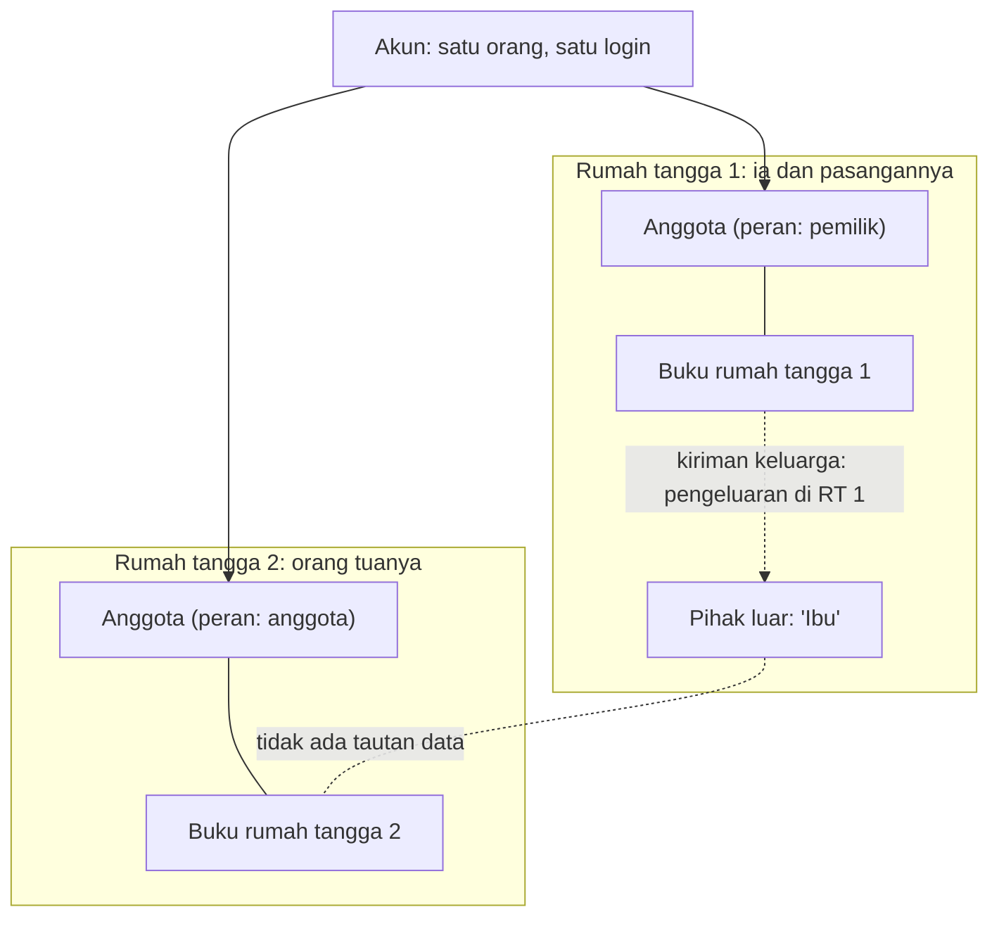

# 03 — Persona dan Model Rumah Tangga

| | |
|---|---|
| Pemilik dokumen | `product-analyst` |
| Tahap | S2 (Fondasi domain). **S6 (12 November 2026): pass konsistensi** |
| Status | **S6 (12 November 2026): pass konsistensi.** Bagian 2.1: pencatat utama adalah istri (brief §1 "Pilot devices"; pernyataan pemilik produk "istri saya yang sering catat"), siapa yang lebih sering lupa tetap tidak diketahui; pemrakarsa aplikasi kini pertanyaan terbuka (Q-218) dengan pernyataan pemilik produk dikutip. Kiriman untuk ibu "sesekali, tidak rutin" di 2.4 dan PSN-03 (K-30). KB-06: pengingat tagihan Tier 1, pengingat rutinitas Tier 2 (S3-1 (d)). Hasil S4-8 (i) A dan Q-192 dicatat di bagian 4.1 dan 7; pos rutin (Q-113, K-34) di bagian 6 dan 7 butir 9; kalimat masa depan untuk pekerjaan S4 yang sudah selesai ditulis ulang; usulan istilah glosarium di akhir bagian 7 ditandai sudah dipasang. Persona, struktur, dan tingkatan tidak berubah. Putaran keputusan 51 dan 52 dan penyisiran S4 di bawah sudah ditinjau `critic` (`_progress.md`). **Sesudah keputusan 51 dan 52, 12 November 2026:** bagian 0 memuat cara membaca "tahap publik" sebagai waktu (Tier 3, dibangun menurut pemicu dari rumah tangga sendiri atau dari tahap publik bila kelak diputuskan) dan akibat keputusan 52 bagi login orang tua. Persona, struktur, dan tingkatan tidak berubah. **Penyisiran andaian khusus pilot S4, 12 November 2026 (M1, M2, M3):** bagian 4.1 struktur 4 dan 7 serta bagian 7 butir 7 mengikuti `adults`, pihak yang disyaratkan, dan zona waktu per orang (06 revisi kedua belas). Tier dan perilaku pilot tidak berubah. **Sesudah checkpoint S3, 12 November 2026; belum ditinjau `critic`.** Rumah tangga pilot punya anak 12+ (pilihan pemilik produk sendiri; dokumen 17 A-31 gugur, Q-186): bagian 2.1 baris "Anak di rumah tangga", bagian 1 dan 3 baris PSN-05, bagian 4.1 baris struktur 1 dan 2 beserta catatan di bawah tabel; tingkatan tidak berubah; data tentang anak dinilai dokumen 10. Bagian 4.2: Q-30 diterima lewat "lanjut" (S3-1 (a)). **Tinjauan ulang `critic`, 12 November 2026:** batas pagar jatah di bagian 6 butir 6 kini "tidak di atas ambang" (sama dengan atau di bawahnya, termasuk 0); batas "sama dengan" pengetatan lead, **[Usulan]**. **Putaran perbaikan 12 November 2026** (temuan `critic` S11, M7): rujukan ke S2-1 sebagai "belum dijawab", "ditanyakan", atau "sedang diterapkan" disesuaikan dengan jawaban checkpoint S2 (2.1, 2.4, bagian 6 butir 1 dan 6, bagian 7 butir 2a); bagian 6 butir 6 mendapat baris keempat (jatah sebagai batas; W-17); kalimat penutup bagian 6 dan bagian 7 butir 9 tidak lagi merujuk D-52 untuk pos rutin, memakai aturan sesudah penegasan 3, dan menandai kiriman orang tua sebagai ilustrasi. Bawaan yang diterima lewat "lanjut" atau atas saran lead tidak ditulis sebagai pernyataan pemilik produk. **Sesudah checkpoint S2 (11 November 2026):** 2.1 "Keluarga besar yang menerima uang" tidak lagi menyebut kiriman kepada ibunya "per bulan" (dokumen 17, K-30). **Catatan sebelumnya:** Draf untuk tinjauan `critic`. Diperbarui dengan pernyataan pemilik produk 11 November 2026 bahwa kedua pasangan berpenghasilan (2.1, 2.4, bagian 6 butir 1, bagian 7 butir 2a). **Putaran perbaikan tinjauan `critic` S2** (B-1, M-1, M-8) dan penilaian `security-privacy` atas jatah pribadi (SP-24 sampai SP-26): bagian 0 memuat keputusan 11 sampai 17; 2.4 tidak lagi menyebut bawaan D-48 sebagai keputusan pemilik produk dan angka "tujuh kali sebulan" sebagai kata-katanya; bagian 6 butir 6 dan bagian 7 butir 9 ditambahkan |
| Tanggal | 11 November 2026 |
| Dibaca sebelum menulis | `CLAUDE.md`; `family-os-brief.md` §1, §1.1, §2–§5, §8, §11–§13, §16; `ENGINEERING-STANDARDS.md`; [00-glossary.md](00-glossary.md); [_progress.md](_progress.md); [07-financial-domain.md](07-financial-domain.md) §1–§6, §9–§10; [06-activity-approval-architecture.md](06-activity-approval-architecture.md); ADR-001 sampai ADR-010; [17-open-questions-assumptions.md](17-open-questions-assumptions.md); [18-market-research.md](18-market-research.md) §1, §2.2; [02-product-principles.md](02-product-principles.md) |

Dokumen ini menjawab tiga hal: siapa pemakai Family OS, bentuk rumah tangga apa yang harus tetap mungkin, dan kebutuhan inti apa yang kelak ditelusuri peta fitur (dokumen 04).

## 0. Cara membaca

**Kedalaman mengikuti tingkatan** (brief §1.1). Dua persona pilot ditulis penuh. Lima persona lain ditulis ringkas, masing-masing dengan tahap ia mendapat akun dan apa di model Tier 1 yang sudah menjaganya tetap mungkin. Preset selain "dua dewasa setara" hanya berupa nama dan satu baris.

**"Tahap publik" sebagai waktu** (keputusan pemilik nomor 51; dokumen 17). Go public tidak direncanakan atau dijadwalkan (glosarium *Tahap publik*). Di kolom "Kapan mendapat akun", "Tahap", dan "Tingkatan" dokumen ini, "tahap publik" dan "sesudah tahap publik" karena itu tidak berarti jadwal, melainkan Tier 3 (dokumen 13 FS-5): dirancang sekarang, dibangun bila pemicunya terpenuhi, baik dari kebutuhan rumah tangga pilot sendiri (brief §1: "Parents and children get logins later") maupun dari tahap publik bila kelak diputuskan. Urutan relatifnya tetap: yang bertanda "sesudah tahap publik" menyusul yang bertanda "tahap publik". Syarat hukum untuk anak tetap berlaku di kedua jalan. Orang tua yang diberi login dihitung pengguna luar (keputusan pemilik nomor 52), begitu pula kerabat dewasa lain yang diberi login (keputusan 63, diterima atas saran lead), jadi login PSN-04 atau kerabat lain di rumah tangga pilot sendiri menunggu gerbang pengguna luar pertama (dokumen 13 §3.6), walaupun tahap publik tidak diambil.

**Tidak ada biografi karangan.** Brief dan pemilik produk hanya menyatakan sedikit tentang rumah tangga pilot, dan pertanyaan tentang faktanya (Q-09) tidak diisi di checkpoint S1. Karena itu setiap atribut persona pilot berlabel **[Asumsi]** kecuali disebut "brief §1.1", "keputusan pemilik", atau "pernyataan pemilik produk". Usia, pekerjaan, dan kebiasaan tidak ditulis karena tidak diketahui (PRN-04).

**Pernyataan pemilik produk.** Pemilik produk adalah suami di rumah tangga pilot. Pada 11 November 2026, dalam percakapan perencanaan, ia menyatakan sendiri, dua kali, bagaimana uang berjalan di rumah tangganya; kutipan lengkapnya ada di [dokumen 17](17-open-questions-assumptions.md#pernyataan-pemilik-produk-tentang-arus-uang-rumah-tangga-pilot). Yang ia nyatakan ditulis di sini dengan sumber "pernyataan pemilik produk, 11 November 2026" dan bukan **[Asumsi]**. Yang tidak ia nyatakan tetap **[Asumsi]** atau "tidak diketahui".

**Uang dan persetujuan.** Dokumen ini tidak membuat aturan. Aturan uang dikutip dari dokumen 07 dan aturan alur dari dokumen 06. Hal yang belum diatur keduanya ditulis sebagai pertanyaan terbuka dengan bawaan yang diusulkan (bagian 7).

**Keputusan pemilik produk** dikutip seperti di [dokumen 02, bagian 0](02-product-principles.md#0-cara-membaca): nomor 1 sampai 10 dari checkpoint S1, nomor 11 sampai 17 dari 11 November 2026 (tujuh keputusan, termasuk bentuk *jatah pribadi* dan hari mulai *periode anggaran*), ditambah dua pernyataan pemilik produk pada hari itu (kedua pasangan berpenghasilan; penghasilannya datang beberapa kali sebulan). Rujukan "keputusan pemilik, 11 November 2026" yang lebih lama di dokumen ini berarti keputusan 11 sampai 13. Bawaan yang menyertai jatah pribadi (dokumen 17, D-48 sampai D-54) **bukan** keputusan pemilik produk dan dikutip sebagai **[Usulan]**. Dokumen 06 dan 07 versi revisi sudah memuat ketujuh keputusan itu; karena nomor bagian dokumen 06 masih dapat bergeser, bagian yang terdampak dirujuk dengan nama dan nomornya.

**Kode.** `MSL-n`, `KS-n`, `PAGAR`, dan `PRN-NN` didefinisikan di dokumen 02. Dokumen ini menambah dua pengenal yang tidak ada di brief §16; lead diminta menambahkannya ke README.

| Kode | Arti |
|---|---|
| `PSN-NN` | Persona |
| `KB-NN` | Kebutuhan inti (bagian 5); dirujuk dokumen 04 dan 05 |

## 1. Daftar persona

| ID | Persona | Kedudukan di glosarium | Kapan mendapat akun | Kedalaman |
|---|---|---|---|---|
| PSN-01 | Suami (pilot) | Anggota dewasa; pemilik rumah tangga | Pilot, Tier 1 | Penuh |
| PSN-02 | Istri (pilot) | Anggota dewasa; pemilik rumah tangga | Pilot, Tier 1 | Penuh |
| PSN-03 | Ibu suami: kerabat penerima kiriman, tanpa login | Pihak luar | Tidak selama pilot (default Q-25 diterima) | Ringkas |
| PSN-04 | Anggota lanjut usia | Anggota dewasa, atau tamu | Tahap publik | Ringkas |
| PSN-05 | Remaja | Tanggungan | Tahap publik, bergantung pada tinjauan hukum. Rumah tangga pilot punya anak 12+, tanpa akun selama pilot (Q-186) | Ringkas |
| PSN-06 | Asisten rumah tangga atau pengasuh | Tamu | Tier 3; tahap publik atau sesudahnya | Ringkas |
| PSN-07 | Anggota di dua rumah tangga | Satu akun, dua anggota | Tier 3; fondasinya Tier 1 | Ringkas |

---

## 2. Persona pilot

### 2.1 Yang diketahui dan yang tidak

| Hal | Suami (PSN-01) | Istri (PSN-02) | Dasar |
|---|---|---|---|
| Pertanyaan yang terus diajukan | "Uang bulanan masih ada? Sisa berapa? Aset kita apa saja?" | Tidak dinyatakan | Brief §1.1 |
| Memegang sisa uang setelah cicilan, tagihan, dan kiriman | — | Ya | Brief §1.1 "the wife holds the rest" |
| Meminta atau meminjam kembali dari yang dipegang pasangan | Ya | — | Brief §1.1 |
| Keluarga besar yang menerima uang | Ibunya (brief §1.1 menyebut Rp3.000.000; **tidak rutin** menurut pernyataannya di checkpoint S2); saudara dan ayahnya (sesekali, sering tidak tercatat) | Tidak dinyatakan | Brief §1.1 untuk penerima dan angkanya. Pernyataan pemilik produk, 11 November 2026: sisa gaji ia berikan juga kepada ibunya, adiknya, dan ayahnya "kalau ada"; di checkpoint S2: kiriman untuk orang tua tidak rutin di rumah tangganya (dokumen 17, K-30). Rumusan sebelumnya di baris ini, "Rp3.000.000 per bulan", adalah bacaan atas brief |
| Menerima gaji, dan memegangnya saat tiba | Ya | Ya: ia punya gaji atau penghasilan sendiri. Jenisnya (gaji, hasil usaha, atau lainnya), jumlahnya, iramanya, dan ke tempat uang mana ia tiba tidak dinyatakan | Pernyataan pemilik produk, 11 November 2026 ("gaji turun kan otomatis saya yang pegang"; kemudian, pada hari yang sama: "suami ada gaji, istri ada gaji / pengahasilan /pendapatan"). Brief §1.1 sendiri tidak menyebut orangnya |
| Irama penghasilan | Gaji dapat datang dua kali; ada uang masuk dari pekerjaan lepas, sampai lima kali. Bacaan lead: sampai sekitar tujuh uang masuk sebulan | Tidak dinyatakan | Pernyataan pemilik produk, 11 November 2026 ("gajian saya bisa 2x bahkan uang masuk dari freelancer juga bisa sampe 5x lah uang masuk"). Angka tujuh adalah bacaan lead (dokumen 17, kelompok ketiga) |
| Ke mana penghasilan tiba | Rekening bank atau e-wallet | Tidak dinyatakan | Pernyataan pemilik produk, 11 November 2026 ("masuk gajiab bisa ke bank/ewallet") |
| Mencatat jumlah seluruh gaji | Ya | Mencatat uang masuk bersumber gaji dan memilih arahnya. Hanya penerima penghasilan yang boleh mengarahkan sebagian penghasilannya ke uang pribadinya; pasangan yang mencatatkan penghasilan orang lain memasukkannya seluruhnya ke uang bersama (keputusan pemilik nomor 18, checkpoint S2; 07 INV-27). Sebelum checkpoint S2 baris ini menyebutnya usul lead yang belum dijawab | Pernyataan pemilik produk, 11 November 2026 ("saya input total gaji saya"; "atau istri input uang, sumber gaji, masuk ke kas atau dipake ini atau masuk ke pribadi"). Keputusan 18: dokumen 17, bagian "Keputusan pemilik produk di checkpoint S2", kelompok (a) |
| Membayar cicilan, listrik, dan tagihan lain, dan mencatatnya | Ya | Tidak dinyatakan | Pernyataan pemilik produk, 11 November 2026 ("saya bayar cicilan, lisrik dll") |
| Menyerahkan sisa gaji kepada pasangan | Ya, ia yang menyerahkan: lewat transfer, atau dengan menarik tunai lalu membagikannya | Menerima | Pernyataan pemilik produk, 11 November 2026 ("sisa saya kasih ke istri segini"; kemudian: "bisa di tf ke istri bisa ditarik cash lalu di bagiin"); selaras dengan brief §1.1 "the wife holds the rest" |
| Besarnya gaji | Sekitar Rp10.000.000 | — | Angka brief §1.1; angka sebenarnya tidak diisi (Q-09). **[Asumsi]** (A-18) |
| Punya penghasilan sendiri | Ya (gaji di atas) | **Ya**; jenis dan jumlahnya tidak diketahui | Pernyataan pemilik produk, 11 November 2026: "suami ada gaji, istri ada gaji / pengahasilan /pendapatan" (A-26 terjawab). Siapa yang berpenghasilan lebih besar tidak dinyatakan dan tidak disimpulkan |
| Yang mencatat belanja dapur saat ini | Tidak dinyatakan | Tidak dinyatakan | **[Asumsi]**: yang berbelanja (dokumen 17 §1.1) |
| Pencatat utama | — | **Ya** | Brief §1 baris "Pilot devices" ("iPhone 13 (wife, main recorder)", bunyi yang disetujui pemilik produk lewat keputusan 50); pernyataan pemilik produk, 12 November 2026: "istri saya yang sering catat" (dokumen 17 A-19). Sebelumnya baris ini "tidak dinyatakan" |
| Yang lebih sering lupa mencatat | Tidak dinyatakan | Tidak dinyatakan | Brief §1.1 menyebut pencatat utama pelupa, tetapi siapa yang lebih sering **lupa** tidak dinyatakan pemilik produk; aplikasi dirancang seolah keduanya bisa lupa (dokumen 17 A-19) |
| Yang mengumumkan jalan-jalan mendadak | Tidak dinyatakan | Tidak dinyatakan | Brief §1.1: yang diinginkan, "either spouse proposes" |
| Perangkat | iPad mini 7 di pilot, untuk memasukkan gaji, membagikannya, dan membaca angka; bukan perangkat yang dibawa saat belanja **[Asumsi]**. Galaxy A55 miliknya, dipakai sesudah klien Android dibangun | iPhone 13 | Pernyataan pemilik produk, 12 November 2026 ("saya jarang kemana-mana input gaji bisa lewat ipad"; "a55 punya saya, tapi yang sering catat istri saya iphone"; "ios ipad yang bakalan dipakai pilot ya"), dokumen 17 keputusan 42 dan Q-211. Sebelumnya baris ini "tidak dinyatakan" |
| Anak di rumah tangga | Ada anak berusia 12 tahun ke atas; jumlah dan usia tepatnya tidak dinyatakan | (sama; fakta rumah tangga) | Pilihan pemilik produk sendiri di checkpoint S3, 12 November 2026: "Ada anak umur 12+" (dokumen 17 A-31 gugur, Q-186). Selama pilot anak tanpa akun dan tanpa profil **[Usulan]** lead (bagian 4.1) |
| Peran dan wewenang di aplikasi | Pemilik rumah tangga; setara penuh | Pemilik rumah tangga; setara penuh | Keputusan pemilik nomor 4 |
| Suasana hati pasangan | Tidak tahu kecuali bertanya | Tidak tahu kecuali bertanya | Brief §1.1 |
| Pemrakarsa aplikasi | **Terbuka** (dokumen 17 Q-218). Ia pemilik produk | **Terbuka** (Q-218) | Pemilik produk adalah suami (disampaikan lead). Pernyataan pemilik produk di checkpoint S4, 12 November 2026: "istri saya juga programer dia yang nyruh ini kocak" (dokumen 17 keputusan 36); dokumen ini tidak memverifikasinya. Siapa yang memprakarsai (pemilik produk, istrinya, atau keduanya) ditanyakan di Q-218 sebelum VL-00 (GR-2). Sampai dijawab, A-25 tetap **[Asumsi]** |

Tiga akibat bagi perancangan:

1. **Persona ditulis menurut kedudukan dalam arus uang, bukan menurut jenis kelamin.** Keduanya berpenghasilan (pernyataan pemilik produk, 11 November 2026). Yang nyata berbeda di antara keduanya adalah siapa membayar cicilan dan tagihan lalu menyerahkan sisanya, dan siapa memegang uang belanja. Kedudukan itu dapat bertukar tanpa mengubah satu aturan pun (PRN-09). Pernyataan pemilik produk menentukan contoh, urutan layar, dan di tangan siapa suatu tanda paling sering muncul; ia tidak menentukan isi aturan.
2. **Pasangan yang bukan pemrakarsa aplikasi adalah ujian adopsi yang sebenarnya.** Pemrakarsanya akan memakai aplikasi apa pun bentuknya. `KS-2` baru bermakna bila pasangan yang lain mencatat tanpa diingatkan **[Asumsi]** (A-25). Siapa pemrakarsanya terbuka (Q-218): bila istri ikut memprakarsai, A-25 gugur dan ujian adopsi bergeser ke pencatat utama (brief §1.1 "The main recorder is forgetful"; di rumah tangga pilot istri, baris "Pencatat utama" di atas); rencana validasi dokumen 13 §6 tetap.
3. **Pada serah terima, pemberilah yang biasanya mencatat.** Itu jalur yang dicontohkan pemilik produk. Akibatnya tanda "belum dikonfirmasi" dan satu ketukan konfirmasi oleh penerima (keputusan pemilik, 11 November 2026; 06 §7 "Konfirmasi custody") adalah jalur utama di pilot, bukan pengecualian.

### 2.2 PSN-01 — Suami

| | |
|---|---|
| **Tujuan** | Tahu sisa uang, siapa memegangnya, dan aset yang dimiliki tanpa bertanya (brief §1.1; `KS-1`). Mengambil lagi uang dari yang dipegang istri tanpa kabur siapa memegang berapa sesudahnya (`MSL-2`). Kiriman ibu dan bantuan kepada saudara dan ayah tercatat (`MSL-3`). Jalan-jalan dan pembelian disepakati lebih dulu (`MSL-4`) |
| **Yang ia tanyakan kepada pasangan hari ini** | "Uang bulanan masih ada? Sisa berapa? Aset kita apa?" (brief §1.1). Diduga juga: "bagaimana keadaanmu?" (brief §1.1, suasana hati) |
| **Yang perlu ia lihat saat membuka aplikasi** | *Uang yang ada* dan rinciannya per pemegang (07 §5 "Tampilan custody"); yang menunggu tanggapannya; tagihan dan cicilan yang akan jatuh tempo **[Usulan]**, ditetapkan dokumen 08 |
| **Frustrasi** | Harus bertanya berulang kali (brief §1.1). Setelah tarik tunai dan serah terima, tidak ada yang tahu uangnya ke mana (brief §1.1). Bantuan kepada keluarganya tidak tercatat (brief §1.1) |
| **Yang membuatnya berhenti memakai** | Angka utama tidak cocok dengan uang yang sebenarnya, sehingga ia tetap harus bertanya **[Asumsi]**. Mencatat tiap uang masuk lalu membagikannya, sampai beberapa kali sebulan, terasa panjang **[Asumsi]**. Rincian di 2.5 |
| **Kriteria sukses yang ia nilai** | `KS-1` terutama (dialah yang bertanya); `KS-3`; `KS-4`; `KS-5` |

### 2.3 PSN-02 — Istri

| | |
|---|---|
| **Tujuan** | Uang yang ia pegang dan pemakaiannya terlihat, sehingga ia tidak perlu berulang kali menjawab pertanyaan yang sama **[Asumsi]**; brief §1.1 hanya menyatakan bahwa ia memegangnya dan pasangannya bertanya. Belanja dapur tidak melampaui anggaran (`MSL-4`). Jalan-jalan tidak diumumkan mendadak (`MSL-4`). Tercatat memegang uang hanya sebesar yang benar-benar ia terima (keputusan pemilik, 11 November 2026; 06 §7 "Konfirmasi custody") |
| **Yang ia tanyakan kepada pasangan hari ini** | Tidak dinyatakan brief. Diduga: "gaji sudah masuk? cicilan dan tagihan sudah dibayar? berapa yang dikirim ke ibu? jadi keluar kapan dan ke mana?" **[Asumsi]**, diturunkan dari arus uang brief §1.1 |
| **Yang perlu ia lihat saat membuka aplikasi** | Uang yang ia pegang, termasuk yang belum ia konfirmasi; sisa anggaran kategori yang paling sering ia pakai; yang menunggu tanggapannya **[Usulan]**, ditetapkan dokumen 08 |
| **Frustrasi** | Terus ditanya tentang sisa uang **[Asumsi]**. Anggaran dapur sering terlampaui (brief §1.1). Jalan-jalan diumumkan pada saat terakhir (brief §1.1) |
| **Yang membuatnya berhenti memakai** | Mencatat tiap belanja terasa sebagai pekerjaan tambahan yang hanya ia tanggung **[Asumsi]**. Merasa diperiksa, misalnya karena selisih kas tampil pada uang yang ia pegang (07 §10.3 butir 3) **[Asumsi]**. Rincian di 2.5 |
| **Kriteria sukses yang ia nilai** | `KS-2` terutama (beban mencatat harian diduga jatuh padanya); `KS-4`; `KS-5`; `PAGAR` |

### 2.4 Momen mencatat dalam minggu biasa

Disusun menurut kedudukan dalam arus uang. Frekuensi adalah **[Asumsi]** yang diturunkan dari brief §1.1; angka sebenarnya diukur di pilot. Jenis catatannya mengikuti dokumen 07.

| Momen | Yang mencatat | Jenis catatan (07) | Frekuensi **[Asumsi]** |
|---|---|---|---|
| Gaji atau penghasilan masuk | Penerimanya. Di pilot keduanya berpenghasilan (pernyataan pemilik produk, 11 November 2026); hanya penerimanya yang boleh mengarahkan sebagian penghasilannya ke uang pribadinya (keputusan pemilik nomor 18, checkpoint S2; sebelumnya usul lead yang belum dijawab) | Uang masuk (§3.1), ke rekening bank atau e-wallet; bagian yang diarahkan ke dana pribadi ada di catatan yang sama (CTH-03b) dan terhitung terhadap *jatah pribadi* bulan itu menurut bawaan dokumen 17 D-48 (diterima pemilik produk lewat "lanjut" di checkpoint S2, bukan pernyataannya sendiri; melewati jatah ditandai berapa pun kelebihannya, keputusan pemilik nomor 20) (07 §3.4; 06 §6.3 bagian "Jatah pribadi"); bentuk jatahnya sendiri, satu jumlah per orang per bulan, adalah keputusan pemilik nomor 14 | Suami: gaji dapat dua kali dan pekerjaan lepas sampai lima kali (pernyataan pemilik produk, 11 November 2026, bukan lagi **[Asumsi]**); "sampai sekitar tujuh kali sebulan" adalah bacaan lead atas kalimat itu. Irama penghasilan istri tidak diketahui |
| Cicilan dan tagihan dibayar | Yang membayar | Pembayaran cicilan (§3.14); pengeluaran tertaut tagihan berulang (§3.15) | Beberapa kali sebulan, sesudah uang masuk; tidak lagi dapat diandaikan mengelompok pada satu hari gajian |
| Kiriman untuk ibu | Yang menyerahkan | Kiriman keluarga (§3.2) | Sesekali, tidak rutin (pernyataan pemilik produk di checkpoint S2; dokumen 17 K-30) |
| Tarik tunai | Yang menarik | Pemindahan (§3.3) | Beberapa kali sebulan |
| Sisa gaji diserahkan kepada pasangan | Pemberi (pernyataan pemilik produk, 11 November 2026); penerima juga dapat mencatat | Serah terima (§3.3). Bila pemberi yang mencatat, penerima mengonfirmasi satu ketukan (06 §7 "Konfirmasi custody"); bila penerima yang mencatat, langsung terkonfirmasi. Jalurnya transfer bank atau e-wallet, atau uang tunai (pernyataan pemilik produk, 11 November 2026) | Beberapa kali sebulan, mengikuti uang masuk |
| Uang yang baru masuk atau baru ditarik tunai dibagikan kepada beberapa penerima | Yang membagikan | Satu alur layar di atas beberapa catatan tersendiri: serah terima, kiriman keluarga, penyisihan (06 §7.4; syarat dokumen 05 di S3) | Beberapa kali sebulan (pernyataan pemilik produk: "ditarik cash lalu di bagiin") |
| Belanja dapur dan harian | Yang berbelanja | Pengeluaran (§3.2) | Beberapa kali seminggu; beban terbesar |
| Pinjam kembali dari yang dipegang pasangan | Penerima, atau pemberi | Serah terima, bukan utang (§3.3) | Sesekali |
| Bantuan atau pinjaman kepada saudara atau ayah | Yang menyerahkan | Kiriman keluarga atau pinjaman yang diberikan, dipilih per entri (§3.2, §3.7) | Sesekali |
| Menghitung uang tunai | Pemegangnya | Rekonsiliasi kas dan selisih kas (§3.10) | Tidak ditetapkan; irama yang wajar diusulkan dokumen 05 |
| Rencana jalan-jalan atau pembelian | Pemohon; pasangannya menanggapi | Permintaan (06 §4) | Sesekali |

Yang terbaca dari tabel ini:

- **Beban tidak merata.** Pemegang uang belanja mencatat beberapa kali seminggu; yang menerima penghasilan beberapa kali sebulan lalu membayar cicilan, tagihan, dan kiriman serta membagikan sisanya mencatat dalam beberapa gelombang, satu gelombang tiap uang masuk (sampai sekitar tujuh kali sebulan menurut bacaan lead atas pernyataan pemilik produk), bukan sekali di sekitar satu hari gajian. Tiap gelombang berisi satu catatan uang masuk ditambah satu catatan per penerima; karena itu "bagikan" harus satu alur layar (06 §7.4). Sasaran tiga ketukan (PRN-05) paling menentukan bagi yang pertama. Bagi yang kedua, yang menentukan adalah tagihan dan cicilan yang tidak perlu diisi ulang tiap bulan; bentuknya ditetapkan di S3 (tagihan berulang dan pos rutin, 04 F-FIN-011; "bagikan seperti terakhir kali", IDEA-02).
- **Semua baris kecuali belanja dapur adalah usaha baru** dibanding keadaan sekarang, ketika hanya belanja dapur yang dicatat (brief §1.1). Inilah tagihan usaha yang harus dibayar `KS-1` (PRN-02).
- **Serah terima dan pinjam kembali adalah momen yang paling mudah terlewat** dan paling merusak `KS-1` bila terlewat **[Asumsi]**. Rekonsiliasi kas menangkap akibatnya, bukan sebabnya.

### 2.5 Yang membuat pasangan berhenti memakai

| Pemicu | Dasar | Label |
|---|---|---|
| Beban mengumpulkan dan memasukkan data | Alasan terbanyak di antara orang yang berhenti melacak keuangan menurut Epstein dkk., CHI 2016 (dokumen 18 §1.3.5). Batasnya: studi tentang pelacakan pribadi, bukan pasangan; asal negara sampel tidak diperiksa. Angkanya tidak dikutip di sini karena dokumen 18 mensyaratkan pencocokan dengan PDF naskah lebih dulu | Isi studi **[Terverifikasi]** di dokumen 18; penerapannya pada pasangan Indonesia **[Asumsi]** |
| Tidak nyaman dengan apa yang ditunjukkan data | Alasan ketiga pada studi yang sama. Di Family OS bentuknya: selisih kas melekat pada pemegang, dan tabel "siapa membayar apa" mudah dibaca sebagai penilaian (07 §10.3 butir 2 dan 3) | Isi studi **[Terverifikasi]**; kaitannya dengan Family OS **[Asumsi]** |
| Hanya satu pasangan yang aktif | Brief §14; dokumen 18 §1.3.5 tidak menemukan sumber | **[Asumsi]** |
| Angka tidak dipercaya, sehingga pertanyaan lama kembali | Diturunkan dari `KS-1` | **[Asumsi]** |
| Persetujuan terasa sebagai kendali | Dokumen 18 §1.4 butir 2, catatan kejujuran | **[Usulan]** peneliti |

Tidak ada bukti tentang apa yang membuat aplikasi semacam ini terus dipakai (dokumen 18 §1.3.6; A-17). Pilot tiga bulan adalah sumbernya.

---

## 3. Persona lain

Ringkas, sesuai tingkatan. Kolom terakhir menyebut apa di model Tier 1 yang sudah membuat persona itu mungkin tanpa rancang ulang.

| ID | Siapa dan kebutuhan intinya | Tahap | Risiko yang dibawa | Yang sudah disediakan model Tier 1 |
|---|---|---|---|---|
| PSN-03 | **Ibu suami.** Menerima kiriman sesekali, tidak rutin (dokumen 17 K-30); tidak memakai aplikasi. Kebutuhannya terhadap produk hanya satu: tentang dirinya dicatat sesedikit mungkin | Tanpa login selama pilot (Q-25). Bila kelak ikut, ia anggota rumah tangganya sendiri atau PSN-04 | Ia subjek data yang tidak pernah menyetujui pencatatannya (Q-28; L-03, L-17) | *Pihak luar* dengan nama panggilan dan hubungan saja (07 §2.6). Kirimannya pengeluaran saat diserahkan, tidak dilacak sesudahnya (07 §3.2). Titipan pada pihak luar ada di model tetapi tidak dipakai pilot (07 §2.3; butir T-11) |
| PSN-04 | **Anggota lanjut usia**, misalnya orang tua yang tinggal serumah atau kakek-nenek pengasuh. Perlu: sedikit tindakan, teks besar, melihat dan mengonfirmasi uang rumah tangga yang ia pegang, tindak lanjut sakit | Tahap publik | Anak dewasa mengendalikan uang orang tuanya; orang dewasa diperlakukan sebagai tanggungan tanpa persetujuannya (bagian 6, butir 3) | Pemegang tempat uang boleh anggota mana pun (07 §2.3); konfirmasi custody berlaku bagi setiap anggota dewasa (06 §7.2); tingkat visibilitas `all_members`; tata letak yang mengikuti ukuran teks sistem (brief §10.3) |
| PSN-05 | **Remaja** 13 sampai belum 18 tahun. Perlu: meminta izin dan uang, melihat urusannya sendiri, tahu kapan ia dipantau. Rumah tangga pilot punya anak 12+ (A-31 gugur), tetapi persona ini **tidak** naik ke pilot: selama pilot anak tidak punya akun maupun profil, dan data tentangnya hanya catatan orang dewasa **[Usulan]** lead (dokumen 17 Q-186; bagian 4.1) | Tahap publik. Lebih dulu sebagai *profil tanggungan tanpa login* (A-11) | Aturan akun anak: 13 sampai belum 16 hanya pada produk berprofil risiko rendah dengan persetujuan orang tua; 16 sampai belum 18 dengan persetujuan orang tua; tanda yang jelas saat dipantau (Permen Komdigi 9/2026 Pasal 29; PP 17/2025 Pasal 13 dan 21; **[Terverifikasi]** di dokumen 18 §2.2). Bahwa login di bawah 13 kemungkinan tidak tersedia: **[Usulan]** peneliti, perlu tinjauan hukum | Akun terpisah dari anggota; peran *tanggungan*; jenis *permintaan izin* dan pemberi persetujuan yang dipilih dari hubungan wali (06 §3.4, §14) |
| PSN-06 | **Asisten rumah tangga atau pengasuh.** Perlu: daftar belanja dan tugas, uang belanja yang dititipkan beserta laporannya; tidak melihat keuangan rumah tangga | Tier 3 | Ia orang dewasa dan pekerja: aplikasi dapat menjadi alat majikan memantau pekerja; selisih kas melekat pada uang yang ia pegang; datanya sendiri (bagian 6, butir 4) | Peran *tamu*; tempat uang dana bersama dengan pemegang siapa pun; visibilitas per objek (06 §9); *permintaan penggantian* sebagai jenis tersendiri (06 §14) |
| PSN-07 | **Anggota di dua rumah tangga**, misalnya anak yang sudah menikah dan masih menopang rumah tangga orang tuanya (brief §4.2). Perlu: berpindah rumah tangga tanpa ada data yang ikut berpindah | Tier 3 (brief §1.1 "multiple households"); fondasinya Tier 1 | Kebocoran antar-rumah tangga lewat orang yang sama (4.3) | Satu akun, dua keanggotaan; `household_id` pada setiap objek (06 §14); isolasi rumah tangga diuji sejak Tier 1 (`ENGINEERING-STANDARDS.md` §4; PRN-03) |

---

## 4. Model rumah tangga

### 4.1 Sepuluh struktur brief §4.1

Preset pilot adalah **"dua dewasa setara"**: satu rumah tangga, dua akun, dua anggota dewasa, keduanya pemilik rumah tangga dengan izin dan wewenang persetujuan yang identik (glosarium bagian 3; 06 §3.1).

| # | Struktur | Pemetaan ke glosarium | Beda dari preset pilot | Tingkatan | Risiko |
|---|---|---|---|---|---|
| 1 | Pasangan tanpa anak | Satu rumah tangga, dua anggota dewasa | Tidak ada; inilah bentuk yang dipakai pilot di aplikasi (preset "dua dewasa setara") | Tier 1 | Kendali satu pasangan atas yang lain; dijaga 06 §10 |
| 2 | Pasangan dengan anak | Ditambah *tanggungan*: profil tanpa login, kelak akun | Ada wali; pengeluaran dengan anak sebagai penerima manfaat | Profil: tahap publik. Akun anak: sesudah tinjauan hukum. **Tier tidak berubah** walau rumah tangga pilot termasuk struktur ini (lihat catatan di bawah tabel) | Data anak adalah data pribadi spesifik dan memerlukan persetujuan orang tua atau wali (UU PDP Pasal 4 dan 25, **[Terverifikasi]** di dokumen 18 §2.2); aturan akun per kelompok usia |
| 3 | Orang tua tunggal | Satu anggota dewasa, ditambah tanggungan | Tidak ada pemberi persetujuan: permintaan anggaran ditolak saat diajukan (06 §3.2), dan ambang permintaan tidak pernah berlaku karena memerlukan dua anggota dewasa (06 §6.3). Lihat bagian 7, butir 3 | Tahap publik | Satu-satunya pemilik kehilangan akses (brief §8); data anak |
| 4 | Orang tua dengan anak dewasa | Lebih dari dua anggota dewasa | Siapa ikut memiliki dana bersama: tingkat `adults` (dahulu `spouses`) kini ditentukan peran, bukan hubungan (06 §9.1, P-38; dikukuhkan dokumen 10, Q-192 selesai); kesepakatan rumah tangga memerlukan pengusul dan semua pihak yang disyaratkan (06 §6.3): semua anggota dewasa penuh selain pengusul, `all` (S4-8 (i) A, keputusan 38; alternatif mayoritas P-37 tidak diambil); lebih dari satu pemberi persetujuan (06 §3.4) | Tahap publik atau sesudahnya | Orang tua memantau anak dewasa, atau sebaliknya; 06 PG-03 harus tetap berlaku |
| 5 | Keluarga besar | Satu rumah tangga bila berbagi dana bersama; bila tidak, beberapa rumah tangga dengan *pihak luar* | Sama dengan 4, atau dengan 7 | Sesudah tahap publik | Hierarki usia menjadi hierarki izin; makin banyak orang dewasa yang melihat dana bersama |
| 6 | Kakek-nenek mengasuh cucu | Anggota dewasa (kakek-nenek) dan tanggungan (cucu); orang tua cucu sebagai pihak luar atau anggota rumah tangga lain | *Wali* tidak sama dengan *hubungan* orang tua; kiriman dari orang tua cucu adalah uang masuk dari pihak luar | Tahap publik | Siapa wali yang sah untuk memberi persetujuan atas data anak (dokumen 18 §2.2, butir tinjauan advokat 3); kenyamanan pemakai lanjut usia |
| 7 | Satu keluarga di beberapa tempat tinggal | Satu rumah tangga dengan anggota di kota berbeda, atau dua rumah tangga dengan satu orang di keduanya | Zona waktu per orang: model menyimpan zona per akun yang boleh kosong, dengan cadangan zona rumah tangga. Jam tenang, waktu ringkasan, dan status "hari ini" mengikuti zona orang itu; periode anggaran, kedaluwarsa, dan jatuh tempo mengikuti zona rumah tangga (06 §11.1, P-11, INV-A42, INV-A49; penyisiran S4, M3). Memilih zona sendiri baru dibangun di Tier 3 (F-CAL-006). Selebihnya sudah tertampung: tempat uang memang per pemegang | Sesudah tahap publik | Kebocoran antar-rumah tangga (4.3) |
| 8 | Keluarga yang menopang orang tua atau mertua | *Pihak luar* dengan *kiriman keluarga*; atau *titipan*; atau orang tua punya rumah tangganya sendiri | Tidak ada: pilot sudah begini (brief §1.1) | Bentuk pihak luar: Tier 1. Login orang tua: tahap publik | Data pihak luar yang tidak menyetujui pencatatannya (Q-28) |
| 9 | Wali dan tanggungan | *Wali* dan *tanggungan*, termasuk tanggungan dewasa | Wali memberi persetujuan atas nama tanggungan, satu-satunya pengecualian terhadap 06 PG-02 | Sesudah tahap publik | Tanggungan dewasa adalah jalan termudah menuju kendali finansial atas orang dewasa (bagian 6, butir 3) |
| 10 | Asisten rumah tangga atau pengasuh dengan akses terbatas | Anggota berperan *tamu* | Izin sempit; memegang dana bersama tanpa ikut memilikinya; tanpa wewenang persetujuan | Tier 3 | Bagian 6, butir 4 |

**Rumah tangga pilot punya anak berusia 12 tahun ke atas** (pilihan pemilik produk sendiri di checkpoint S3, 12 November 2026: "Ada anak umur 12+"; dokumen 17 A-31 gugur, Q-186). Menurut struktur, rumah tangga pilot adalah struktur 2, bukan struktur 1; jumlah dan usia tepat anak tidak diketahui. **Tingkatan tidak berubah:** aplikasi pilot tetap memakai preset "dua dewasa setara" (struktur 1), profil tanggungan tetap tahap publik, dan akun anak tetap sesudah tinjauan hukum. Bawaan yang diusulkan untuk pilot: **tanpa akun anak dan tanpa profil tanggungan; data tentang anak hanya masuk sebagai catatan orang dewasa** (misalnya penerima atau keperluan sebuah pengeluaran, nama kategori, nama tagihan, foto struk), **[Usulan]** lead, yang dikukuhkan dokumen 10 di S4 (10.3 §1, SEC-80 sampai SEC-85; D-109; dokumen 17 Q-186, yang memuat daftar FR Tier 1 dan Tier 2 yang dapat memuat data itu). Anak 12+ termasuk "anak" menurut Permen 9/2026 Pasal 1 angka 1 (di bawah 18 tahun) **[Terverifikasi]** dan PP 33/2026 Pasal 1 angka 21 (di bawah 18 tahun dan belum menikah) **[Perlu validasi]**, keduanya menurut dokumen 18 §2.2. Apakah aplikasi "mungkin digunakan atau diakses oleh anak" (Permen 9/2026 Pasal 8 ayat (2)) karena anak dapat memegang ponsel orang tuanya juga dinilai dokumen 10 (10.3 §1). Dokumen 13 (S5) tidak menjadwalkan apa pun untuk anak selama pilot; akun dan profil anak ada di FS-5, dan pertanyaan sekali apakah anak dicatat sebagai profil diajukan di tinjauan tiga bulan (13 §3.4, §3.8; dokumen 17 Q-186, **[Usulan]** `product-analyst`). Dokumen ini tidak menaikkan PSN-05 ke pilot.

**Keberatan terhadap brief §4.1.** Sepuluh struktur itu bukan sepuluh model. Struktur 7 dan 8 bukan bentuk rumah tangga tersendiri: keduanya gabungan dari rumah tangga, pihak luar, dan keanggotaan ganda. Bila kesepuluhnya diperlakukan sebagai sepuluh preset yang harus dirancang, hasilnya sepuluh kali pekerjaan untuk lima perbedaan. Model hanya perlu lima sumbu, dan kelimanya sudah ada di Tier 1:

| Sumbu | Nilai | Struktur yang dicakup |
|---|---|---|
| Jumlah anggota dewasa setara | Satu, dua, lebih dari dua | 1, 3, 4, 5 |
| Tanggungan | Tidak ada, profil tanpa login, akun | 2, 3, 6, 9 |
| Anggota terbatas (tamu) | Ada atau tidak | 10 |
| Pihak luar, termasuk yang dititipi | Ada atau tidak | 5, 6, 8 |
| Satu akun di lebih dari satu rumah tangga | Ya atau tidak | 5, 7, 8 |

Usulan: brief §4.1 dipenuhi dengan membuktikan bahwa kelima sumbu tidak terhalang model Tier 1, bukan dengan merancang sepuluh preset. Yang dibangun untuk pilot tetap satu.

### 4.2 Lima konsep pada preset pilot

Nilai dikutip dari 06 §3.1 "Lima konsep tetap terpisah". Kolom terakhir menunjukkan mengapa konsep itu tidak diturunkan dari yang lain.

| Konsep | Suami | Istri | Bukti tidak saling menurunkan |
|---|---|---|---|
| Hubungan | suami | istri | Keterangan saja. Kode alur tidak membacanya (06 PG-01); menukar keduanya tidak mengubah hasil apa pun (06 INV-A13) |
| Peran | Pemilik rumah tangga | Pemilik rumah tangga | Tidak mengikuti siapa pembuat rumah tangga (06 PG-01). Peran tidak membuka data pribadi orang dewasa lain (06 V-5, PG-03) |
| Izin | Kumpulan izin preset | Identik | Disimpan sebagai rujukan tersendiri pada keanggotaan, bukan dihitung dari peran atau hubungan |
| Tanggung jawab | Diisi rumah tangga, misalnya tagihan tertentu | Diisi rumah tangga | Menanggung tagihan listrik tidak memberi izin atau wewenang apa pun (glosarium, *tanggung jawab*) |
| Wewenang persetujuan | Semua jenis permintaan, tanpa batas jumlah | Identik | Baris tersendiri per anggota. Berwenang menyetujui tidak sama dengan *yang berwenang membelanjakan* (glosarium 7.2), dan pemohon selalu dikecualikan (06 INV-A04) |

Hal keenam yang sering dikira bagian dari kelimanya: **memegang uang**. Pemegang adalah atribut tempat uang (07 §2.3) dan tidak memberi peran, izin, atau wewenang. Istri yang memegang sisa gaji tidak karenanya berwenang lebih atas uang itu, dan suami yang menerima gaji tidak karenanya memilikinya (keputusan pemilik nomor 2).

Pilot tidak punya layar untuk mengatur kelima konsep ini (Q-30). Brief §4.3 meminta tiap keluarga dapat mengaturnya sendiri; bagi dua orang dewasa setara itu biaya tanpa pemakai. Usulan penyederhanaannya disajikan sebagai S3-1 butir (a) dan diterima lewat "lanjut" di checkpoint S3, 12 November 2026 (dokumen 17 Q-30, "Hasil checkpoint S3").

### 4.3 Satu orang di dua rumah tangga

Pada tingkat model:

- **Akun bukan anggota.** Satu orang punya satu akun; di tiap rumah tangga ia adalah anggota tersendiri dengan peran, izin, tanggung jawab, dan wewenangnya sendiri (glosarium bagian 3). Menjadi pemilik di rumah tangga 1 tidak memberinya apa pun di rumah tangga 2.
- **Setiap objek milik tepat satu rumah tangga** (06 §14), dan setiap kueri dibatasi rumah tangganya (`ENGINEERING-STANDARDS.md` §4).
- **Angka rumah tangga tidak memuat dana pribadi** (ADR-003; 07 INV-20). Karena itu angka rumah tangga 1 tidak berubah oleh apa pun yang dilakukan orang itu di rumah tangga 2, dan sebaliknya.
- **Uang yang berpindah antar-rumah tangga dicatat dua kali secara terpisah, tanpa tautan** **[Usulan]**: di rumah tangga 1 sebagai kiriman keluarga kepada pihak luar, di rumah tangga 2 sebagai uang masuk. Tautan di antara keduanya adalah saluran kebocoran. Ini menyangkut uang, jadi keputusannya milik dokumen 07 (bagian 7, butir 4).

Jalur kebocoran yang harus ditutup, dan siapa yang memutuskan caranya:

| Jalur | Mengapa berbahaya | Pemutus |
|---|---|---|
| Notifikasi dari dua rumah tangga tampil bersama di satu perangkat | Pasangan di rumah tangga 1 melihat layar kunci berisi urusan rumah tangga 2 | Dokumen 08 dan 10, ditulis di S4 (teks layar kunci umum tanpa nama rumah tangga, 06 §11.1; 10 SEC-38) |
| Buku pribadi orang itu | Kontribusi dari dana pribadi yang terlihat di rumah tangga 2 memberi batas kasar dana pribadinya, yang tertutup bagi pasangannya di rumah tangga 1 | Dokumen 07 (bagian 7, butir 5) |
| Pendamping AI | Konteks dari satu rumah tangga terbawa ke keluaran untuk rumah tangga lain | Dokumen 10, ditulis di S4 (SEC-38); di pilot jalur R1 tidak mengirim data rumah tangga apa pun ke penyedia (ADR-021) |
| Pencarian, ekspor, dan penghapusan akun | Hasilnya memuat dua rumah tangga sekaligus | Dokumen 10, ditulis di S4 (SEC-38: tidak ada data lintas rumah tangga; hapus akun per rumah tangga, SEC-105) |
| Nama pihak luar yang sama di dua rumah tangga | Pencocokan otomatis akan menautkan dua rumah tangga | Tidak ada pencocokan lintas rumah tangga **[Usulan]** |

### 4.4 Preset yang diusulkan untuk struktur lain

Kedalaman Tier 3: nama dan satu baris. Tidak satu pun dibangun untuk pilot.

| Preset | Satu baris |
|---|---|
| Dua dewasa setara | Preset pilot |
| Satu dewasa | Satu pemilik; tanpa permintaan anggaran dan tanpa ambang; perlu jalan pemulihan akses |
| Dewasa setara dengan tanggungan | Preset pilot ditambah profil tanggungan tanpa login yang dikelola walinya |
| Beberapa dewasa setara | Lebih dari dua pemilik dana bersama; rumah tangga memilih cukup satu atau harus semua yang menyetujui |
| Dewasa dengan anggota terbatas | Preset mana pun ditambah tamu yang hanya melihat daftar, tugas, dan uang yang ia pegang |
| Wali dengan tanggungan berakun | Tanggungan mengajukan permintaan izin dan anggaran; wali menyetujui; tanggungan diberi tahu apa yang terlihat walinya |

---

## 5. Kebutuhan inti

Tiap kebutuhan menyebut masalah brief §1.1 yang dijawabnya. Dokumen 04 menelusuri fitur ke `KB-NN`.

| ID | Kebutuhan | Persona | Masalah | Modul | Tingkatan |
|---|---|---|---|---|---|
| KB-01 | Melihat uang rumah tangga yang ada dan siapa memegangnya | PSN-01, PSN-02 | `MSL-1`, `MSL-2` | `FIN` | Tier 1 |
| KB-02 | Mencatat uang masuk dan pembagiannya: cicilan, tagihan, kiriman, serah terima | PSN-01, PSN-02 | `MSL-3`, `MSL-5` | `FIN` | Tier 1 |
| KB-03 | Mencatat belanja harian dalam hitungan detik, boleh terlambat; menghitung uang dan mencatat selisihnya | PSN-01, PSN-02 | `MSL-5` | `FIN` | Tier 1 |
| KB-04 | Tahu sisa anggaran per kategori sebelum berbelanja | PSN-01, PSN-02 | `MSL-4` | `FIN` | Tier 1 |
| KB-05 | Mengajukan dan menanggapi rencana jalan-jalan atau pembelian: diskusi, usul balik, persetujuan, penyelesaian sisa | PSN-01, PSN-02 | `MSL-4` | `REQ`, `NTF`; `PLN` sebatas yang dibutuhkan | Tier 1 |
| KB-06 | Tahu tagihan dan cicilan: siapa membayar, berapa, sudah atau belum | PSN-01, PSN-02 | `MSL-6`, `MSL-1` | `FIN` Tier 1; pengingat tagihan `CAL`/`NTF` | Tier 1, termasuk pengingat tagihan (S3-1 (d), diterima lewat "lanjut"; brief §1.1 Tier 1; 06 N-32; 04 F-CAL-002). Pengingat rutinitas Tier 2 (KB-15) |
| KB-07 | Mencatat bantuan dan pinjaman kepada keluarga besar beserta pelunasannya | PSN-01, PSN-02 | `MSL-3` | `FIN` | Tier 1 |
| KB-08 | Ringkasan bulanan: per kategori, per orang, siapa membayar apa, tabungan | PSN-01, PSN-02 | `MSL-1` | `FIN`; narasinya `AI` | Tier 1; narasi Tier 2 |
| KB-09 | Tahu aset yang dimiliki dan kekayaan bersih | PSN-01, PSN-02 | `MSL-1` | `FIN` | Tier 1 |
| KB-10 | Punya dana pribadi yang saldonya tertutup, dengan kontribusinya bagi rumah tangga tetap terlihat | PSN-01, PSN-02 | `PAGAR`; brief §8 | `FIN`, `FAM` | Tier 1 |
| KB-11 | Membuat rumah tangga, mengundang pasangan, dan setara sejak awal | PSN-01, PSN-02 | `PAGAR` | `FAM` | Tier 1 |
| KB-12 | Tercatat memegang uang hanya sebesar yang benar-benar diterima | PSN-01, PSN-02 | `MSL-2` | `FIN`, `NTF` | Tier 1 |
| KB-13 | Meminta pasangan mengerjakan sesuatu dan permintaan itu tetap ada sampai selesai | PSN-01, PSN-02 | `MSL-6`, `MSL-7` | `REQ` | Tier 2 |
| KB-14 | Masalah rumah menjadi tugas yang ditutup dengan foto dan catatan | PSN-01, PSN-02 | `MSL-6` | `MNT` | Tier 2 |
| KB-15 | Rutinitas rumah diingatkan | PSN-01, PSN-02 | `MSL-6` | `CAL`, `NTF` | Tier 2 |
| KB-16 | Membagikan suasana hati atas pilihan sendiri, dan tahu keadaan pasangan yang membagikannya | PSN-01, PSN-02 | `MSL-6`, `MSL-7` | `CARE` | Tier 2 |
| KB-17 | Sakit ditindaklanjuti sampai ada kabar | PSN-01, PSN-02 | `MSL-6` | `CARE` | Tier 2 |
| KB-18 | Dibantu menemukan kata yang tepat untuk pasangan | PSN-01, PSN-02 | `MSL-7` | `AI` | Tier 2 |
| KB-19 | Daftar belanja dengan perkiraan dan biaya aktual terhadap anggaran | PSN-01, PSN-02 | `MSL-4` | `SHP` | Tier 2 |
| KB-20 | Menjawab "mau masak apa" | PSN-01, PSN-02 | `MSL-6` | `MEAL` | Tier 3; keluhan nyata yang sengaja ditunda (PRN-02) |
| KB-21 | Kiriman tercatat tanpa data berlebih tentang penerimanya | PSN-03 | `MSL-3` | `FIN` | Tier 1 |
| KB-22 | Melihat dan mengonfirmasi uang rumah tangga yang dipegang, dengan tampilan yang mudah dibaca | PSN-04 | `MSL-2` | `FAM`, `FIN` | Tier 3 |
| KB-23 | Meminta izin dan uang, dan tahu kapan dipantau | PSN-05 | Tidak ada di brief §1.1; brief §5D | `REQ`, `FAM` | Tier 3 |
| KB-24 | Menerima uang belanja titipan dan melaporkannya tanpa melihat keuangan rumah tangga | PSN-06 | Tidak ada di brief §1.1; brief §4.1 | `SHP`, `FIN`, `FAM` | Tier 3 |
| KB-25 | Berpindah rumah tangga tanpa ada data yang ikut berpindah | PSN-07 | Tidak ada di brief §1.1; brief §4.2 | `FAM` | Tier 3; fondasinya Tier 1 |

KB-23 sampai KB-25 tidak menjawab satu pun masalah brief §1.1. Menurut aturan kerja dokumen ini, ketiganya Tier 3; yang dipertahankan di Tier 1 hanya fondasinya (PRN-03).

---

## 6. Yang ditandai: jalan satu orang dewasa memantau atau mengendalikan orang dewasa lain

1. **Penghasilan yang terlihat kini berlaku bagi keduanya, tetapi tidak sama berat.** Menurut keputusan pemilik 11 November 2026, catatan penghasilan terlihat pasangan beserta jumlahnya dan bagian yang diarahkan ke dana pribadi. Aturannya simetris (07 INV-24; 06 V-8), dan kedua pasangan berpenghasilan (pernyataan pemilik produk, 11 November 2026; A-26 terjawab). Butir ini semula berbunyi "hanya berlaku nyata bagi satu orang"; itu tidak lagi benar. Yang masih benar: (a) jumlah yang terbaca pasangan lebih besar pada yang berpenghasilan lebih besar, dan siapa orangnya tidak diketahui; (b) keterbukaan itu hanya sama bila keduanya sungguh mencatat penghasilannya dengan sumber "gaji" atau "hasil usaha": penghasilan yang dicatat sebagai "lainnya" ke dana pribadi, atau tidak dicatat, tidak terbaca (07 §10.3 butir 1), sehingga yang mencatat dengan jujur lebih terbuka daripada yang tidak; (c) tanda di atas ambang, selisih kas, dan tanda "belum dikonfirmasi" tetap lebih sering jatuh pada orang yang lebih banyak mencatat, membayar, dan memegang uang (butir 2). Aturan bahwa hanya penerima penghasilan yang boleh mengarahkan penghasilannya sendiri ke dana pribadinya (07 INV-27; 06 §6.4 "Uang masuk yang diarahkan ke dana pribadi") menutup satu jalan kendali: tanpa itu, pencatat dapat mengarahkan gaji pasangannya ke dana pribadinya sendiri tanpa dapat dibatalkan. Aturan itu kini **keputusan pemilik nomor 18** (checkpoint S2; dokumen 17, kelompok (a)); sebelum checkpoint S2 kalimat ini menyebutnya usul lead yang belum dijawab (dokumen 02, KT-9; dokumen 17, D-32). Batas yang tersisa: "atas nama siapa" penghasilan itu dicatat tetap diisi pencatat (dokumen 17, W-4).
2. **Uang belanja yang dipegang satu orang.** Selisih kas dan tanda "belum dikonfirmasi" tampil pada pemegangnya. Pada rumah tangga pilot, itu orang yang sama dari bulan ke bulan (brief §1.1). Larangan hitungan per orang (06 AT-4) menahan sebagian; kata-katanya diputuskan dokumen 08.
3. **Tanggungan dewasa.** Glosarium mencontohkan tanggungan sebagai anak, tetapi struktur 4, 6, dan 9 membuka kemungkinan orang dewasa (orang tua lanjut usia, anak dewasa) dicatat sebagai tanggungan sehingga orang lain menyetujui atas namanya. Usulan bawaan: orang dewasa tidak pernah menjadi tanggungan berakun tanpa persetujuannya sendiri, dan dapat mengakhirinya sendiri. Keputusannya milik dokumen 10 (bagian 7, butir 6).
4. **Tamu yang juga pekerja.** PSN-06 adalah orang dewasa di bawah kuasa majikannya. Keterangan pelaku, konfirmasi custody, dan selisih kas, yang netral di antara dua pasangan setara, menjadi alat pengawasan kerja bila satu pihak adalah majikan. Persona ini tidak boleh dibangun sebelum dokumen 10 menilainya.
5. **Wali dan remaja.** Pengawasan wali sah, tetapi anak wajib diberi tanda yang jelas saat dipantau (PP 17/2025 Pasal 13, **[Terverifikasi]** di dokumen 18 §2.2).
6. **Jatah pribadi: tiga jalan pantau atau kendali di antara dua pasangan, dan jalan keempat sejak jatah menjadi batas.** Bentuk jatahnya keputusan pemilik nomor 14, 16, dan 17. Rinciannya bawaan dokumen 06 §6.3 bagian "Jatah pribadi", dibacakan sebagai baris **Pagar** di dokumen 17 dan **diterima pemilik produk lewat "lanjut" di checkpoint S2** (D-52 sampai D-54; bukan pernyataannya sendiri). `security-privacy` sudah menilai ketiganya (SP-24 sampai SP-26) dan hasilnya sudah diterapkan di dokumen 06. **Sesudah checkpoint S2** jatah adalah batas (keputusan pemilik nomor 20), yang menambah satu jalan lagi: baris keempat tabel di bawah. Asas yang diusulkan `security-privacy` untuk dokumen 10, dan yang dipakai sebagai ukuran di sini: seorang dewasa boleh sendirian mengurangi pengawasan aplikasi atas siapa pun atau menambah pengawasan atas dirinya sendiri; menambah pengawasan atas orang dewasa lain memerlukan persetujuan orang itu.

| Jalan | Bagaimana ia dapat menjadi pantauan atau kendali | Pengaman | Kedudukan |
|---|---|---|---|
| Mengakhiri kesepakatan jatah (dokumen 17 D-52; K-29) | Rancangan semula membolehkan salah satu mengakhiri jatah pasangannya sendirian. Yang mengakhirinya, lalu tidak menyetujui jatah baru, membuat setiap pengambilan pasangannya di atas ambang kembali ditandai dan diberitahukan tanpa batas waktu (W-16) | Kini hanya pemilik jatah yang dapat mengakhiri jatahnya sendiri, dan itu jalan keluar yang sah karena hanya mengurangi pengawasan atas dirinya. Pasangannya menurunkannya lewat usulan, dan jatah lama berlaku sampai usulan diterima. Pengakhiran terlihat; tidak ada yang dihalangi | Diterima lewat "lanjut" di checkpoint S2 (D-52), dibacakan beserta pilihan lainnya; K-29 selesai. Sesudah keputusan 20, "hanya mengurangi pengawasan atas dirinya" tidak lagi sepenuhnya benar: jatah yang diakhiri tetap menjadi dasar penilaian sampai akhir periode anggaran itu (rumusan lead yang dikukuhkan pemilik produk, penegasan 1), kecuali jatah yang tidak di atas ambang (sama dengan atau di bawahnya, termasuk 0), yang dilepas seketika (**[Usulan]** `security-privacy` SP-33; batas "sama dengan" pengetatan lead, **[Usulan]**). Dokumen 17 K-34 |
| Alasan pada usulan menaikkan jatah sendiri (D-53; S2-1 butir v) | Bila wajib, yang meminta selalu harus menjelaskan diri sementara yang menolak tidak; teks alasan dapat menjadi bahan penilaian atas pemakaian uang pribadi. Beban itu lebih sering jatuh pada orang yang lebih sering perlu menaikkan jatahnya | Alasan, bila ada, dipilih dari daftar tertutup yang netral (termasuk "kebutuhan pribadi") tanpa menyebut untuk apa uangnya; uraian bebas hanya di diskusi; tidak pernah di pemberitahuan; tidak ada hitungan per orang atas usulan atau penolakan; menolak tidak wajib beralasan; diam tidak pernah berarti setuju | **Tidak wajib**: S2-1 butir (v) pilihan b, diterima pemilik produk atas saran lead (bukan pernyataannya sendiri; dokumen 17, kelompok (b)). Rinciannya diterima lewat "lanjut" (D-53). Sebelum checkpoint S2: ditanyakan |
| Sisa jatah bulan berjalan (D-54) | Sisa jatah pasangan adalah angka tentang uang yang mengalir ke uang pribadinya; bila tampil terus atau diberitahukan saat menipis, ia menjadi alat pantau | Sisa jatah sendiri tampil di layar utama pemiliknya; sisa jatah pasangan hanya bila dibuka di layar kesepakatan; tidak ada pemberitahuan "hampir habis" kepada pasangan; hanya bulan berjalan; tanpa daftar lintas bulan, rata-rata, hitungan, atau perbandingan (06 AT-4) | Diterima lewat "lanjut" di checkpoint S2 (D-54); rumusan akhirnya ditulis dokumen 10 di S4 |
| Jatah sebagai batas (keputusan pemilik nomor 20; dokumen 17 W-17) | Menyepakati jatah dapat membuat seseorang lebih sering ditandai daripada tidak punya jatah; jatah yang tidak di atas ambang, termasuk 0, hanya menambah tanda. Bila pasangan dapat mengusulkan jatah kecil dan yang menolak tampak "tidak mau sepakat", jatah menjadi alat tekan | Jatah yang tidak di atas ambang (sama dengan atau di bawahnya), termasuk 0, hanya dapat diusulkan pemilik jatah itu sendiri dan boleh ia lepas seketika; tanda dasar jatah tidak pernah menjadi pemberitahuan langsung, hanya tampil di catatan dan ringkasan | Pagar: **[Usulan]** `security-privacy` (SP-32 sampai SP-34), disampaikan kepada pemilik produk dengan rumusan "nol atau di bawah ambang" dan tidak ia bantah; bukan keputusannya. Batas "sama dengan ambang" ikut tercakup adalah pengetatan lead, **[Usulan]**. Pemberitahuan: diterima atas saran lead, 12 November 2026 (dokumen 17, kelompok (i)) |

Yang tidak tertutup aturan mana pun (W-14): bila salah satu tidak pernah menyetujui jatah yang diusulkan pasangannya, pasangan itu tetap tanpa jatah, dan setiap pengambilannya di atas ambang terus ditandai. Aplikasi tidak memaksakan jatah bawaan. Kesepakatan atas sebuah pos rutin, berbeda dari jatah, tetap dapat diakhiri salah satu pasangan (06 §6.3 K06; **[Usulan]** `architect`, diterima lewat "lanjut" di checkpoint S3, S3-5 A; dokumen 17 Q-113 ditutup). Penilaiannya terhadap asas pengawasan (K-34) selesai di S4: S4-9 (i) A dan ADR-027 opsi A, diterima lewat D-113 (dokumen 17 K-34). Sesudah checkpoint S2 akibatnya berubah: setiap pos rutin disepakati saat dibuat dan jumlah yang disepakati adalah batasnya (rumusan lead yang dikukuhkan pemilik produk, penegasan 3), sehingga mengakhiri kesepakatan sebuah pos mengembalikan pembayarannya ke aturan ambang biasa, per catatan. Ini dicatat sebagai butir untuk lead (bagian 7, butir 9). Kalimat ini semula merujuk D-52, yang hanya mengatur jatah.

## 7. Yang dibawa ke lead

Pertanyaan untuk pemilik produk, dalam bahasa sehari-hari, masing-masing dengan bawaan:

| # | Pertanyaan | Bawaan yang diusulkan |
|---|---|---|
| 1 | **Sudah terjawab.** Siapa yang menerima gaji, dan siapa yang membayar cicilan dan tagihan | Pernyataan pemilik produk, 11 November 2026: suami menerima, memegang, dan mencatat gaji, membayar cicilan dan tagihan, lalu menyerahkan sisanya (A-18). Aturan tidak bergantung padanya; yang mengikutinya hanya contoh dan urutan layar |
| 2 | Siapa di antara kalian yang lebih sering lupa mencatat? (A-19). **Perangkat sudah terjawab** (dokumen 17 Q-211, keputusan 42): istri di iPhone 13, suami di iPad mini 7, Galaxy A55 milik suami | Lupa: tidak diisi; aplikasi dirancang seolah keduanya bisa lupa. Uji di iPhone 13 dan iPad mini 7 sebelum GR-2, di Galaxy A55 sesudah klien Android dibangun (dokumen 13 §3.3, §3.4) |
| 2a | **Sudah terjawab.** Apakah istri punya penghasilan sendiri? (A-26) | Pernyataan pemilik produk, 11 November 2026: ya, keduanya berpenghasilan. Jenis dan jumlah penghasilan istri tidak diisi. Contoh terhitung dokumen 07 masih memakai satu penghasilan sebagai ilustrasi; aturan berlaku sama bagi keduanya. Sesudah itu pemilik produk menyatakan irama penghasilannya dan memutuskan bentuk jatah pribadi (dokumen 17, keputusan 14 sampai 17). Kelima butir S2-1 sudah dijawab di checkpoint S2: (i), (ii), (iii) diputuskan pemilik produk sendiri (keputusan 18 sampai 20); (iv), (v) diterima atas saran lead (dokumen 17, kelompok (a) dan (b)) |

Butir terbuka untuk dokumen 17 dan pemilik dokumen lain:

| # | Butir | Bawaan yang diusulkan | Pemutus |
|---|---|---|---|
| 3 | Rumah tangga dengan satu anggota dewasa tidak punya pemberi persetujuan, sehingga permintaan anggaran dan ambang tidak berlaku (06 §3.2, §6.3). Hal yang sama terjadi pada pilot sebelum pasangan kedua bergabung | Diterima untuk pilot; pada preset "satu dewasa" rencana dicatat tanpa persetujuan | `architect`; tahap publik |
| 4 | Uang yang berpindah antara dua rumah tangga yang sama-sama memakai Family OS | Dua catatan terpisah tanpa tautan (4.3) | `finance-domain` |
| 5 | Buku pribadi melekat pada anggota atau pada akun? 07 §2.2 menulis `member(M)`. Bila satu orang ikut dua rumah tangga, ia punya satu atau dua buku pribadi? | Per anggota, yaitu per rumah tangga, agar isolasi tidak bergantung pada penyaringan; biayanya orang itu mencatat dana pribadinya dua kali | `finance-domain`, `security-privacy` |
| 6 | Tanggungan dewasa (bagian 6, butir 3) | Hanya dengan persetujuan orang itu sendiri, dapat ia akhiri sendiri | `security-privacy` (S4) |
| 7 | Arti tingkat visibilitas `adults` (dahulu `spouses`) pada rumah tangga dengan lebih dari dua orang dewasa (struktur 4 dan 5) | **Selesai.** `adults` = anggota dewasa penuh menurut peran (06 §9.1, P-38, **[Usulan]** `architect`), dikukuhkan dokumen 10 dengan lima syarat (10.1 SEC-10; disajikan sebagai D-98 dan diterima lewat "lanjut" di checkpoint S4; dokumen 17 Q-192); definisinya di glosarium *anggota dewasa penuh* | `security-privacy` (dokumen 10); selesai |
| 8 | Irama menghitung uang tunai (2.4) | Tidak dijadwalkan aplikasi; ditawarkan saat saldo tampak janggal (07 §2.5 "Saldo negatif") dan diusulkan lebih lanjut di dokumen 05 | `product-analyst` (S3) |
| 9 | Salah satu pasangan dapat mengakhiri sendirian kesepakatan sebuah pos rutin yang dibayar pasangannya (06 §6.3 K06; **[Usulan]** `architect`, belum disajikan kepada pemilik produk). Contoh, **ilustrasi saja**: kiriman bulanan untuk orang tua pasangan; di rumah tangga pilot kiriman orang tua **tidak rutin** (pernyataan pemilik produk di checkpoint S2; dokumen 17 K-30). **Sesudah checkpoint S2** setiap pos rutin disepakati saat dibuat dan jumlah yang disepakati adalah batasnya (penegasan 3), jadi pengakhiran sepihak mengembalikan pembayaran pos itu ke aturan ambang biasa: yang di atas ambang kembali ditandai atas nama pembayarnya, dan batas yang disepakati hilang ke depan. Menurut asas yang diusulkan `security-privacy` untuk dokumen 10 (06 PG-14), yang pertama menambah pengawasan atas orang dewasa lain tanpa persetujuannya. Butir ini semula merujuk D-52 dan aturan sebelum revisi (hanya tagihan di atas ambang yang disepakati) | **Selesai.** Pengakhiran sepihak (06 P-26) diterima lewat "lanjut" di checkpoint S3 (S3-5 A; dokumen 17 Q-113 ditutup; SP-35, SP-36). Penilaian terhadap PG-14 selesai di S4: S4-9 (i) A, termasuk asas pengawasan, dan ADR-027 opsi A diterima lewat D-113 (dokumen 17 K-34 selesai) | Pemilik produk (checkpoint S3 dan S4); `security-privacy` (dokumen 10), `architect` |

Istilah yang semula diusulkan masuk glosarium kini sudah ada di sana: *anggota dewasa*, *anggota dewasa penuh*, *pencatat*, *pembayar*, dan *preset dua dewasa setara*. *Tanggungan dewasa* tidak punya baris sendiri; ia hanya diperlukan bila butir 6 diterima.
