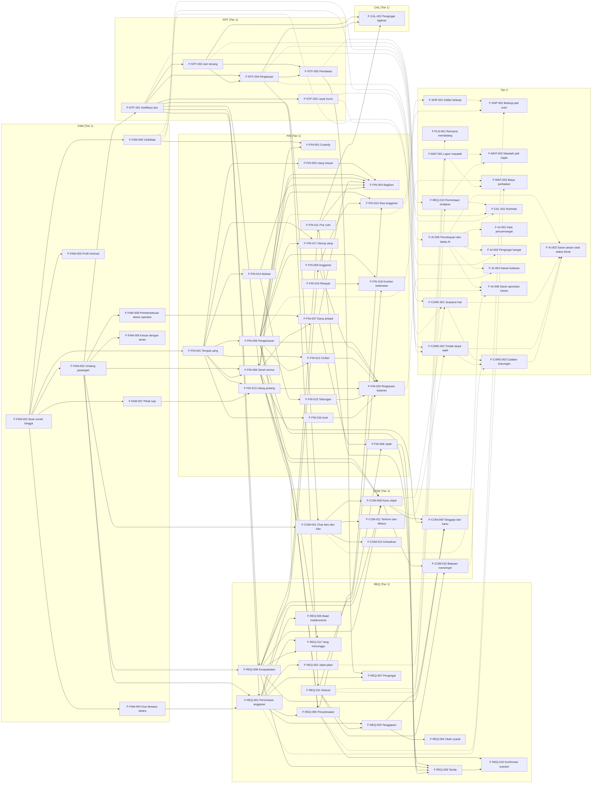

# 04 — Peta Fitur

| Hal | Isi |
|---|---|
| Pemilik | `product-analyst` |
| Tahap | S3 (definisi produk), dimulai 12 November 2026 atas arahan pemilik produk ("lanjut S3") |
| Status | **Sesudah checkpoint S3 (12 November 2026).** Pemilik produk menjawab "lanjut" (`_progress.md`, "Checkpoint S3 dijawab"; dokumen 17 "Hasil checkpoint S3"): potongan MVP di bagian 9 dan semua bawaan S3-1 sampai S3-9 serta D-56 sampai D-97 **diterima lewat "lanjut"**, termasuk F-CAL-002 di Tier 1 (S3-1 (d)). Penanda "pertanyaan checkpoint S3" dan cabang "bila ditolak" diganti dengan kedudukan itu; penulis setiap aturan tetap disebut. Angka hari, jam, dan batas tetap **[Asumsi]**. Hitungan: 126 fitur, Tier 1 52, Tier 2 17, Tier 3 57 (13 Will not build). Konsep dokumen 11 yang diterima lewat S3-2 belum ditulis sebagai baris fitur (bagian 9.4). **Sebelumnya:** draf pertama, diselaraskan 12 November 2026 dengan keputusan pemilik produk tentang chat dan pendamping `AI` (`_progress.md`), dokumen 06 revisi kesembilan, ADR-011, dan dokumen 07 putaran S3 (§10.2). **Putaran perbaikan fase D (12 November 2026)** atas tinjauan `critic` B (CB-01, CB-02, CB-03, CB-04, CB-05, CB-08, CB-10, CB-13, CB-15, CB-18, CB-25), pemeriksaan `security-privacy` (SP-45, SP-46, SP-48 sampai SP-52, SP-55, SP-60), 06 revisi kesepuluh (§15.12; N-32, P-28 sampai P-36), dan 07 putaran perbaikan S3 (INV-33, INV-34, T-39, T-40): atribusi dibetulkan; kaitan antarmodul `L-NN` menjadi `KM-NN` (README); diagram §5.1 dicocokkan dengan tabel; F-CAL-002 naik ke Tier 1 sebagai **[Usulan]** (S3-1 butir (d)). Perbaikan ini belum ditinjau ulang |
| Dipakai oleh | Dokumen 05 (kebutuhan fungsional, per modul), dokumen 12 (skenario), dokumen 13 (roadmap, S5) |
| Sumber yang mengikat | Brief §1.1, §4, §5, §16; glosarium bagian 2 (tier per modul); dokumen 02 (PRN, MSL, KS); dokumen 03 (KB); dokumen 06 (alur, pagar); dokumen 07 (aturan uang); dokumen 17 (keputusan pemilik produk dan bawaan) |

**Cara membaca.**

- Dokumen ini menyebut **apa** yang harus dapat dilakukan pengguna, untuk masalah apa, dan dengan usaha berapa. Ia **tidak** menetapkan aturan uang (kanonis di dokumen 07), aturan alur dan pagar (kanonis di dokumen 06), kata-kata layar, atau tata letak (dokumen 08, S4). Setiap fitur yang menyentuh uang atau persetujuan menunjuk bagian 07 atau 06 yang mengaturnya.
- Kode masalah `MSL-1` sampai `MSL-7`, kriteria sukses `KS-1` sampai `KS-5`, `PAGAR`, dan `PRN-NN` mengikuti dokumen 02. Kebutuhan inti `KB-NN` mengikuti dokumen 03 bagian 5.
- **Label MoSCoW di dokumen ini sementara.** Fitur Tier 1 berlabel Must; fitur Tier 2 umumnya Should; Tier 3 berlabel Could, Future, atau Will not build. Kerangka prioritas yang final adalah tugas S5 (dokumen 13); label di sini tidak mengikatnya.
- **Tier** mengikuti brief §1.1 sebagaimana diubah keputusan pemilik produk (glosarium bagian 2). Bagian modul yang tidak disebut di Tier 1 atau Tier 2 adalah Tier 3 (brief §1.1). Usulan untuk menaikkan atau menurunkan tier ditandai **[Usulan]** dan baru berlaku setelah pemilik produk menyetujuinya di checkpoint.
- Label bukti: **[Terverifikasi]**, **[Asumsi]**, **[Usulan]**, **[Perlu validasi]** (brief §16). Seluruh pembagian fitur, nama fitur, dan perkiraan usaha di dokumen ini **[Usulan]** `product-analyst` kecuali disebut lain.
- **Kata-kata pemilik produk** hanya dikutip dari `_progress.md` atau dokumen 17, dengan kedudukannya: *diputuskan sendiri*, *diterima atas saran lead*, *diterima lewat "lanjut"*, *rumusan lead yang ia kukuhkan*, atau *tidak ia sebut*.
- Pengenal fitur stabil: fitur yang kelak digabung atau dibuang tidak memberikan nomornya kepada fitur lain.

---

## Daftar isi

1. [Ringkasan modul](#1-ringkasan-modul)
2. [Konvensi kolom](#2-konvensi-kolom)
3. [Fitur per modul](#3-fitur-per-modul)
4. [Keputusan yang diminta brief](#4-keputusan-yang-diminta-brief)
5. [Ketergantungan dan kaitan antarmodul](#5-ketergantungan-dan-kaitan-antarmodul)
6. [Usaha berulang seluruh MVP](#6-usaha-berulang-seluruh-mvp)
7. [Fitur yang dapat menjadi alat pantau atau kendali](#7-fitur-yang-dapat-menjadi-alat-pantau-atau-kendali)
8. [Tidak dibangun, dan yang dipotong dari daftar brief §5](#8-tidak-dibangun-dan-yang-dipotong-dari-daftar-brief-5)
9. [Potongan MVP untuk checkpoint S3](#9-potongan-mvp-untuk-checkpoint-s3)
10. [Pertanyaan, asumsi, konflik, dan permintaan](#10-pertanyaan-asumsi-konflik-dan-permintaan)

---

## 1. Ringkasan modul

| Modul | Tujuan | Masalah | Tier | Rentang fitur | Tier 1 | Tier 2 | Tier 3 (termasuk Will not build) |
|---|---|---|---|---|---|---|---|
| `FAM` | Wadah satu rumah tangga dengan dua anggota dewasa yang setara sejak awal, dan jalan keluar yang aman | Fondasi bagi `MSL-1`, `MSL-2` (keduanya harus melihat angka yang sama); `MSL-3` (pihak luar); `PAGAR` | 1; selebihnya 3 | F-FAM-001 sampai 018 | 8 | 0 | 10 |
| `COM` | Satu chat rumah tangga tempat permintaan, kesepakatan, dan serah terima tampil sebagai kartu objek asli, dibicarakan, dan ditanggapi di satu tempat | `MSL-4` (menyetujui, berunding, usul balik); `MSL-7`; `KS-4`; `PAGAR` | 1 versi ringan (adanya chat: pernyataan pemilik produk sendiri, 12 November 2026; Tier 1 dan versi ringan: diterima atas saran lead, "Chat naik Tier 1"); selebihnya 3 | F-COM-001 sampai 013 | 6 | 0 | 7 |
| `FIN` | Uang rumah tangga terlihat, custody jelas, arus uang tercatat, anggaran dan laporan tersedia | `MSL-1`, `MSL-2`, `MSL-3`, `MSL-4`, `MSL-5`, `MSL-6` (siapa membayar tagihan apa) | 1; selebihnya 3 | F-FIN-001 sampai 026 | 20 | 0 | 6 |
| `REQ` | Rencana belanja dan jalan-jalan diajukan dan disepakati sebelum terjadi, dua arah; permintaan tolong tetap ada sampai selesai | `MSL-4`; `MSL-6` dan `MSL-7` (permintaan tindakan); `PAGAR` | 1 (anggaran, jalan-jalan); 2 (tindakan); selebihnya 3 | F-REQ-001 sampai 017 | 12 | 1 | 4 |
| `SHP` | Daftar belanja dengan perkiraan dan biaya aktual terhadap anggaran | `MSL-4` (anggaran dapur terlampaui) | 2; online 3 | F-SHP-001 sampai 005 | 0 | 2 | 3 |
| `INV` | Tidak dibangun di rilis awal | `MSL-6` hanya secara tidak langsung | 3 | F-INV-001 sampai 002 | 0 | 0 | 2 |
| `PLN` | Hanya tampilan atas permintaan jalan-jalan | `MSL-4` | 2 sejauh permintaan jalan-jalan; selebihnya 3 | F-PLN-001 sampai 004 | 0 | 1 | 3 |
| `GOL` | Tabungan sederhana ada di `FIN` Tier 1 (F-FIN-015); sisanya ditunda | `MSL-1` | Tabungan sederhana 1 (di `FIN`); selebihnya 3 | F-GOL-001 sampai 003 | 0 | 0 | 3 |
| `MNT` | Masalah rumah menjadi tugas yang ditutup dengan foto atau catatan | `MSL-6` | 2; selebihnya 3 | F-MNT-001 sampai 005 | 0 | 3 | 2 |
| `MEAL` | Tidak dibangun di rilis awal | `MSL-6` ("masak apa") | 3 | F-MEAL-001 sampai 003 | 0 | 0 | 3 |
| `CARE` | Suasana hati dibagikan atas pilihan sendiri; sakit ditindaklanjuti; ada tempat untuk kata dukungan | `MSL-6`, `MSL-7`; `KS-5`; `PAGAR` | 2; selebihnya 3 | F-CARE-001 sampai 006 | 0 | 3 | 3 |
| `CAL` | Rutinitas dan tagihan diingatkan | `MSL-6` | Pengingat tagihan 1 (diterima lewat "lanjut", S3-1 butir (d)); rutinitas 2; selebihnya 3 | F-CAL-001 sampai 006 | 1 | 1 | 4 |
| `TML` | Album kenangan ditunda; riwayat audit adalah fondasi Tier 1 di `FIN` dan dokumen 06 | `MSL-7` hanya secara lemah | 3 | F-TML-001 sampai 002 | 0 | 0 | 2 |
| `NTF` | Notifikasi alur Tier 1 yang berbatas dan aman di layar kunci | `MSL-4`, `MSL-2` (kabar yang perlu ditanggapi tanpa harus bertanya) | 1 untuk permintaan dan persetujuan; 2 untuk pengingat; selebihnya 3 | F-NTF-001 sampai 008 | 5 | 0 | 3 |
| `AI` | Pendamping yang menyusun kata; orang yang bertindak | `MSL-7`; `KS-5` | 2 versi ringan; selebihnya 3 | F-AI-001 sampai 008 | 0 | 6 | 2 |
| **Jumlah** | | | | **126 fitur** | **52** | **17** | **57** (13 di antaranya Will not build) |

Perubahan jumlah sejak draf pertama (118 fitur: 45, 17, 56, dengan 15 Will not build): enam fitur `COM` menjadi Tier 1 (F-COM-001 berubah isi; F-COM-008 sampai 012 baru); F-COM-013 baru di Tier 3; F-COM-003 dan 007 tetap Tier 3 tetapi kini Could, bukan Will not build; F-FAM-018 baru (Will not build); F-AI-008 baru di Tier 2. Putaran perbaikan fase D: F-CAL-002 (pengingat tagihan) naik dari Tier 2 ke Tier 1 (usulan `architect`, 06 P-36, N-32), karena kriteria tagihan Tier 1 (FR-FIN-100/AC-1) memerlukan pengingatnya; diterima lewat "lanjut" di checkpoint S3 (12 November 2026), butir S3-1 (d). Jumlah di tabel ini dihitung ulang dengan mencacah baris tabel bagian 3 (Tier 1: `FAM` 8, `COM` 6, `FIN` 20, `REQ` 12, `CAL` 1, `NTF` 5 = 52; Tier 2: `REQ` 1, `SHP` 2, `PLN` 1, `MNT` 3, `CARE` 3, `CAL` 1, `AI` 6 = 17; Tier 3: `FAM` 10, `COM` 7, `FIN` 6, `REQ` 4, `SHP` 3, `INV` 2, `PLN` 3, `GOL` 3, `MNT` 2, `MEAL` 3, `CARE` 3, `CAL` 4, `TML` 2, `NTF` 3, `AI` 2 = 57). Tidak ada pengenal yang dipakai ulang.

---

## 2. Konvensi kolom

| Kolom | Isi |
|---|---|
| ID | `F-<MOD>-NNN` (brief §16) |
| Fitur dan sub-fitur | Nama, lalu apa yang harus dapat dilakukan pengguna. Bukan tata letak |
| Tier | 1, 2, atau 3 |
| MoSCoW | Sementara (lihat "Cara membaca") |
| MSL | Masalah brief §1.1 yang dipecahkan. Baris tanpa MSL tidak boleh ada di Tier 1 atau Tier 2 (PRN-02) |
| Usaha berulang | Tindakan, oleh siapa, seberapa sering. "Nol" berarti fitur itu hanya dibaca atau terjadi sebagai akibat samping tindakan lain. Kekerapan **[Asumsi]** sampai diukur di pilot |
| Bergantung pada | Fitur yang harus ada lebih dulu |
| Aturan acuan | Bagian 06 atau 07 yang mengatur isinya. Dokumen ini tidak mengulang aturannya |

Penanda pada kolom MoSCoW: **Pantau** berarti fitur itu masuk daftar bagian 7 (dapat menjadi alat pantau atau kendali bila pagarnya lepas).

---

## 3. Fitur per modul

### 3.1 `FAM` — Rumah tangga dan keanggotaan

**Tujuan.** Satu rumah tangga, dua akun dewasa yang setara sejak awal, tanpa layar pengaturan izin, dengan jalan keluar yang aman. **Masalah.** Fondasi: tanpa dua akun yang melihat buku yang sama, `MSL-1` dan `MSL-2` tidak terjawab (`KS-1`); `PAGAR`; PRN-03 (fondasi tahap publik tidak dipotong).

| ID | Fitur dan sub-fitur | Tier | MoSCoW | MSL | Usaha berulang | Bergantung pada | Aturan acuan |
|---|---|---|---|---|---|---|---|
| F-FAM-001 | **Buat rumah tangga.** Nama rumah tangga; zona waktu rumah tangga (sebelum pernah ada dua anggota dewasa, pembuat dapat menggantinya sendiri, PA-FAM-8; sesudah anggota kedua bergabung, menggantinya adalah kesepakatan `rule`, berlaku mulai periode berikutnya); preset "dua dewasa setara" ditulis saat dibuat, bersama baris kelima konsep brief §4.3. Sebelum anggota dewasa kedua bergabung, rumah tangga berjalan sebagai rumah tangga satu anggota dewasa: tanpa permintaan anggaran, tanpa ambang, dan tanpa chat | 1 | Must | `MSL-1`, `MSL-2` (fondasi) | Sekali, oleh pembuat | — | 06 §3.1, §3.5, §16.2 "Peserta"; P-11 (PA-FAM-2, PA-FAM-8 **[Usulan]** `architect`, 06 §3.5 revisi kesepuluh); PRN-03 |
| F-FAM-002 | **Undang pasangan dan bergabung.** Membuat undangan; penerima menerimanya; **pengundang mengukuhkan bahwa itu orangnya** sebelum keanggotaan aktif, dan sebelum itu penerima tidak membaca data apa pun; anggota baru setara sejak aktif (`KB-11`); membatalkan undangan; undangan yang tidak dikukuhkan gugur saat masa berlakunya lewat, tidak pernah aktif dengan sendirinya. Menyepakati ambang adalah langkah terpisah dari menerima undangan. Tidak ada undangan baru selama seorang anggota dalam masa tenggang keluar (F-FAM-006). **Anggota yang bergabung sesudah ada yang keluar:** percakapan chat baru; chat lama hanya terbaca bekas pesertanya; inti uang tetap terlihat, tetapi rincian tulisan mantan anggota (nama, catatan, foto) tidak terbaca; layar undangan menyebutnya sebelum diterima (usulan `security-privacy` SP-49; diterima lewat "lanjut" di checkpoint S3, D-90) | 1 | Must | `MSL-1`, `MSL-2`; `PAGAR` (undangan yang jatuh ke orang lain tidak membuka data) | Sekali; satu ketukan pengukuhan | F-FAM-001 | 06 §3.5 V-1, §3.6 (F01 sampai F05; guard F01 selama masa tenggang), INV-A47 (f), INV-A48, N-24, N-25, SP-41; 07 §8.2 butir 3a; konfirmasi pengundang: usulan `product-analyst` dikukuhkan `architect` (06 P-23), diterima lewat "lanjut" di checkpoint S3 (12 November 2026), S3-4 (b); percakapan baru bagi anggota yang bergabung kemudian: D-90, diterima lewat "lanjut"; keamanan undangan dokumen 10 (S4) |
| F-FAM-003 | **Profil anggota minimal.** Nama tampilan dan foto opsional. Tidak ada tanggal lahir, hubungan, atau data lain yang tidak dipakai aturan mana pun; hubungan tidak diisi (06 §3.1) | 1 | Must | Fondasi | Sekali; ubah bila mau | F-FAM-001 | PRN-03; 06 PG-01 (aturan tidak membaca hubungan), §3.1 (PA-FAM-1 **[Usulan]** `architect`) |
| F-FAM-004 | **Wewenang bawaan "dua dewasa setara" tanpa layar pengaturan izin.** Pemberi persetujuan ditentukan aturan, bukan dipilih pemohon. Lima konsep tetap terpisah di model | 1 | Must | `PAGAR` | Nol | F-FAM-001 | 06 §3.1 sampai §3.2, PG-01, PG-02; dokumen 17 Q-30 (tanpa layar izin di pilot: diterima lewat "lanjut" di checkpoint S3, S3-1 (a)) |
| F-FAM-005 | **Visibilitas data milik sendiri.** Bawaan per jenis objek, tanpa ditanya pada tiap pencatatan; pemilik data dapat memperluas (tercatat dan diberitahukan) atau mempersempit (senyap, seketika) | 1 | Must | `PAGAR`; `MSL-1` (dana bersama tidak dapat disembunyikan) | Nol; hanya bila pemilik data memilih | F-FAM-001 | 06 §9.1 sampai §9.3 (V-1 sampai V-9), INV-A36; PRN-12, PRN-13 |
| F-FAM-006 | **Keluar dengan aman dan hapus data pribadi.** Setiap orang dewasa dapat keluar sendiri tanpa persetujuan siapa pun, dan keluar adalah satu-satunya jalan berakhirnya keanggotaan orang dewasa di Tier 1 (tidak ada perintah mengeluarkan orang dewasa lain, F-FAM-018); ekspor data miliknya ditawarkan lebih dulu. **Dua langkah** (usulan `security-privacy` SP-48, diterapkan `architect`; diterima lewat "lanjut" di checkpoint S3 (12 November 2026), S3-4 (c)): (1) perintah keluar (F06) meminta autentikasi ulang, dan aksesnya berakhir seketika; (2) langkah yang merusak (`exit_closure` atas klaim antar-pemilik yang masih terbuka, penutupan buku pribadinya, penghapusan catatan `CARE`-nya, penutupan chat baginya) terjadi pada F07, 7 hari **[Asumsi]** kemudian, atau seketika bila ia memilih hapus seketika. Selama masa tenggang hanya ia yang dapat membatalkan (F08 `cancel_leave`), dengan autentikasi ulang, tanpa pengukuhan pengundang; tidak ada undangan baru; klaim tetap terbuka dan tampil dengan angka penutupan yang sama. Sesudah keluar ia tetap dapat mengekspor buku rumah tangga sampai saat aksesnya berakhir. Buku pribadinya dihapus atas permintaannya atau pada akhir masa retensi; bekas peserta lain tetap membaca chat lama tetapi tidak menulis | 1 | Must | `PAGAR` | Nol; sekali bila terjadi | F-FAM-002 | 06 §3.5, §3.6 F06, F07, F08 (state `keluar_tenggang`), PG-13, INV-A35, INV-A48, N-26, §16.2, P-33; 07 §8.2 butir 1a, 2a, 2b (`exit_closure` pada akhir masa tenggang, INV-28), T-37, T-39, CTH-38; ADR-007 butir 10; jangka retensi dan isi chat dalam ekspor **[Dok. 10]** |
| F-FAM-007 | **Pihak luar tanpa login.** Ibu suami, saudara, ayah, warung: nama saja, sebagai penerima kiriman, peminjam, atau pemegang *titipan*. Data tentang pihak luar diminimalkan | 1 | Must | `MSL-3` (kiriman, bantuan, pinjaman keluarga besar); `MSL-2` (titipan) | Sekali per pihak; nol sesudahnya | F-FAM-001 | Dokumen 17 Q-25 (diterima lewat "lanjut"), Q-28; 07 §3.2 "Kiriman keluarga", §3.7; 06 §7.2 baris "titipan" |
| F-FAM-008 | **Pemberitahuan akses pengelola server sebelum data pribadi diisi.** Selama pilot pengelola server adalah salah satu anggota; anggota lain diberi tahu dengan terus terang sebelum mulai memakai. Bentuk dan buktinya milik dokumen 10 | 1 | Must | `PAGAR` | Sekali per anggota | F-FAM-002 | Dokumen 17 S2-10 (diputuskan pemilik produk sendiri, dengan syarat; keputusan 25); 06 §9.4 "Batas semua larangan"; Q-122 (bentuknya, S4) |
| F-FAM-009 | Lebih dari satu rumah tangga per orang; pengalih rumah tangga | 3 | Future | Tahap publik | — | F-FAM-001 | 06 §14; ADR-003 |
| F-FAM-010 | Wali dan tanggungan, termasuk tanggungan dewasa | 3 | Future | Tahap publik | — | F-FAM-004 | 06 §14; dokumen 03 §7 butir 6 |
| F-FAM-011 | Preset selain "dua dewasa setara" dan layar pengaturan izin terperinci | 3 | Future | Tahap publik | — | F-FAM-004 | Dokumen 17 Q-30; PRN-03 |
| F-FAM-012 | Delegasi tanggung jawab dan wewenang | 3 | Future | Tahap publik | — | F-FAM-004 | 06 §3.4, PG-02 |
| F-FAM-013 | Kontak darurat | 3 | Could | Tidak ada di §1.1 untuk pilot | — | — | Ditunda: ponsel sudah menyimpannya |
| F-FAM-014 | Visualisasi hubungan keluarga | 3 | Will not build | Tidak ada | — | — | Bagian 8 |
| F-FAM-015 | Direktori kontak keluarga | 3 | Will not build | Tidak ada | — | — | Bagian 8 |
| F-FAM-016 | Pengumuman | 3 | Will not build | Tidak ada | — | — | Bagian 8 |
| F-FAM-017 | Riwayat kegiatan per anggota | 3 | Will not build | Tidak ada; melanggar AT-3 | — | — | 06 AT-3; bagian 8 |
| F-FAM-018 | Mengeluarkan, menonaktifkan, atau menurunkan peran orang dewasa lain (brief §4.2 "member removal") | 3 | Will not build (untuk orang dewasa) | Tidak ada; keadaan yang sama dicapai lewat F-FAM-006 | — | — | 06 §3.6, PG-13, INV-A48 (a); 06 P-23, diterima lewat "lanjut" di checkpoint S3 (12 November 2026), S3-4 (a). Tanggungan anak termasuk F-FAM-010 |

**Catatan.**

- F-FAM-008 adalah titik pantau terbesar di pilot: pengelola server secara teknis dapat membuka data pribadi pasangannya, dan larangan 06 V-4, V-5, V-9, dan PG-03 hanya mengikat peran di dalam aplikasi (06 §9.4 "Batas semua larangan"). Satu-satunya pagarnya adalah pemberitahuan itu. Ia ditandai di bagian 7.
- **Tanpa perintah mengeluarkan (F-FAM-018), menantang brief §4.2.** Usulan `product-analyst` yang dikukuhkan `architect` (06 §3.6 P-23), **diterima lewat "lanjut"** di checkpoint S3 (12 November 2026, S3-4 pilihan A); bukan pernyataan pemilik produk sendiri. Kalimat brief §4.2 belum diubah (dokumen 17 K-41). Mengeluarkan orang dewasa lain "dengan persetujuannya" menghasilkan keadaan yang sama dengan keluar sendiri, tetapi menambah satu tombol tekanan ("aku sudah memintamu keluar"). Risiko yang semula ditutupnya, yaitu undangan yang jatuh ke orang yang salah, ditutup lebih awal oleh pengukuhan pengundang (F-FAM-002). Harga yang diterima: bila pasangan tidak mau keluar, yang ingin berpisah keluar sendiri dengan ekspornya dan membuat rumah tangga baru; aplikasi tidak memutus siapa yang berhak tinggal. Masa tenggang F-FAM-006 tidak mengubah ini: pembatalannya hanya milik yang keluar, jadi anggota yang tersisa tidak dapat menahan atau mempercepat keluarnya orang lain (06 F08, P-33). Dibuka ulang dengan ADR bila tahap publik menunjukkan kebutuhan yang tidak terjawab F-FAM-006 dan F-FAM-010.
- Tier 3 `FAM` (009 sampai 013) tidak memerlukan rancang ulang karena model Tier 1 sudah memuat `household_id` pada setiap objek, anggota terpisah dari akun, dan pemberi persetujuan sebagai daftar (06 §14; PRN-03).

### 3.2 `COM` — Komunikasi

**Tujuan.** Satu chat rumah tangga suami-istri: pesan bebas dan foto, dan objek asli (permintaan, kesepakatan, serah terima, entri) yang tampil sebagai kartu dan ditanggapi langsung dari kartunya; balasan pada kartu menjadi diskusi objek itu. **Masalah.** `MSL-4`: brief §1.1 meminta pasangan "approves, discusses, or counters"; dengan chat, berbicara dan memutus terjadi di satu tempat. `MSL-7` (catatan dukungan dan apresiasi terkirim sebagai pesan, F-CARE-003, F-AI-008). `KS-4`. Kehadiran (F-COM-012) tidak menunjuk `MSL` tersendiri; ia ada atas keputusan pemilik produk sendiri (bagian 4.1). **Kanonis:** 06 §16, ADR-011; kebutuhannya di [05 `COM.md`](05-functional-requirements/COM.md). Keputusannya di bagian 4.1.

| ID | Fitur dan sub-fitur | Tier | MoSCoW | MSL | Usaha berulang | Bergantung pada | Aturan acuan |
|---|---|---|---|---|---|---|---|
| F-COM-001 | **Chat rumah tangga: teks dan foto.** Satu chat per rumah tangga, pesertanya anggota dewasa aktif; pesan bebas dan foto; membalas pesan; penulis menghapus pesannya sendiri dengan penanda "pesan dihapus" beserta waktunya; tanpa sunting; notifikasi N-23 dilipat per pengirim, layar kunci tanpa nama dan isi; kirim offline dengan urutan server. Isi lama "obrolan umum keluarga dan percakapan pribadi": bagian percakapan pribadi dan grup dipindah ke F-COM-013 | 1 | Must | `MSL-4`, `MSL-7` | Sukarela; nol yang wajib | F-FAM-002, F-NTF-001 | 06 §16.2, §16.7, §16.8, S-11, INV-A47; N-23; ADR-011 butir 1, 8, 9; hapus pesan dan N-23: usulan `architect` (06 P-22, P-24), diterima lewat "lanjut" di checkpoint S3 (D-71, D-72) |
| F-COM-002 | Utas topik bebas di luar objek | 3 | Will not build | Tidak ada | — | — | Satu garis waktu ditambah balasan pada kartu (F-COM-010) sudah memberi setiap objek utasnya; utas bebas menambah pengaturan tanpa masalah §1.1 bagi dua orang |
| F-COM-003 | Pesan suara | 3 | Could | `MSL-5` (lemah) | — | F-COM-001 | Tidak termasuk versi ringan (teks pilihan "Tier 2" yang disusun lead dan diambil pemilik produk atas saran lead; tetap berlaku sesudah Tier 1: usulan `architect`, 06 §16.1, diterima lewat "lanjut" di checkpoint S3 sebagai D-70). Dinilai sesudah pilot; isi suara adalah data pribadi baru **[Dok. 10]** |
| F-COM-004 | Reaksi pada pesan dan kartu di chat, termasuk catatan dukungan | 3 | Could | `MSL-7` (lemah) | — | F-COM-001 | Tidak termasuk versi ringan (sama). Tidak boleh menjadi hitungan per orang (06 AT-4) |
| F-COM-005 | Pin pesan | 3 | Will not build | Tidak ada | — | — | Yang layak dipin adalah objek, dan objek yang menunggu sudah punya tempat sendiri (F-REQ-012) |
| F-COM-006 | Polling | 3 | Will not build | Tidak ada | — | — | Dua orang dewasa tidak memerlukan pemungutan suara; keputusan bersama kelak adalah *usulan keputusan* (F-REQ-015) |
| F-COM-007 | Pencarian pesan | 3 | Could | Tidak ada di pilot | — | F-COM-001 | Tidak termasuk versi ringan (sama); objek sudah dapat dicari di layarnya sendiri. Indeks pencarian atas isi chat dinilai dokumen 09 dan 10 bila naik |
| F-COM-008 | **Kartu objek di chat.** Kartu lahir otomatis dalam transaksi yang sama saat permintaan diajukan (B01), kesepakatan diusulkan (K01), serah terima dicatat menunggu konfirmasi (C01), permintaan tindakan diajukan (T01, Tier 2), dan status kepedulian yang dibagikan disimpan; entri menjadi kartu hanya bila dicatat atau dikirim dari chat. Objek yang boleh menjadi kartu tetapi belum punya kartu dapat dikirim ke chat dari layar objeknya (`share_to_chat`; tetap satu kartu per objek per percakapan; bukan untuk status kepedulian; memicu N-23 kecuali perintah yang sama sudah memberi tahu penerima itu; usulan `architect`, PA-COM-1, PA-COM-2; diterima lewat "lanjut" di checkpoint S3, D-96 (h)). Dari chat dapat dimulai permintaan, rencana jalan-jalan, pengeluaran, dan tugas, dengan formulir dan perintah yang sama dengan layar objeknya. Isi kartu selalu state objek saat ini; transisi tampil sebagai baris peristiwa; kartu dan baris peristiwa tidak dapat dihapus dan tidak memicu notifikasi kedua. Pengecualian satu-satunya: **kartu status kepedulian** hilang dari chat bagi kedua orang, tanpa penanda, saat statusnya diganti, berakhir, dicabut, atau dihapus; status baru melahirkan kartu baru; balasan yang sudah ditulis tetap sebagai pesan bebas milik penulisnya (usulan `security-privacy` SP-45; diterima lewat "lanjut" di checkpoint S3, S3-7 (ii)). Buku pribadi, isi dompet campuran, dan status yang tidak dibagikan tidak pernah menjadi kartu | 1 | Must | `MSL-4`; `KS-4` | Nol tambahan: kartu lahir dari tindakan yang memang dilakukan | F-COM-001, F-REQ-001, F-REQ-008, F-FIN-005, F-FIN-006 | 06 §2.5, §16.2 "Kirim ke chat", §16.8, §16.7, INV-A46, INV-A47 (b), (c), (d), (e); ADR-011 butir 2, 10; pernyataan pemilik produk sendiri, kata-katanya: "chat itu ada/diskusi di chat bisa kirim task/pengeluaran/rencana, ada tanda di baca/delivery chat itu wajib loh"; kartu permintaan di chat (diterima atas saran lead) |
| F-COM-009 | **Menanggapi dari kartu.** Tombol kartu adalah perintah objek yang sudah ada (terima, usul lain, belum sepakat, revisi, batal, ingatkan lagi, konfirmasi, keberatan) dengan versi syarat dan state yang diharapkan; kartu yang basi menampilkan state terbaru; pesan apa pun tidak mengubah state | 1 | Must | `MSL-4` | Satu ketukan per tanggapan; menggantikan, bukan menambah, membuka layar objek | F-COM-008, F-REQ-003, F-REQ-008, F-FIN-006 | 06 §16.4, S-3, S-4, INV-A44; ADR-011 butir 3; menanggapi dari kartu (diterima atas saran lead); "belum sepakat" = menolak: usulan `architect` (06 P-25), diterima lewat "lanjut" di checkpoint S3 (12 November 2026), S3-7 (i) |
| F-COM-010 | **Balasan yang menempel pada kartu.** Membalas kartu (atau pesan yang sudah menempel) menjadikan pesan itu diskusi objek, tampil di chat dan di layar objek; penulis dapat menautkan pesannya sendiri ke kartu sesudah dikirim; pesan bebas tetap bebas. Pesan yang ditulis di layar objek yang tidak punya kartu tampil di chat sebagai pesan yang menempel dengan rujukan ringkas, tanpa kartu (usulan `architect`, PA-COM-3; diterima lewat "lanjut" di checkpoint S3, D-96 (i)) | 1 | Must | `MSL-4`; brief §5B "contextual conversations" | Sukarela | F-COM-008, F-REQ-011 | 06 §16.3; ADR-011 butir 4; "Reply nempel ke kartu" (diterima atas saran lead) |
| F-COM-011 | **Tanda terkirim dan dibaca.** Pada pesan dan kartu di chat saja, sama bagi keduanya, sebagai tanda air; tanpa waktu baca. **Terkirim** naik hanya saat perangkat penerima menarik pesan ketika aplikasinya dibuka; push, Notification Service Extension, dan sinkron latar tidak pernah menggerakkannya; satu aturan di semua platform (usulan `security-privacy` SP-55; diterima lewat "lanjut" di checkpoint S3, D-93). Jadi "terkirim" berarti "pasangan sudah membuka aplikasi sejak pesan dikirim", bukan "sudah sampai di ponselnya" seperti WhatsApp. Membuka notifikasi atau layar objek tidak menggerakkan tanda; jam tenang dan tunda tidak menggerakkannya. Tidak ada pengingat "dibaca tapi belum dijawab", hitungan lama menjawab, atau statistik chat | 1 | Must; **Pantau** | `MSL-4` (tahu permintaan sudah sampai tanpa bertanya) | Nol | F-COM-001 | 06 §10 "Yang tertahan", §12 S-11, §16.5, AT-5 (a), (d), PG-07, INV-A33, INV-A45; ADR-011 butir 5, 7; "ada tanda di baca/delivery chat itu wajib loh" (pernyataan pemilik produk sendiri); tanda pada kartu dan tanpa "dibaca tapi belum dijawab" (diterima atas saran lead); platform **[Asumsi]** dokumen 09 |
| F-COM-012 | **Kehadiran: sedang online, sedang mengetik, terakhir aktif.** Hanya di layar chat; satu nilai yang ditimpa, tanpa riwayat, log, atau ekspor; bergerak hanya oleh pemakaian aplikasi di depan dengan interaksi, tidak oleh push, sinkron latar, atau aplikasi yang terbuka tanpa disentuh (usulan `security-privacy` SP-60; diterima lewat "lanjut" di checkpoint S3, D-95); tidak dibaca aturan, pengingat, ringkasan, notifikasi, atau `AI`; tidak pernah memicu notifikasi | 1 | Must; **Pantau** | Tidak ada `MSL` tersendiri; brief §1 "WhatsApp-class" | Nol | F-COM-001 | 06 §16.6, INV-A45, S-11 (d); ADR-011 butir 6; **diputuskan pemilik produk sendiri, berlawanan dengan saran lead**; penilaian risiko pengawasan di dokumen 10 (S4); dua opsi yang disajikan kepadanya di S4 dan tidak diterapkan tanpa persetujuannya: P1 setelan per orang yang timbal balik, P2 kehadiran hanya di layar chat yang sedang dibuka (disarankan `security-privacy`) (06 P-28; SP-61) |
| F-COM-013 | Grup dan percakapan pribadi di antara lebih dari dua anggota | 3 | Future | Tahap publik | — | F-COM-001, F-FAM-010 | Tidak termasuk versi ringan (sama dengan F-COM-003). Di rumah tangga yang lebih besar, objek yang tidak terlihat semua peserta tidak dapat menjadi kartu (06 §16.2) |

**Catatan.**

- **Satu kejadian, satu notifikasi.** Kartu tidak menambah kanal notifikasi: permintaan baru tetap N-01, usulan tetap N-11, serah terima tetap N-13; hanya pesan yang memicu N-23 (06 INV-A46). Chat tidak menggantikan notifikasi (06 §11.1).
- **Chat tidak menambah alur.** Setiap tindakan dari chat diuji oleh kebutuhan modul objeknya; [COM.md](05-functional-requirements/COM.md) hanya menambah syarat bahwa jalannya identik (INV-A44).
- **Biaya yang diterima.** Transport waktu nyata untuk online dan mengetik (dokumen 09), isi chat sebagai data pribadi baru yang dapat memuat jumlah uang dan keadaan kesehatan (dokumen 10), dan satu kanal percakapan kedua di samping WhatsApp. Dengan dua peserta per rumah tangga, ukuran server pilot tidak berubah (06 §16.11).

### 3.3 `FIN` — Keuangan keluarga

**Tujuan.** Kedua pasangan tahu berapa uang yang ada, siapa memegangnya, ke mana perginya, berapa sisa anggaran, dan apa yang dimiliki dan terutang, dengan pencatatan dalam hitungan detik. **Masalah.** `MSL-1`, `MSL-2`, `MSL-3`, `MSL-4`, `MSL-5`; `MSL-6` (siapa membayar tagihan apa); `KS-1`, `KS-2`, `KS-3`. Semua aturan uang di bawah kanonis di dokumen 07; dokumen ini hanya menunjuknya.

| ID | Fitur dan sub-fitur | Tier | MoSCoW | MSL | Usaha berulang | Bergantung pada | Aturan acuan |
|---|---|---|---|---|---|---|---|
| F-FIN-001 | **Tempat uang, pemegang, dan saldo awal.** Membuat tempat uang (tunai, rekening, e-wallet) dengan pemilik (dana bersama atau dana pribadi seorang anggota), pemegang, dan nama; mengisi saldo awal satu kali; dompet campuran dicatat sebagai dua tempat uang berpemegang sama; mengarsipkan tempat uang dan mengaktifkannya kembali, keduanya peristiwa yang terlihat | 1 | Must | `MSL-1`, `MSL-2` | Sekali saat mulai (sekitar 3 sampai 8 tempat uang **[Asumsi]**); jarang sesudahnya | F-FAM-001 | 07 §2.2, §2.3, §2.6 "Pengarsipan", §3.17; 06 §9.2, §8.1 "Mengelola tempat uang dana bersama" (PA-FIN-1 **[Usulan]** `architect`), N-27; tanda "pasanganku dapat melihat saldo rekening ini" pada rekening dan dompet digital dana bersama (`holding.others_may_count`, F-FIN-017) |
| F-FIN-002 | **Angka utama dan tampilan custody.** *Uang yang ada* dana bersama dan rinciannya per pemegang dan per tempat uang, sama bagi keduanya; bagian "belum dikonfirmasi" dan "dikeberatani" tampil pada pemegangnya; baris "uang pribadi saya" hanya bagi pemiliknya. Paling jauh satu ketukan dari layar pertama | 1 | Must; **Pantau** | `MSL-1`, `MSL-2`; `KS-1` | Nol (dibaca) | F-FIN-001, F-FIN-006 | 07 §5.1, §5.2; 06 INV-A24, AT-2; PRN-01 |
| F-FIN-003 | **Catat uang masuk.** Jumlah, tempat uang tujuan, sumber dari daftar sumber uang masuk rumah tangga (daftar bawaan yang dapat disunting dan ditambah, dalam dua kelompok: `work` "dari pekerjaan atau usaha", selalu terlihat, dan `gift_other` "hadiah dan lainnya"; 07 §3.1), penerima penghasilan, wajib untuk setiap sumber `work`; bagian pribadi diarahkan ke dana pribadi hanya oleh penerimanya sendiri; hadiah untuk satu orang dicatat di buku pribadinya; "langsung dipakai" sebagai dua entri dalam satu alur layar | 1 | Must | `MSL-3`, `MSL-1` | Per uang masuk, oleh penerimanya. Pilot: beberapa kali sebulan (gaji dapat dua kali, pekerjaan lepas sampai lima kali; pernyataan pemilik produk, 11 November 2026, 06 §7.4) | F-FIN-001 | 07 §3.1, INV-24; 06 §6.4; keputusan 11, 18, 19 (diputuskan sendiri). Daftar sumber: pernyataan pemilik produk "ada kategori default bisa edit tambah atau yang lainnya" (bahwa "kategori" berarti sumber pemasukan: bacaan lead **[Usulan]**); kelompok, isi bawaan (`work`: gaji, THR, bonus, lembur, honor atau pekerjaan lepas, hasil usaha; `gift_other`: hadiah, lainnya), dan siapa boleh mengubahnya: 07 §3.1 "Sumber uang masuk", **[Usulan]** T-43, ditanyakan di checkpoint S4 (dokumen 17 Q-184). Pekerjaan lepas kini sumber bawaan kelompok `work`, menggantikan "pekerjaan lepas sebagai `business`" (S2-1 butir iv) dan THR sebagai `salary` (S3-3 A, dibuka ulang sebagian). Tier dan Must tidak berubah |
| F-FIN-004 | **Bagikan satu uang masuk.** Dari satu uang masuk atau satu tempat uang: bayar tagihan lebih dulu, siapkan uang untuk tagihan yang jatuh temponya menyusul (termasuk "siapkan uang untuk semua tagihan yang belum dibayar periode ini" sebagai satu langkah), lalu bagikan sisanya kepada pasangan, kiriman keluarga, dan diri sendiri dalam satu alur layar. Setiap bagian tetap entri tersendiri; sisa yang belum dibagikan tampil selama mengisi; hasil sinkronisasi menyebut bagian yang belum tersimpan | 1 | Must | `MSL-3`, `MSL-5` | Per uang masuk, satu alur; bukan usaha tambahan di atas F-FIN-003 | F-FIN-003, F-FIN-005, F-FIN-006, F-FIN-007, F-FIN-011, F-FIN-014 | 06 §7.4 (D-55; Q-111); 07 §3.15, §3.9, CTH-41; dokumen 17 "Dibawa ke S3" baris 1; alokasi untuk tagihan **[Usulan]** `finance-domain` (T-28, Q-117) |
| F-FIN-005 | **Catat pengeluaran cepat.** Jumlah dan tempat uang wajib; kategori, penerima manfaat, pembayar, catatan, dan struk opsional; bawaan dari entri terakhir dan templat untuk yang berulang; satu entri boleh dibagi ke beberapa kategori atau dibayar dari dua tempat uang; tanggal kejadian dapat dimundurkan (entri terlambat sah); pengembalian dana dari toko; tautan ke otorisasi, tagihan berulang, cicilan, atau masalah rumah bila ada; sisa anggaran kategori tampil saat mencatat | 1 | Must | `MSL-5`, `MSL-1`, `MSL-4`; `KS-2` | **Usaha terbesar MVP.** Per belanja, oleh siapa pun yang membayar; sasaran paling banyak tiga ketukan (PRN-05 **[Usulan]**). Hari ini hanya belanja dapur yang dicatat (brief §1.1) | F-FIN-001 | 07 §3.2, §3.11, §3.13, §6.2; 06 PG-10, S-7; PRN-05, PRN-06; dokumen 17 Q-31 (bawaan: tanpa AI, kecepatan dari bawaan dan templat) |
| F-FIN-006 | **Serah terima, pemindahan, dan konfirmasi custody.** Dua pintu yang setara: "kasih ke …" dan "terima dari …"; tarik tunai sebagai pemindahan antara tempat uang orang yang sama; biaya admin sebagai baris di entri yang sama; penerima mengonfirmasi dengan satu ketukan atau mengajukan keberatan kapan saja; tanpa konfirmasi otomatis dan tanpa batas waktu | 1 | Must | `MSL-2`, `MSL-3`; `KB-12` | Per serah terima: satu catatan oleh salah satu pihak, satu ketukan oleh penerima bila pemberi yang mencatat. Pilot: beberapa kali sebulan **[Asumsi]** | F-FIN-001, F-FAM-002, F-NTF-001 | 07 §3.3, §5; 06 §7.1, §7.2 (C01 sampai C06, INV-A21 sampai INV-A24); keputusan 12 (diputuskan sendiri) |
| F-FIN-007 | **Dana pribadi dan entri dua buku.** Penyisihan ke dana pribadi; kontribusi dari dana pribadi; talangan "minta diganti" dan penggantiannya; pelepasan hak ganti; pinjaman antara dana bersama dan dana pribadi. Hanya pemilik dana pribadi yang mencatat baris di buku pribadinya; sisi dana bersama yang dipegang pasangan bertanda "belum dikonfirmasi" | 1 | Must | `MSL-3` (pinjam kembali dari uang yang dipegang pasangan); `KB-10` | Per kejadian, oleh pemilik dana pribadi | F-FIN-001, F-FIN-006, F-FAM-008 | 07 §2.2 (INV-25), §3.4, §3.5, §3.6; 06 §7.2, §7.3; keputusan 3 (saldo dana pribadi tertutup) |
| F-FIN-008 | **Jatah pribadi.** Mengusulkan jumlah per orang per periode anggaran; pasangan menyetujui, menolak, atau mengusulkan jumlah lain; alasan tidak pernah wajib pada usulan jatah mana pun dan, bila diisi, dipilih dari daftar tertutup (06 K01); mengakhiri jatah sendiri; melihat sisa jatah sendiri. Penyisihan terhitung dengan sendirinya, tanpa tautan; melewati jatah ditandai, tidak dihalangi; tambahan satu bulan lewat permintaan anggaran biasa | 1 | Must; **Pantau** | `MSL-3`; `MSL-5` (tidak perlu permintaan untuk setiap pengambilan kecil) | Sekali disepakati; berubah jarang (kenaikan bila perlu). Nol per penyisihan | F-FIN-007, F-REQ-008, F-REQ-009 | 06 §6.3 "Jatah pribadi" (INV-A18, INV-A19, INV-A37, INV-A38); 07 §3.4; keputusan 14, 16, 17, 20 (diputuskan sendiri); tetap dasar penilaian sampai akhir periode (rumusan lead yang ia kukuhkan); alasan tidak wajib (diterima atas saran lead, S2-1 butir v); jatah tidak di atas ambang hanya diusulkan pemiliknya (**[Usulan]** `security-privacy`, Q-114; tanpa ambang yang berlaku, Q-126, Q-127 **[Usulan]** `architect`) |
| F-FIN-009 | **Kategori dan anggaran bulanan per kategori.** Kategori bawaan berupa contoh yang semuanya dapat dihapus; batas per kategori per periode; hari mulai periode 1 sampai 28 (bawaan tanggal 1) diubah sebagai kesepakatan `rule` kedua anggota dewasa, berlaku periode berikutnya lewat periode peralihan; tanpa rollover, tanpa amplop | 1 | Must | `MSL-4`, `MSL-1`; `KB-04` | Sekali saat mulai; penyesuaian sesekali **[Asumsi]** | F-FAM-001, F-REQ-008 | 07 §6.1; keputusan 8 dan 15 (diputuskan sendiri); D-49, D-50 (diterima lewat "lanjut"); T-10 (kategori bawaan: diputuskan dokumen 05 dan 08) |
| F-FIN-010 | **Sisa anggaran per kategori.** Batas, realisasi, jumlah terikat oleh otorisasi, dan sisa, sama bagi keduanya; tampil juga saat mencatat belanja dan saat mengajukan atau menanggapi permintaan | 1 | Must | `MSL-4`, `MSL-1`; `KB-04` | Nol (dibaca) | F-FIN-009, F-FIN-005, F-REQ-005 | 07 §6.2 |
| F-FIN-011 | **Tagihan berulang dan pos rutin.** Membuat tagihan berulang (nama, perkiraan, jatuh tempo, penanggung jawab opsional) dan mengusulkan kesepakatan pos rutinnya dalam satu perintah; menyetujui beberapa usulan sekaligus tanpa pilihan terisi; membayar tagihan dengan entri yang ditautkan; status kesepakatan hanya di layar pos itu; sesudah pembayaran di atas jumlah yang disepakati, tawaran satu ketukan untuk mengusulkan jumlah baru; mengakhiri kesepakatan; mengarsipkan tagihan sekaligus mengakhiri kesepakatannya, tanpa arsip otomatis. Usulan pos rutin tampil sebagai kartu di chat (F-COM-008). Pengingatnya F-CAL-002 (Tier 1, N-32; diterima lewat "lanjut", S3-1 (d)) | 1 | Must | `MSL-6` (siapa membayar tagihan apa, berapa); `MSL-3` | Sekali per tagihan saat mulai (pilot: sekitar empat sampai delapan **[Asumsi]**); per pembayaran sudah termasuk F-FIN-005 | F-FIN-005, F-REQ-008, F-REQ-009 | 07 §3.15, §10.3 butir 10; 06 §6.3 "Pos rutin" (INV-A43); keputusan 22 (diputuskan sendiri); "setiap tagihan, berapa pun, jumlahnya batas" (rumusan lead yang ia kukuhkan, penegasan 3); SP-35 sampai SP-37 (usulan `security-privacy`, D-82) dan rincian Q-113, Q-116 (S3-5 (ii) sampai (iv)); pengakhiran sepihak (K06), usulan `architect` (06 P-26; dokumen 03 §7 butir 9); arsip = K06 oleh pengarsip (06 §6.3 "Pos rutin" f, G-04; 07 §3.15). Semuanya diterima lewat "lanjut" di checkpoint S3 (12 November 2026), S3-5 pilihan A |
| F-FIN-012 | **Cicilan.** Mencatat cicilan dengan sisa yang harus dibayar (jumlah seluruh pembayaran yang tersisa, tanpa memisahkan pokok dan bunga) dan, untuk pembelian yang dicatat di aplikasi, biaya kreditnya; tiap pembayaran sebagai entri; sisa kewajiban terlihat; pembayaran cicilan tidak pernah ditandai | 1 | Must | `MSL-3`, `MSL-1`; `KB-06` | Sekali per cicilan; per pembayaran termasuk F-FIN-005 | F-FIN-001, F-FIN-005 | 07 §3.14; D-44 |
| F-FIN-013 | **Utang, piutang, dan bantuan keluarga besar.** Memberi dan menerima pinjaman (dengan pihak luar dan antara dana bersama dan dana pribadi), pelunasan, penghapusan (mengikhlaskan) dengan alasan wajib; kiriman sebagai pengeluaran yang tidak dilacak sesudahnya. Penghapusan piutang dinilai terhadap ambang **secara kumulatif per piutang**: ditandai bila bagian yang belum disetujui `N > 0` dan `H + N > ambang`, dengan `H` jumlah bagian belum disetujui dari penghapusan lain atas piutang yang sama yang tersimpan lebih dulu dan tidak dibalik; bagian yang disetujui lewat permintaan tidak pernah ditandai dan tidak masuk `H` (usulan `security-privacy` SP-51, aturan `finance-domain`; diterima lewat "lanjut" di checkpoint S3 (12 November 2026), S3-9 (ii)) | 1 | Must | `MSL-3`; `KB-07`, `KB-21` | Per kejadian, sesekali **[Asumsi]** | F-FIN-001, F-FAM-007 | 07 §3.2 "Kiriman keluarga", §3.7, §3.6, §3.8 `H`, INV-34, T-32, CTH-25 varian SP-51; 06 §6.2 baris `write_off`; Q-07 (diterima) |
| F-FIN-014 | **Alokasi uang.** Memberi label tujuan pada sebagian uang di satu tempat uang (tabungan, tagihan yang menyusul); mengurangi atau memindahkannya; tempat uang tampil "alokasi melebihi uang" bila belanja melampauinya. Bersifat pilihan; anggaran tidak memerlukannya | 1 | Must | `MSL-1` (uang yang disisihkan lawan uang yang ada) | Pilihan; per uang masuk bila dipakai | F-FIN-001 | 07 §3.9 (Q-45); T-28 **[Usulan]** |
| F-FIN-015 | **Tabungan sederhana.** Tujuan berjenis tabungan dengan nama dan target opsional; menabung lewat alokasi atau pemindahan ke tempat uang khusus; kemajuan dari jumlah alokasi; menyelesaikan atau membatalkan tujuan dengan melepas alokasinya; tujuan dana bersama diarsipkan anggota dewasa mana pun bila alokasinya nol, sebagai Peristiwa yang masuk ringkasan (06 §8.1, N-14; G-08 **[Usulan]** `architect`; 07 T-38). Dana darurat adalah satu tujuan tabungan, bukan fitur tersendiri | 1 | Must | `MSL-1`; `KS-3` (tabungan di ringkasan) | Sekali per tujuan; per kali menabung (bulanan **[Asumsi]**) | F-FIN-014 | 07 §3.9 (target tidak masuk angka mana pun; membatalkan tujuan yang masih beralokasi, CTH-45), §6.3 tabel D; dokumen 17 Q-123; bagian 4.7 |
| F-FIN-016 | **Aset dan kekayaan bersih.** Mencatat aset rumah tangga, pembelian, penilaian manual, dan penjualan; kekayaan bersih rumah tangga = uang + piutang + aset − kewajiban dana bersama | 1 | Must | `MSL-1` ("aset apa yang kita punya"); `KB-09` | Sekali per aset; penilaian ulang bila mau, tanpa pengingat **[Usulan]** | F-FIN-001 | 07 §3.16, §6.5 |
| F-FIN-017 | **Hitung uang dan dompet campuran.** Menghitung isi satu tempat uang dan mencatat selisihnya; belanja yang baru teringat dicatat sebagai bagian selisih itu; dompet campuran dihitung sekali di satu layar dan pemegang memilih pembagian selisihnya setiap kali, tanpa pilihan terisi; jumlah seluruh isi dompet campuran tidak terbaca pasangan, dan pasangan tidak pernah menghitungnya. **Hitungan oleh bukan pemegang** (bagian 7) (usulan `security-privacy` SP-50, aturan `finance-domain`; diterima lewat "lanjut" di checkpoint S3 (12 November 2026), S3-9 (i)): hanya atas tempat uang `bank` atau `ewallet` dana bersama yang pemegangnya tandai "pasanganku dapat melihat saldo rekening ini" (`holding.others_may_count`; bawaan mati, hanya pemegang yang mengubahnya, tercatat sebagai Peristiwa tanpa entri); pemegangnya aktif dan tidak dalam masa tenggang keluar; paling banyak satu hitungan bukan pemegang yang terbuka per tempat uang, terbuka sampai pemegang mengonfirmasi, berkeberatan, atau menghitung sendiri (hitungan yang cocok tidak pernah terbuka); hitungan kedua selagi ada yang terbuka ditolak, juga yang cocok; pemberitahuannya (N-14) `ringkasan`. Uang tunai, termasuk dompet campuran, tidak pernah dihitung pasangan | 1 | Must; **Pantau** | `MSL-2`, `MSL-5` (lupa mencatat tertangkap di sini) | Tidak dijadwalkan; ditawarkan saat saldo tampak janggal (dokumen 03 §7 butir 8). Perkiraan sekali seminggu sampai sebulan **[Asumsi]**. Menandai rekening "dapat dilihat": sekali, pilihan pemegang | F-FIN-001, F-FIN-005 | 07 §3.10 (butir 1), §2.3, §2.5 baris (c), INV-33, T-33, CTH-29, CTH-40, CTH-46 (hitungan offline), CTH-47 (hitungan oleh bukan pemegang; hitungan kedua ditolak); 06 §7.2 C01, N-14, P-35; 06 V-9, INV-A41 (**[Usulan]**, Q-115), §7.2 (G-05), S-10; pembagian selisih tanpa bawaan (diterima atas saran lead, 12 November 2026). Hitung dompet campuran tidak pernah menjadi kartu di chat (06 §16.2) |
| F-FIN-018 | **Koreksi dan keberatan.** Membalik atau menyesuaikan entri dengan alasan wajib; catatan asal tetap terlihat; mengajukan keberatan dengan alasan dari daftar tertutup yang netral dan penjelasan di diskusi; hanya pengaju yang menutup; satu daftar "belum sepakat" yang sama bagi keduanya | 1 | Must | `MSL-1` (angka kembali benar); `MSL-5` (salah catat tidak menakutkan) | Jarang **[Asumsi]** | F-FIN-005, F-FIN-019, F-REQ-011 | 07 §3.12, CTH-30; 06 §8.1, §8.2 (INV-A25 sampai INV-A28); keputusan 7 (diputuskan sendiri); PRN-16 |
| F-FIN-019 | **Riwayat satu catatan.** Pada tiap objek: siapa mencatat, siapa membayar, siapa menyetujui, siapa mengoreksi, kapan (tanggal kejadian, dan tanggal pencatatan hanya bila berbeda); koreksi dan keberatannya. Tidak ada riwayat lintas objek menurut orang | 1 | Must; **Pantau** | `MSL-1`; arah 1 pemilik produk ("semua ada catatanya ada datanya") | Nol (dibaca) | — | 06 §9.4 AT-1 sampai AT-6, PG-08, INV-A01; 07 INV-09; keputusan 4 (diputuskan sendiri) |
| F-FIN-020 | **Ringkasan bulanan dan arus kas.** Per periode: mengapa kekayaan bersih berubah (tabel A), belanja per kategori (B), siapa membayar apa dengan tiga kolom sumbernya (C), tabungan (D), aset, piutang, dan kewajiban (E); arus kas dana bersama. Penyisihan dan kontribusi per anggota hanya per periode | 1 | Must; **Pantau** | `MSL-1`; `KS-3`; `KB-08` | Nol (dibaca); sekali sebulan **[Asumsi]** | F-FIN-005, F-FIN-009, F-FIN-012, F-FIN-013, F-FIN-015, F-FIN-016 | 07 §6.3, §6.4, §10.3 butir 2; 06 AT-4, AT-7 |
| F-FIN-021 | Anggaran periode lain, per anggota, per acara; aturan rollover | 3 | Future | `MSL-4` (tidak diminta pilot) | — | F-FIN-009 | Brief §5C (keputusan pemilik produk S1 dan S2: Tier 3) |
| F-FIN-022 | Laporan lintas periode dan tren rumah tangga (per kategori, arus kas). **Tidak pernah per orang** | 3 | Could | `MSL-1` | — | F-FIN-020 | 06 AT-4 |
| F-FIN-023 | Ekspor data rumah tangga di luar ekspor saat keluar | 3 | Could | Tidak ada di pilot | — | F-FIN-020 | Ekspor saat keluar ada di F-FAM-006; kolom ekspor tunduk AT-4 |
| F-FIN-024 | Entri antara dua buku pribadi (talangan, pinjaman antara dana pribadi dua anggota) | 3 | Future | `MSL-3` (jarang) | — | F-FIN-007 | 07 §2.2, T-12; 06 §7.3 (memerlukan keputusan baru atas INV-25) |
| F-FIN-025 | Impor mutasi rekening atau e-wallet | 3 | Future; **[Perlu validasi]** | `MSL-5` | — | F-FIN-005 | Ketersediaan API apa pun **belum diriset**; riset teknologi S4 (dokumen 18). Tidak ada klaim bahwa impor seperti itu mungkin |
| F-FIN-026 | Penyusutan aset otomatis | 3 | Will not build | Tidak ada | — | — | 07 §3.16 (penilaian manual saja); bagian 8 |

**Catatan.**

- **Usaha berulang inti hanya satu: mencatat uang yang berpindah.** Semua fitur `FIN` yang lain dibaca (002, 010, 019, 020), disepakati sekali (008, 009, 011), atau terjadi sebagai akibat samping catatan (tanda, realisasi anggaran, sisa jatah). Ini syarat PRN-02 dan menjadi patokan bagi setiap fitur yang kelak ditambahkan.
- F-FIN-004 tidak menambah jenis entri atau objek server; ia satu alur layar di atas F-FIN-003, F-FIN-005, F-FIN-006, F-FIN-007, dan F-FIN-014 (06 §7.4).
- Konfirmasi custody (F-FIN-006) menambah satu ketukan bagi penerima pada setiap serah terima yang dicatat pemberi; usaha itu dibenarkan dokumen 02 KT-8.
- Rekonsiliasi kas (F-FIN-017) tidak dijadwalkan dan tidak ada pengingat "kamu belum mencatat" (PRN-08; dokumen 17 Q-90, D-75, diterima lewat "lanjut" di checkpoint S3).

### 3.4 `REQ` — Permintaan, kesepakatan, dan persetujuan

**Tujuan.** Belanja di atas ambang dan jalan-jalan diajukan sebelum terjadi, dirundingkan pada permintaan itu sendiri, dan diselesaikan dengan sisa yang benar; kesepakatan rumah tangga (ambang, jatah, pos rutin) lahir dari dua pernyataan; semua berjalan dua arah dan tidak ada yang bertindak atas nama orang dewasa lain. **Masalah.** `MSL-4`; `KS-4`; `PAGAR`; Tier 2: `MSL-6`, `MSL-7`. Alur dan pagarnya kanonis di dokumen 06; sisi uangnya di 07 §3.8.

| ID | Fitur dan sub-fitur | Tier | MoSCoW | MSL | Usaha berulang | Bergantung pada | Aturan acuan |
|---|---|---|---|---|---|---|---|
| F-REQ-001 | **Permintaan anggaran.** Mengajukan jumlah, keperluan, kategori, dan tanggal opsional; jenis pemakaian termasuk tambahan dana pribadi untuk satu bulan; pemberi persetujuan ditentukan aturan; berlaku sampai tanggal rencana + 7 hari atau persetujuan + 30 hari | 1 | Must | `MSL-4`; `KS-4`; `KB-05` | Per pembelian tidak rutin di atas ambang atau yang ingin direncanakan, oleh siapa pun dari keduanya. Pilot: beberapa kali sebulan **[Asumsi]** | F-FAM-002, F-FAM-004, F-NTF-001 | 06 §4.1 sampai §4.3 (B01 sampai B18); 07 §3.8; S2-7 (diputuskan sendiri, keputusan 23; angka **[Asumsi]**) |
| F-REQ-002 | **Permintaan jalan-jalan.** Permintaan anggaran yang syaratnya juga memuat tanggal rencana, tempat, rentang waktu, peserta, dan barang yang direncanakan. Tidak ada objek rencana terpisah di MVP | 1 | Must | `MSL-4`; `KS-4` | Per rencana jalan-jalan; pilot sekitar satu sampai empat kali sebulan **[Asumsi]** | F-REQ-001 | 06 §2.4; brief §1.1 butir 4 |
| F-REQ-003 | **Menanggapi dan merundingkan.** Setuju, tolak (alasan opsional), usul balik jumlah atau syarat, revisi oleh pengusul; kabar "nanti aku jawab" atas pilihan penerima; tunda senyap 24 jam yang tidak terbaca pemohon (batas yang dinyatakan: kartu yang dibaca di chat memperlihatkan bahwa penerima sudah melihatnya, tetapi tidak bahwa ia menunda); tanggapan selalu atas versi syarat yang dibaca; semua tanggapan juga dapat diberikan dari kartu di chat (F-COM-009) | 1 | Must | `MSL-4` | Per permintaan yang diterima: satu ketukan untuk yang sederhana | F-REQ-001, F-REQ-011 | 06 §4.2, §4.4, S-3, INV-A06, INV-A33, AT-5 (d); tunda 24 jam (diterima atas saran lead, S2-5; angka **[Asumsi]**) |
| F-REQ-004 | **Perubahan syarat setelah disetujui.** Salah satu pihak mengusulkan perubahan; pihak lain menerima atau menolak; persetujuan tidak dapat dicabut sendirian | 1 | Must | `MSL-4` | Jarang | F-REQ-003 | 06 §4.3 (B11 sampai B13), PG-11; keputusan 21 (diputuskan sendiri, S2-3) |
| F-REQ-005 | **Belanja tertaut dan penyelesaian sisa.** Saat mencatat belanja, menautkannya ke otorisasi yang terbuka (satu pilihan); beberapa belanja ke satu otorisasi; realisasi melampaui batas tampil "melebihi Rp…" tanpa perlu tanggapan pasangan; menyelesaikan dengan satu ketukan, atau ditutup otomatis; sisa diperlakukan menurut empat situasi custody | 1 | Must | `MSL-4`, `MSL-2`, `MSL-3` | Satu pilihan saat mencatat; satu ketukan saat selesai, atau nol bila ditutup otomatis | F-REQ-001, F-FIN-005, F-FIN-006 | 06 §4.5, B14 sampai B16; 07 §3.8 situasi A sampai D (bawaan T-02 untuk B: disimpan), INV-23, INV-26 |
| F-REQ-006 | **Batal, kedaluwarsa, ajukan lagi.** Pemohon membatalkan; permintaan kedaluwarsa, tidak terselesaikan sendiri; ajukan lagi sebagai rantai yang sama | 1 | Must | `MSL-4` | Jarang | F-REQ-001 | 06 §4.4 (`resubmitted_from`), PG-04, PG-05 |
| F-REQ-007 | **Pengingat atas permintaan.** Pengingat otomatis paling banyak dua per rantai; "ingatkan lagi" oleh pemohon paling banyak satu per 6 jam dan tiga per rantai; jumlah dan waktu tekan terlihat oleh kedua pihak | 1 | Must; **Pantau** | `MSL-4`; arah 2 pemilik produk ("mengingat dan mencatat") | Pilihan; paling banyak tiga tekan per rantai | F-REQ-001, F-NTF-005 | 06 §10 PG-06, INV-A30 sampai INV-A32; keputusan 6 dan 13 (diputuskan sendiri); batas tiga dan plafon (diterima atas saran lead, S2-5) |
| F-REQ-008 | **Kesepakatan rumah tangga.** Alur usul, setuju, tolak, tarik, ganti, akhiri (K01 sampai K06) yang dipakai ketiga isi kesepakatan: aturan rumah tangga (`rule`: ambang permintaan, hari mulai periode, zona waktu rumah tangga, daftar sumber penghasilan), jatah pribadi (F-FIN-008), dan pos rutin (F-FIN-011). Sampai disetujui, yang lama tetap berlaku; diam tidak menjadikan apa pun berlaku | 1 | Must | `MSL-4`, `MSL-3`; `PAGAR` | Sekali saat mulai (ambang, hari mulai); jarang sesudahnya | F-FAM-002, F-NTF-001 | 06 §6.3 (K01 sampai K06, INV-A18, INV-A19), PG-04; S2-4 bagian ambang (tidak ia sebut; diterapkan lead) |
| F-REQ-009 | **Tanda atas catatan.** Server menandai entri dengan salah satu dari tiga dasar: pemakaian di atas ambang tanpa permintaan, penyisihan yang melewati jatah, pembayaran pos rutin di atas jumlah yang disepakati. Tanda menandai, tidak menghalangi; keterangan "mendesak" tersedia; cicilan dan pelunasan tidak pernah ditandai; hanya dasar ambang yang mengirim pemberitahuan langsung, paling banyak satu per hari | 1 | Must; **Pantau** | `MSL-4` (belanja tak terencana terlihat tanpa harus bertanya) | Nol (dihitung server) | F-REQ-008, F-FIN-005 | 06 §6.2, ADR-009, PG-10, INV-A17, INV-A37; D-35, D-44; dasar jatah dan pos rutin hanya ke ringkasan (diterima atas saran lead, 12 November 2026) |
| F-REQ-010 | **Konfirmasi susulan.** Dari catatan bertanda, dari dasar tanda apa pun (06 §6.2), pencatatnya meminta pasangan mengonfirmasi bahwa belanja itu sudah disepakati langsung; disetujui dengan satu ketukan, catatan tertaut, tandanya hilang. Sukarela; diam tidak berakibat apa pun. Pemberitahuannya (N-01) dan satu pengingat ulangnya selalu `ringkasan`, tidak pernah langsung (usulan `security-privacy` SP-52; diterima lewat "lanjut" di checkpoint S3 (12 November 2026), S3-6 (v)) | 1 | Must | `MSL-4`, `MSL-5` (kesepakatan lisan tidak perlu diketik ulang sebagai permintaan) | Pilihan; satu ketukan per pihak | F-REQ-009, F-REQ-005 | 06 §6.2 "Konfirmasi susulan", INV-A40 (f), N-01, N-20, P-34; jalurnya usulan lead dari pertanyaan pemilik produk di S2-2 (Q-112), diterima lewat "lanjut" di checkpoint S3 (12 November 2026), S3-6 (i) sampai (v); tiga batasnya (tanpa pengingat otomatis, satu pengingat ulang, tidak diajukan lagi sesudah "belum sepakat") diterima atas saran lead pada 12 November 2026, lewat pertanyaan lanjutan sesudah checkpoint S2, jawabannya "ya bener gas" (dokumen 17 bagian checkpoint S2, kelompok (i) butir 3), bukan di S2-2; rinciannya Q-124, Q-125 (usulan `architect`, bagian dari S3-6, diterima lewat "lanjut") |
| F-REQ-011 | **Diskusi dan lampiran pada objek.** Pesan dan foto yang menempel pada permintaan, kesepakatan, keberatan, entri, dan (Tier 2) masalah rumah, permintaan tindakan, tindak lanjut sakit; penulis dapat menghapus pesannya; tidak pernah mengubah state. Sejak chat Tier 1, diskusi atas objek yang terlihat oleh semua peserta tampil juga di chat sebagai balasan yang menempel pada kartunya (F-COM-010) dan diberitahukan lewat N-23; N-19 `ringkasan` hanya untuk diskusi yang tidak tampil di chat | 1 | Must | `MSL-4`; brief §5B "contextual conversations" | Pilihan | F-NTF-004 | 06 §2.1, §4.4, §16.3, N-19, N-23; ADR-001 sebagaimana diubah ADR-011 |
| F-REQ-012 | **Yang menunggu saya dan yang menunggu pasangan.** Satu daftar objek yang menunggu tanggapan (permintaan, usulan kesepakatan, serah terima yang belum dikonfirmasi), dengan sejak kapan menunggu (umur objek, bukan waktu dibaca); sama bagi keduanya; tanpa hitungan per orang, tanda dibaca, atau kehadiran | 1 | Must | `MSL-1`, `MSL-4`; PRN-01 | Nol (dibaca) | F-REQ-001, F-REQ-008, F-FIN-006 | PRN-01; 06 AT-4, AT-5 (b), §16.2 "Menunggu sejak" (dikukuhkan `architect`); dokumen 17 keluhan 6 |
| F-REQ-013 | **Permintaan tindakan.** Meminta pasangan mengerjakan sesuatu (judul, catatan, tenggat opsional); penerima menerima atau menolak; pemohon dapat membatalkan; tugas yang diterima tetap ada dengan pengingat sampai penerima menandainya selesai; penerima dapat melepas kesanggupannya; tampil sebagai kartu di chat (F-COM-008) | 2 | Should | `MSL-6`, `MSL-7` (hal yang diminta tetap ada sampai selesai); `KB-13` | Per permintaan; satu ketukan untuk menerima dan satu untuk selesai | F-REQ-011, F-NTF-005 | 06 §13.1 (T01 sampai T06), N-30 (tenggat); T06 dan pengingat **[Usulan]** `architect` |
| F-REQ-014 | Permintaan izin (anak kepada wali) | 3 | Future | Tahap publik | — | F-FAM-010 | 06 §14 |
| F-REQ-015 | Usulan keputusan bersama tanpa uang, termasuk pemungutan suara | 3 | Future | Tahap publik | — | F-REQ-008 | 06 §14 |
| F-REQ-016 | Permintaan penggantian di luar tanda "minta diganti" | 3 | Future | Tahap publik (asisten rumah tangga, anggota berwenang terbatas) | — | F-FIN-007 | 06 §14; glosarium (penggantian di MVP hanya tanda "minta diganti") |
| F-REQ-017 | Beberapa pemberi persetujuan, persetujuan berjenjang, batas jumlah per orang, delegasi, tenggat | 3 | Future | Tahap publik | — | F-FAM-012 | 06 §3.4, §14 |

**Catatan.**

- **Dua arah karena bentuknya.** Tidak satu pun fitur `REQ` membaca siapa suami atau istri, siapa berpenghasilan, atau siapa pemegang uang (06 PG-01). Pemeriksaan untuk dokumen 05: setiap kriteria penerimaan Tier 1 di `REQ` ditulis dua kali, satu per arah, atau menyatakan bahwa ia simetris.
- **Tanggung jawab kata-kata.** "Ditolak", "keberatan", "tanda", dan "pemberi persetujuan" adalah istilah model, bukan kata layar (dokumen 17 Q-119; dokumen 08).

### 3.5 `SHP` — Belanja

**Tujuan.** Daftar belanja bersama yang biaya aktualnya menjadi pengeluaran tanpa diketik dua kali. **Masalah.** `MSL-4` (anggaran dapur rutin terlampaui); `KB-19`.

| ID | Fitur dan sub-fitur | Tier | MoSCoW | MSL | Usaha berulang | Bergantung pada | Aturan acuan |
|---|---|---|---|---|---|---|---|
| F-SHP-001 | **Daftar belanja bersama.** Menambah barang (nama wajib; jumlah dan perkiraan harga opsional), mencentang yang sudah dibeli, menghapus. Perkiraan total terhadap sisa anggaran kategorinya | 2 | Should | `MSL-4`; `KB-19` | Menambah barang saat teringat, oleh siapa pun; mencentang saat belanja. Pilihan: tidak ada yang wajib memakai daftar | F-FIN-010 | 07 §6.2 (sisa anggaran); tidak ada aturan uang baru: daftar bukan uang (PRN-17) |
| F-SHP-002 | **Selesai belanja menjadi pengeluaran.** Dari daftar yang dicentang, satu entri pengeluaran dengan total aktual (struk opsional; pasar tradisional sering tanpa struk); tertaut ke otorisasi bila belanja itu diajukan | 2 | Should | `MSL-4`, `MSL-5` | Satu entri per kunjungan belanja; menggantikan, bukan menambah, F-FIN-005 | F-SHP-001, F-FIN-005, F-REQ-005 | 07 §3.2; 06 §4.5 |
| F-SHP-003 | Daftar pribadi, daftar berulang, penugasan pembelanja | 3 | Could | `MSL-4` | — | F-SHP-001 | Penugasan kepada orang dewasa lain hanya lewat F-REQ-013 (06 §13.4 asas yang sama) |
| F-SHP-004 | Rincian barang: satuan, prioritas, merek, riwayat harga | 3 | Could | Tidak ada di pilot | — | F-SHP-001 | Menambah isian; PRN-02 |
| F-SHP-005 | Integrasi belanja online (Shopee, Alfagift, KlikIndomaret, dan lainnya) | 3 | Future; **[Perlu validasi]** | `MSL-5` | — | F-SHP-002 | Bagian 4.6 |

### 3.6 `INV` — Persediaan rumah tangga

**Tujuan, masalah, dan keputusan.** Tidak masuk rilis awal (bagian 4.2). Tidak ada masalah §1.1 yang langsung dipecahkannya; "masak apa" dan "beras habis" (`MSL-6`) hanya tersentuh tidak langsung.

| ID | Fitur | Tier | MoSCoW | MSL | Catatan |
|---|---|---|---|---|---|
| F-INV-001 | Laporan "hampir habis" satu ketukan yang menambah barang ke daftar belanja | 3 | Could | `MSL-6` (lemah) | Bentuk paling murah, dan pada dasarnya sudah ada sebagai F-SHP-001 "menambah barang". Tidak perlu modul |
| F-INV-002 | Stok, stok minimum, perkiraan konsumsi, kedaluwarsa, diperbarui manual | 3 | Will not build (bentuk manual) | Tidak ada | Contoh pelanggaran PRN-02 sendiri. Bila kelak dibangun, hanya sebagai akibat samping pembelian (brief §5F) |

### 3.7 `PLN` — Rencana dan kegiatan

**Tujuan.** Di pilot, `PLN` hanyalah tampilan atas permintaan jalan-jalan (F-REQ-002); tidak ada objek rencana (06 §2.4). **Masalah.** `MSL-4`.

| ID | Fitur dan sub-fitur | Tier | MoSCoW | MSL | Usaha berulang | Bergantung pada | Aturan acuan |
|---|---|---|---|---|---|---|---|
| F-PLN-001 | **Rencana mendatang.** Daftar permintaan jalan-jalan yang disetujui atau sedang dirundingkan, menurut tanggal rencana, sama bagi keduanya | 2 | Should | `MSL-4`; `KS-4` | Nol (dibaca) | F-REQ-002 | 06 §2.4, §9.2 |
| F-PLN-002 | Ringkasan sesudah jalan-jalan: barang yang direncanakan lawan belanja yang tertaut | 3 | Could | `MSL-4` | — | F-PLN-001, F-REQ-005 | **[Usulan]** tetap Tier 3: sisa dan realisasi sudah tampil pada permintaannya (F-REQ-005) |
| F-PLN-003 | Rencana umum: mudik, arisan, hajatan, ulang tahun, janji dokter, renovasi, pembelian besar, dengan penyelenggara dan peserta | 3 | Future | `MSL-4` (di luar jalan-jalan) | — | F-REQ-002 | Pembelian besar di pilot cukup lewat F-REQ-001 |
| F-PLN-004 | Daftar periksa dan kemajuan rencana | 3 | Future | Tidak ada di pilot | — | F-PLN-003 | — |

**Tantangan terhadap brief.** Brief menaruh `PLN` di Tier 2 "sejauh permintaan jalan-jalan membutuhkannya", padahal semua isi rencana jalan-jalan (tanggal, tempat, peserta, barang yang direncanakan) sudah menjadi syarat permintaan di Tier 1 (06 §2.4). Yang tersisa untuk Tier 2 hanya F-PLN-001. **[Usulan]**: `PLN` Tier 2 dipersempit menjadi satu tampilan itu; tidak ada kebutuhan Tier 2 lain di dokumen 05 untuk `PLN` (dokumen 17, usulan Q-137 di bagian 10).

### 3.8 `GOL` — Tujuan dan tabungan

**Tujuan.** Tabungan sederhana adalah F-FIN-015 (Tier 1, apa adanya menurut 07 §3.9). Bagian lain `GOL` ditunda. **Masalah.** `MSL-1` (uang yang disisihkan untuk tujuan dibedakan dari uang yang ada, brief §5H).

| ID | Fitur | Tier | MoSCoW | MSL | Usaha tambahan bila naik ke pilot | Catatan |
|---|---|---|---|---|---|---|
| F-GOL-001 | Tanggal target dan proyeksi ("dengan laju ini, tercapai bulan …") | 3 | Could | `MSL-1` (lemah) | Satu isian per tujuan; proyeksi tanpa usaha | Proyeksi memerlukan aturan uang yang belum ada di 07 (permintaan di bagian 10.4) |
| F-GOL-002 | Tonggak dan prioritas antartujuan | 3 | Future | Tidak ada | Pemeliharaan urutan saat tujuan bertambah | — |
| F-GOL-003 | Kontribusi per orang pada tujuan, lintas periode | 3 | Will not build (bentuk per orang lintas periode) | Tidak ada | — | Jumlah kumulatif per anggota dilarang 06 AT-4; tabungan tetap per rumah tangga |

Keputusan atas dua pertanyaan Q-123 ada di bagian 4.7.

### 3.9 `MNT` — Masalah rumah dan perawatan

**Tujuan.** Masalah rumah (atap bocor) menjadi tugas yang ditutup dengan foto atau catatan. **Masalah.** `MSL-6`; `KB-14`.

| ID | Fitur dan sub-fitur | Tier | MoSCoW | MSL | Usaha berulang | Bergantung pada | Aturan acuan |
|---|---|---|---|---|---|---|---|
| F-MNT-001 | **Laporkan masalah rumah.** Judul, foto opsional, penanda "mendesak"; terlihat oleh kedua anggota dewasa | 2 | Should | `MSL-6` | Per masalah, jarang **[Asumsi]** | F-REQ-011 | 06 §13.2 (M01) |
| F-MNT-002 | **Masalah menjadi tugas.** Mengambil sendiri, atau meminta pasangan lewat permintaan tindakan; tidak ada penugasan sepihak; ditutup oleh yang mengerjakan dengan sekurangnya foto atau catatan; ditutup tanpa dikerjakan bila tidak perlu (selama masih dilaporkan, hanya oleh pelapornya) | 2 | Should | `MSL-6` | Satu ketukan mengambil; satu penutupan dengan foto atau catatan | F-MNT-001, F-REQ-013 | 06 §13.2 (M02 sampai M05; P-T2-3 **[Usulan]**), PG-02 |
| F-MNT-003 | **Biaya perbaikan.** Pengeluaran yang ditautkan ke masalah itu, atau permintaan anggaran bila direncanakan atau di atas ambang; perbaikan mendesak dicatat langsung dengan keterangan "mendesak" | 2 | Should | `MSL-6`, `MSL-3` | Termasuk F-FIN-005 atau F-REQ-001 | F-MNT-001, F-FIN-005, F-REQ-001 | 06 §13.2, §6.2 |
| F-MNT-004 | Perawatan berkala (servis AC, kendaraan) | 3 | Could | `MSL-6` | — | F-CAL-001 | Di pilot dapat dibuat sebagai rutinitas F-CAL-001 tanpa fitur baru |
| F-MNT-005 | Tingkat keparahan, penjadwalan, dan riwayat perawatan per barang | 3 | Future | Tidak ada di pilot | — | F-MNT-001 | — |

Apakah "mendesak" boleh menembus jam tenang ditetapkan dokumen 08 dan 10 (06 §13.2).

### 3.10 `MEAL` — Masak dan rencana menu

**Tujuan, masalah, dan keputusan.** Tidak masuk rilis awal (bagian 4.3). `MSL-6` ("masak apa", `KB-20`) adalah keluhan nyata, tetapi setiap bentuk yang menjawabnya menuntut pemeliharaan resep, menu, atau persediaan (PRN-02).

| ID | Fitur | Tier | MoSCoW | MSL | Catatan |
|---|---|---|---|---|---|
| F-MEAL-001 | Daftar ide masakan keluarga dan "mau masak apa hari ini" | 3 | Could | `MSL-6` | Bentuk paling murah bila kelak dinaikkan; dokumen 11 dapat menilainya sebagai konsep |
| F-MEAL-002 | Rencana menu harian atau mingguan, resep, porsi, giliran masak, preferensi makan | 3 | Future | `MSL-6` | Pemeliharaan tinggi |
| F-MEAL-003 | Menu menjadi daftar belanja dan anggaran makan | 3 | Future | `MSL-4` | Memerlukan F-MEAL-002 dan F-SHP-001 |

### 3.11 `CARE` — Kesejahteraan dan kepedulian

**Tujuan.** Seorang anggota dapat memberi tahu keadaannya atas pilihannya sendiri; sakit ditindaklanjuti sampai ada kabar; pasangan punya tempat untuk menjawab dengan kata dukungan. **Masalah.** `MSL-6` (suasana hati, sakit); `MSL-7`; `KS-5`; `PAGAR` (berbagi suasana hati selalu pilihan yang membagikan). Catatan `CARE` dapat dihapus pemiliknya seluruhnya; ia di luar aturan hanya-menambah (06 §13.3; ADR-007).

| ID | Fitur dan sub-fitur | Tier | MoSCoW | MSL | Usaha berulang | Bergantung pada | Aturan acuan |
|---|---|---|---|---|---|---|---|
| F-CARE-001 | **Status suasana hati sukarela.** Memilih apa yang dirasakan dan, bila mau, mengapa; pilihan siap pakai untuk meminta ruang atau bantuan tanpa rincian ("butuh istirahat hari ini"); pribadi secara bawaan; berbagi dengan pasangan hanya setelah persetujuan eksplisit yang dapat dicabut seketika dan senyap; setelah berbagi, pasangan diberi tahu pada setiap perubahan (N-28 `kabar`; teks layar kunci: lihat F-NTF-002); selama dibagikan, status saat ini tampil sebagai satu kartu hidup di chat; saat status diganti, berakhir, dicabut, atau dihapus, kartunya hilang dari chat bagi kedua orang tanpa penanda, dan status baru melahirkan kartu baru (usulan `security-privacy` SP-45; diterima lewat "lanjut" di checkpoint S3, S3-7 (ii)); pemilik dapat menghapusnya kapan saja | 2 | Should; **Pantau** | `MSL-6`, `MSL-7`; `KS-5`; `KB-16` | Sukarela; nol bila tidak dipakai. Tidak ada isian harian dan tidak ada pengingat untuk mengisinya | F-FAM-005, F-NTF-002, F-COM-008 | Brief §1.1 Tier 2, §5K; 06 V-6, V-7, §13.5, N-28, INV-A47 (b), (e); ADR-007 butir 7; PRN-12. Riwayat suasana hati: tanpa riwayat (Q-136, D-61, diterima lewat "lanjut" di checkpoint S3). Layar kunci: yang diterima pemilik produk atas saran lead (12 November 2026) adalah pilihan "Umum di layar kunci", dengan contoh teks "ada kabar dari istrimu"; teks pastinya bentuk (a) "Ada kabar baru", sama dengan `kabar` lain (usulan `security-privacy` SP-46, 06 P-32), diterima lewat "lanjut" di checkpoint S3, S3-8 (vii) |
| F-CARE-002 | **Tindak lanjut sakit.** Anggota melaporkan sakitnya sendiri; setelah N hari (bawaan 2 **[Asumsi]**) ia ditanya; ia menjawab sudah sembuh, masih sakit, atau akan ke klinik; satu pengingat bila tidak dijawab, lalu berhenti; tanpa bahasa diagnosis; pasangan yang diizinkan melihat dapat membalas kartu laporan sakit di chat; pemberitahuannya menenangkan dan tidak mengajak bertanya-jawab (06 §13.3); kartu laporan sakit hilang dari chat seperti kartu status (F-CARE-001); pertanyaan sistem kepada yang sakit tidak pernah menjadi kartu | 2 | Should; **Pantau** | `MSL-6`; `KB-17` | Satu laporan per kejadian sakit; satu jawaban per pertanyaan | F-FAM-005, F-NTF-002, F-COM-008 | 06 §13.3 (I01 sampai I04), §13.5, §16.2, N-28 |
| F-CARE-003 | **Catatan dukungan sebagai balasan pada kartu status.** Pasangan yang diizinkan melihat suatu status suasana hati atau laporan sakit membalas kartu status itu di chat dengan pesan biasa, ditulis sendiri atau disunting dari saran F-AI-002, tanpa tanda buatan `AI`; balasan itu menempel pada status selama status ada; saat kartunya hilang, balasan tetap di chat sebagai pesan bebas milik penulisnya, yang hanya ia dapat hapus (diterima lewat "lanjut" di checkpoint S3, S3-7 (ii)) | 2 | Should | `MSL-7`; `KS-5`; `KB-18` | Sukarela | F-CARE-001 atau F-CARE-002, F-COM-010 | 06 §13.5 "Catatan dukungan", INV-A47 (e); ADR-011 butir 10; pesan ke chat (diterima atas saran lead, 12 November 2026; mengubah brief §5O "not through a general chat"); balasan sesudah status hilang: usulan `architect` (06 P-21), diterima lewat "lanjut" di checkpoint S3, S3-7 (ii); catatan dukungan Tier 2 tanpa `AI`: D-88, diterima lewat "lanjut". Kebutuhannya: FR-CARE-006 dan FR-COM-016 |
| F-CARE-004 | Pengingat obat | 3 | Future | `MSL-6` (lemah) | — | F-CARE-002 | Data kesehatan; dokumen 10 |
| F-CARE-005 | Tanggung jawab perawatan bagi tanggungan | 3 | Future | Tahap publik | — | F-FAM-010 | 06 §13.3 (walinya, Tier 3) |
| F-CARE-006 | Pelacakan siklus menstruasi dan PMS | 3 | Will not build (pilot dan tahap pertama) | Tidak ada yang tidak terjawab F-CARE-001 | — | — | Bagian 4.4; dinilai `security-privacy` di dokumen 10 |

**Catatan.**

- F-CARE-003 tidak disebut sebagai fitur tersendiri di brief, tetapi diperlukan: aplikasi harus dapat dipakai sepenuhnya tanpa AI, jadi kata dukungan tulisan tangan harus punya tempat. Sejak keputusan 12 November 2026 tempatnya balasan chat pada kartu status, bukan catatan terpisah pada status; brief §5O ("not through a general chat") digantikan keputusan itu atas hal yang diputuskannya (bagian 10.3). Fitur ini tetap Tier 2 karena kartu status hanya ada bila `CARE` dibangun; mekanisme balasannya Tier 1 (F-COM-010).
- Prioritas notifikasi perubahan suasana hati kini ditetapkan 06 N-28 (`kabar`, dilebur per objek, tidak pernah `perlu_tanggapan`), sama dengan bawaan Q-138 yang diusulkan dokumen ini.
- **Tanda dibaca pada kartu status.** Kartu status memakai tanda chat, sehingga pemilik status dapat melihat pasangannya sudah membaca kabarnya. Ini dinilai dokumen 10 bersama kehadiran (06 §13.5 "Tanda dibaca"); layar status itu sendiri tetap tanpa tanda (FR-CARE-003/AC-3).

### 3.12 `CAL` — Kalender dan rutinitas

**Tujuan.** Rutinitas rumah dan tagihan diingatkan tanpa menjadi tagihan antar-pasangan. **Masalah.** `MSL-6` (rutinitas terlupa, misalnya menanak nasi; siapa membayar tagihan apa); `KB-15`, `KB-06`.

| ID | Fitur dan sub-fitur | Tier | MoSCoW | MSL | Usaha berulang | Bergantung pada | Aturan acuan |
|---|---|---|---|---|---|---|---|
| F-CAL-001 | **Rutinitas dan pengingatnya.** Jadwal (judul, pengulangan, penanggung jawab opsional); tiap kemunculan ditandai selesai oleh siapa pun, atau terlewati dengan sendirinya; menugaskan rutinitas kepada orang dewasa lain hanya lewat permintaan tindakan yang diterima; pengingat masuk ringkasan, kecuali rutinitas berjam yang menjadi `kabar` tepat waktu (N-31); menghormati jam tenang, dapat ditunda | 2 | Should | `MSL-6`; `KB-15` | Satu ketukan per kemunculan bila mau ditandai; terlewati tanpa usaha | F-NTF-003, F-NTF-004, F-REQ-013 | 06 §13.4, N-31 **[Usulan]** `architect` |
| F-CAL-002 | **Pengingat tagihan.** Dari tagihan berulang kepada anggota yang bertanggung jawab; N-32 `ringkasan`, tiga hari sebelum dan pada hari jatuh tempo, per kejadian tagihan, gugur bila kejadian itu sudah dibayar; "sudah dibayar" berarti mencatat entri yang ditautkan, dibaca per kejadian tagihan; tagihan yang lewat tetap pengingat, bukan kewajiban; berjalan apa pun state kesepakatan pos rutinnya; tagihan yang diarsipkan berhenti diingatkan. **Naik ke Tier 1** atas usulan `architect` (06 P-36), karena tagihan berulang Tier 1 (F-FIN-011; FR-FIN-100/AC-1) memerlukan pengingatnya; perubahan cakupan ini diterima lewat "lanjut" di checkpoint S3 (12 November 2026), S3-1 (d). Kalimat brief §1.1 belum diubah (dokumen 17 K-50) | 1 | Must | `MSL-6`; `KB-06` | Nol di luar mencatat pembayarannya; masuk ringkasan, tanpa pemberitahuan langsung | F-FIN-011, F-NTF-003, F-NTF-004 | 06 §11.2 N-32, §13.4, P-36 (PA-FIN-5 **[Usulan]**); 07 §3.15 (urutan bawaan kejadian, T-40), glosarium 7.7 *kejadian tagihan* |
| F-CAL-003 | Kalender bersama dan pribadi, acara keluarga, jadwal sekolah | 3 | Future | Tidak ada di pilot | — | — | — |
| F-CAL-004 | Ulang tahun dan hari jadi | 3 | Could | `MSL-7` (lemah) | — | F-CAL-003 | Dokumen 11 dapat menilainya bersama `AI` |
| F-CAL-005 | Sinkronisasi dengan Google Calendar atau Apple Calendar | 3 | Future; **[Perlu validasi]** | Tidak ada di pilot | — | F-CAL-003 | Bagian 4.6 |
| F-CAL-006 | Zona waktu per anggota (anggota di kota atau negara lain) | 3 | Future | Tahap publik | — | F-FAM-001 | Zona waktu rumah tangga sudah Tier 1 (F-FAM-001; P-11) |

Tidak ada rekap "siapa paling sering melewatkan" (06 §13.4, PG-09) dan tidak ada pengingat "kamu belum mencatat" (PRN-08; Q-90).

### 3.13 `TML` — Garis waktu dan riwayat

**Tujuan dan keputusan.** Riwayat audit bukan bagian `TML`: ia fondasi Tier 1 (F-FIN-019; 06 Peristiwa; 07 entri). Album kenangan ditunda. Batasnya di bagian 4.5. **Masalah.** `MSL-7`, lemah.

| ID | Fitur | Tier | MoSCoW | MSL | Catatan |
|---|---|---|---|---|---|
| F-TML-001 | Album kenangan keluarga: foto, catatan, tonggak yang dipilih, dapat disunting dan dihapus | 3 | Future | `MSL-7` (lemah) | Penyimpanan terpisah; tidak pernah menjadi sumber angka |
| F-TML-002 | Garis waktu tonggak sebagai proyeksi hanya-baca dari Peristiwa (tabungan tercapai, perbaikan selesai, pembelian besar) | 3 | Could | `MSL-7` (lemah) | *Timeline Entry* adalah proyeksi, bukan primitif (06 §2; glosarium) |

### 3.14 `NTF` — Notifikasi

**Tujuan.** Orang yang perlu menanggapi tahu tanpa harus ditanya, dengan pemberitahuan yang berbatas, tidak membocorkan isi di layar kunci, dan tidak menjadi alat menekan. **Masalah.** `MSL-4`, `MSL-2`; PRN-08; `PAGAR`. Daftar peristiwa kanonis di 06 §11.2 (N-01 sampai N-27 Tier 1; N-28 sampai N-31 Tier 2, dipetakan ke fitur Tier 2 yang memicunya). Chat tidak menggantikan notifikasi, dan kartu tidak menambah notifikasi kedua (06 §11.1 "Bentuk chat dan notifikasi", INV-A46).

| ID | Fitur dan sub-fitur | Tier | MoSCoW | MSL | Usaha berulang | Bergantung pada | Aturan acuan |
|---|---|---|---|---|---|---|---|
| F-NTF-001 | **Notifikasi alur Tier 1.** Peristiwa N-01 sampai N-27 dengan prioritas `perlu_tanggapan`, `kabar`, atau `ringkasan`, termasuk pesan chat (N-23, milik F-COM-001), keanggotaan (N-24 sampai N-26), dan tempat uang dana bersama (N-27); pelaku tidak diberi tahu atas tindakannya sendiri; kegagalan kirim tidak membatalkan transisi; notifikasi tidak membawa tanda dibaca (tanda hanya di chat, F-COM-011) | 1 | Must | `MSL-4`, `MSL-2` | Nol; membaca dan menanggapi termasuk fitur `REQ` dan `FIN` | F-FAM-002 | 06 §11.1, §11.2, AT-5 (b), INV-A33, INV-A46 |
| F-NTF-002 | **Aman di layar kunci.** Bawaan teks umum per kelas prioritas, tanpa jenis peristiwa, nama, atau rumah tangga; rincian adalah pilihan penerima per perangkat dan tetap tanpa jumlah, judul, alasan, isi diskusi, isi chat, atau rincian kepedulian. Kanal notifikasi platform per kelas prioritas. Dua hal yang diputuskan di checkpoint S3 (12 November 2026), keduanya **diterima lewat "lanjut"**: (1) N-23 (pesan chat) selalu umum tanpa nama pengirim, juga bila penerima memilih rincian (usulan `architect`, 06 P-24; D-72); (2) teks layar kunci N-28 (Tier 2): bentuk (a) "Ada kabar baru", sama persis dengan `kabar` lain (usulan `security-privacy` SP-46, diterapkan `architect`, 06 P-32; S3-8 (vii)). Yang diterima pemilik produk atas saran lead sebelumnya (12 November 2026) adalah pilihan "Umum di layar kunci", dengan contoh teks "ada kabar dari istrimu"; bentuk (a) adalah teks pastinya. Bentuk (b) (nama tampilan pengirim pada setiap `kabar` dan N-23) tidak dipilih | 1 | Must | `PAGAR`; PRN-08 | Nol; sekali bila memilih rincian | F-NTF-001 | 06 §11.1 "Isi layar kunci" (SP-07; rumusan akhir dokumen 10), N-23 (P-24 **[Usulan]**), N-28, P-32 (SP-46: teks yang menyebut orang hanya pada N-28 membuat kabar kepedulian dapat dikenali dari layar kunci) |
| F-NTF-003 | **Jam tenang per orang.** Ada sejak awal, 22.00 sampai 06.00 menurut zona waktu rumah tangga; hanya pemiliknya yang menggeser atau mematikannya; setelannya tidak terbaca orang lain; semua yang tertahan dilepas sesudahnya sebagai satu notifikasi | 1 (bagian 4.8; diterima lewat "lanjut", D-59) | Must | `PAGAR`; PRN-08 | Nol; sekali bila ingin menggeser | F-NTF-001 | 06 §10 tabel batas dan "Yang tertahan", §11.1, INV-A42; jam tenang untuk pengingat: keputusan 13 (diputuskan sendiri); bawaan dan angkanya (diterima atas saran lead, S2-5; **[Asumsi]**); untuk notifikasi selain pengingat, usulan `architect` (Q-132, D-58); tingkat Tier 1, usulan `product-analyst` (Q-135, D-59); keduanya diterima lewat "lanjut" di checkpoint S3 (12 November 2026). Bagian SP-39 "tanpa push apa pun selama jam tenang" ditarik `security-privacy` (SP-55); yang tetap: satu notifikasi sesudahnya |
| F-NTF-004 | **Ringkasan notifikasi.** Satu kiriman berkala yang memuat butir `ringkasan` dan kelebihan plafon harian; butir bertanda dilebur menjadi satu baris tanpa hitungan; butir yang meminta tindakan dibuang bila objeknya tidak lagi menunggu penerima, sedangkan butir hasil (N-09, N-15, N-17) tetap (06 §11.1, usulan `architect`; D-96 (e)) | 1 (bagian 4.8; diterima lewat "lanjut", D-59) | Must | `MSL-5` (tidak dibanjiri), `PAGAR` | Nol; dibaca sekali sehari | F-NTF-001, F-NTF-003 | 06 §11.1, N-09, N-10, N-14, N-19, N-21, INV-A31; SP-43 butir b **[Usulan]**. Jadwal: sekali sehari pukul 19.00 waktu rumah tangga, dapat digeser penerima untuk dirinya, tidak pernah di dalam jam tenang (06 §11.1, menjawab Q-133; usulan `architect`, diterima lewat "lanjut" sebagai D-56; jam **[Asumsi]**) |
| F-NTF-005 | **Pembatas pemberitahuan yang meminta tanggapan.** Jendela 6 jam per objek per pengirim, plafon harian per pengirim kepada penerima, paling banyak satu yang tertahan per objek, tunda senyap; berlaku atas permintaan, usulan kesepakatan, konfirmasi custody, dan permintaan tindakan; tidak pernah menunda perubahan state; N-23 di luar pembatas ini dan dilipat sendiri per pengirim (06 §11.2) | 1 | Must; **Pantau** | `PAGAR`; arah 2 pemilik produk | Nol (dijalankan server) | F-NTF-001, F-NTF-003, F-NTF-004 | 06 §10 PG-06, INV-A30 sampai INV-A33; keputusan 13 (diputuskan sendiri); batas lain (diterima atas saran lead, S2-5; **[Asumsi]**); D-29 (diterima lewat "lanjut") |
| F-NTF-006 | Peringatan anggaran kategori (misalnya "anggaran dapur tinggal sedikit") | 3 | Could | `MSL-4` | — | F-FIN-010, F-NTF-004 | Q-134: tidak dinaikkan sebelum pilot (D-60, diterima lewat "lanjut" di checkpoint S3); sisa anggaran sudah tampil saat mencatat (F-FIN-005, F-FIN-010) |
| F-NTF-007 | Preferensi notifikasi terperinci per jenis peristiwa | 3 | Could | Tidak ada di pilot | — | F-NTF-001 | Peristiwa `perlu_tanggapan` tidak boleh dapat dimatikan sepihak tanpa akibat yang dinilai dokumen 10 |
| F-NTF-008 | Umpan kegiatan keluarga | 3 | Will not build | Tidak ada; melanggar AT-3 | — | — | 06 AT-3; bagian 8 |

### 3.15 `AI` — Pendamping keluarga

**Tujuan.** Membantu pasangan menemukan kata yang hangat; orangnya yang membaca, memutuskan, dan mengirim. **Masalah.** `MSL-7`; `KS-5`; `KB-18`. Keputusan pemilik produk atas `AI` dikutip dari brief §5O "Owner decisions" 1 sampai 4 dan dari pernyataannya 12 November 2026 (`_progress.md`, "Pernyataan pemilik produk tentang pendamping AI" dan tabel sesudahnya); sisi pemberitahuannya kanonis di 06 §13.6. Penilaian `security-privacy` di S4; pemilihan penyedia di S4 (dokumen 17 Q-10). **Bawaan berubah:** dari pernyataannya (contoh pemberitahuan "istri kamu sedih …", "kasih appresiasi", saran pesan saat sakit) lead membaca bahwa saran ditawarkan aktif lewat pemberitahuan, sehingga bawaan Q-32 pilihan B (draf hanya bila diminta) tidak berlaku lagi (`_progress.md`, "Akibat"). Kedudukan: kata-kata pemilik produk yang dikutip adalah pernyataannya sendiri, termasuk "minimal 1 atau 2 appresiasi atau dukungan perhari"; bahwa `AI` yang menyarankan dan orangnya yang mengirim, bahwa rentangnya satu sampai dua saran per hari, dan waktunya adalah **bacaan lead**, yang **diterima lewat "lanjut"** di checkpoint S3 (12 November 2026; Q-157; S3-8 (0), (iii)); ia tidak menyatakannya sendiri. Waktu dan batas dua tetap **[Asumsi]**.

| ID | Fitur dan sub-fitur | Tier | MoSCoW | MSL | Usaha berulang | Bergantung pada | Aturan acuan |
|---|---|---|---|---|---|---|---|
| F-AI-001 | **Kata penyemangat di halaman depan.** Satu kalimat buatan `AI` saat membuka aplikasi, bervariasi, "relevan untuk setiap peran dan universal di semua kalangan"; bawaan netral, tiap orang dapat menyalakan nuansa religi untuk dirinya sendiri; tidak pernah pemberitahuan; menghormati jam tenang. Pagi hari, saran apresiasi pertama (F-AI-008) tampil di tempat yang sama. "Peran" dibaca **tanpa** data hubungan: model tidak menyimpan suami/istri (06 §3.1), jadi kalimatnya universal, ditambah corak opsional yang dipilih orang itu sendiri (usulan `product-analyst`, diterima lewat "lanjut" di checkpoint S3, S3-8 (iv)) | 2 | Should | `MSL-7` | Nol; sekali bila memilih nuansa | F-AI-005 | Brief §5O; tanpa nama ke penyedia (keputusan 3); "di beranda ada kata kata penyemangat … relevan untuk setiap peran dan universal di semua kalangan" (pernyataan pemilik produk sendiri); "Netral, bisa pilih" (diterima atas saran lead) |
| F-AI-002 | **Saran pesan saat pasangan membagikan suasana hati berat atau sakit.** Bila pasangan menyimpan status dari kelompok "berat" atau laporan sakit dan membagikannya, kabar N-28 kepada anggota yang boleh melihatnya membawa kata-kata yang menenangkan dan satu saran pesan, bukan ajakan menginterogasi; status "butuh tenang dulu" diberitahukan tanpa saran pesan, karena yang diminta adalah ruang (usulan `security-privacy` SP-47; diterima lewat "lanjut" di checkpoint S3, S3-8 (v)); tanpa pemberitahuan tambahan; perlu dua persetujuan (pemilik status mengizinkan statusnya dipakai `AI`, penerima menyalakan saran untuk dirinya), dengan saklar berbagi dan izin `AI` yang terpisah untuk suasana hati dan untuk sakit (usulan `security-privacy` SP-53; diterima lewat "lanjut" di checkpoint S3, D-91); paling banyak dua pemberitahuan bersaran per penerima per hari **[Asumsi]**. Saran adalah draf di perangkat penerima; ia membaca, mengubah, lalu mengirim sendiri sebagai balasan chat pada kartu status (F-CARE-003), tanpa tanda `AI` | 2 | Should; **Pantau** | `MSL-7`; `KS-5` | Sukarela | F-CARE-001 atau F-CARE-002, F-CARE-003, F-AI-005 | Brief §5O keputusan 2 dan 3 (data: perasaan yang dinyatakan, tanpa alasan bebas kecuali diizinkan pemiliknya); 06 §13.6, N-28, PG-12, INV-A45; "ai kasih notif … kata kata harus menenangkan bukan untuk di tanya jawab" (pernyataan pemilik produk sendiri); layar kunci umum dan "Ke chat" (diterima atas saran lead); beban pemberitahuan dan "terasa palsu": 06 P-27, bawaan Q-32 pilihan C, diterima lewat "lanjut" di checkpoint S3 (S3-8 (i), (ii), (vi)). Daftar tertutup kelompok "berat" milik FR-CARE di `tier-2.md` |
| F-AI-003 | **Pengingat hangat.** Kata-kata untuk notifikasi yang memang dikirim aturan 06 §11, dari judul dan tanggal tanpa jumlah; hanya di dalam aplikasi atau rincian yang dipilih penerima, tidak pernah di teks baku layar kunci; bila AI gagal, kalimat baku | 2 | Should | `MSL-7`; arah 2 pemilik produk | Nol | F-NTF-001, F-AI-005 | 06 PG-12, §11.1; brief §5O keputusan 3 |
| F-AI-004 | **Narasi bulanan.** Uang bulan itu dari angka agregat saja; apa yang dicapai bersama dari hitungan dan judul tugas, permintaan, dan jalan-jalan yang selesai | 2 | Should; **Pantau** | `MSL-7`, `MSL-1` | Nol; dibaca sekali sebulan | F-FIN-020, F-AI-005 | Brief §5O keputusan 3 dan 4; 06 AT-4, AT-7 (tanpa perbandingan antar-orang; permintaan di bagian 10.4) |
| F-AI-005 | **Persetujuan, batas biaya, dan gagal aman.** Ikut serta per anggota dan dapat dimatikan tanpa diketahui pasangan; hanya data yang boleh dilihat anggota yang dibantu; `AI` tidak pernah membaca isi chat, tanda dibaca, atau kehadiran; batas biaya keras; kegagalan AI tidak pernah menghalangi pencatatan, permintaan, atau persetujuan; AI tidak pernah menjadi pelaku; tidak ada catatan apakah saran dipakai; tanda tekanan berat ditangani menurut dokumen 10 | 2 | **Must bila F-AI-001 sampai F-AI-004 atau F-AI-008 dibangun** | `PAGAR`; PRN-14 | Sekali (ikut serta) | F-FAM-005 | Brief §5O "Requirements"; 06 PG-12, §13.6 "Yang tidak dibaca", INV-A45; ADR-010 butir 6; dokumen 10 (S4) |
| F-AI-006 | Percakapan saran dan semangat atas permintaan | 3 | Future | `MSL-7` | — | F-AI-005 | Brief §5O keputusan 1 (Tier 3) |
| F-AI-007 | Entri berbantuan AI (foto struk, suara) | 3 | Future | `MSL-5` | — | F-FIN-005, F-AI-005 | Dokumen 17 Q-31 (tidak di MVP: D-67, diterima lewat "lanjut" di checkpoint S3); dokumen 11 IDEA-21 |
| F-AI-008 | **Saran apresiasi harian.** Tiap hari tiap orang yang menyalakannya ditawari satu sampai dua saran ucapan apresiasi atau dukungan untuk pasangannya (contoh pemilik produk: "makasih ya sayang untuk hari ini kamu sudah berjuang"); saran pertama di halaman depan saat aplikasi pertama dibuka hari itu, tanpa pemberitahuan; saran kedua dilepas bersama ringkasan 19.00 (N-29); tidak pernah di dalam jam tenang; saran yang tidak dipakai hilang esok harinya, tanpa pengulangan, "kamu belum mengirim", atau hitungan; dikirim sendiri sebagai pesan chat biasa. `AI` menyarankan; `AI` tidak memuji siapa pun | 2 | Should; **Pantau** | `MSL-7`; `KS-5` | Nol yang wajib; sukarela | F-AI-005, F-COM-001, F-NTF-004 | "minimal 1 atau 2 appresiasi atau dukungan perhari" (pernyataan pemilik produk sendiri, bagian dari kalimat "ada case dimana mungkin suami/istri butuh dukungan minimal 1 atau 2 appresiasi atau dukungan perhari"); bahwa `AI` menyarankan, rentang satu sampai dua saran, dan waktunya: bacaan lead, diterima lewat "lanjut" di checkpoint S3 (Q-157, S3-8 (0), (iii)); 06 §13.6, N-29; waktu dan batas dua **[Asumsi]** `architect`; P-27 |

**Catatan.**

- F-AI-005 berlabel Must bersyarat karena ia memuat pagar, bukan nilai: bila salah satu fitur `AI` Tier 2 dibangun, F-AI-005 ikut dibangun penuh dan kebutuhannya di dokumen 05 menjadi Must dengan skenario dan fase roadmap (brief §16 traceability).
- **"Minimal" atau "paling banyak".** Pemilik produk menulis "minimal 1 atau 2 … perhari"; 06 §13.6 memakainya sebagai batas atas dua **[Asumsi]**. Bacaan dokumen ini: pemilik produk menyebut kebutuhan pasangan (sekurangnya satu atau dua dukungan sehari), sedangkan batas atas dua adalah pagar beban pemberitahuan. Keduanya tidak bertentangan bila tiap hari selalu ada satu sampai dua saran. Bacaan ini (S3-8 (iii): selalu satu sampai dua, dua sebagai batas atas) diterima lewat "lanjut" di checkpoint S3 (12 November 2026); pemilik produk tidak menjelaskan maksud "minimal" dengan kata-katanya sendiri.
- **Usaha berulang.** F-AI-008 menambah satu bacaan sehari (di halaman depan, tanpa pemberitahuan) dan paling banyak satu pemberitahuan yang menumpang ringkasan. Tidak ada yang wajib; mematikannya tidak diketahui pasangan.

---

## 4. Keputusan yang diminta brief

### 4.1 `COM`: platform obrolan atau diskusi kontekstual (brief §5B)

**Keduanya, dalam satu chat.** Bahwa chat ada adalah pernyataan pemilik produk sendiri (12 November 2026); bentuknya (chat dengan kartu) dan tingkatnya (Tier 1 versi ringan) **diterima atas saran lead**, bukan pernyataannya sendiri (tabel di bawah). Satu chat rumah tangga Tier 1 versi ringan, tempat objek asli tampil sebagai kartu; diskusi per objek tetap ada dan tampil juga di chat. Usulan draf pertama dokumen ini (obrolan umum Will not build karena pagar AT-5) **ditarik**; pagar itu kini dipersempit ke chat oleh `architect` (06 AT-5, PG-07, §16; ADR-011, yang mengubah ADR-001 dan ADR-010 butir 7). Sumber setiap baris: `_progress.md`, alinea "Pernyataan pemilik produk tentang chat", "Penjelasan pemilik produk sesudahnya", dan tabel jawaban sesudahnya.

| Hal | Isi | Kedudukan |
|---|---|---|
| Chat ada; dari chat dapat dikirim tugas, pengeluaran, rencana; tanda dibaca dan terkirim di chat wajib | "chat itu ada/diskusi di chat bisa kirim task/pengeluaran/rencana, ada tanda di baca/delivery chat itu wajib loh" (kata "wajib" melekat pada tanda dibaca dan terkirim) | **Pernyataan pemilik produk sendiri** |
| Bentuk | Satu chat suami-istri; permintaan, kesepakatan, dan rencana tampil sebagai kartu objek asli yang dapat ditanggapi langsung | Diterima atas saran lead ("Chat umum + kartu") |
| Tier | Tier 1 versi ringan: teks, foto, kartu, terkirim dan dibaca, online dan mengetik | Diterima atas saran lead ("Chat naik Tier 1"); **menggantikan** jawaban sebelumnya "Tier 2" |
| Balasan | Balasan atau tautan ke kartu tercatat di riwayat objek; chat biasa tetap bebas | Diterima atas saran lead ("Reply nempel ke kartu") |
| Tanda dibaca pada kartu | Kartu bertanda terkirim dan dibaca seperti pesan lain; tidak ada "sudah dibaca tapi belum dijawab" dan tidak ada hitungan lama menjawab | Diterima atas saran lead ("Ikut tanda dibaca"); menggantikan "tanpa tanda dibaca" untuk kartu di chat |
| Kehadiran | Terakhir aktif, sedang online, sedang mengetik tampil | **Diputuskan pemilik produk sendiri, berlawanan dengan saran lead** ("Semua seperti WhatsApp") |
| Pesan dukungan | Pesan dari saran `AI` adalah pesan chat biasa yang membalas kartu status | Diterima atas saran lead ("Ke chat"); mengubah brief §5O |
| Yang tidak ikut | Voice note, grup, reaksi, pencarian | Bagian dari teks pilihan "Tier 2" yang disusun lead; pemilik produk memilih pilihan itu atas saran lead, lalu menggantinya dengan "Chat naik Tier 1", juga atas saran lead. Ia tidak menyebut keempat pengecualian itu sendiri. Bahwa pengecualian tetap berlaku sesudah naik ke Tier 1 adalah usulan `architect` (06 §16.1; Q-159), diterima lewat "lanjut" di checkpoint S3 sebagai D-70. Dokumen ini mengikutinya (F-COM-003, 004, 007 Tier 3 Could; F-COM-013 Future) |
| Model, batas, dan rincian | Kartu sebagai tampilan, tombol sebagai perintah objek, tanda air tanpa waktu baca, kehadiran tanpa riwayat, hapus pesan, N-23, satu kartu hidup per status | Usulan `architect` (06 §16, INV-A44 sampai INV-A48); yang menjadi baris S3-7 dan D-70 sampai D-73, D-93, D-95 diterima lewat "lanjut" di checkpoint S3 |

**Penilaian `product-analyst`, terus terang.**

| Pertimbangan | Penilaian |
|---|---|
| Masalah §1.1 yang dipecahkan | `MSL-4` lebih baik daripada diskusi per objek saja: perundingan dan keputusan terjadi di tempat pasangan memang berbicara, dan satu ketukan pada kartu menggantikan membuka layar lain. `MSL-7`: dukungan dan apresiasi punya tempat kirim. Chat **tidak** memecahkan "tanpa bertanya": yang menjawab `MSL-1` tetap halaman depan dan F-REQ-012; chat memudahkan bertanya, bukan menghapus kebutuhannya |
| Usaha keluarga | Tidak ada usaha berulang yang wajib. Kartu lahir dari tindakan yang memang dilakukan; tidak ada yang harus diisi ulang di chat |
| Risiko 1: kehadiran adalah permukaan pengawasan | "Terakhir aktif" dan "sedang online" memperlihatkan kapan orang membuka aplikasi, termasuk selama jam tenang, saat menunda, atau saat sakit. Pagarnya: tanpa riwayat, hanya di layar chat, tidak dibaca apa pun, tidak memicu notifikasi (FR-COM-013, FR-COM-014). Penilaian akhir di dokumen 10 (S4); setelan timbal balik per orang hanya disajikan kepada pemilik produk dan tidak diterapkan tanpa persetujuannya |
| Risiko 2: kanal kedua di samping WhatsApp | Bila pasangan tetap bercakap di WhatsApp, chat menjadi kotak kartu yang sepi. Itu tidak merusak apa pun: kartu tetap jalan tercepat menanggapi. Ukurannya di pilot: apakah tanggapan atas permintaan diberikan dari kartu |
| Risiko 3: tanda dibaca pada kartu permintaan | Pemohon kini tahu permintaannya dibaca; ini yang diminta pemilik produk, dan menjadi tekanan hanya bila aplikasi menghitung atau mengingatkannya, yang dilarang (FR-COM-012). Batas yang dinyatakan: tunda tetap tidak terbaca, tetapi "sudah dibaca" terbaca (06 AT-5 d) |
| Biaya bangun | Transport waktu nyata (dokumen 09), penyimpanan foto, dan isi chat sebagai data pribadi baru (dokumen 10). Tidak ada state machine baru (06 §16.11) |

**Akibat di dokumen ini:** F-COM-001, 008 sampai 012 Tier 1 (bagian 3.2); C-1 di bagian 8.3 ditarik; baris obrolan umum dan tanda dibaca di bagian 8.1 diganti; F-REQ-011, F-CARE-003, F-AI-002, F-AI-008 ditulis ulang. Kebutuhannya: [05 `COM.md`](05-functional-requirements/COM.md).

### 4.2 `INV`: di rilis awal atau tidak (brief §5F)

**Tidak** (usulan `product-analyst`; D-64, diterima lewat "lanjut" di checkpoint S3). Tetap Tier 3 (brief §1.1). Persediaan yang diperbarui manual adalah contoh pelanggaran PRN-02 sendiri, dan tidak ada masalah §1.1 yang menuntutnya. Satu-satunya bentuk yang murah, "hampir habis" satu ketukan, sudah tercakup F-SHP-001 (menambah barang ke daftar). Bila kelak dibangun, stok hanya boleh lahir sebagai akibat samping pembelian dan interval beli, bukan isian (F-INV-002 bentuk manual: Will not build).

### 4.3 `MEAL`: di rilis awal atau tidak (brief §5J)

**Tidak** (usulan `product-analyst`; D-64, diterima lewat "lanjut" di checkpoint S3). Tetap Tier 3. "Masak apa" (`MSL-6`, `KB-20`) nyata, tetapi semua bentuk yang menjawabnya menuntut pemeliharaan (resep, menu, stok) yang lebih besar daripada masalahnya, dan rencana menu yang menghasilkan daftar belanja bergantung pada `INV` yang juga ditunda. Bentuk termurah bila pilot menunjukkan perlunya: F-MEAL-001 (daftar ide masakan). Dokumen 11 dapat menilai konsep yang lebih ringan.

### 4.4 Pelacakan siklus: bangun, integrasikan, atau tunda (brief §5K)

**Tidak dibangun di pilot maupun tahap pertama (F-CARE-006: Will not build); integrasi dengan aplikasi khusus dinilai ulang di tahap publik.** Usulan `product-analyst`; D-63, diterima lewat "lanjut" di checkpoint S3; penilaian `security-privacy` di S4 tetap.

| Pilihan | Untung | Rugi |
|---|---|---|
| Bangun | Satu aplikasi | Data kesehatan reproduksi adalah jenis data paling sensitif yang dapat disimpan aplikasi ini; kedudukannya menurut UU PDP **[Perlu validasi]** (dinilai dokumen 10 dan 18 di S4); menambah usaha pencatatan harian; brief tidak menyebutnya sebagai masalah pilot |
| Integrasi dengan aplikasi khusus | Data tetap di aplikasi yang dirancang untuknya | Kemungkinan teknis dan izin aksesnya **belum diriset**; tidak ada klaim bahwa integrasi seperti itu tersedia. Membawa data yang sama ke server ini |
| Tunda, dan andalkan F-CARE-001 | Kebutuhan yang terlihat di brief ("butuh istirahat hari ini" tanpa menyebut sebabnya) sudah terjawab oleh pilihan siap pakai pada status suasana hati, tanpa data siklus | Tidak ada prediksi siklus |

Alasan: kebutuhan yang dinyatakan brief §5K adalah **meminta pengertian tanpa membuka rincian medis**, dan itu dipenuhi F-CARE-001 tanpa menyimpan data siklus apa pun. `security-privacy` menilai keputusan ini di dokumen 10 (S4).

### 4.5 `TML`: batas riwayat audit dan album kenangan (brief §5M)

| Hal | Riwayat audit (operasional) | Album kenangan (`TML`, Tier 3) |
|---|---|---|
| Isi | Entri dan barisnya (07), Peristiwa setiap objek alur (06) | Foto, catatan, tonggak yang dipilih keluarga |
| Sifat | Hanya bertambah. Catatan tidak pernah disunting; koreksi lewat entri pembalik atau penyesuaian; setiap perubahan menulis Peristiwa dengan pelakunya | Dikurasi, dapat disunting dan dihapus |
| Aturan acuan | 07 INV-09, INV-18, §3.12; 06 INV-A01, PG-08, INV-A27; PRN-16; keputusan 7 (diputuskan sendiri); keputusan 24 (bacaan hanya-menambah diterima sebagai keputusan sementara sampai advokat menjawab, S2-8) | 06 §2.3 (disimpan terpisah karena dikurasi dan dapat disunting) |
| Pengecualian | Catatan `CARE` dapat dihapus pemiliknya seluruhnya (06 §13.3); buku pribadi dihapus atas permintaan yang sah (ADR-007; 07 §8) | — |
| Arah aliran | Tidak pernah membaca dari album | Boleh mengambil salinan dari Peristiwa (F-TML-002) sebagai proyeksi hanya-baca; menyunting atau menghapus butir album tidak pernah menyentuh catatan asalnya |
| Tier | Tier 1, sebagai F-FIN-019 dan fondasi 06 dan 07 | Tier 3 |

### 4.6 Sinkronisasi kalender dan integrasi belanja online (Tier 3)

**Riset belum dilakukan.** Riset kemampuan integrasi Google Calendar, Apple Calendar, dan marketplace atau layanan belanja Indonesia (Shopee, Alfagift, KlikIndomaret, dan lainnya) dijadwalkan sebagai riset teknologi S4 (`_progress.md`, rencana S3; dokumen 18). Dokumen ini **tidak** menyatakan bahwa API resmi, deep link, impor struk, atau integrasi lain tersedia; setiap klaim seperti itu **[Perlu validasi]** sampai dokumen 18 mengklasifikasikannya menurut brief §5E (API mitra resmi, deep link, tautan produk, impor struk, pelacakan pesanan manual).

**Tidak ada fitur Tier 1 atau Tier 2 yang bergantung pada integrasi apa pun** (usulan `product-analyst`; D-66, diterima lewat "lanjut" di checkpoint S3). Pilot berjalan dengan pencatatan manual (F-FIN-005, F-SHP-002). F-CAL-005, F-SHP-005, dan F-FIN-025 tetap Tier 3 sampai riset S4 dan hasil pilot ada.

### 4.7 `GOL`: tabungan di halaman depan dan bagian Tier 3 yang naik (Q-123)

Asal pertanyaannya: pertanyaan pemilik produk, 12 November 2026 ("dana darurat, impian/goals. udah?"; dokumen 17 Q-123 dan "Dibawa ke S3" baris 7). Tabungan sederhana Tier 1 ditulis apa adanya menurut 07 §3.9 (F-FIN-015). Dana darurat adalah satu tujuan tabungan.

| # | Pertanyaan untuk checkpoint S3 | Bawaan yang diusulkan | Alasan |
|---|---|---|---|
| (a) | Di mana tujuan tabungan tampil di halaman depan | **[Usulan]** `product-analyst`: tidak masuk angka utama (*uang yang ada*); di halaman depan paling banyak satu baris "disisihkan untuk tabungan Rp…", jumlah alokasi tujuan tabungan, satu ketukan ke daftar tujuan beserta target dan kemajuannya. Tata letaknya milik dokumen 08 | Angka utama yang memuat target atau alokasi adalah contoh pelanggaran PRN-01; target tidak masuk angka mana pun (07 §3.9). Satu baris menjawab "dana darurat masih ada?" tanpa membuka layar lain |
| (b) | Apakah ada bagian `GOL` Tier 3 (tanggal target, tonggak, prioritas, proyeksi, kontribusi per orang) yang naik ke pilot | **[Usulan]** `product-analyst` (bawaan yang sudah tercatat di dokumen 17): tidak ada bagian `GOL` yang naik sebelum pilot menunjukkan perlunya; setiap bagian yang naik harus menyebut masalah brief §1.1 yang dipecahkannya dan usaha pencatatan yang ditambahkannya | PRN-02. Kalau pemilik produk ingin satu bagian, calon termurahnya F-GOL-001 (satu isian tanggal target). Kontribusi per orang lintas periode tidak dapat naik dalam bentuk itu (06 AT-4; F-GOL-003) |

**Hasil checkpoint S3 (12 November 2026):** (a) dan (b) diterima lewat "lanjut" (S3-1 (b), (c); pilihan B dan C tidak diambil). Tabel di atas dipertahankan sebagai catatan pertanyaannya. Tata letak baris tabungan tetap milik dokumen 08 (S4).

### 4.8 Jam tenang, ringkasan notifikasi, dan pengingat tagihan ikut Tier 1 (diterima lewat "lanjut" di checkpoint S3)

Brief §1.1 menaruh "quiet hours" di Tier 2 (bersama pengingat rutinitas dan tagihan) dan tidak menyebut ringkasan notifikasi di Tier 1. Aturan Tier 1 memerlukan jam tenang dan ringkasan: pengingat ulang atas permintaan menghormati jam tenang penerima (keputusan 13, diputuskan sendiri, untuk pengingat); bawaan jam tenang per orang diterima atas saran lead (S2-5); tanda dasar jatah dan pos rutin hanya masuk ringkasan (diterima atas saran lead, 12 November 2026); plafon harian menyalurkan kelebihannya ke ringkasan (06 INV-A31). Bahwa jam tenang menahan **semua** notifikasi Tier 1, bukan hanya pengingat, adalah usulan `architect` (06 §11.1; Q-132, D-58). F-NTF-003 dan F-NTF-004 Tier 1 adalah usulan `product-analyst` (Q-135, D-59). F-CAL-002 (pengingat tagihan, N-32) Tier 1 adalah usulan `architect` (06 P-36; S3-1 (d)), karena kriteria tagihan Tier 1 memerlukan pengingatnya. Ketiganya **diterima lewat "lanjut"** di checkpoint S3 (12 November 2026); tidak satu pun pernyataan pemilik produk sendiri. Kalimat brief §1.1 diubah 12 November 2026 menurut D-87, dipasang lead sesudah pemilik produk menjawab "Pasang semua (Saran)", diterima atas saran lead (dokumen 17 K-43, K-50, Q-163; bagian 10.3).

---

## 5. Ketergantungan dan kaitan antarmodul

### 5.1 Diagram ketergantungan Tier 1 dan Tier 2

Panah dari prasyarat ke fitur yang memakainya. Garis putus-putus: Tier 2.

**Urutan bangun yang tersirat** (masukan untuk dokumen 13 dan 14, bukan keputusan): `FAM` 001 sampai 005 dan `NTF` 001 sampai 003 lebih dulu; lalu `FIN` 001, 005, 006 (mencatat dan custody); lalu `REQ` 008 dan 009 (kesepakatan dan tanda) bersama `FIN` 009 sampai 011 (lalu F-CAL-002); lalu `REQ` 001 sampai 007; lalu `COM` (chat dan kartu di atas objek yang sudah ada; F-COM-001 dapat dibangun lebih awal, tetapi kartu baru bernilai sesudah objeknya ada); lalu sisanya. Tier 2 tidak menjadi prasyarat fitur Tier 1 mana pun.

### 5.2 Kaitan antarmodul

Pengenal `KM-NN` (README); sebelum putaran perbaikan fase D tabel ini memakai `L-NN`, yang kini hanya untuk butir tinjauan hukum di dokumen 17. Nomornya sama: `L-08` lama adalah `KM-08`.

| # | Dari | Ke | Kaitan | Aturan acuan |
|---|---|---|---|---|
| KM-01 | F-REQ-001, F-REQ-002 (otorisasi) | F-FIN-005 (pengeluaran) | Belanja ditautkan ke otorisasi saat dicatat; realisasi dan sisa dihitung dari tautan, tanpa mengetik ulang | 06 §4.5, B14; 07 §3.8, INV-23, INV-26 |
| KM-02 | F-REQ-005 (penyelesaian) | F-FIN-006 (serah terima) | Sisa yang dikembalikan pada situasi B adalah serah terima biasa dengan konfirmasinya | 07 §3.8 situasi B; 06 §7.2 |
| KM-03 | F-REQ-005 (otorisasi terbuka) | F-FIN-010 (sisa anggaran) | Jumlah terikat mengurangi sisa anggaran kategorinya | 07 §6.2 |
| KM-04 | F-FIN-011 (pos rutin) | F-CAL-002 (pengingat tagihan) | Tanggal jatuh tempo menggerakkan pengingat; pengingat berjalan apa pun state kesepakatannya | 06 §13.4, §7.4; 07 §3.15 |
| KM-05 | F-FIN-011 (pos rutin) | F-REQ-009 (tanda) | Pembayaran tertaut di atas jumlah yang disepakati bertanda dasar `routine_amount`, hanya ke ringkasan | 06 §6.2, §6.3 "Pos rutin" |
| KM-06 | F-FIN-008 (jatah) | F-REQ-009 (tanda) | Penyisihan yang membawa jumlah periode melewati jatah bertanda dasar `personal_share`, hanya ke ringkasan | 06 §6.3 "Jatah pribadi", INV-A37 |
| KM-07 | F-REQ-008 (`rule`) | F-REQ-009, F-FIN-009 | Ambang menggerakkan tanda dasar `threshold`; hari mulai periode menentukan periode anggaran dan jatah | 06 §6.3; 07 §6.1 |
| KM-08 | F-REQ-009 (tanda dasar apa pun: ambang, jatah, atau pos rutin) | F-REQ-010 (konfirmasi susulan) | Dari catatan bertanda, dasar tanda apa pun, pencatatnya meminta konfirmasi; bila disetujui, catatan tertaut dan tandanya hilang; pemberitahuannya `ringkasan` | 06 §6.2 "Konfirmasi susulan", INV-A40, P-34 |
| KM-09 | F-FIN-003 (uang masuk) | F-FIN-004, F-FIN-006, F-FIN-007, F-FIN-014 | Satu uang masuk dibagi menjadi pembayaran tagihan, alokasi tagihan yang menyusul, serah terima, kiriman, dan penyisihan | 06 §7.4; 07 CTH-41 |
| KM-10 | F-FIN-006 (serah terima) | F-NTF-001 (N-13), F-REQ-012 | Serah terima yang dicatat pemberi menunggu konfirmasi penerima | 06 §7.2, N-13 |
| KM-11 | F-FIN-017 (hitung uang) | F-FIN-005 | Belanja yang baru teringat dicatat sebagai bagian selisih hitungan | 07 §3.10, CTH-29; dokumen 17 keluhan 3 |
| KM-12 | F-FIN-018 (keberatan) | F-REQ-011 (diskusi) | Penjelasan keberatan ditulis di diskusi yang menempel padanya, bukan di keberatan | 06 §8.2 |
| KM-13 | F-FIN-014 (alokasi) | F-FIN-015, F-FIN-020 tabel D | Kemajuan tabungan adalah jumlah alokasinya; tampil di ringkasan bulanan | 07 §3.9, §6.3 |
| KM-14 | F-CARE-001 (suasana hati), F-CARE-002 (sakit) | F-CARE-003, F-AI-002, F-COM-008 | Status yang dibagikan lahir sebagai satu kartu hidup di chat; dukungan adalah balasan chat pada kartu itu; AI hanya menyusun draf yang menumpang N-28 | Brief §5O sebagaimana diubah keputusan 12 November 2026; 06 §13.3, §13.5, §13.6, PG-12 |
| KM-15 | F-MNT-001 (masalah rumah) | F-REQ-013, F-MNT-003 → F-FIN-005 atau F-REQ-001 | Masalah menjadi tugas lewat permintaan tindakan; biayanya entri atau permintaan anggaran yang ditautkan | 06 §13.2 |
| KM-16 | F-CAL-001 (rutinitas) | F-REQ-013 | Menugaskan rutinitas kepada orang dewasa lain hanya lewat permintaan tindakan yang diterima | 06 §13.4 |
| KM-17 | F-SHP-002 (selesai belanja) | F-FIN-005, F-REQ-005 | Daftar yang dicentang menjadi satu pengeluaran; tertaut ke otorisasi bila diajukan | 07 §3.2; 06 §4.5 |
| KM-18 | F-REQ-002 (jalan-jalan) | F-PLN-001 | Rencana mendatang adalah tampilan atas permintaan jalan-jalan | 06 §2.4 |
| KM-19 | F-NTF-001 | F-AI-003 | Pengingat hangat menyusun kata hanya untuk notifikasi yang memang dikirim aturan | 06 PG-12, §11.1 |
| KM-20 | F-FIN-020 | F-AI-004 | Narasi bulanan hanya dari angka agregat ringkasan | Brief §5O keputusan 4 |
| KM-21 | F-FAM-006 (keluar) | F-FIN-007, F-FIN-013 | Klaim antar-pemilik yang masih terbuka ditutup pada akhir masa tenggang keluar (F07), dengan angka yang sama seperti bila ditutup saat perintah keluar; keluar tidak menunggu objek alur mana pun | 07 §8.2 butir 2b, INV-28, T-39, CTH-38; 06 §3.6 F07, INV-A35 |
| KM-22 | F-REQ-001, F-REQ-002, F-REQ-008, F-FIN-006, F-REQ-013 | F-COM-008 | Pengajuan (B01), usulan (K01), serah terima menunggu konfirmasi (C01), dan permintaan tindakan (T01) melahirkan kartu dalam transaksi yang sama; notifikasinya tetap milik objek, bukan N-23 | 06 §16.2, INV-A46 |
| KM-23 | F-COM-009 | F-REQ-003, F-REQ-004, F-REQ-008, F-REQ-010, F-FIN-006, F-FIN-018 | Tombol kartu menjalankan perintah objek yang sudah ada dengan versi dan state yang diharapkan; hasilnya identik dengan dari layar objek | 06 §16.4, S-3, S-4, INV-A44 |
| KM-24 | F-COM-010 | F-REQ-011, F-FIN-018 | Balasan pada kartu adalah diskusi objek, tampil di chat dan di layar objek; penjelasan keberatan (KM-12) dapat ditulis dari chat | 06 §16.3 |
| KM-25 | F-FIN-005 | F-COM-008 | Entri menjadi kartu hanya bila dicatat atau dikirim dari chat; buku pribadi dan isi dompet campuran tidak pernah | 06 §16.2, INV-A47 (c), V-9 |
| KM-26 | F-COM-011, F-COM-012 | (tidak ada) | Tanda dan kehadiran tidak dibaca fitur lain mana pun: pengingat, tanda, ringkasan, laporan, ekspor, `AI` | 06 INV-A45 |
| KM-27 | F-AI-008, F-AI-002 | F-COM-001, F-NTF-004 | Saran dikirim sendiri sebagai pesan chat; saran apresiasi kedua menumpang ringkasan 19.00 (N-29) | 06 §13.6 |
| KM-28 | F-FAM-002 (pengukuhan pengundang) | F-COM-001, semua fitur | Sebelum pengundang mengukuhkan, penerima undangan tidak membaca data atau chat apa pun; chat lahir kosong saat anggota kedua aktif | 06 §3.6, INV-A48 (c), §16.2 "Peserta" |

---

## 6. Usaha berulang seluruh MVP

Diminta PRN-02: jumlah tindakan berulang per orang per minggu untuk seluruh MVP, dibandingkan dengan keadaan sekarang (hanya belanja dapur yang dicatat, brief §1.1). **Semua kekerapan [Asumsi] `product-analyst`**, tidak diukur; diuji di dua minggu pertama pilot.

| Tindakan | Fitur | Oleh | Per orang per minggu | Wajib? | Pertanyaan yang tidak perlu lagi ditanyakan |
|---|---|---|---|---|---|
| Mencatat belanja | F-FIN-005, F-SHP-002 | Siapa pun yang membayar | 5 sampai 15 | Ya, inti | "Uangnya ke mana?" |
| Mencatat uang masuk dan membaginya | F-FIN-003, F-FIN-004 | Penerima penghasilan | 0 sampai 2 | Ya | "Gajian sudah masuk? Sisa berapa?" |
| Mencatat atau mengonfirmasi serah terima | F-FIN-006 | Pemberi mencatat, penerima satu ketukan | 1 sampai 3 | Ya | "Kamu pegang berapa sekarang?" |
| Membayar tagihan atau cicilan (tertaut) | F-FIN-011, F-FIN-012 | Pembayar | 1 sampai 2 | Ya; termasuk mencatat belanja | "Listrik sudah dibayar? Siapa yang bayar?" |
| Mengajukan permintaan | F-REQ-001, F-REQ-002 | Siapa pun | 0 sampai 2 | Tidak; hanya bila ingin merencanakan atau di atas ambang | "Boleh nggak beli …?" (kejutan) |
| Menanggapi permintaan atau usulan | F-REQ-003, F-REQ-008 | Pihak yang ditunggu | 0 sampai 2 | Tidak ada akibat bila diam | — |
| Menghitung uang | F-FIN-017 | Pemegang | 0 sampai 1 | Tidak; ditawarkan bila janggal | "Kok uangnya kurang?" |
| Dana pribadi (penyisihan, talangan) | F-FIN-007 | Pemilik dana pribadi | 0 sampai 2 | Hanya bila terjadi | "Itu uang siapa?" |
| Chat dan menanggapi dari kartu | F-COM-001, F-COM-009 | Siapa pun | Tidak dihitung | Tidak; menanggapi dari kartu menggantikan membuka layar objek, bukan tindakan tambahan | "Permintaanku sudah sampai?" |
| **Subtotal Tier 1** | | | **sekitar 7 sampai 29 tindakan singkat**, sebagian besar mencatat uang; chat tidak menambah tindakan wajib | | |
| Status suasana hati | F-CARE-001 | Yang ingin berbagi | 0 sampai 7 | Tidak | "Kamu kenapa?" |
| Menandai rutinitas, daftar belanja | F-CAL-001, F-SHP-001 | Siapa pun | 0 sampai 10 | Tidak; terlewati tanpa akibat | "Nasinya sudah dimasak?" |
| Permintaan tindakan, masalah rumah, sakit | F-REQ-013, F-MNT-001, F-CARE-002 | Siapa pun | 0 sampai 2 | Tidak | "Atapnya sudah dibetulkan?" |

**Bacaan.** Tier 1 menambah usaha wajib hanya pada satu jenis tindakan, yaitu mencatat uang yang berpindah selain belanja dapur, ditambah satu ketukan konfirmasi. Tidak ada fitur Tier 1 atau Tier 2 yang menuntut pemeliharaan manual harian selain pencatatan uang itu sendiri; semua isian Tier 2 sukarela dan tidak berakibat bila dilewati. Batas atas 29 per minggu adalah beban yang besar bagi pencatat pelupa: karena itu sasaran tiga ketukan (PRN-05) dan kecepatan F-FIN-005 adalah risiko produk terbesar, dan dokumen 05 harus menulis kriteria penerimaan waktunya.

---

## 7. Fitur yang dapat menjadi alat pantau atau kendali

Setiap fitur berpenanda **Pantau**, dengan pagar yang menjaganya. Semua pagar dikutip dari 06 atau 07; dokumen ini tidak menambah aturan.

| Fitur | Risiko | Pagar yang ada | Yang masih terbuka |
|---|---|---|---|
| F-FAM-008 | Pengelola server pilot (salah satu pasangan) secara teknis dapat membuka data pribadi pasangannya | Pemberitahuan terus terang sebelum mulai (keputusan 25, dengan syarat); larangan di dalam aplikasi tidak disajikan sebagai perlindungan dari operator (06 §9.4) | Bentuk pemberitahuan dan buktinya (Q-122, S4); enkripsi terhadap operator (Q-57, S4) |
| F-FIN-002 | Custody memperlihatkan siapa memegang berapa | Sama bagi keduanya; simetris; dana pribadi tertutup (07 §5.2; 06 V-1, AT-2) | — |
| F-FIN-008 | Sisa jatah pasangan menjadi pantauan harian | Sisa jatah pasangan hanya bila dibuka di layar kesepakatan; tanpa widget atau pemberitahuan "hampir habis" kepada pasangan; tanpa angka lintas periode (06 §6.3 "Yang dilihat, dan oleh siapa", AT-4; SP-26) | Jatah tidak di atas ambang hanya diusulkan pemiliknya (Q-114 **[Usulan]**) |
| F-FIN-011 | Pengakhiran pos rutin sendirian mengembalikan pembayaran pasangan ke aturan ambang | Terlihat dan diberitahukan kepada pasangan (06 §6.3 "Pos rutin" (d)); harganya dinyatakan sebagai W-25 | Diterima lewat "lanjut" di checkpoint S3 (S3-5 (i); dokumen 03 §7 butir 9); tetap dinilai terhadap PG-14 di dokumen 10 (K-34, S4) |
| F-FIN-019 | Riwayat menjadi pelacak kegiatan seseorang | Riwayat selalu per objek; jam pencatatan tidak ditampilkan; tanpa lokasi (06 AT-3, AT-5, AT-6) | — |
| F-FIN-020 | "Siapa membayar apa" dibaca sebagai siapa yang boros | Tiga kolom sumber, per periode, tanpa persentase dan tanpa urutan menurut besarnya (06 AT-7; 07 §10.3 butir 2) | Kata-kata dan keterangan di dokumen 08 |
| F-REQ-007 | Pengingat ulang dipakai untuk menagih | Kalimat baku; 6 jam; tiga per rantai; plafon harian; jam tenang; tunda senyap (06 PG-06, INV-A30 sampai INV-A33) | Angka **[Asumsi]**, diuji di pilot |
| F-REQ-009 | Tanda menjadi papan skor pelanggaran | Tanda tidak menghalangi; tanpa hitungan per orang atau per rumah tangga; dasar jatah dan pos rutin hanya ke ringkasan (06 §6.2, AT-4, PG-09, PG-10) | Ringkasan tanpa hitungan (SP-43 butir b **[Usulan]**) |
| F-NTF-005 | Pembatas yang dapat dibaca menjadi orakel "pasangan sedang tidak aktif" | Penerimaan perintah hanya bergantung pada riwayat pengirim sendiri (06 INV-A33) | — |
| F-COM-011 | Tanda dibaca menjadi alat menagih ("sudah dibaca kok nggak dijawab") | Hanya di chat; simetris; tanda air tanpa waktu baca; tanpa pengingat, lencana, atau hitungan dari "dibaca tapi belum dijawab"; tanpa hitungan lama menjawab; jam tenang dan tunda tidak menggerakkan tanda; membaca bukan tanggapan (06 §16.5, AT-4, AT-5, PG-04, PG-07, INV-A33, INV-A45) | Batas yang dinyatakan: "sudah dibaca" atas kartu yang ditunda tetap terbaca (06 AT-5 d). Penilaian dokumen 10 |
| F-COM-012 | "Terakhir aktif" dan "sedang online" menjadi pelacak kapan pasangan memakai ponsel, termasuk selama jam tenang, saat menunda, atau saat sakit | Hanya di layar chat; satu nilai yang ditimpa tanpa riwayat, log, atau ekspor; tidak dibaca aturan, pengingat, ringkasan, notifikasi, atau `AI`; tidak memicu notifikasi (06 §16.6, INV-A45) | **Keputusan pemilik produk sendiri, berlawanan dengan saran lead.** Penilaian risiko pengawasan di dokumen 10 (S4); opsi P1 (setelan per orang yang timbal balik) dan P2 (hanya di layar chat yang sedang dibuka, disarankan `security-privacy`) hanya disajikan kepada pemilik produk di S4, tidak diterapkan tanpa persetujuannya (06 P-28) |
| F-CARE-001 | Kewajiban tak tertulis untuk selalu memperbarui status; pasangan menuntut status | Pribadi bawaan; berbagi dan pencabutan atas pilihan pemilik, pencabutan senyap; tanpa pengingat mengisi; dapat dihapus; satu kartu hidup per status, tanpa riwayat di chat (06 V-6, V-7, §13.5, INV-A47 e; ADR-007) | Riwayat suasana hati (Q-136); kartu status membawa tanda dibaca chat selama hidup, sehingga pemilik status tahu pasangannya sudah membaca (dinilai dokumen 10); kartu yang hilang saat status berganti tidak meninggalkan riwayat di chat (SP-45), tetapi pasangan yang memperhatikan tetap dapat mengingat isinya (06 §16.7); teks layar kunci N-28 diputuskan: bentuk (a) "Ada kabar baru", diterima lewat "lanjut" (S3-8 (vii)); tampilannya di layar luar perangkat lipat dokumen 08 dan 10 (SP-69) |
| F-FIN-017 | Hitungan oleh bukan pemegang mencatat "uang di tanganmu kurang" atas nama orang lain | Hanya atas rekening bank atau dompet digital yang pemegangnya tandai dapat dilihat; satu yang terbuka per tempat uang; penanda "belum dikonfirmasi" dan nama pencatatnya terlihat; pemegang dapat berkeberatan; N-14 `ringkasan`; uang tunai tidak pernah (07 §3.10 butir 1, INV-33; 06 P-35) | Diterima lewat "lanjut" di checkpoint S3 (S3-9 (i)); harganya W-26; dinilai dokumen 10 bersama PRN-10 (S4) |
| F-CARE-002 | Orang dewasa mencatat kesehatan orang dewasa lain | Hanya anggota itu sendiri yang melaporkan dan menjawab (06 §13.3) | — |
| F-AI-002 | Kabar bersaran "pasanganmu sedih" menjadi tekanan untuk segera bereaksi, atau saran terasa palsu | Dua persetujuan; menenangkan, bukan menginterogasi; `kabar`, tidak pernah `perlu_tanggapan`; jam tenang; paling banyak dua sehari; tidak ada catatan apakah saran dipakai (06 §13.6) | Bentuk pengamannya diterima lewat "lanjut" di checkpoint S3 (S3-8 (i), (ii), (vi); 06 P-27); harganya W-21; beban dan "terasa palsu" diukur di pilot |
| F-AI-008 | Saran apresiasi harian menjadi kewajiban tak tertulis, atau pasangan membaca "dia tidak memakai saran hari ini" | Tidak ada hitungan, pengingat, atau "kamu belum mengirim"; mematikannya tidak diketahui pasangan; tanpa tanda `AI` (06 §13.6; PRN-14) | Bacaan "selalu satu sampai dua, dua sebagai batas atas" diterima lewat "lanjut" (S3-8 (0), (iii)); harganya W-21; diukur di pilot (bagian 3.15) |
| F-AI-004 | Narasi bulanan membandingkan pasangan ("bulan ini istri paling banyak belanja") | Hanya angka agregat (brief §5O keputusan 4) | Larangan perbandingan antar-orang di narasi belum tertulis untuk `AI` (permintaan di bagian 10.4) |

Tidak satu pun fitur di dokumen ini memberi satu orang dewasa wewenang menyetujui, menolak, mengonfirmasi, atau menandai selesai atas nama orang dewasa lain (06 PG-02), dan tidak ada penugasan sepihak (F-MNT-002, F-CAL-001 lewat F-REQ-013).

---

## 8. Tidak dibangun, dan yang dipotong dari daftar brief §5

### 8.1 Will not build

| Butir | ID | Alasan |
|---|---|---|
| Utas topik bebas, pin, polling | F-COM-002, 005, 006 | Satu garis waktu ditambah balasan pada kartu sudah memberi tiap objek utasnya; objek yang menunggu sudah punya tempat (F-REQ-012); dua orang dewasa tidak memungut suara. Butir chat lain kini Tier 1 atau Tier 3 Could (bagian 3.2, 4.1) |
| Mengeluarkan, menonaktifkan, atau menurunkan peran orang dewasa lain | F-FAM-018 | Keluar sendiri (F-FAM-006) mencapai keadaan yang sama tanpa tombol tekanan (06 INV-A48; P-23, diterima lewat "lanjut" di checkpoint S3, S3-4 (a)) |
| Visualisasi hubungan keluarga | F-FAM-014 | Tidak ada masalah §1.1; aturan tidak boleh membaca hubungan (06 PG-01), jadi diagram itu tidak dipakai apa pun |
| Direktori kontak keluarga | F-FAM-015 | Tidak ada masalah §1.1; ponsel sudah punya; menambah data tentang pihak luar (Q-28) |
| Pengumuman | F-FAM-016 | Tidak ada masalah §1.1 bagi dua orang dewasa; tanpa objek, tidak ada tempat diskusi kontekstual |
| Riwayat kegiatan per anggota; umpan kegiatan | F-FAM-017, F-NTF-008 | Dilarang 06 AT-3: riwayat selalu riwayat satu objek |
| Persediaan dengan stok manual | F-INV-002 | Contoh pelanggaran PRN-02 |
| Penyusutan aset otomatis | F-FIN-026 | Tidak ada masalah §1.1; penilaian manual cukup (07 §3.16) |
| Kontribusi tabungan per orang lintas periode | F-GOL-003 | Jumlah kumulatif per anggota dilarang 06 AT-4 |
| Pelacakan siklus | F-CARE-006 | Bagian 4.4 |
| Hitungan, peringkat, skor, streak, gamifikasi ("rajin mencatat", "siapa paling sering melewatkan") | Tidak diberi ID | 06 AT-4, PG-09, §13.4 |
| Tanda dibaca, "terakhir aktif", atau "sedang online" di luar layar chat (pada layar objek, notifikasi, ringkasan, ekspor, halaman depan); waktu baca per pesan; lokasi perangkat | Tidak diberi ID | 06 AT-5, AT-6, PG-07, §16.5, §16.6. Di dalam chat, tanda dan kehadiran adalah F-COM-011 dan F-COM-012 |
| Pengingat, lencana, warna, atau urutan "dibaca tapi belum dijawab"; hitungan lama menjawab; statistik chat; pemberitahuan "pasangan sedang online" | Tidak diberi ID | 06 §16.5, §16.6, AT-4, PG-07, INV-A45; tanpa "dibaca tapi belum dijawab" dan tanpa hitungan lama menjawab (diterima atas saran lead, 12 November 2026) |
| `AI` atau aturan apa pun yang membaca isi chat, tanda dibaca, atau kehadiran | Tidak diberi ID | 06 INV-A45, §13.6 "Yang tidak dibaca" |
| Notifikasi "kamu belum mencatat" | Tidak diberi ID | PRN-08; dokumen 17 Q-90 (D-75, diterima lewat "lanjut" di checkpoint S3) |
| Pemberitahuan "jatah hampir habis" kepada pasangan | Tidak diberi ID | 06 §6.3 "Yang dilihat, dan oleh siapa"; SP-26 |
| Persentase atau urutan "siapa membayar paling banyak" | Tidak diberi ID | 06 AT-7 |

### 8.2 Dipotong dari daftar brief §5 karena tidak memecahkan masalah §1.1

Dikatakan terus terang: butir-butir berikut ada di daftar awal brief §5 dan tidak masuk dokumen ini, atau masuk hanya sebagai Will not build, karena tidak satu pun masalah `MSL-1` sampai `MSL-7` membutuhkannya. Brief §5 sendiri menyebut daftarnya titik berangkat, bukan spesifikasi.

| Modul | Butir brief §5 | Perlakuan |
|---|---|---|
| `FAM` | Relationship visualization, contact directory, announcements, member activity history | Will not build (8.1) |
| `FAM` | Emergency contacts | Tier 3 Could (F-FAM-013); tidak ada masalah pilot |
| `COM` | Group chat, private conversations, topic threads, voice messages, reactions, pins, announcements, polls, search | Chat rumah tangga dan diskusi kontekstual kini Tier 1 (chat: pernyataan pemilik produk sendiri; Tier 1: diterima atas saran lead; bagian 4.1). Grup dan percakapan pribadi Tier 3 Future (F-COM-013); pesan suara, reaksi, pencarian Tier 3 Could (F-COM-003, 004, 007); utas bebas, pin, polling Will not build; pengumuman F-FAM-016 |
| `FIN` | Anggaran harian, mingguan, tahunan, per anggota, per acara; rollover | Tier 3 atas keputusan pemilik produk (brief §5C); bukan pemotongan oleh dokumen ini |
| `FIN` | Laporan per penerima manfaat lintas periode, tren per orang | Tren rumah tangga Tier 3 (F-FIN-022); tren per orang dilarang AT-4 |
| `SHP` | Preferred brand, priority, purchase-price history | Tier 3 (F-SHP-004); menambah isian tanpa masalah pilot |
| `MNT` | Severity levels, scheduling, maintenance history | Tier 3 (F-MNT-005); "mendesak" sudah cukup untuk pilot |
| `MEAL` | Dietary preferences, portions, leftovers | Tier 3 (F-MEAL-002); seluruh modul ditunda |
| `CAL` | School schedules, birthdays and anniversaries | Tier 3, tidak berubah. Rumah tangga pilot punya anak berusia 12 tahun ke atas (pilihan pemilik produk sendiri; dokumen 17 A-31 gugur, Q-186), tetapi jadwal sekolah tidak menjawab masalah brief §1.1 mana pun: masalahnya uang dan saling tahu urusan rumah tangga, dan antar-jemput atau kegiatan anak yang perlu diketahui pasangan sudah dapat lewat chat Tier 1 dan kelak permintaan tindakan Tier 2 (FR-REQ-044). Jadwal sekolah juga menambah data tentang anak, yang dinilai dokumen 10 (Q-186). Ulang tahun tidak ada di §1.1 |
| `NTF` | Activity feed, announcements | Will not build |

### 8.3 Tantangan terhadap brief

| # | Brief | Usulan yang lebih sederhana | Alasan |
|---|---|---|---|
| C-1 | `COM` general chat Tier 3 | **Ditarik.** Chat ada atas pernyataan pemilik produk sendiri; Tier 1 versi ringan diterima atas saran lead (4.1); konflik dengan brief §1.1 dan §5O dicatat di bagian 10.3 | — |
| C-5 | `FAM` "member removal" (brief §4.2) | Tidak ada perintah mengeluarkan orang dewasa lain; pengundang mengukuhkan undangan (F-FAM-002, F-FAM-018) | Keluar sendiri mencapai keadaan yang sama; undangan yang salah tertutup lebih awal. Usulan `product-analyst` dikukuhkan `architect` (06 P-23); **diterima lewat "lanjut"** di checkpoint S3 (S3-4 A); brief §4.2 diubah 12 November 2026 ("member exit …"; "Pasang semua (Saran)", diterima atas saran lead; K-41) |
| C-2 | `PLN` Tier 2 "sejauh permintaan jalan-jalan membutuhkannya" | Dipersempit menjadi satu tampilan (F-PLN-001); **diterima lewat "lanjut"** (D-62) | Isinya sudah di syarat permintaan Tier 1 (06 §2.4) |
| C-3 | "Quiet hours" di Tier 2 | Tier 1 (4.8); **diterima lewat "lanjut"** (D-59); brief §1.1 diubah 12 November 2026, diterima atas saran lead (K-43) | Aturan Tier 1 yang sudah ada memerlukannya di Tier 1 |
| C-6 | "`CAL`/`NTF` ... bill reminders" di Tier 2 | Pengingat tagihan (F-CAL-002, N-32 `ringkasan`) Tier 1 (4.8; usulan `architect`, 06 P-36); **diterima lewat "lanjut"** (S3-1 (d)); brief §1.1 diubah 12 November 2026, diterima atas saran lead (K-50) | Tagihan berulang sudah Tier 1, dan tanpa pengingat kriteria FR-FIN-100/AC-1 tidak dapat dipenuhi; ini perubahan cakupan, jadi ditanyakan di checkpoint S3-1 (d) |
| C-4 | Pelacakan siklus "evaluate whether" | Will not build di pilot dan tahap pertama (4.4); **diterima lewat "lanjut"** (D-63) | F-CARE-001 menjawab kebutuhan yang dinyatakan tanpa data siklus |

---

## 9. Potongan MVP untuk checkpoint S3

**Status: disetujui.** Pemilik produk menjawab "lanjut" di checkpoint S3 (12 November 2026); potongan di 9.1 dan 9.2 beserta bawaan di 9.3 **diterima lewat "lanjut"** (dokumen 17 "Hasil checkpoint S3"). Ia tidak mengubah satu pun tingkat fitur. Label MoSCoW tetap sementara sampai S5.

### 9.1 Tier 1 (Must; 52 fitur)

| Modul | Fitur | Untuk pertanyaan keluarga |
|---|---|---|
| `FAM` (8) | F-FAM-001 Buat rumah tangga; 002 Undang pasangan; 003 Profil minimal; 004 Dua dewasa setara tanpa layar izin; 005 Visibilitas data sendiri; 006 Keluar dengan aman; 007 Pihak luar tanpa login; 008 Pemberitahuan akses pengelola server | "Kita berdua lihat buku yang sama, setara" |
| `FIN` (20) | F-FIN-001 Tempat uang dan saldo awal; 002 Angka utama dan custody; 003 Uang masuk; 004 Bagikan satu uang masuk; 005 Pengeluaran cepat; 006 Serah terima dan konfirmasi; 007 Dana pribadi; 008 Jatah pribadi; 009 Anggaran bulanan per kategori; 010 Sisa anggaran; 011 Tagihan berulang dan pos rutin; 012 Cicilan; 013 Utang, piutang, keluarga besar; 014 Alokasi; 015 Tabungan sederhana dan dana darurat; 016 Aset dan kekayaan bersih; 017 Hitung uang dan dompet campuran; 018 Koreksi dan keberatan; 019 Riwayat satu catatan; 020 Ringkasan bulanan | "Uang kita sisa berapa, siapa pegang, ke mana perginya, apa yang kita punya" |
| `REQ` (12) | F-REQ-001 Permintaan anggaran; 002 Jalan-jalan; 003 Tanggapan dan perundingan; 004 Ubah syarat; 005 Belanja tertaut dan penyelesaian sisa; 006 Batal, kedaluwarsa, ajukan lagi; 007 Pengingat; 008 Kesepakatan rumah tangga; 009 Tanda; 010 Konfirmasi susulan; 011 Diskusi pada objek; 012 Yang menunggu | "Boleh nggak, kita rencanakan dulu" |
| `NTF` (5) | F-NTF-001 Notifikasi alur; 002 Aman di layar kunci; 003 Jam tenang; 004 Ringkasan; 005 Pembatas | "Aku tahu ada yang menunggu, tanpa ditagih" |
| `COM` (6) | F-COM-001 Chat teks dan foto; 008 Kartu objek; 009 Menanggapi dari kartu; 010 Balasan menempel pada kartu; 011 Tanda terkirim dan dibaca; 012 Kehadiran | "Kita bahas dan putuskan di satu tempat" |
| `CAL` (1) | F-CAL-002 Pengingat tagihan (N-32 `ringkasan`, tiga hari sebelum dan pada hari jatuh tempo); diterima lewat "lanjut", S3-1 (d) | "Listrik jatuh tempo lusa, sudah ada yang bayar?" |

### 9.2 Tier 2 (17 fitur; Should, kecuali F-AI-005 Must bersyarat)

| Modul | Fitur |
|---|---|
| `REQ` | F-REQ-013 Permintaan tindakan |
| `SHP` | F-SHP-001 Daftar belanja bersama; F-SHP-002 Selesai belanja menjadi pengeluaran |
| `PLN` | F-PLN-001 Rencana mendatang |
| `MNT` | F-MNT-001 Laporkan masalah; F-MNT-002 Masalah menjadi tugas; F-MNT-003 Biaya perbaikan |
| `CARE` | F-CARE-001 Status suasana hati; F-CARE-002 Tindak lanjut sakit; F-CARE-003 Catatan dukungan sebagai balasan chat |
| `CAL` | F-CAL-001 Rutinitas (F-CAL-002 di Tier 1, 9.1) |
| `AI` | F-AI-001 Kata penyemangat di halaman depan; F-AI-002 Saran pesan saat status berat atau sakit; F-AI-003 Pengingat hangat; F-AI-004 Narasi bulanan; F-AI-005 Persetujuan, batas biaya, gagal aman; F-AI-008 Saran apresiasi harian |

Sisi chat F-CARE-003 (FR-COM-016) berlabel Must bersyarat bila F-CARE-001 atau F-CARE-002 dibangun, karena ia memuat pagar isi chat (satu kartu hidup, pelepasan balasan).

### 9.3 Yang perlu diputuskan pemilik produk di checkpoint S3 dari dokumen ini

Daftar yang disajikan hanya ada di dokumen 17 (bagian "Checkpoint S3"); kolom terakhir menunjuk tempatnya di sana. **Hasil (12 November 2026):** setiap bawaan di tabel ini **diterima lewat "lanjut"**; tidak satu pun pernyataan pemilik produk sendiri. Butir 12 tetap bacaan lead yang ia terima lewat "lanjut", bukan penjelasannya atas kata "minimal". Tabel dipertahankan sebagai catatan.

| # | Hal | Bawaan | Di dokumen 17 |
|---|---|---|---|
| 1 | Q-123 (a): tabungan di halaman depan | Satu baris "disisihkan untuk tabungan", di luar angka utama (4.7) | S3-1 (b) |
| 2 | Q-123 (b): bagian `GOL` Tier 3 yang naik | Tidak ada sebelum pilot menunjukkan perlunya (4.7) | S3-1 (c) |
| 3 | ~~`COM` obrolan umum menjadi Will not build~~ | Ditarik: chat ada atas pernyataan pemilik produk sendiri; Tier 1 versi ringan diterima atas saran lead, 12 November 2026 (4.1) | Keputusan 26 dan kelompok (c) bagian S3 |
| 4 | `PLN` Tier 2 dipersempit menjadi satu tampilan | Ya (3.7; Q-137) | D-62 |
| 5 | Jam tenang dan ringkasan notifikasi dihitung Tier 1 | Ya, **[Usulan]** (4.8; Q-135) | D-59 |
| 6 | Pengingat tagihan (F-CAL-002) Tier 1 | Ya, **[Usulan]** `architect` (4.8; 06 P-36) | S3-1 (d) |
| 7 | Pelacakan siklus tidak dibangun | Ya; dinilai lagi oleh `security-privacy` di S4 (4.4) | D-63 |
| 8 | Mengakhiri pos rutin sendirian (dokumen 03 §7 butir 9; 06 P-26) | Boleh, seketika, diberitahukan (**[Usulan]** `architect`) | S3-5 (i) |
| 9 | Voice note, reaksi, pencarian, dan grup tetap di luar sesudah chat naik ke Tier 1 | Ya; dinilai sesudah pilot (F-COM-003, 004, 007, 013) | D-70 |
| 10 | Tanpa perintah mengeluarkan orang dewasa lain; pengundang mengukuhkan undangan (06 P-23); keluar dua langkah dengan masa tenggang (SP-48) | Ya (F-FAM-002, F-FAM-006, F-FAM-018) | S3-4 |
| 11 | "Peran" pada kata penyemangat (F-AI-001) tanpa data hubungan | Kalimat universal; corak opsional dipilih orang itu sendiri; tanpa isian suami/istri | S3-8 (iv) |
| 12 | "minimal 1 atau 2" saran apresiasi per hari: kebutuhan atau batas | Selalu satu sampai dua per hari bagi yang menyalakannya; batas atas dua sebagai pagar beban (F-AI-008; bacaan lead **[Usulan]**) | S3-8 (0), (iii) |
| 13 | Teks layar kunci N-28 (F-NTF-002) | (a) "Ada kabar baru", sama dengan `kabar` lain | S3-8 (vii) |
| 14 | Pertanyaan chat dari 06 (P-21, P-22, P-24, P-25, P-27) | Bawaan 06; daftar di [COM.md](05-functional-requirements/COM.md) bagian akhir | S3-7, S3-8, D-71, D-72 |

### 9.4 Konsep dokumen 11 yang diterima di checkpoint S3

S3-2 pilihan A diterima lewat "lanjut" (12 November 2026): enam konsep dokumen 11 masuk pilot. Ketiga konsep Tier 1 menjadi **sub-fitur rumahnya**, tanpa baris fitur dan tanpa FR baru: tiap konsep diuji sebagai kriteria penerimaan pada FR induk yang sudah Must, jadi hitungan di bagian 1 dan 9.1 sampai 9.2 tidak berubah. Ketiga konsep Tier 2 belum ditulis sebagai baris fitur atau FR; kolom ketiga bagi mereka adalah bacaan `product-analyst` **[Usulan]**.

| Konsep | Tingkat yang diterima | Rumah fitur | FR induk / AC dan skenario | Dasar aturan |
|---|---|---|---|---|
| IDEA-01 hitung sisa uang tunai | Tier 1 (S3-2 (i)) | F-FIN-017 | FR-FIN-135/AC-10 (CTH-48), AC-14 (hanya uang tunai berpemilik tunggal; CTH-47); SCN-28 | 07 §3.10 "Menghitung lalu merinci seluruh selisih sekaligus" |
| IDEA-03 pos rutin tanpa tanggal jatuh tempo | Tier 1 (S3-2 (ii)) | F-FIN-011 | FR-FIN-100/AC-8 (CTH-50); SCN-11 | 07 §3.15 "Tagihan berulang tanpa `due_rule`", T-41 **[Usulan]**; 06 §6.3 "Pos rutin" baris (h), pengecualian N-32, §13.4 (revisi kesebelas) |
| IDEA-02 bagikan seperti terakhir kali | Tier 1 (S3-2 (iii)) | F-FIN-004 | FR-FIN-030/AC-13 (angka CTH-41); SCN-21 | Isian layar, bukan aturan uang (07 tabel kedudukan baris S3-2; §3.15) |
| IDEA-15 tinjauan bulanan bersama | Tier 2 Should (S3-2 (iv)) | Di atas F-FIN-020 **[Usulan]** | Belum ditulis | Tidak ada aturan baru |
| IDEA-08 templat "Mudik dan Lebaran" | Tier 2, isi templat (S3-2 (v)) | F-REQ-002 **[Usulan]** | Belum ditulis | Bulan mulai pilot (S3-10 (iii) belum dijawab; A-37 tetap **[Asumsi]**) |
| IDEA-19 "butuh tenang hari ini" | Tier 2 Could (S3-2 (vi)) | F-NTF-003 **[Usulan]** | Belum ditulis | Kata layar dokumen 08 (SP-59) |

Ketiga konsep Tier 1 kini terlacak sampai fitur dan skenario; fasenya diisi di S5 (dokumen 13; dokumen 17 Q-187, tertutup kecuali fase). Konsep Tier 2 bukan Must, jadi tidak masuk aturan keterlacakan Must. THR dan angpau yang diberikan (bukan konsep dokumen 11) diuji di FR-FIN-040/AC-14 (F-FIN-005; CTH-51; SCN-46).

---

## 10. Pertanyaan, asumsi, konflik, dan permintaan

Butir di bawah sudah dicatat di dokumen 17 (2.11, bagian 3.3, bagian 5); nomor lokal yang dipakai di sini dipetakan di 17 2.11 "Pemetaan butir": A-baru-1 sampai 3 menjadi A-29 sampai A-31; Konflik-COM-1 sampai 3 dan Konflik-FAM-1 menjadi K-38 sampai K-41; Konflik-CAL-1 (putaran perbaikan fase D) menjadi K-50; Q-baru-COM-1 tidak diberi nomor sendiri (butir-butirnya Q-152 sampai Q-159). Yang berlaku adalah dokumen 17. **Sesudah checkpoint S3 (12 November 2026):** semua bawaan di 10.1 dan 10.2 diterima lewat "lanjut" (Q-134 D-60, Q-136 D-61, Q-137 D-62, Q-138 D-57 dan S3-8 (vii), Q-baru-COM-1 S3-7 dan S3-8; A-baru-2 D-88); kolom "Tahap" adalah catatan asal. Status yang berlaku di dokumen 17 bagian 2.12.

### 10.1 Pertanyaan terbuka yang diusulkan

| ID usulan | Pertanyaan | Bawaan yang diusulkan | Pemutus | Tahap |
|---|---|---|---|---|
| Q-133 | Kapan ringkasan notifikasi dikirim | **Dijawab 06 §11.1** (**[Usulan]** `architect`, sama dengan bawaan ini): sekali sehari pukul 19.00 waktu rumah tangga, digeser oleh orangnya sendiri, tidak pernah di dalam jam tenangnya. Jam **[Asumsi]** | `architect` (06), `ux-designer` (08) | S3; S4 |
| Q-134 | Peringatan anggaran kategori (push) dinaikkan dari Tier 3 ke Tier 2? | Tidak. Sisa anggaran tampil saat mencatat dan saat mengajukan permintaan (F-FIN-005, F-FIN-010) tanpa notifikasi tambahan; dinilai ulang bila pilot menunjukkan anggaran dapur tetap terlampaui | Pemilik produk | Checkpoint S3 |
| Q-136 | Apakah status suasana hati punya riwayat | Tidak: yang disimpan hanya status yang berlaku; status lama terhapus saat diganti; pasangan tidak pernah melihat riwayat atau tren. Alasan: data sensitif yang paling sedikit, dan tanpa riwayat tidak ada tren per orang (AT-4) | `security-privacy` (10); pemilik produk | S3; S4 |
| Q-137 | `PLN` Tier 2 dipersempit menjadi tampilan "rencana mendatang" | Ya; ringkasan sesudah jalan-jalan tetap Tier 3 | Pemilik produk | Checkpoint S3 |
| Q-138 | Prioritas notifikasi perubahan suasana hati yang dibagikan, dan perubahan status sakit | **Dijawab 06 N-28** (**[Usulan]** `architect`): `kabar`, dilebur per objek, ditahan selama jam tenang, tidak pernah `perlu_tanggapan`. Layar kunci: yang diterima pemilik produk atas saran lead adalah pilihan "Umum di layar kunci", dengan contoh teks "ada kabar dari istrimu"; teks pastinya "Ada kabar baru" (06 P-32; S3-8 (vii) bentuk (a), diterima lewat "lanjut") | `architect` (06 §13), `security-privacy` (10) | S3 |
| Q-baru-COM-1 | Pertanyaan chat dan `AI` di bagian 9.3 butir 8 sampai 12 | Bawaan di sana | Pemilik produk | Checkpoint S3 |

### 10.2 Asumsi yang diusulkan

| ID usulan | Asumsi | Cara menguji |
|---|---|---|
| A-baru-1 | Kekerapan di bagian 6 (5 sampai 15 belanja per orang per minggu, dan seterusnya) | Hitung entri per orang per minggu pada dua minggu pertama pilot, tanpa menampilkannya per orang kepada pasangan (AT-4); hanya dibaca tim |
| A-baru-2 | F-CARE-003 (dukungan tulisan tangan, tanpa AI) termasuk cakupan Tier 2 walaupun tidak disebut sebagai fitur tersendiri di brief, karena aplikasi harus dapat dipakai tanpa AI. Bentuknya kini balasan chat pada kartu status (keputusan 12 November 2026), bukan catatan terpisah | Diterima lewat "lanjut" di checkpoint S3 sebagai D-88 (dokumen 17 A-30) |
| A-baru-3 | Rumah tangga pilot tidak punya anak usia sekolah (dasar penundaan jadwal sekolah) | **Gugur** (A-31, 12 November 2026): pemilik produk memilih "Ada anak umur 12+". Tier tidak diubah; apa yang dilakukan pilot terhadap anak itu, dan data tentang anak yang sudah masuk lewat catatan orang dewasa, adalah dokumen 17 Q-186 (S4 dokumen 10, S5 roadmap) |

### 10.3 Konflik dengan sumber yang lebih tinggi

| ID usulan | Konflik | Yang diikuti | Usulan penyelesaian |
|---|---|---|---|
| Q-135 | Brief §1.1 menaruh jam tenang di Tier 2 dan tidak menyebut ringkasan notifikasi di Tier 1; keputusan 13 (diputuskan sendiri), S2-5 (diterima atas saran lead), dan 06 §11.1 memerlukan keduanya untuk notifikasi Tier 1 | Keputusan pemilik produk lewat "lanjut" di checkpoint S3 (12 November 2026): D-59 dan D-58 diterima, jadi F-NTF-003 dan F-NTF-004 Tier 1 dan jam tenang menahan semua notifikasi Tier 1 (usulan `product-analyst` dan `architect`) | **Selesai oleh keputusan pemilik produk lewat "lanjut"; brief §1.1 diubah 12 November 2026** (dipasang lead sesudah pemilik produk menjawab "Pasang semua (Saran)", diterima atas saran lead; dokumen 17 K-43, Q-163) |
| Konflik-COM-1 | Brief §1.1 menaruh "`COM` general chat (the family keeps WhatsApp)" di Tier 3 | Pernyataan pemilik produk sendiri, 12 November 2026, kata-katanya: "chat itu ada/diskusi di chat bisa kirim task/pengeluaran/rencana, ada tanda di baca/delivery chat itu wajib loh" (kata "wajib" melekat pada tanda dibaca dan terkirim, bukan pada chat); chat Tier 1 versi ringan diterima atas saran lead ("Chat naik Tier 1") | **Selesai oleh keputusan pemilik produk**; dicatat di dokumen 17 pada fase C; brief §1.1 diubah 12 November 2026, dipasang lead sesudah pemilik produk menjawab "Pasang semua (Saran)", diterima atas saran lead (K-38) |
| Konflik-COM-2 | Brief §5O: kata dukungan terkirim "as a short note attached to that mood or illness status … not through a general chat" | Pilihan "Ke chat", diterima pemilik produk atas saran lead (12 November 2026): balasan chat pada kartu status, tetap menempel pada status selama status ada | **Selesai oleh pilihan pemilik produk**; brief §5O diubah 12 November 2026, diterima atas saran lead (dokumen 17 K-39) |
| Konflik-COM-3 | Brief §5B mendaftar group chat, voice messages, reactions, search | Pengecualian versi ringan. Pengecualian itu bagian dari teks pilihan "Tier 2" yang disusun lead; pemilik produk memilih pilihan itu atas saran lead, lalu menggantinya dengan "Chat naik Tier 1", juga atas saran lead. Ia tidak menyebutnya sendiri. Tetap berlaku sesudah Tier 1: usulan `architect`, diterima lewat "lanjut" di checkpoint S3 (D-70) | Bukan konflik keras: brief §5 adalah titik berangkat. **Selesai** (D-70, dokumen 17 K-40) |
| Konflik-FAM-1 | Brief §4.2 menyebut "member removal" | 06 P-23, diterima lewat "lanjut" di checkpoint S3 (S3-4 A, 12 November 2026); bukan pernyataan pemilik produk sendiri | Tantangan C-5. **Selesai oleh keputusan pemilik produk lewat "lanjut"; kalimat brief §4.2 belum diubah** (dokumen 17 K-41) |
| Konflik-CAL-1 | Brief §1.1 menaruh "`CAL`/`NTF` routine and bill reminders, with quiet hours" di Tier 2 | Pengingat tagihan Tier 1 (usulan `architect`, 06 P-36), diterima lewat "lanjut" di checkpoint S3 (S3-1 (d), 12 November 2026) | Tantangan C-6. **Selesai oleh keputusan pemilik produk lewat "lanjut"; kalimat brief §1.1 belum diubah** (dokumen 17 K-50) |

### 10.4 Permintaan kepada pemilik dokumen lain

| Kepada | Permintaan | Untuk fitur |
|---|---|---|
| ~~`finance-domain` (07)~~ | ~~Aturan menyelesaikan atau membatalkan tujuan tabungan yang masih beralokasi~~ **Dijawab** 07 §3.9 dan CTH-45 | F-FIN-015 |
| `finance-domain` (07) | Bila F-GOL-001 kelak naik: definisi "laju menabung" untuk proyeksi (rata-rata alokasi bersih per periode atas periode berapa) | F-GOL-001 |
| ~~`architect` (06)~~ | ~~Q-138 dan Q-133~~ **Dijawab** 06 N-28 dan §11.1 | F-CARE-001, F-CARE-002, F-NTF-004 |
| ~~`architect` (06)~~ | ~~Kukuhkan "sejak kapan" pada F-REQ-012~~ **Dikukuhkan** 06 §16.2 "Menunggu sejak": umur objek, sama bagi keduanya | F-REQ-012 |
| `architect` (06) | **Dijawab semua** (kesenjangan chat di [COM.md](05-functional-requirements/COM.md), dahulu K-1 sampai K-4): PA-COM-1 `share_to_chat` (06 §16.2); PA-COM-2 N-23 saat objek dikirim ke chat (06 §16.8); PA-COM-3 diskusi atas objek tanpa kartu (06 §16.3); PA-COM-4 "usul lain" bila K01 pengganti ditolak: K03 tetap berlaku, usulan A berakhir `ditolak` dan tidak hidup kembali (06 §16.4). Semuanya **[Usulan]** `architect` | F-COM-008, F-COM-009, F-COM-010 |
| `security-privacy` (10) | Nilai: pelacakan siklus tidak dibangun (4.4); riwayat suasana hati (Q-136); larangan perbandingan antar-orang dalam narasi bulanan `AI` (F-AI-004), setara AT-4 dan AT-7; kehadiran sebagai permukaan pengawasan (F-COM-012), termasuk terhadap jam tenang, tunda, status yang dibagikan, dan IDEA-19; tanda dibaca pada kartu status (F-CARE-001); isi chat dan foto sebagai data pribadi (ekspor, retensi, hak hapus, metadata) | F-CARE-006, F-CARE-001, F-AI-004, F-COM-001, F-COM-011, F-COM-012 |
| `ux-designer` (08) | Tempat baris tabungan di halaman depan (Q-123 a, bawaan 4.7); sisa anggaran saat mencatat tanpa menambah ketukan | F-FIN-015, F-FIN-005 |
| `researcher` (18), riset teknologi S4 | Klasifikasi integrasi Google Calendar dan Apple Calendar; marketplace dan layanan belanja Indonesia menurut brief §5E; kemungkinan impor mutasi rekening dan e-wallet. Ketiganya belum diriset | F-CAL-005, F-SHP-005, F-FIN-025 |
| Lead | Tambahkan ke README singkatan "Pantau" bila dipakai dokumen lain; dokumen 05 memakai rentang ID fitur di bagian 1 apa adanya | — |
