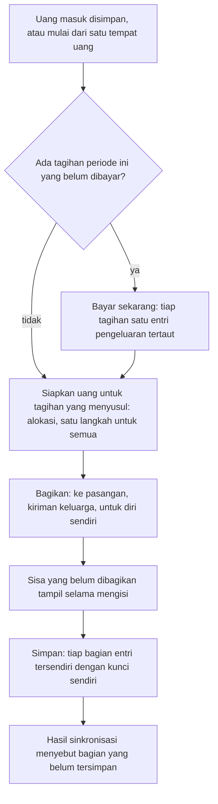

# 05 — Kebutuhan fungsional `FIN`, bagian 1: F-FIN-001 sampai F-FIN-010

| | |
|---|---|
| Pemilik | `product-analyst` |
| Tahap | S3, fase B; putaran penyelarasan sesudah fase B; putaran perbaikan fase D |
| Tanggal | 12 November 2026; diselaraskan 12 November 2026; diperbaiki 12 November 2026 |
| Status | **S4 fase D, 12 November 2026 (belum ditinjau `critic`):** FR-FIN-042/AC-2 dan AC-3 bersyarat pada 09-F, cabang bawaan B (server saja) lebih dulu (09 §8 (a)); FR-FIN-040/AC-15 pintasan ikon (SEC-54), AC-16 draf, AC-17 jeda urungkan 5 detik (LM-12). "Sembunyikan angka" (08 §23.1 butir 1) **tidak** dijadikan FR: tidak menyelesaikan masalah brief §1.1 dan dokumen 10 §7.2 menyatakannya bukan kendali keamanan, jadi menurut PRN-02 ia F-FIN-027 Tier 3 Could, dengan garis besar di [tier-3.md](tier-3.md); tantangan atas 08 diajukan ke lead. FR-FIN-010/AC-6 dan FR-FIN-091/AC-2 tidak berubah: pilot tidak menampilkan perkiraan, dan bunyi "bila ditampilkan" tetap benar (09 §8 (b)). Tidak ada angka baru. **Penyisiran andaian khusus pilot S4, 12 November 2026 (M1, M2, M4, M8; belum ditinjau `critic`):** FR-FIN-020 (kunci dan label sumber bawaan, nama yang dicadangkan per bahasa), FR yang menyebut kesepakatan memakai pihak yang disyaratkan, tempat uang pribadi yang dibagikan memakai himpunan penerima, `spouses` dibaca `adults`. Tidak ada angka yang berubah. **Sesudah checkpoint S3 (12 November 2026):** jawaban "lanjut" dicatat; S3-3 dibuka ulang sebagian: FR-FIN-020 (masukan, AC-10; AC-11 kelompok selalu tampil dan AC-12 nama yang dicadangkan, baru atas temuan `critic` CP-05, skenario SCN-34) dan BR-FIN-013 mengikuti 07 §3.1 "Sumber uang masuk" (kelompok `work` dan `gift_other`, **[Usulan]** T-43, ditanyakan di checkpoint S4); FR-FIN-040/AC-14 baru untuk THR dan angpau yang diberikan (07 §3.2, CTH-51, T-42), angkanya dari CTH-51 saja, skenario SCN-46; FR-FIN-030/AC-13 baru untuk IDEA-02 "bagikan seperti terakhir kali" (isian layar, bukan aturan uang; angka CTH-41), skenario SCN-21; belum dihitung ulang lead. **Sebelumnya:** ditinjau `critic` A dan diperiksa `security-privacy` (fase D). **Putaran perbaikan fase D:** FR-FIN-042/AC-6 tanda selisih (CA-11), FR-FIN-030/AC-11 kejadian bawaan menurut 07 §3.15 "Urutan bawaan kejadian" (PA-FIN-11), pengenal celah `PA-n` menjadi `PA-FIN-n` (CA-06). **Putaran penyelarasan:** diselaraskan dengan 07 putaran penyebaran S3 (§10.2 "Kepada `product-analyst`" butir 2; §11 "Putaran penyebaran S3") dan 06 revisi kesembilan (§15.11, §16). Semua celah PA-FIN-1 sampai PA-FIN-11 kini punya aturan; daftarnya di bagian 13. Angka baru atau berubah belum dihitung ulang lead |
| Dibaca untuk putaran ini | 07 §2.3, §2.5, §2.6, §3.1 sampai §3.3, §3.7 sampai §3.10, §3.14, §3.15, §3.17, §6.3, INV-16, INV-19, INV-21, INV-26, INV-31, INV-32, T-30 sampai T-38, CTH-25, CTH-42 sampai CTH-49, §10.2, §10.4, §11; 06 §6.2, §6.3 "Pos rutin" (f) dan (g), §7.2, §8.1, §11.2, §12 S-9 dan S-10, §13.4, §15.3, §15.11, §16 |
| Indeks | [`../05-functional-requirements.md`](../05-functional-requirements.md) |
| Bagian lain modul ini | [`FIN-2.md`](FIN-2.md): F-FIN-011 sampai F-FIN-020 (tagihan berulang, cicilan, utang, alokasi, tabungan, aset, hitung uang, koreksi, riwayat, ringkasan) |

## 0. Cara membaca

**Lingkup.** Sepuluh fitur Tier 1 dari dokumen 04 §3.3: F-FIN-001 sampai F-FIN-010. Rentang pengenal berkas ini: `FR-FIN-001` sampai `FR-FIN-099` dan `BR-FIN-001` sampai `BR-FIN-049`. Semua fitur di sini Tier 1, MoSCoW Must, jadi semuanya ditulis penuh dengan kriteria penerimaan.

**Kedudukan aturan.** Berkas ini tidak membuat aturan uang dan tidak membuat aturan alur. Aturan uang kanonis di dokumen 07, aturan alur di dokumen 06. Setiap `BR-FIN` di bagian 2 adalah pernyataan tingkat produk yang menunjuk sumber kanonisnya; bila kalimat di sini dan sumbernya tampak berbeda, sumbernya yang berlaku dan perbedaannya adalah cacat berkas ini. Kebutuhan yang memerlukan aturan yang belum ada di 06 maupun 07 ditandai **[Perlu aturan]** dan didaftar di bagian 13.

**Penanda bukti** (brief §16). **[Usulan]** berarti usulan `product-analyst` kecuali disebut pemiliknya. **[Asumsi]** dipakai untuk angka contoh yang tidak berasal dari contoh terhitung 07. Kedudukan keputusan pemilik produk ditulis menurut dokumen 17 dan `_progress.md` dengan tingkat kepastiannya: *diputuskan sendiri*, *rumusan lead yang ia kukuhkan*, *diterima atas saran lead*, atau *diterima lewat "lanjut"* (yang terakhir bukan pernyataannya sendiri).

**Kata layar.** Berkas ini menyebut apa yang harus dapat dilakukan dan dilihat pengguna, bukan tata letak atau kata-katanya. Istilah model (`flag`, "ditandai", "ditolak", "keberatan", "dikeberatani", "pemberi persetujuan") ditulis di sini sebagai istilah model; kata layarnya ditetapkan dokumen 08 (Q-119). "Ditolak" pada kriteria penerimaan berarti server menolak perintah tanpa akibat apa pun, bukan kata yang tampil.

**Kriteria penerimaan.** Bernomor lokal per FR dan dirujuk sebagai `FR-FIN-012/AC-3`. Kriteria umum yang berlaku atas setiap perintah tulis ada di bagian 1 (`KU-1` sampai `KU-7`) dan dirujuk dari tiap FR, supaya tidak diulang sepuluh kali. Angka mengikuti contoh terhitung 07 (CTH-nn) dan disebut sumbernya; ambang permintaan contoh 500000 adalah **[Asumsi]** 07 §7.1. Semua jumlah dalam rupiah utuh.

**Dua arah.** Setiap kriteria berlaku sama bila suami dan istri ditukar, kecuali disebut lain: aturan yang dikutip bergantung pada peran (pencatat, pemegang, pemilik dana pribadi, penerima penghasilan), tidak pada orangnya (06 PG-01, PRN-09). Kriteria yang memakai "suami" atau "istri" mengikuti contoh terhitung acuannya. Kriteria yang sengaja menguji arah sebaliknya ditulis tersendiri.

**Catatan pantau.** Tiap fitur memuat baris "Catatan pantau" bila ada kebutuhan yang dapat dipakai seorang dewasa untuk memantau atau mengendalikan dewasa lain, beserta pagar yang menjaganya.

**Chat rumah tangga.** Sejak 06 revisi kesembilan, entri, serah terima yang menunggu konfirmasi, dan usulan kesepakatan dapat tampil sebagai kartu di chat dan ditanggapi dari kartunya (06 §16). Berkas ini tidak mengulang persyaratan chat (milik `COM.md`); yang menyentuh `FIN` ada di KU-8 dan di kriteria yang menyebut kartu. Rujukannya aturan 06 §16, bukan pengenal `COM`.

## Daftar FR

| ID | Judul | Fitur |
|---|---|---|
| FR-FIN-001 | Membuat tempat uang | F-FIN-001 |
| FR-FIN-002 | Mengisi saldo awal tempat uang | F-FIN-001 |
| FR-FIN-003 | Dompet campuran sebagai dua tempat uang | F-FIN-001 |
| FR-FIN-004 | Mengganti nama, mengganti pemegang, mengarsipkan, mengaktifkan kembali, dan menghapus tempat uang | F-FIN-001 |
| FR-FIN-010 | Angka utama: uang yang ada | F-FIN-002 |
| FR-FIN-011 | Rincian custody per pemegang dan per tempat uang | F-FIN-002 |
| FR-FIN-012 | Bagian "uang pribadi saya" | F-FIN-002 |
| FR-FIN-020 | Mencatat uang masuk | F-FIN-003 |
| FR-FIN-021 | Bagian pribadi dari penghasilan | F-FIN-003 |
| FR-FIN-022 | Hadiah dan uang masuk pribadi lain | F-FIN-003 |
| FR-FIN-023 | Uang masuk yang langsung dipakai | F-FIN-003 |
| FR-FIN-030 | Alur "bagikan satu uang masuk" | F-FIN-004 |
| FR-FIN-031 | Menyiapkan uang untuk tagihan yang jatuh temponya menyusul | F-FIN-004 |
| FR-FIN-032 | Sisa yang belum dibagikan, hasil sinkronisasi, dan kegagalan sebagian | F-FIN-004 |
| FR-FIN-040 | Mencatat belanja cepat | F-FIN-005 |
| FR-FIN-041 | Bawaan dan templat | F-FIN-005 |
| FR-FIN-042 | Belanja terbagi | F-FIN-005 |
| FR-FIN-043 | Belanja terlambat dan bagian dari selisih hitung | F-FIN-005 |
| FR-FIN-044 | Pengembalian dana | F-FIN-005 |
| FR-FIN-045 | Tautan saat mencatat dan tanda pada catatan | F-FIN-005 |
| FR-FIN-050 | Serah terima lewat dua pintu yang setara | F-FIN-006 |
| FR-FIN-051 | Konfirmasi dan keberatan custody | F-FIN-006 |
| FR-FIN-052 | Pemindahan antar-tempat uang orang yang sama dan biaya admin | F-FIN-006 |
| FR-FIN-060 | Penyisihan ke dana pribadi | F-FIN-007 |
| FR-FIN-061 | Kontribusi dari dana pribadi | F-FIN-007 |
| FR-FIN-062 | Talangan "minta diganti" dan penggantian | F-FIN-007 |
| FR-FIN-063 | Pelepasan hak ganti dan klaim dana bersama | F-FIN-007 |
| FR-FIN-064 | Pinjaman antara dana bersama dan dana pribadi | F-FIN-007 |
| FR-FIN-070 | Mengusulkan jatah pribadi | F-FIN-008 |
| FR-FIN-071 | Menanggapi usulan jatah | F-FIN-008 |
| FR-FIN-072 | Mengubah jumlah jatah: kenaikan dan pengurangan | F-FIN-008 |
| FR-FIN-073 | Penilaian penyisihan terhadap jatah | F-FIN-008 |
| FR-FIN-074 | Melihat jumlah periode dan sisa jatah | F-FIN-008 |
| FR-FIN-075 | Mengakhiri jatah sendiri | F-FIN-008 |
| FR-FIN-076 | Tambahan untuk satu periode | F-FIN-008 |
| FR-FIN-077 | Ambang naik sampai atau melewati jatah yang berlaku | F-FIN-008 |
| FR-FIN-080 | Kategori | F-FIN-009 |
| FR-FIN-081 | Batas anggaran per kategori per periode | F-FIN-009 |
| FR-FIN-082 | Hari mulai periode: setelan awal | F-FIN-009 |
| FR-FIN-083 | Mengganti hari mulai periode | F-FIN-009 |
| FR-FIN-090 | Sisa anggaran per kategori | F-FIN-010 |
| FR-FIN-091 | Sisa anggaran saat mencatat dan saat permintaan | F-FIN-010 |
Nomor yang dilompati di tiap blok sengaja dikosongkan untuk tambahan sesudah tinjauan.

---

## 1. Kriteria penerimaan umum

Berlaku atas setiap FR di berkas ini yang menulis entri, alokasi, kesepakatan, atau tempat uang, kecuali FR itu menyatakan pengecualiannya.

| ID | Kriteria | Acuan |
|---|---|---|
| KU-1 | *Given* layar pencatatan apa pun, *When* jumlah yang dikirim kosong, nol, negatif, memuat pecahan (misalnya "150000,5"), atau memuat mata uang lain, *Then* perintah ditolak di batas masukan, tidak ada yang tersimpan, dan medan yang salah disebut. Jumlah entri harus lebih dari 0 **[Usulan]**; jatah pribadi dan batas anggaran boleh 0 menurut aturannya masing-masing | BR-FIN-006 |
| KU-2 | *Given* perintah yang sudah diterima server, *When* perintah yang sama dikirim lagi dengan idempotency key yang sama (ketukan ganda, kirim ulang karena jaringan), *Then* tidak ada entri, baris, tautan, alokasi, atau kesepakatan kedua; jawaban kedua sama dengan yang pertama, termasuk tandanya (CTH-32: bensin 40000 tercatat satu kali, `TUN-S` 520000) | BR-FIN-007 |
| KU-3 | *Given* layar pencatatan, *Then* tanggal kejadian bawaannya hari ini menurut zona waktu rumah tangga, boleh dimundurkan sejauh apa pun, tetapi perintah bertanggal kejadian di masa depan, atau lebih awal dari saldo awal posisi yang disentuhnya, ditolak dengan alasannya. Entri yang tanggal pencatatannya berbeda dari tanggal kejadiannya menampilkan kedua tanggal, hanya tanggal, sama bagi semua yang boleh melihatnya; jam pencatatan tidak pernah tampil kepada siapa pun | BR-FIN-008 |
| KU-4 | *Given* perangkat tanpa sinyal, *When* pengguna menyimpan, *Then* catatan tersimpan seketika di perangkat dan tampil "menunggu terkirim"; ia dikirim kemudian dengan tanggal kejadian aslinya; tanda dan penilaian jatah hanya dibuat server saat catatan diterima, dan perangkat tidak menampilkan tanda sebelum itu. Bila server menolak perintah itu (misalnya melanggar 07 INV-27), pencatat melihat catatan mana dan alasannya; tidak ada bagian perintah yang tersimpan setengah | 06 S-1, S-7, S-8 |
| KU-5 | *Given* saldo tempat uang tidak cukup, permintaan yang belum dijawab atau sudah ditutup, ambang permintaan, kesepakatan, keberatan terbuka, atau AI yang mati, *When* entri yang sah menurut 07 dikirim, *Then* entri tersimpan. Saldo tercatat, saldo tersedia, dan *belum dialokasikan* boleh negatif dan tampil apa adanya | BR-FIN-009 |
| KU-6 | *Then* setiap entri menampilkan pencatatnya, dan bila berbeda, pembayarnya dan pemegang tempat uangnya, sama bagi semua yang boleh melihat entri itu. Tidak ada umpan kegiatan per orang, hitungan per orang, atau penyaring riwayat lintas objek menurut orang | BR-FIN-049 |
| KU-7 | *Given* rumah tangga dengan satu anggota dewasa, *Then* tidak ada entri yang ditandai dan tidak ada status konfirmasi custody; pencatatan, anggaran, dan laporan berjalan penuh | BR-FIN-048 |
| KU-8 | *Given* chat rumah tangga, *Then*: (a) entri buku rumah tangga yang dicatat **dari chat** tampil sebagai kartu di chat dalam transaksi yang sama; entri yang dicatat di luar chat tidak otomatis menjadi kartu; serah terima yang menunggu konfirmasi (C01) dan usulan kesepakatan (K01) selalu menjadi kartu; (b) izin, validasi, tanda, dan penanda pencatatan dari chat sama persis dengan dari layar biasa; (c) tombol kartu adalah perintah objek yang sama, dengan guard dan pelaku yang sama, dan pihak yang tidak berhak tidak melihat tombolnya; (d) pesan apa pun yang membalas kartu, termasuk "oke", "udah terima", atau foto struk, tidak mengubah entri, status konfirmasi, kesepakatan, atau otorisasi; (e) entri buku pribadi dan isi dompet campuran tidak pernah menjadi kartu atau sasaran balasan; (f) kartu dan baris peristiwa tidak memicu notifikasi tambahan di luar yang sudah ditetapkan untuk objeknya | 06 §16.2, §16.3, §16.4, INV-A44, INV-A46, INV-A47 butir c; V-9 |

---

## 2. Business rule

Setiap baris menunjuk sumber kanonisnya dan tidak mendefinisikan ulang aturannya. Rumus dan rinciannya dibaca di sumbernya.

| ID | Pernyataan produk | Sumber kanonis |
|---|---|---|
| BR-FIN-001 | Satu tempat uang punya tepat satu pemilik uang: dana bersama atau dana pribadi satu anggota. Satu dompet, rekening, atau dompet digital yang memuat keduanya dicatat sebagai dua tempat uang berpemegang sama. Tempat uang pribadi selalu dipegang pemiliknya dan tidak pernah berjenis titipan | 07 §2.3 (Q-44; S2-6; PA-FIN-10), INV-32 |
| BR-FIN-002 | Pemegang adalah atribut tempat uang. Uang berganti pemegang dengan berpindah ke tempat uang lain; atribut pemegang hanya dapat diubah saat saldonya nol | 07 §2.3 |
| BR-FIN-003 | Tempat uang dana bersama bawaannya terlihat kedua pasangan dan tidak pernah dapat `private`; tempat uang pribadi bawaannya `private`, dan hanya pemiliknya yang memperluas atau mencabut visibilitasnya | 06 §9.2, V-1, V-4, V-7 |
| BR-FIN-004 | Menghapus yang punya riwayat berarti mengarsipkan, dengan syarat per jenisnya (tempat uang: saldo nol, tanpa reservasi aktif, alokasi nol); yang belum pernah dipakai boleh dihapus sungguhan; ganti nama, arsip, dan pengaktifan kembali adalah Peristiwa tanpa entri; posisi terarsip tidak menerima baris posisi atau alokasi baru, tetapi perincian selisih hitung atasnya diterima; yang boleh mengarsipkan boleh mengaktifkannya kembali | 07 §2.6 "Pengarsipan" dan "Mengaktifkan kembali", INV-21, T-30; 06 §8.1 baris "Perubahan bukan uang" dan "Mengelola tempat uang dana bersama" |
| BR-FIN-005 | Saldo awal adalah entri `opening` per posisi: bukan pemasukan, tidak terhitung terhadap anggaran, tidak muncul di tabel A atau arus kas, dan disebut di bawahnya sebagai "saldo awal yang didaftarkan periode ini"; posisi yang didaftarkan belakangan mendapat saldo awal bertanggal pendaftarannya. Tiap tempat uang punya tepat satu saldo awal asli, jumlahnya ≥ 0; koreksinya hanya lewat penyesuaian berjenis `opening`, dan entri pembalik atas saldo awal ditolak | 07 §3.17, INV-19, INV-31 (PA-FIN-3) |
| BR-FIN-006 | Jumlah uang adalah bilangan bulat rupiah; satu mata uang per rumah tangga; "bagi rata" menaruh sisa pembagian pada baris pertama | 07 §2.1, INV-01; ADR-008 |
| BR-FIN-007 | Setiap perintah tulis membawa idempotency key; kiriman ulang tidak menambah apa pun dan mengembalikan hasil pertama | 07 INV-10; 06 S-2; ADR-005 |
| BR-FIN-008 | Tanggal kejadian tidak di masa depan dan tidak lebih awal dari saldo awal posisi yang disentuh; tanggal pencatatan diisi server dan tampil, tanpa jam, hanya bila berbeda dari tanggal kejadian | 07 INV-22, §3.11; 06 AT-6 |
| BR-FIN-009 | Pencatatan yang sah tidak pernah dihalangi; saldo negatif adalah sinyal, bukan penolakan | 06 INV-A11, PG-10; 07 §4 (alinea penutup); PRN-06 |
| BR-FIN-010 | *Uang yang ada* = jumlah saldo tercatat semua tempat uang dana bersama, termasuk titipan pada pihak luar; angka rumah tangga identik bagi kedua pelihat | 07 INV-05, INV-20 |
| BR-FIN-011 | Custody dikelompokkan per pemegang (anggota, dipegang bersama, pihak luar) dan jumlahnya selalu sama dengan angka utama; jumlah "belum dikonfirmasi" (masuk dan keluar terpisah) dan "dikeberatani" tampil pada pemegangnya | 07 §5.1; 06 INV-A24 |
| BR-FIN-012 | Dana pribadi tidak masuk angka rumah tangga; bagian "uang pribadi saya" hanya terbaca pemiliknya | 07 §5.2, INV-20; keputusan pemilik nomor 3 |
| BR-FIN-013 | Penghasilan (sumber dalam daftar sumber penghasilan; pilot: gaji dan hasil usaha) selalu tercatat penuh di buku rumah tangga. Sejak 07 pasca-checkpoint S3: penghasilan adalah pemasukan bersumber kelompok `work`; aturan kelompok **[Usulan]**, menunggu checkpoint S4 (07 T-43; Q-184) | 07 INV-24, §3.1 "Sumber uang masuk" |
| BR-FIN-014 | Entri penghasilan hanya boleh memuat bagian pribadi bila pencatatnya penerima penghasilan itu; perintah yang melanggar ditolak seluruhnya, dan perintah yang sama tanpa bagian pribadi diterima | 07 INV-27; 06 §6.4 |
| BR-FIN-015 | Hadiah untuk satu orang dicatat di buku pribadi penerimanya dan tidak terlihat pasangan; uang masuk "lainnya" bawaannya dana bersama dan boleh dicatat di buku pribadi bila memang uang pribadi | 07 §3.1, CTH-36; 06 §6.4 "Cakupan", V-8 |
| BR-FIN-016 | "Langsung dipakai" dan "bagikan" adalah satu alur layar di atas entri-entri tersendiri, masing-masing dengan idempotency key sendiri; tidak ada objek gabungan di server; bila satu gagal, yang lain tetap sah | 07 §3.1 (T-15); 06 §6.4, §7.4 (D-55) |
| BR-FIN-017 | Penanda "belum dikonfirmasi" melekat pada (a) setiap baris yang menambah tempat uang dana bersama berpemegang anggota dewasa selain pencatat, termasuk saldo awal dan selisih hitung positif; (b) baris entri dua buku yang mengurangi tempat uang seperti itu; dan (c) selisih hitung negatif yang dicatat bukan pemegangnya; tidak pada tempat uang bersama, titipan, atau tempat uang pribadi | 07 §2.5 tabel penanda baris (a) sampai (c), §3.3 (PA-FIN-2, G-05); 06 §7.2 C01, INV-A21 |
| BR-FIN-018 | Hanya pemegang yang dapat mengonfirmasi; tidak ada konfirmasi otomatis dan tidak ada batas waktu; keberatan tidak mengubah angka; menutup keberatan bukan konfirmasi | 06 §7.2 (C02 sampai C05), INV-A22, INV-A23 |
| BR-FIN-019 | Pemindahan hanya antara tempat uang berpemilik sama; serah terima adalah pemindahan yang pemegangnya berbeda; biaya admin dicatat di entri yang sama sebagai pengeluaran | 07 §3.3, INV-06 |
| BR-FIN-020 | Pinjam kembali dana bersama adalah serah terima, bukan utang | 07 §3.3 (Q-01) |
| BR-FIN-021 | Entri yang memuat baris buku pribadi M hanya diterima dari M, dengan dua pengecualian (`claim_waiver` atas utang M kepada dana bersama, dan `exit_closure`) | 07 INV-25, §2.2; 06 §7.3 |
| BR-FIN-022 | Kontribusi belanja dari dana pribadi tidak mengubah *uang yang ada* maupun kekayaan bersih rumah tangga dan terhitung satu kali | 07 §3.4, INV-02 |
| BR-FIN-023 | Talangan "minta diganti" melahirkan hak ganti saat dicatat; penggantian dicatat penerimanya dan bukan pengeluaran maupun pemasukan; bawaan "minta diganti" mati untuk belanja biasa dan hidup bila tertaut ke otorisasi | 07 §3.5 |
| BR-FIN-024 | Hanya pemilik piutang yang melepas klaim; pelepasan klaim dana bersama atas M dicatat anggota dewasa selain M, dibandingkan dengan ambang, dan dilaporkan sebagai "utang dihapuskan" | 07 §3.6; 06 §7.3 |
| BR-FIN-025 | Entri dua buku hanya dapat dibalik pemilik buku pribadinya; pasangannya dapat menambah penyesuaian sisi rumah tangga atau berkeberatan | 07 §3.12; 06 §8.1 |
| BR-FIN-026 | Satu pengeluaran boleh memuat beberapa baris sebab dan beberapa baris tempat uang, semuanya berpemilik sama; belanja yang dibayar dari dana bersama dan dana pribadi adalah dua entri dengan kunci sendiri (T-31); kiriman keluarga adalah pengeluaran berpenerima pihak luar; untuk saudara atau orang tua pencatat memilih per entri antara pinjaman dan kiriman | 07 §3.2 |
| BR-FIN-027 | Pengembalian dana wajib tertaut ke entri asalnya, jumlahnya tidak melebihi entri itu, dan mengurangi pemakaian kategori pada periode tanggal pengembaliannya | 07 §3.13, INV-13 |
| BR-FIN-028 | Belanja terlambat yang bertanggal tidak lebih baru dari rekonsiliasi terakhir ditawarkan sebagai bagian dari selisih hitung yang belum dirinci, dengan bawaan ya | 07 §3.10 butir 5 sampai 8 |
| BR-FIN-029 | Tidak ada penutupan periode; laporan periode lampau ikut berubah dan menyebut "berubah sejak terakhir dilihat" | 07 §3.11 |
| BR-FIN-030 | Tanda adalah satu fungsi dengan tiga dasar (`threshold`, `personal_share`, `routine_amount`), dihitung server saat entri disimpan, paling banyak satu per entri, dan tidak pernah menahan apa pun | 07 §3.8 "Tanda atas entri"; 06 §6.2, S-8 |
| BR-FIN-031 | Pemberitahuan langsung atas tanda hanya untuk dasar `threshold`, paling banyak satu per penerima per hari; dasar `personal_share` dan `routine_amount` hanya pada entri dan di ringkasan; di ringkasan semua tanda dilebur menjadi satu baris tanpa hitungan | 06 §6.2, §11.2 N-10 |
| BR-FIN-032 | Tiap anggota dewasa punya paling banyak satu jatah pribadi, satu jumlah per periode anggaran; setiap penyisihan kepadanya, termasuk bagian pribadi penghasilan, terhitung dengan sendirinya; yang tidak terhitung hanya penyisihan yang tertaut ke otorisasi dan `claim_waiver` | 07 §3.4; 06 §6.3 "Jatah pribadi" |
| BR-FIN-033 | Jatah adalah batas: bagi anggota yang punya jatah berlaku, penyisihan ditandai bila jumlah periode sesudahnya melebihi jatah, berapa pun kelebihannya, tanpa membandingkan dengan ambang | 07 §3.4, INV-30; 06 §6.2 |
| BR-FIN-034 | Tanpa jatah yang berlaku, setiap penyisihan dibandingkan dengan ambang sendiri-sendiri; jatah berlaku sebesar 0 berbeda dari tanpa jatah | 07 §3.4; 06 §6.3 |
| BR-FIN-035 | Jatah berlaku hanya dengan dua pernyataan dari dua orang (usul, setuju); pasangan menjawab setuju, tolak, atau usul jumlah lain; alasan tidak wajib dan, bila diisi, dipilih dari daftar tertutup tanpa teks bebas | 06 §6.3 K01 sampai K05, INV-A18, INV-A19 |
| BR-FIN-036 | Jatah yang tidak di atas ambang yang berlaku (≤ ambang), dan jatah 0 dalam keadaan apa pun, hanya dapat diusulkan pemiliknya sendiri; tanpa ambang yang berlaku pagar ini hanya mengenai jatah 0 | 06 §6.3 K01, INV-A19; 07 §3.4 |
| BR-FIN-037 | Hanya pemilik jatah yang mengakhiri jatahnya; jatah di atas ambang tetap menjadi dasar penilaian sampai akhir periode anggaran yang memuat pengakhiran menurut waktu server; jatah lainnya berakhir seketika | 06 §6.3 K06, INV-A38; 07 §3.4 |
| BR-FIN-038 | Penilaian jatah dilakukan server satu kali saat entri diterima, berurutan menurut urutan penerimaan, pada periode tanggal kejadiannya, dan tidak pernah diulang karena entri lain | 06 INV-A37, S-8, §12 |
| BR-FIN-039 | Jumlah jatah, jumlah periode berjalan, dan sisanya terbaca keduanya dengan angka yang sama, hanya untuk periode berjalan; sisa jatah pasangan hanya di layar kesepakatannya; tanpa angka lintas periode atau hitungan | 06 §6.3, AT-4 (SP-26, SP-31) |
| BR-FIN-040 | Tambahan untuk satu periode adalah permintaan anggaran `use_kind = set_aside`; penyisihan yang tertaut ke otorisasinya tidak terhitung terhadap jatah | 06 §4.1, §6.3; 07 §3.4 |
| BR-FIN-041 | Bila ambang naik sampai atau melewati jatah yang berlaku, jatah tetap; sesudahnya pemiliknya boleh melepasnya seketika dan pasangannya tidak dapat mengusulkan pengurangan | 06 §6.3 "Jatah yang tidak di atas ambang" (Q-127) |
| BR-FIN-042 | Satu hari mulai periode anggaran per rumah tangga, 1 sampai 28, bawaan 1; penggantiannya kesepakatan `rule` kedua anggota dewasa dan berlaku mulai periode berikutnya lewat satu periode peralihan berbatas penuh | 07 §6.1, INV-29; 06 §6.3 |
| BR-FIN-043 | Anggaran adalah batas per kategori per periode; tanpa amplop dan tanpa rollover; mengubah batas tidak membuat entri | 07 §6.1 |
| BR-FIN-044 | `sisa = batas − terpakai − terikat`, boleh negatif; yang terhitung dan yang tidak ke `terpakai` mengikuti daftar 07 | 07 §6.1, §6.2, INV-14, INV-15 |
| BR-FIN-045 | Tidak ada kategori yang terkunci; kategori selalu boleh diarsipkan | 07 §2.6; keputusan pemilik nomor 9 |
| BR-FIN-046 | **Penunjuk, bukan aturan tersendiri.** Batas alokasi saat dibuat: BR-FIN-071; belanja yang membuat alokasi melebihi uang tidak ditolak: BR-FIN-072 (keduanya di `FIN-2.md`) | 07 §3.9, INV-17 |
| BR-FIN-047 | Tiap tagihan berulang bulanan memberi satu *kejadian* per bulan, dikenali dari tanggal jatuh temponya. Pembayaran yang ditautkan menunjuk satu kejadian (bawaannya kejadian paling awal yang belum dibayar dan jatuh tempo paling lambat akhir periode berjalan), boleh dibayar lebih awal dengan tanggal kejadian hari dibayar. "Belum dibayar periode ini" = kejadian tanpa pembayaran tertaut yang menunjuknya, dari tagihan yang tidak terarsip, yang jatuh temponya tidak lewat akhir periode berjalan, termasuk kejadian lampau yang belum dibayar. Jumlah yang masih ditawarkan untuk disiapkan dikurangi alokasi tujuan tagihan itu. Penilaian tanda pembayaran: BR-FIN-052 | 07 §3.15 "Kejadian tagihan dan 'belum dibayar periode ini'" (PA-FIN-5), §2.5 `bill_occurrence_due`, INV-26; 06 §13.4 |
| BR-FIN-048 | Rumah tangga dengan satu anggota dewasa: tanpa tanda dan tanpa konfirmasi custody | 06 §3.5 |
| BR-FIN-049 | Keterangan pelaku tampil pada objeknya, sama bagi keduanya, tanpa menjadi alat pantau | 06 §9.4 AT-1 sampai AT-5, PG-09 |

**Satu ID per aturan (menutup R-3).** Aturan alokasi punya ID di `FIN-2.md` (BR-FIN-071, BR-FIN-072), jadi BR-FIN-046 tinggal penunjuk dan nomornya tidak dipakai ulang. Penilaian tanda pembayaran pos rutin punya ID di `FIN-2.md` (BR-FIN-052); BR-FIN-047 kini hanya memuat aturan kejadian tagihan, yang belum punya ID di mana pun, dan dirujuk juga oleh `FIN-2.md`.

---

## 3. F-FIN-001 — Tempat uang, pemegang, dan saldo awal

**Masalah:** `MSL-1`, `MSL-2`. **Usaha berulang:** sekali saat mulai (sekitar 3 sampai 8 tempat uang, **[Asumsi]** dokumen 04); jarang sesudahnya. **Bergantung pada:** F-FAM-001, F-FAM-007 (pihak luar), F-FAM-008 (pemberitahuan sebelum data pribadi). **Catatan pantau:** pemegang tempat uang dana bersama adalah fakta custody yang memang harus terlihat keduanya (`MSL-2`); tempat uang pribadi, termasuk keberadaannya, tertutup.

### FR-FIN-001 — Membuat tempat uang

| | |
|---|---|
| Fitur | F-FIN-001 |
| Tier / MoSCoW | 1 / Must |
| Masalah (brief §1.1) | `MSL-1`, `MSL-2` |
| Aktor dan izin | Tempat uang dana bersama: anggota dewasa mana pun, juga yang pemegangnya anggota dewasa lain; bila pembuat menjadikan anggota dewasa lain pemegangnya, orang itu menerima N-27 (`ringkasan`) (06 §8.1 baris "Mengelola tempat uang dana bersama", N-27; menutup PA-FIN-1). Tempat uang pribadi M: hanya M (07 INV-25, §2.6 "Mengaktifkan kembali"; 06 §8.1). Visibilitas: 06 §9.2, V-1 |
| Aturan acuan | 07 §2.3, §2.6, INV-32; 06 §8.1, §9.2, V-1, V-4, V-7, V-9, N-27 |
| Business rule | BR-FIN-001, BR-FIN-002, BR-FIN-003, BR-FIN-007 |
| Kedudukan | Semua daftar ditentukan pengguna: keputusan pemilik nomor 9 (diputuskan sendiri, S1). Satu tempat uang satu pemilik: 07 §2.3 (Q-44); dipertahankan untuk dompet campuran dan disampaikan lead kepadanya, belum ia nyatakan menerima atau menolak (S2-6). Pelaku dan N-27: **[Usulan]** `architect` (06 §8.1). Tempat uang pribadi selalu dipegang pemiliknya: **[Usulan]** `finance-domain` (07 §2.3, INV-32; PA-FIN-10). Visibilitas: 06 §9.2, dikukuhkan dokumen 10 **[Dok. 10]** |

**Masukan.** Nama (wajib); jenis: tunai, rekening, dompet digital, atau titipan pada pihak luar; pemilik: dana bersama atau "uang pribadi saya"; pemegang: saya, pasangan, dipegang bersama, atau pihak luar (dari daftar pihak luar F-FAM-007); saldo awal (FR-FIN-002).

**Validasi di batas.** Jenis titipan berarti pemegang pihak luar dan pemilik dana bersama, dan sebaliknya (07 §2.3, INV-32). Tempat uang pribadi selalu dipegang pemiliknya dan tidak pernah berjenis titipan; uang pribadi yang dititipkan ke pihak luar dicatat pemiliknya pada tempat uang pribadinya sendiri (07 §2.3, INV-32). Pemilik "dana pribadi anggota lain" tidak pernah ditawarkan dan ditolak server. Visibilitas `private` atas tempat uang dana bersama ditolak.

**Yang tercatat.** Tempat uang beserta atributnya, dan satu Peristiwa pembuatannya berpelaku pembuat. Membuat tempat uang tidak membuat entri; saldo awalnya entri tersendiri dan wajib ada, boleh 0 (FR-FIN-002; 07 §3.17).

**Yang dilihat tiap pihak.** Tempat uang dana bersama: semua atributnya terbaca kedua pasangan. Tempat uang pribadi: hanya pemiliknya; pasangan tidak membaca nama, jenis, saldo, maupun keberadaannya (07 §5.3, alinea "Yang tetap tertutup"), kecuali pemiliknya membagikannya (FR-FIN-012).

**Kriteria penerimaan**

- **AC-1** — *Given* rumah tangga dua dewasa, *When* suami membuat "BNK-S" berjenis rekening, pemilik dana bersama, pemegang suami, *Then* tempat uang itu tampil pada custody kedua pasangan di kelompok "dipegang suami" dengan visibilitas `adults` (dahulu `spouses`; penyisiran S4, M2), dan Peristiwa pembuatannya menyebut suami sebagai pelaku.
- **AC-2** — *Given* perintah pembuatan tempat uang dana bersama dengan visibilitas `private`, *When* dikirim, *Then* ditolak tanpa akibat apa pun (06 V-1).
- **AC-3** — *Given* istri membuat "PRI-I" berpemilik uang pribadinya, *When* suami membuka custody, riwayat, ringkasan notifikasi, atau ekspor mana pun, *Then* tidak ada nama, jenis, saldo, atau tanda keberadaan `PRI-I`, dan *uang yang ada* tidak berubah.
- **AC-4** — *Given* suami, *When* ia mengirim perintah membuat tempat uang berpemilik dana pribadi istri, *Then* ditolak tanpa akibat apa pun **[Usulan]**.
- **AC-5** — *Given* pihak luar "ibu" sudah terdaftar, *When* suami membuat "Titipan ibu" berjenis titipan, *Then* pemiliknya dana bersama, pemegangnya ibu, ia terhitung dalam *uang yang ada*, dan custody menampilkannya di kelompok pihak luar (CTH-02: dititipkan pada ibu 1000000).
- **AC-6** — *Given* rekening yang dapat diakses keduanya, *When* dibuat dengan pemegang "dipegang bersama", *Then* custody menampilkannya sebagai satu baris "dipegang bersama", tidak dibagi dua (CTH-02: 2000000).
- **AC-7** — *Given* nama kosong, atau nama yang sama dengan tempat uang aktif lain yang terbaca pembuatnya, *When* dikirim, *Then* ditolak dengan alasannya **[Usulan]**.
- **AC-8** — *Given* istri belum pernah mengisi data pribadi, *When* ia membuat tempat uang pribadi pertamanya, *Then* pemberitahuan akses pengelola server (F-FAM-008) tampil lebih dulu bila ia belum mengakuinya; pembuatan tempat uang dana bersama tidak menunggu pemberitahuan itu (**[Usulan]** `security-privacy` SP-42; Q-122 terbuka).
- **AC-9** — KU-2 berlaku: dua kiriman dengan kunci yang sama menghasilkan satu tempat uang. KU-6 berlaku atas Peristiwa pembuatannya.
- **AC-10** — *Given* istri, *When* ia membuat tempat uang pribadinya dengan pemegang suami, atau dengan jenis titipan pada pihak luar, *Then* ditolak tanpa akibat apa pun (07 INV-32).
- **AC-11** — *Given* istri membuat "TUN-S" dana bersama dengan pemegang suami, *Then* suami menerima N-27 sebagai `ringkasan`; *Given* suami membuat "BNK-S" dengan pemegang dirinya sendiri (AC-1), *Then* tidak ada N-27 (06 §8.1).

### FR-FIN-002 — Mengisi saldo awal tempat uang

| | |
|---|---|
| Fitur | F-FIN-001 |
| Tier / MoSCoW | 1 / Must |
| Masalah (brief §1.1) | `MSL-1`, `MSL-2` |
| Aktor dan izin | Tempat uang dana bersama: anggota dewasa mana pun (06 §8.1); bila pemegangnya anggota dewasa lain, baris saldo awalnya bertanda "belum dikonfirmasi" dan pemegang menerima N-13 (07 §2.5 baris (a), §3.3; 06 §7.2 C01). Tempat uang pribadi: hanya pemiliknya (07 INV-25) |
| Aturan acuan | 07 §3.17, §3.3, §3.8 (tabel *jumlah pemakaian*: saldo awal tempat uang nol), INV-19, INV-22, INV-31, CTH-42; 06 §7.2 |
| Business rule | BR-FIN-005, BR-FIN-008, BR-FIN-017 |
| Kedudukan | 07 §3.17. Penanda atas saldo awal (PA-FIN-2), satu saldo awal per tempat uang, jumlah ≥ 0, koreksi lewat penyesuaian, dan pembalik ditolak (PA-FIN-3): **[Usulan]** `finance-domain`, putaran S3 (07 §3.3, §3.17, INV-31), mengadopsi bawaan berkas ini |

**Lingkup.** Saldo awal tempat uang. Saldo awal piutang, kewajiban, dan aset ada di `FIN-2.md` (F-FIN-012, F-FIN-013, F-FIN-016).

**Masukan.** Jumlah dan tanggal saldo awal; bawaannya tanggal pendaftaran tempat uang itu.

**Validasi di batas.** KU-1, kecuali jumlah 0 sah (tempat uang yang mulai kosong). Jumlah negatif ditolak; utang dicatat sebagai kewajiban, bukan saldo tempat uang negatif (07 §3.17, INV-31). Saldo awal asli kedua atas tempat uang yang sama ditolak. Saldo awal yang salah diperbaiki dengan **penyesuaian** berjenis `opening` yang menunjuk saldo awal asli, bertanggal kejadian sama, sebesar selisihnya; saldo awal bersih tetap ≥ 0. Entri pembalik atas saldo awal ditolak; hasil yang sama dicapai dengan penyesuaian ke 0 (07 §3.17). Layar koreksi atas saldo awal karenanya hanya menawarkan penyesuaian, bukan "balik" atau "hitung uang", supaya angka awal yang salah tidak tampil sebagai selisih hitung atas nama pemegang (F-FIN-018 di `FIN-2.md`).

**Yang tercatat.** Satu entri `opening` asli per tempat uang, ditambah penyesuaiannya bila ada. Ia tidak pernah ditandai, karena *jumlah pemakaian*-nya nol (07 §3.8). Penyesuaian positif atas tempat uang yang dipegang anggota dewasa lain membawa penanda; penyesuaian negatif tidak (07 §3.17 baris "Penanda").

**Kriteria penerimaan**

- **AC-1** — *Given* hari pertama mencatat 24 Oktober 2026 (CTH-01), *When* saldo awal `BNK-S` 500000, `TUN-S` 200000, `TUN-I` 300000, `EWL-I` 100000, dan `TAB-I` 5000000 dicatat, *Then* kedua pasangan melihat *uang yang ada* 6100000; ringkasan Oktober tidak memuat pemasukan, anggaran kategori mana pun tidak terpakai, dan arus kas tidak memuat baris apa pun dari kelima entri itu.
- **AC-2** — *Given* CTH-01, *When* suami mencatat saldo awal `PRI-S` 400000 dan istri `PRI-I` 250000, *Then* masing-masing hanya melihat miliknya sendiri, dan *uang yang ada* tetap 6100000 bagi keduanya.
- **AC-3** — *Given* tempat uang `EWL-S` didaftarkan 5 November 2026 dengan saldo awal 100000 **[Asumsi]**, *When* belanja bertanggal kejadian 3 November dicatat atasnya, *Then* ditolak dengan alasan "lebih awal dari saldo awal"; yang bertanggal 5 November diterima (07 INV-22).
- **AC-4** — *Given* `TUN-S` dipegang suami dan baru didaftarkan (CTH-42), *When* istri mencatat saldo awal `TUN-S` 200000 bertanggal 24 Oktober, *Then* saldonya langsung 200000, baris itu tampil "belum dikonfirmasi" di kelompok suami, dan suami menerima N-13; status itu bertahan sampai ia mengonfirmasi atau berkeberatan. Bila suami sendiri yang mencatat, tidak ada penanda dan angkanya sama.
- **AC-5** — *Given* saldo awal `TAB-I` 5000000 dan ambang 500000, *When* entri itu diterima server, *Then* ia tidak ditandai.
- **AC-6** — *Given* saldo awal `TUN-I` sudah tercatat 300000, *When* perintah saldo awal asli kedua untuk `TUN-I` dikirim, *Then* ditolak, dan layar menunjuk penyesuaian saldo awal (+50000 bila seharusnya 350000 **[Asumsi]**) sebagai jalannya; entri asal tetap.
- **AC-7** — KU-2, KU-4, KU-6 berlaku.
- **AC-8** — *Given* AC-4 (CTH-42), *When* suami mencatat penyesuaian saldo awal −20000 pada 25 Oktober yang menunjuk saldo awal asli dan bertanggal kejadian 24 Oktober, *Then* `TUN-S` 180000, *uang yang ada* turun 20000, penyesuaian itu tidak bertanda (dicatat pemegangnya, dan negatif), dan baris +200000 tetap "belum dikonfirmasi"; penyesuaian bukan konfirmasi. Sesudahnya: perintah saldo awal asli kedua 180000 ditolak; perintah penyesuaian −200000 ditolak (180000 − 200000 = −20000 < 0); kedua penolakan tanpa akibat apa pun, `TUN-S` tetap 180000.
- **AC-9** — *Given* saldo awal `TUN-S` (AC-4), *When* siapa pun mengirim entri pembalik atasnya, *Then* ditolak; layar menawarkan penyesuaian (ke 0 bila tempat uang itu memang kosong) (07 §3.17, INV-31).
- **AC-10** — *Given* AC-8, *Then* ringkasan periode yang memuat 24 Oktober tidak memuat saldo awal itu di tabel A maupun arus kas, dan menyebutnya di bawah keduanya sebagai "saldo awal yang didaftarkan periode ini Rp180000" (07 §3.17, INV-19; CTH-42).

### FR-FIN-003 — Dompet campuran sebagai dua tempat uang

| | |
|---|---|
| Fitur | F-FIN-001 |
| Tier / MoSCoW | 1 / Must |
| Masalah (brief §1.1) | `MSL-2`, `MSL-1` |
| Aktor dan izin | Hanya pemegang dompet itu, karena ia pemilik bagian pribadinya (07 §2.3 baris "Siapa yang mencatat"; INV-25) |
| Aturan acuan | 07 §2.3 (tabel dompet campuran); 06 V-9, INV-A41 |
| Business rule | BR-FIN-001, BR-FIN-003 |
| Kedudukan | Dompet campuran adalah kasus biasa: pernyataan pemilik produk, checkpoint S2 (S2-6: "bisa terpisah bisa tercampur bisa di bank bisa tunai"). Perlakuan "dua tempat uang": 07 §2.3, disampaikan lead, belum ia terima atau tolak. Ketertutupan isi: **[Usulan]** (Q-115) |

**Spesifikasi.** Saat membuat atau membuka tempat uang dana bersama yang ia pegang, pemegang dapat menyatakan bahwa dompet, rekening, atau dompet digital itu juga memuat uang pribadinya. Akibatnya satu tempat uang pribadi dibuat dengan pemegang yang sama. Tiap belanja dicatat pada tempat uang yang pemiliknya menanggungnya. Menghitung keduanya sekaligus adalah F-FIN-017 di `FIN-2.md`.

**Yang dilihat pasangan.** Hanya tempat uang dana bersama, sebagai tempat uang biasa. Tidak ada medan, Peristiwa, atau keterangan yang menyatakan bahwa ia bagian dari dompet campuran (06 V-9).

**Kriteria penerimaan**

- **AC-1** — *Given* dompet tunai istri berisi 300000 uang bersama dan 200000 uang pribadinya **[Asumsi]**, *When* istri mencatatnya sebagai dompet campuran, *Then* lahir "Dompet" (dana bersama, pemegang istri, saldo awal 300000) dan satu tempat uang pribadi istri (saldo awal 200000); *uang yang ada* naik 300000; suami melihat satu tempat uang "Dompet" 300000 di kelompok istri dan tidak ada apa pun tentang bagian pribadinya.
- **AC-2** — *Given* AC-1, *When* istri mencatat makan siang dirinya 25000 pada bagian pribadi, *Then* angka rumah tangga tidak berubah dan suami tidak melihat entri itu; *When* ia mencatat gula 25000 untuk rumah pada bagian bersama, *Then* "Dompet" menjadi 275000 bagi keduanya.
- **AC-3** — *Given* dompet istri, *When* suami mencoba membuat bagian pribadi istri atasnya, *Then* ditolak (07 INV-25).
- **AC-4** — *Given* pasangan membaca tempat uang "Dompet", *Then* tidak ada yang terbaca olehnya yang berbeda antara tempat uang dana bersama yang merupakan bagian dompet campuran dan yang bukan (06 INV-A41 butir a).

### FR-FIN-004 — Mengganti nama, mengganti pemegang, mengarsipkan, mengaktifkan kembali, dan menghapus tempat uang

| | |
|---|---|
| Fitur | F-FIN-001 |
| Tier / MoSCoW | 1 / Must |
| Masalah (brief §1.1) | `MSL-1`, `MSL-2`; `MSL-5` (catatan terlambat tetap dapat dicatat) |
| Aktor dan izin | Tempat uang dana bersama: anggota dewasa mana pun mengganti nama, mengganti pemegang, mengarsipkan, dan mengaktifkan kembali (06 §8.1 baris "Mengelola tempat uang dana bersama"; menutup PA-FIN-1). Bila pelaku menjadikan anggota dewasa lain pemegang, atau mencabut kedudukan pemegang dari anggota dewasa lain, orang itu menerima N-27 (`ringkasan`); ganti nama, arsip, dan pengaktifan kembali tidak diberitahukan. Tempat uang pribadi: hanya pemiliknya |
| Aturan acuan | 07 §2.3 (atribut pemegang), §2.6 "Pengarsipan" dan "Mengaktifkan kembali", §3.10 butir 6, INV-21, T-30, CTH-43; 06 §8.1, PG-08, N-27 |
| Business rule | BR-FIN-002, BR-FIN-004 |
| Kedudukan | Ditambah, diganti nama, dan dihapus oleh rumah tangga: keputusan pemilik nomor 9 (diputuskan sendiri, S1). Arti "dihapus" bagi yang punya riwayat: 07 §2.6 (Q-58). Pelaku dan N-27: **[Usulan]** `architect` (06 §8.1). Alokasi nol sebagai syarat arsip, pengaktifan kembali, dan perincian atas tempat uang terarsip: **[Usulan]** `finance-domain`, putaran S3 (07 §2.6, T-30; menutup PA-FIN-4) |

**Spesifikasi.** Ganti nama, ganti pemegang, arsip, pengaktifan kembali, dan hapus adalah perubahan bukan uang: masing-masing satu Peristiwa berpelaku, tanpa entri, terlihat oleh semua yang boleh melihat tempat uang itu (06 PG-08). Mengganti pemegang hanya sah saat saldo tercatat nol; uang berganti tangan lewat serah terima (FR-FIN-050). Mengarsipkan sah bila saldo tercatat nol, tidak ada reservasi aktif, dan jumlah alokasinya nol; alokasi yang tersisa ditawarkan untuk dilepas di langkah yang sama, tanpa pilihan terisi (07 §2.6). Tempat uang terarsip hilang dari pilihan saat mencatat; riwayat dan laporannya tetap. Belanja terlambat atas tempat uang terarsip punya dua jalur: (1) bila ia bagian dari selisih hitung yang belum dirinci, perinciannya diterima tanpa pengaktifan kembali, karena tidak punya baris posisi; (2) selebihnya, tempat uang itu diaktifkan kembali lebih dulu oleh yang boleh mengarsipkannya, lalu entri dicatat biasa, lalu diarsipkan lagi bila syaratnya terpenuhi (07 §2.6, §3.10 butir 6, INV-21). Bila entri itu membuat saldo bukan nol, ada catatan lain yang keliru dan diperbaiki lewat koreksi (F-FIN-018). Tempat uang yang belum pernah dipakai entri mana pun boleh dihapus sungguhan.

**Kriteria penerimaan**

- **AC-1** — *Given* `BNK-S`, *When* istri menggantinya menjadi "Rekening gaji suami", *Then* tercatat satu Peristiwa berpelaku istri, tidak ada entri, dan semua entri lama tampil dengan nama baru bagi keduanya.
- **AC-2** — *Given* `TUN-S` bersaldo 0, *When* suami mengganti pemegangnya dari dirinya ke istri, *Then* diterima, Peristiwanya terlihat keduanya, dan istri menerima N-27 sebagai `ringkasan`; *When* istri yang mengganti pemegangnya dari suami ke dirinya, *Then* suami yang menerima N-27. *Given* `TUN-S` bersaldo 700000, *When* perintah yang sama dikirim, *Then* ditolak, dan layar menunjuk serah terima sebagai cara memindahkan uangnya.
- **AC-3** — *Given* tempat uang bersaldo 0 tanpa reservasi aktif dan tanpa alokasi, *When* diarsipkan, *Then* ia tidak lagi ditawarkan saat mencatat, riwayat dan laporannya tetap, *uang yang ada* tidak berubah, dan tidak ada notifikasi.
- **AC-4** — *Given* tempat uang bersaldo 50000, atau bersaldo 0 dengan reservasi aktif, *When* diarsipkan, *Then* ditolak; layar menawarkan memindahkan isinya atau menghitungnya (F-FIN-017). *Given* tempat uang bersaldo 0 yang masih punya alokasi, *When* pengarsipan dibuka, *Then* layar menawarkan melepas alokasinya di langkah yang sama tanpa pilihan terisi; tanpa melepas, pengarsipan tidak dikirim, dan perintah arsip atas tempat uang beralokasi ditolak (07 §2.6, INV-21).
- **AC-5** — *Given* tempat uang yang belum pernah dipakai entri mana pun, *When* dihapus, *Then* ia hilang sungguhan; *Given* tempat uang yang punya riwayat, *Then* hanya arsip yang ditawarkan.
- **AC-6** — *Given* CTH-43 bagian A (`EWL-X` dihitung 0 pada 5 November dengan selisih −30000 yang belum dirinci, lalu diarsipkan 6 November), *When* pada 10 November istri mencatat parkir 30000 bertanggal 3 November dari `EWL-X` dan menerima tawaran "bagian dari selisih hitung", *Then* perinciannya diterima tanpa pengaktifan kembali, `EWL-X` tetap 0 dan terarsip, *uang yang ada* tetap 500000, selisih yang belum dirinci 0, dan transportasi terpakai bertambah 30000 pada periode yang memuat 3 November.
- **AC-7** — *Given* tempat uang pribadi suami, *When* istri mengirim perintah apa pun atasnya, termasuk mengaktifkan kembali, *Then* ditolak tanpa membuka apa pun tentang tempat uang itu.
- **AC-8** — *Given* CTH-43 bagian B (`EWL-X` terarsip bersaldo 0; `TUN-I` 550000 sesudah pemindahan 50000 yang ternyata hanya 35000), *When* pada 12 November istri mengirim belanja 15000 bertanggal 4 November atas `EWL-X`, *Then* ditolak (07 INV-21) dan layar menawarkan mengaktifkan kembali `EWL-X`; *When* ia mengaktifkannya kembali, *Then* tercatat satu Peristiwa berpelaku istri, terlihat seperti pengarsipannya, tanpa entri dan tanpa notifikasi, dan belanja itu diterima: `EWL-X` −15000, *uang yang ada* 535000; *When* ia menyesuaikan pemindahan 5 November sebesar −15000 lalu mengarsipkan `EWL-X` lagi, *Then* `EWL-X` 0, `TUN-I` 535000, *uang yang ada* 535000, dan tidak ada entri lama yang disunting.

---

## 4. F-FIN-002 — Angka utama dan tampilan custody

**Masalah:** `MSL-1`, `MSL-2`; `KS-1`. **Usaha berulang:** nol (dibaca). **Bergantung pada:** F-FIN-001, F-FIN-006. **Catatan pantau (04 §7, Pantau):** custody menunjukkan siapa memegang uang bersama; itu tujuan fitur. Pagarnya: angka sama bagi keduanya; tidak ada umpan kegiatan per orang (06 AT-3); dana pribadi tertutup.

### FR-FIN-010 — Angka utama: uang yang ada

| | |
|---|---|
| Fitur | F-FIN-002 |
| Tier / MoSCoW | 1 / Must |
| Masalah (brief §1.1) | `MSL-1`; `KS-1` |
| Aktor dan izin | Setiap anggota dewasa membaca angka yang sama (07 INV-20; 06 AT-2) |
| Aturan acuan | 07 INV-05, INV-20, §5.1; 06 §9.2, §12 S-9 |
| Business rule | BR-FIN-010, BR-FIN-012 |
| Kedudukan | Kriteria sukses nomor 1 (brief §1.1). Paling jauh satu ketukan dari layar pertama: PRN-01 **[Usulan]**. Tampilan offline: **[Usulan]** `architect` (06 S-9; menutup PA-FIN-9), mengikuti bawaan berkas ini |

**Spesifikasi.** Angka utama adalah *uang yang ada* dana bersama. Ia dapat dicapai paling jauh satu ketukan dari layar pertama; menyamarkannya di layar adalah pilihan pelihatnya sendiri dan tidak mengubah angkanya (02 KT-11). Saldo negatif ikut dijumlahkan apa adanya.

**Kriteria penerimaan**

- **AC-1** — *Given* keadaan CTH-02 (suami 4000000, istri 3000000, titipan ibu 1000000, rekening bersama 2000000), *When* suami dan istri membuka angka utama, *Then* keduanya melihat 10000000; *When* istri mencatat lauk 150000 yang dibeli ibu dari titipan, *Then* keduanya melihat 9850000.
- **AC-2** — *Given* layar pertama aplikasi, *When* pengguna ingin melihat angka utama, *Then* ia mencapainya dengan paling banyak satu ketukan (UI test menghitung ketukan) **[Usulan]**.
- **AC-3** — *Given* *uang yang ada* 10450000 (CTH-12), *When* suami mencatat kopi 30000 dari `PRI-S`, *Then* angka utama tetap 10450000 bagi keduanya; *When* ia mencatat beras 80000 dari `PRI-S` sebagai kontribusi (CTH-13), *Then* angka utama tetap 10450000.
- **AC-4** — *Given* `TUN-I` tercatat −20000 **[Asumsi]**, *Then* angka utama menjumlahkannya apa adanya, tempat uang itu tampil negatif, dan tersedia jalan menghitungnya (F-FIN-017); tidak ada yang ditolak.
- **AC-5** — *Given* serah terima yang belum dikonfirmasi, *Then* angka utama sudah memuat akibatnya (saldo tidak menunggu konfirmasi; 07 §3.3), dan tidak berubah saat dikonfirmasi.
- **AC-6** — *Given* perangkat tanpa sinyal dengan dua belanja sendiri yang belum terkirim, *Then* angka utama yang tampil adalah angka terakhir dari server beserta waktunya, dan kedua belanja itu tampil terpisah sebagai "menunggu terkirim"; bila layar juga menampilkan angka yang sudah dikurangi keduanya, angka itu berlabel perkiraan dan tidak pernah menggantikan angka server tanpa label (06 S-9).

### FR-FIN-011 — Rincian custody per pemegang dan per tempat uang

| | |
|---|---|
| Fitur | F-FIN-002 |
| Tier / MoSCoW | 1 / Must |
| Masalah (brief §1.1) | `MSL-2`; `KS-1` |
| Aktor dan izin | Setiap anggota dewasa membaca rincian yang sama (07 §5.2) |
| Aturan acuan | 07 §5.1, §5.2, §3.9; 06 §7.2, INV-A24, §3.5, AT-3 |
| Business rule | BR-FIN-011, BR-FIN-017, BR-FIN-049; BR-FIN-071, BR-FIN-072 (`FIN-2.md`) |
| Kedudukan | Konfirmasi custody: keputusan pemilik produk 12 (diputuskan sendiri, 11 November 2026). Penanda pada baris yang berkurang (entri dua buku): **[Usulan]** `security-privacy` SP-05, 06 §7.2 |

**Spesifikasi.** Custody dikelompokkan per pemegang: tiap anggota dewasa, "dipegang bersama", dan tiap pihak luar (titipan). Tiap tempat uang dana bersama menampilkan: nama, jenis, saldo tercatat, saldo tersedia (bila ada reservasi, "sudah dijanjikan"), jumlah masuk yang belum dikonfirmasi, jumlah keluar yang belum dikonfirmasi, jumlah yang dikeberatani, alokasi per tujuan, dan belum dialokasikan. Jumlah semua kelompok sama dengan angka utama; tidak ada baris "lainnya". Membuka satu tempat uang membuka riwayat tempat uang itu saja.

**Kriteria penerimaan**

- **AC-1** — *Given* keadaan CTH-07 (*uang yang ada* 10600000), *When* suami mencatat serah terima 4000000 dari `TUN-S` ke `TUN-I` (CTH-08), *Then* keduanya melihat: suami memegang 1200000 (`BNK-S` 500000, `TUN-S` 700000); istri memegang 9400000 (`TUN-I` 4300000, di antaranya 4000000 belum dikonfirmasi; `EWL-I` 100000; `TAB-I` 5000000); jumlahnya 10600000 = angka utama.
- **AC-2** — *Given* AC-1, *When* istri mengonfirmasi, *Then* jumlah belum dikonfirmasi pada `TUN-I` menjadi 0 dan angka lain tidak berubah.
- **AC-3** — *Given* AC-1, *When* istri berkeberatan alih-alih mengonfirmasi, *Then* 4000000 tampil "dikeberatani" pada `TUN-S` dan `TUN-I`, bagi kedua pelihat, dan semua saldo tetap sampai ada entri pembalik.
- **AC-4** — *Given* `TUN-I` 3650000 (CTH-15), *When* suami mencatat penggantian 60000 dari `TUN-I` kepada dirinya, *Then* `TUN-I` 3590000 dan menampilkan 60000 sebagai keluar yang belum dikonfirmasi, terpisah dari jumlah masuk yang belum dikonfirmasi.
- **AC-5** — *Given* `TUN-I` 4300000 dengan alokasi "belanja bulanan" 2500000 (CTH-09), *Then* rinciannya menampilkan alokasi 2500000 dan belum dialokasikan 1800000, sama bagi keduanya.
- **AC-6** — *Given* reservasi aktif 500000 atas `BNK-S` bersaldo 2000000 **[Asumsi]**, *Then* `BNK-S` menampilkan saldo 2000000 dan saldo tersedia 1500000.
- **AC-7** — *Given* custody, *Then* tidak ada daftar "apa saja yang dilakukan pasangan", tidak ada hitungan per orang, dan tidak ada penyaring riwayat lintas tempat uang menurut orang (06 AT-3, AT-4).
- **AC-8** — *Given* pemegang suatu baris yang belum dikonfirmasi keluar dari rumah tangga, *Then* baris itu tampil "pemegang sudah keluar" dan keluar dari daftar menunggu konfirmasi (06 §3.5).

### FR-FIN-012 — Bagian "uang pribadi saya"

| | |
|---|---|
| Fitur | F-FIN-002 |
| Tier / MoSCoW | 1 / Must |
| Masalah (brief §1.1) | `MSL-1`; `PAGAR` |
| Aktor dan izin | Hanya pemiliknya; anggota dewasa penuh lain hanya bila pemilik membagikannya kepada himpunan penerima yang memuat mereka (di pilot: pasangannya), dapat dicabut seketika, juga per penerima (06 §9.2, V-7, INV-A50; penyisiran S4, M4) |
| Aturan acuan | 07 §5.2, INV-20; 06 V-4, V-5, V-6, V-7, INV-A36 |
| Business rule | BR-FIN-003, BR-FIN-012 |
| Kedudukan | Saldo dana pribadi tertutup: keputusan pemilik nomor 3 (diputuskan sendiri, S1) |

**Spesifikasi.** Baris kedua, terpisah dari angka utama, memuat tempat uang pribadi pelihat beserta klaimnya (hak ganti, utang antar-pemilik). Tidak dijumlahkan ke angka utama. Tempat uang pribadi yang dibagikan pemiliknya tampil di layar pasangan sebagai bagian terpisah atas nama pemiliknya, tetap tidak masuk angka rumah tangga.

**Kriteria penerimaan**

- **AC-1** — *Given* CTH-01, *Then* suami melihat "uang pribadi saya" 400000, istri melihat 250000, tidak satu pun melihat milik pasangannya, dan angka utama 6100000 bagi keduanya.
- **AC-2** — *Given* CTH-14 (talangan 60000), *Then* bagian suami memuat `PRI-S` 230000 dan hak ganti 60000.
- **AC-3** — *Given* istri membagikan `PRI-I` kepada suami, *Then* suami melihatnya sebagai bagian terpisah milik istri, tidak dijumlahkan ke angka utama; *When* istri mencabutnya, *Then* bagian itu hilang dari layar suami seketika, tanpa notifikasi kepada siapa pun, dan suami tidak membaca Peristiwa pencabutannya (06 V-6, INV-A36).
- **AC-4** — *Given* notifikasi, ringkasan, laporan, atau ekspor yang dibaca pasangan, *Then* tidak ada saldo tempat uang pribadi yang tidak dibagikan.

---

## 5. F-FIN-003 — Catat uang masuk

**Masalah:** `MSL-3`, `MSL-1`. **Usaha berulang:** per uang masuk, oleh penerimanya; di pilot beberapa kali sebulan (pernyataan pemilik produk, 11 November 2026: "gajian saya bisa 2x bahkan uang masuk dari freelancer juga bisa sampe 5x"; dokumen 17; 06 §7.4). **Bergantung pada:** F-FIN-001. **Catatan pantau:** penghasilan yang dicatat sebagai penghasilan terlihat pasangan (07 INV-24); itu pagar terhadap pengalihan sepihak (07 §5.3 B1), bukan pengawasan. Batasnya dinyatakan: aplikasi tidak menilai kelengkapan penghasilan dan tidak menyiratkan bahwa semuanya tercatat (07 §10.3 butir 1; W-1).

### FR-FIN-020 — Mencatat uang masuk

| | |
|---|---|
| Fitur | F-FIN-003 |
| Tier / MoSCoW | 1 / Must |
| Masalah (brief §1.1) | `MSL-3`, `MSL-1` |
| Aktor dan izin | Anggota dewasa mana pun. Ke tempat uang dana bersama yang dipegang anggota dewasa lain: baris itu "belum dikonfirmasi" (07 §3.3). Ke tempat uang pribadi: hanya ke milik pencatat sendiri (07 INV-25) |
| Aturan acuan | 07 §3.1, INV-24, INV-27, §3.3; 06 §6.4, §7.2, §7.4, N-13 |
| Business rule | BR-FIN-013, BR-FIN-017, BR-FIN-026 |
| Kedudukan | Pencatat memilih ke mana uang pergi; pasangan melihat catatannya: keputusan pemilik produk 11 (diputuskan sendiri, 11 November 2026). Hanya penerima penghasilan yang mengarahkan bagiannya: keputusan 18 (diputuskan sendiri, S2-1 butir i). Pekerjaan lepas: semula `business` (diterima atas saran lead, S2-1 butir iv); kini sumber bawaan "honor atau pekerjaan lepas" di kelompok `work` (07 §3.1). Daftar sumber penghasilan sebagai parameter preset: diterima lewat "lanjut" (D-47). **Daftar bawaan yang dapat disunting dan ditambah, dengan "lainnya":** pernyataan pemilik produk sendiri ("ada kategori default bisa edit tambah atau yang lainnya"; S3-3 dibuka ulang sebagian, 12 November 2026); bahwa "kategori" di kalimat itu berarti sumber pemasukan adalah bacaan lead **[Usulan]**. Dua kelompok `work` dan `gift_other`, nama yang dicadangkan, kelompok yang selalu tampil, dan siapa boleh mengubahnya: **[Usulan]** lead dan `finance-domain` (07 §3.1, T-43), ditanyakan di checkpoint S4 (dokumen 17 Q-184) |

**Masukan.** Jumlah (wajib); tempat uang tujuan (wajib); sumber (wajib): layar uang masuk memilih sumber dari daftar rumah tangga; sumber `work` tidak menawarkan "hanya di buku pribadi"; THR adalah sumber bawaan sendiri di `work` (07 §3.1 "Sumber uang masuk", §2.6 `income_source`). Daftar bawaan menurut 07 (himpunan pasar Indonesia, `household.income_source_market`; tiap sumber bawaan berkunci tetap `default_key` dengan label per bahasa dari katalog aplikasi, 07 §3.1 "Kunci dan label", "Daftar bawaan per pasar"; penyisiran S4, M8): `work` gaji, THR, bonus, lembur, honor atau pekerjaan lepas, hasil usaha; `gift_other` hadiah, lainnya. Layar menampilkan kelompok sumber di samping namanya (07 §3.1 "Kelompok selalu tampil"). **Aturan kelompok, nama yang dicadangkan, dan siapa boleh menambah, mengganti nama, mengarsipkan, atau memindah kelompok: 07 §3.1, [Usulan] T-43, ditanyakan di checkpoint S4** (dokumen 17 Q-184). Semula: gaji yang menyebut THR (07 T-34), dibuka ulang sesudah pemilik produk menyatakan "ada kategori default bisa edit tambah atau yang lainnya"; "atas nama siapa" (penerima penghasilan; **wajib untuk setiap sumber `work`**, tepat satu anggota dewasa; 07 §3.1 baris "Dua kelompok", AC-10); tanggal kejadian (KU-3); catatan (opsional). Pinjaman yang diterima bukan uang masuk: layar mengarahkannya ke F-FIN-013 di `FIN-2.md` (07 §3.1, tabel sumber).

**Validasi di batas.** KU-1. Penerima penghasilan kosong, bukan anggota dewasa, atau lebih dari satu: ditolak. Penghasilan ke tempat uang pribadi tanpa baris buku rumah tangga: ditolak (07 INV-24); layar menawarkan bagian pribadi (FR-FIN-021).

**Yang tercatat.** Satu entri `income` per uang masuk, apa pun jenis tempat uangnya; tidak ada andaian satu gajian per periode (07 §3.1).

**Kriteria penerimaan**

- **AC-1** — *Given* keadaan CTH-01, *When* suami mencatat gaji 10000000 ke `BNK-S` atas nama suami (CTH-03), *Then* `BNK-S` 10500000, *uang yang ada* 16100000 bagi keduanya, dan istri membaca catatan "gaji, atas nama suami, 10000000, dicatat suami".
- **AC-2** — *Given* sumber gaji tanpa "atas nama siapa", atau dengan nama pihak luar, *When* dikirim, *Then* ditolak dengan medannya disebut.
- **AC-3** — *Given* sumber gaji, *When* suami mengirim seluruh 10000000 ke `PRI-S` tanpa baris buku rumah tangga, *Then* ditolak, dan layar menawarkan "sebagian ke uang pribadi saya" (FR-FIN-021).
- **AC-4** — *Given* `BNK-I` dipegang istri, *When* suami mencatat hasil usaha 1500000 atas nama suami ke `BNK-I` **[Asumsi]**, *Then* `BNK-I` langsung bertambah 1500000, baris itu "belum dikonfirmasi" di kelompok istri, dan istri menerima N-13; *When* istri sendiri yang mencatat uang masuk ke `BNK-I`, *Then* tidak ada penanda.
- **AC-5** — *Given* satu periode (CTH-39: 1 sampai 31 Oktober 2026), *When* tiga uang masuk dicatat sebagai tiga entri (gaji 6000000, hasil usaha 1500000 ke dompet digital, gaji 4000000), *Then* ringkasan periode itu memuat pemasukan 11500000 (gaji 10000000, hasil usaha 1500000).
- **AC-6** — *Given* periode tanpa uang masuk sama sekali, *Then* ringkasan memuat pemasukan 0, anggaran dan jatah berjalan biasa, dan aplikasi tidak mengirim pengingat atau menampilkan keterangan bahwa penghasilan belum tercatat (07 §3.1; Q-90 terbuka; dokumen 17 keluhan 9).
- **AC-7** — *Given* layar mana pun, *Then* tidak ada kalimat yang menyatakan atau menyiratkan bahwa semua penghasilan sudah tercatat (W-1).
- **AC-8** — *Given* istri mencatat gajinya sendiri ke `BNK-I` atas nama istri, *Then* suami membaca medan yang sama seperti AC-1 dengan nama istri (arah sebaliknya; 06 PG-01).
- **AC-9** — KU-2 sampai KU-6 berlaku.
- **AC-10** — *Given* daftar sumber bawaan rumah tangga (07 §3.1 "Sumber uang masuk"), *When* pencatat memilih sumber THR, *Then* sumber itu berkelompok `work`, "atas nama siapa" wajib, tidak ada pilihan "hanya di buku pribadi", dan berlaku semua aturan penghasilan seperti AC-1 (INV-24, INV-27); *When* pencatat memilih "hadiah" atau "lainnya" (`gift_other`), *Then* pilihan buku pribadi tersedia. Aturan kelompok **[Usulan]**, menunggu checkpoint S4 (07 T-43; Q-184). **Rumusan semula, sebelum S3-3 dibuka ulang (historis):** *Given* layar uang masuk, *When* pencatat mencari THR atau bonus dari pemberi kerja, *Then* ia menemukannya di dalam pilihan gaji, entrinya bersumber gaji dengan "atas nama siapa" wajib, dan berlaku semua aturan penghasilan: tercatat penuh di buku rumah tangga dan terbaca pasangan seperti AC-1, bagian pribadinya hanya oleh penerimanya (FR-FIN-021). THR yang dipilih pencatat sebagai "lainnya" tetap diterima; aplikasi tidak menebak labelnya (07 §10.3 butir 1).
- **AC-11** — **Kelompok selalu tampil** (07 §3.1 "Kelompok selalu tampil", **[Usulan]** T-43, menunggu checkpoint S4). *Given* catatan uang masuk mana pun yang terlihat seorang anggota dewasa (di buku rumah tangga, atau di buku pribadinya sendiri), dan daftar sumber rumah tangga, *Then* setiap baris menampilkan kelompok sumbernya ("dari pekerjaan atau usaha" atau "hadiah dan lainnya") di samping nama sumber; *Given* suami membaca gaji istri seperti AC-8 *Then* ia melihat nama sumber beserta kelompok `work`-nya. Kata layar milik dokumen 08. Catatan `gift_other` di buku pribadi tetap tidak terlihat pasangan; aturan ini tidak membukanya.
- **AC-12** — **Nama yang dicadangkan** (07 §3.1 "Nama yang dicadangkan", **[Usulan]** T-43). *Given* sumber `work` "THR" yang pernah diganti nama menjadi "THR kantor" lewat kesepakatan *When* satu anggota dewasa menambah sumber `gift_other` bernama "THR", " thr ", atau "THR kantor", atau mengganti nama sumber `gift_other` menjadi salah satunya *Then* perintah ditolak dan daftar tidak berubah; hal yang sama atas nama bawaan `work` mana pun (misalnya "bonus") dan atas nama sumber `work` yang terarsip. Perbandingan tanpa membedakan huruf besar dan kecil dan tanpa spasi di awal dan akhir, dan dilakukan terhadap kunci bawaan serta label bawaan di setiap bahasa yang didukung, bukan hanya bahasa pencatat (07 §3.1 "Nama yang dicadangkan"; 06 §6.3; M8; di pilot satu bahasa). *Given* nama yang mirip tetapi tidak sama, misalnya "Tunjangan hari raya" *Then* diterima, sebagai peristiwa yang terlihat kedua anggota dewasa, dan kelompoknya tampil seperti AC-11 (batas yang dinyatakan 07 §3.1; harganya dicatat di dokumen 17 Q-184). *Given* mengganti nama sumber `work` *Then* itu usulan kesepakatan `rule` yang berlaku bila pengusul dan semua pihak yang disyaratkan setuju (pada dua anggota dewasa: keduanya), bukan tindakan satu orang (07 §3.1; 06 §6.3).

### FR-FIN-021 — Bagian pribadi dari penghasilan

| | |
|---|---|
| Fitur | F-FIN-003 |
| Tier / MoSCoW | 1 / Must |
| Masalah (brief §1.1) | `MSL-3` |
| Aktor dan izin | Hanya bila pencatat = penerima penghasilan (`actor = earner`), dan hanya ke tempat uang pribadi pencatat sendiri (07 INV-27, INV-25). Pasangan membaca sisi rumah tangganya; tidak membaca tempat uang pribadi tujuan, saldonya, atau pemakaiannya (06 V-8, INV-A29) |
| Aturan acuan | 07 §3.1, §3.4, INV-24, INV-27, CTH-03b, CTH-39; 06 §6.2, §6.3, §6.4, V-8, INV-A29; 07 §5.3 (Q-24) |
| Business rule | BR-FIN-013, BR-FIN-014, BR-FIN-021, BR-FIN-025, BR-FIN-031, BR-FIN-032, BR-FIN-033, BR-FIN-034 |
| Kedudukan | Pengarahan dan keterlihatannya: keputusan 11 (diputuskan sendiri). `actor = earner`: keputusan 18 (diputuskan sendiri). Terhitung terhadap jatah: diterima lewat "lanjut" (D-18, D-48). Di atas jatah ditandai: keputusan 20 (diputuskan sendiri, S2-1 butir iii pilihan b). Tanpa pemberitahuan langsung atas tanda dasar jatah: diterima atas saran lead, 12 November 2026 |

**Spesifikasi.** Pada layar uang masuk bersumber penghasilan atas nama pencatat sendiri, pencatat dapat mengisi "sebagian ke uang pribadi saya" sebesar X, dengan 0 < X ≤ jumlah masuk, dan memilih tempat uang pribadinya. Hasilnya satu entri dua buku (07 CTH-03b). Sebelum menyimpan, layar menyebut apa yang akan terbaca pasangan, yaitu jumlah masuk dan bagian yang ke uang pribadi, bukan tempat uang atau saldonya (07 §5.3, Q-24), dan sisa jatah pencatat pada periode itu (FR-FIN-074). Tanda, bila ada, muncul setelah server menilai (KU-4).

**Kriteria penerimaan**

- **AC-1** — *Given* keadaan CTH-01, *When* suami mencatat gaji 10000000 atas nama suami dengan 1000000 ke `PRI-S` (CTH-03b), *Then* `BNK-S` 9500000, *uang yang ada* 15100000 dan kekayaan bersih 18100000 bagi keduanya, `PRI-S` 1400000 hanya bagi suami, dan istri membaca "gaji 10000000 masuk, 1000000 ke pribadi suami" tanpa nama, jenis, atau saldo `PRI-S`.
- **AC-2** — *Given* gaji atas nama suami, *When* istri mengirim entri yang sama dengan bagian pribadi ke `PRI-I`, *Then* seluruh perintah ditolak tanpa akibat apa pun; *When* ia mengirimnya tanpa bagian pribadi, *Then* diterima dan seluruh 10000000 masuk dana bersama.
- **AC-3** — *Given* uang masuk 10000000, *When* bagian pribadi 11000000, *Then* ditolak; *When* bagian pribadi dikosongkan, *Then* tercatat sebagai uang masuk biasa (FR-FIN-020).
- **AC-4** — *Given* CTH-03b dan ambang 500000, *Then*: (a) dengan jatah suami 1000000 yang belum terpakai, entri tidak ditandai dan istri tidak diberi tahu apa pun; (b) dengan jatah 600000, entri ditandai dasar jatah, dan istri tidak menerima pemberitahuan langsung, hanya satu baris tanpa hitungan di ringkasannya; (c) tanpa jatah, entri ditandai dasar ambang (1000000 > 500000), dan bila itu N-10 dasar ambang pertama bagi istri hari itu, ia menerimanya sebagai `kabar`.
- **AC-5** — *Given* CTH-39 (jatah suami 1000000), *When* gaji termin pertama 6000000 dengan 600000 ke pribadi dicatat, lalu termin kedua 4000000 dengan 1000000, *Then* termin pertama tidak ditandai (0 + 600000 ≤ 1000000) dan termin kedua ditandai (600000 + 1000000 = 1600000 > 1000000); varian termin kedua 400000 tidak ditandai (1000000), varian 500000 ditandai (1100000).
- **AC-6** — *Given* AC-5 sesudah termin pertama, *When* suami membuka layar termin kedua, *Then* sebelum menyimpan ia melihat sisa jatahnya 400000 dan keterangan apa yang akan terbaca istri.
- **AC-7** — *Given* entri CTH-03b, *When* istri mencoba membaliknya, *Then* ditolak; ia dapat menambah penyesuaian yang seluruh barisnya di buku rumah tangga (misalnya uang masuk +500000 bila gaji tercatat terlalu kecil) atau berkeberatan; hanya suami yang dapat membaliknya (07 §3.12; 06 §8.1).
- **AC-8** — *Given* istri mencatat gajinya sendiri 8000000 dengan 500000 ke `PRI-I` **[Asumsi]**, *Then* aturan yang sama berlaku terhadap jatah istri, dan suami membaca medan yang sama seperti AC-1 (arah sebaliknya).
- **AC-9** — *Given* perangkat tanpa sinyal, *When* entri berbagian pribadi disimpan, *Then* ia tampil "menunggu terkirim" tanpa tanda; tandanya, bila ada, muncul sesudah server menilainya, pada periode tanggal kejadiannya (06 S-8).
- **AC-10** — KU-2, KU-3, KU-6 berlaku; sisi rumah tangganya tidak dapat diberi visibilitas `private` (06 V-8).

### FR-FIN-022 — Hadiah dan uang masuk pribadi lain

| | |
|---|---|
| Fitur | F-FIN-003 |
| Tier / MoSCoW | 1 / Must |
| Masalah (brief §1.1) | `MSL-3`; `PAGAR` |
| Aktor dan izin | Hanya penerimanya, ke buku pribadinya sendiri (07 INV-25); tidak terbaca pasangan (06 §9.2) |
| Aturan acuan | 07 §3.1, INV-24, CTH-36; 06 §6.4 "Cakupan", V-8 |
| Business rule | BR-FIN-013, BR-FIN-015, BR-FIN-021 |
| Kedudukan | Hadiah untuk satu orang tidak terlihat pasangan: keputusan 19 (diputuskan sendiri, S2-1 butir ii). "Lainnya" boleh pribadi: diterima lewat "lanjut" (07 T-14) |

**Kriteria penerimaan**

- **AC-1** — *Given* `PRI-I` 310000 (CTH-35), *When* istri mencatat hadiah 500000 dari ibunya ke `PRI-I` (CTH-36), *Then* `PRI-I` 810000 hanya bagi istri, *uang yang ada* tetap 6944000, dan suami tidak membaca entri itu di layar, notifikasi, ringkasan, atau ekspor mana pun.
- **AC-2** — *Given* sumber "lainnya", *Then* tujuan bawaannya dana bersama; *When* istri memilih tempat uang pribadinya untuk hasil menjual barang pribadi 300000 **[Asumsi]**, *Then* entri hanya di buku pribadinya.
- **AC-3** — *Given* sumber berkelompok `work` (07 §3.1), *When* tujuan hanya tempat uang pribadi, *Then* ditolak (FR-FIN-020/AC-3).
- **AC-4** — *Given* hadiah untuk satu orang, *When* pencatat memilih penerima selain dirinya, *Then* pilihan itu tidak tersedia; perintah yang menulis ke buku pribadi orang lain ditolak.

### FR-FIN-023 — Uang masuk yang langsung dipakai

| | |
|---|---|
| Fitur | F-FIN-003 |
| Tier / MoSCoW | 1 / Must |
| Masalah (brief §1.1) | `MSL-3`, `MSL-5` |
| Aktor dan izin | Pencatat uang masuk; entri keduanya mengikuti izin jenisnya sendiri |
| Aturan acuan | 07 §3.1 "Tiga arah, satu aturan" (T-15); 06 §6.4 baris "Langsung dipakai" |
| Business rule | BR-FIN-016 |
| Kedudukan | Arah "langsung dipakai": keputusan 11 (diputuskan sendiri). Dua entri dalam satu alur: **[Usulan]** 07 §3.1 |

**Spesifikasi.** Sesudah uang masuk, layar yang sama menawarkan "langsung dipakai untuk …": belanja, membayar tagihan berulang, membayar cicilan atau utang, atau meminjamkan. Hasilnya entri kedua dari tempat uang yang sama dengan idempotency key sendiri, yang mengikuti aturannya sendiri (tanda, anggaran, tautan).

**Kriteria penerimaan**

- **AC-1** — *Given* `EWL-S` 100000 **[Asumsi]**, *When* suami mencatat hasil usaha 1500000 ke `EWL-S` dan dalam alur yang sama membayar pulsa/wifi 200000 dari `EWL-S`, *Then* tercatat dua entri, `EWL-S` 1400000, dan anggaran pulsa/wifi terpakai bertambah 200000.
- **AC-2** — *Given* AC-1 dikirim saat sinyal putus dan entri kedua gagal terkirim, *Then* entri pertama tetap sah, dan hasil sinkronisasi menyebut "pulsa/wifi 200000" sebagai belum tersimpan beserta jalan mengirim ulang dengan kunci yang sama.
- **AC-3** — *Given* entri kedua 750000 tanpa permintaan **[Asumsi]**, *Then* hanya entri kedua yang dinilai terhadap ambang (750000 > 500000, ditandai); entri uang masuk tidak.
- **AC-4** — KU-2: ketukan ganda pada "simpan" tidak menggandakan entri mana pun.

---

## 6. F-FIN-004 — Bagikan satu uang masuk

**Masalah:** `MSL-3`, `MSL-5`. **Usaha berulang:** per uang masuk, satu alur; bukan usaha tambahan di atas F-FIN-003. **Bergantung pada:** F-FIN-003, F-FIN-005, F-FIN-006, F-FIN-007, F-FIN-011, F-FIN-014. **Asal:** pernyataan pemilik produk di checkpoint S2 (S2-4): begitu penghasilan masuk ia membayar tagihan lebih dulu, baru membagikan sisanya; dokumen 17 "Dibawa ke S3" baris 1; D-55; Q-111. **Catatan pantau:** tidak ada yang baru; tiap bagian mengikuti pagar jenis entrinya.

Setiap langkah boleh dilewati. Diagram ini urutan layar, bukan state di server: tidak ada objek "pembagian" (06 §7.4).

### FR-FIN-030 — Alur "bagikan satu uang masuk"

| | |
|---|---|
| Fitur | F-FIN-004 |
| Tier / MoSCoW | 1 / Must |
| Masalah (brief §1.1) | `MSL-3`, `MSL-5` |
| Aktor dan izin | Pencatat uang masuk atau pemegang tempat uang asal. Tiap bagian mengikuti izin jenisnya: ke pasangan adalah serah terima ke tempat uang dana bersama pasangan (FR-FIN-050); untuk diri sendiri adalah penyisihan ke dana pribadi pencatat (FR-FIN-060); kiriman keluarga adalah pengeluaran berpenerima pihak luar, atau pinjaman (F-FIN-013) |
| Aturan acuan | 06 §7.4 (D-55, Q-111), §12, §13.4; 07 §3.1, §3.2, §3.3, §3.4, §3.9, §3.15 "Kejadian tagihan dan 'belum dibayar periode ini'", CTH-41 |
| Business rule | BR-FIN-016, BR-FIN-017, BR-FIN-026, BR-FIN-033, BR-FIN-047; BR-FIN-052, BR-FIN-071, BR-FIN-072 (`FIN-2.md`) |
| Kedudukan | Pola uang masuk lalu bayar tagihan lalu bagikan: pernyataan pemilik produk (S2-4). Satu alur di atas entri tersendiri: diterima lewat "lanjut" (D-55). Kiriman orang tua tidak rutin di pilot: pernyataan pemilik produk (S2-4). Arti "belum dibayar periode ini" per kejadian tagihan: **[Usulan]** `finance-domain`, putaran S3 (07 §3.15; menutup PA-FIN-5); bawaan berkas ini sebelumnya (menurut tanggal pembayaran) tidak diambil, dengan alasan di 07 §3.15 |

**Titik berangkat.** Uang masuk yang baru disimpan, atau satu tempat uang dana bersama ("bagikan dari tempat uang ini"), misalnya sesudah tarik tunai.

**Langkah dan isinya.** (1) Kejadian tagihan berulang yang belum dibayar sampai akhir periode berjalan (BR-FIN-047): satu baris per kejadian, termasuk kejadian lampau yang belum dibayar, dengan jumlah yang ditawarkan sama dengan aturan alokasi (FR-FIN-031); "bayar sekarang" mencatat pengeluaran bertanggal hari ini yang ditautkan ke tagihannya dan menunjuk kejadian baris itu. (2) Menyiapkan uang untuk tagihan yang menyusul (FR-FIN-031). (3) Bagian kepada pasangan, kiriman keluarga, dan diri sendiri. Selama mengisi, layar menampilkan sisa yang belum dibagikan (FR-FIN-032).

**Yang tercatat.** Tiap bagian satu entri atau satu perintah alokasi dengan idempotency key sendiri. Server menilai entri-entri itu menurut urutan tibanya (06 §12).

**Kriteria penerimaan** (CTH-41: hari mulai 11, periode 11 November sampai 10 Desember 2026, ambang 500000, jatah suami 500000, `BNK-S` 400000, `BNK-I` 250000, `PRI-S` 150000; tagihan berkesepakatan internet R 350000 jatuh tempo 12, iuran kesehatan R 150000 jatuh tempo 13, listrik R 900000 jatuh tempo 20, air R 250000 jatuh tempo 29; semuanya belum dibayar)

- **AC-1** — *Given* keadaan di atas, *When* suami menyimpan penghasilan 8000000 bersumber gaji ke `BNK-S` pada 11 November dan melanjutkan ke "bagikan", *Then* layar menampilkan empat kejadian sebagai belum dibayar periode ini, jatuh tempo 12, 13, 20, dan 29 November, masing-masing dengan jumlah yang ditawarkan 350000, 150000, 900000, dan 250000; kejadian Desember tidak tampil karena jatuh temponya sesudah 10 Desember.
- **AC-2** — *When* ia membayar internet 350000 dan iuran 150000 dari alur itu, *Then* tercatat dua pengeluaran bertanggal kejadian 11 November yang tertaut ke tagihannya dan menunjuk kejadian 12 dan 13 November, `BNK-S` 7900000, keduanya tidak ditandai (P ≤ R), dan pengingat kedua kejadian itu mati (06 §13.4).
- **AC-3** — *When* ia memilih "siapkan uang untuk semua tagihan yang belum dibayar periode ini", *Then* lahir alokasi listrik 900000 dan air 250000 atas `BNK-S` dalam satu langkah, belum dialokasikan 6750000, dan tidak ada saldo yang berubah.
- **AC-4** — *When* ia mengisi 5500000 untuk istri, *Then* sisa yang tampil 1250000; *When* ia menambah 500000 untuk dirinya, *Then* sisa yang tampil 750000.
- **AC-5** — *When* ia menyimpan, *Then* tercatat terpisah: uang masuk, dua pengeluaran, satu perintah alokasi, satu serah terima, dan satu penyisihan, masing-masing dengan kunci sendiri; `BNK-S` 1900000; `BNK-I` 5750000, di antaranya 5500000 belum dikonfirmasi, dan istri menerima N-13; `PRI-S` 650000 hanya bagi suami; *uang yang ada* 7650000; penyisihan 500000 tidak ditandai (0 + 500000 ≤ 500000).
- **AC-6** — *Given* AC-3, *When* ia mengisi 7000000 untuk istri dan tidak ada bagian lain, *Then* sisa yang tampil −250000 dan penyimpanan tidak dihalangi; sesudah disimpan `BNK-S` 900000 dengan alokasi 1150000 tampil "alokasi melebihi uang Rp250000" (07 §3.9).
- **AC-7** — *Given* alur yang sama, *When* ia menambah kiriman untuk ibu 600000 **[Asumsi]** tanpa permintaan yang disetujui, *Then* tercatat pengeluaran berpenerima pihak luar "ibu", ditandai dasar ambang (600000 > 500000), dan istri menerima N-10 menurut batas hariannya; *When* ia memilih "dipinjamkan" alih-alih kiriman, *Then* entrinya pinjaman yang diberikan (F-FIN-013).
- **AC-8** — *Given* istri menerima penghasilannya ke `BNK-I`, *When* ia menjalankan alur yang sama, *Then* "ke pasangan" menuju tempat uang dana bersama yang dipegang suami, dan baris itu "belum dikonfirmasi" di kelompok suami (arah sebaliknya).
- **AC-9** — *Given* tarik tunai 2000000 ke `TUN-S` (CTH-39), *When* suami memilih "bagikan dari `TUN-S`", *Then* alur yang sama berjalan tanpa langkah uang masuk.
- **AC-10** — *Given* rumah tangga dengan satu anggota dewasa, *Then* "ke pasangan" tidak ditawarkan; langkah lain berjalan.
- **AC-11** — *Given* hari mulai 11, tanggal 9 November (periode 11 Oktober sampai 10 November) **[Asumsi]**, dan kejadian internet 12 Oktober sudah dibayar, *When* suami membayar internet 350000 pada 9 November dan pembayarannya menunjuk kejadian 12 November, *Then* saat ia membuka "bagikan" pada 11 November, internet tidak tampil sebagai belum dibayar periode ini, walau pembayarannya bertanggal periode sebelumnya (07 §3.15). Isian bawaan kejadian pada 9 November mengikuti 07 §3.15 baris "Urutan bawaan kejadian" (**[Usulan]** `finance-domain`, T-40; menutup PA-FIN-11): periode berjalan adalah periode tanggal kejadian pembayaran (11 Oktober sampai 10 November); (1) tidak ada kejadian belum dibayar yang jatuh tempo paling lambat 10 November, karena 12 Oktober sudah dibayar; (2) maka bawaannya kejadian paling awal yang belum dibayar sesudahnya, tidak melewati tanggal akhir tagihan: **12 November**; (3) bila tidak ada juga, kejadian terakhir. Pencatat dapat menggantinya; pengingat kejadian 12 November mati sejak pembayaran itu tersimpan (06 §13.4).
- **AC-12** — *Given* kejadian internet 12 Oktober tidak pernah dibayar, *When* "bagikan" dibuka pada 11 November, *Then* kejadian 12 Oktober dan 12 November tampil sebagai dua baris; membayar kejadian 12 November tidak mematikan pengingat kejadian 12 Oktober (06 §13.4). *Given* tagihan yang terarsip, *Then* kejadiannya tidak tampil.
- **AC-13** — **"Bagikan seperti terakhir kali"** (IDEA-02, S3-2 (iii), diterima lewat "lanjut", Tier 1). Isian bawaan layar, bukan aturan uang: entri yang tersimpan sama dengan yang diisi tangan (07 tabel kedudukan baris S3-2; 07 §3.15 untuk alokasi pos tanpa tanggal); karena itu tidak ada **[Perlu aturan]**. *Given* AC-5 sudah tersimpan (CTH-41 baris 11 November: serah terima 5500000 ke rekening istri, 500000 ke uang pribadi suami) *When* pada "bagikan" berikutnya suami memilih "seperti terakhir kali" *Then* layar mengisi 5500000 ke istri dan 500000 untuk diri sendiri sebagai isian yang dapat diubah, tidak ada yang tersimpan sebelum ia menyimpan, dan tanda dihitung server atas entri yang tersimpan seperti biasa. *Given* bagikan terakhir suami memuat kiriman keluarga (AC-7) *Then* baris kiriman itu tampil **tidak tercentang**. *Given* istri menjalankan "bagikan" atas penghasilannya (AC-8) *Then* isian hanya dari riwayat bagikan istri sendiri; riwayat suami tidak pernah dipakai mengisi layar istri, dan sebaliknya. Bentuk isian **[Usulan]** dokumen 11 IDEA-02; kata layar dokumen 08. Skenario: dokumen 12 SCN-21.

### FR-FIN-031 — Menyiapkan uang untuk tagihan yang jatuh temponya menyusul

| | |
|---|---|
| Fitur | F-FIN-004 (memakai F-FIN-014 dan F-FIN-011) |
| Tier / MoSCoW | 1 / Must |
| Masalah (brief §1.1) | `MSL-3`, `MSL-1` |
| Aktor dan izin | Anggota dewasa mana pun atas tempat uang dana bersama (alokasi tidak mengubah saldo dan tidak memerlukan persetujuan; 07 §3.9). Terlihat keduanya |
| Aturan acuan | 07 §3.9, §3.15 (alinea "Jumlah yang ditawarkan layar" dan tabel "Kejadian tagihan", baris "Sudah disiapkan"), §2.6 `purpose.recurring_bill_id`, INV-17, CTH-41; 06 §7.4 baris "Menyiapkan uang" |
| Business rule | BR-FIN-047; BR-FIN-052, BR-FIN-071, BR-FIN-072 (`FIN-2.md`) |
| Kedudukan | Alokasi per tagihan: **[Usulan]** `finance-domain` (T-28; Q-117 terbuka). Jumlah yang ditawarkan, dan jumlah yang masih ditawarkan sesudah dikurangi alokasi: **[Usulan]** 07 §3.15 (yang kedua putaran S3, PA-FIN-5). Satu langkah untuk semua tagihan: syarat layar 07 §3.15 dan 06 §7.4. Tawaran melepas sisa: **[Usulan]** |

**Spesifikasi.** Untuk satu tagihan, jumlah yang ditawarkan adalah jumlah per kali pada kesepakatan rutinnya bila kesepakatan itu berlaku, selain itu perkiraannya; pencatat boleh mengubahnya. Alokasi untuk satu tagihan memakai tujuan miliknya (`purpose.recurring_bill_id`), dibuat sekali saat pertama disiapkan. **Jumlah yang masih ditawarkan** = max(0, jumlah yang ditawarkan − jumlah alokasi tujuan tagihan itu di semua tempat uang dana bersama) (07 §3.15 baris "Sudah disiapkan"). "Siapkan uang untuk semua tagihan yang belum dibayar periode ini" membuat, dalam satu perintah, alokasi sebesar jumlah yang masih ditawarkan untuk setiap tagihan yang punya kejadian belum dibayar (BR-FIN-047) dan jumlah itu lebih dari 0. Bila jumlah alokasi akan melebihi saldo tercatat, layar menampilkan jumlah terbesar yang dapat disiapkan sebelum mengirim; perintah yang melampaui ditolak server (07 INV-17). Pembayaran yang tertaut ke tagihan itu membawa tujuannya dengan sendirinya dan mengurangi alokasinya paling banyak sampai nol; bila pembayaran lebih kecil daripada alokasinya, layar menawarkan melepas sisanya dengan satu ketukan **[Usulan]**. Alokasi bukan reservasi dan tidak pernah menghalangi belanja.

**Kriteria penerimaan**

- **AC-1** — *Given* FR-FIN-030/AC-2, *When* langkah "semua" dijalankan, *Then* alokasi 900000 dan 250000 lahir dalam satu perintah dan belum dialokasikan `BNK-S` 6750000, sama bagi keduanya, tanpa notifikasi.
- **AC-2** — *Given* usulan kesepakatan listrik belum disetujui, *Then* jumlah yang ditawarkan untuk listrik adalah perkiraannya, 600000, bukan 900000.
- **AC-3** — *Given* `BNK-S` 1000000 dan kedua tagihan berjumlah 1150000 **[Asumsi]**, *Then* layar menyebut 1000000 sebagai yang dapat disiapkan dan membiarkan pencatat memilih per tagihan; perintah 1150000 ditolak seluruhnya tanpa alokasi apa pun.
- **AC-4** — *Given* sesudah FR-FIN-030/AC-5 (belum dialokasikan 750000), *When* suami membayar listrik 780000 pada 20 November, tertaut ke "listrik" (tujuannya ikut dengan sendirinya), *Then* entri tidak ditandai (780000 ≤ 900000), alokasi listrik 120000, dan layar menawarkan melepasnya; *When* dilepas, *Then* belum dialokasikan 870000.
- **AC-5** — *When* suami membayar air 310000 pada 29 November, tertaut ke "air", *Then* alokasi air 0, belum dialokasikan 810000, entri ditandai dasar kesepakatan (310000 > 250000) dengan keterangan jumlah per kali 250000, dan istri tidak menerima pemberitahuan langsung, hanya baris ringkasan.
- **AC-6** — *Given* AC-4 dan AC-5, *Then* keadaan akhir: *uang yang ada* 6560000; suami memegang 810000; istri memegang 5750000, di antaranya 5500000 belum dikonfirmasi; `PRI-S` 650000; dari tujuh entri uang tepat satu yang ditandai.
- **AC-7** — *Given* alokasi berjalan, *When* suami membelanjakan dari `BNK-S` melebihi yang belum dialokasikan, *Then* entri tersimpan dan `BNK-S` tampil "alokasi melebihi uang Rp…"; aplikasi tidak memilih alokasi mana yang dikurangi (07 §3.9).
- **AC-8** — *Given* FR-FIN-030/AC-3 (alokasi listrik 900000 dan air 250000 sudah ada), *When* langkah "semua" dijalankan lagi pada hari yang sama, *Then* jumlah yang masih ditawarkan untuk listrik dan air 0 (900000 − 900000; 250000 − 250000), tidak ada alokasi baru, dan tidak ada yang terhitung dua kali.
- **AC-9** — *Given* alokasi listrik 500000 **[Asumsi]** sudah ada dan kesepakatan listrik 900000 berlaku, *When* langkah menyiapkan uang dibuka, *Then* jumlah yang masih ditawarkan untuk listrik 400000 (900000 − 500000), dapat diubah pencatat.

### FR-FIN-032 — Sisa yang belum dibagikan, hasil sinkronisasi, dan kegagalan sebagian

| | |
|---|---|
| Fitur | F-FIN-004 |
| Tier / MoSCoW | 1 / Must |
| Masalah (brief §1.1) | `MSL-5`, `MSL-3` |
| Aktor dan izin | Pencatat alur |
| Aturan acuan | 06 §7.4 (alinea terakhir), §12, S-1, S-2; 07 INV-10 |
| Business rule | BR-FIN-007, BR-FIN-016 |
| Kedudukan | Syarat layar 06 §7.4 (D-55, diterima lewat "lanjut") |

**Spesifikasi.** Sisa yang belum dibagikan = belum dialokasikan pada tempat uang asal sesudah tagihan yang dibayar dan alokasi, dikurangi bagian yang sedang diisi. Ia dihitung di perangkat dari angka yang diisi dan tidak memuat tanda. Hasil sinkronisasi menyebut, per bagian, mana yang tersimpan dan mana yang belum, beserta jalan mengirim ulang dengan kunci yang sama.

**Kriteria penerimaan**

- **AC-1** — *Given* alur FR-FIN-030 disimpan tanpa sinyal, *Then* keenam catatan tampil "menunggu terkirim", sisa yang tampil 750000, dan tidak ada tanda yang tampil.
- **AC-2** — *Given* sinkronisasi berhasil untuk lima catatan dan gagal untuk serah terima, *Then* hasilnya menyebut "kasih ke istri 5500000" sebagai belum tersimpan, lima lainnya sah, dan mengirim ulang memakai kunci yang sama sehingga tidak ada serah terima ganda.
- **AC-3** — *Given* server menolak satu bagian karena aturan (misalnya alokasi yang melebihi saldo karena belanja lain tiba lebih dulu), *Then* hasilnya menyebut bagian itu dan alasannya; bagian lain tetap sah dan tidak dibatalkan.
- **AC-4** — *Given* alur tersimpan, *Then* riwayat menampilkan entri-entri tersendiri; membalik satu entri tidak membalik yang lain, dan tidak ada objek "pembagian" yang dapat dibuka atau diekspor.
- **AC-5** — *Given* "simpan" diketuk dua kali, *Then* setiap bagian tercatat satu kali (KU-2).

---

## 7. F-FIN-005 — Catat pengeluaran cepat

**Masalah:** `MSL-5`, `MSL-1`, `MSL-4`; `KS-2`. **Usaha berulang:** **usaha terbesar MVP**; per belanja, oleh siapa pun yang membayar; hari ini hanya belanja dapur yang dicatat (brief §1.1). **Bergantung pada:** F-FIN-001. **Isian wajib** (PRN-05, butir tinjauan S3): hanya jumlah dan tempat uang. Jumlah adalah faktanya; tempat uang menjaga kebenaran saldo dan custody, yang didahulukan atas ketelitian kategori (02 KT-2). Selebihnya opsional. **Catatan pantau:** seorang dewasa dapat mencatat belanja atas tempat uang yang dipegang pasangannya tanpa penanda konfirmasi (06 §7.2 baris kelima). Pagarnya: pemegang diberi tahu (N-14, `ringkasan`), pelaku terlihat, dan pemegang dapat membaliknya sendiri atau berkeberatan. Bila `security-privacy` menilai ini tidak cukup, permintaannya ke 06, bukan ke berkas ini.

### FR-FIN-040 — Mencatat belanja cepat

| | |
|---|---|
| Fitur | F-FIN-005 |
| Tier / MoSCoW | 1 / Must |
| Masalah (brief §1.1) | `MSL-5`, `MSL-1`; `KS-2` |
| Aktor dan izin | Anggota dewasa mana pun atas tempat uang dana bersama, siapa pun pemegangnya (06 §7.2; 07 §3.12); atas tempat uang pribadi hanya pemiliknya (07 INV-25) |
| Aturan acuan | 07 §3.2, §3.8, §3.11, §6.1; 06 §4.1, §6.2, §7.2, PG-10, S-7, N-10, N-14; `ENGINEERING-STANDARDS.md` §3 |
| Business rule | BR-FIN-009, BR-FIN-026, BR-FIN-030, BR-FIN-031, BR-FIN-044 |
| Kedudukan | Belanja biasa dicatat sesudah kejadian tanpa persetujuan: keputusan pemilik nomor 5 (diputuskan sendiri, S1). Paling banyak tiga ketukan: PRN-05 **[Usulan]**, `ENGINEERING-STANDARDS.md` §3 `[DEFAULT]`. Tanpa AI: bawaan Q-31 **[Usulan]**. Sasaran waktu: **[Usulan]**, **[Perlu validasi]** di pilot. Pintasan, draf, dan jeda urungkan (AC-15 sampai AC-17): **[Usulan]** `ux-designer` S4 (08 §9.1, §9.3), diterima `security-privacy` dengan syarat (10 §7.2) dan dirancang `architect` (06 S-7) |

**Masukan.** Wajib: jumlah, tempat uang. Opsional: kategori; penerima manfaat (bawaan rumah tangga **[Usulan]**; boleh anggota atau pihak luar); pembayar (bawaan pencatat **[Usulan]**); catatan; struk; tujuan (alokasi); tanggal kejadian (KU-3); tautan (FR-FIN-045). Saat kategori dipilih, sisa anggarannya tampil (FR-FIN-091).

**Validasi di batas.** KU-1. Tidak ada isian opsional yang ditebak dari teks (02 KT-2).

**Penyimpanan.** Seketika di perangkat, lalu dikirim (KU-4). Tanda dihitung server dan tampil sesudah diterima (FR-FIN-045).

**Kriteria penerimaan**

- **AC-1** — *Given* `TUN-I` 3800000 dan anggaran belanja bulanan 2500000 belum terpakai (CTH-11), *When* istri mencatat 150000 dari `TUN-I` berkategori belanja bulanan, *Then* `TUN-I` 3650000, *uang yang ada* 10450000, dan anggaran belanja bulanan terpakai 150000 dengan sisa 2350000, sama bagi keduanya.
- **AC-2** — *Given* layar entri terbuka dengan bawaan yang diterima apa adanya, *When* pengguna mengisi jumlah lalu menyimpan, *Then* jumlah ketukan, di luar tombol angka untuk jumlahnya, paling banyak tiga, dan catatan tersimpan di perangkat seketika (UI test) **[Usulan]**.
- **AC-3** — *Given* perangkat pilot, *When* belanja dengan bawaan dicatat dari layar entri terbuka sampai tersimpan di perangkat, *Then* median waktunya paling lama 5 detik dalam uji pilot **[Usulan]**, **[Perlu validasi]**.
- **AC-4** — *Given* belanja tanpa kategori, *When* disimpan, *Then* diterima, tidak terhitung terhadap anggaran mana pun, tampil sebagai belum berkategori di ringkasan, dan tidak ada kategori yang ditebak.
- **AC-5** — *Given* bensin 40000 dari `TUN-S` 560000 (CTH-32), *When* "simpan" diketuk dua kali dengan kunci yang sama, *Then* satu entri dan `TUN-S` 520000.
- **AC-6** — *Given* tanpa sinyal di pasar, *When* belanja disimpan, *Then* ia tersimpan di perangkat, terkirim kemudian dengan tanggal kejadian aslinya, dan tandanya dihitung server saat diterima (06 S-7).
- **AC-7** — *Given* `TUN-I` 20000, *When* belanja 40000 dicatat atasnya **[Asumsi]**, *Then* tersimpan dan `TUN-I` tampil −20000.
- **AC-8** — *Given* `TUN-I` dipegang istri, *When* suami mencatat belanja 40000 dari `TUN-I` **[Asumsi]**, *Then* tidak ada penanda "belum dikonfirmasi", istri menerima N-14 sebagai `ringkasan`, entri menampilkan suami sebagai pencatat dan istri sebagai pemegang, dan istri dapat membaliknya sendiri atau berkeberatan.
- **AC-9** — *Given* suami mencatat kopi 30000 dari `PRI-S` (CTH-12), *Then* tidak ada angka rumah tangga yang berubah dan istri tidak membaca entri itu.
- **AC-10** — *Given* ambang 500000 dan tanpa permintaan, *When* belanja 750000 dari `BNK-S` dicatat **[Asumsi]**, *Then* tersimpan, ditandai dasar ambang setelah diterima server, istri menerima N-10 sebagai `kabar` bila itu yang pertama baginya hari itu dan sebagai `ringkasan` bila bukan; pencatat dapat menambah keterangan "mendesak" atau meminta konfirmasi susulan (F-REQ-010).
- **AC-11** — *Given* istri membayar potong rambut suami 50000 dari `TUN-I` dengan penerima manfaat suami (CTH-17), *Then* tidak ada klaim yang lahir, dan entri terbaca keduanya dengan penerima manfaat suami dan pembayar istri.
- **AC-12** — KU-2 sampai KU-6 berlaku; seluruh kriteria lulus dengan AI dimatikan (06 PG-12).
- **AC-13** — *Given* keadaan AC-1, *When* istri mencatat belanja 150000 yang sama **dari chat**, *Then* angkanya sama dengan AC-1, entri tampil sebagai kartu di chat yang isinya dibaca dari entri itu, dan suami dapat membalas kartunya; balasan itu tampil juga di diskusi entri dan tidak mengubah entri (KU-8; 06 §16.2, §16.3). *When* belanja yang sama dicatat dari layar entri biasa, *Then* tidak ada kartu. *When* suami mencatat kopi 30000 dari `PRI-S` dari chat (CTH-12), *Then* entri tersimpan di buku pribadinya dan tidak ada kartu atau baris apa pun di chat (KU-8 butir e).
- **AC-14** — **THR dan angpau yang diberikan** (07 §3.2 "THR dan angpau yang diberikan", CTH-51, T-42; **[Usulan]** `finance-domain`, sesudah checkpoint S3 atas pernyataan pemilik produk "thr bisa menerima bisa ngasih"). THR atau angpau yang diberikan dicatat sebagai pengeluaran biasa dengan penerima pihak luar mana pun; satu catatan boleh memuat beberapa penerima; boleh ditautkan ke permintaan musiman; saran nama kategori "THR dan pemberian hari raya" yang dapat dihapus. *Given* keadaan CTH-51 (ambang 500000; `TUN-S` 850000 sesudah THR asisten rumah tangga) dan permintaan musiman "THR dan Lebaran" berbatas 2000000 dengan realisasi 650000, *When* suami mencatat satu entri angpau dengan dua baris sebab, keponakan 300000 dan "anak-anak tetangga" 200000, tertaut ke otorisasi itu, *Then* `TUN-S` 350000, realisasi 1150000, dan tidak ditandai. *Given* keadaan yang sama tanpa permintaan musiman, *When* entri 500000 itu dicatat, *Then* tidak ditandai (500000 sama dengan ambang, penilaian per entri), sedangkan THR asisten 600000 ditandai (CTH-51 "Tanpa permintaan musiman"). Pemberian kepada keluarga besar adalah kiriman keluarga (FR-FIN-118). Data tentang anak penerima (keponakan, anak tetangga) adalah catatan orang dewasa; penilaiannya dokumen 10 (dokumen 17 Q-186).
- **AC-15** — **Pintasan ikon aplikasi** (08 §9.1; 10.2 SEC-54). *Given* aplikasi terpasang, *When* pemilik menekan lama ikonnya, *Then* tersedia dua pintasan statis, "Catat belanja" dan "Uang masuk", yang membuka lembar catat masing-masing; pintasan tidak memuat angka, nama, atau data apa pun; tidak ada widget di Tier 1; bila kunci aplikasi menyala, kunci diminta lebih dulu (FR-FAM-021/AC-8). Usaha: mengurangi satu sampai dua ketukan per catatan.
- **AC-16** — **Draf tersimpan** (08 §9.3). *Given* lembar catat belanja terisi sebagian, *When* lembar ditutup atau aplikasi pindah ke latar tanpa menyimpan, *Then* isiannya tersimpan diam-diam di perangkat sebagai draf; *When* lembar dibuka lagi, *Then* aplikasi menawarkan "Lanjutkan yang tadi" atau mulai baru. Draf bukan perintah: tidak dikirim, tidak terbaca siapa pun selain di perangkat itu, tidak menghasilkan tanda, Peristiwa, atau notifikasi, dan dibuang saat catatan disimpan atau pemilik memilih mulai baru.
- **AC-17** — **Jeda urungkan 5 detik** (LM-12; 06 S-7). *Given* istri menyimpan belanja 150000, *When* ia mengetuk "Urungkan" dalam 5 detik **[Asumsi]**, *Then* perintah dibuang di perangkat tanpa Peristiwa, notifikasi, atau baris idempotensi di server dan saldo tidak pernah berubah; *When* ia tidak mengurungkan, *Then* perintah terkirim sesudah 5 detik dan suami melihat kartu atau tandanya paling cepat 5 detik sesudah disimpan. *When* aplikasi ditutup selama jeda, *Then* perintah tetap dikirim kemudian, tidak hilang (06 S-7 revisi ketiga belas; 10 §7.2).

### FR-FIN-041 — Bawaan dan templat

| | |
|---|---|
| Fitur | F-FIN-005 |
| Tier / MoSCoW | 1 / Must |
| Masalah (brief §1.1) | `MSL-5`; `KS-2` |
| Aktor dan izin | Tiap pencatat atas bawaan dan templatnya sendiri. Templat bukan data uang dan hanya terbaca pembuatnya **[Usulan]** |
| Aturan acuan | 02 PRN-05, KT-2; 06 PG-12 |
| Business rule | BR-FIN-009 |
| Kedudukan | Kecepatan dari bawaan dan templat, tanpa AI: bawaan Q-31 **[Usulan]** dokumen 04. Rincian di bawah **[Usulan]** |

**Spesifikasi.** Bawaan tempat uang dan kategori diambil dari belanja terakhir pencatat itu sendiri, tidak dari belanja pasangannya. Semua bawaan terlihat dan dapat diganti dengan satu ketukan sebelum menyimpan. Pencatat dapat menyimpan satu belanja sebagai templat (nama, jumlah opsional, tempat uang, kategori, penerima manfaat) dan memakainya kemudian.

**Kriteria penerimaan**

- **AC-1** — *Given* belanja terakhir istri 150000 dari `TUN-I` berkategori belanja bulanan, *When* ia membuka layar entri, *Then* `TUN-I` dan belanja bulanan sudah terisi dan terlihat; jumlah tidak terisi.
- **AC-2** — *Given* templat istri "galon" 20000 dari `TUN-I` berkategori belanja bulanan, *When* ia memakainya, *Then* belanja tersimpan bertanggal hari ini dengan paling banyak dua ketukan.
- **AC-3** — *Given* tempat uang dalam templat sudah diarsipkan, *When* templat dipakai, *Then* layar meminta tempat uang; tidak ada yang tersimpan diam-diam pada tempat uang lain.
- **AC-4** — *Given* templat istri, *Then* suami tidak membaca atau memakainya.
- **AC-5** — *Given* AI dimatikan, *Then* bawaan dan templat bekerja sama persis.

### FR-FIN-042 — Belanja terbagi

| | |
|---|---|
| Fitur | F-FIN-005 |
| Tier / MoSCoW | 1 / Must |
| Masalah (brief §1.1) | `MSL-1`, `MSL-4` |
| Aktor dan izin | Seperti FR-FIN-040 |
| Aturan acuan | 07 §2.1, §3.2, §3.4, §3.8 (jumlah pemakaian), INV-02, INV-15, CTH-20, CTH-44; ADR-008 |
| Business rule | BR-FIN-006, BR-FIN-026, BR-FIN-030 |
| Kedudukan | 07 §3.2. Tempat uang dari dua pemilik dalam satu belanja sebagai dua entri: **[Usulan]** `finance-domain`, putaran S3 (07 §3.2, T-31; menutup PA-FIN-6), mengadopsi bawaan berkas ini |

**Spesifikasi.** Satu belanja dapat dibagi ke beberapa kategori atau penerima manfaat, dan dibayar dari beberapa tempat uang dana bersama. Jumlah baris sebab harus sama dengan jumlah baris tempat uang; layar menampilkan selisihnya selama mengisi. "Bagi rata" menaruh sisa pembagian pada baris pertama. Satu belanja yang dibayar sebagian dari dana bersama dan sebagian dari dana pribadi pencatat adalah **dua entri** dalam satu alur layar, masing-masing dengan idempotency key sendiri: pengeluaran atas bagian dana bersama, dan kontribusi atas bagian dana pribadi (atau talangan bila bagian itu "minta diganti", FR-FIN-062) (07 §3.2). Yang dinilai terhadap ambang hanya bagian dana bersama; anggaran kategori menghitung keduanya penuh; bila hanya satu perintah sampai di server, yang sampai tetap sah dan tampil sendiri, dan hasil sinkronisasi menyebut bagian yang belum tersimpan (seperti FR-FIN-032/AC-2).

**Kriteria penerimaan**

- **AC-1** — *Given* belanja bulanan terpakai 330000 (CTH-16), *When* istri mencatat 200000 dari `TUN-I` dibagi 150000 belanja bulanan dan 50000 perlengkapan rumah (CTH-20), *Then* satu entri, `TUN-I` berkurang 200000, belanja bulanan terpakai 480000 dengan sisa 2020000, dan perlengkapan rumah terpakai 150000.
- **AC-2** — Bersyarat pada keputusan 09-F (09 §7; ADR-013). **Bawaan B (berlaku tanpa jawaban tegas, karena A memerlukan persetujuan tegas atas pengecualian ES §2):** *Given* baris 150000 + 40000 atas jumlah 200000, *When* perintah tiba di server, *Then* server menolak dengan kode galat per medan yang menunjuk baris sebab dan menyebut selisih 10000; tidak ada entri yang tersimpan; layar menampilkan galat itu pada barisnya dan isian tetap ada untuk dibetulkan; bila dicatat tanpa sinyal, penolakan tampil saat tersambung, dengan isian yang sama (07 INV-02). **A:** *Given* hal yang sama, *Then* selama mengisi layar menyebut selisih 10000 dan penyimpanan tidak tersedia; perintah yang tetap dikirim ditolak server seperti cabang B. Hitungan selisih di perangkat hanya bantuan isian berpagar vektor uji emas dari server; yang menentukan tetap server.
- **AC-3** — Bersyarat pada 09-F. **Bawaan B:** *Given* 100001 akan dibagi ke dua kategori, *When* pencatat mengisi baris, *Then* tidak ada tombol "bagi rata" yang menghitung di perangkat; pencatat mengisi 50001 dan 50000 sendiri, dan baris yang jumlahnya tidak sama dengan jumlah entri ditolak seperti AC-2. **A:** *Given* 100001 dibagi rata ke dua kategori di perangkat, *Then* barisnya 50001 dan 50000 (sisa pada baris pertama), dan server menerima tepat baris itu. Penyederhanaan di cabang B menambah sedikit usaha hanya pada belanja terbagi, yang jarang; belanja biasa tidak tersentuh.
- **AC-4** — *Given* 200000 dibayar 120000 dari `TUN-I` dan 80000 dari `EWL-I` **[Asumsi]**, *Then* satu entri dengan dua baris tempat uang, dan anggaran menghitung 200000 satu kali.
- **AC-5** — *Given* ambang 500000, *When* belanja 600000 dibagi 300000 dan 300000 ke dua kategori **[Asumsi]**, *Then* yang dibandingkan dengan ambang adalah jumlah pemakaian entri, 600000, dan entri ditandai.
- **AC-6** — *Given* `TUN-I` 500000 dan `PRI-I` 250000 (CTH-44), *When* istri mencatat beras 300000 berkategori belanja bulanan, dibayar 200000 dari `TUN-I` dan 100000 dari `PRI-I` tanpa "minta diganti", *Then* tercatat dua entri dengan kunci sendiri: pengeluaran 200000 (`TUN-I` 300000) dan kontribusi 100000 (`PRI-I` 150000, hanya terbaca istri); belanja bulanan terpakai bertambah 300000; tabel A periode itu memuat belanja −300000 dan kontribusi istri +100000, jumlah −200000 = perubahan kekayaan bersih (300000 − 500000); tabel C mencatat istri 200000 dari dana bersama dan 100000 kontribusi; arus kas belanja −200000; suami membaca kedua entri, yang kedua sebagai "beras 100000, pakai uang pribadi istri", tanpa `PRI-I` maupun saldonya.
- **AC-7** — *Given* AC-6 dengan ambang 500000, *Then* pengeluaran 200000 tidak ditandai dan kontribusi 100000 tidak dinilai; *Given* beras 700000 dibayar 400000 dari dana bersama dan 300000 dari dana pribadi **[Asumsi]** CTH-44 varian, *Then* bagian dana bersama 400000 tetap tidak ditandai.
- **AC-8** — *Given* AC-6 dicatat tanpa sinyal dan hanya kontribusi 100000 yang sampai di server, *Then* kontribusi itu sah dan tampil sendiri, pengeluaran 200000 tampil belum tersimpan dengan jalan mengirim ulang memakai kunci yang sama, dan tidak ada yang dibatalkan otomatis (07 §3.2 akibat (3)).

### FR-FIN-043 — Belanja terlambat dan bagian dari selisih hitung

| | |
|---|---|
| Fitur | F-FIN-005 |
| Tier / MoSCoW | 1 / Must |
| Masalah (brief §1.1) | `MSL-5`; `KS-2` |
| Aktor dan izin | Seperti FR-FIN-040 |
| Aturan acuan | 07 §3.10 butir 5 sampai 8, §3.11, INV-16, INV-22, CTH-29; 06 §6.2 putusan 1, AT-6 |
| Business rule | BR-FIN-008, BR-FIN-028, BR-FIN-029 |
| Kedudukan | Catatan tidak disunting; entri terlambat menutup selisih: keputusan pemilik nomor 7 (diputuskan sendiri, S1). Tanggal pencatatan tampil bila berbeda: **[Usulan]** `security-privacy` SP-28 diikuti 07 §3.11 |

**Kriteria penerimaan**

- **AC-1** — *Given* 10 November istri menghitung `TUN-I`: terhitung 2750000, tercatat 2835000, selisih −85000 belum dirinci (CTH-29), *When* 12 November ia mencatat sayur 60000 bertanggal kejadian 8 November dari `TUN-I`, *Then* layar menawarkan "bagian dari selisih hitung Rp85000?" dengan bawaan ya; bila diterima, `TUN-I` tetap 2750000, selisih yang belum dirinci 25000, dan belanja bulanan terpakai 540000 dengan sisa 1960000.
- **AC-2** — *Given* AC-1, *When* ia menjawab tidak, *Then* tercatat belanja biasa, `TUN-I` 2690000, dan selisih yang belum dirinci tetap 85000.
- **AC-3** — *Given* selisih yang belum dirinci 85000, *When* belanja terlambat 100000 bertanggal 8 November diterima sebagai bagian selisih **[Asumsi]**, *Then* 85000 menjadi perincian selisih dan 15000 menjadi belanja biasa yang mengurangi `TUN-I` menjadi 2735000.
- **AC-4** — *Given* AC-1, *Then* entri menampilkan tanggal kejadian 8 November dan tanggal pencatatan 12 November, tanpa jam, sama bagi keduanya.
- **AC-5** — *Given* ringkasan Oktober sudah pernah dibuka, *When* belanja bertanggal 20 Oktober dicatat pada November, *Then* ringkasan Oktober berubah dan menampilkan "berubah sejak terakhir dilihat" beserta daftar entri yang dicatat sesudah periode itu berakhir; tidak ada periode yang terkunci.
- **AC-6** — *Given* belanja bertanggal kejadian 60 hari lalu dan tidak lebih awal dari saldo awal tempat uangnya, *Then* diterima (PRN-05); *Given* tanggal sebelum 24 Oktober 2026 atas `TUN-I` (saldo awal CTH-01), *Then* ditolak dengan alasannya.
- **AC-7** — *Given* tanggal kejadian lebih baru dari rekonsiliasi terakhir tempat uang itu, atau tidak ada selisih negatif yang belum dirinci, *Then* tawaran AC-1 tidak muncul. Tempat uang yang terarsip sesudah hitungannya tetap mendapat tawaran ini (FR-FIN-004/AC-6).
- **AC-8** — *Given* ambang 500000, *When* belanja terlambat 600000 diterima sebagai perincian selisih **[Asumsi]**, *Then* baris belanjanya dibandingkan dengan ambang dan ditandai (06 §6.2 putusan 1).

### FR-FIN-044 — Pengembalian dana

| | |
|---|---|
| Fitur | F-FIN-005 |
| Tier / MoSCoW | 1 / Must |
| Masalah (brief §1.1) | `MSL-1`, `MSL-4` |
| Aktor dan izin | Anggota dewasa mana pun atas entri dana bersama. Bila tempat uang tujuan dipegang anggota dewasa lain, baris itu "belum dikonfirmasi" (07 §3.3) |
| Aturan acuan | 07 §3.13, INV-13, INV-14, CTH-19 |
| Business rule | BR-FIN-017, BR-FIN-027 |
| Kedudukan | 07 §3.13 (Q-15, K-02) |

**Kriteria penerimaan**

- **AC-1** — *Given* istri membeli panci 120000 lewat `EWL-I` berkategori perlengkapan rumah (CTH-19), *When* ia mencatat pengembalian 20000 yang ditautkan ke pembelian itu, *Then* `EWL-I` bertambah 20000 dan tidak ada pemasukan yang tercatat.
- **AC-2** — *When* ia membeli blender 100000 lalu mencatat pengembalian penuh 100000, *Then* perlengkapan rumah terpakai 120000 − 20000 + 100000 − 100000 = 100000.
- **AC-3** — *Given* panci dengan pengembalian 20000, *When* pengembalian ketiga 100001 dikirim, *Then* ditolak (INV-13); 100000 diterima.
- **AC-4** — *Given* pengembalian ke `TUN-S` yang dipegang suami, dicatat istri, *Then* diterima dan baris itu "belum dikonfirmasi" di kelompok suami.
- **AC-5** — *Given* belanja 120000 bertanggal 31 Oktober dan pengembalian 20000 bertanggal 3 November **[Asumsi]**, *Then* terpakai Oktober tetap 120000 dan terpakai November berkurang 20000.
- **AC-6** — *Given* belanja aslinya tidak ada di aplikasi, *Then* layar menawarkan mencatatnya sebagai uang masuk bersumber "lainnya".
- **AC-7** — *Given* belanja yang tertaut ke otorisasi, *When* pengembaliannya dicatat, *Then* realisasi otorisasi berkurang sebesar pengembalian (07 INV-14).

### FR-FIN-045 — Tautan saat mencatat dan tanda pada catatan

| | |
|---|---|
| Fitur | F-FIN-005 (tanda: F-REQ-009; konfirmasi susulan: F-REQ-010) |
| Tier / MoSCoW | 1 / Must |
| Masalah (brief §1.1) | `MSL-4`, `MSL-1` |
| Aktor dan izin | Tautan saat dicatat: pencatat. Tautan susulan dan pencabutannya: 06 §4.5, INV-A34 (ke tagihan berulang hanya pencatat entri) |
| Aturan acuan | 07 §3.8 ("Penautan entri ke otorisasi", "Tanda atas entri"), §3.15 butir 7a, §6.1, INV-26, CTH-21; 06 §4.5, §6.2, S-7 |
| Business rule | BR-FIN-030, BR-FIN-031, BR-FIN-044, BR-FIN-047; BR-FIN-052 (`FIN-2.md`) |
| Kedudukan | Rencana di atas ambang diajukan lebih dulu, tidak dikunci: keputusan pemilik nomor 5 (diputuskan sendiri, S1); ADR-009 |

**Spesifikasi.** Saat mencatat belanja, pencatat dapat menautkannya ke satu otorisasi yang sah ditautkan (07 §3.8 butir 1), ke satu tagihan berulang (hanya jenis entri yang memuat baris pengeluaran dana bersama; 06 §6.3 "Pos rutin"), atau ke satu masalah rumah (Tier 2, `MNT`). Pembayaran cicilan dicatat lewat F-FIN-012 (`repayment_out`), bukan sebagai belanja. Sesudah server menerima entri, tanda (bila ada) tampil pada entri beserta dasarnya dan acuannya: nilai ambang saat itu, catatan penilaian jatah, atau jumlah per kali yang disepakati; sama bagi keduanya. Keterangan tanda tidak pernah berbunyi "belum disetujui" atau sejenisnya (06 §6.2 "Konfirmasi susulan").

**Kriteria penerimaan**

- **AC-1** — *Given* anggaran jajan dan makan di luar 500000 dan permintaan 100000 yang disetujui (CTH-21), *Then* sisa anggaran menampilkan terpakai 0, terikat 100000, sisa 400000; *When* belanja 75000 ditautkan ke otorisasinya, *Then* 75000, 25000, 400000; *When* otorisasi diselesaikan, *Then* 75000, 0, 425000.
- **AC-2** — *Given* AC-1, *Then* belanja 75000 tidak ditandai, juga bila jumlahnya di atas ambang, selama berada dalam batas otorisasinya.
- **AC-3** — *Given* belanja dicatat tanpa sinyal dengan tautan ke permintaan yang sementara itu dibatalkan pemohonnya, *When* tersinkron, *Then* entri tersimpan tanpa tautan, dinilai seperti entri tanpa permintaan, dan hasil sinkronisasi memberi tahu pencatat bahwa tautannya tidak berlaku.
- **AC-4** — *Given* tagihan internet berkesepakatan R 350000, *When* pembayaran 350000 ditautkan, *Then* tidak ditandai; *When* 360000, *Then* ditandai dasar kesepakatan dengan keterangan 350000, dan pasangan hanya membacanya pada entri dan di ringkasan.
- **AC-5** — *Given* layar penyisihan atau uang masuk, *Then* tautan ke tagihan berulang tidak ditawarkan; perintahnya ditolak server dan entrinya tetap tersimpan (07 §3.15 butir 7a).
- **AC-6** — *Given* entri yang sudah tertaut ke satu otorisasi, *When* tautan ke otorisasi kedua dikirim, *Then* ditolak (07 INV-26).
- **AC-7** — *Given* entri bertanda, *Then* tidak ada layar, ringkasan, laporan, atau ekspor yang menghitung tanda per orang, per periode, atau per rumah tangga (06 AT-4).

---

## 8. F-FIN-006 — Serah terima, pemindahan, dan konfirmasi custody

**Masalah:** `MSL-2`, `MSL-3`; `KB-12`. **Usaha berulang:** per serah terima satu catatan oleh salah satu pihak, ditambah satu ketukan oleh penerima bila pemberi yang mencatat; di pilot beberapa kali sebulan **[Asumsi]**. Ketukan konfirmasi dibenarkan 02 KT-8. **Bergantung pada:** F-FIN-001, F-FAM-002, F-NTF-001. **Catatan pantau:** pinjam kembali (CTH-27) dan belanja atas tempat uang pasangan mengurangi uang yang dipegang pasangan lewat catatan satu buku tanpa penanda konfirmasi. Pagarnya sama dengan F-FIN-005: N-14, pelaku terlihat, pemegang dapat membalik sendiri atau berkeberatan (06 §7.2).

### FR-FIN-050 — Serah terima lewat dua pintu yang setara

| | |
|---|---|
| Fitur | F-FIN-006 |
| Tier / MoSCoW | 1 / Must |
| Masalah (brief §1.1) | `MSL-2`, `MSL-3` |
| Aktor dan izin | Pemberi ("kasih ke …") atau penerima ("terima dari …"); tidak ada pencatat bawaan (06 §7.1) |
| Aturan acuan | 07 §3.3, INV-06, CTH-08, CTH-27, CTH-02; 06 §7.1, §7.2 (C01, C02), N-13, N-14 |
| Business rule | BR-FIN-017, BR-FIN-019, BR-FIN-020, BR-FIN-021 |
| Kedudukan | Tercatat seketika, belum dikonfirmasi sampai penerima menerima, sama ke dua arah: keputusan pemilik produk 12 (diputuskan sendiri, 11 November 2026). Pinjam kembali sebagai serah terima: default Q-01 yang diterima (S1) |

**Spesifikasi.** Dua pintu setara: "kasih ke …" dari tempat uang yang dipegang pencatat ke tempat uang dana bersama pemegang lain, dan "terima dari …" sebaliknya. Saldo kedua tempat uang berubah seketika. Tujuan yang berupa tempat uang pribadi pasangan tidak ditawarkan: memindahkan dana bersama ke dana pribadi pasangan adalah penyisihan yang dicatat pasangan itu sendiri (FR-FIN-060). Biaya admin diisi di layar yang sama (FR-FIN-052).

**Kriteria penerimaan**

- **AC-1** — *Given* `TUN-S` 4700000 dan `TUN-I` 300000 (CTH-08), *When* suami mencatat "kasih ke istri" 4000000, *Then* `TUN-S` 700000 dan `TUN-I` 4300000 seketika, baris `TUN-I` "belum dikonfirmasi", dan istri menerima N-13.
- **AC-2** — *Given* keadaan yang sama, *When* istri mencatat "terima dari suami" 4000000, *Then* angkanya sama, tanpa penanda, dan suami menerima N-14 sebagai `ringkasan`.
- **AC-3** — *Given* `TUN-I` 2535000 dan `TUN-S` 350000 (CTH-27), *When* suami mencatat mengambil lagi 300000 dari `TUN-I` ke `TUN-S`, *Then* tercatat serah terima, bukan utang; tidak ada piutang atau kewajiban yang lahir; `TUN-I` 2235000, `TUN-S` 650000; istri menerima N-14 sebagai `ringkasan` dan dapat membalik atau berkeberatan.
- **AC-4** — *Given* `TUN-S` 5000000 (CTH-02), *When* suami menitipkan 1000000 kepada ibu, *Then* tidak ada konfirmasi yang diminta, dan custody menampilkan "dititipkan pada ibu 1000000" beserta pencatatnya.
- **AC-5** — *Given* tujuan tempat uang "dipegang bersama", *Then* tidak ada konfirmasi yang diminta.
- **AC-6** — *Given* suami ingin memberi 500000 dari `TUN-S` sebagai uang pribadi istri, *Then* tempat uang pribadi istri tidak ditawarkan sebagai tujuan, layar menjelaskan bahwa istri mencatatnya sebagai penyisihan, dan perintah serah terima lintas pemilik ditolak server (07 INV-06, INV-25).
- **AC-7** — *Given* layar serah terima, *Then* kedua pintu tersedia dengan langkah yang sama banyaknya, dan tidak ada yang meminta pemberi menunggu penerima mencatat.
- **AC-8** — KU-2 sampai KU-7 berlaku.

### FR-FIN-051 — Konfirmasi dan keberatan custody

| | |
|---|---|
| Fitur | F-FIN-006 |
| Tier / MoSCoW | 1 / Must |
| Masalah (brief §1.1) | `MSL-2` |
| Aktor dan izin | `confirm`: hanya pemegang tempat uang yang barisnya bertanda (INV-A22). `dispute`: pemegang salah satu tempat uang yang disentuh, selain pencatat (C04). Menutup keberatan: pengajunya. Membalik: menurut 07 §3.12 |
| Aturan acuan | 06 §7.2 (C01 sampai C06, INV-A21 sampai INV-A24), §8.2, §10, §11.1, §12, §16.2, §16.4, INV-A44; 07 §3.3, CTH-08, CTH-15 |
| Business rule | BR-FIN-017, BR-FIN-018, BR-FIN-025 |
| Kedudukan | Keputusan pemilik produk 12 (diputuskan sendiri). Penanda atas baris yang berkurang pada entri dua buku: **[Usulan]** `security-privacy` SP-05. Paling banyak dua ketukan dari notifikasi: PRN-05 **[Usulan]** |

**Kriteria penerimaan**

- **AC-1** — *Given* FR-FIN-050/AC-1, *When* istri membuka N-13, *Then* ia dapat mengonfirmasi dengan paling banyak dua ketukan; sesudahnya baris itu `dikonfirmasi`, custody tidak lagi menampilkan 4000000 belum dikonfirmasi, dan suami menerima N-15 sebagai `ringkasan`.
- **AC-2** — *Given* FR-FIN-050/AC-1, *When* suami mengirim `confirm` atas catatannya sendiri, *Then* ditolak.
- **AC-3** — *Given* baris `belum_dikonfirmasi`, *When* jam dimajukan 90 hari tanpa tindakan, *Then* statusnya tetap; tidak ada konfirmasi otomatis; pengingat hanya menurut batas 06 §10.
- **AC-4** — *Given* baris `belum_dikonfirmasi` atau `dikonfirmasi`, *When* istri berkeberatan dengan alasan dari daftar netral, *Then* statusnya `dikeberatani`, angka tidak berubah, dan custody kedua pelihat menampilkan 4000000 dikeberatani pada `TUN-S` dan `TUN-I`.
- **AC-5** — *Given* AC-4 dari status `belum_dikonfirmasi`, *When* istri menutup keberatannya tanpa entri pembalik, *Then* status kembali `belum_dikonfirmasi`, bukan `dikonfirmasi`; untuk menyatakan menerima ia mengonfirmasi sesudahnya.
- **AC-6** — *Given* serah terima satu buku, *When* suami atau istri mencatat entri pembalik beralasan, *Then* statusnya `dibalik` dan saldo kembali; bila pembaliknya bukan pencatat asal, pencatat asal menerima N-18.
- **AC-7** — *Given* istri mengonfirmasi pada saat suami membalik entri yang sama, *Then* yang lebih dulu diterima server menang; konfirmasi atas entri yang sudah dibalik ditolak.
- **AC-8** — *Given* `TUN-I` dipegang istri, *When* suami mencatat penggantian 60000 dari `TUN-I` kepada dirinya (CTH-15), *Then* baris `TUN-I` yang berkurang "belum dikonfirmasi", istri menerima N-14 sebagai `kabar`, ia dapat mengonfirmasi atau berkeberatan, tetapi tidak dapat membalik entri itu (hanya suami; 07 §3.12).
- **AC-9** — *Given* layar kunci, *Then* N-13 tampil dengan teks umum per kelas prioritas, tanpa jumlah dan tanpa nama (06 §11.1).
- **AC-10** — *Given* pemegang sudah keluar dari rumah tangga, *Then* barisnya tampil "pemegang sudah keluar" dan keluar dari daftar menunggu konfirmasi.
- **AC-11** — *Given* FR-FIN-050/AC-1, *Then* kartu serah terima 4000000 lahir di chat dalam transaksi yang sama dengan entrinya, tanpa notifikasi tambahan selain N-13 (06 §16.2, INV-A46). *When* istri mengetuk "terima" pada kartu, *Then* hasilnya sama dengan AC-1 (C03); *When* ia mengetuk keberatan, *Then* hasilnya sama dengan AC-4 (C04). Suami tidak melihat tombol konfirmasi pada kartu itu; perintah `confirm` darinya tetap ditolak seperti AC-2 (06 §16.4). *When* istri hanya membalas kartu dengan "udah terima ya", *Then* baris itu tetap `belum_dikonfirmasi` (INV-A44). Kartu itu terbaca di chat (06 §16.5), tetapi membaca tidak pernah menjadi konfirmasi dan tidak ada pengingat "sudah dibaca tapi belum dijawab" (06 §16.9).

### FR-FIN-052 — Pemindahan antar-tempat uang orang yang sama dan biaya admin

| | |
|---|---|
| Fitur | F-FIN-006 |
| Tier / MoSCoW | 1 / Must |
| Masalah (brief §1.1) | `MSL-2`, `MSL-3` |
| Aktor dan izin | Anggota dewasa mana pun atas tempat uang dana bersama; bila tempat uang tujuan dipegang anggota dewasa lain, berlaku FR-FIN-050 |
| Aturan acuan | 07 §3.3 (biaya admin, Q-48), INV-06, CTH-07, CTH-18, CTH-39; 06 §7.2 (baris terakhir aturan) |
| Business rule | BR-FIN-019, BR-FIN-017 |
| Kedudukan | 07 §3.3. Biaya admin dibandingkan dengan ambang: diterima lewat "lanjut" (D-46). Kategori biaya admin bukan kategori yang diwajibkan model: **[Usulan]** `finance-domain`, putaran S3 (07 §3.3, T-10; menutup PA-FIN-7) |

**Kriteria penerimaan**

- **AC-1** — *Given* `BNK-S` 5000000 dan `TUN-S` 200000 (CTH-07), *When* suami mencatat tarik tunai 4500000, *Then* `BNK-S` 500000, `TUN-S` 4700000, *uang yang ada* tetap 10600000, tanpa konfirmasi dan tanpa tanda.
- **AC-2** — *Given* CTH-39, *When* suami mencatat tarik tunai 2000000 dengan biaya admin 6500, *Then* `BNK-S` berkurang 2006500, `TUN-S` bertambah 2000000, *uang yang ada* berkurang 6500, dan hanya 6500 yang tercatat sebagai pengeluaran berkategori biaya admin.
- **AC-3** — *Given* `BNK-S` 500000 (CTH-18), *When* suami mengisi `EWL-I` 300000 dengan biaya admin 1000, *Then* `BNK-S` 199000, `EWL-I` 400000 dengan baris +300000 "belum dikonfirmasi" di kelompok istri, dan *uang yang ada* 10339000.
- **AC-4** — *Given* tempat uang dana bersama dan tempat uang pribadi pemegang yang sama, *When* pemindahan di antara keduanya dikirim, *Then* ditolak sebagai pemindahan (07 INV-06), dan layar mengarahkan ke penyisihan atau kontribusi (FR-FIN-060, FR-FIN-061).
- **AC-5** — *Given* biaya admin dikosongkan atau 0, *Then* tidak ada baris pengeluaran.
- **AC-6** — *Given* baris biaya admin terakhir di rumah tangga itu berkategori "biaya admin" yang tidak terarsip, *When* layar pemindahan dibuka dengan biaya admin diisi, *Then* kategorinya terisi "biaya admin" dan dapat diganti atau dikosongkan. *Given* kategori itu sudah diarsipkan, atau belum pernah ada baris biaya admin, *Then* kategorinya kosong; baris tanpa kategori tersimpan, tidak terhitung terhadap anggaran mana pun, dan tampil di baris "tanpa kategori" tabel B (07 §3.3, §6.3).

---

## 9. F-FIN-007 — Dana pribadi dan entri dua buku

**Masalah:** `MSL-3`; `KB-10`. **Usaha berulang:** per kejadian, oleh pemilik dana pribadi. **Bergantung pada:** F-FIN-001, F-FIN-006, F-FAM-008. **Catatan pantau:** pasangan membaca setiap penyisihan dan kontribusi (07 §5.3 B1, B2); itu disengaja. Pagar yang mencegah pengawasan: tidak ada angka kumulatif, lintas periode, atau bersih per anggota (06 AT-4); saldo pribadi tertutup. Pagar yang mencegah pengendalian: hanya pemilik dana pribadi yang menulis ke bukunya (07 INV-25); sisi dana bersama yang dipegang pasangan bertanda sampai pasangan mengonfirmasi (06 §7.2).

Semua FR di bagian ini: sebelum menyimpan, layar menyebut apa yang akan terbaca pasangan (07 §5.3, Q-24). Entri pembaliknya hanya dapat dicatat pemilik dana pribadi; pasangannya dapat menambah penyesuaian sisi rumah tangga atau berkeberatan (BR-FIN-025). Alur koreksinya di F-FIN-018 (`FIN-2.md`).

### FR-FIN-060 — Penyisihan ke dana pribadi

| | |
|---|---|
| Fitur | F-FIN-007 |
| Tier / MoSCoW | 1 / Must |
| Masalah (brief §1.1) | `MSL-3` |
| Aktor dan izin | Hanya penerima, ke dana pribadinya sendiri (07 INV-25). Dari tempat uang yang dipegang pasangan: baris yang berkurang "belum dikonfirmasi" (06 §7.2). Pasangan membaca jumlah, tanggal, pelaku, dan penerima; tidak saldo pribadi sesudahnya |
| Aturan acuan | 07 §3.4, CTH-35; 06 §6.2, §6.3, §7.2, §7.3, AT-4 |
| Business rule | BR-FIN-017, BR-FIN-021, BR-FIN-025, BR-FIN-032 sampai BR-FIN-034 |
| Kedudukan | Penyisihan mengikuti aturan ambang: default Q-49 yang diterima (S1). Aturan jatah: lihat F-FIN-008. Penanda pada baris yang berkurang: **[Usulan]** SP-05 |

**Kriteria penerimaan**

- **AC-1** — *Given* `TUN-S` 520000 dan `TUN-I` 425000 (CTH-35), *When* suami memindahkan 100000 dari `TUN-S` ke `PRI-S` dan istri 100000 dari `TUN-I` ke `PRI-I`, *Then* *uang yang ada* 6944000; keduanya membaca kedua entri (jumlah, tanggal, pelaku, penerima); tidak seorang pun membaca saldo pribadi pasangannya.
- **AC-2** — *Given* istri, *When* ia mengirim penyisihan ke dana pribadi suami, *Then* ditolak; layar menjelaskan bahwa penerima yang mencatatnya.
- **AC-3** — *Given* `TUN-I` dipegang istri, *When* suami mencatat penyisihan 500000 dari `TUN-I` ke `PRI-S` **[Asumsi]**, *Then* `TUN-I` berkurang seketika dengan baris "berkurang, belum dikonfirmasi", dan istri menerima N-14 sebagai `kabar`.
- **AC-4** — *Given* layar penyisihan, *Then* sebelum menyimpan pencatat membaca bahwa pasangan akan melihat jumlah dan tanggalnya, dan sisa jatahnya periode ini (FR-FIN-074).
- **AC-5** — *Given* jatah 100000 masing-masing **[Asumsi]** CTH-35, *Then* pengambilan pertama di periode itu tidak ditandai; pengambilan kedua di periode yang sama, berapa pun, ditandai (FR-FIN-073).
- **AC-6** — *Given* ringkasan bulanan, *Then* penyisihan tampil sebagai baris per anggota per periode saja; tidak ada jumlah kumulatif, lintas periode, atau bersih per anggota di layar, laporan, atau ekspor mana pun.
- **AC-7** — KU-2 sampai KU-6 berlaku.

### FR-FIN-061 — Kontribusi dari dana pribadi

| | |
|---|---|
| Fitur | F-FIN-007 |
| Tier / MoSCoW | 1 / Must |
| Masalah (brief §1.1) | `MSL-3`, `MSL-1` |
| Aktor dan izin | Hanya pemilik dana pribadi yang dipakai (07 §3.4, INV-25). Ke tempat uang dana bersama yang dipegang pasangan: baris masuk "belum dikonfirmasi" |
| Aturan acuan | 07 §3.4, §3.8 (`contribution_expense` tidak dibandingkan), INV-02, CTH-13; 06 §6.2 |
| Business rule | BR-FIN-017, BR-FIN-021, BR-FIN-022 |
| Kedudukan | Kontribusi terlihat beserta sumbernya: keputusan pemilik nomor 3 (diputuskan sendiri, S1) |

**Kriteria penerimaan**

- **AC-1** — *Given* `PRI-S` 370000 dan belanja bulanan terpakai 150000 (CTH-13), *When* suami membeli beras 80000 dari `PRI-S` tanpa "minta diganti", *Then* *uang yang ada* dan kekayaan bersih rumah tangga tidak berubah; istri membaca "beras 80000, pakai uang pribadi suami" tanpa `PRI-S`; belanja bulanan terpakai 230000 dengan sisa 2270000; ringkasan menghitung belanja 80000 satu kali dan kontribusi 80000 satu kali.
- **AC-2** — *When* suami menyerahkan 200000 dari `PRI-S` ke `TUN-S` sebagai kontribusi uang **[Asumsi]**, *Then* `TUN-S` bertambah 200000 dan terbaca keduanya; *When* tujuannya `TUN-I` yang dipegang istri, *Then* baris itu "belum dikonfirmasi".
- **AC-3** — *Given* kontribusi berapa pun, *Then* ia tidak pernah ditandai, juga bila ditautkan ke tagihan berulang (07 §3.15 butir 7a).
- **AC-4** — *Given* istri, *When* ia mencatat kontribusi dari dana pribadi suami, *Then* ditolak.

### FR-FIN-062 — Talangan "minta diganti" dan penggantian

| | |
|---|---|
| Fitur | F-FIN-007 |
| Tier / MoSCoW | 1 / Must |
| Masalah (brief §1.1) | `MSL-3` |
| Aktor dan izin | Talangan: yang menalangi. Penggantian dari dana bersama: penerimanya; baris dana bersama yang berkurang dari tempat uang yang dipegang pasangan "belum dikonfirmasi" (07 §3.5; 06 §7.2) |
| Aturan acuan | 07 §3.5, §3.8, §3.12 (klaim internal yang dikeberatani), INV-13, CTH-14, CTH-15; 06 §7.2, §8.2, N-14 |
| Business rule | BR-FIN-017, BR-FIN-021, BR-FIN-023, BR-FIN-025 |
| Kedudukan | Hak ganti lahir saat talangan dicatat: Q-21 (07 §3.5). Bawaan "minta diganti": **[Usulan]** 07 §3.5 |

**Kriteria penerimaan**

- **AC-1** — *Given* belanja bulanan terpakai 230000 (CTH-14), *When* suami membayar gas dan galon 60000 dari `PRI-S` dengan "minta diganti", *Then* lahir hak ganti 60000, kekayaan bersih rumah tangga 14890000, belanja bulanan terpakai 290000 dengan sisa 2210000, dan istri menerima N-14 sebagai `kabar`.
- **AC-2** — *Given* AC-1, *When* istri berkeberatan atas talangan itu, *Then* hak ganti tampil "dikeberatani 60000" bagi keduanya dan semua angka tetap.
- **AC-3** — *Given* belanja biasa dari dana pribadi, *Then* "minta diganti" bawaannya mati; *Given* belanja yang ditautkan ke otorisasi dana bersama, *Then* bawaannya hidup; pencatat dapat mengubah keduanya.
- **AC-4** — *Given* AC-1 dan `TUN-I` 3650000 dipegang istri (CTH-15), *When* suami mencatat penggantian 60000 dari `TUN-I`, *Then* `TUN-I` 3590000, `PRI-S` 290000, hak ganti 0, anggaran tidak berubah, tidak ada pengeluaran atau pemasukan baru, dan baris `TUN-I` "belum dikonfirmasi" sampai istri mengonfirmasi.
- **AC-5** — *Given* hak ganti 60000, *When* penggantian 70000 dikirim, *Then* ditolak; *When* 40000, *Then* sisa hak ganti 20000.
- **AC-6** — *Given* istri, *When* ia mengirim penggantian ke `PRI-S`, *Then* ditolak (07 INV-25); layar menjelaskan bahwa suami yang mencatatnya.
- **AC-7** — *Given* ambang 500000 dan tanpa permintaan, *When* talangan 600000 untuk rumah dicatat **[Asumsi]**, *Then* ditandai dasar ambang (jumlah pemakaiannya hak ganti 600000).

### FR-FIN-063 — Pelepasan hak ganti dan klaim dana bersama

| | |
|---|---|
| Fitur | F-FIN-007 |
| Tier / MoSCoW | 1 / Must |
| Masalah (brief §1.1) | `MSL-3` |
| Aktor dan izin | Hanya pemilik piutang. Klaim dana bersama atas M: anggota dewasa selain M (07 §3.6; INV-25 pengecualian pertama). M diberi tahu dan dapat berkeberatan; pembaliknya hanya oleh M (06 §7.3) |
| Aturan acuan | 07 §3.6, §3.8, CTH-16; 06 §7.3, AT-4, N-14 |
| Business rule | BR-FIN-021, BR-FIN-024, BR-FIN-025 |
| Kedudukan | 07 §3.6; "utang dihapuskan" sebagai baris tersendiri: atas temuan `security-privacy` SP-13 |

**Kriteria penerimaan**

- **AC-1** — *Given* kekayaan bersih rumah tangga 14890000 (CTH-16), *When* istri membayar sabun 40000 dari `PRI-I` dengan "minta diganti" lalu melepas hak gantinya, *Then* kekayaan bersih kembali 14890000, ringkasan menampilkan "kontribusi dari dana pribadi istri 40000", dan belanja bulanan terpakai 330000 dengan sisa 2170000.
- **AC-2** — *Given* hak ganti istri atas dana bersama, *When* suami mengirim pelepasannya, *Then* ditolak.
- **AC-3** — *Given* dana bersama meminjamkan 1000000 kepada suami **[Asumsi]**, *When* istri melepas klaim itu, *Then* tercatat oleh istri, dibandingkan dengan ambang sebesar 1000000 (ditandai tanpa permintaan), tampil di ringkasan sebagai "utang dihapuskan", bukan "disisihkan ke dana pribadi suami", dan suami menerima N-14 sebagai `kabar`.
- **AC-4** — *Given* AC-3, *When* suami mengirim pelepasan utangnya sendiri, *Then* ditolak; *When* istri mencoba membalik pelepasan itu, *Then* ditolak (hanya suami).
- **AC-5** — *Given* pelepasan melebihi sisa klaim, *Then* ditolak (07 INV-13).

### FR-FIN-064 — Pinjaman antara dana bersama dan dana pribadi

| | |
|---|---|
| Fitur | F-FIN-007 |
| Tier / MoSCoW | 1 / Must |
| Masalah (brief §1.1) | `MSL-3` |
| Aktor dan izin | Anggota yang dana pribadinya tersentuh (07 §3.7). Kedua pihak selalu membaca klaimnya (Q-24) |
| Aturan acuan | 07 §3.7, §3.8, §2.2 (T-12), CTH-17b; 06 §7.2, §7.3 |
| Business rule | BR-FIN-017, BR-FIN-021, BR-FIN-025 |
| Kedudukan | 07 §3.7. Entri antara dua buku pribadi ditunda dari MVP: 07 T-12 **[Usulan]** |

**Kriteria penerimaan**

- **AC-1** — *Given* `BNK-S` dipegang suami, *When* suami meminjam 1000000 dari `BNK-S` ke `PRI-S` **[Asumsi]**, *Then* `BNK-S` berkurang 1000000, lahir piutang dana bersama atas suami 1000000 yang terbaca keduanya, entri itu tidak terhitung terhadap jatah, dan ditandai dasar ambang tanpa permintaan (1000000 > 500000).
- **AC-2** — *When* suami melunasi 400000 dari `PRI-S` ke `BNK-S`, *Then* piutang 600000 dan pelunasan tidak ditandai.
- **AC-3** — *When* istri meminjamkan 500000 dari `PRI-I` ke `TUN-I` **[Asumsi]**, *Then* lahir kewajiban dana bersama kepada istri 500000, bukan pemasukan, tidak ditandai.
- **AC-4** — *Given* suami ingin meminjam dari dana pribadi istri, *Then* tidak ada perintahnya di MVP; layar menyebut bahwa pinjaman antar-dana pribadi belum didukung (07 T-12).
- **AC-5** — *Given* AC-1 dengan sumber `TUN-I` yang dipegang istri, *Then* baris `TUN-I` yang berkurang "belum dikonfirmasi" dan istri menerima N-14 sebagai `kabar`.

---

## 10. F-FIN-008 — Jatah pribadi

**Masalah:** `MSL-3`; `MSL-5` (tidak perlu permintaan untuk setiap pengambilan kecil). **Usaha berulang:** sekali disepakati; berubah jarang; nol per penyisihan, karena terhitung dengan sendirinya. **Bergantung pada:** F-FIN-007, F-REQ-008 (kesepakatan), F-REQ-009 (tanda). **Catatan pantau (04 §7, Pantau):** fitur ini menetapkan kapan uang pribadi seseorang ditandai, jadi ia titik pengendalian paling peka di modul ini. Pagarnya, masing-masing diuji di bawah: jatah hanya berlaku dengan persetujuan kedua orang (BR-FIN-035); jatah yang hanya menambah tanda atas seseorang hanya dapat diusulkan orang itu (BR-FIN-036); hanya pemiliknya yang mengakhirinya (BR-FIN-037); tanda dasar jatah tidak pernah menjadi pemberitahuan langsung (BR-FIN-031); sisa jatah pasangan hanya terbaca bila dibuka, tanpa widget, tanpa angka lintas periode, tanpa hitungan (BR-FIN-039). Yang tidak ditutup, dinyatakan: anggota tanpa jatah lebih jarang ditandai daripada anggota berjatah (07 §10.3 butir 11; W-17).

**Kedudukan bersama.** Jatah dijumlahkan per periode dan jumlahnya dapat diatur: keputusan 14. Disepakati berdua: keputusan 16. Kenaikan dengan alasan: keputusan 17. Jatah adalah batas: keputusan 20. Keempatnya diputuskan pemilik produk sendiri. Tetap dasar penilaian sampai akhir periode bila diakhiri pemiliknya: rumusan lead yang ia kukuhkan (T-29 pilihan 1). Alasan tidak wajib: diterima atas saran lead (S2-1 butir v). Di dalam jatah tanpa tanda, terhitung otomatis, tanpa jatah per entri: diterima lewat "lanjut" (D-48, D-18). Hanya pemilik yang mengakhiri: diterima lewat "lanjut" (D-52). Rincian visibilitas: diterima lewat "lanjut" (D-54). Tanpa pemberitahuan langsung atas tanda dasar jatah: diterima atas saran lead, 12 November 2026. Pagar jatah yang tidak di atas ambang dan pengakhiran seketikanya: **[Usulan]** `security-privacy` (SP-32 sampai SP-34), disampaikan kepadanya dan tidak ia bantah, bukan keputusannya (Q-114); batas pada kesamaan dengan ambang: pengetatan lead **[Usulan]**. Tanpa ambang yang berlaku: **[Usulan]** `architect` (Q-126). Ambang naik melewati jatah: **[Usulan]** `architect` (Q-127). Jatah 0 berbeda dari tanpa jatah: **[Usulan]**.

Ambang contoh di semua kriteria bagian ini 500000 **[Asumsi]** 07 §7.1, kecuali disebut lain.

### FR-FIN-070 — Mengusulkan jatah pribadi

| | |
|---|---|
| Fitur | F-FIN-008 |
| Tier / MoSCoW | 1 / Must |
| Masalah (brief §1.1) | `MSL-3`, `MSL-5` |
| Aktor dan izin | Anggota dewasa mana pun mengusulkan jatah anggota dewasa mana pun (K01), dengan guard BR-FIN-036. Usulan, tanggapan, dan jumlahnya terbaca semua anggota dewasa (06 §9.2) |
| Aturan acuan | 06 §6.3 K01, K04, INV-A18, INV-A19, §3.5, §10, N-11; 07 §3.4 |
| Business rule | BR-FIN-032, BR-FIN-035, BR-FIN-036 |
| Kedudukan | Lihat "Kedudukan bersama" |

**Masukan.** Anggota yang jatahnya diusulkan; jumlah per periode (bilangan bulat ≥ 0); alasan opsional dari daftar tertutup yang netral (kata-katanya dokumen 08). Tidak ada medan teks bebas pada usulan; penjelasan ditulis di diskusi yang menempel pada usulan (F-REQ-011).

**Kriteria penerimaan**

- **AC-1** — *Given* suami belum punya jatah, *When* istri mengusulkan jatah suami 1000000, *Then* usulan `diusulkan`, suami menerima N-11, dan tidak ada penilaian yang berubah sampai suami menyetujuinya.
- **AC-2** — *Given* ambang 500000 berlaku, *When* istri mengusulkan jatah suami 300000, 0, atau 500000, *Then* masing-masing ditolak server; *When* 500001, *Then* diterima sebagai usulan.
- **AC-3** — *Given* ambang 500000, *When* suami mengusulkan jatahnya sendiri 300000, 500000, atau 0, *Then* diterima sebagai usulan dan berlaku hanya bila istri menyetujuinya.
- **AC-4** — *Given* belum ada ambang yang berlaku, *When* istri mengusulkan jatah suami 300000, *Then* diterima sebagai usulan; *When* 0, *Then* ditolak.
- **AC-5** — *Given* sudah ada usulan yang menunggu atas jatah suami, *When* usulan kedua atas jatah yang sama dikirim siapa pun, *Then* ditolak (INV-A19).
- **AC-6** — *Given* layar usulan, *Then* alasan dapat dilewati, dan bila diisi hanya dapat dipilih dari daftar tertutup; perintah yang memuat teks bebas sebagai alasan ditolak.
- **AC-7** — *Given* rumah tangga dengan satu anggota dewasa, *When* ia mengusulkan jatahnya, *Then* usulan menunggu tanpa akibat dan disampaikan kepada anggota dewasa kedua saat bergabung.
- **AC-8** — *Given* usulan yang belum dijawab, *When* jam dimajukan berapa pun, *Then* ia tidak pernah berlaku dan tidak kedaluwarsa; pengusul dapat menariknya (K04).
- **AC-9** — KU-1 (jumlah negatif atau pecahan ditolak; 0 sah menurut AC-2 sampai AC-4) dan KU-2 berlaku.

### FR-FIN-071 — Menanggapi usulan jatah

| | |
|---|---|
| Fitur | F-FIN-008 |
| Tier / MoSCoW | 1 / Must |
| Masalah (brief §1.1) | `MSL-3` |
| Aktor dan izin | Anggota dewasa selain pengusul: setuju (K02), tolak (K03, alasan opsional), atau usul jumlah lain (K03 disusul K01 dalam satu alur layar). Usul jumlah lain tunduk pada guard BR-FIN-036 |
| Aturan acuan | 06 §6.3 K02, K03, K05, "Menyepakati dan mengubah jumlahnya", syarat layar SP-32, §12; 07 §3.4, §10.3 butir 11 |
| Business rule | BR-FIN-033 sampai BR-FIN-036 |
| Kedudukan | Lihat "Kedudukan bersama". Syarat layar SP-32: **[Usulan]** `security-privacy`; dokumen 17 "Dibawa ke S3" baris 8 |

**Spesifikasi (syarat layar SP-32).** Sebelum suatu jatah disetujui, layar menanggapi menyebut, untuk ambang yang berlaku saat itu: apa yang ditandai **dengan** jatah ini (penyisihan tidak ditandai selama jumlah periode tidak melebihi jatah; setiap penyisihan sesudahnya ditandai berapa pun kecilnya) dan apa yang ditandai **tanpa** jatah (hanya penyisihan yang sendiri-sendiri di atas ambang; atau tidak ada tanda bila belum ada ambang). Layar mengusulkan menyebut hal yang sama kepada pengusul sebelum mengirim **[Usulan]**.

**Kriteria penerimaan**

- **AC-1** — *Given* usulan jatah suami 1000000 dan ambang 500000, *When* suami membuka layar menanggapi, *Then* sebelum menyetujui ia membaca kedua keadaan, dengan contoh yang setara dengan 07 §10.3 butir 11: lima penyisihan 400000 dalam satu periode memberi 0 tanda tanpa jatah, 3 tanda dengan jatah 1000000, dan 5 tanda dengan jatah 300000.
- **AC-2** — *Given* usulan jatah 0 dari suami sendiri, *When* istri membuka layar menanggapi, *Then* ia membaca bahwa dengan jatah itu setiap penyisihan kepada suami ditandai.
- **AC-3** — *Given* AC-1, *When* suami menyetujui, *Then* jatah `berlaku`, istri menerima N-12, dan penyisihan yang disimpan sesudahnya dinilai terhadap 1000000.
- **AC-4** — *When* suami menolak, dengan atau tanpa alasan, *Then* usulan `ditolak`, istri menerima N-12, dan jatah lama (bila ada) tetap berlaku.
- **AC-5** — *Given* istri mengusulkan jatah suami 1000000, *When* suami memilih usul jumlah lain 800000, *Then* dalam satu alur usulan istri `ditolak` dan usulan baru suami 800000 `diusulkan`, menunggu istri.
- **AC-6** — *Given* suami mengusulkan jatahnya sendiri 1200000, *When* istri memilih usul jumlah lain 400000, *Then* layar sudah menyebut bahwa jumlah yang dapat ia usulkan harus di atas 500000, dan perintah 400000 ditolak; 700000 diterima.
- **AC-7** — *Given* pengusul, *When* ia mengirim `agree` atas usulannya sendiri, *Then* ditolak.
- **AC-8** — *Given* usulan yang sama ditanggapi dua kali bersamaan, *Then* yang lebih dulu diterima server menang dan yang kedua mendapat state terbaru.

### FR-FIN-072 — Mengubah jumlah jatah: kenaikan dan pengurangan

| | |
|---|---|
| Fitur | F-FIN-008 |
| Tier / MoSCoW | 1 / Must |
| Masalah (brief §1.1) | `MSL-3` |
| Aktor dan izin | Siapa pun dapat mengusulkan jumlah baru (K01 dengan `replaces`), dengan guard BR-FIN-036; berlaku bila semua pihak yang disyaratkan menyetujui, dan pemilik jatah selalu termasuk bila ia bukan pengusul (K02, K05; 06 §6.3 "Pihak yang disyaratkan"; pada dua anggota dewasa: pasangan pengusul) |
| Aturan acuan | 06 §6.3 K01, K05, "Menyepakati dan mengubah jumlahnya", AT-4 (SP-25), INV-A37; 07 §3.4 |
| Business rule | BR-FIN-035, BR-FIN-036, BR-FIN-038 |
| Kedudukan | Lihat "Kedudukan bersama". Jalan ke usulan kenaikan dari entri bertanda: **[Usulan]** (menjawab dokumen 17 keluhan 1) |

**Kriteria penerimaan**

- **AC-1** — *Given* jatah suami 1000000 dengan periode 1 sampai 31 Oktober 2026 dan 1000000 sudah terpakai per 15 Oktober **[Asumsi]**, *When* suami mengusulkan kenaikan ke 1500000, *Then* sampai istri menyetujui jatah 1000000 tetap berlaku, dan penyisihan 100000 yang disimpan pada masa itu ditandai (1000000 + 100000 > 1000000).
- **AC-2** — *Given* AC-1, *When* istri menyetujui pada 20 Oktober, lalu suami menyisihkan 400000, *Then* penyisihan itu tidak ditandai (1100000 + 400000 = 1500000, tidak melebihi 1500000), dan penyisihan 100000 yang sudah bertanda tetap bertanda.
- **AC-3** — *Given* jatah suami 1000000 dan ambang 500000, *When* istri mengusulkan pengurangan ke 600000, *Then* diterima sebagai usulan dan jatah 1000000 tetap berlaku sampai suami menyetujuinya; *When* ke 400000, *Then* ditolak.
- **AC-4** — *Given* entri penyisihan yang ditandai dasar jatah, *When* pemilik jatah membukanya, *Then* tersedia jalan langsung ke usulan kenaikan jatah dan ke konfirmasi susulan (F-REQ-010).
- **AC-5** — *Given* layar, laporan, atau ekspor mana pun, *Then* tidak ada hitungan per orang atas usulan kenaikan atau penolakannya.

### FR-FIN-073 — Penilaian penyisihan terhadap jatah

| | |
|---|---|
| Fitur | F-FIN-008 (tanda: F-REQ-009) |
| Tier / MoSCoW | 1 / Must |
| Masalah (brief §1.1) | `MSL-3`, `MSL-5` |
| Aktor dan izin | Dinilai server. Catatan penilaian terbaca keduanya, per entri saja (06 SP-31) |
| Aturan acuan | 07 §3.4 ("Hitungannya", "Dinilai satu kali"), INV-30, CTH-35, CTH-39; 06 §6.2, §6.3, INV-A37, S-8, §12, N-10 |
| Business rule | BR-FIN-030 sampai BR-FIN-034, BR-FIN-038, BR-FIN-040 |
| Kedudukan | Lihat "Kedudukan bersama" |

**Spesifikasi.** Setiap penyisihan kepada M, termasuk bagian pribadi penghasilannya, terhitung dengan sendirinya; pencatat tidak menautkan apa pun. Tanda yang muncul menampilkan catatan penilaiannya: jatah yang berlaku dan jumlah periode saat dinilai. Memakai uang pribadi yang sudah dimiliki tidak menyentuh jatah.

**Kriteria penerimaan**

- **AC-1** — *Given* CTH-39 (hari mulai 1, jatah suami 1000000), *Then* penilaian kedua bagian pribadi dan ketiga variannya sama dengan FR-FIN-021/AC-5.
- **AC-2** — *Given* jatah 1000000, *When* penyisihan tiba berurutan 400000, 400000, 900000 dalam satu periode, *Then* tepat satu yang ditandai (yang ketiga); *When* berurutan 900000, 400000, 400000, *Then* tepat dua (yang kedua dan ketiga).
- **AC-3** — *Given* jatah 1000000 dan jumlah periode 600000, *When* penyisihan 400000 disimpan tanpa tautan apa pun ke jadwal penyisihan, *Then* ia terhitung dan tidak ditandai; *When* penyisihan berikutnya 1 rupiah **[Asumsi]**, *Then* ditandai.
- **AC-4** — *Given* entri yang ditandai dasar jatah, *Then* entri itu menampilkan jatah 1000000 dan jumlah periode sebelum entri itu, sama bagi keduanya; catatan penilaian hanya terbaca per entri, tidak sebagai daftar.
- **AC-5** — *Given* penyisihan 600000 di dalam jatah 1000000 yang belum terpakai, *Then* tidak ada tanda dan tidak ada notifikasi, walaupun 600000 di atas ambang.
- **AC-6** — *Given* penyisihan yang melewati jatah, *Then* pasangan tidak menerima pemberitahuan langsung; ringkasannya memuat satu baris tanpa hitungan untuk semua catatan bertanda hari itu.
- **AC-7** — *Given* suami tanpa jatah, *When* ia menyisihkan 400000, *Then* tidak ditandai; *When* 600000, *Then* ditandai dasar ambang dan istri menerima N-10 menurut batas hariannya.
- **AC-8** — *Given* jatah suami 0 yang berlaku, *When* ia menyisihkan 50000, *Then* ditandai.
- **AC-9** — *Given* penyisihan disimpan tanpa sinyal pada 30 Oktober dan tiba 2 November, *Then* ia dinilai saat tiba terhadap jumlah periode Oktober yang dikenal server saat itu, dan tanda entri yang sudah dinilai tidak berubah.
- **AC-10** — *Given* penyisihan yang sama dikirim dua kali, *Then* satu entri, satu catatan penilaian, terhitung satu kali, dan kiriman kedua mengembalikan tanda yang sama.
- **AC-11** — *Given* penyisihan 400000 yang kemudian dibalik suami, *Then* sejak pembalik tersimpan ia tidak lagi masuk jumlah periode bagi penyisihan berikutnya, dan tanda entri lain tidak berubah.
- **AC-12** — *Given* penyisihan bertanggal kejadian periode lalu, *Then* ia dinilai terhadap jatah dan jumlah periode lalu, dan menampilkan kedua tanggalnya.
- **AC-13** — *Given* kopi 30000 dari `PRI-S` dan beras 80000 sebagai kontribusi, *Then* keduanya tidak menyentuh jumlah periode jatah.
- **AC-14** — *Given* rumah tangga dengan satu anggota dewasa, *Then* tidak ada penyisihan yang ditandai.

### FR-FIN-074 — Melihat jumlah periode dan sisa jatah

| | |
|---|---|
| Fitur | F-FIN-008 |
| Tier / MoSCoW | 1 / Must; **Pantau** |
| Masalah (brief §1.1) | `MSL-3`; `PAGAR` |
| Aktor dan izin | Jumlah jatah, jumlah periode berjalan, dan sisanya terbaca pemilik dan pasangannya dengan angka yang sama. Milik sendiri boleh di layar utama pemiliknya; milik pasangan hanya di layar kesepakatannya (06 AT-4, SP-26) |
| Aturan acuan | 06 §6.3 "Yang dilihat, dan oleh siapa", AT-4, S-8, §3.5; 07 §3.4 "Batas yang dinyatakan" |
| Business rule | BR-FIN-039 |
| Kedudukan | Diterima lewat "lanjut" (D-54). Tanpa pemberitahuan "hampir habis" kepada siapa pun di Tier 1, dan tampilan bila jumlah periode melewati jatah: **[Usulan]** `product-analyst` |

**Kriteria penerimaan**

- **AC-1** — *Given* jatah suami 1000000 dan jumlah periode 600000, *Then* suami dapat melihat sisa 400000 di layar utamanya; istri melihat 600000 dan 400000 yang sama hanya setelah membuka layar kesepakatan jatah suami, tidak di layar utamanya, tidak sebagai widget atau ubin.
- **AC-2** — *Given* jumlah periode 1600000 atas jatah 1000000, *Then* tampil jumlah periode 1600000 dan bahwa ia 600000 di atas jatah, sama bagi keduanya **[Usulan]**.
- **AC-3** — *Given* periode baru dimulai, *Then* yang tampil hanya periode berjalan; tidak ada daftar periode lalu, tren, perbandingan antar-orang, atau hitungan "berapa kali melewati jatah".
- **AC-4** — *Given* sisa jatah tinggal sedikit, *Then* tidak ada pemberitahuan kepada pemilik maupun pasangannya **[Usulan]**; pasangan tidak pernah menerimanya.
- **AC-5** — *Given* tanpa sinyal dengan satu penyisihan 100000 yang belum terkirim, *Then* sisa yang tampil kepada pemilik adalah angka terakhir dari server dikurangi 100000, dengan keterangan perkiraan.
- **AC-6** — *Given* pemilik jatah sudah keluar dari rumah tangga, *Then* jatahnya tampil "pemilik jatah sudah keluar".

### FR-FIN-075 — Mengakhiri jatah sendiri

| | |
|---|---|
| Fitur | F-FIN-008 |
| Tier / MoSCoW | 1 / Must |
| Masalah (brief §1.1) | `MSL-3`; `PAGAR` |
| Aktor dan izin | Hanya pemilik jatah (K06). Pasangannya hanya dapat mengusulkan pengurangan (FR-FIN-072) |
| Aturan acuan | 06 §6.3 K06, "Mengakhiri jatah sendiri" (termasuk syarat layar K06), "Pos rutin" (g), INV-A38, §12; 07 §3.4, §2.6 baris "Jadwal penyisihan", INV-30 |
| Business rule | BR-FIN-037, BR-FIN-038 |
| Kedudukan | Lihat "Kedudukan bersama". Syarat layar tanggal berlaku: 06 §6.3 (SP-33); dokumen 17 "Dibawa ke S3" baris 8 |

**Spesifikasi (syarat layar SP-33).** Sebelum pemilik mengukuhkan pengakhiran, layar menyebut tanggal persisnya sampai kapan jatah itu masih dihitung (hari terakhir periode anggaran yang memuat waktu pengakhiran menurut server), atau bahwa pengakhiran berlaku seketika.

**Kriteria penerimaan** (hari mulai 1; periode 1 sampai 31 Oktober 2026)

- **AC-1** — *Given* jatah suami 1000000 (di atas ambang 500000) dengan 1000000 terpakai, *When* suami membuka layar mengakhiri pada 20 Oktober 2026, *Then* sebelum mengukuhkan ia membaca bahwa jatah itu masih dihitung sampai 31 Oktober 2026.
- **AC-2** — *Given* AC-1 dikukuhkan, *When* penyisihan 100000 disimpan 25 Oktober, *Then* ditandai (1000000 + 100000 > 1000000); *When* penyisihan 100000 disimpan 1 November, *Then* tidak ditandai (tanpa jatah; 100000 tidak di atas 500000).
- **AC-3** — *Given* AC-1 dikukuhkan, *When* penyisihan bertanggal kejadian 30 Oktober baru diterima server 1 November, *Then* ia dinilai tanpa jatah.
- **AC-4** — *Given* jatah suami 500000 (sama dengan ambang) dengan 500000 terpakai, *When* ia membuka layar mengakhiri, *Then* ia membaca bahwa pengakhiran berlaku seketika; sesudahnya penyisihan 100000 dalam periode yang sama tidak ditandai. Hal yang sama atas jatah 300000 dan jatah 0, dan atas jatah berapa pun bila belum ada ambang yang berlaku.
- **AC-5** — *Given* jatah suami, *When* istri mengirim `end` atasnya, *Then* ditolak, dan layar menawarkan usulan pengurangan.
- **AC-6** — *Given* AC-1 dikukuhkan, *When* jatah baru 1500000 disepakati pada 25 Oktober, *Then* jatah baru dipakai sejak disetujui dan masa penilaian jatah lama berakhir.
- **AC-7** — *Given* pengakhiran dikukuhkan, *Then* state-nya berubah seketika, terlihat keduanya, dan istri menerima N-12.
- **AC-8** — *Given* AC-1 dikukuhkan, *When* ambang kemudian diubah, *Then* masa penilaian sampai 31 Oktober tidak lahir atau hilang karenanya.
- **AC-9** — *Given* jatah suami 1000000 (di atas ambang 500000) yang berlaku dan merujuk jadwal penyisihan suami, *When* istri mencoba mengarsipkan jadwal itu, *Then* ditolak, dan layar menyebut bahwa hanya pemilik jatah yang dapat mengarsipkannya; *When* suami mengarsipkannya pada 20 Oktober 2026, *Then* layar menampilkan syarat SP-33 seperti AC-1, pengarsipan dan pengakhiran jatah dijalankan dalam satu transaksi, dan penilaian sesudahnya sama persis dengan AC-2 (jatah tetap dasar penilaian sampai 31 Oktober 2026). *Given* jadwal penyisihan yang tidak dirujuk kesepakatan jatah yang berlaku, *Then* anggota dewasa mana pun dapat mengarsipkannya. Mengaktifkan kembali jadwal tidak menghidupkan jatah lama (07 §2.6 tabel pengarsipan baris "Jadwal penyisihan"; 06 §6.3 "Pos rutin" (g); **[Usulan]** `architect`, diikuti `finance-domain`).

### FR-FIN-076 — Tambahan untuk satu periode

| | |
|---|---|
| Fitur | F-FIN-008 (permintaan: F-REQ-001; konfirmasi susulan: F-REQ-010) |
| Tier / MoSCoW | 1 / Must |
| Masalah (brief §1.1) | `MSL-3`, `MSL-4` |
| Aktor dan izin | Pemilik jatah mengajukan; anggota dewasa lain menanggapi (06 §4) |
| Aturan acuan | 06 §4.1 ("Jenis permintaan untuk pemakaian yang bukan pengeluaran"), §6.2 "Konfirmasi susulan", §6.3; 07 §3.4, §3.8, INV-30 |
| Business rule | BR-FIN-032, BR-FIN-040 |
| Kedudukan | Tambahan satu periode lewat permintaan biasa; "bukan keringanan" berarti tanpa kelonggaran otomatis: rumusan lead yang dikukuhkan pemilik produk, 11 November 2026 (D-53). Konfirmasi susulan: jalurnya **[Usulan]** lead; tiga batasnya diterima atas saran lead, 12 November 2026 (Q-112) |

**Kriteria penerimaan**

- **AC-1** — *Given* jatah suami 1000000 sudah terpakai, *When* ia mengajukan permintaan anggaran penyisihan 300000 dan istri menyetujuinya, lalu ia menyisihkan 300000 yang ditautkan ke otorisasi itu, *Then* penyisihan itu tidak terhitung terhadap jatah dan tidak ditandai, dan ringkasan tetap menampilkannya dalam baris "disisihkan ke dana pribadi" suami.
- **AC-2** — *Given* otorisasi penyisihan berbatas 200000 tanpa realisasi lain, *When* penyisihan 800000 ditautkan kepadanya, *Then* ditandai dasar ambang (800000 − 200000 = 600000 > 500000); *When* penyisihan 230000 ditautkan ke otorisasi lain berbatas 200000, *Then* tidak ditandai (30000).
- **AC-3** — *Given* penyisihan yang sudah bertanda karena jatah, *When* suami meminta konfirmasi susulan dan istri menyetujuinya, *Then* entri tertaut, tandanya hilang, ia keluar dari jumlah periode jatah, dan entri lain tidak dinilai ulang.
- **AC-4** — *Given* permintaan tambahan yang belum dijawab, *Then* tidak ada yang berubah; penyisihan tanpa tautan dinilai seperti biasa.

### FR-FIN-077 — Ambang naik sampai atau melewati jatah yang berlaku

| | |
|---|---|
| Fitur | F-FIN-008 (layar usulan ambang: F-REQ-008) |
| Tier / MoSCoW | 1 / Must |
| Masalah (brief §1.1) | `PAGAR`; `MSL-3` |
| Aktor dan izin | Usulan ambang: anggota dewasa mana pun; berlaku dengan persetujuan anggota dewasa lain (06 §6.3, `rule`) |
| Aturan acuan | 06 §6.3 "Jatah yang tidak di atas ambang" (butir "Bila ambang kemudian naik"), §12 |
| Business rule | BR-FIN-036, BR-FIN-037, BR-FIN-041 |
| Kedudukan | Usulan `architect` (Q-127), diterima lewat "lanjut" di checkpoint S3 (12 November 2026) sebagai bagian D-77 |

**Spesifikasi.** Layar usulan ambang, dan layar menanggapinya, menyebut kepada kedua pihak setiap jatah berlaku yang akan menjadi tidak di atas ambang baru, beserta akibatnya: jatah itu tetap; pemiliknya boleh melepasnya seketika; pasangannya tidak lagi dapat mengusulkan pengurangannya.

**Kriteria penerimaan**

- **AC-1** — *Given* jatah suami 1000000 dan ambang 500000, *When* istri mengusulkan ambang 1500000, *Then* layar usulan istri dan layar menanggapi suami sama-sama menyebut jatah suami 1000000 dan ketiga akibatnya sebelum disetujui.
- **AC-2** — *Given* AC-1 disetujui, *Then* jatah suami tetap 1000000 dan tidak ada entri yang dinilai ulang; *When* istri mengusulkan pengurangan jatah suami ke 900000, *Then* ditolak; *When* suami mengakhiri jatahnya, *Then* berlaku seketika tanpa masa penilaian.
- **AC-3** — *Given* jatah istri 800000 dan usulan ambang dari suami ke 800000, *Then* layar menyebut hal yang sama atas jatah istri (batas pada kesamaan).

---

## 11. F-FIN-009 — Kategori dan anggaran bulanan per kategori

**Masalah:** `MSL-4`, `MSL-1`; `KB-04`. **Usaha berulang:** sekali saat mulai; penyesuaian sesekali **[Asumsi]**. **Bergantung pada:** F-FAM-001, F-REQ-008. **Catatan pantau:** batas anggaran dapat diubah satu orang tanpa persetujuan (07 §6.1, keputusan pemilik nomor 8). Risikonya rendah: anggaran tidak menahan uang, tidak menandai siapa pun, dan perubahannya terlihat sebagai Peristiwa berpelaku. Hari mulai periode, yang memengaruhi jatah, memerlukan kedua orang (BR-FIN-042).

### FR-FIN-080 — Kategori

| | |
|---|---|
| Fitur | F-FIN-009 |
| Tier / MoSCoW | 1 / Must |
| Masalah (brief §1.1) | `MSL-4`, `MSL-1` |
| Aktor dan izin | Anggota dewasa mana pun membuat, mengganti nama, dan mengarsipkan kategori; Peristiwanya terlihat keduanya **[Usulan]** |
| Aturan acuan | 07 §2.6, "Pengarsipan"; 06 §8.1 "Perubahan bukan uang", PG-08 |
| Business rule | BR-FIN-004, BR-FIN-045 |
| Kedudukan | Semua daftar ditentukan pengguna: keputusan pemilik nomor 9 (diputuskan sendiri). Kategori bawaan sebagai contoh yang semuanya dapat dihapus, dan tidak ada kategori yang diwajibkan model, juga untuk biaya admin dan cicilan: 07 T-10 (putaran S3), diserahkan ke dokumen 05 dan 08. Daftar contoh di bawah: **[Usulan]** `product-analyst` |

**Daftar contoh saat rumah tangga dibuat [Usulan].** Belanja bulanan; tagihan rutin; cicilan; pulsa/wifi; transportasi; kesehatan; perawatan diri; jajan dan makan di luar; perlengkapan rumah; kiriman keluarga; hadiah; biaya admin. Asalnya: contoh 07 §2.6 ditambah kategori yang dipakai contoh terhitung 07. Ditampilkan sekali saat mulai sebagai daftar untuk dipertahankan atau dibuang; bentuknya milik dokumen 08. Tidak ada subkategori di Tier 1 **[Usulan]**: model menyediakannya (`parent_id`), tetapi pilot belum menunjukkan perlunya, dan tiap tingkat menambah ketukan saat mencatat (PRN-02).

**Kriteria penerimaan**

- **AC-1** — *Given* rumah tangga baru, *Then* daftar contoh tampil dan setiap butirnya dapat dibuang, termasuk semuanya; pencatatan tetap berjalan tanpa kategori sama sekali.
- **AC-2** — *When* istri menambah kategori "les anak", *Then* ia tersedia bagi keduanya dan Peristiwanya menyebut istri.
- **AC-3** — *When* kategori diganti nama, *Then* tidak ada entri yang berubah dan riwayat menampilkan nama terbaru.
- **AC-4** — *Given* kategori berbatas anggaran pada periode berjalan, *When* diarsipkan, *Then* diterima; anggarannya berakhir di akhir periode itu; kategori hilang dari pilihan saat mencatat; laporan lama tetap memuatnya.
- **AC-5** — *Given* kategori yang belum pernah dipakai, *When* dihapus, *Then* hilang sungguhan.
- **AC-6** — *Given* nama yang sama dengan kategori aktif lain, *Then* ditolak **[Usulan]**.
- **AC-7** — *Given* kategori "biaya admin" atau kategori yang dipilih untuk suatu cicilan sudah diarsipkan atau dibuang, *Then* biaya admin (FR-FIN-052/AC-6) atau pembayaran cicilan itu tersimpan tanpa kategori dan layar menawarkan memilih kategori; keduanya tidak terhitung terhadap anggaran mana pun dan tampil satu kali di baris "tanpa kategori" tabel B, yang tidak punya anggaran (07 §3.3, §3.14, §6.3 tabel B).

### FR-FIN-081 — Batas anggaran per kategori per periode

| | |
|---|---|
| Fitur | F-FIN-009 |
| Tier / MoSCoW | 1 / Must |
| Masalah (brief §1.1) | `MSL-4`; `KB-04` |
| Aktor dan izin | Anggota dewasa mana pun, tanpa persetujuan; terlihat keduanya sebagai Peristiwa (07 §6.1, keputusan pemilik nomor 8; 06 PG-08). Tanpa notifikasi **[Usulan]** |
| Aturan acuan | 07 §2.6 (`budget_rule`, `budget`), §6.1, INV-12, INV-15 |
| Business rule | BR-FIN-043, BR-FIN-044 |
| Kedudukan | Anggaran batas atas per kategori, dapat diubah, bulanan, tanpa amplop: keputusan pemilik nomor 8 (diputuskan sendiri, S1). Perbedaan "periode ini saja" dan "periode ini dan seterusnya": **[Usulan]**, mengikuti pemisahan `budget` dan `budget_rule` di 07 §2.6 |

**Spesifikasi.** Batas ditetapkan sebagai pola per kategori; setiap periode yang dimulai mendapat baris anggaran dari pola itu, termasuk periode peralihan dengan batas penuh. Mengubah batas memilih "periode ini saja" atau "periode ini dan seterusnya" **[Usulan]**. Batas bilangan bulat ≥ 0.

**Kriteria penerimaan**

- **AC-1** — *Given* batas belanja bulanan 2500000, *Then* setiap periode baru mulai dengan batas 2500000, sama bagi keduanya.
- **AC-2** — *Given* periode berjalan, *When* suami mengubah batas belanja bulanan menjadi 3000000 untuk periode ini saja, *Then* tidak ada entri yang lahir, sisa dihitung ulang dengan batas baru, periode lalu tidak berubah, periode berikutnya kembali 2500000, dan Peristiwanya terbaca istri dengan pelakunya.
- **AC-3** — *Given* batas 0, *Then* diterima; batas negatif atau pecahan ditolak.
- **AC-4** — *Given* periode lalu bersisa 350000, *Then* periode berikutnya tidak bertambah 350000.
- **AC-5** — *Given* batas ditetapkan, *Then* tidak ada uang yang dipindah, disisihkan, atau direservasi, dan *uang yang ada* tidak berubah.
- **AC-6** — *Given* kategori tanpa batas, *Then* sisa anggaran tidak tampil untuknya; belanjanya tetap masuk laporan.

### FR-FIN-082 — Hari mulai periode: setelan awal

| | |
|---|---|
| Fitur | F-FIN-009 |
| Tier / MoSCoW | 1 / Must |
| Masalah (brief §1.1) | `MSL-4`, `MSL-1` |
| Aktor dan izin | Pembuat rumah tangga, saat membuat; tanpa kesepakatan (06 §3.5, §6.3 "Setelan awal") |
| Aturan acuan | 07 §6.1 (fungsi `periode`, baris pertama `s0`), INV-29; 06 §3.5, §6.3 |
| Business rule | BR-FIN-042 |
| Kedudukan | Hari mulai ditentukan rumah tangga: keputusan 15 (diputuskan sendiri); "bawaan tanggal 1, berlaku mulai periode berikutnya": bacaan lead yang ia kukuhkan. Rentang 1 sampai 28: **[Usulan]** 07 (T-23), diterima lewat "lanjut" (D-49, D-50) |

**Kriteria penerimaan**

- **AC-1** — *Given* rumah tangga dibuat tanpa memilih, *Then* hari mulai 1 dan periode November 2026 adalah 1 sampai 30 November.
- **AC-2** — *Given* pembuat memilih 11, *Then* periode yang berjalan saat itu 11 November sampai 10 Desember 2026, tanpa usulan atau persetujuan.
- **AC-3** — *Given* pilihan hari mulai, *Then* hanya 1 sampai 28 yang tersedia; perintah 0 atau 29 ditolak.
- **AC-4** — *Given* rumah tangga dengan satu anggota dewasa, *Then* setelan awal berlaku penuh, dan penggantiannya menunggu anggota dewasa kedua (FR-FIN-083).
- **AC-5** — *Given* entri bertanggal sebelum rumah tangga mulai mencatat, *Then* ia masuk periode menurut setelan awal; tidak ada periode peralihan yang lahir dari setelan awal (07 §6.1, `s0`).

### FR-FIN-083 — Mengganti hari mulai periode

| | |
|---|---|
| Fitur | F-FIN-009 (alur kesepakatan: F-REQ-008) |
| Tier / MoSCoW | 1 / Must |
| Masalah (brief §1.1) | `MSL-4`; `PAGAR` |
| Aktor dan izin | Satu anggota dewasa mengusulkan (K01, `rule`), semua pihak yang disyaratkan menyetujui (K02; 06 §6.3 "Pihak yang disyaratkan"; pada dua anggota dewasa: pasangan pengusul); tidak seorang pun menggantinya sendirian |
| Aturan acuan | 07 §6.1 (tabel aturan, contoh 25 → 1 dan 1 → 25), INV-29; 06 §6.3 "Hari mulai periode anggaran", K05, INV-A37 |
| Business rule | BR-FIN-042 |
| Kedudukan | Penggantian berdua: putusan lead, diterima lewat "lanjut" (D-49); bukan keputusan pemilik produk. Periode peralihan pendek berbatas penuh: diterima lewat "lanjut" (D-50) |

**Spesifikasi.** Sebelum menyetujui, layar menyebut rentang periode berjalan yang tetap, rentang periode peralihan, dan periode biasa pertama sesudahnya.

**Kriteria penerimaan**

- **AC-1** — *Given* hari mulai 25, *When* penggantian ke 1 disetujui pada 10 November 2026, *Then* periode berjalan 25 Oktober sampai 24 November tetap; periode peralihan 25 sampai 30 November (6 hari); lalu 1 sampai 31 Desember. Layar menanggapi sudah menyebut ketiga rentang itu sebelum disetujui.
- **AC-2** — *Given* hari mulai 1, *When* penggantian ke 25 disetujui pada 10 November 2026, *Then* 1 sampai 30 November tetap; peralihan 1 sampai 24 Desember (24 hari); lalu 25 Desember sampai 24 Januari.
- **AC-3** — *Given* AC-1, *Then* periode peralihan mendapat batas anggaran penuh (belanja bulanan 2500000 untuk 6 hari) dan jatah pribadi penuh, tanpa prorata.
- **AC-4** — *Given* usulan penggantian yang belum disetujui, *Then* hari mulai lama tetap berlaku; diam tidak pernah menjadikannya berlaku.
- **AC-5** — *Given* dua penggantian disetujui dalam satu periode, *Then* yang terakhir diterima yang berlaku.
- **AC-6** — *Given* penggantian berlaku, *Then* laporan periode lampau tidak berubah, periode peralihan punya ringkasan sendiri dengan rentang tanggalnya, dan catatan penilaian jatah yang sudah ada tidak dinilai ulang.
- **AC-7** — *Given* usulan bernilai 29, *Then* ditolak pada K01.

---

## 12. F-FIN-010 — Sisa anggaran per kategori

**Masalah:** `MSL-4`, `MSL-1`; `KB-04`. **Usaha berulang:** nol (dibaca). **Bergantung pada:** F-FIN-009, F-FIN-005, F-REQ-005. **Catatan pantau:** tidak ada; angka rumah tangga sama bagi keduanya, tanpa rincian per orang di layar ini.

### FR-FIN-090 — Sisa anggaran per kategori

| | |
|---|---|
| Fitur | F-FIN-010 |
| Tier / MoSCoW | 1 / Must |
| Masalah (brief §1.1) | `MSL-4`, `MSL-1` |
| Aktor dan izin | Setiap anggota dewasa membaca angka yang sama (07 §6, alinea pembuka; INV-20) |
| Aturan acuan | 07 §6.1 (rumus `terpakai`, `terikat`, `sisa`), §6.2, §3.10 butir 8, §3.11, §3.13, INV-14, INV-15, CTH-13, CTH-14, CTH-21, CTH-37 |
| Business rule | BR-FIN-029, BR-FIN-043, BR-FIN-044 |
| Kedudukan | Jumlah terikat mengurangi sisa dan tampil terpisah: Q-14 (07 §6.1). Keterangan selisih yang belum dirinci: **[Usulan]** `finance-domain`, putaran S3 (07 §3.10 butir 8; menutup PA-FIN-8), mengadopsi bawaan berkas ini |

**Spesifikasi.** Per kategori berbatas: batas, terpakai, terikat, dan sisa. Sisa boleh negatif dan tampil apa adanya. Yang terhitung dan tidak terhitung ke `terpakai` mengikuti 07 §6.1 tanpa diulang di sini.

**Kriteria penerimaan**

- **AC-1** — *Given* akhir rangkaian contoh 07 (CTH-37), *Then* keduanya melihat: belanja bulanan 2500000 / 540000 / 0 / 1960000; cicilan 1500000 / 1500000 / 0 / 0; tagihan rutin 1100000 / 1000000 / 0 / 100000; jajan dan makan di luar 500000 / 150000 / 0 / 350000 (batas / terpakai / terikat / sisa).
- **AC-2** — *Given* CTH-21, *Then* jajan dan makan di luar berurutan 500000 / 0 / 100000 / 400000, lalu 500000 / 75000 / 25000 / 400000, lalu 500000 / 75000 / 0 / 425000.
- **AC-3** — *Given* jajan berbatas 500000 dan terpakai 600000 **[Asumsi]**, *Then* sisanya tampil −100000; tidak ada yang dihalangi.
- **AC-4** — *Given* CTH-13 dan CTH-14, *Then* kontribusi beras 80000 dan talangan 60000 terhitung penuh: belanja bulanan terpakai 230000 lalu 290000.
- **AC-5** — *Given* selisih hitung −85000 yang belum dirinci pada `TUN-I` (CTH-29), *Then* terpakai belanja bulanan tidak berubah karenanya, layar anggaran menampilkan satu keterangan "ada selisih yang belum dirinci Rp85000" yang tidak menempel pada kategori mana pun, dan `TUN-I` menampilkan bagiannya sendiri 85000 (07 §3.10 butir 8). Setelah 60000 dirinci ke belanja bulanan, belanja bulanan terpakai 540000 dan keterangannya menjadi Rp25000 (85000 − 60000). Selisih positif +10000 pada `TUN-S` (CTH-29) tidak masuk keterangan ini. Keterangan memuat hanya selisih yang tanggal kejadiannya berada di periode yang dilihat.
- **AC-6** — *Given* saldo awal, biaya kredit, piutang diikhlaskan, dan perubahan nilai aset, *Then* tidak satu pun terhitung ke anggaran mana pun.
- **AC-7** — *Given* permintaan berkategori jajan yang disetujui dengan tanggal rencana 5 Desember, *Then* jumlah terikatnya tampil pada periode yang memuat 5 Desember, bukan periode berjalan.
- **AC-8** — *Given* belanja terlambat bertanggal periode lalu, *Then* sisa periode lalu berubah dan menampilkan "berubah sejak terakhir dilihat".
- **AC-9** — *Given* belanja dari dana pribadi yang bukan kontribusi (CTH-12), *Then* tidak ada anggaran yang berubah.

### FR-FIN-091 — Sisa anggaran saat mencatat dan saat permintaan

| | |
|---|---|
| Fitur | F-FIN-010 (permintaan: F-REQ-001, F-REQ-003, F-REQ-005) |
| Tier / MoSCoW | 1 / Must |
| Masalah (brief §1.1) | `MSL-4`; `KS-4` |
| Aktor dan izin | Pencatat saat mencatat; pemohon dan pihak yang menanggapi saat permintaan; angka sama bagi keduanya |
| Aturan acuan | 07 §6.1, §6.2, §3.8; 06 §4, §12 S-9 |
| Business rule | BR-FIN-044 |
| Kedudukan | Tampil saat mencatat dan saat mengajukan atau menanggapi: dokumen 04 F-FIN-010. Angka "sesudah": **[Usulan]**. Tampilan offline: **[Usulan]** `architect` (06 S-9; menutup PA-FIN-9) |

**Kriteria penerimaan**

- **AC-1** — *Given* sisa belanja bulanan 2500000, *When* istri memilih belanja bulanan sambil mengisi 150000, *Then* ia melihat sisa sekarang 2500000 dan sisa sesudah belanja ini 2350000 sebelum menyimpan **[Usulan]**.
- **AC-2** — *Given* tanpa sinyal dengan satu belanja belanja bulanan 100000 yang belum terkirim, *Then* yang tampil adalah sisa terakhir dari server beserta waktunya, belanja itu terpisah sebagai "menunggu terkirim", dan sisa yang sudah dikurangi 100000, bila ditampilkan, berlabel perkiraan (06 S-9).
- **AC-3** — *Given* sisa jajan 500000, *When* istri mengajukan permintaan jajan 100000, *Then* ia melihat sisa sekarang 500000 dan bahwa bila disetujui terikat menjadi 100000 dan sisa 400000; suami melihat angka yang sama saat menanggapi.
- **AC-4** — *Given* permintaan tanpa kategori, atau berkategori tanpa batas, *Then* layar menyebut bahwa tidak ada anggaran yang dikurangi; tidak ada angka sisa yang ditebak.
- **AC-5** — *Given* permintaan 600000 atas sisa 500000, *Then* pengajuan tidak dihalangi dan layar menyebut sisa akan menjadi −100000.

---

## 13. Celah aturan dan permintaan

### Celah [Perlu aturan]

Putaran penyelarasan 12 November 2026: PA-FIN-1 sampai PA-FIN-10 tertutup; putaran perbaikan fase D: PA-FIN-11 tertutup. Pengenalnya dipertahankan sebagai jejak dan tidak dipakai ulang. Skema `PA-<MOD>-N` (README dokumen; dulu `PA-n`, diganti pada fase D, CA-06). Celah `FIN-2.md` bernomor PA-FIN-12 dan seterusnya.

| ID | Celah | Status dan tempat aturannya | Yang berubah di berkas ini |
|---|---|---|---|
| PA-FIN-1 | Pelaku pembuatan dan pengelolaan tempat uang dana bersama yang dipegang anggota dewasa lain; apakah pemegang diberi tahu | **Tertutup.** 06 §8.1 baris "Mengelola tempat uang dana bersama", N-27 (`ringkasan`); bawaan berkas ini diambil, ditambah N-27 | FR-FIN-001 (aktor, AC-11), FR-FIN-004 (aktor, AC-2, AC-3) |
| PA-FIN-2 | Penanda atas saldo awal yang menambah tempat uang berpemegang anggota dewasa lain | **Tertutup.** 07 §2.5 baris (a), §3.3, §3.17 baris "Penanda" | FR-FIN-002 (aktor, AC-4, AC-8), BR-FIN-017 |
| PA-FIN-3 | Satu saldo awal per tempat uang, jumlah ≥ 0, cara memperbaikinya | **Tertutup.** 07 §3.17, INV-31, CTH-42; perbaikan lewat penyesuaian `opening`, bukan pembalik | FR-FIN-002 (validasi, AC-6, AC-8 sampai AC-10), BR-FIN-005 |
| PA-FIN-4 | Mengaktifkan kembali tempat uang terarsip untuk belanja terlambat | **Tertutup.** 07 §2.6 "Mengaktifkan kembali", §3.10 butir 6, INV-21, T-30, CTH-43; 06 §8.1 | FR-FIN-004 (spesifikasi, AC-4, AC-6, AC-8), FR-FIN-043/AC-7, BR-FIN-004 |
| PA-FIN-5 | Arti "tagihan yang belum dibayar periode ini" | **Tertutup.** 07 §3.15 "Kejadian tagihan dan 'belum dibayar periode ini'", INV-26; 06 §13.4. Bawaan berkas ini (menurut tanggal pembayaran) **tidak** diambil | FR-FIN-030 (langkah 1, AC-1, AC-2, AC-11, AC-12), FR-FIN-031 (spesifikasi, AC-8, AC-9), BR-FIN-047 |
| PA-FIN-6 | Satu belanja dari tempat uang dua pemilik | **Tertutup.** 07 §3.2, T-31, CTH-44; dua entri | FR-FIN-042 (spesifikasi, AC-6 sampai AC-8), BR-FIN-026 |
| PA-FIN-7 | Kategori biaya admin dan cicilan yang diarsipkan | **Tertutup.** 07 §3.3, §3.14, §6.3 tabel B, T-10 | FR-FIN-052/AC-6, FR-FIN-080/AC-7 |
| PA-FIN-8 | Tempat keterangan selisih yang belum dirinci | **Tertutup.** 07 §3.10 butir 8; bawaan berkas ini diambil | FR-FIN-090/AC-5 |
| PA-FIN-9 | Tampilan offline angka utama dan sisa anggaran | **Tertutup.** 06 §12 S-9 | FR-FIN-010/AC-6, FR-FIN-091/AC-2 |
| PA-FIN-10 | Pemegang tempat uang pribadi | **Tertutup.** 07 §2.3, INV-32 | FR-FIN-001 (validasi, AC-10), BR-FIN-001 |
| PA-FIN-11 | Isian bawaan kejadian tagihan saat membayar lebih awal ketika tidak ada kejadian terbuka yang jatuh tempo paling lambat akhir periode berjalan (pembayaran 9 November untuk kejadian 12 November, hari mulai 11) | **Tertutup.** 07 §3.15 baris "Urutan bawaan kejadian", T-40 (**[Usulan]** `finance-domain`, putaran perbaikan S3); bawaan berkas ini diambil, ditambah langkah (3) "kejadian terakhir" dan batas tanggal akhir tagihan | FR-FIN-030/AC-11 (hasil 12 November) |

### Permintaan kepada lead

| # | Permintaan | Untuk | Status |
|---|---|---|---|
| R-1 | 06 §6.3, kalimat "boleh sampai 0, INV-A19" bertentangan dengan guard K01 | `architect` | **Tertutup.** 06 revisi kesembilan, §15.11 R-1 "koreksi kalimat"; butir §6.3 kini "tetap di atas ambang yang berlaku" |
| R-2 | Memastikan `REQ.md` (F-REQ-008) memuat atau merujuk syarat layar usulan ambang yang melewati jatah (FR-FIN-077) dan alur K01 sampai K06 umum | Lead; instansi REQ | **Tertutup** (fase D): FR-REQ-028 baris Kedudukan merujuk FR-FIN-077; alur K01 sampai K06 umum ada di FR-REQ-026 sampai FR-REQ-029 |
| R-3 | Satu ID untuk aturan alokasi dan tagihan berulang | Lead; instansi indeks | **Tertutup di berkas ini.** BR-FIN-046 menjadi penunjuk ke BR-FIN-071 dan BR-FIN-072; BR-FIN-047 kini hanya aturan kejadian tagihan dan menunjuk BR-FIN-052 untuk tanda (bagian 2). Indeks perlu menyesuaikan |
| R-4 | Kartu chat yang menyentuh `FIN`: KU-8, FR-FIN-040/AC-13, FR-FIN-051/AC-11 merujuk aturan 06 §16. `COM.md` perlu memuat atau merujuk kartu entri dan kartu serah terima dengan tombol C03 dan C04, supaya tidak tertulis dua kali | Lead; instansi COM | **Tertutup.** `COM.md` tabel kartu objek (baris "Serah terima menunggu konfirmasi": C03, C04) merujuk FR-FIN di berkas ini tanpa menulis ulang aturannya |
