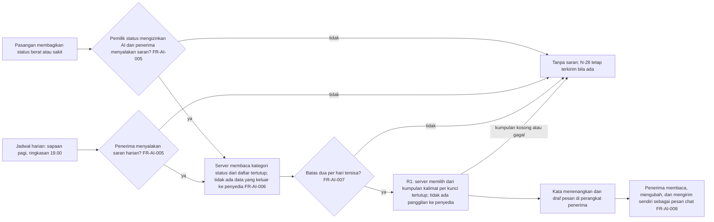

# 05 — Kebutuhan Fungsional: Tier 2

| | |
|---|---|
| Pemilik | `product-analyst` |
| Tahap | S3, fase B (12 November 2026); putaran penyelarasan dengan revisi kesembilan dokumen 06 (§11.1, §11.2 N-28 sampai N-31, §13.2, §13.4 sampai §13.6, §16) dan arah pemilik produk tentang pendamping `AI`, 12 November 2026 |
| Status | **S6 (12 November 2026): pass konsistensi.** `AI` diselaraskan ke R1 (S4-4 (i) A; ADR-021; brief §5O kalimat pilot): kerangka bagian 7 dan diagramnya; FR-AI-002 Aturan acuan dan Kedudukan (alasan bebas tertutup oleh SEC-136, bukan "terbuka sampai dokumen 10"; S6-B-13); FR-AI-003, FR-AI-004 Aturan acuan; FR-AI-005/AC-1; FR-AI-006/AC-1 hanya pekerjaan pembangunan kumpulan, AC-2 hanya untuk R2 kelak (S6-B-04); FR-AI-010 bagian Data dan AC-6 tanpa kategori status ke penyedia (S6-B-01). FR-AI-001: nuansa religi menjadi satu pilihan per rumah tangga, netral (bawaan) atau satu tradisi (W6; keputusan pemilik produk 62, diterima atas saran lead; bawaan "Netral, bisa pilih" tidak berubah); cara menggantinya lewat kesepakatan `rule` semua pihak yang disyaratkan (keputusan 64, diterima atas saran lead); isi daftar: netral lalu enam agama yang diakui, tanpa Kepercayaan (keputusan 66, diterima atas saran lead). Kata "pasangan" dan "keduanya" di beberapa AC diselaraskan (W7). Tier, MoSCoW, dan hitungan tidak berubah. **Sesudah checkpoint S4, 12 November 2026 (ditinjau `critic` A dan B, 12 November 2026; temuan diperbaiki; perbaikan diperiksa lead dengan `grep`, tanpa tinjauan ketiga):** S4-4 (i) A (R1) dan (ii) A (Claude) dicatat; kriteria `AI` yang ditulis bersyarat pada 10-B berlaku cabang A (tabel indeks 05 §2 "Sesudah checkpoint S4"); cabang B dan C gugur. Tier, MoSCoW, dan hitungan tidak berubah. Sebutan anggota (F-FAM-021, Tier 2) ditulis di [FAM.md](FAM.md) bagian 6.2 (FR-FAM-025), bukan di berkas ini. **S4 fase D, 12 November 2026 (ditinjau `critic` sebelum checkpoint S4):** `AI` ditulis bersyarat pada keputusan 10-B, bawaan A (R1, kumpulan kalimat; 10.4 §1.2) lebih dulu: FR-AI-002 (uraian, AC-3 berubah, AC-8 "minta ubah" baru), FR-AI-003 (AC-1 berubah; P-T2-4 ditutup), FR-AI-004 (AC-4 baru; P-T2-5 ditutup), FR-AI-006 (AC-4 baru, SEC-123, SEC-124), FR-AI-007 (AC-1 berubah, AC-3 baru, SEC-127), FR-AI-009 (AC-1 berubah, AC-3, AC-4 baru, SEC-133 sampai SEC-136); FR-CARE-003/AC-4 baru (pelipatan N-28, SEC-57). Tier dan MoSCoW tidak berubah. Selisih R1 dengan brief §5O ("asks the AI to revise it") diajukan ke lead (10 §8 butir 5). **Penyisiran andaian khusus pilot S4, 12 November 2026 (M2, M3, M4; ditinjau `critic` B fase D S4):** FR-CARE-002 memakai himpunan penerima per jenis (bawaan kosong; pilihan awal P-39; dicabut per penerima); status "hari ini" berakhir menurut zona waktu pemiliknya (FR-CARE-001, P-T2-6); `spouses` dibaca `adults`. Tier dan perilaku pilot tidak berubah. **Sesudah checkpoint S3 (12 November 2026):** jawaban "lanjut" dicatat; FR-CAL-002 menjadi Must Tier 1 tanpa syarat (S3-1 (d)); Q-32 pilihan C dan rinciannya S3-8 (0) sampai (vii), D-61, D-62, D-88, D-91, D-92 diterima lewat "lanjut"; gagasan dokumen 11 di bagian 9 yang diterima S3-2 dicatat. **Sebelumnya:** ditinjau `critic` A dan diperiksa `security-privacy` (fase D). **Putaran perbaikan fase D (12 November 2026):** atribusi saran harian (CA-02) dan layar kunci N-28 (aturan 1); kartu status hilang dari chat (SP-45); FR-CAL-002 menjadi penunjuk ke N-32 Tier 1 (CA-08); SP-47, SP-53, SP-54, SP-56, SP-66, SP-68 (a) sebagai **[Usulan]**; PA-5 menjadi PA-FIN-5 |
| Bagian dari | [05-functional-requirements.md](../05-functional-requirements.md) (indeks, format blok FR, kebutuhan lintas modul `LM-nn`) |
| Fitur yang dicakup | Tier 2 `SHP`, `PLN`, `MNT`, `CARE`, `CAL`, `AI` di [04-feature-map.md](../04-feature-map.md). Permintaan tindakan F-REQ-013 ada di [REQ.md](REQ.md); jam tenang, ringkasan, dan peristiwa N-28 sampai N-31 di [NTF.md](NTF.md) (FR-NTF-004); kartu status dan balasan di chat di [COM.md](COM.md) (FR-COM-016) |
| Kedalaman | Ringkas (brief §1.1): satu sampai tiga kriteria penerimaan utama per kebutuhan |

**Batas berkas ini.** Sama dengan [FAM.md](FAM.md): tidak ada aturan uang (07), aturan alur (06), keamanan atau teks hukum (dokumen 10), atau tata letak dan kata layar (dokumen 08). Semua kebutuhan lintas modul `LM-01` sampai `LM-09` di indeks berlaku tanpa disebut ulang; yang paling sering mengikat di sini adalah dua arah (`LM-01`), pencatatan tidak terhalang (`LM-02`), notifikasi aman (`LM-03`), dan tanpa metrik pengawasan (`LM-05`).

**Bentuk blok.** Blok FR Tier 2 memakai format indeks dengan dua penyederhanaan: baris "Aktor dan izin" dan "Business rule" digabung ke "Aturan acuan", dan ada baris "Usaha berulang" (PRN-02). Tier 2 tidak punya BR sendiri; aturannya ditunjuk langsung.

**`COM`.** Chat rumah tangga suami-istri naik ke Tier 1 ("Chat naik Tier 1", diterima pemilik produk atas saran lead, 12 November 2026; `_progress.md`, "Pernyataan pemilik produk tentang chat"); kebutuhannya di [COM.md](COM.md). Berkas ini hanya memuat akibatnya atas Tier 2: catatan dukungan adalah balasan chat pada kartu status (FR-CARE-006), dan saran `AI` dikirim sebagai pesan chat (bagian 7).

---

## Daftar isi

1. [Ringkasan dan label Must](#1-ringkasan-dan-label-must)
2. [`SHP` Daftar belanja](#2-shp-daftar-belanja)
3. [`PLN` Rencana mendatang](#3-pln-rencana-mendatang)
4. [`MNT` Masalah rumah](#4-mnt-masalah-rumah)
5. [`CARE` Kepedulian](#5-care-kepedulian)
6. [`CAL` Rutinitas dan tagihan](#6-cal-rutinitas-dan-tagihan)
7. [`AI` Pendamping keluarga, versi ringan](#7-ai-pendamping-keluarga-versi-ringan)
8. [Rekomendasi Q-32: saran kasih sayang yang tidak terasa palsu](#8-rekomendasi-q-32-saran-kasih-sayang-yang-tidak-terasa-palsu) (dirumuskan ulang mengikuti arah pemilik produk, 12 November 2026)
9. [Gagasan dokumen 11 yang menunggu checkpoint](#9-gagasan-dokumen-11-yang-menunggu-checkpoint)
10. [Yang tidak diatur di sini](#10-yang-tidak-diatur-di-sini)

---

## 1. Ringkasan dan label Must

| FR | Judul | Fitur | MoSCoW | Masalah |
|---|---|---|---|---|
| FR-SHP-001 | Daftar belanja bersama | F-SHP-001 | Should | `MSL-4` |
| FR-SHP-002 | Selesai belanja menjadi satu pengeluaran | F-SHP-002 | Should | `MSL-4`, `MSL-5` |
| FR-PLN-001 | Rencana mendatang | F-PLN-001 | Should | `MSL-4`; `KS-4` |
| FR-MNT-001 | Melaporkan masalah rumah | F-MNT-001 | Should | `MSL-6` |
| FR-MNT-002 | Masalah menjadi tugas | F-MNT-002 | Should | `MSL-6` |
| FR-MNT-003 | Biaya perbaikan | F-MNT-003 | Should | `MSL-6`, `MSL-3` |
| FR-CARE-001 | Status suasana hati sukarela | F-CARE-001 | Should | `MSL-6`, `MSL-7` |
| FR-CARE-002 | Persetujuan berbagi kepedulian dan pencabutannya | F-CARE-001, F-CARE-002 | **Must bila F-CARE-001 atau F-CARE-002 dibangun** | `PAGAR` |
| FR-CARE-003 | Pasangan diberi tahu setiap perubahan | F-CARE-001, F-CARE-002 | Should | `MSL-6`, `MSL-7`; `KS-5` |
| FR-CARE-004 | Menghapus catatan kepedulian | F-CARE-001, F-CARE-002 | **Must bila F-CARE-001 atau F-CARE-002 dibangun** | `PAGAR` |
| FR-CARE-005 | Tindak lanjut sakit | F-CARE-002 | Should | `MSL-6` |
| FR-CARE-006 | Catatan dukungan pada status | F-CARE-003 | Should | `MSL-7`; `KS-5` |
| FR-CAL-001 | Rutinitas dan pengingatnya | F-CAL-001 | Should | `MSL-6` |
| FR-CAL-002 | Pengingat tagihan (penunjuk ke N-32 Tier 1) | F-CAL-002 | **Must, Tier 1** (S3-1 (d) diterima lewat "lanjut", 12 November 2026) | `MSL-6`; `MSL-3` |
| FR-AI-001 | Kata penyemangat di halaman depan | F-AI-001 | Should | `MSL-7` |
| FR-AI-002 | Kata menenangkan dan saran pesan saat pasangan membagikan suasana hati berat atau sakit | F-AI-002 | Should | `MSL-7`, `MSL-6`; `KS-5` |
| FR-AI-003 | Pengingat hangat | F-AI-003 | Should | `MSL-7` |
| FR-AI-004 | Narasi bulanan | F-AI-004 | Should | `MSL-7`, `MSL-1` |
| FR-AI-005 | Ikut serta per anggota | F-AI-005 | **Must bila F-AI-001 sampai F-AI-004 atau F-AI-008 dibangun** | `PAGAR` |
| FR-AI-006 | Data minimum ke penyedia | F-AI-005 | **Must bila F-AI-001 sampai F-AI-004 atau F-AI-008 dibangun** | `PAGAR` |
| FR-AI-007 | Batas biaya keras | F-AI-005 | **Must bila F-AI-001 sampai F-AI-004 atau F-AI-008 dibangun** | `PAGAR` |
| FR-AI-008 | Gagal aman; AI bukan pelaku | F-AI-005 | **Must bila F-AI-001 sampai F-AI-004 atau F-AI-008 dibangun** | `PAGAR`; `MSL-5` |
| FR-AI-009 | Tanda tekanan berat | F-AI-005 | **Must bila F-AI-001 sampai F-AI-004 atau F-AI-008 dibangun** | `PAGAR` |
| FR-AI-010 | Saran apresiasi atau dukungan harian | F-AI-008 | Should | `MSL-7`; `KS-5` |

**Mengapa dua kebutuhan `CARE` diberi Must bersyarat.** F-CARE-001 dan F-CARE-002 sendiri Should. Tetapi bila dibangun, persetujuan berbagi dan hak menghapus adalah satu-satunya hal yang membuat status kepedulian tidak menjadi alat memantau (dokumen 04 §7 "Pantau"). Keduanya diperlakukan seperti F-AI-005: fiturnya boleh ditunda, pagarnya tidak boleh dibangun setengah. **[Usulan]** `product-analyst`. Ketujuh Must bersyarat masuk tabel keterlacakan di indeks.

**Usaha berulang Tier 2.** Semuanya sukarela atau nol, kecuali menandai rutinitas (satu ketukan per kemunculan, boleh dilewati) dan menutup tugas perbaikan (sekali per masalah). Tidak ada kebutuhan Tier 2 yang meminta isian harian atau mengirim pengingat untuk mengisi (PRN-02; Q-90).

---

## 2. `SHP` Daftar belanja

### FR-SHP-001 — Daftar belanja bersama

| | |
|---|---|
| Fitur | F-SHP-001 |
| Tier / MoSCoW | 2 / Should |
| Masalah (brief §1.1) | `MSL-4` (anggaran dapur rutin terlampaui); `KB-19` |
| Aturan acuan | 07 §6.2 (sisa anggaran); PRN-17 (daftar bukan uang); 06 §9.2 (bawaan `adults`, dahulu `spouses`); `LM-01` |
| Kedudukan | **[Usulan]** `product-analyst`; satu daftar per rumah tangga dan kategori bawaannya **[Asumsi]** |
| Usaha berulang | Menambah barang saat teringat; mencentang saat belanja. Tidak wajib dipakai |

Satu daftar bersama per rumah tangga di pilot (daftar pribadi dan berulang: Tier 3, F-SHP-003). Barang: nama wajib; jumlah dan perkiraan harga opsional. Daftar terhubung ke satu kategori anggaran (bawaan: kategori belanja dapur **[Asumsi]**, dapat diganti), dan menampilkan total perkiraan terhadap sisa anggaran kategori itu. Daftar tidak membuat entri, reservasi, atau tanda apa pun.

**Kriteria penerimaan**

- **AC-1** — *Given* anggota dewasa mana pun, *When* ia menambah barang hanya dengan nama, *Then* barang tersimpan, juga tanpa sambungan, dan terlihat oleh setiap anggota dewasa penuh lain setelah tersinkron.
- **AC-2** — *Given* daftar dengan sebagian barang berharga perkiraan, *When* daftar dibuka, *Then* tampil total perkiraan, sisa anggaran kategori menurut 07 §6.2, dan jumlah barang yang belum berharga; tidak ada angka yang ditebak untuk barang tanpa harga (PRN-18).
- **AC-3** — *Given* total perkiraan melebihi sisa anggaran, *When* daftar dibuka, *Then* hal itu tampil di daftar saja; tidak ada notifikasi, tanda pada orang, atau entri (Q-134; PRN-17).

### FR-SHP-002 — Selesai belanja menjadi satu pengeluaran

| | |
|---|---|
| Fitur | F-SHP-002 |
| Tier / MoSCoW | 2 / Should |
| Masalah (brief §1.1) | `MSL-4`; `MSL-5` (satu entri per kunjungan, bukan per barang) |
| Aturan acuan | Entri pengeluaran: 07 §3.2 (dan kebutuhan F-FIN-005 di [FIN-1.md](FIN-1.md)); menautkan ke otorisasi: 06 §4.5, INV-A34 (D-39); offline: 06 S-7 |
| Kedudukan | **[Usulan]** `product-analyst` |
| Usaha berulang | Satu entri per kunjungan belanja; menggantikan entri pengeluaran biasa, bukan menambahnya |

Dari barang yang dicentang, satu langkah membuka entri pengeluaran biasa dengan kategori daftar terisi. Pencatat mengisi total aktual dan tempat uang; struk opsional (pasar tradisional sering tanpa struk). Bila belanja itu diajukan lewat permintaan, pencatat dapat menautkannya ke otorisasinya. Isian wajib tidak boleh lebih banyak dari entri pengeluaran biasa (PRN-05).

**Kriteria penerimaan**

- **AC-1** — *Given* barang yang dicentang, *When* pencatat menyelesaikan belanja dengan total aktual dan tempat uang, *Then* tercatat tepat satu entri pengeluaran menurut 07 §3.2, barang yang dicentang keluar dari daftar, dan barang yang tidak dicentang tetap; berlaku juga tanpa sambungan (06 S-7).
- **AC-2** — *Given* total aktual berbeda dari total perkiraan, *When* entri disimpan, *Then* yang tercatat hanya total aktual; perkiraan tidak masuk angka apa pun.
- **AC-3** — *Given* otorisasi yang berlaku milik pencatat sebagai pemohon, *When* ia menautkannya, *Then* tautan mengikuti 06 §4.5 dan INV-A34; ia tidak dapat menautkan ke otorisasi yang tidak boleh ia tautkan.

---

## 3. `PLN` Rencana mendatang

### FR-PLN-001 — Rencana mendatang

| | |
|---|---|
| Fitur | F-PLN-001 |
| Tier / MoSCoW | 2 / Should |
| Masalah (brief §1.1) | `MSL-4` (jalan-jalan diumumkan mendadak); `KS-4` |
| Aturan acuan | 06 §2.4 (syarat jalan-jalan: tempat, rentang waktu, peserta, barang rencana), §4 (state permintaan), §9.2 |
| Kedudukan | Brief §1.1 Tier 2 "`PLN` only as far as outing requests need it". Dipersempit menjadi satu tampilan baca: Q-137, usulan dokumen 04, diterima lewat "lanjut" di checkpoint S3 (12 November 2026) sebagai D-62 |
| Usaha berulang | Nol (hanya dibaca) |

Satu tampilan berisi permintaan jalan-jalan yang disetujui atau masih dalam pembahasan, menurut tanggal rencana, sama bagi keduanya. Tidak ada objek "rencana" baru; semua isi dibaca dari permintaannya.

**Kriteria penerimaan**

- **AC-1** — *Given* permintaan jalan-jalan dalam berbagai state, *When* tampilan dibuka, *Then* hanya permintaan yang disetujui atau masih dalam pembahasan (state 06 §4) bertanggal hari ini atau sesudahnya yang tampil, berurutan menurut tanggal rencana; yang ditolak, dibatalkan, atau kedaluwarsa tidak tampil.
- **AC-2** — *Given* setiap anggota dewasa, *When* masing-masing membuka tampilan, *Then* isinya identik (`LM-01`).
- **AC-3** — *Given* butir di tampilan, *When* dibuka, *Then* yang terbuka adalah permintaannya sendiri; tampilan tidak punya perintah ubah sendiri.

---

## 4. `MNT` Masalah rumah

Alur kanonis: 06 §13.2 (M01 sampai M05).

### FR-MNT-001 — Melaporkan masalah rumah

| | |
|---|---|
| Fitur | F-MNT-001 |
| Tier / MoSCoW | 2 / Should |
| Masalah (brief §1.1) | `MSL-6` ("leaking roof") |
| Aturan acuan | 06 §13.2 M01; notifikasi: 06 §11; "mendesak" dan jam tenang: dokumen 08 dan 10 |
| Kedudukan | Alur **[Usulan]** `architect` (06 §13.2) |
| Usaha berulang | Per masalah, jarang **[Asumsi]** |

**Kriteria penerimaan**

- **AC-1** — *Given* anggota dewasa mana pun, *When* ia melaporkan masalah dengan judul saja, *Then* laporan tersimpan berstate `dilaporkan`, juga tanpa sambungan; foto dan penanda "mendesak" opsional.
- **AC-2** — *Given* laporan baru, *When* tersimpan di server, *Then* anggota lain diberi tahu dengan prioritas menurut 06 §11 dan teks layar kunci yang umum; laporan bertanda "mendesak" berprioritas lebih tinggi, tetapi menembus jam tenang atau tidak menunggu dokumen 08 dan 10 (sampai ada: tidak menembus).

### FR-MNT-002 — Masalah menjadi tugas

| | |
|---|---|
| Fitur | F-MNT-002 |
| Tier / MoSCoW | 2 / Should |
| Masalah (brief §1.1) | `MSL-6` ("become a task closed with photos and notes") |
| Aturan acuan | 06 §13.2 M02 sampai M05, §13.1 (permintaan tindakan, F-REQ-013 di [REQ.md](REQ.md)), PG-02 |
| Kedudukan | Alur **[Usulan]** `architect`. Pelaku M05: hanya pelapor, selama `dilaporkan` (06 §13.2, **[Usulan]** `architect`, menjawab P-T2-3) |
| Usaha berulang | Satu ketukan mengambil; satu penutupan dengan foto atau catatan |

**Kriteria penerimaan**

- **AC-1** — *Given* masalah berstate `dilaporkan`, *When* seorang anggota mengambilnya sendiri, *Then* lahir satu tugas untuk dirinya dan masalah menjadi `dikerjakan`; *When* ia memintanya kepada anggota lain, *Then* yang lahir adalah permintaan tindakan, dan masalah baru `dikerjakan` setelah permintaan itu diterima. Tidak ada perintah menugaskan orang dewasa lain secara sepihak.
- **AC-2** — *Given* masalah `dikerjakan`, *When* penerima tugas menutupnya, *Then* penutupan memerlukan sekurangnya foto atau catatan dan hanya dapat dilakukan penerima tugas; tugas yang dilepas atau dibatalkan mengembalikan masalah ke `dilaporkan` (M03).
- **AC-3** — *Given* masalah, *When* daftar masalah dibuka, *Then* tidak ada hitungan atau urutan per orang (siapa paling banyak melapor, mengerjakan, atau menunda) (`LM-05`).
- **AC-4** — *Given* masalah `dilaporkan` yang dilaporkan A, *When* B mencoba menutupnya tanpa dikerjakan (M05), *Then* ditolak; B dapat menulis pendapatnya di diskusi masalah itu; *When* A menutupnya, *Then* masalah `ditutup_tanpa_dikerjakan` dan B menerima kabar `ringkasan`. *Given* masalah `dikerjakan`, *When* A ingin menutupnya tanpa dikerjakan, *Then* jalannya M03 (tugas dilepas atau dibatalkan) lalu M05 oleh A (06 §13.2).

### FR-MNT-003 — Biaya perbaikan

| | |
|---|---|
| Fitur | F-MNT-003 |
| Tier / MoSCoW | 2 / Should |
| Masalah (brief §1.1) | `MSL-6`; `MSL-3` (uang perbaikan ikut terlihat) |
| Aturan acuan | 06 §13.2 (biaya), §6.2 (catatan "mendesak" tanpa permintaan); 07 §3.2 |
| Kedudukan | Alur **[Usulan]** `architect` |
| Usaha berulang | Termasuk dalam entri pengeluaran atau permintaan anggaran yang memang dibuat |

**Kriteria penerimaan**

- **AC-1** — *Given* masalah terbuka, *When* anggota mencatat pengeluaran dari masalah itu, *Then* entri pengeluaran biasa (07 §3.2) tercatat dengan tautan ke masalahnya; dari masalah itu terlihat entri yang tertaut.
- **AC-2** — *Given* perbaikan yang direncanakan atau di atas ambang, *When* anggota memulainya dari masalah, *Then* yang dibuka adalah permintaan anggaran biasa yang tertaut ke masalah; perbaikan mendesak tetap dapat dicatat langsung dengan keterangan "mendesak" menurut 06 §6.2, tanpa menunggu persetujuan (PRN-06).

---

## 5. `CARE` Kepedulian

Asas yang mengikat semua kebutuhan di bagian ini: pribadi secara bawaan; berbagi hanya atas persetujuan eksplisit pemiliknya, dapat dicabut seketika dan senyap; setelah berbagi, pasangan diberi tahu pada setiap perubahan; pemilik dapat menghapus semuanya kapan saja; tidak ada isian harian dan tidak ada pengingat untuk mengisi (brief §1.1 Tier 2, §5K; 06 V-6, V-7, §13.3; ADR-007 butir 7; PRN-12; D-40, D-41). Tidak ada bahasa diagnosis.

**Aturan acuan bagian ini** (revisi kesembilan 06, menjawab P-T2-1). Alur status suasana hati, kartu status di chat, dan catatan dukungan: 06 §13.5. Tindak lanjut sakit: 06 §13.3. Notifikasi: N-28 `kabar`, tidak pernah `perlu_tanggapan`, dilebur per objek selama tertahan; berakhir sendiri, pencabutan, dan penghapusan tidak diberitahukan (06 §11.2; FR-NTF-004 di [NTF.md](NTF.md)). **Layar kunci N-28:** yang diterima pemilik produk atas saran lead adalah pilihan "Umum di layar kunci", yang teksnya berbunyi "ada kabar dari istrimu"; teks pastinya bentuk (a) "Ada kabar baru", sama persis dengan `kabar` lain dan di kanal yang sama, supaya layar kunci tidak membedakan kabar kepedulian (06 §11.1 "Isi layar kunci", usulan `security-privacy` SP-46, P-32), **diterima lewat "lanjut"** di checkpoint S3, S3-8 (vii); alternatif (b) "ada kabar dari {nama}" tidak dipilih. Catatan dukungan adalah pesan chat yang membalas kartu status, notifikasinya N-23 (06 §13.5; FR-COM-016 di [COM.md](COM.md)); catatan dukungan di chat ("Ke chat") diterima pemilik produk atas saran lead, 12 November 2026. **Kartu status** hilang dari chat bagi keduanya, tanpa penanda, saat statusnya digantikan, berakhir, dicabut, atau dihapus; status baru melahirkan kartu baru; balasan tetap sebagai pesan bebas milik penulisnya (06 §13.5, INV-A47 (b)(e); usulan `security-privacy` SP-45, diterapkan `architect` revisi kesepuluh; diterima lewat "lanjut" di checkpoint S3, S3-7 (ii)). Selebihnya **[Usulan]** `architect`.

### FR-CARE-001 — Status suasana hati sukarela

| | |
|---|---|
| Fitur | F-CARE-001 |
| Tier / MoSCoW | 2 / Should; **Pantau** |
| Masalah (brief §1.1) | `MSL-6` ("a spouse's mood is unknown unless asked"); `MSL-7`; `KS-5`; `KB-16` |
| Aturan acuan | Brief §5K; 06 §9.2 (bawaan `private`), V-6, V-7, §13.5 (satu status per anggota, berakhir sendiri berpelaku `system`), §13.6 "Pemicu" (kelompok "berat"); tanpa riwayat: Q-136, usulan dokumen 04, diterima lewat "lanjut" sebagai D-61 |
| Kedudukan | Isi pilihan siap pakai, kelompok "berat", dan berakhirnya pilihan "hari ini": **[Usulan]** `product-analyst`; alur berakhir sendiri: 06 §13.5 (**[Usulan]** `architect`); kata-katanya dokumen 08 |
| Usaha berulang | Sukarela; nol bila tidak dipakai |

Anggota memilih apa yang ia rasakan dan, bila mau, menulis alasannya. Selain perasaan, ada pilihan siap pakai untuk meminta ruang atau bantuan **tanpa rincian**, misalnya "butuh istirahat hari ini", "butuh ditemani", "butuh dibantu urusan rumah hari ini", "butuh tenang dulu". Pilihan itu bukan pernyataan kesehatan dan tidak pernah memerlukan alasan. Yang disimpan hanya status saat ini beserta tanggal dibuatnya; status lama tergantikan, tidak menjadi riwayat (Q-136). Status yang dipilih dari pilihan bertanda "hari ini" berakhir sendiri pada akhir hari menurut zona waktu pemiliknya (zona akun, cadangan zona rumah tangga; di pilot sama dengan zona rumah tangga), tanpa notifikasi (06 §13.5, §11.1; penyisiran S4, M3), agar "butuh istirahat" kemarin tidak terbaca sebagai hari ini.

**Kelompok "berat"** (diminta 06 §13.6 "Pemicu"; **[Usulan]** `product-analyst`). Daftar tertutup pada pilihan status yang, bila dibagikan, memicu kata-kata menenangkan dan saran pesan bagi pasangan (FR-AI-002): sedih, cemas atau khawatir, lelah sekali, kesal, sedang tidak baik, "butuh ditemani", dan "butuh tenang dulu". Pilihan bernada netral atau senang ("biasa saja", "senang", "bersemangat") dan permintaan bantuan praktis ("butuh dibantu urusan rumah hari ini") tidak termasuk. Server tidak pernah menebak kelompok dari alasan bebas, chat, atau perilaku. Pemilik status tidak melihat label "berat"; ia hanya memilih perasaannya.

**"Butuh tenang dulu" tanpa draf pesan** (usulan `security-privacy` SP-47, diterapkan di 06 §13.6 (revisi kesepuluh); diterima lewat "lanjut" di checkpoint S3, S3-8 butir (v)). Daftar kelompok "berat" di atas juga diterima lewat "lanjut" sebagai bagian S3-8 (v). Orang yang meminta tenang tidak sedang meminta dihubungi. Untuk status itu N-28 kepada pasangan hanya membawa kata-kata yang menenangkan **penerima** ("ia minta waktu tenang; tidak perlu dibalas sekarang"), tanpa saran pesan, dan kolom balas pada kartunya tidak terisi apa pun. "Butuh ditemani" tetap membawa saran pesan seperti status berat lain (FR-AI-002).

**Kriteria penerimaan**

- **AC-1** — *Given* anggota dewasa, *When* ia memilih satu perasaan atau satu pilihan siap pakai, *Then* status tersimpan dalam satu langkah tanpa isian lain; alasan bebas opsional; tanpa sambungan pun tersimpan; status yang dibagikan disinkron kemudian (AC-6).
- **AC-6** — **Status yang tidak dibagikan hanya di perangkat** (10-D A, S4-6 (i) A; 10.2 §4, SEC-46 (b); 10.1 SEC-21, Class A). *Given* A menyimpan status tanpa berbagi, *When* lalu lintas ke server, basis data, cadangan, dan log diperiksa, *Then* status itu tidak ada di mana pun selain perangkat A, dan tidak masuk cadangan awan atau transfer perangkat; *When* A membagikannya kepada B (FR-CARE-002), *Then* baru sejak saat itu status tersimpan di server dan dapat terbaca pengelola server, seperti dinyatakan pemberitahuan pengelola (FR-FAM-019/AC-8). Apa yang terjadi pada salinan server sesudah berbagi dicabut (FR-CARE-002/AC-3) mengikuti 06 §13.3 dan 10.2 §4; kebutuhan ini tidak menambah aturannya. Tanpa syarat; berlaku pilot dan tahap publik sampai ADR E2EE sebelum tahap publik memutuskan lain.
- **AC-2** — *Given* status baru disimpan, *When* model diperiksa, *Then* status sebelumnya tidak tersimpan di mana pun, termasuk sebagai Peristiwa yang terbaca anggota lain; yang tampil hanyalah status saat ini dan sejak kapan.
- **AC-3** — *Given* anggota yang tidak pernah atau sudah lama tidak mengisi status, *When* jam dimajukan berapa pun, *Then* tidak ada pengingat, ajakan, atau tanda "belum diisi" kepada siapa pun, dan anggota lain tidak melihat apa pun yang membedakan "belum diisi" dari "tidak dibagikan" (`LM-05`).
- **AC-4** — *Given* daftar pilihan status, *When* diperiksa, *Then* setiap pilihan bertanda masuk atau tidak masuk kelompok "berat" menurut daftar tertutup di atas, tanda itu tidak tampil kepada siapa pun, dan tidak ada jalur yang menetapkan kelompok dari teks bebas (06 §13.6).
- **AC-5** — *Given* A membagikan "butuh tenang dulu" dan kedua persetujuan FR-AI-002 berlaku, *When* B membuka N-28, *Then* B hanya membaca kata-kata yang menenangkan dirinya, bermakna "ia minta waktu tenang; tidak perlu dibalas sekarang", tanpa saran pesan, dan kolom balas pada kartu status A kosong; *Given* A membagikan "butuh ditemani", *Then* B menerima kata-kata yang menenangkan dan satu saran pesan seperti FR-AI-002/AC-1 (SP-47; S3-8 (v), diterima lewat "lanjut").

### FR-CARE-002 — Persetujuan berbagi kepedulian dan pencabutannya

| | |
|---|---|
| Fitur | F-CARE-001, F-CARE-002 |
| Tier / MoSCoW | 2 / **Must bila F-CARE-001 atau F-CARE-002 dibangun** |
| Masalah (brief §1.1) | `PAGAR` (status tidak boleh menjadi alat memantau) |
| Aturan acuan | 06 V-4, V-6, V-7, INV-A36, INV-A50, N-22, §13.5; D-40 (lewat "lanjut", Pagar); FR-FAM-009 di [FAM.md](FAM.md) |
| Kedudukan | Brief §1.1 Tier 2 dan §5K. **Dua saklar terpisah** (suasana hati; sakit), keduanya mati secara bawaan: **[Usulan]** `security-privacy` SP-53, menggantikan bawaan semula `product-analyst` (satu saklar untuk keduanya); diterapkan di 06 §13.5, V-6 (revisi kesepuluh) |
| Usaha berulang | Sekali per saklar (memilih berbagi); mencabut satu ketukan |

Dua persetujuan berbagi yang terpisah, suasana hati dan kabar sakit. Masing-masing adalah **himpunan penerima**, bawaan kosong (mati) sampai pemiliknya sendiri menyalakan; saat dinyalakan pilihan awalnya semua anggota dewasa penuh lain (P-39, checkpoint S4); dicabut per penerima; anggota yang bergabung kemudian tidak pernah masuk sendiri (06 §13.5, INV-A50; penyisiran S4, M4, **[Usulan]** `architect`). Di rumah tangga pilot penerimanya hanya pasangan, jadi layarnya terbaca "bagikan suasana hatiku kepada pasangan" dan "bagikan kabar sakitku kepada pasangan". Bawaan semula, satu saklar untuk keduanya, dicabut (SP-53): kabar sakit dan suasana hati punya tingkat kepekaan yang berbeda, dan orang yang mau pasangannya tahu ia demam belum tentu mau perasaannya terbaca. Biayanya satu keputusan tambahan, sekali. Alasan bebas ikut terbagi bersama statusnya, dan layar menyatakannya sebelum menyimpan (FR-FAM-010).

**Kriteria penerimaan**

- **AC-1** — *Given* anggota yang belum pernah memilih berbagi, *When* ia mengisi status atau melapor sakit, *Then* tidak seorang pun selain dirinya dapat melihatnya, dan tidak ada ajakan berbagi yang muncul berulang (paling banyak sekali saat pertama mengisi).
- **AC-2** — *Given* anggota memilih berbagi, *When* ia mengukuhkannya, *Then* setiap penerima dalam himpunannya (pilihan awal semua anggota dewasa penuh lain; di pilot: pasangan) dapat melihat status saat ini sejak saat itu, tidak ada yang berlaku surut, dan N-22 dikirim (06 V-6); tidak ada anggota lain yang dapat memulai, mengubah, atau mencabut persetujuan itu (06 V-4).
- **AC-3** — *Given* persetujuan berbagi yang berlaku, *When* pemiliknya mencabut seluruhnya atau mencabut satu penerima, *Then* berlaku seketika bagi penerima yang dicabut (penerima lain tidak terpengaruh): ia tidak lagi menemukan status, laporan sakit, maupun alur tindak lanjutnya, kartu statusnya hilang dari chat bagi keduanya tanpa penanda, kartu kosong, atau baris peristiwa, tidak ada notifikasi kepada siapa pun, dan tidak ada notifikasi yang masih tertahan untuk status itu yang tetap dikirim (06 V-7; §13.3, §13.5, INV-A47 (e); SP-45). Catatan dukungan yang sudah dikirim pasangan kehilangan tautannya ke status dan tetap sebagai pesan bebas milik pasangan, tanpa kutipan kartu (06 §13.5; P-21).
- **AC-4** — *Given* anggota baru, *When* ia membuka setelan berbagi, *Then* ada dua saklar, suasana hati dan sakit, keduanya mati; *When* A hanya menyalakan saklar sakit, *Then* B menerima N-28 untuk laporan sakit dan jawaban tindak lanjut A, tetapi tidak menemukan status suasana hati A dan tidak menerima kabar apa pun saat A mengubahnya; mencabut satu saklar tidak menyentuh yang lain (SP-53) **[Usulan]**.

### FR-CARE-003 — Pasangan diberi tahu setiap perubahan

| | |
|---|---|
| Fitur | F-CARE-001, F-CARE-002 |
| Tier / MoSCoW | 2 / Should |
| Masalah (brief §1.1) | `MSL-6`, `MSL-7`; `KS-5`; brief §1.1 Tier 2 "the partner is notified on every change" |
| Aturan acuan | 06 §11.1 (layar kunci: teks umum kelas `kabar`, juga bagi N-28 di bawah bawaan (a) S3-8; penggabungan `kabar`), §11.2 N-28, §13.5 "Notifikasi", "Tanda dibaca", §16.2 (kartu status), AT-5 |
| Kedudukan | Brief §1.1 Tier 2. Prioritas, penahanan, dan penggabungan: **[Usulan]** `architect` (06 §11.1, N-28; menjawab P-T2-1 dengan bawaan Q-138). Layar kunci: pilihan "Umum di layar kunci" (teksnya "ada kabar dari istrimu") diterima pemilik produk atas saran lead, 12 November 2026; teks pastinya checkpoint S3-8, dengan bawaan **[Usulan]** (a) "Ada kabar baru" dan alternatif (b) nama tampilan pengirim (06 §11.1, P-32; SP-46) |
| Usaha berulang | Nol bagi pemilik status; satu kabar bagi pasangan per perubahan |

"Perubahan" adalah status baru yang dipilih pemiliknya, laporan sakit, dan jawaban tindak lanjut. Berakhirnya status "hari ini" dengan sendirinya, pencabutan berbagi, dan penghapusan bukan perubahan yang diberitahukan (06 §13.5): tiga-tiganya bukan kabar dari pemiliknya, dan memberitahukan pencabutan atau penghapusan melanggar V-7. Setiap status yang dibagikan juga tampil sebagai satu kartu hidup di chat (06 §13.5; FR-COM-016); kartu itu tidak menambah notifikasi, dan hilang dari chat bagi keduanya saat statusnya digantikan, berakhir, dicabut, atau dihapus, supaya chat tidak menjadi riwayat suasana hati (SP-45).

**Kriteria penerimaan**

- **AC-1** — *Given* persetujuan berbagi berlaku, *When* pemiliknya menyimpan status baru, laporan sakit, atau jawaban tindak lanjut, *Then* pasangan menerima satu N-28 `kabar` yang di layar kunci memakai teks umum kelas `kabar` ("Ada kabar baru" menurut bawaan (a); FR-NTF-005/AC-5 untuk (b)), tanpa jenis peristiwa, perasaan, atau kata kesehatan, ditahan bila jatuh di jam tenang pasangan, dan tidak ada N-23 tambahan atas kartunya (06 INV-A46).
- **AC-2** — *Given* pemilik mengubah status tiga kali selama jam tenang pasangan, *When* jam tenang berakhir, *Then* pasangan menerima satu N-28 yang menampilkan status saat dilepas; *When* status sudah dicabut atau dihapus sebelum dilepas, *Then* kabar itu gugur tanpa jejak (06 §11.1 "Penggabungan `kabar`", V-7).
- **AC-3** — *Given* notifikasi perubahan, *When* pasangan membukanya atau membuka status di layarnya sendiri, *Then* pemilik status tidak mendapat tanda apa pun bahwa pasangannya sudah membaca. Kartu status di chat memakai tanda dibaca chat seperti pesan lain, jadi bila pasangan membuka chat, pemilik status melihat kartunya terbaca, tanpa waktu baca (06 §13.5 "Tanda dibaca", §16.5); batas ini disebut di "siapa melihat apa" (FR-FAM-010/AC-4) dan dinilai dokumen 10.
- **AC-4** — **Pelipatan bunyi** (06 N-28 revisi ketiga belas; 10.2 SEC-57, **[Usulan]** `security-privacy`; 60 menit **[Asumsi]**). *Given* A mengubah status tiga kali dalam 20 menit di luar jam tenang B, *When* kabarnya dilepas, *Then* hanya yang pertama berbunyi; dua sesudahnya menggantikannya diam-diam dengan pengenal lipat yang sama, dan saat B membukanya ia melihat status ketiga. Paling banyak satu N-28 berbunyi per 60 menit per pasangan (pemilik, penerima). Ini menafsirkan brief §1.1 "notified on every change" sebagai "setiap perubahan sampai", bukan "setiap perubahan berbunyi"; selisihnya diajukan ke lead (10 §8 butir 6).

### FR-CARE-004 — Menghapus catatan kepedulian

| | |
|---|---|
| Fitur | F-CARE-001, F-CARE-002 |
| Tier / MoSCoW | 2 / **Must bila F-CARE-001 atau F-CARE-002 dibangun** |
| Masalah (brief §1.1) | `PAGAR` |
| Aturan acuan | 06 §2.5, §13.3, §13.5 "Balasan sesudah status hilang", INV-A47 (e); ADR-007 butir 7; D-41 (lewat "lanjut", Pagar); sisi hukum **[Perlu validasi]** L-23 |
| Kedudukan | D-41. Balasan pasangan tetap sebagai pesan bebas penulisnya: usulan `architect`, menyimpang dari AC-1 semula (06 P-21). Kartu hilang tanpa penanda: usulan `security-privacy` SP-45, diterapkan 06 revisi kesepuluh. Keduanya diterima lewat "lanjut" di checkpoint S3 (12 November 2026), S3-7 (ii). Pemberitahuan kepada pemilik sebelum menghapus (AC-4) dan larangan `AI` mengutip alasan bebas: **[Usulan]** `security-privacy` SP-56 (a)(b) |
| Usaha berulang | Nol; satu ketukan bila mau |

**Perubahan dari rumusan semula.** AC-1 semula menyatakan catatan dukungan yang menempel ikut hilang. Sejak catatan dukungan menjadi pesan chat pasangan (keputusan 12 November 2026), menghapusnya berarti satu orang menghapus tulisan orang lain. 06 §13.5 mengusulkan: tautannya hilang bersama status, pesannya tetap milik penulisnya. Batasnya dinyatakan terus terang, kepada pemilik status sebelum ia menghapus (AC-4): kalimat seperti "semoga cepat sembuh" tetap terbaca di chat sesudah laporan sakitnya dihapus. Bawaan ini (P-21) diterima lewat "lanjut" di checkpoint S3 (S3-7 (ii)); harganya dibacakan sebagai W-23. AC-1 di bawah ditulis menurutnya.

**Kriteria penerimaan**

- **AC-1** — *Given* status suasana hati atau laporan sakit beserta tindak lanjutnya, *When* pemiliknya menghapus, *Then* status, laporan, tindak lanjut, dan Peristiwanya hilang seluruhnya, juga yang sudah ia bagikan; kartunya hilang dari chat bagi keduanya tanpa kartu kosong, penanda, atau baris peristiwa; tidak ada notifikasi; balasan pasangan pada kartu itu kehilangan tautannya ke status (tanpa `subject_ref`, tanpa `reply_to_message_id`, tanpa kutipan kartu) dan tetap di chat sebagai pesan bebas milik pasangan, yang hanya pasangan itu dapat menghapusnya (06 §13.5, INV-A47 (b)(e); SP-45; **[Usulan]**, P-21).
- **AC-2** — *Given* penghapusan, *When* dicek di keluaran AI, ringkasan, ekspor pasangan, dan cache perangkat pasangan setelah sinkron, *Then* isi yang dihapus tidak lagi terbaca di mana pun dalam jangkauan aplikasi (cadangan: dokumen 10).
- **AC-3** — *Given* status A yang dibagikan dan sudah dibalas B, *When* A menggantinya dengan status baru, *Then* kartu lama hilang bagi keduanya dan kartu baru lahir untuk status baru; balasan B pada kartu lama tetap sebagai pesan bebas B tanpa kutipan; tidak ada `seq` yang hilang selain milik kartu lama (06 INV-A47 (d)(e); SP-45).
- **AC-4** — *Given* status A yang sudah dibalas B di chat, *When* A membuka layar menghapus, *Then* sebelum mengukuhkan A membaca bahwa balasan pasangannya tetap ada di chat sebagai pesan pasangannya dan hanya pasangannya yang dapat menghapusnya; menghapus tetap satu langkah, tanpa syarat apa pun dari B (SP-56 (a)) **[Usulan]**.

### FR-CARE-005 — Tindak lanjut sakit

| | |
|---|---|
| Fitur | F-CARE-002 |
| Tier / MoSCoW | 2 / Should; **Pantau** |
| Masalah (brief §1.1) | `MSL-6` (demam dilaporkan, ditanya lagi sesudah N hari); `KB-17` |
| Aturan acuan | 06 §13.3 I01 sampai I04 |
| Kedudukan | Alur **[Usulan]** `architect`; N bawaan 2 hari **[Asumsi]** |
| Usaha berulang | Satu laporan per kejadian sakit; satu jawaban per pertanyaan |

**Kriteria penerimaan**

- **AC-1** — *Given* anggota dewasa, *When* ia melaporkan sakitnya sendiri, *Then* laporan tersimpan dengan N bawaan 2 hari yang dapat ia ubah; tidak ada isian diagnosis, gejala, atau obat; tidak ada perintah bagi orang dewasa lain untuk melaporkan atau menjawab atas namanya (06 §13.3).
- **AC-2** — *Given* N hari berlalu, *When* sistem bertanya, *Then* ia memilih sudah sembuh, masih sakit, atau akan ke klinik; "masih sakit" dan "akan ke klinik" menjadwalkan pertanyaan berikutnya; tanpa jawaban ada satu pengingat lalu berhenti, dan state tetap `menunggu_kabar` tanpa kesimpulan otomatis.
- **AC-3** — *Given* persetujuan berbagi berlaku, *When* pasangan membuka laporannya, *Then* ia melihat state saat ini dan dapat menanyakan kabar dengan membalas kartu laporan itu di chat (FR-CARE-006); pertanyaan sistem (I02) dan satu pengingatnya hanya dikirim kepada yang sakit, `kabar`, tunduk pada jam tenang; laporan sakit dan jawaban tindak lanjut yang dibagikan diberitahukan kepada pasangan lewat N-28 (06 §13.3).

### FR-CARE-006 — Catatan dukungan pada status

| | |
|---|---|
| Fitur | F-CARE-003 |
| Tier / MoSCoW | 2 / Should |
| Masalah (brief §1.1) | `MSL-7` ("help finding the right words"); `KS-5`; `KB-18` |
| Aturan acuan | 06 §13.5 "Catatan dukungan", "Kartu status di chat"; §16.3 (balasan yang menempel), §16.7 (hapus oleh penulis); N-23; PG-12; INV-A47 (c)(e); FR-COM-016 di [COM.md](COM.md) |
| Kedudukan | Ada walaupun AI tidak dibangun: A-baru-2 dokumen 04 **[Usulan]**. Catatan dukungan adalah pesan chat yang membalas kartu status, tanpa tanda `AI`: diterima pemilik produk atas saran lead ("Ke chat"), 12 November 2026; ini **mengubah** brief §5O "delivered inside the app as a short note attached to that mood or illness status, not through a general chat" (06 §13.5; selisihnya dicatat lead di dokumen 17) |
| Usaha berulang | Sukarela |

Catatan dukungan bukan objek tersendiri. Ia pesan chat biasa yang membalas kartu status suasana hati atau laporan sakit, sehingga ia juga menempel pada status itu selama status itu hidup (06 §13.5, §16.3). Ditulis sendiri, atau disunting dari saran `AI` (FR-AI-002), lalu dibaca, diubah bila mau, dan dikirim pasangan sendiri.

**Kriteria penerimaan**

- **AC-1** — *Given* pasangan yang boleh melihat suatu status, *When* ia membalas kartu status itu di chat dengan kalimat yang ia tulis sendiri atau yang ia sunting dari saran FR-AI-002, *Then* pesan tampil di chat dan menempel pada status itu, pemilik status menerima N-23 (bukan N-28), dan tidak ada yang membedakan pesan dari saran dengan pesan tulisan tangan, di tampilan maupun di model (06 §13.5; keputusan nomor 2).
- **AC-2** — *Given* status tanpa persetujuan berbagi, sudah dicabut, atau sudah dihapus, *When* siapa pun mencoba membalas kartunya atau menempelkan pesan padanya, *Then* tidak ada kartu yang dapat dibalas dan perintah yang tetap terkirim ditolak; pesan bebas di chat tetap dapat dikirim (06 INV-A47 (c)).
- **AC-3** — *Given* catatan dukungan, *When* jam dimajukan berapa pun, *Then* tidak ada hitungan catatan, rentetan, atau ajakan "belum mengirim dukungan" kepada siapa pun (PRN-14; `LM-05`).

---

## 6. `CAL` Rutinitas dan tagihan

Aturan kanonis: 06 §13.4. Jam tenang dan ringkasan: [NTF.md](NTF.md).

### FR-CAL-001 — Rutinitas dan pengingatnya

| | |
|---|---|
| Fitur | F-CAL-001 |
| Tier / MoSCoW | 2 / Should |
| Masalah (brief §1.1) | `MSL-6` ("routine chores are forgotten (e.g., cooking rice)"); `KB-15` |
| Aturan acuan | 06 §13.4 (jam opsional; N-31), §13.1 (menugaskan lewat permintaan tindakan yang diterima), §11.2 N-31, PG-09 |
| Kedudukan | Alur **[Usulan]** `architect`. Jam opsional dan N-31 `kabar` pada jam itu: **[Usulan]** `architect` (revisi kesembilan, menjawab P-T2-2 dengan bawaan di sini) |
| Usaha berulang | Sekali membuat; satu ketukan per kemunculan bila mau ditandai; terlewati tanpa usaha |

Rutinitas boleh punya jam. Tanpa jam, pengingatnya baris di ringkasan (`ringkasan`). Dengan jam, seperti menanak nasi pukul 17.00, pengingatnya N-31 `kabar` pada jam itu kepada penanggung jawab, atau kepada keduanya bila "siapa saja"; satu per kemunculan, tanpa pengulangan; bila jamnya di dalam jam tenang penerima, dilepas saat jam tenang berakhir, dan gugur bila kemunculannya sudah `selesai` (06 §13.4). Alasannya: pengingat menanak nasi yang tiba di ringkasan pukul 19.00 sudah terlambat.

**Kriteria penerimaan**

- **AC-1** — *Given* anggota dewasa, *When* ia membuat rutinitas dengan judul dan pengulangan, dengan atau tanpa jam, *Then* penanggung jawab hanya dapat diisi dirinya sendiri atau "siapa saja"; menjadikan orang dewasa lain penanggung jawab membuka permintaan tindakan dan baru berlaku setelah diterima.
- **AC-2** — *Given* kemunculan `jatuh_tempo`, *When* siapa pun menandainya selesai, *Then* ia `selesai` dengan pelakunya pada kemunculan itu; *When* kemunculan berikutnya tiba tanpa ditandai, *Then* yang lama menjadi `dilewati` tanpa notifikasi.
- **AC-3** — *Given* riwayat kemunculan, *When* tampilan atau ringkasan apa pun dibuka, *Then* tidak ada rekap per orang (siapa paling sering melewatkan atau menandai) (06 PG-09).
- **AC-4** — *Given* rutinitas "menanak nasi" pukul 17.00 dengan penanggung jawab A, *When* pukul 17.00 tiba di luar jam tenang A, *Then* A menerima satu N-31 `kabar` dan tidak ada pengulangan; *Given* rutinitas yang sama tanpa jam, *When* hari jatuh tempo tiba, *Then* pengingatnya hanya baris di ringkasan A (06 §13.4; FR-NTF-004/AC-6).

### FR-CAL-002 — Pengingat tagihan

| | |
|---|---|
| Fitur | F-CAL-002 (Tier 1 di 04, S3-1 (d)) |
| Tier / MoSCoW | 1 / **Must**. Ditaruh di berkas ini hanya sebagai penunjuk; kriterianya diuji di FR-FIN-100/AC-1 dan FR-NTF-009/AC-5 |
| Masalah (brief §1.1) | `MSL-6` ("who pays which bill, and how much, must be clear"); `KB-06` |
| Aturan acuan | 06 §11.2 N-32, §13.4 (termasuk "belum dibayar" dibaca per kejadian); tagihan berulang dan penanggung jawabnya: 07 §3.15, PA-FIN-5 (F-FIN-011 di [FIN-2.md](FIN-2.md)); tanda atas pembayaran: 06 §6.2 |
| Kedudukan | **Dinaikkan ke Tier 1 sebagai N-32** (`ringkasan`; usulan `architect`, rekomendasi atas CA-08 dan PA-SCN-2; 06 P-36), **diterima lewat "lanjut"** di checkpoint S3 (12 November 2026), S3-1 (d). Angka tiga hari **[Asumsi]**. Bawaan semula berkas ini (tiga hari sebelum dan pada hari jatuh tempo, kepada penanggung jawab atau keduanya) diambil 06 N-32 |
| Usaha berulang | Nol di luar mencatat pembayarannya |

**Kebutuhan ini kini penunjuk.** FR-FIN-100/AC-1 (Tier 1, tagihan rutin) bergantung pada pengingat tagihan, dan pengingat itu tidak dapat menunggu Tier 2 (CA-08). 06 menjadikannya N-32 Tier 1: satu baris `ringkasan` tanpa jumlah tiga hari sebelum jatuh tempo **[Asumsi]** dan satu pada hari jatuh tempo, per kejadian, kepada penanggung jawab atau keduanya bila tidak ada; dibuang dari ringkasan bila kejadian itu sudah dibayar saat ringkasan dilepas; berhenti sesudah tanggal akhir atau saat tagihan diarsipkan; tidak bergantung pada state kesepakatan pos rutinnya. Kriteria penerimaannya kini di Tier 1: [FIN-2.md](FIN-2.md) FR-FIN-100/AC-1 dan [NTF.md](NTF.md) FR-NTF-001 (tabel prioritas) dan FR-NTF-009/AC-5. Ketiga AC lama di bawah dipertahankan sebagai uji N-32, bukan sebagai kebutuhan Tier 2 tersendiri. Dokumen 04 menempatkan F-CAL-002 di Tier 1 (S3-1 (d), diterima lewat "lanjut"); karena itu FR ini berlabel Must Tier 1 dan masuk tabel keterlacakan indeks §6.7. Cabang lama "bila ditolak, kembali Tier 2 Should dan FR-FIN-100/AC-1 dipersempit" tidak berlaku lagi.

**Kriteria penerimaan** (uji N-32)

- **AC-1** — *Given* tagihan berulang dengan penanggung jawab, *When* tanggal pengingat tiba, *Then* penanggung jawab menerima N-32 lewat ringkasan, tanpa jumlah dan tanpa layar kunci tersendiri; pengingat berjalan apa pun state kesepakatan pos rutinnya (06 N-32).
- **AC-2** — *Given* pengingat tagihan, *When* penanggung jawab mencatat pembayaran yang ditautkan ke kejadian tagihan itu, *Then* kejadian itu tampil sudah dibayar dan pengingatnya berhenti; pembayaran lebih awal untuk kejadian berikutnya tidak menghentikan pengingat kejadian yang masih terbuka; tidak ada tombol "sudah dibayar" tanpa entri (06 §13.4; 07 §3.15, PA-FIN-5).
- **AC-3** — *Given* tagihan yang lewat jatuh tempo tanpa pembayaran, *When* hari berganti, *Then* ia tetap tampil sebagai kejadian belum dibayar, tanpa tanda pada orang dan tanpa notifikasi tambahan selain dua baris N-32.

---

## 7. `AI` Pendamping keluarga, versi ringan

Kerangka yang mengikat, dari yang paling tinggi:

| Sumber | Isi | Kedudukan |
|---|---|---|
| Brief §5O "Requirements" | Tidak pernah mengirim pesan, menyetujui, atau mengubah catatan; hanya data yang boleh dilihat anggota yang dibantu; ikut serta per anggota dan dapat dimatikan; data minimum; biaya berbatas keras; menghormati jam tenang dan tidak berulang; kegagalan `AI` tidak pernah menghalangi apa pun; bukan psikolog | Brief |
| Brief §5O "Owner decisions" 1 sampai 4 | (1) percakapan terbuka Tier 3; (2) tanpa penanda `AI`, pengirim membaca dan mengirim sendiri, keduanya tahu fiturnya ada; (3) data perasaan yang dinyatakan, tanpa nama; (4) narasi dari angka agregat | Diputuskan pemilik produk sendiri |
| Arah pemilik produk, 12 November 2026 (`_progress.md`, "Pernyataan pemilik produk tentang pendamping AI") | Bila pasangan sedang buruk suasana hatinya atau sakit, `AI` memberi tahu dengan kata-kata yang menenangkan dan menyarankan pesan; ada apresiasi; di beranda ada kata penyemangat yang relevan untuk setiap peran dan universal. Kata-katanya: "ini contoh kata kata harus menenangkan bukan untuk di tanya jawab", "di beranda ada kata kata penyemangat hasil ai juga dan relevan untuk setiap peran dan universal di semua kalangan" | Pernyataan pemilik produk sendiri; bacaan lead atas butir-butirnya **[Usulan]** |
| Apresiasi harian | "ada case dimana mungkin suami/istri butuh dukungan minimal 1 atau 2 appresiasi atau dukungan perhari misal, makasih ya sayang untuk hari ini kamu sudah berjuang bla bala" | Pernyataan pemilik produk sendiri. Bacaan bahwa `AI` menyarankan dan orangnya yang mengirim: **[Usulan]** lead, belum dikukuhkan |
| Layar kunci, tempat kirim, nuansa agama | "Umum di layar kunci"; "Ke chat" (tanpa tanda `AI`; mengubah brief §5O "not through a general chat"); "Netral, bisa pilih" | Diterima pemilik produk atas saran lead, 12 November 2026 |
| 06 §13.5, §13.6, PG-12, INV-A45; ADR-010 butir 6 | Sisi pemberitahuan dan alur | **[Usulan]** `architect`, kecuali yang dikutip dari pemilik produk |

**Jalur pilot: R1** (S4-4 (i) A, rumusan lead yang dikukuhkan lewat "lanjut"; ADR-021; 10.4 §1.2; brief §5O: tidak ada teks, status, atau judul yang dikirim ke penyedia `AI` selama pilot). Penyedia: Claude (S4-4 (ii) A, keputusan 33, diputuskan pemilik produk sendiri). Selama pilot tidak ada data rumah tangga, baik teks, status, judul, jumlah, maupun angka agregat milik anggota mana pun, yang keluar dari server ke penyedia: penyedia hanya menulis kumpulan kalimat dari prompt tanpa data rumah tangga, lalu server memilih kalimat dari kumpulan itu dan mengisi angkanya sendiri. Aturan yang mengirim data minimum atau agregat ke penyedia (brief §5O keputusan 3 dan 4) hanya berlaku bagi jalur R2 kelak, yang memerlukan ADR baru.

### FR-AI-001 — Kata penyemangat di halaman depan

| | |
|---|---|
| Fitur | F-AI-001 |
| Tier / MoSCoW | 2 / Should |
| Masalah (brief §1.1) | `MSL-7` ("a kind word in the morning") |
| Aturan acuan | Brief §5O; keputusan 3 (tanpa nama); 06 §11.1 (jam tenang), §3.1 (hubungan tidak diisi), PG-01 |
| Kedudukan | Kata penyemangat di beranda, relevan untuk setiap peran dan universal: pernyataan pemilik produk sendiri. Bawaan netral dan nuansa religi atas pilihan sendiri: "Netral, bisa pilih", diterima atas saran lead. Bentuknya: **satu pilihan per rumah tangga**, netral (bawaan) atau satu tradisi, menggantikan saklar nyala-mati: keputusan pemilik produk 62 (S6, W6), diterima atas saran lead ("Setuju (Saran)"); isi daftar tradisinya: netral, lalu enam agama yang diakui menurut abjad, tanpa Kepercayaan (keputusan pemilik produk 66, diterima atas saran lead: "Enam agama, tanpa Kepercayaan (Saran)"); bunyi dan urutan tampilannya dokumen 08. Siapa yang mengganti pilihan itu: lewat kesepakatan rumah tangga `rule` oleh semua pihak yang disyaratkan, supaya tidak ada anggota yang menetapkan tradisi bagi anggota lain sendirian: keputusan pemilik produk 64, diterima atas saran lead ("Lewat kesepakatan (Saran)"); subjek kesepakatannya di 06 §6.3 (`architect`), letak layarnya di pengaturan rumah tangga (08). Hanya di dalam aplikasi, tidak pernah notifikasi; "peran" dibaca dari corak yang dipilih orang itu sendiri, bukan dari data hubungan: usulan `product-analyst`, diterima lewat "lanjut" di checkpoint S3 (12 November 2026), S3-8 (iv). Kumpulan kalimat tanpa data pribadi ke penyedia: usulan `security-privacy` SP-54, diterima lewat "lanjut" sebagai D-92 |
| Usaha berulang | Nol; sekali bila memilih nuansa atau corak |

"Relevan untuk setiap peran" tidak dibaca dari hubungan suami atau istri: model tidak menyimpannya (06 §3.1) dan tidak ada aturan yang boleh membacanya (PG-01). Bawaannya kalimat universal. Tiap orang boleh memilih, untuk dirinya sendiri, corak dari daftar tertutup yang menggambarkan apa yang sedang ia jalani (misalnya bekerja, mengurus rumah dan anak, keduanya, atau sedang belajar; isi daftarnya dokumen 08). Corak itu pribadi: anggota lain tidak melihatnya dan aturan tidak membacanya. **Nuansa** adalah setelan rumah tangga, bukan setelan per orang (keputusan 62): netral (bawaan) atau satu tradisi dari daftar tertutup (keputusan 66); terlihat oleh setiap anggota dewasa penuh di pengaturan rumah tangga, berlaku sama bagi setiap anggota yang ikut serta, dan diganti hanya lewat kesepakatan `rule` semua pihak yang disyaratkan, termasuk kembali ke netral (keputusan 64). Aturan alur tidak membacanya selain untuk memilih kumpulan kalimat.

**Tanpa data pribadi ke penyedia** (**[Usulan]** `security-privacy` SP-54; diterapkan di 06 §13.6 (revisi kesepuluh)). Kalimat penyemangat diambil dari **kumpulan kalimat yang dibuat tanpa data rumah tangga mana pun** (dibuat dan diperbarui `AI` di luar rumah tangga, per corak, nuansa, dan musim, misalnya awal tahun ajaran atau akhir tahun). Pemilihan kalimat bagi tiap orang berjalan di server atau perangkat menurut coraknya dan nuansa rumah tangganya; **corak dan nuansa religi tidak pernah dikirim ke penyedia**, karena corak (misalnya mengurus rumah dan anak) dan nuansa agama adalah data pribadi, dan nuansa agama termasuk data yang peka. Akibatnya kalimat tidak dapat menyesuaikan diri dengan hari orang itu; itu harga yang diterima.

**Kriteria penerimaan**

- **AC-1** — *Given* anggota yang ikut serta, *When* ia membuka aplikasi pertama kali hari itu di luar jam tenangnya, *Then* tampil satu kalimat penyemangat di halaman depan; tidak ada notifikasi push untuk kalimat itu. Saran apresiasi pertama hari itu (FR-AI-010) tampil di tempat yang sama.
- **AC-2** — *Given* kalimat penyemangat bagi anggota mana pun, *When* lalu lintas ke penyedia diperiksa uji otomatis, *Then* tidak ada panggilan yang membawa data anggota atau rumah tangga apa pun: tanpa nama, corak, nuansa religi, zona waktu, data uang, isi catatan, isi chat, atau pengenal; kalimat dipilih dari kumpulan yang dibuat tanpa data rumah tangga, di server atau perangkat; dan kalimat yang sama tidak muncul lagi bagi orang yang sama dalam 14 hari **[Usulan]** (SP-54).
- **AC-3** — *Given* rumah tangga yang belum mengubah nuansa, *When* kalimat dibuat bagi anggota mana pun, *Then* nadanya netral dan universal, tanpa ungkapan agama tertentu. *Given* A mengusulkan satu tradisi sebagai nuansa rumah tangga, *When* belum semua pihak yang disyaratkan setuju, *Then* nuansa tetap netral bagi semua; *When* semua setuju, *Then* kalimat bagi setiap anggota yang ikut serta diambil dari kumpulan tradisi itu, dan pengaturan rumah tangga menampilkan nuansa yang berlaku kepada setiap anggota dewasa penuh. Tidak ada perintah yang mengganti nuansa sendirian; kembali ke netral juga lewat kesepakatan (keputusan 62, 64).
- **AC-4** — *Given* model dan aturan, *When* diperiksa, *Then* tidak ada kalimat yang dibuat dari hubungan, jenis kelamin, penghasilan, atau pemegang uang; corak yang dipilih orangnya tidak dibaca aturan alur mana pun (06 PG-01).

### FR-AI-002 — Kata menenangkan dan saran pesan saat pasangan membagikan suasana hati berat atau sakit

| | |
|---|---|
| Fitur | F-AI-002 |
| Tier / MoSCoW | 2 / Should; **Pantau** |
| Masalah (brief §1.1) | `MSL-7` ("help finding the right words when the other is unwell or low"); `MSL-6` (suasana hati pasangan tidak diketahui kecuali ditanya); `KS-5` |
| Aturan acuan | Brief §5O keputusan 2 (tanpa penanda AI; pengirim membaca dan mengirim sendiri) dan kalimat pilot (tidak ada teks, status, atau judul yang dikirim ke penyedia `AI` selama pilot; R1, ADR-021); keputusan 3 (perasaan yang dinyatakan, tanpa nama) hanya mengatur jalur R2 kelak; 10.4 SEC-120, SEC-121, SEC-136; 06 §13.5, §13.6 kolom kiri, §11.2 N-28, PG-12, INV-A45; FR-CARE-001 (kelompok "berat"), FR-CARE-006 |
| Kedudukan | Arah: pernyataan pemilik produk sendiri, 12 November 2026; bacaan lead atas butir-butirnya diterima lewat "lanjut" di checkpoint S3 (S3-8). Layar kunci umum ("Umum di layar kunci") dan pesan lewat chat ("Ke chat"): diterima atas saran lead; teks layar kunci "Ada kabar baru": S3-8 (vii), diterima lewat "lanjut". Pemicu, dua persetujuan, batas dua per hari **[Asumsi]**, dan penahanan di jam tenang: usulan `architect` (06 §13.6), diterima lewat "lanjut" (S3-8 (ii)). Tanpa draf untuk "butuh tenang dulu": usulan `security-privacy` SP-47, diterima lewat "lanjut" (S3-8 (v)). Izin pemilik dipisah e1 dan e2: SP-53, D-91. Tanpa tafsir dan tanpa ajakan mengawasi: SP-66. Alasan bebas tidak dikirim ke penyedia: semula penyempitan sementara **[Usulan]** `architect` (06 §13.6 baris "Data ke penyedia"; K-51; bagian D-92, diterima lewat "lanjut"); kini tertutup oleh dokumen 10 dan checkpoint S4: di pilot izin mengirim alasan bebas tidak ditawarkan (10.4 SEC-136; FR-AI-009/AC-1), dan di R1 tidak ada data rumah tangga apa pun yang keluar (S4-4 (i) A). Izin itu hanya dapat dibahas lagi untuk R2, bersama ADR barunya. Pengaman "terasa palsu": usulan `product-analyst` (bagian 8, pilihan C), diterima lewat "lanjut" di checkpoint S3 (S3-8 (i), (vi); 06 P-27) |
| Usaha berulang | Sukarela; nol bila tidak dipakai |

Saat pasangan menyimpan status dari kelompok "berat" atau laporan sakit dan membagikannya, kabar N-28 yang memang sudah dikirim kepada penerima membawa dua hal yang tampil sesudah ponsel dibuka: kata-kata yang menenangkan penerima sendiri, dan satu saran pesan untuk dikirim kepada pasangannya. Untuk sakit, saran bernada perhatian praktis (contoh pemilik produk: menanyakan perlu berobat atau tidak). Kata-kata itu menenangkan, bukan ajakan menginterogasi ("bukan untuk di tanya jawab"). Tidak ada pemberitahuan tambahan; tanpa dua persetujuan, N-28 tetap terkirim tanpa saran. Persetujuan pemilik status dipisah per jenis (FR-AI-005 butir e1 suasana hati, e2 sakit; SP-53): status suasana hati memerlukan e1, laporan sakit memerlukan e2. Untuk "butuh tenang dulu" tidak ada saran pesan, hanya kata-kata yang menenangkan penerima (FR-CARE-001/AC-5; SP-47).

**Jalur `AI`: R1** (10-B A, S4-4 (i) A; penyedia Claude, S4-4 (ii) A; 10 §3; 10.4 §1.2). Penyedia hanya menulis kumpulan kalimat per kunci tertutup (kategori status, jenis suasana hati atau sakit) tanpa data rumah tangga mana pun; server di Indonesia memilih kalimat bagi B menurut kategori status A yang dibagikan, dengan izin e1 atau e2 A dan butir (b) B; tidak ada data rumah tangga yang keluar ke penyedia. Cabang B, C, dan D gugur sesudah checkpoint S4.

**Kata-kata kepada pasangan tidak menafsirkan dan tidak menyuruh mengawasi** (**[Usulan]** `security-privacy` SP-66; untuk dinilai lengkap di dokumen 10). Kata-kata `AI` kepada penerima tidak pernah menafsirkan atau membesarkan keadaan pemilik status (misalnya "mungkin depresi", "awasi dia", "pastikan ia tidak sendirian"), dan tidak pernah meminta penerima memantau, memeriksa lokasi, atau menghubungi orang lain.

**Kriteria penerimaan**

- **AC-1** — *Given* A mengizinkan status suasana hatinya dipakai `AI` (e1) dan B menyalakan saran untuk dirinya, *When* A membagikan status "sedih", *Then* B menerima satu N-28 yang di layar kunci hanya memakai teks umum kelas `kabar` (FR-CARE-003/AC-1); sesudah dibuka tampil kata-kata yang menenangkan dan satu saran pesan yang bervariasi; tidak ada tombol kirim pada notifikasi (06 §13.6).
- **AC-2** — *Given* saran tampil, *When* B memilih memakainya, *Then* saran masuk ke kolom tulis balasan pada kartu status A di chat sebagai teks yang dapat diubah, dan baru terkirim saat B sendiri menekan kirim; B juga dapat menulis sendiri atau mengabaikannya tanpa akibat apa pun (06 §13.6 "Mengirim"; keputusan 2).
- **AC-3** — *Given* saran dibuat bagi B, *When* lalu lintas ke penyedia diperiksa uji otomatis, *Then* tidak ada panggilan apa pun yang membawa data A, B, atau rumah tangga; kalimat berasal dari kumpulan yang dibangun pekerjaan terpisah dengan prompt tanpa data rumah tangga (10.4 SEC-120, SEC-121); yang dibaca server hanya kategori status A dari daftar tertutup (keputusan 3; FR-AI-006; 06 INV-A45). Alasan bebas A tidak dikirim di pilot (10.4 SEC-136; FR-AI-009/AC-1).
- **AC-4** — *Given* pesan yang berasal dari saran terkirim, *When* model dan tampilan diperiksa, *Then* tidak ada penanda `AI` dan tidak ada kolom tersimpan yang mencatat bahwa pesan itu berasal dari saran, atau apakah saran dipakai (keputusan 2; 06 §13.6 "Yang tidak dibaca").
- **AC-5** — *Given* A tidak mengizinkan jenis statusnya dipakai `AI` (e1 untuk suasana hati, e2 untuk sakit), atau B mematikan saran, atau status A di luar kelompok "berat" dan bukan laporan sakit, *When* A membagikan status, *Then* B menerima N-28 tanpa kata-kata `AI` dan tanpa saran; tidak ada yang memberi tahu A atau B mengapa. *Given* A mengizinkan e2 tetapi tidak e1, *When* A melaporkan sakit, *Then* B menerima saran; *When* A membagikan "sedih", *Then* tidak (SP-53).
- **AC-6** — *Given* A melaporkan sakit pukul 23.00 saat jam tenang B, *When* jam tenang B berakhir, *Then* N-28 beserta sarannya dilepas saat itu, dengan saran yang dibuat dari state saat dilepas; sakit tidak menembus jam tenang (06 §13.6 "Jam tenang").
- **AC-7** — *Given* kata-kata dan saran pesan `AI` bagi B atas status atau laporan sakit A, *When* diperiksa terhadap daftar uji kalimat terlarang dokumen 10, *Then* tidak ada yang menafsirkan atau membesarkan keadaan A (contoh terlarang: "mungkin depresi", "awasi dia", "pastikan ia tidak sendirian"), dan tidak ada yang meminta B memantau A, memeriksa lokasinya, atau menghubungi orang lain (SP-66) **[Usulan]**.
- **AC-8** — **"Minta ubah".** *Given* saran tampil bagi B, *When* B mengetuk "minta ubah", *Then* tampil saran lain dari kumpulan yang sama; teks yang sudah B sunting tidak pernah dikirim ke penyedia, karena dapat memuat nama dan keadaan A (10.4 §1.2 "Satu selisih dengan brief §5O"). Revisi langsung atas teks B dinilai sebelum tahap publik, bersama R2. Brief §5O kini sejalan: kalimatnya ("minta saran lain"; tidak ada teks, status, atau judul yang dikirim ke penyedia `AI` selama pilot) dipasang lead 12 November 2026 sesudah pemilik produk menjawab "pasang semua", diterima atas saran lead (D-111; dokumen 17 K-56 selesai).

### FR-AI-003 — Pengingat hangat

| | |
|---|---|
| Fitur | F-AI-003 |
| Tier / MoSCoW | 2 / Should |
| Masalah (brief §1.1) | `MSL-7`; pernyataan arah kedua pemilik produk, 11 November 2026 (`_progress.md`, kata-katanya, dikutip sebagian): "tujuan bukan dipakai untuk menyuruh nyuruh, bukan untuk membebankan, tapi mengingat dan mencatat" |
| Aturan acuan | 06 PG-12, §11.1, §11.2; R1 (brief §5O kalimat pilot; ADR-021; 10.4 §1.2, SEC-123): judul, tanggal, dan jumlah tidak pernah dikirim ke penyedia. Keputusan 3 ("judul dan tanggal, tanpa jumlah") hanya mengatur jalur R2 kelak |
| Kedudukan | Brief §5O. Persetujuan atas judul yang ditulis orang lain (dulu **[Perlu aturan]** P-T2-4): **ditutup** oleh 10.4 SEC-123 di bawah 10-B A, karena judul objek tidak pernah dikirim ke penyedia (pengetatan "never names" brief §5O keputusan 3) |
| Usaha berulang | Nol |

**Kriteria penerimaan**

- **AC-1** — *Given* notifikasi yang memang dikirim aturan 06 §11.2 kepada anggota yang ikut serta, *When* kata-kata hangatnya dipilih, *Then* kalimat berasal dari templat per jenis objek dan jarak hari ke tenggat; judul objek ditampilkan aplikasi di sebelahnya dan tidak pernah masuk kalimat yang dibuat `AI` atau dikirim ke penyedia; tanpa jumlah, nama, atau tanggal persis (10.4 §1.2, SEC-123). Kata-kata itu hanya tampil di dalam aplikasi atau di rincian yang dipilih penerima, tidak pernah di teks baku layar kunci.
- **AC-2** — *Given* AI gagal, lambat, atau batas biaya habis, *When* notifikasi harus dikirim, *Then* notifikasi terkirim tepat waktu dengan kalimat baku; AI tidak pernah menambah, menunda, atau membatalkan notifikasi.

### FR-AI-004 — Narasi bulanan

| | |
|---|---|
| Fitur | F-AI-004 |
| Tier / MoSCoW | 2 / Should; **Pantau** |
| Masalah (brief §1.1) | `MSL-7`; `MSL-1` |
| Aturan acuan | Keputusan 4 (narasi dari angka agregat; di R1 angkanya diisi server ke templat, tanpa panggilan ke penyedia, AC-4; ADR-021); keputusan 3 untuk R2 kelak; 07 §6.3 (tanpa angka kumulatif, lintas periode, atau bersih per anggota dalam narasi; D-43); 06 AT-4, AT-7 |
| Kedudukan | Larangan membandingkan orang: diturunkan dari AT-4 dan 07 §6.3; aturan kanonisnya untuk `AI` (dulu **[Perlu aturan]** P-T2-5) **ditutup** oleh 10.4 SEC-129 (tanpa perbandingan antar-orang di keluaran apa pun) dan SEC-123 (tanpa angka per anggota dan tabel C), **[Usulan]** `security-privacy` S4 |
| Usaha berulang | Nol; dibaca sekali sebulan |

**Kriteria penerimaan**

- **AC-1** — *Given* akhir periode anggaran, *When* narasi dibuat, *Then* data uangnya hanya angka agregat rumah tangga dari ringkasan bulanan (07 §6.3), tanpa transaksi satu per satu.
- **AC-2** — *Given* narasi, *When* diperiksa, *Then* tidak menyebut, membandingkan, atau memeringkat anggota (siapa belanja paling banyak, siapa paling sering menyelesaikan), dan tidak memuat angka per anggota selain yang 07 §6.3 izinkan per periode.
- **AC-3** — *Given* setiap anggota yang ikut serta, *When* masing-masing membuka narasi, *Then* isi faktanya sama; yang berbeda hanya kata-kata.
- **AC-4** — *Given* narasi dibuat, *When* lalu lintas ke penyedia diperiksa, *Then* tidak ada panggilan; narasi adalah templat bercelah per jenis kalimat (anggaran tercapai, terlampaui, tabungan, urusan selesai) dan angkanya diisi server dari angka agregat rumah tangga 07 §6.3 dan hitungan urusan selesai, tanpa angka per anggota dan tanpa tabel C (10.4 §1.2, SEC-123, SEC-129).

### FR-AI-005 — Ikut serta per anggota

| | |
|---|---|
| Fitur | F-AI-005 |
| Tier / MoSCoW | 2 / **Must bila F-AI-001 sampai F-AI-004 atau F-AI-008 dibangun** |
| Masalah (brief §1.1) | `PAGAR`; PRN-14 |
| Aturan acuan | Brief §5O "Each member opts in separately and can turn it off"; keputusan 2 ("both partners know the feature exists"); 06 §13.6 "Syarat ikut serta" (dua persetujuan pada saran saat status dibagikan) |
| Kedudukan | Brief §5O. Dua persetujuan: **[Usulan]** `architect` (06 §13.6). Setelan terpisah per fitur dan mematikan tanpa diketahui pasangan: **[Usulan]** `product-analyst` (bagian 8). Butir (e) dipisah menjadi e1 dan e2: **[Usulan]** `security-privacy` SP-53. Teks penjelasan butir (e) dan sebab saran tidak muncul: **[Usulan]** `security-privacy` SP-68 (a). Keduanya diterapkan di 06 §13.5, §13.6, V-6 (revisi kesepuluh) |
| Usaha berulang | Sekali |

Setelan `AI` milik tiap orang, terpisah per fitur, semuanya mati secara bawaan: (a) kata penyemangat di halaman depan (FR-AI-001); (b) saran saat pasangan membagikan status berat atau sakit (FR-AI-002); (c) saran apresiasi harian (FR-AI-010); (d) pengingat hangat dan narasi bulanan (FR-AI-003, FR-AI-004); dan izin agar status kepedulian miliknya sendiri dipakai `AI` untuk menyusun saran bagi pasangannya, dipisah per jenis: (e1) suasana hati dan (e2) sakit (06 §13.6; SP-53). Butir e1 dan e2 adalah persetujuan pemilik data; butir (b) persetujuan penerima; saran saat status dibagikan memerlukan butir (b) penerima dan butir e1 atau e2 pemilik sesuai jenis statusnya. Penjelasan butir e1 dan e2 menyatakan bahwa izin itu hanya mengatur apakah status **milikmu** dipakai `AI` untuk saran bagi pasanganmu, bukan apakah kamu menerima saran, dan bahwa saran mungkin tidak muncul karena beberapa sebab (pasangan tidak menyalakannya, batas harian, batas biaya, jam tenang, atau jenis statusnya), tanpa menyebut sebab mana yang berlaku (SP-68 (a)).

**Kriteria penerimaan**

- **AC-1** — *Given* anggota baru, *When* ia mulai memakai aplikasi, *Then* semua fitur AI mati baginya sampai ia sendiri menyalakannya; sebelum menyalakan, ia membaca, untuk tiap fitur, data apa yang dipakai server dan bahwa di pilot tidak ada data tentang dirinya yang keluar dari server ke penyedia (R1), serta bahwa pesan yang lahir dari saran tidak membawa penanda AI.
- **AC-2** — *Given* anggota yang tidak ikut serta, *When* ia membuka penjelasan "siapa melihat apa" (FR-FAM-010), *Then* ia tetap membaca bahwa fitur saran pesan dan saran apresiasi ada dan bahwa pesan chat dari pasangannya mungkin berasal dari saran (keputusan 2: keduanya tahu).
- **AC-3** — *Given* anggota mematikan AI atau salah satu butirnya, *When* berlaku, *Then* sejak saat itu tidak ada data tentang dirinya yang dikirim ke penyedia untuk butir itu; tidak seorang pun dapat menyalakan atau mematikan AI untuk orang lain (06 PG-13).
- **AC-4** — *Given* B mematikan saran apresiasi harian atau saran saat status dibagikan, *When* A memakai aplikasi, *Then* tidak ada apa pun yang memperlihatkan kepada A bahwa B mematikannya, menyalakannya, atau memakai saran; setelan `AI` tidak menghasilkan Peristiwa yang terbaca A atau notifikasi (06 §13.6 "Yang tidak dibaca"; bagian 8).
- **AC-5** — *Given* A belum mengizinkan statusnya dipakai `AI` (butir e1 atau e2), *When* B menyalakan saran saat status dibagikan (butir b), *Then* B diberi tahu bahwa saran hanya muncul bila pasangannya juga mengizinkan, tanpa diberi tahu apakah A sudah mengizinkan.
- **AC-6** — *Given* anggota baru, *When* ia membuka setelan `AI`, *Then* butir e1 dan e2 tampil sebagai dua saklar terpisah, keduanya mati; menyalakan satu tidak menyalakan yang lain; dan teks penjelasannya menyatakan bahwa izin itu hanya mengatur apakah status miliknya dipakai `AI` untuk saran bagi pasangannya, serta bahwa saran dapat tidak muncul karena beberapa sebab, tanpa menyebut sebab mana yang berlaku (SP-53, SP-68 (a)) **[Usulan]**.

### FR-AI-006 — Data minimum ke penyedia

| | |
|---|---|
| Fitur | F-AI-005 |
| Tier / MoSCoW | 2 / **Must bila F-AI-001 sampai F-AI-004 atau F-AI-008 dibangun** |
| Masalah (brief §1.1) | `PAGAR` |
| Aturan acuan | Brief §5O "uses only what the member it is helping is already allowed to see" dan kalimat pilot (tidak ada teks, status, atau judul yang dikirim ke penyedia `AI` selama pilot); R1: S4-4 (i) A, ADR-021, 10.4 §1.2, SEC-120, SEC-121; keputusan 3 dan 4 hanya untuk R2 kelak; 06 PG-12; FR-FAM-020 AC-2 (tanpa konteks lintas rumah tangga) |
| Kedudukan | Brief §5O. Daftar yang tidak pernah keluar: 10.4 SEC-123; uji kebocoran: SEC-124 (**[Usulan]** `security-privacy` S4). R1: rumusan lead yang dikukuhkan lewat "lanjut" (S4-4 (i) A) |
| Usaha berulang | Nol |

**Kriteria penerimaan**

- **AC-1** — **R1 (pilot).** *Given* pilot, *When* semua lalu lintas ke penyedia diperiksa uji otomatis, *Then* satu-satunya panggilan adalah pekerjaan pembangunan kumpulan kalimat, dan promptnya hanya memuat kunci tertutup yang ditetapkan tim (misalnya kategori status, jenis objek, musim), bukan data anggota atau rumah tangga mana pun; tidak ada panggilan yang dipicu peristiwa, status, atau pembukaan aplikasi seorang anggota (10.4 SEC-120, SEC-121; ADR-021).
- **AC-2** — **Hanya untuk jalur R2 kelak; tidak berlaku di pilot**, karena di R1 tidak ada data yang keluar (AC-1). R2 memerlukan ADR baru. *Given* jalur R2 diterima lewat ADR, *When* muatan panggilan diperiksa, *Then* hanya berisi kolom yang diizinkan untuk fitur itu oleh brief §5O keputusan 3 dan 4, tanpa nama, nomor, nama rumah tangga, atau pengenal yang dapat dipetakan kembali; data tentang anggota lain hanya dikirim bila anggota itu sendiri ikut serta dan mengizinkannya untuk jenis data itu (keputusan 3 "only with the consent of the member the data is about"; FR-AI-005 butir e1, e2). Di R1 maupun R2, keluaran AI tidak pernah menyebut, menyiratkan, atau memparafrasakan apa pun yang tidak boleh dilihat anggota yang dibantu.
- **AC-3** — *Given* setiap panggilan ke penyedia untuk fitur apa pun, *When* muatannya diperiksa, *Then* tidak memuat isi chat, tanda terkirim atau dibaca, kehadiran (online, terakhir aktif, mengetik), atau apakah saran sebelumnya dipakai (06 INV-A45, §13.6 "Yang tidak dibaca").
- **AC-4** — *Given* prompt pembangunan kumpulan (R1) dan muatan apa pun ke penyedia, *When* diperiksa, *Then* tidak pernah memuat: nama, nama rumah tangga, email, atau pengenal yang dapat dipetakan; sebutan anggota (F-FAM-021; 10.4 SEC-155 (e), FR-FAM-025/AC-5); judul objek; nama kategori buatan sendiri (diganti "lainnya"); alasan bebas `CARE`; isi chat, foto, tanda dibaca, kehadiran; apakah saran sebelumnya dipakai; tanggal dan jam persis atau zona waktu; corak dan nuansa religi; angka per anggota, tabel C, atau data buku pribadi apa pun (10.4 SEC-123). *Given* rumah tangga X dan Y, *When* data pribadi Y diacak, *Then* keluaran bagi X identik (10.4 SEC-124). Sebutan juga tidak pernah diisikan ke teks saran yang tampil (SEC-155 (e)).

### FR-AI-007 — Batas biaya keras

| | |
|---|---|
| Fitur | F-AI-005 |
| Tier / MoSCoW | 2 / **Must bila F-AI-001 sampai F-AI-004 atau F-AI-008 dibangun** |
| Masalah (brief §1.1) | `PAGAR` (biaya tidak boleh bocor tanpa batas) |
| Aturan acuan | Brief §5O "Usage cost has a hard cap"; glosarium *batas biaya AI* |
| Kedudukan | Angka batas: 10.4 SEC-127, usulan `security-privacy` S4, **diterima lewat "lanjut"** di checkpoint S4 bersama S4-4 (i) A: USD 10 per bulan dan USD 3 per pembangunan, keduanya **[Asumsi]**. Pemutus di server: SEC-128 |
| Usaha berulang | Nol |

**Kriteria penerimaan**

- **AC-1** — *Given* batas USD 3 per pembangunan kumpulan dan USD 10 per bulan, tanpa batas harian, *When* pembangunan kumpulan akan melewati salah satunya, *Then* pekerjaan berhenti, tidak ada kumpulan setengah jadi yang diterbitkan, dan kumpulan lama tetap dipakai; pembangunan seharga USD 1,32 (perkiraan 09-D) selesai (10.4 SEC-127).
- **AC-2** — *Given* batas habis, *When* anggota membuka setelan AI, *Then* ia membaca bahwa AI berhenti sementara dan kapan menyala lagi; tidak ada notifikasi tentang itu, dan tidak ada fungsi lain yang terpengaruh. Kalimat dari kumpulan lama tetap tampil, jadi yang berhenti hanya pembaruan kumpulan.
- **AC-3** — *Given* pemutus di server dinyalakan operator, *When* fitur `AI` apa pun berjalan, *Then* tidak ada panggilan ke penyedia dan seluruh uji penerimaan Tier 1 tetap lulus (10.4 SEC-128; FR-AI-008/AC-1).

### FR-AI-008 — Gagal aman; AI bukan pelaku

| | |
|---|---|
| Fitur | F-AI-005 |
| Tier / MoSCoW | 2 / **Must bila F-AI-001 sampai F-AI-004 atau F-AI-008 dibangun** |
| Masalah (brief §1.1) | `PAGAR`; `MSL-5` (pencatatan tidak boleh terhambat) |
| Aturan acuan | Brief §5O "never sends a message, approves a request, or changes a record", "An AI failure never blocks recording, requests, or approvals"; 06 PG-12, §13.6 "Mengirim"; ADR-010 butir 6; PRN-06 |
| Kedudukan | Brief §5O |
| Usaha berulang | Nol |

**Kriteria penerimaan**

- **AC-1** — *Given* penyedia AI mati sepenuhnya, *When* seluruh uji penerimaan Tier 1 dijalankan, *Then* semuanya lulus tanpa perubahan.
- **AC-2** — *Given* model perintah server, *When* diperiksa, *Then* tidak ada perintah, transisi, atau Peristiwa yang berpelaku AI; setiap pesan chat (termasuk yang lahir dari saran), persetujuan, dan entri berpelaku orang, dan satu-satunya jalan saran menjadi pesan adalah perintah `send_message` dari orang itu sendiri.

### FR-AI-009 — Tanda tekanan berat

| | |
|---|---|
| Fitur | F-AI-005 |
| Tier / MoSCoW | 2 / **Must bila F-AI-001 sampai F-AI-004 atau F-AI-008 dibangun** |
| Masalah (brief §1.1) | `PAGAR` |
| Aturan acuan | Brief §5O "not a psychologist", "`security-privacy` defines, in document 10, what it does on signs of serious distress"; 10.4 SEC-130 sampai SEC-136; FR-FAM-024 (halaman Bantuan, Tier 1) |
| Kedudukan | Urutan pembangunan: **[Usulan]** `product-analyst`. Penanganan: **[Usulan]** `security-privacy` S4 (SEC-133 sampai SEC-136); sekali sehari **[Asumsi]** |

Sampai dokumen 10 menetapkan penanganan tanda tekanan berat, tidak ada fitur AI yang menerima teks bebas: izin mengirim alasan bebas (FR-AI-002/AC-3) belum ditawarkan. Dengan begitu AI pilot tidak pernah membaca kalimat yang dapat memuat tanda menyakiti diri atau kekerasan tanpa ada penanganannya. Pemicu saran aktif (FR-AI-002) hanya pilihan dari daftar tertutup kelompok "berat" (FR-CARE-001), tidak pernah teks. Karena saran kini ditawarkan aktif saat pasangan sedang berat, dokumen 10 diminta menilai apakah kelompok "berat" memerlukan arahan bantuan di luar aplikasi bagi pemilik status sendiri; jawabannya SEC-133 (AC-3).

**Kriteria penerimaan**

- **AC-1** — *Given* pilot, *When* aplikasi dibangun, *Then* pilihan mengizinkan alasan bebas dikirim ke `AI` tidak tersedia (10.4 SEC-136), dan tidak ada pemindaian isi apa pun, termasuk alasan bebas dan chat (SEC-135).
- **AC-2** — *Given* keluaran AI apa pun, *When* diperiksa, *Then* tidak memuat diagnosis, saran medis, atau klaim terapi (brief §5O; 10.4 SEC-132); saran pesan saat sakit hanya bernada perhatian (misalnya menanyakan perlu berobat atau tidak), tidak menyebut obat, dosis, atau penyakit; dan tidak pernah mengutip atau memparafrasakan alasan bebas pemilik status, juga bila alasan itu kelak diizinkan dikirim ke `AI`, karena kata-kata itu dapat tersalin ke chat sebagai saran dan bertahan sesudah statusnya dihapus (SP-56 (b)) **[Usulan]**.
- **AC-3** — *Given* A memilih status dari kelompok "berat", *When* status tersimpan, *Then* di layar A sendiri tampil satu baris yang dapat ditutup: "Kalau terasa berat sekali, kamu bisa bicara dengan konselor. Lihat Bantuan.", yang membuka halaman Bantuan (FR-FAM-024); baris itu paling banyak sekali sehari, hanya terlihat A, tanpa notifikasi, Peristiwa, atau log; B tidak mengetahui bahwa baris itu tampil, apa pun setelan berbaginya (10.4 SEC-133). Baris ini tidak bergantung pada `AI` dan tetap tampil bila `AI` mati.
- **AC-4** — *Given* kumpulan kalimat baru (R1), *When* diperiksa sebelum ada yang membaca, *Then* setiap kalimat lulus daftar kalimat terlarang T1 sampai T11 dan sampel operator (10.4 SEC-130, SEC-131); kalimat yang gagal tidak diterbitkan.
### FR-AI-010 — Saran apresiasi atau dukungan harian

| | |
|---|---|
| Fitur | F-AI-008 |
| Tier / MoSCoW | 2 / Should; **Pantau** |
| Masalah (brief §1.1) | `MSL-7` ("help finding the right words"; saling memperhatikan); `KS-5` |
| Aturan acuan | 06 §13.6 kolom kanan, §11.2 N-29, §11.1 "Jadwal ringkasan"; FR-AI-001 (tempat saran pagi); FR-NTF-004; R1: S4-4 (i) A, ADR-021, 10.4 §1.2, SEC-120, SEC-121, SEC-123; brief §5O kalimat pilot |
| Kedudukan | Kata-kata pemilik produk sendiri: "ada case dimana mungkin suami/istri butuh dukungan minimal 1 atau 2 appresiasi atau dukungan perhari misal, makasih ya sayang untuk hari ini kamu sudah berjuang bla bala" (`_progress.md`). Bahwa `AI` yang menyarankan dan orangnya yang mengirim, rentang satu sampai dua saran per hari, dan waktunya adalah bacaan lead, **diterima lewat "lanjut"** di checkpoint S3 (12 November 2026; Q-157; S3-8 (0)); ia tidak menyatakannya sendiri. Waktu (pagi tanpa pemberitahuan, kedua bersama ringkasan 19.00) dan batas dua: **[Asumsi]** `architect` (06 §13.6). "Minimal" dibaca sebagai selalu satu sampai dua dengan dua sebagai batas atas (S3-8 (iii), diterima lewat "lanjut"; pilihan B "lebih dari dua" tidak diambil). Tanpa data pribadi ke penyedia, dan status anggota lain hanya sebagai kategori dengan izinnya: usulan `security-privacy` SP-54, diterima lewat "lanjut" sebagai D-92; di R1 (S4-4 (i) A) kategori itu pun hanya dibaca server untuk memilih kumpulan dan tidak keluar ke penyedia |
| Usaha berulang | Nol yang wajib; satu bacaan sehari di halaman depan dan paling banyak satu pemberitahuan sehari yang menumpang ringkasan |

Menurut bacaan lead **[Usulan]**, tiap hari anggota yang menyalakannya ditawari satu sampai dua saran ucapan apresiasi atau dukungan untuk pasangannya (contoh pemilik produk: "makasih ya sayang untuk hari ini kamu sudah berjuang"). `AI` tidak memuji siapa pun; ia menyarankan kata, orangnya yang mengirim. Saran tidak pernah memakai isi chat, catatan uang per orang, atau siapa yang mengerjakan apa.

**Data** (SP-54; R1, S4-4 (i) A; ADR-021; brief §5O kalimat pilot). Server memilih saran harian dari kumpulan kalimat yang dibangun tanpa data rumah tangga (sama dengan FR-AI-001). **Tidak ada data anggota atau rumah tangga yang keluar dari server ke penyedia**, juga bukan kategori status. Status kepedulian anggota lain hanya boleh dipakai bila anggota itu sendiri mengizinkan jenis statusnya (e1 suasana hati, e2 sakit; FR-AI-005), dan yang dipakai hanya **kategori status** (misalnya "lelah", "sakit") sebagai kunci untuk memilih kumpulan, di server sendiri, tanpa alasan bebas, tanggal, atau nama. Alasan bebas tidak dipakai sama sekali (10.4 SEC-136; FR-AI-009/AC-1).
**Kriteria penerimaan**

- **AC-1** — *Given* B menyalakan saran harian, *When* B membuka aplikasi pertama kali hari itu di luar jam tenangnya, *Then* satu saran tampil di halaman depan tanpa pemberitahuan; *When* pukul 19.00 tiba di luar jam tenang B, *Then* saran kedua dilepas bersama ringkasan B sebagai satu pemberitahuan, atau sendiri pada jam itu bila ringkasan kosong (06 §13.6; FR-NTF-004/AC-5).
- **AC-2** — *Given* B tidak membuka aplikasi pagi itu, *When* hari berjalan, *Then* saran pagi tidak menyusul; *When* hari berganti, *Then* saran yang tidak dipakai hilang, tanpa pengulangan, "kamu belum mengirim", rentetan, atau hitungan kepada siapa pun (06 §13.6 "Batas"; PRN-14).
- **AC-3** — *Given* B memakai saran, *When* B mengirimnya, *Then* saran masuk kolom tulis chat sebagai teks yang dapat diubah dan terkirim sebagai pesan chat biasa dari B saat B sendiri menekan kirim, tanpa tanda `AI`; ia menempel pada kartu status hanya bila B membalas kartu itu (06 §13.6 "Mengirim").
- **AC-4** — *Given* saran harian bagi B selama 30 hari, *When* dibandingkan, *Then* tidak ada saran yang sama atau hampir sama dua kali, panjangnya pendek, dan tidak ada yang memakai nama, janji, atau fakta yang tidak diberikan B (bagian 8 butir 2 dan 3) **[Usulan]**.
- **AC-5** — *Given* A dan B sama-sama menyalakan saran harian, *When* saran pada hari yang sama dibuat untuk keduanya, *Then* saran bagi A dan bagi B tidak sama dan tidak saling menjawab, agar pesan yang keduanya kirim tidak terbaca sebagai pola (bagian 8 butir 2) **[Usulan]**.
- **AC-6** — *Given* B menyalakan saran harian, apa pun status A dan izinnya, *When* lalu lintas ke penyedia diperiksa uji otomatis, *Then* tidak ada panggilan yang membawa data anggota atau rumah tangga mana pun, termasuk kategori status; saran dipilih server dari kumpulan kalimat tanpa data rumah tangga. *Given* A membagikan "lelah" dan mengizinkan e1, *When* saran bagi B dibuat, *Then* server memilihnya dari kumpulan berkunci kategori "lelah" tanpa memanggil penyedia, dan alasan bebas, tanggal, atau nama A tidak dipakai untuk pemilihan itu; *Given* A tidak mengizinkan e1, *Then* kategori status A tidak dipakai sama sekali (SP-54; 10.4 SEC-120, SEC-123; R1) **[Usulan]**.

---

## 8. Rekomendasi Q-32: saran kasih sayang yang tidak terasa palsu

**Arahnya sudah diberikan pemilik produk; yang direkomendasikan di sini rinciannya.** Brief §5O menugaskan `product-analyst` merekomendasikan cara menjaga saran agar tidak terasa palsu, dan pemilik produk memutuskan. Bawaan draf pertama (pilihan B: draf hanya bila diminta, tanpa dorongan) tidak sesuai lagi dengan arah pemilik produk 12 November 2026: saran ditawarkan aktif bersama kabar status dan sebagai apresiasi harian (`_progress.md`, "Akibat"). Bagian ini tidak membalik arah itu; ia hanya menyusun pengaman yang masih cocok di dalamnya. **Hasil checkpoint S3 (12 November 2026):** pilihan C dan rinciannya di 8.3 diterima lewat "lanjut" (S3-8 (0) sampai (vii); 06 P-27); harganya dibacakan sebagai W-21. Pertimbangan di bawah adalah **[Usulan]** dan **[Asumsi]** tentang perilaku; tidak ada riset pengguna yang dilakukan.

### 8.1 Apa yang membuat kata dukungan terasa palsu

| # | Sebab **[Asumsi]** | Akibat bila dibiarkan |
|---|---|---|
| 1 | Pengirim tidak memikirkannya: satu ketukan dari saran langsung terkirim | Kata yang tepat tetapi kosong; penerima merasa "dibalas mesin" || 2 | Kalimatnya umum atau berulang | Penerima mengenali pola dalam beberapa minggu |
| 3 | Kalimatnya menyebut hal yang tidak dilakukan atau tidak diketahui pengirim ("aku sudah siapkan teh") | Kebohongan kecil yang ketahuan merusak lebih dari diam |
| 4 | Aplikasi mendorong ("pasanganmu sedih, kirim dukungan") atau menghitung | Dukungan menjadi kewajiban; penerima merasa diurus aplikasi, bukan pasangannya |
| 5 | Penerima tidak tahu fitur itu ada lalu mengetahuinya belakangan | Rasa tertipu atas semua catatan sebelumnya |
| 6 | Kedua pasangan memakai saran harian dan pesannya berbentuk sama atau saling menggemakan | Keduanya mengenali sumbernya; kata-kata kehilangan nilainya bagi keduanya sekaligus |

### 8.2 Pilihan

Arah pemilik produk menutup sebab 4 sebagian dengan sengaja: aplikasi memang memberi tahu ("ada kabar dari istrimu") dan menawarkan kata. Yang dijaga adalah agar tawaran itu tidak menjadi kewajiban, tagihan, atau pola yang dikenali.

### 8.2 Pilihan yang ditimbang

| Pilihan | Bentuk | Sesuai arah pemilik produk? | Catatan |
|---|---|---|---|
| A. Saran siap kirim dengan tombol kirim di kartu saran atau notifikasi | Satu ketukan langsung terkirim | Sebagian: tawaran aktif ada, tetapi bertentangan dengan keputusan 2 ("reads and sends it themselves") bila terkirim tanpa terbaca di kolom tulis | Sebab 1 terbuka lebar |
| B. Draf hanya bila diminta (bawaan draf pertama) | Kolom tulis kosong lebih dulu | **Tidak**: arah pemilik produk adalah saran yang ditawarkan aktif (`_progress.md`, "Akibat") | Dicabut |
| **C. Saran aktif yang selalu masuk kolom tulis chat, dengan pengaman variasi dan tanpa tagihan** (direkomendasikan) | Kata menenangkan dan saran tampil sesudah ponsel dibuka; satu ketukan "pakai" memindahkannya ke kolom tulis balasan pada kartu status; dikirim dengan tombol kirim biasa | Ya | Satu ketukan lebih banyak daripada A; menjaga sebab 1, 2, 3, 5, dan bagian sebab 4 yang masih dapat dijaga |
| D. Penanda `AI` per pesan | — | Ditolak keputusan pemilik nomor 2 | Tidak dibahas lagi |

### 8.3 Bawaan yang direkomendasikan: pilihan C

1. **Ditawarkan aktif, dikirim sendiri.** Saran tampil bersama N-28 (FR-AI-002) dan sebagai saran harian (FR-AI-010). Ia selalu masuk kolom tulis chat sebagai teks yang dapat diubah; tidak ada tombol kirim di notifikasi atau kartu saran. Mengirim apa adanya tetap boleh, sesudah teksnya tampil di kolom itu (keputusan 2). Sebab 1.
2. **Bervariasi dan pendek, tidak pernah bercirikan template.** Tidak ada saran yang sama atau hampir sama bagi orang yang sama dalam 30 hari **[Usulan]**; saran bagi kedua pasangan pada hari yang sama berbeda dan tidak saling menjawab; tidak ada kalimat pembuka atau penutup yang selalu sama. Sebab 2 dan 6.
3. **Tidak pernah menyatakan fakta atau janji yang tidak diberikan pengirim**, dan tidak memakai nama. Saran berbentuk perhatian ("kamu mau ditemani atau mau tenang dulu?", "perlu ke dokter nggak, sayang?"), bukan cerita ("aku sudah siapkan teh"). Kata-kata untuk penerima sendiri menenangkan, bukan ajakan menginterogasi (kata pemilik produk: "harus menenangkan bukan untuk di tanya jawab"). Sebab 3.
4. **Tanpa tagihan dan tanpa hitungan.** Tidak ada "kamu belum mengirim", tidak ada pengulangan saran yang tidak dipakai, tidak ada susulan untuk saran pagi yang terlewat, tidak ada rentetan, tidak ada hitungan berapa saran dipakai, dan tidak ada catatan apakah saran dipakai yang terbaca siapa pun (06 §13.6; PRN-14). Sebab 4.
5. **Batas beban.** Paling banyak dua kabar bersaran per penerima per hari; saran harian satu sampai dua dengan hanya satu yang berupa pemberitahuan; semuanya ditahan jam tenang (06 §13.6) **[Asumsi]**. Sebab 4.
6. **Mematikan tidak terlihat pasangan.** Tiap orang dapat mematikan saran harian atau saran saat status dibagikan kapan saja, terpisah; pasangannya tidak dapat mengetahuinya (FR-AI-005/AC-4). Ini juga pengaman bagi orang yang merasa saran itu membuatnya terlihat palsu.
7. **Keduanya tahu fiturnya ada**, termasuk pasangan yang tidak ikut serta, dan bahwa pesan dari pasangannya mungkin berasal dari saran (FR-AI-005/AC-2; keputusan 2). Sebab 5.
8. **Tidak belajar dari pesan yang pernah dikirim** dan tidak menyimpan tanda bahwa pesan berasal dari saran (FR-AI-002/AC-4). Data minimal; tidak ada yang dapat dibuka belakangan.

**Yang ditanyakan kepada pemilik produk di checkpoint S3 (rincian, bukan arah).** Semua bawaan di tabel ini **diterima lewat "lanjut"** (12 November 2026; S3-8); kolom ketiga butir 3 ("bila 'minimal' berarti boleh lebih") tidak berlaku karena pilihan B tidak diambil. Tabel dipertahankan sebagai catatan:

| # | Pertanyaan | Bawaan |
|---|---|---|
| 1 | Saran selalu masuk kolom tulis dulu, tanpa tombol kirim langsung di notifikasi | Ya |
| 2 | Paling banyak dua kabar bersaran sehari saat pasangan sakit atau sedang berat | Ya; angka diuji di pilot |
| 3 | "Minimal 1 atau 2" apresiasi sehari: dua sebagai batas atas, satu pagi tanpa pemberitahuan dan satu bersama ringkasan 19.00 | Ya; bila "minimal" berarti boleh lebih, batasnya dinaikkan dengan tetap satu pemberitahuan sehari |
| 4 | Kelompok "berat" yang memicu saran: sedih, cemas atau khawatir, lelah sekali, kesal, sedang tidak baik, butuh ditemani, butuh tenang dulu (FR-CARE-001) | Ya |
| 5 | "Relevan untuk setiap peran" dibaca dari corak yang dipilih orang itu sendiri, bukan dari data suami atau istri (FR-AI-001) | Ya |
| 6 | Mematikan saran tidak terlihat pasangan | Ya |

---

## 9. Gagasan dokumen 11 yang menunggu checkpoint

Bukan kebutuhan; dicatat agar tidak hilang. **Hasil checkpoint S3 (12 November 2026):** IDEA-18 (cukup lewat balasan pada kartu) dan IDEA-19 (Tier 2 Could, bentuk bawaan) diterima lewat "lanjut" (S3-2 (vi)); IDEA-15 (Tier 2 Should) dan IDEA-08 (Tier 2, isi templat) juga, walau tidak didaftar di tabel ini. Kebutuhan untuk IDEA-15, IDEA-08, dan IDEA-19 **belum ditulis** (04 §9.4; dokumen 17 2.12). IDEA-13 dan IDEA-14 tidak diadopsi di S3 dan ditimbang di S5 (D-69, diterima lewat "lanjut").

| Gagasan | Usulan dokumen 11 | Yang perlu ada lebih dulu |
|---|---|---|
| IDEA-13 Peta urusan rumah | Tier 2 Should | Konfirmasi `architect` bahwa penanggung jawab tagihan berulang juga hanya lewat permintaan tindakan yang diterima |
| IDEA-14 Tujuh hari ke depan | Tier 2 Should | Letaknya dokumen 08. Bila diterima, ia dapat menggantikan FR-PLN-001 (rencana mendatang menjadi bagian kartu tujuh hari) |
| IDEA-18 Terima kasih pada catatan | Cukup lewat balasan pada kartu, diterima lewat "lanjut" (S3-2 (vi)); ditunda 06 revisi kesembilan | Sejak catatan dukungan menjadi pesan chat, terima kasih cukup berupa balasan chat biasa; reaksi pada pesan tetap di luar Tier 1 (06 §16.1). Dinilai ulang di dokumen 11 |
| IDEA-19 "Butuh tenang hari ini" | Tier 2 Could, diterima lewat "lanjut" (S3-2 (vi)) | Setelan penahanan berbatas waktu dengan INV-A33 dan INV-A42. Catatan: berbeda dari pilihan siap pakai FR-CARE-001; pilihan itu hanya status, tidak menahan notifikasi. Hubungannya dengan "terakhir aktif" dan "sedang online": bentuk bawaan (hanya menahan pemberitahuan; kehadiran dan tanda dibaca tidak berubah; layar menyatakannya) dinilai lolos `security-privacy` (SP-59); yang tersisa kata layar dokumen 08 |

---

## 10. Yang tidak diatur di sini

**Sudah dijawab revisi kesembilan dokumen 06** (tidak dihapus agar rujukan tetap dapat dilacak):

| # | Jawaban | Kedudukan | Dipakai di |
|---|---|---|---|
| P-T2-1 | 06 §13.5 (alur status, kartu status, catatan dukungan sebagai balasan chat), §11.1 (penggabungan `kabar`), §11.2 N-28 | **[Usulan]** `architect`, sama dengan bawaan; pilihan "Umum di layar kunci" dan catatan di chat diterima pemilik produk atas saran lead; teks layar kunci yang pasti "Ada kabar baru" (06 P-32; S3-8 (vii), diterima lewat "lanjut"); kartu status hilang dari chat (06 revisi kesepuluh, SP-45; S3-7 (ii), diterima lewat "lanjut") | Bagian 5, FR-CARE-003, FR-CARE-004, FR-CARE-006 |
| P-T2-2 | 06 §13.4: jam opsional; N-31 `kabar` pada jam itu, satu per kemunculan; dalam jam tenang dilepas saat berakhir, gugur bila sudah selesai | **[Usulan]** `architect`. Berbeda dari bawaan dalam satu hal: N-31 tidak disebut tunduk pada batas harian (ia bukan `perlu_tanggapan`) | FR-CAL-001/AC-4 |
| P-T2-3 | 06 §13.2: M05 hanya oleh pelapor, selama `dilaporkan`; sesudah `dikerjakan` jalannya M03 lalu M05 | **[Usulan]** `architect`, sama dengan bawaan | FR-MNT-002/AC-4 |
| P-T2-4 | 10.4 SEC-123 dan §1.2 (R1): judul objek tidak pernah dikirim ke penyedia; aplikasi menampilkannya di sebelah kalimat templat, jadi persetujuan penulis judul tidak diperlukan | **[Usulan]** `security-privacy` S4; 10-B A berlaku sesudah checkpoint S4 (S4-4 (i), rumusan lead dikukuhkan lewat "lanjut") | FR-AI-003/AC-1 |
| P-T2-5 | 10.4 SEC-129: tanpa perbandingan antar-orang di keluaran apa pun; SEC-123: tanpa angka per anggota dan tabel C | **[Usulan]** `security-privacy` S4 | FR-AI-004/AC-2, AC-4 |
| P-T2-9 | 10.4 SEC-133: baris arahan konselor di layar pemilik status "berat", sekali sehari, tanpa notifikasi atau log; SEC-134 halaman Bantuan | **[Usulan]** `security-privacy` S4 | FR-AI-009/AC-3; FR-FAM-024 |
| P-T2-6 | 06 §13.5 "Berakhir sendiri": akhir hari menurut zona waktu pemiliknya (sejak revisi kedua belas, M3; semula zona waktu rumah tangga; di pilot sama), berpelaku `system`, tanpa notifikasi | Usulan `architect`; diterima lewat "lanjut" di checkpoint S3 bersama Q-136 (D-61) | FR-CARE-001 |

**Masih terbuka:**

| # | Yang belum diatur | Bawaan yang diusulkan **[Usulan]** | Pemutus |
|---|---|---|---|
| P-T2-7 | Balasan pada kartu status sesudah status diganti, berakhir, dicabut, atau dihapus (menyimpang dari FR-CARE-004/AC-1 semula) | Tautan hilang bersama status; pesan tetap milik penulisnya sebagai pesan bebas, yang hanya ia dapat hapus | **Diterima lewat "lanjut"** di checkpoint S3 (S3-7 (ii); 06 P-21); penilaian privasi tetap dokumen 10 (S4) |
| P-T2-8 | Rincian pendamping `AI`: batas dua kabar bersaran, saran harian satu sampai dua dan waktunya, kelompok "berat", corak peran, mematikan tanpa diketahui pasangan | Bagian 8.3 | **Diterima lewat "lanjut"** di checkpoint S3 (S3-8; 06 P-27); angka **[Asumsi]** |
| P-T2-10 | **Tertutup** (06 §15.12 "Tindak lanjut": diterapkan di 06 §13.5 baris "Persetujuan berbagi", §13.6, V-6, revisi kesepuluh, sebagai **[Usulan]** `security-privacy`). Semula: temuan `security-privacy` fase D yang ditulis di berkas ini tetapi belum ada di 06 §13.5, §13.6, V-6: SP-47 ("butuh tenang dulu" tanpa draf), SP-53 (dua saklar berbagi; izin e1 dan e2), SP-54 (tanpa data pribadi ke penyedia untuk FR-AI-001 dan FR-AI-010), SP-56 (b) (`AI` tidak mengutip alasan bebas), SP-66 (tanpa tafsir dan tanpa ajakan mengawasi), SP-68 (a) (teks izin) | Seperti FR-CARE-001/AC-5, FR-CARE-002/AC-4, FR-AI-001/AC-2, FR-AI-002/AC-7, FR-AI-005/AC-6, FR-AI-009/AC-2, FR-AI-010/AC-6 | `architect` (06 §13.5, §13.6, V-6); SP-47 diterima lewat "lanjut" (S3-8 (v)); SP-53, SP-54 lewat D-91, D-92 |
