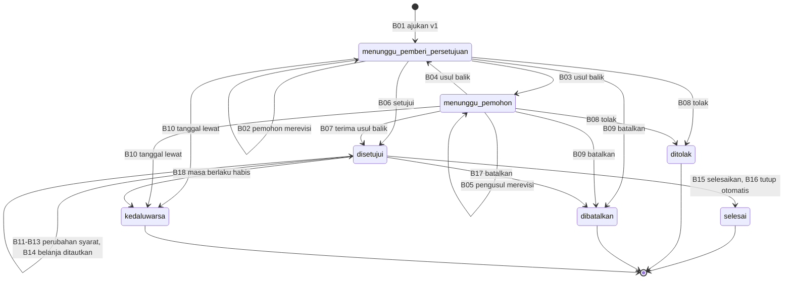
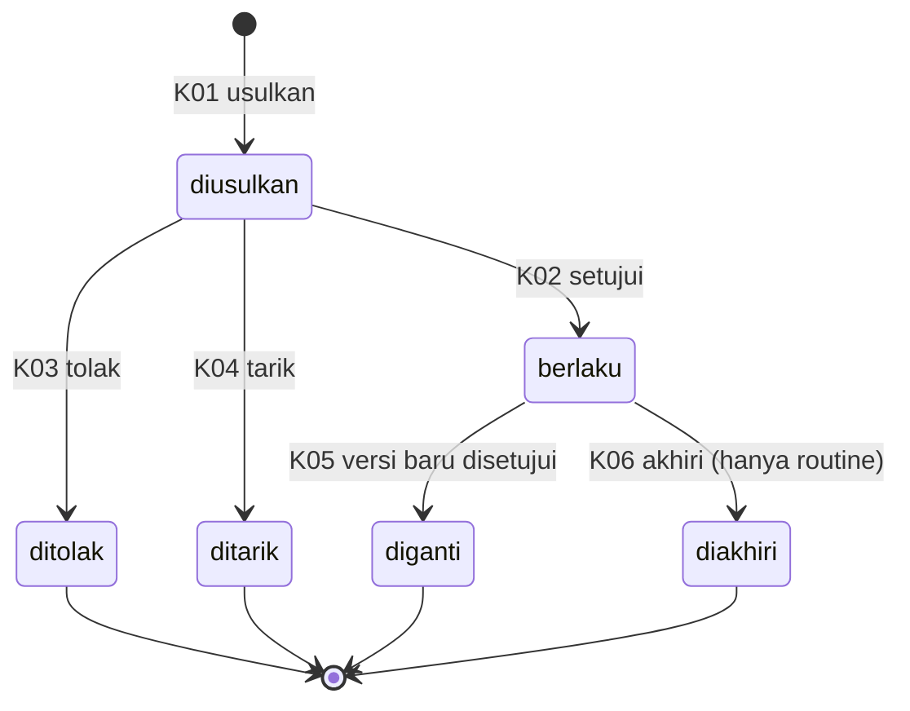
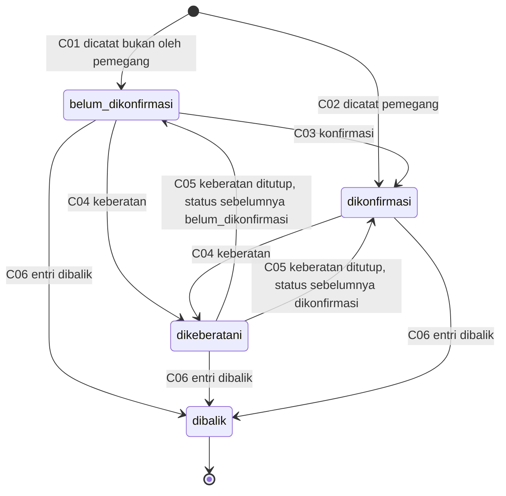
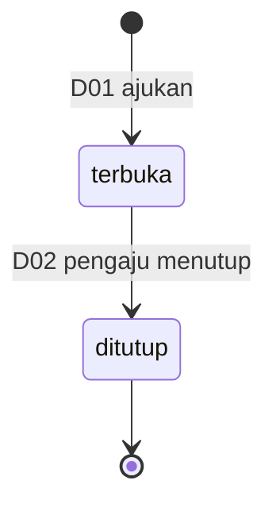
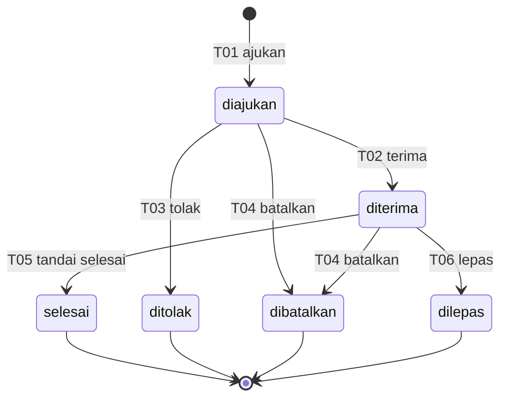
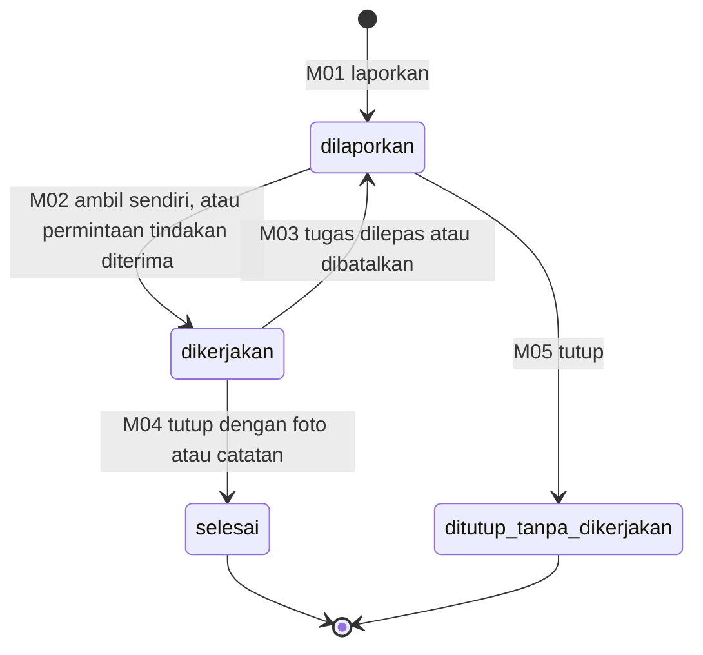
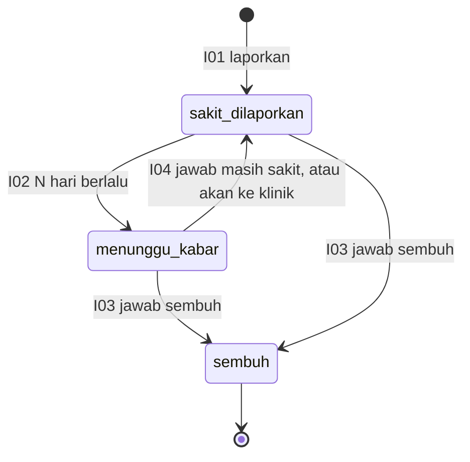

# 06 — Arsitektur Aktivitas dan Persetujuan

| | |
|---|---|
| Pemilik dokumen | `architect` |
| Tahap | S2 (Fondasi domain) |
| Status | Draf untuk tinjauan `critic` dan pemeriksaan awal `security-privacy`. Revisi kedua: diselaraskan dengan tiga keputusan pemilik produk 11 November 2026, dengan dokumen 07 yang direvisi (INV-24 sampai INV-26, kait `authorization.amended`, tautan susulan, *jumlah pemakaian*), dan dengan dokumen 02 dan 03. Revisi ketiga: temuan pemeriksaan awal `security-privacy` SP-01 sampai SP-14 dan SP-22 dikerjakan (ringkasan di §15.5); daftar pertanyaan checkpoint S2 kini hanya ada di dokumen 17 (§15.2). Revisi keempat: penyelarasan terakhir dengan dokumen 07 (07 §10.2 butir 7: §4.5, §6.2, §6.3, §7.3) dan dengan pernyataan pemilik produk 11 November 2026 bahwa kedua pasangan berpenghasilan (§6.4, AT-4, PG-01). Revisi kelima: keputusan pemilik produk 11 November 2026 tentang *jatah pribadi* (satu jumlah per orang per bulan, dijumlahkan sepanjang bulan, bebas diatur) dan tentang tanggal mulai periode yang dapat diatur per rumah tangga; aturan "per kali, kekerapan tidak diperiksa" dicabut untuk penyisihan ke dana pribadi (§6.2, §6.3 "Jatah pribadi", §6.4, §7.4, AT-4, PG-01, §12, INV-A17, INV-A19, INV-A37, INV-A38, P-17; ADR-009). Revisi keenam: temuan `critic` atas S2. Label keputusan pemilik produk dibatasi pada yang benar-benar ia putuskan (keputusan 14 sampai 17 dokumen 17); "di dalam jatah tanpa tanda" kini **[Usulan]** yang dikukuhkan lewat bawaan D-48, dan perlakuan bagian di atas jatah terbuka sebagai S2-1 butir (iii) (B-1). Hari mulai periode anggaran masuk isi kesepakatan `rule`, dengan INV-A39 (S-1). K05 punya baris sendiri (S-2). Peta §15.2 dan semua rujukan S2-*n* mengikuti penomoran dokumen 17 yang berlaku (S-3). Pengingat otomatis dihitung per rantai permintaan (M-5). Penilaian `security-privacy` atas jatah pribadi dikerjakan (SP-24 sampai SP-31; §15.5): jatah pribadi hanya dapat diakhiri sendirian oleh pemiliknya, yang sekaligus menutup gesekan K06 dengan keputusan 16 (K-29); alasan kenaikan dari daftar tertutup; batas tampilan sisa jatah dan waktu pencatatan; objek pengingat atas kesepakatan; asas pengawasan PG-14. Diselaraskan dengan dokumen 17 versi final putaran ini (S2-1 butir v: alasan kenaikan opsional sebagai bawaan; D-20 per rantai). Daftar sumber penghasilan masuk isi `rule` (07 §10.2 butir 8; Q-95) |
| Tanggal | 11 November 2026 |
| Dibaca sebelum menulis | `CLAUDE.md`; `family-os-brief.md` §1, §1.1, §4, §5D, §5N, §5O, §6, §7, §8, §9, §14, §16; `ENGINEERING-STANDARDS.md`; [00-glossary.md](00-glossary.md) (versi S2); [_progress.md](_progress.md); [07-financial-domain.md](07-financial-domain.md) (revisi 11 November 2026); [02-product-principles.md](02-product-principles.md); [03-personas-household-models.md](03-personas-household-models.md) (§4.3, bagian 7); [17-open-questions-assumptions.md](17-open-questions-assumptions.md) (keputusan checkpoint S1 dan keputusan 11 sampai 13; Q-03, Q-04, Q-08, Q-19, Q-26, Q-27, Q-49 sampai Q-58, Q-67 sampai Q-78; K-16, K-17, K-19, K-20) |

Dokumen ini menetapkan model alur kerja Family OS: primitif bersama, state machine tiap alur, logika persetujuan, dan sisi alur dari *penyelesaian*. **Aturan uang, termasuk setiap jumlah pada penyelesaian, kanonis di [dokumen 07](07-financial-domain.md); dokumen ini hanya mengutipnya** lewat kait yang didaftar di 07 §10.2.

**Label.** Keputusan pemilik produk di checkpoint S1 dikutip sebagai "keputusan pemilik nomor *n*" (11 November 2026; dokumen 17). Tiga keputusan yang diambil pemilik produk sesudah itu, dalam percakapan dengan lead pada hari yang sama, dikutip sebagai **"keputusan pemilik produk, 11 November 2026"**: uang masuk yang diarahkan ke dana pribadi (§6.4), konfirmasi serah terima (§7), dan jarak pengingat ulang beserta jam tenang (§10). Kelompok ketiga pada hari yang sama (dokumen 17, keputusan 14 sampai 17) dikutip dengan label yang sama, dan **hanya sejauh isinya**: (14) *jatah pribadi* adalah satu jumlah per orang per bulan (di dokumen ini dibaca per *periode anggaran*), dijumlahkan sepanjang bulan itu, dan jumlahnya dapat diatur; (15) hari mulai periode anggaran ditentukan per rumah tangga; (16) jumlah jatah disepakati berdua, satu mengusulkan dan yang lain mengonfirmasi; (17) kenaikan jatah dapat diajukan dengan alasan. **Yang bukan keputusan pemilik produk dan diberi label sendiri:** bahwa di dalam jatah tidak ada tanda dan tidak ada pemberitahuan adalah dasar pertanyaan lead yang disampaikan kepadanya dan tidak ia bantah, **[Usulan]** yang dikukuhkan lewat bawaan D-48; perlakuan bagian yang melampaui jatah **terbuka** (dokumen 17 S2-1 butir iii); bahwa penggantian hari mulai memerlukan kedua anggota dewasa adalah putusan lead, **[Usulan]** (Q-102; D-49); siapa yang boleh mengakhiri jatah (kini hanya pemiliknya; temuan SP-24) dan bentuk alasan pada usulan kenaikan (SP-25) adalah usulan dokumen ini, **[Usulan]** (D-52, D-53); apakah alasan itu wajib ditanyakan sebagai S2-1 butir (v). Semua rekomendasi lain di dokumen ini adalah **[Usulan]** `architect` kecuali diberi label lain, dan ditinjau pemilik produk di checkpoint S2. Angka tenggat dan batas (jam, hari, jumlah pengingat) adalah **[Asumsi]** tanpa dasar riset, kecuali jarak 6 jam pengingat ulang yang diputuskan pemilik produk; pilot yang mengujinya. Pertanyaan untuk pemilik produk dikutip dengan nomor dokumen 17 yang berlaku (S2-1 sampai S2-10; butir S2-1 sebagai (i) sampai (v); bawaan D-01 sampai D-55), bukan dengan nomor di dokumen ini (§15.2).

**Rujukan ke dokumen 07 pada revisi ketiga.** `finance-domain` mengerjakan sisi dokumen 07 dari temuan SP-01, SP-05, SP-12, SP-13, dan SP-18 bersamaan dengan revisi ini. Di tempat-tempat itu dokumen ini mengutip dokumen 07 dengan nama bagian dan nomor invarian yang berlaku saat revisi ini ditulis, dan menyebut isi aturannya, supaya tetap terbaca bila nomor di dokumen 07 bergeser; yang harus dicocokkan lagi setelah dokumen 07 selesai direvisi didaftar di §15.4.

**Rujukan ke dokumen 07.** Nomor bagian di bawah diperiksa terhadap dokumen 07 revisi 11 November 2026. Bila nomor dan nama kelak tidak lagi cocok, **nama bagian, nama kait, atau nomor invarian yang berlaku**:

| Dikutip sebagai | Nama di dokumen 07 |
|---|---|
| 07 §2.2, §2.3, §2.5, §2.6 | "Pemilik uang, buku, dan garis kendali rumah tangga" (termasuk aturan tulis buku pribadi, INV-25); "Posisi"; "Entri dan barisnya" (`links.subject_ref`, `entry_link`, `actor`, `payer`, `holder`, penanda `unconfirmed`); "Entitas pendukung" (`set_aside_schedule`, `routine_agreement_ref`) |
| 07 §3.1 | "Uang masuk": tiga arah; penghasilan dengan bagian pribadi sebagai satu entri `income` di dua buku (INV-24; CTH-03b) |
| 07 §3.2, §3.3, §3.4 | "Pengeluaran"; "Pemindahan dan serah terima" (kait `handover.recorded`, `handover.confirmed`, `handover.disputed`); "Penyisihan dan kontribusi" (jadwal penyisihan) |
| 07 §3.5, §3.6, §3.7 | "Talangan, hak ganti, dan penggantian"; "Pelepasan hak ganti dan klaim antar-pemilik lain"; "Utang, piutang, pelunasan, penghapusan" |
| 07 §3.8 | "Otorisasi, reservasi, penyelesaian": situasi custody A sampai D; *jumlah pemakaian*; penautan entri dan tautan susulan (INV-26); kait `request.approved`, `authorization.amended`, `authorization.settled`, `authorization.cancelled`, `authorization.expired`, `authorization.overrun` |
| 07 §3.12, §3.14, §3.15, §3.16 | "Koreksi dan keberatan" (kait `entry.disputed`; batas koreksi atas entri dua buku); "Cicilan"; "Tagihan berulang"; "Aset" |
| 07 §5, §5.1, §5.3 | "Tampilan custody"; "Perhitungan"; "Kebocoran yang tersisa" (B1 sampai B5) |
| 07 §6.1, §6.3 | "Anggaran"; "Ringkasan bulanan" |
| 07 §7.1, §7.3, §7.6, §7.9 | "Cara membaca" contoh terhitung (rumah tangga contoh, ambang contoh 500000); CTH-03b; "Permintaan, otorisasi, penyelesaian" (CTH-21 sampai CTH-24 dan varian perubahan syarat CTH-22); CTH-34 |
| 07 §8, §9, §10.1, §10.2, §10.3 | "Riwayat yang tidak dapat diubah lawan hak penghapusan"; "Keputusan atas pertanyaan terbuka"; butir terbuka T-01 sampai T-27; "Permintaan"; "Yang menurut dokumen ini berisiko dalam keputusan pemilik produk" |

Contoh terhitung selalu dirujuk dengan pengenal `CTH-nn`, yang tidak bergeser.

**Kesetaraan.** Semua aturan ditulis untuk "anggota dewasa", "pemohon", dan "pemberi persetujuan". Tidak ada aturan yang menyebut suami atau istri; kedua kata itu hanya muncul saat mengutip contoh dokumen 07.

**Pengenal di dokumen ini.** `INV-Ann` invarian alur dan persetujuan (terpisah dari `INV-nn` milik dokumen 07); `PG-nn` pagar terhadap kendali koersif; `N-nn` peristiwa notifikasi; `P-nn` butir terbuka. Nomor `FR` dan `BR` diberikan dokumen 05 di S3.

**Kedalaman.** Tier 1 penuh (§3 sampai §12), Tier 2 ringkas (§13), Tier 3 garis besar (§14), sesuai brief §1.1.

## Daftar isi

1. Keputusan arsitektur
2. Primitif bersama
3. Logika persetujuan
4. Permintaan anggaran dan permintaan jalan-jalan
5. Penyelesaian
6. Ambang permintaan dan kesepakatan rumah tangga
7. Konfirmasi custody
8. Koreksi dan keberatan
9. Visibilitas dan keterangan pelaku
10. Pagar terhadap kendali koersif
11. Notifikasi sebagai akibat samping
12. Bersamaan dan offline
13. Alur Tier 2
14. Garis besar Tier 3
15. Keputusan, butir terbuka, dan permintaan ke pihak lain

---

## 1. Keputusan arsitektur

Brief §6 meminta perbandingan antara satu workflow engine generik dan alur domain eksplisit yang berbagi sedikit primitif. Keputusannya dicatat di [ADR-001](adr/ADR-001-alur-domain-eksplisit-dengan-primitif-bersama.md).

### 1.1 Perbandingan

| Kriteria | A. Workflow engine generik | B. Alur domain eksplisit di atas primitif bersama |
|---|---|---|
| Bentuk | State, transisi, guard, dan akibat samping disimpan sebagai data konfigurasi; satu mesin menjalankan semua jenis alur | Tiap alur (permintaan anggaran, permintaan tindakan, konfirmasi custody, …) adalah satu tabel transisi tertulis di kode server; yang dibagi hanya primitif di §2 |
| Kebenaran uang | Akibat uang menjadi "aksi" generik yang dipanggil konfigurasi; hubungan transisi dengan kait dokumen 07 baru terlihat saat dijalankan | Tiap transisi menyebut kait 07-nya di tabel; tabel itu sendiri menjadi spesifikasi dan test |
| Dapat diuji (`ENGINEERING-STANDARDS.md` §6) | Property test harus menguji mesin **dan** setiap konfigurasi; kesalahan konfigurasi lolos dari pemeriksaan tipe | Property test per alur atas tabel tertutup; transisi yang tidak ada di tabel ditolak |
| Tim 1–3 developer | Mesin, bahasa konfigurasi, dan alat pengamatannya adalah produk kedua yang harus dibangun dan dirawat | Beberapa ratus baris per alur; alur Tier 1 hanya empat |
| Cakupan Tier 1 | Tidak ada keluarga pilot yang mengatur alurnya sendiri (Q-30: satu preset, tanpa layar pengaturan) | Sesuai: yang dapat diatur hanya aturan persetujuan (§3), bukan bentuk alur |
| Tier 3 tidak terhalang | Alur baru cukup dikonfigurasi | Alur baru ditulis sebagai tabel baru dan memakai primitif yang sama; tidak ada alur lama yang berubah |
| Rantai antar-modul (brief §6) | Satu alur panjang lintas modul | Rantai adalah tautan antar-objek (`subject_ref`, §2.2): masalah rumah → tugas → permintaan anggaran → entri. Tiap mata rantai punya state machine sendiri |
| Risiko utama | Generalisasi dini; aturan uang tersembunyi di konfigurasi | Pengulangan bentuk antar-alur; dijaga dengan primitif `Permintaan` yang memuat inti perundingan satu kali (§2.1) |

### 1.2 Rekomendasi

**Opsi B.** Alasan yang terikat pada produk ini:

1. **Kebenaran uang.** Hanya tiga alur yang menyentuh uang, dan ketiganya melakukannya lewat sepuluh kait yang sudah ditetapkan dokumen 07 (§10.2 butir 2: `request.approved`; lima kait `authorization.*`; tiga kait `handover.*`; `entry.disputed`). Tabel transisi eksplisit membuat setiap persinggungan itu terbaca dan dapat diuji satu per satu; pada mesin generik persinggungan itu menjadi data.
2. **Yang berubah-ubah antar-keluarga adalah siapa yang menyetujui, bukan bentuk alurnya.** Brief §4.3 meminta wewenang persetujuan dapat diatur. Itu dipenuhi satu fungsi penentu pemberi persetujuan (§3), tanpa mesin alur generik.
3. **Tim kecil dan satu rumah tangga pilot.** Mesin generik adalah abstraksi tanpa pemakai kedua (`ENGINEERING-STANDARDS.md` §1).
4. **Tier 3 tetap terbuka.** Permintaan izin, usulan keputusan, dan persetujuan berjenjang memakai primitif `Permintaan` yang sama dengan daftar pemberi persetujuan yang lebih panjang (§14).

Yang tidak diberikan opsi B dan diterima: keluarga tidak dapat merancang alur sendiri, dan alur baru memerlukan rilis aplikasi.

---

## 2. Primitif bersama

Dari empat belas kandidat brief §6, enam menjadi primitif alur, dua adalah milik domain keuangan, dan enam bukan primitif.

### 2.1 Primitif yang dipertahankan

| Primitif | Tanggung jawab | Yang dimilikinya | Yang tidak boleh dilakukannya |
|---|---|---|---|
| **Permintaan** (`request`) | Sesuatu yang diajukan satu anggota kepada anggota lain dan menunggu tanggapan; memuat inti perundingan: ajukan, usul balik, setujui, tolak, batalkan | Jenis, pemohon, daftar pemberi persetujuan yang dibekukan saat diajukan, state, *versi syarat* (tidak dapat diubah, bernomor naik), tanggapan atas tiap versi | Membuat entri atau mengubah saldo. Akibat uangnya hanya lewat kait 07. Tidak memuat aturan khusus jenis lain: tiap jenis punya tabel transisinya sendiri |
| **Tugas** (`task`) | Pekerjaan dengan satu penerima tugas dan status selesai atau belum | Penerima tugas, tenggat opsional, status, catatan dan bukti penutupan | Memuat persetujuan atau uang. Biaya sebuah tugas adalah permintaan anggaran atau entri yang ditautkan |
| **Diskusi** (`discussion`) | Percakapan yang menempel pada tepat satu objek induk | Pesan, penulis, waktu | Mengubah state induknya; menjadi chat umum (`COM`, Tier 3); memuat keputusan. "Setuju" yang ditulis di diskusi bukan persetujuan |
| **Lampiran** (`attachment`) | Berkas (struk, foto) yang menempel pada satu objek induk | Rujukan berkas, pengunggah, waktu | Berdiri sendiri; mengubah inti moneter entri (07 §8) |
| **Peristiwa** (`event`) | Catatan yang tidak dapat diubah atas setiap transisi dan setiap perubahan metadata: siapa, kapan, dari state apa ke state apa, atas versi syarat mana | Pelaku (anggota atau `system` beserta aturan pemicunya), waktu server, nomor urut per objek | Disunting atau dihapus, dengan dua batas yang dinyatakan di §2.5: catatan `CARE` berada di luar aturan ini, dan pelaku disimpan sebagai pengenal internal yang pemetaannya dapat diputus. Dipakai sebagai umpan kegiatan per orang (§9.4). Kumpulan peristiwa inilah *jejak audit* untuk alur; jejak audit uang adalah entri itu sendiri (07) |
| **Notifikasi** (`notification`) | Pemberitahuan yang diturunkan dari peristiwa menurut tabel §11 | Penerima, prioritas, status terkirim | Menjadi sumber kebenaran: state hanya dibaca dari objeknya. Gagal kirim tidak membatalkan transisi |

### 2.2 Rujukan induk

Diskusi, lampiran, peristiwa, notifikasi, dan entri menunjuk objek induknya dengan `subject_ref = (kind, id)`. `kind` adalah daftar tertutup: `request`, `task`, `household_issue`, `illness_followup`, `agreement`, `entry`, `dispute`. Inilah satu-satunya bentuk "aktivitas" di model. Pada entri, rujukan ini adalah `links.subject_ref` (07 §2.5); ia dapat pula ditambahkan belakangan sebagai tautan susulan. Model keuangan tidak menurunkan akibat uang apa pun darinya: akibat uang hanya lahir dari tautan bertipe, misalnya `authorization_id`.

### 2.3 Yang bukan primitif

| Kandidat | Putusan | Alasan |
|---|---|---|
| Activity | Bukan primitif; tidak ada tipe induk generik | Induk generik akan memaksa permintaan, tugas, dan masalah rumah berbagi state yang tidak mereka miliki bersama. *Aktivitas* tetap kata kumpulan di glosarium |
| Proposal | Bagian dari Permintaan | Usulan adalah satu *versi syarat*; usul balik adalah versi berikutnya |
| Approval | Bagian dari Permintaan | Persetujuan adalah tanggapan atas satu versi syarat, tidak bermakna di luar permintaannya |
| Assignment | Atribut Tugas | Satu tugas, satu penerima tugas; riwayat pergantiannya ada di Peristiwa |
| Audit Record | Sama dengan Peristiwa | Satu catatan transisi, bukan dua |
| Timeline Entry | Bukan primitif; proyeksi Tier 3 | Riwayat pada layar suatu objek adalah tampilan Peristiwa. Album kenangan (`TML`) dikurasi dan boleh disunting, jadi kelak disimpan terpisah (brief §5M) |
| Budget, Financial Transaction | Milik domain keuangan | *Anggaran*, *entri*, *otorisasi*, dan *reservasi* didefinisikan dan dijaga dokumen 07; alur hanya menautkannya |

### 2.4 Sketsa skema

Sketsa, bukan kode. Nama bahasa Inggris adalah usulan nama pengenal.

```text
request
  id, household_id
  type              budget | outing | action            -- Tier 3: permission | decision | reimbursement
  requester         member(M)
  state             -- per jenis, §4.2 dan §13.1
  current_version   bilangan bulat ≥ 1
  approved_version  null | bilangan bulat
  required_approvals [ (member, order, status: pending | consented | declined) ]   -- hasil §3, dibekukan
  rule_snapshot     (preset_id, rule_version, request_threshold)
  resubmitted_from  null | request_id
  reminders_paused_until  null | timestamp   -- tunda senyap; tidak pernah terbaca selain oleh penekannya (§4.4, INV-A33)
  closed_at, closed_by    member(M) | system

request_terms                                           -- tidak dapat diubah
  request_id, version, proposed_by, proposed_at
  title, note
  -- budget dan outing:
  amount_limit, currency
  use_kind          expense | loan_given | asset_purchase | set_aside
  category_id?, purpose_id?, source_holding_id?, external_party_id?
  planned_date?     -- wajib untuk outing
  valid_until       -- masa berlaku, §4.5
  -- outing saja:
  place, time_range, participants, planned_items [ (name, estimate) ]
  -- action saja:
  assignee, due_date?

request_response                                        -- tidak dapat diubah
  request_id, version, actor, kind (approve | accept | reject | decline_amendment),
  reason?, at, idempotency_key
  -- tunda bukan tanggapan: ia hanya mengisi reminders_paused_until dan tidak menulis baris di sini

event
  subject_ref, seq, actor (member(M) | system:rule_id), at,
  command, from_state, to_state, terms_version?, idempotency_key
```

### 2.5 Inti, rincian, dan pemetaan identitas pada catatan alur

Temuan SP-11. Aturan penghapusan ADR-007 semula hanya menyebut ledger. Catatan alur memuat data pribadi yang sama pekanya (judul, tempat, alasan, isi diskusi), dan "Peristiwa tidak pernah dihapus" (INV-A01) tanpa batas akan bertabrakan dengan hak penghapusan persis seperti entri. Aturannya kini sama dengan ledger dan dicatat sebagai tambahan pada [ADR-007](adr/ADR-007-append-only-dan-hak-penghapusan.md) **[Usulan]**; sisi hukumnya **[Perlu validasi]** (L-04, L-20).

| Bagian | Isi pada catatan alur | Sifat |
|---|---|---|
| **Inti alur** | `request` (jenis, state, nomor versi, daftar pemberi persetujuan), `request_terms` sejauh menyangkut jumlah, mata uang, `use_kind`, tanggal, masa berlaku, dan rujukan kategori, tujuan, tempat uang; `request_response` tanpa alasan; `event`; kesepakatan beserta nilai ambang, hari mulai periode, jumlah per kali, dan jumlah jatah pribadi; *catatan penilaian* jatah (§6.3); status konfirmasi custody; keberatan beserta alasan dari daftar tertutup (§8.2). Pelaku dan pihak sebagai **pengenal internal**, bukan nama | Hanya ditambah (INV-A01) |
| **Rincian** | Judul, catatan, tempat, peserta, nama butir rencana pembelian, alasan teks bebas, alasan usulan kenaikan jatah (walau dipilih dari daftar tertutup; SP-25), pesan diskusi, lampiran | Dapat dihapus tanpa menyentuh inti. Penulis pesan sudah dapat menghapus pesannya sendiri (§4.4) |
| **Pemetaan identitas** | Tabel yang sama dengan ledger (07 §8.2 "Aturan yang diusulkan") | Dapat diputus; sesudahnya layar menampilkan "mantan anggota" |

**Catatan `CARE` berada di luar aturan hanya-menambah.** Tindak lanjut sakit (§13.3), status suasana hati, dan Peristiwa keduanya adalah data kesehatan dan perasaan satu orang, bukan catatan bersama: tidak ada angka atau hak orang lain yang bergantung pada keutuhannya. Pemiliknya dapat menghapusnya kapan saja, seluruhnya, termasuk riwayat Peristiwanya; yang tersisa tidak ada. Karena itu Peristiwa ber-`subject_ref.kind = illness_followup` disimpan terpisah dari Peristiwa alur lain dan dikecualikan dari INV-A01.

Seperti pada ledger, pemisahan ini harus ada sejak skema pertama; mekanisme penghapusannya pada penyimpanan dan cadangan diputuskan di S4 (dokumen 09 dan 10).

---

## 3. Logika persetujuan

### 3.1 Lima konsep tetap terpisah

Brief §4.3. Tidak satu pun diturunkan dari yang lain, dan tidak satu pun dari *hubungan*.

| Konsep | Yang disimpan | Nilai pada preset pilot "dua dewasa setara" |
|---|---|---|
| Hubungan | `relationship(member, member, kind)`; keterangan saja | suami, istri |
| Peran | `membership.role` | Keduanya *pemilik rumah tangga* (keputusan pemilik nomor 4; Q-04) |
| Izin | `membership.permission_set` menunjuk kumpulan izin preset | Identik bagi keduanya |
| Tanggung jawab | `responsibility(member, subject)` misalnya pada tagihan berulang | Diisi rumah tangga; tidak memberi izin atau wewenang |
| Wewenang persetujuan | `approval_authority(member, request_type, limit_amount?, valid_from, valid_until?)` | Satu baris per anggota dewasa: semua jenis permintaan, tanpa batas jumlah, tanpa akhir |

Selain itu disimpan `household_rule(preset_id, version, request_threshold, approval_mode)`. Pilot memakai satu preset tanpa layar pengaturan izin (Q-30); semua baris di atas tetap ditulis saat rumah tangga dibuat, sehingga preset lain kelak hanya mengisi nilai berbeda.

### 3.2 Menentukan pemberi persetujuan

Satu fungsi di server, satu implementasi (`ENGINEERING-STANDARDS.md` §2):

```text
resolve_approvers(request, household_rule, authorities) ->
    kandidat = anggota dewasa aktif dengan approval_authority yang mencakup
               request.type dan limit_amount ≥ jumlah yang diminta (atau tanpa batas)
    kandidat = kandidat − { request.requester }          -- selalu; tidak dapat dimatikan aturan mana pun
    bila kandidat kosong -> permintaan ditolak saat diajukan (no_approver; lihat §3.5)
    hasil    = pilih menurut household_rule.approval_mode:
                 any_one      -> semua kandidat, cukup satu yang menyetujui
                 all          -> semua kandidat, semuanya harus menyetujui
                 sequential   -> kandidat berurutan
```

Hasilnya dibekukan di `request.required_approvals` bersama `rule_snapshot` saat permintaan diajukan. Perubahan aturan sesudahnya tidak mengubah permintaan yang sedang berjalan.

**Pada pilot:** kandidat selalu tepat satu orang, yaitu pasangan pemohon; `any_one` dan `all` berhasil sama. Tidak ada yang perlu diatur.

### 3.3 Arti "disetujui"

Suatu versi syarat **disetujui** bila pemohon dan setiap pemberi persetujuan yang disyaratkan sudah menyatakan setuju atas versi yang sama, masing-masing dengan perintahnya sendiri. Mengajukan suatu versi adalah pernyataan setuju pengajunya atas versi itu. Akibatnya:

- Pemohon mengajukan v1, pemberi persetujuan menyetujui v1: disetujui.
- Pemberi persetujuan mengajukan usul balik v2, pemohon menerima v2: disetujui. Pemohon tidak "menyetujui permintaannya sendiri": yang ia terima adalah syarat buatan pemberi persetujuan.
- Tidak ada jalan ketiga. Waktu, diam, AI, dan peran apa pun tidak dapat menggantikan salah satu pernyataan itu (§10).

### 3.4 Perluasan tanpa rancang ulang (Tier 3, garis besar)

| Kebutuhan brief §5D | Cara dipenuhi model yang sama |
|---|---|
| Beberapa pemberi persetujuan | `required_approvals` berisi lebih dari satu baris; `approval_mode = all` atau `any_one` |
| Persetujuan berurutan | `order` pada `required_approvals`; baris berikutnya baru boleh menanggapi setelah yang sebelumnya setuju |
| Batas jumlah | `approval_authority.limit_amount`; di atasnya kandidat itu tidak terpilih |
| Delegasi | Baris `approval_authority` baru bagi penerima delegasi dengan `valid_until`, dibuat oleh pemilik wewenangnya sendiri; tidak pernah oleh orang lain |
| Tenggat | `valid_until` pada syarat (§4.5); berakhir sebagai *kedaluwarsa*, tidak pernah sebagai setuju atau tolak |
| Wali atas tanggungan | Kandidat dipilih dari hubungan wali, bukan dari peran; pemohon tetap dikecualikan |

Yang sengaja tidak dapat diatur preset mana pun: pengecualian pemohon dari kandidat, dan larangan menyetujui atas nama orang dewasa lain (PG-02, PG-03).

### 3.5 Rumah tangga dengan satu anggota dewasa

Dua keadaan: rumah tangga pilot sejak dibuat sampai pasangan kedua bergabung, dan orang tua tunggal pada tahap publik (dokumen 03 §4, struktur 3, dan bagian 7 butir 3). Perilakunya dinyatakan di sini supaya tidak ditafsirkan sebagai cacat. **[Usulan]**, mengikuti bawaan yang diusulkan `product-analyst`: diterima untuk pilot.

| Hal | Selama hanya ada satu anggota dewasa |
|---|---|
| Permintaan anggaran dan jalan-jalan | Tidak ada. `submit` ditolak server dengan `no_approver` (§3.2); aplikasi tidak menawarkan formulir pengajuan dan menyebut alasannya. Tidak ada jalan lain menuju `approved`: pemohon tidak pernah menyetujui permintaannya sendiri (INV-A04) dan `system` tidak pernah menyetujui (INV-A10) |
| Rencana | Dapat ditulis sebagai draf di perangkat (§4.2); draf bukan state server dan tidak berakibat apa pun |
| Ambang permintaan dan tanda di atas ambang | Tidak ada. Anggota pertama boleh mengusulkan ambang (K01); usulan itu menunggu sebagai `diusulkan` dan tidak berlaku (§6.3). Tanpa ambang yang berlaku, tidak ada entri yang ditandai |
| Kesepakatan rutin | Boleh diusulkan; tidak dapat berlaku (INV-A18) |
| Hari mulai periode anggaran; daftar sumber penghasilan | Daftar sumber penghasilan memakai nilai preset (`salary`, `business`) sejak awal. Hari mulai: setelan awal yang dipilih saat rumah tangga dibuat (bawaan tanggal 1; 07 §6.1) berlaku sejak awal, karena anggaran berjalan penuh. Itu setelan pertama, bukan penggantian. Penggantiannya adalah kesepakatan `rule` (§6.3) dan menunggu anggota dewasa kedua, seperti ambang **[Usulan]**. Preset "satu dewasa" tahap publik menetapkannya sendiri (Tier 3) |
| Konfirmasi custody | Tidak pernah terpicu: tidak ada tempat uang yang dipegang anggota dewasa lain |
| Pencatatan, anggaran, laporan, koreksi | Berjalan penuh. Tidak satu pun bergantung pada adanya pemberi persetujuan (INV-A11) |

**Saat anggota dewasa kedua bergabung:**

- Tidak ada yang berlaku surut. Entri yang dicatat sebelumnya tetap tanpa tanda di atas ambang (tanda dihitung terhadap ambang yang berlaku saat entri disimpan, INV-A17) dan tanpa status konfirmasi custody.
- Anggota baru melihat seluruh buku rumah tangga, termasuk entri sebelum ia bergabung (V-1), dan dapat mengajukan *keberatan* atas entri mana pun tanpa batas waktu (§8.2).
- Usulan ambang yang menunggu disampaikan kepadanya (N-11) dan berlaku sejak ia menyetujuinya (K02), ke depan saja.
- Draf di perangkat anggota pertama tidak berubah; sejak saat itu ia dapat mengajukannya, dan anggota baru menjadi pemberi persetujuannya (§3.2).

**Pada preset "satu dewasa" tahap publik**, permintaan anggaran antar-dewasa tetap tidak ada; rencana dicatat tanpa persetujuan. Bentuk catatan rencana itu tidak dirancang sekarang: pilot tidak membutuhkannya (Tier 3; §14).

**Dari dua menjadi satu** (anggota dewasa keluar atau dikeluarkan) **[Usulan]**; temuan SP-12. Tidak ada transisi baru dan tidak ada tindakan `system` atas nama siapa pun. Tetapi beberapa objek hanya dapat ditutup oleh orang yang sudah pergi, dan tanpa aturan objek itu akan menggantung selamanya di daftar terbuka anggota yang tersisa, atau menjadi alasan menahan kepergian. Aturannya: **keluar tidak pernah menunggu objek alur apa pun ditutup, dan objek yang satu-satunya pelaku berwenangnya sudah keluar ditampilkan demikian dan tidak lagi masuk daftar terbuka mana pun.** Itu sifat tampilan yang diturunkan dari keanggotaan, bukan state baru; riwayat objeknya tetap.

| Objek saat seorang anggota dewasa keluar | Yang terjadi |
|---|---|
| Permintaan yang menunggu, anggota yang tersisa pemohonnya | Tetap dapat ia batalkan (B09). Tidak ada lagi yang dapat menyetujuinya; ditampilkan "pemberi persetujuan sudah keluar" dan keluar dari daftar menunggu |
| Permintaan yang menunggu, anggota yang keluar pemohonnya | Ditampilkan "pemohon sudah keluar" dan keluar dari daftar menunggu. Yang bertanggal tetap kedaluwarsa menurut B10 |
| Otorisasi terbuka milik pemohon yang keluar | Berjalan sampai `valid_until`, lalu ditutup B16 atau B18 seperti biasa; setiap otorisasi punya masa berlaku (§4.5), jadi jumlah *terikat* tidak tertahan selamanya |
| Perubahan syarat yang menunggu | Gugur bersama penutupan otorisasinya (§4.3) |
| Usulan kesepakatan | Yang diusulkan anggota tersisa dapat ia tarik (K04); yang diusulkan anggota yang keluar dapat ia tolak (K03) |
| Kesepakatan rutin yang berlaku | Kesepakatan atas tagihan berulang dapat diakhiri anggota yang tersisa (K06), begitu pula jatah pribadinya sendiri. Jatah anggota yang keluar tidak lagi dipakai (tidak ada penyisihan baru kepadanya) dan ditampilkan "pemilik jatah sudah keluar" |
| Aturan rumah tangga (ambang) yang berlaku | Tetap tercatat, tetapi **tidak ada entri baru yang ditandai selama hanya ada satu anggota dewasa**, sama dengan baris "Ambang permintaan dan tanda di atas ambang" pada tabel di atas: tanda adalah keterangan bagi pasangan, dan pasangan itu tidak ada. Tanpa aturan ini ambang tidak dapat diubah lagi (PG-01 menuntut dua orang) |
| Baris custody `belum_dikonfirmasi` yang pemegangnya keluar | Ditampilkan "pemegang sudah keluar" dan keluar dari daftar menunggu konfirmasi. Uangnya nyata: anggota yang tersisa mencatat apa yang sebenarnya terjadi (07 §8.2 "Aturan yang diusulkan" butir 5) |
| Keberatan terbuka yang diajukan anggota yang keluar | Ditampilkan "pengaju sudah keluar" dan keluar dari daftar "belum sepakat" (§8.2). Tidak ditutup atas namanya |
| Permintaan tindakan dan tugas (§13.1) | Pemohon yang tersisa dapat membatalkan (T04); penerima tugas yang tersisa dapat melepas (T06) |
| Klaim antar-pemilik yang masih terbuka | Sisi uangnya milik dokumen 07 (§8.2 butir 2, yang direvisi atas temuan SP-12): klaim ditutup saat keluar dengan entri bertipe sistem "ditutup karena anggota keluar", yang tidak menyatakan ada pembayaran dan tidak memerlukan tindakan siapa pun. Alur tidak menambahkan syarat apa pun di atasnya |

Bila anggota itu juga meminta datanya dihapus, §2.5 dan ADR-007 berlaku atas catatan alurnya. Apa yang masih dapat dilihat dan dilakukan anggota yang keluar ditetapkan bersama *keluar dengan aman* **[Dok. 10]**.

| ID | Invarian | Cara menguji |
|---|---|---|
| INV-A35 | Tidak ada perintah keluar atau penghapusan yang ditolak atau ditahan karena state objek alur. Setelah seorang anggota keluar, tidak ada daftar terbuka (menunggu tanggapan, menunggu konfirmasi, "belum sepakat") yang memuat objek yang hanya dapat ditutup anggota itu | Bangkitkan rumah tangga dengan objek acak pada setiap state, keluarkan satu anggota: perintah keluar selalu diterima; daftar terbuka anggota yang tersisa hanya memuat objek yang dapat ia tindak sendiri |

---

## 4. Permintaan anggaran dan permintaan jalan-jalan

Tier 1. *Permintaan jalan-jalan* adalah *permintaan anggaran* yang syaratnya juga memuat tanggal, tempat, peserta, dan rencana pembelian (glosarium bagian 4); keduanya memakai satu state machine. Rencana jalan-jalan di MVP hanyalah isi syarat itu; tidak ada objek *rencana* tersendiri (`PLN` sebatas yang dibutuhkan permintaan jalan-jalan).

### 4.1 Kapan permintaan diajukan

Keputusan pemilik nomor 5.

| Keadaan | Perlu permintaan? |
|---|---|
| Belanja biasa | Tidak. Dicatat setelah terjadi (07 §3.2) |
| Rencana yang diajukan lebih dulu, berapa pun jumlahnya (jalan-jalan, pembelian) | Ya, atas pilihan pemohon; inilah jalur utama |
| Pemakaian dana bersama yang tidak rutin, tidak direncanakan, di atas *ambang permintaan* | Ya, wajib menurut kesepakatan rumah tangga. Bila tetap dicatat tanpa permintaan, lihat §6.2 |
| Pembayaran rutin yang disepakati dan penyisihan di dalam *jatah pribadi* (§6.3), serah terima, pemindahan | Tidak |

**Jenis permintaan untuk pemakaian yang bukan pengeluaran** (butir pertama yang diserahkan 07 §10.2). Pinjaman yang diberikan, pembelian aset, dan penyisihan ke dana pribadi diajukan sebagai **permintaan anggaran** dengan `use_kind` yang sesuai, bukan sebagai *usulan keputusan*. Alasan: ketiganya adalah pemakaian dana bersama sampai jumlah tertentu, persis yang diotorisasi permintaan anggaran; *realisasi* di 07 §3.8 sudah menghitung baris tertaut apa pun jenisnya; dan satu state machine berarti satu kumpulan test. *Usulan keputusan* tetap untuk keputusan bersama tanpa otorisasi uang (Tier 3).

Jumlah yang diminta adalah *jumlah pemakaian* yang kelak menjadi realisasinya (07 §3.8). Untuk pembelian aset secara cicilan itu berarti uang muka ditambah jumlah seluruh cicilan, bukan harga barang dan bukan uang muka saja (CTH-34: 400000 + 3960000 = 4360000); pembayaran cicilannya sesudah itu tidak ditautkan lagi ke permintaan.

Permintaan anggaran hanya berlaku atas **dana bersama** (`authorization.funding_owner = shared`, 07 §2.6). Pemakaian dana pribadi tidak pernah memerlukan permintaan.

### 4.2 State machine



| State | Pengenal | Arti | Yang ditunggu |
|---|---|---|---|
| Menunggu pemberi persetujuan | `awaiting_approver` | Versi berjalan diajukan pemohon | Tanggapan pemberi persetujuan |
| Menunggu pemohon | `awaiting_requester` | Versi berjalan adalah usul balik pemberi persetujuan | Tanggapan pemohon |
| Disetujui | `approved` | Ada tepat satu *otorisasi* terbuka (07 §3.8) | Belanja dan penyelesaian |
| Selesai | `settled` | Otorisasi ditutup setelah ada realisasi | — (terminal) |
| Ditolak | `rejected` | Pemberi persetujuan menolak | — (terminal) |
| Dibatalkan | `cancelled` | Pemohon menariknya | — (terminal) |
| Kedaluwarsa | `expired` | Waktunya lewat tanpa disetujui, atau disetujui tetapi tidak pernah dipakai | — (terminal) |

Draf yang belum diajukan hanya ada di perangkat pemohon dan bukan state server. "Sebagian terpakai" bukan state: ia terbaca dari realisasi (07 INV-14).

### 4.3 Tabel transisi

Setiap transisi menulis satu Peristiwa (pelaku, waktu server, state asal dan tujuan, versi syarat); kolom akibat hanya menyebut tambahannya. Kait uang adalah nama di 07 §3.8; akibat uangnya **tidak** diulang di sini. `N-nn` menunjuk §11.

| # | Dari | Perintah | Guard | Pelaku | Ke | Akibat: kait uang 07; notifikasi |
|---|---|---|---|---|---|---|
| B01 | — | `submit` | Jumlah > 0; dana bersama; `resolve_approvers` tidak kosong; untuk jalan-jalan `planned_date` terisi dan tidak lampau | Anggota dewasa mana pun (menjadi pemohon) | `awaiting_approver` | `request.submitted` (tanpa akibat uang); syarat v1; N-01 |
| B02 | `awaiting_approver` | `revise_terms` | Menyebut versi berjalan | Pemohon | `awaiting_approver` | Versi +1, versi lama digantikan; N-03 |
| B03 | `awaiting_approver` | `counter` | Menyebut versi berjalan | Pemberi persetujuan | `awaiting_requester` | `request.countered`; versi +1; N-02 |
| B04 | `awaiting_requester` | `counter` | Menyebut versi berjalan | Pemohon | `awaiting_approver` | `request.countered`; versi +1; N-02 |
| B05 | `awaiting_requester` | `revise_terms` | Menyebut versi berjalan; pelaku adalah pengusul versi itu | Pemberi persetujuan | `awaiting_requester` | Versi +1; N-03 |
| B06 | `awaiting_approver` | `approve` | Menyebut versi berjalan; pelaku ada di `required_approvals`; pelaku ≠ pemohon; semua persetujuan yang disyaratkan terpenuhi (pilot: satu) | Pemberi persetujuan | `approved` | `request.approved`; `approved_version` diisi; N-04 |
| B07 | `awaiting_requester` | `accept` | Menyebut versi berjalan; versi itu diajukan pemberi persetujuan | Pemohon | `approved` | `request.approved`; N-04 |
| B08 | `awaiting_approver`, `awaiting_requester` | `reject` | Alasan opsional (Q-50) | Pemberi persetujuan | `rejected` | `request.rejected`; N-05 |
| B09 | `awaiting_approver`, `awaiting_requester` | `cancel` | — | Pemohon | `cancelled` | Tanpa akibat uang; N-06 |
| B10 | `awaiting_approver`, `awaiting_requester` | (waktu) | Versi berjalan punya `planned_date` atau `valid_until`, dan tanggal itu sudah lewat menurut waktu server | `system` | `expired` | Tanpa akibat uang; N-07. Permintaan tanpa tanggal **tidak pernah** kedaluwarsa selama menunggu (keputusan pemilik nomor 6) |
| B11 | `approved` | `propose_amendment` | Tidak ada perubahan syarat lain yang menunggu | Pemohon atau pemberi persetujuan | `approved` | Versi +1 berstatus menunggu; `approved_version` tidak berubah; N-02 |
| B12 | `approved` | `accept_amendment` | Pelaku bukan pengusul perubahan; menyebut versi yang menunggu | Pihak lainnya | `approved` | `authorization.amended` (07 §3.8; varian perubahan syarat CTH-22); `approved_version` diganti; N-04. Bila batas baru lebih kecil daripada realisasi: `authorization.overrun`; N-08 |
| B13 | `approved` | `decline_amendment` atau `withdraw_amendment` | — | Pihak lainnya, atau pengusulnya | `approved` | Syarat yang disetujui tetap; N-05 |
| B14 | `approved` | (entri ditautkan saat dicatat; tautan susulan ditambahkan atau dicabut; entri tertaut dikoreksi) | Entri dan tautannya sah menurut 07 §3.8 (INV-26); pelaku tautan susulan atau pencabutannya berwenang menurut §4.5 (INV-A34) | Anggota dewasa yang mencatat; untuk tautan susulan, pencatat entri atau pemohon permintaan itu | `approved` | Kait "belanja ditautkan" 07 §3.8. Bila realisasi pertama kali melampaui batas: `authorization.overrun`; N-08 |
| B15 | `approved` | `settle` | Realisasi > 0 | Pemohon | `settled` | `authorization.settled`; N-09 |
| B16 | `approved` | (waktu) | `valid_until` lewat; realisasi > 0 | `system` | `settled` | `authorization.settled`; ditandai "ditutup otomatis"; N-09 |
| B17 | `approved` | `cancel` | Realisasi = 0 | Pemohon | `cancelled` | `authorization.cancelled`; N-06 |
| B18 | `approved` | (waktu) | `valid_until` lewat; realisasi = 0 | `system` | `expired` | `authorization.expired`; N-07 |

Perubahan syarat yang masih menunggu saat permintaan ditutup (B15 sampai B18) gugur dan tercatat demikian.

### 4.4 Diskusi, usul balik, dan penolakan

- **Diskusi** tersedia pada setiap state, termasuk state terminal, dan tidak pernah mengubah state. Pesan tidak dapat disunting; penulisnya dapat menghapus pesannya, dan yang tersisa adalah penanda "pesan dihapus" beserta waktunya.
- **Usul balik** (B03, B04) boleh mengubah bagian syarat mana pun: jumlah, tanggal, tempat, rencana pembelian, tempat uang sumber, masa berlaku (keputusan pemilik nomor 5: anggaran, waktu, dan tambahan dapat dirundingkan). Ia menggantikan versi sebelumnya seluruhnya dan menunggu tanggapan pihak lain.
- **Menjawab usul balik** dengan "tidak": pemohon mengajukan usul balik lagi (B04) atau membatalkan (B09). Tidak ada state "usul balik ditolak".
- **Penolakan** tidak mewajibkan alasan (Q-50). Penolak ditawari menulis alasan singkat atau beralih ke usul balik. Permintaan yang ditolak, dibatalkan, atau kedaluwarsa dapat diajukan lagi sebagai permintaan baru yang menunjuk asalnya (`resubmitted_from`); keduanya melihat kaitan itu. Permintaan beserta semua pendahulu dan penerusnya lewat `resubmitted_from` disebut satu **rantai permintaan**; jarak dan batas pengingat dihitung per rantai, bukan per permintaan (§10), sehingga membatalkan atau ditolak lalu mengajukan lagi tidak membuka hitungan baru.
- **Perubahan syarat setelah disetujui** (B11 sampai B13) adalah satu-satunya cara mengubah otorisasi yang terbuka: menambah atau mengurangi batas, menggeser tanggal. Sampai pihak lain menerimanya, syarat yang sudah disetujui tetap berlaku.
- **Persetujuan tidak dapat dicabut sepihak.** Pemberi persetujuan yang berubah pikiran memakai diskusi atau mengusulkan perubahan syarat. Alasan: pemohon mungkin sudah bertindak di dunia nyata atas persetujuan itu; pencabutan sepihak tidak membatalkan belanja yang sudah terjadi dan hanya menjadi alat menekan (§10).
- **Tunda senyap** (`snooze`; glosarium *tunda*) **[Usulan]; ditanyakan kepada pemilik produk sebagai dokumen 17 S2-5 butir (c)**: tunda yang tidak diberitahukan kepada pemohon, dengan kabar "nanti aku jawab" sebagai pilihan terpisah penerima. Pihak yang ditunggu tanggapannya dapat menunda pemberitahuan atas satu permintaan selama 24 jam **[Asumsi]**. Aturannya, setelah temuan SP-02:
  - **Pihak yang menunggu tidak diberi tahu dan tidak dapat mengetahuinya.** Tidak ada notifikasi, tidak ada tanda pada permintaan, tidak ada Peristiwa yang terbaca olehnya, dan tidak ada perintahnya yang hasilnya berbeda karena tunda (INV-A33). Rancangan sebelumnya memberi tahu pemohon bahwa permintaannya ditunda; itu sama dengan tanda "sudah dibaca dan memilih tidak menjawab", yang dalam hubungan yang menekan lebih memberatkan daripada diam (AT-5).
  - State tidak berubah. Selama tunda, tidak ada pemberitahuan `perlu_tanggapan` atas rantai permintaan itu yang dilepas kepada penekannya. "Ingatkan lagi" yang ditekan pihak yang menunggu selama tunda **diterima, dihitung terhadap batasnya, dan ditahan**, persis seperti pada jam tenang (§10); ia tidak ditolak, karena penolakan akan membocorkan tunda.
  - **Kabar "nanti aku jawab" adalah pilihan terpisah.** Penerima boleh, atas kehendaknya sendiri dan setiap kali dengan tindakan tersendiri, mengirim kalimat baku "nanti aku jawab" kepada pihak yang menunggu (N-21). Bawaannya tidak dikirim. Kabar itu tidak menyebut tunda dan tidak menyebut lamanya.
  - Tunda bukan jawaban, tidak berbatas jumlah (ia tidak memberi daya halang apa pun melebihi diam), dan tidak menghentikan kedaluwarsa permintaan yang bertanggal. Alasan 24 jam di samping jarak 6 jam ada di §10.

### 4.5 Masa berlaku dan kedaluwarsa

| Hal | Aturan |
|---|---|
| Selama menunggu tanggapan | Kedaluwarsa hanya bila syarat berjalan memuat tanggal: `planned_date` (wajib untuk jalan-jalan) atau `valid_until` yang diisi pemohon. Tanpa tanggal, permintaan menunggu tanpa batas (keputusan pemilik nomor 6) |
| Setelah disetujui | Otorisasi selalu punya `valid_until`, supaya jumlah *terikat* tidak menahan sisa anggaran selamanya. Bawaan: `planned_date` + 7 hari; bila tanpa `planned_date`, tanggal persetujuan + 30 hari **[Asumsi]**. Masa berlaku adalah bagian dari syarat dan dapat dirundingkan |
| Saat masa berlaku habis | Tanpa realisasi: *kedaluwarsa* (B18). Dengan realisasi: ditutup otomatis sebagai *selesai* (B16). Keduanya berakibat uang sama menurut 07 §3.8 |
| Entri terlambat setelah ditutup | Dapat ditautkan ke permintaan yang sudah `settled` atau `expired` bila tanggal kejadiannya tidak lebih awal dari tanggal persetujuan dan tidak lebih baru dari tanggal penutupan (07 §3.8, INV-26). State permintaan tidak berubah; realisasi, sisa, atau kelebihannya dihitung ulang; *terikat* tetap nol; entri itu bertanda "dicatat setelah ditutup". Pencatat pelupa tidak dihukum oleh tenggat (brief §1.1) |
| Tautan yang tidak sah | Permintaan `cancelled` tidak menerima tautan, dan entri bertanggal di luar rentang di atas tidak dapat ditautkan. **Entrinya tetap tersimpan, tanpa tautan** (INV-A11); tanda §6.2 lalu dihitung seperti atas entri tanpa permintaan |
| Tautan susulan | Entri yang sudah tersimpan dapat ditautkan belakangan, atau tautan susulan yang keliru dicabut, tanpa mengubah entrinya (07 §3.8 "Penautan entri ke otorisasi" butir 3). Pelakunya terlihat pada permintaan dan pada entri. **Siapa yang boleh** (temuan SP-10; INV-A34) **[Usulan]**: menautkan entri ke suatu otorisasi hanya **pencatat entri itu** atau **pemohon otorisasi itu**; mencabut tautan susulan hanya **pembuat tautan itu** atau **pencatat entrinya**. Menautkan ke jadwal (tagihan berulang, jadwal penyisihan) tetap boleh oleh anggota dewasa mana pun, karena itu hanya dapat menghilangkan tanda, tidak memasangnya. Alasan: tautan menentukan ada-tidaknya tanda di atas ambang (§6.2); bila siapa pun boleh mencabut, pasangan dapat memasang kembali tanda pada entri orang lain. Dokumen 07 §3.8 "Penautan entri ke otorisasi" butir 3 kini mengutip aturan ini tanpa mengubahnya |
| Pembayaran atas kewajiban yang sudah tertaut penuh | Bila entri yang melahirkan suatu kewajiban sudah tertaut ke otorisasi sebesar seluruh kewajibannya, pembayaran kewajiban itu **tidak ditautkan lagi** ke otorisasi yang sama; perintah tautnya ditolak, entri pembayarannya tetap tersimpan (INV-A11). Ini berlaku atas pembelian aset secara cicilan (§4.1; CTH-34) dan, sama persis, atas kewajiban dana bersama yang didaftarkan sebagai saldo awal (`opening`) lalu ditautkan ke otorisasi (07 §3.8). Alasan: *jumlah pemakaian* entri pembukanya sudah memuat seluruh pembayaran yang akan datang; menautkan pembayarannya menghitung realisasi yang sama dua kali |
| Zona waktu | Tanggal dibandingkan pada akhir hari menurut zona waktu rumah tangga, dengan jam server |

Penutupan otomatis (B16) bukan keputusan atas nama siapa pun: ia tidak menyetujui dan tidak menolak apa pun, tidak membuat entri, dan sisa diperlakukan menurut 07 §3.8 dengan bawaan T-02 (tetap di tempatnya).

### 4.6 Invarian

Setiap invarian menjadi property test atas rangkaian perintah acak dari dua pelaku (`ENGINEERING-STANDARDS.md` §6). Semuanya diperiksa server; klien tidak pernah memutuskan transisi.

| ID | Invarian | Cara menguji |
|---|---|---|
| INV-A01 | Setiap transisi punya pelaku (anggota, atau `system` beserta aturan pemicunya), waktu server, state asal, state tujuan, dan versi syarat. Peristiwa tidak pernah berubah atau hilang. Batasnya di §2.5: Peristiwa catatan `CARE` dikecualikan (dapat dihapus pemiliknya), dan pelaku disimpan sebagai pengenal internal yang pemetaannya dapat diputus tanpa mengubah Peristiwanya. Tunda senyap (§4.4) bukan transisi dan tidak menulis Peristiwa pada permintaan | Setelah tiap perintah transisi: jumlah peristiwa bertambah tepat satu; peristiwa lama identik (hash inti sebelum dan sesudah, seperti 07 INV-09) |
| INV-A02 | Hanya transisi di tabel §4.3 yang ada. Pasangan (state, perintah, pelaku) lain ditolak tanpa akibat samping apa pun | Bangkitkan semua kombinasi; yang di luar tabel tidak mengubah apa pun. Perintah yang bukan transisi (diskusi, pengingat ulang, tunda, kabar "nanti aku jawab", penautan entri) diatur di §4.4, §4.5, dan §10 dan tidak pernah mengubah state |
| INV-A03 | State terminal tidak punya transisi keluar | Perintah apa pun atas permintaan terminal ditolak (diskusi dan penautan entri terlambat bukan transisi) |
| INV-A04 | **Pemohon tidak pernah menyetujui permintaannya sendiri.** Pada setiap `approve`, pelaku ≠ pemohon. Versi yang disetujui selalu membawa pernyataan setuju pemohon dan setiap pemberi persetujuan yang disyaratkan, masing-masing lewat perintahnya sendiri (§3.3) | Untuk setiap permintaan `approved`: telusuri peristiwa; kedua pernyataan ada dan pelakunya berbeda |
| INV-A05 | Hanya anggota di `required_approvals` yang dapat `approve`, `reject`, atau `counter` sebagai pemberi persetujuan; daftar itu tidak pernah memuat pemohon | Perintah dari anggota lain ditolak |
| INV-A06 | Versi syarat tidak dapat diubah, bernomor naik tanpa celah, dan tepat satu yang berjalan. Setiap tanggapan menyebut nomor versi; tanggapan atas versi yang bukan versi berjalan ditolak dengan `terms_superseded` | Kirim tanggapan atas versi lama; state dan otorisasi tidak berubah |
| INV-A07 | Usul balik atau revisi menggantikan versi sebelumnya: tidak ada otorisasi yang lahir dari versi yang sudah digantikan | Akibat INV-A06; diuji langsung dengan perintah bersamaan (§12) |
| INV-A08 | Satu permintaan punya paling banyak satu otorisasi. Otorisasi itu `open` jika dan hanya jika state permintaannya `approved` | Setelah tiap perintah |
| INV-A09 | Transisi sebelum `approved` tidak membuat entri, otorisasi, atau reservasi, dan tidak mengubah saldo apa pun (07 INV-12) | Bandingkan semua saldo sebelum dan sesudah |
| INV-A10 | Tidak ada transisi berpelaku `system` yang menuju `approved` atau `rejected`. `system` hanya menjalankan B10, B16, B18 | Majukan jam sejauh apa pun; tidak ada permintaan yang menjadi `approved` atau `rejected` tanpa perintah anggota |
| INV-A11 | **Pencatatan tidak pernah dihalangi.** Pada state permintaan apa pun, perintah entri yang sah menurut dokumen 07 diterima (A-20; [ADR-009](adr/ADR-009-aturan-permintaan-menandai-bukan-menghalangi.md)) | Untuk setiap state: kirim entri; selalu tersimpan |
| INV-A12 | Idempoten: perintah alur dengan (`household_id`, `idempotency_key`) yang sudah diterima tidak menulis peristiwa kedua dan mengembalikan hasil pertama (07 INV-10; [ADR-005](adr/ADR-005-idempotency-key-per-perintah-tulis.md)) | Kirim ulang tiap perintah |
| INV-A13 | **Simetri.** Menukar kedua anggota dewasa pada seluruh rangkaian perintah menghasilkan state yang sama dengan kedua anggota tertukar | Jalankan rangkaian acak dua kali, sekali tertukar; bandingkan |
| INV-A14 | Paling banyak satu perubahan syarat yang menunggu; `approved_version` hanya berubah lewat B12 oleh pihak yang bukan pengusulnya | Setelah tiap perintah |
| INV-A15 | Dari `approved`, tepat satu kait penutup 07 (`settled`, `cancelled`, `expired`) terpicu, tepat satu kali; sesudahnya *terikat* = 0 (07 INV-14) | Setelah tiap penutupan |
| INV-A16 | Hanya pihak permintaan (pemohon dan anggota di `required_approvals`) yang dapat membaca syarat, tanggapan, dan diskusinya (§9) | Baca sebagai anggota bukan pihak: tidak ditemukan |

### 4.7 Contoh dokumen 07 pada state machine ini

Angka dikutip dari 07 §7.6 tanpa diubah.

| Contoh 07 | Transisi | Yang terlihat pada permintaan |
|---|---|---|
| CTH-21 (situasi A) | B01, B06 (otorisasi 100000), B14 (belanja 75000), B15 | Batas 100000; realisasi 75000; sisa 25000 "tetap di tempatnya" |
| CTH-22 (situasi B, reservasi) | B01 dengan `source_holding_id`, B06 (otorisasi dan reservasi 100000), serah terima 100000 tertaut, B14 (75000), B15 dengan pilihan mengembalikan sisa 25000 lewat serah terima | Batas 100000; realisasi 75000; sisa 25000 "dikembalikan" |
| CTH-23 (situasi C) | B01, B06 (100000), B14 (talangan 75000), B15; penggantian 75000 adalah entri tersendiri | Batas 100000; realisasi 75000; "diganti 75000" |
| CTH-24 (kelebihan) | B06 (200000), B14 (230000) memicu `authorization.overrun` | "Melebihi 30000"; lihat §5.4 |
| CTH-22, varian perubahan syarat | B06 (otorisasi dan reservasi 100000), B11 (usul batas 150000), B12 memicu `authorization.amended` | Batas 150000; terikat 150000; reservasi 150000; tidak ada entri dan tidak ada saldo tercatat yang berubah |
| CTH-34 (aset secara cicilan) | B01 dengan `use_kind = asset_purchase` dan jumlah 4360000, B06, B14 (satu entri pembelian; realisasi 4360000), B15 | Batas 4360000; realisasi 4360000; dua belas pembayaran cicilan berikutnya tidak tertaut ke permintaan |

---

## 5. Penyelesaian

Sisi alur saja. Arti "benar" per situasi custody, setiap jumlah, dan entri yang timbul ada di 07 §3.8 (situasi A sampai D; CTH-21 sampai CTH-24).

### 5.1 Pemicu dan pelaku

| Pemicu | Pelaku | Transisi |
|---|---|---|
| Pemohon menyatakan belanjanya selesai | Pemohon | B15 |
| Masa berlaku habis dan sudah ada realisasi | `system` | B16 |
| Pemohon membatalkan sebelum ada realisasi | Pemohon | B17 (bukan penyelesaian; kait `authorization.cancelled`) |

Pemberi persetujuan **tidak** dapat menyelesaikan atau menutup permintaan orang lain: menutup otorisasi seseorang sama dengan mencabutnya (§4.4). Ia dapat mencatat belanja yang ditautkan ke permintaan itu (situasi D) dan dapat mengusulkan perubahan syarat.

### 5.2 Penyelesaian sebagian

Otorisasi boleh dipakai dalam beberapa entri pada hari berbeda. State tetap `approved`; yang berubah adalah realisasi dan *terikat*, keduanya dihitung dokumen 07. Tidak ada state "sebagian". Pemohon dapat menyelesaikan kapan saja setelah entri pertama; sisa diperlakukan menurut 07 §3.8.

### 5.3 Situasi custody ditentukan dari entri, bukan dipilih

Pemohon tidak ditanya "situasi yang mana". Server membacanya dari entri yang tertaut:

| Yang tertaut ke permintaan | Situasi 07 §3.8 | Yang ditanyakan saat `settle` |
|---|---|---|
| Hanya belanja dari tempat uang dana bersama yang dipegang pemohon | A | Tidak ada |
| Ada serah terima kepada pemohon | B | Satu pertanyaan bila sisa > 0: kembalikan sisa, atau tetap dipegang (bawaan T-02: tetap dipegang) |
| Belanja dari dana pribadi pemohon | C | Tidak ada; hak ganti sudah lahir saat talangan dicatat |
| Belanja dari tempat uang sumber oleh pemegang lain | D | Tidak ada |

Satu permintaan boleh memuat campuran; aturan 07 berlaku per entri. Pengembalian sisa pada situasi B adalah serah terima biasa yang ditautkan ke permintaan dan mengikuti konfirmasi custody (§7).

### 5.4 Kelebihan

Butir kedua yang diserahkan 07 §10.2: **kelebihan yang dibayar dari dana bersama tidak memerlukan tanggapan pasangan.**

- Pencatatan tidak dihalangi dan penyelesaian tidak menunggu apa pun.
- Permintaan menampilkan "melebihi Rp…" kepada keduanya, dan pasangan diberi tahu satu kali saat kelebihan pertama kali terjadi (N-08).
- Pemohon **boleh**, tidak wajib, mengusulkan perubahan syarat untuk menaikkan batas (B11), sebelum atau sesudah belanja. Bila diterima, batas naik dan tanda kelebihan hilang. Bila tidak ditanggapi atau ditolak, tanda itu tetap; tidak ada akibat lain.
- Pasangan dapat mengajukan *keberatan* atas entri yang menyebabkan kelebihan (§8).
- Bila kelebihan membuat jumlah yang tidak diotorisasi melampaui *ambang permintaan*, tanda §6.2 berlaku atas bagian yang melebihi batas itu.

Alasan: persetujuan susulan yang wajib tidak dapat menghalangi apa pun (uangnya sudah keluar), tetapi akan membuat permintaan menggantung sampai pasangan menjawab, dan diam akan berubah menjadi alat. Default Q-13 "kelebihan memerlukan persetujuan lanjutan" dengan ini dilunakkan menjadi "boleh diajukan".

Kelebihan yang dibayar dari dana pribadi pemohon: kontribusi atau talangan menurut 07 §3.8; alurnya sama.

### 5.5 Tanggal periode jumlah terikat

Butir keempat yang diserahkan 07 §10.2. Jumlah *terikat* suatu otorisasi dihitung terhadap periode anggaran yang memuat **`planned_date` pada versi syarat yang disetujui; bila tidak ada, tanggal persetujuan** (sesuai 07 §6.1). Akibat yang dinyatakan:

- Perubahan syarat yang menggeser `planned_date` memindahkan jumlah terikat ke periode tanggal baru.
- Jumlah terikat tidak berpindah periode dengan sendirinya. Bila belanja dicatat pada periode lain daripada tanggal rencananya, *terpakai* masuk periode tanggal kejadian entri (07 INV-15) dan *terikat* berkurang di periode tanggal rencana.
- Permintaan tanpa kategori, atau berkategori tanpa anggaran, tidak mengurangi sisa anggaran mana pun (07 §6.1).

### 5.6 Yang dilihat kedua pasangan

Identik bagi pemohon dan pemberi persetujuan: syarat yang disetujui; batas, realisasi, dan sisa atau kelebihan; entri yang tertaut beserta pencatat dan pembayarnya; di mana sisa berada (dari tampilan custody, 07 §5); perubahan syarat yang menunggu; siapa yang menutup dan kapan, termasuk "ditutup otomatis".

---

## 6. Ambang permintaan dan kesepakatan rumah tangga

### 6.1 Aturan ambang adalah kesepakatan yang terlihat, bukan kunci

Family OS mencatat uang; ia tidak dapat mencegah uang dibelanjakan (brief §1; A-20). Maka "wajib diajukan lebih dulu" (keputusan pemilik nomor 5) diwujudkan sebagai kesepakatan yang pelanggarannya **terlihat**, tidak sebagai penolakan pencatatan. Keputusan ini dicatat di [ADR-009](adr/ADR-009-aturan-permintaan-menandai-bukan-menghalangi.md) dan mengukuhkan A-20.

### 6.2 Pemakaian di atas ambang yang dicatat tanpa permintaan

Butir ketiga yang diserahkan 07 §10.2; Q-54.

**Tanda diturunkan server, bukan diisi pencatat.** Yang dibandingkan dengan ambang adalah *jumlah pemakaian* entri, satu angka per entri yang didefinisikan 07 §3.8 dan **dibaca dari barisnya, bukan dari jenis entrinya**. Dokumen ini tidak mendefinisikannya ulang.

```text
P       = jumlah pemakaian entri (07 §3.8)
tautan  = tautan pada entri + tautan susulan yang berlaku (07 INV-26)

-- jatah pribadi (§6.3 "Jatah pribadi"); tanpa jatah yang berlaku bagi penerimanya: J = 0, jadi P' = P
J       = bagian P yang berupa penyisihan kepada anggota M yang jatah pribadinya berlaku saat entri disimpan,
          pada entri yang tidak tertaut ke otorisasi; selain itu 0
lebih   = bagian J yang membawa jumlah periode M melampaui jatahnya
        = min(J, max(0, jumlah_sebelum + J − jatah))      -- jumlah_sebelum: yang dikenal server saat itu
P'      = P − J + lebih

entri bertanda "di atas ambang, tanpa permintaan"  bila semua ini benar:
  ada ambang permintaan yang berlaku saat entri disimpan (§6.3)
  rumah tangga punya sekurangnya dua anggota dewasa saat entri disimpan (§3.5)
  P' > ambang itu
  tautan tidak menunjuk otorisasi
  tautan tidak menunjuk jadwal yang dirujuk kesepakatan rutin yang berlaku (§6.3)
```

Yang punya jumlah pemakaian yang dibandingkan dengan ambang (07 §3.8, kolom "Dibandingkan dengan ambang?"):

| Pemakaian dana bersama | Jumlah pemakaian |
|---|---|
| Pengeluaran dari dana bersama | Jumlah bersih baris `expense` berpemilik `shared` **yang ditanggung dana bersama, di entri jenis apa pun**: entri `expense`; baris denda di dalam `repayment_out`; baris biaya admin di dalam `transfer`; baris `expense` di dalam `recategorization` yang merinci selisih kas (07 §3.10). **Dua pengecualian, sama dengan 07 §3.8:** baris `expense` pada `contribution_expense` (berada di buku rumah tangga tetapi dibayar dana pribadi; bukan pemakaian dana bersama dan tidak ditandai) dan baris `expense` pada `advance` (sudah terhitung sebagai hak ganti yang lahir, baris "Talangan" di bawah; satu angka, tidak dua kali). Bagian pelunasan dan bagian pemindahan dari entri yang sama tidak dihitung |
| Pinjaman yang diberikan dari dana bersama | Jumlah pinjaman |
| Nilai yang keluar dari buku rumah tangga ke dana pribadi | Jumlah baris `owner_transfer` negatif di buku rumah tangga. Karena dibaca dari baris, ini mencakup entri `owner_transfer` (penyisihan), **bagian pribadi di dalam entri `income`** (§6.4; CTH-03b: 1000000), dan pelepasan klaim dana bersama atas seorang anggota (07 §3.6) |
| Talangan atas keperluan rumah tangga | Jumlah hak ganti yang lahir |
| Pembelian aset tunai | Jumlah yang dibayar |
| Pembelian aset secara cicilan | Uang muka ditambah jumlah seluruh cicilan, satu kali, saat dibeli (CTH-34: 4360000) |
| Kewajiban dana bersama kepada pihak luar yang didaftarkan sebagai saldo awal **sesudah ambang berlaku** | Jumlah saldo awal kewajiban itu, satu kali, saat didaftarkan |

**Putusan atas pertanyaan `finance-domain`** (07 §10.2 "Permintaan" butir 6 dan butir 7) **[Usulan]**:

1. **Denda di dalam pelunasan dibandingkan dengan ambang; pelunasannya tidak.** Tanda dibaca dari baris (INV-A17). Baris `expense` yang ditanggung dana bersama adalah pengeluaran baru yang belum pernah terlihat sebagai kewajiban, di entri jenis apa pun ia berada; bagian yang mengurangi kewajiban sudah terlihat sejak kewajibannya dicatat. Yang dikecualikan bukan jenis entri, melainkan baris yang tidak ditanggung dana bersama (`contribution_expense`) atau yang sudah punya angkanya sendiri (`advance`); lihat tabel di atas. Dalam praktik denda dan biaya admin jauh di bawah ambang.
   - **Akibat pertama, dikukuhkan: baris `expense` di dalam `recategorization` dibandingkan dengan ambang**, dan dapat menjadi realisasi bila ditautkan ke otorisasi (syarat tanggal §4.5 memakai tanggal kejadian aslinya). Belanja besar yang dicatat terlambat dan menutup selisih kas (07 §3.10) adalah pemakaian yang sama dengan belanja yang dicatat tepat waktu. Tanpa ini ada jalan menghindar: tidak mencatat, menunggu rekonsiliasi, lalu merinci selisihnya, dan tidak satu pun dari ketiganya ditandai. Entri `cash_difference` sendiri tetap tidak ditandai: ia belum punya keperluan dan bukan pernyataan pemakaian oleh siapa pun; tandanya lahir saat selisih itu dirinci, terhadap ambang yang berlaku saat entri perinciannya disimpan.
   - **Akibat kedua, dikukuhkan: biaya admin pada serah terima yang tertaut ke permintaan menjadi realisasi otorisasinya.** Biaya itu ongkos menjalankan permintaan tersebut dan memang keluar dari dana bersama; jumlah yang diserahkan sendiri bukan realisasi. Akibat yang diterima: biaya admin dapat membuat realisasi melampaui batas sebesar beberapa ribu rupiah dan memicu N-08 satu kali; itu kelebihan yang benar (§5.4), tanpa akibat lain.
2. **Kewajiban yang didaftarkan sebagai saldo awal sesudah ambang berlaku dibandingkan dengan ambang, satu kali, sebesar saldo awalnya.** Tanpa aturan ini, kredit baru yang dicatat sebagai saldo awal kewajiban, bukan sebagai pembelian secara cicilan, lolos dua kali: saat dibuka (saldo awal tidak ditandai) dan saat dibayar (pelunasan tidak ditandai), padahal komitmen sebesar itu justru yang dimaksud keputusan pemilik nomor 5. Model tidak dapat membedakan utang lama yang baru teringat dari utang baru, dan tidak menebak: keduanya mendapat tanda netral yang sama, dan pencatat dapat menambahkan keterangan "sudah ada sebelum kami mulai mencatat", yang tampil bersama tandanya seperti keterangan "mendesak". Batasnya memakai aturan yang sudah ada, tanpa angka baru: tanda hanya dihitung terhadap ambang yang berlaku saat entri disimpan, sehingga saldo awal yang diisi saat onboarding, sebelum anggota dewasa kedua menyetujui ambang, tidak pernah ditandai (§3.5). Saldo awal tempat uang, piutang, dan aset tetap tidak ditandai. Pembayaran kewajiban itu sesudahnya tidak ditandai, sama dengan cicilan; bila entri `opening`-nya ditautkan ke otorisasi, pembayarannya tidak ditautkan lagi (§4.5).
   - **Ketimpangan yang disengaja: utang uang yang dicatat sebagai `loan_received` tidak dibandingkan dengan ambang**, sedangkan utang yang sama yang didaftarkan sebagai saldo awal kewajiban dibandingkan (07 §3.8, batas 2). Ambang mengatur **pemakaian** dana bersama (keputusan pemilik nomor 5), dan `loan_received` bukan pemakaian: uangnya tercatat masuk ke tempat uang dana bersama, terlihat oleh keduanya bersama kewajibannya, dan pemakaian uang itu sesudahnya dibandingkan dengan ambang seperti pemakaian lain. Saldo awal kewajiban ditandai justru karena di sana tidak ada uang masuk dan tidak ada pemakaian sesudahnya yang dapat ditandai. Jadi tidak ada jalan menghindar: jalan yang tidak ditandai adalah jalan yang memperlihatkan uangnya. Batas yang dinyatakan: **berutang** dalam jumlah besar tanpa membicarakannya lebih dulu terlihat, tetapi tidak ditandai. Apakah mengambil utang di atas ambang juga harus diajukan lebih dulu tidak tercakup keputusan nomor 5 dan tidak ditambahkan di sini (P-16).

Tabel *jumlah pemakaian* di 07 §3.8, yang kanonis, kini memuat kedua putusan itu beserta kedua pengecualian baris `expense`; rumusan di atas berbunyi sama dengannya.

Empat aturan pelengkap:

- **Tertaut ke otorisasi tetapi melampaui batasnya:** yang dibandingkan dengan ambang adalah bagian yang melebihi batas.
- **Tertaut ke tagihan berulang berkesepakatan rutin tetapi melampaui jumlah per kali yang disepakati:** yang dibandingkan dengan ambang adalah kelebihannya. Kekerapan tidak diperiksa: dua pembayaran atas satu tagihan berulang dalam bulan yang sama sama-sama tercakup, dan tetap terlihat. Aturan per kali ini kini **hanya** berlaku atas tagihan berulang.
- **Penyisihan kepada anggota yang punya jatah pribadi:** dijumlahkan per periode anggaran. Yang dibandingkan dengan ambang adalah bagian entri itu yang membawa jumlah periode melampaui jatah (`lebih` pada rumusan di atas; bawaan, dokumen 17 S2-1 butir iii pilihan a). Di dalam jatah: tanpa tanda dan tanpa N-10 (**[Usulan]**; bawaan D-48). Rinciannya, termasuk periode mana dan kapan dinilai, di §6.3 "Jatah pribadi".
- **Kesepakatan rutin dan jatah dinilai pada saat entri disimpan**; kesepakatan atas tagihan berulang juga saat tautan susulannya ditambahkan. Kesepakatan yang baru berlaku kemudian tidak menghapus tanda lama; kesepakatan yang diakhiri tidak menandai pembayaran lama. Penilaian jatah tidak pernah diulang karena entri lain (INV-A37).

**Bagian uang masuk yang diarahkan ke dana pribadi saat dicatat** (§6.4) diperlakukan persis seperti penyisihan lain, karena ia baris `owner_transfer` yang sama (07 T-13). Yang diputuskan pemilik produk hanyalah bahwa bagian itu terhitung terhadap jatah pribadi yang dijumlahkan per bulan (keputusan 14). Selebihnya **[Usulan]**: di dalam jatah tidak ditandai (bawaan D-48, dasar pertanyaan lead yang tidak dibantah pemilik produk); selama belum ada jatah yang berlaku, setiap bagian dibandingkan dengan ambang sendiri-sendiri (bawaan D-18, D-48); bagian yang melampaui jatah mengikuti jawaban dokumen 17 S2-1 butir (iii), dengan pilihan (a) sebagai bawaan. Bila pemilik produk kelak menghendaki bagian pribadi penghasilan tidak pernah ditandai, baris `owner_transfer` di dalam entri `income` dikecualikan dari jumlah pemakaian yang dibandingkan dengan ambang; tidak ada state machine yang berubah, tetapi syarat keadilan §6.4 gugur. Pilihan itu tidak ditanyakan di checkpoint S2.

| Hal | Aturan |
|---|---|
| Penyimpanan entri | Tidak dihalangi dan tidak ditahan (INV-A11) |
| Yang tampil | Tanda netral pada entri, sama bagi keduanya, beserta nilai ambang saat itu |
| Notifikasi | Pasangan diberi tahu paling banyak satu kali per entri (N-10), juga bila tanda itu hilang lalu muncul lagi karena tautan susulan dicabut. **Paling banyak satu N-10 per penerima per hari yang dikirim sebagai `kabar`; N-10 berikutnya pada hari itu masuk *ringkasan notifikasi*** (temuan SP-09), supaya ambang yang rendah tidak menjadi pemberitahuan langsung atas setiap belanja pasangan. Tandanya sendiri tetap tampil pada setiap entri |
| Tanggapan pasangan | Tidak ada yang wajib. Ia dapat membiarkannya, membuka diskusi pada entri, atau mengajukan *keberatan* (§8) |
| Penyisihan di dalam jatah pribadi | Tanpa tanda dan tanpa notifikasi (**[Usulan]**; D-48). Bila tanda muncul karena jatah terlampaui, tanda itu menampilkan catatan penilaiannya: jatah yang berlaku dan jumlah periode saat dinilai (§6.3), sama bagi keduanya |
| Keperluan mendesak | Pencatat dapat menambahkan keterangan "mendesak" (misalnya atap bocor); tanda tetap ada dengan keterangan itu. Tidak ada persetujuan susulan yang wajib (default Q-08 yang diterima) |
| Hitungan | Tidak ada jumlah, peringkat, atau rekap tanda per orang di layar atau laporan mana pun (PG-09) |
| Tanda hilang | Hanya bila entrinya kemudian sah tertaut, lewat tautan susulan, ke otorisasi atau ke jadwal berkesepakatan rutin (07 §3.8 butir 3), atau dibalik. Tautan ke otorisasi menaikkan realisasinya; bila itu melampaui batas, aturan kelebihan di atas berlaku, sehingga tanda tidak dapat dihapus dengan menautkan entri ke otorisasi yang terlalu kecil. Pelaku tautan susulan terlihat; riwayat tandanya tetap di Peristiwa |
| Tanda muncul kembali | Hanya bila tautan susulan yang menghilangkannya dicabut, dan itu hanya dapat dilakukan pembuat tautan itu atau pencatat entrinya (§4.5; INV-A34). Pasangan tidak dapat memasang kembali tanda pada entri yang dicatat orang lain |

Yang **tidak** ditandai, berapa pun jumlahnya:

- serah terima dan pemindahan (bukan pemakaian);
- belanja dari dana pribadi yang tidak minta diganti (`contribution_expense`: bukan dana bersama);
- penggantian (`reimbursement`) dan **setiap pelunasan kewajiban yang sudah tercatat** (`repayment_out`): pembayaran cicilan dan pembayaran utang. Kewajibannya sudah terlihat oleh keduanya di buku rumah tangga sejak dicatat, dan pembelian secara cicilan sudah dibandingkan dengan ambang satu kali, seluruhnya, saat dibeli. Menandai tiap pembayarannya akan menanyakan hal yang sama dua kali. Karena itu **cicilan tidak memerlukan kesepakatan rutin** (§6.3). Yang dikecualikan hanyalah bagian yang mengurangi kewajiban: baris denda di entri yang sama adalah pengeluaran dan dibandingkan dengan ambang (putusan 1 di atas);
- saldo awal tempat uang, piutang, dan aset; dan saldo awal kewajiban yang didaftarkan sebelum ada ambang yang berlaku, termasuk kewajiban yang sudah berjalan saat rumah tangga mulai mencatat (putusan 2 di atas);
- pembayaran tagihan berulang yang tercakup kesepakatan rutin, sampai jumlah per kali yang disepakati;
- penyisihan kepada seorang anggota, termasuk bagian pribadi penghasilannya, selama jumlah periodenya masih di dalam jatah pribadinya (§6.3).

Batas yang dinyatakan terbuka: satu pemakaian besar dapat dipecah menjadi beberapa entri di bawah ambang. Aplikasi tidak menebak niat; entri-entri itu tetap terlihat oleh keduanya. **Jatah pribadi tidak menutup batas ini.** Bagian di atas jatah dibandingkan dengan ambang per entri, sehingga jatah ditambah berapa pun pengambilan dalam potongan yang tidak melebihi ambang tidak pernah ditandai (P-09). Itu pilihan (a) dokumen 17 S2-1 butir (iii), yang menjadi bawaan; pilihan (b) menutup batas ini (§6.3 "Akibat lain yang diterima").

### 6.3 Kesepakatan rumah tangga

Dua hal Tier 1 memerlukan pernyataan setuju kedua anggota dewasa yang berlaku terus, bukan untuk satu pemakaian:

| Jenis | Isi | Asal |
|---|---|---|
| `rule` — aturan rumah tangga | Nilai *ambang permintaan*; **hari mulai periode anggaran** (bilangan bulat 1 sampai 28; 07 §6.1); **daftar sumber penghasilan** yang wajib meninggalkan catatan di buku rumah tangga (07 §3.1, INV-24; pilot `salary`, `business`); preset aturan. Setiap versi memuat seluruh isinya: usulan yang hanya mengganti satu nilai menyalin nilai lain dari versi yang berlaku | Ambang: keputusan pemilik nomor 5, satu ambang yang sama, diisi saat mulai memakai. Hari mulai: keputusan pemilik produk 15 bahwa hari mulai ditentukan per rumah tangga; bahwa penggantiannya kesepakatan kedua anggota dewasa adalah **putusan lead, [Usulan]**, menunggu pemilik produk (dokumen 17 Q-102; D-49). Daftar sumber penghasilan: isi preset 07 (D-47); bahwa ia diubah lewat `rule` **[Usulan]** dokumen ini (Q-95) |
| `routine` — kesepakatan rutin | Satu pemakaian berulang dari dana bersama yang punya jadwal. Dua bentuk: (1) tagihan berulang yang jumlah per kalinya di atas ambang (termasuk kiriman keluarga bulanan; `recurring_bill`), dinilai **per kali**; (2) *jatah pribadi* seorang anggota atas jadwal penyisihannya (`set_aside_schedule`), dinilai **per periode anggaran**, mencakup penyisihan kepadanya dan bagian pribadi penghasilannya (di bawah; §6.4; 07 §3.4) | Default Q-49 yang diterima: penyisihan rutin disepakati satu kali dan berlaku sampai diubah; Q-54 butir (e). Jatah pribadi: keputusan pemilik produk 14, 16, 17 (jumlah per bulan; disepakati berdua; kenaikan dengan alasan); rinciannya di bawah **[Usulan]** |

Yang tidak memerlukan kesepakatan rutin: pembayaran berulang di bawah ambang (memang tidak pernah ditandai), dan **cicilan** (pembayarannya pelunasan kewajiban yang sudah tercatat dan tidak ditandai, §6.2).

Kaitan dengan jadwalnya disimpan 07 sebagai `routine_agreement_ref` pada jadwal itu (07 §2.6). Rujukan itu hanya diisi K02, diganti K05, dan dikosongkan K06; entri pembayaran menunjuk jadwalnya, tidak menunjuk kesepakatan.



| # | Dari | Perintah | Guard | Pelaku | Ke | Akibat |
|---|---|---|---|---|---|---|
| K01 | — | `propose` | Untuk `rule`: nilai ambang > 0, hari mulai bilangan bulat 1 sampai 28, dan daftar sumber penghasilan tidak kosong. Untuk `routine`: menunjuk satu jadwal (tagihan berulang atau jadwal penyisihan) dan jumlah > 0 (per kali untuk tagihan berulang; per periode untuk jatah pribadi). Alasan pada usulan jatah pribadi, bila diisi, dipilih dari daftar tertutup; usulan tidak memuat teks bebas. Pada usulan yang **menaikkan jatah pengusulnya sendiri**, alasan **opsional** (bawaan **[Usulan]**; dokumen 17 S2-1 butir v pilihan b); pada pilihan (a) alasan wajib dan usulan tanpa alasan ditolak (SP-25). Bila sudah ada kesepakatan `berlaku` atas sasaran yang sama (rumah tangga untuk `rule`, jadwal untuk `routine`), usulan menunjuknya sebagai yang akan diganti (`replaces`). Tidak ada usulan lain yang masih `diusulkan` atas sasaran yang sama (INV-A19) | Anggota dewasa mana pun | `diusulkan` | N-11. Jadwalnya sudah dapat dipakai; pembayaran di atas ambang yang tertaut padanya masih ditandai (§6.2) |
| K02 | `diusulkan` | `agree` | Pelaku bukan pengusul | Anggota dewasa lainnya | `berlaku` | N-12. Bila usulan menunjuk kesepakatan yang diganti, K05 berjalan atas kesepakatan itu dalam transaksi yang sama |
| K03 | `diusulkan` | `decline` | Pelaku bukan pengusul; alasan opsional | Anggota dewasa lainnya | `ditolak` | N-12 |
| K04 | `diusulkan` | `withdraw` | — | Pengusul | `ditarik` | N-12 |
| K05 | `berlaku` | (bukan perintah tersendiri; akibat K02 atas usulan yang menunjuk kesepakatan ini sebagai `replaces`) | Usulan pengganti sejenis dan bersasaran sama, disetujui lewat K02 oleh anggota dewasa yang bukan pengusulnya; dijalankan dalam transaksi yang sama dengan K02 | Pelaku K02 | `diganti` | Tidak ada notifikasi tersendiri (N-12 dari K02 sudah memuatnya). `routine`: `routine_agreement_ref` jadwal menunjuk kesepakatan baru; jatah atau jumlah per kali yang baru dipakai entri yang disimpan sesudahnya, entri yang sudah dinilai tidak dinilai ulang (INV-A37). `rule`: ambang baru berlaku atas entri yang disimpan sesudahnya; hari mulai baru berlaku **mulai periode berikutnya** menurut 07 §6.1 (baris `budget_period_setting` baru dengan `effective_from` = akhir periode berjalan + 1), tanpa mengubah periode yang sudah dimulai |
| K06 | `berlaku` | `end` | Hanya jenis `routine`. **Atas jatah pribadi: pelaku = penerima jatah itu** (temuan SP-24) **[Usulan]** | Atas tagihan berulang: salah satu anggota dewasa. Atas jatah pribadi: hanya pemilik jatah | `diakhiri` | N-12. Berlaku ke depan saja: pembayaran atau penyisihan berikutnya di atas ambang kembali ditandai; tidak ada yang dihalangi. Pasangan yang ingin jatah itu lebih kecil mengusulkannya (K01 dengan `replaces`); jatah lama berlaku sampai pemilik jatah menyetujuinya (K02, K05) |

Aturan:

- **Aturan rumah tangga hanya berganti, tidak pernah kosong.** Nilai ambang dan hari mulai yang lama berlaku sampai versi baru disetujui keduanya (K05). Tidak seorang pun dapat mengubah ambang atau hari mulai sendirian (PG-01).
- **Hari mulai periode anggaran** **[Usulan]**; bahwa penggantiannya memerlukan kedua anggota dewasa adalah putusan lead yang menunggu pemilik produk (dokumen 17 Q-102; D-49). Aturan uangnya kanonis di 07 §6.1 "Anggaran" dan INV-29; dokumen ini hanya menetapkan alurnya:
  - *Guard* 1 sampai 28 (07 §6.1, T-23); di luar itu K01 ditolak.
  - *Siapa*: satu mengusulkan (K01), anggota dewasa lain menyetujui (K02); hari mulai lama berlaku sampai itu terjadi, dan diam tidak pernah menjadikannya berlaku (PG-04). Akibat yang dinyatakan 17 D-49: salah satu pihak dapat menahan penggantian dengan tidak menyetujuinya.
  - *Kapan berlaku*: mulai periode berikutnya sesudah K02 diterima server, lewat satu periode peralihan pendek (1 sampai 30 hari) dengan batas anggaran dan jatah pribadi penuh (07 §6.1, T-24; D-50). Periode berjalan dan periode lampau tidak berubah; catatan penilaian jatah yang sudah ada tidak dinilai ulang (INV-A37). Bila beberapa penggantian disetujui dalam satu periode, yang terakhir yang berlaku (07 §6.1 "Penggantian beruntun").
  - *Terlihat*: usulan, tanggapan, dan penggantian adalah Peristiwa kesepakatan beserta pelakunya, terlihat oleh semua anggota dewasa (§9.2, PG-08), dan diberitahukan (N-11, N-12). Periode peralihan tampil dengan rentang tanggalnya (07 §6.1 "Terlihat").
  - *Mengapa berdua*: penggantian membuka satu periode pendek dengan batas anggaran dan jatah pribadi penuh, jadi satu orang yang boleh menggantinya sendirian dapat membuka jatah baru kapan saja (17 W-13 butir 3). Bila pemilik produk memilih "salah satu boleh mengganti sendiri, terlihat" (pilihan lain D-49), yang berubah hanya: hari mulai keluar dari isi `rule` menjadi setelan dengan perintah sendiri berpelaku satu anggota dewasa, tetap tercatat sebagai Peristiwa dan diberitahukan; INV-A39 butir (a) gugur.
  - *Setelan awal*: hari mulai yang dipilih saat rumah tangga dibuat (bawaan 1) berlaku sejak awal tanpa kesepakatan, karena anggaran berjalan sebelum anggota dewasa kedua bergabung (§3.5). Usulan `rule` pertama memuat hari mulai itu; bila disetujui dengan nilai lain, itu penggantian biasa yang berlaku mulai periode berikutnya.
  - Rumah tangga dengan satu anggota dewasa: §3.5.
- **Daftar sumber penghasilan** **[Usulan]** (menjawab 07 §10.2 butir 8 dan dokumen 17 Q-95). Daftarnya parameter preset (07 §3.1, D-47; temuan SP-18) dan diubah hanya lewat kesepakatan `rule`: satu mengusulkan, anggota dewasa lain menyetujui (K01, K02, K05); daftar lama berlaku sampai itu. Perubahan berlaku atas entri yang disimpan sesudah K02 dan tidak memindahkan entri lama (07 D-47). Guard K01: daftar tidak kosong, dan hanya memuat sumber yang dikenal 07 §3.1. Alasannya berdua, ke dua arah: menambah sumber membuka penghasilan kedua anggota lebih luas, jadi menambah pengawasan atas pasangan (PG-14); mengurangi sumber melonggarkan jaminan yang diputuskan pemilik produk atas penghasilan yang dicatat (keputusan 11), dan satu orang tidak boleh melonggarkannya bagi penghasilannya sendiri.
- **Ambang selalu di atas nol** (K01; temuan SP-09). Ambang nol akan menandai setiap pemakaian dana bersama. Ambang yang sangat rendah tetap mungkin, karena berapa yang "rendah" bergantung pada rumah tangganya dan ambang itu disetujui keduanya; yang dibatasi adalah akibatnya: paling banyak satu pemberitahuan langsung N-10 per penerima per hari (§6.2), dan tidak ada tampilan yang mengumpulkan tanda per orang (PG-09).
- **Alternatif yang dicatat, belum diputuskan: salah satu pihak boleh menarik diri dari kesepakatan ambang.** `security-privacy` menyarankan (SP-09) bahwa anggota dewasa mana pun dapat menarik persetujuannya atas ambang, secara terlihat, sehingga rumah tangga kembali ke keadaan "belum ada ambang" sampai ambang baru disepakati; dasarnya sama dengan K06, yaitu pernyataan setuju boleh ditarik, dan ambang yang pernah disetujui di bawah tekanan tidak boleh mengikat selamanya. Dokumen ini **mempertahankan aturan yang berlaku** (hanya berganti dengan persetujuan keduanya) sampai pemilik produk memutuskan: pemilik produk menetapkan ambang sebagai aturan bersama yang wajib (keputusan pemilik nomor 5), dan penarikan sepihak membuat aturan itu dapat dimatikan satu orang. Bila alternatif itu dipilih, yang berubah hanya guard K06 (berlaku juga atas jenis `rule`, dan hanya mengosongkan ambang: hari mulai yang berlaku tetap, karena periode anggaran tidak boleh kosong) dan kalimat pertama butir di atas; tidak ada state baru. Pertanyaannya ada di dokumen 17 sebagai S2-4 (pilihan A rancangan ini, pilihan B saran `security-privacy`); asas PG-14 condong ke pilihan B.
- **Saat onboarding**, anggota pertama mengusulkan ambang; ia berlaku ketika anggota dewasa kedua bergabung dan menyetujuinya. Sebelum itu tidak ada ambang dan tidak ada tanda, dan tidak ada yang ditandai surut sesudahnya (§3.5).
- **Kesepakatan rutin atas tagihan berulang dapat diakhiri salah satu pihak** (K06), karena ia pernyataan setuju yang boleh ditarik. Mengubah jumlahnya adalah usulan baru (K01, K02, K05).
- **Jatah pribadi hanya dapat diakhiri sendirian oleh pemiliknya** (temuan SP-24) **[Usulan]**. Pasangannya mengurangi jatah itu lewat usulan jumlah yang lebih kecil (K01 dengan `replaces`; jumlah tetap > 0, INV-A19) yang harus disetujui pemilik jatah (K02, K05); jatah lama berlaku sampai itu terjadi. Mengakhiri jatah seluruhnya hanya dapat dilakukan pemiliknya (K06). Bedanya dengan tagihan berulang, dalam satu kalimat: tanda yang muncul kembali sesudah kesepakatan tagihan berulang diakhiri jatuh pada pembayaran rumah tangga, sedangkan tanda sesudah jatah diakhiri jatuh pada uang pribadi satu orang, jadi mengakhirinya menambah pengawasan atas orang itu dan memerlukan persetujuannya (PG-14). Dengan ini menetapkan, mengubah, dan mengakhiri jatah seseorang semuanya memerlukan dua pernyataan, kecuali pemiliknya sendiri yang melepas jatahnya; itu sejalan dengan "disepakati berdua" (keputusan 16) dan INV-A18, dan menutup gesekan yang dicatat dokumen 17 di K-29. Rancangan sebelumnya (salah satu pihak dapat mengakhiri jatah mana pun) ditarik, karena pengakhiran jatah pasangan dapat dipakai sebagai ancaman ("jatahmu kuhentikan") yang tidak dapat dicegah pemilik jatah. **Harga yang diterima:** anggota yang menyetujui jatah pasangannya di bawah tekanan tidak dapat menariknya sendirian; ia hanya dapat mengusulkan pengurangan. Akibatnya terbatas pada tanda: jatah tidak menahan uang dan tidak menghalangi apa pun, dan setiap penyisihan tetap terlihat. Bawaan dokumen 17 D-52 mengikuti aturan ini.
- Diam atas usulan tidak pernah menjadikannya berlaku; usulan tidak kedaluwarsa dan mengikuti batas pengingat §10.
- Kesepakatan tidak membuat otorisasi, reservasi, atau entri, dan tidak mengurangi sisa anggaran (07 INV-12).

Ini bentuk terkecil dari "keputusan bersama" yang dibutuhkan Tier 1, dibatasi pada dua jenis tertutup. *Usulan keputusan* yang umum tetap Tier 3 (§14).

#### Jatah pribadi

**Keputusan pemilik produk, 11 November 2026** (dokumen 17 keputusan 14, 16, 17; hanya tiga hal ini):

1. *Jatah pribadi* adalah satu jumlah per orang per bulan, **dijumlahkan sepanjang bulan itu**, dan jumlahnya bebas diatur ("Jatah pribadi dijumlah per bulan bebas bisa diatur"). Latar belakangnya ia nyatakan sendiri: "gajian saya bisa 2x bahkan uang masuk dari freelancer juga bisa sampe 5x", ke rekening bank atau e-wallet. Bacaan lead, bukan kata-katanya: gaji dua kali ditambah pekerjaan lepas sampai lima kali, sampai sekitar tujuh uang masuk sebulan; kalimatnya juga dapat dibaca "seluruhnya sampai lima kali". Tidak ada aturan yang bergantung pada angka itu.
2. Jumlahnya **disepakati berdua**: satu mengusulkan, yang lain mengonfirmasi; perubahan dengan cara yang sama ("disepakati berdua, nanti saling konfirmasi aja"). Pilihan yang tidak diambil: tiap orang menetapkan jatahnya sendiri dan pasangannya hanya melihat.
3. Seorang anggota **dapat mengajukan kenaikan jatahnya dengan alasan** ("bisa ajukan kenaikan sesuai alasan").

**Yang bukan keputusannya.** Semua aturan di bawah tiga butir itu **[Usulan]**, termasuk dua yang paling menentukan. (a) **Di dalam jatah tidak ada tanda dan tidak ada pemberitahuan.** Ini dasar pertanyaan lead (usul lead butir 5) yang ia jawab dengan keputusan 14 tanpa membantahnya; kedudukannya "disampaikan lead, tidak dibantah", dan dikukuhkan lewat bawaan D-48 di checkpoint S2. (b) **Bagian yang melampaui jatah** dibandingkan dengan ambang per entri. Pemilik produk tidak ditanya tentang hal itu; ia **terbuka** sebagai dokumen 17 S2-1 butir (iii), dengan pilihan (a) rancangan ini sebagai bawaan dan pilihan (b) "ditandai berapa pun jumlahnya begitu jatah terlewati".

Keberatan dokumen ini pada revisi sebelumnya (tanda tidak lagi fungsi murni dari entrinya) sudah disampaikan lead kepadanya dengan kata-kata biasa, dan ia memilih bentuk kumulatif. Aturan "jumlah per kali, kekerapan tidak diperiksa" dengan ini **dicabut untuk penyisihan ke dana pribadi**; ia tetap berlaku atas tagihan berulang (alasannya di akhir bagian ini). Aturannya:

- **Bentuknya.** Jatah pribadi anggota M adalah kesepakatan rutin atas jadwal penyisihan M (07 §3.4 "Penyisihan dan kontribusi"), dengan jumlah yang dibaca **per periode anggaran**, bukan per kali. Paling banyak satu yang berlaku per anggota (INV-A19). Kedua pasangan masing-masing punya jatahnya; jumlahnya boleh berbeda, aturannya sama (PG-01). Tidak ada state machine baru dan tidak ada jenis kesepakatan baru: K01 sampai K06 berlaku apa adanya. *Uang saku* berkala bagi anggota dewasa adalah hal yang sama dan tidak punya kesepakatan tersendiri: ia penyisihan kepada M dan terhitung terhadap jatah M.
- **Yang terhitung.** Setiap *penyisihan kepada M*: baris `owner_transfer` negatif di buku rumah tangga yang pasangannya berada di buku pribadi M, pada entri `owner_transfer` (penyisihan) dan pada entri `income` (bagian pribadi penghasilan M; §6.4). **Terhitung dengan sendirinya; pencatat tidak menautkan apa pun**, dan tidak dapat mengeluarkan suatu penyisihan dari hitungan dengan tidak menautkannya. Tidak terhitung: entri yang tertaut ke otorisasi (permintaan anggaran `set_aside`, §4.1; batasnya adalah otorisasinya sendiri), dan pelepasan klaim dana bersama atas M (`claim_waiver`; dicatat pasangannya, jadi bukan pengambilan oleh M; tetap dibandingkan dengan ambang sendiri, §6.2). Kontribusi M dari dana pribadi ke dana bersama tidak mengurangi jumlahnya: tidak ada angka bersih (AT-4). Entri yang sudah dibalik tidak terhitung lagi; entri penyesuaian yang menambah penyisihan adalah penyisihan baru dan dinilai sendiri.
- **Periodenya.** Periode anggaran rumah tangga yang memuat **tanggal kejadian** entri itu (pilihan ini dan jalan menghindar yang diterima dijelaskan di bawah). Batas periode ditetapkan dokumen 07 "Anggaran": hari mulai periode ditentukan rumah tangga (keputusan pemilik produk 15); "bawaan tanggal 1, penggantian berlaku mulai periode berikutnya, periode lampau tidak berubah" adalah bacaan lead yang dikukuhkan kepadanya, bukan kata-katanya; rentang 1 sampai 28 dan periode peralihan **[Usulan]** 07. Penggantiannya adalah kesepakatan `rule` (di atas). Dokumen ini bergantung pada dua sifatnya saja: setiap tanggal berada di tepat satu periode, dan batas periode yang sudah dipakai suatu penilaian tidak pernah bergeser. Pada periode peralihan, yang selalu lebih pendek dari periode biasa (1 sampai 30 hari; 07 §6.1), jatah berlaku penuh dan tidak diprorata (D-50).
- **Penilaiannya.** Saat server menyimpan entri yang memuat penyisihan kepada M sebesar J (untuk entri `income`: bagian pribadinya, bukan jumlah pemasukannya):

  ```text
  jumlah_sebelum = Σ penyisihan kepada M pada entri yang sudah diterima server sebelum entri ini, dengan
                     tanggal kejadian di dalam periode yang sama,
                     tidak tertaut ke otorisasi, dan belum dibalik          -- keadaan pada saat penilaian
  lebih          = min(J, max(0, jumlah_sebelum + J − jatah M yang berlaku saat itu))
  ```

  Bila `lebih = 0`: tanpa tanda, tanpa notifikasi (D-48). Bila `lebih > 0`: `lebih` dibandingkan dengan ambang seperti penyisihan lain (§6.2), jadi tanda baru muncul bila bagian di atas jatah itu sendiri melampaui ambang (S2-1 butir iii, pilihan a; bawaan). Entri tidak pernah ditolak atau ditahan (INV-A11).
- **Tanda adalah fakta yang tetap.** Penilaian dilakukan satu kali, saat entri disimpan, terhadap jumlah periode **yang dikenal server pada saat itu**, dan hasilnya dicatat bersama entri sebagai *catatan penilaian* (sketsa di bawah). Tidak ada penilaian ulang karena entri lain: entri terlambat, entri pembalik, tautan susulan, atau perubahan jatah yang datang kemudian **tidak memasang dan tidak menghapus tanda pada entri yang sudah dinilai** (INV-A37). Yang mereka ubah hanyalah `jumlah_sebelum` bagi entri **berikutnya**. Satu-satunya penilaian ulang adalah atas entri itu sendiri, saat tautannya sendiri berubah: tautan susulan ke otorisasi mengeluarkannya dari hitungan (tandanya lalu mengikuti aturan otorisasi, §6.2), dan pencabutan tautan itu memasukkannya kembali dengan penilaian baru terhadap jumlah periode saat pencabutan (wewenangnya tetap INV-A34).
- **Menyepakati dan mengubah jumlahnya** (keputusan pemilik produk 16 dan 17 untuk asasnya; rinciannya **[Usulan]**, D-53). Jatah berlaku hanya dengan dua pernyataan dari dua orang berbeda: usul (K01) dan setuju (K02); INV-A18. Perubahan adalah usulan baru atas kesepakatan yang sama; **sampai disetujui, jatah lama tetap berlaku** (K05), dan diam tidak pernah menjadikannya berlaku (PG-04). Jawaban pasangan: setuju (K02), menolak (K03, alasan opsional), atau **usul jumlah lain**, yaitu menolak lalu mengusulkan jumlahnya sendiri (K03 disusul K01 dalam satu alur layar), yang kemudian disetujui atau tidak oleh anggota itu. Tidak ada transisi "usul balik" tersendiri pada kesepakatan. Jatah yang baru berlaku sejak disetujui, ke depan saja: entri yang sudah dinilai tidak dinilai ulang, dan entri berikutnya pada periode yang sama dinilai terhadap jatah baru dengan jumlah periode yang sudah berjalan.
- **Alasan pada usulan kenaikan** **[Usulan]**; bentuknya mengikuti temuan SP-25. Keputusan 17 hanya berbunyi "bisa ajukan kenaikan sesuai alasan".
  - *Wajib atau tidak: pertanyaan untuk pemilik produk, dokumen 17 S2-1 butir (v).* **Bawaan: opsional** (pilihan b; saran `security-privacy`, diterima lead sebagai bawaan), sehingga tidak seorang pun harus menjelaskan kebutuhan pribadinya untuk mengajukan kenaikan. **Alternatif yang dicatat: wajib** dari daftar yang sama (pilihan a; bacaan lead semula atas "sesuai alasan"): usulan yang menaikkan jatah **pengusulnya sendiri** di atas jatah yang sedang berlaku ditolak tanpa alasan. Pada usulan pertama (belum ada jatah), pada pengurangan, dan pada usulan atas jatah pasangan, alasan selalu opsional. Aturannya membandingkan pengusul dengan penerima jatah, bukan siapa orangnya (PG-01).
  - *Bentuknya, pada pilihan mana pun:* alasan **dipilih dari daftar tertutup yang netral**, yang memuat pilihan tidak spesifik seperti "kebutuhan pribadi"; kata-kata akhirnya milik dokumen 08. **Tidak ada teks bebas pada usulan.** Penjelasan, bila mau, ditulis di diskusi yang menempel pada usulan itu, dan penulisnya dapat menghapusnya (§4.4). Sama dengan alasan keberatan (§8.2): tanpa ini, kewajiban menjelaskan menjadi tuntutan untuk membuka hal pribadi.
  - *Siapa melihatnya:* hanya kedua anggota dewasa, pada usulan itu. Alasan **tidak pernah** dimuat dalam notifikasi, termasuk rinciannya (§11.1). Alasan termasuk *rincian* (§2.5): ia dihapus bersama rincian lain ketika seorang anggota keluar atau meminta penghapusan, tanpa menyentuh inti kesepakatan.
  - *Penolakan* atas usulan jatah tetap tanpa alasan wajib (K03).
  - Tidak ada hitungan per orang atas usulan kenaikan atau penolakannya (AT-4).
- **Tambahan untuk satu bulan saja bukan perubahan jatah.** Ia diajukan sebagai permintaan anggaran dengan `use_kind = set_aside` (§4.1), dapat dirundingkan seperti permintaan lain, dan penyisihan yang tertaut ke otorisasinya tidak terhitung terhadap jatah.
- **Tanpa jatah yang berlaku** (belum disepakati, diakhiri dengan K06, atau rumah tangga beranggota dewasa satu, §3.5): setiap penyisihan dibandingkan dengan ambang sendiri-sendiri, seperti pemakaian lain (§6.2), termasuk bagian pribadi di dalam entri `income` (§6.4). **[Usulan]**; bawaan D-18 dan D-48.

**Catatan penilaian** (sketsa; hanya ditambah, termasuk *inti alur* menurut §2.5):

```text
personal_share_evaluation
  entry_id, member (M), agreement_id
  period_start, period_end      -- periode yang memuat tanggal kejadian entri, menurut 07 pada saat penilaian
  cap                           -- jatah M yang berlaku saat penilaian
  total_before                  -- jumlah_sebelum
  counted (J), excess (lebih)
  cause                         stored | authorization_link_removed
  evaluated_at (waktu server), household_seq   -- urutan penerimaan server per rumah tangga
```

**Batas akses catatan penilaian** (temuan SP-31) **[Usulan]**. Catatan penilaian hanya dibaca **per entri**: pada layar entri yang bertanda, oleh yang boleh melihat entri itu. Tidak ada API, ekspor, kueri, atau laporan yang mengembalikan catatan penilaian lebih dari satu entri sekaligus, menyaringnya, atau mengurutkannya; itu akan menjadi riwayat pengambilan dan jatah seseorang lintas periode, yang dilarang AT-4. `evaluated_at` dan `household_seq` tidak ditampilkan (SP-28). Pelaku dan anggota di dalamnya disimpan sebagai pengenal internal dan mengikuti pemetaan identitas saat anggota keluar (§2.5; ADR-007).

**Apa jadinya INV-A17.** Sebelumnya tanda adalah fungsi murni dari entri dan aturan yang berlaku, sehingga dapat dihitung ulang dari data kapan saja. Kini, untuk penyisihan kepada anggota berjatah, tanda adalah fungsi dari **entri itu ditambah catatan penilaiannya**: jatah dan jumlah periode pada saat dinilai, yang disimpan bersama tanda. Ia tetap tidak dapat dipasang atau dilepas pencatat, dan tetap dapat diuji, tetapi dengan dua pemeriksaan, bukan satu: tanda dihitung ulang dari entri dan catatan penilaiannya (INV-A17), dan catatan penilaian itu sendiri dihitung ulang dengan memutar ulang entri menurut urutan penerimaan server (INV-A37). Yang hilang, dinyatakan terus terang: tanda dua entri yang isinya sama dapat berbeda, bergantung pada urutan tibanya di server.

**Periode menurut tanggal kejadian atau menurut waktu simpan.**

| Kriteria | A. Tanggal kejadian entri | B. Waktu simpan di server |
|---|---|---|
| Cocok dengan ringkasan bulanan "disisihkan ke dana pribadi" (07 §6.3 "Ringkasan bulanan" tabel A) | Ya: satu angka "bulan ini" | Tidak: jatah dan ringkasan menghitung bulan yang berbeda untuk entri terlambat |
| Entri terlambat (keputusan pemilik nomor 7; pencatat pelupa, brief §1.1) | Memakan jatah bulan kejadiannya | Memakan jatah bulan pencatatannya: terlambat mencatat dihukum |
| Offline | Periode tidak bergantung pada kapan perangkat tersambung | Entri tanggal 30 yang tersinkron tanggal 2 pindah periode karena sinyal |
| Jalan menghindar | Memundurkan tanggal kejadian ke periode yang jatahnya masih longgar | Menunda pencatatan sampai periode berikutnya |
| Yang membuatnya terlihat | Tanggal pencatatan tampil di samping tanggal kejadian bila keduanya berbeda; catatan penilaian menyebut periodenya | Tidak ada: uang yang belum dicatat tidak terlihat |

**Dipilih A.** Semua angka rumah tangga dihitung menurut tanggal kejadian (07 bagian 6); jatah yang memakai dasar lain akan menghasilkan dua jawaban atas "berapa yang sudah kuambil bulan ini". **Jalan menghindar yang diterima: tanggal mundur.** Penyisihan hari ini dapat diberi tanggal kejadian bulan lalu yang jatahnya belum habis, dan tidak ditandai. Aplikasi tidak dapat memeriksa tanggal kejadian. Yang tersisa adalah keterlihatan: entri itu menampilkan **tanggal** pencatatannya di samping tanggal kejadiannya, **hanya bila keduanya berbeda**, sama bagi keduanya, dan pasangan dapat berkeberatan (§8.2). Waktu server yang tepat tetap disimpan (dibutuhkan INV-A37), tetapi **tidak ditampilkan** pada entri atau riwayatnya kepada siapa pun (temuan SP-28; AT-5, AT-6): jam pencatatan setiap entri akan menjadi jejak kegiatan harian seseorang. Tidak ada batas "paling jauh mundur N hari": batas seperti itu menghalangi pencatatan terlambat yang jujur (INV-A11).

**Akibat lain yang diterima.**

- *Urutan tiba menentukan entri mana yang ditandai.* Entri bertanggal 5 yang dicatat offline dan baru tiba setelah entri bertanggal 10 dan 15 menghabiskan jatah akan menjadi entri yang melampaui jatah, walaupun kejadiannya paling awal. Tanda itu berarti "saat catatan ini tiba, jumlah bulan itu sudah sekian", dan catatan penilaiannya menyebut angka itu. **Syarat bagi dokumen 08** (SP-29, SP-30): tampilan catatan penilaian berbunyi seperti itu ("saat catatan ini tiba, jumlah periode ini sudah …"), tanpa kata pelanggaran seperti "melanggar", "melebihi batas", atau "tidak boleh".
- *Entri pembalik melonggarkan jatah ke depan, tidak membersihkan tanda entri lain.* Membalik lalu mencatat ulang tidak mengurangi jumlah tanda: entri yang dicatat ulang dinilai terhadap jumlah saat itu.
- *Pemecahan di atas jatah* (§6.2, P-09). **Terbuka: dokumen 17 S2-1 butir (iii).** Rancangan ini adalah pilihan (a), bawaannya: bagian di atas jatah dibandingkan dengan ambang per entri, sehingga potongan di atas jatah yang masing-masing tidak melebihi ambang tidak pernah ditandai. Pilihan (b): setiap entri yang `lebih`-nya positif ditandai, berapa pun jumlahnya, begitu jatah terlewati. Mekanismenya sama (catatan penilaian yang sama); yang diubah hanya syarat tanda pada §6.2, dari `P' > ambang` menjadi `lebih > 0 atau P − J > ambang`. Akibat (b): jatah menjadi garis yang sungguh kumulatif, dan setiap pengambilan sesudah garis itu ditandai dan diberitahukan (dengan batas N-10 per hari, §6.2). `architect` menyarankan butir ini ditanyakan dan tidak memilihkan; `product-analyst` merekomendasikan (a).
- *Pemilik jatah dapat melepas jatahnya sendiri kapan saja* (K06); pasangannya hanya dapat mengusulkan pengurangan (SP-24; butir "Jatah pribadi hanya dapat diakhiri sendirian oleh pemiliknya" di atas). Sesudah jatah berakhir, penyisihan orang itu kembali dibandingkan dengan ambang satu per satu; tidak ada yang dihalangi. Pengakhiran terlihat dan diberitahukan (N-12).

**Yang dilihat, dan oleh siapa** **[Usulan]; dinilai `security-privacy` (SP-26); rumusan akhir [Dok. 10].** Jumlah jatah tiap orang terlihat oleh semua anggota dewasa, seperti kesepakatan lain (§9.2). Jumlah periode berjalan dan sisanya ("sisa jatah") terlihat **oleh pemilik jatah dan pasangannya, dengan angka yang sama**: keduanya menyepakati jatah itu, dan angka itu sudah dapat dihitung siapa pun dari baris "disisihkan ke dana pribadi" per anggota pada ringkasan periode yang sama. **Tempat tampilnya tidak sama** (SP-26): sisa jatah **sendiri** boleh tampil di layar utama pemiliknya; sisa jatah **pasangan** hanya tampil bila dibuka di layar kesepakatan jatah itu. Tidak ada widget, ubin layar utama, atau tampilan berjalan atas jatah pasangan. Pemberitahuan "jatah hampir habis" atau "jatah habis" tidak pernah dikirim kepada selain pemilik jatah. Daftar notifikasi Tier 1 (§11.2) tidak memuatnya; bila kelak ditambahkan, ia hanya untuk pemilik jatah dan hanya bila ia sendiri menyalakannya, dengan bawaan mati. Alasannya: angka yang sama boleh terbaca oleh keduanya, tetapi angka pasangan yang selalu terpampang menjadi alat mengawasi pengambilan orang lain dari hari ke hari. Batasnya mengikuti AT-4 (temuan SP-13) dan tidak dilonggarkan: hanya periode berjalan dan, untuk periode lampau, hanya yang sudah ada di ringkasan periode itu; tidak ada daftar sisa jatah lintas periode, tren, rata-rata, hitungan "berapa kali melampaui jatah", atau perbandingan pemakaian jatah antar-orang. Catatan penilaian tampil hanya pada entrinya (SP-31, di atas). Pilihan yang lebih sempit, sisa jatah hanya bagi pemiliknya, tidak menyembunyikan apa pun dari pasangan (angkanya tetap terhitung dari ringkasan) dan membuat kedua pasangan melihat hal berbeda atas buku rumah tangga (AT-2).

**Mengapa tagihan berulang tetap per kali dan tidak disatukan.** Kiriman keluarga dan tagihan lain dibayar kepada pihak luar, untuk satu keperluan bernama, dengan jatuh tempo; pembayaran kedua dalam sebulan jarang dan terlihat sebagai pembayaran kedua atas tagihan yang sama. Penyisihan ke dana pribadi menguntungkan pencatatnya sendiri dan, pada rumah tangga pilot, memang terjadi berkali-kali sebulan; di sanalah aturan per kali gagal. Menyatukan keduanya berarti memberi setiap tagihan berulang catatan penilaian dan ketergantungan pada urutan tiba tanpa ada masalah yang dipecahkan. Yang disatukan hanyalah uang saku anggota dewasa dengan jatah pribadi, karena keduanya uang yang sama.

**Ilustrasi** (angka dokumen ini, bukan contoh terhitung; contoh terhitung kanonisnya diminta dari `finance-domain`, §15.4). Ambang 500000; jatah M 1000000; urutan baris adalah urutan tiba di server; semua bertanggal kejadian di periode P kecuali baris 7. Kolom "Tanda" mengikuti bawaan S2-1 butir (iii) pilihan (a); pada pilihan (b) baris 3 dan 5 juga bertanda.

| # | Entri | J | `jumlah_sebelum` | `lebih` | Tanda |
|---|---|---|---|---|---|
| 1 | Gaji termin 1 sebesar 5000000, bagian pribadi 400000 | 400000 | 0 | 0 | Tidak |
| 2 | Pekerjaan lepas 2000000, bagian pribadi 300000 | 300000 | 400000 | 0 | Tidak |
| 3 | Gaji termin 2 sebesar 5000000, bagian pribadi 500000 | 500000 | 700000 | 200000 | Tidak: 200000 tidak melampaui ambang |
| 4 | Penyisihan 800000 | 800000 | 1200000 | 800000 | **Ya**; N-10 |
| 5 | Penyisihan 200000, dicatat offline, tiba belakangan | 200000 | 2000000 | 200000 | Tidak. Tanda baris 4 tidak berubah |
| 6 | Baris 4 dibalik | — | — | — | Tanda baris 4 hilang karena entrinya dibalik (§6.2). Baris 1, 2, 3, 5 tidak dinilai ulang. Jumlah periode kini 1400000 |
| 7 | Penyisihan 600000 bertanggal kejadian periode sebelumnya, yang jumlahnya masih 0 | 600000 | 0 | 0 | Tidak: jalan menghindar "tanggal mundur" yang diterima; tanggal pencatatannya tampil karena berbeda dari tanggal kejadian |

Contoh, dengan ambang contoh 500000 (07 §7.1):

| Contoh 07 | Jumlah | Perlakuan |
|---|---|---|
| Uang saku bulanan (CTH-35) | 100000 per orang | Di bawah ambang: tidak ditandai, tidak memerlukan kesepakatan apa pun. Bila penerimanya punya jatah pribadi, uang saku itu terhitung terhadap jatahnya |
| Kiriman bulanan kepada ibu (CTH-06) | 3000000 | Di atas ambang: satu kesepakatan rutin atas tagihan berulangnya, disetujui satu kali; sesudah itu tidak pernah ditandai |
| Cicilan motor (CTH-04) | 1500000 | Pelunasan kewajiban yang sudah tercatat sebagai saldo awal: tidak ditandai, tidak memerlukan kesepakatan rutin |
| Kulkas secara cicilan (CTH-34) | 4360000 saat dibeli; 330000 per cicilan | Pembeliannya di atas ambang: diajukan lebih dulu, atau ditandai satu kali. Cicilannya tidak ditandai |
| Bagian pribadi dari gaji (CTH-03b) | 1000000 | Dengan jatah pribadi 1000000 atau lebih dan belum ada penyisihan lain pada periode itu: di dalam jatah, tidak ditandai (bawaan D-48 **[Usulan]**). Dengan jatah 400000: `lebih` = 600000, di atas ambang, ditandai (pada kedua pilihan S2-1 butir iii). Tanpa jatah yang berlaku: 1000000 di atas ambang, ditandai (bawaan D-18, D-48 **[Usulan]**) |

| ID | Invarian | Cara menguji |
|---|---|---|
| INV-A17 | Tanda §6.2 adalah fungsi dari baris entri (lewat *jumlah pemakaian*, 07 §3.8), tautan yang berlaku atasnya termasuk tautan susulan, realisasi dan batas otorisasi yang ditautnya, ambang yang berlaku saat entri disimpan, kesepakatan rutin yang berlaku saat entri disimpan atau ditautkan, **dan, untuk penyisihan kepada anggota berjatah, catatan penilaian terakhir entri itu** (jatah dan `jumlah_sebelum` pada saat dinilai). Tidak ada masukan lain: bukan entri lain, bukan jumlah periode saat ini. Pencatat tidak dapat memasang atau melepasnya | Hitung ulang tanda dari entri dan catatan penilaiannya; sama dengan yang tersimpan |
| INV-A37 | **Catatan penilaian jatah benar dan tetap.** (a) `total_before` setiap catatan penilaian sama dengan jumlah penyisihan kepada anggota itu, pada entri yang diterima server lebih dulu (`household_seq` lebih kecil), bertanggal kejadian di dalam periode catatan itu, tidak tertaut ke otorisasi dan belum dibalik pada saat penilaian. (b) Penilaian per anggota per periode berurutan: dua entri yang tiba bersamaan dinilai seakan-akan berurutan, sehingga `total_before` entri yang kedua memuat yang pertama. (c) Catatan penilaian hanya ditambah, dan perintah apa pun atas entri **lain** (entri baru, entri terlambat, pembalik, tautan, perubahan atau pengakhiran jatah, perubahan tanggal mulai periode) tidak mengubah tanda atau catatan penilaian entri yang sudah dinilai | Rangkaian acak penyisihan, pemasukan berbagian pribadi, pembalik, tautan susulan, dan perubahan jatah dari dua pelaku, dengan tanggal kejadian acak dan urutan tiba yang diacak: putar ulang menurut `household_seq`, setiap `total_before` cocok; sesudah tiap perintah, tanda dan catatan penilaian semua entri lain identik dengan sebelumnya |
| INV-A38 | **Di dalam jatah senyap; di atasnya menurut S2-1 butir (iii).** **[Usulan]**; bawaan D-48 dan S2-1 butir (iii) pilihan (a). Entri yang `lebih`-nya nol tidak bertanda karena penyisihannya dan tidak menghasilkan N-10. Entri yang `lebih`-nya positif bertanda jika dan hanya jika `P − J + lebih` melampaui ambang (pilihan a; pada pilihan b: selalu). Menukar kedua anggota beserta jatahnya menghasilkan tanda yang tertukar persis (INV-A13) | Bangkitkan penyisihan di sekitar batas jatah dan batas jatah ditambah ambang; periksa tanda dan jumlah N-10 |
| INV-A18 | Suatu kesepakatan `berlaku` hanya bila ada pernyataan `propose` dan `agree` dari dua anggota dewasa berbeda. Ini berlaku pula atas jatah pribadi dan setiap perubahannya (keputusan pemilik produk, 11 November 2026): tidak seorang pun menetapkan atau mengubah jatah, miliknya atau milik pasangannya, sendirian. **K06 atas jatah pribadi hanya diterima dari pemilik jatah itu** (SP-24, **[Usulan]**) | Telusuri peristiwa; `end` atas jatah pribadi dari selain pemiliknya ditolak tanpa akibat apa pun |
| INV-A19 | Pada setiap saat, paling banyak satu kesepakatan `rule` yang `berlaku` per rumah tangga, paling banyak satu `routine` yang `berlaku` per jadwal, dan **paling banyak satu jatah pribadi yang `berlaku` per anggota**; paling banyak satu usulan `diusulkan` atas sasaran yang sama. Nilai ambang dan nilai jatah yang berlaku selalu > 0; hari mulai yang berlaku selalu bilangan bulat 1 sampai 28 | Setelah tiap perintah; `propose` dengan ambang atau jatah ≤ 0, hari mulai di luar 1 sampai 28, atau daftar sumber penghasilan kosong, ditolak; `propose` kedua atas sasaran yang masih punya usulan `diusulkan` ditolak; `propose` jatah dengan alasan di luar daftar tertutup, atau dengan teks bebas, ditolak **[Usulan]**; pada S2-1 butir (v) pilihan (a) juga `propose` kenaikan jatah sendiri tanpa alasan |
| INV-A39 | **Hari mulai periode hanya berganti berdua, dan tidak pernah surut.** **[Usulan]**; butir (a) putusan lead yang menunggu pemilik produk (dokumen 17 Q-102; D-49). (a) Hari mulai yang berlaku hanya berganti lewat K02 dan K05 atas usulan anggota dewasa lain (INV-A18); tidak ada perintah lain, dan tidak ada pelaku `system`, yang mengubahnya. (b) Setiap penggantian menambah tepat satu baris `budget_period_setting` dengan `effective_from` = akhir periode yang memuat tanggal K02 diterima server, ditambah satu hari; batas setiap periode yang sudah dimulai pada tanggal itu tidak berubah (07 §6.1, INV-29). (c) Penggantian tidak membuat atau mengubah entri, tanda, atau catatan penilaian apa pun (07 INV-12; INV-A37). (d) Setiap usulan, tanggapan, dan penggantian tercatat sebagai Peristiwa kesepakatan yang terbaca semua anggota dewasa | Rangkaian acak usulan hari mulai, persetujuan, penolakan, dan entri dari dua pelaku dengan jam yang dimajukan melintasi batas periode: penggantian hanya ada dengan dua pelaku berbeda; `effective_from` sesuai rumusan 07; periode yang sudah dimulai identik sebelum dan sesudah; semua tanda dan catatan penilaian identik; Peristiwa terbaca oleh kedua anggota |
| INV-A20 | Tanda dan kesepakatan tidak pernah menyebabkan perintah entri ditolak | Akibat INV-A11; diuji langsung |
| INV-A34 | **Tanda tidak dapat dipasang kembali oleh orang lain.** Tautan susulan ke otorisasi hanya diterima dari pencatat entri itu atau pemohon otorisasi itu; pencabutan tautan susulan hanya dari pembuat tautan itu atau pencatat entrinya (§4.5). Akibatnya pencabutan tautan, satu-satunya perintah tautan yang dapat memasang kembali tanda, tidak pernah datang dari orang yang bukan pembuat tautan itu dan bukan pencatat entrinya | Rangkaian acak perintah tautan dari kedua anggota: perintah dari pelaku yang tidak berwenang ditolak tanpa akibat apa pun pada tautan, realisasi, atau tanda |

### 6.4 Uang masuk yang diarahkan ke dana pribadi (K-16, Q-56)

**Diputuskan** (keputusan pemilik produk, 11 November 2026). Menurut uraian pemilik produk sendiri: siapa pun yang mencatat uang masuk memilih ke mana uang itu pergi, yaitu masuk kas bersama, langsung dipakai untuk suatu keperluan, atau masuk dana pribadi; sumber "gaji" termasuk. Atas pertanyaan apa yang dilihat pasangan bila gaji diarahkan ke dana pribadi, ia memilih: pasangan **melihat catatannya**, yaitu jumlah uang masuk dan berapa yang diarahkan ke dana pribadi, dengan contohnya sendiri "gaji Rp10 juta masuk, Rp1 juta ke pribadi". Yang tetap tertutup hanyalah saldo dana pribadi dan pemakaiannya sesudah itu.

Ini pilihan 3 pada draf pertama bagian ini (default Q-56). Rekomendasi `architect` dan `finance-domain` saat itu, bahwa gaji dan hasil usaha selalu masuk dana bersama dan bagian pribadi hanya diambil lewat penyisihan, **tidak diambil pemilik produk**. Pengarahan saat mencatat tetap mungkin; yang ditambahkan keputusan ini adalah catatannya terlihat. Keputusan pemilik nomor 2 dan 3 tidak berubah.

**Bentuk entrinya ditetapkan dokumen 07** (§3.1; CTH-03b) dan tidak diulang di sini: satu entri `income` dengan baris di dua buku. Buku rumah tangga memuat pemasukan penuh dan baris `owner_transfer` sebesar bagian pribadinya; buku pribadi pencatat memuat tempat uang pribadinya. Pada contoh pemilik produk: pemasukan 10000000, `owner_transfer` −1000000, tempat uang dana bersama +9000000. Pemasukan dan arahnya tersimpan bersama atau tidak sama sekali.

**Cakupan: sumber mana yang wajib meninggalkan catatan bersama.** Kanonis di 07 §3.1 "Uang masuk" (tabel sumber dan alinea "Sumber mana yang wajib terlihat"), INV-24, dan T-14, **[Usulan]** `finance-domain`; pemilik produk hanya ditanya tentang gaji. Dokumen ini tidak menambah dan tidak mengurangi daftar itu; yang ditetapkan di sini hanya siapa yang dapat mengubahnya (kesepakatan `rule`, §6.3). Dokumen 17 mencatat (K-25) bahwa rumusan dokumen ini sebelumnya dapat dibaca seolah mewajibkan "lainnya" juga; tabel di bawah, V-8, INV-A29, dan P-13 kini berbunyi sama dengan dokumen 07.

| Sumber (07 §3.1) | Wajib meninggalkan catatan di buku rumah tangga? | Dasar |
|---|---|---|
| *Penghasilan*: gaji dan hasil usaha (`salary`, `business`) | **Ya.** Tidak dapat dicatat hanya di buku pribadi; jumlah penuhnya dan bagian pribadinya terbaca di buku rumah tangga | 07 INV-24. Daftar sumbernya adalah parameter preset (temuan SP-18); nilai pilot: `salary`, `business`. Diubah hanya lewat kesepakatan `rule` oleh kedua anggota dewasa (§6.3; **[Usulan]**) |
| Hadiah untuk satu orang (`gift`) | **Tidak.** Dicatat di buku pribadi penerimanya dan tidak terlihat sama sekali oleh pasangan (CTH-36) | Keputusan pemilik nomor 2 dan 3 untuk kepemilikannya; bahwa catatannya tidak terlihat adalah **[Usulan]** `finance-domain`, ditanyakan kepada pemilik produk sebagai dokumen 17 S2-1 butir (ii) |
| "Lainnya" (`other`) | **Tidak.** Bawaannya dana bersama; bila memang uang pribadi (misalnya hasil menjual barang pribadi) boleh dicatat hanya di buku pribadi dan tidak terlihat pasangan | 07 §3.1, T-14; **[Usulan]**; tidak ditanyakan tersendiri di checkpoint S2 (T-14 tercantum pada S2-1 dokumen 17) |
| Pekerjaan lepas (freelance) | Dicatat sebagai hasil usaha (`business`), jadi termasuk *penghasilan*: **ya** | 07 §3.1, T-27; **[Usulan]**; ditanyakan sebagai dokumen 17 S2-1 butir (iv) |
| Hadiah untuk keluarga; pinjaman yang diterima | Selalu di buku rumah tangga; tidak punya arah "ke dana pribadi" | 07 §3.1 |

Yang **bukan** kewajiban tambahan: entri `income` bersumber apa pun yang oleh pencatatnya sendiri dicatat ke dana bersama dengan bagian pribadi berbentuk sama dengan CTH-03b, sehingga sisi rumah tangganya terbaca oleh keduanya. Itu akibat bentuk entri (apa pun yang berada di buku rumah tangga terlihat, V-1), bukan aturan yang memaksa sumber itu dicatat di sana. V-8 dan INV-A29 adalah aturan sisi baca atas entri yang **sudah** berada di buku rumah tangga; keduanya tidak memperluas daftar sumber INV-24.

**Akibat pada alur.** Tidak ada state machine baru.

| Hal | Aturan | Status |
|---|---|---|
| Yang dilihat pasangan | Satu catatan di buku rumah tangga: sumber, atas nama siapa, jumlah uang masuk, jumlah yang diarahkan ke dana pribadi, ke dana pribadi siapa, pencatat, dan waktu. Sama bagi kedua anggota dewasa (V-8, INV-A29) | Keputusan pemilik produk, 11 November 2026 |
| Yang tidak dilihat pasangan | Tempat uang pribadi tujuan, saldo dana pribadi, dan pemakaiannya sesudah itu | Keputusan pemilik produk, 11 November 2026; keputusan pemilik nomor 3 |
| Persetujuan | Tidak ada. Pengarahan adalah pilihan pencatat dan tidak menunggu tanggapan siapa pun | Akibat keputusan itu |
| Penyimpanan | Tidak pernah dihalangi atau ditahan (INV-A11) | ADR-009 |
| Ke dana pribadi siapa | Pencatat hanya dapat mengarahkan ke dana pribadinya **sendiri** (07 INV-25; §7.3) | **[Usulan]** 07 §2.2 |
| Siapa yang boleh mengarahkan penghasilan | **Hanya penerima penghasilan itu sendiri.** Entri `income` bersumber `salary` atau `business` boleh memuat bagian pribadi (baris `owner_transfer`) hanya bila pencatatnya adalah orang yang atas namanya penghasilan itu dicatat (`actor = earner`). Pasangan yang mencatat gaji orang lain memasukkannya seluruhnya ke dana bersama; perintah yang memuat bagian pribadi ditolak, dan entri tanpa bagian pribadi tetap diterima (INV-A11). Rinciannya di bawah tabel | **[Usulan], belum keputusan pemilik produk**; ditanyakan sebagai dokumen 17 S2-1 butir (i) (temuan SP-01). Aturan uangnya kanonis di 07 INV-27 (butir terbuka T-16, T-17) |
| Keberatan dan koreksi | Pasangan dapat mengajukan *keberatan* atas catatan itu tanpa batas waktu (§8.2), dan dapat menambahkan entri penyesuaian yang seluruh barisnya di buku rumah tangga, misalnya gaji yang tercatat terlalu kecil. Ia **tidak dapat** membalik entri itu atau mengubah bagian pribadinya: hanya pencatatnya, pemilik buku pribadi itu, yang dapat (§8.1; 07 §3.12) | **[Usulan]**, mengikuti §8 |
| Notifikasi | Tidak ada notifikasi khusus. Catatan itu terbaca di daftar uang masuk rumah tangga. Di dalam jatah pribadi penerimanya: tanpa tanda dan tanpa notifikasi (§6.3 "Jatah pribadi"). Bila ditandai menurut §6.2, N-10 berlaku | **[Usulan]**; di dalam jatah: bawaan D-48; di atas jatah: S2-1 butir (iii) |
| "Langsung dipakai untuk suatu keperluan" | Dua entri dalam satu alur layar: `income` ke tempat uang penerimanya, lalu entri pemakaiannya, masing-masing dengan idempotency key sendiri (07 §3.1, T-15). Entri kedua mengikuti §4.1 dan §6.2 seperti pemakaian lain. Bila entri kedua gagal atau belum terkirim, entri pertama tetap sah | **[Usulan]** 07 §3.1 |

**Pagar "hanya penerima penghasilan yang mengarahkannya" (temuan SP-01).** **[Usulan]; ini bukan keputusan pemilik produk dan diajukan kepadanya di checkpoint S2.**

- *Celah yang ditutup.* Sebelum revisi ini, 07 INV-25 hanya memeriksa bahwa buku pribadi yang ditulis adalah milik pencatat, dan INV-24 hanya memeriksa bahwa baris pemasukannya berada di buku rumah tangga. Tidak ada yang mengaitkan penerima penghasilan dengan pencatat. Anggota A dapat mencatat "gaji B Rp10 juta, Rp3 juta ke dana pribadi A"; B melihatnya dan dapat berkeberatan, tetapi tidak dapat membaliknya, karena entri dua buku hanya dapat dibalik pemilik buku pribadinya (§8.1), yaitu A.
- *Aturannya.* Bagian pribadi di dalam entri penghasilan hanya sah bila `actor = earner`. Aturan ini per penerima penghasilan dan simetris: kedua pasangan di rumah tangga pilot berpenghasilan (pernyataan pemilik produk, 11 November 2026), masing-masing mencatat penghasilannya sendiri dan hanya dapat mengarahkan bagian dari penghasilannya sendiri. Atas penghasilan pasangannya, seorang anggota memperoleh dana pribadi hanya lewat penyisihan (07 §3.4 "Penyisihan dan kontribusi"), yang terlihat dan mengikuti ambang.
- *Syarat supaya adil.* Pagar ini hanya setara bila bagian pribadi yang diarahkan penerima penghasilan diperlakukan dengan aturan yang sama dengan penyisihan: terhitung terhadap jatah yang sama, dan di luar jatah dibandingkan dengan ambang yang sama (bawaan D-18, D-48; 07 §3.1 "Syarat keadilan"). Bila bagian pribadi penghasilan kelak dikecualikan dari tanda, aturan ambang atas dana pribadi makin tidak mengikat makin besar penghasilan seseorang, dan pada rumah tangga yang hanya satu anggotanya berpenghasilan (mungkin ada di tahap publik) ia hanya mengikat anggota yang lain (07 §3.1, §10.3 butir 1). Karena itu jawaban S2-1 butir (i) dan butir (iii) harus ditimbang bersama.
- *Alternatifnya: tanpa pagar.* Uraian pemilik produk ("yang mencatat uang masuk memilih ke mana uang itu pergi", termasuk bila istri yang mencatat dan sumbernya gaji) dapat dibaca sebagai mengizinkan pencatat mana pun mengarahkan sebagian ke dana pribadinya sendiri. Bila itu yang ia maksud, pagar ini dicabut: pencatat gaji orang lain boleh mengarahkan sebagian ke dana pribadinya sendiri, catatannya terlihat, dan penerima gaji hanya dapat berkeberatan, tidak membatalkan. Tidak ada state machine yang berubah pada pilihan mana pun; yang berubah satu invarian: 07 INV-27 dihapus, dan yang berlaku tinggal INV-24 dan INV-25.
- *Batas pagar ini.* `earner` diisi pencatat. A dapat mencatat gaji B sebagai "gaji A" lalu mengarahkannya; catatan itu tetap berada di buku rumah tangga dengan nama A sebagai penerima penghasilan, terlihat oleh B, dan dapat dikeberatani. Pagar ini mencegah pengarahan atas nama orang lain, bukan pengakuan palsu yang terlihat.

**Pagar yang tersisa.**

- Penghasilan yang **dicatat dengan sumber gaji atau hasil usaha** selalu meninggalkan catatan bersama: jumlah uang masuk dan jumlah yang diarahkan tampil bersama (07 INV-24), dan tidak ada tingkat visibilitas yang menutup catatan itu (V-8). Ini jaminan atas catatan yang diberi sumber itu, bukan jaminan bahwa penghasilan tidak dapat disembunyikan: sumber diisi pencatat, dan uang yang tidak dicatat tidak terlihat (lihat "Celah label" di bawah). Tidak ada layar atau dokumen yang boleh menjanjikan lebih daripada itu (temuan SP-22).
- *Keterangan pelaku*: siapa yang mencatat dan ke dana pribadi siapa.
- *Keberatan* tanpa batas waktu, yang tidak dapat ditutup pihak lain.
- Aturannya simetris: berlaku bagi anggota dewasa mana pun, siapa pun penerima gajinya (PG-01).
- Bila jumlah yang diarahkan tampil di ringkasan bulanan (07 §6.3 "Ringkasan bulanan", tabel A, baris "disisihkan ke dana pribadi, per anggota"), AT-4 dan AT-7 berlaku: sama bagi keduanya, hanya baris per periode, tanpa jumlah kumulatif, lintas periode, atau bersih per anggota, tanpa persentase perbandingan antar-orang dan tanpa peringkat. Jumlah periode berjalan terhadap jatah pribadi ("sisa jatah") tunduk pada batas yang sama (§6.3 "Jatah pribadi"; AT-4).

**Pagar yang tidak ada lagi, dinyatakan terus terang.**

- **Tidak ada persetujuan dan tidak ada urutan "dana bersama dulu".** Pasangan mengetahui pengarahan setelah terjadi, tidak sebelumnya. Yang dapat ia lakukan hanyalah berbicara atau mengajukan keberatan; ia tidak dapat membatalkannya.
- **Tidak ada batas bagian.** Seluruh gaji dapat diarahkan ke dana pribadi, bulan demi bulan. Catatannya terlihat; uangnya dan pemakaiannya tidak. Jatah pribadi (§6.3) tidak mengubah ini: ia menentukan kapan catatan itu ditandai, bukan berapa yang dapat diarahkan.
- **Celah label, yang sengaja dibiarkan terbuka.** INV-24 hanya berlaku atas pemasukan yang **dicatat sebagai** gaji atau hasil usaha. Sumber diisi pencatat. Gaji yang dicatat sebagai hadiah atau "lainnya" langsung di buku pribadi, atau tidak dicatat sama sekali, tidak meninggalkan catatan bersama; yang tersisa bagi pasangan hanyalah bahwa gaji bulan itu tidak muncul (07 §5.3 B5). Aplikasi tidak dapat memeriksa sumber uang, dan tidak dapat menutup celah ini tanpa membuka buku pribadi.
- **Simetris dalam aturan; setara dalam praktik hanya sejauh penghasilannya setara.** Kedua pasangan di rumah tangga pilot berpenghasilan (pernyataan pemilik produk, 11 November 2026), dan aturannya per penerima penghasilan: masing-masing memiliki pilihan ini atas penghasilannya sendiri. Yang tidak disamakan aturan: besarnya yang dapat diarahkan mengikuti besarnya penghasilan masing-masing, dan beban mencatat serta kemungkinan ditandai jatuh lebih berat pada siapa pun yang berpenghasilan atau mencatat lebih banyak. Pada rumah tangga yang hanya satu anggotanya berpenghasilan (mungkin ada di tahap publik), pilihan ini dalam kenyataan dimiliki satu orang (07 §10.3 butir 1). Contoh terhitung dokumen 07 hanya memuat satu penghasilan; itu penyederhanaan contoh, bukan gambaran rumah tangga pilot (07 §7.1).

**Hubungan dengan ambang permintaan.** Default Q-49 yang diterima di checkpoint S1 menyatakan bahwa penyisihan dana bersama menjadi dana pribadi mengikuti aturan ambang. Keputusan 11 menjawab apa yang dilihat pasangan; ia tidak menyebut ambang. Rancangan membaca bagian yang diarahkan sebagai penyisihan yang terjadi pada saat uang masuk: secara uang hasil akhirnya sama dengan uang yang masuk ke dana bersama lalu disisihkan, dan barisnya memang baris `owner_transfer` yang sama (07 T-13). Kedudukan tiap bagiannya:

| Hal | Aturan rancangan | Kedudukan |
|---|---|---|
| Bagian pribadi penghasilan terhitung terhadap jatah pribadi penerimanya, dijumlahkan per bulan | §6.3 "Yang terhitung" | Keputusan pemilik produk 14 untuk penjumlahan per bulan; bahwa bagian pribadi penghasilan ikut terhitung **[Usulan]**, D-48 |
| Di dalam jatah | Tanpa tanda, tanpa notifikasi | **[Usulan]**; dasar pertanyaan lead yang tidak dibantah, dikukuhkan lewat D-48 |
| Tanpa jatah yang berlaku | Dibandingkan dengan ambang sendiri-sendiri, seperti penyisihan lain (§6.2) | **[Usulan]**; D-18, D-48. Pada contoh pemilik produk, Rp1 juta melampaui ambang contoh 500000 (07 §7.1, **[Asumsi]**), jadi catatan gaji itu bertanda sampai jatah disepakati |
| Bagian yang melampaui jatah | Dibandingkan dengan ambang per entri | **Terbuka**: dokumen 17 S2-1 butir (iii); pilihan (a) bawaan, pilihan (b) ditandai berapa pun begitu jatah terlewati (§6.3 "Akibat lain yang diterima") |
| Siapa yang boleh mengarahkan penghasilan | Hanya penerima penghasilan itu | **Terbuka**: dokumen 17 S2-1 butir (i) |

Alternatif yang **tidak** ditanyakan di checkpoint S2, dicatat karena dulu menjadi pilihan: bagian pribadi penghasilan tidak pernah ditandai, cukup terlihat. Penilaian `architect`: ditolak, karena aturan ambang atas penyisihan lalu dapat dihindari dengan mengarahkan saat mencatat, aturan atas dana pribadi makin longgar makin besar penghasilan seseorang, dan di rumah tangga yang hanya satu anggotanya berpenghasilan ia dalam praktik hanya mengikat anggota yang lain (07 §10.3 butir 1). Jatah pribadi kini memberi jalan yang adil bagi keperluan yang sama: bagian pribadi yang rutin masuk jatah dan tidak ditandai. Bila pemilik produk tetap menghendakinya, yang berubah satu pengecualian di §6.2; tidak ada state machine yang berubah.

Pada jawaban mana pun, pengarahan oleh penerima penghasilan tidak dihalangi dan tidak memerlukan persetujuan.

| ID | Invarian | Cara menguji |
|---|---|---|
| INV-A29 | **Sisi baca dari 07 INV-24.** Sisi rumah tangga setiap entri `income` yang memuat bagian pribadi (jumlah pemasukan, jumlah baris `owner_transfer`, pencatat, pemilik dana pribadi tujuan) terbaca identik oleh setiap anggota dewasa, dan tidak ada tingkat visibilitas yang menutupnya (V-8). Baris buku pribadi entri yang sama (tempat uang pribadi tujuan) dan saldonya tidak terbaca oleh selain pemiliknya. Invarian ini hanya menyangkut pembacaan entri yang berada di buku rumah tangga; sumber mana yang **wajib** berada di sana, dan siapa yang boleh memuat bagian pribadi, ditetapkan dokumen 07 saja (INV-24: pilot `salary` dan `business`; INV-27, **[Usulan]**: pencatat = penerima penghasilan) dan tidak diuji ulang di sini | Untuk setiap entri seperti itu: baca sebagai pasangan, kedua jumlah ada; baca baris buku pribadi dan saldo tempat uang pribadi pencatat sebagai pasangan, tidak ditemukan |

---

## 7. Konfirmasi custody

Q-19, K-20. Sisi uangnya di 07 §3.3 "Pemindahan dan serah terima" dan §5 "Tampilan custody": saldo kedua tempat uang berubah seketika saat dicatat, dan jumlah yang belum dikonfirmasi tampil demikian di custody.

**Diputuskan** (keputusan pemilik produk, 11 November 2026): serah terima tercatat seketika, tetapi bertanda "belum dikonfirmasi" sampai penerima mengetuk terima; penerima dapat mengajukan *keberatan* kapan saja; aturannya sama ke dua arah. Itu mengukuhkan C01, C03, C04, dan aturan "tanpa konfirmasi otomatis, tanpa batas waktu" di bawah. Yang tetap **[Usulan]** dan belum ditanyakan: perluasan dari serah terima ke setiap baris yang menambah saldo tempat uang yang dipegang anggota dewasa lain (§7.2; dikukuhkan 07 §3.3), perluasan ke baris entri dua buku yang **mengurangi** tempat uang dana bersama yang dipegang anggota dewasa lain (§7.2; temuan SP-05), dan aturan tulis buku pribadi (§7.3; 07 INV-25).

### 7.1 Asas

**Tidak seorang pun tercatat memegang uang lebih banyak tanpa pernyataannya sendiri, atau tanpa tanda yang terlihat oleh keduanya bahwa pernyataan itu belum ada.** Hal yang sama berlaku ke arah sebaliknya bila ia tidak dapat membatalkannya sendiri: tidak seorang pun tercatat memegang uang dana bersama **lebih sedikit** lewat catatan orang lain yang tidak dapat ia balik, tanpa tanda yang sama (§7.2).

**Siapa yang mencatat serah terima: siapa pun dari keduanya; tidak ada pencatat bawaan.** Layar menawarkan dua pintu yang setara, "kasih ke …" dan "terima dari …" (07 §1.4), dan tidak mengarahkan pemberi untuk menunggu penerima mencatat.

| Yang mencatat | Akibat | Usaha |
|---|---|---|
| Pemberi ("sisa saya kasih ke istri segini") | Tersimpan seketika, `belum_dikonfirmasi`; penerima mengonfirmasi dengan satu ketukan dari notifikasi, atau mengajukan keberatan (C01, C03, C04) | Satu catatan dan satu ketukan |
| Penerima | Tersimpan seketika dan langsung `dikonfirmasi`: pencatatannya adalah pernyataannya (C02) | Satu catatan |

Jalur pertama adalah alur yang diuraikan pemilik produk sendiri (dokumen 17, bagian "Pernyataan pemilik produk tentang arus uang rumah tangga pilot") dan bentuk pertanyaan yang ia jawab pada keputusan 11 November 2026 ("kasih ke istri Rp4 juta", lalu penerima menekan terima). Draf sebelumnya menjadikan penerima pencatat bawaan dengan bersandar pada keputusan pemilik nomor 1 ("yang menerima uang otomatis menjadi pemegangnya dan dialah yang mencatat"). Bacaan itu ditarik: keputusan nomor 1 menyangkut **uang masuk** ke rumah tangga, yang memang dicatat penerimanya, bukan serah terima antar-pemegang. Pencatat bawaan juga tidak diperlukan untuk menjaga asas di atas; yang menjaganya adalah tanda `belum_dikonfirmasi`, siapa pun yang mencatat.

### 7.2 Aturan umum

Berlaku atas **setiap baris entri yang menambah saldo tempat uang dana bersama yang pemegangnya anggota dewasa lain daripada pencatat** (penanda `unconfirmed`, 07 §2.5 dan §3.3): serah terima, pemasukan yang dicatat ke tempat uang pasangan, pelunasan piutang atau pengembalian dana ke tempat uang pasangan, dan entri pembalik yang mengembalikan uang ke sana. Serah terima hanyalah kasus tersering. Tempat uang **pribadi** tidak pernah melewati alur ini: hanya pemiliknya yang menulis ke sana (§7.3).

**Berlaku pula atas baris entri dua buku yang mengurangi saldo tempat uang dana bersama yang pemegangnya anggota dewasa lain daripada pencatat** (temuan SP-05) **[Usulan]**: penyisihan kepada pencatat, penggantian kepada pencatat, dan pinjaman dana bersama kepada pencatat, bila uangnya diambil dari tempat uang yang dipegang pasangannya. Alasannya ada pada batas koreksi: belanja biasa yang dicatat atas tempat uang pasangan dapat dibalik pasangan itu sendiri (§8.1), tetapi entri dua buku hanya dapat dibalik pencatatnya. Tanpa tanda, M dapat mengurangi uang yang dipegang pasangannya dan menambah dana pribadinya sendiri dengan satu catatan yang hanya dapat dikeberatani. Sisi uangnya (penanda `unconfirmed` pada baris itu, dan tampilannya di custody) direvisi `finance-domain` di 07 §2.5 "Entri dan barisnya", §3.3 "Pemindahan dan serah terima", dan §5 "Tampilan custody"; saldo tetap berubah seketika, seperti pada serah terima.

| Kasus | Status awal | Yang terjadi |
|---|---|---|
| Penerima yang mencatat | `dikonfirmasi` | Pencatatannya adalah pernyataannya. Pemberi diberi tahu (N-14) dan dapat mengajukan keberatan kapan saja |
| Pemberi (atau anggota lain) yang mencatat | `belum_dikonfirmasi` | Penerima diberi tahu (N-13) dan mengonfirmasi dengan satu ketukan dari notifikasi, atau mengajukan keberatan |
| Tujuan adalah *tempat uang bersama* | Tidak memerlukan konfirmasi | Keduanya punya akses dan dapat memeriksa sendiri |
| Tujuan dipegang pihak luar (*titipan*) | Tidak dapat dikonfirmasi | Pihak luar tidak punya login; custody menampilkan "dicatat oleh …" |
| Pencatat mengurangi tempat uang yang dipegang orang lain lewat entri yang seluruh barisnya di buku rumah tangga (misalnya mencatat belanja pasangannya) | Tidak ada status | Pemegangnya diberi tahu (N-14, `ringkasan`) dan dapat membalik entri itu sendiri (§8.1) atau mengajukan keberatan; pelaku dan pembayar terlihat pada entri |
| Pencatat mengurangi tempat uang dana bersama yang dipegang orang lain lewat **entri dua buku** (penyisihan, penggantian, atau pinjaman kepada dirinya) | `belum_dikonfirmasi` pada baris yang berkurang | Pemegangnya diberi tahu (N-14, `kabar`) dan mengonfirmasi dengan satu ketukan, atau mengajukan keberatan. Custody menampilkan jumlah itu pada pemegangnya sebagai "berkurang, belum dikonfirmasi" |
| Pencatat menandai talangannya "minta diganti" (`advance`): lahir kewajiban dana bersama kepada pencatat, tanpa tempat uang dana bersama yang berubah | Tidak ada status custody | Anggota dewasa lainnya diberi tahu (N-14, `kabar`) dan dapat mengajukan keberatan. Selama keberatan itu terbuka, klaimnya tampil "dikeberatani" pada tampilan kewajiban dan piutang, sama bagi keduanya (§8.2) |



| # | Dari | Perintah | Guard | Pelaku | Ke | Akibat: kait uang 07; notifikasi |
|---|---|---|---|---|---|---|
| C01 | — | (entri disimpan) | Pencatat ≠ pemegang tempat uang yang bertambah, **atau** entri dua buku yang mengurangi tempat uang dana bersama dengan pencatat ≠ pemegangnya; pemegang itu anggota dewasa | Pencatat | `belum_dikonfirmasi` | `handover.recorded`; N-13 bila bertambah, N-14 (`kabar`) bila berkurang |
| C02 | — | (entri disimpan) | Pencatat = pemegang tempat uang yang bertambah | Penerima | `dikonfirmasi` | `handover.recorded`, `handover.confirmed`; N-14 (`ringkasan`) kepada pemberi |
| C03 | `belum_dikonfirmasi` | `confirm` | — | Pemegang tempat uang yang barisnya bertanda | `dikonfirmasi` | `handover.confirmed`; N-15 |
| C04 | `belum_dikonfirmasi`, `dikonfirmasi` | `dispute` | Tanpa batas waktu | Pemegang salah satu tempat uang yang disentuh, selain pencatat entri | `dikeberatani` | `handover.disputed`; membuka keberatan (§8.2); status sebelum keberatan disimpan; N-16 |
| C05 | `dikeberatani` | (keberatan ditutup pengajunya tanpa entri pembalik) | — | Pengaju keberatan | **Status sebelum keberatan**: `belum_dikonfirmasi` atau `dikonfirmasi` | Tidak ada kait uang; **tidak** memicu `handover.confirmed`; N-17 |
| C06 | `belum_dikonfirmasi`, `dikeberatani`, `dikonfirmasi` | (entri pembalik disimpan) | Sah menurut 07 §3.12 | Anggota dewasa yang mengoreksi | `dibalik` | Kait koreksi 07; N-18 |

Aturan:

- **Tidak ada konfirmasi otomatis dan tidak ada batas waktu.** `belum_dikonfirmasi` tetap demikian sampai pemegangnya menyatakan sesuatu. Waktu tidak pernah mengubahnya (PG-04).
- **Menutup keberatan bukan mengonfirmasi** (temuan SP-04). `dikonfirmasi` hanya lahir dari pernyataan pemegangnya sendiri: C02 (ia yang mencatat) atau C03 (ia mengetuk terima). Penerima yang berkeberatan lalu menutup keberatannya untuk mengakhiri pertengkaran kembali ke `belum_dikonfirmasi`, bukan tercatat sudah menerima; bila ia memang menerima, ia mengonfirmasi dengan C03 sesudahnya.
- **Saldo tidak menunggu konfirmasi** (07 §3.3). Yang berubah hanya tandanya. Custody menampilkan pada baris penerima berapa dari saldonya yang belum ia konfirmasi, sama bagi keduanya (07 §5.1).
- **Keberatan tidak mengubah angka** sampai ada entri pembalik (07 §3.3). Selama `dikeberatani`, custody menampilkan jumlah itu sebagai "dikeberatani" pada kedua pemegang.
- **Simetris.** Aturan bergantung pada siapa pencatat dan siapa pemegang, tidak pernah pada siapa orangnya.
- Pengingat atas konfirmasi yang tertunda mengikuti batas §10 (PG-06).
- Pemindahan antara dua tempat uang yang dipegang orang yang sama (tarik tunai ATM) tidak melewati alur ini.

| ID | Invarian | Cara menguji |
|---|---|---|
| INV-A21 | Setiap baris yang menambah saldo tempat uang dana bersama berpemegang anggota dewasa selain pencatat, dan setiap baris entri dua buku yang mengurangi saldo tempat uang seperti itu, berstatus `belum_dikonfirmasi` sampai ada perintah `confirm` atau `dispute` dari pemegang itu, atau sampai entrinya dibalik | Setelah tiap perintah |
| INV-A22 | Hanya pemegang tempat uang yang barisnya bertanda yang dapat `confirm`. Pencatat tidak pernah dapat mengonfirmasi catatannya sendiri atas tangan orang lain. **Status `dikonfirmasi` hanya lahir dari C02 atau C03**, atau dari C05 yang mengembalikan status `dikonfirmasi` yang sudah ada sebelum keberatan; kait `handover.confirmed` hanya terpicu oleh C02 dan C03 | Perintah dari anggota lain ditolak. Untuk setiap baris `dikonfirmasi`: telusuri peristiwa, ada C02 atau C03 berpelaku pemegangnya. Rangkaian C01, C04, C05 berakhir di `belum_dikonfirmasi` |
| INV-A23 | Tidak ada transisi berpelaku `system` pada alur ini | Majukan jam; status tidak berubah |
| INV-A24 | Jumlah "belum dikonfirmasi" dan "dikeberatani" di custody = jumlah baris berstatus itu; total custody tetap sama dengan *uang yang ada* (07 INV-05) | Hitung dua cara |

### 7.3 Entri yang menyentuh buku pribadi anggota lain

Aturannya kanonis di 07 §2.2 "Aturan tulis buku pribadi" dan INV-25 **[Usulan]**: **entri yang memuat baris berpemilik `member(M)` hanya diterima dari M.** Tidak seorang pun dapat dicatat menerima, memakai, atau berutang atas dana pribadinya oleh orang lain. Daftar entri dua buku dan pencatatnya ada di 07 §2.2; yang berikut hanya akibatnya pada alur.

| Hal | Akibat pada alur |
|---|---|
| Entri dua buku (penyisihan, pemasukan dengan bagian pribadi, kontribusi, talangan, penggantian, pinjaman antara dana bersama dan dana pribadi M) | Dicatat M; untuk pemasukan dengan bagian pribadi, M juga harus penerima penghasilannya (§6.4, **[Usulan]**). Sisi dana bersama yang dipegang pasangannya mengikuti §7.2: bila bertambah **atau berkurang**, barisnya `belum_dikonfirmasi` sampai pemegangnya mengonfirmasi atau berkeberatan; yang berkurang diberitahukan sebagai `kabar` (N-14). Talangan "minta diganti" tidak mengubah tempat uang dana bersama, tetapi melahirkan kewajiban dana bersama kepada M: pasangannya diberi tahu sebagai `kabar` dan keberatannya tampil pada klaim itu (§8.2). Contoh: penggantian pada CTH-15 dan CTH-23 dicatat penerimanya; baris `TUN-I` yang berkurang `belum_dikonfirmasi` sampai pemegangnya mengonfirmasi |
| **Pengecualian pertama dari dua (07 INV-25):** pelepasan klaim dana bersama atas M (`claim_waiver`; 07 §3.6) | Dicatat anggota dewasa **selain** M, karena pihak yang berutang tidak dapat menghapus utangnya sendiri. Entri itu tidak menyentuh tempat uang M dan hanya menguntungkannya. M diberi tahu (N-14) dan dapat mengajukan keberatan. Sebagai pemakaian dana bersama, ia mengikuti §6.2 sebesar jumlah yang dilepas |
| **Pengecualian kedua:** penutupan klaim saat M keluar (`exit_closure`; 07 §8.2, INV-28) **[Usulan]** | Ditulis `system`, tepat satu kali, saat M keluar; tidak ada anggota yang dapat memerintahkannya dan tidak ada transisi alur yang memicunya selain perintah keluar itu sendiri (§3.5, baris "Klaim antar-pemilik yang masih terbuka"; INV-A35). Tidak menyentuh tempat uang atau aset M, tidak menyatakan ada pembayaran, tidak ditandai (§6.2), dan tidak dapat dibalik |
| Entri pembalik atas entri dua buku | Hanya M (§8.1). Ini berlaku pula atas pembalikan pelepasan klaim di atas: menghidupkan kembali utang M adalah menulis kewajiban ke buku M, jadi hanya M yang dapat mencatatnya |
| Entri antara dua buku pribadi (talangan, pinjaman, atau penggantian antara dana pribadi dua anggota; CTH-17b) | **Tidak ada perintahnya di MVP** (07 §2.2, T-12): tidak ada satu pelaku yang berhak atas kedua buku. Angka rumah tangga tidak tersentuh olehnya. Bila pilot membutuhkannya, jalan yang disebut 07 adalah tempat uang pribadi bawaan sebagai tujuan baris masuk bertanda `belum_dikonfirmasi`; itu perubahan INV-25 dan memerlukan keputusan baru |

Kedua pengecualian itu tidak melemahkan asas §7.1: pada keduanya tidak ada saldo tempat uang atau aset M yang berubah. Pada pelepasan klaim, yang berubah di buku M hanyalah kewajibannya yang berkurang; pada penutupan saat keluar, yang berubah hanyalah klaim antar-pemilik yang menjadi nol di kedua sisinya (07 INV-28).

### 7.4 Alur uang masuk rumah tangga pilot pada alur yang ada

Pemilik produk menguraikan (11 November 2026): gajinya dapat datang dua kali dan uang masuk dari pekerjaan lepas sampai lima kali ("gajian saya bisa 2x bahkan uang masuk dari freelancer juga bisa sampe 5x"), ke rekening bank atau e-wallet; dari sana ia mentransfer kepada istrinya, atau menarik tunai lalu membagikannya. "Sampai sekitar tujuh uang masuk sebulan" adalah bacaan lead, bukan kata-katanya; tidak ada aturan yang bergantung pada angka itu. Kedua pasangan berpenghasilan, jadi alur yang sama berlaku ke arah sebaliknya. **Tidak ada alur baru yang diperlukan.**

| Langkah di dunia nyata | Catatan | Alur dokumen ini |
|---|---|---|
| Gaji atau pembayaran pekerjaan lepas masuk ke rekening atau e-wallet penerimanya | Entri `income` ke tempat uang dana bersama yang dipegang penerimanya; boleh memuat bagian pribadi (07 §3.1 "Uang masuk") | §6.4. Tanpa konfirmasi: pencatat adalah pemegangnya (C02). Bagian pribadinya terhitung terhadap jatah pribadinya, dijumlahkan sepanjang periode (§6.3) |
| Transfer bank atau e-wallet kepada pasangan | Serah terima antara dua tempat uang dana bersama dengan pemegang berbeda; biaya admin, bila ada, baris `expense` di entri yang sama (07 §3.3 "Pemindahan dan serah terima") | §7.2: `belum_dikonfirmasi` sampai pasangan mengetuk terima (C01, C03), atau langsung terkonfirmasi bila pasangan yang mencatat (C02) |
| Tarik tunai | Pemindahan antara dua tempat uang yang dipegang orang yang sama | Bukan serah terima; tanpa konfirmasi (§7.2) |
| Uang tunai diserahkan kepada pasangan | Serah terima | §7.2, sama dengan transfer |
| Dibagikan kepada keluarga: kiriman bulanan kepada orang tua | Pengeluaran yang ditautkan ke tagihan berulangnya | Di atas ambang: satu kesepakatan rutin, dinilai per kali (§6.3) |
| Dibagikan kepada keluarga: bantuan tidak rutin kepada saudara atau orang tua | Pengeluaran, atau pinjaman yang diberikan bila akan dikembalikan (07 §3.2 "Pengeluaran", §3.7 "Utang, piutang, pelunasan, penghapusan") | §4.1 dan §6.2: di atas ambang diajukan lebih dulu, atau ditandai |
| Sebagian diambil untuk diri sendiri | Penyisihan | Terhitung terhadap jatah pribadi (§6.3) |

**Syarat untuk S3 (dokumen 05 dan 08): membagikan satu jumlah kepada beberapa penerima adalah satu alur layar, bukan beberapa masukan yang tidak berhubungan.** Dari satu titik berangkat (uang masuk yang baru dicatat, atau satu tempat uang), pencatat menyebut beberapa bagian sekaligus: sekian kepada pasangan, sekian kiriman kepada orang tua, sekian untuk diri sendiri. Di bawahnya **setiap bagian tetap satu entri tersendiri** dengan jenisnya sendiri dan idempotency key sendiri, persis seperti "langsung dipakai untuk suatu keperluan" (§6.4; 07 §3.1, T-15): setiap entri sah sendiri, mengikuti alurnya sendiri (konfirmasi custody, ambang, jatah), dan bila salah satu gagal atau belum terkirim, yang lain tetap sah. Tidak ada entri gabungan dan tidak ada objek "pembagian" di server. Yang harus dijaga layar: sisa yang belum dibagikan tampil selama mengisi, dan hasil sinkronisasi menyebut bagian mana yang belum tersimpan. Entri-entri itu dinilai server menurut urutan tibanya (§12).

---

## 8. Koreksi dan keberatan

Brief §8 "members disagree about a transaction"; Q-26; keputusan pemilik nomor 7 (catatan lama tidak pernah disunting). Sisi uangnya di 07 §3.12.

### 8.1 Koreksi

| Hal | Aturan |
|---|---|
| Siapa: entri yang seluruh barisnya di buku rumah tangga | Anggota dewasa mana pun, termasuk atas entri buatan pasangannya; entri pembalik maupun entri penyesuaian (default Q-26 yang diterima) |
| Siapa: entri buku pribadi M | Hanya M |
| Siapa: entri dua buku (buku rumah tangga dan buku pribadi M) | **Entri pembalik: hanya M**, karena pembalik menyalin baris buku pribadinya (07 §3.12; INV-25). **Pasangannya** dapat (a) menambahkan entri penyesuaian yang seluruh barisnya di buku rumah tangga, misalnya `income` +500000 atas gaji yang tercatat terlalu kecil, dan (b) mengajukan keberatan. Ia tidak dapat menyesuaikan bagian yang berpasangan dengan buku pribadi (baris `owner_transfer`, posisi klaim internal): perintah seperti itu tertolak oleh 07 INV-03 dan INV-08. Pelepasan klaim dana bersama atas M diperlakukan sama: pembaliknya hanya oleh M (§7.3) |
| Bentuk | Entri pembalik atau entri penyesuaian (07 §3.12). Entri asal tidak pernah berubah |
| Alasan | Wajib: pilihan singkat ("salah jumlah", "salah tempat uang", "tercatat dua kali", "tidak terjadi") atau teks bebas. Koreksi tanpa alasan ditolak |
| Yang terlihat | Entri asal, koreksinya, pelaku, waktu, dan alasan, pada layar entri itu, sama bagi keduanya |
| Notifikasi | Bila pengoreksi bukan pencatat entri asal, pencatat asal diberi tahu (N-18) |
| Tanggapan | Tidak ada persetujuan atas koreksi. Yang tidak sepakat mengajukan keberatan atas entri koreksi itu |
| Perubahan bukan uang | Mengganti catatan teks atau struk, mengganti nama, dan mengarsipkan tercatat sebagai Peristiwa dengan pelakunya (07 §2.6, §8); terlihat pada riwayat objeknya |

Tidak ada jalan yang mengubah catatan tanpa meninggalkan Peristiwa atau entri yang terlihat oleh semua yang boleh melihat catatan itu (PG-08).

### 8.2 Keberatan

Keberatan adalah pernyataan tidak sepakat yang menempel pada satu entri (termasuk entri koreksi) atau pada satu konfirmasi custody.



| # | Dari | Perintah | Guard | Pelaku | Ke | Akibat: kait uang 07; notifikasi |
|---|---|---|---|---|---|---|
| D01 | — | `raise` | Sasaran terlihat oleh pelaku; pelaku bukan pencatat sasaran; belum ada keberatan terbuka dari pelaku atas sasaran itu; tanpa batas waktu | Anggota dewasa | `terbuka` | `entry.disputed` atau `handover.disputed`; alasan wajib, **dipilih dari daftar tertutup** (di bawah); N-16 |
| D02 | `terbuka` | `close` | Boleh menunjuk entri koreksi yang menyelesaikannya | **Hanya pengaju** | `ditutup` | N-17; bila sasarannya konfirmasi custody tanpa entri pembalik: C05 |

Aturan:

- **Keberatan tidak mengubah angka apa pun** (07 §3.12). Entri yang dikeberatani tetap terhitung sampai ada entri pembalik.
- **Pihak lain tidak dapat menghapus, menutup, atau menyembunyikan keberatan.** Ia dapat menjawab di diskusi yang menempel pada keberatan itu, atau menambahkan koreksi. Koreksi tidak menutup keberatan dengan sendirinya; pengaju yang menutupnya.
- **Tidak ada penutupan otomatis dan tidak ada batas waktu.** Keberatan terbuka tampil pada entri sasarannya dan pada satu daftar "belum sepakat" yang sama bagi keduanya, tanpa hitungan per orang.
- **Alasan keberatan netral dan dari daftar tertutup** (temuan SP-06) **[Usulan]**: "jumlahnya tidak cocok", "uang ini tidak saya terima atau tidak saya serahkan", "tercatat dua kali", "tempat uang atau pemegangnya keliru", "perlu kita bicarakan". Kata-kata akhirnya milik dokumen 08; syaratnya: menyebut catatannya, tidak menyebut orangnya. **Keberatan tidak memuat teks bebas.** Penjelasan ditulis di diskusi yang menempel pada keberatan itu, tempat pihak lain dapat menjawab dan penulis dapat menghapus pesannya (§4.4). Tanpa ini, keberatan yang tidak dapat ditutup pihak lain menjadi tempat menempelkan tuduhan permanen pada catatan orang.
- **Keberatan yang sasarannya sudah dibalik tidak lagi "belum sepakat".** Bila entri sasaran dibalik (07 §3.12 "Koreksi dan keberatan"), keberatan itu ditampilkan "sasaran sudah dikoreksi" dan keluar dari daftar "belum sepakat" tanpa perlu ditutup siapa pun. Ini sifat tampilan yang diturunkan dari keadaan sasarannya, bukan transisi: tidak ada pelaku `system` (INV-A28), state tersimpannya tetap `terbuka` sampai pengajunya menutup, dan riwayatnya tetap terlihat pada entri. Pengaju yang masih tidak sepakat mengajukan keberatan baru atas entri pembaliknya. Entri penyesuaian tidak berakibat demikian, karena ia tidak meniadakan sasarannya.
- **Daftar "belum sepakat"** dengan demikian memuat keberatan `terbuka` yang sasarannya belum dibalik dan pengajunya masih anggota (§3.5).
- Keberatan yang ditutup tetap terlihat di riwayat entri.
- Siapa yang benar diselesaikan berdua di luar aplikasi atau lewat diskusi (keputusan pemilik nomor 7). Aplikasi tidak memutus sengketa dan tidak punya peran penengah.
- Batas yang dinyatakan: "keduanya boleh mengoreksi" berlaku penuh hanya atas entri yang seluruhnya di buku rumah tangga. Atas entri dua buku (talangan yang melahirkan hak ganti, penyisihan, gaji dengan bagian pribadi), pihak yang berkeberatan tidak dapat membatalkannya sendirian. Jalannya: keberatan, penyesuaian sisi rumah tangga bila yang salah ada di sana (§8.1), lalu pembalikan atau pelepasan hak ganti oleh pemilik buku pribadinya (07 §3.6, §3.12). Keberatan atas entri seperti itu dapat terbuka tanpa akhir bila pemilik buku tidak bertindak; itu diterima. Dua hal mengurangi akibatnya (temuan SP-05): baris entri dua buku yang mengurangi tempat uang dana bersama yang dipegang pasangan bertanda `belum_dikonfirmasi` sampai pasangan itu menyatakan sesuatu (§7.2), dan **klaim internal yang dikeberatani ditampilkan "dikeberatani"** pada tampilan kewajiban dan piutang rumah tangga selama keberatannya terbuka, sama bagi keduanya, sehingga utang dana bersama kepada M yang tidak diakui pasangannya tidak tampil sebagai utang yang disepakati. Angkanya tidak berubah (INV-A25); tampilannya di 07 §5 "Tampilan custody" dan §6.3 "Ringkasan bulanan" tabel E diminta dari `finance-domain` (§15.4).

| ID | Invarian | Cara menguji |
|---|---|---|
| INV-A25 | Membuka atau menutup keberatan tidak mengubah saldo, realisasi, atau angka laporan apa pun | Bandingkan sebelum dan sesudah |
| INV-A26 | Hanya pengaju yang dapat menutup keberatannya; tidak ada perintah yang menghapus keberatan | Perintah dari anggota lain ditolak; jumlah keberatan tidak pernah berkurang |
| INV-A27 | Setiap koreksi membawa pelaku dan alasan, dan entri asalnya tetap identik (07 INV-09, INV-18) | Untuk setiap koreksi |
| INV-A28 | Tidak ada transisi berpelaku `system` pada keberatan | Majukan jam; state tidak berubah |

---

## 9. Visibilitas dan keterangan pelaku

Q-51, Q-27, K-19; keputusan pemilik nomor 4. Bagian ini menetapkan arti tiga tingkat visibilitas bagi objek Tier 1 sejauh dibutuhkan model alur. **Batas akhirnya, termasuk enkripsi end-to-end (Q-57), ditetapkan `security-privacy` di dokumen 10 pada S4**; butir yang harus dikukuhkannya ditandai **[Dok. 10]**.

### 9.1 Tiga tingkat

| Tingkat | Yang dapat melihat |
|---|---|
| `private` — pribadi | Hanya pemilik datanya |
| `spouses` — pasangan saja | Anggota dewasa yang bersama-sama memiliki dana bersama rumah tangga itu; pada preset pilot, kedua pasangan. Rumusannya bagi rumah tangga dengan anggota dewasa lain **[Dok. 10]** |
| `all_members` — semua anggota | Semua anggota rumah tangga sesuai izinnya. Pada pilot isinya sama dengan `spouses` (Q-25) |

Tingkat visibilitas tidak ditanyakan pada tiap pencatatan: tiap jenis objek punya bawaan dan rentang yang diizinkan (Q-51 butir 1), sehingga usaha berulangnya nol dan preset pilot tetap tanpa layar pengaturan izin (Q-30).

### 9.2 Per objek Tier 1

| Objek | Bawaan | Rentang yang diizinkan | Yang menetapkan |
|---|---|---|---|
| Tempat uang berpemilik `shared` | `spouses` | `spouses`, `all_members` | Kesepakatan kedua anggota dewasa bila diperluas |
| Tempat uang berpemilik `member(M)` | `private` | `private`, `spouses` | Hanya M; dapat dicabut kapan saja |
| Entri dan baris buku rumah tangga, termasuk sisi rumah tangga entri dua buku, rincian dan struknya | Mengikuti buku rumah tangga | Tidak dapat lebih sempit daripada `spouses` | — |
| Entri dan baris buku pribadi M | `private` | Mengikuti tempat uangnya | Hanya M |
| Sisi rumah tangga entri `income` dengan bagian pribadi (§6.4; CTH-03b): jumlah uang masuk, jumlah yang diarahkan, pencatat, pemilik dana pribadi tujuan | Mengikuti buku rumah tangga | Tidak dapat lebih sempit daripada `spouses`. Baris buku pribadi entri yang sama (tempat uang pribadi tujuan) dan saldonya tetap `private` | — (keputusan pemilik produk, 11 November 2026) |
| Hadiah untuk satu orang dan uang masuk pribadi lain yang dicatat di buku pribadi M (CTH-36) | `private` | Mengikuti tempat uangnya | Hanya M. Bawaan ini menunggu dokumen 17 S2-1 butir (ii) |
| Anggaran, kategori, tujuan dan tabungan, tagihan berulang, cicilan, piutang, kewajiban, dan aset rumah tangga | `spouses` | `spouses`, `all_members` | Kesepakatan kedua anggota dewasa bila diperluas |
| Klaim internal (hak ganti, utang antar-pasangan) | Kedua pihak klaim | Tetap | — (07 §3.7) |
| Otorisasi, reservasi, jumlah terikat | Mengikuti buku rumah tangga | Tidak dapat lebih sempit daripada `spouses` | — |
| Permintaan: syarat, tanggapan, diskusi, lampiran | Pihak-pihaknya saja | Dapat diperluas hanya dengan persetujuan semua pihaknya | Pihak-pihaknya |
| Kesepakatan rumah tangga, nilai ambang, preset | Semua anggota dewasa | Tetap | — |
| Tanda di atas ambang, status konfirmasi custody, koreksi, keberatan | Mengikuti sasarannya | Tidak dapat lebih sempit daripada sasarannya | — |
| Peristiwa (riwayat) suatu objek | Mengikuti objeknya | Sama dengan objeknya | — |

### 9.3 Kombinasi yang tidak diizinkan

| # | Larangan | Alasan |
|---|---|---|
| V-1 | Apa pun yang menyangkut dana bersama (tempat uang, entri, otorisasi, anggaran, piutang, kewajiban, aset rumah tangga) tidak dapat `private` | Kriteria sukses nomor 1 (brief §1.1) dan 07 INV-20: angka rumah tangga harus identik bagi kedua pasangan (K-19 gesekan 1) |
| V-2 | Permintaan anggaran tidak dapat disembunyikan dari anggota dewasa yang berwenang menyetujuinya | Pemberi persetujuan ditentukan aturan (§3.2), bukan dipilih pemohon |
| V-3 | Visibilitas permintaan tidak menutup akibat uangnya. Anggota yang bukan pihak tidak membaca syarat dan diskusi, tetapi otorisasi, jumlah terikat, dan entri yang lahir darinya mengikuti visibilitas dana bersama (Q-51 butir 4) | Tanpa ini, permintaan menjadi cara menyembunyikan pemakaian dana bersama |
| V-4 | Tidak seorang pun dapat memperluas visibilitas data pribadi orang dewasa lain | Brief §8: keanggotaan tidak memberi akses ke data pribadi orang dewasa lain |
| V-5 | Tidak ada peran (pemilik rumah tangga, admin) yang dapat membaca yang `private` milik orang dewasa lain, atau menyembunyikan sesuatu dari orang dewasa yang berhak melihatnya | PG-03 |
| V-6 | **Perluasan** visibilitas tidak pernah diam-diam: ia tercatat sebagai Peristiwa dan diberitahukan (N-22) kepada setiap orang yang datanya menjadi lebih terlihat. **Penyempitan oleh pemilik datanya senyap**: tercatat sebagai Peristiwa yang hanya terbaca oleh yang masih boleh melihat objeknya, dan tidak diberitahukan kepada siapa pun, termasuk orang yang kehilangan akses (temuan SP-08) | Brief §8: transparansi tentang siapa melihat apa, bagi orang yang datanya dilihat. Memberi tahu orang yang kehilangan akses menjadikan pencabutan itu peristiwa yang harus dipertanggungjawabkan pencabutnya |
| V-7 | Mencabut berbagi atas data sendiri (tempat uang pribadi, tindak lanjut sakit, suasana hati) tidak memerlukan persetujuan siapa pun, berlaku seketika, dan tidak menghasilkan notifikasi (V-6). Orang yang kehilangan akses hanya tidak lagi melihat objek itu | Brief §8 "a member revokes previously granted access" |
| V-8 | Sisi rumah tangga entri `income` yang memuat bagian pribadi (jumlah uang masuk dan jumlah yang diarahkan) tidak dapat `private`, apa pun sumbernya. Larangan ini menyangkut entri yang berada di buku rumah tangga; sumber mana yang **wajib** dicatat di sana ditetapkan 07 INV-24 saja: gaji dan hasil usaha. Hadiah untuk satu orang dan "lainnya" yang memang uang pribadi boleh dicatat di buku pribadi saja (§6.4 "Cakupan") | Keputusan pemilik produk, 11 November 2026 (§6.4), untuk gaji; cakupannya **[Usulan]** 07 §3.1 |

| ID | Invarian | Cara menguji |
|---|---|---|
| INV-A36 | Perintah yang hanya menyempitkan visibilitas data milik pelakunya sendiri tidak menghasilkan notifikasi apa pun dan tidak meninggalkan apa pun yang terbaca oleh anggota yang kehilangan akses. Perintah yang memperluas visibilitas menghasilkan N-22 kepada setiap anggota, selain pelakunya, yang datanya menjadi lebih terlihat | Persempit lalu perluas visibilitas secara acak: hitung notifikasi per penerima; baca sebagai anggota yang kehilangan akses, objek dan Peristiwanya tidak ditemukan |

**Bolehkah permintaan disembunyikan dari anggota yang bukan pihaknya?** Ya, dan itu bawaannya (keputusan pemilik nomor 4: permintaan bersifat pribadi bagi pihak-pihaknya), dengan batas V-3. Pada pilot pembedaan ini belum terasa karena kedua pasangan selalu pihak; ia dijaga agar anggota ketiga kelak tidak memerlukan rancang ulang (brief §1.1).

Kebocoran dana pribadi yang tersisa lewat persinggungannya dengan dana bersama sudah didaftar di 07 §5.3 "Kebocoran yang tersisa" (B1 sampai B5) dan tidak diulang di sini. Catatan uang masuk yang diarahkan ke dana pribadi adalah persinggungan sejenis yang dipilih pemilik produk dengan sadar: pasangan mengetahui berapa yang masuk ke dana pribadi lewat jalan itu, tidak berapa isinya.

### 9.4 Keterangan pelaku tanpa menjadi alat pantau

Keputusan pemilik nomor 4: setiap tindakan memperlihatkan pelakunya, sebagai keterangan biasa. *Jejak audit* (Peristiwa dan entri yang tidak dapat diubah) tetap ada di bawahnya; itu bacaan tim atas "bukan audit" (dokumen 17, baris Q-27) dan dikukuhkan di checkpoint S3.

| # | Aturan | Menjawab |
|---|---|---|
| AT-1 | Keterangan pelaku tampil **pada objeknya**: siapa mencatat, siapa membayar, siapa menyetujui, siapa mengoreksi. Tiga hal pertama terpisah di model (07 §2.5: `actor`, `payer`, `holder`) | Keputusan nomor 4 |
| AT-2 | Keterangan pelaku hanya tampil pada objek yang memang boleh dilihat pelihatnya, dan sama persis bagi kedua pasangan | Q-27 |
| AT-3 | Tidak ada umpan kegiatan yang disusun per orang ("apa saja yang dilakukan pasangan hari ini"), dan tidak ada penyaring riwayat lintas objek menurut orang. Riwayat selalu riwayat satu objek | K-19 gesekan 2 |
| AT-4 | Tidak ada hitungan, peringkat, skor, atau tren per orang atas: tanda di atas ambang, keberatan, koreksi, selisih kas, entri terlambat, pengingat, lama menanggapi. Tidak ada penyaring, urutan, tampilan tersimpan, atau kolom ekspor yang berkunci pada hal-hal itu (catatan SP-20; rinciannya **[Dok. 10]**). **Atas penyisihan ke dana pribadi dan kontribusi dari dana pribadi** (temuan SP-13): yang tampil per anggota hanyalah baris per periode pada ringkasan bulanan; tidak ada jumlah kumulatif, jumlah lintas periode, atau jumlah bersih (penyisihan dikurangi kontribusi) per anggota di layar, laporan, atau ekspor mana pun. Pelepasan klaim dana bersama atas M (`claim_waiver`; §7.3) ditampilkan sebagai "utang dihapuskan", tidak sebagai uang yang disisihkan kepada M. **Atas jatah pribadi** (§6.3): jumlah periode berjalan dan sisanya terbaca oleh pemilik jatah dan pasangannya dengan angka yang sama, hanya untuk periode berjalan; sisa jatah pasangan hanya di layar kesepakatannya, tanpa widget, ubin layar utama, atau pemberitahuan hampir habis (SP-26); tidak ada daftar atau tren sisa jatah lintas periode, hitungan "berapa kali melampaui jatah", perbandingan pemakaian jatah antar-orang, **hitungan per orang atas usulan kenaikan jatah atau penolakannya** (SP-25), atau kueri atas catatan penilaian lebih dari satu entri (SP-31) **[Usulan]; [Dok. 10]** | Q-54 butir (d); 07 §10.3 butir 2 dan 3; 07 §5.3 "Kebocoran yang tersisa" B4 (batas bawah kasar dana pribadi); bagi anggota yang dana pribadinya hanya berasal dari penyisihan dan dari bagian penghasilan yang diarahkan (keduanya terlihat), angka yang sama menjadi batas atas dana pribadinya, siapa pun orangnya. Sisi laporannya di 07 §6.3 "Ringkasan bulanan" tabel A |
| AT-5 | Tidak ada tanda "sudah dibaca", "terakhir aktif", "sedang online", atau "sudah sampai". *Tunda* senyap dan tidak terbaca pihak yang menunggu (§4.4; INV-A33); pengirim pengingat hanya melihat waktu ia sendiri mengirimnya, tidak pernah waktu pengingat itu dilepas atau diterima perangkat. Satu-satunya isyarat dari pihak yang ditunggu adalah kabar "nanti aku jawab" (N-21), yang hanya terkirim bila ia sendiri memilih mengirimnya | PG-07; temuan SP-02 |
| AT-6 | Tidak ada lokasi perangkat pada catatan atau peristiwa apa pun. Pada entri dan riwayatnya yang tampil adalah tanggal kejadian, ditambah **tanggal** pencatatan hanya bila berbeda; jam pencatatan dan waktu server yang tepat disimpan tetapi tidak ditampilkan kepada siapa pun (SP-28; §6.3) | Brief §8 surveillance |
| AT-7 | Laporan "siapa membayar apa" (07 §6.3 tabel C) tetap ada karena kriteria sukses nomor 3 memintanya, tetapi: hanya dari buku rumah tangga, sama bagi keduanya, selalu dengan tiga kolom sumbernya, per periode saja (AT-4), tanpa persentase perbandingan antar-orang dan tanpa urutan menurut besarnya. Kata-kata dan keterangannya ditetapkan dokumen 08 | 07 §10.3 butir 2: laporan itu mengukur siapa yang memegang uang, bukan siapa yang berbelanja |

**Yang harus dikukuhkan `security-privacy` di dokumen 10 [Dok. 10]:** rumusan `spouses` di luar pilot; V-1 sampai V-8; AT-3 sampai AT-7, khususnya apakah AT-7 cukup; apakah isi diskusi dan syarat permintaan memerlukan enkripsi end-to-end (Q-57) dan apa akibatnya bagi notifikasi dan pengingat hangat; visibilitas Peristiwa bagi anggota yang keluar dari rumah tangga.

---

## 10. Pagar terhadap kendali koersif

Brief §5D kalimat terakhir, §8. Tiap pagar adalah aturan yang dapat diuji, bukan niat.

| ID | Pagar | Cara menguji |
|---|---|---|
| PG-01 | **Simetris karena bentuknya.** Tidak ada aturan, guard, bawaan, atau batas yang membaca hubungan (suami, istri), jenis kelamin, siapa yang berpenghasilan atau berpenghasilan lebih besar, siapa pemegang uang, atau siapa pembuat rumah tangga. Pagar §6.4 membandingkan pencatat dengan penerima penghasilan **entri itu**, dan berlaku sama bagi penerima mana pun. Ambang permintaan satu angka untuk semua anggota dewasa dan, bersama hari mulai periode dan daftar sumber penghasilan, hanya berubah dengan persetujuan keduanya (§6.3). Jatah pribadi boleh berbeda jumlahnya per orang, tetapi aturannya satu, tidak membaca siapa orangnya, dan jumlahnya hanya berlaku atau berubah dengan persetujuan keduanya (keputusan pemilik produk, 11 November 2026; INV-A18) | INV-A13; pemeriksaan statis: kode alur tidak membaca `relationship` |
| PG-02 | **Tidak ada persetujuan atas nama orang dewasa lain.** Setiap `approve`, `accept`, `agree`, `confirm` berpelaku orang yang pernyataannya diminta. Tidak ada peran yang dapat menggantikannya. Delegasi (Tier 3) hanya dibuat pemilik wewenangnya | INV-A04, INV-A05, INV-A18, INV-A22 |
| PG-03 | **Tidak ada peran yang dapat menyembunyikan sesuatu dari, atau membuka data pribadi milik, orang dewasa lain** (V-4, V-5) | Uji akses per peran; hasil tidak bergantung pada peran |
| PG-04 | **Diam tidak pernah berarti setuju dan tidak pernah berarti menolak.** Tidak ada transisi berbasis waktu menuju `approved`, `rejected`, `berlaku`, atau `dikonfirmasi` | INV-A10, INV-A23, INV-A28 |
| PG-05 | **Permintaan kedaluwarsa, tidak terselesaikan sendiri.** Waktu hanya dapat mengakhiri permintaan sebagai `expired`, atau menutup otorisasi yang sudah dipakai tanpa membuat entri (B16) | INV-A10 |
| PG-06 | **Pengingat dan pemberitahuan yang meminta tanggapan berbatas** (rincian di bawah). Jarak 6 jam dan jam tenang: keputusan pemilik produk, 11 November 2026. Batas lainnya **[Usulan]** | INV-A30 sampai INV-A33. Uji batas: pengingat ulang kedua dalam 6 jam sejak pengingat ulang sebelumnya dari pengirim yang sama ditolak; pemberitahuan yang jatuh pada jam tenang dilepas setelah jam tenang berakhir. Untuk bagian yang masih usulan: pengingat ulang ke-4 dari satu pengirim atas satu rantai permintaan, atau atas satu sasaran kesepakatan, ditolak; pemberitahuan `perlu_tanggapan` di atas plafon harian masuk ringkasan |
| PG-07 | **Tidak ada tekanan lewat tanda baca.** AT-5 | Tidak ada medan "dibaca pada", "sampai pada", atau "ditunda oleh" yang terbaca oleh pihak lain; INV-A33 |
| PG-08 | **Tidak ada perubahan diam-diam.** Setiap perubahan atas catatan, aturan, visibilitas, atau keanggotaan menulis Peristiwa dengan pelakunya dan terlihat oleh semua yang boleh melihat objeknya sesudah perubahan itu. Penyempitan visibilitas oleh pemilik datanya tercatat tetapi tidak diberitahukan (V-6) | INV-A01, INV-A27, INV-A36 |
| PG-09 | **Tidak ada papan skor.** AT-3, AT-4 | Tidak ada kueri atau layar yang mengelompokkan hal-hal itu per orang |
| PG-10 | **Aturan tidak pernah menjadi kunci.** Pencatatan tidak dihalangi oleh state permintaan, ambang, kesepakatan, atau keberatan | INV-A11, INV-A20 |
| PG-11 | **Persetujuan tidak dapat dicabut sepihak, dan pemberi persetujuan tidak dapat menutup otorisasi orang lain** (§4.4, §5.1) | INV-A02: transisi itu tidak ada |
| PG-12 | **AI tidak pernah menjadi pelaku.** Pelaku Peristiwa hanya anggota atau `system`. Pendamping keluarga tidak menyetujui, menolak, mengonfirmasi, mengirim pengingat ulang, atau mengubah catatan (brief §5O); ia hanya menyusun kata-kata untuk notifikasi yang memang dikirim aturan §11, dari judul dan tanggal tanpa jumlah; kata-kata itu tampil di dalam aplikasi atau pada rincian yang dipilih penerimanya sendiri, tidak pernah pada teks baku layar kunci (§11.1). Bila AI gagal, notifikasi dikirim dengan kalimat baku | Tipe pelaku tidak memuat AI; matikan AI: semua alur tetap berjalan |
| PG-13 | **Tindakan yang mengenai orang dewasa lain hanya berlaku dengan persetujuan orang itu** (mengubah izin atau wewenangnya, mengeluarkannya), dan setiap orang dewasa dapat *keluar dengan aman* tanpa persetujuan siapa pun (default Q-04 yang diterima). Rinciannya di dokumen 10 | **[Dok. 10]** |
| PG-14 | **Asas pengawasan** (diusulkan `security-privacy` untuk dokumen 10; **[Usulan]**). Seorang anggota dewasa boleh sendirian **mengurangi** pengawasan aplikasi (tanda, pemberitahuan) atas siapa pun, atau **menambah** pengawasan atas dirinya sendiri. **Menambah pengawasan atas orang dewasa lain memerlukan persetujuan orang itu.** Penerapannya di dokumen ini: pemilik jatah melepas jatahnya sendiri sendirian, pasangannya tidak (K06, SP-24); mengakhiri kesepakatan tagihan berulang sendirian boleh, karena tandanya jatuh pada pembayaran rumah tangga, bukan pada uang pribadi satu orang; menurunkan ambang atau jatah pasangan memerlukan persetujuan. Asas ini batas bawah, bukan izin: keputusan pemilik produk yang menuntut dua orang untuk hal yang mengurangi pengawasan tetap berlaku (jumlah jatah disepakati berdua, keputusan 16). Satu titik yang belum selaras dinyatakan terbuka: asas ini membolehkan salah satu pihak keluar sendirian dari kesepakatan ambang, yaitu pilihan B dokumen 17 S2-4, sedangkan dokumen ini mempertahankan pilihan A sampai pemilik produk menjawab (§6.3) | Untuk setiap perintah kesepakatan yang membuat catatan seorang anggota dewasa X lebih mungkin ditandai atau diberitahukan (mengakhiri atau mengurangi jatah X, menurunkan ambang): perintah itu berpelaku X, atau perintah itu persetujuan X atas usulan orang lain. Rangkaian acak K01 sampai K06 dari dua pelaku; INV-A18 |

**Batas pengingat (PG-06; Q-53, K-17).** Keputusan pemilik nomor 6 memberi pemohon hak mengingatkan lagi. Dua batasnya sudah diputuskan (keputusan pemilik produk, 11 November 2026): **pengingat ulang paling banyak satu kali per 6 jam per permintaan**, dan **pengingat menghormati jam tenang penerima: yang jatuh pada jam tenang disampaikan setelah jam tenang berakhir**. Usulan `architect` lainnya tidak ditanyakan kepadanya; semuanya tetap **[Usulan]** dan diajukan di checkpoint S2 (dokumen 17 S2-5, D-20, dan D-29). Tabel di bawah sudah memuat perubahan atas temuan `security-privacy` SP-02, SP-03, dan SP-27.

Tiga istilah dipakai di bagian ini:

- **Pemberitahuan yang meminta tanggapan**: setiap notifikasi berprioritas `perlu_tanggapan` (§11.2), yaitu N-01, N-02, N-03, N-11, N-13, N-20, dan pemberitahuan permintaan tindakan baru (§13.1). Pengingat (N-20) hanyalah salah satunya.
- **Objek**: untuk permintaan, satu *rantai permintaan* (§4.4). Untuk usulan kesepakatan, **sasaran kesepakatan itu**, bukan tiap usulan (temuan SP-27): satu jadwal penyisihan (jatah pribadi seorang anggota), satu tagihan berulang, atau aturan rumah tangga (`rule`). Jendela 6 jam dan batas tiga pengingat ulang per pengirim berlaku sepanjang umur sasaran itu, sehingga menolak lalu mengusulkan lagi, atau menarik lalu mengusulkan lagi, tidak membuka hitungan baru. Untuk yang lain: satu baris custody yang belum dikonfirmasi, atau satu permintaan tindakan.
- **Dilepas**: saat server menyerahkan pemberitahuan untuk dikirim ke perangkat penerima. Server tidak menunggu, tidak menyimpan, dan tidak memperlihatkan tanda terima dari perangkat. Di dokumen ini "sampai ke penerima" selalu berarti "dilepas server".

| Hal | Aturan | Status |
|---|---|---|
| Jarak pengingat ulang oleh pihak yang menunggu ("ingatkan lagi") | Paling banyak satu per permintaan per 6 jam, menurut waktu server. Perintahnya diterima atau ditolak **hanya** menurut hal yang terlihat oleh pengirimnya sendiri: waktu ia terakhir mengirim pengingat ulang atas rantai itu, dan hitungannya | **Keputusan pemilik produk, 11 November 2026**; cara menghitungnya **[Usulan]** |
| Jam tenang | Pemberitahuan tidak dilepas kepada penerima selama *jam tenang*-nya; ia ditahan dan dilepas setelah jam tenang berakhir | **Keputusan pemilik produk, 11 November 2026** |
| Jendela 6 jam bersama per objek per pengirim (SP-03) | Antara dua pemberitahuan yang meminta tanggapan atas satu objek dari satu pengirim kepada satu penerima, yang dilepas, selalu ada jarak sekurangnya 6 jam. Ini mencakup bukan hanya pengingat, tetapi juga pemberitahuan karena pengirim merevisi syarat (B02, B05; N-03), mengusulkan atau mengusulkan lagi perubahan syarat (B11; N-02), mengajukan usul balik (N-02), dan mengajukan lagi permintaan yang dibatalkan atau ditolak (N-01 atas rantai yang sama). **State selalu berubah seketika dan terbaca di aplikasi**; yang ditahan hanya pemberitahuannya | **[Usulan]** |
| Yang tertahan | Paling banyak satu pemberitahuan tertahan per objek per penerima. Yang tiba ketika sudah ada yang tertahan melebur ke dalamnya: penerima mendapat satu pemberitahuan, yang saat dibuka menampilkan keadaan terbaru | **[Usulan]**; turunan teknis |
| Tunda senyap (SP-02) | Selama penerima menunda suatu permintaan (§4.4), pemberitahuan yang meminta tanggapan atas rantai itu tidak dilepas kepadanya; perlakuannya sama persis dengan jam tenang: diterima, dihitung, ditahan, dilepas setelah tunda berakhir. Pengirim tidak diberi tahu dan tidak dapat mengetahuinya | **[Usulan]**; angka 24 jam **[Asumsi]** |
| Batas jumlah pengingat ulang (SP-03, SP-27) | Paling banyak tiga per pengirim per objek: per rantai permintaan **selama rantai itu hidup**, dan per sasaran kesepakatan selama sasaran itu ada. Hitungan tidak dimulai lagi oleh versi syarat baru dari pihak mana pun, diwarisi lewat `resubmitted_from`, dan pada kesepakatan tidak dimulai lagi oleh usulan baru atas sasaran yang sama. Sesudah itu permintaan atau usulan tetap menunggu dan tetap terlihat, tanpa pengingat ulang dari pengirim itu | **[Usulan]**; angka tiga **[Asumsi]** |
| Plafon harian per pengirim kepada penerima (SP-03) | Dalam 24 jam berjalan, paling banyak **enam** pemberitahuan yang meminta tanggapan dari satu anggota kepada satu anggota lain dilepas sebagai pemberitahuan langsung, dihitung lintas semua objek dan termasuk pengingat otomatis atas objek anggota itu. Selebihnya tidak hilang: ia masuk *ringkasan notifikasi* penerima, dan state-nya terbaca di aplikasi | **[Usulan]**; angka enam **[Asumsi]** untuk pilot |
| Pengingat otomatis atas permintaan yang menunggu tanggapan (M-5) | **Paling banyak dua per rantai permintaan**, bukan per versi syarat dan bukan per permintaan di dalam rantai: satu kali 24 jam setelah permintaan pertama rantai itu diajukan (B01), dan, bila versi berjalan bertanggal, satu kali 24 jam sebelum tanggalnya. Usul balik, revisi, perubahan syarat, dan pengajuan ulang **tidak** memicunya lagi; sesudah keduanya terpakai atau gugur, berhenti. Ditujukan kepada pihak yang saat itu ditunggu tanggapannya. Untuk jendela 6 jam dan plafon harian, pengingat otomatis **dihitung sebagai pemberitahuan dari pihak yang menunggu** atas objek itu, sehingga ia berbagi jendela yang sama dengan semua pemberitahuan `perlu_tanggapan` lain dari pihak itu (SP-03); ia **tidak** mengurangi batas tiga pengingat ulang pihak itu. Ia gugur, tidak ditunda, bila jendela itu belum lewat atau bila saat itu ada yang tertahan atas objek itu. Dokumen 17 D-20 mengikuti aturan ini | **[Usulan]**; angkanya **[Asumsi]** |
| Isi | Kalimat baku aplikasi, tanpa teks bebas, tanpa jumlah | **[Usulan]** |
| Keterbukaan | Jumlah pengingat ulang dan **waktu pengirimnya menekan** terlihat pada permintaan oleh kedua pihak. Waktu dilepas, ditahan, atau diterima perangkat tidak ditampilkan kepada siapa pun selain penerimanya: waktu itu akan menjadi petunjuk "terakhir aktif" (AT-5). Pengingat otomatis tidak ditampilkan per kejadian kepada pihak yang menunggu, karena gugur-tidaknya bergantung pada keadaan penerima; yang ia lihat hanya aturannya | **[Usulan]** |
| Berlaku atas | Permintaan, semua jenis: jarak 6 jam dan jam tenang diputuskan pemilik produk. Usulan kesepakatan, konfirmasi custody yang tertunda, perubahan syarat yang menunggu, dan permintaan tindakan memakai batas yang sama: **[Usulan]**. Sama ke dua arah | Lihat kolom aturan |

**Mengapa diperluas (SP-03).** Rancangan sebelumnya membatasi N-20 saja, sehingga ada tiga jalan memutarnya. Pertama, merevisi syarat, mengusulkan lalu menarik perubahan syarat, atau membatalkan lalu mengajukan lagi masing-masing mengirim pemberitahuan `perlu_tanggapan` seketika, di luar jarak 6 jam dan di luar tunda. Kedua, hitungan tiga dimulai lagi setiap kali penerima membalas dengan usul balik; pengirim dapat membalas dengan syarat semula dan memperoleh tiga pengingat baru, sehingga menanggapi dihukum dibandingkan diam. Ketiga, batasnya per objek: sepuluh objek berarti sepuluh kali batas. Jendela bersama menutup yang pertama, hitungan seumur rantai menutup yang kedua, plafon harian menutup yang ketiga.

**Yang tidak ditutup, dinyatakan terbuka.** Permintaan yang diketik ulang dari awal, tanpa memakai "ajukan lagi", tidak membawa `resubmitted_from` dan memulai rantai baru; aplikasi tidak menebak kesamaan dua permintaan. Yang membatasinya hanya plafon harian. Diskusi (N-19) berprioritas `ringkasan` dan tidak termasuk hitungan ini.

**Batas tiga dan tunda 24 jam di samping jarak 6 jam (ditimbang ulang).**

- *Jarak* dan *jumlah* menjawab dua hal berbeda: 6 jam mengatur seberapa rapat pengingat boleh datang; batas jumlah mengatur seberapa lama desakan boleh berlangsung. Dengan jam tenang sekitar delapan jam **[Asumsi]**, jarak 6 jam mengizinkan kira-kira tiga pengingat sehari. Tanpa batas jumlah, permintaan tidak bertanggal, yang menurut keputusan pemilik nomor 6 menunggu tanpa akhir, dapat menghasilkan tiga pengingat sehari tanpa akhir pula. Jadi batas jumlah lebih diperlukan pada jarak 6 jam daripada pada jarak 24 jam, bukan kurang.
- Angka tiga dipertahankan sebagai usulan. Akibat yang dinyatakan: ketiganya dapat habis dalam satu hari (misalnya pagi, siang, sore), cocok untuk keputusan hari itu juga; sesudahnya pengingat ulang dari pengirim itu atas rantai itu tidak tersedia lagi, dan permintaan tetap terlihat menunggu di aplikasi. Pada jarak 24 jam ketiganya habis paling cepat dalam tiga hari.
- Hitungan kini seumur rantai permintaan per pengirim (SP-03). Pada draf pertama pemohon dapat merevisi syaratnya sendiri untuk memulai hitungan baru; pada draf kedua hitungan dimulai lagi oleh versi syarat dari pihak lain, yang masih dapat dipancing dengan usul balik bolak-balik. Biaya yang diterima: perundingan panjang yang jujur juga hanya punya tiga pengingat ulang per orang; setiap usul balik tetap menghasilkan pemberitahuannya sendiri dalam jendela 6 jam, dan permintaan baru yang sungguh berbeda adalah rantai baru.
- Tunda 24 jam dipertahankan sebagai usulan. Tunda adalah keputusan penerima "tidak hari ini". Tunda yang hanya 6 jam akan membuat penerima diberi tahu lagi pada hari yang sama, sehingga tidak berarti. Bagi permintaan bertanggal dekat, tunda dapat berlangsung sampai permintaannya kedaluwarsa; kedaluwarsa bukan penolakan (PG-05). Penilaian `security-privacy` (SP-02): tunda tidak menambah daya halang apa pun melebihi diam, jadi tidak perlu dibatasi jumlahnya; yang berbahaya adalah memberitahukannya, dan itu dihapus.
- **Mengapa "ingatkan lagi" tidak ditolak selama tunda atau jam tenang.** Bila perintah itu ditolak atau menampilkan "sedang ditahan", pengirim mengetahui keadaan penerima. Karena itu penerimaan perintah hanya bergantung pada riwayat pengirim sendiri, dan penahanan terjadi di sisi pelepasan, yang tidak terbaca olehnya. Akibat yang diterima: pengingat ulang yang ditekan saat ada yang tertahan melebur ke dalamnya tetapi tetap mengurangi batas tiga.

| ID | Invarian | Cara menguji |
|---|---|---|
| INV-A30 | Antara dua pemberitahuan yang meminta tanggapan atas satu objek, dari pengirim yang sama, yang **dilepas** kepada penerima yang sama, selalu ada jarak sekurangnya 6 jam menurut waktu server; tidak ada yang dilepas di dalam jam tenang penerimanya atau selama ia menunda objek itu; dan paling banyak satu yang tertahan per objek per penerima. "Dilepas" diukur di server; tidak ada tanda terima perangkat di model | Rangkaian acak perintah (pengingat ulang, revisi, usul balik, usul dan tarik perubahan syarat, batal lalu ajukan lagi) dengan jam yang dimajukan, melintasi jam tenang dan tunda: periksa waktu lepas setiap pemberitahuan `perlu_tanggapan` |
| INV-A31 | **Plafon harian.** Dalam jendela 24 jam mana pun, pemberitahuan yang meminta tanggapan dari satu anggota kepada satu anggota lain yang dilepas sebagai pemberitahuan langsung tidak lebih dari plafon (pilot: enam), lintas semua objek. Kelebihannya masuk ringkasan notifikasi; tidak ada yang hilang dan tidak ada transisi yang ditolak karenanya | Bangkitkan banyak objek dan perintah dari satu pengirim; hitung pelepasan langsung per jendela 24 jam; setiap pemberitahuan yang tidak dilepas langsung ada di ringkasan; semua state berubah seperti tanpa plafon |
| INV-A32 | **Batas pengingat ulang seumur objek.** Jumlah pengingat ulang yang diterima dari satu pengirim atas satu rantai permintaan, atau atas satu sasaran kesepakatan, tidak pernah lebih dari tiga, apa pun jumlah versi syarat, usul balik, pengajuan ulang, atau usulan baru atas sasaran itu. Pengingat otomatis tidak terhitung di sini dan paling banyak dua per rantai permintaan | Rangkaian acak dengan usul balik bolak-balik, batal lalu ajukan lagi, dan tolak lalu usulkan lagi atas satu jadwal penyisihan: pengingat ulang ke-4 dari pengirim yang sama ditolak; pengingat otomatis per rantai tidak pernah lebih dari dua |
| INV-A33 | **Tunda senyap; tidak ada orakel.** Hasil setiap perintah dan setiap pembacaan oleh pihak yang menunggu identik, apakah penerima sedang menunda, sedang dalam jam tenang, atau tidak keduanya. Tunda tidak menulis Peristiwa pada permintaan, tidak mengirim notifikasi, dan `reminders_paused_until` hanya terbaca penekannya. N-21 hanya terkirim atas perintah tersendiri dari penerima | Jalankan rangkaian perintah pihak yang menunggu dua kali, sekali dengan tunda dan jam tenang di sisi penerima, sekali tanpa: semua tanggapan server dan semua yang terbaca pihak yang menunggu sama byte demi byte |

Risiko yang tersisa dan dinyatakan: permintaan yang ditolak dapat diajukan lagi tanpa batas (§4.4). Pengajuan ulang tidak lagi membuka hitungan pengingat baru (rantai permintaan), pemberitahuannya tunduk pada jendela 6 jam dan plafon harian, dan kaitan `resubmitted_from` membuatnya terlihat; jumlah pengajuan ulangnya sendiri tidak dibatasi di pilot (P-03).

---

## 11. Notifikasi sebagai akibat samping

`NTF` Tier 1 untuk permintaan dan persetujuan. Bagian ini hanya daftar peristiwa; kata-kata, tampilan, dan pengaturannya milik dokumen 08, dan batas privasinya milik dokumen 10.

### 11.1 Aturan

| Aturan | Isi |
|---|---|
| Prioritas | `perlu_tanggapan`: penerima diminta bertindak. `kabar`: hasil atau perubahan yang perlu diketahui. `ringkasan`: boleh digabung menjadi *ringkasan notifikasi* |
| Isi layar kunci | **Bawaan: teks umum per kelas prioritas**, misalnya "Ada yang menunggu jawabanmu" (`perlu_tanggapan`) dan "Ada kabar baru" (`kabar`); `ringkasan` tidak tampil sendiri-sendiri. Tanpa jenis peristiwa, tanpa nama pelaku, tanpa nama rumah tangga (temuan SP-07; menjawab P-08). Alasan: jenis peristiwa dan nama sudah cukup membocorkan isi kepada siapa pun yang melihat layar, misalnya "Keberatan dari …" atau "Tindak lanjut sakit". **Rincian adalah pilihan penerimanya sendiri**, per perangkat, dan dapat ia matikan lagi; rincian pun **tidak pernah** memuat jumlah uang, judul, alasan, isi diskusi, atau rincian kepedulian (`ENGINEERING-STANDARDS.md` §4). **Payload push tidak memuat isi**: hanya kelas prioritas dan pengenal buram; bila rincian dipilih, perangkat mengambilnya dari server setelah terautentikasi. Mekanismenya diputuskan di S4 (dokumen 09 dan 10); rumusan akhirnya **[Dok. 10]** |
| Jam tenang | Semua notifikasi Tier 1 ditahan selama jam tenang penerima dan dikirim sesudahnya; tidak ada peristiwa Tier 1 yang menembusnya. Untuk pengingat (N-20) ini keputusan pemilik produk, 11 November 2026; untuk notifikasi lain **[Usulan]** |
| Pelaku tidak diberi tahu atas tindakannya sendiri | — |
| Penerima | Hanya anggota yang boleh melihat objeknya (§9) |
| Kegagalan | Notifikasi yang gagal terkirim tidak membatalkan transisi; state selalu terbaca di aplikasi |
| Pemberitahuan yang meminta tanggapan | **Semua** yang berprioritas `perlu_tanggapan` (N-01, N-02, N-03, N-11, N-13, N-20, dan permintaan tindakan baru) berbagi satu jendela 6 jam per objek per pengirim (SP-03; INV-A30); pengingat otomatis dihitung sebagai berasal dari pihak yang menunggu. Objek menurut §10: rantai permintaan, sasaran kesepakatan, baris custody, atau permintaan tindakan. Ditahan selama jam tenang dan selama tunda senyap, paling banyak satu yang tertahan per objek (INV-A30); plafon harian per pengirim kepada penerima, selebihnya masuk ringkasan (INV-A31); pengingat ulang paling banyak tiga per pengirim per objek (INV-A32); pengingat otomatis paling banyak dua per rantai permintaan. Penahanan dan plafon tidak pernah menunda perubahan state |
| Tanpa tanda terima | Model tidak menyimpan dan tidak menampilkan apakah atau kapan suatu notifikasi diterima, ditampilkan, atau dibuka perangkat (AT-5; INV-A33) |

### 11.2 Daftar peristiwa

| ID | Peristiwa | Transisi | Penerima | Prioritas |
|---|---|---|---|---|
| N-01 | Permintaan baru | B01 | Pemberi persetujuan | `perlu_tanggapan` |
| N-02 | Usul balik, atau perubahan syarat diusulkan | B03, B04, B11 | Pihak yang ditunggu tanggapannya | `perlu_tanggapan` |
| N-03 | Syarat direvisi pengusulnya | B02, B05 | Pihak yang ditunggu tanggapannya | `perlu_tanggapan` (menggantikan notifikasi versi lama) |
| N-04 | Disetujui; perubahan syarat diterima | B06, B07, B12 | Pihak lainnya | `kabar` |
| N-05 | Ditolak; perubahan syarat ditolak atau ditarik | B08, B13 | Pihak lainnya | `kabar` |
| N-06 | Dibatalkan pemohon | B09, B17 | Pemberi persetujuan | `kabar` |
| N-07 | Kedaluwarsa | B10, B18 | Kedua pihak | `kabar` |
| N-08 | Realisasi melampaui batas | B14 (`authorization.overrun`), satu kali | Pemberi persetujuan | `kabar` |
| N-09 | Diselesaikan, termasuk ditutup otomatis | B15, B16 | Pihak lainnya; pada B16 kedua pihak | `ringkasan` |
| N-10 | Pemakaian di atas ambang tanpa permintaan | §6.2 | Anggota dewasa selain pencatat | `kabar` untuk yang pertama per penerima per hari (hari menurut zona waktu rumah tangga); `ringkasan` untuk yang berikutnya pada hari itu |
| N-11 | Usulan kesepakatan | K01 | Anggota dewasa lainnya | `perlu_tanggapan` |
| N-12 | Kesepakatan disetujui (termasuk yang menggantikan kesepakatan lama, K05), ditolak, ditarik, atau diakhiri | K02, K03, K04, K06; K05 tidak punya notifikasi sendiri | Anggota dewasa lainnya | `kabar` |
| N-13 | Uang dicatat masuk ke tempat uang yang kamu pegang; menunggu konfirmasimu | C01 | Pemegang tempat uang yang bertambah | `perlu_tanggapan` |
| N-14 | Catatan orang lain menyentuh tempat uang yang kamu pegang, melahirkan utang dana bersama kepada pencatatnya, atau melepas klaim dana bersama atasmu | C02; baris yang mengurangi (§7.2; C01 bila entri dua buku); talangan "minta diganti" (§7.2); pelepasan klaim (§7.3) | Pemegang tempat uang itu; anggota dewasa lainnya; anggota yang klaimnya dilepas | `kabar` bila entrinya entri dua buku yang tidak dapat dibalik penerima notifikasi (penyisihan, penggantian, pinjaman, talangan "minta diganti", pelepasan klaim); `ringkasan` untuk C02 dan untuk entri yang seluruh barisnya di buku rumah tangga |
| N-15 | Serah terima dikonfirmasi | C03 | Pencatat | `ringkasan` |
| N-16 | Keberatan diajukan | D01, C04 | Pencatat sasaran | `kabar` |
| N-17 | Keberatan ditutup | D02, C05 | Pihak lainnya | `kabar` |
| N-18 | Entri dikoreksi oleh selain pencatatnya | §8.1, C06 | Pencatat entri asal | `kabar` |
| N-19 | Pesan baru di diskusi | — | Pihak lain pada objek induknya | `ringkasan` |
| N-20 | Pengingat otomatis (paling banyak dua per rantai permintaan) atau pengingat ulang (paling banyak tiga per pengirim per objek); keduanya tunduk pada jendela 6 jam bersama, jam tenang, tunda senyap, dan plafon harian, dengan pengingat otomatis dihitung sebagai berasal dari pihak yang menunggu | PG-06, INV-A30 sampai INV-A33 | Pihak yang ditunggu tanggapannya | `perlu_tanggapan` |
| N-21 | Kabar "nanti aku jawab", kalimat baku. **Tidak dikirim oleh tunda**; hanya oleh perintah tersendiri dari pihak yang ditunggu, atas pilihannya (§4.4) | Perintah `send_later_note` pada permintaan yang menunggu tanggapannya; bukan transisi | Pihak yang menunggu | `ringkasan` |
| N-22 | Visibilitas diperluas | V-6 | Setiap anggota, selain pelaku, yang datanya menjadi lebih terlihat. Penyempitan oleh pemilik datanya tidak menghasilkan notifikasi (INV-A36) | `kabar` |

Notifikasi Tier 2 (pengingat rutinitas dan tagihan, suasana hati, tindak lanjut sakit) disebut di §13.

---

## 12. Bersamaan dan offline

Aturan tingkat domain. Teknologi sinkronisasi, tempat aturan dijalankan saat offline, dan penyimpanan lokal diputuskan di S4 (dokumen 09); bagian ini menyebut apa yang harus tetap benar apa pun pilihannya.

| # | Aturan | Akibat yang teramati |
|---|---|---|
| S-1 | **Server satu-satunya yang memutuskan transisi** (`ENGINEERING-STANDARDS.md` §2). Klien mengirim niat; state berubah hanya setelah server menerimanya | Persetujuan yang dibuat offline tampil sebagai "menunggu terkirim", tidak pernah sebagai "disetujui", pada perangkat mana pun |
| S-2 | **Setiap perintah alur membawa `idempotency_key`** yang dibuat klien satu kali per niat (INV-A12) | Ketukan ganda atau kirim ulang tidak menghasilkan dua tanggapan, dua otorisasi, atau dua pengingat |
| S-3 | **Setiap tanggapan menyebut nomor versi syarat** yang ditanggapinya (INV-A06) | Tanggapan atas syarat yang sudah digantikan ditolak dengan `terms_superseded` dan klien menampilkan syarat terbaru. Persetujuan tidak pernah "pindah" ke syarat yang belum dibaca pemberinya |
| S-4 | **Setiap perintah menyebut state yang diharapkannya**; server menerapkannya hanya bila state masih sama (compare-and-set), dalam satu transaksi dengan Peristiwanya dan kait uangnya | Dua perintah bersamaan atas satu permintaan berhasil sama dengan menjalankannya berurutan; yang kedua mendapat `state_changed` beserta state terbaru. Tidak ada penggabungan |
| S-5 | **Nomor urut Peristiwa per objek naik tanpa celah** | Dua perangkat melihat riwayat yang sama dalam urutan yang sama |
| S-6 | **Waktu server yang menentukan** kedaluwarsa, masa berlaku, dan batas pengingat | Jam perangkat yang salah tidak dapat memperpanjang atau memendekkan apa pun |
| S-7 | **Pencatatan offline tidak pernah ditolak karena state permintaan berubah** (INV-A11). Entri yang dicatat offline dengan tautan ke permintaan yang sementara itu ditutup tetap tersimpan; tautannya mengikuti §4.5 (sah bila `settled` atau `expired` dan tanggalnya di dalam rentang; bila tidak, entri tersimpan tanpa tautan), dan tanda ambang dihitung server saat entri diterima | Belanja di pasar tanpa sinyal selalu tercatat |
| S-8 | **Tanda dan penilaian jatah hanya dibuat server, saat entri diterima, berurutan per anggota per periode** (INV-A37). Klien tidak menghitung tanda dan tidak memegang salinan aturannya; "sisa jatah" yang ditampilkan saat offline adalah angka terakhir dari server dikurangi entri yang belum terkirim, bertanda perkiraan | Penyisihan yang dicatat offline tampil "menunggu terkirim" tanpa tanda; tandanya, bila ada, muncul setelah server menilainya. Periodenya ditentukan tanggal kejadian, bukan waktu tersambung |

Kasus yang harus menjadi test:

| Kasus | Hasil yang benar |
|---|---|
| Pemberi persetujuan menyetujui v1 pada saat pemohon merevisi menjadi v2 | Yang lebih dulu diterima server menang. Bila revisi lebih dulu: persetujuan ditolak `terms_superseded`, tidak ada otorisasi. Bila persetujuan lebih dulu: revisi ditolak `state_changed`; pemohon dapat mengusulkan perubahan syarat (B11) |
| Pemberi persetujuan menyetujui pada saat pemohon membatalkan | Yang lebih dulu menang; tidak pernah ada otorisasi terbuka pada permintaan `cancelled` (INV-A08) |
| Kedua pihak mengusulkan perubahan syarat bersamaan | Yang pertama tersimpan; yang kedua ditolak karena sudah ada yang menunggu (INV-A14) |
| Pemohon `settle` pada saat `system` menutup otomatis | Tepat satu `authorization.settled` (INV-A15) |
| Penerima mengonfirmasi serah terima pada saat entri itu dibalik | Yang lebih dulu menang; konfirmasi atas entri yang sudah dibalik ditolak |
| Persetujuan yang sama dikirim dua kali karena jaringan buruk | Satu otorisasi (07 INV-10, CTH-32) |
| Dua belanja ditautkan bersamaan ke satu otorisasi | Keduanya tersimpan; realisasi adalah jumlah keduanya (07 INV-23, CTH-31) |
| Belanja dicatat offline dengan tautan ke permintaan yang sementara itu dibatalkan pemohonnya | Entri tersimpan tanpa tautan (07 INV-26); tanda §6.2 dihitung atasnya; hasil sinkronisasi menyebut kepada pencatat bahwa tautannya tidak berlaku |
| Dua tautan susulan ke otorisasi berbeda ditambahkan bersamaan atas satu entri | Yang lebih dulu tersimpan; yang kedua ditolak: satu entri tertaut ke paling banyak satu otorisasi (07 INV-26) |
| Dua penyisihan kepada anggota yang sama, pada periode yang sama, tiba bersamaan | Keduanya tersimpan; dinilai berurutan menurut urutan penerimaan server, dan `total_before` yang kedua memuat yang pertama (INV-A37). Tidak pernah keduanya lolos terhadap jumlah yang sama |
| Penyisihan dicatat offline dan tiba setelah entri lain pada periode yang sama | Dinilai saat tiba, terhadap jumlah periode saat itu, pada periode tanggal kejadiannya. Tanda entri yang sudah dinilai tidak berubah |
| Penyisihan yang sama dikirim dua kali | Satu entri, satu catatan penilaian, terhitung satu kali; kiriman kedua mengembalikan hasil pertama termasuk tandanya (INV-A12; 07 INV-10) |
| Jatah diganti (K05) pada saat penyisihan disimpan | Yang lebih dulu diterima server menentukan jatah mana yang dipakai; catatan penilaian menyebut jatah itu. Tidak ada penilaian ulang |
| Entri yang dibalik pada saat penyisihan lain disimpan | Yang lebih dulu diterima menentukan apakah entri yang dibalik masih terhitung dalam `total_before`; tidak ada penilaian ulang |

---

## 13. Alur Tier 2

Ringkas, sesuai brief §1.1. Semua memakai primitif §2; tidak satu pun menyentuh uang kecuali lewat permintaan anggaran atau entri yang ditautkan. PG-01 sampai PG-14, batas pengingat, dan aturan §12 berlaku.

### 13.1 Permintaan tindakan



| # | Dari | Perintah | Pelaku | Ke | Akibat |
|---|---|---|---|---|---|
| T01 | — | `submit` (judul, catatan, tenggat opsional) | Pemohon | `diajukan` | Notifikasi kepada penerima tugas, `perlu_tanggapan` |
| T02 | `diajukan` | `accept` | Penerima tugas | `diterima` | Lahir satu Tugas terbuka; `kabar` kepada pemohon |
| T03 | `diajukan` | `decline`, alasan opsional | Penerima tugas | `ditolak` | `kabar` kepada pemohon |
| T04 | `diajukan`, `diterima` | `cancel` | Pemohon | `dibatalkan` | Tugas ditutup; `kabar` kepada penerima tugas |
| T05 | `diterima` | `mark_done`, catatan dan foto opsional | **Hanya penerima tugas** | `selesai` | Tugas selesai; `kabar` kepada pemohon |
| T06 | `diterima` | `release`, alasan opsional | Penerima tugas | `dilepas` | Tugas ditutup; `kabar` kepada pemohon |

- Tetap tertunda dengan pengingat sampai penerima tugas menandainya selesai (brief §5D). Pengingat otomatis: pada tenggat bila ada, lalu paling sering sekali seminggu dalam ringkasan; pengingat ulang oleh pemohon mengikuti PG-06; penerima tugas dapat menunda.
- T06 adalah tambahan atas brief **[Usulan]**: orang dewasa dapat menarik kesanggupannya. Tanpa itu, satu-satunya jalan keluar ada di tangan pemohon.
- Pemohon tidak dapat menandai selesai atas nama penerima tugas (PG-02). Tidak ada kedaluwarsa otomatis.
- Usul balik tidak ada di Tier 2: penerima tugas menolak dan menjelaskan lewat diskusi.

Invarian: hanya penerima tugas yang dapat `accept`, `decline`, `mark_done`, `release`; pemohon ≠ penerima tugas; tidak ada transisi berpelaku `system`.

### 13.2 Masalah rumah menjadi tugas



- Pelapor: anggota mana pun. Laporan memuat judul, foto opsional, dan penanda "mendesak".
- M02: seorang anggota mengambilnya sendiri (lahir Tugas untuk dirinya), atau memintanya kepada anggota lain lewat permintaan tindakan (§13.1). Tidak ada penugasan sepihak kepada orang dewasa lain.
- M04: oleh penerima tugas, dengan sekurangnya foto atau catatan (brief §1.1).
- Biaya perbaikan: entri yang ditautkan ke masalah itu, atau permintaan anggaran yang ditautkan bila direncanakan atau di atas ambang. Perbaikan mendesak dicatat langsung dengan keterangan "mendesak" (§6.2).
- "Mendesak" menaikkan prioritas notifikasi; apakah ia boleh menembus jam tenang ditetapkan dokumen 08 dan 10.

### 13.3 Tindak lanjut sakit



- **Hanya anggota itu sendiri yang melaporkan sakitnya dan menjawab tindak lanjutnya.** Orang dewasa lain tidak dapat mencatat keadaan kesehatan orang dewasa lain. Untuk tanggungan, walinya (Tier 3).
- N diisi pelapor; bawaan 2 hari **[Asumsi]**. I02 berpelaku `system` dan hanya mengirim pertanyaan; ia tidak mengubah jawaban apa pun.
- Jawaban: sudah sembuh, masih sakit, atau akan ke klinik. Tanpa bahasa diagnosis (brief §5K). "Masih sakit" dan "akan ke klinik" menjadwalkan tindak lanjut berikutnya.
- Tanpa jawaban: tetap `menunggu_kabar`; satu pengingat, lalu berhenti. Tidak ada kesimpulan otomatis.
- Visibilitas mengikuti *persetujuan berbagi* pemiliknya, dapat dicabut seketika; setelah dicabut, pasangan tidak lagi melihat alur itu dan tidak lagi diberi tahu. Pasangan yang diizinkan melihat diajak menanyakan kabar; *saran kata dukungan* (`AI`) hanya menyusun draf (PG-12).
- Pencabutan berbagi itu sendiri tidak diberitahukan kepada pasangan (V-6, V-7).
- **Pemiliknya dapat menghapus laporan sakit dan tindak lanjutnya kapan saja**, seluruhnya, termasuk riwayat Peristiwanya; catatan `CARE` berada di luar aturan hanya-menambah (§2.5; tambahan ADR-007). Penghapusan itu juga tidak diberitahukan.
- Notifikasi tidak pernah memuat keadaan kesehatan di layar kunci; teks bawaannya umum dan tidak menyebut jenis peristiwanya (§11.1).

### 13.4 Pengingat rutinitas dan tagihan

| Hal | Aturan |
|---|---|
| Rutinitas | Jadwal buatan anggota (judul, pengulangan, penanggung jawab opsional). Tiap kemunculan: `jatuh_tempo` → `selesai` (ditandai siapa pun) atau `dilewati` (saat kemunculan berikutnya tiba). Tanpa persetujuan |
| Menugaskan rutinitas kepada orang dewasa lain | Lewat permintaan tindakan yang diterima; tidak sepihak |
| Tagihan | Pengingat dari *tagihan berulang* (07 §3.15) kepada anggota yang bertanggung jawab; "sudah dibayar" berarti mencatat entri yang ditautkan. Tagihan yang lewat tetap pengingat, bukan kewajiban |
| Notifikasi | Prioritas `ringkasan`; menghormati jam tenang; penerima dapat menunda |
| Yang tidak ada | Rekap "siapa paling sering melewatkan" (PG-09) |

---

## 14. Garis besar Tier 3

| Jenis | Garis besar | Yang sudah disediakan model Tier 1 |
|---|---|---|
| **Permintaan izin** (anak meminta izin) | Inti perundingan §4.2 tanpa otorisasi: diajukan, usul balik, diizinkan, ditolak, dibatalkan, kedaluwarsa. Tidak menyentuh dokumen 07 | `request.type`; `resolve_approvers` memilih kandidat dari hubungan wali; `required_approvals` |
| **Usulan keputusan** | Keputusan bersama tanpa otorisasi uang, dengan lebih dari satu pemberi persetujuan atau pemungutan suara | `approval_mode`; §6.3 sudah memuat bentuk terkecilnya |
| **Permintaan penggantian** di luar "minta diganti" | Di Tier 1 hak ganti lahir saat talangan ditandai *minta diganti* (07 §3.5), tanpa permintaan; yang tidak sepakat mengajukan keberatan. Di rumah tangga dengan asisten rumah tangga atau anggota berwenang terbatas, hak ganti kelak baru lahir setelah permintaan disetujui | `request.type = reimbursement`; kait `request.approved` kelak memicu entri `advance` |
| **Persetujuan berjenjang, batas jumlah, delegasi, tenggat** | §3.4 | `approval_authority`, `required_approvals`, `valid_until` |
| **Wali dan tanggungan** | Permintaan anggaran dari tanggungan; wali menyetujui dalam batas wewenangnya | Pemisahan lima konsep (§3.1) |
| **Lebih dari satu rumah tangga** | Setiap permintaan, kesepakatan, peristiwa, entri, dan buku milik tepat satu rumah tangga. **Buku pribadi melekat pada anggota, bukan pada akun:** orang yang ikut dua rumah tangga punya dua buku pribadi yang tidak saling tahu (rincian di bawah tabel) | `household_id` pada setiap objek; *anggota* terpisah dari *akun* (glosarium bagian 3); `member(M)` di 07 §2.2 sudah berarti anggota |
| **Rumah tangga dengan satu anggota dewasa** | Tanpa permintaan anggaran antar-dewasa dan tanpa ambang; rencana dicatat tanpa persetujuan (§3.5) | `resolve_approvers` mengembalikan daftar kosong; tidak ada jalur lain menuju `approved` |

Yang membuat semuanya tetap mungkin: jenis permintaan adalah pembeda pada primitif yang sama; pemberi persetujuan adalah daftar, bukan satu kolom; syarat adalah versi bertipe; pemberi persetujuan ditentukan satu fungsi; dan tidak ada aturan yang membaca hubungan suami-istri.

**Buku pribadi per anggota, bukan per akun** **[Usulan]** (menjawab dokumen 03 bagian 7 butir 5; dicatat di ADR-003).

- Alasan: entri dua buku (kontribusi, talangan, penyisihan) menyentuh buku rumah tangga dan buku pribadi sekaligus. Bila buku pribadi melekat pada akun, satu buku akan memuat baris dari entri dua rumah tangga, dan isolasi rumah tangga bergantung pada penyaringan baris. Dengan buku per anggota, setiap entri dan setiap baris milik tepat satu rumah tangga, invarian 07 diperiksa di dalam satu rumah tangga, dan uji isolasi `ENGINEERING-STANDARDS.md` §4 berlaku tanpa pengecualian.
- Akibatnya bagi kebocoran batas bawah (dokumen 03 §4.3): kontribusi atau talangan yang dicatat di rumah tangga 2 hanya terbaca anggota rumah tangga 2, dan tidak mengubah apa pun yang dilihat pasangan di rumah tangga 1. Batas bawah 07 §5.3 (B2, B4) tetap ada di dalam tiap rumah tangga, masing-masing atas buku pribadinya sendiri.
- Biaya yang diterima: uang pribadi yang secara fisik satu dicatat dua kali bila orang itu ingin memakainya di kedua rumah tangga, dan tidak ada entri lintas rumah tangga; uang yang berpindah antar-rumah tangga adalah dua catatan tanpa tautan (dokumen 03 §4.3).
- **[Dok. 10]**: apakah pemilik akun boleh melihat gabungan kedua buku pribadinya di perangkatnya sendiri; ekspor dan penghapusan akun yang menjangkau dua rumah tangga. Konfirmasi sisi uangnya diminta dari `finance-domain` (§15.4).

---

## 15. Keputusan, butir terbuka, dan permintaan ke pihak lain

### 15.1 Keputusan atas pertanyaan terbuka

Semua **[Usulan]** sampai ditinjau pemilik produk di checkpoint S2, kecuali baris bertanda "keputusan pemilik" (checkpoint S1) atau "keputusan pemilik produk, 11 November 2026" (sesudah checkpoint S1).

| ID | Keputusan | Bagian |
|---|---|---|
| Brief §6 | Alur domain eksplisit di atas enam primitif bersama; *aktivitas* bukan primitif | §1, §2; ADR-001 |
| Q-03 | Keputusan pemilik untuk asasnya. Rinciannya: pemakaian yang bukan pengeluaran diajukan sebagai permintaan anggaran dengan `use_kind`; serah terima dan pemindahan tidak pernah memerlukan permintaan; belanja biasa yang melampaui anggaran kategorinya tidak memerlukan permintaan dan hanya tampil sebagai peringatan anggaran (07 §6.1) | §4.1 |
| Q-04, Q-30 | Keputusan pemilik: setara penuh. Preset "dua dewasa setara" menyimpan kelima konsep terpisah; pemberi persetujuan = anggota dewasa selain pemohon | §3 |
| Q-08 | Keputusan pemilik: tetap menunggu. Rinciannya: kedaluwarsa hanya bila bertanggal; otorisasi punya masa berlaku; tidak ada transisi berbasis waktu menuju setuju atau tolak | §4.5, PG-04, PG-05 |
| Q-12 (sisi alur) | Tempat uang sumber adalah bagian opsional dari syarat dan dapat dirundingkan; reservasinya diatur 07 §3.8 | §2.4, §4.4 |
| Q-13 (sisi alur) | Kelebihan tidak memerlukan tanggapan; pemohon boleh mengusulkan perubahan syarat | §5.4 |
| Q-14 (sisi alur) | Periode jumlah terikat mengikuti `planned_date`, lalu tanggal persetujuan | §5.5 |
| Q-19, K-20 | **Keputusan pemilik produk, 11 November 2026:** serah terima tercatat seketika dan bertanda "belum dikonfirmasi" sampai penerima mengetuk terima; penerima dapat mengajukan keberatan kapan saja; sama ke dua arah. Rinciannya **[Usulan]**: siapa pun dari keduanya boleh mencatat, tanpa pencatat bawaan (pemberi mencatat dan penerima mengonfirmasi, atau penerima mencatat dan langsung terkonfirmasi); tanda yang sama berlaku atas setiap baris yang menambah saldo tempat uang dana bersama yang dipegang anggota dewasa lain; buku pribadi M hanya ditulis M, dengan dua pengecualian (07 INV-25: `claim_waiver` oleh pasangannya, `exit_closure` oleh sistem); tanda yang sama atas baris entri dua buku yang mengurangi tempat uang dana bersama yang dipegang anggota dewasa lain (SP-05); menutup keberatan mengembalikan status sebelum keberatan dan tidak pernah mengonfirmasi (SP-04) | §7 |
| Q-26 | Keputusan pemilik (default diterima): keduanya boleh mengoreksi entri dana bersama. Rinciannya: alasan koreksi wajib; alasan keberatan dari daftar tertutup yang netral, teks bebas hanya di diskusinya (SP-06); keberatan hanya ditutup pengajunya; tanpa batas waktu; keberatan yang sasarannya sudah dibalik keluar dari daftar "belum sepakat"; atas entri dua buku, hanya pemilik buku pribadinya yang dapat membalik, sedangkan pasangannya dapat menyesuaikan sisi rumah tangga dan berkeberatan | §8 |
| Dokumen 03 bagian 7 butir 3 | Rumah tangga dengan satu anggota dewasa: tidak ada permintaan anggaran, ambang, tanda, atau konfirmasi custody; pencatatan berjalan penuh. Saat anggota dewasa kedua bergabung tidak ada yang berlaku surut. Diterima untuk pilot | §3.5 |
| Dokumen 03 bagian 7 butir 5 | Buku pribadi melekat pada anggota (per rumah tangga), bukan pada akun; sisanya untuk dokumen 10 | §14; ADR-003 |
| Q-27, K-19 | Keterangan pelaku pada objeknya, sama bagi keduanya, tanpa umpan atau hitungan per orang; tabel "siapa membayar apa" dengan syarat AT-7 | §9.4 |
| Q-49 (sisi alur) | **Keputusan pemilik produk, 11 November 2026 (keputusan 14, 16, 17):** *jatah pribadi* satu jumlah per orang per bulan, dijumlahkan sepanjang bulan, dapat diatur; disepakati berdua; kenaikan diajukan dengan alasan. Selebihnya **[Usulan]**: di dalam jatah penyisihan tidak ditandai dan tidak diberitahukan (dasar pertanyaan lead yang tidak dibantah; D-48); penyisihan tanpa jatah yang berlaku mengikuti ambang (D-18, D-48); bagian di atas jatah dibandingkan dengan ambang per entri (terbuka: dokumen 17 S2-1 butir iii); bagian uang masuk yang diarahkan ke dana pribadi terhitung terhadap jatah yang sama (D-48); jatah pribadi hanya diakhiri sendirian oleh pemiliknya (SP-24; D-52); alasan kenaikan dari daftar tertutup, opsional sebagai bawaan (SP-25; D-53; terbuka: S2-1 butir v). Tagihan berulang di atas ambang tetap lewat kesepakatan rutin per kali. Cicilan tidak memerlukan kesepakatan rutin: pembayarannya pelunasan kewajiban yang sudah tercatat dan tidak ditandai. Ambang selalu di atas nol; N-10 paling banyak satu pemberitahuan langsung per penerima per hari | §6.2, §6.3, §6.4 |
| Q-06, Q-29 (sisi alur) | **Keputusan pemilik produk 15:** hari mulai periode anggaran ditentukan per rumah tangga. **[Usulan]**: hari mulai masuk isi kesepakatan `rule`; penggantiannya memerlukan kedua anggota dewasa (putusan lead; Q-102; D-49), berlaku mulai periode berikutnya, terlihat sebagai Peristiwa | §6.3, INV-A39 |
| Q-95 (alur) | Daftar sumber penghasilan yang wajib terlihat termasuk isi kesepakatan `rule`; diubah hanya oleh kedua anggota dewasa, ke depan saja | §6.3, §6.4 "Cakupan" |
| Q-50 | Alasan penolakan tidak wajib | §4.4 |
| Q-51 | Bawaan dan rentang per objek; dana bersama tidak pernah `private`; permintaan tertutup bagi bukan pihak, akibat uangnya tidak | §9 |
| Q-53, K-17 | **Keputusan pemilik produk, 11 November 2026:** pengingat ulang paling banyak satu per permintaan per 6 jam; yang jatuh pada jam tenang penerima disampaikan setelah jam tenang berakhir. Tetap **[Usulan]**, ditanyakan sebagai dokumen 17 S2-5 (bawaan D-20, D-29): jendela 6 jam berlaku atas semua pemberitahuan yang meminta tanggapan per objek per pengirim; paling banyak tiga pengingat ulang per pengirim per rantai permintaan atau per sasaran kesepakatan (SP-27); pengingat otomatis paling banyak dua per rantai permintaan; plafon harian enam per pengirim kepada penerima **[Asumsi]**; kalimat baku; penerima dapat menunda 24 jam secara senyap | PG-06, INV-A30 sampai INV-A33 |
| Q-54 | Tanda netral turunan server atas *jumlah pemakaian* entri (dibaca dari baris), notifikasi satu kali, tanpa persetujuan susulan, tanpa hitungan per orang | §6.2 |
| Q-56, K-16 | **Keputusan pemilik produk, 11 November 2026:** pencatat uang masuk memilih tujuannya, termasuk dana pribadi dan termasuk gaji; pasangan melihat catatannya (jumlah uang masuk dan jumlah yang diarahkan); saldo dan pemakaian dana pribadi tetap tertutup. Rekomendasi "gaji selalu masuk dana bersama" tidak diambil. Tanpa persetujuan, tidak dihalangi. Bentuknya satu entri `income` di dua buku (07 §3.1, INV-24, CTH-03b). Belum diputuskan: apakah hanya penerima penghasilan yang boleh mengarahkannya (dokumen 17 S2-1 butir i; SP-01), apakah hadiah untuk satu orang terlihat (butir ii), perlakuan bagian di atas jatah (butir iii), dan pekerjaan lepas sebagai penghasilan (butir iv). Di dalam jatah dan tanpa jatah: bawaan D-48 dan D-18 | §6.4, V-8, INV-A29 |
| Q-57 | Tidak diputuskan; S4 | §9 |
| Q-58 (daftar non-uang) | Kesepakatan dan jadwal yang punya riwayat diakhiri atau diarsipkan, tidak dihapus; perubahan tercatat sebagai Peristiwa | §6.3, §8.1 |
| A-20 | Dikukuhkan: pencatatan tidak pernah dihalangi | INV-A11; ADR-009 |
| Glosarium: *penolakan*, *kedaluwarsa*, *keberatan*, *aktivitas* | Titik bertanda *(diputuskan di S2)* dijawab | §4.4, §4.5, §8.2, §2.3 |

### 15.2 Yang perlu diputuskan pemilik produk di checkpoint S2

Sudah diputuskan dan tidak diajukan lagi (keputusan pemilik produk, 11 November 2026; dokumen 17 keputusan 11 sampai 17): uang masuk yang diarahkan ke dana pribadi terlihat oleh pasangan (§6.4); konfirmasi serah terima (§7); jarak 6 jam pengingat ulang dan jam tenang (§10); jatah pribadi satu jumlah per orang per bulan, dijumlahkan sepanjang bulan, dapat diatur, disepakati berdua, kenaikan diajukan dengan alasan (§6.3); hari mulai periode anggaran ditentukan per rumah tangga (§6.3). **Bukan keputusan pemilik produk**, walau sering dikutip bersama: di dalam jatah tanpa tanda (D-48), siapa yang mengganti hari mulai (D-49), siapa yang mengakhiri jatah (D-52), bentuk alasan kenaikan (D-53), apakah alasan itu wajib (S2-1 butir v), dan siapa yang mengubah daftar sumber penghasilan (§6.3; Q-95).

**Daftar pertanyaan hanya ada di satu tempat: dokumen 17, bagian "Checkpoint S2: pertanyaan untuk pemilik produk"** (S2-1 sampai S2-10, dan bawaan D-01 sampai D-55). Itulah satu-satunya daftar yang dibacakan lead kepada pemilik produk. Dokumen ini tidak lagi memuat daftar pertanyaan atau daftar bawaan sendiri (temuan SP-14: dua daftar dengan nomor berbeda sudah saling menyimpang). Yang disimpan di sini hanya peta dari tiap butir dokumen 17 ke bagian dokumen ini yang bergantung padanya, supaya jawaban pemilik produk dapat diterapkan tanpa mencari.

**Pertanyaan dokumen 17 dan bagian yang terdampak.**

| Dokumen 17 | Pokok | Bagian dokumen ini yang bergantung padanya | Bila jawabannya bukan bawaan |
|---|---|---|---|
| S2-1 (i) | Hanya penerima penghasilan yang mengarahkan sebagian penghasilannya ke dana pribadi (Q-92; SP-01) | §6.4 (baris "Siapa yang boleh mengarahkan penghasilan"; pagar SP-01 dan syarat adilnya), §7.3, P-14 | Pagar dicabut: 07 INV-27 dihapus; tidak ada state machine yang berubah |
| S2-1 (ii) | Hadiah untuk satu orang tidak terlihat pasangan (Q-77) | §6.4 "Cakupan", §9.2 (baris hadiah), V-8, INV-A29, P-13 | Daftar sumber 07 INV-24 bertambah; tabel "Cakupan" mengikuti. Tidak ada state machine yang berubah |
| S2-1 (iii) | Pengambilan yang melewati jatah (Q-106; sisa Q-78) | §6.2 (rumusan tanda), §6.3 "Jatah pribadi" (penilaian, "Akibat lain yang diterima", ilustrasi), INV-A38, P-09, P-17 | Pilihan (b): syarat tanda §6.2 menjadi `lebih > 0 atau P − J > ambang`; INV-A38 mengikuti; mekanisme catatan penilaian tetap |
| S2-1 (iv) | Pekerjaan lepas sebagai penghasilan (Q-104; 07 T-27) | §6.4 "Cakupan" | Pekerjaan lepas tidak wajib meninggalkan catatan bersama; tidak ada state machine yang berubah |
| S2-1 (v) | Alasan pada usulan menaikkan jatah sendiri: (a) wajib dari daftar pendek yang netral, atau (b) opsional dari daftar yang sama (bawaan) (Q-105; SP-25) | §6.3 (K01, "Alasan pada usulan kenaikan"), INV-A19 | Pilihan (a): guard K01 menolak usulan kenaikan jatah sendiri tanpa alasan; INV-A19 mengikuti. Bentuk alasan (daftar tertutup, tanpa teks bebas) sama pada kedua pilihan |
| S2-2 | Pemakaian di atas ambang yang dicatat tanpa permintaan (Q-54) | §6.1, §6.2, INV-A11, INV-A17, INV-A20; ADR-009 | Pilihan B atau C membatalkan ADR-009 dan INV-A11 |
| S2-3 | Menarik persetujuan sendirian (Q-79) | §4.4, §5.1, PG-11, INV-A02; ADR-010 | Transisi baru dari `approved`; kait `authorization.cancelled` mendapat pelaku kedua |
| S2-4 | Pembayaran rutin di atas ambang; siapa mengubah ambang; keluar sendiri dari ambang (Q-80, Q-93; SP-09) | §6.3 (K01 sampai K06, butir "Alternatif yang dicatat"), INV-A18, INV-A19, PG-01, PG-14 | B: guard K06 berlaku juga atas `rule` dan rumah tangga kembali ke "belum ada ambang". C: tagihan berulang tidak pernah ditandai, jadi `routine` hanya untuk jatah pribadi. D: `routine` atas tagihan berulang gugur; tiap pembayaran di atas ambang diajukan sebagai permintaan atau ditandai |
| S2-5 | Batas pengingat, plafon harian, tunda senyap (Q-53, Q-69; SP-02, SP-03) | §4.4 (tunda senyap), §10 (PG-06 dan tabel batas), §11.1, INV-A30 sampai INV-A33, N-20, N-21, P-02, P-04 | B: batas tiga dan plafon harian dihapus (INV-A31, INV-A32 gugur). C: tunda terlihat pemohon; INV-A33 dan AT-5 berubah. D: tunda dihapus. Jarak 6 jam dan jam tenang tetap |
| S2-6 | Uang tunai pribadi terpisah (Q-61) | Tidak ada | — |
| S2-7 | Masa berlaku persetujuan (Q-67) | §4.5, B16, B18, P-01 | B: dua angka. C: otorisasi tanpa `valid_until`; B16 dan B18 gugur dan jumlah *terikat* bertahan sampai pemohon menutupnya |
| S2-8 | Bacaan "append-only" dan hak penghapusan (Q-81, Q-96) | §2.5, INV-A01, §3.5, §13.3; ADR-007 | Pemisahan inti dan rincian tetap; yang berubah apa yang boleh dihapus |
| S2-9 | Penyesuaian brief dan `CLAUDE.md` (Q-82) | Tidak ada | — |
| S2-10 | Pemilik produk menjalankan server (Q-99; SP-17) | Tidak ada di sini; dokumen 10 (§9 **[Dok. 10]**) | — |

**Bawaan dokumen 17 yang berasal dari dokumen ini, dan bagiannya.** D-07 (§5.4), D-08 (§5.5), D-09 (§4.1), D-18 (§6.2, §6.3), D-19 (§3), D-20 (§4.5, §10), D-21 (§7), D-22 (§8), D-23 (§9.4), D-24 (§4.4), D-25 (§9.2, §9.3), D-27 (§13.1, §13.3), D-28 (§4.5, §11.1), D-29 (§10), D-30 (§7.3), D-31 (§6.4, §7.3), D-32 (§6.4), D-33 (§3.5), D-34 (§11.1), D-35 (§6.2, §6.3), D-36 (§7.2, §7.3), D-37 (§7.2), D-38 (§8.2), D-39 (§4.5, INV-A34), D-40 (§9.3), D-41 (§2.5, §13.3), D-42 (§3.5, INV-A35), D-43 (§9.4), D-44 (§6.2, §6.3), D-45 (§14), D-46 (§6.2), D-48 (§6.2, §6.3), D-49 (§6.3, INV-A39), D-51 (§6.3, INV-A37), D-52 (§6.3, K06), D-53 (§6.3, K01), D-54 (§6.3, AT-4), D-55 (§7.4). D-50 dan D-47 milik dokumen 07; dokumen ini hanya memakainya, dan untuk D-47 menetapkan siapa yang mengubah daftar sumbernya (§6.3).

Peta di atas menggantikan dua tabel "butir yang belum ada di dokumen 17" pada revisi sebelumnya; semua butirnya kini bernomor di dokumen 17. Keadaan penyelarasan dengan dokumen 17 sesudah revisi keenam ada di §15.6.

### 15.3 Butir terbuka untuk dokumen 17

Nomor `Q` dan `A` diberikan pemilik dokumen 17; nomor `P` di sini tidak berubah. Nomor `Q` yang sudah diberikan dokumen 17: P-01 = Q-67, P-02 = Q-53, P-03 = Q-68, P-04 = Q-69, P-05 = Q-70, P-06 = Q-71, P-07 = Q-72, P-08 = Q-73, P-09 = Q-74, P-10 = Q-75, P-11 = Q-76. P-12 = Q-78, P-13 = Q-77, P-14 = Q-92, P-15 = Q-93, P-16 = Q-94, P-17 = Q-98 (ditutup oleh keputusan 14; sisa butirnya Q-103, Q-105 sampai Q-110).

| # | Butir | Bawaan yang diusulkan | Akibat bila lain |
|---|---|---|---|
| P-01 | Angka masa berlaku otorisasi (7 dan 30 hari) | Seperti §4.5; **[Asumsi]** | Terlalu pendek: banyak penutupan otomatis sebelum belanja dicatat. Terlalu panjang: jumlah terikat menahan sisa anggaran |
| P-02 | Angka batas pengingat yang belum diputuskan (tiga pengingat ulang per pengirim per rantai permintaan atau sasaran kesepakatan; dua pengingat otomatis per rantai; plafon harian enam pemberitahuan yang meminta tanggapan per pengirim kepada penerima). Jarak 6 jam sudah diputuskan pemilik produk | Seperti PG-06; **[Asumsi]** | Diuji di pilot |
| P-03 | Permintaan yang ditolak lalu diajukan lagi berulang kali | Jumlah pengajuan ulang tidak dibatasi di pilot; kaitannya terlihat; pemberitahuan dan pengingatnya dibatasi per rantai (§10) | Bila dibatasi, perlu aturan jeda |
| P-04 | *Tunda* (ditanyakan kepada pemilik produk: dokumen 17 S2-5 butir c) | Ada; senyap (pihak yang menunggu tidak diberi tahu); 24 jam; tanpa batas jumlah; kabar "nanti aku jawab" hanya atas pilihan penerima | Tanpa itu, penerima hanya punya pilihan menjawab atau diam. Bila tunda diberitahukan, ia menjadi tanda "sudah dibaca" |
| P-05 | Penerima tugas dapat melepas tugas yang sudah diterima (T06) | Ada | Tanpa itu, hanya pemohon yang dapat mengakhiri tugas yang sudah diterima |
| P-06 | Permintaan anggaran berjumlah nol (rencana tanpa biaya) | Tidak ada di Tier 1; jumlah harus > 0 | Rencana tanpa biaya memerlukan *usulan keputusan* atau `PLN` yang lebih luas (Tier 3) |
| P-07 | Alasan wajib pada koreksi | Wajib, dari pilihan singkat | Tanpa alasan, pasangan harus bertanya |
| P-08 | Nama pelaku dan jenis peristiwa pada layar kunci | **Tidak tampil.** Teks umum per kelas prioritas; rincian hanya atas pilihan penerima; payload push tanpa isi (§11.1; temuan SP-07). Rumusan akhir dokumen 10 | Bila nama atau jenis peristiwa tampil sebagai bawaan, layar kunci membocorkan isi kepada siapa pun yang melihatnya |
| P-09 | Pemakaian besar yang dipecah menjadi entri di bawah ambang | Tidak dideteksi; tetap terlihat | Deteksi berarti menebak niat |
| P-10 | Hitungan hari N pada tindak lanjut sakit | Bawaan 2 hari, dapat diubah pelapor | — |
| P-11 | Zona waktu rumah tangga untuk kedaluwarsa | Satu zona per rumah tangga, diisi saat onboarding | Anggota di kota berbeda (brief §5L) memerlukan aturan per anggota; Tier 3 |
| P-12 | Uang masuk yang diarahkan ke dana pribadi lawan aturan ambang (sama dengan 07 T-13) | Diperlakukan seperti penyisihan lain (§6.4 "Hubungan dengan ambang permintaan"): terhitung terhadap jatah; di dalam jatah tanpa tanda (D-48); tanpa jatah dibandingkan dengan ambang (D-18); di atas jatah menurut dokumen 17 S2-1 butir (iii) | Bila tidak pernah ditandai, aturan ambang atas penyisihan dapat dihindari saat mencatat uang masuk |
| P-13 | Cakupan catatan yang wajib terlihat (sama dengan 07 T-14; dokumen 17 S2-1 butir ii untuk hadiah) | Persis 07 §3.1 "Uang masuk" dan INV-24: **hanya** gaji dan hasil usaha yang wajib meninggalkan catatan di buku rumah tangga; hadiah untuk satu orang dan "lainnya" yang memang uang pribadi boleh dicatat di buku pribadi saja. Dokumen ini tidak punya cakupan sendiri (K-25 selesai dari sisi dokumen ini) | Bila "lainnya" ikut wajib, pemasukan dana pribadi sendiri ikut terlihat; bila hadiah ikut terlihat, asal pemberian kepada satu orang terbuka |
| P-14 | Siapa yang boleh memuat bagian pribadi di dalam entri penghasilan (temuan SP-01; sama dengan 07 INV-27 dan T-17; dokumen 17 S2-1 butir i) | Hanya penerima penghasilan itu (`actor = earner`); **[Usulan]**, belum keputusan pemilik produk | Tanpa pagar: pencatat gaji orang lain dapat mengarahkan sebagian ke dana pribadinya sendiri, dan penerima gaji tidak dapat membatalkannya |
| P-15 | Menarik diri sepihak dari kesepakatan ambang (temuan SP-09; dokumen 17 S2-4) | Tidak ada; ambang hanya berganti dengan persetujuan keduanya | Bila ada: K06 berlaku juga atas `rule`, dan rumah tangga kembali ke "belum ada ambang" |
| P-16 | Kewajiban yang didaftarkan sebagai saldo awal sesudah ambang berlaku; denda di dalam pelunasan; baris `expense` di dalam perincian selisih kas; utang uang yang diterima (`loan_received`) | Tiga yang pertama dibandingkan dengan ambang; `loan_received` tidak, karena bukan pemakaian dan uangnya terlihat masuk (§6.2) | Bila saldo awal kewajiban tidak ditandai: kredit baru yang dicatat demikian lolos saat dibuka dan saat dibayar. Bila mengambil utang di atas ambang harus diajukan lebih dulu: aturan baru di luar keputusan pemilik nomor 5 |
| P-17 | *Jatah pribadi* per orang per bulan (dokumen 17 Q-98, ditutup). **Diputuskan pemilik produk, 11 November 2026 (keputusan 14, 16, 17):** dijumlahkan per bulan, bebas diatur, disepakati berdua, kenaikan diajukan dengan alasan. Rekomendasi dokumen ini sebelumnya (per entri, tanpa aturan kumulatif) tidak diambil | Rinciannya **[Usulan]** (§6.3 "Jatah pribadi"): kesepakatan rutin atas jadwal penyisihan anggota itu dengan jumlah per periode anggaran; di dalam jatah tanpa tanda (D-48); semua penyisihan kepadanya terhitung dengan sendirinya (D-48); periode menurut tanggal kejadian (D-51); dinilai satu kali saat disimpan terhadap jumlah yang dikenal server, dicatat bersama tanda, tidak pernah dinilai ulang karena entri lain (INV-A17, INV-A37, INV-A38); bagian di atas jatah dibandingkan dengan ambang per entri (dokumen 17 S2-1 butir iii); hanya pemiliknya yang mengakhirinya sendirian (SP-24; D-52); alasan kenaikan dari daftar tertutup, opsional (SP-25; D-53; S2-1 butir v); sisa jatah pasangan hanya di layar kesepakatan (SP-26; D-54) | Periode menurut waktu simpan: entri terlambat memakan jatah bulan pencatatannya dan angka jatah berbeda dari ringkasan bulanan. Bagian di atas jatah dibandingkan secara kumulatif: setiap penyisihan sesudah jatah ditambah ambang terlampaui ditandai. Penilaian ulang surut: tanda entri lama berubah karena entri orang lain atau entri terlambat |

Butir dokumen 17 yang dapat diperbarui: Q-50, Q-51, Q-54 (ditetapkan dokumen ini, menunggu tinjauan pemilik); Q-19 dan K-20 (diputuskan pemilik produk, 11 November 2026; pencatat bawaan serah terima ditarik, §7.1); Q-56 dan K-16 (diputuskan untuk keterlihatannya; hubungan dengan ambang tetap terbuka, P-12); Q-53 dan K-17 (jarak 6 jam dan jam tenang diputuskan; batas lain menunggu checkpoint S2); K-19 (penyelesaian diusulkan); A-20 (dikukuhkan); K-25 (cakupan catatan yang wajib terlihat: dokumen ini kini berbunyi sama dengan 07 §3.1 dan INV-24; §6.4 "Cakupan", V-8, INV-A29, P-13); Q-73 (P-08: dijawab, teks layar kunci umum).

### 15.4 Permintaan kepada `finance-domain` (dokumen 07)

**Kedelapan permintaan revisi sebelumnya sudah dijawab dokumen 07** (07 §9, baris "Dokumen 06 §15.4 butir 1" sampai "butir 7", dan baris Q-56) dan dokumen ini sudah diselaraskan dengannya. Daftar aslinya dipertahankan di bawah sebagai jejak, masing-masing dengan jawabannya.

**Permintaan dari revisi kedua; keempatnya sudah diterapkan atau dikukuhkan dokumen 07** (07 §10.2 "Permintaan" butir 6; §2.2, §2.6, §3.8, §3.14):

- (a) **`installment.routine_agreement_ref` dan kalimat penutup 07 §3.14** ("Cicilan boleh dirujuk satu kesepakatan rutin"): dokumen ini memutuskan bahwa pembayaran cicilan tidak ditandai dan cicilan tidak memerlukan kesepakatan rutin (§6.2, §6.3), sehingga rujukan itu tidak punya pemakai. Mohon dihapus dari cicilan; pada `recurring_bill` dan `set_aside_schedule` ia tetap dipakai. Baris `repayment_out` pada tabel *jumlah pemakaian* 07 §3.8 dapat ditulis final: tidak dibandingkan dengan ambang.
- (b) **Tabel *jumlah pemakaian* 07 §3.8** tidak menyebut `claim_waiver`, sedangkan 07 §3.6 menyatakan pelepasan klaim dana bersama atas seorang anggota mengikuti ambang. Dokumen ini membacanya lewat baris `owner_transfer` negatif di buku rumah tangga (§6.2). Mohon tabel itu menyebutnya, supaya bacaan ini tidak hanya tersirat.
- (c) **Buku pribadi per anggota, bukan per akun** (§14): mohon dikukuhkan di 07 §2.2 bahwa `member(M)` berarti anggota dalam satu rumah tangga, sehingga orang yang ikut dua rumah tangga punya dua buku pribadi tanpa entri lintas rumah tangga.
- (d) **Kelebihan atas jumlah per kali kesepakatan rutin** (§6.2): dokumen ini membandingkan kelebihan itu dengan ambang. Jumlah per kali dibaca dari kesepakatan, bukan dari `amount` atau `estimated_amount` jadwal; mohon diperiksa bahwa itu tidak bertentangan dengan 07 §2.6.

**Permintaan dari revisi ketiga** (temuan `security-privacy`). **Semuanya, butir (e) sampai (m), sudah dijawab dan diterapkan dokumen 07** (07 §9; §10.2 "Permintaan" butir 7); penyelarasan balik yang diminta di sana dikerjakan pada revisi keempat dokumen ini (§4.5, §6.2, §6.3, §6.4, §7.3). Daftarnya dipertahankan sebagai jejak:

- (e) **SP-01.** 07 INV-24, §3.1 "Siapa yang mencatat", dan T-16: entri `income` bersumber penghasilan hanya boleh memuat sepasang baris `owner_transfer` bila `actor = earner`. Dokumen ini mengutipnya di §6.4 sebagai **[Usulan]** yang menunggu pemilik produk.
- (f) **SP-05.** 07 §2.5 dan §3.3: penanda `unconfirmed` juga pada baris entri dua buku yang mengurangi tempat uang dana bersama berpemegang anggota dewasa selain pencatat; 07 §5 dan §6.3 tabel E: jumlah "berkurang, belum dikonfirmasi" pada pemegangnya, dan klaim internal yang sedang dikeberatani ditampilkan "dikeberatani". Dipakai di §7.2, §7.3, §8.2.
- (g) **SP-04.** Kait `handover.confirmed` kini hanya dipicu C02 dan C03; penutupan keberatan (C05) tidak memicu kait apa pun. Mohon 07 §3.3 tidak mengandaikan sebaliknya.
- (h) **SP-10.** 07 §3.8 "Penautan entri ke otorisasi" butir 3 berbunyi "boleh ditambahkan anggota dewasa mana pun". Dokumen ini membatasinya (§4.5; INV-A34): tautan ke otorisasi oleh pencatat entri atau pemohon otorisasi; pencabutan oleh pembuat tautan atau pencatat entri. Mohon kalimat itu diselaraskan atau merujuk dokumen ini.
- (i) **SP-12.** 07 §8.2 butir 2: klaim antar-pemilik yang terbuka ditutup saat keluar dengan entri bertipe sistem yang tidak menyatakan pembayaran; §3.5 dan ADR-007 mengutipnya.
- (j) **SP-13.** 07 §6.3 tabel A: baris "disisihkan ke dana pribadi" dan "kontribusi dari dana pribadi" per anggota hanya per periode; `claim_waiver` atas M tampil sebagai "utang dihapuskan". Dikutip AT-4.
- (k) **SP-22.** Judul 07 INV-24 saat ini "Penghasilan tidak dapat tersembunyi". Menurut temuan itu tidak ada dokumen yang boleh berbunyi demikian; dokumen ini karena itu merujuk INV-24 tanpa mengutip judulnya. Mohon judulnya ditimbang, misalnya "Penghasilan yang dicatat selalu meninggalkan catatan bersama". ADR-003 sudah disesuaikan.
- (l) **INV-24, kalimat kedua.** "Dalam entri `income`, tempat uang berpemilik `member(M)` hanya bertambah lewat sepasang baris `owner_transfer`" bila dibaca harfiah melarang hadiah untuk satu orang yang dicatat sebagai `income` di buku pribadi penerimanya (07 §3.1; CTH-36). Mohon dibatasi pada entri bersumber penghasilan, atau pada entri yang memuat baris `income` berpemilik `shared`.
- (m) **Dua baris tabel *jumlah pemakaian* 07 §3.8**, sesuai putusan §6.2: (1) baris `expense` berpemilik `shared` dihitung di entri jenis apa pun, termasuk denda di dalam `repayment_out` dan biaya admin di dalam `transfer`; (2) entri `opening` atas kewajiban dana bersama kepada pihak luar yang disimpan saat ada ambang yang berlaku: jumlah pemakaiannya saldo awal itu. 07 §3.14 butir terakhir dan §10.2 butir 6 dengan itu terjawab.

**Permintaan dari revisi kelima** (jatah pribadi; `finance-domain` merevisi dokumen 07 bersamaan, jadi butir ini harus dicocokkan setelah kedua revisi selesai):

- (n) **07 §3.4 "Penyisihan dan kontribusi"**, alinea "Penyisihan rutin" dan "Bagian pribadi dari penghasilan memakai jadwal yang sama": jumlah pada jadwal penyisihan yang dirujuk kesepakatan dibaca **per periode anggaran**; kalimat "model membandingkan per entri, bukan per bulan; dokumen 06 tidak memeriksa kekerapan" gugur. **Terhitung-tidaknya suatu penyisihan terhadap jatah tidak bergantung pada `links.set_aside_schedule_id`**: dokumen ini menghitung setiap penyisihan kepada anggota itu (§6.3 "Yang terhitung"). Tautan ke jadwal tetap boleh ada untuk pengingat. Bila dokumen 07 menulis "entri yang tertaut ke jadwal", kedua dokumen berbeda dan harus disamakan; alasan dokumen ini: tautan yang menentukan hitungan memberi pencatat cara memilih entri mana yang memakan jatah.
- (o) **07 §3.8, tabel *jumlah pemakaian***: tidak berubah. Jatah bekerja sesudahnya, atas bagian jumlah pemakaian yang berupa penyisihan kepada anggota berjatah (`P' = P − J + lebih`, §6.2). Mohon dikukuhkan bahwa *jumlah pemakaian* entri `income` berbagian pribadi dan entri `owner_transfer` memang seluruhnya penyisihan, atau disebut bila ada baris lain (misalnya biaya admin).
- (p) **07 "Anggaran", periode**: dokumen ini bergantung pada dua sifat: setiap tanggal berada di tepat satu periode, dan batas periode yang sudah lewat tidak bergeser saat tanggal mulai diubah. Mohon juga dinyatakan siapa yang boleh mengubah tanggal mulai periode dan bahwa perubahannya tercatat dan terlihat (PG-08): periode peralihan mendapat jatah penuh, sehingga mengubah tanggal mulai berulang kali memengaruhi jatah. **Dijawab** 07 §6.1 (baris "Siapa yang boleh mengganti", "Terlihat"; INV-29); alurnya kini di §6.3 (isi `rule`, INV-A39).
- (q) **Contoh terhitung** untuk jatah pribadi dengan penghasilan yang masuk beberapa kali sebulan, supaya menjadi test yang dapat dijalankan (`ENGINEERING-STANDARDS.md` §5). Angka ilustrasi §6.3 dapat dipakai.
- (r) **07 §6.3 "Ringkasan bulanan" tabel A**, baris "disisihkan ke dana pribadi, per anggota": untuk satu periode, baris itu sama dengan jumlah periode jatah ditambah penyisihan yang tertaut ke otorisasi. Mohon dikukuhkan bahwa dasarnya sama (tanggal kejadian; entri yang dibalik tidak terhitung).
- (s) **Waktu pencatatan pada entri**: dokumen ini mengandaikan setiap entri menyimpan waktu pencatatan server yang tepat (dibutuhkan INV-A37) dan **menampilkan hanya tanggal pencatatannya**, di samping tanggal kejadian, bila keduanya berbeda; itulah yang membuat tanggal mundur terlihat. Jam pencatatan tidak ditampilkan kepada siapa pun (SP-28; AT-6).

**Daftar revisi sebelumnya dan jawabannya:**

1. **Kait baru `authorization.amended`**. Dijawab: 07 §3.8; varian perubahan syarat CTH-22. Dipakai di B12.
2. **Penautan entri ke otorisasi**: (a) entri terlambat ke otorisasi `settled` atau `expired`; (b) tautan pada entri yang sudah tersimpan. Dijawab: 07 §3.8 "Penautan entri ke otorisasi", `entry_link`, INV-26. Dipakai di §4.5, §6.2, B14.
3. **Penanda `unconfirmed` diperluas**. Dijawab: 07 §2.5, §3.3. Dipakai di §7.2.
4. **Siapa yang boleh menulis ke buku pribadi**. Dijawab dan dipertegas: 07 §2.2, INV-25, kini dengan dua pengecualian (`claim_waiver`, `exit_closure`) dan penundaan entri antara dua buku pribadi (T-12). Dipakai di §7.3, §8.1.
5. **Jadwal penyisihan rutin** dan rujukan jadwal ke kesepakatan rutin. Dijawab: `set_aside_schedule`, `routine_agreement_ref` (07 §2.6, §3.4). Dipakai di §6.3; untuk cicilan lihat permintaan baru (a).
6. **`links.activity_id`**. Dijawab: diganti `links.subject_ref` (07 §2.5). Dipakai di §2.2.
7. **Jumlah yang dibandingkan dengan ambang** untuk pembelian aset secara cicilan. Dijawab: uang muka ditambah jumlah seluruh cicilan, sebagai *jumlah pemakaian* (07 §3.8, §3.16; CTH-34). Dipakai di §4.1, §6.2.
8. **Uang masuk yang diarahkan ke dana pribadi**. Dijawab: satu entri `income` di dua buku; INV-24; CTH-03b (07 §3.1). Keempat syarat alur terpenuhi: (a) INV-24; (b) baris `owner_transfer` di buku rumah tangga; (c) baris buku pribadi tertutup; (d) CTH-03b. Dipakai di §6.2, §6.4, V-8, INV-A29.

### 15.5 Pemeriksaan awal `security-privacy`: hasil dan yang dikerjakan

Pemeriksaan sudah dilakukan (temuan SP-01 sampai SP-22). Putusannya atas inti: model simetris (ADR-010, INV-A04, INV-A10, INV-A13, PG-02, PG-04, PG-11) dan "menandai, tidak menghalangi" (ADR-009) dinilai kuat; tidak ditemukan jalan bagi permintaan, persetujuan, atau tanda untuk menghalangi anggota dewasa lain mencatat atau membelanjakan.

| Temuan | Yang dikerjakan di dokumen ini | Bagian |
|---|---|---|
| SP-01 | Pagar "hanya penerima penghasilan yang mengarahkannya" sebagai **[Usulan]** yang menunggu pemilik produk; alternatifnya dinyatakan | §6.4, §7.3, P-14 |
| SP-02 | Tunda menjadi senyap; N-21 hanya atas pilihan penerima; "sampai" berarti dilepas server; pengirim hanya melihat waktu kirimnya sendiri | §4.4, §10, AT-5, N-21, INV-A30, INV-A33 |
| SP-03 | Jendela 6 jam bersama atas semua pemberitahuan yang meminta tanggapan per objek per pengirim; batas tiga seumur rantai permintaan; plafon harian | §4.4 (rantai permintaan), §10, §11.1, INV-A30 sampai INV-A32 |
| SP-04 | C05 kembali ke status sebelum keberatan; `dikonfirmasi` hanya dari C02 dan C03 | §7.2, INV-A22 |
| SP-05 | Baris entri dua buku yang mengurangi tempat uang dana bersama yang dipegang pasangan `belum_dikonfirmasi`; N-14 menjadi `kabar` untuk entri dua buku; klaim yang dikeberatani tampil "dikeberatani" | §7.1, §7.2, §7.3, §8.2, N-14, INV-A21 |
| SP-06 | Alasan keberatan dari daftar tertutup, teks bebas di diskusi; keberatan atas sasaran yang sudah dibalik keluar dari daftar terbuka | §8.2 |
| SP-07 | Teks layar kunci umum per kelas prioritas; rincian pilihan penerima; payload tanpa isi | §11.1, P-08 |
| SP-08 | Penyempitan visibilitas oleh pemilik datanya senyap; N-22 hanya untuk perluasan | V-6, V-7, N-22, PG-08, INV-A36 |
| SP-09 | Ambang > 0; N-10 paling banyak satu pemberitahuan langsung per penerima per hari. Penarikan sepihak dari kesepakatan ambang **tidak** diterapkan: aturan lama dipertahankan dan alternatifnya dicatat sebagai pertanyaan pemilik produk | §6.2, §6.3, N-10, INV-A19, P-15 |
| SP-10 | Wewenang menautkan dan mencabut tautan susulan dibatasi | §4.5, §6.2, B14, INV-A34 |
| SP-11 | Catatan alur dipisah menjadi inti, rincian, pemetaan identitas; catatan `CARE` di luar aturan hanya-menambah | §2.1, §2.5, INV-A01, §13.3; ADR-007 |
| SP-12 | Keluar tidak menunggu objek alur; objek yang hanya dapat ditutup anggota yang keluar tidak lagi masuk daftar terbuka | §3.5, INV-A35; ADR-007 |
| SP-13 | Tidak ada jumlah kumulatif, lintas periode, atau bersih per anggota atas penyisihan dan kontribusi | AT-4, AT-7, §6.4 |
| SP-14 | Daftar pertanyaan dipindahkan ke dokumen 17; pernyataan usang tentang D-02 dihapus | §6.4, §15.2, §15.3, §15.6 |
| SP-20 (catatan) | Larangan penyaring, urutan, tampilan tersimpan, dan kolom ekspor ditambahkan ke AT-4; rinciannya dokumen 10 | AT-4 |
| SP-22 | "Pagar yang tersisa" tidak lagi menyatakan penghasilan tidak dapat disembunyikan | §6.4; ADR-003 |
| SP-15, SP-16, SP-17, SP-18, SP-19 | Catatan untuk dokumen 10 (S4) atau dokumen 07; tidak ada perubahan di sini, kecuali SP-18 yang dikutip di §6.4 "Cakupan" | — |

**Penilaian `security-privacy` atas jatah pribadi (revisi keenam), dan yang dikerjakan.** Kelima butir yang diminta pada revisi kelima (sisa jatah terhadap SP-13; siapa melihat sisa jatah; alasan wajib; K06 atas jatah pasangan; tanggal mundur dan urutan tiba) sudah dinilai.

| Temuan | Yang dikerjakan di dokumen ini | Bagian |
|---|---|---|
| SP-24 (memblokir) | K06 atas jatah pribadi hanya oleh pemilik jatah; pasangan mengurangi lewat K01 dan K02, jatah lama berlaku sampai disetujui. K06 atas tagihan berulang tetap oleh salah satu anggota dewasa, dengan alasannya. Gesekan K-29 dengan keputusan 16 tertutup | §6.3 (K06, butir "Jatah pribadi hanya dapat diakhiri sendirian oleh pemiliknya"), §3.5, INV-A18, PG-14 |
| SP-25 (memblokir) | Alasan kenaikan jatah sendiri dari daftar tertutup yang netral, dengan pilihan "kebutuhan pribadi"; tanpa teks bebas pada usulan; penjelasan di diskusi yang dapat dihapus penulisnya; hanya terbaca kedua anggota dewasa, tidak pernah di notifikasi; dihapus bersama rincian. Wajib-tidaknya menjadi pertanyaan pemilik produk (dokumen 17 S2-1 butir v): bawaan "opsional", alternatif "wajib" dicatat | §6.3 (K01, "Alasan pada usulan kenaikan"), §2.5, INV-A19, AT-4 |
| SP-26 | Sisa jatah sendiri boleh di layar utama pemiliknya; sisa jatah pasangan hanya di layar kesepakatannya; tanpa widget, ubin, atau pemberitahuan hampir habis bagi selain pemiliknya | §6.3 "Yang dilihat, dan oleh siapa", AT-4 |
| SP-27 | Objek PG-06 untuk usulan kesepakatan adalah sasarannya (jadwal penyisihan, tagihan berulang, aturan rumah tangga); jendela 6 jam dan batas tiga berlaku seumur sasaran per pengirim | §10 ("Objek", batas jumlah), §11.1, INV-A32 |
| SP-28 | Yang tampil hanya **tanggal** pencatatan, dan hanya bila berbeda dari tanggal kejadian; waktu server yang tepat disimpan tetapi tidak ditampilkan | §6.3, AT-6, §15.4 (s) |
| SP-29, SP-30 (catatan) | Tidak ada perubahan aturan; tampilan catatan penilaian berbunyi "saat catatan ini tiba …" tanpa kata pelanggaran: syarat dokumen 08 | §6.3 "Akibat lain yang diterima", §15.6 |
| SP-31 | Catatan penilaian hanya dibaca per entri; tidak ada API, ekspor, atau kueri lintas entri; mengikuti pemetaan identitas saat keluar | §6.3 "Batas akses catatan penilaian", AT-4; ADR-007 |
| Asas | "Mengurangi pengawasan boleh sendirian; menambah pengawasan atas orang lain memerlukan persetujuannya", diusulkan untuk dokumen 10 | PG-14 |

Daftar permintaan semula dipertahankan di bawah sebagai jejak; rujukannya ke nomor pertanyaan sudah disesuaikan dengan dokumen 17 yang berlaku.

1. §6.4 (K-16): uang masuk yang diarahkan ke dana pribadi kini terlihat tetapi tanpa persetujuan dan tanpa batas bagian; celah label (sumber diisi pencatat; hadiah untuk satu orang dan "lainnya" tidak terlihat; dokumen 17 S2-1 butir ii) dan uang yang tidak dicatat; apakah bagian yang diarahkan harus mengikuti aturan ambang (kini D-18, D-48, dan S2-1 butir iii).
2. §7: apakah konfirmasi custody cukup mencegah seseorang dicatat memegang uang yang tidak ia terima, kini tanpa pencatat bawaan (§7.1); apakah §7.3 menutup penulisan ke buku pribadi orang lain, termasuk satu pengecualiannya (pelepasan klaim dana bersama atas M oleh pasangannya); dan batas koreksi atas entri dua buku (§8.1), yang membuat pasangan tidak dapat membatalkan pengarahan atau talangan sendirian.
3. §9.3 dan §9.4: larangan V-1 sampai V-8 dan aturan AT-1 sampai AT-7; apakah AT-7 cukup bagi laporan "siapa membayar apa".
4. §10: PG-06 (jarak 6 jam yang diputuskan pemilik produk: apakah batas tiga per versi syarat cukup di sampingnya), PG-11 (persetujuan tidak dapat dicabut), pengajuan ulang tanpa batas (P-03), dan apakah *tunda* 24 jam dapat menjadi tekanan balik.
5. §6.2: tanda di atas ambang sebagai kemungkinan alat pantau; pemecahan entri; tautan susulan oleh anggota dewasa mana pun sebagai cara menghilangkan tanda (pelakunya terlihat, dan aturan kelebihan tetap berlaku); kesepakatan rutin yang tidak memeriksa kekerapan pembayaran.
6. §8.2: keberatan tanpa batas waktu yang tidak dapat ditutup pihak lain; kemungkinan dipakai untuk menggantungkan catatan.
7. §11.1: isi layar kunci.
8. §13.3: hanya pemilik data yang melaporkan sakitnya.
9. §3.5: rumah tangga dengan satu anggota dewasa. Anggota kedua yang bergabung melihat seluruh buku rumah tangga sejak awal; peralihan dari dua menjadi satu anggota dewasa diserahkan ke dokumen 10.
10. §14: buku pribadi per anggota bagi orang di dua rumah tangga, dan apa yang boleh digabungkan di perangkat pemilik akun.

### 15.6 Permintaan kepada lead

- Glosarium bagian 4: *aktivitas* bukan primitif (§2.3); *penolakan* tanpa alasan wajib; *kedaluwarsa* menurut §4.5; *keberatan* menurut §8.2; *persetujuan* menurut §3.3.
- Sudah masuk glosarium (bagian 3, 4, dan 8) dan dipakai dokumen ini dalam bentuk itu: *versi syarat*, *perubahan syarat*, *masa berlaku*, *pihak*, *pengingat ulang*, *tanda di atas ambang*, *kesepakatan rumah tangga*, *kesepakatan rutin*, *konfirmasi custody*, *peristiwa*, *keterangan pelaku*, *tingkat visibilitas*, *arsip*.
- Sudah masuk glosarium dan dipakai dokumen ini dalam bentuk itu: *rantai permintaan*, *tunda*, *catatan penilaian*, *jatah pribadi*, *periode anggaran*. Masih untuk ditimbang: *rujukan induk* (subject reference).
- Glosarium bagian 4, *masa berlaku*: baris itu sudah menyebut lamanya menunggu pemilik produk; tidak ada perubahan. *Pengingat ulang*: batas jumlah, kalimat baku, dan tunda belum diputuskan dan tidak boleh ditambahkan sebagai keputusan.
- README: pengenal `INV-Ann`, `PG-nn`, `N-nn`, `P-nn` dipakai dokumen ini; daftar ADR di bawah.
- **Glosarium, akibat revisi ini.** Bagian 4, *kesepakatan rutin*: hapus "cicilan" dari contohnya (yang tersisa: kiriman keluarga bulanan dan tagihan berulang lain, penyisihan rutin). Bagian 7.5, *cicilan* (milik `finance-domain`): kalimat "Jadwalnya dapat dirujuk satu kesepakatan rutin" gugur bersama permintaan (a) §15.4. Sampai keduanya diubah, glosarium dan dokumen ini berbeda pada butir itu; mohon dicatat di dokumen 17.
- **Untuk diteruskan ke `product-analyst` (dokumen 17, 02, 03).** (1) Selesai: bagian uang masuk yang diarahkan ke dana pribadi kini tercakup D-18, D-48, dan S2-1 butir (iii) di dokumen 17, sama dengan usulan dokumen ini dan dokumen 07 (T-13). (2) Dokumen 17, keputusan 12 dan K-22 butir 3, masih menyebut "penerima sebagai pencatat bawaan" sebagai usulan dokumen ini; usulan itu ditarik (§7.1). (3) Dokumen 17 yang menyebut cicilan sebagai pembayaran rutin yang disepakati perlu diperiksa: menurut §6.2 dan §6.3 cicilan tidak ditandai. (4) Daftar pertanyaan checkpoint S2 kini hanya ada di dokumen 17; §15.2 dokumen ini hanya berisi peta dari nomor dokumen 17 yang berlaku ke bagian yang terdampak. Rujukan dokumen 17 ke "06 §15.2 pertanyaan *n*" (tabel pemetaan daftar asal, D-29, Q-79, Q-80) menunjuk daftar yang sudah tidak ada dan dapat diganti dengan nomor bagian dokumen ini. K-25 dapat ditutup dari sisi dokumen ini (§6.4 "Cakupan"). (5) Dokumen 02 merujuk judul lama "06 §6.4 'Gaji yang dicatat sebagai dana pribadi'"; judulnya kini "Uang masuk yang diarahkan ke dana pribadi". (6) Dokumen 03 struktur 3 dan bagian 7 butir 3 dan 5 kini dijawab §3.5 dan §14.

- **Akibat revisi kelima (jatah pribadi), keadaan sekarang.** (1) Glosarium: *jatah pribadi*, *kesepakatan rutin*, *jadwal penyisihan*, dan *periode anggaran* sudah diperbarui; tidak ada permintaan tersisa dari revisi kelima. (2) Dokumen 05 di S3: syarat alur layar "bagikan" (§7.4); layar jatah menampilkan sisa periode berjalan saja. (3) Untuk `ux-designer` (dokumen 08, S4): alur layar "bagikan"; "usul jumlah lain" atas usulan jatah sebagai satu alur di atas K03 dan K01; tanggal pencatatan di samping tanggal kejadian hanya bila berbeda, tanpa jam (SP-28); daftar tertutup alasan kenaikan jatah (SP-25); tempat tampil sisa jatah (SP-26); bunyi catatan penilaian "saat catatan ini tiba …" tanpa kata pelanggaran (SP-29, SP-30). (4) Dokumen 09 di S4: penilaian jatah harus berurutan per anggota per periode di dalam transaksi tulis entri, urutan penerimaan server per rumah tangga harus tersimpan (INV-A37), dan catatan penilaian hanya dapat dibaca per entri (SP-31). (5) Dokumen 10 di S4: asas pengawasan PG-14.
- **Dokumen 17, keadaan sesudah revisi keenam.** Dokumen ini diselaraskan dengan dokumen 17 versi final putaran ini: S2-1 butir (i) sampai (v), D-20 (pengingat otomatis per rantai permintaan), D-29 (per pokok kesepakatan), D-48, D-49, D-51, D-52, D-53, D-54. Dari sisi dokumen ini **K-27 butir (3), (4), (9), dan (12) kini selesai** (rujukan S2-*n* di §15.5 dan §15.6, judul bagian di §7.1, catatan "mulai tanggal gajian", butir (v) di peta §15.2 dan alasan opsional di K01), dan **K-29 tertutup** oleh SP-24. Butir 07 §10.2 butir 8 tentang daftar sumber penghasilan dijawab di §6.3 (isi `rule`) dan menunggu dicatat di dokumen 17 sebagai bawaan baru (Q-95).

### 15.7 ADR tahap S2

| ADR | Keputusan | Asal |
|---|---|---|
| [ADR-001](adr/ADR-001-alur-domain-eksplisit-dengan-primitif-bersama.md) | Alur domain eksplisit di atas primitif bersama, bukan workflow engine generik | §1, §2 |
| [ADR-002](adr/ADR-002-model-ledger-entri-bertipe.md) | Ledger sederhana: entri bertipe dengan baris seimbang | 07 §1, ADR-A |
| [ADR-003](adr/ADR-003-dana-pribadi-di-luar-garis-kendali.md) | Dana pribadi di luar garis kendali rumah tangga; satu buku per pemilik uang | 07 §2.2, ADR-B |
| [ADR-004](adr/ADR-004-saldo-turunan-dari-baris.md) | Saldo diturunkan dari baris | 07 §2.5, ADR-C |
| [ADR-005](adr/ADR-005-idempotency-key-per-perintah-tulis.md) | Idempotency key per perintah tulis | 07 §2.5, ADR-D; §12 |
| [ADR-006](adr/ADR-006-tanpa-penutupan-periode.md) | Tidak ada penutupan periode | 07 §3.11, ADR-E |
| [ADR-007](adr/ADR-007-append-only-dan-hak-penghapusan.md) | Tafsir append-only terhadap hak penghapusan (sementara) | 07 §8, ADR-F |
| [ADR-008](adr/ADR-008-jumlah-uang-bilangan-bulat.md) | Jumlah uang sebagai bilangan bulat bertanda 64-bit dengan eksponen per mata uang | 07 §2.1, ADR-G |
| [ADR-009](adr/ADR-009-aturan-permintaan-menandai-bukan-menghalangi.md) | Aturan permintaan menandai, tidak menghalangi pencatatan | §6.1, §6.2 |
| [ADR-010](adr/ADR-010-model-persetujuan-simetris.md) | Model persetujuan simetris: pemberi persetujuan ditentukan aturan, persetujuan atas versi syarat, diam tidak menyelesaikan apa pun | §3, §4, §10 |

Tidak ada ADR yang digabung: ADR-C dan ADR-A di 07 berdekatan, tetapi yang satu memutuskan bentuk catatan dan yang lain memutuskan dari mana angka dibaca, dan masing-masing dapat berubah tanpa yang lain. ADR tentang stack, penyimpanan, sinkronisasi, dan tempat aturan dijalankan saat offline ditulis di S4.

### 15.8 Diputuskan sekarang dan yang dapat menunggu

| Diputuskan di S2 (membatasi dokumen 05, 08, 09, 10, 12) | Dapat menunggu |
|---|---|
| Alur eksplisit dan enam primitif (ADR-001) | Stack, penyimpanan, transport realtime, sinkronisasi (S4) |
| State machine dan invarian Tier 1 (§4, §6, §7, §8) | Tempat aturan dijalankan saat offline (S4; syaratnya di §12) |
| Penentuan pemberi persetujuan dan arti "disetujui" (ADR-010) | Preset selain "dua dewasa setara"; layar pengaturan izin (Q-30, S3) |
| Pencatatan tidak pernah dihalangi (ADR-009) | Enkripsi end-to-end atas permintaan dan diskusi (Q-57, S4) |
| Bawaan dan larangan visibilitas per objek (§9) | Rumusan akhir visibilitas dan isi layar kunci (dokumen 10, S4) |
| Daftar peristiwa notifikasi (§11) | Kata-kata, tampilan, dan pengaturan notifikasi (dokumen 08, S4) |
| Tujuh ADR keuangan (ADR-002 sampai ADR-008) | Jawaban L-04 dan L-20 atas ADR-007 |
