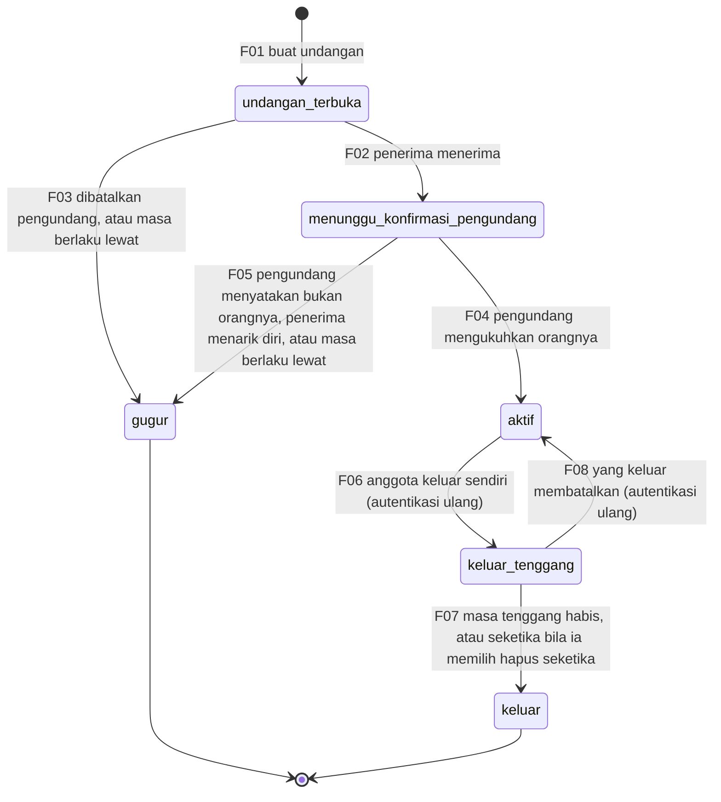
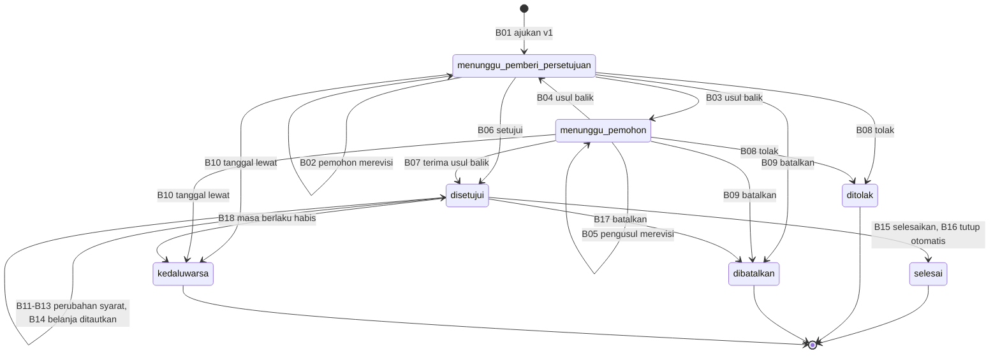
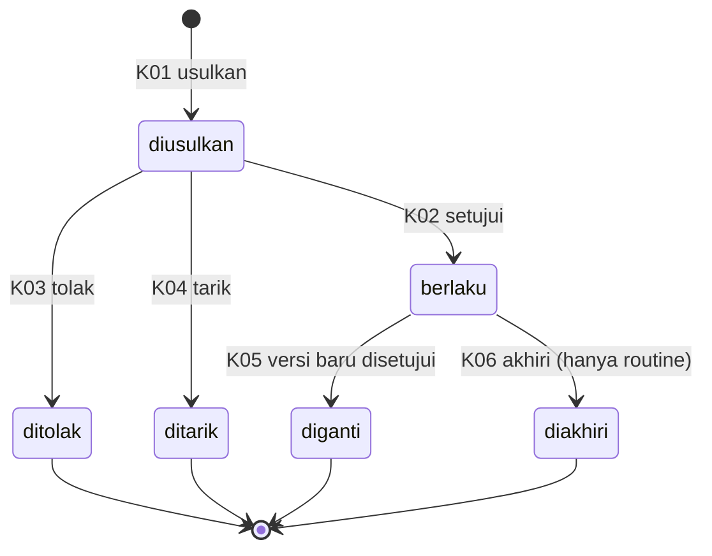
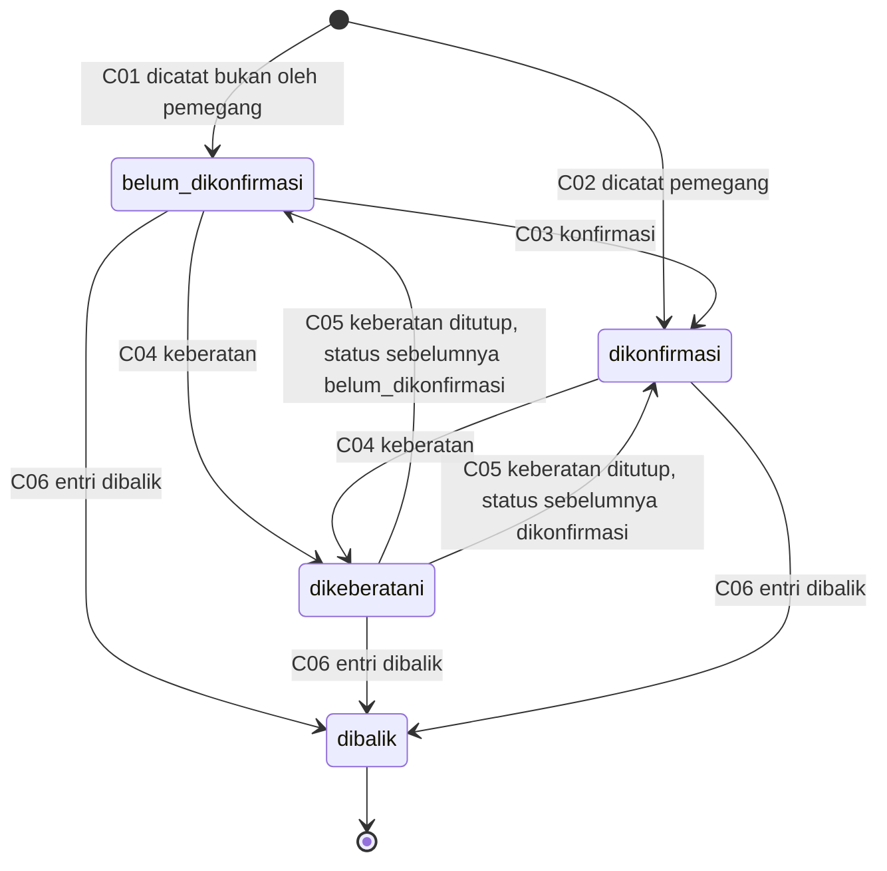
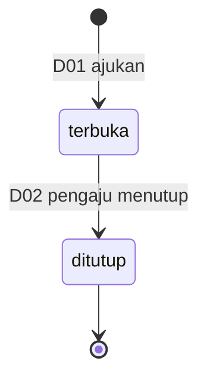
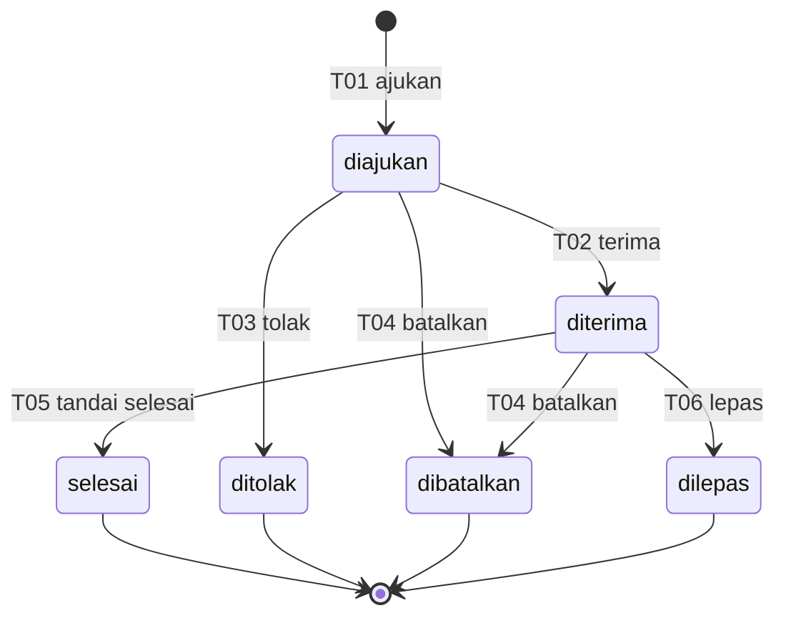
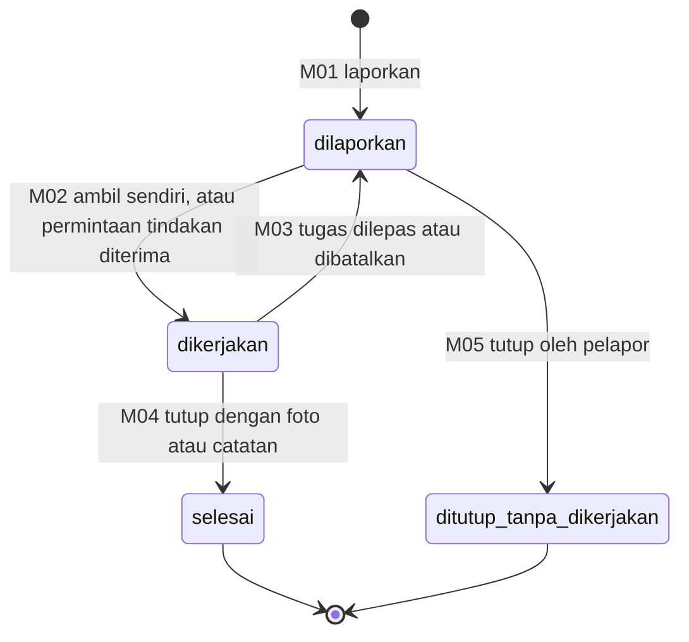
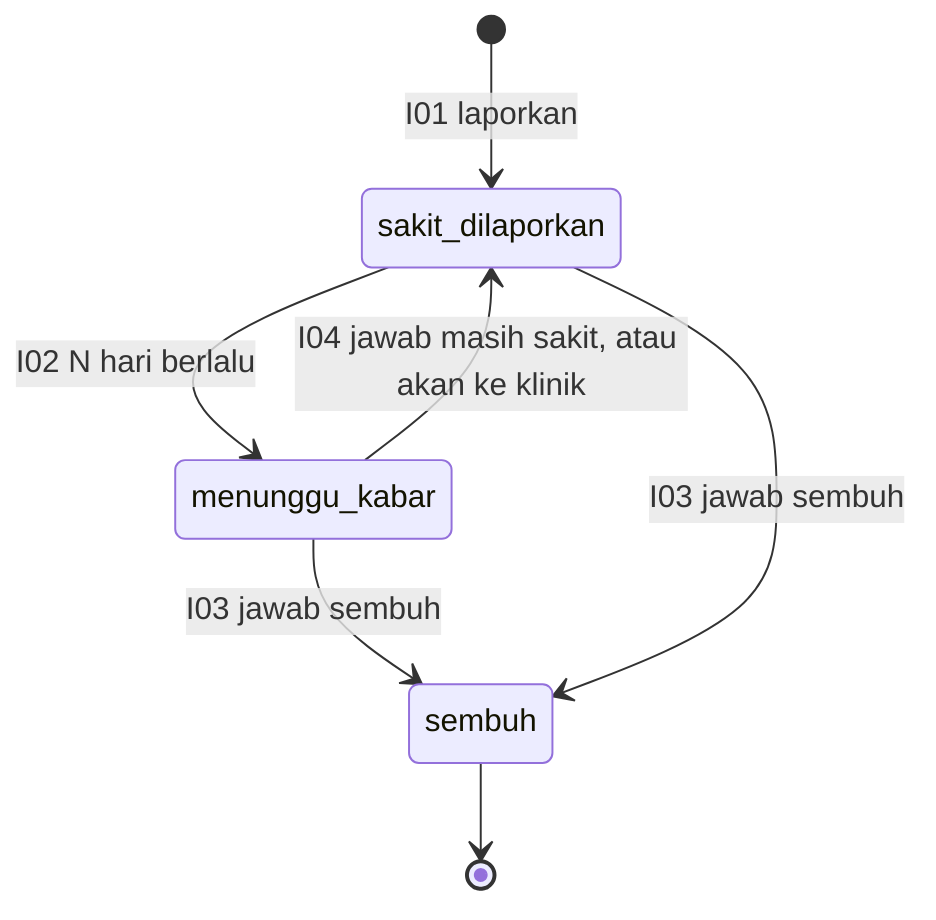

# 06 — Arsitektur Aktivitas dan Persetujuan

| | |
|---|---|
| Pemilik dokumen | `architect` |
| Tahap | S2 (Fondasi domain); revisi sampai checkpoint S4; revisi kelima belas di S5 (PG-15); **S6 (12 November 2026): pass konsistensi**: tanda `write_off` mengikuti 07 §3.8 (`H`), B15 `system` hanya di konfirmasi susulan, INV-A11/PG-10 dengan penahanan operasional, jalur `AI` R1 di §13.6 dan PG-12, F07 dengan `exit_closure` yang ditunda, W1 sampai W3, sebagian W7 (§15.18) |
| Status | Draf untuk tinjauan `critic` dan pemeriksaan awal `security-privacy`. Revisi kedua: diselaraskan dengan tiga keputusan pemilik produk 11 November 2026, dengan dokumen 07 yang direvisi (INV-24 sampai INV-26, kait `authorization.amended`, tautan susulan, *jumlah pemakaian*), dan dengan dokumen 02 dan 03. Revisi ketiga: temuan pemeriksaan awal `security-privacy` SP-01 sampai SP-14 dan SP-22 dikerjakan (ringkasan di §15.5); daftar pertanyaan checkpoint S2 kini hanya ada di dokumen 17 (§15.2). Revisi keempat: penyelarasan terakhir dengan dokumen 07 (07 §10.2 butir 7: §4.5, §6.2, §6.3, §7.3) dan dengan pernyataan pemilik produk 11 November 2026 bahwa kedua pasangan berpenghasilan (§6.4, AT-4, PG-01). Revisi kelima: keputusan pemilik produk 11 November 2026 tentang *jatah pribadi* (satu jumlah per orang per bulan, dijumlahkan sepanjang bulan, bebas diatur) dan tentang tanggal mulai periode yang dapat diatur per rumah tangga; aturan "per kali, kekerapan tidak diperiksa" dicabut untuk penyisihan ke dana pribadi (§6.2, §6.3 "Jatah pribadi", §6.4, §7.4, AT-4, PG-01, §12, INV-A17, INV-A19, INV-A37, INV-A38, P-17; ADR-009). Revisi keenam: temuan `critic` atas S2. Label keputusan pemilik produk dibatasi pada yang benar-benar ia putuskan (keputusan 14 sampai 17 dokumen 17); "di dalam jatah tanpa tanda" kini **[Usulan]** yang dikukuhkan lewat bawaan D-48, dan perlakuan bagian di atas jatah terbuka sebagai S2-1 butir (iii) (B-1). Hari mulai periode anggaran masuk isi kesepakatan `rule`, dengan INV-A39 (S-1). K05 punya baris sendiri (S-2). Peta §15.2 dan semua rujukan S2-*n* mengikuti penomoran dokumen 17 yang berlaku (S-3). Pengingat otomatis dihitung per rantai permintaan (M-5). Penilaian `security-privacy` atas jatah pribadi dikerjakan (SP-24 sampai SP-31; §15.5): jatah pribadi hanya dapat diakhiri sendirian oleh pemiliknya, yang sekaligus menutup gesekan K06 dengan keputusan 16 (K-29); alasan kenaikan dari daftar tertutup; batas tampilan sisa jatah dan waktu pencatatan; objek pengingat atas kesepakatan; asas pengawasan PG-14. Diselaraskan dengan dokumen 17 versi final putaran ini (S2-1 butir v: alasan kenaikan opsional sebagai bawaan; D-20 per rantai). Daftar sumber penghasilan masuk isi `rule` (07 §10.2 butir 8; Q-95). **Revisi ketujuh: jawaban pemilik produk di checkpoint S2 disebarkan** (dasar: [_progress.md](_progress.md) bagian "Jawaban checkpoint S2"; dokumen 07 revisi pasca-checkpoint S2). Jatah pribadi adalah batas: penyisihan yang membawa jumlah periode melewati jatah ditandai berapa pun kelebihannya (§6.2, §6.3, INV-A17, INV-A37, INV-A38); jatah yang berlaku sebesar 0 dibedakan dari tanpa jatah; konfirmasi susulan **[Usulan]** lead (§6.2, INV-A40); bawaan jam tenang 22.00 sampai 06.00 (§10, §11.1, INV-A42); jumlah isi dompet campuran tidak pernah terlihat pasangan (V-9, INV-A41); label setiap aturan disesuaikan dengan cara ia diterima. Tiga penegasan pemilik produk sesudah revisi dokumen 07 ikut diterapkan ([_progress.md](_progress.md), alinea "Tiga penegasan sesudah revisi dokumen 07"): jatah yang diakhiri pemiliknya tetap menjadi dasar penilaian sampai akhir periode itu (07 T-29 pilihan 1; P-19); tambahan satu periode tetap lewat permintaan biasa; **setiap pos rutin disepakati saat dibuat, berapa pun jumlahnya, dan pembayaran di atas jumlah yang disepakati ditandai tanpa dibandingkan dengan ambang** (§6.2, §6.3, INV-A43; P-20). Ringkasan perubahan di §15.9. **Revisi kedelapan (12 November 2026): putaran perbaikan** atas tinjauan `critic` (B1, B2, S1, S2, S4, S6, S7, M4), temuan `security-privacy` SP-32 sampai SP-44, dan empat jawaban pemilik produk 12 November 2026 ([_progress.md](_progress.md), alinea "Empat pertanyaan dari SP-32 sampai SP-43"). Dua kalimat yang pada revisi ketujuh dikutip di §10 sebagai kata-kata pemilik produk **bukan kata-katanya** dan dicabut beserta turunannya; penjelasannya di §15.10. Ringkasan di §15.10. **Revisi kesembilan (12 November 2026, tahap S3): chat rumah tangga Tier 1** atas keputusan pemilik produk 12 November 2026 ([_progress.md](_progress.md), alinea "Pernyataan pemilik produk tentang chat" dan "Penjelasan pemilik produk sesudahnya"; §16; [ADR-011](adr/ADR-011-chat-rumah-tangga-dan-kartu-objek.md)); AT-5, PG-07, INV-A33, N-19 dirumuskan ulang; dan celah alur yang diangkat fase B dokumen 05 (REQ, FIN-1, FIN-2, FAM, tier-2) dan dokumen 04 (Q-133). Ringkasan di §15.11. **Revisi kesepuluh (12 November 2026, tahap S3 fase D): putaran perbaikan** atas tinjauan `critic` A dan B (CA-05, CA-07, CA-08; CB-03, CB-04, CB-06, CB-11, CB-12, CB-16, CB-19, CB-20, CB-21, CB-26) dan pemeriksaan `security-privacy` atas 05 dan 06 (SP-45 sampai SP-69, bagian dokumen ini), serta celah yang dibawa ke fase D (G-08, PA-FAM-8, PA-SCN-1 sampai PA-SCN-3, `REQ.md` PA-REQ-7, `NTF.md` PA-NTF-3); tindak lanjutnya PA-FAM-9, `tier-2.md` P-T2-10, `COM.md` PA-COM-1 sampai PA-COM-3, dan SP-59 (§15.12 "Tindak lanjut"). Teks layar kunci N-28 dan bacaan "satu sampai dua saran sehari" dikembalikan ke kedudukan yang tercatat di [_progress.md](_progress.md). Pengenal celah dokumen 05 dan 12 mengikuti skema README (`PA-<MOD>-N`, `G-NN`, `KM-NN`). Ringkasan di §15.12. **Revisi kesebelas (12 November 2026): jawaban pemilik produk di checkpoint S3 dicatat** (dasar: [_progress.md](_progress.md), entri "Checkpoint S3 dijawab"; jawabannya, kata demi kata, "lanjut", sesudah lead menyatakan bahwa "lanjut" berarti semua bawaan diterima). Selain label kedudukan, dua aturan ditambah mengikuti 07 yang direvisi sesudah checkpoint: pos rutin tanpa tanggal (IDEA-03; §6.3 "Pos rutin" baris (h)) dan daftar sumber penghasilan sebagai sumber berkelompok `work` (§6.3; S3-3 A dibuka ulang sebagian). Cabang "bila ditolak" yang kini tidak berlaku dicatat sebagai alternatif yang ditolak. P-18, P-20 sampai P-27, dan P-32 sampai P-36 ditutup. Ringkasan di §15.13. **Revisi kedua belas (12 November 2026, tahap S4): penyisiran andaian khusus pilot** (temuan `critic` S4, butir M1 sampai M5, M7, M8 bagian dokumen ini, dan sisi alur M6), diselaraskan dengan 07 hasil penyisiran yang sama (INV-35, INV-36, T-44 sampai T-46). Tingkat fitur tidak berubah; yang berubah rancangan model dan aturan, supaya tahap publik tidak memerlukan rancang ulang (brief §1.1, "Tiers set what is built first, not what is designed"). Pihak kesepakatan rumah tangga untuk N anggota dewasa (§3.2, §6.3, INV-A18, PG-01, PG-14); tingkat visibilitas `adults` menggantikan `spouses` (§9.1, INV-A51); zona waktu per orang yang boleh kosong (§11.1, INV-A42, INV-A49); persetujuan berbagi sebagai himpunan penerima (§7.2, §9.3 V-6, §13.5, INV-A50); jumlah aturan bermata uang rumah tangga (§2.4, §3.1, INV-A19); pemegang `joint(S)` (§7.2); "utang antar-pemilik" (§9.2); sumber penghasilan bawaan berkunci tetap (§6.3). Perilaku pilot dengan dua anggota dewasa, satu rumah tangga per orang, IDR, dan satu zona waktu **identik** dengan revisi kesebelas; contoh terhitung tidak berubah. Semua aturan baru **[Usulan]** `architect`; P-37 sampai P-39 baru. Ringkasan di §15.14. **Revisi ketiga belas (12 November 2026, tahap S4 fase D):** permintaan dokumen 10 dan 09 yang tidak bergantung pada jawaban checkpoint diterapkan (N-26 `ringkasan`, SEC-56; lipat N-28, SEC-57; kecocokan kategori pos rutin, SEC-92 dan 07 INV-37, INV-A52; `seq` chat internal; [Asumsi] §16.5 diganti rancangan; kehadiran 30 dan 6 detik); permintaan dokumen 08 §23.1 (jeda urungkan 5 detik dan akibatnya atas S-7; tautan dalam lewat pengenal opak; waktu milik perangkat; kelompok kartu hanya tampilan); tanpa perkiraan offline di pilot (ADR-013). Yang bergantung pada checkpoint ditulis bersyarat: `CARE` tak dibagikan di perangkat (10-D A), K07 akhiri ambang sendirian (10-E B atau C), baris kehadiran (10-A), dan menyembunyikan serta melaporkan di chat untuk Apple Guideline 1.2 (10-G; §16.12). INV-A52, INV-A53, P-40 sampai P-42 baru. Bunyi baru PG-14 diusulkan di ADR-027, dengan dua kasus uji baru di daftar PG-14. Ringkasan di §15.15. **Revisi keempat belas (12 November 2026): jawaban checkpoint S4.** K07 dan `end_threshold` dicabut; ambang dibuat, diubah, dan diakhiri hanya lewat kesepakatan semua pihak, dan K01 menerima versi `rule` "tanpa ambang" (S4-9 (i) A); PG-14 menurut ADR-027 yang diterima, dengan kasus uji ambang; 10-A A, 10-D A, 10-G A, P-37 `all`, P-39, T-43, T-45, T-46 diterima, sehingga baris bersyaratnya dibuang; sebutan anggota (F-FAM-021) di §11.1 dan §16.13. Ringkasan di §15.16; temuan `critic` atasnya (CRB-16 sampai CRB-18) dikerjakan. **Revisi kelima belas (12 November 2026, S5):** PG-15 baru untuk aturan langganan rumah tangga (dokumen 13 §7.5; tahap publik); ringkasan di §15.17. Ditinjau `critic` S5 (A); tidak ada temuan atas PG-15. Q-217 (13 §12.2) tercakup PG-15, dan sejak S5 fase D juga SEC-156. **Catatan keputusan 51 (12 November 2026):** go public tidak direncanakan; dua kalimat yang menempatkan pembangunan di tahap publik (PG-15 di §10, sebutan di §16) kini bersyarat "bila diambil". Tidak ada aturan, state, invarian, atau contoh terhitung yang berubah; semua rancangan untuk tahap publik tetap |
| Tanggal | 11 November 2026; revisi kesembilan sampai kelima belas 12 November 2026 |
| Dibaca sebelum menulis | `CLAUDE.md`; `family-os-brief.md` §1, §1.1, §4, §5D, §5N, §5O, §6, §7, §8, §9, §14, §16; `ENGINEERING-STANDARDS.md`; [00-glossary.md](00-glossary.md) (versi S2); [_progress.md](_progress.md); [07-financial-domain.md](07-financial-domain.md) (revisi 11 November 2026); [02-product-principles.md](02-product-principles.md); [03-personas-household-models.md](03-personas-household-models.md) (§4.3, bagian 7); [17-open-questions-assumptions.md](17-open-questions-assumptions.md) (keputusan checkpoint S1 dan keputusan 11 sampai 13; Q-03, Q-04, Q-08, Q-19, Q-26, Q-27, Q-49 sampai Q-58, Q-67 sampai Q-78; K-16, K-17, K-19, K-20). Untuk revisi ketujuh: [_progress.md](_progress.md) bagian "Jawaban checkpoint S2" dan kedua pernyataan arah; dokumen 17 bagian "Checkpoint S2: pertanyaan untuk pemilik produk" (S2-1 sampai S2-10, W-1 sampai W-16, D-01 sampai D-55); dokumen 07 revisi pasca-checkpoint S2 (§2.3, §3.4, §3.8, §3.15, INV-24 sampai INV-30, CTH-40, CTH-41, §10.1 T-28 dan T-29, §10.2, §10.3, §11). Untuk revisi kesembilan: [_progress.md](_progress.md) dari awal sampai "Putaran penyebaran sesudah fase B"; brief §1.1, §5B, §5D, §5K, §5N, §5O, §8; [00-glossary.md](00-glossary.md); dokumen 02 PRN-08, PRN-11, PRN-12, KT-6, KT-12; [04-feature-map.md](04-feature-map.md) (F-COM, F-REQ-010 sampai 012, F-FAM-003, §10.4, Q-133, Q-138); dokumen 05 `REQ.md` (FR-REQ-006, 012, 024, 025, 035, 037, 041, 043, 045 dan "Kesenjangan"), `NTF.md`, `FIN-1.md` §13, `FIN-2.md` FR-FIN-106, 107, 131, 135 dan §12, `FAM.md` FR-FAM-003, 004, 011, 016 dan §8, `tier-2.md` §5, §6, §10; [11-innovation.md](11-innovation.md) IDEA-03, IDEA-18, IDEA-19; 07 §2.3, §2.6 "Pengarsipan", §3.10, §3.15 |

Dokumen ini menetapkan model alur kerja Family OS: primitif bersama, state machine tiap alur, logika persetujuan, dan sisi alur dari *penyelesaian*. **Aturan uang, termasuk setiap jumlah pada penyelesaian, kanonis di [dokumen 07](07-financial-domain.md); dokumen ini hanya mengutipnya** lewat kait yang didaftar di 07 §10.2.

**Label.** Keputusan pemilik produk di checkpoint S1 dikutip sebagai "keputusan pemilik nomor *n*" (11 November 2026; dokumen 17). Tiga keputusan yang diambil pemilik produk sesudah itu, dalam percakapan dengan lead pada hari yang sama, dikutip sebagai **"keputusan pemilik produk, 11 November 2026"**: uang masuk yang diarahkan ke dana pribadi (§6.4), konfirmasi serah terima (§7), dan jarak pengingat ulang beserta jam tenang (§10). Kelompok ketiga pada hari yang sama (dokumen 17, keputusan 14 sampai 17) dikutip dengan label yang sama, dan **hanya sejauh isinya**: (14) *jatah pribadi* adalah satu jumlah per orang per bulan (di dokumen ini dibaca per *periode anggaran*), dijumlahkan sepanjang bulan itu, dan jumlahnya dapat diatur; (15) hari mulai periode anggaran ditentukan per rumah tangga; (16) jumlah jatah disepakati berdua, satu mengusulkan dan yang lain mengonfirmasi; (17) kenaikan jatah dapat diajukan dengan alasan.

**Label sesudah checkpoint S2 (revisi ketujuh).** Catatan yang mengikat adalah [_progress.md](_progress.md) bagian "Jawaban checkpoint S2". Label berikut dipakai, dan tidak dipertukarkan:

| Label | Dipakai untuk |
|---|---|
| **Keputusan pemilik produk, checkpoint S2** | Hanya yang ia nyatakan sendiri: S2-1 butir (i), (ii), dan (iii) pilihan b (jatah adalah batas); S2-3 pilihan A; S2-4 bagian pembayaran rutin ("untuk membuat tagihan rutin ya disepakati dulu"; siapa pun dari keduanya boleh membayar); S2-7 pilihan A; S2-8 pilihan A (sementara, sampai advokat menjawab); S2-10 pilihan A |
| **Diterima pemilik produk di checkpoint S2 atas saran lead** | S2-2 pilihan A ("saya ikut saran kamu aja"); S2-5 pilihan A beserta bawaan jam tenang 22.00 sampai 06.00 ("gas 2 2 nya aja" atas dua butir bernomor lead; angka jamnya **[Asumsi]** lead). S2-1 butir (iv) dan (v) pilihan b dikutip dengan label ini, dengan catatan: ia menyerahkannya kepada lead, lead menerapkan bawaan tim dan menyampaikannya, dan ia belum menyatakannya sendiri |
| **Tidak disebut pemilik produk; diterapkan lead** | S2-4 bagian ambang (ambang hanya berubah bila berdua setuju; tidak ada yang keluar sendiri): lead menerapkan pilihan A dan menyampaikannya kepadanya. Ini **bukan** "diterima atas saran lead" |
| **Diterima pemilik produk atas saran lead, 12 November 2026** | Tiga dari empat pertanyaan lanjutan ("ya bener gas"): tanda dasar jatah dan dasar pos rutin tanpa pemberitahuan langsung; batas konfirmasi susulan (tanpa pengingat otomatis, satu pengingat ulang, tidak diajukan lagi sesudah ditolak); selisih dompet campuran dipilih pemegang setiap kali, tanpa bawaan |
| **[Usulan] `security-privacy`, disampaikan kepada pemilik produk dan tidak ia bantah** | Jatah yang tidak di atas ambang, termasuk 0, hanya dapat diusulkan pemiliknya sendiri dan boleh ia lepas seketika (SP-32, SP-33, SP-34). Ia ditanya dengan rumusan "nol atau di bawah ambang"; bahwa batasnya juga mencakup jatah yang **sama dengan** ambang adalah pengetatan lead, **[Usulan]**. Jawabannya atas pertanyaan itu menegaskan jalan kenaikan, bukan pagar ini |
| **Diterima pemilik produk di checkpoint S2 lewat "lanjut"** | Bawaan D-01 sampai D-55. Ke-24 baris bertanda Pagar dibacakan satu per satu; ke-31 lainnya tidak dibacakan satu per satu. Tidak satu pun pernyataannya sendiri |
| **[Usulan]** | Yang lahir sesudah checkpoint dan belum disajikan kepadanya, atau disampaikan tetapi belum ia terima: konfirmasi susulan sebagai jalur (§6.2; lead); jatah yang berlaku sebesar 0 (§6.3; disampaikan 12 November 2026, tidak dibantah); batas pagar jatah pada kesamaan dengan ambang (§6.3; pengetatan lead); V-9 (§9.3); bacaan lead atas kedua pernyataan arah (§10); rincian pos rutin yang tidak disebut pemilik produk (§6.3 "Pos rutin: yang tidak disebut pemilik produk"; P-20); usulan `security-privacy` SP-32 sampai SP-44 selain yang disebut di dua baris di atas |
| **Rumusan lead yang dikukuhkan pemilik produk, 11 November 2026** | Tiga penegasan sesudah revisi dokumen 07, yang ia jawab "bener"; bukan kata-katanya sendiri: (1) jatah yang diakhiri pemiliknya tetap menjadi dasar penilaian sampai akhir periode anggaran itu (07 T-29 pilihan 1); (2) tambahan untuk satu periode boleh lewat permintaan biasa yang disetujui pasangan, dan "bukan keringanan" berarti tidak ada kelonggaran otomatis di atas jatah; (3) setiap pos rutin disepakati saat dibuat, berapa pun jumlahnya; jumlah yang disepakati adalah batasnya; pembayaran sampai jumlah itu tidak ditandai, siapa pun yang membayar; yang melewatinya tampil sebagai di atas kesepakatan, tanpa membandingkan kelebihannya dengan ambang |

Kalimat berikutnya di alinea ini ditulis sebelum checkpoint S2 dan dipertahankan sebagai riwayat; di mana ia berbeda dari tabel di atas, tabel yang berlaku. **Yang bukan keputusan pemilik produk dan diberi label sendiri:** bahwa di dalam jatah tidak ada tanda dan tidak ada pemberitahuan adalah dasar pertanyaan lead yang disampaikan kepadanya dan tidak ia bantah; ia kini diterima lewat "lanjut" (D-48); perlakuan bagian yang melampaui jatah kini keputusan pemilik produk, checkpoint S2 (S2-1 butir iii pilihan b); bahwa penggantian hari mulai memerlukan kedua anggota dewasa adalah putusan lead, diterima lewat "lanjut" (Q-102; D-49); siapa yang boleh mengakhiri jatah (hanya pemiliknya; temuan SP-24) dan bentuk alasan pada usulan kenaikan (SP-25) adalah usulan dokumen ini, diterima lewat "lanjut" (D-52, D-53); alasan itu tidak wajib (S2-1 butir v pilihan b, diterima atas saran lead). Rekomendasi lain di dokumen ini yang tercantum sebagai bawaan D di dokumen 17 diterima lewat "lanjut"; tanda **[Usulan]** yang masih melekat pada butir seperti itu di bagian yang tidak diubah revisi ini dibaca demikian (peta bawaan ke bagian ada di §15.2). Angka tenggat dan batas (jam, hari, jumlah pengingat) adalah **[Asumsi]** tanpa dasar riset, kecuali jarak 6 jam pengingat ulang yang diputuskan pemilik produk; pilot yang mengujinya. Pertanyaan untuk pemilik produk dikutip dengan nomor dokumen 17 yang berlaku (S2-1 sampai S2-10; butir S2-1 sebagai (i) sampai (v); bawaan D-01 sampai D-55), bukan dengan nomor di dokumen ini (§15.2).

**Rujukan ke dokumen 07 pada revisi ketiga.** `finance-domain` mengerjakan sisi dokumen 07 dari temuan SP-01, SP-05, SP-12, SP-13, dan SP-18 bersamaan dengan revisi ini. Di tempat-tempat itu dokumen ini mengutip dokumen 07 dengan nama bagian dan nomor invarian yang berlaku saat revisi ini ditulis, dan menyebut isi aturannya, supaya tetap terbaca bila nomor di dokumen 07 bergeser; yang harus dicocokkan lagi setelah dokumen 07 selesai direvisi didaftar di §15.4.

**Rujukan ke dokumen 07.** Nomor bagian di bawah diperiksa terhadap dokumen 07 revisi 11 November 2026. Bila nomor dan nama kelak tidak lagi cocok, **nama bagian, nama kait, atau nomor invarian yang berlaku**:

| Dikutip sebagai | Nama di dokumen 07 |
|---|---|
| 07 §2.2, §2.3, §2.5, §2.6 | "Pemilik uang, buku, dan garis kendali rumah tangga" (termasuk aturan tulis buku pribadi, INV-25); "Posisi"; "Entri dan barisnya" (`links.subject_ref`, `entry_link`, `actor`, `payer`, `holder`, penanda `unconfirmed`); "Entitas pendukung" (`set_aside_schedule`, `routine_agreement_ref`) |
| 07 §3.1 | "Uang masuk": tiga arah; penghasilan dengan bagian pribadi sebagai satu entri `income` di dua buku (INV-24; CTH-03b) |
| 07 §3.2, §3.3, §3.4 | "Pengeluaran"; "Pemindahan dan serah terima" (kait `handover.recorded`, `handover.confirmed`, `handover.disputed`); "Penyisihan dan kontribusi" (jadwal penyisihan; rumus `ditandai(e)`; jatah sebagai batas) |
| 07 §3.5, §3.6, §3.7 | "Talangan, hak ganti, dan penggantian"; "Pelepasan hak ganti dan klaim antar-pemilik lain"; "Utang, piutang, pelunasan, penghapusan" |
| 07 §3.8 | "Otorisasi, reservasi, penyelesaian": situasi custody A sampai D; *jumlah pemakaian*; penautan entri dan tautan susulan (INV-26); kait `request.approved`, `authorization.amended`, `authorization.settled`, `authorization.cancelled`, `authorization.expired`, `authorization.overrun` |
| 07 §3.12, §3.14, §3.15, §3.16 | "Koreksi dan keberatan" (kait `entry.disputed`; batas koreksi atas entri dua buku); "Cicilan"; "Tagihan berulang"; "Aset" |
| 07 §5, §5.1, §5.3 | "Tampilan custody"; "Perhitungan"; "Kebocoran yang tersisa" (B1 sampai B5) |
| 07 §6.1, §6.3 | "Anggaran"; "Ringkasan bulanan" |
| 07 §7.1, §7.3, §7.6, §7.9 | "Cara membaca" contoh terhitung (rumah tangga contoh, ambang contoh 500000); CTH-03b; "Permintaan, otorisasi, penyelesaian" (CTH-21 sampai CTH-24 dan varian perubahan syarat CTH-22); CTH-34 |
| 07 §8, §9, §10.1, §10.2, §10.3 | "Riwayat yang tidak dapat diubah lawan hak penghapusan"; "Keputusan atas pertanyaan terbuka"; butir terbuka T-01 sampai T-29; "Permintaan"; "Yang menurut dokumen ini berisiko dalam keputusan pemilik produk" |

Contoh terhitung selalu dirujuk dengan pengenal `CTH-nn`, yang tidak bergeser.

**Kesetaraan.** Semua aturan ditulis untuk "anggota dewasa", "pemohon", dan "pemberi persetujuan". Tidak ada aturan yang menyebut suami atau istri; kedua kata itu hanya muncul saat mengutip contoh dokumen 07.

**Pengenal di dokumen ini.** `INV-Ann` invarian alur dan persetujuan (terpisah dari `INV-nn` milik dokumen 07); `PG-nn` pagar terhadap kendali koersif; `N-nn` peristiwa notifikasi; `P-nn` butir terbuka. Nomor `FR` dan `BR` diberikan dokumen 05 di S3.

**Kedalaman.** Tier 1 penuh (§3 sampai §12, dan §16 chat rumah tangga), Tier 2 ringkas (§13), Tier 3 garis besar (§14), sesuai brief §1.1. Chat ditaruh di §16, bukan disisipkan sebelum §13, supaya nomor bagian yang sudah dirujuk dokumen 04 dan 05 tidak bergeser.

**Label revisi kesembilan.** Tentang chat, yang dinyatakan pemilik produk sendiri (12 November 2026) hanya dua kalimatnya di [_progress.md](_progress.md) dan pilihan "Semua seperti WhatsApp" (terakhir aktif, sedang online, sedang mengetik tampil), yang ia ambil **berlawanan dengan saran lead**. Bentuk chat, tingkatnya, balasan yang menempel ke kartu, dan tanda dibaca pada kartu adalah pilihan bertanda saran yang ia ambil: **diterima pemilik produk atas saran lead, 12 November 2026**. Tentang pendamping `AI` (`_progress.md`, tabel sesudah "Pernyataan pemilik produk tentang pendamping AI"): yang pernyataannya sendiri hanya kata-katanya, "ada case dimana mungkin suami/istri butuh dukungan minimal 1 atau 2 appresiasi atau dukungan perhari"; bahwa itu berarti `AI` menawarkan saran yang dikirim orangnya sendiri, rentang "satu sampai dua saran", dan waktunya adalah **bacaan lead**, bukan kata-katanya; bacaan itu **diterima lewat "lanjut" di checkpoint S3 (12 November 2026; S3-8 butir (0) dan (iii); Q-157)**, dan angkanya tetap **[Asumsi]** (revisi kesepuluh, CB-04; revisi kesebelas). Yang **diterima atas saran lead**: pilihan "Umum di layar kunci", yang teksnya berbunyi "ada kabar dari istrimu", dan pesan dukungan sebagai pesan chat yang membalas kartu status. Teks layar kunci yang berlaku: "Ada kabar baru", sama dengan semua `kabar` lain (S3-8 butir (vii) bentuk (a), diterima lewat "lanjut" di checkpoint S3; §11.1, P-32). Selebihnya di §13.5, §13.6, §16, dan ADR-011 **[Usulan]** `architect`, dibaca menurut "Label sesudah checkpoint S3" di bawah. Celah alur fase B dan fase D: setiap aturan baru **[Usulan]** `architect` kecuali disebut lain.

**Label sesudah checkpoint S3 (revisi kesebelas).** Catatan yang mengikat adalah [_progress.md](_progress.md), entri "Checkpoint S3 dijawab" (12 November 2026). Jawaban pemilik produk, kata demi kata, "lanjut", sesudah lead menyatakan bahwa "lanjut" berarti semua bawaan diterima dan S3-10 dijawab terpisah. Label yang dipakai: **diterima lewat "lanjut" di checkpoint S3 (12 November 2026)**. Itu bukan pernyataan pemilik produk sendiri dan bukan "diterima atas saran lead". Yang tercakup: S3-1 pilihan A (termasuk butir (d), pengingat tagihan N-32 Tier 1 `ringkasan`); S3-2 A; S3-3 A, yang sesudahnya **dibuka ulang sebagian** oleh pertanyaan pemilik produk sendiri (THR tidak lagi dipaksa berlabel gaji; [_progress.md](_progress.md), "Pertanyaan pemilik produk atas S3-3"; §6.3 "Daftar sumber penghasilan"; 07 T-34, T-43); S3-4 A (butir (a) sampai (c)); S3-5 A; S3-6 A (termasuk butir (v)); S3-7 A; S3-8 A dengan layar kunci bentuk (a) "Ada kabar baru"; S3-9 A; dan setiap baris D-56 sampai D-97 dokumen 17. Aturan di dokumen ini yang menjadi bawaan salah satu butir itu kini berlabel demikian, **dengan pengusulnya tetap disebut** (misalnya "**[Usulan]** `security-privacy` SP-48, diterima lewat "lanjut" di checkpoint S3"). Tanda **[Usulan]** yang masih melekat pada butir seperti itu di bagian yang tidak disunting revisi ini dibaca demikian; peta butir ke bagian ada di dokumen 17 (kolom "Default" pertanyaan S3 dan "Ditetapkan di" tabel D) dan di §15.13. Angka tenggat dan batas (7 hari, 10 menit, 19.00, tiga hari, dua saran) tetap **[Asumsi]**. Yang **tidak** tercakup: S3-10 dan pertanyaan sampingan S3-3 tentang THR, yang dijawab pemilik produk sesudah checkpoint dengan kata-katanya sendiri ("thr bisa menerima bisa ngasih, masalah perangkat simpan dulu aja desainnya yang penting, anak anak paling 12+"; [_progress.md](_progress.md), "Jawaban pemilik produk atas S3-10 dan pertanyaan THR"). Maksud "anak anak paling 12+" sudah dijelaskan pemilik produk sendiri: ia memilih "Ada anak umur 12+" ([_progress.md](_progress.md), "Pertanyaan susulan lead dan jawabannya"), jadi rumah tangga pilot punya anak berusia 12 tahun ke atas dan A-31 gugur. Data yang menyangkut anak dinilai dokumen 10 (S4); tingkat fitur tidak berubah. Bulan mulai pilot tidak disebut (A-37 tetap **[Asumsi]**), dan bacaan lead atas jawaban THR belum dikukuhkan. Juga tidak tercakup: butir yang dibawa ke S4 (P-15, P-28 sampai P-31; Q-174 sampai Q-177). **Brief diubah 12 November 2026** ([_progress.md](_progress.md), "Kalimat brief sesudah S3"; enam perubahan, diterima pemilik produk atas saran lead): Tier 1 kini menyebut `COM` chat versi ringan serta `NTF` jam tenang, ringkasan, dan pengingat tagihan; §4.2 menjadi "member exit"; §5O kata dukungan sebagai balasan chat pada kartu status. Perbedaan K-38, K-39, K-41, K-43, K-50 karenanya selesai; perbedaan lain yang dicatat lead di dokumen 17 tetap menurut dokumen itu.

## Daftar isi

1. Keputusan arsitektur
2. Primitif bersama
3. Logika persetujuan
4. Permintaan anggaran dan permintaan jalan-jalan
5. Penyelesaian
6. Ambang permintaan dan kesepakatan rumah tangga
7. Konfirmasi custody
8. Koreksi dan keberatan
9. Visibilitas dan keterangan pelaku
10. Pagar terhadap kendali koersif
11. Notifikasi sebagai akibat samping
12. Bersamaan dan offline
13. Alur Tier 2
14. Garis besar Tier 3
15. Keputusan, butir terbuka, dan permintaan ke pihak lain
16. Chat rumah tangga dan kartu objek (Tier 1; revisi kesembilan)

---

## 1. Keputusan arsitektur

Brief §6 meminta perbandingan antara satu workflow engine generik dan alur domain eksplisit yang berbagi sedikit primitif. Keputusannya dicatat di [ADR-001](adr/ADR-001-alur-domain-eksplisit-dengan-primitif-bersama.md).

### 1.1 Perbandingan

| Kriteria | A. Workflow engine generik | B. Alur domain eksplisit di atas primitif bersama |
|---|---|---|
| Bentuk | State, transisi, guard, dan akibat samping disimpan sebagai data konfigurasi; satu mesin menjalankan semua jenis alur | Tiap alur (permintaan anggaran, permintaan tindakan, konfirmasi custody, …) adalah satu tabel transisi tertulis di kode server; yang dibagi hanya primitif di §2 |
| Kebenaran uang | Akibat uang menjadi "aksi" generik yang dipanggil konfigurasi; hubungan transisi dengan kait dokumen 07 baru terlihat saat dijalankan | Tiap transisi menyebut kait 07-nya di tabel; tabel itu sendiri menjadi spesifikasi dan test |
| Dapat diuji (`ENGINEERING-STANDARDS.md` §6) | Property test harus menguji mesin **dan** setiap konfigurasi; kesalahan konfigurasi lolos dari pemeriksaan tipe | Property test per alur atas tabel tertutup; transisi yang tidak ada di tabel ditolak |
| Tim 1–3 developer | Mesin, bahasa konfigurasi, dan alat pengamatannya adalah produk kedua yang harus dibangun dan dirawat | Beberapa ratus baris per alur; alur Tier 1 hanya empat |
| Cakupan Tier 1 | Tidak ada keluarga pilot yang mengatur alurnya sendiri (Q-30: satu preset, tanpa layar pengaturan) | Sesuai: yang dapat diatur hanya aturan persetujuan (§3), bukan bentuk alur |
| Tier 3 tidak terhalang | Alur baru cukup dikonfigurasi | Alur baru ditulis sebagai tabel baru dan memakai primitif yang sama; tidak ada alur lama yang berubah |
| Rantai antar-modul (brief §6) | Satu alur panjang lintas modul | Rantai adalah tautan antar-objek (`subject_ref`, §2.2): masalah rumah → tugas → permintaan anggaran → entri. Tiap mata rantai punya state machine sendiri |
| Risiko utama | Generalisasi dini; aturan uang tersembunyi di konfigurasi | Pengulangan bentuk antar-alur; dijaga dengan primitif `Permintaan` yang memuat inti perundingan satu kali (§2.1) |

### 1.2 Rekomendasi

**Opsi B.** Alasan yang terikat pada produk ini:

1. **Kebenaran uang.** Hanya tiga alur yang menyentuh uang, dan ketiganya melakukannya lewat sepuluh kait yang sudah ditetapkan dokumen 07 (§10.2 butir 2: `request.approved`; lima kait `authorization.*`; tiga kait `handover.*`; `entry.disputed`). Tabel transisi eksplisit membuat setiap persinggungan itu terbaca dan dapat diuji satu per satu; pada mesin generik persinggungan itu menjadi data.
2. **Yang berubah-ubah antar-keluarga adalah siapa yang menyetujui, bukan bentuk alurnya.** Brief §4.3 meminta wewenang persetujuan dapat diatur. Itu dipenuhi satu fungsi penentu pemberi persetujuan (§3), tanpa mesin alur generik.
3. **Tim kecil dan satu rumah tangga pilot.** Mesin generik adalah abstraksi tanpa pemakai kedua (`ENGINEERING-STANDARDS.md` §1).
4. **Tier 3 tetap terbuka.** Permintaan izin, usulan keputusan, dan persetujuan berjenjang memakai primitif `Permintaan` yang sama dengan daftar pemberi persetujuan yang lebih panjang (§14).

Yang tidak diberikan opsi B dan diterima: keluarga tidak dapat merancang alur sendiri, dan alur baru memerlukan rilis aplikasi.

---

## 2. Primitif bersama

Dari empat belas kandidat brief §6, enam menjadi primitif alur, dua adalah milik domain keuangan, dan enam bukan primitif.

### 2.1 Primitif yang dipertahankan

| Primitif | Tanggung jawab | Yang dimilikinya | Yang tidak boleh dilakukannya |
|---|---|---|---|
| **Permintaan** (`request`) | Sesuatu yang diajukan satu anggota kepada anggota lain dan menunggu tanggapan; memuat inti perundingan: ajukan, usul balik, setujui, tolak, batalkan | Jenis, pemohon, daftar pemberi persetujuan yang dibekukan saat diajukan, state, *versi syarat* (tidak dapat diubah, bernomor naik), tanggapan atas tiap versi | Membuat entri atau mengubah saldo. Akibat uangnya hanya lewat kait 07. Tidak memuat aturan khusus jenis lain: tiap jenis punya tabel transisinya sendiri |
| **Tugas** (`task`) | Pekerjaan dengan satu penerima tugas dan status selesai atau belum | Penerima tugas, tenggat opsional, status, catatan dan bukti penutupan | Memuat persetujuan atau uang. Biaya sebuah tugas adalah permintaan anggaran atau entri yang ditautkan |
| **Diskusi** (`discussion`); sejak revisi kesembilan disimpan sebagai **pesan** (`message`) | Pesan yang menempel pada tepat satu objek induk (diskusi objek itu), atau pesan bebas di *chat rumah tangga* tanpa induk. Satu pesan dapat sekaligus menempel pada objek dan tampil di chat (§16) | Pesan, penulis, waktu server, induk opsional (`subject_ref`), tempat di chat opsional (`conversation_id`, `seq`), lampiran | Mengubah state induknya atau objek mana pun; memuat keputusan. "Setuju" yang ditulis di diskusi atau di chat bukan persetujuan; yang mengubah state hanya perintah objek itu sendiri (§16.4). Larangan semula "menjadi chat umum (`COM`, Tier 3)" dicabut oleh keputusan pemilik produk 12 November 2026 ([ADR-011](adr/ADR-011-chat-rumah-tangga-dan-kartu-objek.md)) |
| **Lampiran** (`attachment`) | Berkas (struk, foto) yang menempel pada satu objek induk | Rujukan berkas, pengunggah, waktu | Berdiri sendiri; mengubah inti moneter entri (07 §8) |
| **Peristiwa** (`event`) | Catatan yang tidak dapat diubah atas setiap transisi dan setiap perubahan metadata: siapa, kapan, dari state apa ke state apa, atas versi syarat mana | Pelaku (anggota atau `system` beserta aturan pemicunya), waktu server, nomor urut per objek | Disunting atau dihapus, dengan dua batas yang dinyatakan di §2.5: catatan `CARE` berada di luar aturan ini, dan pelaku disimpan sebagai pengenal internal yang pemetaannya dapat diputus. Dipakai sebagai umpan kegiatan per orang (§9.4). Kumpulan peristiwa inilah *jejak audit* untuk alur; jejak audit uang adalah entri itu sendiri (07) |
| **Notifikasi** (`notification`) | Pemberitahuan yang diturunkan dari peristiwa menurut tabel §11 | Penerima, prioritas, status terkirim | Menjadi sumber kebenaran: state hanya dibaca dari objeknya. Gagal kirim tidak membatalkan transisi |

### 2.2 Rujukan induk

Diskusi, lampiran, peristiwa, notifikasi, dan entri menunjuk objek induknya dengan `subject_ref = (kind, id)`. `kind` adalah daftar tertutup: `request`, `task`, `household_issue`, `illness_followup`, `mood_status`, `agreement`, `entry`, `dispute`, dan, hanya sebagai induk lampiran, `message` (foto di chat; §16). `mood_status` ditambahkan revisi kesembilan untuk catatan dukungan (§13.5). Inilah satu-satunya bentuk "aktivitas" di model. Pada entri, rujukan ini adalah `links.subject_ref` (07 §2.5); ia dapat pula ditambahkan belakangan sebagai tautan susulan. Model keuangan tidak menurunkan akibat uang apa pun darinya: akibat uang hanya lahir dari tautan bertipe, misalnya `authorization_id`.

### 2.3 Yang bukan primitif

| Kandidat | Putusan | Alasan |
|---|---|---|
| Activity | Bukan primitif; tidak ada tipe induk generik | Induk generik akan memaksa permintaan, tugas, dan masalah rumah berbagi state yang tidak mereka miliki bersama. *Aktivitas* tetap kata kumpulan di glosarium |
| Proposal | Bagian dari Permintaan | Usulan adalah satu *versi syarat*; usul balik adalah versi berikutnya |
| Approval | Bagian dari Permintaan | Persetujuan adalah tanggapan atas satu versi syarat, tidak bermakna di luar permintaannya |
| Assignment | Atribut Tugas | Satu tugas, satu penerima tugas; riwayat pergantiannya ada di Peristiwa |
| Audit Record | Sama dengan Peristiwa | Satu catatan transisi, bukan dua |
| Timeline Entry | Bukan primitif; proyeksi Tier 3 | Riwayat pada layar suatu objek adalah tampilan Peristiwa. Album kenangan (`TML`) dikurasi dan boleh disunting, jadi kelak disimpan terpisah (brief §5M) |
| Budget, Financial Transaction | Milik domain keuangan | *Anggaran*, *entri*, *otorisasi*, dan *reservasi* didefinisikan dan dijaga dokumen 07; alur hanya menautkannya |

### 2.4 Sketsa skema

Sketsa, bukan kode. Nama bahasa Inggris adalah usulan nama pengenal.

```text
request
  id, household_id
  type              budget | outing | action            -- Tier 3: permission | decision | reimbursement
  requester         member(M)
  state             -- per jenis, §4.2 dan §13.1
  current_version   bilangan bulat ≥ 1
  approved_version  null | bilangan bulat
  required_approvals [ (member, order, status: pending | consented | declined) ]   -- hasil §3, dibekukan
  rule_snapshot     (preset_id, rule_version, request_threshold)
  resubmitted_from  null | request_id
  confirms_entry_id null | entry_id          -- konfirmasi susulan [Usulan] (§6.2); hanya pada type = budget
  reminders_paused_until  null | timestamp   -- tunda senyap; tidak pernah terbaca selain oleh penekannya (§4.4, INV-A33)
  closed_at, closed_by    member(M) | system

request_terms                                           -- tidak dapat diubah
  request_id, version, proposed_by, proposed_at
  title, note
  -- budget dan outing:
  amount_limit, currency
  use_kind          expense | loan_given | asset_purchase | set_aside
  category_id?, purpose_id?, source_holding_id?, external_party_id?
  planned_date?     -- wajib untuk outing
  valid_until       -- masa berlaku, §4.5
  -- outing saja:
  place, time_range, participants, planned_items [ (name, estimate) ]
  -- action saja:
  assignee, due_date?

request_response                                        -- tidak dapat diubah
  request_id, version, actor, kind (approve | accept | reject | decline_amendment),
  reason?, at, idempotency_key
  -- tunda bukan tanggapan: ia hanya mengisi reminders_paused_until dan tidak menulis baris di sini

event
  subject_ref, seq, actor (member(M) | system:rule_id), at,
  command, from_state, to_state, terms_version?, idempotency_key

-- revisi kedua belas (penyisiran andaian khusus pilot); aturan uangnya kanonis di 07
household
  id
  currency          ISO 4217; dipilih saat rumah tangga dibuat, bawaan IDR;   -- M5; 07 INV-01, INV-35
                    terkunci begitu ada satu baris uang (07 T-45, diterima di checkpoint S4, S4-8 (iii) A)
  income_source_market  pasar yang menentukan daftar sumber penghasilan bawaan (07 §3.1; misalnya ID)
account
  id
  time_zone?        null = zona waktu rumah tangga anggota itu (§11.1 "Zona waktu")   -- M3; Tier 1 tidak menulisnya
```

**Mata uang pada setiap jumlah alur (revisi kedua belas).** Setiap jumlah uang di dokumen ini, termasuk `request_terms.amount_limit`, nilai ambang dan `rule_snapshot.request_threshold`, jumlah per kali pos rutin, dan jumlah jatah pribadi, adalah pasangan (`amount`, `currency`) menurut 07 INV-01 dan [ADR-008](adr/ADR-008-jumlah-uang-bilangan-bulat.md). Perintah yang memuat jumlah dengan `currency` selain `household.currency` ditolak di batas server. Pada pilot `currency` selalu IDR, jadi tidak ada yang berubah. Satu entri atau satu aturan dengan dua mata uang tetap Tier 3 (07).

### 2.5 Inti, rincian, dan pemetaan identitas pada catatan alur

Temuan SP-11. Aturan penghapusan ADR-007 semula hanya menyebut ledger. Catatan alur memuat data pribadi yang sama pekanya (judul, tempat, alasan, isi diskusi), dan "Peristiwa tidak pernah dihapus" (INV-A01) tanpa batas akan bertabrakan dengan hak penghapusan persis seperti entri. Aturannya kini sama dengan ledger dan dicatat sebagai tambahan pada [ADR-007](adr/ADR-007-append-only-dan-hak-penghapusan.md) **[Usulan]**; sisi hukumnya **[Perlu validasi]** (L-04, L-20).

| Bagian | Isi pada catatan alur | Sifat |
|---|---|---|
| **Inti alur** | `request` (jenis, state, nomor versi, daftar pemberi persetujuan), `request_terms` sejauh menyangkut jumlah, mata uang, `use_kind`, tanggal, masa berlaku, dan rujukan kategori, tujuan, tempat uang; `request_response` tanpa alasan; `event`; kesepakatan beserta nilai ambang, hari mulai periode, jumlah per kali, dan jumlah jatah pribadi; *catatan penilaian* jatah (§6.3); status konfirmasi custody; keberatan beserta alasan dari daftar tertutup (§8.2). Pelaku dan pihak sebagai **pengenal internal**, bukan nama | Hanya ditambah (INV-A01) |
| **Rincian** | Judul, catatan, tempat, peserta, nama butir rencana pembelian, alasan teks bebas, alasan usulan kenaikan jatah (walau dipilih dari daftar tertutup; SP-25), pesan diskusi, lampiran | Dapat dihapus tanpa menyentuh inti. Penulis pesan sudah dapat menghapus pesannya sendiri (§4.4) |
| **Pemetaan identitas** | Tabel yang sama dengan ledger (07 §8.2 "Aturan yang diusulkan") | Dapat diputus; sesudahnya layar menampilkan "mantan anggota" |

**Catatan `CARE` berada di luar aturan hanya-menambah.** Tindak lanjut sakit (§13.3), status suasana hati, dan Peristiwa keduanya adalah data kesehatan dan perasaan satu orang, bukan catatan bersama: tidak ada angka atau hak orang lain yang bergantung pada keutuhannya. Pemiliknya dapat menghapusnya kapan saja, seluruhnya, termasuk riwayat Peristiwanya; yang tersisa tidak ada. Karena itu Peristiwa ber-`subject_ref.kind = illness_followup` atau `mood_status`, beserta catatan dukungan yang menempel padanya, disimpan terpisah dari Peristiwa alur lain dan dikecualikan dari INV-A01. Di chat rumah tangga, catatan `CARE` hanya hadir sebagai kartu status yang isinya selalu dibaca dari status saat ini (§13.5). **Kartu itu ikut dalam pengecualian ini** (revisi kesepuluh, SP-45): saat status diganti, berakhir, dicabut berbaginya, atau dihapus, kartunya hilang dari chat bagi semua peserta, tanpa penanda; balasan yang menempel padanya dilepas dan tetap sebagai pesan bebas milik penulisnya (§13.5, §16.7).

Seperti pada ledger, pemisahan ini harus ada sejak skema pertama; mekanisme penghapusannya pada penyimpanan dan cadangan diputuskan di S4 (dokumen 09 dan 10).

---

## 3. Logika persetujuan

### 3.1 Lima konsep tetap terpisah

Brief §4.3. Tidak satu pun diturunkan dari yang lain, dan tidak satu pun dari *hubungan*.

| Konsep | Yang disimpan | Nilai pada preset pilot "dua dewasa setara" |
|---|---|---|
| Hubungan | `relationship(member, member, kind)`; keterangan saja | **Tidak diisi** (revisi kesembilan, menjawab `FAM.md` PA-FAM-1; **[Usulan]** `architect`): pilot tidak menanyakannya (04 F-FAM-003) dan tidak menulis baris apa pun; tabelnya tetap ada di skema supaya kelima konsep tetap terpisah (brief §4.3) dan Tier 3 cukup mengisinya. Rancangan sebelumnya menulis "suami, istri" sebagai nilai preset; itu dicabut, karena tidak ada aturan yang membacanya (PG-01) dan data yang tidak dipakai tidak dikumpulkan |
| Peran | `membership.role` | Keduanya *pemilik rumah tangga* (keputusan pemilik nomor 4; Q-04) |
| Izin | `membership.permission_set` menunjuk kumpulan izin preset | Identik bagi keduanya |
| Tanggung jawab | `responsibility(member, subject)` misalnya pada tagihan berulang | Diisi rumah tangga; tidak memberi izin atau wewenang |
| Wewenang persetujuan | `approval_authority(member, request_type, limit_amount?, valid_from, valid_until?)` | Satu baris per anggota dewasa: semua jenis permintaan, tanpa batas jumlah, tanpa akhir |

Selain itu disimpan `household_rule(preset_id, version, request_threshold (amount, currency), approval_mode, agreement_mode)`; `agreement_mode` revisi kedua belas, bawaan `all` (§3.2, P-37). Pilot memakai satu preset tanpa layar pengaturan izin (Q-30); semua baris di atas, kecuali hubungan, tetap ditulis saat rumah tangga dibuat, sehingga preset lain kelak hanya mengisi nilai berbeda.

### 3.2 Menentukan pemberi persetujuan

Satu fungsi di server, satu implementasi (`ENGINEERING-STANDARDS.md` §2):

```text
resolve_approvers(request, household_rule, authorities) ->
    kandidat = anggota dewasa aktif dengan approval_authority yang mencakup
               request.type dan limit_amount ≥ jumlah yang diminta (atau tanpa batas)
    kandidat = kandidat − { request.requester }          -- selalu; tidak dapat dimatikan aturan mana pun
    bila kandidat kosong -> permintaan ditolak saat diajukan (no_approver; lihat §3.5)
    hasil    = pilih menurut household_rule.approval_mode:
                 any_one      -> semua kandidat, cukup satu yang menyetujui
                 all          -> semua kandidat, semuanya harus menyetujui
                 sequential   -> kandidat berurutan
```

Hasilnya dibekukan di `request.required_approvals` bersama `rule_snapshot` saat permintaan diajukan. Perubahan aturan sesudahnya tidak mengubah permintaan yang sedang berjalan.

**Pada pilot:** kandidat selalu tepat satu orang, yaitu pasangan pemohon; `any_one` dan `all` berhasil sama. Tidak ada yang perlu diatur.

**Pihak kesepakatan rumah tangga: fungsi yang sama** (revisi kedua belas, M1; **[Usulan]** `architect`). Rancangan sebelumnya menulis K02 sebagai "anggota dewasa lainnya", yang hanya bermakna bila ada tepat dua. Pihak yang harus menyetujui suatu usulan kesepakatan (§6.3) ditentukan oleh fungsi di atas, bukan oleh kode kedua: `resolve_approvers` diperluas menjadi `resolve_parties`, tetap satu implementasi (`ENGINEERING-STANDARDS.md` §2), dan cabang `request`-nya identik dengan rumusan di atas.

```text
resolve_parties(subject, household_rule, authorities) ->
    dewasa_penuh = full_adult_members(household)            -- satu definisi, §9.1; juga dipakai `adults`
    bila subject adalah request:
        kandidat = { m ∈ dewasa_penuh | approval_authority m mencakup type dan jumlahnya }
        mode     = household_rule.approval_mode
    bila subject adalah usulan kesepakatan:
        kandidat = dewasa_penuh                             -- tanpa approval_authority: kesepakatan bukan wewenang yang didelegasikan
        mode     = household_rule.agreement_mode            -- bawaan all (P-37)
    kandidat = kandidat − { pengusul }                      -- selalu
    wajib    = { pemilik jatah } bila subject jatah pribadi dan pemilik ≠ pengusul   -- PG-14; tidak dapat dimatikan mode mana pun
    bila kandidat kosong:
        request    -> no_approver (§3.5)
        kesepakatan -> pembekuan ditunda sampai F04 berikutnya (§6.3 "Pihak yang disyaratkan")
    hasil    = (kandidat, mode, wajib)                      -- dibekukan di required_parties
```

`full_adult_members` hanya memilih keanggotaan `aktif` yang bukan tanggungan dan yang perannya ikut memiliki dana bersama (§9.1). `relationship` tidak dibaca (PG-01). **Pada pilot** hasilnya selalu tepat satu orang, yaitu anggota dewasa lain, dan `all` sama dengan aturan revisi kesebelas; perilaku pilot tidak berubah.

### 3.3 Arti "disetujui"

Suatu versi syarat **disetujui** bila pemohon dan setiap pemberi persetujuan yang disyaratkan sudah menyatakan setuju atas versi yang sama, masing-masing dengan perintahnya sendiri. Mengajukan suatu versi adalah pernyataan setuju pengajunya atas versi itu. Akibatnya:

- Pemohon mengajukan v1, pemberi persetujuan menyetujui v1: disetujui.
- Pemberi persetujuan mengajukan usul balik v2, pemohon menerima v2: disetujui. Pemohon tidak "menyetujui permintaannya sendiri": yang ia terima adalah syarat buatan pemberi persetujuan.
- Tidak ada jalan ketiga. Waktu, diam, AI, dan peran apa pun tidak dapat menggantikan salah satu pernyataan itu (§10).

### 3.4 Perluasan tanpa rancang ulang (Tier 3, garis besar)

| Kebutuhan brief §5D | Cara dipenuhi model yang sama |
|---|---|
| Beberapa pemberi persetujuan | `required_approvals` berisi lebih dari satu baris; `approval_mode = all` atau `any_one` |
| Persetujuan berurutan | `order` pada `required_approvals`; baris berikutnya baru boleh menanggapi setelah yang sebelumnya setuju |
| Batas jumlah | `approval_authority.limit_amount`; di atasnya kandidat itu tidak terpilih |
| Delegasi | Baris `approval_authority` baru bagi penerima delegasi dengan `valid_until`, dibuat oleh pemilik wewenangnya sendiri; tidak pernah oleh orang lain |
| Tenggat | `valid_until` pada syarat (§4.5); berakhir sebagai *kedaluwarsa*, tidak pernah sebagai setuju atau tolak |
| Wali atas tanggungan | Kandidat dipilih dari hubungan wali, bukan dari peran; pemohon tetap dikecualikan |

Yang sengaja tidak dapat diatur preset mana pun: pengecualian pemohon dari kandidat, dan larangan menyetujui atas nama orang dewasa lain (PG-02, PG-03).

### 3.5 Rumah tangga dengan satu anggota dewasa

Dua keadaan: rumah tangga pilot sejak dibuat sampai pasangan kedua bergabung, dan orang tua tunggal pada tahap publik (dokumen 03 §4, struktur 3, dan bagian 7 butir 3). Perilakunya dinyatakan di sini supaya tidak ditafsirkan sebagai cacat. Diterima pemilik produk di checkpoint S2 lewat "lanjut" (dokumen 17 D-33; untuk "dari dua menjadi satu" D-42); bukan pernyataannya sendiri. Rincian yang tidak disebut kedua baris D itu tetap **[Usulan]** dan ditandai di tempatnya.

| Hal | Selama hanya ada satu anggota dewasa |
|---|---|
| Permintaan anggaran dan jalan-jalan | Tidak ada. `submit` ditolak server dengan `no_approver` (§3.2); aplikasi tidak menawarkan formulir pengajuan dan menyebut alasannya. Tidak ada jalan lain menuju `approved`: pemohon tidak pernah menyetujui permintaannya sendiri (INV-A04) dan `system` tidak pernah menyetujui (INV-A10) |
| Rencana | Dapat ditulis sebagai draf di perangkat (§4.2); draf bukan state server dan tidak berakibat apa pun |
| Ambang permintaan dan tanda di atas ambang | Tidak ada. Anggota pertama boleh mengusulkan ambang (K01); usulan itu menunggu sebagai `diusulkan` dan tidak berlaku (§6.3). Tanpa ambang yang berlaku, tidak ada entri yang ditandai |
| Kesepakatan rutin, termasuk pos rutin | Boleh diusulkan; tidak dapat berlaku (INV-A18). Tagihan berulang tetap dapat dibuat dan dipakai; usulan kesepakatannya menunggu, dan tidak ada pembayaran yang ditandai dengan dasar apa pun (§6.3 "Pos rutin" baris b; D-33) |
| Hari mulai periode anggaran; daftar sumber penghasilan | Daftar sumber penghasilan memakai sumber bawaan berkelompok `work` sejak awal (revisi kesebelas: gaji dan hasil usaha, ditambah THR, bonus, lembur, honor atau pekerjaan lepas, diterima di checkpoint S4, S4-9 (iii) A; 07 §3.1 "Sumber uang masuk", T-43). Hari mulai: setelan awal yang dipilih saat rumah tangga dibuat (bawaan tanggal 1; 07 §6.1) berlaku sejak awal, karena anggaran berjalan penuh. Itu setelan pertama, bukan penggantian. Penggantiannya adalah kesepakatan `rule` (§6.3) dan menunggu anggota dewasa kedua, seperti ambang (diterima lewat "lanjut", D-49). Preset "satu dewasa" tahap publik menetapkannya sendiri (Tier 3) |
| Zona waktu rumah tangga (revisi kesembilan; revisi kesepuluh) | Setelan awal saat rumah tangga dibuat berlaku sejak awal. **Selama rumah tangga belum pernah punya dua anggota dewasa aktif**, satu-satunya anggota dewasa dapat menggantinya sendiri (perintah `set_household_timezone`, Peristiwa berpelaku), berlaku mulai periode berikutnya seperti K05, tanpa mengubah periode yang sudah dimulai (07 INV-29). Sesudah pernah ada dua anggota dewasa aktif, penggantiannya hanya lewat kesepakatan `rule` (§6.3; PA-FAM-2), juga bila kemudian tinggal satu. Menjawab `FAM.md` PA-FAM-8; **[Usulan]** `architect`, mengikuti default di sana. Alasan: alasan "berdua" pada `rule` adalah periode peralihan yang membuka jatah baru (W-13), dan sebelum ada anggota kedua tidak ada jatah atau kesepakatan yang dapat berlaku (INV-A18); hari mulai tidak ikut dilonggarkan karena tidak diminta |
| Chat rumah tangga (revisi kesembilan) | Tidak tampil; mulai kosong saat anggota dewasa kedua aktif, tanpa kartu surut (§16.2). Sesudah seorang anggota keluar, chat lama hanya terbaca oleh bekas pesertanya; anggota yang bergabung kemudian mendapat chat baru (§16.2; revisi kesepuluh, SP-49) |
| Konfirmasi custody | Tidak pernah terpicu: tidak ada tempat uang yang dipegang anggota dewasa lain |
| Pencatatan, anggaran, laporan, koreksi | Berjalan penuh. Tidak satu pun bergantung pada adanya pemberi persetujuan (INV-A11) |

**Saat anggota dewasa kedua bergabung:**

- Tidak ada yang berlaku surut. Entri yang dicatat sebelumnya tetap tanpa tanda di atas ambang (tanda dihitung terhadap ambang yang berlaku saat entri disimpan, INV-A17) dan tanpa status konfirmasi custody.
- Anggota baru melihat seluruh buku rumah tangga, termasuk entri sebelum ia bergabung (V-1), dan dapat mengajukan *keberatan* atas entri mana pun tanpa batas waktu (§8.2). **Kecuali, bila sebelum ia bergabung ada anggota dewasa yang sudah keluar** (revisi kesembilan belum mengaturnya; revisi kesepuluh, SP-49; **[Usulan]** `security-privacy`, diterapkan `architect`): inti uang tetap terlihat utuh (MSL-1; V-1), tetapi anggota itu tampil sebagai "mantan anggota", dan *rincian* yang ia tulis (teks bebas, catatan, foto, lampiran, pesan diskusi; §2.5) tidak terbaca oleh anggota yang bergabung sesudah ia keluar. Chat lama tidak terbaca olehnya (§16.2). Layar undangan menyebut hal itu kepada pengundang dan penerima sebelum F02 (syarat isi untuk dokumen 05 `FAM.md` dan 08).
- Usulan ambang yang menunggu disampaikan kepadanya (N-11) dan berlaku sejak ia menyetujuinya (K02), ke depan saja.
- Draf di perangkat anggota pertama tidak berubah; sejak saat itu ia dapat mengajukannya, dan anggota baru menjadi pemberi persetujuannya (§3.2).

**Pada preset "satu dewasa" tahap publik**, permintaan anggaran antar-dewasa tetap tidak ada; rencana dicatat tanpa persetujuan. Bentuk catatan rencana itu tidak dirancang sekarang: pilot tidak membutuhkannya (Tier 3; §14).

**Dari dua menjadi satu** (anggota dewasa keluar atau dikeluarkan); temuan SP-12; diterima lewat "lanjut" (D-42). Tidak ada transisi baru dan tidak ada tindakan `system` atas nama siapa pun. Tetapi beberapa objek hanya dapat ditutup oleh orang yang sudah pergi, dan tanpa aturan objek itu akan menggantung selamanya di daftar terbuka anggota yang tersisa, atau menjadi alasan menahan kepergian. Aturannya: **keluar tidak pernah menunggu objek alur apa pun ditutup, dan objek yang satu-satunya pelaku berwenangnya sudah keluar ditampilkan demikian dan tidak lagi masuk daftar terbuka mana pun.** Itu sifat tampilan yang diturunkan dari keanggotaan, bukan state baru; riwayat objeknya tetap.

| Objek saat seorang anggota dewasa keluar | Yang terjadi |
|---|---|
| Permintaan yang menunggu, anggota yang tersisa pemohonnya | Tetap dapat ia batalkan (B09). Tidak ada lagi yang dapat menyetujuinya; ditampilkan "pemberi persetujuan sudah keluar" dan keluar dari daftar menunggu |
| Permintaan yang menunggu, anggota yang keluar pemohonnya | Ditampilkan "pemohon sudah keluar" dan keluar dari daftar menunggu. Yang bertanggal tetap kedaluwarsa menurut B10 |
| Otorisasi terbuka milik pemohon yang keluar | Berjalan sampai `valid_until`, lalu ditutup B16 atau B18 seperti biasa; setiap otorisasi punya masa berlaku (§4.5), jadi jumlah *terikat* tidak tertahan selamanya |
| Perubahan syarat yang menunggu | Gugur bersama penutupan otorisasinya (§4.3) |
| Usulan kesepakatan | Yang diusulkan anggota tersisa dapat ia tarik (K04); yang diusulkan anggota yang keluar dapat ia tolak (K03) |
| Kesepakatan rutin yang berlaku | Kesepakatan atas tagihan berulang dapat diakhiri anggota yang tersisa (K06), begitu pula jatah pribadinya sendiri. Jatah anggota yang keluar tidak lagi dipakai (tidak ada penyisihan baru kepadanya) dan ditampilkan "pemilik jatah sudah keluar" |
| Aturan rumah tangga (ambang) yang berlaku | Tetap tercatat, tetapi **tidak ada entri baru yang ditandai selama hanya ada satu anggota dewasa**, sama dengan baris "Ambang permintaan dan tanda di atas ambang" pada tabel di atas: tanda adalah keterangan bagi anggota dewasa lain, dan anggota dewasa lain itu tidak ada. Tanpa aturan ini ambang tidak dapat diubah lagi (PG-01 menuntut dua orang). Berlaku sejak F07, bukan F06: selama masa tenggang entri tetap ditandai (§3.5 "Selama masa tenggang"; 07 §8.2 butir 2b) |
| Baris custody `belum_dikonfirmasi` yang pemegangnya keluar | Ditampilkan "pemegang sudah keluar" dan keluar dari daftar menunggu konfirmasi. Uangnya nyata: anggota yang tersisa mencatat apa yang sebenarnya terjadi (07 §8.2 "Aturan yang diusulkan" butir 5) |
| Keberatan terbuka yang diajukan anggota yang keluar | Ditampilkan "pengaju sudah keluar" dan keluar dari daftar "belum sepakat" (§8.2). Tidak ditutup atas namanya |
| Permintaan tindakan dan tugas (§13.1) | Pemohon yang tersisa dapat membatalkan (T04); penerima tugas yang tersisa dapat melepas (T06) |
| Klaim antar-pemilik yang masih terbuka | Sisi uangnya milik dokumen 07 (§8.2 butir 2, yang direvisi atas temuan SP-12): klaim ditutup saat keluar dengan entri bertipe sistem "ditutup karena anggota keluar", yang tidak menyatakan ada pembayaran dan tidak memerlukan tindakan siapa pun. Alur tidak menambahkan syarat apa pun di atasnya. **Waktunya sejak revisi kesepuluh: F07**, bukan F06 (§3.6; permintaan penyelarasan ke 07 §8.2 dan INV-28, §15.12) |

Bila anggota itu juga meminta datanya dihapus, §2.5 dan ADR-007 berlaku atas catatan alurnya. Apa yang masih dapat dilihat dan dilakukan anggota yang keluar ditetapkan bersama *keluar dengan aman* **[Dok. 10]**.

**Kapan tabel di bawah berlaku** (revisi kesepuluh, SP-48). Semua baris yang menyangkut tampilan dan daftar terbuka berlaku **sejak F06**, saat akses anggota itu berakhir. Langkah yang merusak atau tidak dapat dibalik (penutupan klaim dengan `exit_closure`, penutupan buku pribadinya, penghapusan catatan `CARE`-nya) berjalan **pada F07**, di akhir masa tenggang (§3.6). Bila ia kembali lewat F08 selama masa tenggang, tampilan kembali seperti sebelum F06 dan tidak ada yang berlaku surut.

**Selama masa tenggang (sejak F06 sampai F07 atau F08): akses dan keanggotaan uang dipisah** (revisi kesepuluh; menutup `FAM.md` PA-FAM-9; mengikuti 07 §8.2 butir 2b, yang kanonik untuk aturan uang). Ini satu-satunya rumusan; bagian lain dokumen ini yang menyebut masa tenggang merujuk paragraf ini.

- **Akses berakhir pada F06.** Satu-satunya pengecualian: **ekspor** buku rumah tangga sampai saat aksesnya berakhir (entri dan tautan yang diterima server sebelum saat itu, dengan saldo per saat itu; 07 §8.2 butir 1a) dan ekspor buku pribadinya sendiri sampai dihapus (07 §8.2 butir 2a). Jalan ekspor itu memerlukan autentikasi ulang dengan kredensial akun, tidak membuka layar rumah tangga, dan tidak memuat apa pun yang diterima sesudah F06; berapa lama dan lewat jalan apa ekspor tersedia ditetapkan dokumen 10 **[Dok. 10]**. Selain ekspor itu, anggota itu tidak membaca, tidak menulis, tidak terlihat, tidak menerima notifikasi, dan bukan pemberi persetujuan, karena §3.2 hanya memilih anggota dewasa **aktif**: `submit` anggota yang tersisa ditolak `no_approver`, dan tidak ada yang dapat menyetujui usulan kesepakatan yang menunggu (K02). Baris tampilan dan daftar terbuka pada tabel di bawah berlaku sejak F06.
- **Keanggotaan dalam model uang berakhir pada F07.** Sampai itu ia tetap `member(M)` (07 §8.2 butir 2b): tetap terhitung anggota dewasa untuk aturan tanda, termasuk syarat "≥ dua anggota dewasa penuh" (07 §3.8), sehingga entri baru di atas ambang **tetap ditandai** dan baris "Aturan rumah tangga (ambang) yang berlaku" pada tabel di bawah baru berlaku pada F07; tetap pemegang tempat uangnya, sehingga baris yang menambah tempat uangnya bertanda belum dikonfirmasi dan tidak dapat ia jawab selama masa itu; buku pribadinya dibekukan dan tidak menerima perintah siapa pun.
- **Rumah tangga tidak dinilai sebagai rumah tangga satu dewasa sebelum F07.** Bila F08: entri masa tenggang tetap dan tidak dinilai ulang; penanda yang belum dijawab kini dapat ia jawab (07 §8.2 butir 2b).

| ID | Invarian | Cara menguji |
|---|---|---|
| INV-A35 | Tidak ada perintah keluar atau penghapusan yang ditolak atau ditahan karena state objek alur. Setelah seorang anggota keluar, tidak ada daftar terbuka (menunggu tanggapan, menunggu konfirmasi, "belum sepakat") yang memuat objek yang hanya dapat ditutup anggota itu | Bangkitkan rumah tangga dengan objek acak pada setiap state, keluarkan satu anggota: perintah keluar selalu diterima; daftar terbuka anggota yang tersisa hanya memuat objek yang dapat ia tindak sendiri |

### 3.6 Keanggotaan: bergabung dan keluar (revisi kesembilan)

Menjawab `FAM.md` FR-FAM-004, FR-FAM-016, dan PA-FAM-4, serta penilaian atas PG-13. Revisi kesepuluh menambah masa tenggang keluar (F06 sampai F08; SP-48). Rincian layar dan kriteria penerimaan milik `FAM.md`; keamanan undangan (bentuk tautan, entropi, masa berlaku) milik dokumen 10 **[Dok. 10]**. Alur di bawah **[Usulan]** `product-analyst` (FR-FAM-004, FR-FAM-016) yang dikukuhkan `architect` sebagai alur; keduanya diterima lewat "lanjut" di checkpoint S3 (12 November 2026; S3-4 butir (a) dan (b); §15.3 P-23).



| # | Dari | Perintah | Guard | Pelaku | Ke | Akibat; notifikasi |
|---|---|---|---|---|---|---|
| F01 | — | `invite` | Rumah tangga berisi kurang dari dua anggota dewasa penuh aktif; tidak ada undangan lain yang belum gugur; tidak ada anggota dalam `keluar_tenggang` (revisi kesepuluh) | Anggota dewasa | `undangan_terbuka` | Tanpa notifikasi |
| F02 | `undangan_terbuka` | `accept_invitation` | Undangan berlaku; penerima belum anggota rumah tangga itu | Penerima | `menunggu_konfirmasi_pengundang` | Penerima belum membaca data apa pun. N-24 kepada pengundang |
| F03 | `undangan_terbuka` | `cancel_invitation`, atau (waktu) | — | Pengundang, atau `system` saat masa berlaku lewat | `gugur` | Tanpa notifikasi |
| F04 | `menunggu_konfirmasi_pengundang` | `confirm_invitee` | Undangan belum lewat masa berlakunya | **Hanya pengundang** | `aktif` | Keanggotaan aktif dengan peran, izin, dan wewenang yang identik (§3.1); §3.5 "Saat anggota dewasa kedua bergabung" berlaku. N-25 kepada anggota baru. Menyepakati ambang adalah langkah **terpisah** dari menerima undangan, dan keduanya diberi tahu bahwa ambang tidak dapat diubah sendirian (SP-41) |
| F05 | `menunggu_konfirmasi_pengundang` | `reject_invitee`, `withdraw_acceptance`, atau (waktu) | — | Pengundang, penerima, atau `system` saat masa berlaku lewat | `gugur` | Tidak ada data rumah tangga yang pernah terbaca penerima. Tanpa notifikasi |
| F06 | `aktif` | `leave`, dengan **autentikasi ulang memakai kredensial akun** (bukan sesi yang sedang terbuka) | **Tidak ada guard atas objek alur** (INV-A35); hanya autentikasi ulang | Anggota itu sendiri | `keluar_tenggang` | **Akses berakhir seketika**: ia tidak lagi melihat data rumah tangga, **kecuali satu jalan: ekspor buku rumah tangga per saat aksesnya berakhir dan ekspor buku pribadinya sendiri** (07 §8.2 butir 1a dan 2a; §3.5 "Selama masa tenggang"), dan tidak lagi terlihat (kehadiran, status kepedulian yang ia bagikan, kartu statusnya), tidak menerima notifikasi, dan tidak dapat menulis apa pun. §3.5 "Dari dua menjadi satu" berlaku atas tampilan dan daftar terbuka sejak saat ini; dalam aturan uang ia tetap terhitung anggota dewasa sampai F07 (§3.5 "Selama masa tenggang"; 07 §8.2 butir 2b). Belum ada langkah yang merusak. Bila ia memilih **hapus seketika** pada perintah yang sama (permintaan penghapusan sah), F07 berjalan dalam transaksi yang sama. N-26 kepada anggota dewasa yang tersisa sebagai `ringkasan` di ringkasan pertama sesudah F06 (revisi ketiga belas; SEC-56; P-29 ditutup) |
| F07 | `keluar_tenggang` | (waktu), atau akibat pilihan hapus seketika pada F06 | Masa tenggang **7 hari [Asumsi]** sejak F06 lewat menurut waktu server, atau hapus seketika dipilih | `system` atas nama perintah F06 orang itu sendiri | `keluar` | Langkah yang merusak, dalam satu transaksi: `exit_closure` atas klaim antar-pemilik yang masih terbuka (07 §8.2, INV-28); buku pribadinya ditutup (ADR-007 butir 10); catatan `CARE`-nya dihapus (§2.5); chat tempat ia menjadi peserta ditutup (§16.2; berlaku selama batas dua anggota dewasa F01 ada, lihat §16.2 "Peserta"). Bila akhir masa tenggang keluar jatuh selagi tahan tulis seluruh server menyala (ADR-028 butir 3, **Diterima** atas saran lead, keputusan 56), `exit_closure` dan penutupan buku pribadi berjalan dalam satu transaksi begitu tahan tulis dimatikan, tepat satu kali, dengan tanggal kejadian saat masa tenggang berakhir, sehingga angkanya sama dengan tanpa tahan tulis (ADR-028 butir 3 (c)); sampai saat itu buku pribadi tetap tidak menerima baris baru. Penghapusan rincian menyusul menurut ADR-007 butir 3 dan dokumen 10. **Revisi ketiga belas (07 §8.2 butir 6 dan 9; SEC-94, SEC-100):** buku pribadinya dihapus pada **hari ke-90 sesudah F07**, dan ekspornya tersedia sejak F06 sampai penghapusan itu (SEC-101); bila F07 membuat rumah tangga tanpa anggota, rumah tangga itu dihapus menurut 07 §8.2 butir 9. Waktu penghapusan pada pilihan "hapus seketika" mengikuti 07 §8.2 butir 2b; selisihnya dengan dokumen 10 sedang diselaraskan `security-privacy` (CS-B-07), dan dokumen ini mengikuti 07. F07 bukan keputusan atas nama siapa pun: ia hanya menyelesaikan F06 yang diperintahkan orang itu sendiri |
| F08 | `keluar_tenggang` | `cancel_leave`, dengan autentikasi ulang memakai kredensial akun | Masih dalam masa tenggang; tidak ada F07 yang sudah berjalan | **Hanya anggota yang keluar itu sendiri**; tidak ada perintah siapa pun yang lain, dan **tanpa F04** | `aktif` | Keanggotaan, peran, izin, dan wewenangnya kembali seperti sebelum F06; tidak ada yang berlaku surut: entri selama masa tenggang tetap dan tidak dinilai ulang, dan penanda yang belum dijawab kini dapat ia jawab (§3.5 "Selama masa tenggang"; 07 §8.2 butir 2b). Tanpa notifikasi (SEC-56); N-26 yang belum dilepas di ringkasan gugur, karena isinya tidak lagi benar (**[Usulan]** `architect`, revisi ketiga belas) |

**Masa tenggang keluar** (revisi kesepuluh; **[Usulan]** `security-privacy` SP-48, diterapkan `architect`; diterima lewat "lanjut" di checkpoint S3, 12 November 2026, S3-4 butir (c); 7 hari tetap **[Asumsi]**; P-33). Alasan: perintah keluar yang dikirim dari ponsel yang dipegang orang lain, atau di bawah tekanan, tidak boleh langsung menghapus catatan kepedulian dan menutup klaim seseorang. Autentikasi ulang membuat F06 dan F08 tidak dapat dilakukan oleh orang yang hanya memegang ponsel yang terbuka. Pembatalan hanya oleh orang yang keluar dan tanpa F04, supaya pasangan tidak dapat menahan kepulangannya dan tidak dapat memakainya untuk mengukuhkan orang lain. INV-A35 tetap: keluar tidak pernah ditahan oleh objek alur mana pun, dan masa tenggang tidak menunda berakhirnya akses. Selama masa tenggang tidak ada undangan baru (guard F01: rumah tangga tidak punya anggota dalam `keluar_tenggang`), supaya kepulangan lewat F08 tidak pernah menghasilkan tiga anggota dewasa; guard dan alasan ini berlaku hanya selama batas dua anggota dewasa F01 ada (pilot), dan ditinjau ulang bersama batas itu. Ekspor oleh yang keluar adalah satu-satunya pengecualian atas berakhirnya akses (§3.5 "Selama masa tenggang"; 07 §8.2 butir 1a); jangka dan jalannya ditetapkan dokumen 10 **[Dok. 10]**. Koordinasi waktu `exit_closure` dengan `finance-domain`: 07 §8.2 dan INV-28 perlu menyebut F07, bukan saat perintah keluar (§15.12).

**PG-13 dirumuskan ulang** (di §10). Penilaian `architect` atas usulan `FAM.md`: PG-13 semula membolehkan mengeluarkan orang dewasa lain "dengan persetujuan orang itu". Persetujuan untuk dikeluarkan menghasilkan keadaan yang sama dengan keluar sendiri (F06), tetapi menambah satu tombol yang dapat dipakai menekan ("aku sudah memintamu keluar") dan satu jalur kode yang harus dijaga. Karena tidak ada keadaan yang hanya dapat dicapai lewat perintah itu, **Tier 1 tidak punya perintah mengeluarkan, menonaktifkan, membekukan, atau menurunkan peran orang dewasa lain**. Risiko yang ditutupnya, yaitu undangan yang jatuh ke orang yang salah, ditutup lebih awal oleh F04: orang itu tidak pernah menjadi anggota. Harga yang diterima: bila pasangan tidak mau keluar, yang ingin berpisah keluar sendiri dengan ekspornya dan dapat membuat rumah tangga baru; aplikasi tidak memutus siapa yang berhak tinggal. Ini menantang brief §4.2 "member removal" untuk Tier 1, dan diterima lewat "lanjut" di checkpoint S3 (12 November 2026; S3-4 butir (a); Q-151). **Brief diubah 12 November 2026**: §4.2 kini berbunyi "member exit" ([_progress.md](_progress.md), "Kalimat brief sesudah S3"; K-41 selesai).

**F04 tidak pernah berjalan dengan sendirinya** (PG-04): pengundang yang diam membuat undangan gugur saat masa berlakunya lewat, tidak membuatnya aktif.

**Guard F02 di server pilot** (catatan 14 November 2026, FS-1 tugas 1.6; putusan lead atas rencana 1.6 Q18, atas permintaan `product-analyst`). Guard F02 di tabel di atas ("penerima belum anggota rumah tangga itu") tetap rancangan tahap publik. Selama pilot tidak punya cara berpindah rumah tangga (F-FAM-009, Tier 3), server menolak `accept_invitation` dari akun yang sudah anggota aktif rumah tangga **mana pun**. Pemeriksaan memakai keanggotaan akun pemanggil sendiri. Urutan pemeriksaan F02 (`security-privacy`, 10.1 catatan 1.6): tahan `NOTICE_UNREAD`, keanggotaan, pernyataan usia, lalu token. Jadi keanggotaan diperiksa **sebelum token dibaca**, sehingga jawabannya tidak bergantung pada token atau undangan dan tidak membuka apa pun tentangnya (SEC-30). Kodenya sendiri: `ERROR_CODE_ALREADY_HOUSEHOLD_MEMBER = 17`, `FailedPrecondition` (ADR-013, catatan tanggal ini). Melonggarkannya ke guard publik adalah keputusan bersama F-FAM-009.

**Gugur karena waktu (F03, F05 "(waktu)")** (catatan 14 November 2026, FS-1 tugas 1.6, putusan `architect` atas rencana 1.6 Q8). Undangan `undangan_terbuka` atau `menunggu_konfirmasi_pengundang` dengan waktu server ≥ akhir masa berlakunya **adalah** gugur di setiap jalur baca dan perintah; tidak ada job. Transisinya ditulis (pelaku `system`, aturan `invitation.expired`, waktu gugur = akhir masa berlaku) hanya oleh F01 berikutnya di rumah tangga itu, di transaksi yang sama sebelum undangan baru dibuat, karena hanya F01 yang memerlukan undangan lama tertutup. Perintah lain atas undangan yang sudah lewat ditolak tanpa tulisan (F02 dengan penolakan token yang seragam, F03 sampai F05 dengan `STATE_CHANGED`), sehingga waktu tanggap penolakan token tidak berbeda. Job baru diperlukan bila kelak gugur punya akibat yang harus terjadi tepat waktu, misalnya notifikasi; F03 dan F05 tidak punya. **Diubah 14 November 2026** (FS-1 tugas 1.6, putusan `architect` atas X3): penerimaan yang lewat tanpa F04 akan terus menghalangi penerimanya, jadi aturan "hanya F01 yang menulis" diganti dengan "**jalur tanpa token menulis gugur lebih dulu, jalur token tidak pernah menulis**", dengan waktu Peristiwa = akhir masa berlaku; rinciannya per perintah di 09.2 §5.1.

| ID | Invarian | Cara menguji |
|---|---|---|
| INV-A48 | (a) Tidak ada perintah yang mengakhiri, membekukan, atau mengubah peran, izin, atau wewenang keanggotaan orang dewasa lain; satu-satunya perintah yang mengakhiri keanggotaan adalah F06 oleh anggota itu sendiri, dengan autentikasi ulang; F07 hanya menyelesaikannya. (b) Keanggotaan hanya menjadi `aktif` lewat F04 oleh pengundang, atau lewat F08 oleh anggota yang sedang `keluar_tenggang` itu sendiri, dengan autentikasi ulang; tidak ada transisi berpelaku `system` menuju `aktif`. (c) Sebelum `aktif`, penerima tidak membaca data rumah tangga apa pun; sejak F06, yang keluar juga tidak, kecuali lewat satu jalan ekspor berautentikasi ulang: buku rumah tangga per saat aksesnya berakhir dan buku pribadinya sendiri (07 §8.2 butir 1a, 2a). (d) Langkah yang merusak (`exit_closure`, penutupan buku pribadi, penghapusan `CARE`) hanya terjadi pada F07, tidak pernah sebelum masa tenggang habis kecuali yang keluar memilih hapus seketika. (e) Selama `keluar_tenggang`, yang keluar bukan pemberi persetujuan tetapi tetap terhitung anggota dewasa dalam aturan uang (07 §8.2 butir 2b). **[Usulan]**; (b) bagian F08, (d), dan (e): SP-48, PA-FAM-9 | Kirim setiap perintah keanggotaan dari setiap pelaku atas anggota lain: semua ditolak tanpa akibat. Majukan jam melewati masa berlaku: `menunggu_konfirmasi_pengundang` menjadi `gugur`, tidak pernah `aktif`. Baca sebagai penerima sebelum F04: tidak ada data rumah tangga. Sebagai yang keluar sesudah F06, panggil setiap jalan baca dan tulis: semua ditolak kecuali ekspor; ekspor tanpa autentikasi ulang ditolak; ekspor dengan autentikasi ulang hanya memuat entri dan tautan yang diterima server sebelum F06 (entri sesudahnya, juga yang bertanggal kejadian lebih awal, tidak ada) dan buku pribadinya sendiri, tanpa kehadiran atau status kepedulian pasangan (isi chat dalam ekspor menunggu dokumen 10, §16.2). F06 dan F08 tanpa autentikasi ulang, atau F08 dari selain yang keluar: ditolak. Majukan jam: sebelum 7 hari tidak ada `exit_closure` dan catatan `CARE` yang keluar masih ada (tetapi tidak terbaca siapa pun); sesudahnya F07 berjalan tepat satu kali. F06 dengan hapus seketika: F07 dalam transaksi yang sama. F01 selama `keluar_tenggang`: ditolak. Selama `keluar_tenggang`: `submit` anggota yang tersisa ditolak `no_approver`; entri di atas ambang tetap ditandai; sesudah F07 entri baru tidak ditandai; sesudah F08 entri masa tenggang tidak berubah |

---

## 4. Permintaan anggaran dan permintaan jalan-jalan

Tier 1. *Permintaan jalan-jalan* adalah *permintaan anggaran* yang syaratnya juga memuat tanggal, tempat, peserta, dan rencana pembelian (glosarium bagian 4); keduanya memakai satu state machine. Rencana jalan-jalan di MVP hanyalah isi syarat itu; tidak ada objek *rencana* tersendiri (`PLN` sebatas yang dibutuhkan permintaan jalan-jalan).

### 4.1 Kapan permintaan diajukan

Keputusan pemilik nomor 5.

| Keadaan | Perlu permintaan? |
|---|---|
| Belanja biasa | Tidak. Dicatat setelah terjadi (07 §3.2) |
| Rencana yang diajukan lebih dulu, berapa pun jumlahnya (jalan-jalan, pembelian) | Ya, atas pilihan pemohon; inilah jalur utama |
| Pemakaian dana bersama yang tidak rutin, tidak direncanakan, di atas *ambang permintaan* | Ya, wajib menurut kesepakatan rumah tangga. Bila tetap dicatat tanpa permintaan, lihat §6.2 |
| Pembayaran pos rutin sampai jumlah per kali yang disepakati, dan penyisihan di dalam *jatah pribadi* (§6.3), serah terima, pemindahan | Tidak |
| Pembayaran pos rutin di atas jumlah per kali yang disepakati, dan penyisihan yang membawa jumlah periode melewati jatah | Ya, menurut kesepakatan itu, untuk kelebihan satu kali; bila tetap dicatat tanpa permintaan, lihat §6.2. Kelebihan yang menetap adalah usulan jumlah baru (§6.3) |
| Belanja di atas ambang yang sudah disepakati secara langsung dan baru dicatat sesudahnya | Boleh, sesudahnya: konfirmasi susulan (§6.2; jalurnya **[Usulan]** lead, tiga batasnya diterima pemilik produk atas saran lead, 12 November 2026) |

**Jenis permintaan untuk pemakaian yang bukan pengeluaran** (butir pertama yang diserahkan 07 §10.2). Pinjaman yang diberikan, pembelian aset, dan penyisihan ke dana pribadi diajukan sebagai **permintaan anggaran** dengan `use_kind` yang sesuai, bukan sebagai *usulan keputusan*. Alasan: ketiganya adalah pemakaian dana bersama sampai jumlah tertentu, persis yang diotorisasi permintaan anggaran; *realisasi* di 07 §3.8 sudah menghitung baris tertaut apa pun jenisnya; dan satu state machine berarti satu kumpulan test. *Usulan keputusan* tetap untuk keputusan bersama tanpa otorisasi uang (Tier 3).

Jumlah yang diminta adalah *jumlah pemakaian* yang kelak menjadi realisasinya (07 §3.8). Untuk pembelian aset secara cicilan itu berarti uang muka ditambah jumlah seluruh cicilan, bukan harga barang dan bukan uang muka saja (CTH-34: 400000 + 3960000 = 4360000); pembayaran cicilannya sesudah itu tidak ditautkan lagi ke permintaan.

Permintaan anggaran hanya berlaku atas **dana bersama** (`authorization.funding_owner = shared`, 07 §2.6). Pemakaian dana pribadi tidak pernah memerlukan permintaan.

### 4.2 State machine



| State | Pengenal | Arti | Yang ditunggu |
|---|---|---|---|
| Menunggu pemberi persetujuan | `awaiting_approver` | Versi berjalan diajukan pemohon | Tanggapan pemberi persetujuan |
| Menunggu pemohon | `awaiting_requester` | Versi berjalan adalah usul balik pemberi persetujuan | Tanggapan pemohon |
| Disetujui | `approved` | Ada tepat satu *otorisasi* terbuka (07 §3.8) | Belanja dan penyelesaian |
| Selesai | `settled` | Otorisasi ditutup setelah ada realisasi | — (terminal) |
| Ditolak | `rejected` | Pemberi persetujuan menolak | — (terminal) |
| Dibatalkan | `cancelled` | Pemohon menariknya | — (terminal) |
| Kedaluwarsa | `expired` | Waktunya lewat tanpa disetujui, atau disetujui tetapi tidak pernah dipakai | — (terminal) |

Draf yang belum diajukan hanya ada di perangkat pemohon dan bukan state server. "Sebagian terpakai" bukan state: ia terbaca dari realisasi (07 INV-14).

### 4.3 Tabel transisi

Setiap transisi menulis satu Peristiwa (pelaku, waktu server, state asal dan tujuan, versi syarat); kolom akibat hanya menyebut tambahannya. Kait uang adalah nama di 07 §3.8; akibat uangnya **tidak** diulang di sini. `N-nn` menunjuk §11.

| # | Dari | Perintah | Guard | Pelaku | Ke | Akibat: kait uang 07; notifikasi |
|---|---|---|---|---|---|---|
| B01 | — | `submit` | Jumlah > 0; dana bersama; `resolve_approvers` tidak kosong; untuk jalan-jalan `planned_date` terisi dan tidak lampau | Anggota dewasa mana pun (menjadi pemohon) | `awaiting_approver` | `request.submitted` (tanpa akibat uang); syarat v1; N-01 |
| B02 | `awaiting_approver` | `revise_terms` | Menyebut versi berjalan; jumlah > 0; guard tanggal (di bawah tabel) | Pemohon | `awaiting_approver` | Versi +1, versi lama digantikan; N-03 |
| B03 | `awaiting_approver` | `counter` | Menyebut versi berjalan; jumlah > 0; guard tanggal | Pemberi persetujuan | `awaiting_requester` | `request.countered`; versi +1; N-02 |
| B04 | `awaiting_requester` | `counter` | Menyebut versi berjalan; jumlah > 0; guard tanggal | Pemohon | `awaiting_approver` | `request.countered`; versi +1; N-02 |
| B05 | `awaiting_requester` | `revise_terms` | Menyebut versi berjalan; pelaku adalah pengusul versi itu; jumlah > 0; guard tanggal | Pemberi persetujuan | `awaiting_requester` | Versi +1; N-03 |
| B06 | `awaiting_approver` | `approve` | Menyebut versi berjalan; pelaku ada di `required_approvals`; pelaku ≠ pemohon; semua persetujuan yang disyaratkan terpenuhi (pilot: satu) | Pemberi persetujuan | `approved` | `request.approved`; `approved_version` diisi; N-04 |
| B07 | `awaiting_requester` | `accept` | Menyebut versi berjalan; versi itu diajukan pemberi persetujuan | Pemohon | `approved` | `request.approved`; N-04 |
| B08 | `awaiting_approver`, `awaiting_requester` | `reject` | Alasan opsional (Q-50) | Pemberi persetujuan | `rejected` | `request.rejected`; N-05 |
| B09 | `awaiting_approver`, `awaiting_requester` | `cancel` | — | Pemohon | `cancelled` | Tanpa akibat uang; N-06 |
| B10 | `awaiting_approver`, `awaiting_requester` | (waktu) | Versi berjalan punya `planned_date` atau `valid_until`, dan tanggal itu sudah lewat menurut waktu server | `system` | `expired` | Tanpa akibat uang; N-07. Permintaan tanpa tanggal **tidak pernah** kedaluwarsa selama menunggu (keputusan pemilik nomor 6) |
| B11 | `approved` | `propose_amendment` | Tidak ada perubahan syarat lain yang menunggu; batas baru > 0; guard tanggal perubahan syarat (di bawah tabel) | Pemohon atau pemberi persetujuan | `approved` | Versi +1 berstatus menunggu; `approved_version` tidak berubah; N-02 |
| B12 | `approved` | `accept_amendment` | Pelaku bukan pengusul perubahan; menyebut versi yang menunggu | Pihak lainnya | `approved` | `authorization.amended` (07 §3.8; varian perubahan syarat CTH-22); `approved_version` diganti; N-04. Bila batas baru lebih kecil daripada realisasi: `authorization.overrun`; N-08 |
| B13 | `approved` | `decline_amendment` atau `withdraw_amendment` | — | Pihak lainnya, atau pengusulnya | `approved` | Syarat yang disetujui tetap; N-05 |
| B14 | `approved` | (entri ditautkan saat dicatat; tautan susulan ditambahkan atau dicabut; entri tertaut dikoreksi) | Entri dan tautannya sah menurut 07 §3.8 (INV-26); pelaku tautan susulan atau pencabutannya berwenang menurut §4.5 (INV-A34) | Anggota dewasa yang mencatat; untuk tautan susulan, pencatat entri atau pemohon permintaan itu | `approved` | Kait "belanja ditautkan" 07 §3.8. Bila realisasi pertama kali melampaui batas: `authorization.overrun`; N-08 |
| B15 | `approved` | `settle` | Realisasi > 0 | Pemohon; atau `system`, **hanya** di dalam transaksi B06 atas konfirmasi susulan (paragraf "Konfirmasi susulan bukan transisi baru" di bawah) | `settled` | `authorization.settled`; N-09 |
| B16 | `approved` | (waktu) | `valid_until` lewat; realisasi > 0 | `system` | `settled` | `authorization.settled`; ditandai "ditutup otomatis"; N-09 |
| B17 | `approved` | `cancel` | Realisasi = 0 | Pemohon | `cancelled` | `authorization.cancelled`; N-06 |
| B18 | `approved` | (waktu) | `valid_until` lewat; realisasi = 0 | `system` | `expired` | `authorization.expired`; N-07 |

Perubahan syarat yang masih menunggu saat permintaan ditutup (B15 sampai B18) gugur dan tercatat demikian.

**Guard tanggal dan batas bawah pada versi baru** (revisi kesembilan; menjawab `REQ.md` PA-REQ-1 dan PA-REQ-2; **[Usulan]** `architect`, mengikuti default yang diusulkan di sana). "Hari ini" adalah tanggal menurut zona waktu rumah tangga dan jam server (§4.5).

| Perintah | Guard | Alasan |
|---|---|---|
| B01 sampai B05 | Bila versi baru memuat `planned_date` (jalan-jalan: wajib), tanggal itu **tidak sebelum hari ini**. Bila memuat `valid_until`, tanggal itu tidak sebelum hari ini. Jumlah > 0 | Sebelumnya hanya B01 yang memeriksanya, sehingga usul balik bertanggal lampau langsung memenuhi B10 dan permintaan kedaluwarsa begitu dikirim. Itu menjadikan usul balik jalan menolak tanpa menolak. Konfirmasi susulan tidak terkena: ia tanpa `planned_date` dan B02 sampai B05 ditolak atasnya (§6.2) |
| B11 | Batas baru > 0, sama dengan B01; **boleh lebih kecil daripada realisasi** (kelebihan lahir, `authorization.overrun`, N-08; FR-REQ-012/AC-4). `planned_date` **boleh lampau hanya bila tidak digeser** dari versi yang disetujui; tanggal yang digeser tidak sebelum hari ini. `valid_until` baru tidak sebelum hari ini | Batas 0 akan menjadi pembatalan lewat pintu belakang; menghentikan otorisasi tetap hanya B17 (realisasi 0) atau B15 oleh pemohon (§5.1, PG-11). Jalan-jalan yang sudah terjadi tetap dapat diubah jumlahnya tanpa menggeser tanggal. Akibat uangnya milik 07 §3.8 (`authorization.amended`); yang diandaikan dari `finance-domain`: perubahan batas ke angka positif berapa pun sah dan kelebihan dihitung seperti biasa |

**Konfirmasi susulan bukan transisi baru** (**[Usulan]** lead; §6.2 "Konfirmasi susulan"). Ia permintaan anggaran biasa yang diajukan lewat B01 dengan `confirms_entry_id` terisi, dengan empat guard tambahan di §6.2 (termasuk: tidak diajukan lagi atas entri yang konfirmasi susulannya pernah `rejected`) dan tanpa tempat uang sumber. Atas permintaan seperti itu B02 sampai B05 (revisi dan usul balik) ditolak, karena jumlahnya ditetapkan server; B08 tidak menerima medan alasan; dan B06 menjalankan tiga hal dalam satu transaksi: otorisasi lahir, tautan susulan dari entri itu ditambahkan (B14, `actor` = pemohon), dan otorisasi ditutup (B15 oleh `system` atas nama aturan ini, satu-satunya B15 berpelaku `system`, lihat baris B15 dan INV-A10, dipilih di S6 sebagai **[Usulan]** `architect`; state akhir permintaan `settled`), dengan otorisasi yang memuat tepat satu tautan. Persetujuan atas entri yang sudah dibalik atau sudah tertaut ditolak, dan permintaannya `cancelled`. Tabel di atas tidak mendapat baris baru: semua state dan transisinya sudah ada; yang baru hanya rangkaiannya dalam satu transaksi (**[Usulan]** `security-privacy` SP-38 untuk penutupannya). INV-A02 tetap berlaku apa adanya.

### 4.4 Diskusi, usul balik, dan penolakan

- **Diskusi** tersedia pada setiap state, termasuk state terminal, dan tidak pernah mengubah state. Pesan tidak dapat disunting; penulisnya dapat menghapus pesannya, dan yang tersisa adalah penanda "pesan dihapus" beserta waktunya. Sejak revisi kesembilan, diskusi atas objek yang boleh dilihat semua peserta chat juga tampil di chat rumah tangga, dan balasan atas kartu objek di chat menjadi diskusi objek itu (§16.3).
- **Usul balik** (B03, B04) boleh mengubah bagian syarat mana pun: jumlah, tanggal, tempat, rencana pembelian, tempat uang sumber, masa berlaku (keputusan pemilik nomor 5: anggaran, waktu, dan tambahan dapat dirundingkan). Ia menggantikan versi sebelumnya seluruhnya dan menunggu tanggapan pihak lain.
- **Menjawab usul balik** dengan "tidak": pemohon mengajukan usul balik lagi (B04) atau membatalkan (B09). Tidak ada state "usul balik ditolak".
- **Penolakan** tidak mewajibkan alasan (Q-50). Penolak ditawari menulis alasan singkat atau beralih ke usul balik. Permintaan yang ditolak, dibatalkan, atau kedaluwarsa dapat diajukan lagi sebagai permintaan baru yang menunjuk asalnya (`resubmitted_from`); keduanya melihat kaitan itu. Permintaan beserta semua pendahulu dan penerusnya lewat `resubmitted_from` disebut satu **rantai permintaan**; jarak dan batas pengingat dihitung per rantai, bukan per permintaan (§10), sehingga membatalkan atau ditolak lalu mengajukan lagi tidak membuka hitungan baru.
- **Perubahan syarat setelah disetujui** (B11 sampai B13) adalah satu-satunya cara mengubah otorisasi yang terbuka: menambah atau mengurangi batas, menggeser tanggal. Sampai pihak lain menerimanya, syarat yang sudah disetujui tetap berlaku.
- **Persetujuan tidak dapat dicabut sepihak** (keputusan pemilik produk, checkpoint S2; dokumen 17 S2-3 pilihan A). Pemberi persetujuan yang berubah pikiran memakai diskusi atau mengusulkan perubahan syarat. Alasan: pemohon mungkin sudah bertindak di dunia nyata atas persetujuan itu; pencabutan sepihak tidak membatalkan belanja yang sudah terjadi dan hanya menjadi alat menekan (§10).
- **Tunda senyap** (`snooze`; glosarium *tunda*); **diterima pemilik produk di checkpoint S2 atas saran lead (dokumen 17 S2-5 pilihan A, butir c)**: tunda yang tidak diberitahukan kepada pemohon, dengan kabar "nanti aku jawab" sebagai pilihan terpisah penerima. Pihak yang ditunggu tanggapannya dapat menunda pemberitahuan atas satu permintaan selama 24 jam **[Asumsi]**. Aturannya, setelah temuan SP-02:
  - **Pihak yang menunggu tidak diberi tahu dan tidak dapat mengetahuinya.** Tidak ada notifikasi, tidak ada tanda pada permintaan, tidak ada Peristiwa yang terbaca olehnya, dan tidak ada perintahnya yang hasilnya berbeda karena tunda (INV-A33). **Batas yang dinyatakan sejak chat (revisi kesembilan):** tunda sendiri tetap tidak meninggalkan jejak, tetapi bila penunda membuka chat sampai melewati kartu permintaan itu, kartu itu tampil dibaca kepada pihak yang menunggu, seperti pesan lain (keputusan pemilik produk atas saran lead, 12 November 2026; §16.5). Jadi kartu yang dibaca memperlihatkan bahwa penunda sudah melihatnya; yang tetap tertutup adalah **bahwa** ia menunda dan berapa lama. Rancangan sebelumnya memberi tahu pemohon bahwa permintaannya ditunda; itu sama dengan tanda "sudah dibaca dan memilih tidak menjawab", yang dalam hubungan yang menekan lebih memberatkan daripada diam (AT-5).
  - State tidak berubah. Selama tunda, tidak ada pemberitahuan `perlu_tanggapan` atas rantai permintaan itu yang dilepas kepada penekannya. "Ingatkan lagi" yang ditekan pihak yang menunggu selama tunda **diterima, dihitung terhadap batasnya, dan ditahan**, persis seperti pada jam tenang (§10); ia tidak ditolak, karena penolakan akan membocorkan tunda.
  - **Kabar "nanti aku jawab" adalah pilihan terpisah.** Penerima boleh, atas kehendaknya sendiri dan setiap kali dengan tindakan tersendiri, mengirim kalimat baku "nanti aku jawab" kepada pihak yang menunggu (N-21). Bawaannya tidak dikirim. Kabar itu tidak menyebut tunda dan tidak menyebut lamanya.
  - Tunda bukan jawaban, tidak berbatas jumlah (ia tidak memberi daya halang apa pun melebihi diam), dan tidak menghentikan kedaluwarsa permintaan yang bertanggal. Alasan 24 jam di samping jarak 6 jam ada di §10.

### 4.5 Masa berlaku dan kedaluwarsa

| Hal | Aturan |
|---|---|
| Selama menunggu tanggapan | Kedaluwarsa hanya bila syarat berjalan memuat tanggal: `planned_date` (wajib untuk jalan-jalan) atau `valid_until` yang diisi pemohon. Tanpa tanggal, permintaan menunggu tanpa batas (keputusan pemilik nomor 6) |
| Setelah disetujui | Otorisasi selalu punya `valid_until`, supaya jumlah *terikat* tidak menahan sisa anggaran selamanya. Bawaan: `planned_date` + 7 hari; bila tanpa `planned_date`, tanggal persetujuan + 30 hari (keputusan pemilik produk, checkpoint S2; dokumen 17 S2-7 pilihan A; kedua angkanya tetap **[Asumsi]** dan diuji di pilot). Masa berlaku adalah bagian dari syarat dan dapat dirundingkan |
| Saat masa berlaku habis | Tanpa realisasi: *kedaluwarsa* (B18). Dengan realisasi: ditutup otomatis sebagai *selesai* (B16). Keduanya berakibat uang sama menurut 07 §3.8 |
| Entri terlambat setelah ditutup | Dapat ditautkan ke permintaan yang sudah `settled` atau `expired` bila tanggal kejadiannya tidak lebih awal dari tanggal persetujuan dan tidak lebih baru dari tanggal penutupan (07 §3.8, INV-26). State permintaan tidak berubah; realisasi, sisa, atau kelebihannya dihitung ulang; *terikat* tetap nol; entri itu bertanda "dicatat setelah ditutup". Pencatat pelupa tidak dihukum oleh tenggat (brief §1.1). Kecuali otorisasi dari konfirmasi susulan, yang memuat tepat satu tautan (07 INV-26) |
| Tautan yang tidak sah | Permintaan `cancelled` tidak menerima tautan, dan entri bertanggal di luar rentang di atas tidak dapat ditautkan. **Entrinya tetap tersimpan, tanpa tautan** (INV-A11); tanda §6.2 lalu dihitung seperti atas entri tanpa permintaan |
| Tautan susulan | Entri yang sudah tersimpan dapat ditautkan belakangan, atau tautan susulan yang keliru dicabut, tanpa mengubah entrinya (07 §3.8 "Penautan entri ke otorisasi" butir 3). Pelakunya terlihat pada permintaan dan pada entri. **Siapa yang boleh** (temuan SP-10; INV-A34; diterima lewat "lanjut", D-39): menautkan entri ke suatu otorisasi hanya **pencatat entri itu** atau **pemohon otorisasi itu**; mencabut tautan susulan hanya **pembuat tautan itu** atau **pencatat entrinya**. Menautkan ke jadwal penyisihan tetap boleh oleh anggota dewasa mana pun: tautan itu tidak mengubah hitungan jatah atau tanda apa pun (§6.3 "Yang terhitung"). **Menautkan ke tagihan berulang kini hanya oleh pencatat entri itu** (**[Usulan]** `architect`, revisi ketujuh): sejak pembayaran pos rutin di atas jumlah per kalinya ditandai tanpa dibandingkan dengan ambang (§6.2), tautan ke tagihan berulang dapat **memasang** tanda pada entri yang tadinya tidak bertanda, misalnya belanja di bawah ambang yang ditautkan ke pos rutin berjumlah lebih kecil. Alasan seluruh baris ini: tautan menentukan ada-tidaknya tanda (§6.2); bila siapa pun boleh menautkan atau mencabut, pasangan dapat memasang tanda pada entri orang lain. Dokumen 07 INV-26 dan §3.8 butir 3 kini berbunyi sama ("tautan susulan ke tagihan berulang hanya diterima dari pencatat entri itu"). Yang dapat ditautkan ke tagihan berulang hanya entri yang memuat baris `expense` berpemilik `shared` (§6.3 "Pos rutin"). **Otorisasi yang lahir dari konfirmasi susulan tidak menerima tautan susulan apa pun** sesudah transaksi persetujuannya (§6.2; 07 INV-26) |
| Pembayaran atas kewajiban yang sudah tertaut penuh | Bila entri yang melahirkan suatu kewajiban sudah tertaut ke otorisasi sebesar seluruh kewajibannya, pembayaran kewajiban itu **tidak ditautkan lagi** ke otorisasi yang sama; perintah tautnya ditolak, entri pembayarannya tetap tersimpan (INV-A11). Ini berlaku atas pembelian aset secara cicilan (§4.1; CTH-34) dan, sama persis, atas kewajiban dana bersama yang didaftarkan sebagai saldo awal (`opening`) lalu ditautkan ke otorisasi (07 §3.8). Alasan: *jumlah pemakaian* entri pembukanya sudah memuat seluruh pembayaran yang akan datang; menautkan pembayarannya menghitung realisasi yang sama dua kali |
| Zona waktu | Tanggal dibandingkan pada akhir hari menurut zona waktu rumah tangga, dengan jam server |

Penutupan otomatis (B16) bukan keputusan atas nama siapa pun: ia tidak menyetujui dan tidak menolak apa pun, tidak membuat entri, dan sisa diperlakukan menurut 07 §3.8 dengan bawaan T-02 (tetap di tempatnya).

### 4.6 Invarian

Setiap invarian menjadi property test atas rangkaian perintah acak dari N anggota dewasa (pilot: dua pelaku; `ENGINEERING-STANDARDS.md` §6). Semuanya diperiksa server; klien tidak pernah memutuskan transisi.

| ID | Invarian | Cara menguji |
|---|---|---|
| INV-A01 | Setiap transisi punya pelaku (anggota, atau `system` beserta aturan pemicunya), waktu server, state asal, state tujuan, dan versi syarat. Peristiwa tidak pernah berubah atau hilang. Batasnya di §2.5: Peristiwa catatan `CARE` dikecualikan (dapat dihapus pemiliknya), dan pelaku disimpan sebagai pengenal internal yang pemetaannya dapat diputus tanpa mengubah Peristiwanya. Tunda senyap (§4.4) bukan transisi dan tidak menulis Peristiwa pada permintaan. Catatan 14 November 2026 (FS-1 tugas 1.6, putusan `architect` atas rencana 1.6 Q14): pada objek undangan saja, pelaku ketiga adalah **penerima** (F02, penarikan F05), yang belum anggota; Peristiwanya mencatat jenis pelaku `invitee` tanpa pengenal, dan identitas penerima ada di baris undangan sebagai pemetaan yang dapat diputus, seperti keanggotaan (09.2 §5.1). Versi syarat hanya ada pada objek yang punya syarat | Setelah tiap perintah transisi: jumlah peristiwa bertambah tepat satu; peristiwa lama identik (hash inti sebelum dan sesudah, seperti 07 INV-09) |
| INV-A02 | Hanya transisi di tabel §4.3 yang ada. Pasangan (state, perintah, pelaku) lain ditolak tanpa akibat samping apa pun | Bangkitkan semua kombinasi; yang di luar tabel tidak mengubah apa pun. Perintah yang bukan transisi (diskusi, pengingat ulang, tunda, kabar "nanti aku jawab", penautan entri) diatur di §4.4, §4.5, dan §10 dan tidak pernah mengubah state |
| INV-A03 | State terminal tidak punya transisi keluar | Perintah apa pun atas permintaan terminal ditolak (diskusi dan penautan entri terlambat bukan transisi) |
| INV-A04 | **Pemohon tidak pernah menyetujui permintaannya sendiri.** Pada setiap `approve`, pelaku ≠ pemohon. Versi yang disetujui selalu membawa pernyataan setuju pemohon dan setiap pemberi persetujuan yang disyaratkan, masing-masing lewat perintahnya sendiri (§3.3) | Untuk setiap permintaan `approved`: telusuri peristiwa; kedua pernyataan ada dan pelakunya berbeda |
| INV-A05 | Hanya anggota di `required_approvals` yang dapat `approve`, `reject`, atau `counter` sebagai pemberi persetujuan; daftar itu tidak pernah memuat pemohon | Perintah dari anggota lain ditolak |
| INV-A06 | Versi syarat tidak dapat diubah, bernomor naik tanpa celah, dan tepat satu yang berjalan. Setiap tanggapan menyebut nomor versi; tanggapan atas versi yang bukan versi berjalan ditolak dengan `terms_superseded` | Kirim tanggapan atas versi lama; state dan otorisasi tidak berubah |
| INV-A07 | Usul balik atau revisi menggantikan versi sebelumnya: tidak ada otorisasi yang lahir dari versi yang sudah digantikan | Akibat INV-A06; diuji langsung dengan perintah bersamaan (§12) |
| INV-A08 | Satu permintaan punya paling banyak satu otorisasi. Otorisasi itu `open` jika dan hanya jika state permintaannya `approved` | Setelah tiap perintah |
| INV-A09 | Transisi sebelum `approved` tidak membuat entri, otorisasi, atau reservasi, dan tidak mengubah saldo apa pun (07 INV-12) | Bandingkan semua saldo sebelum dan sesudah |
| INV-A10 | Tidak ada transisi berpelaku `system` yang menuju `approved` atau `rejected`. `system` hanya menjalankan B10, B16, B18, dan B15 **hanya** di dalam transaksi B06 atas konfirmasi susulan (§4.3), sesudah persetujuan anggota di transaksi yang sama | Majukan jam sejauh apa pun; tidak ada permintaan yang menjadi `approved` atau `rejected` tanpa perintah anggota. Setiap B15 berpelaku `system` berada di transaksi yang sama dengan B06 atas permintaan yang `confirms_entry_id`-nya terisi; di luar itu tidak ada |
| INV-A11 | **Pencatatan tidak pernah dihalangi oleh aturan.** State permintaan, ambang, tanda, kesepakatan, dan keberatan tidak pernah menolak perintah entri yang sah menurut dokumen 07 (A-20; [ADR-009](adr/ADR-009-aturan-permintaan-menandai-bukan-menghalangi.md)). Satu-satunya penahanan adalah penahanan operasional, dan keduanya bukan aturan: tahan tulis seluruh server (*tahan tulis*, [ADR-028](adr/ADR-028-lingkungan-dan-irama-rilis-pilot.md) butir 3, diterima atas saran lead lewat keputusan 56) dan tahan per akun `NOTICE_UNREAD` (SEC-34). Keduanya membiarkan perintah tetap di antrean perangkat (LM-02) sampai penahanan dilepas, lalu perintah dinilai seperti biasa; keduanya tidak pernah menahan perintah pelindung (SEC-151) (S6) | Tanpa penahanan operasional, untuk setiap state permintaan, tanda, dan kesepakatan: kirim entri; selalu tersimpan. Dengan penahanan operasional: perintah ditolak dengan kode yang dapat dicoba ulang, tidak hilang, dan tersimpan dengan hasil yang sama sesudah penahanan dilepas |
| INV-A12 | Idempoten: perintah alur dengan (`household_id`, `idempotency_key`) yang sudah diterima tidak menulis peristiwa kedua dan mengembalikan hasil pertama (07 INV-10; [ADR-005](adr/ADR-005-idempotency-key-per-perintah-tulis.md)) | Kirim ulang tiap perintah |
| INV-A13 | **Simetri.** Untuk N anggota dewasa penuh, menerapkan permutasi apa pun atas anggota-anggota itu pada seluruh rangkaian perintah menghasilkan state yang sama dengan anggota yang dipermutasikan dengan cara yang sama (S6, W2; dengan dua anggota, satu-satunya permutasi tak-identitas adalah menukar keduanya) | Jalankan rangkaian acak sekali apa adanya dan sekali dengan permutasi acak atas anggota dewasa penuh (pilot: N = 2, jadi menukar keduanya); bandingkan sesudah memetakan balik |
| INV-A14 | Paling banyak satu perubahan syarat yang menunggu; `approved_version` hanya berubah lewat B12 oleh pihak yang bukan pengusulnya | Setelah tiap perintah |
| INV-A15 | Dari `approved`, tepat satu kait penutup 07 (`settled`, `cancelled`, `expired`) terpicu, tepat satu kali; sesudahnya *terikat* = 0 (07 INV-14) | Setelah tiap penutupan |
| INV-A16 | Hanya pihak permintaan (pemohon dan anggota di `required_approvals`) yang dapat membaca syarat, tanggapan, dan diskusinya (§9) | Baca sebagai anggota bukan pihak: tidak ditemukan |

### 4.7 Contoh dokumen 07 pada state machine ini

Angka dikutip dari 07 §7.6 tanpa diubah.

| Contoh 07 | Transisi | Yang terlihat pada permintaan |
|---|---|---|
| CTH-21 (situasi A) | B01, B06 (otorisasi 100000), B14 (belanja 75000), B15 | Batas 100000; realisasi 75000; sisa 25000 "tetap di tempatnya" |
| CTH-22 (situasi B, reservasi) | B01 dengan `source_holding_id`, B06 (otorisasi dan reservasi 100000), serah terima 100000 tertaut, B14 (75000), B15 dengan pilihan mengembalikan sisa 25000 lewat serah terima | Batas 100000; realisasi 75000; sisa 25000 "dikembalikan" |
| CTH-23 (situasi C) | B01, B06 (100000), B14 (talangan 75000), B15; penggantian 75000 adalah entri tersendiri | Batas 100000; realisasi 75000; "diganti 75000" |
| CTH-24 (kelebihan) | B06 (200000), B14 (230000) memicu `authorization.overrun` | "Melebihi 30000"; lihat §5.4 |
| CTH-22, varian perubahan syarat | B06 (otorisasi dan reservasi 100000), B11 (usul batas 150000), B12 memicu `authorization.amended` | Batas 150000; terikat 150000; reservasi 150000; tidak ada entri dan tidak ada saldo tercatat yang berubah |
| CTH-34 (aset secara cicilan) | B01 dengan `use_kind = asset_purchase` dan jumlah 4360000, B06, B14 (satu entri pembelian; realisasi 4360000), B15 | Batas 4360000; realisasi 4360000; dua belas pembayaran cicilan berikutnya tidak tertaut ke permintaan |

---

## 5. Penyelesaian

Sisi alur saja. Arti "benar" per situasi custody, setiap jumlah, dan entri yang timbul ada di 07 §3.8 (situasi A sampai D; CTH-21 sampai CTH-24).

### 5.1 Pemicu dan pelaku

| Pemicu | Pelaku | Transisi |
|---|---|---|
| Pemohon menyatakan belanjanya selesai | Pemohon | B15 |
| Masa berlaku habis dan sudah ada realisasi | `system` | B16 |
| Pemohon membatalkan sebelum ada realisasi | Pemohon | B17 (bukan penyelesaian; kait `authorization.cancelled`) |

Pemberi persetujuan **tidak** dapat menyelesaikan atau menutup permintaan orang lain: menutup otorisasi seseorang sama dengan mencabutnya (§4.4). Ia dapat mencatat belanja yang ditautkan ke permintaan itu (situasi D) dan dapat mengusulkan perubahan syarat.

### 5.2 Penyelesaian sebagian

Otorisasi boleh dipakai dalam beberapa entri pada hari berbeda. State tetap `approved`; yang berubah adalah realisasi dan *terikat*, keduanya dihitung dokumen 07. Tidak ada state "sebagian". Pemohon dapat menyelesaikan kapan saja setelah entri pertama; sisa diperlakukan menurut 07 §3.8.

### 5.3 Situasi custody ditentukan dari entri, bukan dipilih

Pemohon tidak ditanya "situasi yang mana". Server membacanya dari entri yang tertaut:

| Yang tertaut ke permintaan | Situasi 07 §3.8 | Yang ditanyakan saat `settle` |
|---|---|---|
| Hanya belanja dari tempat uang dana bersama yang dipegang pemohon | A | Tidak ada |
| Ada serah terima kepada pemohon | B | Satu pertanyaan bila sisa > 0: kembalikan sisa, atau tetap dipegang (bawaan T-02: tetap dipegang) |
| Belanja dari dana pribadi pemohon | C | Tidak ada; hak ganti sudah lahir saat talangan dicatat |
| Belanja dari tempat uang sumber oleh pemegang lain | D | Tidak ada |

Satu permintaan boleh memuat campuran; aturan 07 berlaku per entri. Pengembalian sisa pada situasi B adalah serah terima biasa yang ditautkan ke permintaan dan mengikuti konfirmasi custody (§7).

### 5.4 Kelebihan

Butir kedua yang diserahkan 07 §10.2: **kelebihan yang dibayar dari dana bersama tidak memerlukan tanggapan pasangan.**

- Pencatatan tidak dihalangi dan penyelesaian tidak menunggu apa pun.
- Permintaan menampilkan "melebihi Rp…" kepada keduanya, dan pasangan diberi tahu satu kali saat kelebihan pertama kali terjadi (N-08).
- Pemohon **boleh**, tidak wajib, mengusulkan perubahan syarat untuk menaikkan batas (B11), sebelum atau sesudah belanja. Bila diterima, batas naik dan **tampilan "melebihi Rp…" pada permintaan** hilang. **Tanda §6.2 pada entri yang sudah dinilai tidak berubah**: ia dinilai satu kali terhadap batas saat entri itu dinilai (07 §3.8 "Dinilai satu kali"; INV-A17), dan baris "Tanda hilang" §6.2 tidak memuat perubahan syarat. Bacaan ini mengukuhkan FR-REQ-035/AC-6 (revisi kesembilan; sebelumnya kalimat ini berbunyi "tanda kelebihan hilang", yang dapat dibaca sebagai tanda entri). Bila tidak ditanggapi atau ditolak, tampilan kelebihan tetap; tidak ada akibat lain.
- Pasangan dapat mengajukan *keberatan* atas entri yang menyebabkan kelebihan (§8).
- Bila kelebihan membuat jumlah yang tidak diotorisasi melampaui *ambang permintaan*, tanda §6.2 berlaku atas bagian yang melebihi batas itu.

Alasan: persetujuan susulan yang wajib tidak dapat menghalangi apa pun (uangnya sudah keluar), tetapi akan membuat permintaan menggantung sampai pasangan menjawab, dan diam akan berubah menjadi alat. Default Q-13 "kelebihan memerlukan persetujuan lanjutan" dengan ini dilunakkan menjadi "boleh diajukan".

Kelebihan yang dibayar dari dana pribadi pemohon: kontribusi atau talangan menurut 07 §3.8; alurnya sama.

### 5.5 Tanggal periode jumlah terikat

Butir keempat yang diserahkan 07 §10.2. Jumlah *terikat* suatu otorisasi dihitung terhadap periode anggaran yang memuat **`planned_date` pada versi syarat yang disetujui; bila tidak ada, tanggal persetujuan** (sesuai 07 §6.1). Akibat yang dinyatakan:

- Perubahan syarat yang menggeser `planned_date` memindahkan jumlah terikat ke periode tanggal baru.
- Jumlah terikat tidak berpindah periode dengan sendirinya. Bila belanja dicatat pada periode lain daripada tanggal rencananya, *terpakai* masuk periode tanggal kejadian entri (07 INV-15) dan *terikat* berkurang di periode tanggal rencana.
- Permintaan tanpa kategori, atau berkategori tanpa anggaran, tidak mengurangi sisa anggaran mana pun (07 §6.1).

### 5.6 Yang dilihat kedua pasangan

Identik bagi pemohon dan pemberi persetujuan: syarat yang disetujui; batas, realisasi, dan sisa atau kelebihan; entri yang tertaut beserta pencatat dan pembayarnya; di mana sisa berada (dari tampilan custody, 07 §5); perubahan syarat yang menunggu; siapa yang menutup dan kapan, termasuk "ditutup otomatis".

---

## 6. Ambang permintaan dan kesepakatan rumah tangga

### 6.1 Aturan ambang adalah kesepakatan yang terlihat, bukan kunci

Family OS mencatat uang; ia tidak dapat mencegah uang dibelanjakan (brief §1; A-20). Maka "wajib diajukan lebih dulu" (keputusan pemilik nomor 5) diwujudkan sebagai kesepakatan yang pelanggarannya **terlihat**, tidak sebagai penolakan pencatatan. Keputusan ini dicatat di [ADR-009](adr/ADR-009-aturan-permintaan-menandai-bukan-menghalangi.md) dan mengukuhkan A-20. **Diterima pemilik produk di checkpoint S2 atas saran lead** (dokumen 17 S2-2 pilihan A; kata-katanya "saya ikut saran kamu aja"); ia menegaskan bahwa barang mahal tetap diajukan lebih dulu, dan bertanya tentang kesepakatan yang dicapai secara langsung lalu baru dicatat sepulangnya. Pertanyaan itu dijawab jalur *konfirmasi susulan* di §6.2.

### 6.2 Pemakaian di atas ambang yang dicatat tanpa permintaan

Butir ketiga yang diserahkan 07 §10.2; Q-54.

**Tanda diturunkan server, bukan diisi pencatat.** Yang dibandingkan dengan ambang adalah *jumlah pemakaian* entri, satu angka per entri yang didefinisikan 07 §3.8 dan **dibaca dari barisnya, bukan dari jenis entrinya**. Dokumen ini tidak mendefinisikannya ulang.

```text
P       = jumlah pemakaian entri (07 §3.8)
tautan  = tautan pada entri + tautan susulan yang berlaku (07 INV-26)

-- jatah pribadi (§6.3 "Jatah pribadi")
ada_jatah = ada kesepakatan jatah pribadi M yang berlaku saat entri disimpan, BERAPA PUN jumlahnya, termasuk 0;
            atau, bila tidak ada yang berlaku, ada jatah M yang diakhiri pemiliknya (K06), yang saat K06 lebih besar
            daripada ambang yang berlaku, dan waktu simpan entri (waktu server) belum melewati akhir periode
            anggaran yang memuat waktu K06 itu (assessment_until, §6.3; jatah yang tidak lebih besar daripada
            ambang, atau tanpa ambang yang berlaku: tidak ada assessment_until)
            -- ditentukan oleh adanya kesepakatan, bukan oleh jumlahnya:
            --   jatah yang berlaku sebesar 0  ≠  tanpa jatah
J       = bagian P yang berupa penyisihan kepada anggota M, bila ada_jatah dan entri tidak tertaut ke otorisasi;
          selain itu 0                                     -- tanpa jatah yang berlaku: J = 0
lebih   = bagian J yang membawa jumlah periode M melewati jatahnya
        = min(J, max(0, jumlah_sebelum + J − jatah))      -- jumlah_sebelum: yang dikenal server saat itu
                                                           -- lebih > 0  setara  jumlah_sebelum + J > jatah (J > 0)

-- pos rutin (§6.3): tagihan berulang yang kesepakatan rutinnya berlaku
rutin   = entri tidak tertaut ke otorisasi, entri bukan contribution_expense, dan tautan menunjuk jadwal tagihan
          berulang yang kesepakatan rutinnya berlaku saat entri disimpan, atau saat tautan susulannya ditambahkan
          -- contribution_expense boleh tertaut (pengingat) tetapi tidak dinilai: ia bukan pemakaian dana bersama
          --   (P = 0; 07 §3.8 dan §3.15 butir 7a, [Usulan] finance-domain)
R       = jumlah per kali pada kesepakatan itu           -- batas per pembayaran; kekerapan tidak diperiksa

-- entri yang tertaut ke otorisasi (nama dan rumus sama dengan 07 §3.8 "Tanda atas entri")
tertaut      = entri tertaut ke satu otorisasi A (tautan yang berlaku)
B            = batas A saat entri dinilai
real_sebelum = realisasi A saat entri dinilai, tanpa entri ini
dalam_batas  = min(P, max(0, B − real_sebelum)) bila tertaut; selain itu 0
N            = P − dalam_batas
               -- bagian entri yang dinilai. Tidak tertaut: N = P.
               -- Tertaut: N = bagian entri yang membawa realisasi A ke atas batasnya

-- penghapusan piutang (07 §3.7, §3.8 "Tanda atas entri"; SP-51, S3-9 (ii))
H            = Σ N(f) atas setiap entri write_off f pada piutang yang sama, yang disimpan lebih dulu
               dan belum dibalik saat entri ini disimpan, bila entri ini write_off; selain itu 0
               -- N(f): bagian f yang belum disetujui saat f dinilai; bagian yang disetujui tidak dijumlahkan

entri bertanda  bila rumah tangga punya sekurangnya dua anggota dewasa penuh saat entri disimpan (§3.5)
dan:

  bila tertaut:
    dalam_batas TIDAK PERNAH ditandai, dengan dasar apa pun
    dasar ambang     (threshold):       ada ambang permintaan yang berlaku saat entri disimpan (§6.3);
                                        dan  N > 0  dan  H + N > ambang itu
                                        -- per entri, tidak dijumlahkan; satu-satunya pengecualian write_off (H)
    -- dasar jatah dan dasar kesepakatan tidak dipakai: J = 0, dan entri yang juga tertaut ke
    -- tagihan berulang dinilai menurut otorisasinya saja (rutin = salah)

  bila tidak tertaut (N = P), sekurangnya satu dari tiga dasar ini benar:
    dasar ambang       (threshold):       bukan rutin; ada ambang permintaan yang berlaku saat entri disimpan (§6.3);
                                          dan  P − J > 0  dan  H + P − J > ambang itu
                                          -- selain write_off H = 0, jadi sama dengan  P − J > ambang
    dasar jatah        (personal_share):  lebih > 0        -- ambang TIDAK dibandingkan; berapa pun kecilnya
    dasar kesepakatan  (routine_amount):  rutin, dan  P > R -- ambang TIDAK dibandingkan; berapa pun kecilnya
```

Aturan atas entri yang tertaut ke otorisasi adalah rumusan lead (dari D-07 dan baris "Tanda hilang" di bawah), menggantikan syarat "tautan tidak menunjuk otorisasi" pada revisi ketujuh, yang bertentangan dengan aturan kelebihan di bagian ini juga: bagian entri di dalam batas otorisasinya tidak pernah ditandai; bagian yang membawa realisasi melewati batas dibandingkan dengan ambang, dengan dasar `threshold`. Rumus dan namanya (`B`, `real_sebelum`, `dalam_batas`, `N`) sama dengan 07 §3.8 "Tanda atas entri" dan §3.4, yang kanonis. 07 menulis dasar ambang sebagai satu baris (`bukan rutin; ada ambang yang berlaku; N − J > 0; H + N − J > ambang`); pemisahan "tertaut / tidak tertaut" di sini setara dengannya, karena bila tertaut `J = 0` dan `rutin` salah, dan bila tidak tertaut `N = P`. Untuk jenis selain `write_off`, `H = 0` dan syaratnya sama dengan `N − J > ambang`. Dua rincian di dalamnya adalah **[Usulan]** `finance-domain` yang diikuti dokumen ini tanpa keberatan: (1) kelebihan atas batas dinilai **per entri**, tidak dijumlahkan antar-entri, sama dengan dasar ambang bagi entri yang tidak tertaut; akibat yang dinyatakan: beberapa entri yang masing-masing membawa kelebihan tidak melebihi ambang tidak bertanda, dan yang membuatnya terlihat adalah kelebihan pada permintaannya dan N-08 (§5.4); (2) entri yang tertaut ke otorisasi **dan** ke tagihan berulang dinilai menurut otorisasinya saja.

Dasar jatah berbunyi sama dengan `ditandai(e)` di 07 §3.4 dan INV-30 (`lebih` di sini adalah `luar_jatah` di sana; `jumlah_sebelum` adalah `terpakai_sebelum`). Rumusan sebelum checkpoint S2, `P' = P − J + lebih` dibandingkan dengan ambang, dicabut. Untuk entri `owner_transfer` dan bagian pribadi entri `income`, `P − J = 0` bila penerimanya berjatah (07 §3.4, menjawab §15.4 butir o), jadi bagi anggota berjatah hanya dasar jatah yang bekerja atas penyisihannya. Dasar kesepakatan kini juga ada di dokumen 07 (§3.8, §3.15, CTH-41), yang direvisi sesudah revisi ketujuh dokumen ini (§15.4 butir u).

Ketiga dasar adalah **satu tanda** dengan satu mekanisme (N-10, "Tanda hilang", INV-A34). Di model ia bernama netral: `flag` dengan `basis` = `threshold`, `personal_share`, atau `routine_amount`; satu entri membawa paling banyak satu tanda. Tampilannya menyebut dasarnya sebagai keterangan: nilai ambang saat itu, catatan penilaian jatah, atau jumlah per kali yang disepakati. Kata-kata layarnya milik dokumen 08.

Yang punya jumlah pemakaian yang dibandingkan dengan ambang (07 §3.8, kolom "Dibandingkan dengan ambang?"):

| Pemakaian dana bersama | Jumlah pemakaian |
|---|---|
| Pengeluaran dari dana bersama | Jumlah bersih baris `expense` berpemilik `shared` **yang ditanggung dana bersama, di entri jenis apa pun**: entri `expense`; baris denda di dalam `repayment_out`; baris biaya admin di dalam `transfer`; baris `expense` di dalam `recategorization` yang merinci selisih kas (07 §3.10). **Dua pengecualian, sama dengan 07 §3.8:** baris `expense` pada `contribution_expense` (berada di buku rumah tangga tetapi dibayar dana pribadi; bukan pemakaian dana bersama dan tidak ditandai) dan baris `expense` pada `advance` (sudah terhitung sebagai hak ganti yang lahir, baris "Talangan" di bawah; satu angka, tidak dua kali). Bagian pelunasan dan bagian pemindahan dari entri yang sama tidak dihitung |
| Pinjaman yang diberikan dari dana bersama | Jumlah pinjaman |
| Nilai yang keluar dari buku rumah tangga ke dana pribadi | Jumlah baris `owner_transfer` negatif di buku rumah tangga. Karena dibaca dari baris, ini mencakup entri `owner_transfer` (penyisihan), **bagian pribadi di dalam entri `income`** (§6.4; CTH-03b: 1000000), dan pelepasan klaim dana bersama atas seorang anggota (07 §3.6) |
| Talangan atas keperluan rumah tangga | Jumlah hak ganti yang lahir |
| Pembelian aset tunai | Jumlah yang dibayar |
| Pembelian aset secara cicilan | Uang muka ditambah jumlah seluruh cicilan, satu kali, saat dibeli (CTH-34: 4360000) |
| Kewajiban dana bersama kepada pihak luar yang didaftarkan sebagai saldo awal **sesudah ambang berlaku** | Jumlah saldo awal kewajiban itu, satu kali, saat didaftarkan |
| Penghapusan piutang dana bersama kepada pihak luar (`write_off`; revisi kesembilan, menjawab 07 §10.2 putaran S3 butir 6, G-03) | Jumlah yang dihapus (07 §3.7), dasar `threshold`, **dinilai kumulatif per piutang** (revisi kesepuluh; **[Usulan]** `security-privacy` SP-51, diterima lewat "lanjut" di checkpoint S3, 12 November 2026, S3-9 butir (ii)): entri `write_off` ditandai bila `N > 0` dan `H + N > ambang` (07 §3.8 "Tanda atas entri", kanonis; S6 menyelaraskan rumusan `W_sebelum + W` semula), dengan `N` bagian entri ini yang belum disetujui, `H` jumlah bagian yang belum disetujui (`N`) atas semua `write_off` pada piutang yang sama yang disimpan lebih dulu dan belum dibalik saat entri ini disimpan, dan ambang yang berlaku saat entri disimpan; bagian yang sudah disetujui lewat permintaan tidak dijumlahkan dan tidak pernah ditandai (07 §3.7 batas (3)); dinilai satu kali, tidak dinilai ulang (seperti jatah, INV-A37). Tanpa ini, piutang 2000000 dapat diikhlaskan dalam lima potongan 400000 tanpa tanda pada ambang 500000 **[Asumsi]** contoh. Aturan uang dan rumusnya kanonis di 07 §3.7 (permintaan ke `finance-domain`, §15.12). **Pelaku** (**[Usulan]** `architect`): anggota dewasa mana pun, karena piutang itu milik dana bersama; alasan wajib (07 §3.7); keterangan pelaku dan N-10 seperti pemakaian lain. Boleh diajukan lebih dulu sebagai permintaan anggaran dan ditautkan ke otorisasinya, **kecuali** ke otorisasi yang memuat `loan_given` asal piutang itu: menyetujui meminjamkan bukan menyetujui mengikhlaskan (07 INV-26). Piutang dana bersama atas seorang anggota tidak dihapus lewat `write_off` melainkan dilepas lewat `claim_waiver` (§7.3) |

**Putusan atas pertanyaan `finance-domain`** (07 §10.2 "Permintaan" butir 6 dan butir 7). Denda di dalam pelunasan, biaya admin di dalam pemindahan, dan saldo awal kewajiban sesudah ambang berlaku: diterima pemilik produk di checkpoint S2 lewat "lanjut" (dokumen 17 D-46). Selebihnya (perincian selisih kas, pengecualian `contribution_expense` dan `advance`, `loan_received` tidak ditandai) **[Usulan]**:

1. **Denda di dalam pelunasan dibandingkan dengan ambang; pelunasannya tidak.** Tanda dibaca dari baris (INV-A17). Baris `expense` yang ditanggung dana bersama adalah pengeluaran baru yang belum pernah terlihat sebagai kewajiban, di entri jenis apa pun ia berada; bagian yang mengurangi kewajiban sudah terlihat sejak kewajibannya dicatat. Yang dikecualikan bukan jenis entri, melainkan baris yang tidak ditanggung dana bersama (`contribution_expense`) atau yang sudah punya angkanya sendiri (`advance`); lihat tabel di atas. Dalam praktik denda dan biaya admin jauh di bawah ambang.
   - **Akibat pertama, dikukuhkan: baris `expense` di dalam `recategorization` dibandingkan dengan ambang**, dan dapat menjadi realisasi bila ditautkan ke otorisasi (syarat tanggal §4.5 memakai tanggal kejadian aslinya). Belanja besar yang dicatat terlambat dan menutup selisih kas (07 §3.10) adalah pemakaian yang sama dengan belanja yang dicatat tepat waktu. Tanpa ini ada jalan menghindar: tidak mencatat, menunggu rekonsiliasi, lalu merinci selisihnya, dan tidak satu pun dari ketiganya ditandai. Entri `cash_difference` sendiri tetap tidak ditandai: ia belum punya keperluan dan bukan pernyataan pemakaian oleh siapa pun; tandanya lahir saat selisih itu dirinci, terhadap ambang yang berlaku saat entri perinciannya disimpan.
   - **Akibat kedua, dikukuhkan: biaya admin pada serah terima yang tertaut ke permintaan menjadi realisasi otorisasinya.** Biaya itu ongkos menjalankan permintaan tersebut dan memang keluar dari dana bersama; jumlah yang diserahkan sendiri bukan realisasi. Akibat yang diterima: biaya admin dapat membuat realisasi melampaui batas sebesar beberapa ribu rupiah dan memicu N-08 satu kali; itu kelebihan yang benar (§5.4), tanpa akibat lain.
2. **Kewajiban yang didaftarkan sebagai saldo awal sesudah ambang berlaku dibandingkan dengan ambang, satu kali, sebesar saldo awalnya.** Tanpa aturan ini, kredit baru yang dicatat sebagai saldo awal kewajiban, bukan sebagai pembelian secara cicilan, lolos dua kali: saat dibuka (saldo awal tidak ditandai) dan saat dibayar (pelunasan tidak ditandai), padahal komitmen sebesar itu justru yang dimaksud keputusan pemilik nomor 5. Model tidak dapat membedakan utang lama yang baru teringat dari utang baru, dan tidak menebak: keduanya mendapat tanda netral yang sama, dan pencatat dapat menambahkan keterangan "sudah ada sebelum kami mulai mencatat", yang tampil bersama tandanya seperti keterangan "mendesak". Batasnya memakai aturan yang sudah ada, tanpa angka baru: tanda hanya dihitung terhadap ambang yang berlaku saat entri disimpan, sehingga saldo awal yang diisi saat onboarding, sebelum anggota dewasa kedua menyetujui ambang, tidak pernah ditandai (§3.5). Saldo awal tempat uang, piutang, dan aset tetap tidak ditandai. Pembayaran kewajiban itu sesudahnya tidak ditandai, sama dengan cicilan; bila entri `opening`-nya ditautkan ke otorisasi, pembayarannya tidak ditautkan lagi (§4.5).
   - **Ketimpangan yang disengaja: utang uang yang dicatat sebagai `loan_received` tidak dibandingkan dengan ambang**, sedangkan utang yang sama yang didaftarkan sebagai saldo awal kewajiban dibandingkan (07 §3.8, batas 2). Ambang mengatur **pemakaian** dana bersama (keputusan pemilik nomor 5), dan `loan_received` bukan pemakaian: uangnya tercatat masuk ke tempat uang dana bersama, terlihat oleh keduanya bersama kewajibannya, dan pemakaian uang itu sesudahnya dibandingkan dengan ambang seperti pemakaian lain. Saldo awal kewajiban ditandai justru karena di sana tidak ada uang masuk dan tidak ada pemakaian sesudahnya yang dapat ditandai. Jadi tidak ada jalan menghindar: jalan yang tidak ditandai adalah jalan yang memperlihatkan uangnya. Batas yang dinyatakan: **berutang** dalam jumlah besar tanpa membicarakannya lebih dulu terlihat, tetapi tidak ditandai. Apakah mengambil utang di atas ambang juga harus diajukan lebih dulu tidak tercakup keputusan nomor 5 dan tidak ditambahkan di sini (P-16).

Tabel *jumlah pemakaian* di 07 §3.8, yang kanonis, kini memuat kedua putusan itu beserta kedua pengecualian baris `expense`; rumusan di atas berbunyi sama dengannya.

Enam aturan pelengkap:

- **Tertaut ke otorisasi:** bagian di dalam batasnya tidak pernah ditandai; bila realisasi melampaui batas, yang dibandingkan dengan ambang adalah bagian yang melebihi batas, dengan dasar `threshold` (rumusan lead; D-07).
- **Tertaut ke pos rutin (tagihan berulang yang kesepakatan rutinnya berlaku):** sampai jumlah per kali yang disepakati tidak ditandai, siapa pun dari keduanya yang membayar dan berapa pun jumlahnya terhadap ambang. **Di atas jumlah itu entrinya ditandai dengan dasar kesepakatan, tanpa membandingkan kelebihannya dengan ambang** (rumusan lead yang dikukuhkan pemilik produk, 11 November 2026). Aturan sebelumnya, kelebihan dibandingkan dengan ambang, dicabut. Kekerapan tidak diperiksa: dua pembayaran atas satu tagihan berulang dalam bulan yang sama dinilai masing-masing terhadap jumlah per kali, dan tetap terlihat. Aturan per kali ini **hanya** berlaku atas tagihan berulang.
- **Tertaut ke tagihan berulang yang kesepakatannya belum berlaku** (masih diusulkan, ditolak, ditarik, atau sudah diakhiri): aturan biasa, yaitu dibandingkan dengan ambang per entri (**[Usulan]** `architect`; §6.3 "Pos rutin: yang tidak disebut pemilik produk").
- **Penyisihan kepada anggota yang punya jatah pribadi yang berlaku:** dijumlahkan per periode anggaran. **Jatah adalah batas** (keputusan pemilik produk, checkpoint S2; dokumen 17 S2-1 butir iii pilihan b): entri ditandai bila `jumlah_sebelum + J > jatah`, berapa pun kelebihannya, dan kelebihan itu **tidak** dibandingkan dengan ambang. Di dalam jatah: tanpa tanda dan tanpa N-10, juga bila jumlah entrinya di atas ambang (diterima lewat "lanjut", D-48). Tidak ada yang dihalangi. Rinciannya, termasuk periode mana dan kapan dinilai, di §6.3 "Jatah pribadi".
- **Penyisihan kepada anggota tanpa jatah yang berlaku:** tidak berubah; tiap entri dibandingkan dengan ambang sendiri-sendiri (diterima lewat "lanjut", D-18, D-48).
- **Kesepakatan rutin dan jatah dinilai pada saat entri disimpan**; kesepakatan atas tagihan berulang juga saat tautan susulannya ditambahkan. Kesepakatan yang baru berlaku kemudian tidak menghapus tanda lama; kesepakatan yang diakhiri tidak menandai pembayaran lama. Penilaian jatah tidak pernah diulang karena entri lain (INV-A37).

**Bagian uang masuk yang diarahkan ke dana pribadi saat dicatat** (§6.4) diperlakukan persis seperti penyisihan lain, karena ia baris `owner_transfer` yang sama (07 T-13). Yang diputuskan pemilik produk: bagian itu terhitung terhadap jatah pribadi yang dijumlahkan per bulan (keputusan 14), dan begitu jatah terlewati entrinya ditandai berapa pun kelebihannya (checkpoint S2, S2-1 butir iii pilihan b). Diterima lewat "lanjut": di dalam jatah tidak ditandai (D-48, dasar pertanyaan lead yang tidak ia bantah); selama belum ada jatah yang berlaku, setiap bagian dibandingkan dengan ambang sendiri-sendiri (D-18, D-48). Bila pemilik produk kelak menghendaki bagian pribadi penghasilan tidak pernah ditandai, baris `owner_transfer` di dalam entri `income` dikecualikan dari penilaian; tidak ada state machine yang berubah, tetapi syarat keadilan §6.4 gugur. Pilihan itu tidak ditanyakan di checkpoint S2.

| Hal | Aturan |
|---|---|
| Penyimpanan entri | Tidak dihalangi dan tidak ditahan (INV-A11) |
| Yang tampil | Tanda netral pada entri, sama bagi keduanya, beserta dasarnya: nilai ambang saat itu, catatan penilaian jatah (baris "Penyisihan di dalam jatah pribadi" di bawah), atau jumlah per kali yang disepakati atas pos rutinnya |
| Notifikasi | Pasangan diberi tahu paling banyak satu kali per entri (N-10), juga bila tanda itu hilang lalu muncul lagi karena tautan susulan dicabut. **Paling banyak satu N-10 per penerima per hari yang dikirim sebagai `kabar`; N-10 berikutnya pada hari itu masuk *ringkasan notifikasi*** (temuan SP-09; diterima lewat "lanjut", D-35), supaya ambang yang rendah tidak menjadi pemberitahuan langsung atas setiap belanja pasangan. **Pemberitahuan langsung itu hanya ada atas tanda dasar `threshold`.** Tanda dasar `personal_share` dan dasar `routine_amount` **tidak pernah** menjadi pemberitahuan langsung: N-10 atasnya selalu berprioritas `ringkasan` (diterima pemilik produk atas saran lead, 12 November 2026; SP-37, SP-43 butir a). Ini menggantikan aturan revisi ketujuh (plafon bersama lintas ketiga dasar) dan mempersempit D-35 yang dibacakan di checkpoint. Anggota yang jatahnya sudah habis dan mengambil lima kali dalam sehari menghasilkan lima tanda dan tidak satu pun pemberitahuan langsung. **Di ringkasan, butir N-10 dilebur menjadi satu baris tanpa hitungan** (**[Usulan]** `security-privacy`, SP-43 butir b): ringkasan menyebut bahwa ada catatan bertanda, tidak berapa banyak dan tidak atas nama siapa. Tandanya sendiri tetap tampil pada setiap entri |
| Tanggapan anggota dewasa lain | Tidak ada yang wajib. Ia dapat membiarkannya, membuka diskusi pada entri, atau mengajukan *keberatan* (§8) |
| Penyisihan di dalam jatah pribadi | Tanpa tanda dan tanpa notifikasi (diterima lewat "lanjut", D-48). Bila tanda muncul karena jatah terlampaui, tanda itu menampilkan catatan penilaiannya: jatah yang berlaku dan jumlah periode saat dinilai (§6.3), sama bagi keduanya |
| Keperluan mendesak | Pencatat dapat menambahkan keterangan "mendesak" (misalnya atap bocor); tanda tetap ada dengan keterangan itu. Tidak ada persetujuan susulan yang wajib (default Q-08 yang diterima; dokumen 17 S2-2 pilihan A). Yang sukarela: "Konfirmasi susulan" di bawah |
| Hitungan | Tidak ada jumlah, peringkat, atau rekap tanda per orang di layar atau laporan mana pun (PG-09) |
| Tanda hilang | Hanya bila entrinya kemudian sah tertaut, lewat tautan susulan, ke otorisasi atau ke jadwal berkesepakatan rutin (07 §3.8 butir 3), atau dibalik. Tautan ke pos rutin hanya menghilangkan tanda bila jumlah pemakaian entri tidak melebihi jumlah per kali yang disepakati; bila melebihinya, tanda berganti dasar menjadi dasar kesepakatan. Tautan ke otorisasi menaikkan realisasinya; bila itu melampaui batas, aturan kelebihan di atas berlaku, sehingga tanda tidak dapat dihapus dengan menautkan entri ke otorisasi yang terlalu kecil. Pelaku tautan susulan terlihat; riwayat tandanya tetap di Peristiwa |
| Tanda muncul kembali | Hanya bila tautan susulan yang menghilangkannya dicabut, dan itu hanya dapat dilakukan pembuat tautan itu atau pencatat entrinya (§4.5; INV-A34). Pasangan tidak dapat memasang kembali tanda pada entri yang dicatat orang lain |

Yang **tidak** ditandai, berapa pun jumlahnya:

- serah terima dan pemindahan (bukan pemakaian);
- belanja dari dana pribadi yang tidak minta diganti (`contribution_expense`: bukan dana bersama);
- penggantian (`reimbursement`) dan **setiap pelunasan kewajiban yang sudah tercatat** (`repayment_out`): pembayaran cicilan dan pembayaran utang. Kewajibannya sudah terlihat oleh keduanya di buku rumah tangga sejak dicatat, dan pembelian secara cicilan sudah dibandingkan dengan ambang satu kali, seluruhnya, saat dibeli. Menandai tiap pembayarannya akan menanyakan hal yang sama dua kali. Karena itu **cicilan tidak memerlukan kesepakatan rutin** (§6.3). Yang dikecualikan hanyalah bagian yang mengurangi kewajiban: baris denda di entri yang sama adalah pengeluaran dan dibandingkan dengan ambang (putusan 1 di atas);
- saldo awal tempat uang, piutang, dan aset; dan saldo awal kewajiban yang didaftarkan sebelum ada ambang yang berlaku, termasuk kewajiban yang sudah berjalan saat rumah tangga mulai mencatat (putusan 2 di atas);
- pembayaran pos rutin (tagihan berulang yang kesepakatan rutinnya berlaku), sampai jumlah per kali yang disepakati, siapa pun dari keduanya yang membayar;
- penyisihan kepada seorang anggota, termasuk bagian pribadi penghasilannya, selama jumlah periodenya masih di dalam jatah pribadinya (§6.3).

Batas yang dinyatakan terbuka: satu pemakaian besar dapat dipecah menjadi beberapa entri di bawah ambang. Aplikasi tidak menebak niat; entri-entri itu tetap terlihat oleh keduanya. **Bagi anggota yang punya jatah pribadi yang berlaku, batas ini kini tertutup atas penyisihannya** (keputusan pemilik produk, checkpoint S2; S2-1 butir iii pilihan b): setiap potongan sesudah jatah terlewati ditandai. Ia tetap terbuka atas pemakaian lain (P-09), dan atas penyisihan kepada anggota **tanpa** jatah yang berlaku, yang tetap dibandingkan dengan ambang per entri. Akibatnya anggota berjatah lebih sering ditandai atas jumlah kecil daripada anggota tanpa jatah. Mengakhiri jatah sendiri (K06) tidak membuka jalan keluar di tengah periode: jatah yang diakhiri tetap menjadi dasar penilaian sampai akhir periode anggaran itu (rumusan lead yang dikukuhkan pemilik produk, 11 November 2026; 07 T-29 pilihan 1; §6.3 "Mengakhiri jatah sendiri").

#### Konfirmasi susulan

Jalurnya **[Usulan]** lead, sesudah checkpoint S2; **jalur itu dan butir (i) sampai (v) S3-6 diterima lewat "lanjut" di checkpoint S3 (12 November 2026)**; pemilik produk tidak menyatakannya sendiri. Batas-batasnya yang berasal dari SP-38 (tanpa pengingat otomatis; satu pengingat ulang; tidak diajukan lagi sesudah ditolak) **diterima pemilik produk atas saran lead, 12 November 2026**; batas SP-38 lainnya **[Usulan]** `security-privacy`, diterima lewat "lanjut" di checkpoint S3 (D-82). Asalnya pertanyaan pemilik produk pada S2-2: ia bertanya tentang kasus sepakat secara langsung lalu baru dicatat sepulangnya; ia hanya bertanya, dan tidak menyatakan apa pun tentang jalur ini. Tanpa jalur ini catatan seperti itu bertanda selamanya walaupun keduanya sepakat, kecuali pencatat mengajukan permintaan, menunggu disetujui, lalu menautkan entrinya sendiri: tiga langkah untuk hal yang sudah disepakati.

**Yang sudah dimungkinkan tabel yang berlaku, diperiksa pada revisi ini.**

| Pertanyaan | Jawaban | Dasar |
|---|---|---|
| Bolehkah permintaan diajukan sesudah belanjanya terjadi? | Ya. B01 tidak punya guard tentang tanggal belanja; `planned_date` hanya wajib dan "tidak lampau" untuk jalan-jalan. Permintaan anggaran biasa boleh tanpa tanggal | §4.3 B01 |
| Bolehkah entri yang sudah tersimpan ditautkan ke otorisasi yang lahir sesudahnya? | Ya, sebagai tautan susulan, oleh pencatat entri atau pemohon otorisasi; pada konfirmasi susulan keduanya orang yang sama | §4.5 "Tautan susulan"; INV-A34 |
| Bolehkah entri yang tanggal kejadiannya **lebih awal** dari tanggal persetujuan ditautkan? | Ya. Tautan ke otorisasi yang `open` tidak bersyarat tanggal, dan syarat tautan diperiksa hanya saat tautan dibuat: tautan yang sah tetap sah ketika otorisasinya ditutup, sehingga tandanya tidak muncul lagi | 07 §3.8 "Penautan entri ke otorisasi" butir 1 dan 3; INV-26 (menjawab §15.4 butir t) |
| Apakah tandanya hilang? | Ya, menurut baris "Tanda hilang" di atas; batas otorisasinya selalu sama dengan jumlah pemakaian entri, jadi tidak ada kelebihan | §6.2 |

Jadi konfirmasi susulan **tidak memerlukan state machine, kait uang, atau jenis notifikasi baru**. Ia permintaan anggaran dengan satu medan tambahan dan beberapa batas yang lebih ketat daripada permintaan biasa (SP-38), supaya ia tidak bergeser menjadi "persetujuan susulan yang diharapkan":

| Hal | Aturan | Kedudukan |
|---|---|---|
| Bentuk | Permintaan anggaran (§4) yang membawa `confirms_entry_id` (§2.4). Syaratnya **ditetapkan server** dari entri: `use_kind` menurut jenis pemakaiannya, kategori, dan `amount_limit` = *jumlah pemakaian* entri itu (07 §3.8). **Permintaan ini tidak menyebut tempat uang sumber** (medan itu ditolak pada B01), sehingga tidak ada reservasi yang lahir: uangnya sudah keluar (07 §3.8). Pemohon tidak dapat mengisi jumlah lain, dan **tidak ada usul balik atau revisi atas jumlahnya** (B02 sampai B05 ditolak atas permintaan ini): yang dapat dilakukan hanya menyetujui, menolak, membatalkan, atau membiarkannya | Batas yang ditetapkan server, dan penolakan tempat uang sumber pada B01: **[Usulan]** `security-privacy` (SP-38) dan 07 (§3.8). Akibatnya atas usul balik: **[Usulan]** `architect` |
| Siapa yang memulai | **Hanya pencatat entri itu**, atas kehendaknya sendiri. Pasangan tidak punya perintah "minta konfirmasi" atas entri orang lain, dan aplikasi tidak pernah mengirim ajakan atau pengingat kepada pencatat untuk memintanya | **[Usulan]** lead |
| Guard B01 tambahan | (1) pelaku = pencatat entri; (2) entri itu saat ini bertanda menurut §6.2 (**dasar apa pun**: `threshold`, `personal_share`, atau `routine_amount`; dikukuhkan revisi kesembilan, karena 04 F-REQ-010 menyebut dasar ambang saja; FR-REQ-037/AC-5 sudah benar), belum dibalik, dan tidak tertaut ke otorisasi; (3) tidak ada permintaan lain yang belum terminal dengan `confirms_entry_id` yang sama; (4) **tidak ada permintaan sebelumnya dengan `confirms_entry_id` yang sama yang berakhir `rejected`**. Sesudah dibatalkan pemohon atau kedaluwarsa boleh diajukan lagi dengan `resubmitted_from`, dalam rantai yang sama (§4.4); sesudah ditolak tidak | (4): diterima pemilik produk atas saran lead, 12 November 2026 |
| Yang dilakukan anggota dewasa lain | Menyetujui dengan satu ketukan (B06), atau tidak melakukan apa pun. **Yang ia setujui adalah permintaan, yaitu pemakaian dana bersama sebesar itu, bukan "entri itu"**: ia tidak pernah diminta mengesahkan catatan | **[Usulan]** lead |
| Saat disetujui (B06) | Dalam **satu transaksi**: otorisasi lahir dengan batas sebesar jumlah pemakaian entri; server menambahkan tautan susulan dari entri itu ke otorisasi itu (B14); **otorisasi langsung ditutup** (`settled`, seperti B15) dengan realisasi = batas, *terikat* 0, tanpa reservasi. Urutannya di dalam transaksi itu sama dengan 07 §3.8: `request.approved` → `entry_link` → `authorization.settled`. **Otorisasi itu memuat tepat satu tautan**: perintah tautan lain kepadanya ditolak, juga dari entri terlambat yang tanggal kejadiannya sama dengan tanggal persetujuan (07 INV-26). Tanda hilang karena `N = P − min(P, B) = 0`, menurut baris "Tanda hilang". Pemohon diberi tahu (N-04); N-09 tidak dikirim tersendiri | Penutupan di dalam transaksi: **[Usulan]** `security-privacy` (SP-38), sama dengan label 07 §3.8. Tepat satu tautan: **[Usulan]** `finance-domain` (07 INV-26), diikuti. Tanpa tempat uang sumber (ditolak pada B01; baris "Bentuk"): **[Usulan]** `security-privacy` (SP-38) dan 07; 07 diselaraskan `finance-domain` dengan aturan penolakan ini. Menutup P-18 butir (1) |
| Pelaku pada `entry_link` itu | **`actor` = pemohon**, bukan pemberi persetujuan, walau tautan lahir di dalam transaksi yang dipicu perintah `approve`: pemohonlah yang menyebut entrinya, lewat `confirms_entry_id` pada perintah `submit`; pemberi persetujuan hanya menyetujui permintaan. `entry_link` itu menyimpan pula rujukan ke permintaannya. **Pemohon harus pencatat entri itu** (guard 1), jadi INV-A34 terpenuhi, dan hanya ia yang dapat mencabut tautannya. Menjawab 07 §10.2 butir 11 | **[Usulan]** `architect` |
| Bila entrinya sudah dibalik atau sudah tertaut ketika persetujuan tiba | Persetujuan ditolak dengan `state_changed` dan permintaan itu dibatalkan sistem (`cancelled`, bukan `rejected`); tidak ada otorisasi yang lahir. Ini menggantikan aturan revisi ketujuh ("persetujuan tetap sah, tautan tidak dibuat"), yang akan meninggalkan otorisasi terbuka tanpa entri | **[Usulan]** `architect`; akibat penutupan di dalam transaksi |
| Bila anggota dewasa lain diam | **Tidak ada akibat apa pun.** Permintaan tanpa tanggal menunggu tanpa batas (keputusan pemilik nomor 6); entri tetap seperti sebelum diminta: tersimpan, terhitung, bertanda | **[Usulan]** lead |
| Bila ditolak (B08) | Entri tidak berubah dan tidak mendapat tanda tambahan. Penolakan tercatat pada permintaannya, bukan pada entri. **Penolakan atas permintaan ini tidak membawa medan alasan** (pada permintaan lain alasan opsional, §4.4); diskusinya tetap ada. Tidak dapat diajukan lagi (guard 4) | Tanpa medan alasan: **[Usulan]** `security-privacy` (SP-38) |
| Notifikasi dan pengingat | Tidak ada jenis baru. **N-01 atas permintaan ini dan satu-satunya pengingat ulangnya (N-20) selalu berprioritas `ringkasan`, tidak pernah pemberitahuan langsung** (revisi kesepuluh; menggantikan `perlu_tanggapan` revisi sebelumnya); keduanya tetap terhitung dalam jendela 6 jam per rantai dan tunduk pada jam tenang dan tunda senyap (§10). **Tidak ada pengingat otomatis** atas permintaan ini, dan **paling banyak satu pengingat ulang** dari pemohon seumur rantainya (permintaan lain: dua dan tiga). Kartunya di chat tetap lahir pada B01 (§16.2) | Tanpa pengingat otomatis dan satu pengingat ulang: diterima pemilik produk atas saran lead, 12 November 2026. Selalu `ringkasan`: **[Usulan]** `security-privacy` (SP-52), diterima lewat "lanjut" di checkpoint S3, 12 November 2026 (S3-6 butir (v); P-34). Alasan: pemberitahuan langsung atas pemakaian yang sudah terjadi bergeser menjadi "persetujuan susulan yang diharapkan" (SP-38) |
| Yang ditampilkan | Di setiap tampilan dan ekspor, permintaan ini tampil sebagai **diajukan sesudah belanjanya terjadi**, dengan kedua tanggal: tanggal kejadian entri dan tanggal pengajuan. Ia tidak pernah tampil sebagai permintaan yang diajukan lebih dulu. Tanda yang tersisa pada entri (sebelum disetujui, sesudah ditolak, atau tanpa permintaan) **tidak pernah berbunyi "belum disetujui"** atau sejenisnya, dan **tidak ada penyaring, urutan, atau kolom ekspor** yang memilih entri menurut ada-tidaknya atau hasil konfirmasi susulannya. Kata-katanya milik dokumen 08 | **[Usulan]** `security-privacy` (SP-38) |
| Penyisihan yang bertanda karena jatah terlewati | Sama: konfirmasi susulan atasnya adalah "tambahan untuk satu periode" yang diajukan sesudah terjadi (§6.3). Sesudah tertaut, entri itu keluar dari hitungan jatah dan tandanya mengikuti aturan otorisasi; entri lain tidak dinilai ulang (INV-A37) | **[Usulan]** lead |

**Pagar: ini tidak boleh menjadi pilihan B pertanyaan S2-2 lewat pintu belakang.** Pilihan B ("pasangan wajib menyetujui sesudahnya") ditolak karena catatan menggantung selama pasangan diam dan diam menjadi alat (ADR-009). Lima hal menjaga bedanya, dan kelimanya diuji (INV-A40):

1. **Entri tidak punya state yang diturunkan dari permintaan ini.** Tidak ada "menunggu persetujuan", "menunggu konfirmasi", atau "ditolak" pada entri, di layar, laporan, atau ekspor mana pun. Sebelum disetujui, entri tampil persis seperti entri bertanda lain; sesudah disetujui, yang tampil adalah tautannya ke permintaan.
2. **Sukarela bagi pencatat.** Tidak meminta konfirmasi susulan tidak berakibat apa pun, dan tidak ada tampilan yang membedakan entri bertanda yang "sudah diminta" dari yang "belum diminta".
3. **Tidak ada yang wajib bagi pasangan,** dan diamnya tidak mengubah apa pun (PG-04).
4. **Tidak ada hitungan** per orang atas konfirmasi susulan yang diminta, disetujui, ditolak, atau didiamkan (AT-4, PG-09).
5. **Angka tidak pernah bergantung padanya.** Saldo, anggaran, dan laporan sama sebelum dan sesudah; yang berubah hanya realisasi otorisasi baru itu dan hilangnya tanda (07 INV-26).

**Batas yang dinyatakan.** (1) Penolakan atas konfirmasi susulan adalah "tidak" yang tercatat permanen atas pemakaian yang sudah terjadi; ia tidak mengubah apa pun, tetapi ia ada. Sudah dinilai `security-privacy` (SP-38); batas-batas di tabel di atas adalah jawabannya. (2) Jalur ini dimaksudkan lead untuk hal yang **sudah** disepakati secara langsung, yaitu kasus yang ditanyakan pemilik produk; aplikasi tidak dapat membedakannya dari permintaan maaf sesudah belanja tanpa sepakat, dan tidak mencoba. (3) Bacaan lain atas "harus ajukan kenaikan bukan keringanan" yang dicatat 07 §10.3 butir 9 (tambahan satu kali pun tidak dikehendaki) **tidak berlaku**: tambahan untuk satu periode boleh lewat permintaan biasa yang disetujui pasangan, dan "bukan keringanan" berarti tidak ada kelonggaran otomatis di atas jatah (rumusan lead yang dikukuhkan pemilik produk, 11 November 2026). Konfirmasi susulan karenanya berlaku pula atas tanda dasar jatah. (4) Atas tanda dasar kesepakatan (pembayaran pos rutin di atas jumlah per kalinya) konfirmasi susulan juga tersedia; jalan yang lebih sesuai bagi kelebihan yang akan berulang adalah usulan jumlah per kali baru (§6.3).

| ID | Invarian | Cara menguji |
|---|---|---|
| INV-A40 | **Konfirmasi susulan tidak memberi entri state apa pun.** **[Usulan]**. (a) `submit` dengan `confirms_entry_id` hanya diterima dari pencatat entri itu, atas entri yang saat itu bertanda, belum dibalik, dan tidak tertaut ke otorisasi; paling banyak satu permintaan belum terminal per entri; tidak diterima lagi atas entri yang permintaan sebelumnya berakhir `rejected`; `amount_limit` selalu sama dengan jumlah pemakaian entri, dan usul balik atau revisi atasnya ditolak. (b) Sebelum B06, setiap pembacaan atas entri itu (isi, tanda, saldo, anggaran, laporan) identik dengan dan tanpa permintaan tersebut, pada state permintaan mana pun termasuk `rejected`, `cancelled`, dan `expired`. (c) Tidak ada transisi berbasis waktu yang mengubah entri atau tandanya. (d) Tautan yang lahir saat disetujui ber-`actor` pemohon, dan hanya dapat dicabut olehnya (INV-A34). (e) Sesudah transaksi persetujuan tidak ada otorisasi `open` yang lahir dari konfirmasi susulan: ia `settled` dengan realisasi = batas = jumlah pemakaian entri, *terikat* 0, tanpa reservasi, tanpa `authorization.overrun`; ia memuat **tepat satu tautan** dan menolak tautan lain; permintaannya tidak menyebut tempat uang sumber (07 INV-26). (f) Tidak ada pengingat otomatis atas rantainya dan paling banyak satu pengingat ulang dari pemohon; N-01 dan pengingat ulang itu tidak pernah dilepas sebagai pemberitahuan langsung, hanya di ringkasan (SP-52). (g) Tidak ada medan alasan pada penolakannya, dan tidak ada penyaring atau kolom ekspor atas entri menurut konfirmasi susulannya | Rangkaian acak entri bertanda, konfirmasi susulan, tolak, batal, dan jam yang dimajukan, dari dua pelaku: `submit` dari selain pencatat, atas entri tak bertanda, yang kedua atas entri yang sama, atau sesudah `rejected`, ditolak tanpa akibat; usul balik dan revisi ditolak; pengingat otomatis tidak pernah lahir dan pengingat ulang kedua ditolak; hitung pelepasan langsung N-01 dan N-20 atas rantai konfirmasi susulan: nol, semuanya di ringkasan; sesudah disetujui otorisasinya `settled` dalam transaksi yang sama dan tautan lain kepadanya ditolak; persetujuan atas entri yang sudah dibalik ditolak tanpa melahirkan otorisasi; hash pembacaan entri identik pada setiap state permintaan sebelum disetujui; sesudah disetujui, tanda mengikuti baris "Tanda hilang" dan tautan tercatat atas nama pemohon; pencabutan dari anggota dewasa lain ditolak |

### 6.3 Kesepakatan rumah tangga

Dua hal Tier 1 memerlukan pernyataan setuju pengusul dan **semua pihak yang disyaratkan** (di bawah, "Pihak yang disyaratkan"; pada dua anggota dewasa: keduanya) yang berlaku terus, bukan untuk satu pemakaian; baris ketiga adalah subjek Tier 2 dengan mekanisme yang sama (keputusan 64):

| Jenis | Isi | Asal |
|---|---|---|
| `rule` — aturan rumah tangga | Nilai *ambang permintaan*; **hari mulai periode anggaran** (bilangan bulat 1 sampai 28; 07 §6.1); **zona waktu rumah tangga** (revisi kesembilan, menjawab `FAM.md` PA-FAM-2; pengecualian sebelum anggota dewasa kedua pernah aktif: §3.5, PA-FAM-8; **[Usulan]** `architect`: diisi saat rumah tangga dibuat dan berlaku sejak awal seperti hari mulai; penggantiannya berlaku mulai periode berikutnya, lewat mekanisme K05 yang sama, karena zona waktu menggeser batas periode, kedaluwarsa, jam tenang, dan jadwal ringkasan kedua orang; batas periode yang sudah dimulai tidak bergeser, 07 INV-29); **daftar sumber penghasilan** yang wajib meninggalkan catatan di buku rumah tangga (07 §3.1, INV-24; sejak revisi kesebelas sumber berkelompok `work`, butir "Daftar sumber penghasilan" di bawah); preset aturan. Setiap versi memuat seluruh isinya: usulan yang hanya mengganti satu nilai menyalin nilai lain dari versi yang berlaku | Ambang: keputusan pemilik nomor 5, satu ambang yang sama, diisi saat mulai memakai. Hari mulai: keputusan pemilik produk 15 bahwa hari mulai ditentukan per rumah tangga; bahwa penggantiannya kesepakatan kedua anggota dewasa adalah **putusan lead**, diterima pemilik produk di checkpoint S2 lewat "lanjut" (dokumen 17 Q-102; D-49). Daftar sumber penghasilan: isi preset 07 (D-47, diterima lewat "lanjut"); bahwa ia diubah lewat `rule` **[Usulan]** dokumen ini, tidak diputuskan di checkpoint S2 (Q-95). **Ambang hanya berubah bila berdua setuju dan tidak seorang pun keluar sendiri darinya:** dokumen 17 S2-4 pilihan A; bagian ini **tidak disebut pemilik produk**, lead menerapkan pilihan A dan menyampaikannya kepadanya |
| `routine` — kesepakatan rutin | Satu pemakaian berulang dari dana bersama yang punya jadwal. Dua bentuk: (1) **pos rutin**: **setiap** tagihan berulang (`recurring_bill`), berapa pun jumlahnya, disepakati saat dibuat; jumlah per kali yang disepakati adalah batasnya, dan untuk tagihan yang berubah-ubah itu jumlah tertinggi yang disepakati; dinilai **per kali**; (2) *jatah pribadi* seorang anggota atas jadwal penyisihannya (`set_aside_schedule`), dinilai **per periode anggaran**, mencakup penyisihan kepadanya dan bagian pribadi penghasilannya (di bawah; §6.4; 07 §3.4) | Pos rutin: keputusan pemilik produk, checkpoint S2, bahwa pembayaran rutin disepakati dulu dan siapa pun dari keduanya boleh membayar (S2-4; "untuk membuat tagihan rutin ya disepakati dulu"); bahwa itu berlaku atas **setiap** pos rutin dan bahwa kelebihannya ditandai tanpa dibandingkan dengan ambang adalah rumusan lead yang dikukuhkan pemilik produk, 11 November 2026 ("kalau belanja rutin ya itu kan batas kesepakatan bersama"). Jatah pribadi: keputusan pemilik produk 14, 16, 17 (jumlah per bulan; disepakati berdua; kenaikan dengan alasan) dan checkpoint S2 (jatah adalah batas); rinciannya di bawah, masing-masing dengan labelnya |
| `rule` — **Tier 2**: nuansa religi pendamping AI (S6) | Satu pilihan per rumah tangga: netral (bawaan) atau satu tradisi (tier-2 FR-AI-001). Berubah hanya lewat `rule` semua pihak yang disyaratkan, termasuk kembali ke netral; tidak ada jalan ganti sepihak dengan pemberitahuan. Mekanisme K01 sampai K06 sama dengan nilai `rule` lain; versi baru menyalin nilai lain (di atas). Selama usulan tertunda, nilai yang berlaku tetap dipakai | Keputusan pemilik produk 62 (bentuknya) dan 64 ("Lewat kesepakatan (Saran)"), keduanya diterima atas saran lead (`_progress.md`). Letak layarnya di pengaturan rumah tangga (08) |

Yang tidak memerlukan kesepakatan rutin: **cicilan** (pembayarannya pelunasan kewajiban yang sudah tercatat dan tidak ditandai, §6.2; diterima lewat "lanjut", D-44). Rancangan sebelumnya, bahwa tagihan berulang di bawah ambang tidak memerlukan kesepakatan, dicabut.

Kaitan dengan jadwalnya disimpan 07 sebagai `routine_agreement_ref` pada jadwal itu (07 §2.6). Rujukan itu hanya diisi K02, diganti K05, dan dikosongkan K06; entri pembayaran menunjuk jadwalnya, tidak menunjuk kesepakatan.

Sketsa skema (revisi kedua belas; sketsa, bukan kode):

```text
household_agreement
  id, household_id, kind (rule | routine), target_ref, replaces?, state      -- K01 sampai K06
  proposer, proposed_at
  required_parties  [ (member, status: pending | agreed | declined, at?) ]  -- resolve_parties (§3.2), dibekukan; M1
  mandatory_party?  member                                                  -- pemilik jatah bila ia bukan pengusul
  agreement_mode    all                                                     -- salinan household_rule saat dibekukan; `all` (P-37, S4-8 (i) A; majority tidak dibangun)
  content (tidak dapat diubah per versi):
    rule:    request_threshold? (amount > 0, currency), period_start_day, time_zone, income_sources [income_source]
             ai_religious_nuance (neutral | <tradisi>)                      -- Tier 2; bawaan neutral; keputusan 62, 64
                                                                            -- request_threshold kosong = "tanpa ambang" (K01; revisi keempat belas)
    routine: schedule_ref, amount (amount, currency)                        -- per kali atau per periode; currency = household.currency

income_source                                                               -- M8; aturan uangnya 07 §3.1
  id, household_id, group (work | gift_other)
  default_key?      kunci tetap bawaan, misalnya salary, thr, gift, other   -- null bagi sumber buatan rumah tangga
  custom_name?      null = label bawaan per bahasa dari default_key         -- teks buatan pengguna
  archived
```

Label bawaan tidak disimpan sebagai teks di baris rumah tangga: ia diambil dari katalog label per bahasa milik produk menurut `default_key` dan bahasa pembacanya. Isi daftar bawaan per pasar (`household.income_source_market`; misalnya THR dalam daftar bawaan Indonesia) ditetapkan 07 §3.1.



| # | Dari | Perintah | Guard | Pelaku | Ke | Akibat |
|---|---|---|---|---|---|---|
| K01 | — | `propose` | Untuk `rule`: ambang berisi **nilai > 0 atau "tanpa ambang"** (revisi keempat belas; "tanpa ambang" mengakhiri ambang lewat kesepakatan, dan versi dengan nilai > 0 sesudah keadaan tanpa ambang membuat ambang baru; S4-9 (i) A; 07 §3.8 "Ambang hanya lewat kesepakatan"), hari mulai bilangan bulat 1 sampai 28, zona waktu dari daftar zona waktu yang dikenal server, dan daftar sumber penghasilan memuat paling sedikit satu sumber `work` aktif, dengan nama tidak terarsip yang unik, dan tidak memindah atau mengarsipkan "hadiah" atau "lainnya"; menambah, mengganti nama, atau mengarsipkan sumber `work` hanya lewat versi `rule` ini (revisi kesebelas; 07 §3.1 "Sumber uang masuk"; nama yang dicadangkan bagi `gift_other`: §6.3 "Daftar sumber penghasilan", CP-05). Untuk `routine`: menunjuk satu jadwal (tagihan berulang atau jadwal penyisihan) dan jumlahnya sah: per kali > 0 untuk tagihan berulang; per periode ≥ 0 untuk jatah pribadi (jatah sebesar 0 **[Usulan]**, lihat "Jatah pribadi"). **Jatah yang tidak di atas ambang yang berlaku (≤ ambang), dan jatah sebesar 0 dalam keadaan apa pun, hanya dapat diusulkan oleh pemilik jatah itu sendiri**; usulan seperti itu dari pasangannya ditolak (**[Usulan]** `security-privacy`, SP-32 dan SP-34, disampaikan kepada pemilik produk dan tidak ia bantah; batas pada kesamaan dengan ambang: pengetatan lead, **[Usulan]**; rinciannya di "Jatah pribadi", butir "Jatah yang tidak di atas ambang"). **Alasan tidak pernah wajib**, juga pada usulan yang menaikkan jatah pengusulnya sendiri (diterima pemilik produk di checkpoint S2 atas saran lead; dokumen 17 S2-1 butir v pilihan b). Bila diisi, alasan pada usulan jatah pribadi dipilih dari daftar tertutup; usulan tidak memuat teks bebas, dan penjelasan bebas ditulis di diskusi yang menempel pada usulan itu (SP-25; D-53). Pilihan (a), alasan wajib, ditolak. Bila sudah ada kesepakatan `berlaku` atas sasaran yang sama (rumah tangga untuk `rule`, jadwal untuk `routine`), usulan menunjuknya sebagai yang akan diganti (`replaces`). Tidak ada usulan lain yang masih `diusulkan` atas sasaran yang sama (INV-A19) | Anggota dewasa mana pun | `diusulkan` | N-11. Jadwalnya sudah dapat dipakai untuk pengingat dan pembayaran; sampai disetujui, pembayaran yang tertaut padanya mengikuti aturan biasa: di atas ambang ditandai (§6.2). Membuat tagihan berulang dan mengusulkan kesepakatannya adalah satu perintah (di bawah, "Pos rutin") |
| K02 | `diusulkan` | `agree` | Pelaku ∈ `required_parties` dan belum menyatakan apa pun atas usulan ini (revisi kedua belas) | Pihak yang disyaratkan | `berlaku` **bila sesudahnya semua pihak sudah setuju** menurut `agreement_mode` (bawaan `all`; P-37); selain itu tetap `diusulkan` dengan persetujuan pelaku tercatat. Pada dua anggota dewasa satu K02 selalu cukup | N-12 (hanya pada perpindahan ke `berlaku`; persetujuan sebagian tercatat sebagai Peristiwa tanpa notifikasi). Bila usulan menunjuk kesepakatan yang diganti **dan kesepakatan itu masih `berlaku`**, K05 berjalan atasnya dalam transaksi yang sama. Bila kesepakatan itu sudah `diakhiri` (K06 sementara usulan ini menunggu), K02 berlaku sebagai kesepakatan baru tanpa K05, dan masa penilaian jatah lama (`assessment_until`) berakhir saat itu (revisi kesepuluh; PA-SCN-3; di bawah, "Aturan") |
| K03 | `diusulkan` | `decline` | Pelaku ∈ `required_parties` dan belum menyatakan apa pun atas usulan ini; alasan opsional | Pihak yang disyaratkan | `ditolak`: **satu "belum sepakat" cukup** pada bawaan `all` (P-25 tetap) | N-12 |
| K04 | `diusulkan` | `withdraw` | — | Pengusul | `ditarik` | N-12 |
| K05 | `berlaku` | (bukan perintah tersendiri; akibat K02 atas usulan yang menunjuk kesepakatan ini sebagai `replaces`) | Usulan pengganti sejenis dan bersasaran sama, menjadi `berlaku` lewat K02 yang melengkapi persetujuan semua pihak yang disyaratkan; dijalankan dalam transaksi yang sama dengan K02 itu | Pelaku K02 yang melengkapi | `diganti` | Tidak ada notifikasi tersendiri (N-12 dari K02 sudah memuatnya). `routine`: `routine_agreement_ref` jadwal menunjuk kesepakatan baru; jatah atau jumlah per kali yang baru dipakai entri yang disimpan sesudahnya, entri yang sudah dinilai tidak dinilai ulang (INV-A37). `rule`: ambang baru, termasuk "tanpa ambang", berlaku seketika atas entri yang disimpan server sesudah K02 yang melengkapi; entri sebelumnya tidak dinilai ulang (07 §3.8 butir 3, **[Usulan]** `finance-domain`); hari mulai baru dan zona waktu baru berlaku **mulai periode berikutnya** menurut 07 §6.1 (baris `budget_period_setting` baru dengan `effective_from` = akhir periode berjalan + 1), tanpa mengubah periode yang sudah dimulai |
| K06 | `berlaku` | `end` | Hanya jenis `routine`. **Atas jatah pribadi: pelaku = penerima jatah itu** (temuan SP-24; diterima lewat "lanjut", D-52) | Atas tagihan berulang: salah satu anggota dewasa. Atas jatah pribadi: hanya pemilik jatah | `diakhiri` | N-12. Tidak ada yang dihalangi. **Atas tagihan berulang:** berlaku seketika dan ke depan saja; pembayaran berikutnya mengikuti aturan biasa (ambang per entri). **Atas jatah pribadi:** state berubah seketika, terlihat, dan diberitahukan. **Bila jatah yang diakhiri lebih besar daripada ambang yang berlaku saat K06**, jatah itu tetap menjadi dasar penilaian sampai akhir periode anggaran yang memuat waktu K06 diterima server (`assessment_until`); baru penyisihan yang disimpan sesudahnya dinilai tanpa jatah, terhadap ambang per entri (rumusan lead yang dikukuhkan pemilik produk, 11 November 2026; 07 T-29 pilihan 1). **Bila jatah itu tidak lebih besar daripada ambang yang berlaku, termasuk jatah 0, atau bila tidak ada ambang yang berlaku, K06 berlaku seketika juga atas penilaian**: tidak ada `assessment_until` (**[Usulan]** `security-privacy`, SP-33, disampaikan kepada pemilik produk dan tidak ia bantah). Pasangan yang ingin jatah itu lebih kecil mengusulkannya (K01 dengan `replaces`); jatah lama berlaku sampai pemilik jatah menyetujuinya (K02, K05) |

**K07 dicabut** (revisi keempat belas). Rancangan revisi ketiga belas, perintah `end_threshold` untuk mengakhiri ambang sendirian dengan ambang lama berlaku sampai akhir periode (`threshold_assessment_until`), hanya berlaku bila 10-E dijawab B atau C. Pemilik produk menjawab A untuk semua rumah tangga, pilot dan publik (S4-9 (i) A: "Ambang itu batas yang di tentukan/disepakati 2 orang", jawaban kedua; "ambang di akhiri berdua juga", jawaban keempat; [_progress.md](_progress.md), "Checkpoint S4: jawaban pemilik produk", dikukuhkan dengan "lanjut"). Karena itu K07, `end_threshold`, dan `threshold_assessment_until` tidak dibangun dan tidak dirancang untuk tahap mana pun. Nomor K07 tidak dipakai ulang.

Aturan:

- **Aturan rumah tangga hanya berganti, tidak pernah kosong.** Nilai ambang dan hari mulai yang lama berlaku sampai versi baru disetujui semua pihak yang disyaratkan (K05). **Tidak seorang pun dapat membuat, mengubah, atau mengakhiri ambang, atau mengubah hari mulai, sendirian** (PG-01; S4-9 (i) A; 07 INV-40): perintah sepihak atas ambang tidak ada di kontrak, dan `end` atas `rule` ditolak (K06 hanya untuk `routine`). **Mengakhiri ambang** adalah usulan `rule` (K01) yang isinya sama dengan versi yang berlaku kecuali ambang = "tanpa ambang", dan berlaku hanya bila semua pihak yang disyaratkan menyetujuinya (K02, K05); satu "belum sepakat" (K03) berarti ambang tetap. `rule` tetap tidak pernah kosong: hari mulai, zona waktu, dan daftar sumber penghasilan selalu ada. Keadaan tanpa ambang dibaca menurut 07 §3.8 butir 4 dan tidak didefinisikan ulang di sini. **Ambang baru** sesudahnya juga usulan `rule` biasa dengan nilai > 0. **Kapan berlaku:** seketika atas entri yang disimpan server sesudah K02 yang melengkapi, tanpa masa tunda sampai akhir periode, karena semua pihak sudah setuju (ADR-027 butir (e); 07 §3.8 butir 3, **[Usulan]** `finance-domain`). Batas yang dinyatakan: satu orang dapat menahan ambang atas yang lain tanpa batas waktu dengan tidak menyetujui pengakhirannya; itu akibat yang diterima pemilik produk dengan S4-9 (i) A.
- **Pihak yang disyaratkan** (revisi kedua belas, M1; `all` diterima pemilik produk di checkpoint S4, S4-8 (i) A, P-37 ditutup; sisi uangnya 07 "Kesepakatan dengan berapa pun anggota dewasa" dan T-44). Setiap usulan menyimpan `required_parties`, hasil `resolve_parties` (§3.2), dibekukan seperti `required_approvals`:
  - *Bawaan `all`*: semua anggota dewasa penuh yang aktif selain pengusul harus setuju; satu "belum sepakat" (K03) membuat usulan `ditolak`. Pada dua anggota dewasa ini sama persis dengan aturan revisi kesebelas.
  - *Pemilik jatah selalu wajib*: atas jatah pribadi M yang diusulkan orang lain, M termasuk pihak dan persetujuannya tidak dapat digantikan mode apa pun (keputusan 16; PG-14; INV-A18).
  - *Kapan dibekukan*: saat K01, atau, bila saat K01 tidak ada anggota dewasa penuh lain (§3.5, usulan ambang saat onboarding), saat F04 pertama sesudahnya. Anggota yang bergabung sesudah pembekuan bukan pihak usulan itu; ia melihatnya (§9.2) dan terikat bila usulan itu berlaku, sama dengan aturan yang sudah berlaku sebelum ia bergabung.
  - *Pihak yang keluar sebelum menyatakan*: sejak F06 pihak itu tidak dapat menanggapi (§3.5 "Selama masa tenggang"); bila ia kembali lewat F08, usulan kembali menunggu tanggapannya. Sesudah F07 usulan tidak dapat lagi menjadi `berlaku` dan tidak dihitung ulang (tidak ada transisi `system` menuju `berlaku`, PG-04); ia ditampilkan "pihak yang disyaratkan sudah keluar" dan keluar dari daftar menunggu (INV-A35). Pengusul menariknya (K04) dan mengusulkan lagi; usulan baru dibekukan dengan anggota saat itu. Pada pilot ini sama dengan baris "Usulan kesepakatan" di §3.5.
  - *Persetujuan sebagian tidak dapat ditarik*: `agree` yang sudah tercatat berlaku untuk usulan itu (sama dengan PG-11); yang berubah pikiran mengusulkan pengganti sesudah usulan berlaku, atau meminta pengusul menariknya.
  - *Alternatif yang tidak diambil (P-37; S4-8 (i) A memilih `all`): `majority`*. Dicatat sebagai riwayat. Usulan berlaku bila lebih dari separuh anggota dewasa penuh saat pembekuan, termasuk pengusul, setuju; pemilik jatah tetap wajib. Pada dua anggota dewasa hasilnya sama (dua dari dua). Batas yang dinyatakan: mayoritas membuat usulan yang **menambah** pengawasan atas orang yang tidak setuju (menurunkan ambang, pos rutin baru) berlaku tanpa persetujuannya, berlawanan dengan PG-14; bila dipilih, PG-14 tetap mewajibkan `all` bagi usulan seperti itu, sehingga mayoritas praktis hanya berlaku atas usulan yang mengurangi pengawasan. Itu alasan bawaannya `all`.
- **Hari mulai periode anggaran**; bahwa penggantiannya memerlukan kedua anggota dewasa adalah putusan lead, diterima pemilik produk di checkpoint S2 lewat "lanjut" (dokumen 17 Q-102; D-49; dibacakan sebagai baris Pagar beserta pilihan lainnya). Aturan uangnya kanonis di 07 §6.1 "Anggaran" dan INV-29; dokumen ini hanya menetapkan alurnya:
  - *Guard* 1 sampai 28 (07 §6.1, T-23); di luar itu K01 ditolak.
  - *Siapa*: satu mengusulkan (K01), anggota dewasa lain menyetujui (K02); hari mulai lama berlaku sampai itu terjadi, dan diam tidak pernah menjadikannya berlaku (PG-04). Akibat yang dinyatakan 17 D-49: salah satu pihak dapat menahan penggantian dengan tidak menyetujuinya.
  - *Kapan berlaku*: mulai periode berikutnya sesudah K02 diterima server, lewat satu periode peralihan pendek (1 sampai 30 hari) dengan batas anggaran dan jatah pribadi penuh (07 §6.1, T-24; D-50). Periode berjalan dan periode lampau tidak berubah; catatan penilaian jatah yang sudah ada tidak dinilai ulang (INV-A37). Bila beberapa penggantian disetujui dalam satu periode, yang terakhir yang berlaku (07 §6.1 "Penggantian beruntun").
  - *Terlihat*: usulan, tanggapan, dan penggantian adalah Peristiwa kesepakatan beserta pelakunya, terlihat oleh semua anggota dewasa (§9.2, PG-08), dan diberitahukan (N-11, N-12). Periode peralihan tampil dengan rentang tanggalnya (07 §6.1 "Terlihat").
  - *Mengapa berdua*: penggantian membuka satu periode pendek dengan batas anggaran dan jatah pribadi penuh, jadi satu orang yang boleh menggantinya sendirian dapat membuka jatah baru kapan saja (17 W-13 butir 3). Bila pemilik produk memilih "salah satu boleh mengganti sendiri, terlihat" (pilihan lain D-49), yang berubah hanya: hari mulai keluar dari isi `rule` menjadi setelan dengan perintah sendiri berpelaku satu anggota dewasa, tetap tercatat sebagai Peristiwa dan diberitahukan; INV-A39 butir (a) gugur.
  - *Setelan awal*: hari mulai yang dipilih saat rumah tangga dibuat (bawaan 1) berlaku sejak awal tanpa kesepakatan, karena anggaran berjalan sebelum anggota dewasa kedua bergabung (§3.5). Usulan `rule` pertama memuat hari mulai itu; bila disetujui dengan nilai lain, itu penggantian biasa yang berlaku mulai periode berikutnya.
  - Rumah tangga dengan satu anggota dewasa: §3.5.
- **Daftar sumber penghasilan** (menjawab 07 §10.2 butir 8 dan dokumen 17 Q-95; bahwa ia isi `rule` dan hanya diubah berdua: D-89, diterima lewat "lanjut" di checkpoint S3, 12 November 2026). **Revisi kesebelas, sesudah pertanyaan pemilik produk atas S3-3** ([_progress.md](_progress.md), "Pertanyaan pemilik produk atas S3-3"). Pernyataannya sendiri, kata demi kata: "ada kategori default bisa edit tambah atau yang lainnya"; S3-3 A **dibuka ulang sebagian** (THR tidak lagi dipaksa berlabel gaji; 07 T-34). Bentuk kelompok di bawah adalah bawaan lead yang **diterima di checkpoint S4** (S4-9 (iii) A; 07 T-43), dengan rincian aturan uang di 07 §3.1 "Sumber uang masuk"; yang tidak ia jawab: apakah sumber buatan sendiri boleh dicatat tanpa terlihat pasangan. Aturannya:
  - **Daftar sumber penghasilan = sumber berkelompok `work`** ("dari pekerjaan atau usaha"; bawaan gaji, THR, bonus, lembur, honor atau pekerjaan lepas, hasil usaha). Sumber `gift_other` ("hadiah dan lainnya") tidak termasuk.
  - **Menambah, mengganti nama, dan mengarsipkan sumber `work`, dan memindahkan sumber antarkelompok, adalah isi `rule`** (K01 sampai K05), berlaku ke depan saja: atas entri yang disimpan sesudah K02; entri lama tidak dipindah (07 INV-09).
  - **Menambah dan mengganti nama sumber `gift_other`**: satu anggota dewasa, sendirian, sebagai Peristiwa yang terlihat keduanya, tanpa entri; mengganti nama tidak mengubah kelompok. **Nama yang dicadangkan** (CP-05): sumber `gift_other` tidak boleh memakai nama yang pernah dipakai sumber `work` di rumah tangga itu, yaitu nama sekarang, nama lama, nama sumber terarsip, atau nama bawaan `work`, dibandingkan tanpa membedakan huruf besar dan kecil dan tanpa spasi di tepi; perintah yang melanggar ditolak. **Revisi kedua belas (M8; [Usulan] `architect`):** sumber bawaan dikenali dari `default_key`, bukan dari teksnya (sketsa skema di atas). "Nama bawaan `work`" berarti **label setiap `default_key` berkelompok `work` dalam setiap bahasa yang didukung produk**, ditambah kuncinya sendiri; perbandingan memakai normalisasi Unicode dan perbandingan huruf tanpa membedakan besar-kecil menurut Unicode, bukan hanya ASCII. Dengan begitu nama "THR" atau terjemahannya tidak dapat dipakai sumber `gift_other` di rumah tangga berbahasa apa pun. "Hadiah" dan "lainnya" di butir berikut dan di guard K01 berarti sumber ber-`default_key` `gift` dan `other`, apa pun nama tampilannya. Bahasa yang ditambahkan kemudian tidak mengubah atau menolak nama sumber yang sudah ada; pemeriksaannya berlaku atas perintah sesudahnya. Pada pilot (satu bahasa) hasilnya sama dengan aturan revisi kesebelas. Alasannya: tanpa ini, dua penggantian nama yang masing-masing sah (sumber `work` diganti namanya, lalu sumber `gift_other` diberi nama lamanya) memindahkan sebuah nama dari `work` ke `gift_other` tanpa kesepakatan, yaitu pemindahan kelompok lewat pintu samping. Mengarsipkan sumber `gift_other` buatan sendiri juga sendirian dan terlihat (07 §3.1).
  - **"Hadiah" dan "lainnya" tetap `gift_other`**, tidak diarsipkan dan tidak dipindah kelompok; **nama sumber yang tidak terarsip unik** dalam rumah tangga; **paling sedikit satu sumber `work` tetap aktif**; **kelompok selalu tampil di samping nama sumber** (07 §3.1; CP-05).
  - **Guard** (menggantikan "daftar tidak kosong, dan hanya memuat sumber yang dikenal 07 §3.1"): K01 atas `rule` menolak versi yang tidak memuat sumber `work` aktif, yang memuat dua sumber tidak terarsip bernama sama, atau yang memindah atau mengarsipkan "hadiah" atau "lainnya". Perintah sendirian atas sumber `gift_other` (tambah, ganti nama) ditolak bila namanya bertabrakan dengan nama yang dicadangkan atau dengan nama sumber tidak terarsip mana pun; perintah sendirian yang menyentuh sumber `work` (termasuk mengganti namanya) ditolak, karena itu hanya lewat K01.
  - Alasannya berdua, ke dua arah: menambah sumber membuka penghasilan kedua anggota lebih luas, jadi menambah pengawasan atas pasangan (PG-14); mengurangi sumber melonggarkan jaminan yang diputuskan pemilik produk atas penghasilan yang dicatat (keputusan 11), dan satu orang tidak boleh melonggarkannya bagi penghasilannya sendiri.
- **Ambang yang ada selalu di atas nol** (K01; temuan SP-09). "Tanpa ambang" adalah nilai tersendiri, bukan ambang nol (07 §3.8 butir 4). Ambang nol akan menandai setiap pemakaian dana bersama. Ambang yang sangat rendah tetap mungkin, karena berapa yang "rendah" bergantung pada rumah tangganya dan ambang itu disetujui keduanya; yang dibatasi adalah akibatnya: paling banyak satu pemberitahuan langsung N-10 per penerima per hari, hanya atas tanda dasar ambang (§6.2), dan tidak ada tampilan yang mengumpulkan tanda per orang (PG-09).
- **Alternatif yang tidak diambil: salah satu pihak boleh menarik diri dari kesepakatan ambang.** **Ditutup di checkpoint S4** (revisi keempat belas): pemilik produk sendiri memilih bahwa ambang dibuat, diubah, dan diakhiri hanya dengan persetujuan semua pihak, untuk pilot dan tahap publik (S4-9 (i) A, 10-E A; kata-katanya di catatan "K07 dicabut" di atas). Penarikan sepihak, baik seketika (SP-09) maupun mulai periode berikutnya (SP-41, K07), tidak dibangun dan tidak dirancang. Uraian berikut tetap sebagai riwayat. Kedudukannya sesudah checkpoint S2: pilihan A dokumen 17 S2-4 berlaku (ambang hanya berganti dengan persetujuan keduanya; tidak ada yang keluar sendiri). **Bagian ini tidak dinyatakan pemilik produk**: ia hanya berbicara tentang pembayaran rutin; lead menerapkan pilihan A dan menyampaikannya kepadanya. Pendapat `security-privacy` (pilihan B) tidak gugur: ia dibawa ke dokumen 10 (S4), dan asas PG-14 tetap condong kepadanya. Uraian di bawah ditulis sebelum checkpoint dan dipertahankan sebagai catatan alternatif itu. `security-privacy` menyarankan (SP-09) bahwa anggota dewasa mana pun dapat menarik persetujuannya atas ambang, secara terlihat, sehingga rumah tangga kembali ke keadaan "belum ada ambang" sampai ambang baru disepakati; dasarnya sama dengan K06, yaitu pernyataan setuju boleh ditarik, dan ambang yang pernah disetujui di bawah tekanan tidak boleh mengikat selamanya. Dokumen ini **mempertahankan aturan yang berlaku** (hanya berganti dengan persetujuan keduanya) sampai pemilik produk memutuskan: pemilik produk menetapkan ambang sebagai aturan bersama yang wajib (keputusan pemilik nomor 5), dan penarikan sepihak membuat aturan itu dapat dimatikan satu orang. Bila alternatif itu dipilih, yang berubah hanya guard K06 (berlaku juga atas jenis `rule`, dan hanya mengosongkan ambang: hari mulai yang berlaku tetap, karena periode anggaran tidak boleh kosong) dan kalimat pertama butir di atas; tidak ada state baru. Pertanyaannya ada di dokumen 17 sebagai S2-4 (pilihan A rancangan ini, pilihan B saran `security-privacy`); asas PG-14 condong ke pilihan B. Penilaian `security-privacy` sesudah revisi ketujuh (SP-41, **[Usulan]**): pilihan A dapat diterima untuk pilot dengan dua syarat, yaitu menyepakati ambang adalah langkah terpisah dari menerima undangan, dan keduanya diberi tahu bahwa ambang tidak dapat diubah sendirian; sebelum tahap publik ia merekomendasikan penarikan sepihak yang berlaku mulai periode berikutnya, ditanyakan di S4 (§15.5).
- **Saat onboarding**, anggota pertama mengusulkan ambang; ia berlaku ketika anggota dewasa kedua bergabung dan menyetujuinya. Sebelum itu tidak ada ambang dan tidak ada tanda, dan tidak ada yang ditandai surut sesudahnya (§3.5).
- **Kesepakatan rutin atas tagihan berulang dapat diakhiri salah satu pihak** (K06), karena ia pernyataan setuju yang boleh ditarik (dokumen 17 S2-4 pilihan A, kalimat kedua; tidak dinyatakan pemilik produk sendiri). Mengubah jumlahnya adalah usulan baru (K01, K02, K05). Rinciannya di "Pos rutin: yang tidak disebut pemilik produk" di bawah.
- **Jatah pribadi hanya dapat diakhiri sendirian oleh pemiliknya** (temuan SP-24; diterima pemilik produk di checkpoint S2 lewat "lanjut", D-52, dibacakan beserta pilihan lainnya). Pasangannya mengurangi jatah itu lewat usulan jumlah yang lebih kecil **tetapi tetap di atas ambang yang berlaku** (K01 dengan `replaces`; jatah yang tidak di atas ambang, termasuk 0, hanya dapat diusulkan pemiliknya sendiri, butir "Jatah yang tidak di atas ambang" di bawah dan INV-A19; revisi kesembilan memperbaiki kalimat lama "boleh sampai 0", yang bertentangan dengan guard K01, atas `FIN-1.md` R-1) yang harus disetujui pemilik jatah (K02, K05); jatah lama berlaku sampai itu terjadi. Mengakhiri jatah seluruhnya hanya dapat dilakukan pemiliknya (K06). Bedanya dengan tagihan berulang, dalam satu kalimat: tanda yang muncul kembali sesudah kesepakatan tagihan berulang diakhiri jatuh pada pembayaran rumah tangga, sedangkan tanda sesudah jatah diakhiri jatuh pada uang pribadi satu orang, jadi mengakhirinya menambah pengawasan atas orang itu dan memerlukan persetujuannya (PG-14). Dengan ini menetapkan, mengubah, dan mengakhiri jatah seseorang semuanya memerlukan dua pernyataan, kecuali pemiliknya sendiri yang melepas jatahnya; itu sejalan dengan "disepakati berdua" (keputusan 16) dan INV-A18, dan menutup gesekan yang dicatat dokumen 17 di K-29. Rancangan sebelumnya (salah satu pihak dapat mengakhiri jatah mana pun) ditarik, karena pengakhiran jatah pasangan dapat dipakai sebagai ancaman ("jatahmu kuhentikan") yang tidak dapat dicegah pemilik jatah. **Harga yang diterima:** anggota yang menyetujui jatah pasangannya di bawah tekanan tidak dapat menariknya sendirian; ia hanya dapat mengusulkan pengurangan. Akibatnya terbatas pada tanda: jatah tidak menahan uang dan tidak menghalangi apa pun, dan setiap penyisihan tetap terlihat. Bawaan dokumen 17 D-52 mengikuti aturan ini.
- **Mengakhiri jatah sendiri** (rumusan lead yang dikukuhkan pemilik produk, 11 November 2026; 07 T-29 pilihan 1). Kalimat "tanda sesudah jatah diakhiri jatuh pada uang pribadi satu orang, jadi mengakhirinya menambah pengawasan" di butir sebelumnya ditulis ketika jatah hanya pernah mengurangi tanda. Sejak jatah menjadi batas, mengakhiri jatah sendiri juga dapat **mengurangi** tanda: tanpa jatah, potongan yang masing-masing tidak melebihi ambang tidak ditandai. Supaya K06 tidak menjadi jalan keluar begitu jatah habis: **jatah yang diakhiri pemiliknya tetap menjadi dasar penilaian sampai akhir periode anggaran yang memuat waktu K06 diterima server; baru sejak periode berikutnya anggota itu tanpa jatah.** Sejak revisi kedelapan ini hanya berlaku atas jatah yang lebih besar daripada ambang yang berlaku saat K06 (butir "Batas masa penilaian itu" di bawah). Rinciannya:
  - K06 tetap berlaku seketika sebagai Peristiwa: state `diakhiri`, terlihat, N-12. Yang tertunda hanya akibatnya atas penilaian. Kesepakatan yang diakhiri menyimpan `assessment_until` = hari terakhir periode anggaran yang memuat tanggal K06 menurut waktu server dan zona waktu rumah tangga; batas periode yang sudah dimulai tidak bergeser (07 INV-29), jadi tanggal itu tetap.
  - Yang menentukan adalah **waktu simpan** entri di server, sama dengan penentuan jatah mana yang berlaku (§6.3 "Penilaiannya"), bukan tanggal kejadiannya: pencatat tidak dapat keluar dari masa itu dengan memberi tanggal lain. Jumlah periode tetap dihitung menurut tanggal kejadian, seperti biasa.
  - Selama masa itu jumlah jatahnya tetap jumlah saat diakhiri; ia tidak dapat diubah. Bila dalam masa itu jatah baru disepakati (K01, K02), jatah baru itulah yang dipakai sejak disetujui, dan masa penilaian jatah lama berakhir.
  - Sesudah `assessment_until`: tanpa jatah; tiap penyisihan dibandingkan dengan ambang sendiri-sendiri (D-48). Tidak ada penilaian ulang atas entri mana pun (INV-A37).
  - Selebihnya D-52 tidak berubah: hanya pemilik jatah yang mengakhirinya; pasangannya mengurangi lewat usulan.
  - Yang tidak ditutup, dinyatakan: anggota yang mengakhiri jatahnya pada hari terakhir periode bebas dari jatah sejak esoknya. Itu sama dengan tidak pernah menyepakati jatah, yang memang boleh (W-14); pengakhirannya terlihat dan diberitahukan.
  - **Batas masa penilaian itu** (**[Usulan]** `security-privacy`, SP-33; disampaikan kepada pemilik produk dan tidak ia bantah). Masa penilaian hanya ada bila jatah yang diakhiri **lebih besar daripada ambang yang berlaku saat K06 diterima server**. Hanya jatah seperti itu yang pengakhirannya dapat mengurangi tanda, yaitu alasan aturan ini. Jatah yang tidak lebih besar daripada ambang, termasuk 0, hanya pernah menambah tanda atas pemiliknya; mengakhirinya **berlaku seketika** juga atas penilaian, sehingga orang yang menyetujui jatah kecil di bawah tekanan dapat keluar darinya saat itu juga. Tanpa ambang yang berlaku, K06 juga berlaku seketika. Perbandingannya memakai ambang saat K06, bukan ambang sesudahnya; perubahan ambang kemudian tidak membuat atau menghapus masa penilaian.
  - **Syarat layar K06 untuk dokumen 05 dan 08** (syarat isi, bukan kata-kata): sebelum pemilik jatah mengukuhkan pengakhiran, layar menyebut **tanggal persisnya** sampai kapan jatah itu masih dihitung, atau bahwa pengakhiran berlaku seketika.
- Diam atas usulan tidak pernah menjadikannya berlaku; usulan tidak kedaluwarsa dan mengikuti batas pengingat §10.
- **K06 sementara usulan pengganti menunggu** (revisi kesepuluh; menjawab `12-scenarios.md` PA-SCN-3; **[Usulan]** `architect`, mengikuti default di sana dan FR-FIN-075/AC-6). Usulan dengan `replaces` yang masih `diusulkan` **tidak gugur sendiri**: tidak ada transisi `system` atasnya. Bila kemudian disetujui (K02), ia berlaku sebagai kesepakatan baru tanpa K05, dan masa penilaian jatah lama berakhir sejak itu, sama dengan butir "Selama masa itu" di "Mengakhiri jatah sendiri". Pengusulnya tetap dapat menariknya (K04), penanggapnya menolaknya (K03). Layar K06 menyebut adanya usulan yang menunggu itu (syarat isi untuk dokumen 05 dan 08). Aturan yang sama berlaku atas pos rutin. Alasan: jatah atau jumlah per kali yang baru selalu membawa dua pernyataan (pengusul dan penyetuju), jadi tidak ada yang berlaku tanpa persetujuan orang yang diawasinya (PG-14); menggugurkannya otomatis akan menjadi transisi `system` atas pernyataan seseorang (PG-04).
- Kesepakatan tidak membuat otorisasi, reservasi, atau entri, dan tidak mengurangi sisa anggaran (07 INV-12).

Ini bentuk terkecil dari "keputusan bersama" yang dibutuhkan Tier 1, dibatasi pada dua jenis tertutup. *Usulan keputusan* yang umum tetap Tier 3 (§14).

#### Pos rutin

**Yang dinyatakan dan dikukuhkan pemilik produk.** Checkpoint S2 (S2-4), kata-katanya: "karena itu rutin untuk membuat tagihan rutin ya disepakati dulu"; siapa pun dari keduanya boleh membayar. Sesudah revisi dokumen 07 lead menanyakan tagihan rutin mana yang dimaksud; kata-katanya: "kalau belanja rutin ya itu kan batas kesepakatan bersama". Rumusan lead yang ia kukuhkan dengan "bener" (11 November 2026):

1. **Setiap** pos rutin disepakati saat dibuat, berapa pun jumlahnya, bukan hanya yang di atas ambang.
2. Jumlah yang disepakati adalah batasnya. Untuk tagihan yang jumlahnya berubah-ubah, yang disepakati adalah jumlah tertinggi yang wajar.
3. Pembayaran yang tertaut padanya sampai jumlah itu tidak ditandai, siapa pun yang membayar.
4. Pembayaran yang melewatinya tampil sebagai di atas kesepakatan, **tanpa** membandingkan kelebihannya dengan ambang.

Ini **mengubah rancangan** dokumen ini (sebelumnya: hanya tagihan berulang di atas ambang yang memerlukan kesepakatan, dan kelebihan atas jumlah per kali dibandingkan dengan ambang) dan sejajar dengan jatah pribadi: keduanya batas yang disepakati, yang pelampauannya terlihat sebagai keterangan dan tidak dihalangi. Bedanya tetap: pos rutin dinilai per pembayaran dan tidak memerlukan catatan penilaian, karena tandanya fungsi dari entri itu dan kesepakatannya saja. "Pos rutin" di dokumen ini berarti tagihan berulang (`recurring_bill`, 07 §3.15) beserta kesepakatan rutinnya; cicilan bukan pos rutin (D-44).

**Kiriman kepada orang tua bukan pos rutin di rumah tangga pilot** (pernyataan pemilik produk, checkpoint S2): ia mengikuti aturan biasa, yaitu di atas ambang diajukan lebih dulu atau bertanda. Contoh di dokumen ini yang menyebutnya rutin adalah ilustrasi atas angka brief §1.1; model tetap mendukungnya bagi rumah tangga yang memang mengirim rutin.

**Pos rutin: yang tidak disebut pemilik produk.** Butir di bawah **[Usulan]** `architect` (revisi ketujuh dan kedelapan; disajikan sebagai S3-5 dan diterima lewat "lanjut" di checkpoint S3, 12 November 2026; P-20), kecuali yang kolom alasannya menyebut kedudukan lain: baris (e) diterima pemilik produk atas saran lead, 12 November 2026; tiga baris lain **[Usulan]** `security-privacy`.

| Hal | Aturan | Alasan |
|---|---|---|
| Membuat pos rutin | Satu perintah membuat jadwal tagihan berulang **dan** usulan kesepakatannya (K01) dengan jumlah per kali; tidak ada tagihan berulang tanpa usulan. Jadwalnya langsung dapat dipakai untuk pengingat dan pembayaran | "Disepakati saat dibuat" tanpa menambah langkah bagi pembuatnya. Pencatatan tidak boleh menunggu (INV-A11) |
| (a) Usulan belum dijawab, ditolak, atau ditarik | Pembayaran yang tertaut padanya mengikuti **aturan biasa**: dibandingkan dengan ambang per entri; di bawah ambang tanpa tanda. Tidak ada yang dihalangi atau ditahan. Jadwalnya tetap ada sebagai pengingat. **Status kesepakatan suatu pos hanya tampil di layar pos itu sendiri**: tidak pada pembayarannya, tidak di halaman depan, tidak dalam daftar per orang, dan tidak sebagai hitungan (**[Usulan]** `security-privacy`, SP-35; INV-A43 butir f); kata-katanya milik dokumen 08. **Diam tidak pernah berarti setuju** (PG-04) dan tidak pernah berarti menolak; usulan tidak kedaluwarsa | Pasangan yang diam atau menolak tidak boleh dapat menghalangi tagihan dibayar atau memasang tanda yang tanpa pos itu tidak ada. Dengan aturan biasa, pos yang belum disepakati tidak pernah lebih buruk kedudukannya daripada belanja biasa |
| (b) Rumah tangga dengan satu anggota dewasa | Tidak ada kesepakatan yang dapat berlaku dan tidak ada tanda apa pun (§3.5; D-33). Usulan pos rutin yang dibuat selama itu menunggu, dan disampaikan kepada anggota dewasa kedua saat ia bergabung; tidak ada pembayaran lama yang ditandai surut | Sama dengan ambang dan jatah |
| (c) Mengubah jumlah yang disepakati | Usulan baru atas pos yang sama (K01 dengan `replaces`), disetujui pihak lain (K02, K05). **Jumlah lama berlaku sampai usulan baru disetujui.** Jumlah baru dipakai pembayaran yang disimpan sesudahnya; pembayaran lama tidak dinilai ulang. Jendela 6 jam dan batas tiga pengingat ulang dihitung per **pos** (sasaran kesepakatan), bukan per usulan (§10; SP-27) | Aturan kesepakatan yang ada; tidak ada yang baru |
| (d) Mengakhiri kesepakatan | Salah satu anggota dewasa, sendirian (K06), seperti sebelumnya. Sesudahnya pos itu tanpa kesepakatan yang berlaku dan baris (a) berlaku: aturan biasa, ke depan saja; pembayaran lama tidak ditandai. Jadwal dan pengingatnya tetap; mengarsipkan jadwal adalah tindakan tersendiri. Menyepakatinya lagi adalah usulan baru | Pernyataan setuju boleh ditarik (S2-4 pilihan A). Batasnya dinyatakan di bawah |
| (e) Pemberitahuan atas tanda dasar kesepakatan | N-10 berprioritas `ringkasan` saja; **tidak pernah pemberitahuan langsung** (diterima pemilik produk atas saran lead, 12 November 2026; SP-37, SP-43 butir a). Tandanya tetap tampil pada entri. Ini menggantikan usulan revisi ketujuh (plafon bersama lintas ketiga dasar) | Tagihan kecil berkesepakatan tidak boleh lebih rugi daripada yang tanpa kesepakatan; kalau tidak, orang menghindari kesepakatan (SP-37) |
| Sesudah pembayaran di atas jumlah yang disepakati | Pencatat pembayaran itu ditawari **satu ketukan untuk mengusulkan jumlah yang dibayar sebagai jumlah per kali yang baru** (K01 dengan `replaces`). Sukarela; bila tidak dipakai tidak ada akibat. Syarat untuk dokumen 05 | **[Usulan]** `security-privacy` (SP-37) |
| Pemberitahuan atas usulan pos rutin (N-11) | **Paling banyak satu pemberitahuan langsung per pengirim per hari** atas usulan pos rutin; usulan pos rutin berikutnya dari pengirim itu pada hari itu masuk ringkasan. Batas ini lebih ketat daripada plafon harian enam (§10) dan dihitung di dalamnya | **[Usulan]** `security-privacy` (SP-36): pembayar tagihan mengusulkan hampir semua pos, jadi bebannya jatuh menurut peran |
| Menyetujui beberapa pos sekaligus | Boleh, sebagai satu langkah layar atas beberapa K02 (di server tiap pos tetap satu K02), dengan tiga syarat: **setiap jumlah per kali ditampilkan**; **tidak ada pilihan yang sudah terisi**; dan **pos yang jumlah per kalinya di atas ambang yang berlaku tidak termasuk**: ia disetujui satu per satu. Syarat untuk dokumen 05 dan 08 | **[Usulan]** `security-privacy` (SP-36) |
| Yang ditampilkan pada tanda | Jumlah per kali yang disepakati saat entri dinilai, sebagai keterangan; sama bagi keduanya. Tidak ada hitungan "berapa kali di atas kesepakatan" per pos, per orang, atau per rumah tangga (AT-4, PG-09) | AT-4 |
| Siapa yang menautkan pembayaran ke pos rutin | Saat dicatat: pencatatnya. Sesudah tersimpan: hanya pencatat entri itu (§4.5) | Tautan ke pos rutin kini dapat memasang tanda (INV-A34) |
| Entri apa yang dapat ditautkan ke pos rutin | Hanya entri yang memuat baris `expense` berpemilik `shared` (07 §3.15): jenis `expense`, `contribution_expense` (tagihan dibayar dana pribadi; jumlah pemakaiannya nol, jadi tidak pernah bertanda), dan `advance` (talangan; jumlah pemakaiannya hak ganti yang lahir). **Tidak** dapat ditautkan: penyisihan (`owner_transfer`), `income`, `transfer`, `repayment_out`, pinjaman, pembelian aset, saldo awal. Akibatnya penyisihan tidak pernah tertaut ke pos rutin, dan paling banyak satu dasar tanda yang benar per entri. `contribution_expense` yang tertaut **tidak pernah bertanda**: ia hanya untuk pengingat, dan `rutin` mengecualikannya (§6.2). Menjawab 07 §10.2 butir 11 | **[Usulan]** `architect`; sama dengan 07 §3.15 butir 7a, yang mengukuhkannya (**[Usulan]** `finance-domain`) |
| Tagihan yang berubah-ubah | Jumlah per kali yang disepakati adalah batas atas. `estimated_amount` jadwal (07 §3.15) tetap hanya perkiraan untuk pengingat dan tidak dipakai penilaian | Rumusan butir 2 di atas |
| (f) Mengarsipkan tagihan berulang (revisi kesembilan; G-04 JOINT, bagian `architect`) | Anggota dewasa mana pun (07 §2.6 "Selalu boleh"). **Pengarsipan dan K06 atas kesepakatan rutin yang berlaku dijalankan dalam satu transaksi oleh pengarsip**: satu perintah, dua Peristiwa berpelaku sama (`bill.archived`, `agreement.ended`), satu N-12 (`kabar`) kepada anggota dewasa lainnya dengan kalimat "mengarsipkan tagihan … dan mengakhiri kesepakatannya". Kesepakatan yang masih `diusulkan` atas tagihan itu ditarik (K04) dalam transaksi yang sama bila pengarsip pengusulnya, atau gugur dengan Peristiwa berpelaku pengarsip bila bukan; tanpa notifikasi kedua. Tidak ada transisi berpelaku `system` di sini: **tagihan tidak terarsip sendiri**, juga sesudah tanggal akhirnya (07 §2.6, §3.15). Mengaktifkan kembali tagihan (07 §2.6 "Mengaktifkan kembali") **tidak** menghidupkan kesepakatannya; menyepakatinya lagi adalah usulan baru (K01), karena pernyataan setuju yang sudah ditarik tidak dipulihkan tanpa pernyataan baru (PG-04) | Dari sisi uang kesepakatan tidak perlu diakhiri (07 §2.6), tetapi kesepakatan `berlaku` atas tagihan terarsip akan tampil sebagai komitmen yang tidak menilai apa pun. Mengakhirinya dengan pelaku yang nyata menjaga INV-A01 (setiap Peristiwa berpelaku) tanpa membuat aturan `system` baru. Pembayaran terlambat atas tagihan terarsip mengikuti 07 §2.6: tidak menerima tautan baru; pencatat mengaktifkannya kembali lebih dulu bila ingin menautkan |
| (g) Mengarsipkan jadwal penyisihan yang dirujuk jatah pribadi (revisi kesembilan; menutup celah 07 §2.6 baris "Jadwal penyisihan") | **Hanya pemilik jatah**, dalam satu transaksi dengan K06 atas jatahnya; N-12 kepada pasangannya. Jadwal penyisihan yang tidak dirujuk kesepakatan yang berlaku boleh diarsipkan anggota dewasa mana pun | Bila pasangannya boleh mengarsipkan jadwal itu dan pengarsipan mengakhiri jatah, ia mengakhiri jatah orang lain lewat pintu samping, padahal K06 atas jatah hanya oleh pemiliknya ("Mengakhiri jatah sendiri"; PG-14). Mengurangi jatah tetap lewat K01 dengan `replaces` yang disetujui pemiliknya. **Hubungan dengan 07 §2.6** (revisi kesepuluh): baris "Jadwal penyisihan" di sana ("Selalu boleh; kesepakatan rutin yang merujuknya diakhiri menurut dokumen 06 §6.3") adalah syarat uang, sama seperti baris tagihan berulang; **siapa** yang boleh adalah aturan baris ini. Keduanya tidak bertentangan; 07 diminta menambahkan "pelakunya: dokumen 06 §6.3 (g)" agar tidak dibaca sebagai "siapa pun" (§15.12) |
| (h) Pos rutin tanpa tanggal (revisi kesebelas; IDEA-03, S3-2 butir (ii), **diterima lewat "lanjut" di checkpoint S3, 12 November 2026**, Tier 1; aturan uangnya 07 §3.15 "Tagihan berulang tanpa `due_rule`") | `due_rule` kosong (token listrik, gas, galon, pulsa). Disepakati saat dibuat, seperti pos bertanggal (baris "Membuat pos rutin"), dan **dinilai per pembayaran terhadap `R`** seperti pos bertanggal: `P ≤ R` tanpa tanda, juga bila `P` di atas ambang; `P > R` ditandai dasar `routine_amount`, tanpa membandingkan kelebihannya dengan ambang; baris (a) sampai (f) berlaku tanpa perubahan. **Kekerapan tidak diperiksa** (batas yang dinyatakan: beberapa pembelian masing-masing `≤ R` dalam satu periode tidak ditandai; jumlah sebulan hanya terbaca lewat anggaran kategori). **Tanpa kejadian**, jadi tanpa N-32, tanpa baris "belum dibayar periode ini", dan tanpa langkah "siapkan uang untuk semua tagihan yang belum dibayar periode ini". **Tautan tanpa `occurrence_due`**: tautan yang membawa `bill_occurrence_due` atau `occurrence_due` ke pos ini ditolak, entrinya tetap tersimpan (07 INV-26). **Ada-tidaknya `due_rule` tidak diganti sesudah pos dibuat**: rumah tangga mengarsipkan pos itu (baris (f)) dan membuat pos baru dengan kesepakatan baru (**[Usulan]** `finance-domain`, 07 T-41, belum disajikan kepada pemilik produk) | Semua aturan di sel ini mengikuti aturan pos rutin yang sudah ada; yang baru hanya larangan mengganti ada-tidaknya `due_rule`, karena kejadian lahir sejak tagihan dibuat dan penggantian di tengah jalan akan memerlukan aturan kejadian sebelum dan sesudahnya (07 §3.15). Layar kesepakatan menyatakan bahwa batasnya per kali, bukan per bulan (syarat bagi dokumen 05 dan 08; 07 §3.15) |

**Batas dan beban yang dinyatakan terus terang.**

- **Satu ketukan per pos.** Rumah tangga dengan sepuluh pos rutin memerlukan sepuluh usulan dan sepuluh persetujuan saat mulai memakai, dan satu lagi setiap kali suatu jumlah berubah. N-11 atas usulan pos rutin dilepas sebagai pemberitahuan langsung paling banyak satu per pengirim per hari; selebihnya masuk ringkasan (tabel di atas; SP-36). Menyetujui beberapa pos sekaligus mengikuti tiga syarat di tabel di atas.
- **Tanda atas selisih kecil.** Tagihan listrik yang Rp1.000 di atas jumlah yang disepakati ditandai; ia tampil pada entrinya dan di ringkasan, tanpa pemberitahuan langsung. Karena itu yang disepakati untuk tagihan berubah-ubah adalah jumlah tertinggi yang wajar, bukan rata-ratanya.
- **Pos di bawah ambang kini dapat ditandai.** Sebelum revisi ini pembayaran di bawah ambang tidak pernah ditandai. Kini pembayaran pos rutin yang disepakati 250000 dan dibayar 310000 ditandai, walau ambangnya 500000. Itu arti "batas kesepakatan bersama".
- **Mengakhiri kesepakatan sebagai jalan keluar.** Pos yang disepakati di bawah ambang, lalu diakhiri salah satu pihak, kembali ke aturan biasa dan pembayarannya tidak lagi ditandai sampai melewati ambang. Pengakhirannya terlihat dan diberitahukan (N-12). Dokumen ini tidak menutupnya: mensyaratkan dua orang untuk mengakhiri berarti satu pihak tidak dapat menarik persetujuannya atas pembayaran yang tidak lagi ia setujui.
- **Tidak menautkan.** Pembayaran tagihan yang tidak ditautkan ke pos rutinnya dinilai dengan aturan biasa. Aplikasi tidak menebak bahwa suatu belanja "sebenarnya" tagihan rutin.
- Dua hal yang diteruskan kepada `security-privacy` sudah dinilai (§15.5): pasangan yang diam atas usulan pos rutin (SP-35: tidak ada daya halang baru; satu perbaikan, yaitu tempat tampil status kesepakatan) dan beban satu ketukan per pos (SP-36: beban jatuh menurut peran; batas N-11 dan syarat menyetujui sekaligus).

| ID | Invarian | Cara menguji |
|---|---|---|
| INV-A43 | **Pos rutin: batas per pembayaran, tanpa ambang.** (a) Entri yang tertaut ke tagihan berulang berkesepakatan `berlaku` bertanda jika dan hanya jika *jumlah pemakaian*-nya melebihi jumlah per kali kesepakatan itu; mengubah ambang tidak mengubah tanda entri seperti itu. (b) Entri yang tertaut ke tagihan berulang yang kesepakatannya `diusulkan`, `ditolak`, `ditarik`, atau `diakhiri` bertanda persis seperti entri yang sama tanpa tautan itu. (c) Tidak ada tagihan berulang tanpa usulan kesepakatan; usulan tidak pernah menjadi `berlaku` karena waktu (PG-04). (d) Kesepakatan yang diganti atau diakhiri tidak mengubah tanda entri yang sudah tersimpan. (e) Tanda tidak bergantung pada anggota dewasa mana yang membayar (INV-A13). (f) **Status kesepakatan suatu pos hanya terbaca lewat pos itu sendiri**: tidak ada medan pada entri pembayaran, butir halaman depan, daftar per orang, hitungan, penyaring, atau kolom ekspor yang memuat atau diturunkan dari status kesepakatan pos (SP-35). (g) N-10 atas dasar `routine_amount` tidak pernah dilepas sebagai pemberitahuan langsung; N-11 atas usulan pos rutin dilepas langsung paling banyak satu per pengirim per hari. (h) Tautan ke tagihan berulang hanya diterima pada entri yang memuat baris `expense` berpemilik `shared`. **[Usulan]** untuk (b), (c), (f), (h) dan bagian N-11 pada (g) | Untuk (f): bandingkan semua yang terbaca atas entri pembayaran, halaman depan, dan ekspor pada tiap state kesepakatan pos; identik kecuali tanda menurut (a) dan (b). Untuk (g): hitung pelepasan langsung N-10 berdasar `routine_amount` (nol) dan N-11 pos rutin per pengirim per hari (paling banyak satu). Untuk (h): tautan dari entri `owner_transfer`, `income`, `transfer`, atau `repayment_out` ke tagihan berulang ditolak. Bangkitkan pos rutin dengan jumlah per kali di bawah dan di atas ambang, pembayaran di sekitar jumlah itu dan di sekitar ambang, dari kedua anggota, pada setiap state kesepakatan, dengan jam yang dimajukan: periksa tanda terhadap (a) dan (b); ubah ambang, tanda entri pos rutin identik; ganti dan akhiri kesepakatan, tanda entri lama identik; permutasikan anggota (pilot: tukar keduanya), tanda terpermutasi persis |
| INV-A52 | **Kecocokan kategori tautan pos rutin** (revisi ketiga belas; SEC-92; aturan uangnya kanonis di 07 §3.15 butir 7b, INV-37, T-47). (a) Tautan entri ke pos rutin diterima hanya bila kategori baris `expense` entri itu sama dengan kategori pos rutin; bila tidak, tautannya ditolak dengan kode galat yang terbaca (`category_mismatch`) dan entrinya tetap tersimpan tanpa tautan itu (PG-10, S-7). (b) `recategorization` atas entri yang tertaut ke pos rutin menjadi kategori lain ditolak dengan alasan yang terbaca, sebagai pengecualian atas T-10; jalan memperbaiki entri seperti itu mengikuti 07 §3.15. (c) Pemeriksaan ini satu fungsi di modul `budget` di server; perangkat tidak memeriksanya (S-8). **[Usulan]** `security-privacy` atas asas, diterapkan `architect` | Bangkitkan entri dengan kategori sama dan berbeda dari pos rutin, ditautkan saat dicatat dan sesudahnya (tautan susulan), online dan offline: tautan berbeda kategori selalu ditolak dan entri tetap ada; `recategorization` entri tertaut ke kategori lain ditolak; tanda INV-A43 tidak berubah oleh penolakan itu. Termasuk daftar PG-14 |

#### Jatah pribadi

**Keputusan pemilik produk** (11 November 2026: dokumen 17 keputusan 14, 16, 17; dan checkpoint S2: butir 4; hanya empat hal ini):

1. *Jatah pribadi* adalah satu jumlah per orang per bulan, **dijumlahkan sepanjang bulan itu**, dan jumlahnya bebas diatur ("Jatah pribadi dijumlah per bulan bebas bisa diatur"). Latar belakangnya ia nyatakan sendiri: "gajian saya bisa 2x bahkan uang masuk dari freelancer juga bisa sampe 5x", ke rekening bank atau e-wallet. Bacaan lead, bukan kata-katanya: gaji dua kali ditambah pekerjaan lepas sampai lima kali, sampai sekitar tujuh uang masuk sebulan; kalimatnya juga dapat dibaca "seluruhnya sampai lima kali". Tidak ada aturan yang bergantung pada angka itu.
2. Jumlahnya **disepakati berdua**: satu mengusulkan, yang lain mengonfirmasi; perubahan dengan cara yang sama ("a di sepakati berdua, nanti saling konfirmasi aja"; "a" adalah pilihan pada pertanyaan lead). Pilihan yang tidak diambil: tiap orang menetapkan jatahnya sendiri dan pasangannya hanya melihat.
3. Seorang anggota **dapat mengajukan kenaikan jatahnya dengan alasan** ("bisa ajukan kenaikan sesuai alasan").

4. **Jatah adalah batas** (keputusan pemilik produk, checkpoint S2; dokumen 17 S2-1 butir iii pilihan b). Kata-katanya: "jatah itu ya memang batas, dan harus ajukan kenaikan bukan keringanan, kecuali dia split jatah + uang pribadi bisa itu". Bagi anggota yang punya jatah yang berlaku, penyisihan ditandai bila `jumlah_sebelum + J > jatah` pada periode anggaran itu, **tanpa membandingkan kelebihannya dengan ambang**. Tidak ada yang dihalangi. Bagian kalimatnya "kecuali dia split jatah + uang pribadi bisa itu" **dibaca lead** sebagai: memakai uang pribadi yang sudah dimiliki tidak pernah menyentuh jatah, karena jatah hanya menghitung dana bersama yang menjadi dana pribadi (07 §3.4). Bacaan itu **[Usulan]** lead dan belum ia kukuhkan; tidak ada aturan di dokumen ini yang bergantung padanya selain yang sudah berlaku tanpa bacaan itu.

**Yang bukan pernyataannya sendiri, dengan kedudukannya.** (a) **Di dalam jatah tidak ada tanda dan tidak ada pemberitahuan.** Dasar pertanyaan lead yang ia jawab dengan keputusan 14 tanpa membantahnya; diterima pemilik produk di checkpoint S2 lewat "lanjut" (D-48, dibacakan sebagai baris Pagar dengan penyesuaian butir 4). (b) **Penyisihan yang sudah disetujui lewat permintaan tidak terhitung terhadap jatah**, dan **tanpa jatah yang berlaku tiap penyisihan dibandingkan dengan ambang sendiri-sendiri**: diterima lewat "lanjut" (D-48, D-18). (c) **Tambahan untuk satu periode tetap boleh, lewat permintaan biasa yang disetujui pasangan; "bukan keringanan" berarti tidak ada kelonggaran otomatis di atas jatah**: rumusan lead yang dikukuhkan pemilik produk, 11 November 2026 (D-53 tetap). (d) **Jatah yang diakhiri pemiliknya tetap menjadi dasar penilaian sampai akhir periode itu**: rumusan lead yang dikukuhkan pemilik produk, 11 November 2026 (07 T-29 pilihan 1); dibatasi pada jatah di atas ambang yang berlaku saat K06 (**[Usulan]** `security-privacy`, SP-33, disampaikan kepadanya dan tidak ia bantah). (e) Rincian lain di bawah diterima lewat "lanjut" menurut baris D yang disebut di tempatnya, kecuali yang masih bertanda **[Usulan]**.

**Pilihan yang ditolak, dicatat satu kali.**

| Pilihan | Isinya | Mengapa tidak diambil |
|---|---|---|
| (a) dokumen 17 S2-1 butir (iii): rancangan dokumen ini sebelum checkpoint | Hanya bagian di atas jatah yang dibandingkan dengan ambang, per entri (`P' = P − J + lebih > ambang`). Direkomendasikan `product-analyst` dan didukung `security-privacy` (SP-30), dengan alasan jatah lalu hanya pernah mengurangi tanda | Ditolak pemilik produk: ia memaksudkan jatah sebagai batas. Pada pilihan ini jatah ditambah berapa pun pengambilan dalam potongan yang masing-masing tidak melebihi ambang tidak pernah ditandai (W-13 cara 1), sehingga jatah bukan batas apa pun |
| Bentuk tengah | Jumlah di atas jatah dibandingkan dengan ambang secara kumulatif dalam periode: tanda baru muncul sesudah jatah ditambah ambang terlewati | Tidak ditawarkan di checkpoint dan tidak diambil, dengan alasan yang sama: ia tetap memberi kelonggaran sebesar ambang di atas jatah, padahal kata-katanya "bukan keringanan" |

Harga pilihan yang diambil dinyatakan di "Akibat lain yang diterima" di bawah dan di 07 §10.3 butir 7.

Keberatan dokumen ini pada revisi sebelumnya (tanda tidak lagi fungsi murni dari entrinya) sudah disampaikan lead kepadanya dengan kata-kata biasa, dan ia memilih bentuk kumulatif. Aturan "jumlah per kali, kekerapan tidak diperiksa" dengan ini **dicabut untuk penyisihan ke dana pribadi**; ia tetap berlaku atas tagihan berulang (alasannya di akhir bagian ini). Aturannya:

- **Bentuknya.** Jatah pribadi anggota M adalah kesepakatan rutin atas jadwal penyisihan M (07 §3.4 "Penyisihan dan kontribusi"), dengan jumlah yang dibaca **per periode anggaran**, bukan per kali. Paling banyak satu yang berlaku per anggota (INV-A19). Kedua pasangan masing-masing punya jatahnya; jumlahnya boleh berbeda, aturannya sama (PG-01). Tidak ada state machine baru dan tidak ada jenis kesepakatan baru: K01 sampai K06 berlaku apa adanya. *Uang saku* berkala bagi anggota dewasa adalah hal yang sama dan tidak punya kesepakatan tersendiri: ia penyisihan kepada M dan terhitung terhadap jatah M.
- **Yang terhitung.** Setiap *penyisihan kepada M*: baris `owner_transfer` negatif di buku rumah tangga yang pasangannya berada di buku pribadi M, pada entri `owner_transfer` (penyisihan) dan pada entri `income` (bagian pribadi penghasilan M; §6.4). **Terhitung dengan sendirinya; pencatat tidak menautkan apa pun**, dan tidak dapat mengeluarkan suatu penyisihan dari hitungan dengan tidak menautkannya. Tidak terhitung: entri yang tertaut ke otorisasi (permintaan anggaran `set_aside`, §4.1; batasnya adalah otorisasinya sendiri), dan pelepasan klaim dana bersama atas M (`claim_waiver`; dicatat pasangannya, jadi bukan pengambilan oleh M; tetap dibandingkan dengan ambang sendiri, §6.2). Kontribusi M dari dana pribadi ke dana bersama tidak mengurangi jumlahnya: tidak ada angka bersih (AT-4). Entri yang sudah dibalik tidak terhitung lagi; entri penyesuaian yang menambah penyisihan adalah penyisihan baru dan dinilai sendiri.
- **Periodenya.** Periode anggaran rumah tangga yang memuat **tanggal kejadian** entri itu (pilihan ini dan jalan menghindar yang diterima dijelaskan di bawah). Batas periode ditetapkan dokumen 07 "Anggaran": hari mulai periode ditentukan rumah tangga (keputusan pemilik produk 15); "bawaan tanggal 1, penggantian berlaku mulai periode berikutnya, periode lampau tidak berubah" adalah bacaan lead yang dikukuhkan kepadanya, bukan kata-katanya; rentang 1 sampai 28 dan periode peralihan dari 07, diterima lewat "lanjut" (D-49, D-50). Penggantiannya adalah kesepakatan `rule` (di atas). Dokumen ini bergantung pada dua sifatnya saja: setiap tanggal berada di tepat satu periode, dan batas periode yang sudah dipakai suatu penilaian tidak pernah bergeser. Pada periode peralihan, yang selalu lebih pendek dari periode biasa (1 sampai 30 hari; 07 §6.1), jatah berlaku penuh dan tidak diprorata (D-50).
- **Penilaiannya.** Saat server menyimpan entri yang memuat penyisihan kepada M sebesar J (untuk entri `income`: bagian pribadinya, bukan jumlah pemasukannya):

  ```text
  jumlah_sebelum = Σ penyisihan kepada M pada entri yang sudah diterima server sebelum entri ini, dengan
                     tanggal kejadian di dalam periode yang sama,
                     tidak tertaut ke otorisasi, dan belum dibalik          -- keadaan pada saat penilaian
  lebih          = min(J, max(0, jumlah_sebelum + J − jatah M yang berlaku saat itu))
  ```

  Bila `lebih = 0`, yaitu `jumlah_sebelum + J ≤ jatah`: tanpa tanda, tanpa notifikasi, juga bila J di atas ambang (D-48). Bila `lebih > 0`, yaitu `jumlah_sebelum + J > jatah`: **entri ditandai, berapa pun kecilnya `lebih`; ambang tidak dibandingkan** (keputusan pemilik produk, checkpoint S2; S2-1 butir iii pilihan b). Tandanya tampil pada entri dan masuk ringkasan (N-10 berprioritas `ringkasan`); **tidak ada pemberitahuan langsung** atas tanda dasar jatah (diterima pemilik produk atas saran lead, 12 November 2026; §6.2). Entri tidak pernah ditolak atau ditahan (INV-A11). "Jatah M yang berlaku saat itu" mencakup jatah yang sudah diakhiri pemiliknya selama masa penilaiannya belum lewat ("Mengakhiri jatah sendiri" di atas).
- **Jatah yang berlaku sebesar 0 berbeda dari tanpa jatah** (**[Usulan]**, mengikuti 07 §3.4). Jatah 0 disajikan kepada pemilik produk pada 12 November 2026, dalam pertanyaan (1) dari empat pertanyaan lanjutan (`_progress.md`), bersama pagarnya; ia tidak membantahnya. Pagarnya **[Usulan]** `security-privacy`, disampaikan dan tidak ia bantah (butir berikut). Dengan jatah yang berlaku sebesar 0, `jumlah_sebelum + J > 0` selalu benar, jadi **setiap** penyisihan kepada anggota itu ditandai. Tanpa jatah yang berlaku, hanya penyisihan yang sendiri-sendiri di atas ambang yang ditandai. Penilaian karenanya membaca **ada-tidaknya kesepakatan**, tidak pernah `jatah = 0` sebagai "tidak ada"; catatan penilaian hanya lahir bila ada kesepakatan, dengan `cap = 0` bila jatahnya 0. Guard K01 sebelumnya, jatah > 0, dengan ini menjadi jatah ≥ 0 (INV-A19); ambang dan jumlah per kali pos rutin tetap > 0. Jatah 0 adalah ambang nol bagi satu orang (SP-34), jadi ia tunduk pada butir berikut.
- **Jatah yang tidak di atas ambang, termasuk 0, hanya diusulkan pemiliknya sendiri** (**[Usulan]** `security-privacy`, SP-32 dan SP-34; disampaikan lead kepada pemilik produk pada 12 November 2026 dan tidak ia bantah). Ia ditanya dengan rumusan "nol atau di bawah ambang". **Batas pada kesamaan** (jatah yang sama dengan ambang juga hanya diusulkan pemiliknya) adalah pengetatan lead, **[Usulan]**, supaya pagar ini dan jalan keluar seketika pada K06 memakai satu batas yang sama: jatah sebesar ambang, seperti jatah di bawahnya, hanya menambah tanda atas pemiliknya. Atas pertanyaan itu ia menjawab: "yaa kalau ngerasa kurang maka boleh ajukan misal suami ke istri atau sebalikanya". Bacaan lead: ia menegaskan jalan kenaikan (keputusan 17), sama ke dua arah; ia **tidak** menyatakan pagar ini. Alasan pagarnya: sejak jatah menjadi batas, jatah yang tidak di atas ambang **hanya menambah tanda** atas pemiliknya dibandingkan tanpa jatah. Contoh `security-privacy` (ambang 500000; lima penyisihan 400000 dalam satu periode): tanpa jatah 0 tanda; dengan jatah 1000000 tiga tanda (400000 dan 800000 di dalam jatah; 1200000, 1600000, 2000000 melewatinya); dengan jatah 300000 lima tanda. Aturannya:
  - K01 atas jatah M dengan jumlah **tidak di atas ambang yang berlaku** (jatah ≤ ambang), atau dengan jumlah 0 dalam keadaan apa pun, hanya diterima bila pengusulnya M. Usulan pasangannya ditolak server. Ini berlaku pula atas usulan pengurangan (K01 dengan `replaces`): pasangan hanya dapat mengusulkan jatah yang lebih besar daripada ambang.
  - Tanpa ambang yang berlaku, pagar hanya mengenai jatah 0 (**[Usulan]** `architect`: tanpa ambang tidak ada pembanding lain).
  - Persetujuan tetap dua orang: usulan M atas jatah kecilnya sendiri berlaku hanya bila pasangannya setuju (K02; keputusan 16).
  - M boleh melepas jatah seperti itu **seketika** (K06 tanpa masa penilaian; "Mengakhiri jatah sendiri" di atas).
  - **Bila ambang kemudian naik sampai atau melewati jatah yang sudah berlaku** (**[Usulan]** `architect`, bentuk terkecil): jatah itu **tetap berlaku apa adanya**; tidak ada yang dibatalkan atau diubah otomatis, dan tidak ada entri yang dinilai ulang. Kenaikan ambang sendiri memerlukan persetujuan kedua anggota (K02 atas `rule`), jadi pemilik jatah ikut menyetujui keadaan itu. Sejak saat itu jatahnya termasuk "tidak lebih besar daripada ambang": ia boleh melepasnya seketika, dan pasangannya tidak dapat mengusulkan pengurangan lebih lanjut. Syarat layar untuk dokumen 05 dan 08: usulan ambang yang akan melewati jatah yang berlaku menyebut hal itu kepada kedua pihak sebelum disetujui.
  - **Syarat layar** (SP-32; untuk dokumen 05 dan 08, bukan kata-kata): sebelum suatu jatah disetujui, layar menyebut apa yang ditandai dengan jatah itu dan apa yang ditandai tanpa jatah. Peringatan barunya untuk dokumen 17 diminta dari `product-analyst` (§15.6).
  - Yang tidak ditutup, dinyatakan: anggota tanpa jatah lebih jarang ditandai daripada anggota berjatah, dan satu orang boleh berjatah sementara pasangannya tidak. Peringatan itu dibacakan lead kepada pemilik produk (12 November 2026).
- **Tanda adalah fakta yang tetap.** Penilaian dilakukan satu kali, saat entri disimpan, terhadap jumlah periode **yang dikenal server pada saat itu**, dan hasilnya dicatat bersama entri sebagai *catatan penilaian* (sketsa di bawah). Tidak ada penilaian ulang karena entri lain: entri terlambat, entri pembalik, tautan susulan, atau perubahan jatah yang datang kemudian **tidak memasang dan tidak menghapus tanda pada entri yang sudah dinilai** (INV-A37). Yang mereka ubah hanyalah `jumlah_sebelum` bagi entri **berikutnya**. Satu-satunya penilaian ulang adalah atas entri itu sendiri, saat tautannya sendiri berubah: tautan susulan ke otorisasi mengeluarkannya dari hitungan (tandanya lalu mengikuti aturan otorisasi, §6.2), dan pencabutan tautan itu memasukkannya kembali dengan penilaian baru terhadap jumlah periode saat pencabutan (wewenangnya tetap INV-A34).
- **Menyepakati dan mengubah jumlahnya** (keputusan pemilik produk 16 dan 17 untuk asasnya; rinciannya diterima lewat "lanjut", D-53). Jatah berlaku hanya dengan dua pernyataan dari dua orang berbeda: usul (K01) dan setuju (K02); INV-A18. Perubahan adalah usulan baru atas kesepakatan yang sama; **sampai disetujui, jatah lama tetap berlaku** (K05), dan diam tidak pernah menjadikannya berlaku (PG-04). Jawaban pasangan: setuju (K02), menolak (K03, alasan opsional), atau **usul jumlah lain**, yaitu menolak lalu mengusulkan jumlahnya sendiri (K03 disusul K01 dalam satu alur layar), yang kemudian disetujui atau tidak oleh anggota itu. Tidak ada transisi "usul balik" tersendiri pada kesepakatan. Jatah yang baru berlaku sejak disetujui, ke depan saja: entri yang sudah dinilai tidak dinilai ulang, dan entri berikutnya pada periode yang sama dinilai terhadap jatah baru dengan jumlah periode yang sudah berjalan.
- **Alasan pada usulan kenaikan**; bentuknya mengikuti temuan SP-25 (diterima lewat "lanjut", D-53). Keputusan 17 hanya berbunyi "bisa ajukan kenaikan sesuai alasan".
  - *Tidak wajib* (diterima pemilik produk di checkpoint S2 atas saran lead; dokumen 17 S2-1 butir v pilihan b). Tidak seorang pun harus menjelaskan kebutuhan pribadinya untuk mengajukan kenaikan; ini berlaku atas setiap usulan jatah, termasuk yang menaikkan jatah pengusulnya sendiri. Atas butir ini pemilik produk berkata: "nanti ada notenya dan di sana lah alasannya". **Bacaan lead**, belum ia kukuhkan kata per kata: "note" itu adalah catatan bebas di diskusi yang menempel pada usulan; daftar tertutup yang netral tetap ada sebagai pilihan yang boleh dilewati. Pilihan yang ditolak: alasan wajib dari daftar yang sama (pilihan a; bacaan lead semula atas "sesuai alasan").
  - *Bentuknya:* alasan, bila diisi, **dipilih dari daftar tertutup yang netral**, yang memuat pilihan tidak spesifik seperti "kebutuhan pribadi"; kata-kata akhirnya milik dokumen 08. **Tidak ada teks bebas pada usulan.** Penjelasan, bila mau, ditulis di diskusi yang menempel pada usulan itu, dan penulisnya dapat menghapusnya (§4.4). Sama dengan alasan keberatan (§8.2): tanpa ini, kewajiban menjelaskan menjadi tuntutan untuk membuka hal pribadi.
  - *Siapa melihatnya:* hanya kedua anggota dewasa, pada usulan itu. Alasan **tidak pernah** dimuat dalam notifikasi, termasuk rinciannya (§11.1). Alasan termasuk *rincian* (§2.5): ia dihapus bersama rincian lain ketika seorang anggota keluar atau meminta penghapusan, tanpa menyentuh inti kesepakatan.
  - *Penolakan* atas usulan jatah tetap tanpa alasan wajib (K03).
  - Tidak ada hitungan per orang atas usulan kenaikan atau penolakannya (AT-4).
- **Tambahan untuk satu bulan saja bukan perubahan jatah** (rumusan lead yang dikukuhkan pemilik produk, 11 November 2026; D-53 tetap). Ia diajukan sebagai permintaan anggaran dengan `use_kind = set_aside` (§4.1), dapat dirundingkan seperti permintaan lain, dan penyisihan yang tertaut ke otorisasinya tidak terhitung terhadap jatah dan tidak ditandai. Bila sudah terlanjur diambil, jalannya konfirmasi susulan (§6.2). "Bukan keringanan" berarti tidak ada kelonggaran **otomatis** di atas jatah; kebutuhan yang menetap adalah usulan kenaikan jatah.
- **Tanpa jatah yang berlaku** (belum disepakati; diakhiri dengan K06 dan masa penilaiannya sudah lewat; atau rumah tangga beranggota dewasa satu, §3.5): setiap penyisihan dibandingkan dengan ambang sendiri-sendiri, seperti pemakaian lain (§6.2), termasuk bagian pribadi di dalam entri `income` (§6.4). Diterima lewat "lanjut" (D-18, D-48). Aplikasi tidak memaksakan jatah bawaan (W-14). Akibatnya, dinyatakan: anggota tanpa jatah kini **lebih jarang** ditandai atas jumlah kecil daripada anggota berjatah.

**Catatan penilaian** (sketsa; hanya ditambah, termasuk *inti alur* menurut §2.5):

```text
personal_share_evaluation
  entry_id, member (M), agreement_id
  period_start, period_end      -- periode yang memuat tanggal kejadian entri, menurut 07 pada saat penilaian
  cap                           -- jatah M yang berlaku saat penilaian
  total_before                  -- jumlah_sebelum
  counted (J), excess (lebih)
  cause                         stored | authorization_link_removed
  evaluated_at (waktu server), household_seq   -- urutan penerimaan server per rumah tangga
```

**Batas akses catatan penilaian** (temuan SP-31) **[Usulan]**. Catatan penilaian hanya dibaca **per entri**: pada layar entri yang bertanda, oleh yang boleh melihat entri itu. Tidak ada API, ekspor, kueri, atau laporan yang mengembalikan catatan penilaian lebih dari satu entri sekaligus, menyaringnya, atau mengurutkannya; itu akan menjadi riwayat pengambilan dan jatah seseorang lintas periode, yang dilarang AT-4. `evaluated_at` dan `household_seq` tidak ditampilkan (SP-28). Pelaku dan anggota di dalamnya disimpan sebagai pengenal internal dan mengikuti pemetaan identitas saat anggota keluar (§2.5; ADR-007).

**Apa jadinya INV-A17.** Sebelumnya tanda adalah fungsi murni dari entri dan aturan yang berlaku, sehingga dapat dihitung ulang dari data kapan saja. Kini, untuk penyisihan kepada anggota berjatah, tanda adalah fungsi dari **entri itu ditambah catatan penilaiannya**: jatah dan jumlah periode pada saat dinilai, yang disimpan bersama tanda. Ia tetap tidak dapat dipasang atau dilepas pencatat, dan tetap dapat diuji, tetapi dengan dua pemeriksaan, bukan satu: tanda dihitung ulang dari entri dan catatan penilaiannya (INV-A17), dan catatan penilaian itu sendiri dihitung ulang dengan memutar ulang entri menurut urutan penerimaan server (INV-A37). Yang hilang, dinyatakan terus terang: tanda dua entri yang isinya sama dapat berbeda, bergantung pada urutan tibanya di server.

**Periode menurut tanggal kejadian atau menurut waktu simpan.**

| Kriteria | A. Tanggal kejadian entri | B. Waktu simpan di server |
|---|---|---|
| Cocok dengan ringkasan bulanan "disisihkan ke dana pribadi" (07 §6.3 "Ringkasan bulanan" tabel A) | Ya: satu angka "bulan ini" | Tidak: jatah dan ringkasan menghitung bulan yang berbeda untuk entri terlambat |
| Entri terlambat (keputusan pemilik nomor 7; pencatat pelupa, brief §1.1) | Memakan jatah bulan kejadiannya | Memakan jatah bulan pencatatannya: terlambat mencatat dihukum |
| Offline | Periode tidak bergantung pada kapan perangkat tersambung | Entri tanggal 30 yang tersinkron tanggal 2 pindah periode karena sinyal |
| Jalan menghindar | Memundurkan tanggal kejadian ke periode yang jatahnya masih longgar | Menunda pencatatan sampai periode berikutnya |
| Yang membuatnya terlihat | Tanggal pencatatan tampil di samping tanggal kejadian bila keduanya berbeda; catatan penilaian menyebut periodenya | Tidak ada: uang yang belum dicatat tidak terlihat |

**Dipilih A.** Semua angka rumah tangga dihitung menurut tanggal kejadian (07 bagian 6); jatah yang memakai dasar lain akan menghasilkan dua jawaban atas "berapa yang sudah kuambil bulan ini". **Jalan menghindar yang diterima: tanggal mundur.** Penyisihan hari ini dapat diberi tanggal kejadian bulan lalu yang jatahnya belum habis, dan tidak ditandai. Aplikasi tidak dapat memeriksa tanggal kejadian. Yang tersisa adalah keterlihatan: entri itu menampilkan **tanggal** pencatatannya di samping tanggal kejadiannya, **hanya bila keduanya berbeda**, sama bagi keduanya, dan pasangan dapat berkeberatan (§8.2). Waktu server yang tepat tetap disimpan (dibutuhkan INV-A37), tetapi **tidak ditampilkan** pada entri atau riwayatnya kepada siapa pun (temuan SP-28; AT-5, AT-6): jam pencatatan setiap entri akan menjadi jejak kegiatan harian seseorang. Tidak ada batas "paling jauh mundur N hari": batas seperti itu menghalangi pencatatan terlambat yang jujur (INV-A11).

**Akibat lain yang diterima.**

- *Urutan tiba menentukan entri mana yang ditandai, dan berapa banyak tanda.* Entri bertanggal 5 yang dicatat offline dan baru tiba setelah entri bertanggal 10 dan 15 menghabiskan jatah akan menjadi entri yang melampaui jatah, walaupun kejadiannya paling awal. Contoh (angka **[Asumsi]**; sama dengan 07 §10.3 butir 7 dan uji INV-30): jatah 1000000, tiga penyisihan 400000, 400000, dan 900000 pada periode yang sama. Tiba dalam urutan itu: 0 + 400000 = 400000 dan 400000 + 400000 = 800000 tidak melebihi jatah; 800000 + 900000 = 1700000 > 1000000: hanya yang ketiga ditandai, **satu tanda**. Bila yang 900000 tiba lebih dulu: 0 + 900000 = 900000 tidak melebihi jatah; 900000 + 400000 = 1300000 > 1000000; 1300000 + 400000 = 1700000 > 1000000: kedua penyisihan sesudahnya ditandai, **dua tanda**. Jumlah yang diambil sama, 1700000, dan kelebihannya sama, 700000. **Jumlah tanda karenanya bukan ukuran besarnya kelebihan**, dan tidak boleh disajikan demikian. Tanda itu berarti "saat catatan ini tiba, jumlah bulan itu sudah sekian", dan catatan penilaiannya menyebut angka itu. **Syarat bagi dokumen 08** (SP-29, SP-30): tampilan catatan penilaian berbunyi seperti itu ("saat catatan ini tiba, jumlah periode ini sudah …"), tanpa kata pelanggaran seperti "melanggar", "melebihi batas", atau "tidak boleh".
- *Entri pembalik melonggarkan jatah ke depan, tidak membersihkan tanda entri lain.* Membalik lalu mencatat ulang tidak mengurangi jumlah tanda: entri yang dicatat ulang dinilai terhadap jumlah saat itu.
- *Pemecahan di atas jatah tidak lagi lolos* (§6.2, P-09). Diputuskan pemilik produk di checkpoint S2 (S2-1 butir iii pilihan b): setiap entri yang `lebih`-nya positif ditandai, berapa pun jumlahnya. Mekanismenya tidak berubah (catatan penilaian yang sama); yang berubah syarat tanda pada §6.2. Jatah menjadi garis yang sungguh kumulatif, dan setiap pengambilan sesudah garis itu ditandai. Tandanya tampil pada entri dan di ringkasan; **tidak ada pemberitahuan langsung** atasnya (diterima pemilik produk atas saran lead, 12 November 2026; §6.2).
- *Menyepakati jatah dapat merugikan* (SP-32; kebalikan SP-30). Jatah yang tidak lebih besar daripada ambang hanya menambah tanda, dan anggota tanpa jatah dapat mengambil berkali-kali di bawah ambang tanpa tanda. Yang menjaganya: pagar "Jatah yang tidak di atas ambang" di atas, jalan keluar seketika pada K06, dan syarat layar sebelum jatah disetujui. Yang tidak dijaga, dinyatakan: jatah di atas ambang pun membuat potongan kecil sesudah jatah habis bertanda, sedangkan tanpa jatah tidak.
- *Tanda atas jumlah yang sangat kecil.* Kelebihan satu rupiah pun menandai entrinya. Harga yang disebut `product-analyst` dan `security-privacy` (SP-30) tetap berlaku dan diterima pemilik produk dengan pilihannya: lebih banyak tanda atas nama orang yang jatahnya lebih kecil atau yang lebih sering perlu mengambil.
- *Pemilik jatah dapat melepas jatahnya sendiri kapan saja* (K06); pasangannya hanya dapat mengusulkan pengurangan (SP-24; butir "Jatah pribadi hanya dapat diakhiri sendirian oleh pemiliknya" di atas). Jatah yang dilepas dan lebih besar daripada ambang tetap menjadi dasar penilaian sampai akhir periode itu; sejak periode berikutnya penyisihan orang itu dibandingkan dengan ambang satu per satu. Jatah yang tidak lebih besar daripada ambang lepas seketika ("Mengakhiri jatah sendiri" di atas). Tidak ada yang dihalangi. Pengakhiran terlihat dan diberitahukan (N-12).
- *Dua jalan yang tetap terbuka dan hanya dijaga keterlihatan:* tanggal mundur (di atas), dan penggantian hari mulai periode, yang membuka satu periode pendek dengan jatah penuh dan karena itu memerlukan kedua anggota dewasa (D-49, D-50).

**Yang dilihat, dan oleh siapa**; diterima pemilik produk di checkpoint S2 lewat "lanjut" (D-54, dibacakan beserta pilihan lainnya); dinilai `security-privacy` (SP-26); rumusan akhir **[Dok. 10]**. Jumlah jatah tiap orang terlihat oleh semua anggota dewasa, seperti kesepakatan lain (§9.2). Jumlah periode berjalan dan sisanya ("sisa jatah") terlihat **oleh pemilik jatah dan pasangannya, dengan angka yang sama**: keduanya menyepakati jatah itu, dan angka itu sudah dapat dihitung siapa pun dari baris "disisihkan ke dana pribadi" per anggota pada ringkasan periode yang sama. **Tempat tampilnya tidak sama** (SP-26): sisa jatah **sendiri** boleh tampil di layar utama pemiliknya; sisa jatah **pasangan** hanya tampil bila dibuka di layar kesepakatan jatah itu. Tidak ada widget, ubin layar utama, atau tampilan berjalan atas jatah pasangan. Pemberitahuan "jatah hampir habis" atau "jatah habis" tidak pernah dikirim kepada selain pemilik jatah. Daftar notifikasi Tier 1 (§11.2) tidak memuatnya; bila kelak ditambahkan, ia hanya untuk pemilik jatah dan hanya bila ia sendiri menyalakannya, dengan bawaan mati. Alasannya: angka yang sama boleh terbaca oleh keduanya, tetapi angka pasangan yang selalu terpampang menjadi alat mengawasi pengambilan orang lain dari hari ke hari. Batasnya mengikuti AT-4 (temuan SP-13) dan tidak dilonggarkan: hanya periode berjalan dan, untuk periode lampau, hanya yang sudah ada di ringkasan periode itu; tidak ada daftar sisa jatah lintas periode, tren, rata-rata, hitungan "berapa kali melampaui jatah", atau perbandingan pemakaian jatah antar-orang. Catatan penilaian tampil hanya pada entrinya (SP-31, di atas). Pilihan yang lebih sempit, sisa jatah hanya bagi pemiliknya, tidak menyembunyikan apa pun dari pasangan (angkanya tetap terhitung dari ringkasan) dan membuat kedua pasangan melihat hal berbeda atas buku rumah tangga (AT-2).

**Mengapa tagihan berulang tetap per kali dan tidak disatukan.** Kiriman keluarga dan tagihan lain dibayar kepada pihak luar, untuk satu keperluan bernama, dengan jatuh tempo; pembayaran kedua dalam sebulan jarang dan terlihat sebagai pembayaran kedua atas tagihan yang sama. Penyisihan ke dana pribadi menguntungkan pencatatnya sendiri dan, pada rumah tangga pilot, memang terjadi berkali-kali sebulan; di sanalah aturan per kali gagal. Menyatukan keduanya berarti memberi setiap tagihan berulang catatan penilaian dan ketergantungan pada urutan tiba tanpa ada masalah yang dipecahkan. Yang disatukan hanyalah uang saku anggota dewasa dengan jatah pribadi, karena keduanya uang yang sama.

**Ilustrasi** (angka dokumen ini, bukan contoh terhitung; contoh terhitung kanonisnya 07 CTH-39). Jatah M 1000000; urutan baris adalah urutan tiba di server; semua bertanggal kejadian di periode P kecuali baris 7. Ambang (500000 pada contoh 07) tidak dipakai: M punya jatah yang berlaku. Kolom "Tanda" mengikuti keputusan checkpoint S2 (`jumlah_sebelum + J > jatah`); pada rancangan sebelumnya baris 3 dan 5 tidak bertanda.

| # | Entri | J | `jumlah_sebelum` | `lebih` | Tanda |
|---|---|---|---|---|---|
| 1 | Gaji termin 1 sebesar 5000000, bagian pribadi 400000 | 400000 | 0 | 0 | Tidak: 0 + 400000 = 400000 ≤ 1000000 |
| 2 | Pekerjaan lepas 2000000, bagian pribadi 300000 | 300000 | 400000 | 0 | Tidak: 400000 + 300000 = 700000 ≤ 1000000 |
| 3 | Gaji termin 2 sebesar 5000000, bagian pribadi 500000 | 500000 | 700000 | 200000 | **Ya**: 700000 + 500000 = 1200000 > 1000000; N-10 di ringkasan saja |
| 4 | Penyisihan 800000 | 800000 | 1200000 | 800000 | **Ya**: 1200000 + 800000 = 2000000 > 1000000; N-10 di ringkasan saja |
| 5 | Penyisihan 200000, dicatat offline, tiba belakangan | 200000 | 2000000 | 200000 | **Ya**: 2000000 + 200000 = 2200000 > 1000000; N-10 di ringkasan saja. Tanda baris 3 dan 4 tidak berubah |
| 6 | Baris 4 dibalik | — | — | — | Tanda baris 4 hilang karena entrinya dibalik (§6.2). Baris 1, 2, 3, 5 tidak dinilai ulang. Jumlah periode kini 400000 + 300000 + 500000 + 200000 = 1400000 |
| 7 | Penyisihan 600000 bertanggal kejadian periode sebelumnya, yang jumlahnya masih 0 | 600000 | 0 | 0 | Tidak: jalan menghindar "tanggal mundur" yang diterima; tanggal pencatatannya tampil karena berbeda dari tanggal kejadian |

Contoh, dengan ambang contoh 500000 (07 §7.1):

| Contoh 07 | Jumlah | Perlakuan |
|---|---|---|
| Uang saku bulanan (CTH-35) | 100000 per orang | Tanpa jatah yang berlaku: di bawah ambang, tidak ditandai. Dengan jatah yang berlaku: terhitung terhadap jatahnya; tidak ditandai selama jumlah periode tidak melebihi jatah (pada CTH-35: 0 + 100000 ≤ jatah 100000), dan ditandai begitu melebihinya, walau di bawah ambang |
| Kiriman bulanan kepada ibu (CTH-06); **ilustrasi**, bukan pos rutin rumah tangga pilot | 3000000 | Bila rumah tangga mendaftarkannya sebagai pos rutin: disepakati satu kali saat dibuat; sesudah itu pembayaran sampai jumlah yang disepakati tidak ditandai. Bila tidak rutin, seperti di rumah tangga pilot: di atas ambang, jadi diajukan lebih dulu atau bertanda |
| Tagihan listrik yang berubah-ubah (CTH-41) | Disepakati paling banyak 900000 per kali; dibayar 780000 | Pos rutin: tidak ditandai, walau di atas ambang. Bila tagihannya 950000: ditandai dengan dasar kesepakatan, tanpa membandingkan 50000 dengan ambang. Sama dengan 07 CTH-41 yang berlaku |
| Tagihan air (CTH-41) | Disepakati 250000 (**[Asumsi]** 07); dibayar 310000 | Ditandai dengan dasar kesepakatan: 310000 > 250000, walau di bawah ambang 500000. Varian 07: bila disepakati 350000, tidak ditandai; bila kesepakatannya belum berlaku, aturan biasa dan tidak ditandai. Sama dengan 07 CTH-41 yang berlaku |
| Cicilan motor (CTH-04) | 1500000 | Pelunasan kewajiban yang sudah tercatat sebagai saldo awal: tidak ditandai, tidak memerlukan kesepakatan rutin |
| Kulkas secara cicilan (CTH-34) | 4360000 saat dibeli; 330000 per cicilan | Pembeliannya di atas ambang: diajukan lebih dulu, atau ditandai satu kali. Cicilannya tidak ditandai |
| Bagian pribadi dari gaji (CTH-03b) | 1000000 | Dengan jatah pribadi 1000000 atau lebih dan belum ada penyisihan lain pada periode itu: di dalam jatah, tidak ditandai (0 + 1000000 ≤ jatah; D-48). Dengan jatah 600000: ditandai (0 + 1000000 > 600000); ambang tidak dibandingkan. Dengan jatah yang berlaku sebesar 0: ditandai. Tanpa jatah yang berlaku: 1000000 di atas ambang 500000, ditandai (D-18, D-48). Sama dengan 07 §11, baris CTH-03b |

| ID | Invarian | Cara menguji |
|---|---|---|
| INV-A17 | Tanda §6.2 adalah fungsi dari baris entri (lewat *jumlah pemakaian*, 07 §3.8), tautan yang berlaku atasnya termasuk tautan susulan, realisasi dan batas otorisasi yang ditautnya **pada saat entri itu dinilai** (saat disimpan, atau saat tautannya sendiri berubah; perubahan syarat B12 sesudahnya tidak menilai ulang, §5.4), ambang yang berlaku saat entri disimpan, kesepakatan rutin yang berlaku saat entri disimpan atau ditautkan beserta jumlah per kalinya, **dan, untuk penyisihan kepada anggota berjatah, catatan penilaian terakhir entri itu** (jatah dan `jumlah_sebelum` pada saat dinilai). Tidak ada masukan lain: bukan entri lain, bukan jumlah periode saat ini. Pencatat tidak dapat memasang atau melepasnya. **Tiga dasar, masing-masing dengan masukannya sendiri** (§6.2): dasar ambang membaca ambang; dasar jatah membaca catatan penilaian saja (`total_before + counted > cap`) dan **tidak membaca ambang**; dasar kesepakatan membaca jumlah per kali saja dan **tidak membaca ambang**. Ada-tidaknya catatan penilaian, bukan nilai `cap`, yang membedakan anggota berjatah (termasuk jatah 0) dari anggota tanpa jatah | Hitung ulang tanda dari entri dan catatan penilaiannya; sama dengan yang tersimpan. Ubah ambang dalam hitung ulang: tanda entri berdasar jatah dan berdasar kesepakatan tidak berubah |
| INV-A37 | **Catatan penilaian jatah benar dan tetap.** (a) `total_before` setiap catatan penilaian sama dengan jumlah penyisihan kepada anggota itu, pada entri yang diterima server lebih dulu (`household_seq` lebih kecil), bertanggal kejadian di dalam periode catatan itu, tidak tertaut ke otorisasi dan belum dibalik pada saat penilaian. (b) Penilaian per anggota per periode berurutan: dua entri yang tiba bersamaan dinilai seakan-akan berurutan, sehingga `total_before` entri yang kedua memuat yang pertama. (c) Catatan penilaian hanya ditambah, dan perintah apa pun atas entri **lain** (entri baru, entri terlambat, pembalik, tautan, perubahan atau pengakhiran jatah, perubahan tanggal mulai periode) tidak mengubah tanda atau catatan penilaian entri yang sudah dinilai. (d) Catatan penilaian lahir jika dan hanya jika, saat entri disimpan, ada jatah anggota itu yang menjadi dasar penilaian: yang `berlaku` (berapa pun jumlahnya, termasuk 0), atau yang `diakhiri` pemiliknya dengan `assessment_until` belum lewat menurut waktu server; `assessment_until` hanya ada bila jatah itu lebih besar daripada ambang yang berlaku saat K06 (SP-33); `cap` adalah jumlah jatah itu | Rangkaian acak penyisihan, pemasukan berbagian pribadi, pembalik, tautan susulan, dan perubahan jatah dari dua pelaku, dengan tanggal kejadian acak dan urutan tiba yang diacak: putar ulang menurut `household_seq`, setiap `total_before` cocok; sesudah tiap perintah, tanda dan catatan penilaian semua entri lain identik dengan sebelumnya |
| INV-A38 | **Di dalam jatah senyap; di atasnya selalu bertanda.** Bagi penyisihan yang terhitung kepada anggota yang jatahnya menjadi dasar penilaian: entri yang `lebih`-nya nol (`jumlah_sebelum + J ≤ jatah`) tidak bertanda karena penyisihannya dan tidak menghasilkan N-10 (diterima lewat "lanjut", D-48); entri yang `lebih`-nya positif (`jumlah_sebelum + J > jatah`) **selalu bertanda, tanpa bergantung pada ambang** (keputusan pemilik produk, checkpoint S2; S2-1 butir iii pilihan b). Dengan jatah sebesar 0 setiap penyisihan bertanda; tanpa jatah, tanda mengikuti ambang per entri (**[Usulan]** untuk jatah 0). **Jatah yang diakhiri pemiliknya dan, saat K06, lebih besar daripada ambang yang berlaku, tetap menjadi dasar penilaian bagi entri yang disimpan sampai akhir periode anggaran yang memuat waktu K06**, dan tidak sesudahnya (rumusan lead yang dikukuhkan pemilik produk, 11 November 2026); jatah yang tidak lebih besar daripada ambang, termasuk 0, atau yang diakhiri saat tidak ada ambang yang berlaku, berhenti menjadi dasar penilaian seketika (**[Usulan]** `security-privacy`, SP-33). **N-10 atas tanda dasar jatah tidak pernah dilepas sebagai pemberitahuan langsung**; ia hanya masuk ringkasan (diterima pemilik produk atas saran lead, 12 November 2026). Tidak ada perintah yang ditolak karena jatah. Mempermutasikan anggota beserta jatahnya menghasilkan tanda yang terpermutasi persis (INV-A13; pilot: menukar keduanya) | Bangkitkan penyisihan di sekitar batas jatah, dengan ambang yang diubah-ubah: tanda sama dengan `jumlah_sebelum + J > jatah` dan tidak berubah bila ambang diubah. Urutan 400000, 400000, 900000 atas jatah 1000000 memberi tepat satu tanda; urutan 900000, 400000, 400000 tepat dua. Jatah 0: setiap penyisihan bertanda; tanpa jatah: hanya yang di atas ambang. **K06 di tengah periode sesudah jatah habis, jatah di atas ambang:** penyisihan di bawah ambang yang disimpan sesudahnya dalam periode itu bertanda dan punya catatan penilaian dengan `cap` jatah yang diakhiri; penyisihan yang sama yang disimpan pada hari pertama periode berikutnya tidak bertanda dan tidak punya catatan penilaian; memberi entri itu tanggal kejadian lain tidak mengubah hasilnya; jatah baru yang disetujui di tengah masa itu menggantikan dasar penilaian sejak disetujui. **K06 atas jatah yang sama dengan atau di bawah ambang, atas jatah 0, dan tanpa ambang yang berlaku:** penyisihan yang disimpan sesudahnya pada periode yang sama tidak punya catatan penilaian dan dinilai terhadap ambang saja. Hitung pelepasan langsung N-10 berdasar `personal_share`: nol |
| INV-A18 | Suatu kesepakatan `berlaku` hanya bila ada pernyataan `propose` dari pengusul dan `agree` dari pihak-pihak dalam `required_parties` yang dibekukan, sejumlah yang dituntut `agreement_mode` (bawaan `all`: semuanya), atas usulan yang sama; `required_parties` tidak kosong dan tidak memuat pengusul. Pada dua anggota dewasa ini berarti dua anggota dewasa berbeda, seperti sebelumnya. Ini berlaku pula atas jatah pribadi dan setiap perubahannya (keputusan pemilik produk, 11 November 2026): tidak seorang pun menetapkan atau mengubah jatah, miliknya atau milik orang lain, sendirian, dan **atas jatah M yang diusulkan orang lain, `agree` dari M selalu termasuk**, apa pun mode-nya. Satu `decline` dari pihak mana pun membuat usulan `ditolak` pada `all`. Tidak ada `agree` atau `decline` yang diterima dari selain pihak, atau dua kali dari pihak yang sama. Usulan yang salah satu pihaknya sudah keluar (F07) sebelum menyatakan tidak pernah menjadi `berlaku`; selama `keluar_tenggang` pihak itu tidak dapat menanggapi. **K06 atas jatah pribadi hanya diterima dari pemilik jatah itu** (SP-24; diterima lewat "lanjut", D-52). Rumusan N anggota: revisi kedua belas, **[Usulan]** `architect` | Telusuri peristiwa; `end` atas jatah pribadi dari selain pemiliknya ditolak tanpa akibat apa pun. **Dengan 2, 3, dan 4 anggota dewasa penuh** dan rangkaian acak K01 sampai K06 serta F04, F06, F07: setiap `berlaku` punya `agree` dari setiap pihak (pada `all`); `agree` dari bukan pihak, dari pengusul, atau kedua kalinya ditolak tanpa akibat; satu `decline` menghasilkan `ditolak`; usulan dengan pihak yang keluar tidak pernah `berlaku`; usulan yang dibuat saat hanya ada satu anggota dewasa mendapat pihaknya pada F04 pertama. Dengan tepat 2 anggota, hasil setiap rangkaian identik dengan model revisi kesebelas (uji pembanding) |
| INV-A19 | Pada setiap saat, paling banyak satu kesepakatan `rule` yang `berlaku` per rumah tangga, paling banyak satu `routine` yang `berlaku` per jadwal, dan **paling banyak satu jatah pribadi yang `berlaku` per anggota**; paling banyak satu usulan `diusulkan` atas sasaran yang sama. Nilai ambang, jumlah per kali pos rutin, dan jumlah jatah yang berlaku selalu bermata uang `household.currency` (revisi kedua belas, M5). Nilai ambang dan jumlah per kali pos rutin yang berlaku selalu > 0; nilai jatah yang berlaku selalu ≥ 0 (**[Usulan]**: jatah 0 berbeda dari tanpa jatah, §6.3); hari mulai yang berlaku selalu bilangan bulat 1 sampai 28. Pada setiap saat paling banyak satu jatah per anggota yang menjadi dasar penilaian: yang `berlaku`, atau, bila tidak ada, yang terakhir `diakhiri` selama `assessment_until`-nya belum lewat. **Jatah yang tidak di atas ambang yang berlaku (≤ ambang), dan jatah 0, hanya dapat diusulkan pemilik jatah itu** (**[Usulan]** `security-privacy`, SP-32, SP-34; batas pada kesamaan: pengetatan lead, **[Usulan]**). **Alasan tidak pernah menjadi syarat diterimanya usulan** (S2-1 butir v pilihan b, diterima atas saran lead) | Setelah tiap perintah; `propose` jatah M di bawah ambang yang berlaku, **sama dengan ambang**, atau sebesar 0, dari selain M ditolak, dan dari M diterima; `propose` jatah M sebesar ambang + 1 atau lebih dari anggota dewasa lain diterima; menaikkan ambang sampai atau melewati jatah yang berlaku tidak mengubah jatah itu; `propose` dengan ambang atau jumlah per kali ≤ 0, jatah < 0, hari mulai di luar 1 sampai 28, atau daftar sumber penghasilan tanpa sumber `work` aktif atau dengan dua sumber tidak terarsip bernama sama, ditolak; perintah sendirian yang menambah atau mengganti nama sumber `gift_other` dengan nama yang pernah dipakai sumber `work` di rumah tangga itu (nama sekarang, nama lama, terarsip, atau bawaan; tanpa membedakan huruf besar-kecil dan spasi tepi) ditolak; perintah sendirian yang mengganti nama sumber `work` ditolak; **(revisi kedua belas)** nama `gift_other` yang sama dengan label bawaan `work` dalam bahasa lain yang didukung, atau berbeda hanya dalam huruf besar-kecil Unicode, ditolak; mengganti nama "hadiah" lalu memindah atau mengarsipkannya lewat K01 ditolak (dikenali dari `default_key`); `propose` dengan jumlah bermata uang selain `household.currency` ditolak; `propose` jatah sebesar 0 diterima; `propose` kedua atas sasaran yang masih punya usulan `diusulkan` ditolak; `propose` jatah dengan alasan di luar daftar tertutup, atau dengan teks bebas, ditolak; `propose` yang menaikkan jatah pengusulnya sendiri **tanpa alasan diterima** |
| INV-A39 | **Hari mulai periode hanya berganti berdua, dan tidak pernah surut.** Butir (a) putusan lead, diterima pemilik produk di checkpoint S2 lewat "lanjut" (dokumen 17 Q-102; D-49). (a) Hari mulai yang berlaku hanya berganti lewat K02 dan K05 atas usulan anggota dewasa lain (INV-A18); tidak ada perintah lain, dan tidak ada pelaku `system`, yang mengubahnya. (b) Setiap penggantian menambah tepat satu baris `budget_period_setting` dengan `effective_from` = akhir periode yang memuat tanggal K02 diterima server, ditambah satu hari; batas setiap periode yang sudah dimulai pada tanggal itu tidak berubah (07 §6.1, INV-29). (c) Penggantian tidak membuat atau mengubah entri, tanda, atau catatan penilaian apa pun (07 INV-12; INV-A37). (d) Setiap usulan, tanggapan, dan penggantian tercatat sebagai Peristiwa kesepakatan yang terbaca semua anggota dewasa | Rangkaian acak usulan hari mulai, persetujuan, penolakan, dan entri dari dua pelaku dengan jam yang dimajukan melintasi batas periode: penggantian hanya ada dengan dua pelaku berbeda; `effective_from` sesuai rumusan 07; periode yang sudah dimulai identik sebelum dan sesudah; semua tanda dan catatan penilaian identik; Peristiwa terbaca oleh setiap anggota dewasa |
| INV-A20 | Tanda dan kesepakatan tidak pernah menyebabkan perintah entri ditolak | Akibat INV-A11; diuji langsung |
| INV-A34 | **Tanda tidak dapat dipasang kembali oleh orang lain.** Tautan susulan ke otorisasi hanya diterima dari pencatat entri itu atau pemohon otorisasi itu; pencabutan tautan susulan hanya dari pembuat tautan itu atau pencatat entrinya (§4.5). **Tautan susulan ke tagihan berulang hanya diterima dari pencatat entri itu** (**[Usulan]**, revisi ketujuh), karena tautan ke pos rutin dapat memasang tanda dasar kesepakatan (§6.2). Akibatnya tidak ada perintah tautan yang memasang atau memasang kembali tanda pada suatu entri yang datang dari orang yang bukan pencatat entri itu dan bukan pembuat tautan yang dicabutnya | Rangkaian acak perintah tautan dari setiap anggota dewasa, termasuk tautan ke pos rutin yang jumlah per kalinya lebih kecil daripada entri: perintah dari pelaku yang tidak berwenang ditolak tanpa akibat apa pun pada tautan, realisasi, atau tanda |

### 6.4 Uang masuk yang diarahkan ke dana pribadi (K-16, Q-56)

**Diputuskan** (keputusan pemilik produk, 11 November 2026). Menurut uraian pemilik produk sendiri: siapa pun yang mencatat uang masuk memilih ke mana uang itu pergi, yaitu masuk kas bersama, langsung dipakai untuk suatu keperluan, atau masuk dana pribadi; sumber "gaji" termasuk. Atas pertanyaan apa yang dilihat pasangan bila gaji diarahkan ke dana pribadi, ia memilih: pasangan **melihat catatannya**, yaitu jumlah uang masuk dan berapa yang diarahkan ke dana pribadi, dengan contoh yang dipakai lead pada pertanyaannya, "gaji Rp10 juta masuk, Rp1 juta ke pribadi" (dokumen 17, keputusan 11; contoh itu bukan kata-kata pemilik produk). Yang tetap tertutup hanyalah saldo dana pribadi dan pemakaiannya sesudah itu.

Ini pilihan 3 pada draf pertama bagian ini (default Q-56). Rekomendasi `architect` dan `finance-domain` saat itu, bahwa gaji dan hasil usaha selalu masuk dana bersama dan bagian pribadi hanya diambil lewat penyisihan, **tidak diambil pemilik produk**. Pengarahan saat mencatat tetap mungkin; yang ditambahkan keputusan ini adalah catatannya terlihat. Keputusan pemilik nomor 2 dan 3 tidak berubah.

**Bentuk entrinya ditetapkan dokumen 07** (§3.1; CTH-03b) dan tidak diulang di sini: satu entri `income` dengan baris di dua buku. Buku rumah tangga memuat pemasukan penuh dan baris `owner_transfer` sebesar bagian pribadinya; buku pribadi pencatat memuat tempat uang pribadinya. Pada contoh pertanyaan itu: pemasukan 10000000, `owner_transfer` −1000000, tempat uang dana bersama +9000000. Pemasukan dan arahnya tersimpan bersama atau tidak sama sekali.

**Cakupan: sumber mana yang wajib meninggalkan catatan bersama.** Kanonis di 07 §3.1 "Uang masuk" (tabel sumber dan alinea "Sumber mana yang wajib terlihat"), INV-24, dan T-14, **[Usulan]** `finance-domain`; pemilik produk hanya ditanya tentang gaji. Dokumen ini tidak menambah dan tidak mengurangi daftar itu; yang ditetapkan di sini hanya siapa yang dapat mengubahnya (kesepakatan `rule`, §6.3). Dokumen 17 mencatat (K-25) bahwa rumusan dokumen ini sebelumnya dapat dibaca seolah mewajibkan "lainnya" juga; tabel di bawah, V-8, INV-A29, dan P-13 kini berbunyi sama dengan dokumen 07.

| Sumber (07 §3.1) | Wajib meninggalkan catatan di buku rumah tangga? | Dasar |
|---|---|---|
| *Penghasilan*: uang masuk bersumber kelompok `work` (revisi kesebelas; bawaan gaji, THR, bonus, lembur, honor atau pekerjaan lepas, hasil usaha; semula `salary`, `business`) | **Ya.** Tidak dapat dicatat hanya di buku pribadi; jumlah penuhnya dan bagian pribadinya terbaca di buku rumah tangga | 07 INV-24, §3.1 "Sumber uang masuk". Daftar sumbernya isi rumah tangga (temuan SP-18). Bentuk kelompok dan daftar bawaannya diterima di checkpoint S4 (S4-9 (iii) A; 07 T-43). Menambah sumber `work`, mengarsipkannya, dan memindah kelompok hanya lewat kesepakatan `rule` oleh kedua anggota dewasa (§6.3; D-89, diterima lewat "lanjut" di checkpoint S3) |
| Hadiah untuk satu orang (`gift`) | **Tidak.** Dicatat di buku pribadi penerimanya dan tidak terlihat sama sekali oleh pasangan (CTH-36) | Keputusan pemilik nomor 2 dan 3 untuk kepemilikannya; bahwa catatannya tidak terlihat pasangan: **keputusan pemilik produk, checkpoint S2** (dokumen 17 S2-1 butir ii) |
| "Lainnya" (`other`) | **Tidak.** Bawaannya dana bersama; bila memang uang pribadi (misalnya hasil menjual barang pribadi) boleh dicatat hanya di buku pribadi dan tidak terlihat pasangan | 07 §3.1, T-14; **[Usulan]**; tidak ditanyakan tersendiri di checkpoint S2 (T-14 tercantum pada S2-1 dokumen 17) |
| Pekerjaan lepas (freelance) | Dicatat dengan sumber berkelompok `work` (sejak revisi kesebelas sumber bawaan "honor atau pekerjaan lepas", diterima di checkpoint S4, S4-9 (iii) A; semula hasil usaha, `business`), jadi termasuk *penghasilan*: **ya** | 07 §3.1, T-27; dokumen 17 S2-1 butir iv: pemilik produk menyerahkannya kepada lead ("coba pikirkan bagusnya gimana ... wajib mudah dipahami dan profesional"), lead menerapkan bawaan tim dan menyampaikannya; belum ia nyatakan sendiri |
| Hadiah untuk keluarga; pinjaman yang diterima | Selalu di buku rumah tangga; tidak punya arah "ke dana pribadi" | 07 §3.1 |

Yang **bukan** kewajiban tambahan: entri `income` bersumber apa pun yang oleh pencatatnya sendiri dicatat ke dana bersama dengan bagian pribadi berbentuk sama dengan CTH-03b, sehingga sisi rumah tangganya terbaca oleh keduanya. Itu akibat bentuk entri (apa pun yang berada di buku rumah tangga terlihat, V-1), bukan aturan yang memaksa sumber itu dicatat di sana. V-8 dan INV-A29 adalah aturan sisi baca atas entri yang **sudah** berada di buku rumah tangga; keduanya tidak memperluas daftar sumber INV-24.

**Akibat pada alur.** Tidak ada state machine baru.

| Hal | Aturan | Status |
|---|---|---|
| Yang dilihat anggota dewasa lain | Satu catatan di buku rumah tangga: sumber, atas nama siapa, jumlah uang masuk, jumlah yang diarahkan ke dana pribadi, ke dana pribadi siapa, pencatat, dan waktu. Sama bagi kedua anggota dewasa (V-8, INV-A29) | Keputusan pemilik produk, 11 November 2026 |
| Yang tidak dilihat anggota dewasa lain | Tempat uang pribadi tujuan, saldo dana pribadi, dan pemakaiannya sesudah itu | Keputusan pemilik produk, 11 November 2026; keputusan pemilik nomor 3 |
| Persetujuan | Tidak ada. Pengarahan adalah pilihan pencatat dan tidak menunggu tanggapan siapa pun | Akibat keputusan itu |
| Penyimpanan | Tidak pernah dihalangi atau ditahan (INV-A11) | ADR-009 |
| Ke dana pribadi siapa | Pencatat hanya dapat mengarahkan ke dana pribadinya **sendiri** (07 INV-25; §7.3) | **[Usulan]** 07 §2.2 |
| Siapa yang boleh mengarahkan penghasilan | **Hanya penerima penghasilan itu sendiri.** Entri `income` bersumber kelompok `work` (semula `salary` atau `business`; revisi kesebelas) boleh memuat bagian pribadi (baris `owner_transfer`) hanya bila pencatatnya adalah orang yang atas namanya penghasilan itu dicatat (`actor = earner`). Pasangan yang mencatat gaji orang lain memasukkannya seluruhnya ke dana bersama; perintah yang memuat bagian pribadi ditolak, dan entri tanpa bagian pribadi tetap diterima (INV-A11). Rinciannya di bawah tabel | **Keputusan pemilik produk, checkpoint S2** (dokumen 17 S2-1 butir i; temuan SP-01). Aturan uangnya kanonis di 07 INV-27 (T-16 dan T-17 ditutup) |
| Keberatan dan koreksi | Pasangan dapat mengajukan *keberatan* atas catatan itu tanpa batas waktu (§8.2), dan dapat menambahkan entri penyesuaian yang seluruh barisnya di buku rumah tangga, misalnya gaji yang tercatat terlalu kecil. Ia **tidak dapat** membalik entri itu atau mengubah bagian pribadinya: hanya pencatatnya, pemilik buku pribadi itu, yang dapat (§8.1; 07 §3.12) | **[Usulan]**, mengikuti §8 |
| Notifikasi | Tidak ada notifikasi khusus. Catatan itu terbaca di daftar uang masuk rumah tangga. Di dalam jatah pribadi penerimanya: tanpa tanda dan tanpa notifikasi (§6.3 "Jatah pribadi"). Bila ditandai karena jatah terlewati: tanda pada entri dan N-10 di ringkasan saja, tanpa pemberitahuan langsung; bila ditandai dengan dasar ambang (tanpa jatah yang berlaku): N-10 dengan plafon satu pemberitahuan langsung per penerima per hari (§6.2) | Di dalam jatah: diterima lewat "lanjut" (D-48); di atas jatah: keputusan pemilik produk, checkpoint S2 (S2-1 butir iii pilihan b) |
| "Langsung dipakai untuk suatu keperluan" | Dua entri dalam satu alur layar: `income` ke tempat uang penerimanya, lalu entri pemakaiannya, masing-masing dengan idempotency key sendiri (07 §3.1, T-15). Entri kedua mengikuti §4.1 dan §6.2 seperti pemakaian lain. Bila entri kedua gagal atau belum terkirim, entri pertama tetap sah | **[Usulan]** 07 §3.1 |

**Pagar "hanya penerima penghasilan yang mengarahkannya" (temuan SP-01).** **Keputusan pemilik produk, checkpoint S2** (dokumen 17 S2-1 butir i): masing-masing mencatat penghasilannya sendiri, dan hanya penerima penghasilan yang boleh mengarahkan sebagian penghasilannya ke dana pribadinya; pasangan yang mencatatkan penghasilan orang lain memasukkannya seluruhnya ke dana bersama.

- *Celah yang ditutup.* Sebelum revisi ini, 07 INV-25 hanya memeriksa bahwa buku pribadi yang ditulis adalah milik pencatat, dan INV-24 hanya memeriksa bahwa baris pemasukannya berada di buku rumah tangga. Tidak ada yang mengaitkan penerima penghasilan dengan pencatat. Anggota A dapat mencatat "gaji B Rp10 juta, Rp3 juta ke dana pribadi A"; B melihatnya dan dapat berkeberatan, tetapi tidak dapat membaliknya, karena entri dua buku hanya dapat dibalik pemilik buku pribadinya (§8.1), yaitu A.
- *Aturannya.* Bagian pribadi di dalam entri penghasilan hanya sah bila `actor = earner`. Aturan ini per penerima penghasilan dan simetris: kedua pasangan di rumah tangga pilot berpenghasilan (pernyataan pemilik produk, 11 November 2026), masing-masing mencatat penghasilannya sendiri dan hanya dapat mengarahkan bagian dari penghasilannya sendiri. Atas penghasilan pasangannya, seorang anggota memperoleh dana pribadi hanya lewat penyisihan (07 §3.4 "Penyisihan dan kontribusi"), yang terlihat dan mengikuti ambang.
- *Syarat supaya adil.* Pagar ini hanya setara bila bagian pribadi yang diarahkan penerima penghasilan diperlakukan dengan aturan yang sama dengan penyisihan: terhitung terhadap jatah yang sama, ditandai begitu jatah itu terlewati, dan tanpa jatah dibandingkan dengan ambang yang sama (S2-1 butir iii pilihan b; D-18, D-48; 07 §3.1 "Syarat keadilan"). Bila bagian pribadi penghasilan kelak dikecualikan dari tanda, aturan ambang atas dana pribadi makin tidak mengikat makin besar penghasilan seseorang, dan pada rumah tangga yang hanya satu anggotanya berpenghasilan (mungkin ada di tahap publik) ia hanya mengikat anggota yang lain (07 §3.1, §10.3 butir 1). Kedua butir itu dijawab bersama di checkpoint S2, dan syarat ini terpenuhi.
- *Alternatif yang tidak diambil: tanpa pagar.* Uraian pemilik produk sebagaimana diringkas dokumen 17 keputusan 11 (yang mencatat uang masuk memilih ke mana uang itu pergi, termasuk bila istri yang mencatat dan sumbernya gaji; kata-katanya sendiri: "atau istri input uang, sumber gaji, masuk ke kas atau dipake ini atau masuk ke pribadi") dapat dibaca sebagai mengizinkan pencatat mana pun mengarahkan sebagian ke dana pribadinya sendiri. Bila itu yang ia maksud, pagar ini dicabut: pencatat gaji orang lain boleh mengarahkan sebagian ke dana pribadinya sendiri, catatannya terlihat, dan penerima gaji hanya dapat berkeberatan, tidak membatalkan. Tidak ada state machine yang berubah pada pilihan mana pun; yang berubah satu invarian: 07 INV-27 dihapus, dan yang berlaku tinggal INV-24 dan INV-25.
- *Batas pagar ini.* `earner` diisi pencatat. A dapat mencatat gaji B sebagai "gaji A" lalu mengarahkannya; catatan itu tetap berada di buku rumah tangga dengan nama A sebagai penerima penghasilan, terlihat oleh B, dan dapat dikeberatani. Pagar ini mencegah pengarahan atas nama orang lain, bukan pengakuan palsu yang terlihat.

**Pagar yang tersisa.**

- Penghasilan yang **dicatat dengan sumber berkelompok `work`** (gaji, THR, bonus, lembur, honor atau pekerjaan lepas, hasil usaha, dan sumber `work` buatan rumah tangga; 07 §3.1 "Sumber uang masuk") selalu meninggalkan catatan bersama: jumlah uang masuk dan jumlah yang diarahkan tampil bersama (07 INV-24), dan tidak ada tingkat visibilitas yang menutup catatan itu (V-8). Ini jaminan atas catatan yang diberi sumber itu, bukan jaminan bahwa penghasilan tidak dapat disembunyikan: sumber diisi pencatat, dan uang yang tidak dicatat tidak terlihat (lihat "Celah label" di bawah). Tidak ada layar atau dokumen yang boleh menjanjikan lebih daripada itu (temuan SP-22).
- *Keterangan pelaku*: siapa yang mencatat dan ke dana pribadi siapa.
- *Keberatan* tanpa batas waktu, yang tidak dapat ditutup pihak lain.
- Aturannya simetris: berlaku bagi anggota dewasa mana pun, siapa pun penerima gajinya (PG-01).
- Bila jumlah yang diarahkan tampil di ringkasan bulanan (07 §6.3 "Ringkasan bulanan", tabel A, baris "disisihkan ke dana pribadi, per anggota"), AT-4 dan AT-7 berlaku: sama bagi keduanya, hanya baris per periode, tanpa jumlah kumulatif, lintas periode, atau bersih per anggota, tanpa persentase perbandingan antar-orang dan tanpa peringkat. Jumlah periode berjalan terhadap jatah pribadi ("sisa jatah") tunduk pada batas yang sama (§6.3 "Jatah pribadi"; AT-4).

**Pagar yang tidak ada lagi, dinyatakan terus terang.**

- **Tidak ada persetujuan dan tidak ada urutan "dana bersama dulu".** Pasangan mengetahui pengarahan setelah terjadi, tidak sebelumnya. Yang dapat ia lakukan hanyalah berbicara atau mengajukan keberatan; ia tidak dapat membatalkannya.
- **Tidak ada batas bagian.** Seluruh gaji dapat diarahkan ke dana pribadi, bulan demi bulan. Catatannya terlihat; uangnya dan pemakaiannya tidak. Jatah pribadi (§6.3) tidak mengubah ini: ia menentukan kapan catatan itu ditandai, bukan berapa yang dapat diarahkan.
- **Celah label, yang sengaja dibiarkan terbuka.** INV-24 hanya berlaku atas pemasukan yang **dicatat dengan** sumber berkelompok `work`. Sumber diisi pencatat. Gaji yang dicatat sebagai hadiah atau "lainnya" langsung di buku pribadi, atau tidak dicatat sama sekali, tidak meninggalkan catatan bersama; yang tersisa bagi pasangan hanyalah bahwa gaji bulan itu tidak muncul (07 §5.3 B5). Aplikasi tidak dapat memeriksa sumber uang, dan tidak dapat menutup celah ini tanpa membuka buku pribadi.
- **Simetris dalam aturan; setara dalam praktik hanya sejauh penghasilannya setara.** Kedua pasangan di rumah tangga pilot berpenghasilan (pernyataan pemilik produk, 11 November 2026), dan aturannya per penerima penghasilan: masing-masing memiliki pilihan ini atas penghasilannya sendiri. Yang tidak disamakan aturan: besarnya yang dapat diarahkan mengikuti besarnya penghasilan masing-masing, dan beban mencatat serta kemungkinan ditandai jatuh lebih berat pada siapa pun yang berpenghasilan atau mencatat lebih banyak. Pada rumah tangga yang hanya satu anggotanya berpenghasilan (mungkin ada di tahap publik), pilihan ini dalam kenyataan dimiliki satu orang (07 §10.3 butir 1). Contoh terhitung dokumen 07 hanya memuat satu penghasilan; itu penyederhanaan contoh, bukan gambaran rumah tangga pilot (07 §7.1).

**Hubungan dengan ambang permintaan.** Default Q-49 yang diterima di checkpoint S1 menyatakan bahwa penyisihan dana bersama menjadi dana pribadi mengikuti aturan ambang. Keputusan 11 menjawab apa yang dilihat pasangan; ia tidak menyebut ambang. Rancangan membaca bagian yang diarahkan sebagai penyisihan yang terjadi pada saat uang masuk: secara uang hasil akhirnya sama dengan uang yang masuk ke dana bersama lalu disisihkan, dan barisnya memang baris `owner_transfer` yang sama (07 T-13). Kedudukan tiap bagiannya:

| Hal | Aturan rancangan | Kedudukan |
|---|---|---|
| Bagian pribadi penghasilan terhitung terhadap jatah pribadi penerimanya, dijumlahkan per bulan | §6.3 "Yang terhitung" | Keputusan pemilik produk 14 untuk penjumlahan per bulan; bahwa bagian pribadi penghasilan ikut terhitung: diterima lewat "lanjut", D-48 |
| Di dalam jatah | Tanpa tanda, tanpa notifikasi | Diterima lewat "lanjut", D-48; dasar pertanyaan lead yang tidak ia bantah |
| Tanpa jatah yang berlaku | Dibandingkan dengan ambang sendiri-sendiri, seperti penyisihan lain (§6.2) | Diterima lewat "lanjut", D-18, D-48. Pada contoh pertanyaan keputusan 11, Rp1 juta melampaui ambang contoh 500000 (07 §7.1, **[Asumsi]**), jadi catatan gaji itu bertanda sampai jatah disepakati |
| Bagian yang membawa jumlah periode melewati jatah | Entrinya ditandai, berapa pun kelebihannya; ambang tidak dibandingkan | **Keputusan pemilik produk, checkpoint S2** (dokumen 17 S2-1 butir iii pilihan b; §6.3 "Jatah pribadi") |
| Siapa yang boleh mengarahkan penghasilan | Hanya penerima penghasilan itu | **Keputusan pemilik produk, checkpoint S2** (dokumen 17 S2-1 butir i) |

Alternatif yang **tidak** ditanyakan di checkpoint S2, dicatat karena dulu menjadi pilihan: bagian pribadi penghasilan tidak pernah ditandai, cukup terlihat. Penilaian `architect`: ditolak, karena aturan ambang atas penyisihan lalu dapat dihindari dengan mengarahkan saat mencatat, aturan atas dana pribadi makin longgar makin besar penghasilan seseorang, dan di rumah tangga yang hanya satu anggotanya berpenghasilan ia dalam praktik hanya mengikat anggota yang lain (07 §10.3 butir 1). Jatah pribadi kini memberi jalan yang adil bagi keperluan yang sama: bagian pribadi yang rutin masuk jatah dan tidak ditandai. Bila pemilik produk tetap menghendakinya, yang berubah satu pengecualian di §6.2; tidak ada state machine yang berubah.

Pada jawaban mana pun, pengarahan oleh penerima penghasilan tidak dihalangi dan tidak memerlukan persetujuan.

| ID | Invarian | Cara menguji |
|---|---|---|
| INV-A29 | **Sisi baca dari 07 INV-24.** Sisi rumah tangga setiap entri `income` yang memuat bagian pribadi (jumlah pemasukan, jumlah baris `owner_transfer`, pencatat, pemilik dana pribadi tujuan) terbaca identik oleh setiap anggota dewasa, dan tidak ada tingkat visibilitas yang menutupnya (V-8). Baris buku pribadi entri yang sama (tempat uang pribadi tujuan) dan saldonya tidak terbaca oleh selain pemiliknya. Invarian ini hanya menyangkut pembacaan entri yang berada di buku rumah tangga; sumber mana yang **wajib** berada di sana, dan siapa yang boleh memuat bagian pribadi, ditetapkan dokumen 07 saja (INV-24: sumber berkelompok `work`, semula `salary` dan `business`; INV-27, keputusan pemilik produk, checkpoint S2: pencatat = penerima penghasilan) dan tidak diuji ulang di sini | Untuk setiap entri seperti itu: baca sebagai anggota dewasa lain, kedua jumlah ada; baca baris buku pribadi dan saldo tempat uang pribadi pencatat sebagai pasangan, tidak ditemukan |

---

## 7. Konfirmasi custody

Q-19, K-20. Sisi uangnya di 07 §3.3 "Pemindahan dan serah terima" dan §5 "Tampilan custody": saldo kedua tempat uang berubah seketika saat dicatat, dan jumlah yang belum dikonfirmasi tampil demikian di custody.

**Diputuskan** (keputusan pemilik produk, 11 November 2026): serah terima tercatat seketika, tetapi bertanda "belum dikonfirmasi" sampai penerima mengetuk terima; penerima dapat mengajukan *keberatan* kapan saja; aturannya sama ke dua arah. Itu mengukuhkan C01, C03, C04, dan aturan "tanpa konfirmasi otomatis, tanpa batas waktu" di bawah. Yang tetap **[Usulan]** dan belum ditanyakan: perluasan dari serah terima ke setiap baris yang menambah saldo tempat uang yang dipegang anggota dewasa lain (§7.2; dikukuhkan 07 §3.3), perluasan ke baris entri dua buku yang **mengurangi** tempat uang dana bersama yang dipegang anggota dewasa lain (§7.2; temuan SP-05), dan aturan tulis buku pribadi (§7.3; 07 INV-25).

### 7.1 Asas

**Tidak seorang pun tercatat memegang uang lebih banyak tanpa pernyataannya sendiri, atau tanpa tanda yang terlihat oleh keduanya bahwa pernyataan itu belum ada.** Hal yang sama berlaku ke arah sebaliknya bila ia tidak dapat membatalkannya sendiri: tidak seorang pun tercatat memegang uang dana bersama **lebih sedikit** lewat catatan orang lain yang tidak dapat ia balik, tanpa tanda yang sama (§7.2).

**Siapa yang mencatat serah terima: siapa pun dari keduanya; tidak ada pencatat bawaan.** Layar menawarkan dua pintu yang setara, "kasih ke …" dan "terima dari …" (07 §1.4), dan tidak mengarahkan pemberi untuk menunggu penerima mencatat.

| Yang mencatat | Akibat | Usaha |
|---|---|---|
| Pemberi ("sisa saya kasih ke istri segini") | Tersimpan seketika, `belum_dikonfirmasi`; penerima mengonfirmasi dengan satu ketukan dari notifikasi, atau mengajukan keberatan (C01, C03, C04) | Satu catatan dan satu ketukan |
| Penerima | Tersimpan seketika dan langsung `dikonfirmasi`: pencatatannya adalah pernyataannya (C02) | Satu catatan |

Jalur pertama adalah alur yang diuraikan pemilik produk sendiri (dokumen 17, bagian "Pernyataan pemilik produk tentang arus uang rumah tangga pilot") dan bentuk pertanyaan yang ia jawab pada keputusan 11 November 2026 ("kasih ke istri Rp4 juta", lalu penerima menekan terima). Draf sebelumnya menjadikan penerima pencatat bawaan dengan bersandar pada keputusan pemilik nomor 1 (rumusan dokumen 17: "yang menerima otomatis menjadi pemegang dan dialah yang mencatat"). Bacaan itu ditarik: keputusan nomor 1 menyangkut **uang masuk** ke rumah tangga, yang memang dicatat penerimanya, bukan serah terima antar-pemegang. Pencatat bawaan juga tidak diperlukan untuk menjaga asas di atas; yang menjaganya adalah tanda `belum_dikonfirmasi`, siapa pun yang mencatat.

### 7.2 Aturan umum

Berlaku atas **setiap baris entri yang menambah saldo tempat uang dana bersama yang pemegangnya anggota dewasa lain daripada pencatat** (penanda `unconfirmed`, 07 §2.5 dan §3.3): serah terima, pemasukan yang dicatat ke tempat uang pasangan, pelunasan piutang atau pengembalian dana ke tempat uang pasangan, dan entri pembalik yang mengembalikan uang ke sana. Serah terima hanyalah kasus tersering. Tempat uang **pribadi** tidak pernah melewati alur ini: hanya pemiliknya yang menulis ke sana (§7.3).

**Berlaku pula atas baris entri dua buku yang mengurangi saldo tempat uang dana bersama yang pemegangnya anggota dewasa lain daripada pencatat** (temuan SP-05) **[Usulan]**: penyisihan kepada pencatat, penggantian kepada pencatat, dan pinjaman dana bersama kepada pencatat, bila uangnya diambil dari tempat uang yang dipegang pasangannya. Alasannya ada pada batas koreksi: belanja biasa yang dicatat atas tempat uang pasangan dapat dibalik pasangan itu sendiri (§8.1), tetapi entri dua buku hanya dapat dibalik pencatatnya. Tanpa tanda, M dapat mengurangi uang yang dipegang pasangannya dan menambah dana pribadinya sendiri dengan satu catatan yang hanya dapat dikeberatani. Sisi uangnya (penanda `unconfirmed` pada baris itu, dan tampilannya di custody) direvisi `finance-domain` di 07 §2.5 "Entri dan barisnya", §3.3 "Pemindahan dan serah terima", dan §5 "Tampilan custody"; saldo tetap berubah seketika, seperti pada serah terima.

| Kasus | Status awal | Yang terjadi |
|---|---|---|
| Penerima yang mencatat | `dikonfirmasi` | Pencatatannya adalah pernyataannya. Pemberi diberi tahu (N-14) dan dapat mengajukan keberatan kapan saja |
| Pemberi (atau anggota lain) yang mencatat | `belum_dikonfirmasi` | Penerima diberi tahu (N-13) dan mengonfirmasi dengan satu ketukan dari notifikasi, atau mengajukan keberatan |
| Tujuan adalah *tempat uang bersama* | Tidak memerlukan konfirmasi | Keduanya punya akses dan dapat memeriksa sendiri |
| Tujuan dipegang pihak luar (*titipan*) | Tidak dapat dikonfirmasi | Pihak luar tidak punya login; custody menampilkan "dicatat oleh …" |
| Pencatat mengurangi tempat uang yang dipegang orang lain lewat entri yang seluruh barisnya di buku rumah tangga (misalnya mencatat belanja pasangannya) | Tidak ada status | Pemegangnya diberi tahu (N-14, `ringkasan`) dan dapat membalik entri itu sendiri (§8.1) atau mengajukan keberatan; pelaku dan pembayar terlihat pada entri |
| Pencatat mengurangi tempat uang dana bersama yang dipegang orang lain lewat **entri dua buku** (penyisihan, penggantian, atau pinjaman kepada dirinya) | `belum_dikonfirmasi` pada baris yang berkurang | Pemegangnya diberi tahu (N-14, `kabar`) dan mengonfirmasi dengan satu ketukan, atau mengajukan keberatan. Custody menampilkan jumlah itu pada pemegangnya sebagai "berkurang, belum dikonfirmasi" |
| Anggota dewasa selain pemegang menghitung tempat uang dana bersama yang dipegang orang lain, dan selisihnya bukan nol (07 §3.10 butir 1; 07 §2.5 baris (a) dan (c); G-05) | `belum_dikonfirmasi` pada baris `cash_difference` atas tempat uang itu, positif maupun negatif | **Revisi kesembilan, bagian `architect` dari G-05 (JOINT; **[Usulan]** `architect`).** Pemegangnya diberi tahu: N-13 (`perlu_tanggapan`) bila selisih positif, N-14 bila negatif (sejak revisi kesepuluh `ringkasan`, butir (c) di bawah; sebelumnya `kabar`). Ia mengonfirmasi (C03), mengajukan keberatan (C04), atau merinci selisih negatifnya seperti biasa (07 §3.10 butir 5; merinci tidak mengubah status custody). Hitungan yang cocok tidak membuat entri, tidak membawa status, dan tidak diberitahukan; ia tampil "dihitung, cocok" beserta pelakunya pada tempat uang itu, sama bagi keduanya. Yang diandaikan dari `finance-domain`: penanda `unconfirmed` lahir dari 07 §2.5 baris (a) dan (c); jumlah selisih dan perinciannya milik 07. **Uang tunai yang dipegang orang lain:** layar tidak **menawarkan** menghitungnya kepada bukan pemegang (tidak ada tombol "hitung" pada tempat uang tunai pasangan). Alasan: menghitung dompet orang lain hanya mungkin dengan memeriksa dompetnya (PRN-10; IDEA-01 membatasinya pada pemegang). **Batas hitungan bukan pemegang** (revisi kesepuluh; **[Usulan]** `security-privacy` SP-50, diterapkan `architect` pada bagian alur; diterima lewat "lanjut" di checkpoint S3, 12 November 2026, S3-9 butir (i), P-35): (a) **guard perintah**: hitungan oleh bukan pemegang hanya diterima atas tempat uang yang pemegangnya sendiri menandai "pasanganku dapat melihat saldo rekening ini"; tanda itu bawaan **mati**, hanya pemegang yang menyalakan dan mematikannya, kapan saja, masing-masing sebagai Peristiwa berpelaku pada tempat uang itu yang terlihat keduanya, tanpa notifikasi; tanpa tanda itu tombolnya tidak ada dan perintahnya ditolak. **Revisi kedua belas (M4; [Usulan] `architect`):** tanda itu disimpan sebagai **himpunan penerima** (`others_may_count`: himpunan anggota, bawaan kosong), bukan boolean. Saat pemegang menyalakannya, pilihan awalnya semua anggota dewasa penuh lain (§9.1; P-39); ia dapat mengeluarkan atau mencabut per penerima. Hitungan bukan pemegang hanya diterima dari anggota di dalam himpunan itu. Anggota yang bergabung kemudian tidak masuk dengan sendirinya. Pada pilot himpunannya kosong atau berisi pasangan, jadi perilakunya sama dengan boolean semula. Tempat uang tunai tidak dapat diberi tanda itu. (b) **Paling banyak satu hitungan bukan pemegang yang terbuka per tempat uang**: hitungan kedua ditolak selama baris `cash_difference` dari hitungan bukan pemegang sebelumnya masih `belum_dikonfirmasi` atau `dikeberatani`. (c) **Pemberitahuannya:** N-13 atas selisih positif tetap `perlu_tanggapan` dengan jendela 6 jam per objek dan plafon harian (§10); **N-14 atas selisih negatif selalu `ringkasan`**, tidak pernah pemberitahuan langsung. Aturan uang (siapa yang boleh menghitung, bentuk entrinya) milik 07 §3.10; tanda "dapat melihat saldo" dan guard perintah milik dokumen ini. Layar dokumen 08, penilaian dokumen 10 |
| Pencatat menandai talangannya "minta diganti" (`advance`): lahir kewajiban dana bersama kepada pencatat, tanpa tempat uang dana bersama yang berubah | Tidak ada status custody | Anggota dewasa lainnya diberi tahu (N-14, `kabar`) dan dapat mengajukan keberatan. Selama keberatan itu terbuka, klaimnya tampil "dikeberatani" pada tampilan kewajiban dan piutang, sama bagi keduanya (§8.2) |



| # | Dari | Perintah | Guard | Pelaku | Ke | Akibat: kait uang 07; notifikasi |
|---|---|---|---|---|---|---|
| C01 | — | (entri disimpan) | Pencatat ≠ pemegang tempat uang yang bertambah, **atau** entri dua buku yang mengurangi tempat uang dana bersama dengan pencatat ≠ pemegangnya, **atau** entri `cash_difference` negatif atas tempat uang dengan pencatat ≠ pemegangnya (07 §2.5 baris (c); revisi kesembilan, G-05); pemegang itu anggota dewasa. Singkatnya: setiap baris yang membawa `unconfirmed` menurut 07 §2.5. **Hitungan bukan pemegang** (revisi kesepuluh): hanya atas tempat uang bertanda "pasanganku dapat melihat saldo rekening ini", oleh pencatat yang termasuk himpunan penerima tanda itu (revisi kedua belas, §7.2), dan tidak ada hitungan bukan pemegang lain yang masih terbuka atas tempat uang itu (§7.2, SP-50) | Pencatat | `belum_dikonfirmasi` | `handover.recorded`; N-13 bila bertambah, N-14 (`kabar`) bila berkurang; N-14 dari hitungan bukan pemegang: `ringkasan` |
| C02 | — | (entri disimpan) | Pencatat = pemegang tempat uang yang bertambah; **untuk pemegang `joint(S)`: pencatat ∈ S** (revisi kedua belas; 07 INV-36, T-46) | Penerima | `dikonfirmasi` | `handover.recorded`, `handover.confirmed`; N-14 (`ringkasan`) kepada pemberi |
| C03 | `belum_dikonfirmasi` | `confirm` | **Untuk pemegang `joint(S)`: pelaku ∈ S**; konfirmasi satu pemegang cukup (revisi kedua belas; 07 T-46) | Pemegang tempat uang yang barisnya bertanda; untuk `joint(S)`, salah satu anggota S | `dikonfirmasi` | `handover.confirmed`; N-15 |
| C04 | `belum_dikonfirmasi`, `dikonfirmasi` | `dispute` | Tanpa batas waktu | Pemegang salah satu tempat uang yang disentuh, selain pencatat entri | `dikeberatani` | `handover.disputed`; membuka keberatan (§8.2); status sebelum keberatan disimpan; N-16 |
| C05 | `dikeberatani` | (keberatan ditutup pengajunya tanpa entri pembalik) | — | Pengaju keberatan | **Status sebelum keberatan**: `belum_dikonfirmasi` atau `dikonfirmasi` | Tidak ada kait uang; **tidak** memicu `handover.confirmed`; N-17 |
| C06 | `belum_dikonfirmasi`, `dikeberatani`, `dikonfirmasi` | (entri pembalik disimpan) | Sah menurut 07 §3.12 | Anggota dewasa yang mengoreksi | `dibalik` | Kait koreksi 07; N-18 |

Aturan:

- **Tempat uang berpemegang bersama `joint(S)`** (revisi kedua belas, M6 sisi alur; aturan uangnya `finance-domain` di 07 INV-36 dan T-46, diterima di checkpoint S4, S4-8 (iv) A). `joint` kini menyimpan himpunan pemegang S dengan |S| ≥ 2. Tanda belum dikonfirmasi (C01) lahir hanya bila pencatat **bukan** anggota S; salah satu anggota S boleh mengonfirmasi (C03) atau mengajukan keberatan (C04), dan pernyataan pertama yang diterima server yang berlaku; anggota S lain melihat hasilnya. Alternatif di 07 T-46: setiap baris bertanda, atau semua pemegang harus mengonfirmasi. Pemberitahuan N-13 dan N-14 dikirim kepada setiap anggota S selain pencatat. Bukan pemegang tidak menghitung tempat uang `joint`; `others_may_count` hanya ada pada pemegang tunggal (07 §2.3). Dengan dua anggota dewasa S adalah keduanya, jadi tempat uang `joint` tidak pernah membawa tanda, sama dengan aturan sebelumnya.
- **Tidak ada konfirmasi otomatis dan tidak ada batas waktu.** `belum_dikonfirmasi` tetap demikian sampai pemegangnya menyatakan sesuatu. Waktu tidak pernah mengubahnya (PG-04).
- **Menutup keberatan bukan mengonfirmasi** (temuan SP-04). `dikonfirmasi` hanya lahir dari pernyataan pemegangnya sendiri: C02 (ia yang mencatat) atau C03 (ia mengetuk terima). Penerima yang berkeberatan lalu menutup keberatannya untuk mengakhiri pertengkaran kembali ke `belum_dikonfirmasi`, bukan tercatat sudah menerima; bila ia memang menerima, ia mengonfirmasi dengan C03 sesudahnya.
- **Saldo tidak menunggu konfirmasi** (07 §3.3). Yang berubah hanya tandanya. Custody menampilkan pada baris penerima berapa dari saldonya yang belum ia konfirmasi, sama bagi keduanya (07 §5.1).
- **Keberatan tidak mengubah angka** sampai ada entri pembalik (07 §3.3). Selama `dikeberatani`, custody menampilkan jumlah itu sebagai "dikeberatani" pada kedua pemegang.
- **Simetris.** Aturan bergantung pada siapa pencatat dan siapa pemegang, tidak pernah pada siapa orangnya.
- Pengingat atas konfirmasi yang tertunda mengikuti batas §10 (PG-06).
- Pemindahan antara dua tempat uang yang dipegang orang yang sama (tarik tunai ATM) tidak melewati alur ini.

| ID | Invarian | Cara menguji |
|---|---|---|
| INV-A21 | Setiap baris yang menambah saldo tempat uang dana bersama berpemegang anggota dewasa selain pencatat, dan setiap baris entri dua buku yang mengurangi saldo tempat uang seperti itu, berstatus `belum_dikonfirmasi` sampai ada perintah `confirm` atau `dispute` dari pemegang itu, atau sampai entrinya dibalik | Setelah tiap perintah |
| INV-A22 | Hanya pemegang tempat uang yang barisnya bertanda yang dapat `confirm`. Pencatat tidak pernah dapat mengonfirmasi catatannya sendiri atas tangan orang lain. **Status `dikonfirmasi` hanya lahir dari C02 atau C03**, atau dari C05 yang mengembalikan status `dikonfirmasi` yang sudah ada sebelum keberatan; kait `handover.confirmed` hanya terpicu oleh C02 dan C03 | Perintah dari anggota lain ditolak. Untuk setiap baris `dikonfirmasi`: telusuri peristiwa, ada C02 atau C03 berpelaku pemegangnya. Rangkaian C01, C04, C05 berakhir di `belum_dikonfirmasi` |
| INV-A23 | Tidak ada transisi berpelaku `system` pada alur ini | Majukan jam; status tidak berubah |
| INV-A24 | Jumlah "belum dikonfirmasi" dan "dikeberatani" di custody = jumlah baris berstatus itu; total custody tetap sama dengan *uang yang ada* (07 INV-05) | Hitung dua cara |

### 7.3 Entri yang menyentuh buku pribadi anggota lain

Aturannya kanonis di 07 §2.2 "Aturan tulis buku pribadi" dan INV-25 **[Usulan]**: **entri yang memuat baris berpemilik `member(M)` hanya diterima dari M.** Tidak seorang pun dapat dicatat menerima, memakai, atau berutang atas dana pribadinya oleh orang lain. Daftar entri dua buku dan pencatatnya ada di 07 §2.2; yang berikut hanya akibatnya pada alur.

| Hal | Akibat pada alur |
|---|---|
| Entri dua buku (penyisihan, pemasukan dengan bagian pribadi, kontribusi, talangan, penggantian, pinjaman antara dana bersama dan dana pribadi M) | Dicatat M; untuk pemasukan dengan bagian pribadi, M juga harus penerima penghasilannya (§6.4; keputusan pemilik produk, checkpoint S2). Sisi dana bersama yang dipegang pasangannya mengikuti §7.2: bila bertambah **atau berkurang**, barisnya `belum_dikonfirmasi` sampai pemegangnya mengonfirmasi atau berkeberatan; yang berkurang diberitahukan sebagai `kabar` (N-14). Talangan "minta diganti" tidak mengubah tempat uang dana bersama, tetapi melahirkan kewajiban dana bersama kepada M: pasangannya diberi tahu sebagai `kabar` dan keberatannya tampil pada klaim itu (§8.2). Contoh: penggantian pada CTH-15 dan CTH-23 dicatat penerimanya; baris `TUN-I` yang berkurang `belum_dikonfirmasi` sampai pemegangnya mengonfirmasi |
| **Pengecualian pertama dari dua (07 INV-25):** pelepasan klaim dana bersama atas M (`claim_waiver`; 07 §3.6) | Dicatat anggota dewasa **selain** M, karena pihak yang berutang tidak dapat menghapus utangnya sendiri. Entri itu tidak menyentuh tempat uang M dan hanya menguntungkannya. M diberi tahu (N-14) dan dapat mengajukan keberatan. Sebagai pemakaian dana bersama, ia mengikuti §6.2 sebesar jumlah yang dilepas |
| **Pengecualian kedua:** penutupan klaim saat M keluar (`exit_closure`; 07 §8.2, INV-28) **[Usulan]** | Ditulis `system`, tepat satu kali, saat M keluar; tidak ada anggota yang dapat memerintahkannya dan tidak ada transisi alur yang memicunya selain perintah keluar itu sendiri (§3.5, baris "Klaim antar-pemilik yang masih terbuka"; INV-A35). Tidak menyentuh tempat uang atau aset M, tidak menyatakan ada pembayaran, tidak ditandai (§6.2), dan tidak dapat dibalik |
| Entri pembalik atas entri dua buku | Hanya M (§8.1). Ini berlaku pula atas pembalikan pelepasan klaim di atas: menghidupkan kembali utang M adalah menulis kewajiban ke buku M, jadi hanya M yang dapat mencatatnya |
| Entri antara dua buku pribadi (talangan, pinjaman, atau penggantian antara dana pribadi dua anggota; CTH-17b) | **Tidak ada perintahnya di MVP** (07 §2.2, T-12): tidak ada satu pelaku yang berhak atas kedua buku. Angka rumah tangga tidak tersentuh olehnya. Bila pilot membutuhkannya, jalan yang disebut 07 adalah tempat uang pribadi bawaan sebagai tujuan baris masuk bertanda `belum_dikonfirmasi`; itu perubahan INV-25 dan memerlukan keputusan baru |

Kedua pengecualian itu tidak melemahkan asas §7.1: pada keduanya tidak ada saldo tempat uang atau aset M yang berubah. Pada pelepasan klaim, yang berubah di buku M hanyalah kewajibannya yang berkurang; pada penutupan saat keluar, yang berubah hanyalah klaim antar-pemilik yang menjadi nol di kedua sisinya (07 INV-28).

### 7.4 Alur uang masuk rumah tangga pilot pada alur yang ada

Pemilik produk menguraikan (11 November 2026): gajinya dapat datang dua kali dan uang masuk dari pekerjaan lepas sampai lima kali ("gajian saya bisa 2x bahkan uang masuk dari freelancer juga bisa sampe 5x"), ke rekening bank atau e-wallet; dari sana ia mentransfer kepada istrinya, atau menarik tunai lalu membagikannya. "Sampai sekitar tujuh uang masuk sebulan" adalah bacaan lead, bukan kata-katanya; tidak ada aturan yang bergantung pada angka itu. Kedua pasangan berpenghasilan, jadi alur yang sama berlaku ke arah sebaliknya. **Tidak ada alur baru yang diperlukan.**

**Fakta rumah tangga pilot yang ditambahkannya di checkpoint S2** (pernyataannya sendiri; S2-4): begitu penghasilannya masuk, ia membayar tagihan lebih dulu, baru membagikan sisanya; tanggal tagihan tersebar sesudah tanggal uang masuk (contohnya: uang masuk tanggal 11; tagihan tanggal 12, 13, 20, 29); jumlah sebagian tagihan dapat jauh berbeda antarbulan; **kiriman untuk orang tua tidak rutin** di rumah tangganya. Tabel di bawah mengikuti urutan itu dan contoh terhitung 07 CTH-41. Uang untuk tagihan yang jatuh temponya menyusul disiapkan dengan *alokasi* 07 §3.9 dan §3.15 (**[Usulan]** `finance-domain`, T-28): label pada uang di tempat uangnya, tanpa entri uang, tanpa persetujuan, dan **tanpa alur di dokumen ini**; ia bukan reservasi, yang tetap hanya lahir dari permintaan yang disetujui (07 §3.8).

| Langkah di dunia nyata | Catatan | Alur dokumen ini |
|---|---|---|
| Gaji atau pembayaran pekerjaan lepas masuk ke rekening atau e-wallet penerimanya | Entri `income` ke tempat uang dana bersama yang dipegang penerimanya; boleh memuat bagian pribadi (07 §3.1 "Uang masuk") | §6.4. Tanpa konfirmasi: pencatat adalah pemegangnya (C02). Bagian pribadinya terhitung terhadap jatah pribadinya, dijumlahkan sepanjang periode (§6.3) |
| Membayar tagihan pada hari uang masuk, sebelum jatuh temponya | Pengeluaran bertanggal kejadian hari dibayar, ditautkan ke tagihan berulangnya (07 §3.15; CTH-41: internet dan iuran kesehatan dibayar tanggal 11) | Pos rutin (§6.3): sampai jumlah per kali yang disepakati tidak ditandai, siapa pun yang membayar; di atasnya bertanda dengan dasar kesepakatan. Tanggal jatuh tempo hanya menggerakkan pengingat (§13.4) |
| Menyiapkan uang untuk tagihan yang jatuh temponya menyusul | *Alokasi* per tagihan pada tempat uangnya (07 §3.9, §3.15, T-28 **[Usulan]**; CTH-41: listrik 900000 dan air 250000). Tidak ada entri uang dan tidak ada saldo yang berubah | Tidak ada alur: tanpa permintaan, tanpa persetujuan, tanpa konfirmasi, tanpa tanda, tanpa notifikasi. Jumlah yang ditawarkan layar: jumlah per kali kesepakatan rutinnya bila ada, selain itu perkiraan tagihan (07 §3.15) |
| Membayar tagihan yang menyusul saat jatuh tempo | Pengeluaran yang membawa tujuan alokasinya dan ditautkan ke tagihan berulangnya (CTH-41: listrik 780000 tanggal 20, air 310000 tanggal 29) | Pos rutin, seperti baris pertama. Alokasi tidak memengaruhi tanda |
| Transfer bank atau e-wallet kepada pasangan | Serah terima antara dua tempat uang dana bersama dengan pemegang berbeda; biaya admin, bila ada, baris `expense` di entri yang sama (07 §3.3 "Pemindahan dan serah terima") | §7.2: `belum_dikonfirmasi` sampai pasangan mengetuk terima (C01, C03), atau langsung terkonfirmasi bila pasangan yang mencatat (C02) |
| Tarik tunai | Pemindahan antara dua tempat uang yang dipegang orang yang sama | Bukan serah terima; tanpa konfirmasi (§7.2) |
| Uang tunai diserahkan kepada pasangan | Serah terima | §7.2, sama dengan transfer |
| **Ilustrasi, bukan keadaan rumah tangga pilot:** kiriman bulanan yang rutin kepada orang tua (angka brief §1.1; 07 CTH-06) | Pengeluaran yang ditautkan ke tagihan berulangnya | Pos rutin: disepakati saat dibuat, dinilai per kali (§6.3). Model mendukungnya bagi rumah tangga yang memang mengirim rutin |
| Dibagikan kepada keluarga: kiriman atau bantuan tidak rutin kepada orang tua atau saudara (**keadaan rumah tangga pilot** untuk kiriman orang tua) | Pengeluaran, atau pinjaman yang diberikan bila akan dikembalikan (07 §3.2 "Pengeluaran", §3.7 "Utang, piutang, pelunasan, penghapusan") | §4.1 dan §6.2: di atas ambang diajukan lebih dulu, atau ditandai |
| Sebagian diambil untuk diri sendiri | Penyisihan (CTH-41: 500000 atas jatah 500000) | Terhitung terhadap jatah pribadi; tidak ditandai selama jumlah periode tidak melebihi jatah, dan ditandai begitu melebihinya (§6.3) |

**Sama dengan 07 CTH-41 yang berlaku.** CTH-41 sudah dihitung ulang dengan aturan pos rutin: keempat tagihannya pos rutin dengan jumlah per kali yang disepakati; pembayaran air 310000 atas jumlah yang disepakati 250000 (**[Asumsi]** contoh) bertanda dengan dasar `routine_amount`, dan pada varian dengan jumlah yang disepakati 350000 tidak bertanda. Tanda itu tampil pada entrinya dan N-10-nya hanya masuk ringkasan (§6.2). Angka-angkanya kanonis di 07.

**Syarat tambahan untuk S3 (dokumen 05):** alur "uang masuk, bayar atau siapkan uang untuk tagihan yang menyusul, lalu bagikan sisanya" memerlukan skenario sendiri (catatan lead atas S2-4), dan "siapkan uang untuk semua tagihan yang belum dibayar periode ini" adalah satu langkah layar (07 §3.15).

**Syarat untuk S3 (dokumen 05 dan 08): membagikan satu jumlah kepada beberapa penerima adalah satu alur layar, bukan beberapa masukan yang tidak berhubungan.** Dari satu titik berangkat (uang masuk yang baru dicatat, atau satu tempat uang), pencatat menyebut beberapa bagian sekaligus: sekian kepada pasangan, sekian kiriman kepada orang tua, sekian untuk diri sendiri. Di bawahnya **setiap bagian tetap satu entri tersendiri** dengan jenisnya sendiri dan idempotency key sendiri, persis seperti "langsung dipakai untuk suatu keperluan" (§6.4; 07 §3.1, T-15): setiap entri sah sendiri, mengikuti alurnya sendiri (konfirmasi custody, ambang, jatah), dan bila salah satu gagal atau belum terkirim, yang lain tetap sah. Tidak ada entri gabungan dan tidak ada objek "pembagian" di server. Yang harus dijaga layar: sisa yang belum dibagikan tampil selama mengisi, dan hasil sinkronisasi menyebut bagian mana yang belum tersimpan. Entri-entri itu dinilai server menurut urutan tibanya (§12).

---

## 8. Koreksi dan keberatan

Brief §8 "members disagree about a transaction"; Q-26; keputusan pemilik nomor 7 (catatan lama tidak pernah disunting). Sisi uangnya di 07 §3.12.

### 8.1 Koreksi

| Hal | Aturan |
|---|---|
| Siapa: entri yang seluruh barisnya di buku rumah tangga | Anggota dewasa mana pun, termasuk atas entri buatan pasangannya; entri pembalik maupun entri penyesuaian (default Q-26 yang diterima) |
| Siapa: entri buku pribadi M | Hanya M |
| Siapa: entri dua buku (buku rumah tangga dan buku pribadi M) | **Entri pembalik: hanya M**, karena pembalik menyalin baris buku pribadinya (07 §3.12; INV-25). **Pasangannya** dapat (a) menambahkan entri penyesuaian yang seluruh barisnya di buku rumah tangga, misalnya `income` +500000 atas gaji yang tercatat terlalu kecil, dan (b) mengajukan keberatan. Ia tidak dapat menyesuaikan bagian yang berpasangan dengan buku pribadi (baris `owner_transfer`, posisi klaim internal): perintah seperti itu tertolak oleh 07 INV-03 dan INV-08. Pelepasan klaim dana bersama atas M diperlakukan sama: pembaliknya hanya oleh M (§7.3) |
| Bentuk | Entri pembalik atau entri penyesuaian (07 §3.12). Entri asal tidak pernah berubah |
| Alasan | Wajib: pilihan singkat ("salah jumlah", "salah tempat uang", "tercatat dua kali", "tidak terjadi") atau teks bebas. Koreksi tanpa alasan ditolak |
| Yang terlihat | Entri asal, koreksinya, pelaku, waktu, dan alasan, pada layar entri itu, sama bagi keduanya |
| Notifikasi | Bila pengoreksi bukan pencatat entri asal, pencatat asal diberi tahu (N-18) |
| Tanggapan | Tidak ada persetujuan atas koreksi. Yang tidak sepakat mengajukan keberatan atas entri koreksi itu |
| Perubahan bukan uang | Mengganti catatan teks atau struk, mengganti nama, dan mengarsipkan tercatat sebagai Peristiwa dengan pelakunya (07 §2.6, §8); terlihat pada riwayat objeknya |
| Mengelola tempat uang dana bersama (revisi kesembilan; menjawab `FIN-1.md` PA-FIN-1; **[Usulan]** `architect`, mengikuti default di sana dengan satu tambahan) | **Anggota dewasa mana pun** boleh membuat tempat uang dana bersama, termasuk yang pemegangnya anggota dewasa lain, mengganti namanya, mengganti pemegangnya, dan mengarsipkannya, dengan syarat uang 07 (§2.3, §2.6; mengganti pemegang dan mengarsipkan hanya bila syarat 07 terpenuhi). Setiap tindakan adalah Peristiwa berpelaku yang terlihat keduanya. **Tambahan:** bila pelaku menjadikan anggota dewasa lain pemegang, atau mencabut kedudukan pemegang dari anggota dewasa lain, orang itu diberi tahu (N-27, `ringkasan`), karena kedudukan pemegang menentukan siapa yang menerima permintaan konfirmasi serah terima (§7.2). Mengganti nama dan mengarsipkan tidak diberitahukan. **Mengaktifkan kembali** (07 §2.6) boleh oleh siapa pun yang boleh mengarsipkan, sebagai Peristiwa berpelaku yang terlihat persis seperti pengarsipannya, tanpa notifikasi; aturan yang sama berlaku atas tagihan berulang, kategori, dan tujuan. Tempat uang pribadi hanya oleh pemiliknya (07 INV-25) |
| Menilai ulang aset (revisi kesembilan; menjawab `FIN-2.md` G-06; **[Usulan]** `architect`, mengikuti default di sana) | **Anggota dewasa mana pun** atas aset dana bersama; aset pribadi hanya oleh pemiliknya. Bentuk dan akibat uangnya milik 07. Pemberitahuannya seperti entri lain yang tidak meminta tanggapan: masuk ringkasan anggota dewasa lainnya (N-14 baris `ringkasan`); tidak ada pemberitahuan langsung, karena penilaian ulang tidak menyentuh tempat uang siapa pun. Pasangan yang tidak sepakat mengajukan keberatan (§8.2) atau mencatat penilaian lain; tidak ada persetujuan atas penilaian |
| Mengarsipkan tujuan tabungan (revisi kesepuluh; menjawab G-08; **[Usulan]** `architect`) | Tujuan atas dana bersama, termasuk tujuan tabungan seperti dana darurat: **anggota dewasa mana pun**, dengan syarat uang 07 §2.6 (jumlah alokasinya di semua tempat uang nol). Tujuan atas dana pribadi, bila 07 mengenalnya: hanya pemiliknya. Peristiwa berpelaku, terlihat keduanya pada tujuan itu dan di daftar tujuan terarsip; tanpa pemberitahuan langsung: pengarsipan masuk ringkasan anggota dewasa lainnya sebagai satu baris (N-14 baris `ringkasan`), karena tujuan bersama adalah rencana berdua yang hilang dari halaman depan. Mengaktifkan kembali: siapa pun yang boleh mengarsipkan (baris di atas). Alasan memilih "siapa pun" dan bukan "berdua": syarat alokasi nol berarti uangnya sudah dilepas lebih dulu, dan pelepasan itu sendiri terlihat; pengarsipan tidak mengubah angka apa pun (07 INV-12) |

Tidak ada jalan yang mengubah catatan tanpa meninggalkan Peristiwa atau entri yang terlihat oleh semua yang boleh melihat catatan itu (PG-08).

### 8.2 Keberatan

Keberatan adalah pernyataan tidak sepakat yang menempel pada satu entri (termasuk entri koreksi) atau pada satu konfirmasi custody.



| # | Dari | Perintah | Guard | Pelaku | Ke | Akibat: kait uang 07; notifikasi |
|---|---|---|---|---|---|---|
| D01 | — | `raise` | Sasaran terlihat oleh pelaku; pelaku bukan pencatat sasaran; belum ada keberatan terbuka dari pelaku atas sasaran itu; tanpa batas waktu | Anggota dewasa | `terbuka` | `entry.disputed` atau `handover.disputed`; alasan wajib, **dipilih dari daftar tertutup** (di bawah); N-16 |
| D02 | `terbuka` | `close` | Boleh menunjuk entri koreksi yang menyelesaikannya | **Hanya pengaju** | `ditutup` | N-17; bila sasarannya konfirmasi custody tanpa entri pembalik: C05 |

Aturan:

- **Keberatan tidak mengubah angka apa pun** (07 §3.12). Entri yang dikeberatani tetap terhitung sampai ada entri pembalik.
- **Pihak lain tidak dapat menghapus, menutup, atau menyembunyikan keberatan.** Ia dapat menjawab di diskusi yang menempel pada keberatan itu, atau menambahkan koreksi. Koreksi tidak menutup keberatan dengan sendirinya; pengaju yang menutupnya.
- **Tidak ada penutupan otomatis dan tidak ada batas waktu.** Keberatan terbuka tampil pada entri sasarannya dan pada satu daftar "belum sepakat" yang sama bagi keduanya, tanpa hitungan per orang.
- **Alasan keberatan netral dan dari daftar tertutup** (temuan SP-06) **[Usulan]**: "jumlahnya tidak cocok", "uang ini tidak saya terima atau tidak saya serahkan", "tercatat dua kali", "tempat uang atau pemegangnya keliru", "perlu kita bicarakan". Kata-kata akhirnya milik dokumen 08; syaratnya: menyebut catatannya, tidak menyebut orangnya. **Keberatan tidak memuat teks bebas.** Penjelasan ditulis di diskusi yang menempel pada keberatan itu, tempat pihak lain dapat menjawab dan penulis dapat menghapus pesannya (§4.4). Tanpa ini, keberatan yang tidak dapat ditutup pihak lain menjadi tempat menempelkan tuduhan permanen pada catatan orang.
- **Keberatan yang sasarannya sudah dibalik tidak lagi "belum sepakat".** Bila entri sasaran dibalik (07 §3.12 "Koreksi dan keberatan"), keberatan itu ditampilkan "sasaran sudah dikoreksi" dan keluar dari daftar "belum sepakat" tanpa perlu ditutup siapa pun. Ini sifat tampilan yang diturunkan dari keadaan sasarannya, bukan transisi: tidak ada pelaku `system` (INV-A28), state tersimpannya tetap `terbuka` sampai pengajunya menutup, dan riwayatnya tetap terlihat pada entri. Pengaju yang masih tidak sepakat mengajukan keberatan baru atas entri pembaliknya. Entri penyesuaian tidak berakibat demikian, karena ia tidak meniadakan sasarannya.
- **Daftar "belum sepakat"** dengan demikian memuat keberatan `terbuka` yang sasarannya belum dibalik dan pengajunya masih anggota (§3.5).
- Keberatan yang ditutup tetap terlihat di riwayat entri.
- Siapa yang benar diselesaikan berdua di luar aplikasi atau lewat diskusi (keputusan pemilik nomor 7). Aplikasi tidak memutus sengketa dan tidak punya peran penengah.
- Batas yang dinyatakan: "keduanya boleh mengoreksi" berlaku penuh hanya atas entri yang seluruhnya di buku rumah tangga. Atas entri dua buku (talangan yang melahirkan hak ganti, penyisihan, gaji dengan bagian pribadi), pihak yang berkeberatan tidak dapat membatalkannya sendirian. Jalannya: keberatan, penyesuaian sisi rumah tangga bila yang salah ada di sana (§8.1), lalu pembalikan atau pelepasan hak ganti oleh pemilik buku pribadinya (07 §3.6, §3.12). Keberatan atas entri seperti itu dapat terbuka tanpa akhir bila pemilik buku tidak bertindak; itu diterima. Dua hal mengurangi akibatnya (temuan SP-05): baris entri dua buku yang mengurangi tempat uang dana bersama yang dipegang pasangan bertanda `belum_dikonfirmasi` sampai pasangan itu menyatakan sesuatu (§7.2), dan **klaim internal yang dikeberatani ditampilkan "dikeberatani"** pada tampilan kewajiban dan piutang rumah tangga selama keberatannya terbuka, sama bagi keduanya, sehingga utang dana bersama kepada M yang tidak diakui pasangannya tidak tampil sebagai utang yang disepakati. Angkanya tidak berubah (INV-A25); tampilannya di 07 §5 "Tampilan custody" dan §6.3 "Ringkasan bulanan" tabel E diminta dari `finance-domain` (§15.4).

| ID | Invarian | Cara menguji |
|---|---|---|
| INV-A25 | Membuka atau menutup keberatan tidak mengubah saldo, realisasi, atau angka laporan apa pun | Bandingkan sebelum dan sesudah |
| INV-A26 | Hanya pengaju yang dapat menutup keberatannya; tidak ada perintah yang menghapus keberatan | Perintah dari anggota lain ditolak; jumlah keberatan tidak pernah berkurang |
| INV-A27 | Setiap koreksi membawa pelaku dan alasan, dan entri asalnya tetap identik (07 INV-09, INV-18) | Untuk setiap koreksi |
| INV-A28 | Tidak ada transisi berpelaku `system` pada keberatan | Majukan jam; state tidak berubah |

---

## 9. Visibilitas dan keterangan pelaku

Q-51, Q-27, K-19; keputusan pemilik nomor 4. Bagian ini menetapkan arti tiga tingkat visibilitas bagi objek Tier 1 sejauh dibutuhkan model alur. **Batas akhirnya, termasuk enkripsi end-to-end (Q-57), ditetapkan `security-privacy` di dokumen 10 pada S4**; butir yang harus dikukuhkannya ditandai **[Dok. 10]**.

### 9.1 Tiga tingkat

| Tingkat | Yang dapat melihat |
|---|---|
| `private` — pribadi | Hanya pemilik datanya |
| `adults` — anggota dewasa penuh (revisi kedua belas; semula `spouses`) | `full_adult_members(household)`: setiap keanggotaan `aktif` yang bukan tanggungan dan yang perannya ikut memiliki dana bersama rumah tangga itu (pada preset pilot: peran *pemilik rumah tangga*, jadi kedua pasangan). Ditentukan oleh **peran**, tidak oleh hubungan atau umur: tidak ada kolom yang berarti suami atau istri (PG-01; 02 PRN-03). Rinciannya di bawah tabel; dikukuhkan `security-privacy` di dokumen 10 **[Dok. 10]** |
| `all_members` — semua anggota | Semua anggota rumah tangga sesuai izinnya, termasuk anak, pekerja rumah tangga, dan tamu menurut perannya. Pada pilot isinya sama dengan `adults` (Q-25) |

**Siapa yang termasuk `adults`** (revisi kedua belas, M2; **[Usulan]** `architect`, **dikonfirmasi `security-privacy` di dokumen 10**; P-38). Nama `spouses` mengikat tingkat visibilitas pada perkawinan, padahal yang menentukan adalah siapa yang ikut memiliki dana bersama. Usulannya:

| Anggota | Dalam `adults`? | Alasan |
|---|---|---|
| Anggota dewasa berperan pemilik rumah tangga (pilot: kedua pasangan; tahap publik juga orang tua tunggal dengan anak dewasa yang diberi peran itu, saudara yang berbagi rumah, dua orang dewasa tanpa ikatan) | Ya | Ikut memiliki dana bersama; V-1 dan kriteria sukses nomor 1 menuntut angka yang sama bagi mereka |
| Anggota dewasa dengan peran terbatas (Tier 3; misalnya kerabat yang menumpang dan tidak ikut dana bersama) | Tidak | Peran, bukan umur, yang membuka dana bersama; ia melihat lewat `all_members` sejauh izinnya |
| Tanggungan, termasuk anak 12 tahun ke atas di rumah tangga pilot | Tidak | Bukan anggota dewasa (glosarium); data anak dinilai dokumen 10 |
| Pekerja rumah tangga, tamu | Tidak | Peran terbatas; hanya `all_members` menurut izinnya |
| Anggota dalam `keluar_tenggang` atau sudah keluar | Tidak | Akses berakhir pada F06 (§3.6) |

Fungsi yang sama menentukan pihak kesepakatan rumah tangga (§3.2, §6.3) dan penerima bawaan persetujuan berbagi (§13.5), sehingga "siapa yang dihitung dewasa penuh" punya satu implementasi. Pada pilot `adults` berisi tepat kedua pasangan, sama dengan `spouses` semula.

Tingkat visibilitas tidak ditanyakan pada tiap pencatatan: tiap jenis objek punya bawaan dan rentang yang diizinkan (Q-51 butir 1), sehingga usaha berulangnya nol dan preset pilot tetap tanpa layar pengaturan izin (Q-30).

### 9.2 Per objek Tier 1

| Objek | Bawaan | Rentang yang diizinkan | Yang menetapkan |
|---|---|---|---|
| Tempat uang berpemilik `shared` | `adults` | `adults`, `all_members` | Kesepakatan rumah tangga (semua pihak yang disyaratkan, §6.3) bila diperluas |
| Tempat uang berpemilik `member(M)` | `private` | `private`, atau dibagikan kepada **himpunan penerima** pilihan M di antara anggota dewasa penuh (revisi kedua belas, M4; pilihan awal saat dinyalakan: semua anggota dewasa penuh lain; P-39) | Hanya M; dapat dicabut kapan saja, juga per penerima |
| Entri dan baris buku rumah tangga, termasuk sisi rumah tangga entri dua buku, rincian dan struknya | Mengikuti buku rumah tangga | Tidak dapat lebih sempit daripada `adults` | — |
| Entri dan baris buku pribadi M | `private` | Mengikuti tempat uangnya | Hanya M |
| Sisi rumah tangga entri `income` dengan bagian pribadi (§6.4; CTH-03b): jumlah uang masuk, jumlah yang diarahkan, pencatat, pemilik dana pribadi tujuan | Mengikuti buku rumah tangga | Tidak dapat lebih sempit daripada `adults`. Baris buku pribadi entri yang sama (tempat uang pribadi tujuan) dan saldonya tetap `private` | — (keputusan pemilik produk, 11 November 2026) |
| Hadiah untuk satu orang dan uang masuk pribadi lain yang dicatat di buku pribadi M (CTH-36) | `private` | Mengikuti tempat uangnya | Hanya M. Keputusan pemilik produk, checkpoint S2 (dokumen 17 S2-1 butir ii): hadiah untuk satu orang tidak terlihat pasangan |
| Dompet campuran (07 §2.3; CTH-40): hitungan seluruh isi (`C`), jumlah saldo kedua tempat uangnya (`ISI`), dan pembagian selisihnya | `private` | Tetap `private`; tidak dapat diperluas tersendiri | — (V-9). Pasangan hanya melihat rekonsiliasi dan selisih tempat uang yang berpemilik `shared` |
| Anggaran, kategori, tujuan dan tabungan, tagihan berulang, cicilan, piutang, kewajiban, dan aset rumah tangga | `adults` | `adults`, `all_members` | Kesepakatan rumah tangga (semua pihak yang disyaratkan, §6.3) bila diperluas |
| Klaim internal (hak ganti, utang antar-pemilik `inter_owner_loan`; istilah revisi kedua belas, M7, mengikuti 07; nama lama "utang antar-pasangan") | Kedua pihak klaim | Tetap | — (07 §3.7) |
| Otorisasi, reservasi, jumlah terikat | Mengikuti buku rumah tangga | Tidak dapat lebih sempit daripada `adults` | — |
| Permintaan: syarat, tanggapan, diskusi, lampiran | Pihak-pihaknya saja | Dapat diperluas hanya dengan persetujuan semua pihaknya | Pihak-pihaknya |
| Kesepakatan rumah tangga, nilai ambang, preset | Semua anggota dewasa | Tetap | — |
| Tanda di atas ambang, status konfirmasi custody, koreksi, keberatan | Mengikuti sasarannya | Tidak dapat lebih sempit daripada sasarannya | — |
| Peristiwa (riwayat) suatu objek | Mengikuti objeknya | Sama dengan objeknya | — |

### 9.3 Kombinasi yang tidak diizinkan

| # | Larangan | Alasan |
|---|---|---|
| V-1 | Apa pun yang menyangkut dana bersama (tempat uang, entri, otorisasi, anggaran, piutang, kewajiban, aset rumah tangga) tidak dapat `private`. **Batasnya atas anggota yang bergabung sesudah ada yang keluar** (revisi kesepuluh, SP-49; **[Usulan]**): yang wajib terlihat adalah inti uangnya; rincian yang ditulis anggota yang sudah keluar (teks bebas, foto, lampiran, pesan diskusi) tidak terbaca anggota yang bergabung sesudah ia keluar, dan pelakunya tampil "mantan anggota" bagi anggota itu (§3.5, §16.2) | Kriteria sukses nomor 1 (brief §1.1) dan 07 INV-20: angka rumah tangga harus identik bagi kedua pasangan (K-19 gesekan 1). Angka tetap identik; yang ditutup hanya tulisan orang yang tidak lagi ada di rumah tangga itu |
| V-2 | Permintaan anggaran tidak dapat disembunyikan dari anggota dewasa yang berwenang menyetujuinya | Pemberi persetujuan ditentukan aturan (§3.2), bukan dipilih pemohon |
| V-3 | Visibilitas permintaan tidak menutup akibat uangnya. Anggota yang bukan pihak tidak membaca syarat dan diskusi, tetapi otorisasi, jumlah terikat, dan entri yang lahir darinya mengikuti visibilitas dana bersama (Q-51 butir 4) | Tanpa ini, permintaan menjadi cara menyembunyikan pemakaian dana bersama |
| V-4 | Tidak seorang pun dapat memperluas visibilitas data pribadi orang dewasa lain | Brief §8: keanggotaan tidak memberi akses ke data pribadi orang dewasa lain |
| V-5 | Tidak ada peran (pemilik rumah tangga, admin) yang dapat membaca yang `private` milik orang dewasa lain, atau menyembunyikan sesuatu dari orang dewasa yang berhak melihatnya | PG-03 |
| V-6 | **Perluasan** visibilitas tidak pernah diam-diam: ia tercatat sebagai Peristiwa dan diberitahukan (N-22) kepada setiap orang yang datanya menjadi lebih terlihat. **Penyempitan oleh pemilik datanya senyap**: tercatat sebagai Peristiwa yang hanya terbaca oleh yang masih boleh melihat objeknya, dan tidak diberitahukan kepada siapa pun, termasuk orang yang kehilangan akses (temuan SP-08). **Berbagi status kepedulian** (revisi kesepuluh; **[Usulan]** `security-privacy` SP-53): dua persetujuan terpisah per jenis, suasana hati dan sakit, keduanya mati secara bawaan dan hanya diubah pemiliknya; masing-masing perluasan atau penyempitan tersendiri menurut baris ini. **Sejak revisi kedua belas (M4) tiap persetujuan adalah himpunan penerima**, bukan saklar: menambah satu penerima adalah perluasan, mengeluarkan satu penerima adalah penyempitan yang senyap (§13.5; INV-A50); izin `AI` e1 dan e2 juga terpisah per jenis dan mati secara bawaan (§13.5, §13.6) | Brief §8: transparansi tentang siapa melihat apa, bagi orang yang datanya dilihat. Memberi tahu orang yang kehilangan akses menjadikan pencabutan itu peristiwa yang harus dipertanggungjawabkan pencabutnya |
| V-7 | Mencabut berbagi atas data sendiri (tempat uang pribadi, tindak lanjut sakit, suasana hati) tidak memerlukan persetujuan siapa pun, berlaku seketika, dan tidak menghasilkan notifikasi (V-6). Orang yang kehilangan akses hanya tidak lagi melihat objek itu | Brief §8 "a member revokes previously granted access" |
| V-8 | Sisi rumah tangga entri `income` yang memuat bagian pribadi (jumlah uang masuk dan jumlah yang diarahkan) tidak dapat `private`, apa pun sumbernya. Larangan ini menyangkut entri yang berada di buku rumah tangga; sumber mana yang **wajib** dicatat di sana ditetapkan 07 INV-24 saja: sumber berkelompok `work` (semula gaji dan hasil usaha). Hadiah untuk satu orang dan "lainnya" yang memang uang pribadi boleh dicatat di buku pribadi saja (§6.4 "Cakupan") | Keputusan pemilik produk, 11 November 2026 (§6.4), untuk gaji; hadiah untuk satu orang tidak terlihat: keputusan pemilik produk, checkpoint S2 (S2-1 butir ii); pekerjaan lepas sebagai penghasilan: diserahkan pemilik produk kepada lead, yang menerapkan bawaan tim (butir iv); selebihnya **[Usulan]** 07 §3.1 |
| V-9 | **Jumlah seluruh isi dompet campuran tidak pernah terlihat pasangan** (**[Usulan]**; diminta `finance-domain`, 07 §2.3 dan §10.2 butir 10). Dompet campuran, yaitu satu dompet fisik, rekening, atau dompet digital yang memuat dana bersama dan dana pribadi pemegangnya, adalah kasus biasa di rumah tangga pilot (pernyataan pemilik produk, checkpoint S2, S2-6: "bisa terpisah bisa tercampur bisa di bank bisa tunai") dan dicatat sebagai dua tempat uang berpemegang sama (perlakuan 07 §2.3 yang disampaikan lead kepadanya; ia belum menyatakan menerima atau menolaknya). Yang tidak boleh terbaca oleh selain pemegangnya, di layar, Peristiwa, notifikasi, laporan, ekspor, atau tanggapan API mana pun: hitungan seluruh isi (`C`); jumlah kedua saldo (`ISI`); selisih total sebelum dibagi; bagian selisih yang ditetapkan pada tempat uang pribadi; dan **bahwa** suatu rekonsiliasi tempat uang bersama dilakukan sebagai bagian dari hitungan dompet campuran. Server menerima dua rekonsiliasi biasa dan tidak menyimpan `C` di buku rumah tangga; pasangan melihat rekonsiliasi tempat uang berpemilik `shared` persis seperti rekonsiliasi tempat uang bersama lain. **Ini aturan bentuk data dan pagar terhadap pasangan di dalam aplikasi, bukan perlindungan terhadap pengelola server** (SP-40 butir d; sama dengan 07 §2.3 "Yang diterima server"): server menerima kedua saldo terhitung, dan siapa pun yang dapat membaca kedua buku di server dapat menjumlahkannya menjadi `C`; jadi "server tidak menerima `C`" tidak boleh ditulis atau disajikan sebagai perlindungan dari operator (§9.4 "Batas semua larangan"). **Selisih dompet campuran tidak punya bawaan terisi**: setiap kali, pemegangnya memilih apakah selisih itu dibebankan ke bagian bersama, ke bagian pribadi, atau dibagi (diterima pemilik produk atas saran lead, 12 November 2026; SP-40 butir b; aturan uangnya kanonis di 07 §2.3 dan T-03, yang bawaan "ke bagian bersama"-nya dicabut). Pilihan itu sendiri tidak terbaca pasangan; yang terbaca hanya selisih yang jatuh pada tempat uang bersama. Dua batas lain yang dinyatakan terus terang dan dibawa ke dokumen 10 dan 09 (SP-40 butir a dan c): orang yang melihat dompet fisiknya dapat menghitung bagian pribadi dengan mengurangkan saldo bersama yang terlihat; dan urutan sinkronisasi tidak boleh membocorkan adanya entri pribadi. Berbagi tempat uang pribadi atas kehendak pemiliknya (himpunan penerima, §9.2; semula `spouses`) tetap mungkin dan dengan sendirinya membuka angka itu; itu pilihan pemiliknya, dapat dicabut seketika (V-7) | Saldo terhitung bagian bersama terlihat pasangan (V-1); bersama jumlah seluruh isi, ia membuka saldo dana pribadi lewat pengurangan: `pribadi = C − bersama`. Keputusan pemilik nomor 3: saldo dana pribadi tertutup |

| ID | Invarian | Cara menguji |
|---|---|---|
| INV-A36 | Perintah yang hanya menyempitkan visibilitas data milik pelakunya sendiri tidak menghasilkan notifikasi apa pun dan tidak meninggalkan apa pun yang terbaca oleh anggota yang kehilangan akses. Perintah yang memperluas visibilitas menghasilkan N-22 kepada setiap anggota, selain pelakunya, yang datanya menjadi lebih terlihat | Persempit lalu perluas visibilitas secara acak: hitung notifikasi per penerima; baca sebagai anggota yang kehilangan akses, objek dan Peristiwanya tidak ditemukan |
| INV-A50 | **Persetujuan berbagi per penerima** (revisi kedua belas, M4; **[Usulan]** `architect`). Untuk data milik satu orang yang dapat dibagikan (status suasana hati, laporan sakit, tempat uang pribadi, tanda "dapat melihat saldo"), yang terbaca atau dapat dilakukan anggota lain ditentukan oleh himpunan penerima per jenis yang hanya diubah pemilik datanya. Bawaannya kosong; anggota tidak pernah masuk himpunan karena bergabung, karena perannya berubah, atau karena perintah orang lain; mengeluarkan satu penerima tidak mengubah apa pun bagi penerima lain dan tidak menghasilkan notifikasi | Rumah tangga 3 anggota dewasa penuh: pemilik membagikan suasana hati kepada B saja: N-28 dan kartu status hanya kepada B, C tidak membaca apa pun (termasuk lewat chat dan API); keluarkan B: B tidak lagi membaca, C tidak berubah, tidak ada notifikasi; F04 anggota keempat: himpunan tidak berubah; perintah mengubah himpunan orang lain ditolak. Dengan 2 anggota: hasil identik dengan dua saklar revisi kesepuluh |
| INV-A51 | **`adults` ditentukan peran, satu fungsi** (revisi kedua belas, M2; **[Usulan]** `architect`; **[Dok. 10]**). Siapa yang membaca objek bertingkat `adults`, siapa pihak kesepakatan rumah tangga (§6.3), dan siapa pilihan awal penerima persetujuan berbagi (§13.5) semuanya dihitung dari `full_adult_members` yang sama, dari `membership` (state, tanggungan atau bukan, peran), saat dibaca atau saat dibekukan; tidak ada yang membaca `relationship`, umur, atau jenis kelamin | Rumah tangga acak dengan 2 sampai 5 anggota berperan acak (pemilik rumah tangga, peran terbatas, tanggungan, `keluar_tenggang`) dan baris `relationship` acak: himpunan pembaca `adults`, `required_parties`, dan pilihan awal penerima sama dengan himpunan anggota `aktif`, bukan tanggungan, berperan pemilik; mengubah atau menghapus semua baris `relationship` tidak mengubah ketiganya. Pemeriksaan statis: kode visibilitas dan alur tidak membaca `relationship` |
| INV-A41 | **Isi dompet campuran tertutup, dan pembagian selisihnya selalu dipilih pemegang** (V-9). (a) Segala yang terbaca anggota selain pemegang atas rekonsiliasi tempat uang berpemilik `shared` identik, apakah rekonsiliasi itu berdiri sendiri atau dikirim bersama rekonsiliasi tempat uang pribadi pemegang yang sama, dan berapa pun selisih yang ditetapkan pada bagian pribadi. Tidak ada medan, Peristiwa, notifikasi, atau ekspor yang terbaca pasangan yang memuat `C`, jumlah kedua saldo, selisih bagian pribadi, atau pilihan pembagian yang diambil pemegang (**[Usulan]**). (b) **Tidak ada pembagian bawaan**: hitungan dompet campuran dengan selisih bukan nol tidak menghasilkan entri `cash_difference` apa pun sampai pemegang memilih bersama, pribadi, atau dibagi; tidak ada pilihan yang terisi lebih dulu, dan server tidak pernah menetapkan pembagian atas nama pemegang (diterima pemilik produk atas saran lead, 12 November 2026; 07 §2.3, T-03) | (a) Jalankan CTH-40 pilihan 1, 2, dan 3, dan rekonsiliasi `DMP-B` saja dengan selisih bersama yang sama: semua yang terbaca pasangan identik byte demi byte di antara yang selisih bersamanya sama; dari seluruh yang terbaca pasangan, 890000, 930000, dan saldo `DMP-P` tidak dapat ditemukan atau diturunkan. (b) Kirim hitungan dompet campuran dengan selisih bukan nol tanpa pilihan pembagian: ditolak sebagai tidak lengkap, tanpa entri dan tanpa perubahan saldo; tidak ada jalur kode yang mengisi pilihan bawaan |

**Bolehkah permintaan disembunyikan dari anggota yang bukan pihaknya?** Ya, dan itu bawaannya (keputusan pemilik nomor 4: permintaan bersifat pribadi bagi pihak-pihaknya), dengan batas V-3. Pada pilot pembedaan ini belum terasa karena kedua pasangan selalu pihak; ia dijaga agar anggota ketiga kelak tidak memerlukan rancang ulang (brief §1.1).

Kebocoran dana pribadi yang tersisa lewat persinggungannya dengan dana bersama sudah didaftar di 07 §5.3 "Kebocoran yang tersisa" (B1 sampai B5) dan tidak diulang di sini. Catatan uang masuk yang diarahkan ke dana pribadi adalah persinggungan sejenis yang dipilih pemilik produk dengan sadar: pasangan mengetahui berapa yang masuk ke dana pribadi lewat jalan itu, tidak berapa isinya.

### 9.4 Keterangan pelaku tanpa menjadi alat pantau

Keputusan pemilik nomor 4: setiap tindakan memperlihatkan pelakunya, sebagai keterangan biasa. *Jejak audit* (Peristiwa dan entri yang tidak dapat diubah) tetap ada di bawahnya; itu bacaan tim atas "bukan audit" (dokumen 17, baris Q-27) dan dikukuhkan di checkpoint S3.

| # | Aturan | Menjawab |
|---|---|---|
| AT-1 | Keterangan pelaku tampil **pada objeknya**: siapa mencatat, siapa membayar, siapa menyetujui, siapa mengoreksi. Tiga hal pertama terpisah di model (07 §2.5: `actor`, `payer`, `holder`) | Keputusan nomor 4 |
| AT-2 | Keterangan pelaku hanya tampil pada objek yang memang boleh dilihat pelihatnya, dan sama persis bagi kedua pasangan | Q-27 |
| AT-3 | Tidak ada umpan kegiatan yang disusun per orang ("apa saja yang dilakukan pasangan hari ini"), dan tidak ada penyaring riwayat lintas objek menurut orang. Riwayat selalu riwayat satu objek | K-19 gesekan 2 |
| AT-4 | Tidak ada hitungan, peringkat, skor, atau tren per orang atas: tanda di atas ambang, keberatan, koreksi, selisih kas, entri terlambat, pengingat, lama menanggapi. Tidak ada penyaring, urutan, tampilan tersimpan, atau kolom ekspor yang berkunci pada hal-hal itu (catatan SP-20; rinciannya **[Dok. 10]**). **Atas penyisihan ke dana pribadi dan kontribusi dari dana pribadi** (temuan SP-13): yang tampil per anggota hanyalah baris per periode pada ringkasan bulanan; tidak ada jumlah kumulatif, jumlah lintas periode, atau jumlah bersih (penyisihan dikurangi kontribusi) per anggota di layar, laporan, atau ekspor mana pun. Pelepasan klaim dana bersama atas M (`claim_waiver`; §7.3) ditampilkan sebagai "utang dihapuskan", tidak sebagai uang yang disisihkan kepada M. **Atas jatah pribadi** (§6.3): jumlah periode berjalan dan sisanya terbaca oleh pemilik jatah dan pasangannya dengan angka yang sama, hanya untuk periode berjalan; sisa jatah pasangan hanya di layar kesepakatannya, tanpa widget, ubin layar utama, atau pemberitahuan hampir habis (SP-26); tidak ada daftar atau tren sisa jatah lintas periode, hitungan "berapa kali melampaui jatah", perbandingan pemakaian jatah antar-orang, **hitungan per orang atas usulan kenaikan jatah atau penolakannya** (SP-25), atau kueri atas catatan penilaian lebih dari satu entri (SP-31) **[Usulan]; [Dok. 10]**. **Atas tanda, juga di tingkat rumah tangga** (**[Usulan]** `security-privacy`, SP-43 butir b): tidak ada hitungan tanda per rumah tangga, per periode, per dasar, atau per pos rutin, di layar, ringkasan notifikasi, laporan, atau ekspor mana pun; butir N-10 di ringkasan dilebur menjadi satu baris tanpa angka. Hitungan rumah tangga pada rumah tangga dua orang adalah hitungan per orang dengan satu pengurangan. Tidak ada hitungan, penyaring, atau kolom ekspor atas status kesepakatan pos rutin (SP-35) atau atas konfirmasi susulan dan hasilnya (SP-38). **Atas chat** (revisi kesembilan, ADR-011): tidak ada hitungan pesan per orang, hitungan pesan yang belum dibaca pasangan, rata-rata atau tren lama membalas, jarak antara dibaca dan dijawab, riwayat terakhir aktif atau online, atau statistik chat apa pun, di layar, ringkasan, laporan, atau ekspor. Lencana "belum dibaca" hanya untuk pembacanya sendiri, atas pesan yang belum ia baca | Q-54 butir (d); 07 §10.3 butir 2 dan 3; 07 §5.3 "Kebocoran yang tersisa" B4 (batas bawah kasar dana pribadi); bagi anggota yang dana pribadinya hanya berasal dari penyisihan dan dari bagian penghasilan yang diarahkan (keduanya terlihat), angka yang sama menjadi batas atas dana pribadinya, siapa pun orangnya. Sisi laporannya di 07 §6.3 "Ringkasan bulanan" tabel A |
| AT-5 | **Dirumuskan ulang pada revisi kesembilan.** (a) **Di chat rumah tangga** (§16), dan hanya di sana, ada tanda terkirim dan dibaca pada pesan dan kartu, serta terakhir aktif, sedang online, dan sedang mengetik, sama bagi kedua orang (keputusan pemilik produk, 12 November 2026; §16.5, §16.6). (b) **Di luar chat tetap seperti semula:** tidak ada tanda "sudah dibaca", "sudah sampai", "terakhir aktif", atau "sedang online" pada permintaan, kesepakatan, entri, tugas, status kepedulian, atau layar objek mana pun; membuka objek di layarnya sendiri tidak menggerakkan tanda apa pun; notifikasi tidak punya tanda terima (§11.1). (c) *Tunda* tetap senyap dan tidak terbaca pihak yang menunggu (§4.4; INV-A33); pengirim pengingat hanya melihat waktu ia sendiri mengirimnya, tidak pernah waktu pengingat itu dilepas atau diterima perangkat. Satu-satunya isyarat **yang dikirim** dari pihak yang ditunggu tetap kabar "nanti aku jawab" (N-21), atas pilihannya sendiri. (d) **Batas yang dinyatakan terus terang:** di chat, kartu yang dibaca memperlihatkan bahwa orang yang menunda sudah melihatnya, dan "sedang online" memperlihatkan bahwa ia memegang aplikasi; yang tetap tertutup adalah apakah ia menunda, sampai kapan, dan setelan jam tenangnya. (e) Tidak ada pengingat "sudah dibaca tapi belum dijawab" dan tidak ada hitungan lama menanggapi (AT-4; keputusan pemilik produk atas saran lead, 12 November 2026) | PG-07; temuan SP-02; ADR-011. Rumusan semula ("tidak ada tanda … di mana pun") digantikan untuk chat saja |
| AT-6 | Tidak ada lokasi perangkat pada catatan atau peristiwa apa pun. Pada entri dan riwayatnya yang tampil adalah tanggal kejadian, ditambah **tanggal** pencatatan hanya bila berbeda; jam pencatatan dan waktu server yang tepat disimpan tetapi tidak ditampilkan kepada siapa pun (SP-28; §6.3). **Revisi ketiga belas:** usulan dokumen 08 agar tanggal pencatatan yang berbeda ("dicatat 3 hari kemudian") hanya tampil kepada pencatatnya **ditolak dokumen 10**: tanggal pencatatan (tanggal saja, tidak pernah jam) tetap tampil kepada **setiap pembaca entri itu**, sebagai pagar terhadap entri bertanggal mundur (§6.3; 07 §3.4, §3.11, T-26). Server mengirimnya lewat jalur baca (`recorded_on`) kepada semua pembaca entri, tidak dihitung dari jam perangkat (09.3 §2). "Diperbarui di ponsel ini" adalah jam perangkat saat sinkron terakhir, hanya tampilan di perangkat itu, dan tidak pernah dibaca aturan | Brief §8 surveillance |
| AT-7 | Laporan "siapa membayar apa" (07 §6.3 tabel C) tetap ada karena kriteria sukses nomor 3 memintanya, tetapi: hanya dari buku rumah tangga, sama bagi keduanya, selalu dengan tiga kolom sumbernya, per periode saja (AT-4), tanpa persentase perbandingan antar-orang dan tanpa urutan menurut besarnya. Kata-kata dan keterangannya ditetapkan dokumen 08 | 07 §10.3 butir 2: laporan itu mengukur siapa yang memegang uang, bukan siapa yang berbelanja |

**Yang harus dikukuhkan `security-privacy` di dokumen 10 [Dok. 10]:** siapa yang termasuk `adults` (§9.1, P-38; semula "rumusan `spouses` di luar pilot"); V-1 sampai V-9; AT-3 sampai AT-7, khususnya apakah AT-7 cukup; apakah isi diskusi dan syarat permintaan memerlukan enkripsi end-to-end (Q-57) dan apa akibatnya bagi notifikasi dan pengingat hangat; visibilitas Peristiwa bagi anggota yang keluar dari rumah tangga.

**Batas semua larangan di bagian ini selama pilot** (keputusan pemilik produk, checkpoint S2; dokumen 17 S2-10 pilihan A). V-4, V-5, V-9, dan PG-03 mengikat peran di dalam aplikasi, bukan akses ke server dan basis data. Selama pilot pemilik produk mengelola server dan sekaligus anggota rumah tangga; data pribadi pasangannya secara teknis dapat dibuka dari sana. Ia memilih pilihan A ("a"), yang syarat melekatnya: **istrinya diberi tahu dengan terus terang sebelum mulai memakai**; apakah pemberitahuan itu sudah terjadi belum diketahui. Usulan `security-privacy` atas bentuknya (SP-42, **[Usulan]**, dibawa ke dokumen 10): ia membaca sendiri teksnya di aplikasi sebelum mengisi data pribadi, dan pengakuannya dicatat bertanggal. Enkripsi terhadap pengelola server dinilai di S4 (Q-57). Pemberitahuan itu, bentuknya, dan buktinya adalah isi dokumen 10 **[Dok. 10]**; dokumen ini tidak boleh dibaca seolah larangan di atas menutup akses pengelola server.

---

## 10. Pagar terhadap kendali koersif

Brief §5D kalimat terakhir, §8. Tiap pagar adalah aturan yang dapat diuji, bukan niat.

| ID | Pagar | Cara menguji |
|---|---|---|
| PG-01 | **Simetris karena bentuknya.** Tidak ada aturan, guard, bawaan, atau batas yang membaca hubungan (suami, istri), jenis kelamin, siapa yang berpenghasilan atau berpenghasilan lebih besar, siapa pemegang uang, atau siapa pembuat rumah tangga. Pagar §6.4 membandingkan pencatat dengan penerima penghasilan **entri itu**, dan berlaku sama bagi penerima mana pun. Ambang permintaan satu angka untuk semua anggota dewasa dan, bersama hari mulai periode dan daftar sumber penghasilan, hanya berubah dengan persetujuan pengusul dan **semua pihak yang disyaratkan** (§6.3 "Pihak yang disyaratkan"; pada dua anggota dewasa: keduanya). Jatah pribadi boleh berbeda jumlahnya per orang, tetapi aturannya satu, tidak membaca siapa orangnya, dan jumlahnya hanya berlaku atau berubah dengan persetujuan semua pihak yang disyaratkan, yang selalu memuat pemilik jatah (keputusan pemilik produk, 11 November 2026; INV-A18). Siapa yang dihitung anggota dewasa penuh ditentukan peran, bukan hubungan (§9.1, INV-A51). Rumusan N anggota: revisi kedua belas, **[Usulan]** `architect` | INV-A13; INV-A18 dengan 2 sampai 4 anggota; INV-A51; pemeriksaan statis: kode alur tidak membaca `relationship` |
| PG-02 | **Tidak ada persetujuan atas nama orang dewasa lain.** Setiap `approve`, `accept`, `agree`, `confirm` berpelaku orang yang pernyataannya diminta. Tidak ada peran yang dapat menggantikannya. Delegasi (Tier 3) hanya dibuat pemilik wewenangnya | INV-A04, INV-A05, INV-A18, INV-A22 |
| PG-03 | **Tidak ada peran yang dapat menyembunyikan sesuatu dari, atau membuka data pribadi milik, orang dewasa lain** (V-4, V-5) | Uji akses per peran; hasil tidak bergantung pada peran |
| PG-04 | **Diam tidak pernah berarti setuju dan tidak pernah berarti menolak.** Tidak ada transisi berbasis waktu menuju `approved`, `rejected`, `berlaku`, atau `dikonfirmasi` | INV-A10, INV-A23, INV-A28 |
| PG-05 | **Permintaan kedaluwarsa, tidak terselesaikan sendiri.** Waktu hanya dapat mengakhiri permintaan sebagai `expired`, atau menutup otorisasi yang sudah dipakai tanpa membuat entri (B16) | INV-A10 |
| PG-06 | **Pengingat dan pemberitahuan yang meminta tanggapan berbatas** (rincian di bawah). Jarak 6 jam dan jam tenang: keputusan pemilik produk, 11 November 2026. Batas lainnya (tiga pengingat ulang per pengirim per objek, plafon harian enam, tunda senyap 24 jam) dan bawaan jam tenang 22.00 sampai 06.00: diterima pemilik produk di checkpoint S2 atas saran lead (dokumen 17 S2-5 pilihan A); angkanya tetap **[Asumsi]** | INV-A30 sampai INV-A33, INV-A42. Uji batas: pengingat ulang kedua dalam 6 jam sejak pengingat ulang sebelumnya dari pengirim yang sama ditolak; pemberitahuan yang jatuh pada jam tenang dilepas setelah jam tenang berakhir. Untuk batas yang diterima atas saran lead: pengingat ulang ke-4 dari satu pengirim atas satu rantai permintaan, atau atas satu sasaran kesepakatan, ditolak; pemberitahuan `perlu_tanggapan` di atas plafon harian masuk ringkasan |
| PG-07 | **Tidak ada tekanan lewat tanda baca** (dirumuskan ulang pada revisi kesembilan). Tanda terkirim dan dibaca serta kehadiran hanya ada di chat rumah tangga, simetris bagi kedua orang (AT-5 a), dan aplikasi **tidak pernah memakainya untuk menekan**: tidak ada pengingat, lencana, warna, atau urutan yang berasal dari "dibaca tapi belum dijawab"; tidak ada hitungan lama menanggapi (AT-4); diam sesudah membaca tidak pernah menjadi keputusan (PG-04). Di luar chat AT-5 (b) dan (c) berlaku utuh | Tidak ada medan "dibaca pada", "sampai pada", atau "ditunda oleh" yang terbaca pihak lain **di luar chat**; di chat, tanda air baca dan kehadiran tidak dibaca oleh aturan, pengingat, ringkasan, atau ekspor mana pun (INV-A45); INV-A33 |
| PG-08 | **Tidak ada perubahan diam-diam.** Setiap perubahan atas catatan, aturan, visibilitas, atau keanggotaan menulis Peristiwa dengan pelakunya dan terlihat oleh semua yang boleh melihat objeknya sesudah perubahan itu. Penyempitan visibilitas oleh pemilik datanya tercatat tetapi tidak diberitahukan (V-6) | INV-A01, INV-A27, INV-A36 |
| PG-09 | **Tidak ada papan skor.** AT-3, AT-4 | Tidak ada kueri atau layar yang mengelompokkan hal-hal itu per orang |
| PG-10 | **Aturan tidak pernah menjadi kunci.** Pencatatan tidak dihalangi oleh state permintaan, ambang, tanda, kesepakatan, atau keberatan. Penahanan operasional (tahan tulis seluruh server, ADR-028 butir 3, keputusan 56; `NOTICE_UNREAD`, SEC-34) bukan aturan; batasnya di INV-A11 (S6) | INV-A11, INV-A20 |
| PG-11 | **Persetujuan tidak dapat dicabut sepihak, dan pemberi persetujuan tidak dapat menutup otorisasi orang lain** (§4.4, §5.1). Keputusan pemilik produk, checkpoint S2 (dokumen 17 S2-3 pilihan A) | INV-A02: transisi itu tidak ada |
| PG-12 | **AI tidak pernah menjadi pelaku.** Pelaku Peristiwa hanya anggota atau `system`. Pendamping keluarga tidak menyetujui, menolak, mengonfirmasi, mengirim pengingat ulang, atau mengubah catatan (brief §5O); ia hanya menyediakan kata-kata untuk notifikasi yang memang dikirim aturan §11. Selama pilot kata-kata itu dipilih server dari kumpulan kalimat yang dibangun lebih dulu tanpa data rumah tangga, dan server mengisi sendiri angka atau kata yang perlu; tidak ada judul, jumlah, atau data rumah tangga lain yang dikirim ke penyedia `AI` (jalur R1, ADR-021; §13.6 "Data ke penyedia"; dirumuskan ulang di S6). Kata-kata itu dalam bahasa penerima (§11.1 "Bahasa teks") dan tampil di dalam aplikasi atau pada rincian yang dipilih penerimanya sendiri, tidak pernah pada teks baku layar kunci (§11.1). Bila AI gagal, notifikasi dikirim dengan kalimat baku | Tipe pelaku tidak memuat AI; matikan AI: semua alur tetap berjalan |
| PG-13 | **Tindakan yang mengenai orang dewasa lain hanya berlaku dengan persetujuan orang itu**, dan setiap orang dewasa dapat *keluar dengan aman* tanpa persetujuan siapa pun (default Q-04 yang diterima). **Dipersempit pada revisi kesembilan (§3.6; [Usulan] `architect` atas usulan `FAM.md` FR-FAM-016):** di Tier 1 tidak ada perintah yang mengubah izin, wewenang, atau peran orang dewasa lain, atau mengeluarkannya, juga tidak dengan persetujuannya; keluar hanya oleh orangnya sendiri (F06); anggota baru aktif hanya sesudah pengundang mengukuhkan orangnya (F04). Bila Tier 3 menambah perintah seperti itu, ia berlaku hanya dengan persetujuan orang itu. Rinciannya di dokumen 10 | INV-A48; **[Dok. 10]** |
| PG-14 | **Asas pengawasan** (diusulkan `security-privacy`; bunyinya **diterima pemilik produk di checkpoint S4** lewat [ADR-027](adr/ADR-027-asas-pengawasan-batas-periode-dan-aturan-dasar.md) opsi A, D-113; revisi keempat belas). Bunyinya, kanonis di ADR-027: **(a)** menambah pengawasan aplikasi (tanda, pemberitahuan) atas orang dewasa lain hanya berlaku dengan persetujuan orang itu; **(b)** melepas sesuatu yang hanya pernah menambah pengawasan atas diri sendiri boleh sendirian dan berlaku seketika: jatah yang tidak di atas ambang, termasuk 0, jatah selama tidak ada ambang yang berlaku, dan berbagi data sendiri (V-7); **(c) aturan batas periode**: mengakhiri sendirian kesepakatan timbal balik yang dalam periode berjalan memberi kelonggaran sekaligus batas atas diri sendiri berlaku seketika, terlihat, dan diberitahukan, tetapi akibatnya atas penilaian berlaku pada batas periode; sejak S4-9 (i) A ini hanya berlaku atas **jatah di atas ambang yang diakhiri pemiliknya** (K06, `assessment_until`); **(d) aturan kembali ke dasar yang disepakati**: perintah sepihak boleh membuat pembayaran bersama orang dewasa lain lebih mungkin ditandai hanya bila hasilnya kembali ke aturan dasar yang orang itu sudah setujui, ke depan saja, dan tidak pernah atas uang pribadi seseorang (K06 atas pos rutin); **(e)** asas ini batas bawah, bukan izin: keputusan pemilik produk yang menuntut semua pihak tetap berlaku, yaitu jumlah jatah (keputusan 16) dan **ambang, yang dibuat, diubah, dan diakhiri hanya dengan persetujuan semua pihak** (S4-9 (i) A; §6.3 "Aturan rumah tangga hanya berganti"). Penerapannya di dokumen ini: pemilik jatah melepas jatahnya sendiri sendirian, pasangannya tidak (K06, SP-24); mengakhiri kesepakatan tagihan berulang sendirian boleh (butir (d)); menurunkan, menaikkan, atau mengakhiri ambang, atau menurunkan jatah pasangan, memerlukan persetujuan. **Titik yang dahulu tidak selaras** (K-34) sudah ditutup: titik (1), keluar sendirian dari kesepakatan ambang, dijawab S4-9 (i) A lewat butir (e); titik (2), jatah di atas ambang yang diakhiri pemiliknya, dijelaskan butir (c); titik (3), pos rutin, dijelaskan butir (d) | Untuk setiap perintah yang membuat catatan seorang anggota dewasa X lebih mungkin ditandai atau diberitahukan: perintah itu berpelaku X, atau perubahan itu hanya berlaku karena X sudah menyatakan setuju (X pengusulnya, atau X salah satu pihak yang disyaratkan yang sudah `agree`; revisi kedua belas: dengan N anggota, K02 yang melengkapi boleh berpelaku orang lain asalkan persetujuan X sudah tercatat). Diuji dengan 2, 3, dan 4 anggota dewasa penuh. Daftar perintah yang diuji (diperluas atas SP-44, **[Usulan]** `security-privacy`): mengakhiri atau mengurangi jatah X; menurunkan ambang (setiap anggota dewasa penuh adalah X, jadi semuanya harus sudah setuju); **menyepakati jatah pertama X** (dari tanpa jatah ke berjatah: X pengusul atau X pemberi setuju; jatah yang tidak di atas ambang, termasuk 0, hanya bila X pengusul); **menyepakati pos rutin** (tanda dasar kesepakatan jatuh pada siapa pun yang kelak membayar, jadi pengusul dan semua pihak yang disyaratkan harus sudah menyatakan setuju); **menautkan entri ke pos rutin** (hanya pencatat entri itu; INV-A34); **K02 oleh pasangan atas usulan X sendiri** (sah: X pengusulnya); **menautkan entri ke pos rutin berkategori lain** (revisi ketiga belas; SEC-92; 07 §3.15 butir 7b, INV-37, T-47): ditolak dengan alasan yang terbaca, dan entri tetap tersimpan tanpa tautan itu; **mengganti kategori entri yang sudah tertaut ke pos rutin** menjadi kategori lain: ditolak dengan alasan yang terbaca (pengecualian atas T-10); **aturan batas periode** (revisi ketiga belas; ADR-027 butir (c); 10.3 §2.4.1): K06 atas jatah 1000000 dengan ambang 500000 sesudah jatah habis, penyisihan 400000 yang disimpan sebelum `assessment_until` ditandai dan yang disimpan sesudahnya tidak, sedangkan K06 atas jatah 300000 atau tanpa ambang berlaku tanpa masa penilaian; **aturan kembali ke dasar yang disepakati** (ADR-027 butir (d)): sesudah K06 atas pos rutin (atau pengarsipannya, "Pos rutin" (f)), tanda setiap pembayaran pos itu identik dengan tanda aturan ambang yang berlaku, diuji dengan pembayar = pengakhir dan pembayar ≠ pengakhir; tanpa ambang, tanpa tanda; tidak ada entri lama yang berubah tandanya; **ambang hanya lewat kesepakatan** (revisi keempat belas; ADR-027 butir (e); 07 INV-40): setiap perintah sepihak atas ambang ditolak tanpa akibat, termasuk `end` atas `rule` dan K02 yang tidak melengkapi persetujuan semua pihak, diuji dengan 2, 3, dan 4 anggota dewasa penuh; usulan `rule` "tanpa ambang" yang disetujui semua pihak berlaku atas entri yang disimpan sesudah K02 yang melengkapi, sedangkan entri yang disimpan sebelumnya tetap bertanda (angka 07 INV-40); usulan ambang > 0 sesudah keadaan tanpa ambang berlaku dengan cara yang sama. Rangkaian acak K01 sampai K06 dan perintah tautan dari dua pelaku; INV-A18, INV-A19, INV-A34, INV-A43, INV-A52 |
| PG-15 | **Membayar tidak memberi apa pun selain status langganan rumah tangga** (revisi kelima belas, S5; tahap publik, dibangun di FS-3 bila jalur publik opsional kelak diambil (keputusan 51); **[Usulan]** `architect` atas aturan langganan 13 §7.5 (a) sampai (d) yang diusulkan `product-analyst`). (a) Hak langganan (Plus) melekat pada rumah tangga, bukan pada akun; setiap anggota dewasa rumah tangga itu melihat status dan tanggal berakhirnya, **tanpa nama pembayar**; siapa lagi yang melihatnya dan kelas data bukti pembelian ditetapkan dokumen 10 (SEC-156 (b), (c): setiap anggota berakun membaca baris yang sama; toko asal juga tidak terbaca). (b) Pembayar tidak mendapat peran, izin, wewenang, pantauan, atau keterlihatan apa pun; tidak ada guard, transisi, pemberi persetujuan (`resolve_parties`), ambang, atau visibilitas yang membaca siapa pembayarnya atau ada tidaknya langganan. (c) Bila pembayar keluar (F06, F07) atau berhenti membayar, hak berakhir paling cepat pada akhir masa yang sudah dibayar; tidak ada catatan yang dikunci, disembunyikan, atau dihapus karena hak berakhir. (d) Hak di satu rumah tangga tidak memberi apa pun dan tidak terlihat di rumah tangga lain, juga bagi orang yang sama. Fitur Tier 1 tidak pernah bergantung pada hak ini (13 §7.5 "Tidak pernah berbayar"). Rancangan teknis di dokumen 14 §8 | Uji permutasi pembayar: rangkaian perintah dan bacaan yang sama dijalankan dengan pembayar = anggota A, = anggota B, dan tanpa langganan; semua keluaran di luar status Plus identik byte demi byte, termasuk `resolve_parties`, tanda, notifikasi, dan ekspor. Uji keterlihatan: tidak ada tanggapan API, `Sync`, push, atau ekspor anggota lain yang memuat pengenal akun pembayar. Uji keluar: pembayar F06 lalu F07; hak tetap sampai `active_until`; semua catatan tetap terbaca dan terekspor sesudahnya. Uji isolasi: orang yang sama di rumah tangga H berlangganan dan di H' tidak; tidak ada keluaran H' yang berubah. Uji arsitektur: modul Tier 1 tidak mengimpor modul penagihan |

**Batas pengingat (PG-06; Q-53, K-17).** Keputusan pemilik nomor 6 memberi pemohon hak mengingatkan lagi. Dua batasnya sudah diputuskan (keputusan pemilik produk, 11 November 2026): **pengingat ulang paling banyak satu kali per 6 jam per permintaan**, dan **pengingat menghormati jam tenang penerima: yang jatuh pada jam tenang disampaikan setelah jam tenang berakhir**. Usulan `architect` lainnya kini **diterima pemilik produk di checkpoint S2**: tiga pengingat ulang per pengirim per objek, plafon harian enam pemberitahuan "menunggu jawabanmu", dan tunda senyap 24 jam atas saran lead (dokumen 17 S2-5 pilihan A; kata-katanya "gas 2 2 nya aja", dibaca lead sebagai menerima kedua usul); pengingat otomatis dan rincian lain lewat "lanjut" (D-20, D-29). Tidak satu pun pernyataannya sendiri, dan semua angkanya tetap **[Asumsi]** yang diuji di pilot. Kolom Status tabel di bawah menyebut kedudukan tiap baris. Tabel di bawah sudah memuat perubahan atas temuan `security-privacy` SP-02, SP-03, dan SP-27.

Tiga istilah dipakai di bagian ini:

- **Pemberitahuan yang meminta tanggapan**: setiap notifikasi berprioritas `perlu_tanggapan` (§11.2), yaitu N-01, N-02, N-03, N-11, N-13, N-20, dan pemberitahuan permintaan tindakan baru (§13.1). Pengingat (N-20) hanyalah salah satunya.
- **Objek**: untuk permintaan, satu *rantai permintaan* (§4.4). Untuk usulan kesepakatan, **sasaran kesepakatan itu**, bukan tiap usulan (temuan SP-27): satu jadwal penyisihan (jatah pribadi seorang anggota), satu tagihan berulang, atau aturan rumah tangga (`rule`). Jendela 6 jam dan batas tiga pengingat ulang per pengirim berlaku sepanjang umur sasaran itu, sehingga menolak lalu mengusulkan lagi, atau menarik lalu mengusulkan lagi, tidak membuka hitungan baru. Untuk yang lain: satu baris custody yang belum dikonfirmasi, atau satu permintaan tindakan.
- **Dilepas**: saat server menyerahkan pemberitahuan untuk dikirim ke perangkat penerima. Server tidak menunggu, tidak menyimpan, dan tidak memperlihatkan tanda terima dari perangkat. Di dokumen ini "sampai ke penerima" selalu berarti "dilepas server".

| Hal | Aturan | Status |
|---|---|---|
| Jarak pengingat ulang oleh pihak yang menunggu ("ingatkan lagi") | Paling banyak satu per **objek** per 6 jam, menurut waktu server; untuk permintaan, objeknya **rantai permintaan** (baris "Objek" di bawah), sama dengan INV-A30 dan INV-A32. Revisi kesembilan menyelaraskan kata "per permintaan" dengan cara menghitung yang sudah diterima (D-29), tanpa mengubah angkanya; bacaan "rantai" adalah rumusan lead, bukan kata pemilik produk. Perintahnya diterima atau ditolak **hanya** menurut hal yang terlihat oleh pengirimnya sendiri: waktu ia terakhir mengirim pengingat ulang atas rantai itu, dan hitungannya | **Keputusan pemilik produk, 11 November 2026**; cara menghitungnya diterima lewat "lanjut" (D-29) |
| Jam tenang | Pemberitahuan tidak dilepas kepada penerima selama *jam tenang*-nya; ia ditahan dan dilepas setelah jam tenang berakhir | **Keputusan pemilik produk, 11 November 2026** |
| Bawaan jam tenang | **Setiap orang punya jam tenang sejak awal, tanpa perlu mengaturnya: 22.00 sampai 06.00**, menurut **zona waktu orang itu** (revisi kedua belas, M3: zona akunnya bila diisi, selain itu zona waktu rumah tangga; §11.1 "Zona waktu"; P-11) dan waktu server. Pemiliknya sendiri dapat menggesernya atau mematikannya; tidak seorang pun dapat mengatur jam tenang orang lain, dan tidak ada setelan jam tenang per rumah tangga. Setelan itu `private`: nilainya, dan apakah ia masih bawaan, digeser, atau dimatikan, tidak terbaca oleh siapa pun selain pemiliknya, dan perubahannya tidak diberitahukan (INV-A33: tanpa orakel). Perubahan berlaku atas pemberitahuan yang dilepas sesudahnya; yang sedang tertahan dilepas menurut setelan baru. Bila dimatikan, tidak ada yang ditahan karena jam tenang; tunda senyap dan plafon tetap berlaku | Lahir dari pertanyaan pemilik produk di S2-5 ("kalau tidak set ... bisa langsung diingatkan?"); **diterima pemilik produk di checkpoint S2 atas saran lead**. Angka 22.00 dan 06.00 **[Asumsi]** lead, diuji di pilot. Sebelum revisi ini dokumen ini tidak menetapkan bawaan, sehingga orang yang belum mengatur apa pun tidak punya jam tenang |
| Jendela 6 jam bersama per objek per pengirim (SP-03) | Antara dua pemberitahuan yang meminta tanggapan atas satu objek dari satu pengirim kepada satu penerima, yang dilepas, selalu ada jarak sekurangnya 6 jam. Ini mencakup bukan hanya pengingat, tetapi juga pemberitahuan karena pengirim merevisi syarat (B02, B05; N-03), mengusulkan atau mengusulkan lagi perubahan syarat (B11; N-02), mengajukan usul balik (N-02), dan mengajukan lagi permintaan yang dibatalkan atau ditolak (N-01 atas rantai yang sama). **State selalu berubah seketika dan terbaca di aplikasi**; yang ditahan hanya pemberitahuannya | Diterima lewat "lanjut" (D-29) |
| Yang tertahan | Paling banyak satu pemberitahuan tertahan per objek per penerima. Yang tiba ketika sudah ada yang tertahan melebur ke dalamnya: penerima mendapat satu pemberitahuan, yang saat dibuka menampilkan keadaan terbaru. Usulan `security-privacy` (SP-39, **[Usulan]**, dibawa ke dokumen 10 dan 09): semua yang tertahan selama jam tenang dilepas sebagai **satu** notifikasi saat jam tenang berakhir. Bagian SP-39 "tidak ada push apa pun, termasuk push senyap, selama jam tenang" **ditarik `security-privacy`** (SP-55): sejak tanda terkirim hanya naik oleh penarikan saat aplikasi dibuka (§16.5), push senyap tidak lagi dapat membocorkan jam tenang, dan larangannya tidak diperlukan | Diterima lewat "lanjut" (D-29); turunan teknis |
| Tunda senyap (SP-02) | Selama penerima menunda suatu permintaan (§4.4), pemberitahuan yang meminta tanggapan atas rantai itu tidak dilepas kepadanya; perlakuannya sama persis dengan jam tenang: diterima, dihitung, ditahan, dilepas setelah tunda berakhir. Pengirim tidak diberi tahu dan tidak dapat mengetahuinya | Diterima pemilik produk di checkpoint S2 atas saran lead (S2-5 pilihan A); angka 24 jam **[Asumsi]** |
| Batas jumlah pengingat ulang (SP-03, SP-27) | Paling banyak tiga per pengirim per objek: per rantai permintaan **selama rantai itu hidup**, dan per sasaran kesepakatan selama sasaran itu ada. Hitungan tidak dimulai lagi oleh versi syarat baru dari pihak mana pun, diwarisi lewat `resubmitted_from`, dan pada kesepakatan tidak dimulai lagi oleh usulan baru atas sasaran yang sama. Sesudah itu permintaan atau usulan tetap menunggu dan tetap terlihat, tanpa pengingat ulang dari pengirim itu. **Atas konfirmasi susulan: paling banyak satu** (§6.2; diterima pemilik produk atas saran lead, 12 November 2026) | Diterima pemilik produk di checkpoint S2 atas saran lead (S2-5 pilihan A); angka tiga **[Asumsi]** |
| Plafon harian per pengirim kepada penerima (SP-03) | Dalam 24 jam berjalan, paling banyak **enam** pemberitahuan yang meminta tanggapan dari satu anggota kepada satu anggota lain dilepas sebagai pemberitahuan langsung, dihitung lintas semua objek dan termasuk pengingat otomatis atas objek anggota itu. Selebihnya tidak hilang: ia masuk *ringkasan notifikasi* penerima, dan state-nya terbaca di aplikasi. Di dalam plafon ini, N-11 atas usulan pos rutin dilepas langsung paling banyak satu per pengirim per hari (§6.3 "Pos rutin"; **[Usulan]** `security-privacy`, SP-36) | Diterima pemilik produk di checkpoint S2 atas saran lead (S2-5 pilihan A); angka enam **[Asumsi]** untuk pilot |
| Pengingat otomatis atas permintaan yang menunggu tanggapan (M-5) | **Paling banyak dua per rantai permintaan**, bukan per versi syarat dan bukan per permintaan di dalam rantai: satu kali 24 jam setelah permintaan pertama rantai itu diajukan (B01), dan, bila versi berjalan bertanggal, satu kali **sehari sebelum tanggalnya**, dijadwalkan menurut §11.1 "Waktu pengingat yang berpatokan tanggal" (pukul 00.00 hari sebelum tanggal itu, zona waktu rumah tangga, lalu jam tenang). Revisi kesepuluh menyatukan kata "24 jam sebelum" yang dulu tertulis di sini dengan "sehari sebelum" di §11.1 (`REQ.md` PA-REQ-7); yang berlaku "sehari sebelum". Usul balik, revisi, perubahan syarat, dan pengajuan ulang **tidak** memicunya lagi; sesudah keduanya terpakai atau gugur, berhenti. Ditujukan kepada pihak yang saat itu ditunggu tanggapannya. Untuk jendela 6 jam dan plafon harian, pengingat otomatis **dihitung sebagai pemberitahuan dari pihak yang menunggu** atas objek itu, sehingga ia berbagi jendela yang sama dengan semua pemberitahuan `perlu_tanggapan` lain dari pihak itu (SP-03); ia **tidak** mengurangi batas tiga pengingat ulang pihak itu. Ia gugur, tidak ditunda, bila jendela itu belum lewat atau bila saat itu ada yang tertahan atas objek itu. Dokumen 17 D-20 mengikuti aturan ini. **Atas konfirmasi susulan tidak ada pengingat otomatis** (§6.2; diterima pemilik produk atas saran lead, 12 November 2026) | Diterima lewat "lanjut" (D-20); angkanya **[Asumsi]** |
| Isi | Kalimat baku aplikasi, tanpa teks bebas, tanpa jumlah | Diterima lewat "lanjut" (D-29) |
| Keterbukaan | Jumlah pengingat ulang dan **waktu pengirimnya menekan** terlihat pada permintaan oleh kedua pihak. Waktu dilepas, ditahan, atau diterima perangkat tidak ditampilkan kepada siapa pun selain penerimanya: waktu itu akan menjadi petunjuk "terakhir aktif" (AT-5). Pengingat otomatis tidak ditampilkan per kejadian kepada pihak yang menunggu, karena gugur-tidaknya bergantung pada keadaan penerima; yang ia lihat hanya aturannya | Diterima lewat "lanjut" (D-29) |
| Berlaku atas | Permintaan, semua jenis: jarak 6 jam dan jam tenang diputuskan pemilik produk. Usulan kesepakatan, konfirmasi custody yang tertunda, perubahan syarat yang menunggu, dan permintaan tindakan memakai batas yang sama: diterima lewat "lanjut" (D-29). Sama ke dua arah | Lihat kolom aturan |

**Mengapa diperluas (SP-03).** Rancangan sebelumnya membatasi N-20 saja, sehingga ada tiga jalan memutarnya. Pertama, merevisi syarat, mengusulkan lalu menarik perubahan syarat, atau membatalkan lalu mengajukan lagi masing-masing mengirim pemberitahuan `perlu_tanggapan` seketika, di luar jarak 6 jam dan di luar tunda. Kedua, hitungan tiga dimulai lagi setiap kali penerima membalas dengan usul balik; pengirim dapat membalas dengan syarat semula dan memperoleh tiga pengingat baru, sehingga menanggapi dihukum dibandingkan diam. Ketiga, batasnya per objek: sepuluh objek berarti sepuluh kali batas. Jendela bersama menutup yang pertama, hitungan seumur rantai menutup yang kedua, plafon harian menutup yang ketiga.

**Yang tidak ditutup, dinyatakan terbuka.** Permintaan yang diketik ulang dari awal, tanpa memakai "ajukan lagi", tidak membawa `resubmitted_from` dan memulai rantai baru; aplikasi tidak menebak kesamaan dua permintaan. Yang membatasinya hanya plafon harian. Diskusi (N-19) berprioritas `ringkasan` dan tidak termasuk hitungan ini.

**Batas tiga dan tunda 24 jam di samping jarak 6 jam (ditimbang ulang).**

- *Jarak* dan *jumlah* menjawab dua hal berbeda: 6 jam mengatur seberapa rapat pengingat boleh datang; batas jumlah mengatur seberapa lama desakan boleh berlangsung. Dengan jam tenang bawaan delapan jam (22.00 sampai 06.00, **[Asumsi]**), jarak 6 jam mengizinkan kira-kira tiga pengingat sehari. Tanpa batas jumlah, permintaan tidak bertanggal, yang menurut keputusan pemilik nomor 6 menunggu tanpa akhir, dapat menghasilkan tiga pengingat sehari tanpa akhir pula. Jadi batas jumlah lebih diperlukan pada jarak 6 jam daripada pada jarak 24 jam, bukan kurang.
- Angka tiga diterima pemilik produk di checkpoint S2 atas saran lead (S2-5 pilihan A); angkanya **[Asumsi]**. Akibat yang dinyatakan: ketiganya dapat habis dalam satu hari (misalnya pagi, siang, sore), cocok untuk keputusan hari itu juga; sesudahnya pengingat ulang dari pengirim itu atas rantai itu tidak tersedia lagi, dan permintaan tetap terlihat menunggu di aplikasi. Pada jarak 24 jam ketiganya habis paling cepat dalam tiga hari.
- Hitungan kini seumur rantai permintaan per pengirim (SP-03). Pada draf pertama pemohon dapat merevisi syaratnya sendiri untuk memulai hitungan baru; pada draf kedua hitungan dimulai lagi oleh versi syarat dari pihak lain, yang masih dapat dipancing dengan usul balik bolak-balik. Biaya yang diterima: perundingan panjang yang jujur juga hanya punya tiga pengingat ulang per orang; setiap usul balik tetap menghasilkan pemberitahuannya sendiri dalam jendela 6 jam, dan permintaan baru yang sungguh berbeda adalah rantai baru.
- Tunda 24 jam diterima pemilik produk di checkpoint S2 atas saran lead (S2-5 pilihan A); angkanya **[Asumsi]**. Tunda adalah keputusan penerima "tidak hari ini". Tunda yang hanya 6 jam akan membuat penerima diberi tahu lagi pada hari yang sama, sehingga tidak berarti. Bagi permintaan bertanggal dekat, tunda dapat berlangsung sampai permintaannya kedaluwarsa; kedaluwarsa bukan penolakan (PG-05). Penilaian `security-privacy` (SP-02): tunda tidak menambah daya halang apa pun melebihi diam, jadi tidak perlu dibatasi jumlahnya; yang berbahaya adalah memberitahukannya, dan itu dihapus.
- **Mengapa "ingatkan lagi" tidak ditolak selama tunda atau jam tenang.** Bila perintah itu ditolak atau menampilkan "sedang ditahan", pengirim mengetahui keadaan penerima. Karena itu penerimaan perintah hanya bergantung pada riwayat pengirim sendiri, dan penahanan terjadi di sisi pelepasan, yang tidak terbaca olehnya. Akibat yang diterima: pengingat ulang yang ditekan saat ada yang tertahan melebur ke dalamnya tetapi tetap mengurangi batas tiga.

| ID | Invarian | Cara menguji |
|---|---|---|
| INV-A30 | Antara dua pemberitahuan yang meminta tanggapan atas satu objek, dari pengirim yang sama, yang **dilepas** kepada penerima yang sama, selalu ada jarak sekurangnya 6 jam menurut waktu server; tidak ada yang dilepas di dalam jam tenang penerimanya atau selama ia menunda objek itu; dan paling banyak satu yang tertahan per objek per penerima. "Dilepas" diukur di server; tidak ada tanda terima perangkat di model | Rangkaian acak perintah (pengingat ulang, revisi, usul balik, usul dan tarik perubahan syarat, batal lalu ajukan lagi) dengan jam yang dimajukan, melintasi jam tenang dan tunda: periksa waktu lepas setiap pemberitahuan `perlu_tanggapan` |
| INV-A31 | **Plafon harian.** Dalam jendela 24 jam mana pun, pemberitahuan yang meminta tanggapan dari satu anggota kepada satu anggota lain yang dilepas sebagai pemberitahuan langsung tidak lebih dari plafon (pilot: enam), lintas semua objek. Kelebihannya masuk ringkasan notifikasi; tidak ada yang hilang dan tidak ada transisi yang ditolak karenanya | Bangkitkan banyak objek dan perintah dari satu pengirim; hitung pelepasan langsung per jendela 24 jam; setiap pemberitahuan yang tidak dilepas langsung ada di ringkasan; semua state berubah seperti tanpa plafon |
| INV-A32 | **Batas pengingat ulang seumur objek.** Jumlah pengingat ulang yang diterima dari satu pengirim atas satu rantai permintaan, atau atas satu sasaran kesepakatan, tidak pernah lebih dari tiga, apa pun jumlah versi syarat, usul balik, pengajuan ulang, atau usulan baru atas sasaran itu; atas rantai konfirmasi susulan tidak lebih dari satu. Pengingat otomatis tidak terhitung di sini dan paling banyak dua per rantai permintaan; atas rantai konfirmasi susulan nol | Rangkaian acak dengan usul balik bolak-balik, batal lalu ajukan lagi, dan tolak lalu usulkan lagi atas satu jadwal penyisihan: pengingat ulang ke-4 dari pengirim yang sama ditolak; pengingat otomatis per rantai tidak pernah lebih dari dua. Atas rantai konfirmasi susulan: pengingat ulang ke-2 ditolak dan pengingat otomatis tidak pernah lahir (INV-A40 butir f) |
| INV-A33 | **Tunda senyap; tidak ada orakel** (dipersempit pada revisi kesembilan). Hasil setiap perintah dan setiap pembacaan oleh pihak yang menunggu identik, apakah penerima sedang menunda, sedang dalam jam tenang, atau tidak keduanya, **bila tindakan penerima sendiri sama** (membuka chat, membaca, mengetik, tersambung). Tunda dan jam tenang tidak pernah menggerakkan tanda terkirim, tanda dibaca, atau kehadiran di chat. **Sejak revisi kesepuluh (SP-55; CB-06) satu aturan di semua platform:** tanda terkirim hanya naik ketika perangkat penerima menarik pesan saat aplikasinya dibuka di depan; penanganan push, Notification Service Extension, dan sinkron latar **tidak pernah** menggerakkannya (§16.5), dan kehadiran hanya bergerak oleh pemakaian di depan dengan interaksi (§16.6). Jadi apa pun yang ditahan atau dikirim server selama jam tenang tidak terbaca lewat tanda mana pun. Rumusan revisi kesembilan ("jam tenang menahan bunyi dan tampilan, tidak menahan pengiriman data") dicabut. Tunda tidak menulis Peristiwa pada permintaan, tidak mengirim notifikasi, dan `reminders_paused_until` hanya terbaca penekannya. N-21 hanya terkirim atas perintah tersendiri dari penerima. Yang **dikecualikan dengan sadar**: tanda dibaca dan kehadiran di chat mencerminkan tindakan penerima sendiri, sehingga kartu yang ia baca tampil dibaca walaupun ia menunda (AT-5 d) | Jalankan rangkaian perintah pihak yang menunggu dua kali, sekali dengan tunda dan jam tenang di sisi penerima, sekali tanpa, **dengan rangkaian tindakan penerima yang sama** (termasuk membuka dan tidak membuka aplikasi dan chat): semua tanggapan server dan semua yang terbaca pihak yang menunggu sama byte demi byte, termasuk tanda terkirim, tanda dibaca, dan kehadiran. Tambahan revisi kesepuluh: jalankan juga dengan push diterima atau tidak diterima perangkat, ekstensi notifikasi berjalan atau tidak, dan sinkron latar menyala atau mati, tanpa penerima membuka aplikasi: `delivered_upto_seq`, `read_upto_seq`, online, dan terakhir aktif tidak bergerak sama sekali |
| INV-A42 | **Jam tenang ada sejak awal dan milik orangnya.** Setiap anggota punya jam tenang yang berlaku sejak akunnya ada: 22.00 sampai 06.00 menurut zona waktu orang itu (`account.time_zone` bila diisi, selain itu zona waktu rumah tangga; revisi kedua belas, INV-A49), kecuali ia sendiri menggeser atau mematikannya. Perintah mengubah jam tenang hanya diterima dari pemiliknya. Setelan itu, dan apakah ia bawaan, digeser, atau dimatikan, tidak terbaca anggota lain dan perubahannya tidak menghasilkan Peristiwa yang terbaca orang lain atau notifikasi (INV-A33). Diterima pemilik produk di checkpoint S2 atas saran lead; angkanya **[Asumsi]** | Anggota baru yang tidak pernah membuka pengaturan: pemberitahuan yang dibuat pukul 23.00 dilepas pukul 06.00 atau sesudahnya, tidak sebelumnya; yang dibuat pukul 21.59 dilepas seketika. Anggota yang mematikan jam tenangnya: yang dibuat pukul 23.00 dilepas seketika. Anggota yang menggesernya: penahanan mengikuti rentang baru. Perintah mengubah jam tenang orang lain ditolak. Jalankan uji INV-A33 dengan ketiga setelan di sisi penerima: semua yang terbaca pihak yang menunggu sama byte demi byte |
| INV-A49 | **Dua jam yang tidak bercampur** (revisi kedua belas, M3; **[Usulan]** `architect`). Waktu milik rumah tangga (batas periode, `assessment_until`, masa berlaku, kedaluwarsa, tanggal jatuh tempo dan jadwal pengingat berpatokan tanggal) hanya membaca zona waktu rumah tangga; waktu milik satu orang (jam tenang, jam ringkasan, berakhirnya status "hari ini", "hari ini" pada N-29) hanya membaca `zona_orang` = `account.time_zone`, atau zona rumah tangga bila kosong. Mengubah `account.time_zone` tidak mengubah periode, entri, tanda, catatan penilaian, kedaluwarsa, atau jadwal berpatokan tanggal siapa pun, dan tidak menghasilkan apa pun yang terbaca anggota lain | Rumah tangga dengan zona Asia/Jakarta dan anggota ber-`account.time_zone` Asia/Jayapura, lalu kosong: jam tenang dan ringkasan anggota itu bergeser dua jam, batas periode, kedaluwarsa, dan pengingat jatuh tempo tidak bergeser; hash semua pembacaan anggota lain identik sebelum dan sesudah perubahan zona akun. Semua `account.time_zone` kosong: setiap jadwal identik dengan model revisi kesebelas |

**Pernyataan arah pemilik produk (11 November 2026).** Hanya dua, dikutip persis dari [_progress.md](_progress.md) (alinea "Pernyataan arah pemilik produk sesudah peringatan dibacakan" dan "Pernyataan arah kedua"). **Koreksi:** revisi ketujuh dokumen ini memuat di tempat ini dua kalimat lain dalam tanda kutip sebagai kata-kata pemilik produk. Keduanya **bukan kata-katanya** dan tidak ada di catatan mana pun; kalimat itu, tabel yang dibangun di atasnya, dan rujukan kepadanya dicabut (§15.10).

1. Sesudah peringatan dibacakan: "yang penting perselisihan dan tidak bisa di otak atik, aplikasi ini bukan menunjukan siapa yang salah, tapi mencatat apa yang perlu di catat, liat perkembangan, status, bukan dibuat untuk perselisihan tapi untuk menyimpan data ('semua ada catatanya ada datanya')".
2. Pernyataan kedua: "karena semua butuh kesepakatan, setuju atau tidak, tujuan bukan dipakai untuk menyuruh nyuruh, bukan untuk membebankan, tapi mengingat dan mencatat".

**Bacaan lead atas keduanya**, tercatat di `_progress.md`; **[Usulan]**, belum ia kukuhkan kata per kata. Atas yang pertama: (1) catatan tidak dapat diubah diam-diam; (2) aplikasi mencatat dan menunjukkan keadaan, tidak menilai siapa yang salah; (3) tanda, keberatan, dan selisih memakai bahasa keterangan, bukan bahasa pelanggaran. Atas yang kedua: permintaan adalah ajakan bersepakat antara dua orang setara, bukan perintah dan bukan izin; aplikasi yang mengingatkan, bukan pasangan yang menagih; tugas antar-anggota adalah permintaan tolong yang boleh diterima atau tidak. Usulan kata-kata layar yang lahir darinya adalah urusan dokumen 08 dan belum ia kukuhkan; dokumen ini tidak menetapkan kata-kata layar.

**Yang diperiksa `architect` terhadap kedua pernyataan itu** (pengamatan `architect`, bukan pernyataan pemilik produk). Tidak ada aturan di dokumen ini yang bertentangan langsung dengan kata-katanya. Aturan yang sudah ada dan searah dengannya: catatan dan Peristiwa tidak dapat diubah atau dihapus diam-diam (INV-A01, PG-08); aturan tidak pernah menjadi kunci dan tanda tidak menjatuhkan akibat apa pun (PG-10, INV-A11, INV-A20); aplikasi tidak memutus sengketa dan keberatan tidak mengubah angka (§8.2); tidak ada hitungan atau papan skor (PG-09, AT-3, AT-4); setiap kesepakatan memerlukan pernyataan orangnya sendiri dan diam tidak berarti apa pun (PG-02, PG-04, INV-A18); permintaan tindakan boleh diterima atau tidak, dan tugas yang diterima boleh dilepas (§13.1). Tiga hal patut ditimbang dokumen 08 atau pemilik produk, dan tidak diubah di sini:

1. *Pengingat ulang ditekan oleh pihak yang menunggu* (keputusan pemilik nomor 6; N-20). Itu pasangan yang mengingatkan, lewat aplikasi. Yang meredamnya: isi kalimat baku tanpa teks bebas, jendela 6 jam, batas tiga, plafon harian, jam tenang, tunda senyap.
2. *Nama model* `flag`, `rejected`, `objection`, kata "pemberi persetujuan" dan "izin", dan kalimat §6.1 "pelanggarannya terlihat" adalah bahasa dokumen ini; apakah dan bagaimana ia sampai ke layar ditimbang dokumen 08.
3. *Mekanisme yang menurut `security-privacy` masih melawan arah "mencatat, bukan menilai"* (SP-43): pemberitahuan langsung atas tanda dasar jatah dan dasar pos rutin, dan hitungan butir bertanda di ringkasan. Keduanya diubah pada revisi kedelapan (§6.2, N-10, AT-4); sisanya syarat kata-kata untuk dokumen 08.

Risiko yang tersisa dan dinyatakan: permintaan yang ditolak dapat diajukan lagi tanpa batas (§4.4). Pengajuan ulang tidak lagi membuka hitungan pengingat baru (rantai permintaan), pemberitahuannya tunduk pada jendela 6 jam dan plafon harian, dan kaitan `resubmitted_from` membuatnya terlihat; jumlah pengajuan ulangnya sendiri tidak dibatasi di pilot (P-03).

---

## 11. Notifikasi sebagai akibat samping

`NTF` Tier 1 untuk permintaan dan persetujuan. Bagian ini hanya daftar peristiwa; kata-kata, tampilan, dan pengaturannya milik dokumen 08, dan batas privasinya milik dokumen 10.

### 11.1 Aturan

| Aturan | Isi |
|---|---|
| Prioritas | `perlu_tanggapan`: penerima diminta bertindak. `kabar`: hasil atau perubahan yang perlu diketahui. `ringkasan`: boleh digabung menjadi *ringkasan notifikasi* |
| Jadwal ringkasan (revisi kesembilan; menjawab Q-133 dokumen 04; **[Usulan]** `architect` dengan angka **[Asumsi]**) | Sekali sehari pukul **19.00 zona waktu penerima** (revisi kedua belas: zona orang itu, baris "Zona waktu" di bawah; pada pilot sama dengan zona rumah tangga), per penerima. Hanya penerimanya sendiri yang dapat menggesernya (FR-NTF-003/AC-4), dan setelannya tidak terbaca orang lain, seperti jam tenang (INV-A42). Bila jam itu jatuh di jam tenangnya, ringkasan dilepas saat jam tenang berakhir. Ringkasan yang kosong tidak dikirim. Isi ringkasan adalah state saat dilepas, bukan saat butirnya lahir. **Yang dibuang** (revisi kesepuluh menyelaraskannya dengan N-09, N-15, N-17; `NTF.md` PA-NTF-3): (1) butir yang objeknya tidak lagi terlihat penerima, selalu (V-7); (2) butir yang **meminta tindakan atau mengingatkan** (pemberitahuan `perlu_tanggapan` yang masuk ringkasan karena plafon, N-01 dan N-20 konfirmasi susulan, pengingat mingguan permintaan tindakan, N-32) bila objeknya tidak lagi menunggu penerima itu saat dilepas. **Yang tidak dibuang:** butir yang memberitahukan hasil atau perubahan (N-09 diselesaikan, N-15 dikonfirmasi, N-17 keberatan ditutup, N-05, N-14, dan sejenisnya), karena isinya memang hasil itu; selesainya objek bukan alasan membuangnya |
| Bentuk chat dan notifikasi | Chat rumah tangga (§16) **tidak** menggantikan notifikasi. Notifikasi tetap satu-satunya yang membangunkan perangkat, dengan prioritas dan batas di bagian ini; kartu di chat adalah tampilan objek, bukan kanal notifikasi kedua (INV-A46) |
| Isi layar kunci | **Bawaan: teks umum per kelas prioritas**, misalnya "Ada yang menunggu jawabanmu" (`perlu_tanggapan`) dan "Ada kabar baru" (`kabar`); `ringkasan` tidak tampil sendiri-sendiri. Tanpa jenis peristiwa, tanpa nama pelaku, tanpa nama rumah tangga (temuan SP-07; menjawab P-08). Alasan: jenis peristiwa dan nama sudah cukup membocorkan isi kepada siapa pun yang melihat layar, misalnya "Keberatan dari …" atau "Tindak lanjut sakit". **Rincian adalah pilihan penerimanya sendiri**, per perangkat, dan dapat ia matikan lagi; rincian pun **tidak pernah** memuat jumlah uang, judul, alasan, isi diskusi, atau rincian kepedulian (`ENGINEERING-STANDARDS.md` §4). **Payload push tidak memuat isi**: hanya kelas prioritas dan pengenal buram; bila rincian dipilih, perangkat mengambilnya dari server setelah terautentikasi. Mekanismenya diputuskan di S4 (dokumen 09 dan 10); rumusan akhirnya **[Dok. 10]**. **Kanal dan kategori notifikasi platform** (kanal Android, kategori iOS) dibuat **per kelas prioritas, bukan per jenis peristiwa** (revisi kesepuluh, SP-46): nama kanal yang terlihat di pengaturan ponsel atau di layar kunci tidak boleh membedakan, misalnya, kabar kepedulian dari kabar uang. **Kabar status kepedulian (N-28), revisi kesepuluh** (CB-03, SP-46, CA-07). Yang diterima pemilik produk atas saran lead (12 November 2026; `_progress.md`, tabel pendamping AI) adalah pilihan "Umum di layar kunci", yang teksnya berbunyi: "layar kunci hanya "ada kabar dari istrimu"; kata-kata menenangkan dan saran pesan tampil sesudah ponsel dibuka". Teks layar kunci yang pasti diajukan sebagai pertanyaan checkpoint S3-8 butir (vii) (P-32), karena teks yang ia terima menyebut orang, yang bertentangan dengan D-34 (layar kunci tanpa nama orang) dan dengan §3.1 (hubungan tidak disimpan), dan karena satu-satunya notifikasi yang menyebut orang akan menjadi penanda bahwa ini kabar kepedulian (SP-46). **Yang berlaku: pilihan (a)** (**[Usulan]** `security-privacy` SP-46, diterima lewat "lanjut" di checkpoint S3, 12 November 2026): N-28 berbunyi persis sama dengan setiap `kabar` lain ("Ada kabar baru"). **Alternatif yang ditolak, dicatat sebagai riwayat (b):** setiap `kabar` dan N-23 yang berasal dari pasangan berbunyi "ada kabar dari {nama}", dengan `{nama}` = **nama tampilan yang dipilih pengirimnya sendiri** (`FAM.md` FR-FAM-006), bukan nama yang dipilih penerima dan bukan hubungan; jadi tidak ada notifikasi kepedulian yang berbunyi beda. Pilihan (b) mengubah D-34 untuk semua `kabar` dari pasangan, dan siapa pun yang melihat layar kunci tahu siapa yang menghubungi; ia tidak berlaku. Kata-kata menenangkan dan saran pesan hanya tampil sesudah ponsel dibuka (yang memang diterima pemilik produk) |
| Jam tenang | Semua notifikasi Tier 1 ditahan selama jam tenang penerima dan dikirim sesudahnya; tidak ada peristiwa Tier 1 yang menembusnya. Untuk pengingat (N-20) ini keputusan pemilik produk, 11 November 2026; untuk notifikasi lain **[Usulan]**. **Bawaan: 22.00 sampai 06.00 per orang**, berlaku tanpa diatur; hanya orangnya sendiri yang dapat menggeser atau mematikannya; setelannya tidak terbaca orang lain (§10; INV-A42; diterima pemilik produk di checkpoint S2 atas saran lead; angkanya **[Asumsi]**) |
| Pelaku tidak diberi tahu atas tindakannya sendiri | — |
| Penerima | Hanya anggota yang boleh melihat objeknya (§9) |
| Kegagalan | Notifikasi yang gagal terkirim tidak membatalkan transisi; state selalu terbaca di aplikasi |
| Pemberitahuan yang meminta tanggapan | **Semua** yang berprioritas `perlu_tanggapan` (N-01, N-02, N-03, N-11, N-13, N-20, dan permintaan tindakan baru) berbagi satu jendela 6 jam per objek per pengirim (SP-03; INV-A30); pengingat otomatis dihitung sebagai berasal dari pihak yang menunggu. Objek menurut §10: rantai permintaan, sasaran kesepakatan, baris custody, atau permintaan tindakan. Ditahan selama jam tenang dan selama tunda senyap, paling banyak satu yang tertahan per objek (INV-A30); plafon harian per pengirim kepada penerima, selebihnya masuk ringkasan (INV-A31); pengingat ulang paling banyak tiga per pengirim per objek (INV-A32); pengingat otomatis paling banyak dua per rantai permintaan. Atas konfirmasi susulan: satu pengingat ulang dan tanpa pengingat otomatis (§6.2). Atas usulan pos rutin: N-11 langsung paling banyak satu per pengirim per hari (SP-36). Penahanan dan plafon tidak pernah menunda perubahan state |
| Tanpa tanda terima | Model tidak menyimpan dan tidak menampilkan apakah atau kapan suatu **notifikasi** diterima, ditampilkan, atau dibuka perangkat (AT-5; INV-A33). Tetap berlaku sesudah revisi kesembilan: tanda terkirim dan dibaca di chat (§16.5) adalah keadaan **pesan di chat**, bukan tanda terima notifikasi; membuka atau menutup notifikasi tidak menggerakkan tanda apa pun, dan membaca objek di layarnya sendiri juga tidak |
| Penggabungan `kabar` (revisi kesembilan; menjawab FR-CARE-003/AC-2 dan P-T2-1; **[Usulan]** `architect`) | `kabar` yang belum dilepas (tertahan jam tenang) atas **objek yang sama** dari pengirim yang sama dilebur menjadi satu, dengan isi menurut state objek saat dilepas. Bila objeknya sudah tidak terlihat penerima saat dilepas (dicabut, dihapus), kabar itu gugur tanpa jejak (V-7). Pesan chat memakai aturan lipatnya sendiri (N-23) |
| Waktu pengingat yang berpatokan tanggal (revisi kesembilan; menjawab `REQ.md` PA-REQ-3; **[Usulan]** `architect`, mengikuti default di sana) | Pengingat "sehari sebelum tanggal" dijadwalkan pukul **00.00 hari sebelum tanggal itu, zona waktu rumah tangga**, lalu tunduk pada jam tenang penerima (menurut zona penerima, baris berikut); dengan jam tenang bawaan ia dilepas pukul 06.00. Pengingat "pada tanggal" mengikuti hal yang sama pada 00.00 tanggal itu. Server memegang jadwalnya (S-6) |
| Zona waktu: rumah tangga dan orang (revisi kedua belas, M3; **[Usulan]** `architect`) | **Dua jam, masing-masing untuk hal yang berbeda.** `zona_orang(m) = account.time_zone ?? zona waktu rumah tangga keanggotaan itu`. **Waktu milik rumah tangga** memakai zona rumah tangga saja: batas periode anggaran, `assessment_until`, masa berlaku dan kedaluwarsa, tanggal jatuh tempo dan jadwal pengingat berpatokan tanggal. **Waktu milik satu orang** memakai `zona_orang` saja: jam tenang (INV-A42), jam ringkasan, berakhirnya status "hari ini" (§13.5), "hari ini" pada saran harian N-29 (§13.6). `account.time_zone` hanya diubah pemiliknya, tidak pernah menggeser periode atau tanggal rumah tangga, dan perubahannya tidak menghasilkan Peristiwa atau notifikasi yang terbaca orang lain; apakah nilainya terbaca anggota lain (ia memberi petunjuk tempat, AT-6) dinilai dokumen 10 **[Dok. 10]**, bawaannya tidak terbaca. Akun dipakai karena satu orang dapat menjadi anggota beberapa rumah tangga (glosarium "Akun"); tanpa zona akun, jam tenangnya dapat berbeda per rumah tangga. **Tingkat:** kolomnya ada sejak skema pertama, tetapi Tier 1 tidak punya layar atau perintah yang menulisnya; mengaturnya adalah Tier 3 (F-CAL-006). Pada pilot nilainya selalu kosong, jadi setiap jam sama dengan zona rumah tangga dan perilakunya identik dengan revisi kesebelas |
| Bahasa teks (S6, W3; keputusan 65, diterima atas saran lead) | Teks notifikasi (layar kunci, rincian, ringkasan) dan kalimat saran `AI` (§13.6) disusun dalam **bahasa penerima**, yaitu bahasa yang dipakai aplikasinya, bukan satu bahasa tetap dan bukan bahasa pengirim. Kalimat baku dan kumpulan kalimat `AI` disediakan per bahasa yang didukung (ADR-021); bila kumpulan untuk bahasa penerima kosong, tidak ada saran, dan notifikasinya tetap terkirim dengan kalimat baku bahasa itu (ADR-021 butir 6). Pada pilot hanya ada satu bahasa (Indonesia), jadi perilakunya tidak berubah |
| Sebutan anggota dan notifikasi (revisi keempat belas; F-FAM-021, Tier 2; aturannya kanonis di SEC-155) | *Sebutan anggota* (nama yang diberikan seorang anggota untuk anggota lain, hanya terlihat pembuatnya) **tidak pernah** dipakai penyusun teks notifikasi mana pun, termasuk notifikasi kepada pembuatnya sendiri, teks rincian yang dipilih penerima, dan teks ringkasan yang disusun server, karena layar kunci terbaca orang lain (SEC-155 (c); SEC-50, SEC-51). Membuat, mengubah, atau menghapus sebutan **bukan Peristiwa** dan tidak melahirkan notifikasi apa pun bagi siapa pun (SEC-155 (b)). Sebutan diterapkan hanya di layar aplikasi pembuat, saat tampil (§16.13) |

### 11.2 Daftar peristiwa

| ID | Peristiwa | Transisi | Penerima | Prioritas |
|---|---|---|---|---|
| N-01 | Permintaan baru | B01 | Pemberi persetujuan | `perlu_tanggapan`. **Atas konfirmasi susulan: selalu `ringkasan`** (revisi kesepuluh, SP-52; §6.2) |
| N-02 | Usul balik, atau perubahan syarat diusulkan | B03, B04, B11 | Pihak yang ditunggu tanggapannya | `perlu_tanggapan` |
| N-03 | Syarat direvisi pengusulnya | B02, B05 | Pihak yang ditunggu tanggapannya | `perlu_tanggapan` (menggantikan notifikasi versi lama) |
| N-04 | Disetujui; perubahan syarat diterima | B06, B07, B12 | Pihak lainnya | `kabar` |
| N-05 | Ditolak; perubahan syarat ditolak atau ditarik | B08, B13 | Pihak lainnya | `kabar` |
| N-06 | Dibatalkan pemohon | B09, B17 | Pemberi persetujuan | `kabar` |
| N-07 | Kedaluwarsa | B10, B18 | Kedua pihak | `kabar` |
| N-08 | Realisasi melampaui batas | B14 (`authorization.overrun`), satu kali | Pemberi persetujuan | `kabar` |
| N-09 | Diselesaikan, termasuk ditutup otomatis | B15, B16 | Pihak lainnya; pada B16 kedua pihak | `ringkasan` |
| N-10 | Entri bertanda: pemakaian di atas ambang tanpa permintaan, penyisihan yang membawa jumlah periode melewati jatah, atau pembayaran pos rutin di atas jumlah per kali yang disepakati (ketiga dasar §6.2) | §6.2 | Anggota dewasa selain pencatat | **Dasar `threshold`:** `kabar` untuk yang pertama per penerima per hari (hari menurut zona waktu rumah tangga); `ringkasan` untuk yang berikutnya pada hari itu (D-35). **Dasar `personal_share` dan `routine_amount`:** selalu `ringkasan`, tidak pernah pemberitahuan langsung (diterima pemilik produk atas saran lead, 12 November 2026). Di ringkasan, semua butir N-10 dilebur menjadi satu baris tanpa hitungan (**[Usulan]** `security-privacy`, SP-43 butir b) |
| N-11 | Usulan kesepakatan | K01 | Anggota dewasa lainnya | `perlu_tanggapan`. **Atas usulan pos rutin:** paling banyak satu pemberitahuan langsung per pengirim per hari; usulan pos rutin berikutnya dari pengirim itu pada hari itu masuk `ringkasan` (**[Usulan]** `security-privacy`, SP-36; §6.3 "Pos rutin") |
| N-12 | Kesepakatan disetujui (termasuk yang menggantikan kesepakatan lama, K05), ditolak, ditarik, atau diakhiri | K02, K03, K04, K06; K05 tidak punya notifikasi sendiri | Anggota dewasa lainnya | `kabar` |
| N-13 | Uang dicatat masuk ke tempat uang yang kamu pegang; menunggu konfirmasimu | C01 | Pemegang tempat uang yang bertambah | `perlu_tanggapan` |
| N-14 | Catatan orang lain menyentuh tempat uang yang kamu pegang, melahirkan utang dana bersama kepada pencatatnya, atau melepas klaim dana bersama atasmu | C02; baris yang mengurangi (§7.2; C01 bila entri dua buku); talangan "minta diganti" (§7.2); pelepasan klaim (§7.3) | Pemegang tempat uang itu; anggota dewasa lainnya; anggota yang klaimnya dilepas | `kabar` bila entrinya entri dua buku yang tidak dapat dibalik penerima notifikasi (penyisihan, penggantian, pinjaman, talangan "minta diganti", pelepasan klaim); `ringkasan` untuk C02 dan untuk entri yang seluruh barisnya di buku rumah tangga. Sejak revisi kesembilan juga: penilaian ulang aset dana bersama oleh pasangan (§8.1), `ringkasan` kepada anggota dewasa lainnya. Sejak revisi kesepuluh: selisih negatif dari **hitungan bukan pemegang** selalu `ringkasan` (§7.2, SP-50); pengarsipan tujuan dana bersama, `ringkasan` (§8.1, G-08) |
| N-15 | Serah terima dikonfirmasi | C03 | Pencatat | `ringkasan` |
| N-16 | Keberatan diajukan | D01, C04 | Pencatat sasaran | `kabar` |
| N-17 | Keberatan ditutup | D02, C05 | Pihak lainnya | `kabar` |
| N-18 | Entri dikoreksi oleh selain pencatatnya | §8.1, C06 | Pencatat entri asal | `kabar` |
| N-19 | Pesan baru di diskusi objek yang **tidak tampil di chat rumah tangga** (objek yang tidak terlihat oleh semua peserta chat; di pilot dua orang dewasa praktis tidak ada). Revisi kesembilan: pesan diskusi yang tampil di chat diberitahukan lewat N-23 saja, tidak dua kali | — | Pihak lain pada objek induknya | `ringkasan` |
| N-20 | Pengingat otomatis (paling banyak dua per rantai permintaan; **tidak ada** atas konfirmasi susulan) atau pengingat ulang (paling banyak tiga per pengirim per objek; **paling banyak satu** atas konfirmasi susulan, §6.2); keduanya tunduk pada jendela 6 jam bersama, jam tenang, tunda senyap, dan plafon harian, dengan pengingat otomatis dihitung sebagai berasal dari pihak yang menunggu | PG-06, INV-A30 sampai INV-A33 | Pihak yang ditunggu tanggapannya | `perlu_tanggapan`. Pengingat ulang atas konfirmasi susulan: `ringkasan` (revisi kesepuluh, SP-52) |
| N-21 | Kabar "nanti aku jawab", kalimat baku. **Tidak dikirim oleh tunda**; hanya oleh perintah tersendiri dari pihak yang ditunggu, atas pilihannya (§4.4) | Perintah `send_later_note` pada permintaan yang menunggu tanggapannya; bukan transisi | Pihak yang menunggu | `ringkasan` |
| N-22 | Visibilitas diperluas | V-6 | Setiap anggota, selain pelaku, yang datanya menjadi lebih terlihat. Penyempitan oleh pemilik datanya tidak menghasilkan notifikasi (INV-A36) | `kabar` |

**Peristiwa baru revisi kesembilan.** Semuanya **[Usulan]** `architect`, kecuali yang disebut lain; semuanya tunduk pada jam tenang dan teks layar kunci umum (§11.1).

| ID | Peristiwa | Transisi | Penerima | Prioritas |
|---|---|---|---|---|
| N-23 | Pesan chat baru: teks, foto, atau balasan yang menempel pada objek (§16). **Kartu otomatis tidak memicu N-23** (kartu yang dikirim ke chat: §16.8): kartu otomatis lahir dari transisi yang sudah punya notifikasinya sendiri (N-01, N-11, permintaan tindakan baru, dan seterusnya); satu kejadian, satu notifikasi (INV-A46) | Perintah `send_message` | Peserta chat lainnya | `kabar`, langsung. **Lipat per pengirim:** selama penerima belum membuka chat, pesan berikutnya dari pengirim yang sama **tidak** menghasilkan pemberitahuan baru dalam 10 menit sesudah yang terakhir dilepas; sesudah itu satu pemberitahuan lagi yang berbunyi umum. Selama jam tenang semua pesan dari satu pengirim menjadi **satu** yang tertahan. Tidak masuk jendela 6 jam dan plafon harian, karena bukan `perlu_tanggapan`. Angka 10 menit **[Asumsi]** |
| N-24 | Undangan diterima; menunggu kamu mengukuhkan orangnya | F02 (§3.6) | Pengundang | `perlu_tanggapan` (`FAM.md` PA-FAM-4) |
| N-25 | Kamu sudah menjadi anggota rumah tangga | F04 | Anggota baru | `kabar` |
| N-26 | Anggota dewasa keluar | F06 | Anggota dewasa yang tersisa | **`ringkasan`**, masuk ringkasan pertama sesudah F06; tidak pernah pemberitahuan langsung. F07 dan F08 tidak menghasilkan notifikasi apa pun (revisi ketiga belas; SEC-56, keluar dengan aman) |
| N-27 | Kamu dijadikan, atau tidak lagi menjadi, pemegang tempat uang dana bersama | §8.1 "Mengelola tempat uang dana bersama" | Anggota yang kedudukannya berubah, bila bukan pelakunya | `ringkasan` |
| N-28 | Status kepedulian yang dibagikan berubah: status suasana hati baru, laporan sakit, atau jawaban tindak lanjut (§13.3, §13.5). Bila syarat §13.6 terpenuhi, membawa kata-kata menenangkan dan saran pesan `AI` yang tampil sesudah ponsel dibuka | §13.5, §13.6 | Pasangan yang boleh melihatnya | `kabar`, tidak pernah `perlu_tanggapan`; dilebur per objek (§11.1 "Penggabungan `kabar`"); kanal platform yang sama dengan `kabar` lain. **Layar kunci: "Ada kabar baru", sama persis dengan `kabar` lain** (pilihan (a), diterima lewat "lanjut" di checkpoint S3, 12 November 2026; alternatif (b) yang ditolak dan apa yang diterima pemilik produk sebelumnya: §11.1 "Isi layar kunci"; P-32). Berakhirnya status "hari ini" dengan sendirinya, pencabutan berbagi, dan penghapusan tidak diberitahukan (P-T2-1; bawaan Q-138 dokumen 04). Saran `AI` paling banyak dua per penerima per hari **[Asumsi]**. **Lipat (revisi ketiga belas; SEC-57):** paling banyak **satu N-28 berbunyi per 60 menit per (pemilik status, penerima)**; semua N-28 dari pemilik itu kepada penerima itu memakai satu *collapse id*, sehingga perubahan berikutnya dalam 60 menit itu **mengganti** notifikasi yang tampil secara senyap, tanpa bunyi dan getar; sesudah 60 menit sejak yang terakhir berbunyi, perubahan berikutnya boleh berbunyi lagi. Jam tenang tetap berlaku di atasnya |
| N-29 | Saran apresiasi atau dukungan harian dari `AI` untuk dikirim kepada pasangan (§13.6). Catatan dukungan yang diterima tidak punya N sendiri: ia pesan chat (N-23) | §13.6 | Anggota yang menyalakannya | Kata-kata pemilik produk: "ada case dimana mungkin suami/istri butuh dukungan minimal 1 atau 2 appresiasi atau dukungan perhari". Bahwa itu berarti `AI` menyarankan, rentang "satu sampai dua saran per hari", batas dua, dan waktunya adalah **bacaan lead**, diterima lewat "lanjut" di checkpoint S3, 12 November 2026 (Q-157; S3-8 butir (0) dan (iii)); bukan kata-katanya sendiri; angkanya **[Asumsi]**. Bentuk yang diusulkan: yang pertama di sapaan pagi saat aplikasi pertama dibuka hari itu, tanpa pemberitahuan; yang kedua bersama ringkasan 19.00; tidak di jam tenang |
| N-30 | Tenggat permintaan tindakan tiba | §13.1 (T02 dengan tenggat) | Penerima tugas | `kabar`; di luar plafon harian (`REQ.md` PA-REQ-4) |
| N-31 | Rutinitas berjam tiba | §13.4 | Penanggung jawab; keduanya bila "siapa saja" | `kabar` pada jam itu (P-T2-2) |

**Peristiwa baru revisi kesepuluh.**

| ID | Peristiwa | Transisi | Penerima | Prioritas |
|---|---|---|---|---|
| N-32 | **Kejadian tagihan berulang mendekati atau tiba jatuh temponya dan belum dibayar** (Tier 1; **[Usulan]** `architect`, diterima lewat "lanjut" di checkpoint S3, 12 November 2026, S3-1 butir (d); menjawab CA-08 dan `12-scenarios.md` PA-SCN-2). "Belum dibayar" per kejadian (07 §3.15; PA-FIN-5) | Jadwal tagihan berulang (07 §3.15), bukan transisi | Penanggung jawab tagihan itu (`responsibility`, §3.1); kedua anggota dewasa bila tidak ada | **`ringkasan` saja**, tidak pernah pemberitahuan langsung: satu baris tiga hari sebelum jatuh tempo dan satu pada hari jatuh tempo (angka **[Asumsi]**); dibuang dari ringkasan bila kejadian itu sudah dibayar saat ringkasan dilepas (§11.1); tanpa jumlah; tidak di layar kunci tersendiri (`ringkasan` tidak tampil sendiri-sendiri); dilipat per kejadian (satu baris per kejadian per hari). Berhenti sesudah tanggal akhir dan bila tagihan diarsipkan; tidak bergantung pada state kesepakatan pos rutinnya (§13.4). **Tidak pernah lahir atas pos rutin tanpa `due_rule`**, karena pos itu tidak punya kejadian (§6.3 baris (h); 07 §3.15) |

**Mengapa N-32 Tier 1 dan bukan mempersempit FR-FIN-100/AC-1** (CA-08). Dua jalan: (1) pengingat tagihan Tier 1 lewat ringkasan; (2) AC diubah menjadi "tampil di daftar tagihan" dan pengingat tagihan tetap Tier 2. **Rekomendasi: (1)**, **[Usulan]** `architect`; karena menaikkan tingkat adalah keputusan pemilik produk, ia diajukan sebagai S3-1 butir (d) dan **diterima lewat "lanjut" di checkpoint S3, 12 November 2026** (P-36). Tagihan berulang Tier 1 di rumah tangga pilot jatuh tempo tersebar sesudah uang masuk (pernyataan pemilik produk, S2-4: tanggal 12, 13, 20, 29), dan tagihan yang terlewat adalah kejadian yang membuat pasangan saling bertanya, yaitu masalah inti (brief §1.1). Biayanya hampir nol: ringkasan, jam tenang, dan "belum dibayar per kejadian" sudah Tier 1; N-32 tidak menambah kanal, prioritas, atau pemberitahuan langsung. Pengingat tagihan tidak lagi berada di FR-CAL-002; FR-CAL-002 menjadi penunjuk ke N-32, dan kalender Tier 2 tetap untuk tampilan dan pengingat lain. Yang diselaraskan `product-analyst`: FR-FIN-100/AC-1 menunjuk N-32. Jalan (2) adalah alternatif yang ditolak (S3-1 pilihan D tidak diambil) dan dicatat sebagai riwayat; ia tidak berlaku.

Notifikasi Tier 2 lain (pengingat rutinitas tanpa jam) disebut di §13.

---

## 12. Bersamaan dan offline

Aturan tingkat domain. Teknologi sinkronisasi, tempat aturan dijalankan saat offline, dan penyimpanan lokal diputuskan di S4 (dokumen 09); bagian ini menyebut apa yang harus tetap benar apa pun pilihannya.

| # | Aturan | Akibat yang teramati |
|---|---|---|
| S-1 | **Server satu-satunya yang memutuskan transisi** (`ENGINEERING-STANDARDS.md` §2). Klien mengirim niat; state berubah hanya setelah server menerimanya | Persetujuan yang dibuat offline tampil sebagai "menunggu terkirim", tidak pernah sebagai "disetujui", pada perangkat mana pun |
| S-2 | **Setiap perintah alur membawa `idempotency_key`** yang dibuat klien satu kali per niat (INV-A12) | Ketukan ganda atau kirim ulang tidak menghasilkan dua tanggapan, dua otorisasi, atau dua pengingat |
| S-3 | **Setiap tanggapan menyebut nomor versi syarat** yang ditanggapinya (INV-A06) | Tanggapan atas syarat yang sudah digantikan ditolak dengan `terms_superseded` dan klien menampilkan syarat terbaru. Persetujuan tidak pernah "pindah" ke syarat yang belum dibaca pemberinya |
| S-4 | **Setiap perintah menyebut state yang diharapkannya**; server menerapkannya hanya bila state masih sama (compare-and-set), dalam satu transaksi dengan Peristiwanya dan kait uangnya | Dua perintah bersamaan atas satu permintaan berhasil sama dengan menjalankannya berurutan; yang kedua mendapat `state_changed` beserta state terbaru. Tidak ada penggabungan |
| S-5 | **Nomor urut Peristiwa per objek naik tanpa celah** | Dua perangkat melihat riwayat yang sama dalam urutan yang sama |
| S-6 | **Waktu server yang menentukan** kedaluwarsa, masa berlaku, dan batas pengingat | Jam perangkat yang salah tidak dapat memperpanjang atau memendekkan apa pun |
| S-7 | **Pencatatan offline tidak pernah ditolak karena state permintaan berubah** (INV-A11). Entri yang dicatat offline dengan tautan ke permintaan yang sementara itu ditutup tetap tersimpan; tautannya mengikuti §4.5 (sah bila `settled` atau `expired` dan tanggalnya di dalam rentang; bila tidak, entri tersimpan tanpa tautan), dan tanda ambang dihitung server saat entri diterima. **Jeda urungkan** (revisi ketiga belas; dokumen 08 §9.3; mekanismenya 09.3 §1): perintah tulis milik sendiri ditahan di antrean perangkat selama 5 detik **[Asumsi]** sebelum dikirim, dan "Urungkan" selama itu membuangnya tanpa jejak di server (tanpa Peristiwa, notifikasi, atau baris idempotensi). Aturan S-7 tidak berubah: perintah yang dilepas tetap diterima apa pun state-nya saat tiba, dan tanda, tautan, serta periode tetap dihitung server saat menerima. Akibatnya kartu, tanda, dan notifikasi bagi pasangan paling cepat muncul 5 detik sesudah ketukan. Perintah yang melindungi pengguna (mempersempit visibilitas, menghapus, "Sembunyikan untuk saya", melapor, mencabut sesi, keluar, perintah dengan autentikasi ulang) tidak pernah ditahan (dokumen 10) | Belanja di pasar tanpa sinyal selalu tercatat. Catatan yang diurungkan dalam 5 detik tidak pernah terlihat siapa pun |
| S-8 | **Tanda dan penilaian jatah hanya dibuat server, saat entri diterima, berurutan per anggota per periode** (INV-A37). Klien tidak menghitung tanda dan tidak memegang salinan aturannya; "sisa jatah" yang ditampilkan saat offline adalah angka terakhir dari server beserta waktunya; entri yang belum terkirim tampil terpisah (revisi ketiga belas: tanpa perkiraan di pilot, S-9) | Penyisihan yang dicatat offline tampil "menunggu terkirim" tanpa tanda; tandanya, bila ada, muncul setelah server menilainya. Periodenya ditentukan tanggal kejadian, bukan waktu tersambung |
| S-9 | **Angka utama dan sisa anggaran saat offline** (revisi kesembilan; menjawab `FIN-1.md` PA-FIN-9; **[Usulan]** `architect`, mengikuti default di sana dan disamakan dengan S-8). Yang tampil adalah **angka terakhir dari server**, beserta waktunya. Entri yang belum terkirim tampil **terpisah** sebagai "menunggu terkirim". Klien tidak menghitung tanda, sisa jatah, atau sisa anggaran dengan aturannya sendiri. **Revisi ketiga belas (ADR-013 butir 2):** di pilot klien juga **tidak menampilkan angka perkiraan** (angka server dikurangi entri yang belum terkirim); FR-FIN-010/AC-6 dan FR-FIN-091/AC-2 hanya mengaturnya "bila ditampilkan". Bila kelak perkiraan ditambahkan, ia berlabel perkiraan, tidak pernah menggantikan angka server tanpa label, dan bentuknya memerlukan ADR baru dengan persetujuan pemilik produk (`ENGINEERING-STANDARDS.md` §2). Bantuan isian di layar catat (selisih baris sebab, "bagi rata", bentuk masukan) bukan aturan uang; ia diperiksa ulang server dan kedudukannya di ADR-013 butir 3 (09-F) | Angka yang tampil selalu sama dengan angka server terakhir. FR-FIN-010/AC-6 terpenuhi |
| S-10 | **Rekonsiliasi yang dihitung offline** (revisi kesembilan; G-02 JOINT, bagian `architect`; **[Usulan]** `architect`). Perintah membawa saldo terhitung; server menghitung selisih menurut 07 §3.10 "Hitungan yang tiba belakangan". Perangkat tidak menghitung perkiraan selisih saat offline (ADR-013 butir 2; diselaraskan di S6); ia menampilkan jumlah yang dihitung dan saldo server terakhir beserta waktunya. Hasil sinkron pada perangkat penghitung menampilkan selisih server, dengan satu kalimat bila catatan lain sudah lebih dulu sampai; **bukan notifikasi**, karena pelaku tidak diberi tahu atas tindakannya sendiri (§11.1). Pemegang lain yang terkena diberi tahu menurut §7.2 (G-05). Tawaran "ini bagian dari selisih hitung?" yang baru dapat diberikan sesudah sinkron dijalankan sebagai dua perintah yang sudah ada (entri pembalik, lalu `recategorization`; 07 §3.10), masing-masing dengan `idempotency_key` sendiri; tidak ada perintah gabungan baru | Penghitung selalu melihat selisih yang benar-benar tercatat; tidak ada dua angka selisih yang sama-sama tampil tanpa label |
| S-11 | **Chat dan kartu objek** (revisi kesembilan; titik serah untuk dokumen 09; **[Usulan]** `architect`). (a) Pesan chat adalah perintah `send_message` dengan `idempotency_key` (S-2); antrean kirim lokal; urutan tampil menurut **urutan server** per percakapan, bukan jam perangkat (S-5, S-6). Revisi ketiga belas (09.3 §7; ADR-017 butir 5): `seq` pesan adalah nomor **internal** server dan tidak pernah dikirim ke klien; klien menerima `order_key` opak yang dapat dibandingkan dan tidak dapat dihitung mundur menjadi jumlah pesan, dan tanda air dikirim sebagai pengenal pesan. (b) Tindakan dari kartu adalah perintah objek biasa dan tunduk pada S-1 sampai S-4: kartu yang diketuk offline tampil "menunggu terkirim", dan bila objeknya berubah sementara itu, perintahnya ditolak `terms_superseded` atau `state_changed` dan kartu menampilkan state terbaru. (c) Tanda terkirim dan dibaca adalah tanda air (*watermark*) yang hanya naik, tanpa waktu dari jam perangkat. Tanda terkirim naik hanya oleh penarikan pesan saat aplikasi penerima dibuka di depan (§16.5; revisi kesepuluh); tanda dibaca yang terkumpul selama offline dikirim saat tersambung. (d) Kehadiran (online, mengetik) tidak pernah diantrekan atau dikirim belakangan; "terakhir aktif" diisi server dari akhir sesi pemakaian di depan dengan interaksi, bukan dari sambungan latar (§16.6; revisi kesepuluh). (e) Transport waktu nyata (WebSocket, SSE, atau push disusul tarik) dipilih di dokumen 09; aturan di sini harus benar juga bila hanya push disusul tarik yang tersedia. (f) Isi push tidak memuat teks pesan, nama, atau jumlah (§11.1; `ENGINEERING-STANDARDS.md` §4). (g) **Membuka notifikasi ke objeknya** (revisi ketiga belas; SEC-50; 09.3 §8): payload hanya membawa pengenal opak `push_ref`. Sesudah kunci aplikasi dan sesi lolos, aplikasi meminta server menerjemahkannya; server hanya menerjemahkan `push_ref` milik penerima itu, dan hanya bila objeknya masih `can_read` oleh penerima **saat itu**. Selain itu jawabannya satu bentuk, "tidak lagi tersedia", sama untuk `push_ref` orang lain, kedaluwarsa, atau objek yang sudah tidak terlihat (V-7). Notifikasi gabungan sesudah jam tenang membuka daftar "Perlu tanggapan", bukan satu objek | Pesan yang dikirim offline dua kali tampil satu kali. Persetujuan dari kartu yang basi tidak pernah berlaku atas syarat yang tidak dibaca |

Kasus yang harus menjadi test:

| Kasus | Hasil yang benar |
|---|---|
| Pemberi persetujuan menyetujui v1 pada saat pemohon merevisi menjadi v2 | Yang lebih dulu diterima server menang. Bila revisi lebih dulu: persetujuan ditolak `terms_superseded`, tidak ada otorisasi. Bila persetujuan lebih dulu: revisi ditolak `state_changed`; pemohon dapat mengusulkan perubahan syarat (B11) |
| Pemberi persetujuan menyetujui pada saat pemohon membatalkan | Yang lebih dulu menang; tidak pernah ada otorisasi terbuka pada permintaan `cancelled` (INV-A08) |
| Kedua pihak mengusulkan perubahan syarat bersamaan | Yang pertama tersimpan; yang kedua ditolak karena sudah ada yang menunggu (INV-A14) |
| Pemohon `settle` pada saat `system` menutup otomatis | Tepat satu `authorization.settled` (INV-A15) |
| Penerima mengonfirmasi serah terima pada saat entri itu dibalik | Yang lebih dulu menang; konfirmasi atas entri yang sudah dibalik ditolak |
| Persetujuan yang sama dikirim dua kali karena jaringan buruk | Satu otorisasi (07 INV-10, CTH-32) |
| Dua belanja ditautkan bersamaan ke satu otorisasi | Keduanya tersimpan; realisasi adalah jumlah keduanya (07 INV-23, CTH-31) |
| Belanja dicatat offline dengan tautan ke permintaan yang sementara itu dibatalkan pemohonnya | Entri tersimpan tanpa tautan (07 INV-26); tanda §6.2 dihitung atasnya; hasil sinkronisasi menyebut kepada pencatat bahwa tautannya tidak berlaku |
| Dua tautan susulan ke otorisasi berbeda ditambahkan bersamaan atas satu entri | Yang lebih dulu tersimpan; yang kedua ditolak: satu entri tertaut ke paling banyak satu otorisasi (07 INV-26) |
| Dua penyisihan kepada anggota yang sama, pada periode yang sama, tiba bersamaan | Keduanya tersimpan; dinilai berurutan menurut urutan penerimaan server, dan `total_before` yang kedua memuat yang pertama (INV-A37). Tidak pernah keduanya lolos terhadap jumlah yang sama |
| Penyisihan dicatat offline dan tiba setelah entri lain pada periode yang sama | Dinilai saat tiba, terhadap jumlah periode saat itu, pada periode tanggal kejadiannya. Tanda entri yang sudah dinilai tidak berubah |
| Penyisihan yang sama dikirim dua kali | Satu entri, satu catatan penilaian, terhitung satu kali; kiriman kedua mengembalikan hasil pertama termasuk tandanya (INV-A12; 07 INV-10) |
| Jatah diganti (K05) pada saat penyisihan disimpan | Yang lebih dulu diterima server menentukan jatah mana yang dipakai; catatan penilaian menyebut jatah itu. Tidak ada penilaian ulang |
| Entri yang dibalik pada saat penyisihan lain disimpan | Yang lebih dulu diterima menentukan apakah entri yang dibalik masih terhitung dalam `total_before`; tidak ada penilaian ulang |
| Pemilik jatah mengakhiri jatahnya (K06) pada saat penyisihannya disimpan, atau penyisihan yang dicatat offline sebelum K06 tiba sesudahnya | **Jatah di atas ambang yang berlaku saat K06:** dalam periode anggaran yang memuat K06, penyisihan dinilai terhadap jatah yang diakhiri, mana pun yang lebih dulu diterima (INV-A38); penyisihan yang tiba sesudah akhir periode itu dinilai tanpa jatah, juga bila tanggal kejadiannya di dalam periode itu. **Jatah yang tidak di atas ambang, jatah 0, atau tanpa ambang yang berlaku (SP-33):** tidak ada `assessment_until`; yang lebih dulu diterima server menentukan: penyisihan yang diterima sebelum K06 dinilai terhadap jatah, yang diterima sesudahnya dinilai tanpa jatah |
| Kesepakatan pos rutin diganti (K05) atau diakhiri (K06) pada saat pembayarannya disimpan | Yang lebih dulu diterima server menentukan jumlah per kali, atau aturan biasa, yang dipakai; tanda entri yang sudah tersimpan tidak berubah (INV-A43) |
| Permintaan konfirmasi susulan disetujui pada saat entri yang dirujuknya dibalik | Yang lebih dulu menang; persetujuan atas entri yang sudah dibalik ditolak dengan `state_changed`, tidak melahirkan otorisasi, dan permintaannya `cancelled` (INV-A40) |
| Permintaan konfirmasi susulan disetujui pada saat entri yang dirujuknya ditautkan pencatatnya ke otorisasi lain | Yang lebih dulu menang. Bila tautan lebih dulu: persetujuan ditolak `state_changed`, permintaan `cancelled`, tanpa otorisasi baru. Bila persetujuan lebih dulu: entri tertaut ke otorisasi konfirmasi susulan yang sudah `settled`, dan tautan yang kedua ditolak (07 INV-26) |
| Entri terlambat bertanggal hari persetujuan ditautkan ke otorisasi konfirmasi susulan | Ditolak: otorisasi itu memuat tepat satu tautan (07 INV-26; INV-A40 butir e). Entrinya tetap tersimpan tanpa tautan dan dinilai seperti entri tanpa permintaan |
| Rangkaian konfirmasi susulan: ditolak, lalu diajukan lagi; atau pengingat ulang kedua | `submit` kedua dengan `confirms_entry_id` yang sama ditolak (guard B01 butir 4); pengingat ulang kedua ditolak; tidak ada pengingat otomatis yang pernah lahir atas rantai itu (INV-A40 butir f) |
| **Rumus `N` atas entri tertaut ke otorisasi** (§6.2; angka **[Asumsi]**, ambang 500000). Otorisasi `B` = 1000000. Urutan tiba: e1 `P` = 700000; e2 `P` = 400000; e3 `P` = 600000 | e1: `real_sebelum` 0, `dalam_batas` = min(700000, 1000000) = 700000, `N` = 0: tanpa tanda. e2: `real_sebelum` 700000, `dalam_batas` = min(400000, 300000) = 300000, `N` = 100000 ≤ 500000: tanpa tanda; `authorization.overrun` dan N-08 satu kali. e3: `real_sebelum` 1100000, `dalam_batas` = min(600000, max(0, −100000)) = 0, `N` = 600000 > 500000: **bertanda** dasar `threshold`. Kelebihan tidak dijumlahkan antar-entri. Varian: e3 juga tertaut ke tagihan berulang berkesepakatan dengan jumlah per kali 200000: hasilnya sama, karena entri tertaut ke otorisasi dinilai menurut otorisasinya saja |
| Entri `contribution_expense` tertaut ke tagihan berulang berkesepakatan, jumlahnya di atas jumlah per kali | Tidak bertanda: `rutin` mengecualikannya dan `P` = 0 (§6.2; 07 §3.15 butir 7a) |
| **Guard K01 jatah yang tidak di atas ambang** (ambang 500000) | Pasangan M mengusulkan jatah M 300000: ditolak. Pasangan M mengusulkan jatah M 0: ditolak. Pasangan mengusulkan 500000 (sama dengan ambang): **ditolak**. Pasangan mengusulkan 500001: diterima. M sendiri mengusulkan 300000, 500000, atau 0: diterima, berlaku bila pasangannya menyetujui (K02). K06 oleh M atas jatah 500000: seketika, tanpa `assessment_until` (batas yang sama). Tanpa ambang yang berlaku: usulan pasangan atas jatah 300000 diterima, atas jatah 0 ditolak. Usulan pengurangan dari pasangan (K01 dengan `replaces`) ke 400000: ditolak (INV-A19) |
| Ambang dinaikkan (K02 atas `rule`) dari 500000 ke 1500000 sementara jatah M 1000000 berlaku | Jatah M tetap 1000000; tidak ada entri yang dinilai ulang. Sesudahnya: usulan pengurangan jatah M dari pasangannya ditolak; K06 oleh M berlaku seketika tanpa `assessment_until` |
| **Prioritas N-10 menurut dasar**, satu hari, satu penerima: tanda `personal_share`, lalu `routine_amount`, lalu dua tanda `threshold` | Dua yang pertama: `ringkasan` saja, tidak dilepas langsung. Tanda `threshold` pertama: `kabar` (dilepas langsung, tunduk pada jam tenang); yang kedua: `ringkasan`. Ringkasan hari itu memuat satu baris tanpa angka untuk semua butir N-10. Urutan dibalik (dua `threshold` dulu): hasil per dasar sama |
| Kartu permintaan diketuk "setuju" offline, sementara pemohon merevisi syaratnya (revisi kesembilan) | Persetujuan ditolak `terms_superseded`; kartu menampilkan v2; tidak ada otorisasi. Sama dengan baris pertama tabel ini; kartu tidak punya jalan sendiri |
| Pesan chat yang sama dikirim dua kali karena jaringan buruk | Satu pesan, satu `seq`, satu N-23 |
| Penerima membaca chat offline lalu tersambung | Tanda air dibacanya naik ke pesan terakhir yang ia tampilkan; tidak ada waktu baca yang berasal dari jam perangkat; tanda air tidak pernah turun |
| Push pesan chat diterima perangkat dan ekstensi notifikasi atau sinkron latar mengambil isinya, tetapi penerima tidak membuka aplikasi (revisi kesepuluh, SP-55) | `delivered_upto_seq` tidak bergerak; terakhir aktif dan online tidak bergerak. Baru naik saat penerima membuka aplikasi dan perangkat menarik pesannya. Sama di Android dan iOS |
| Pemilik status mengganti status suasana hatinya sementara pasangan sedang membalas kartu lama dari perangkat offline (revisi kesepuluh, SP-45) | Kartu lama hilang dari chat kedua orang; kartu baru lahir. Balasan yang tiba sesudahnya tersimpan sebagai pesan bebas tanpa tautan dan tanpa kutipan kartu; pengirim diberi tahu hasil sinkronnya (§16.3) |
| Dua hitungan bukan pemegang atas satu tempat uang bertanda "dapat melihat saldo" tiba bersamaan (revisi kesepuluh, SP-50) | Yang lebih dulu diterima server tersimpan; yang kedua ditolak karena sudah ada hitungan bukan pemegang yang terbuka; tanpa entri dan tanpa notifikasi |
| Dua anggota menyunting daftar belanja bersamaan (Tier 2; revisi kesepuluh; menjawab `12-scenarios.md` PA-SCN-1, SCN-18) | Menurut §13.7: tambah dari kedua orang tersimpan; centang idempoten; dua ganti nama atas barang yang sama diputuskan urutan penerimaan server (yang kedua mendapat `state_changed` dan nama terbaru); barang yang dihapus tidak hidup kembali oleh centang yang tiba sesudahnya (`state_changed`). Kedua perangkat menampilkan daftar yang sama sesudah sinkron |
| Penghapusan piutang beruntun, ambang 500000 **[Asumsi]**: lima `write_off` 400000 atas satu piutang (revisi kesepuluh, SP-51) | Tidak tertaut ke otorisasi, jadi `N` = jumlah yang dihapus (07 §3.8). Entri pertama: 0 + 400000 = 400000, tanpa tanda. Entri kedua sampai kelima: `H` 400000, 800000, 1200000, 1600000; masing-masing + 400000 > 500000: **bertanda** dasar `threshold`. Bila entri pertama dibalik sebelum entri ketiga disimpan, `H` entri ketiga 400000 dan ia tetap bertanda (800000 > 500000); tanda entri kedua tidak dinilai ulang |
| Balasan pada kartu dikirim offline, sementara objeknya disembunyikan dari pengirim (V-7) | Pesan tersimpan di chat tanpa tautan ke objek dan pengirim diberi tahu hasil sinkronnya; tidak ada isi objek yang bocor lewat chat |
| Hitungan offline (G-02): saldo tercatat yang dikenal perangkat 200000; terhitung 250000; perangkat menampilkan perkiraan selisih +50000. Sebelum hitungan tiba, serah terima 50000 dari pasangan ke tempat uang itu sudah di server (tercatat server 250000) | Selisih server 0: tidak ada entri `cash_difference`, tampil "dihitung, cocok"; perangkat penghitung mengganti perkiraannya (S-10). Angka ini contoh untuk test, bukan kasus 07; perhitungannya mengikuti 07 §3.10 |

---

## 13. Alur Tier 2

Ringkas, sesuai brief §1.1. Semua memakai primitif §2; tidak satu pun menyentuh uang kecuali lewat permintaan anggaran atau entri yang ditautkan. PG-01 sampai PG-14, batas pengingat, dan aturan §12 berlaku.

### 13.1 Permintaan tindakan



| # | Dari | Perintah | Pelaku | Ke | Akibat |
|---|---|---|---|---|---|
| T01 | — | `submit` (judul, catatan, tenggat opsional) | Pemohon | `diajukan` | Notifikasi kepada penerima tugas, `perlu_tanggapan` |
| T02 | `diajukan` | `accept` | Penerima tugas | `diterima` | Lahir satu Tugas terbuka; `kabar` kepada pemohon |
| T03 | `diajukan` | `decline`, alasan opsional | Penerima tugas | `ditolak` | `kabar` kepada pemohon |
| T04 | `diajukan`, `diterima` | `cancel` | Pemohon | `dibatalkan` | Tugas ditutup; `kabar` kepada penerima tugas |
| T05 | `diterima` | `mark_done`, catatan dan foto opsional | **Hanya penerima tugas** | `selesai` | Tugas selesai; `kabar` kepada pemohon |
| T06 | `diterima` | `release`, alasan opsional | Penerima tugas | `dilepas` | Tugas ditutup; `kabar` kepada pemohon |

- Tetap tertunda dengan pengingat sampai penerima tugas menandainya selesai (brief §5D). Pengingat otomatis: pada tenggat bila ada, lalu paling sering sekali seminggu dalam ringkasan; pengingat ulang oleh pemohon mengikuti PG-06; penerima tugas dapat menunda.
- **Rincian pengingat** (revisi kesembilan; menjawab `REQ.md` PA-REQ-4 dan FR-REQ-045; **[Usulan]** `architect`, mengikuti default di sana):

  | Pengingat | Prioritas | Batas | Berakhir |
  |---|---|---|---|
  | T01 kepada penerima tugas, dan pengingat ulang pemohon selama `diajukan` | `perlu_tanggapan`; objeknya permintaan tindakan itu (§10) | Jendela 6 jam, plafon harian, tiga pengingat ulang per pengirim, tunda senyap, jam tenang (INV-A30 sampai INV-A33) | T02, T03, T04 |
  | Tenggat tiba (N-30), satu kali | `kabar` | Jam tenang; **tidak** dihitung dalam plafon harian, karena bukan dari pengirim manusia dan hanya satu | Tidak dikirim bila sudah T04, T05, atau T06 |
  | Pengingat mingguan sesudah tenggat, atau sejak T02 bila tanpa tenggat | Hanya baris di `ringkasan`; tidak pernah pemberitahuan langsung | Paling sering sekali seminggu | T04, T05, T06. **Tanpa batas akhir lain**: tugas yang diterima tetap tampil sebagai pengingat sampai ditutup, sesuai brief §5D; karena hanya di ringkasan, ia tidak menjadi rentetan |
  | Pengingat ulang pemohon sesudah `diterima` | `perlu_tanggapan` | Sama dengan baris pertama; batas tiga dihitung seumur objek, bukan per state | T04, T05, T06 |
- T06 adalah tambahan atas brief **[Usulan]**: orang dewasa dapat menarik kesanggupannya. Tanpa itu, satu-satunya jalan keluar ada di tangan pemohon.
- Pemohon tidak dapat menandai selesai atas nama penerima tugas (PG-02). Tidak ada kedaluwarsa otomatis.
- Usul balik tidak ada di Tier 2: penerima tugas menolak dan menjelaskan lewat diskusi.

Invarian: hanya penerima tugas yang dapat `accept`, `decline`, `mark_done`, `release`; pemohon ≠ penerima tugas; tidak ada transisi berpelaku `system`.

### 13.2 Masalah rumah menjadi tugas



- Pelapor: anggota mana pun. Laporan memuat judul, foto opsional, dan penanda "mendesak".
- **M05 hanya oleh pelapor, selama `dilaporkan`** (revisi kesembilan; menjawab `tier-2.md` P-T2-3; **[Usulan]** `architect`, mengikuti default di sana). Alasan: menutup laporan orang lain "tanpa dikerjakan" adalah memutus atas namanya bahwa masalahnya tidak perlu ditangani (PG-02). Anggota lain yang menganggapnya tidak perlu menulis di diskusinya. Sesudah `dikerjakan`, M05 tidak tersedia; jalannya M03 lalu M05 oleh pelapor. Kabar kepada anggota lain yang terlibat: `ringkasan`.
- M02: seorang anggota mengambilnya sendiri (lahir Tugas untuk dirinya), atau memintanya kepada anggota lain lewat permintaan tindakan (§13.1). Tidak ada penugasan sepihak kepada orang dewasa lain.
- M04: oleh penerima tugas, dengan sekurangnya foto atau catatan (brief §1.1).
- Biaya perbaikan: entri yang ditautkan ke masalah itu, atau permintaan anggaran yang ditautkan bila direncanakan atau di atas ambang. Perbaikan mendesak dicatat langsung dengan keterangan "mendesak" (§6.2).
- "Mendesak" menaikkan prioritas notifikasi; apakah ia boleh menembus jam tenang ditetapkan dokumen 08 dan 10.

### 13.3 Tindak lanjut sakit



- **Hanya anggota itu sendiri yang melaporkan sakitnya dan menjawab tindak lanjutnya.** Orang dewasa lain tidak dapat mencatat keadaan kesehatan orang dewasa lain. Untuk tanggungan, walinya (Tier 3).
- N diisi pelapor; bawaan 2 hari **[Asumsi]**. I02 berpelaku `system` dan hanya mengirim pertanyaan; ia tidak mengubah jawaban apa pun.
- Jawaban: sudah sembuh, masih sakit, atau akan ke klinik. Tanpa bahasa diagnosis (brief §5K). "Masih sakit" dan "akan ke klinik" menjadwalkan tindak lanjut berikutnya.
- Tanpa jawaban: tetap `menunggu_kabar`; satu pengingat, lalu berhenti. Tidak ada kesimpulan otomatis.
- Visibilitas mengikuti *persetujuan berbagi* pemiliknya, dapat dicabut seketika; setelah dicabut, pasangan tidak lagi melihat alur itu dan tidak lagi diberi tahu. Pasangan yang diizinkan melihat diberi tahu (N-28); kata-kata pemberitahuannya menenangkan dan tidak mengajak bertanya-jawab atau menginterogasi (kata-kata pemilik produk tentang pemberitahuan pendamping: "harus menenangkan bukan untuk di tanya jawab"; revisi kesepuluh, CB-26). *Saran kata dukungan* (`AI`) hanya menyusun draf yang dikirim pasangan sendiri bila ia mau (PG-12).
- Pencabutan berbagi itu sendiri tidak diberitahukan kepada pasangan (V-6, V-7).
- **Sejak 10-D dijawab A** (S4-6 (i) A, checkpoint S4; revisi ketiga belas; ADR-024 butir 5, diterima): laporan sakit yang tidak dibagikan dan tindak lanjutnya berjalan di perangkat pemiliknya saja, dengan I02 sebagai pengingat lokal; lihat §13.5 baris "Status yang tidak dibagikan".
- **Pemiliknya dapat menghapus laporan sakit dan tindak lanjutnya kapan saja**, seluruhnya, termasuk riwayat Peristiwanya; catatan `CARE` berada di luar aturan hanya-menambah (§2.5; tambahan ADR-007). Penghapusan itu juga tidak diberitahukan.
- Notifikasi tidak pernah memuat keadaan kesehatan di layar kunci; teks bawaannya umum dan tidak menyebut jenis peristiwanya (§11.1).
- Notifikasi kepada pasangan atas laporan sakit dan jawaban tindak lanjut: N-28 (revisi kesembilan). Pertanyaan sistem (I02) dan satu pengingatnya hanya kepada yang sakit, `kabar`, tunduk pada jam tenang.

### 13.4 Pengingat rutinitas dan tagihan

| Hal | Aturan |
|---|---|
| Rutinitas | Jadwal buatan anggota (judul, pengulangan, penanggung jawab opsional, **jam opsional**). Tiap kemunculan: `jatuh_tempo` → `selesai` (ditandai siapa pun) atau `dilewati` (saat kemunculan berikutnya tiba). Tanpa persetujuan |
| Menugaskan rutinitas kepada orang dewasa lain | Lewat permintaan tindakan yang diterima; tidak sepihak |
| Tagihan | Pengingat dari *tagihan berulang* (07 §3.15) kepada anggota yang bertanggung jawab; "sudah dibayar" berarti mencatat entri yang ditautkan. Tagihan yang lewat tetap pengingat, bukan kewajiban. Pengingat berjalan apa pun state kesepakatan pos rutinnya (§6.3 "Pos rutin"); tanda atas pembayarannya diatur §6.2, bukan di sini. **Sejak revisi kesepuluh pengingat tagihan Tier 1, N-32 (§11.2; CA-08; [Usulan] `architect`, diterima lewat "lanjut" di checkpoint S3, 12 November 2026, S3-1 butir (d))**; baris ini tetap di sini sebagai uraiannya. Waktunya: baris di ringkasan tiga hari sebelum jatuh tempo dan pada hari jatuh tempo (angka **[Asumsi]**); berhenti sesudah tanggal akhir (07 §3.15). **"Belum dibayar" dibaca per kejadian** (07 §3.15; PA-FIN-5): pengingat suatu kejadian berhenti saat ada entri yang tautannya membawa `bill_occurrence_due` kejadian itu, bukan menurut tanggal pembayaran; pembayaran lebih awal untuk kejadian berikutnya tidak menghentikan pengingat kejadian yang masih terbuka. Tagihan terarsip tidak berpengingat dan tidak menerima tautan (07 INV-26). Pos rutin tanpa `due_rule` (IDEA-03) tidak punya kejadian, jadi tidak berpengingat (§6.3 baris (h)) |
| Notifikasi | **Rutinitas tanpa jam:** `ringkasan`; menghormati jam tenang; penerima dapat menunda. **Tagihan:** N-32 `ringkasan` (Tier 1; diterima lewat "lanjut" di checkpoint S3, S3-1 (d)). **Rutinitas berjam** (revisi kesembilan; menjawab `tier-2.md` P-T2-2; **[Usulan]** `architect`, mengikuti default di sana): N-31 `kabar` pada jam itu kepada penanggung jawab, atau kepada keduanya bila "siapa saja"; tunduk pada jam tenang (rutinitas yang jamnya di dalam jam tenang penerima dilepas saat jam tenang berakhir, dan gugur bila kemunculannya sudah `selesai`); satu pemberitahuan per kemunculan, tanpa pengulangan. Alasan: pengingat menanak nasi yang tiba di ringkasan pukul 19.00 sudah terlambat |
| Yang tidak ada | Rekap "siapa paling sering melewatkan" (PG-09) |

### 13.5 Status suasana hati dan catatan dukungan (revisi kesembilan)

Menjawab `tier-2.md` P-T2-1 dan hubungan FR-CARE-006 dengan chat. Isi pilihan status dan berakhirnya pilihan "hari ini" adalah **[Usulan]** `product-analyst` (FR-CARE-001, FR-CARE-002); persetujuan berbagi kini dua saklar terpisah (baris "Persetujuan berbagi"; SP-53); yang di sini alurnya, **[Usulan]** `architect`. Revisi kesepuluh menerapkan temuan `security-privacy` yang ditulis `tier-2.md` P-T2-10 (baris bertanda SP di bawah dan di §13.6).

| Hal | Aturan |
|---|---|
| Objek | `mood_status`: satu per anggota, hanya status saat ini dan waktu dibuatnya (Q-136). Status baru menggantikan, tidak menjadi riwayat. Peristiwanya tidak terbaca anggota lain dan berada di luar INV-A01 (§2.5) |
| Pelaku | Hanya pemiliknya mengisi, mengganti, dan menghapus. Tidak ada perintah bagi orang dewasa lain atas status orang lain |
| Persetujuan berbagi (revisi kesepuluh; **[Usulan]** `security-privacy` SP-53, menggantikan satu saklar semula) | **Dua saklar terpisah**: "bagikan suasana hatiku kepada pasangan" dan "bagikan kabar sakitku kepada pasangan", keduanya **mati secara bawaan** dan hanya diubah pemiliknya. Menyalakan satu tidak menyalakan yang lain; mencabut satu tidak menyentuh yang lain. N-28 dan kartu status hanya lahir untuk jenis yang saklarnya menyala; status jenis lain tidak terbaca anggota lain dan perubahannya tidak diberitahukan. Menyalakan adalah perluasan dan mencabut adalah penyempitan menurut V-6 |
| Penerima persetujuan berbagi (revisi kedua belas, M4; bawaan P-39 diterima di checkpoint S4, S4-8 (ii) A) | Dalam model, tiap saklar di atas adalah **himpunan penerima per jenis**: `share_mood_with` dan `share_illness_with`, masing-masing himpunan anggota, bawaan **kosong** (sama dengan "mati"). Saat pemilik menyalakan satu jenis, pilihan awalnya **semua anggota dewasa penuh lain** (§9.1); ia boleh mengeluarkan siapa pun sebelum atau sesudahnya. Mencabut berlaku **per penerima** dan seketika; penerima yang dikeluarkan kehilangan kartu statusnya seperti pada pencabutan (V-7), tanpa notifikasi. Anggota yang bergabung kemudian **tidak pernah** masuk dengan sendirinya (perluasan selalu tindakan pemiliknya, V-6). N-28, kartu status, dan saran `AI` yang memakai status (§13.6) hanya untuk penerima di dalam himpunan jenis itu; penerima hanya anggota dewasa penuh sampai dokumen 10 menilai penerima lain (anak, kerabat) **[Dok. 10]**. Kata "pasangan" pada nama saklar adalah kata layar pilot (dokumen 08). Pada pilot himpunannya kosong atau berisi pasangan, jadi perilakunya sama dengan dua saklar semula |
| Berakhir sendiri | Pilihan bertanda "hari ini" berakhir pada akhir hari menurut zona waktu pemiliknya (revisi kedua belas: `zona_orang`, §11.1 "Zona waktu"; pada pilot sama dengan zona rumah tangga); transisinya berpelaku `system`, tidak memutus apa pun atas nama orang, dan tidak diberitahukan |
| Notifikasi | N-28 `kabar` kepada setiap penerima di himpunan berbagi jenis itu, per perubahan oleh pemiliknya; dilebur per objek selama tertahan (§11.1). Layar kunci: **"Ada kabar baru", sama persis dengan `kabar` lain** (S3-8 butir (vii) bentuk (a), diterima lewat "lanjut" di checkpoint S3, 12 November 2026; P-32); yang diterima pemilik produk atas saran lead sebelumnya adalah pilihan "Umum di layar kunci" (teksnya "ada kabar dari istrimu") dengan kata-kata dan saran yang tampil sesudah ponsel dibuka; rinciannya dan alternatif (b) yang ditolak di §11.1 "Isi layar kunci". Tidak pernah `perlu_tanggapan`: status bukan permintaan tanggapan. Berakhir sendiri, pencabutan, dan penghapusan tidak diberitahukan, dan notifikasi yang masih tertahan untuk status itu gugur (V-7) |
| Catatan dukungan | **Dirumuskan ulang atas keputusan 12 November 2026** (`_progress.md`, "Pesan dari saran AI terkirim ke mana": "Ke chat"; diterima pemilik produk atas saran lead; menyimpang dari brief §5O "not through a general chat", yang diubah 12 November 2026 menjadi kata dukungan sebagai balasan chat pada kartu status, `_progress.md` "Kalimat brief sesudah S3"). Catatan dukungan adalah **pesan chat biasa yang membalas kartu status** suasana hati atau laporan sakit, sehingga ia juga menempel pada status itu (§16.3). Ditulis sendiri atau disunting dari saran `AI`, lalu dibaca, diubah, dan dikirim pasangan sendiri; tanpa tanda buatan `AI` (keputusan nomor 2; PG-12). Notifikasinya N-23, seperti pesan chat lain |
| Kartu status di chat (**[Usulan]** `architect`; dirumuskan ulang revisi kesepuluh atas SP-45) | Selama status dibagikan, ada **tepat satu kartu hidup** per status saat ini, yang menampilkan state status saat ini (§16.2). **Bila status diganti, berakhir sendiri, dicabut berbaginya, atau dihapus, kartunya hilang dari chat bagi semua peserta**: tidak ada kartu kosong, tidak ada "status sudah berganti", tidak ada penanda "dihapus", dan tidak ada baris peristiwa. Status baru yang dibagikan melahirkan kartu hidup baru. Dengan begitu chat tidak menyimpan riwayat suasana hati, juga dalam bentuk deretan kartu kosong (Q-136; D-61; AT-4; V-7). Rumusan revisi kesembilan (kartu lama tampil tanpa isi) dicabut: deretan kartu yang berganti itu sendiri adalah riwayat. Kartu status tidak pernah memuat alasan bebas kecuali pemiliknya membagikan alasan itu (FR-CARE-002). **Batas yang dinyatakan:** pasangan yang sedang memperhatikan chat dapat melihat sebuah kartu hilang. **Celah `seq` sudah ditutup** (revisi ketiga belas; 09.3 §7): `seq` internal dan tidak pernah dikirim ke klien, urutan tampil memakai `order_key` opak, dan kartu yang hilang dikirim sebagai `purge` hanya kepada yang pernah menerimanya; tidak ada celah yang terbaca lewat API (INV-A47 (d)) |
| Status yang tidak dibagikan (**berlaku sejak 10-D dijawab A**, S4-6 (i) A; revisi ketiga belas; ADR-024 butir 5) | Status suasana hati dan laporan sakit yang **tidak dibagikan** kepada siapa pun disimpan **hanya di perangkat pemiliknya** (basis data terpisah, iOS Class A), tidak di server. Perintah membuat, mengganti, dan menghapusnya adalah perintah lokal tanpa Peristiwa server. **Berbagi** mengunggah status saat itu kepada himpunan penerima yang dipilih (V-6), dan sejak itu objek itu hidup di server dan mengikuti tabel ini. **Mencabut berbagi dari semua penerima** menghapus objeknya dari server (`purge` bagi penerima; V-7) dan mengembalikannya menjadi status lokal. Laporan sakit yang tidak dibagikan menjalankan I01 sampai I04 (§13.3) di perangkat, dengan I02 sebagai pengingat lokal perangkat itu, bukan pekerjaan server. Batas yang dinyatakan: status lokal hilang bila perangkat hilang atau aplikasi dihapus, dan tidak terlihat di perangkat lain milik orang yang sama; layar `CARE` menyatakannya. Bukan aturan uang atau persetujuan, jadi tidak menyentuh ES §2 |
| Balasan sesudah status hilang (**[Usulan]** `architect`) | Saat status diganti, berakhir, dicabut, atau dihapus, balasan yang menempel padanya **dilepas dari status** (`subject_ref` dan `reply_to_message_id` ke kartunya dihapus bersama status, FR-CARE-004) dan **tetap sebagai pesan bebas milik penulisnya**, tanpa kutipan kartu, yang dapat ia hapus sendiri (§16.7). Alasannya: pesan itu kata-kata pasangan, bukan data kepedulian pemilik status; menghapus pesan orang lain akan memberi satu orang kuasa atas tulisan orang lain. Batas yang dinyatakan: kalimat seperti "semoga cepat sembuh" tetap terbaca di chat sesudah laporan sakitnya dihapus. Ini menyimpang dari FR-CARE-004/AC-1 ("semuanya hilang seluruhnya"); penyimpangan itu diterima lewat "lanjut" di checkpoint S3, 12 November 2026 (S3-7 butir (ii); §15.3 P-21), dan tetap dinilai dokumen 10 |
| Tanda dibaca | Tidak ada atas status dan laporan sakit di layarnya sendiri (FR-CARE-003/AC-3). Kartu status di chat dan balasannya memakai tanda chat seperti pesan lain (§16.5) selama kartunya ada; bahwa pemilik status dapat melihat pasangannya sudah membaca kartu statusnya dinilai dokumen 10 |

### 13.6 Pemberitahuan pendamping `AI` (revisi kesembilan)

**Asal dan kedudukan** (dirumuskan ulang revisi kesepuluh, CB-04). Kata-kata pemilik produk, 12 November 2026, dicatat utuh di `_progress.md` ("Pernyataan pemilik produk tentang pendamping AI" dan tabel sesudahnya); di antaranya tentang pemberitahuan: "contoh kata kata harus menenangkan bukan untuk di tanya jawab", dan tentang apresiasi: "ada case dimana mungkin suami/istri butuh dukungan minimal 1 atau 2 appresiasi atau dukungan perhari". **Bacaan lead, bukan kata-katanya; diterima lewat "lanjut" di checkpoint S3 (12 November 2026; S3-8 butir (0) dan (iii))**: (1) bila pasangan membagikan suasana hati buruk atau sakit, pasangannya diberi tahu dengan kata-kata yang menenangkan dan saran pesan; (2) tiap hari `AI` menawari tiap pasangan **satu sampai dua** saran ucapan apresiasi atau dukungan, yang ia baca, ubah, dan kirim sendiri. Bacaan itu, rentang dan batasnya, serta waktunya (Q-157) diterima dengan cara itu; angka dan waktunya tetap **[Asumsi]**. Bagian ini tidak menyebutnya keputusan atau arah pemilik produk sendiri. Yang diterima atas saran lead: kata-kata dan saran tampil sesudah ponsel dibuka (pilihan "Umum di layar kunci"; teks layar kuncinya "Ada kabar baru", S3-8 butir (vii) bentuk (a), diterima lewat "lanjut"; P-32), dan pesan dukungan sebagai pesan chat (§13.5). Isi saran, model, dan data yang dikirim ke penyedia `AI` milik dokumen 05 `AI`, 09, dan 10; bagian ini sisi pemberitahuannya, ditambah batas data dan kata-kata yang diusulkan `security-privacy` (baris SP-47, SP-53, SP-54, SP-56 (b), SP-66, SP-68 (a); P-T2-10), yang dinilai lengkap di dokumen 10. Semua aturan di bawah **[Usulan]** `architect`, kecuali yang disebut lain.

| Hal | Saran saat status dibagikan (bagian dari N-28) | Saran apresiasi harian (N-29) |
|---|---|---|
| Pemicu | Pemilik status menyimpan status suasana hati dari kelompok "berat" (daftar tertutup pada pilihan status, `product-analyst`) atau laporan sakit, dan statusnya dibagikan. Server tidak menebak suasana hati dari teks bebas, chat, atau perilaku | Jadwal harian per orang |
| Syarat ikut serta (brief §5O) | **Dua-duanya**: pemilik status mengizinkan statusnya dipakai `AI`, **per jenis** (e1 suasana hati, e2 sakit; keduanya mati secara bawaan; **[Usulan]** `security-privacy` SP-53), dan penerima menyalakan saran `AI` untuk dirinya. Status suasana hati memerlukan e1, laporan sakit memerlukan e2. Tanpa salah satunya, N-28 tetap terkirim tanpa saran, dan tidak ada yang memberi tahu siapa pun mengapa | Penerima menyalakannya untuk dirinya. Saran tidak memakai status anggota lain kecuali pemiliknya mengizinkan jenis statusnya (e1 atau e2), dan hanya kategorinya, yang dipakai pemilih di server (baris "Data ke penyedia") |
| "Butuh tenang dulu" (revisi kesepuluh; **[Usulan]** `security-privacy` SP-47; diterima lewat "lanjut" di checkpoint S3, 12 November 2026, S3-8 butir (v)) | Orang yang meminta tenang tidak sedang meminta dihubungi. N-28 atas status ini hanya membawa kata-kata yang menenangkan **penerima** (maknanya: "ia minta waktu tenang; tidak perlu dibalas sekarang"), **tanpa saran pesan**, dan kolom balas pada kartunya **tidak terisi apa pun**. "Butuh ditemani" tetap membawa saran pesan seperti status berat lain | — |
| Data ke penyedia (revisi kesepuluh, **[Usulan]** `security-privacy` SP-54; dirumuskan ulang di S6 menurut jalur R1: ADR-021, S4-4 (i) A, brief §5O) | **Selama pilot tidak ada data rumah tangga yang keluar dari server ke penyedia `AI`**: tidak ada teks, status, kategori status, judul, jumlah, atau agregat milik anggota mana pun. Penyedia (Claude, S4-4 (ii) A) hanya dipakai untuk membangun kumpulan kalimat dari templat produk tanpa data rumah tangga (`ai.pool_build`). Saat saran dibutuhkan, server memilih kalimat dari kumpulan yang dibangun lebih dulu menurut kategori status pemilik yang mengizinkan jenisnya, dan mengisi sendiri angka atau kata yang perlu (ADR-021 butir 1 dan 2). Alasan bebas tidak dipakai pemilih dan tidak pernah dikirim. Aturan SP-54 semula (hanya kategori status yang dikirim; alasan bebas menunggu penanganan FR-AI-009 lalu brief §5O keputusan 3; K-51) hanya berlaku bagi jalur R2 kelak, yang memerlukan ADR baru (ADR-021 butir 7). Apa pun jalurnya, `AI` tidak pernah mengutip alasan bebas (baris "Kata-kata `AI`") | Tidak ada data rumah tangga yang dikirim ke penyedia: server memilih kalimat dari kumpulan yang dibangun tanpa data rumah tangga. Status anggota lain dipakai pemilih di server hanya bila pemiliknya mengizinkan jenisnya (e1, e2), dan hanya kategorinya. Corak peran dan nuansa religi tidak pernah dikirim. Aturan yang sama berlaku atas kata penyemangat di halaman depan (FR-AI-001) |
| Kata-kata `AI` (revisi kesepuluh; **[Usulan]** `security-privacy` SP-56 (b), SP-66) | Tidak pernah mengutip alasan bebas pemilik status, juga bila alasan itu dibagikan. Tidak pernah menafsirkan atau membesarkan keadaan pemilik status (contoh terlarang: "mungkin depresi", "awasi dia", "pastikan ia tidak sendirian"), dan tidak pernah meminta penerima memantau, memeriksa lokasi, atau menghubungi orang lain. Daftar uji kalimat terlarang milik dokumen 10 | Sama |
| Teks izin e1 dan e2 (revisi kesepuluh; **[Usulan]** `security-privacy` SP-68 (a)) | Menyatakan bahwa izin itu hanya mengatur apakah status **milikmu** dipakai `AI` untuk saran bagi pasanganmu, bukan apakah kamu menerima saran; dan bahwa saran dapat tidak muncul karena beberapa sebab (pasangan tidak menyalakannya, batas harian, batas biaya, jam tenang, atau jenis statusnya), **tanpa menyebut sebab mana yang berlaku**. Kata-katanya dokumen 08 | — |
| Bentuk | Tidak ada pemberitahuan tambahan: saran menumpang pada N-28 yang sudah ada. Isinya dibuat saat N-28 **dilepas**, dari state saat itu; bila status sudah diganti atau hilang, saran mengikuti state baru atau gugur | **Satu sampai dua saran per hari**: bacaan lead atas kata-kata "minimal 1 atau 2 appresiasi atau dukungan perhari" (`_progress.md`, baris "Kasih apresiasi"), diterima lewat "lanjut" di checkpoint S3 (Q-157; S3-8 (0) dan (iii)). Waktunya **[Asumsi]**: saran pertama tampil di sapaan pagi saat aplikasi pertama dibuka hari itu (hari menurut `zona_orang` penerima, §11.1 "Zona waktu"), **tanpa** pemberitahuan; saran kedua dilepas bersama ringkasan harian. Jadi paling banyak satu pemberitahuan sehari untuk saran ini |
| Prioritas | `kabar`; tidak pernah `perlu_tanggapan` | Saran pagi: bukan pemberitahuan. Saran kedua: `ringkasan`-tingkat, dilepas bersama ringkasan harian (19.00 bawaan, §11.1) sebagai satu pemberitahuan; bila ringkasan hari itu kosong, saran dilepas sendiri pada jam yang sama |
| Jam tenang | Ditahan (§11.1). Sakit pun tidak menembus jam tenang; yang mendesak tetap telepon | Tidak pernah di dalam jam tenang; bergeser bersama jam ringkasan |
| Batas | Satu per status per pelepasan (penggabungan `kabar`, §11.1). Paling banyak **dua** pemberitahuan berisi saran `AI` per penerima per hari; kabar status berikutnya pada hari itu tetap terkirim **tanpa** saran **[Asumsi]** | Paling banyak dua saran per hari **[Asumsi]** (satu pagi, satu sore); bila aplikasi tidak dibuka pagi itu, saran pagi tidak menyusul. Saran yang tidak dipakai hilang pada hari berikutnya; tidak ada pengulangan, "kamu belum mengirim", atau hitungan (FR-CARE-006/AC-3; PRN-14) |
| Layar kunci | **"Ada kabar baru"**, sama persis dengan `kabar` lain, tanpa nama dan tanpa isi (pilihan (a), **[Usulan]** `security-privacy` SP-46, diterima lewat "lanjut" di checkpoint S3, 12 November 2026; P-32). Alternatif yang ditolak, dicatat sebagai riwayat (b): setiap `kabar` dan N-23 dari pasangan berbunyi "ada kabar dari {nama}", dengan `{nama}` = nama tampilan pilihan pengirimnya sendiri (FR-FAM-006). Yang diterima pemilik produk atas saran lead: pilihan "Umum di layar kunci", teksnya "ada kabar dari istrimu" (§11.1). Rumusan revisi kesembilan (`{nama}` = nama pilihan penerima, hanya pada N-28) dicabut. Kata-katanya dokumen 08 | Teks umum tanpa isi |
| Mengirim | Saran adalah draf di perangkat penerima. Yang terkirim hanyalah pesan chat yang ia baca, ubah bila mau, dan kirim sendiri sebagai balasan pada kartu status (§13.5); tanpa tanda `AI`. `AI` tidak pernah menjadi pelaku perintah apa pun (ADR-010 butir 6) | Sama, sebagai pesan chat biasa; menempel pada kartu status hanya bila penerima membalasnya |
| Yang tidak dibaca | Saran tidak membaca tanda dibaca, kehadiran, atau isi chat (INV-A45). Tidak ada catatan apakah saran dipakai yang terbaca siapa pun, termasuk pasangan | Sama |

**Risiko yang diterima di checkpoint S3** (§15.3 P-27; S3-8 pilihan A, diterima lewat "lanjut"; peringatannya W-21 di dokumen 17, yang disampaikan lead dalam bentuk ringkas beserta rujukannya), dinyatakan atas bacaan lead: (1) **beban pemberitahuan**: pada hari pasangan sakit dan mengganti status beberapa kali, penerima dapat menerima kabar status, saran, pesan chat, dan saran harian; batas dua kabar bersaran per hari, dan saran harian yang paling banyak dua dengan hanya satu yang berupa pemberitahuan, adalah usulan untuk menahannya. (2) **Terasa palsu**: pesan yang lahir dari saran dan terkirim tanpa tanda `AI` dapat terasa dibuat-buat bila penerimanya mengenali polanya, terutama bila keduanya memakai saran harian; usulan: saran harian bervariasi dan pendek, tidak pernah bercirikan template, dan tiap orang dapat mematikannya kapan saja tanpa diketahui pasangannya.

### 13.7 Daftar belanja yang disunting bersamaan (revisi kesepuluh)

Tier 2. Menjawab `12-scenarios.md` PA-SCN-1 (SCN-18); **[Usulan]** `architect`, mengikuti default di sana. Tanpa primitif atau state machine baru dan tanpa penggabungan teks: setiap barang adalah objek sendiri, dan setiap perubahan adalah perintah per barang yang tunduk pada S-1 sampai S-6.

| Perintah atas satu barang | Aturan bersamaan |
|---|---|
| Tambah | Selalu tersimpan, dari siapa pun; dua barang bernama sama tetap dua barang (server tidak menebak duplikat). Idempoten per `idempotency_key` |
| Centang, hapus centang | Idempoten: mencentang barang yang sudah dicentang tidak mengubah apa pun dan tidak gagal |
| Ganti nama | Membawa versi barang yang diharapkan (S-4). Dua ganti nama bersamaan: yang lebih dulu diterima server berlaku; yang kedua ditolak `state_changed` dan perangkatnya menampilkan nama terbaru, sehingga nama akhir sama di kedua perangkat |
| Hapus barang | Menjadi terhapus untuk keduanya; centang, hapus centang, atau ganti nama yang tiba sesudahnya ditolak `state_changed` dan **tidak menghidupkannya kembali**. Menambahkannya lagi adalah tambah baru |
| Yang tidak ada | Tidak ada "terakhir disunting oleh" per barang di daftar, dan tidak ada hitungan siapa yang paling sering menambah atau mencentang (AT-3, AT-4); pelaku tetap tercatat pada Peristiwa barang itu |

Contoh SCN-18 (suami menambah "telur" sementara istri mencentang "beras" dan mengganti nama "minyak", suami juga mengganti nama barang yang sama): "telur" dan centang "beras" tersimpan; ganti nama "minyak" yang tiba lebih dulu berlaku dan yang kedua ditolak dengan nama terbaru ditampilkan. Test di §12.

---

## 14. Garis besar Tier 3

| Jenis | Garis besar | Yang sudah disediakan model Tier 1 |
|---|---|---|
| **Permintaan izin** (anak meminta izin) | Inti perundingan §4.2 tanpa otorisasi: diajukan, usul balik, diizinkan, ditolak, dibatalkan, kedaluwarsa. Tidak menyentuh dokumen 07 | `request.type`; `resolve_approvers` memilih kandidat dari hubungan wali; `required_approvals` |
| **Usulan keputusan** | Keputusan bersama tanpa otorisasi uang, dengan lebih dari satu pemberi persetujuan atau pemungutan suara | `approval_mode`; §6.3 sudah memuat bentuk terkecilnya |
| **Permintaan penggantian** di luar "minta diganti" | Di Tier 1 hak ganti lahir saat talangan ditandai *minta diganti* (07 §3.5), tanpa permintaan; yang tidak sepakat mengajukan keberatan. Di rumah tangga dengan asisten rumah tangga atau anggota berwenang terbatas, hak ganti kelak baru lahir setelah permintaan disetujui | `request.type = reimbursement`; kait `request.approved` kelak memicu entri `advance` |
| **Persetujuan berjenjang, batas jumlah, delegasi, tenggat** | §3.4 | `approval_authority`, `required_approvals`, `valid_until` |
| **Wali dan tanggungan** | Permintaan anggaran dari tanggungan; wali menyetujui dalam batas wewenangnya | Pemisahan lima konsep (§3.1) |
| **Lebih dari satu rumah tangga** | Setiap permintaan, kesepakatan, peristiwa, entri, dan buku milik tepat satu rumah tangga. **Buku pribadi melekat pada anggota, bukan pada akun:** orang yang ikut dua rumah tangga punya dua buku pribadi yang tidak saling tahu (rincian di bawah tabel) | `household_id` pada setiap objek; *anggota* terpisah dari *akun* (glosarium bagian 3); `member(M)` di 07 §2.2 sudah berarti anggota |
| **Rumah tangga dengan satu anggota dewasa** | Tanpa permintaan anggaran antar-dewasa dan tanpa ambang; rencana dicatat tanpa persetujuan (§3.5) | `resolve_approvers` mengembalikan daftar kosong; tidak ada jalur lain menuju `approved` |

Yang membuat semuanya tetap mungkin: jenis permintaan adalah pembeda pada primitif yang sama; pemberi persetujuan adalah daftar, bukan satu kolom; syarat adalah versi bertipe; pemberi persetujuan ditentukan satu fungsi; dan tidak ada aturan yang membaca hubungan suami-istri.

**Buku pribadi per anggota, bukan per akun** **[Usulan]** (menjawab dokumen 03 bagian 7 butir 5; dicatat di ADR-003).

- Alasan: entri dua buku (kontribusi, talangan, penyisihan) menyentuh buku rumah tangga dan buku pribadi sekaligus. Bila buku pribadi melekat pada akun, satu buku akan memuat baris dari entri dua rumah tangga, dan isolasi rumah tangga bergantung pada penyaringan baris. Dengan buku per anggota, setiap entri dan setiap baris milik tepat satu rumah tangga, invarian 07 diperiksa di dalam satu rumah tangga, dan uji isolasi `ENGINEERING-STANDARDS.md` §4 berlaku tanpa pengecualian.
- Akibatnya bagi kebocoran batas bawah (dokumen 03 §4.3): kontribusi atau talangan yang dicatat di rumah tangga 2 hanya terbaca anggota rumah tangga 2, dan tidak mengubah apa pun yang dilihat pasangan di rumah tangga 1. Batas bawah 07 §5.3 (B2, B4) tetap ada di dalam tiap rumah tangga, masing-masing atas buku pribadinya sendiri.
- Biaya yang diterima: uang pribadi yang secara fisik satu dicatat dua kali bila orang itu ingin memakainya di kedua rumah tangga, dan tidak ada entri lintas rumah tangga; uang yang berpindah antar-rumah tangga adalah dua catatan tanpa tautan (dokumen 03 §4.3).
- **[Dok. 10]**: apakah pemilik akun boleh melihat gabungan kedua buku pribadinya di perangkatnya sendiri; ekspor dan penghapusan akun yang menjangkau dua rumah tangga. Konfirmasi sisi uangnya diminta dari `finance-domain` (§15.4).

---

## 15. Keputusan, butir terbuka, dan permintaan ke pihak lain

### 15.1 Keputusan atas pertanyaan terbuka

Kedudukan sesudah checkpoint S2 (revisi ketujuh): baris bertanda "keputusan pemilik" (checkpoint S1), "keputusan pemilik produk, 11 November 2026", atau "keputusan pemilik produk, checkpoint S2" adalah pernyataannya sendiri. Baris lain yang tercakup bawaan D-01 sampai D-55 dokumen 17 **diterima pemilik produk di checkpoint S2 lewat "lanjut"**, bukan pernyataannya sendiri; petanya di §15.2. Yang masih **[Usulan]** disebut demikian di barisnya.

| ID | Keputusan | Bagian |
|---|---|---|
| Brief §6 | Alur domain eksplisit di atas enam primitif bersama; *aktivitas* bukan primitif | §1, §2; ADR-001 |
| Q-03 | Keputusan pemilik untuk asasnya. Rinciannya: pemakaian yang bukan pengeluaran diajukan sebagai permintaan anggaran dengan `use_kind`; serah terima dan pemindahan tidak pernah memerlukan permintaan; belanja biasa yang melampaui anggaran kategorinya tidak memerlukan permintaan dan hanya tampil sebagai peringatan anggaran (07 §6.1) | §4.1 |
| Q-04, Q-30 | Keputusan pemilik: setara penuh. Preset "dua dewasa setara" menyimpan kelima konsep terpisah; pemberi persetujuan = anggota dewasa selain pemohon | §3 |
| Q-08 | Keputusan pemilik: tetap menunggu. Rinciannya: kedaluwarsa hanya bila bertanggal; otorisasi punya masa berlaku; tidak ada transisi berbasis waktu menuju setuju atau tolak | §4.5, PG-04, PG-05 |
| Q-12 (sisi alur) | Tempat uang sumber adalah bagian opsional dari syarat dan dapat dirundingkan; reservasinya diatur 07 §3.8 | §2.4, §4.4 |
| Q-13 (sisi alur) | Kelebihan tidak memerlukan tanggapan; pemohon boleh mengusulkan perubahan syarat | §5.4 |
| Q-14 (sisi alur) | Periode jumlah terikat mengikuti `planned_date`, lalu tanggal persetujuan | §5.5 |
| Q-19, K-20 | **Keputusan pemilik produk, 11 November 2026:** serah terima tercatat seketika dan bertanda "belum dikonfirmasi" sampai penerima mengetuk terima; penerima dapat mengajukan keberatan kapan saja; sama ke dua arah. Rinciannya diterima lewat "lanjut" (D-21, D-30, D-36, D-37): siapa pun dari keduanya boleh mencatat, tanpa pencatat bawaan (pemberi mencatat dan penerima mengonfirmasi, atau penerima mencatat dan langsung terkonfirmasi); tanda yang sama berlaku atas setiap baris yang menambah saldo tempat uang dana bersama yang dipegang anggota dewasa lain; buku pribadi M hanya ditulis M, dengan dua pengecualian (07 INV-25: `claim_waiver` oleh pasangannya, `exit_closure` oleh sistem); tanda yang sama atas baris entri dua buku yang mengurangi tempat uang dana bersama yang dipegang anggota dewasa lain (SP-05); menutup keberatan mengembalikan status sebelum keberatan dan tidak pernah mengonfirmasi (SP-04) | §7 |
| Q-26 | Keputusan pemilik (default diterima): keduanya boleh mengoreksi entri dana bersama. Rinciannya: alasan koreksi wajib; alasan keberatan dari daftar tertutup yang netral, teks bebas hanya di diskusinya (SP-06); keberatan hanya ditutup pengajunya; tanpa batas waktu; keberatan yang sasarannya sudah dibalik keluar dari daftar "belum sepakat"; atas entri dua buku, hanya pemilik buku pribadinya yang dapat membalik, sedangkan pasangannya dapat menyesuaikan sisi rumah tangga dan berkeberatan | §8 |
| Dokumen 03 bagian 7 butir 3 | Rumah tangga dengan satu anggota dewasa: tidak ada permintaan anggaran, ambang, tanda, atau konfirmasi custody; pencatatan berjalan penuh. Saat anggota dewasa kedua bergabung tidak ada yang berlaku surut. Diterima untuk pilot | §3.5 |
| Dokumen 03 bagian 7 butir 5 | Buku pribadi melekat pada anggota (per rumah tangga), bukan pada akun; sisanya untuk dokumen 10 | §14; ADR-003 |
| Q-27, K-19 | Keterangan pelaku pada objeknya, sama bagi keduanya, tanpa umpan atau hitungan per orang; tabel "siapa membayar apa" dengan syarat AT-7 | §9.4 |
| Q-49 (sisi alur) | **Keputusan pemilik produk, 11 November 2026 (keputusan 14, 16, 17):** *jatah pribadi* satu jumlah per orang per bulan, dijumlahkan sepanjang bulan, dapat diatur; disepakati berdua; kenaikan diajukan dengan alasan. **Keputusan pemilik produk, checkpoint S2:** jatah adalah batas; penyisihan yang membawa jumlah periode melewati jatah ditandai tanpa dibandingkan dengan ambang (S2-1 butir iii pilihan b); pembayaran rutin disepakati dulu dan siapa pun boleh membayar (S2-4). **Rumusan lead yang dikukuhkan pemilik produk, 11 November 2026:** setiap pos rutin disepakati saat dibuat berapa pun jumlahnya, jumlah per kalinya adalah batas, dan kelebihannya ditandai tanpa dibandingkan dengan ambang; tambahan satu periode tetap lewat permintaan biasa; jatah yang diakhiri pemiliknya tetap menjadi dasar penilaian sampai akhir periode itu. **Diterima lewat "lanjut":** di dalam jatah penyisihan tidak ditandai dan tidak diberitahukan (D-48); penyisihan tanpa jatah yang berlaku mengikuti ambang (D-18, D-48); bagian uang masuk yang diarahkan ke dana pribadi terhitung terhadap jatah yang sama (D-48); jatah pribadi hanya diakhiri sendirian oleh pemiliknya (SP-24; D-52); alasan kenaikan dari daftar tertutup (SP-25; D-53); cicilan tidak memerlukan kesepakatan rutin dan pembayarannya tidak ditandai (D-44); ambang selalu di atas nol; N-10 paling banyak satu pemberitahuan langsung per penerima per hari (D-35), sejak 12 November 2026 hanya atas dasar ambang. **Diterima atas saran lead:** alasan kenaikan tidak wajib (S2-1 butir v pilihan b). **[Usulan]:** jatah sebesar 0 berbeda dari tanpa jatah; rincian pos rutin yang tidak disebut pemilik produk (P-20) | §6.2, §6.3, §6.4; INV-A38, INV-A43 |
| Q-06, Q-29 (sisi alur) | **Keputusan pemilik produk 15:** hari mulai periode anggaran ditentukan per rumah tangga. Diterima lewat "lanjut": hari mulai masuk isi kesepakatan `rule`; penggantiannya memerlukan kedua anggota dewasa (putusan lead; Q-102; D-49), berlaku mulai periode berikutnya, terlihat sebagai Peristiwa | §6.3, INV-A39 |
| Q-95 (alur) | **[Usulan]**, tidak diputuskan di checkpoint S2. Daftar sumber penghasilan yang wajib terlihat termasuk isi kesepakatan `rule`; diubah hanya oleh kedua anggota dewasa, ke depan saja | §6.3, §6.4 "Cakupan" |
| Q-50 | Alasan penolakan tidak wajib | §4.4 |
| Q-51 | Bawaan dan rentang per objek; dana bersama tidak pernah `private`; permintaan tertutup bagi bukan pihak, akibat uangnya tidak | §9 |
| Q-53, K-17 | **Keputusan pemilik produk, 11 November 2026:** pengingat ulang paling banyak satu per permintaan per 6 jam; yang jatuh pada jam tenang penerima disampaikan setelah jam tenang berakhir. **Diterima pemilik produk di checkpoint S2 atas saran lead** (S2-5 pilihan A: tiga pengingat ulang, plafon harian enam, tunda senyap 24 jam, bawaan jam tenang 22.00 sampai 06.00 per orang) dan lewat "lanjut" (D-20, D-29); angkanya **[Asumsi]**: jendela 6 jam berlaku atas semua pemberitahuan yang meminta tanggapan per objek per pengirim; paling banyak tiga pengingat ulang per pengirim per rantai permintaan atau per sasaran kesepakatan (SP-27); pengingat otomatis paling banyak dua per rantai permintaan; plafon harian enam per pengirim kepada penerima **[Asumsi]**; kalimat baku; penerima dapat menunda 24 jam secara senyap | PG-06, INV-A30 sampai INV-A33, INV-A42 |
| Q-54 | Diterima pemilik produk di checkpoint S2 atas saran lead (S2-2 pilihan A): tanda netral turunan server atas *jumlah pemakaian* entri (dibaca dari baris), notifikasi satu kali, tanpa persetujuan susulan yang wajib, tanpa hitungan per orang. **[Usulan]** lead: konfirmasi susulan yang sukarela (INV-A40; P-18) | §6.2; ADR-009 |
| Q-56, K-16 | **Keputusan pemilik produk, 11 November 2026:** pencatat uang masuk memilih tujuannya, termasuk dana pribadi dan termasuk gaji; pasangan melihat catatannya (jumlah uang masuk dan jumlah yang diarahkan); saldo dan pemakaian dana pribadi tetap tertutup. Rekomendasi "gaji selalu masuk dana bersama" tidak diambil. Tanpa persetujuan, tidak dihalangi. Bentuknya satu entri `income` di dua buku (07 §3.1, INV-24, CTH-03b). **Keputusan pemilik produk, checkpoint S2:** hanya penerima penghasilan yang boleh mengarahkannya (S2-1 butir i; SP-01); hadiah untuk satu orang tidak terlihat pasangan (butir ii); melewati jatah ditandai (butir iii pilihan b). Diterima atas saran lead: pekerjaan lepas adalah penghasilan (butir iv). Di dalam jatah dan tanpa jatah: diterima lewat "lanjut" (D-48, D-18) | §6.4, V-8, INV-A29 |
| Q-57 | Tidak diputuskan; S4 | §9 |
| Q-58 (daftar non-uang) | Kesepakatan dan jadwal yang punya riwayat diakhiri atau diarsipkan, tidak dihapus; perubahan tercatat sebagai Peristiwa | §6.3, §8.1 |
| A-20 | Dikukuhkan: pencatatan tidak pernah dihalangi | INV-A11; ADR-009 |
| Glosarium: *penolakan*, *kedaluwarsa*, *keberatan*, *aktivitas* | Titik bertanda *(diputuskan di S2)* dijawab | §4.4, §4.5, §8.2, §2.3 |

### 15.2 Jawaban checkpoint S2 dan bagian yang terdampak

Judul bagian ini sebelumnya "Yang perlu diputuskan pemilik produk di checkpoint S2". Checkpoint itu sudah berlangsung; jawaban tercatat di `_progress.md` dan dokumen 17, dan diterapkan di sini pada revisi ketujuh. Tabel jawaban ada di bawah; alinea dan peta sesudahnya adalah keadaan **sebelum** checkpoint, dipertahankan sebagai jejak.

| Dokumen 17 | Jawaban | Kedudukan | Diterapkan di |
|---|---|---|---|
| S2-1 (i) | Hanya penerima penghasilan yang mengarahkan penghasilannya | Keputusan pemilik produk | §6.4, §7.3, INV-A29 |
| S2-1 (ii) | Hadiah untuk satu orang tidak terlihat pasangan | Keputusan pemilik produk | §6.4 "Cakupan", §9.2, V-8 |
| S2-1 (iii) | Pilihan b: jatah adalah batas; melewatinya ditandai tanpa ambang | Keputusan pemilik produk | §6.2, §6.3 "Jatah pribadi", INV-A17, INV-A37, INV-A38; ADR-009 |
| S2-1 (iv) | Pekerjaan lepas adalah penghasilan | Diterima atas saran lead, dengan catatan: ia menyerahkannya kepada lead ("coba pikirkan bagusnya gimana ... wajib mudah dipahami dan profesional"), lead menerapkan bawaan tim; belum ia nyatakan sendiri | §6.4 "Cakupan" |
| S2-1 (v) | Pilihan b: alasan tidak wajib; penjelasan bebas di diskusi | Diterima atas saran lead, dengan catatan yang sama; atas alasan ia berkata "nanti ada notenya dan di sana lah alasannya" | §6.3 (K01, "Alasan pada usulan kenaikan"), INV-A19. K-27 butir (3) dan (12) selesai dari sisi dokumen ini |
| S2-2 | Pilihan A: menandai, tidak menghalangi | Diterima atas saran lead. Konfirmasi susulan: **[Usulan]** lead | §6.1, §6.2 "Konfirmasi susulan", INV-A40; ADR-009 |
| S2-3 | Pilihan A: persetujuan tidak dapat dicabut sepihak | Keputusan pemilik produk | §4.4, PG-11; ADR-010 |
| S2-4 | Pilihan A. Pembayaran rutin disepakati dulu, siapa pun boleh membayar | Bagian pembayaran rutin: keputusan pemilik produk; cakupannya (setiap pos rutin, batas per kali, tanpa ambang): rumusan lead yang dikukuhkan 11 November 2026. Bagian ambang: tidak ia sebut; diterapkan lead | §6.2, §6.3 "Pos rutin", §7.4, INV-A43, PG-14 |
| S2-5 | Pilihan A; bawaan jam tenang 22.00 sampai 06.00 | Diterima atas saran lead; angka **[Asumsi]** | §4.4, §10, §11.1, INV-A42 |
| S2-6 | Dompet campuran adalah kasus biasa | Pernyataan pemilik produk atas faktanya ("bisa terpisah bisa tercampur bisa di bank bisa tunai"); perlakuan dua tempat uang disampaikan lead dan belum ia nyatakan terima atau tolak; aturan visibilitasnya **[Usulan]**; selisih tanpa bawaan diterima atas saran lead, 12 November 2026 | §9.2, V-9, INV-A41; ADR-003 |
| S2-7 | Pilihan A: masa berlaku 7 dan 30 hari | Keputusan pemilik produk; angka **[Asumsi]** | §4.5 |
| S2-8 | Pilihan A, sementara sampai advokat menjawab | Keputusan pemilik produk | §2.5; ADR-007 |
| S2-10 | Pilihan A: diterima untuk pilot, dengan syarat istrinya diberi tahu terus terang | Keputusan pemilik produk | §9.4 "Batas semua larangan"; dokumen 10 |
| D-01 sampai D-55 | Diterima | Lewat "lanjut" | Peta bawaan di bawah |
| Tiga penegasan, 11 November 2026 | T-29 pilihan 1; tambahan satu periode tetap lewat permintaan; setiap pos rutin disepakati saat dibuat | Rumusan lead yang dikukuhkan pemilik produk ("bener") | §6.3 (K06, "Mengakhiri jatah sendiri", "Pos rutin"), INV-A38, INV-A43 |
| Empat pertanyaan lanjutan, 12 November 2026 (dari SP-32 sampai SP-43) | (1) Jatah di bawah ambang (rumusan pertanyaannya "nol atau di bawah ambang"; batas pada kesamaan kemudian diketatkan lead, **[Usulan]**, §6.3): jawabannya "yaa kalau ngerasa kurang maka boleh ajukan misal suami ke istri atau sebalikanya". (2) Tanda dasar jatah dan pos rutin tanpa pemberitahuan langsung. (3) Batas konfirmasi susulan. (4) Selisih dompet campuran dipilih pemegang setiap kali | (1): ia menegaskan jalan kenaikan; pagarnya **[Usulan]** `security-privacy`, disampaikan dan tidak ia bantah. (2) sampai (4): diterima atas saran lead ("ya bener gas") | §6.2, §6.3, INV-A19, INV-A40, N-10, V-9 |

**Keadaan sebelum checkpoint (jejak).** Sudah diputuskan dan tidak diajukan lagi (keputusan pemilik produk, 11 November 2026; dokumen 17 keputusan 11 sampai 17): uang masuk yang diarahkan ke dana pribadi terlihat oleh pasangan (§6.4); konfirmasi serah terima (§7); jarak 6 jam pengingat ulang dan jam tenang (§10); jatah pribadi satu jumlah per orang per bulan, dijumlahkan sepanjang bulan, dapat diatur, disepakati berdua, kenaikan diajukan dengan alasan (§6.3); hari mulai periode anggaran ditentukan per rumah tangga (§6.3). **Bukan keputusan pemilik produk**, walau sering dikutip bersama: di dalam jatah tanpa tanda (D-48), siapa yang mengganti hari mulai (D-49), siapa yang mengakhiri jatah (D-52), bentuk alasan kenaikan (D-53), apakah alasan itu wajib (S2-1 butir v), dan siapa yang mengubah daftar sumber penghasilan (§6.3; Q-95).

**Daftar pertanyaan hanya ada di satu tempat: dokumen 17, bagian "Checkpoint S2: pertanyaan untuk pemilik produk"** (S2-1 sampai S2-10, dan bawaan D-01 sampai D-55). Itulah satu-satunya daftar yang dibacakan lead kepada pemilik produk. Dokumen ini tidak lagi memuat daftar pertanyaan atau daftar bawaan sendiri (temuan SP-14: dua daftar dengan nomor berbeda sudah saling menyimpang). Yang disimpan di sini hanya peta dari tiap butir dokumen 17 ke bagian dokumen ini yang bergantung padanya, supaya jawaban pemilik produk dapat diterapkan tanpa mencari.

**Pertanyaan dokumen 17 dan bagian yang terdampak.**

| Dokumen 17 | Pokok | Bagian dokumen ini yang bergantung padanya | Bila jawabannya bukan bawaan |
|---|---|---|---|
| S2-1 (i) | Hanya penerima penghasilan yang mengarahkan sebagian penghasilannya ke dana pribadi (Q-92; SP-01) | §6.4 (baris "Siapa yang boleh mengarahkan penghasilan"; pagar SP-01 dan syarat adilnya), §7.3, P-14 | Pagar dicabut: 07 INV-27 dihapus; tidak ada state machine yang berubah |
| S2-1 (ii) | Hadiah untuk satu orang tidak terlihat pasangan (Q-77) | §6.4 "Cakupan", §9.2 (baris hadiah), V-8, INV-A29, P-13 | Daftar sumber 07 INV-24 bertambah; tabel "Cakupan" mengikuti. Tidak ada state machine yang berubah |
| S2-1 (iii) | Pengambilan yang melewati jatah (Q-106; sisa Q-78) | §6.2 (rumusan tanda), §6.3 "Jatah pribadi" (penilaian, "Akibat lain yang diterima", ilustrasi), INV-A38, P-09, P-17 | Pilihan (b): syarat tanda §6.2 menjadi `lebih > 0 atau P − J > ambang`; INV-A38 mengikuti; mekanisme catatan penilaian tetap |
| S2-1 (iv) | Pekerjaan lepas sebagai penghasilan (Q-104; 07 T-27) | §6.4 "Cakupan" | Pekerjaan lepas tidak wajib meninggalkan catatan bersama; tidak ada state machine yang berubah |
| S2-1 (v) | Alasan pada usulan menaikkan jatah sendiri: (a) wajib dari daftar pendek yang netral, atau (b) opsional dari daftar yang sama (bawaan) (Q-105; SP-25) | §6.3 (K01, "Alasan pada usulan kenaikan"), INV-A19 | Pilihan (a): guard K01 menolak usulan kenaikan jatah sendiri tanpa alasan; INV-A19 mengikuti. Bentuk alasan (daftar tertutup, tanpa teks bebas) sama pada kedua pilihan |
| S2-2 | Pemakaian di atas ambang yang dicatat tanpa permintaan (Q-54) | §6.1, §6.2, INV-A11, INV-A17, INV-A20; ADR-009 | Pilihan B atau C membatalkan ADR-009 dan INV-A11 |
| S2-3 | Menarik persetujuan sendirian (Q-79) | §4.4, §5.1, PG-11, INV-A02; ADR-010 | Transisi baru dari `approved`; kait `authorization.cancelled` mendapat pelaku kedua |
| S2-4 | Pembayaran rutin di atas ambang; siapa mengubah ambang; keluar sendiri dari ambang (Q-80, Q-93; SP-09) | §6.3 (K01 sampai K06, butir "Alternatif yang dicatat"), INV-A18, INV-A19, PG-01, PG-14 | B: guard K06 berlaku juga atas `rule` dan rumah tangga kembali ke "belum ada ambang". C: tagihan berulang tidak pernah ditandai, jadi `routine` hanya untuk jatah pribadi. D: `routine` atas tagihan berulang gugur; tiap pembayaran di atas ambang diajukan sebagai permintaan atau ditandai |
| S2-5 | Batas pengingat, plafon harian, tunda senyap (Q-53, Q-69; SP-02, SP-03) | §4.4 (tunda senyap), §10 (PG-06 dan tabel batas), §11.1, INV-A30 sampai INV-A33, N-20, N-21, P-02, P-04 | B: batas tiga dan plafon harian dihapus (INV-A31, INV-A32 gugur). C: tunda terlihat pemohon; INV-A33 dan AT-5 berubah. D: tunda dihapus. Jarak 6 jam dan jam tenang tetap |
| S2-6 | Uang tunai pribadi terpisah (Q-61) | Tidak ada | — |
| S2-7 | Masa berlaku persetujuan (Q-67) | §4.5, B16, B18, P-01 | B: dua angka. C: otorisasi tanpa `valid_until`; B16 dan B18 gugur dan jumlah *terikat* bertahan sampai pemohon menutupnya |
| S2-8 | Bacaan "append-only" dan hak penghapusan (Q-81, Q-96) | §2.5, INV-A01, §3.5, §13.3; ADR-007 | Pemisahan inti dan rincian tetap; yang berubah apa yang boleh dihapus |
| S2-9 | Penyesuaian brief dan `CLAUDE.md` (Q-82) | Tidak ada | — |
| S2-10 | Pemilik produk menjalankan server (Q-99; SP-17) | Tidak ada di sini; dokumen 10 (§9 **[Dok. 10]**) | — |

**Bawaan dokumen 17 yang berasal dari dokumen ini, dan bagiannya.** D-07 (§5.4), D-08 (§5.5), D-09 (§4.1), D-18 (§6.2, §6.3), D-19 (§3), D-20 (§4.5, §10), D-21 (§7), D-22 (§8), D-23 (§9.4), D-24 (§4.4), D-25 (§9.2, §9.3), D-27 (§13.1, §13.3), D-28 (§4.5, §11.1), D-29 (§10), D-30 (§7.3), D-31 (§6.4, §7.3), D-32 (§6.4), D-33 (§3.5), D-34 (§11.1), D-35 (§6.2, §6.3), D-36 (§7.2, §7.3), D-37 (§7.2), D-38 (§8.2), D-39 (§4.5, INV-A34), D-40 (§9.3), D-41 (§2.5, §13.3), D-42 (§3.5, INV-A35), D-43 (§9.4), D-44 (§6.2, §6.3), D-45 (§14), D-46 (§6.2), D-48 (§6.2, §6.3), D-49 (§6.3, INV-A39), D-51 (§6.3, INV-A37), D-52 (§6.3, K06), D-53 (§6.3, K01), D-54 (§6.3, AT-4), D-55 (§7.4). D-50 dan D-47 milik dokumen 07; dokumen ini hanya memakainya, dan untuk D-47 menetapkan siapa yang mengubah daftar sumbernya (§6.3).

Peta di atas menggantikan dua tabel "butir yang belum ada di dokumen 17" pada revisi sebelumnya; semua butirnya kini bernomor di dokumen 17. Keadaan penyelarasan dengan dokumen 17 sesudah revisi keenam ada di §15.6.

### 15.3 Butir terbuka untuk dokumen 17

Nomor `Q` dan `A` diberikan pemilik dokumen 17; nomor `P` di sini tidak berubah. Nomor `Q` yang sudah diberikan dokumen 17: P-01 = Q-67, P-02 = Q-53, P-03 = Q-68, P-04 = Q-69, P-05 = Q-70, P-06 = Q-71, P-07 = Q-72, P-08 = Q-73, P-09 = Q-74, P-10 = Q-75, P-11 = Q-76. P-12 = Q-78, P-13 = Q-77, P-14 = Q-92, P-15 = Q-93, P-16 = Q-94, P-17 = Q-98 (ditutup oleh keputusan 14; sisa butirnya Q-103, Q-105 sampai Q-110). P-18 = Q-112, P-19 = Q-118 (07 T-29), P-20 = Q-113. P-21 = Q-153, P-22 = Q-154, P-23 = Q-151, P-24 = Q-155, P-25 = Q-152, P-26 = Q-150, P-27 = Q-156 (bersama Q-157, Q-158). P-28 = Q-174, P-29 = Q-175, P-30 = Q-176, P-31 = Q-177, P-32 = Q-178, P-33 = Q-179, P-34 = Q-180, P-35 bagian Q-148, P-36 = Q-181. Urutan baris mengikuti nomor P (revisi kesepuluh, CB-19).

**Sesudah checkpoint S3 (revisi kesebelas).** Ditutup, diterima lewat "lanjut" di checkpoint S3 (12 November 2026): P-18 (S3-6), P-20 (S3-5), P-21 (S3-7 (ii)), P-22 (D-71), P-23 (S3-4 (a), (b)), P-24 (D-72), P-25 (S3-7 (i)), P-26 (S3-5 (i)), P-27 (S3-8), P-32 (S3-8 (vii) bentuk (a)), P-33 (S3-4 (c)), P-34 (S3-6 (v)), P-35 (S3-9 (i)), P-36 (S3-1 (d)). Kolom "Akibat bila lain" pada baris yang ditutup kini riwayat alternatif yang ditolak. Tetap terbuka untuk S4: P-15 dan P-28 sampai P-31 (dokumen 10; P-28 atas persetujuan pemilik produk). Kedudukan baris P lain tidak diubah revisi ini.

**Revisi kedua belas (penyisiran andaian khusus pilot).** Baru: P-37 dan P-39 untuk checkpoint S4 (bawaan dengan alternatif), P-38 untuk dokumen 10. Nomor `Q` diberikan pemilik dokumen 17.

**Sesudah checkpoint S4 (revisi keempat belas).** Ditutup, dikukuhkan pemilik produk dengan "lanjut" pada 12 November 2026 ([_progress.md](_progress.md), "Keputusan checkpoint S4"): P-15 dan P-42 (S4-9 (i) A, 10-E A: ambang hanya lewat kesepakatan semua pihak, juga untuk mengakhirinya), P-28 (S4-5 (i) A, 10-A A: P1 dan P2 tidak dipilih), P-37 (S4-8 (i) A, `all`), P-39 (S4-8 (ii) A), P-40 (S4-7 A, 10-G A). Tidak ada baris P yang masih menunggu checkpoint; P-30 tetap untuk dokumen 10 dan 08.

| # | Butir | Bawaan yang diusulkan | Akibat bila lain |
|---|---|---|---|
| P-01 | Angka masa berlaku otorisasi (7 dan 30 hari) | Seperti §4.5; **[Asumsi]** | Terlalu pendek: banyak penutupan otomatis sebelum belanja dicatat. Terlalu panjang: jumlah terikat menahan sisa anggaran |
| P-02 | Angka batas pengingat yang diterima atas saran lead atau lewat "lanjut" tetapi belum diuji (tiga pengingat ulang per pengirim per rantai permintaan atau sasaran kesepakatan; dua pengingat otomatis per rantai; plafon harian enam pemberitahuan yang meminta tanggapan per pengirim kepada penerima). Jarak 6 jam sudah diputuskan pemilik produk | Seperti PG-06; **[Asumsi]** | Diuji di pilot |
| P-03 | Permintaan yang ditolak lalu diajukan lagi berulang kali | Jumlah pengajuan ulang tidak dibatasi di pilot; kaitannya terlihat; pemberitahuan dan pengingatnya dibatasi per rantai (§10) | Bila dibatasi, perlu aturan jeda |
| P-04 | *Tunda* (ditanyakan kepada pemilik produk: dokumen 17 S2-5 butir c) | Ada; senyap (pihak yang menunggu tidak diberi tahu); 24 jam; tanpa batas jumlah; kabar "nanti aku jawab" hanya atas pilihan penerima | Tanpa itu, penerima hanya punya pilihan menjawab atau diam. Bila tunda diberitahukan, ia menjadi tanda "sudah dibaca" |
| P-05 | Penerima tugas dapat melepas tugas yang sudah diterima (T06) | Ada | Tanpa itu, hanya pemohon yang dapat mengakhiri tugas yang sudah diterima |
| P-06 | Permintaan anggaran berjumlah nol (rencana tanpa biaya) | Tidak ada di Tier 1; jumlah harus > 0 | Rencana tanpa biaya memerlukan *usulan keputusan* atau `PLN` yang lebih luas (Tier 3) |
| P-07 | Alasan wajib pada koreksi | Wajib, dari pilihan singkat | Tanpa alasan, pasangan harus bertanya |
| P-08 | Nama pelaku dan jenis peristiwa pada layar kunci | **Tidak tampil.** Teks umum per kelas prioritas; rincian hanya atas pilihan penerima; payload push tanpa isi; kanal platform per kelas prioritas (§11.1; temuan SP-07, SP-46). Rumusan akhir dokumen 10. Untuk N-28: P-32 | Bila nama atau jenis peristiwa tampil sebagai bawaan, layar kunci membocorkan isi kepada siapa pun yang melihatnya |
| P-09 | Pemakaian besar yang dipecah menjadi entri di bawah ambang | Tidak dideteksi; tetap terlihat. **Sesudah checkpoint S2:** bagi penyisihan kepada anggota berjatah pemecahan tidak lagi lolos, karena jatah kumulatif per periode (INV-A38); bagi pemakaian lain dan bagi anggota tanpa jatah butir ini tetap | Deteksi berarti menebak niat |
| P-10 | Hitungan hari N pada tindak lanjut sakit | Bawaan 2 hari, dapat diubah pelapor | — |
| P-11 | Zona waktu rumah tangga untuk kedaluwarsa | Satu zona per rumah tangga, diisi saat onboarding. **Revisi kesembilan (PA-FAM-2):** menggantinya adalah kesepakatan `rule`, berlaku mulai periode berikutnya (§6.3). **Revisi kesepuluh (PA-FAM-8):** sebelum rumah tangga pernah punya dua anggota dewasa aktif, satu-satunya anggota dapat menggantinya sendiri (§3.5). **Revisi kedua belas (M3):** model memuat `account.time_zone` yang boleh kosong; waktu milik satu orang (jam tenang, ringkasan, "hari ini") memakai zona itu, dengan zona rumah tangga sebagai cadangan; waktu milik rumah tangga tetap zona rumah tangga (§11.1 "Zona waktu", INV-A49). Mengaturnya Tier 3 (F-CAL-006); pada pilot kolomnya kosong | Anggota di kota berbeda (brief §5L): sejak revisi kedua belas cukup mengisi `account.time_zone` (Tier 3), tanpa rancang ulang |
| P-12 | Uang masuk yang diarahkan ke dana pribadi lawan aturan ambang (sama dengan 07 T-13) | Diperlakukan seperti penyisihan lain (§6.4 "Hubungan dengan ambang permintaan"): terhitung terhadap jatah; di dalam jatah tanpa tanda (D-48); tanpa jatah dibandingkan dengan ambang (D-18); melewati jatah ditandai tanpa ambang (keputusan pemilik produk, checkpoint S2; S2-1 butir iii pilihan b). **Ditutup** | Bila tidak pernah ditandai, aturan ambang atas penyisihan dapat dihindari saat mencatat uang masuk |
| P-13 | Cakupan catatan yang wajib terlihat (sama dengan 07 T-14; dokumen 17 S2-1 butir ii untuk hadiah) | Persis 07 §3.1 "Uang masuk" dan INV-24: **hanya** sumber berkelompok `work` (semula gaji dan hasil usaha; revisi kesebelas) yang wajib meninggalkan catatan di buku rumah tangga; hadiah untuk satu orang dan "lainnya" yang memang uang pribadi boleh dicatat di buku pribadi saja. Dokumen ini tidak punya cakupan sendiri (K-25 selesai dari sisi dokumen ini) | Bila "lainnya" ikut wajib, pemasukan dana pribadi sendiri ikut terlihat; bila hadiah ikut terlihat, asal pemberian kepada satu orang terbuka |
| P-14 | Siapa yang boleh memuat bagian pribadi di dalam entri penghasilan (temuan SP-01; sama dengan 07 INV-27 dan T-17; dokumen 17 S2-1 butir i) | Hanya penerima penghasilan itu (`actor = earner`); **keputusan pemilik produk, checkpoint S2. Ditutup** | Tanpa pagar: pencatat gaji orang lain dapat mengarahkan sebagian ke dana pribadinya sendiri, dan penerima gaji tidak dapat membatalkannya |
| P-15 | Menarik diri sepihak dari kesepakatan ambang (temuan SP-09; dokumen 17 S2-4) | Tidak ada; ambang hanya berganti dengan persetujuan keduanya. Sesudah checkpoint S2: pilihan A diterapkan lead; **pemilik produk tidak menyatakan bagian ini**; pendapat `security-privacy` (pilihan B) dibawa ke dokumen 10. **Ditutup di checkpoint S4: pemilik produk sendiri memilih A** (S4-9 (i) A; "ambang di akhiri berdua juga"); mengakhiri ambang hanya lewat usulan `rule` "tanpa ambang" yang disetujui semua pihak (§6.3) | Riwayat alternatif yang ditolak: K06 berlaku juga atas `rule`, dan rumah tangga kembali ke "belum ada ambang" |
| P-16 | Kewajiban yang didaftarkan sebagai saldo awal sesudah ambang berlaku; denda di dalam pelunasan; baris `expense` di dalam perincian selisih kas; utang uang yang diterima (`loan_received`) | Tiga yang pertama dibandingkan dengan ambang; `loan_received` tidak, karena bukan pemakaian dan uangnya terlihat masuk (§6.2) | Bila saldo awal kewajiban tidak ditandai: kredit baru yang dicatat demikian lolos saat dibuka dan saat dibayar. Bila mengambil utang di atas ambang harus diajukan lebih dulu: aturan baru di luar keputusan pemilik nomor 5 |
| P-17 | *Jatah pribadi* per orang per bulan (dokumen 17 Q-98, ditutup). **Diputuskan pemilik produk, 11 November 2026 (keputusan 14, 16, 17):** dijumlahkan per bulan, bebas diatur, disepakati berdua, kenaikan diajukan dengan alasan. Rekomendasi dokumen ini sebelumnya (per entri, tanpa aturan kumulatif) tidak diambil | Rinciannya **[Usulan]** (§6.3 "Jatah pribadi"): kesepakatan rutin atas jadwal penyisihan anggota itu dengan jumlah per periode anggaran; di dalam jatah tanpa tanda (D-48); semua penyisihan kepadanya terhitung dengan sendirinya (D-48); periode menurut tanggal kejadian (D-51); dinilai satu kali saat disimpan terhadap jumlah yang dikenal server, dicatat bersama tanda, tidak pernah dinilai ulang karena entri lain (INV-A17, INV-A37, INV-A38); **melewati jatah ditandai tanpa dibandingkan dengan ambang (keputusan pemilik produk, checkpoint S2; S2-1 butir iii pilihan b)**; hanya pemiliknya yang mengakhirinya sendirian (SP-24; D-52); alasan kenaikan dari daftar tertutup, tidak wajib (SP-25; D-53; S2-1 butir v pilihan b atas saran lead); sisa jatah pasangan hanya di layar kesepakatan (SP-26; D-54). Rincian itu diterima lewat "lanjut" kecuali yang disebut lain | Periode menurut waktu simpan: entri terlambat memakan jatah bulan pencatatannya dan angka jatah berbeda dari ringkasan bulanan. Penilaian ulang surut: tanda entri lama berubah karena entri orang lain atau entri terlambat |
| P-18 | **Ditutup: diterima lewat "lanjut" di checkpoint S3, 12 November 2026 (S3-6 pilihan A, butir (i) sampai (v)).** *Konfirmasi susulan* (§6.2; Q-112): jalurnya **[Usulan]** lead, bukan pernyataan pemilik produk sendiri; tiga batasnya (tanpa pengingat otomatis, satu pengingat ulang, tidak diajukan lagi sesudah ditolak) diterima pemilik produk atas saran lead, 12 November 2026. Dua hal yang terbuka pada revisi ketujuh kini **ditutup**: (1) otorisasinya ditutup di dalam transaksi persetujuan, dengan batas yang ditetapkan server sebesar jumlah pemakaian entri (**[Usulan]** `security-privacy`, SP-38); (2) 07 INV-26 kini menyatakan tautan ke otorisasi `open` tidak bersyarat tanggal dan syaratnya diperiksa hanya saat tautan dibuat. Yang masih **[Usulan]** `architect`: usul balik dan revisi ditolak atas permintaan ini; persetujuan atas entri yang sudah dibalik ditolak dan permintaannya `cancelled` | §6.2 "Konfirmasi susulan"; INV-A40 | Bila usul balik diizinkan: batasnya tidak lagi sama dengan jumlah entri, dan aturan kelebihan berlaku atas sisanya |
| P-19 | Jatah yang diakhiri pemiliknya (07 T-29; Q-118). **Ditutup: pilihan 1**, rumusan lead yang dikukuhkan pemilik produk, 11 November 2026. Rincian `architect` **[Usulan]**: batasnya waktu simpan server, bukan tanggal kejadian; jatah baru yang disetujui di tengah masa itu menggantikannya. **[Usulan]** `security-privacy` (SP-33), disampaikan kepada pemilik produk dan tidak ia bantah: masa penilaian hanya bila jatah yang diakhiri di atas ambang yang berlaku saat K06 | §6.3 "Mengakhiri jatah sendiri"; INV-A38 | Bila batasnya tanggal kejadian: entri bertanggal mundur ke periode itu, yang disimpan sesudahnya, masih dinilai terhadap jatah lama |
| P-20 | **Ditutup: diterima lewat "lanjut" di checkpoint S3, 12 November 2026 (S3-5 pilihan A, butir (i) sampai (iv); SP-35 sampai SP-37 lewat D-82; tautan hanya entri belanja dana bersama lewat D-80).** Rincian pos rutin yang tidak disebut pemilik produk (Q-113): usulan yang belum dijawab atau ditolak; rumah tangga satu dewasa; mengubah jumlah; mengakhiri; siapa yang menautkan; entri apa yang dapat ditautkan. **[Usulan]** `architect`. Pemberitahuannya sudah dijawab: tanda dasar pos rutin hanya masuk ringkasan (diterima pemilik produk atas saran lead, 12 November 2026). Batas N-11, syarat menyetujui sekaligus, tempat tampil status kesepakatan, dan tawaran satu ketukan: **[Usulan]** `security-privacy` (SP-35, SP-36, SP-37) | §6.3 "Pos rutin: yang tidak disebut pemilik produk"; INV-A43 | Bila pos tanpa kesepakatan selalu ditandai: pasangan yang diam memasang tanda pada setiap pembayaran tagihan. Bila pos tanpa kesepakatan tidak boleh dipakai: diam menghalangi pencatatan (melanggar INV-A11) |
| P-21 | **Balasan atas kartu status sesudah status dihapus** (revisi kesembilan; FR-CARE-004, FR-CARE-006). Tempat catatan dukungan sudah **diputuskan**: pesan chat yang membalas kartu status (diterima pemilik produk atas saran lead, 12 November 2026; brief §5O diubah 12 November 2026). Sisanya **ditutup: diterima lewat "lanjut" di checkpoint S3, 12 November 2026 (S3-7 butir (ii))** | Saat status dihapus, dicabut, diganti, atau berakhir, **kartunya hilang dari chat bagi semua peserta** (revisi kesepuluh, SP-45), tautan balasan ke status dihapus, dan balasannya tetap sebagai pesan bebas milik penulisnya, yang dapat ia hapus sendiri (§13.5). **[Usulan]** `architect` | Bila balasan ikut terhapus: satu orang menghapus tulisan orang lain. Dengan bawaan ini: kalimat dukungan tetap terbaca di chat sesudah statusnya dihapus, menyimpang dari FR-CARE-004/AC-1 |
| P-22 | **Menghapus pesan chat** (revisi kesembilan). **Ditutup: diterima lewat "lanjut" di checkpoint S3, 12 November 2026 (D-71)** | Penulis boleh menghapus pesannya sendiri kapan saja, bagi kedua orang; tersisa penanda "pesan dihapus" beserta waktunya, juga pada diskusi objek; tidak ada sunting; kartu objek tidak dapat dihapus dari chat karena ia tampilan objek (§16.7); kartu status kepedulian hilang bersama statusnya, bukan dihapus seseorang (§13.5). **[Usulan]** `architect` | Tanpa hapus: foto atau kalimat yang salah kirim tinggal selamanya. Hapus tanpa penanda: percakapan dapat diubah diam-diam (PG-08) |
| P-23 | **Keanggotaan Tier 1** (revisi kesembilan; `FAM.md` FR-FAM-004, FR-FAM-016). **Ditutup: diterima lewat "lanjut" di checkpoint S3, 12 November 2026 (S3-4 butir (a), (b))** | Tidak ada perintah mengeluarkan orang dewasa lain, juga dengan persetujuannya; keluar hanya oleh orangnya sendiri; anggota baru aktif hanya sesudah pengundang mengukuhkan orangnya (§3.6; INV-A48). **[Usulan]** `product-analyst`, dikukuhkan `architect`. Menantang brief §4.2 "member removal" untuk Tier 1; brief diubah 12 November 2026 menjadi "member exit" | Bila perintah mengeluarkan ada: satu tombol tekanan baru, tanpa keadaan yang tidak dapat dicapai lewat keluar sendiri. Tanpa konfirmasi pengundang: undangan yang jatuh ke orang lain langsung membuka seluruh data rumah tangga |
| P-24 | **Notifikasi chat** (revisi kesembilan). **Ditutup: diterima lewat "lanjut" di checkpoint S3, 12 November 2026 (D-72; layar kunci tanpa nama karena S3-8 (vii) bentuk (a))** | N-23 `kabar`, dilipat per pengirim (paling banyak satu per 10 menit selama chat belum dibuka; satu yang tertahan selama jam tenang), layar kunci umum tanpa nama pengirim dan tanpa isi, sama dengan notifikasi lain (§11.1). **[Usulan]** `architect`; angka 10 menit **[Asumsi]**; rumusan layar kunci akhir **[Dok. 10]** | Bila setiap pesan berbunyi: chat yang ramai menenggelamkan `perlu_tanggapan`. Bila nama pengirim tampil: di rumah tangga dua orang nama itu sudah memberi tahu siapa yang menghubungi |
| P-25 | **Arti "belum sepakat" pada kartu** (revisi kesembilan; kata itu berasal dari pertanyaan lead yang pilihannya diambil pemilik produk, `_progress.md`). **Ditutup: diterima lewat "lanjut" di checkpoint S3, 12 November 2026 (S3-7 butir (i))** | "Belum sepakat" adalah perintah menolak yang sudah ada (B08, K03, T03) dengan alasan opsional: permintaan berakhir `rejected`, dan pemohon dapat mengajukan lagi dalam rantai yang sama (§4.4). Yang ingin bicara dulu tanpa memutus cukup membalas kartunya; permintaan tetap menunggu (§16.4). **[Usulan]** `architect` | Bila "belum sepakat" berarti "tetap terbuka, bicara dulu": ia bukan perintah, dan kartu hanya punya dua tombol keputusan (terima, usul lain) ditambah balas |
| P-26 | **Mengakhiri kesepakatan pos rutin sendirian** (`FIN-2.md` PA-FIN-12; Q-113; bagian P-20). **Ditutup: diterima lewat "lanjut" di checkpoint S3, 12 November 2026 (S3-5 butir (i))** | Boleh sendirian, seketika, diberitahukan (N-12; §6.3 "Pos rutin" baris d). **[Usulan]** `architect`; dinilai terhadap PG-14 di dokumen 10 | Bila harus berdua: satu pihak tidak dapat menarik persetujuannya atas pembayaran yang tidak lagi ia setujui |
| P-27 | **Beban pemberitahuan dan "terasa palsu"** pada pendamping `AI` (revisi kesembilan; dirumuskan ulang revisi kesepuluh, CB-04; §13.6). **Ditutup: diterima lewat "lanjut" di checkpoint S3, 12 November 2026 (S3-8 pilihan A).** Bacaan lead atas kata-kata pemilik produk ("minimal 1 atau 2 appresiasi atau dukungan perhari") diterima dengan cara itu, bukan pernyataannya sendiri (Q-157); angka tetap **[Asumsi]** | Saran menumpang pada N-28; paling banyak dua kabar bersaran per penerima per hari **[Asumsi]**; saran harian satu sampai dua (bacaan lead **[Usulan]**): satu di sapaan pagi tanpa pemberitahuan, satu bersama ringkasan 19.00 (waktu dan batas dua **[Asumsi]**); ikut serta per orang dan dapat dimatikan tanpa diketahui pasangan; tanpa pengulangan atau hitungan. **[Usulan]** `architect` | Tanpa batas: hari sakit menjadi rentetan pemberitahuan. Saran yang seragam: pesan terasa dibuat-buat dan merusak kepercayaan yang ingin dibangun |
| P-28 | **Kehadiran: dua opsi untuk dokumen 10** (revisi kesepuluh; SP-61). **Ditutup di checkpoint S4: P1 dan P2 tidak dipilih**; kehadiran tetap seperti WhatsApp (S4-5 (i) A, (ii) A; kata-katanya: "#S4-5: A tetap seperti WhatsApp"). Kolom di sebelahnya riwayat | **P1:** setelan per orang yang timbal balik (yang menyembunyikan kehadirannya juga tidak melihat kehadiran pasangannya). **P2:** kehadiran hanya tampil di dalam layar chat yang sedang dibuka (disarankan `security-privacy`). Model sudah menyimpan `presence` per (anggota, rumah tangga) (§16.2), jadi keduanya tidak mengubah skema | Tetap seperti keputusan pemilik produk ("Semua seperti WhatsApp"); risikonya dinilai dokumen 10 |
| P-29 | **N-26 sebagai `ringkasan`** (revisi kesepuluh; SP-64). **Ditutup revisi ketiga belas:** dokumen 10 menetapkan SEC-56 (N-26 `ringkasan` di ringkasan pertama sesudah F06; F07 dan F08 tanpa notifikasi), diterapkan di §11.2 dan §3.6. Baris di sebelahnya riwayat | N-26 tetap `kabar` sampai dokumen 10 menilai keluar dengan aman, termasuk saat dikirim (F06 atau F07) dan apakah F08 diberitahukan | Bila `kabar` di F06: yang tersisa tahu seketika, juga bila yang keluar kembali lewat F08 |
| P-30 | **Jam pada baris peristiwa di chat lawan AT-6** (revisi kesepuluh; SP-67). Untuk dokumen 10 dan 08; perilaku sekarang tidak diubah | Baris peristiwa memakai waktu tampil chat seperti pesan lain; dokumen 10 menilai apakah itu membuka jam pencatatan yang AT-6 sembunyikan pada entri | Bila jam ditampilkan: jam pencatatan entri terbaca lewat chat |
| P-31 | **Lipat N-28** (**ditutup revisi ketiga belas:** SEC-57, satu yang berbunyi per 60 menit per pemilik dan penerima, diterapkan di §11.2 N-28; baris ini riwayat) (revisi kesepuluh; SP-69). Untuk dokumen 10; perilaku sekarang tidak diubah | Dilebur per objek selama tertahan (§11.1 "Penggabungan `kabar`") | Dokumen 10 menilai apakah perubahan status beruntun dalam satu hari perlu dilipat lebih jauh |
| P-32 | **Teks layar kunci N-28** (revisi kesepuluh; CB-03, SP-46, CA-07). **Ditutup: bentuk (a) diterima lewat "lanjut" di checkpoint S3, 12 November 2026 (S3-8 butir (vii)); bentuk (b) ditolak.** Yang diterima pemilik produk atas saran lead sebelumnya: pilihan "Umum di layar kunci", teksnya "ada kabar dari istrimu" | **(a), yang berlaku ([Usulan] `security-privacy` SP-46):** "Ada kabar baru", sama persis dengan `kabar` lain. **(b), ditolak, dicatat sebagai riwayat:** setiap `kabar` dan N-23 dari pasangan berbunyi "ada kabar dari {nama}", `{nama}` = nama tampilan pilihan pengirim sendiri (FR-FAM-006). Kanal platform per kelas prioritas pada keduanya (§11.1) | (b) mengubah D-34 bagi semua kabar dari pasangan. Teks yang menyebut orang hanya pada N-28 membuat kabar kepedulian dapat dikenali dari layar kunci (SP-46) |
| P-33 | **Masa tenggang keluar** (revisi kesepuluh; SP-48). **Ditutup: diterima lewat "lanjut" di checkpoint S3, 12 November 2026 (S3-4 butir (c)); 7 hari tetap [Asumsi]** | F06 dengan autentikasi ulang; akses berakhir seketika; langkah yang merusak di F07 sesudah 7 hari **[Asumsi]**; F08 hanya oleh yang keluar, dengan autentikasi ulang, tanpa F04; hapus seketika tetap dapat dipilih; tanpa undangan baru selama masa tenggang (§3.6). **[Usulan]** `security-privacy`, diterapkan `architect` | Tanpa masa tenggang: perintah keluar dari ponsel yang dipegang orang lain langsung menutup klaim dan menghapus catatan kepedulian |
| P-34 | **Pemberitahuan konfirmasi susulan** (revisi kesepuluh; SP-52). **Ditutup: diterima lewat "lanjut" di checkpoint S3, 12 November 2026 (S3-6 butir (v))** | N-01 atas konfirmasi susulan dan satu pengingat ulangnya selalu `ringkasan` (§6.2). **[Usulan]** `security-privacy` | Bila langsung: pemakaian yang sudah terjadi menjadi desakan untuk menyetujuinya |
| P-35 | **Hitungan bukan pemegang** (revisi kesepuluh; SP-50). **Ditutup: diterima lewat "lanjut" di checkpoint S3, 12 November 2026 (S3-9 butir (i))** | Hanya atas tempat uang yang pemegangnya tandai "pasanganku dapat melihat saldo rekening ini" (bawaan mati, dapat dicabut, Peristiwa; sejak revisi kedua belas tanda itu himpunan `others_may_count`, bawaan kosong, dan penghitung harus termasuk di dalamnya, §7.2); paling banyak satu yang terbuka per tempat uang; N-14 dari hitungan itu `ringkasan` (§7.2). **[Usulan]** `security-privacy`; aturan uang `finance-domain` | Tanpa batas: satu orang dapat berulang kali mencatat "uang di tanganmu kurang" atas pasangannya (W-26) |
| P-36 | **Pengingat tagihan Tier 1** (revisi kesepuluh; CA-08, PA-SCN-2). Menaikkan pengingat tagihan dari Tier 2 ke Tier 1 adalah perubahan tingkat. **Ditutup: diterima lewat "lanjut" di checkpoint S3, 12 November 2026 (S3-1 butir (d)); pilihan D (tetap Tier 2) tidak diambil** | N-32 `ringkasan`, tiga hari sebelum dan pada hari jatuh tempo (§11.2). **[Usulan]** `architect` | Bila tetap Tier 2: FR-FIN-100/AC-1 diubah menjadi "tampil di daftar tagihan", dan tagihan Tier 1 tanpa pengingat sampai Tier 2 dibangun |
| P-37 | **Kesepakatan rumah tangga dengan lebih dari dua anggota dewasa penuh** (revisi kedua belas, M1). **Ditutup di checkpoint S4: `all`** (S4-8 (i) A); `majority` tidak diambil dan kolom terakhir menjadi riwayat. Pada pilot tidak ada yang berubah: satu-satunya pihak adalah anggota dewasa lain | **`all`**: semua anggota dewasa penuh lain harus setuju; satu "belum sepakat" = tidak disepakati; pemilik jatah selalu wajib; pihak dibekukan saat K01 (atau F04 pertama bila saat K01 hanya ada satu anggota) (§6.3 "Pihak yang disyaratkan"; INV-A18). **[Usulan]** `architect` | **`majority`**: lebih dari separuh anggota dewasa penuh, termasuk pengusul; **pemilik jatah tetap wajib di bawah aturan mana pun** (sisi uangnya 07 T-44); PG-14 tetap menuntut `all` bagi usulan yang menambah pengawasan atas orang lain (menurunkan ambang, pos rutin baru, jatah orang lain), sehingga mayoritas hanya berlaku atas usulan yang mengurangi pengawasan. Hasilnya sama pada dua anggota |
| P-38 | **Siapa yang termasuk tingkat visibilitas `adults`** (revisi kedua belas, M2; semula `spouses`). Untuk dokumen 10; perilaku pilot tidak berubah | Anggota `aktif`, bukan tanggungan, yang perannya ikut memiliki dana bersama (pilot: pemilik rumah tangga). Peran terbatas, tanggungan termasuk anak 12+, pekerja rumah tangga, tamu, dan yang dalam `keluar_tenggang` tidak termasuk (§9.1; INV-A51). **[Usulan]** `architect`; **dikonfirmasi `security-privacy` di dokumen 10** | Bila menurut umur: pekerja rumah tangga atau kerabat dewasa yang menumpang membaca seluruh dana bersama. Bila menurut hubungan: kembali mengikat model pada perkawinan (PG-01) |
| P-39 | **Penerima bawaan persetujuan berbagi** (revisi kedua belas, M4). **Ditutup di checkpoint S4: bawaan diterima** (S4-8 (ii) A). Pada pilot sama dengan saklar "kepada pasangan" | Bawaan mati (himpunan kosong); saat dinyalakan, pilihan awal **semua anggota dewasa penuh lain**; dicabut per penerima; anggota baru tidak pernah masuk sendiri (§9.2, §7.2, §13.5; INV-A50). **[Usulan]** `architect` | Pilihan awal kosong (pemilik memilih satu per satu): lebih hati-hati bagi rumah tangga besar, tetapi satu ketukan tambahan bagi setiap rumah tangga dua orang |
| P-40 | **Menyembunyikan dan melaporkan di chat untuk Apple Guideline 1.2** (revisi ketiga belas). **Ditutup di checkpoint S4: 10-G A**, Tier 1 (S4-7 A; F-COM-014, FR-COM-019, FR-COM-020) | 10-G A: "Sembunyikan untuk saya" per pembaca atas pesan bebas seorang anggota, laporan ke operator dengan isi yang dilampirkan pelapor saja, kontak, dan keluar (F06); kartu, objek, persetujuan, dan notifikasi §11.2 tidak tersentuh; tanpa pemindaian; tanpa mengeluarkan orang dewasa (§16.12; INV-A53). **[Usulan]** `architect` | Hanya laporan dan kontak, tanpa "Sembunyikan untuk saya": lebih sedikit kode, tetapi Guideline 1.2 juga meminta cara memblokir, sehingga peninjauan berisiko ditolak (RISK-16) |
| P-41 | **Pesan chat tanpa jeda urungkan** (revisi ketiga belas; untuk `ux-designer`, dokumen 08 §9.3) | Pesan teks dan foto di chat dikirim tanpa jeda 5 detik, karena penulis dapat menghapusnya kapan saja (§16.7) dan jeda membuat chat terasa lambat; perintah tulis lain tetap ditahan 5 detik (S-7), **kecuali tujuh jenis perintah pelindung SEC-151 yang tidak pernah ditahan** (09.3 §1). **[Usulan]** `architect`, **diterima `ux-designer`** (08 §9.3, "Yang tidak pernah ditahan") | Tidak ada lagi alternatif terbuka; bila kelak pesan perlu ditahan, cukup mengubah `hold_seconds` jenis perintah itu di kontrak |
| P-42 | **Mengakhiri kesepakatan ambang sendirian** (revisi ketiga belas; mengikuti jawaban 10-E). **Ditutup di checkpoint S4: 10-E A** (S4-9 (i) A, untuk pilot dan publik) | Tidak ada K07; ambang diakhiri hanya lewat usulan `rule` "tanpa ambang" yang disetujui semua pihak, berlaku atas entri yang disimpan sesudah K02 yang melengkapi (§6.3 "Aturan rumah tangga hanya berganti"; 07 §3.8, INV-40) | Riwayat alternatif yang ditolak: K07 sendirian dengan ambang lama berlaku sampai akhir periode (B sejak pilot, C di tahap publik) |

**Konsep dokumen 11 yang ditunda sampai checkpoint S3; kini dijawab** (S3-2 pilihan A, diterima lewat "lanjut", 12 November 2026: IDEA-03 Tier 1; IDEA-18 lewat balasan pada kartu, tanpa fitur baru; IDEA-19 Tier 2 Could dalam bentuk bawaannya). Ketiga baris di bawah ditulis sebelum jawaban itu dan dipertahankan; revisi ini hanya mengubah kedudukannya. Aturan IDEA-03 kini §6.3 "Pos rutin" baris (h), mengikuti 07 §3.15 "Tagihan berulang tanpa `due_rule`" (§15.13):

- IDEA-03, pos rutin tanpa jadwal: memerlukan `due_rule` opsional di 07 §3.15 dan baris baru di §6.3 "Pos rutin"; tanpanya tidak ada yang berubah di sini.
- IDEA-18, kabar "terima kasih" atas suatu catatan: memerlukan satu N baru `ringkasan` tanpa hitungan (AT-4); sejak chat Tier 1, ucapan itu dapat juga ditulis sebagai balasan pada kartu tanpa fitur baru.
- IDEA-19, "butuh tenang hari ini": penahanan `perlu_tanggapan` sampai 06.00 tanpa orakel, sama dengan jam tenang, sebagai setelan berbatas waktu milik pemiliknya sendiri; INV-A33 dan INV-A42 berlaku tanpa perubahan. **Dirumuskan ulang revisi kesepuluh atas SP-59:** bentuk bawaannya (hanya menahan pemberitahuan) lolos penilaian `security-privacy` dan **tidak lagi bergantung pada penilaian kehadiran**. Kehadiran dan tanda dibaca tidak berubah selama penahanan, dan menyembunyikan kehadiran **tidak pernah dikaitkan** dengan penahanan ini: kehadiran hanya diatur §16.6 dan P-28. Layar menyatakan bahwa "sedang online" dan tanda dibaca tetap terlihat pasangan (kata-katanya dokumen 10 dan 08; batasnya W-18, S3-2 (vi)).

Butir dokumen 17 yang dapat diperbarui: Q-50, Q-51, Q-54 (ditetapkan dokumen ini, menunggu tinjauan pemilik); Q-19 dan K-20 (diputuskan pemilik produk, 11 November 2026; pencatat bawaan serah terima ditarik, §7.1); Q-56 dan K-16 (diputuskan untuk keterlihatannya; hubungan dengan ambang tetap terbuka, P-12); Q-53 dan K-17 (jarak 6 jam dan jam tenang diputuskan; batas lain diterima pemilik produk di checkpoint S2 atas saran lead, S2-5 pilihan A); K-19 (penyelesaian diusulkan); A-20 (dikukuhkan); (kalimat ini ditulis sebelum checkpoint S2; keadaan sesudahnya di §15.2 dan §15.6); K-25 (cakupan catatan yang wajib terlihat: dokumen ini kini berbunyi sama dengan 07 §3.1 dan INV-24; §6.4 "Cakupan", V-8, INV-A29, P-13); Q-73 (P-08: dijawab, teks layar kunci umum).

### 15.4 Permintaan kepada `finance-domain` (dokumen 07)

**Kedelapan permintaan revisi sebelumnya sudah dijawab dokumen 07** (07 §9, baris "Dokumen 06 §15.4 butir 1" sampai "butir 7", dan baris Q-56) dan dokumen ini sudah diselaraskan dengannya. Daftar aslinya dipertahankan di bawah sebagai jejak, masing-masing dengan jawabannya.

**Permintaan dari revisi kedua; keempatnya sudah diterapkan atau dikukuhkan dokumen 07** (07 §10.2 "Permintaan" butir 6; §2.2, §2.6, §3.8, §3.14):

- (a) **`installment.routine_agreement_ref` dan kalimat penutup 07 §3.14** ("Cicilan boleh dirujuk satu kesepakatan rutin"): dokumen ini memutuskan bahwa pembayaran cicilan tidak ditandai dan cicilan tidak memerlukan kesepakatan rutin (§6.2, §6.3), sehingga rujukan itu tidak punya pemakai. Mohon dihapus dari cicilan; pada `recurring_bill` dan `set_aside_schedule` ia tetap dipakai. Baris `repayment_out` pada tabel *jumlah pemakaian* 07 §3.8 dapat ditulis final: tidak dibandingkan dengan ambang.
- (b) **Tabel *jumlah pemakaian* 07 §3.8** tidak menyebut `claim_waiver`, sedangkan 07 §3.6 menyatakan pelepasan klaim dana bersama atas seorang anggota mengikuti ambang. Dokumen ini membacanya lewat baris `owner_transfer` negatif di buku rumah tangga (§6.2). Mohon tabel itu menyebutnya, supaya bacaan ini tidak hanya tersirat.
- (c) **Buku pribadi per anggota, bukan per akun** (§14): mohon dikukuhkan di 07 §2.2 bahwa `member(M)` berarti anggota dalam satu rumah tangga, sehingga orang yang ikut dua rumah tangga punya dua buku pribadi tanpa entri lintas rumah tangga.
- (d) **Kelebihan atas jumlah per kali kesepakatan rutin** (§6.2): dokumen ini membandingkan kelebihan itu dengan ambang. Jumlah per kali dibaca dari kesepakatan, bukan dari `amount` atau `estimated_amount` jadwal; mohon diperiksa bahwa itu tidak bertentangan dengan 07 §2.6. **Digantikan butir (u):** sejak revisi ketujuh kelebihan itu tidak lagi dibandingkan dengan ambang.

**Permintaan dari revisi ketiga** (temuan `security-privacy`). **Semuanya, butir (e) sampai (m), sudah dijawab dan diterapkan dokumen 07** (07 §9; §10.2 "Permintaan" butir 7); penyelarasan balik yang diminta di sana dikerjakan pada revisi keempat dokumen ini (§4.5, §6.2, §6.3, §6.4, §7.3). Daftarnya dipertahankan sebagai jejak:

- (e) **SP-01.** 07 INV-24, §3.1 "Siapa yang mencatat", dan T-16: entri `income` bersumber penghasilan hanya boleh memuat sepasang baris `owner_transfer` bila `actor = earner`. Dokumen ini mengutipnya di §6.4; sejak checkpoint S2 ia keputusan pemilik produk (S2-1 butir i).
- (f) **SP-05.** 07 §2.5 dan §3.3: penanda `unconfirmed` juga pada baris entri dua buku yang mengurangi tempat uang dana bersama berpemegang anggota dewasa selain pencatat; 07 §5 dan §6.3 tabel E: jumlah "berkurang, belum dikonfirmasi" pada pemegangnya, dan klaim internal yang sedang dikeberatani ditampilkan "dikeberatani". Dipakai di §7.2, §7.3, §8.2.
- (g) **SP-04.** Kait `handover.confirmed` kini hanya dipicu C02 dan C03; penutupan keberatan (C05) tidak memicu kait apa pun. Mohon 07 §3.3 tidak mengandaikan sebaliknya.
- (h) **SP-10.** 07 §3.8 "Penautan entri ke otorisasi" butir 3 berbunyi "boleh ditambahkan anggota dewasa mana pun". Dokumen ini membatasinya (§4.5; INV-A34): tautan ke otorisasi oleh pencatat entri atau pemohon otorisasi; pencabutan oleh pembuat tautan atau pencatat entri. Mohon kalimat itu diselaraskan atau merujuk dokumen ini.
- (i) **SP-12.** 07 §8.2 butir 2: klaim antar-pemilik yang terbuka ditutup saat keluar dengan entri bertipe sistem yang tidak menyatakan pembayaran; §3.5 dan ADR-007 mengutipnya.
- (j) **SP-13.** 07 §6.3 tabel A: baris "disisihkan ke dana pribadi" dan "kontribusi dari dana pribadi" per anggota hanya per periode; `claim_waiver` atas M tampil sebagai "utang dihapuskan". Dikutip AT-4.
- (k) **SP-22.** Judul 07 INV-24 saat ini "Penghasilan tidak dapat tersembunyi". Menurut temuan itu tidak ada dokumen yang boleh berbunyi demikian; dokumen ini karena itu merujuk INV-24 tanpa mengutip judulnya. Mohon judulnya ditimbang, misalnya "Penghasilan yang dicatat selalu meninggalkan catatan bersama". ADR-003 sudah disesuaikan.
- (l) **INV-24, kalimat kedua.** "Dalam entri `income`, tempat uang berpemilik `member(M)` hanya bertambah lewat sepasang baris `owner_transfer`" bila dibaca harfiah melarang hadiah untuk satu orang yang dicatat sebagai `income` di buku pribadi penerimanya (07 §3.1; CTH-36). Mohon dibatasi pada entri bersumber penghasilan, atau pada entri yang memuat baris `income` berpemilik `shared`.
- (m) **Dua baris tabel *jumlah pemakaian* 07 §3.8**, sesuai putusan §6.2: (1) baris `expense` berpemilik `shared` dihitung di entri jenis apa pun, termasuk denda di dalam `repayment_out` dan biaya admin di dalam `transfer`; (2) entri `opening` atas kewajiban dana bersama kepada pihak luar yang disimpan saat ada ambang yang berlaku: jumlah pemakaiannya saldo awal itu. 07 §3.14 butir terakhir dan §10.2 butir 6 dengan itu terjawab.

**Permintaan dari revisi kelima** (jatah pribadi; `finance-domain` merevisi dokumen 07 bersamaan, jadi butir ini harus dicocokkan setelah kedua revisi selesai):

- (n) **07 §3.4 "Penyisihan dan kontribusi"**, alinea "Penyisihan rutin" dan "Bagian pribadi dari penghasilan memakai jadwal yang sama": jumlah pada jadwal penyisihan yang dirujuk kesepakatan dibaca **per periode anggaran**; kalimat "model membandingkan per entri, bukan per bulan; dokumen 06 tidak memeriksa kekerapan" gugur. **Terhitung-tidaknya suatu penyisihan terhadap jatah tidak bergantung pada `links.set_aside_schedule_id`**: dokumen ini menghitung setiap penyisihan kepada anggota itu (§6.3 "Yang terhitung"). Tautan ke jadwal tetap boleh ada untuk pengingat. Bila dokumen 07 menulis "entri yang tertaut ke jadwal", kedua dokumen berbeda dan harus disamakan; alasan dokumen ini: tautan yang menentukan hitungan memberi pencatat cara memilih entri mana yang memakan jatah.
- (o) **07 §3.8, tabel *jumlah pemakaian***: tidak berubah. Jatah bekerja sesudahnya, atas bagian jumlah pemakaian yang berupa penyisihan kepada anggota berjatah (rumus `P' = P − J + lebih` sudah diganti: kini `lebih > 0` menandai, §6.2; sama dengan 07 §3.4 `ditandai(e)`). Mohon dikukuhkan bahwa *jumlah pemakaian* entri `income` berbagian pribadi dan entri `owner_transfer` memang seluruhnya penyisihan, atau disebut bila ada baris lain (misalnya biaya admin).
- (p) **07 "Anggaran", periode**: dokumen ini bergantung pada dua sifat: setiap tanggal berada di tepat satu periode, dan batas periode yang sudah lewat tidak bergeser saat tanggal mulai diubah. Mohon juga dinyatakan siapa yang boleh mengubah tanggal mulai periode dan bahwa perubahannya tercatat dan terlihat (PG-08): periode peralihan mendapat jatah penuh, sehingga mengubah tanggal mulai berulang kali memengaruhi jatah. **Dijawab** 07 §6.1 (baris "Siapa yang boleh mengganti", "Terlihat"; INV-29); alurnya kini di §6.3 (isi `rule`, INV-A39).
- (q) **Contoh terhitung** untuk jatah pribadi dengan penghasilan yang masuk beberapa kali sebulan, supaya menjadi test yang dapat dijalankan (`ENGINEERING-STANDARDS.md` §5). Angka ilustrasi §6.3 dapat dipakai.
- (r) **07 §6.3 "Ringkasan bulanan" tabel A**, baris "disisihkan ke dana pribadi, per anggota": untuk satu periode, baris itu sama dengan jumlah periode jatah ditambah penyisihan yang tertaut ke otorisasi. Mohon dikukuhkan bahwa dasarnya sama (tanggal kejadian; entri yang dibalik tidak terhitung).
- (s) **Waktu pencatatan pada entri**: dokumen ini mengandaikan setiap entri menyimpan waktu pencatatan server yang tepat (dibutuhkan INV-A37) dan **menampilkan hanya tanggal pencatatannya**, di samping tanggal kejadian, bila keduanya berbeda; itulah yang membuat tanggal mundur terlihat. Jam pencatatan tidak ditampilkan kepada siapa pun (SP-28; AT-6).

**Permintaan dari revisi ketujuh** (sesudah checkpoint S2). **Butir (t) dan (u) sudah diterapkan seluruhnya oleh dokumen 07** (07 §9; §10.2 butir 11; tidak ada yang ditolak): kedua dokumen kini sama atas tautan ke otorisasi `open`, pos rutin, CTH-41, jatah 0, ekor `ada_jatah` sesudah K06, dan dompet campuran. Daftarnya dipertahankan sebagai jejak. Permintaan baru dari revisi kedelapan ada di butir (v) sesudahnya.

- (t) **07 §3.8 "Penautan entri ke otorisasi" dan INV-26, untuk konfirmasi susulan** (§6.2; **[Usulan]** lead). Mohon dinyatakan tegas: (1) entri yang tanggal kejadiannya **lebih awal** dari tanggal persetujuan boleh ditautkan ke otorisasi yang `open`; bunyi sekarang hanya memasang syarat tanggal atas otorisasi `settled` atau `expired` dan diam tentang yang `open`; (2) syarat tanggal diperiksa **hanya saat tautan dibuat**, sehingga tautan yang sah tidak menjadi tidak sah ketika otorisasinya kemudian ditutup. Tanpa (2), tanda entri konfirmasi susulan muncul lagi saat B15 atau B16. Bila `finance-domain` menghendaki kait tersendiri untuk tautan yang lahir dalam transaksi persetujuan, mohon disebut; dokumen ini memakai B14 yang ada.
- (u) **Pos rutin** (rumusan lead yang dikukuhkan pemilik produk, 11 November 2026). Yang perlu berubah di dokumen 07:
  1. **§3.15 "Tagihan berulang"**: setiap tagihan berulang disepakati saat dibuat, berapa pun jumlahnya, bukan hanya yang di atas ambang; jumlah per kali kesepakatan adalah batas (untuk tagihan berubah-ubah: jumlah tertinggi yang disepakati); `estimated_amount` tetap hanya perkiraan untuk pengingat dan alokasi.
  2. **§3.8, tabel *jumlah pemakaian*, dan §3.4 `ditandai(e)` atau padanannya**: pembayaran yang tertaut ke tagihan berulang berkesepakatan `berlaku` ditandai jika dan hanya jika jumlah pemakaiannya melebihi jumlah per kali itu, **tanpa** membandingkan kelebihannya dengan ambang; tanpa kesepakatan yang berlaku, aturan ambang biasa (usulan `architect`, §6.3 "Pos rutin" baris a dan d). Butir (d) revisi kedua gugur.
  3. **§3.8 "Penautan entri ke otorisasi" butir 3**: tautan susulan ke tagihan berulang hanya oleh pencatat entri itu (§4.5; INV-A34), karena tautan itu kini dapat memasang tanda. Tautan ke jadwal penyisihan tetap oleh siapa pun.
  4. **CTH-41**: internet 350000, iuran kesehatan 150000, dan air (perkiraan 250000) kini memerlukan kesepakatan, tidak lagi "tidak perlu"; pembayaran air 310000 perlu dinilai terhadap jumlah yang disepakati untuknya (ditandai bila disepakati 250000); kalimat "bila 950000, kelebihan 50000 dibandingkan ambang: tidak ditandai" menjadi "ditandai"; kesimpulan "tidak ada entri yang ditandai" dihitung ulang. Saldo tidak terpengaruh.
  5. **CTH-05, CTH-06, dan contoh lain** yang memuat tagihan berulang di bawah ambang tanpa kesepakatan, atau pembayaran di atas jumlah per kali: mohon diperiksa; CTH-06 (kiriman bulanan kepada ibu) mohon diberi catatan bahwa itu ilustrasi dan bukan keadaan rumah tangga pilot.
  6. **§3.4 `ada_jatah`, INV-30, T-29, §10.3 butir 7 dan 9** (T-29 pilihan 1): `ada_jatah` juga benar bagi jatah yang diakhiri pemiliknya sampai akhir periode anggaran yang memuat pengakhirannya; dokumen ini memakai **waktu simpan server** sebagai batasnya (§6.3 "Mengakhiri jatah sendiri"); mohon disamakan, dan uji INV-30 ditambah kasus itu. T-29 ditutup. §10.3 butir 9: bacaan "tambahan satu kali pun tidak dikehendaki" tidak berlaku.
  7. **Jatah sebesar 0**: 07 §3.4 membolehkannya; dokumen ini kini mengikutinya (K01, INV-A19). Mohon dikukuhkan bahwa `set_aside_schedule` boleh berjumlah 0 per periode.
  8. **Glosarium 7.x** (bagian `finance-domain`): *tagihan berulang* dan istilah terkait, bila menyebut kesepakatan hanya untuk yang di atas ambang.
  9. **§2.3 dan CTH-40**: V-9 dan INV-A41 kini ada di dokumen ini (permintaan 07 §10.2 butir 10 dijawab). Mohon dikukuhkan bahwa server tidak pernah menerima `C` dan bahwa kedua rekonsiliasi dapat dikirim sebagai dua perintah yang tidak terkait di sisi yang terbaca pasangan.

**Permintaan dari revisi kedelapan** (12 November 2026). Putaran perbaikan dokumen 07 selesai sebelum revisi ini ditutup, dan dokumen ini sudah dicocokkan dengannya (07 §2.3, §3.4 `ditandai(e)` dan `ada_jatah`, §3.8 "Tanda atas entri" dan "Penautan", INV-26). **Butir 1, 2, 4, dan 5 di bawah sudah sama di kedua dokumen**; dokumen ini memakai rumus dan nama 07 (`N = P − min(P, max(0, B − real_sebelum))`) dan mengikuti dua usulan 07 (kelebihan dinilai per entri; entri yang tertaut ke otorisasi dan ke tagihan berulang dinilai menurut otorisasinya). Butir 6 juga sudah sama (07 §3.15 butir 7a, dengan tambahan 07 bahwa `contribution_expense` yang tertaut tidak pernah bertanda, yang diikuti §6.2), dan label butir 5 kini sama di kedua dokumen. **Yang masih perlu dijawab `finance-domain`: butir 3 dan 7.**

- (v) Daftar lengkapnya, sebagai jejak:
  1. **§3.4 `ditandai(e)` dan INV-30, entri yang tertaut ke otorisasi** (critic S7; rumusan lead): bagian entri di dalam batas otorisasinya tidak pernah ditandai; bagian yang membawa realisasi melewati batas dibandingkan dengan ambang, dasar `threshold`; dasar jatah dan dasar kesepakatan tidak dipakai atas entri itu. Dokumen ini tidak menulis rumus `lebih_batas`; mohon rumus dan saat penilaiannya (terhadap realisasi yang dikenal server saat tautan berlaku) kanonis di 07 §3.8.
  2. **`ada_jatah` sesudah K06** (SP-33): ekornya hanya ada bila jatah yang diakhiri lebih besar daripada ambang yang berlaku saat K06; selain itu, atau tanpa ambang yang berlaku, K06 berlaku seketika. Uji INV-30 ditambah kedua kasus.
  3. **Jatah yang tidak di atas ambang (≤ ambang), termasuk 0, hanya diusulkan pemiliknya** (SP-32, SP-34; batas pada kesamaan: pengetatan lead; K01, INV-A19): aturan alur, tanpa akibat uang; mohon §3.4 merujuknya di tempat jatah 0 disebut.
  4. **T-03 dan §2.3, CTH-40** (SP-40 butir b; diterima pemilik produk atas saran lead, 12 November 2026): selisih dompet campuran tanpa bawaan terisi; pemegang memilih bersama, pribadi, atau dibagi setiap kali. V-9 dokumen ini mengutipnya. Kalimat "server tidak menerima `C`" jangan dirumuskan sebagai perlindungan terhadap pengelola server (SP-40 butir d).
  5. **Konfirmasi susulan** (SP-38): otorisasinya lahir, ditaut, dan `settled` dalam satu transaksi persetujuan, dengan batas = jumlah pemakaian entri; tidak ada otorisasi `open` yang tersisa. Mohon §3.8 dan uji INV-26 menyebut bahwa `authorization.settled` dapat terpicu dalam transaksi yang sama dengan `request.approved`. **Jawaban atas 07 §10.2 butir 11:** `actor` pada `entry_link` itu adalah **pemohon**, dan pemohon **harus** pencatat entri yang dikonfirmasi (§6.2).
  6. **Jenis entri yang dapat ditautkan ke tagihan berulang** (jawaban atas 07 §10.2 butir 11): hanya entri yang memuat baris `expense` berpemilik `shared`, yaitu `expense`, `contribution_expense`, dan `advance` (§6.3 "Pos rutin"; INV-A43 butir h). Mohon dikukuhkan untuk `contribution_expense` (jumlah pemakaian nol, tidak pernah bertanda) dan `advance` (jumlah pemakaian = hak ganti; bertanda bila melebihi jumlah per kali), atau disebut bila salah satunya harus dikecualikan.
  7. **N-10 per dasar**: dokumen 07 yang menyebut plafon pemberitahuan bersama lintas ketiga dasar (bila ada) mengikuti §6.2: pemberitahuan langsung hanya atas dasar `threshold`.

**Daftar revisi sebelumnya dan jawabannya:**

1. **Kait baru `authorization.amended`**. Dijawab: 07 §3.8; varian perubahan syarat CTH-22. Dipakai di B12.
2. **Penautan entri ke otorisasi**: (a) entri terlambat ke otorisasi `settled` atau `expired`; (b) tautan pada entri yang sudah tersimpan. Dijawab: 07 §3.8 "Penautan entri ke otorisasi", `entry_link`, INV-26. Dipakai di §4.5, §6.2, B14.
3. **Penanda `unconfirmed` diperluas**. Dijawab: 07 §2.5, §3.3. Dipakai di §7.2.
4. **Siapa yang boleh menulis ke buku pribadi**. Dijawab dan dipertegas: 07 §2.2, INV-25, kini dengan dua pengecualian (`claim_waiver`, `exit_closure`) dan penundaan entri antara dua buku pribadi (T-12). Dipakai di §7.3, §8.1.
5. **Jadwal penyisihan rutin** dan rujukan jadwal ke kesepakatan rutin. Dijawab: `set_aside_schedule`, `routine_agreement_ref` (07 §2.6, §3.4). Dipakai di §6.3; untuk cicilan lihat permintaan baru (a).
6. **`links.activity_id`**. Dijawab: diganti `links.subject_ref` (07 §2.5). Dipakai di §2.2.
7. **Jumlah yang dibandingkan dengan ambang** untuk pembelian aset secara cicilan. Dijawab: uang muka ditambah jumlah seluruh cicilan, sebagai *jumlah pemakaian* (07 §3.8, §3.16; CTH-34). Dipakai di §4.1, §6.2.
8. **Uang masuk yang diarahkan ke dana pribadi**. Dijawab: satu entri `income` di dua buku; INV-24; CTH-03b (07 §3.1). Keempat syarat alur terpenuhi: (a) INV-24; (b) baris `owner_transfer` di buku rumah tangga; (c) baris buku pribadi tertutup; (d) CTH-03b. Dipakai di §6.2, §6.4, V-8, INV-A29.

### 15.5 Pemeriksaan awal `security-privacy`: hasil dan yang dikerjakan

Pemeriksaan sudah dilakukan (temuan SP-01 sampai SP-22). Putusannya atas inti: model simetris (ADR-010, INV-A04, INV-A10, INV-A13, PG-02, PG-04, PG-11) dan "menandai, tidak menghalangi" (ADR-009) dinilai kuat; tidak ditemukan jalan bagi permintaan, persetujuan, atau tanda untuk menghalangi anggota dewasa lain mencatat atau membelanjakan.

| Temuan | Yang dikerjakan di dokumen ini | Bagian |
|---|---|---|
| SP-01 | Pagar "hanya penerima penghasilan yang mengarahkannya"; sejak checkpoint S2 keputusan pemilik produk (S2-1 butir i); alternatifnya dicatat sebagai yang tidak diambil | §6.4, §7.3, P-14 |
| SP-02 | Tunda menjadi senyap; N-21 hanya atas pilihan penerima; "sampai" berarti dilepas server; pengirim hanya melihat waktu kirimnya sendiri | §4.4, §10, AT-5, N-21, INV-A30, INV-A33 |
| SP-03 | Jendela 6 jam bersama atas semua pemberitahuan yang meminta tanggapan per objek per pengirim; batas tiga seumur rantai permintaan; plafon harian | §4.4 (rantai permintaan), §10, §11.1, INV-A30 sampai INV-A32 |
| SP-04 | C05 kembali ke status sebelum keberatan; `dikonfirmasi` hanya dari C02 dan C03 | §7.2, INV-A22 |
| SP-05 | Baris entri dua buku yang mengurangi tempat uang dana bersama yang dipegang pasangan `belum_dikonfirmasi`; N-14 menjadi `kabar` untuk entri dua buku; klaim yang dikeberatani tampil "dikeberatani" | §7.1, §7.2, §7.3, §8.2, N-14, INV-A21 |
| SP-06 | Alasan keberatan dari daftar tertutup, teks bebas di diskusi; keberatan atas sasaran yang sudah dibalik keluar dari daftar terbuka | §8.2 |
| SP-07 | Teks layar kunci umum per kelas prioritas; rincian pilihan penerima; payload tanpa isi | §11.1, P-08 |
| SP-08 | Penyempitan visibilitas oleh pemilik datanya senyap; N-22 hanya untuk perluasan | V-6, V-7, N-22, PG-08, INV-A36 |
| SP-09 | Ambang > 0; N-10 paling banyak satu pemberitahuan langsung per penerima per hari (sejak 12 November 2026 hanya atas dasar ambang; SP-37). Penarikan sepihak dari kesepakatan ambang **tidak** diterapkan: aturan lama dipertahankan dan alternatifnya dicatat sebagai pertanyaan pemilik produk | §6.2, §6.3, N-10, INV-A19, P-15 |
| SP-10 | Wewenang menautkan dan mencabut tautan susulan dibatasi | §4.5, §6.2, B14, INV-A34 |
| SP-11 | Catatan alur dipisah menjadi inti, rincian, pemetaan identitas; catatan `CARE` di luar aturan hanya-menambah | §2.1, §2.5, INV-A01, §13.3; ADR-007 |
| SP-12 | Keluar tidak menunggu objek alur; objek yang hanya dapat ditutup anggota yang keluar tidak lagi masuk daftar terbuka | §3.5, INV-A35; ADR-007 |
| SP-13 | Tidak ada jumlah kumulatif, lintas periode, atau bersih per anggota atas penyisihan dan kontribusi | AT-4, AT-7, §6.4 |
| SP-14 | Daftar pertanyaan dipindahkan ke dokumen 17; pernyataan usang tentang D-02 dihapus | §6.4, §15.2, §15.3, §15.6 |
| SP-20 (catatan) | Larangan penyaring, urutan, tampilan tersimpan, dan kolom ekspor ditambahkan ke AT-4; rinciannya dokumen 10 | AT-4 |
| SP-22 | "Pagar yang tersisa" tidak lagi menyatakan penghasilan tidak dapat disembunyikan | §6.4; ADR-003 |
| SP-15, SP-16, SP-17, SP-18, SP-19 | Catatan untuk dokumen 10 (S4) atau dokumen 07; tidak ada perubahan di sini, kecuali SP-18 yang dikutip di §6.4 "Cakupan" | — |

**Penilaian `security-privacy` atas jatah pribadi (revisi keenam), dan yang dikerjakan.** Kelima butir yang diminta pada revisi kelima (sisa jatah terhadap SP-13; siapa melihat sisa jatah; alasan wajib; K06 atas jatah pasangan; tanggal mundur dan urutan tiba) sudah dinilai.

| Temuan | Yang dikerjakan di dokumen ini | Bagian |
|---|---|---|
| SP-24 (memblokir) | K06 atas jatah pribadi hanya oleh pemilik jatah; pasangan mengurangi lewat K01 dan K02, jatah lama berlaku sampai disetujui. K06 atas tagihan berulang tetap oleh salah satu anggota dewasa, dengan alasannya. Gesekan K-29 dengan keputusan 16 tertutup | §6.3 (K06, butir "Jatah pribadi hanya dapat diakhiri sendirian oleh pemiliknya"), §3.5, INV-A18, PG-14 |
| SP-25 (memblokir) | Alasan kenaikan jatah sendiri dari daftar tertutup yang netral, dengan pilihan "kebutuhan pribadi"; tanpa teks bebas pada usulan; penjelasan di diskusi yang dapat dihapus penulisnya; hanya terbaca kedua anggota dewasa, tidak pernah di notifikasi; dihapus bersama rincian. Wajib-tidaknya menjadi pertanyaan pemilik produk (dokumen 17 S2-1 butir v): bawaan "opsional", alternatif "wajib" dicatat | §6.3 (K01, "Alasan pada usulan kenaikan"), §2.5, INV-A19, AT-4 |
| SP-26 | Sisa jatah sendiri boleh di layar utama pemiliknya; sisa jatah pasangan hanya di layar kesepakatannya; tanpa widget, ubin, atau pemberitahuan hampir habis bagi selain pemiliknya | §6.3 "Yang dilihat, dan oleh siapa", AT-4 |
| SP-27 | Objek PG-06 untuk usulan kesepakatan adalah sasarannya (jadwal penyisihan, tagihan berulang, aturan rumah tangga); jendela 6 jam dan batas tiga berlaku seumur sasaran per pengirim | §10 ("Objek", batas jumlah), §11.1, INV-A32 |
| SP-28 | Yang tampil hanya **tanggal** pencatatan, dan hanya bila berbeda dari tanggal kejadian; waktu server yang tepat disimpan tetapi tidak ditampilkan | §6.3, AT-6, §15.4 (s) |
| SP-29, SP-30 (catatan) | Tidak ada perubahan aturan; tampilan catatan penilaian berbunyi "saat catatan ini tiba …" tanpa kata pelanggaran: syarat dokumen 08 | §6.3 "Akibat lain yang diterima", §15.6 |
| SP-31 | Catatan penilaian hanya dibaca per entri; tidak ada API, ekspor, atau kueri lintas entri; mengikuti pemetaan identitas saat keluar | §6.3 "Batas akses catatan penilaian", AT-4; ADR-007 |
| Asas | "Mengurangi pengawasan boleh sendirian; menambah pengawasan atas orang lain memerlukan persetujuannya", diusulkan untuk dokumen 10 | PG-14 |

**Permintaan baru kepada `security-privacy` (revisi ketujuh).** Dua yang pertama diminta lead untuk dinilai **sebelum checkpoint S3**; sisanya untuk dokumen 10 (S4). **Semuanya sudah dinilai** (SP-32 sampai SP-44; tabel "Penilaian `security-privacy` atas revisi ketujuh" di bawah). Tabel permintaan ini dipertahankan sebagai jejak.

| # | Hal | Bagian | Yang ditanyakan |
|---|---|---|---|
| R7-1 | **Diam atas usulan pos rutin** | §6.3 "Pos rutin" baris (a) | Dengan aturan biasa (ambang per entri) selama usulan tidak dijawab, apakah diam atau menolak masih dapat dipakai untuk menekan; apakah "belum disepakati" pada jadwal menjadi penanda yang menyinggung |
| R7-2 | **Beban satu ketukan per pos** | §6.3 "Batas dan beban" | Sepuluh pos berarti sepuluh persetujuan dan satu lagi tiap perubahan jumlah; apakah itu memberi satu pihak kedudukan penjaga gerbang atas tagihan rumah tangga, dan apakah "setujui beberapa sekaligus" cukup |
| R7-3 | Pos di bawah ambang kini dapat ditandai; tanda atas selisih kecil; mengakhiri kesepakatan sebagai jalan keluar | §6.3 "Batas dan beban"; INV-A43 | Apakah tanda dasar kesepakatan menambah pengawasan atas pihak yang biasa membayar tagihan |
| R7-4 | Konfirmasi susulan yang ditolak adalah "tidak" yang tercatat tetap atas belanja yang sudah terjadi | §6.2 "Konfirmasi susulan"; INV-A40 | Apakah lima pagarnya cukup supaya ia tidak menjadi pilihan B S2-2 |
| R7-5 | Jatah sebagai batas: lebih banyak tanda atas orang yang jatahnya lebih kecil; jumlah tanda bergantung urutan tiba | §6.3 "Akibat lain yang diterima"; INV-A38 | SP-30 dinilai ulang terhadap pilihan b |
| R7-6 | Jatah yang diakhiri tetap menjadi dasar penilaian sampai akhir periode; jatah sebesar 0 | §6.3 "Mengakhiri jatah sendiri"; PG-14 titik (2) | Selaras-tidaknya dengan SP-24 dan asas PG-14 |
| R7-7 | S2-4 bagian ambang: pilihan A diterapkan lead, pendapat pilihan B dibawa ke dokumen 10 | §6.3; PG-14 titik (1); P-15 | Rumusan akhir di dokumen 10; ADR baru bila berbeda |
| R7-8 | Isi dompet campuran | V-9, INV-A41 | Apakah pembagian selisih atau waktu kedua rekonsiliasi masih membuka `C` |
| R7-9 | Setelan jam tenang `private`; bawaan 22.00 sampai 06.00 | §10, INV-A42 | Apakah mematikan jam tenang dapat dipaksakan pasangan; apakah perlu batas bawah |
| R7-10 | S2-10: pemilik produk pengelola server; syarat istrinya diberi tahu terus terang | §9.4 "Batas semua larangan" | Bentuk dan bukti pemberitahuan itu di dokumen 10 |
| R7-11 | Tautan susulan ke pos rutin hanya oleh pencatat | §4.5, INV-A34 | Kelanjutan SP-10 |

**Penilaian `security-privacy` atas revisi ketujuh (SP-32 sampai SP-44), dan yang dikerjakan pada revisi kedelapan.** Kedudukan: butir yang diterima pemilik produk atas saran lead pada 12 November 2026 disebut demikian; pagar SP-32 disampaikan kepadanya dan tidak ia bantah; selebihnya **[Usulan]** `security-privacy`.

| Temuan | Yang dikerjakan di dokumen ini | Bagian |
|---|---|---|
| SP-32, SP-34 | Jatah yang tidak di atas ambang yang berlaku (≤ ambang), termasuk 0, hanya dapat diusulkan pemiliknya sendiri (guard K01; SP-32 menyebut "di bawah"; batas pada kesamaan adalah pengetatan lead supaya sama dengan batas K06 seketika, **[Usulan]**). Tanpa ambang yang berlaku pagarnya hanya atas jatah 0; bila ambang kemudian naik melewati jatah yang sudah berlaku, jatah itu tetap berlaku, pemiliknya boleh melepasnya seketika, dan pasangannya tidak dapat mengusulkan pengurangan lebih lanjut (dua yang terakhir **[Usulan]** `architect`) | §6.3 (K01; butir "Jatah yang tidak di atas ambang"), INV-A19, PG-14 |
| SP-33 | `assessment_until` hanya ada bila jatah yang diakhiri di atas ambang yang berlaku saat K06; selain itu, atau tanpa ambang, K06 berlaku seketika. Syarat layar K06: tanggal tepat sampai kapan jatah itu masih dihitung | §6.2 `ada_jatah`, §6.3 (K06; "Mengakhiri jatah sendiri"), INV-A38, PG-14, P-19 |
| SP-35 | Status kesepakatan pos rutin hanya tampil di layar pos itu sendiri; tidak pada pembayaran, layar utama, daftar per orang, atau sebagai hitungan | §6.3 "Pos rutin" baris (a), INV-A43 butir (f), AT-4 |
| SP-36 | N-11 atas usulan pos rutin: paling banyak satu pemberitahuan langsung per pengirim per hari, sisanya ringkasan. Menyetujui sekaligus: setiap jumlah per kali tampil, tidak ada yang terpilih lebih dulu, pos di atas ambang tidak ikut | §6.3 "Pos rutin", §10 tabel batas, N-11, INV-A43 butir (g) |
| SP-37, SP-43 butir (a) | N-10 atas dasar `personal_share` dan `routine_amount` hanya masuk ringkasan; pemberitahuan langsung (satu per penerima per hari) hanya atas dasar `threshold` (**diterima pemilik produk atas saran lead, 12 November 2026**). Bila pembayaran tertaut melebihi jumlah yang disepakati, pencatat ditawari satu ketukan untuk mengusulkan jumlah yang dibayar sebagai jumlah baru (syarat dokumen 05) | §6.2 "Notifikasi", §6.3, §6.4, N-10 |
| SP-43 butir (b) | Butir N-10 di ringkasan dilebur menjadi satu baris tanpa hitungan; AT-4 diperluas: tidak ada hitungan tanda di tingkat rumah tangga | N-10, AT-4 |
| SP-38 | Konfirmasi susulan: tanpa pengingat otomatis, paling banyak satu pengingat ulang, tidak dapat diajukan lagi sesudah `rejected` (**ketiganya diterima pemilik produk atas saran lead, 12 November 2026**); ditampilkan sebagai diajukan sesudah belanja dengan kedua tanggal; penolakan tanpa medan alasan; tanda yang tersisa tidak berbunyi "belum disetujui" dan tidak ada penyaring atasnya; otorisasi ditutup di dalam transaksi persetujuan dengan batas yang ditetapkan server | §4.3, §6.2 "Konfirmasi susulan", INV-A40, §10, N-20, AT-4 |
| SP-40 butir (b), (d) | Selisih dompet campuran tanpa bawaan terisi (**diterima pemilik produk atas saran lead, 12 November 2026**; kanonis di 07 §2.3). "Server tidak menerima `C`" dirumuskan sebagai aturan bentuk data, bukan perlindungan terhadap pengelola server | §9.2, V-9, INV-A41; ADR-003 |
| SP-44 | Daftar uji PG-14 diperluas: jatah pertama, menyepakati pos rutin, menautkan entri ke pos rutin, K02 oleh pasangan atas usulan anggota itu sendiri. Jenis entri yang dapat ditautkan ke tagihan berulang dinyatakan | PG-14; §6.3 "Pos rutin"; INV-A43 butir (h) |

**Dibawa ke dokumen 10 dan 09 tanpa perubahan aturan di sini** (semuanya **[Usulan]** `security-privacy`):

| Temuan | Isinya | Untuk |
|---|---|---|
| SP-39 | Semua pemberitahuan yang tertahan selama jam tenang dilepas sebagai **satu** notifikasi; tidak ada push apa pun, termasuk push senyap, selama jam tenang | Dokumen 10 dan 09 |
| SP-40 butir (a) | Dinyatakan terus terang: orang yang melihat dompet fisik dapat menghitung bagian pribadinya dengan mengurangkan saldo bersama yang terlihat; aplikasi tidak dapat menutupnya | Dokumen 10 |
| SP-40 butir (c) | Urutan dan waktu sinkronisasi tidak boleh membocorkan adanya entri pribadi | Dokumen 09 |
| SP-41 | Ambang yang hanya berubah dengan persetujuan keduanya (S2-4 pilihan A, bagian ambang) dapat diterima untuk pilot dengan dua syarat: menyepakati ambang adalah langkah terpisah dari menerima undangan, dan keduanya diberi tahu bahwa ambang tidak dapat diubah sendirian. Sebelum tahap publik: rekomendasi penarikan sepihak yang berlaku mulai periode berikutnya. Ditanyakan di S4 | Dokumen 10; PG-14 titik (1); P-15 |
| SP-42 | Pemberitahuan S2-10: istri pemilik produk membaca sendiri teksnya di aplikasi sebelum mengisi data pribadi; pengakuannya dicatat bertanggal; draf teksnya dibawa ke dokumen 10; kalimat janji pengelola server hanya bila pemilik produk bersedia | Dokumen 10; §9.4 "Batas semua larangan" |

Daftar permintaan semula dipertahankan di bawah sebagai jejak; rujukannya ke nomor pertanyaan sudah disesuaikan dengan dokumen 17 yang berlaku.

1. §6.4 (K-16): uang masuk yang diarahkan ke dana pribadi kini terlihat tetapi tanpa persetujuan dan tanpa batas bagian; celah label (sumber diisi pencatat; hadiah untuk satu orang dan "lainnya" tidak terlihat; dokumen 17 S2-1 butir ii) dan uang yang tidak dicatat; apakah bagian yang diarahkan harus mengikuti aturan ambang (kini D-18, D-48, dan S2-1 butir iii).
2. §7: apakah konfirmasi custody cukup mencegah seseorang dicatat memegang uang yang tidak ia terima, kini tanpa pencatat bawaan (§7.1); apakah §7.3 menutup penulisan ke buku pribadi orang lain, termasuk satu pengecualiannya (pelepasan klaim dana bersama atas M oleh pasangannya); dan batas koreksi atas entri dua buku (§8.1), yang membuat pasangan tidak dapat membatalkan pengarahan atau talangan sendirian.
3. §9.3 dan §9.4: larangan V-1 sampai V-8 dan aturan AT-1 sampai AT-7; apakah AT-7 cukup bagi laporan "siapa membayar apa".
4. §10: PG-06 (jarak 6 jam yang diputuskan pemilik produk: apakah batas tiga per versi syarat cukup di sampingnya), PG-11 (persetujuan tidak dapat dicabut), pengajuan ulang tanpa batas (P-03), dan apakah *tunda* 24 jam dapat menjadi tekanan balik.
5. §6.2: tanda di atas ambang sebagai kemungkinan alat pantau; pemecahan entri; tautan susulan oleh anggota dewasa mana pun sebagai cara menghilangkan tanda (pelakunya terlihat, dan aturan kelebihan tetap berlaku); kesepakatan rutin yang tidak memeriksa kekerapan pembayaran.
6. §8.2: keberatan tanpa batas waktu yang tidak dapat ditutup pihak lain; kemungkinan dipakai untuk menggantungkan catatan.
7. §11.1: isi layar kunci.
8. §13.3: hanya pemilik data yang melaporkan sakitnya.
9. §3.5: rumah tangga dengan satu anggota dewasa. Anggota kedua yang bergabung melihat seluruh buku rumah tangga sejak awal; peralihan dari dua menjadi satu anggota dewasa diserahkan ke dokumen 10.
10. §14: buku pribadi per anggota bagi orang di dua rumah tangga, dan apa yang boleh digabungkan di perangkat pemilik akun.

### 15.6 Permintaan kepada lead

- Glosarium bagian 4: *aktivitas* bukan primitif (§2.3); *penolakan* tanpa alasan wajib; *kedaluwarsa* menurut §4.5; *keberatan* menurut §8.2; *persetujuan* menurut §3.3.
- Sudah masuk glosarium (bagian 3, 4, dan 8) dan dipakai dokumen ini dalam bentuk itu: *versi syarat*, *perubahan syarat*, *masa berlaku*, *pihak*, *pengingat ulang*, *tanda di atas ambang*, *kesepakatan rumah tangga*, *kesepakatan rutin*, *konfirmasi custody*, *peristiwa*, *keterangan pelaku*, *tingkat visibilitas*, *arsip*.
- Sudah masuk glosarium dan dipakai dokumen ini dalam bentuk itu: *rantai permintaan*, *tunda*, *catatan penilaian*, *jatah pribadi*, *periode anggaran*. Masih untuk ditimbang: *rujukan induk* (subject reference).
- Glosarium bagian 4, *masa berlaku*: sejak checkpoint S2 lamanya (7 dan 30 hari) keputusan pemilik produk (S2-7 pilihan A), angkanya **[Asumsi]**. *Pengingat ulang*: batas tiga, plafon harian enam, dan tunda senyap 24 jam diterima pemilik produk atas saran lead (S2-5 pilihan A); boleh ditulis demikian, bukan sebagai pernyataannya sendiri.
- README: pengenal `INV-Ann`, `PG-nn`, `N-nn`, `P-nn` dipakai dokumen ini; daftar ADR di bawah.
- **Glosarium, akibat revisi ini.** Bagian 4, *kesepakatan rutin*: hapus "cicilan" dari contohnya (yang tersisa: kiriman keluarga bulanan dan tagihan berulang lain, penyisihan rutin). Bagian 7.5, *cicilan* (milik `finance-domain`): kalimat "Jadwalnya dapat dirujuk satu kesepakatan rutin" gugur bersama permintaan (a) §15.4. Sampai keduanya diubah, glosarium dan dokumen ini berbeda pada butir itu; mohon dicatat di dokumen 17.
- **Untuk diteruskan ke `product-analyst` (dokumen 17, 02, 03).** (1) Selesai: bagian uang masuk yang diarahkan ke dana pribadi kini tercakup D-18, D-48, dan S2-1 butir (iii) di dokumen 17, sama dengan usulan dokumen ini dan dokumen 07 (T-13). (2) Dokumen 17, keputusan 12 dan K-22 butir 3, masih menyebut "penerima sebagai pencatat bawaan" sebagai usulan dokumen ini; usulan itu ditarik (§7.1). (3) Dokumen 17 yang menyebut cicilan sebagai pembayaran rutin yang disepakati perlu diperiksa: menurut §6.2 dan §6.3 cicilan tidak ditandai. (4) Daftar pertanyaan checkpoint S2 kini hanya ada di dokumen 17; §15.2 dokumen ini hanya berisi peta dari nomor dokumen 17 yang berlaku ke bagian yang terdampak. Rujukan dokumen 17 ke "06 §15.2 pertanyaan *n*" (tabel pemetaan daftar asal, D-29, Q-79, Q-80) menunjuk daftar yang sudah tidak ada dan dapat diganti dengan nomor bagian dokumen ini. K-25 dapat ditutup dari sisi dokumen ini (§6.4 "Cakupan"). (5) Dokumen 02 merujuk judul lama "06 §6.4 'Gaji yang dicatat sebagai dana pribadi'"; judulnya kini "Uang masuk yang diarahkan ke dana pribadi". (6) Dokumen 03 struktur 3 dan bagian 7 butir 3 dan 5 kini dijawab §3.5 dan §14.

- **Akibat revisi kelima (jatah pribadi), keadaan sekarang.** (1) Glosarium: *jatah pribadi*, *kesepakatan rutin*, *jadwal penyisihan*, dan *periode anggaran* sudah diperbarui; tidak ada permintaan tersisa dari revisi kelima. (2) Dokumen 05 di S3: syarat alur layar "bagikan" (§7.4); layar jatah menampilkan sisa periode berjalan saja. (3) Untuk `ux-designer` (dokumen 08, S4): alur layar "bagikan"; "usul jumlah lain" atas usulan jatah sebagai satu alur di atas K03 dan K01; tanggal pencatatan di samping tanggal kejadian hanya bila berbeda, tanpa jam (SP-28); daftar tertutup alasan kenaikan jatah (SP-25); tempat tampil sisa jatah (SP-26); bunyi catatan penilaian "saat catatan ini tiba …" tanpa kata pelanggaran (SP-29, SP-30). (4) Dokumen 09 di S4: penilaian jatah harus berurutan per anggota per periode di dalam transaksi tulis entri, urutan penerimaan server per rumah tangga harus tersimpan (INV-A37), dan catatan penilaian hanya dapat dibaca per entri (SP-31). (5) Dokumen 10 di S4: asas pengawasan PG-14.
- **Dokumen 17, keadaan sesudah revisi keenam.** Dokumen ini diselaraskan dengan dokumen 17 versi final putaran ini: S2-1 butir (i) sampai (v), D-20 (pengingat otomatis per rantai permintaan), D-29 (per pokok kesepakatan), D-48, D-49, D-51, D-52, D-53, D-54. Dari sisi dokumen ini **K-27 butir (3), (4), (9), dan (12) kini selesai** (rujukan S2-*n* di §15.5 dan §15.6, judul bagian di §7.1, catatan "mulai tanggal gajian", butir (v) di peta §15.2 dan alasan opsional di K01), dan **K-29 tertutup** oleh SP-24. Butir 07 §10.2 butir 8 tentang daftar sumber penghasilan dijawab di §6.3 (isi `rule`) dan menunggu dicatat di dokumen 17 sebagai bawaan baru (Q-95).

- **Permintaan revisi ketujuh kepada lead (glosarium bagian 4).** Sampai diubah, glosarium dan dokumen ini berbeda pada butir-butir ini; mohon dicatat di dokumen 17.
  1. *Tanda di atas ambang*: definisinya kini hanya menyebut ambang. Tanda itu punya tiga dasar (§6.2): di atas ambang tanpa permintaan; penyisihan yang membawa jumlah periode melewati jatah; pembayaran pos rutin di atas jumlah per kali yang disepakati. Nama modelnya netral (`flag` dengan `basis`). Mohon definisi diperluas, atau istilahnya diganti dengan nama netral dan "tanda di atas ambang" menjadi salah satu dasarnya; nama layarnya milik dokumen 08.
  2. *Ambang permintaan*: tambahkan bahwa ambang **tidak** dibandingkan atas penyisihan kepada anggota yang punya jatah yang berlaku, dan tidak atas pembayaran pos rutin yang kesepakatannya berlaku.
  3. *Kesepakatan rutin*: setiap tagihan berulang disepakati saat dibuat, berapa pun jumlahnya; jumlah per kalinya adalah batas; kiriman keluarga bulanan hanya contoh, bukan keadaan rumah tangga pilot. Bila *pos rutin* dijadikan istilah, definisinya: tagihan berulang beserta kesepakatan rutinnya.
  4. *Jam tenang*: belum punya entri sendiri. Usul: rentang waktu milik tiap orang selama pemberitahuan kepadanya ditahan; bawaan 22.00 sampai 06.00; hanya orangnya yang dapat menggeser atau mematikannya; setelannya tidak terbaca orang lain.
  5. *Konfirmasi susulan* (istilah baru, **[Usulan]**): permintaan anggaran yang diajukan pencatat sesudah belanjanya tercatat, merujuk entri itu; bukan state entri.
  6. *Jatah pribadi*: tambahkan "batas" (melewatinya ditandai tanpa ambang), jatah 0 berbeda dari tanpa jatah (**[Usulan]**), dan masa penilaian sesudah diakhiri pemiliknya.
- **Permintaan revisi ketujuh untuk diteruskan ke `product-analyst`.** Dokumen 17: (1) W-13 dan W-14 diselaraskan dengan INV-A38 dan "Mengakhiri jatah sendiri" (cara 1 W-13 tertutup; K06 tidak lagi jalan keluar di tengah periode); W-5 ditulis ulang untuk pos rutin (setiap pos disepakati saat dibuat; kelebihan tanpa ambang); (2) teks D-18, D-35, D-44, D-48, D-52, D-53 diperiksa terhadap §6.2 dan §6.3: D-35 plafon N-10 (satu pemberitahuan langsung per penerima per hari) hanya atas dasar ambang, dasar jatah dan dasar pos rutin hanya masuk ringkasan (revisi kedelapan menggantikan "lintas tiga dasar" yang ditulis revisi ketujuh); D-44 hanya cicilan yang tanpa kesepakatan; D-48 "di atas jatah" tanpa ambang; D-52 ditambah masa penilaian; D-53 alasan tidak wajib; (3) S2-4: catat bahwa bagian ambang tidak dinyatakan pemilik produk; (4) butir baru: konfirmasi susulan (P-18), rincian pos rutin (P-20), jatah 0, V-9, tautan ke pos rutin hanya oleh pencatat; P-19 ditutup; (5) K-27 butir (3) dan (12) ditutup; (6) Q-95 tetap terbuka. Dokumen 05 (S3): skenario "uang masuk, bayar atau siapkan uang tagihan, bagikan sisanya" (§7.4); skenario membuat pos rutin dan menyetujui beberapa sekaligus; skenario pembayaran di atas jumlah yang disepakati; skenario konfirmasi susulan; skenario jatah terlewati dan K06 di tengah periode. Dokumen 02 dan 03: kiriman kepada orang tua bukan pos rutin di rumah tangga pilot (brief §1.1 menyebut angka bulanannya; bila brief dibaca sebagai "rutin", itu beda dengan pernyataan pemilik produk dan patut dicatat di dokumen 17).
- **Untuk `ux-designer` (dokumen 08, S4), akibat revisi ketujuh.** Kedua pernyataan arah pemilik produk dan bacaan lead atasnya dibaca dari `_progress.md`, bukan dari dokumen ini (§10 hanya mengutipnya; rujukan revisi ketujuh ke "syarat §10" dicabut, §15.10). Syarat alur dari dokumen ini, tanpa kata-kata layar: satu tampilan tanda dengan tiga keterangan dasar; status kesepakatan pos rutin hanya di layar pos itu sendiri (SP-35); "setujui beberapa pos sekaligus" dengan tiga syaratnya (SP-36); konfirmasi susulan sebagai satu ketukan dari entri bertanda tanpa state pada entri, ditampilkan sebagai diajukan sesudah belanja dengan kedua tanggal, tanpa medan alasan pada penolakan (SP-38); setelan jam tenang dengan bawaan yang terlihat pemiliknya; tidak ada hitungan tanda, juga di ringkasan (SP-43).
- **Permintaan revisi kedelapan untuk diteruskan ke `product-analyst`.** Dokumen 17: (1) peringatan baru (SP-32): tanpa jatah seseorang lebih jarang ditandai daripada dengan jatah kecil, dan satu orang boleh berjatah sementara pasangannya tidak; (2) D-35 dipersempit ke dasar ambang (di atas); (3) dasar D-52 ("mengakhiri jatah sendiri hanya mengurangi pengawasan atas diri sendiri") tidak lagi sepenuhnya benar sejak jatah menjadi batas (K-34): kini masa penilaian hanya bila jatah di atas ambang (SP-33); (4) T-03: bawaan selisih dompet campuran dicabut; (5) butir baru untuk pagar SP-32 sampai SP-38 dengan label kedudukannya (§15.5); (6) butir baru untuk usulan `architect` yang belum disajikan, daftarnya di butir berikut. Dokumen 05 (S3), syarat alur: tawaran satu ketukan mengusulkan jumlah yang dibayar sebagai jumlah baru pos rutin (SP-37); tiga syarat menyetujui sekaligus (SP-36); layar K06 menyebut tanggal tepat sampai kapan jatah masih dihitung (SP-33); layar usulan jatah menyebut akibat jatah yang tidak di atas ambang dan keadaan "ambang kini di atas jatah" (SP-32); konfirmasi susulan dengan kedua tanggal, tanpa alasan penolakan, tanpa penyaring (SP-38); selisih dompet campuran tanpa pilihan terisi (SP-40).
- **Usulan `architect` yang belum disajikan kepada pemilik produk (revisi kedelapan), untuk dicatat `product-analyst` di dokumen 17 supaya lead dapat menyajikannya.** Kelimanya **[Usulan]** `architect`; tidak satu pun pernyataan pemilik produk.

  | # | Usulan | Alasan singkat | Bila ditolak | Bagian |
  |---|---|---|---|---|
  | 1 | Konfirmasi susulan tanpa usul balik dan tanpa revisi atas jumlahnya: hanya setuju, tolak, batal, atau dibiarkan | Batasnya ditetapkan server sebesar jumlah pemakaian entri (SP-38); usul balik akan memisahkan batas dari entri | Usul balik diizinkan; sisa di atas batas yang disepakati mengikuti aturan kelebihan biasa (§5.4) | §4.3, §6.2 "Konfirmasi susulan", INV-A40 (a) |
  | 2 | Persetujuan atas konfirmasi susulan ditolak bila entrinya sudah dibalik atau sudah tertaut ke otorisasi lain; permintaannya dibatalkan sistem (`cancelled`, bukan `rejected`) | Penutupan di dalam transaksi persetujuan tidak boleh meninggalkan otorisasi terbuka tanpa entri | Persetujuan tetap sah dan otorisasi `open` tersisa sampai B16 atau B18 | §4.3, §6.2, §12 |
  | 3 | Tanpa ambang yang berlaku, pagar "jatah yang tidak di atas ambang hanya diusulkan pemiliknya" hanya mengenai jatah 0 | Tanpa ambang tidak ada pembanding lain | Pagar mengenai semua jatah selama tidak ada ambang, atau tidak mengenai apa pun | §6.3 "Jatah yang tidak di atas ambang", INV-A19 |
  | 4 | Ambang yang naik sampai atau melewati jatah yang berlaku: jatah tetap berlaku; pemiliknya boleh melepasnya seketika; pasangannya tidak dapat mengusulkan pengurangan lebih lanjut; layar usulan ambang menyebut hal itu | Kenaikan ambang disetujui keduanya, jadi pemilik jatah ikut menyetujui keadaan itu | Jatah otomatis disesuaikan, atau kenaikan ambang ditolak selama ada jatah di bawahnya | §6.3 "Jatah yang tidak di atas ambang", INV-A19, §12 |
  | 5 | Yang dapat ditautkan ke tagihan berulang hanya entri berbaris `expense` milik dana bersama: `expense`, `contribution_expense`, `advance`; `contribution_expense` yang tertaut tidak pernah bertanda (07 §3.15 butir 7a, **[Usulan]** `finance-domain`) | Penyisihan, pelunasan, dan pemindahan bukan pembayaran tagihan; mengecualikannya menjaga satu dasar tanda per entri | Daftar jenis diperluas; aturan "satu dasar per entri" perlu ditinjau | §6.3 "Pos rutin", INV-A43 (h), §6.2 `rutin` |

  Usulan `architect` lain yang belum disajikan dan **sudah** tercatat di dokumen 17: rincian pos rutin (P-20, Q-113: usulan yang belum dijawab, ditolak, atau diakhiri mengikuti aturan biasa; rumah tangga satu dewasa; mengubah jumlah; mengakhiri sendirian) dan tautan ke pos rutin hanya oleh pencatat (D-39, Q-116). Dua rincian `architect` yang juga belum disajikan dan belum punya butir di dokumen 17: `actor` pada `entry_link` konfirmasi susulan adalah pemohon (§6.2), dan batas masa penilaian jatah yang diakhiri adalah waktu simpan server, bukan tanggal kejadian (§6.3; P-19).

### 15.7 ADR tahap S2

Status sesudah checkpoint S2: ADR-001, 002, 004, 005, 006, dan 008 diterima lewat "lanjut" (D-04, D-05; tidak dibacakan satu per satu). ADR-003 diterima lewat "lanjut" (D-03), dengan dua butirnya keputusan pemilik produk sendiri. ADR-007 diterima sebagai keputusan sementara (S2-8 pilihan A, keputusan pemilik produk). ADR-009 diterima (S2-2 pilihan A atas saran lead; jatah sebagai batas keputusan pemilik produk). ADR-010 diterima (D-19 lewat "lanjut"; butir 5 keputusan pemilik produk; butir 7 atas saran lead). Rinciannya di baris Status tiap ADR.

**Sesudah checkpoint S3 (revisi kesebelas).** ADR-011 **diterima sebagian**: butir yang menunggu S3 (arti "belum sepakat", hapus pesan, notifikasi chat, balasan sesudah status hilang, pemberitahuan `AI`, layar kunci N-28) dan butir yang dimuat baris D (D-58, D-70 sampai D-72, D-90, D-93, D-95, D-96) diterima lewat "lanjut"; bagian butir 4 sampai 7 yang tidak dimuat baris mana pun (batas objek yang dapat menjadi kartu, tanda air tanpa waktu baca, larangan riwayat dan pembacaan kehadiran INV-A45, AT-4 atas statistik chat) tetap **[Usulan]**; peta per butir di baris Status ADR-011. Bagian S3 pada ADR-003 (V-9, D-78), ADR-007 butir 10 (S3-4 (c), D-86), ADR-009 (konfirmasi susulan S3-6; pos rutin S3-5; D-77, D-80, D-82), dan ADR-010 butir 7 (S3-6 (v)) diterima dengan cara yang sama; baris Status ADR-001 dan ADR-002 menyebut akibatnya. Keputusan tiap ADR tidak berubah.

| ADR | Keputusan | Asal |
|---|---|---|
| [ADR-001](adr/ADR-001-alur-domain-eksplisit-dengan-primitif-bersama.md) | Alur domain eksplisit di atas primitif bersama, bukan workflow engine generik | §1, §2 |
| [ADR-002](adr/ADR-002-model-ledger-entri-bertipe.md) | Ledger sederhana: entri bertipe dengan baris seimbang | 07 §1, ADR-A |
| [ADR-003](adr/ADR-003-dana-pribadi-di-luar-garis-kendali.md) | Dana pribadi di luar garis kendali rumah tangga; satu buku per pemilik uang | 07 §2.2, ADR-B |
| [ADR-004](adr/ADR-004-saldo-turunan-dari-baris.md) | Saldo diturunkan dari baris | 07 §2.5, ADR-C |
| [ADR-005](adr/ADR-005-idempotency-key-per-perintah-tulis.md) | Idempotency key per perintah tulis | 07 §2.5, ADR-D; §12 |
| [ADR-006](adr/ADR-006-tanpa-penutupan-periode.md) | Tidak ada penutupan periode | 07 §3.11, ADR-E |
| [ADR-007](adr/ADR-007-append-only-dan-hak-penghapusan.md) | Tafsir append-only terhadap hak penghapusan (sementara) | 07 §8, ADR-F |
| [ADR-008](adr/ADR-008-jumlah-uang-bilangan-bulat.md) | Jumlah uang sebagai bilangan bulat bertanda 64-bit dengan eksponen per mata uang | 07 §2.1, ADR-G |
| [ADR-009](adr/ADR-009-aturan-permintaan-menandai-bukan-menghalangi.md) | Aturan permintaan menandai, tidak menghalangi pencatatan | §6.1, §6.2 |
| [ADR-010](adr/ADR-010-model-persetujuan-simetris.md) | Model persetujuan simetris: pemberi persetujuan ditentukan aturan, persetujuan atas versi syarat, diam tidak menyelesaikan apa pun | §3, §4, §10 |
| [ADR-011](adr/ADR-011-chat-rumah-tangga-dan-kartu-objek.md) (tahap S3, revisi kesembilan; ditinjau dan direvisi pada revisi kesepuluh; diterima sebagian di checkpoint S3: butir usulan yang dimuat S3-7, S3-8, dan baris D lewat "lanjut", sisanya **[Usulan]**) | Chat rumah tangga Tier 1 dengan kartu objek: kartu adalah tampilan objek dan tindakannya perintah objek itu; balasan pada kartu menjadi diskusi objek; tanda terkirim, dibaca, dan kehadiran hanya di chat; AT-5 dan PG-07 dirumuskan ulang. Mengubah ADR-001 (Diskusi) dan ADR-010 butir 7 (tanda baca; tunda tidak lagi sepenuhnya tak terbaca); keduanya kini menunjuk ADR-011. Revisi kesepuluh: arti "terkirim", kartu status yang hilang, percakapan per kumpulan peserta | §2.1, §9.4, §10, §11, §12, §16 |

Tidak ada ADR yang digabung: ADR-C dan ADR-A di 07 berdekatan, tetapi yang satu memutuskan bentuk catatan dan yang lain memutuskan dari mana angka dibaca, dan masing-masing dapat berubah tanpa yang lain. ADR tentang stack, penyimpanan, sinkronisasi, dan tempat aturan dijalankan saat offline ditulis di S4.

### 15.8 Diputuskan sekarang dan yang dapat menunggu

| Diputuskan di S2 (membatasi dokumen 05, 08, 09, 10, 12) | Dapat menunggu |
|---|---|
| Alur eksplisit dan enam primitif (ADR-001) | Stack, penyimpanan, transport realtime, sinkronisasi (S4) |
| State machine dan invarian Tier 1 (§4, §6, §7, §8) | Tempat aturan dijalankan saat offline (S4; syaratnya di §12) |
| Penentuan pemberi persetujuan dan arti "disetujui" (ADR-010) | Preset selain "dua dewasa setara"; layar pengaturan izin (Q-30: tidak ada di pilot, S3-1 butir (a), diterima lewat "lanjut" di checkpoint S3) |
| Pencatatan tidak pernah dihalangi (ADR-009) | Enkripsi end-to-end atas permintaan dan diskusi (Q-57, S4) |
| Bawaan dan larangan visibilitas per objek (§9) | Rumusan akhir visibilitas dan isi layar kunci (dokumen 10, S4) |
| Daftar peristiwa notifikasi (§11) | Kata-kata, tampilan, dan pengaturan notifikasi (dokumen 08, S4) |
| Tujuh ADR keuangan (ADR-002 sampai ADR-008) | Jawaban L-04 dan L-20 atas ADR-007 |
| Tiga dasar tanda dan urutannya (§6.2); jatah sebagai batas; pos rutin disepakati saat dibuat | Rincian pos rutin (P-20); konfirmasi susulan (P-18); jatah sebesar 0. **Sesudah checkpoint S3:** ketiganya diterima lewat "lanjut" (S3-5, S3-6, D-77) |
| Bawaan jam tenang per orang (INV-A42): diterima pemilik produk atas saran lead (S2-5; "gas 2 2 nya aja" atas dua butir bernomor), bukan pernyataannya sendiri | Angka 22.00 dan 06.00, dan angka batas pengingat lain (**[Asumsi]**, diuji di pilot) |
| **Revisi kesembilan, harus sekarang** (membatasi dokumen 04, 05 `COM.md`, 08, 09, 10): chat Tier 1 dengan kartu yang tidak punya jalan perintah sendiri (INV-A44); tanda dan kehadiran hanya di chat dan tidak dibaca aturan mana pun (INV-A45); satu kejadian satu notifikasi (INV-A46); tanda terkirim hanya oleh penarikan saat aplikasi dibuka, sama di semua platform (INV-A33, revisi kesepuluh). **Revisi kesepuluh, harus sekarang:** kartu status kepedulian hilang bersama statusnya (INV-A47 (e)); masa tenggang keluar dan langkah merusak hanya pada F07 (INV-A48 (d)), karena keduanya menentukan skema `message` dan keanggotaan | **Sesudah checkpoint S3, diterima lewat "lanjut" dan tidak lagi menunggu:** teks layar kunci N-28 (P-32, bentuk (a)), masa tenggang dan pembatalannya (P-33; 7 hari tetap **[Asumsi]**), balasan sesudah status dihapus (P-21), hapus pesan (P-22), keanggotaan (P-23), batas pemberitahuan `AI` (P-27). **Masih dapat menunggu:** pilihan kehadiran P1 atau P2 (P-28, S4); penutup celah `seq` kartu status (S4, dokumen 09); transport waktu nyata dan penyimpanan pesan (S4, dokumen 09); angka lipat N-23 (**[Asumsi]**, diuji di pilot) |

### 15.9 Ringkasan perubahan revisi ketujuh

Sesudah checkpoint S2 dan tiga penegasan 11 November 2026. Ditinjau `critic` (belum siap; dua temuan memblokir) dan `security-privacy` (SP-32 sampai SP-44); perbaikannya di §15.10. Baris 3, 7, 10, dan 11 tabel di bawah diubah lagi oleh revisi kedelapan.

**Aturan yang perilakunya berubah** (bukan hanya labelnya):

| # | Perubahan | Sebelum | Sesudah | Bagian |
|---|---|---|---|---|
| 1 | Jatah adalah batas | Bagian di atas jatah dibandingkan dengan ambang per entri | Penyisihan ditandai bila `jumlah_sebelum + J > jatah`; ambang tidak dibandingkan | §6.2, §6.3, INV-A17, INV-A38 |
| 2 | Jatah sebesar 0 | Ditolak (jatah > 0) | Diterima; berbeda dari tanpa jatah: setiap penyisihan ditandai. **[Usulan]** | §6.3, K01, INV-A19 |
| 3 | Jatah yang diakhiri pemiliknya | Seketika tanpa jatah | Tetap dasar penilaian bagi entri yang disimpan sampai akhir periode anggaran itu; sejak revisi kedelapan hanya bila jatah itu di atas ambang yang berlaku saat K06 (SP-33) | K06, §6.3 "Mengakhiri jatah sendiri", INV-A37 (d), INV-A38 |
| 4 | Pos rutin | Hanya tagihan berulang di atas ambang yang disepakati; kelebihan atas jumlah per kali dibandingkan dengan ambang | Setiap tagihan berulang disepakati saat dibuat; pembayaran di atas jumlah per kali ditandai tanpa ambang; di bawahnya tidak ditandai walau di atas ambang | §6.2, §6.3 "Pos rutin", INV-A43 |
| 5 | Pos rutin tanpa kesepakatan yang berlaku | Tidak diatur tersendiri | Aturan biasa: ambang per entri. **[Usulan]** | §6.3 "Pos rutin" baris (a), (d) |
| 6 | Tautan susulan ke tagihan berulang | Anggota dewasa mana pun | Hanya pencatat entri itu. **[Usulan]** | §4.5, INV-A34 |
| 7 | Plafon N-10 | Atas tanda dasar ambang | Revisi ketujuh: lintas ketiga dasar. **Revisi kedelapan:** pemberitahuan langsung hanya atas dasar ambang; dasar jatah dan pos rutin hanya ringkasan | §6.2, N-10 |
| 8 | Alasan pada usulan kenaikan jatah sendiri | Bergantung S2-1 butir (v) | Tidak pernah wajib | K01, INV-A19 |
| 9 | Jam tenang | Hanya bila diatur | Bawaan 22.00 sampai 06.00 per orang; dapat digeser atau dimatikan orangnya; setelan tertutup | §10, §11.1, INV-A42 |
| 10 | Konfirmasi susulan | Tidak ada jalan pintas | Permintaan anggaran dengan `confirms_entry_id`; tautan otomatis saat disetujui; tanpa state pada entri. **[Usulan]** lead | §2.4, §4.1, §4.3, §6.2, INV-A40 |
| 11 | Isi dompet campuran | Tidak diatur | Tidak pernah terlihat pasangan. **[Usulan]** | §9.2, V-9, INV-A41 |

**Pengenal baru:** INV-A40 (konfirmasi susulan), INV-A41 (dompet campuran), INV-A42 (bawaan jam tenang), INV-A43 (pos rutin); V-9; P-18, P-19, P-20; §15.4 butir (t) dan (u); §15.5 R7-1 sampai R7-11; medan `confirms_entry_id`; `basis` tanda (`threshold`, `personal_share`, `routine_amount`); `assessment_until`. Tidak ada pengenal lama yang diberi nomor baru.

**Bagian yang berubah:** baris Status dan label; §2.4; §3.5; §4.1; §4.3; §4.4; §4.5; §6.1; §6.2; §6.3; §6.4; §7.3; §7.4; §9.2; §9.3; §9.4; §10; §11.1; §11.2; §12; §13.4; §15.1 sampai §15.9. **Tidak berubah:** §1; §2.1 sampai §2.3; §2.5; §3.1 sampai §3.4; §4.2; §4.6; §4.7; §5; §7.1; §7.2; §8; §9.1; §13.1 sampai §13.3; §14.

**ADR yang berubah:** kesepuluhnya pada baris Status; ADR-003 (dompet campuran), ADR-007 (dasar sementara), ADR-009 (jatah sebagai batas, pos rutin, konfirmasi susulan), ADR-010 (butir 5, 7, 9) juga pada isinya.

**Beda yang diketahui dengan dokumen lain sampai pemiliknya merevisi** (keadaan sesudah revisi kedelapan): dokumen 07 sudah menerapkan §15.4 butir (t) dan (u), jadi beda itu hilang; yang tersisa dengan 07 ada di §15.10. Glosarium bagian 4 pada §15.6; dokumen 17 pada §15.6.

### 15.10 Ringkasan perubahan revisi kedelapan

Putaran perbaikan 12 November 2026 atas tinjauan `critic`, temuan `security-privacy` SP-32 sampai SP-44, empat jawaban pemilik produk 12 November 2026, dan putaran perbaikan dokumen 07. Ditinjau ulang `critic` (tanpa temuan memblokir); tiga butirnya diterapkan di baris "critic, tinjauan ulang" di bawah.

**Koreksi atas kutipan yang keliru (critic B1).** Revisi ketujuh memuat di §10 dua kalimat dalam tanda kutip sebagai kata-kata pemilik produk: "tanpa menyinggung siapa pun, karena aplikasi ini juga membantu mengingatkan dan memberi nasihat sesuai dengan kesepakatan" dan "aplikasi ini membantu pengingat bukan judge", dengan keterangan "dikutip apa adanya". **Keduanya bukan kata-katanya dan tidak ada di `_progress.md` maupun dokumen 17.** Kalimat itu disusun `architect` dari ingatan atas ringkasan, tanpa membaca ulang catatannya, lalu diberi tanda kutip; itu kesalahan penulis dokumen ini. Yang dicabut: kedua kalimat; kaitannya dengan S2-3; tabel empat baris "Arah / Aturan yang menjalankannya"; frasa "pengingat dan nasihatnya"; "syarat untuk dokumen 08 dan 05" yang diturunkan darinya; rujukan kepadanya di §6.2, §6.3 "Yang ditampilkan pada tanda", dan §15.6. Penggantinya: dua pernyataan arah yang tercatat, dikutip persis, dengan bacaan lead berlabel **[Usulan]** (§10).

| Temuan | Yang diubah | Bagian |
|---|---|---|
| critic B1 | Lihat di atas | §10, §6.2, §6.3, §15.6 |
| critic B2 | Bagian ambang S2-4 keluar dari "diterima atas saran lead": tidak disebut pemilik produk, diterapkan lead | Tabel label di kepala dokumen |
| critic S1 | Bawaan jam tenang: diterima atas saran lead | §15.8 |
| critic S2 | Konfirmasi susulan: pemilik produk hanya bertanya; jalurnya **[Usulan]** lead | §6.2 "Konfirmasi susulan" |
| critic S4 | Bacaan atas "split jatah + uang pribadi": **[Usulan]** lead | §6.3 "Jatah pribadi" |
| critic S6 | Kalimat "06 dan 07 berbeda" atas pos rutin dan CTH-41 dihapus | §6.2, §6.3, §7.4, §15.4, §15.9 |
| critic S7 | Entri tertaut ke otorisasi: `dalam_batas` tidak pernah ditandai; `N = P − min(P, max(0, B − real_sebelum))` dibandingkan dengan ambang, dasar `threshold`; rumus dan nama sama dengan 07 §3.8 | §6.2 |
| critic M4 | Label basi di kolom Status tabel batas pengingat, uji PG-06, alinea "Batas tiga dan tunda 24 jam", §15.3, §3.5 (kini D-33, D-42, D-49), §4.5 (D-39), §6.3 (D-49, D-50) | §3.5, §4.5, §6.3, §10, §15.3 |
| Pembacaan ulang | Penisbatan yang tidak dapat dilacak dibetulkan: contoh "gaji Rp10 juta" adalah contoh pertanyaan lead (§6.4); S2-1 butir (iv) dan (v) diserahkan kepadanya, bukan dinyatakan (§6.4, V-8, §15.2); perlakuan dompet campuran belum ia terima (V-9, §15.2). Aturan basi: tautan ke tagihan berulang (§4.5, kini sama dengan 07); masa penilaian K06 (§6.3, §12) | §4.5, §6.3, §6.4, §9.3, §12, §15.2 |
| §12 | Kasus uji baru: rumus `N` (tiga entri atas satu otorisasi, dengan varian bertaut ganda); `contribution_expense` tertaut; guard K01 jatah yang tidak di atas ambang (termasuk jatah sama dengan ambang: ditolak dari pasangan; ambang + 1: diterima); ambang naik melewati jatah; batas konfirmasi susulan (diajukan lagi sesudah ditolak, pengingat ulang kedua, tautan kedua, persetujuan bersamaan dengan tautan lain); prioritas N-10 menurut dasar; K06 seketika atas jatah yang tidak di atas ambang | §12 |
| INV-A41 | Butir (b) baru: tidak ada pembagian bawaan atas selisih dompet campuran; hitungan dengan selisih bukan nol tanpa pilihan pembagian ditolak sebagai tidak lengkap | §9.3 |
| INV-A32 | Batas konfirmasi susulan (satu pengingat ulang, nol pengingat otomatis) | §10 |
| "Also" | P-18 = Q-112, P-19 = Q-118, P-20 = Q-113; `actor` pada `entry_link` konfirmasi susulan = pemohon, yang harus pencatat entri; jenis entri yang dapat ditautkan ke tagihan berulang; dasar D-52 | §15.3, §6.2, §6.3, §15.6 |
| SP-32 sampai SP-44 | Tabel di §15.5 | — |
| critic, tinjauan ulang | (1) Guard K01 dan K06 seketika memakai satu batas: jatah **tidak di atas ambang** (≤ ambang), termasuk 0; pasangan yang mengusulkan jatah sebesar ambang kini ditolak, ambang + 1 diterima. Pemilik produk ditanya dengan rumusan "nol atau di bawah ambang"; batas pada kesamaan adalah pengetatan lead, **[Usulan]**. (2) Jatah 0 tidak lagi "belum disajikan": ia ada di pertanyaan (1) 12 November 2026; pagarnya **[Usulan]** `security-privacy`, disampaikan dan tidak dibantah. (3) Tanpa tempat uang sumber pada konfirmasi susulan (ditolak pada B01): label disamakan di baris "Bentuk" dan "Saat disetujui", **[Usulan]** `security-privacy` (SP-38) dan 07 | Tabel label, §6.3 (K01, "Jatah pribadi"), §6.2 "Konfirmasi susulan", INV-A19, PG-14, §12, §15.2, §15.4 (v) 3, §15.5, §15.6; ADR-009, ADR-010 |
| Putaran 07 | Rumus `N`; kelebihan dinilai per entri; entri bertaut ganda dinilai menurut otorisasinya; otorisasi konfirmasi susulan memuat tepat satu tautan dan permintaannya tanpa tempat uang sumber; T-03 tanpa bawaan; "tidak menerima `C`" sebagai aturan bentuk data; `contribution_expense` tertaut ke tagihan berulang tidak pernah bertanda (`rutin` mengecualikannya; 07 §3.15 butir 7a) | §6.2, §6.3, INV-A40, V-9, INV-A41 |

**Pengenal baru** (tidak ada pengenal lama yang diberi nomor baru): guard B01 butir (4) atas konfirmasi susulan; INV-A40 butir (e), (f), (g); INV-A41 butir (a), (b) (isi lama menjadi butir a); INV-A43 butir (f), (g), (h); nama `tertaut`, `B`, `real_sebelum`, `dalam_batas`, `N` di pseudocode §6.2 (dari 07); §15.4 butir (v); tiga baris label baru di kepala dokumen.

**[Usulan] `architect` yang baru dan belum disajikan kepada pemilik produk:** lima butir, didaftar sebagai permintaan kepada `product-analyst` di §15.6 ("Usulan `architect` yang belum disajikan").

**Beda yang tersisa dengan dokumen 07.** Belum dikukuhkan 07: §15.4 butir (v) 3 dan 7. Label penutupan otorisasi konfirmasi susulan kini sama di kedua dokumen. `contribution_expense` yang tertaut ke tagihan berulang tidak pernah bertanda, sama dengan 07 §3.15 butir 7a. Tidak ada beda aturan atau angka yang diketahui.

**ADR yang berubah:** ADR-003, ADR-009, ADR-010 (isi dan baris Status).

### 15.11 Ringkasan perubahan revisi kesembilan

Tahap S3, putaran penyebaran sesudah fase B, 12 November 2026. Belum ditinjau `critic` dan `security-privacy`.

**Bagian 1: chat rumah tangga Tier 1** (keputusan pemilik produk 12 November 2026; ADR-011).

| # | Perubahan | Sebelum | Sesudah | Bagian |
|---|---|---|---|---|
| 1 | Chat | Diskusi hanya menempel pada objek; chat umum Tier 3 | Satu chat rumah tangga Tier 1 berisi pesan bebas, foto, kartu objek, dan baris peristiwa; balasan pada kartu menjadi diskusi objek | §2.1, §2.2, §16 |
| 2 | AT-5 | Tidak ada tanda dibaca, sampai, terakhir aktif, online, di mana pun | Ada **hanya di chat**, simetris; di luar chat tetap tidak ada; tunda tetap senyap; kartu yang dibaca memperlihatkan bahwa penunda sudah melihatnya | §9.4, §4.4 |
| 3 | PG-07 | "Tidak ada tekanan lewat tanda baca. AT-5" | Tanda dan kehadiran ada di chat tetapi tidak pernah dipakai menekan atau dibaca aturan | §10, INV-A45 |
| 4 | INV-A33 | Semua yang terbaca pihak yang menunggu identik | Identik **bila tindakan penerima sendiri sama**; jam tenang dan tunda tidak menggerakkan tanda atau kehadiran; jam tenang menahan bunyi, tidak menahan pengiriman data | §10 |
| 5 | N-19 | Pesan diskusi, `ringkasan` | Hanya untuk diskusi yang tidak tampil di chat; pesan chat lewat N-23 `kabar` dengan lipat per pengirim | §11.2 |
| 6 | AT-4 | — | Ditambah: tanpa statistik chat, hitungan belum dibaca pasangan, lama membalas, riwayat kehadiran | §9.4 |
| 7 | Catatan dukungan | Menempel pada status, di luar chat (brief §5O) | Pesan chat yang membalas kartu status (keputusan 12 November 2026, diterima atas saran lead); satu kartu hidup per status; balasan dilepas dari status saat status hilang | §13.5, §16.2, INV-A47 (e) |
| 8 | Pemberitahuan pendamping `AI` | Draf hanya bila diminta | Saran menumpang pada N-28; saran apresiasi harian N-29, satu sampai dua per hari (pagi tanpa pemberitahuan, sore bersama ringkasan); batas dua saran per hari. **Dikoreksi revisi kesepuluh:** "satu sampai dua" adalah bacaan lead **[Usulan]**, bukan pernyataan pemilik produk (CB-04); teks layar kunci yang di sini tertulis sebagai diterima pemilik produk dicabut dan kini pertanyaan S3-8 dengan bawaan "Ada kabar baru" (CB-03; §15.12) | §11.1, §11.2, §13.6, P-27 |

**Bagian 3: permintaan 07 §10.2, putaran penyebaran S3.** (1) G-02: S-10, tawaran sesudah sinkron sebagai dua perintah. (2) G-05: §7.2, termasuk tidak menawarkan menghitung uang tunai orang lain. (3) Tagihan tidak terarsip sendiri: §6.3 "Pos rutin" (f). (4) PA-FIN-1 dan mengaktifkan kembali: §8.1. (5) PA-FIN-5: §13.4, "belum dibayar" per kejadian. (6) G-03: `write_off` di tabel §6.2 dengan pelakunya. (7) PA-FAM-7: ADR-007 butir 10 (menutup lawan menghapus); F06. (Pengenal di bagian ini ditulis ulang ke skema README pada revisi kesepuluh.)

**Bagian 2: celah alur fase B.**

| Celah | Aturan | Bagian | Label |
|---|---|---|---|
| PA-REQ-1 | Versi baru (B01 sampai B05) bertanggal tidak sebelum hari ini; B11 boleh lampau hanya bila tanggal tidak digeser | §4.3 | **[Usulan]** `architect` |
| PA-REQ-2 | Batas baru pada B11 > 0; boleh di bawah realisasi | §4.3 | **[Usulan]** `architect` |
| PA-REQ-3 | Pengingat "sehari sebelum" pukul 00.00 hari sebelumnya, zona waktu rumah tangga, lalu jam tenang | §11.1 | **[Usulan]** `architect` |
| PA-REQ-4 | Pengingat permintaan tindakan: tabel prioritas, batas, akhir | §13.1, N-30 | **[Usulan]** `architect` |
| §10 per permintaan | "Per objek", rantai untuk permintaan | §10 | Rumusan; angka tetap keputusan pemilik produk |
| §5.4 | Yang hilang tampilan kelebihan pada permintaan; tanda entri tetap | §5.4, INV-A17 | Pengukuhan FR-REQ-035/AC-6 |
| "Menunggu sejak" | Umur objek: waktu server sejak objek mulai menunggu pihak itu | §16.2 | Pengukuhan FR-REQ-043 |
| Konfirmasi susulan | Dasar tanda apa pun | §6.2 | Pengukuhan; 04 F-REQ-010 perlu diubah |
| PA-FIN-1 | Anggota dewasa mana pun; N-27 bila kedudukan pemegang orang lain berubah | §8.1, N-27 | **[Usulan]** `architect` |
| PA-FIN-9 | Angka server terakhir; belum terkirim terpisah; perkiraan berlabel | §12 S-9 | **[Usulan]** `architect` |
| R-1 | Pengurangan jatah oleh pasangan tetap di atas ambang | §6.3 | Koreksi kalimat |
| G-02 | Selisih server menggantikan perkiraan di perangkat penghitung; bukan notifikasi | §12 S-10 | **[Usulan]** `architect` (JOINT) |
| G-04 | Mengarsipkan tagihan = K06 oleh pengarsip dalam satu transaksi; tidak ada arsip otomatis; mengaktifkan kembali tidak menghidupkan kesepakatan | §6.3 "Pos rutin" (f) | **[Usulan]** `architect` (JOINT) |
| 07 §2.6 jadwal penyisihan | Hanya pemilik jatah yang mengarsipkan jadwal yang dirujuk jatahnya | §6.3 "Pos rutin" (g) | **[Usulan]** `architect` |
| G-05 | C01 juga atas `cash_difference` yang dicatat bukan pemegang; N-13 atau N-14 | §7.2 | **[Usulan]** `architect` (JOINT) |
| G-06 | Anggota dewasa mana pun; ringkasan kepada pasangan | §8.1, N-14 | **[Usulan]** `architect` |
| PA-FIN-12 (`FIN-2.md`, dahulu P-1) | Tetap boleh sendirian; pertanyaan checkpoint | §15.3 P-26 | **[Usulan]** `architect` |
| PA-FAM-1 | Hubungan tidak diisi | §3.1 | **[Usulan]** `architect` |
| PA-FAM-2 | Zona waktu lewat kesepakatan `rule`, berlaku periode berikutnya | §6.3, K01 | **[Usulan]** `architect` |
| PA-FAM-4 | N-24, N-25, N-26 | §3.6, §11.2 | **[Usulan]** `architect` |
| PG-13 | Tanpa perintah mengeluarkan di Tier 1; konfirmasi pengundang | §3.6, §10, INV-A48 | **[Usulan]** `product-analyst` dan `architect` |
| P-T2-1 | N-28, N-29; penggabungan `kabar` | §11.1, §11.2, §13.5 | **[Usulan]** `architect` |
| P-T2-2 | Rutinitas berjam: N-31 `kabar` | §13.4 | **[Usulan]** `architect` |
| P-T2-3 | M05 hanya pelapor selama `dilaporkan` | §13.2 | **[Usulan]** `architect` |
| Q-133 | Ringkasan 19.00, digeser penerima, tidak di jam tenang, kosong tidak dikirim | §11.1 | **[Usulan]** `architect`; angka **[Asumsi]** |

**Pengenal baru:** §3.6, §13.5, §13.6, §16; F01 sampai F06; INV-A44 sampai INV-A48; N-23 sampai N-31; S-9 sampai S-11; P-21 sampai P-27; ADR-007 butir 10; `subject_ref.kind` `mood_status` dan `message`; entitas `conversation`, `message`, `read_state`, `presence`; ADR-011. **Pengenal yang isinya berubah:** AT-4, AT-5, PG-07, PG-13, INV-A17, INV-A33, N-14, N-19, C01, B02 sampai B05, B11, K01, P-11. Tidak ada pengenal lama yang diberi nomor baru.

**Bagian yang berubah:** baris Status dan label; peta bagian; §2.1, §2.2, §2.5; §3.1, §3.5, §3.6; §4.3, §4.4; §5.4; §6.2, §6.3; §7.2; §8.1; §9.4; §10; §11.1, §11.2; §12; §13.1 sampai §13.6; §15.3, §15.7, §15.8, §15.11; §16.

**ADR yang berubah:** ADR-007 butir 10 baru (07 §10.2 putaran S3 butir 7). ADR-011 baru; ia mengubah ADR-001 (larangan Diskusi menjadi chat umum dicabut) dan ADR-010 butir 7 (tanda dibaca), tanpa menyunting kedua berkas itu sebelum `critic` meninjau. Permintaan menyunting baris Status keduanya ada di laporan kepada lead. (Disunting pada revisi kesepuluh, §15.12.)

### 15.12 Ringkasan perubahan revisi kesepuluh

Tahap S3 fase D, putaran perbaikan, 12 November 2026. Belum ditinjau ulang `critic` dan `security-privacy`.

**Atribusi** (menghalangi).

| Temuan | Sebelum | Sesudah | Bagian |
|---|---|---|---|
| CB-03, SP-46, CA-07 | Layar kunci N-28 "ada kabar dari {nama}", ditulis diterima pemilik produk; `{nama}` pilihan penerima | Yang diterima pemilik produk atas saran lead dicatat apa adanya: pilihan "Umum di layar kunci", teksnya "ada kabar dari istrimu". Teks pastinya pertanyaan S3-8: bawaan **[Usulan]** (a) "Ada kabar baru" sama dengan `kabar` lain; alternatif (b) semua kabar dan N-23 dari pasangan "ada kabar dari {nama}", `{nama}` nama tampilan pilihan pengirim (FR-FAM-006). Kanal platform per kelas prioritas | Label, §11.1, N-28, §13.5, §13.6, §15.11, §16.8, §16.11, P-32 |
| CB-04 | "Satu sampai dua saran per hari" ditulis pernyataan pemilik produk; §13.6 "arah dari pemilik produk" | Kata-katanya dikutip; bahwa `AI` menyarankan, rentangnya, dan waktunya bacaan lead **[Usulan]** (Q-157, S3-8) | Label, §13.6, N-29, P-27, §15.11 |
| CB-11 | ADR-011 "diputuskan sekarang: butir 2 sampai 7" | Butir 3 bagian "belum sepakat" menunggu S3-7; baris Status menyebut dua pernyataan pemilik sendiri | ADR-011 |
| CB-26 | §13.3 "diajak menanyakan kabar" | Pemberitahuan menenangkan, tidak mengajak bertanya-jawab; dikutip kata-katanya | §13.3 |

**Aturan yang ditambah atau diubah.** Semuanya **[Usulan]** kecuali disebut lain.

| Temuan | Aturan | Bagian |
|---|---|---|
| SP-45 | Kartu status hilang dari chat bagi kedua orang saat status diganti, berakhir, dicabut, atau dihapus; status baru, kartu baru; balasan tetap pesan bebas; batas yang dinyatakan (pasangan yang memperhatikan; celah `seq`) | §2.5, §13.5, §16.2, §16.7, INV-A47 (b), (d), (e); ADR-007 butir 7; ADR-011 butir 10 |
| SP-55, CB-06 | Terkirim = perangkat menarik saat aplikasi dibuka; tidak pernah dari push, NSE, atau sinkron latar; SP-39 tinggal "satu notifikasi sesudah jam tenang"; platform **[Asumsi]** dokumen 09 | §10 "Yang tertahan", INV-A33, §12 S-11, §16.5; ADR-011 butir 5, 7 |
| SP-60 | Kehadiran hanya oleh pemakaian di depan dengan interaksi | §16.6, §12 S-11 |
| SP-61 | `presence` per (anggota, rumah tangga); opsi P1 dan P2 dicatat tanpa keputusan | §16.2, §16.6, P-28 |
| SP-48 | Keluar: F06 dengan autentikasi ulang, akses berakhir seketika; F07 langkah merusak sesudah 7 hari **[Asumsi]** atau seketika bila dipilih; F08 pembatalan hanya oleh yang keluar, tanpa F04; tanpa undangan selama tenggang | §3.5, §3.6, INV-A48, P-33; ADR-007 butir 10 |
| SP-49 | Anggota yang bergabung sesudah ada yang keluar: percakapan baru; rincian mantan anggota tidak terbaca; inti uang tetap; layar undangan menyebutnya | §3.5, V-1, §16.2, INV-A47 (f); ADR-011 butir 11 |
| SP-50 | Hitungan bukan pemegang hanya atas tempat uang bertanda "dapat melihat saldo"; satu terbuka per tempat uang; N-14-nya `ringkasan` | §7.2, C01, N-14, P-35 |
| SP-51 | `write_off` dinilai kumulatif per piutang | §6.2, §12 |
| SP-52 | N-01 dan pengingat ulang konfirmasi susulan selalu `ringkasan` | §6.2, INV-A40 (f), N-01, N-20, P-34 |
| SP-64, SP-67, SP-69 | Dicatat untuk dokumen 10, perilaku tetap | P-29, P-30, P-31 |
| CA-05 | "Usul lain" pada usulan kesepakatan yang K01-nya ditolak guard: K03 tetap, usulan A tidak hidup kembali | §16.4 |
| CA-08 | Pengingat tagihan Tier 1 **[Usulan]**, menunggu S3-1 (d): N-32 `ringkasan` (direkomendasikan atas mempersempit AC) | §11.2, §13.4, P-36 |
| G-08 | Tujuan dana bersama diarsipkan anggota dewasa mana pun bila alokasinya nol; Peristiwa; ringkasan | §8.1, N-14 |
| PA-FAM-8 | Zona waktu diganti sendiri sebelum pernah ada dua anggota dewasa | §3.5, P-11 |
| PA-SCN-1 | Daftar belanja: perintah per barang; tambah tidak hilang; centang idempoten; ganti nama menurut urutan server; hapus tidak dihidupkan centang | §13.7, §12 |
| PA-SCN-3 | K06 saat usulan pengganti menunggu: usulan tidak gugur; bila disetujui berlaku tanpa K05 | §6.3 K02, "Aturan" |
| PA-REQ-7 | "Sehari sebelum" (00.00 hari sebelumnya), bukan "24 jam sebelum" | §10 |
| PA-NTF-3 | Ringkasan membuang butir yang meminta tindakan bila objeknya tidak lagi menunggu, bukan butir hasil (N-09, N-15, N-17) | §11.1 |
| 07 §2.6 lawan §6.3 (g) | Tidak bertentangan: 07 menetapkan syarat uang, §6.3 (g) pelakunya; 07 diminta menunjuk (g) | §6.3 (g) |
| CB-12 | ADR-007: pesan chat mantan peserta tetap terbaca bekas peserta lain | ADR-007 |
| CB-16 | ADR-001 dan ADR-010 menunjuk ADR-011; ADR-010 butir 7 dinyatakan melemah oleh tanda dibaca pada kartu (AT-5 (d), W-19) | ADR-001, ADR-010 |
| CB-19, CB-20, CB-21 | Urutan P; rujukan "menunggu sejak" ke §16.2; urutan butir INV-A47 | §15.3, §15.11, §16.10 |

**Pengenal baru:** F07, F08, state `keluar_tenggang`; N-32; P-28 sampai P-36; §13.7; INV-A47 butir (f); INV-A48 butir (d); `conversation.participants`, `conversation.closed_at`; `presence.household_id`; perintah `set_household_timezone`, `cancel_leave`. **Pengenal yang isinya berubah:** F01, F06, K02, C01, V-1, INV-A33, INV-A40, INV-A47, INV-A48, N-01, N-14, N-20, N-28, N-29, P-08, P-11, P-21, P-22, P-27. **Pengenal pihak lain yang ditulis ulang ke skema README:** `FIN-1.md` PA-n → PA-FIN-n; `FIN-2.md` P-1 → PA-FIN-12; `FAM.md` P-FAM-n → PA-FAM-n; `12-scenarios.md` PA-S3-n → PA-SCN-n. Dokumen ini tidak memuat `K-n` dari `COM.md` atau `L-NN` dokumen 04; `L-04` dan `L-20` yang tersisa adalah butir tinjauan hukum.

**Permintaan kepada `finance-domain` (dokumen 07).** (1) `exit_closure` berjalan pada F07 (akhir masa tenggang, atau seketika bila yang keluar memilih hapus seketika), bukan saat perintah keluar: 07 §8.2 butir 2 dan 2a, INV-28, T-37. (2) Ditutup di S6: 07 §3.7 dan §3.8 "Tanda atas entri" kanonis (`N > 0` dan `H + N > ambang`), dan §6.2 kini mengikutinya. (3) 07 §3.10 butir 1: hitungan bukan pemegang hanya atas tempat uang bertanda "pasanganku dapat melihat saldo rekening ini", dan paling banyak satu yang terbuka (SP-50); tanda itu milik dokumen ini. (4) 07 §2.6 baris "Jadwal penyisihan": tambahkan "pelakunya: dokumen 06 §6.3 (g)". (5) Tujuan atas dana pribadi: apakah 07 mengenalnya (G-08); bila tidak, kalimat "bila 07 mengenalnya" di §8.1 dihapus.

**ADR yang berubah:** ADR-001 (Status, penunjuk ke ADR-011); ADR-007 (Status, butir 7, butir 10, konsekuensi pesan chat); ADR-010 (Status, butir 7); ADR-011 (Status, butir 1, 3, 5, 7, 10, butir 11 baru, konsekuensi).

**Tindak lanjut sesudah `product-analyst` menyelesaikan 05, 12, 04, 11, 17, dan 02** (putaran yang sama).

| Temuan | Aturan | Bagian |
|---|---|---|
| `FAM.md` PA-FAM-9 | Selama masa tenggang akses dan keanggotaan uang dipisah: akses berakhir pada F06 (bukan pemberi persetujuan; `submit` ditolak `no_approver`); dalam aturan uang yang keluar tetap `member(M)` sampai F07 (tetap terhitung anggota dewasa untuk tanda, tetap pemegang, buku pribadi dibekukan), mengikuti 07 §8.2 butir 2b. Rumah tangga tidak dinilai satu dewasa sebelum F07. Rumusan "dinilai sebagai rumah tangga satu dewasa" pada F08 dicabut | §3.5 "Selama masa tenggang", baris ambang "Dari dua menjadi satu", F06, F08, INV-A48 (e) |
| `tier-2.md` P-T2-10 | SP-47, SP-53, SP-54, SP-56 (b), SP-66, SP-68 (a) diterapkan sebagai **[Usulan]** `security-privacy` | §13.5 baris "Persetujuan berbagi", §13.6 (baris "Syarat ikut serta", "Butuh tenang dulu", "Data ke penyedia", "Kata-kata `AI`", "Teks izin e1 dan e2"), V-6 |
| `COM.md` PA-COM-1 | `share_to_chat` atas objek yang boleh menjadi kartu dan belum punya kartu; tetap satu kartu per objek per percakapan; bukan untuk status kepedulian | §16.2 "Kirim ke chat" |
| `COM.md` PA-COM-2 | Kartu yang dikirim ke chat memicu N-23 kecuali perintah yang sama sudah melepas notifikasi lain kepada penerima itu; tidak menaikkan prioritas | §16.8, N-23, INV-A46 |
| `COM.md` PA-COM-3, `REQ.md` PA-REQ-6 | Pesan dari layar objek tanpa kartu tampil di chat sebagai pesan yang menempel dengan rujukan ringkas; tanpa kartu; N-23 | §16.3 |
| SP-59 | IDEA-19 dilepas dari penilaian kehadiran; menyembunyikan kehadiran tidak pernah dikaitkan dengan penahanan | §15.3, §16.6, §16.11 |
| CR-01 | Sesudah F06 yang keluar tidak punya akses kecuali satu jalan ekspor berautentikasi ulang: buku rumah tangga per saat akses berakhir dan buku pribadinya sendiri (07 §8.2 butir 1a, 2a) | §3.5 "Selama masa tenggang", F06, "Masa tenggang keluar", INV-A48 (c) dan ujinya |
| CR-03 | N-32 Tier 1 adalah **[Usulan]** yang menunggu S3-1 (d); FR-CAL-002 menjadi penunjuk ke N-32; bila ditolak, jalan (2) | N-32, §11.2 "Mengapa N-32", §13.4, P-36 |
| CR-04 | Alasan bebas sementara tidak dikirim ke penyedia sampai dokumen 10 menetapkan penanganan FR-AI-009; sesudahnya brief §5O keputusan 3. Lead mencatat K-51 | §13.6 "Data ke penyedia" |
| CR-13 | Foto di chat: seluruh metadata dibuang (termasuk thumbnail tertanam dan XMP), di-encode ulang di perangkat, diperiksa di server (SP-57, D-94) | §16.11 |

Pengenal baru: perintah `share_to_chat`; INV-A48 butir (e); bagian §3.5 "Selama masa tenggang". Berubah isi: F06, F08, INV-A46, INV-A48, V-6, N-23. Pengenal pihak lain yang ditulis ulang: `REQ.md` "Kesenjangan" butir 1 sampai 4 dan 7 → PA-REQ-1 sampai PA-REQ-4 dan PA-REQ-7; `NTF.md` butir 3 → PA-NTF-3. Dokumen 07 sudah memuat permintaan (1) dan (3) di atas (07 §8.2 butir 2b; §3.10 butir 1, `holding.others_may_count`).

### 15.13 Ringkasan perubahan revisi kesebelas: jawaban checkpoint S3

12 November 2026. Dasar: [_progress.md](_progress.md), entri "Checkpoint S3 dijawab". Jawaban pemilik produk, kata demi kata: "lanjut", sesudah lead menyatakan bahwa "lanjut" berarti semua bawaan diterima dan S3-10 dijawab terpisah. **Bagian pertama hanya mengubah label kedudukan; tidak ada aturan, guard, transisi, atau angka yang berubah. Dua aturan yang ditambah sesudah 07 direvisi ada di "Tambahan revisi kesebelas" di bawah.** Label baru dan cakupannya: bagian awal, "Label sesudah checkpoint S3".

| Butir | Diterima lewat "lanjut" | Pengusul (tetap disebut) | Bagian yang disunting |
|---|---|---|---|
| S3-1 (a) | Tanpa layar pengaturan izin di pilot (Q-30) | `product-analyst` | §15.8 |
| S3-1 (d) | Pengingat tagihan N-32 Tier 1, `ringkasan`; jalan (2) menjadi alternatif yang ditolak | `architect` | N-32, §11.2 "Mengapa N-32", §13.4, P-36 |
| S3-2 | IDEA-01, IDEA-03, IDEA-02 Tier 1; IDEA-15, IDEA-08 Tier 2; IDEA-19 Tier 2 Could dalam bentuk bawaan; IDEA-18 lewat balasan kartu | `product-analyst` (dokumen 11) | §15.3 "Konsep dokumen 11" |
| S3-4 (a), (b) | Tanpa perintah mengeluarkan; konfirmasi pengundang (F04) | `product-analyst`, dikukuhkan `architect` | §3.6, PG-13, P-23 |
| S3-4 (c) | Masa tenggang F06 sampai F08; satu jalan ekspor berautentikasi ulang; 7 hari **[Asumsi]** | `security-privacy` SP-48 | §3.6 "Masa tenggang keluar", P-33 |
| S3-5 | Pos rutin butir (i) sampai (iv) | `architect` | §6.3 "Pos rutin: yang tidak disebut pemilik produk", P-20, P-26 |
| S3-6 | Konfirmasi susulan sebagai jalur; butir (v) selalu `ringkasan` | lead; `security-privacy` SP-52 | §6.2 "Konfirmasi susulan" dan baris notifikasinya, P-18, P-34 |
| S3-7 | "Belum sepakat" = menolak; kartu status hilang bersama statusnya; balasan tetap milik penulisnya | `architect`; `security-privacy` SP-45 | §13.5, P-21, P-25 |
| S3-8 | Bacaan lead (0) dan (iii); butir (i), (ii), (iv) sampai (vi); layar kunci bentuk (a) "Ada kabar baru", jadi N-28 sama dengan `kabar` lain; bentuk (b) ditolak | lead; `architect`; `security-privacy` SP-46, SP-47 | Label revisi kesembilan, §11.1 "Isi layar kunci", N-28, N-29, §13.5, §13.6, §16.8, P-24, P-27, P-32 |
| S3-9 | Hitungan bukan pemegang berbatas; `write_off` kumulatif per piutang | `security-privacy` SP-50, SP-51 | §6.2 baris `write_off`, §7.2, P-35 |
| D-56 sampai D-97 | Semua baris, termasuk jam tenang dan ringkasan Tier 1 (D-59), jam tenang menahan semua notifikasi Tier 1 (D-58), percakapan baru bagi yang bergabung kemudian (D-90, SP-49), saklar berbagi terpisah (D-91, SP-53), data `AI` (D-92, SP-54; penyempitan sementara K-51), arti "terkirim" (D-93, SP-55), metadata foto (D-94, SP-57), kehadiran hanya oleh pemakaian di depan (D-95, SP-60) | Menurut kolom "Ditetapkan di" dokumen 17 | Label (aturan pembacaan); tidak ada teks aturan yang disunting |

**P yang ditutup:** P-18, P-20, P-21, P-22, P-23, P-24, P-25, P-26, P-27, P-32, P-33, P-34, P-35, P-36. **Tetap terbuka:** P-15 dan P-28 sampai P-31 (S4, dokumen 10; P-28 hanya atas persetujuan pemilik produk). **Tidak dijawab di checkpoint S3:** S3-10 dan pertanyaan sampingan S3-3 tentang THR; keduanya dijawab sesudahnya ([_progress.md](_progress.md), "Jawaban pemilik produk atas S3-10 dan pertanyaan THR"; "Pertanyaan susulan lead dan jawabannya"). Anak: "Ada anak umur 12+", pilihan pemilik produk sendiri; A-31 gugur; data anak dinilai dokumen 10 (S4), tanpa perubahan tingkat. A-37 tetap **[Asumsi]**; bacaan lead atas jawaban THR belum dikukuhkan. **S3-3 A dibuka ulang sebagian** sesudah checkpoint (lihat "Tambahan revisi kesebelas" di bawah).

**Tambahan revisi kesebelas, sesudah `finance-domain` menyelesaikan 07** (07 §3.1 "Sumber uang masuk", §3.2 "THR dan angpau yang diberikan", §3.15 "Tagihan berulang tanpa `due_rule`", INV-24, INV-26, T-41 sampai T-43). Dua aturan ditulis ke dokumen ini, dengan kedudukan yang diberikan 07:

| Hal | Aturan di dokumen ini | Kedudukan | Bagian |
|---|---|---|---|
| Pos rutin tanpa tanggal (IDEA-03) | Baris (h): `due_rule` kosong; disepakati saat dibuat; dinilai per pembayaran terhadap `R`; kekerapan tidak diperiksa; tanpa kejadian, jadi tanpa N-32, tanpa "belum dibayar periode ini", tanpa "siapkan uang untuk semua"; tautan tanpa `occurrence_due`; ada-tidaknya `due_rule` tidak diganti | Konsepnya diterima lewat "lanjut" (S3-2 (ii)); penilaiannya mengikuti aturan yang ada; larangan mengganti `due_rule` **[Usulan]** `finance-domain` (T-41), belum disajikan | §6.3 "Pos rutin" baris (h), N-32, §13.4 |
| Daftar sumber penghasilan | Sumber berkelompok `work`; menambah, mengganti nama, dan mengarsipkan `work`, dan memindah kelompok lewat `rule` (K01 sampai K05), ke depan saja; menambah dan mengganti nama `gift_other` sendirian dan terlihat, tidak dengan nama yang pernah dipakai sumber `work` (CP-05); "hadiah" dan "lainnya" tetap `gift_other`; nama unik; paling sedikit satu `work` aktif; kelompok tampil di samping nama (guard K01 dan uji K) | Daftar yang dapat disunting: pernyataan pemilik produk sendiri ("ada kategori default bisa edit tambah atau yang lainnya"); bahwa ia isi `rule`: D-89 lewat "lanjut"; bentuk kelompok **[Usulan]** lead untuk checkpoint S4 (T-43; diterima S4-9 (iii) A, revisi keempat belas); rinciannya **[Usulan]** `finance-domain` | §3.5, §6.3 isi `rule` dan "Daftar sumber penghasilan", K01, uji K, §6.4 "Cakupan" dan "Siapa yang boleh mengarahkan penghasilan", label |
| S3-3 (THR) | Diterima lewat "lanjut", lalu **dibuka ulang sebagian** oleh pertanyaan pemilik produk sendiri: THR tidak lagi berlabel gaji, tetapi sumber bawaan tersendiri berkelompok `work` dengan akibat uang yang sama (07 §3.1) | Bawaan lead **[Usulan]**, checkpoint S4 | Label, §15.13 |

THR yang **diberikan** (07 §3.2, T-42) adalah belanja biasa dan tidak menambah aturan alur di dokumen ini: tandanya mengikuti ambang per entri (§6.2), musim pemberian lewat permintaan atau alokasi biasa.

**ADR yang berubah (baris Status saja):** ADR-011 (diusulkan menjadi diterima sebagian; butir 4 sampai 7 sebagian tetap **[Usulan]**), ADR-001, ADR-002, ADR-003, ADR-007 (tambahan butir 10), ADR-009, ADR-010. Teks keputusannya tidak berubah; di ADR-011 butir 3, 9, 10 dan konsekuensi "Diputuskan sekarang" serta di ADR-007 dan ADR-009 kalimat "menunggu" diganti kedudukannya.

### 15.14 Ringkasan perubahan revisi kedua belas: penyisiran andaian khusus pilot

12 November 2026, tahap S4, sebelum dokumen 09. Dasar: temuan `critic` atas penyisiran andaian khusus pilot dan aturan bentuk perbaikan dari lead; arahan brief §1.1 "Tiers set what is built first, not what is designed". **Tingkat fitur tidak berubah.** Pilot tetap membangun dua anggota dewasa, satu rumah tangga per orang, IDR, dan satu zona waktu; di setiap butir di bawah perilakunya dengan dua anggota dewasa **identik** dengan revisi kesebelas, dan tidak ada angka contoh terhitung (CTH, SCN) yang berubah. Semua aturan baru **[Usulan]** `architect`.

| Butir | Yang berubah | Perilaku pilot | Bagian; invarian |
|---|---|---|---|
| M1 | Usulan kesepakatan menyimpan `required_parties` dari fungsi yang sama dengan pemberi persetujuan (`resolve_parties`); bawaan `all` (semua anggota dewasa penuh lain; satu "belum sepakat" = ditolak), alternatif `majority` (P-37); pemilik jatah selalu wajib; pembekuan saat K01 atau F04 pertama; pihak yang keluar membuat usulan tidak dapat berlaku | Satu pihak, satu K02: sama | §3.1, §3.2, §6.3 (pembuka, K02, K03, K05, "Pihak yang disyaratkan", sketsa skema), PG-01, PG-14; INV-A18 |
| M2 | `spouses` menjadi `adults` = `full_adult_members` menurut peran; tabel siapa yang termasuk (P-38, dikonfirmasi dokumen 10) | Kedua pasangan: sama | §9.1, §9.2, V-9, daftar dokumen 10; INV-A51 |
| M3 | `account.time_zone` yang boleh kosong; waktu milik orang (jam tenang, ringkasan, "hari ini") memakai zona orang dengan cadangan zona rumah tangga; waktu milik rumah tangga tetap; mengaturnya Tier 3 (F-CAL-006) | Kolom kosong: sama | §2.4, §10 "Bawaan jam tenang", §11.1 (ringkasan, pengingat bertanggal, baris "Zona waktu"), §13.5, §13.6, P-11; INV-A42, INV-A49 |
| M4 | Persetujuan berbagi (suasana hati, sakit), tempat uang pribadi yang dibagikan, dan tanda "dapat melihat saldo" (`others_may_count`, 07) menjadi himpunan penerima per jenis; bawaan kosong, jadi bawaan "mati" yang sudah diterima (S3-9 (i); SP-53 lewat D-91) tetap; pilihan awal saat dinyalakan semua anggota dewasa penuh lain (P-39); cabut per penerima; anggota baru tidak masuk sendiri | Kosong atau pasangan: sama | §7.2 butir (a), C01, §9.2, §9.3 V-6, §13.5; INV-A50 |
| M5 | `household.currency` (ISO 4217, bawaan IDR, terkunci begitu ada baris uang: 07 T-45) dan `household.income_source_market`; setiap jumlah alur pasangan (`amount`, `currency`) bermata uang rumah tangga (07 INV-01, INV-35); perintah dengan mata uang lain ditolak | IDR: sama | §2.4, §3.1, sketsa §6.3; INV-A19 |
| M6 (sisi alur) | Pemegang `joint(S)`, \|S\| ≥ 2 (07 INV-36): tanda belum dikonfirmasi hanya bila pencatat bukan anggota S; satu pemegang mana pun menjawab (07 T-46, dengan alternatifnya) | S = keduanya: tanpa tanda, sama | §7.2 C02, C03, "Tempat uang berpemegang bersama" |
| M7 | "utang antar-pasangan" menjadi "utang antar-pemilik" (`inter_owner_loan`), mengikuti 07 | Tidak ada perilaku | §9.2 |
| M8 | Sumber bawaan berkunci tetap (`default_key`) dengan label per bahasa; nama yang dicadangkan memeriksa kunci dan label setiap bahasa yang didukung, dengan perbandingan Unicode; "hadiah" dan "lainnya" dikenali dari kuncinya | Satu bahasa: sama | §6.3 sketsa skema dan "Nama yang dicadangkan"; INV-A19 |

**Dibaca dengan revisi ini, tanpa disunting:** baris riwayat §15.12 dan tabel SP yang menyebut tempat uang bertanda "dapat melihat saldo" dibaca sebagai "penghitung termasuk `others_may_count`". **Tidak diubah dengan sengaja:** INV-A13 dan uji simetri ADR-010 yang menukar dua anggota (W2, ditunda ke S6), kata "pasangan" dan "keduanya" di luar butir di atas (W7), F01 dengan batas dua anggota dewasa (dipertahankan untuk pilot). ADR-010 tidak disunting: teksnya menyebut "pasangan pemohon" hanya sebagai isi preset "dua dewasa setara", bukan sebagai aturan. [ADR-008](adr/ADR-008-jumlah-uang-bilangan-bulat.md) mendapat satu baris konsekuensi bertanggal tentang `household.currency`; keputusannya tidak berubah.

### 15.15 Ringkasan perubahan revisi ketiga belas: tahap S4 fase D

12 November 2026. Dasar: permintaan dokumen 10 §7 dan dokumen 09 §8 kepada dokumen ini; permintaan dokumen 08 §23.1; 07 fase D (§3.8, §3.15 butir 7b, §8.2, INV-37, INV-40, T-47, T-48); temuan `critic` S4. Tidak ada angka contoh terhitung yang berubah. Butir yang bergantung pada jawaban checkpoint ditulis **bersyarat** dan menyebut hurufnya. Semua aturan baru **[Usulan]** `architect`, kecuali yang disebut milik dokumen lain.

| Butir | Yang berubah | Bersyarat | Bagian; invarian |
|---|---|---|---|
| SEC-56 | N-26 menjadi `ringkasan` di ringkasan pertama sesudah F06; F07 dan F08 tanpa notifikasi; P-29 ditutup | — | §3.6 F06, F08; §11.2 N-26 |
| SEC-57 | Lipat N-28: satu yang berbunyi per 60 menit per (pemilik, penerima), satu *collapse id*, pembaruan senyap; P-31 ditutup | — | §11.2 N-28 |
| SEC-92 | Kecocokan kategori tautan pos rutin dan larangan mengganti kategori entri tertaut (07 INV-37, T-47); PG-14 menambah keduanya ke daftar uji | — | PG-14; INV-A52 |
| K-34 (2), (3) | Bunyi baru PG-14 (a) sampai (e) di ADR-027; dua kasus uji baru (batas periode; kembali ke dasar yang disepakati); perilaku tidak berubah (10.3 §2.4.1) | — | PG-14; ADR-027 |
| 07 fase D | Buku pribadi dihapus hari ke-90 sesudah F07; rumah tangga kosong (07 §8.2 butir 6, 9); "hapus seketika" mengikuti 07 §8.2 butir 2b | — | §3.6 F07 |
| 08 §23.1 (jeda urungkan) | Jeda 5 detik di antrean perangkat; akibat bagi S-7 dan bagi kapan pasangan melihat kartu; perintah pelindung tidak pernah ditahan; usulan pesan chat tanpa jeda (P-41) | P-41 untuk `ux-designer` | §12 S-7; 09.3 §1 |
| 08 §23.1 (tautan dalam) | Notifikasi membuka objek lewat `push_ref` opak, diperiksa `can_read` saat dibuka | — | §12 S-11 (g) |
| 08 §23.1 (waktu perangkat) | "Diperbarui di ponsel ini" dari jam perangkat, tampilan saja; "dicatat 3 hari kemudian" dari tanggal server lewat jalur baca, kepada setiap pembaca entri (usulan 08 "hanya pencatat" ditolak dokumen 10) | — | AT-6 |
| 08 §23.1 (kelompok kartu) | Kelompok kartu pos rutin hanya tampilan di perangkat | — | §16.2 |
| 09 §8 (a), (b) | `seq` internal; `order_key` opak; celah kartu status ditutup | — | §12 S-11 (a); §13.5; §16.2; INV-A47 (d) |
| 09 §8 (c) | **[Asumsi]** §16.5 diganti rancangan tanpa jalur latar | — | §16.5 |
| 09 §8 (d) | Online 30 detik, mengetik 6 detik; layar yang menggerakkan kehadiran per 10-A; `presence_hidden` timbal balik; kerincian tidak melebihi layar (UX-5) | Dijawab di S4: 10-A A (dari setiap layar; tanpa `presence_hidden`) | §16.6 |
| ADR-013 | Tanpa perkiraan offline di pilot; bantuan isian sebagai pengecualian ES §2 menunggu 09-F | Dijawab di S4: 09-F A | §12 S-8, S-9 |
| 10-D | Status `CARE` yang tidak dibagikan hanya di perangkat pemiliknya (Class A); berbagi mengunggah; mencabut dari semua menghapus dari server | Dijawab di S4: 10-D A, berlaku | §13.3; §13.5 |
| 10-E | K07 "akhiri ambang sendirian": versi `rule` baru tanpa ambang, ambang lama berlaku sampai akhir periode (`threshold_assessment_until`; 07 INV-40, T-48), N-12 `kabar` (P-42) | **Gugur**: 10-E dijawab A di S4 (S4-9 (i) A); K07 dicabut (§15.16) | §6.3 catatan "K07 dicabut" |
| 10-G (Apple 1.2) | "Sembunyikan untuk saya", laporan ke operator, kontak, keluar; tanpa pemindaian; tanpa mengeluarkan orang dewasa (P-40) | Dijawab di S4: 10-G A, Tier 1 | §16.12; INV-A53 |

Kolom ketiga baris 09 §8 (d) sampai 10-G diperbarui revisi keempat belas; selebihnya tabel ini riwayat revisi ketiga belas.

**Pengenal baru:** K07 (bersyarat; **dicabut revisi keempat belas**), INV-A52, INV-A53, P-40 sampai P-42, §15.15, §16.12, S-11 (g), perintah `mute_member`, `unmute_member`, `report_content`, `end_threshold` (bersyarat; **dicabut revisi keempat belas**). **Pengenal yang isinya berubah:** AT-6, PG-14, N-26, N-28, S-7, S-8, S-9, S-11, INV-A47 (d), P-29, P-31, F06, F07, F08. Tidak ada pengenal lama yang diberi nomor baru.

### 15.16 Ringkasan perubahan revisi keempat belas: jawaban checkpoint S4

Dasar: jawaban pemilik produk di checkpoint S4, dikukuhkan dengan "lanjut" pada 12 November 2026 ([_progress.md](_progress.md), "Keputusan checkpoint S4"); permintaan `finance-domain` (07 §10.2 "Sesudah checkpoint S4") dan `security-privacy` (10 §7.3).

| Asal | Perubahan | Tempat |
|---|---|---|
| S4-9 (i) A, 10-E A | K07, `end_threshold`, dan `threshold_assessment_until` dicabut dari tabel, diagram status, dan daftar pengenal. Ambang dibuat, diubah, dan diakhiri hanya lewat kesepakatan semua pihak. **K01 menerima ambang "tanpa ambang"** (pengakhiran lewat kesepakatan) dan ambang > 0 sesudah keadaan itu (ambang baru); `rule` tetap tidak pernah kosong. Pengakhiran bersama berlaku seketika atas entri yang disimpan sesudah K02 yang melengkapi (07 §3.8 butir 3, **[Usulan]** `finance-domain`); arti "tanpa ambang yang berlaku" dikutip dari 07 §3.8 butir 4. P-15 dan P-42 ditutup; paragraf "Alternatif yang tidak diambil" ditutup. **Ini menjawab Q-207** (dokumen 17: sisi alur mengakhiri ambang bersama; `request_threshold` kini opsional, kosong = "tanpa ambang") | §6.3 sketsa `household_agreement`, K01, K05, catatan "K07 dicabut", "Aturan rumah tangga hanya berganti", "Ambang yang ada selalu di atas nol"; §15.3 |
| D-113, ADR-027 diterima | PG-14 berbunyi (a) sampai (e). Aturan batas periode (c) kini hanya atas jatah di atas ambang yang diakhiri pemiliknya; ambang diatur (e). K-34 titik (1) ditutup. Kasus uji baru: perintah sepihak atas ambang ditolak; "tanpa ambang" dan ambang baru hanya sesudah semua pihak setuju. Rangkaian acak kini K01 sampai K06 | §10 PG-14 |
| S4-8 (i) A, (ii) A, (iii) A, (iv) A | P-37 `all` (`majority` tidak diambil); P-39 diterima; T-45 dan T-46 diterima | §6.3 "Pihak yang disyaratkan"; §13.5; §2.4; §7.2 |
| S4-9 (iii) A | Kelompok sumber penghasilan (07 T-43) diterima; label **[Usulan]** dicabut | §3.5; §6.3 "Daftar sumber penghasilan"; §6.4 |
| S4-5 A, A (10-A A, UX-5 A) | Kehadiran dari setiap layar, ketelitian menit; `presence_hidden` dan varian 15 menit dibuang; P-28 ditutup | §16.6 |
| S4-6 (i) A (10-D A) | Status `CARE` yang tidak dibagikan di perangkat saja, tanpa syarat | §13.3; §13.5 |
| S4-7 A (10-G A) | §16.12 berlaku, Tier 1; P-40 ditutup | §16.12 |
| F-FAM-021 (tambahan pemilik produk) | Sebutan anggota: bukan Peristiwa, tidak pernah di teks notifikasi, pesan, atau kartu; dihapus dua arah pada F07, bersama undangan yang gugur, dan pada hapus akun | §11.1; §16.13 |

**Pengenal baru:** §15.16, §16.13. **Pengenal yang dicabut:** K07, `end_threshold`, `threshold_assessment_until` (tidak dipakai ulang). **Pengenal yang isinya berubah:** K01, K05, PG-14, P-15, P-28, P-37, P-39, P-40, P-42. Tidak ada contoh terhitung yang berubah.

### 15.17 Ringkasan perubahan revisi kelima belas: S5

Dasar: permintaan `product-analyst` di dokumen 13 §12.2 ("Aturan langganan §7.5 (a)–(d): apakah memerlukan baris di 06"). Jawabannya **ya**: aturan (b) dan (d) adalah pagar terhadap kendali (membayar menjadi alat wewenang atas orang dewasa lain) dan pagar isolasi, sehingga tempatnya di §10 bersama PG-01 sampai PG-14, dengan cara uji yang dapat dijalankan.

| Asal | Perubahan | Tempat |
|---|---|---|
| 13 §7.5 (a) sampai (d) | **PG-15** baru: hak langganan per rumah tangga, tanpa nama pembayar, tanpa peran atau wewenang bagi pembayar, berakhir tanpa mengunci catatan, tidak lintas rumah tangga. Tahap publik (FS-3); tidak dibangun di pilot. Kelas data bukti pembelian dan siapa selain anggota dewasa yang melihat status: dijawab dokumen 10 SEC-156 (S5 fase D) | §10 |

**Pengenal baru:** PG-15, §15.17. Tidak ada state machine, invarian, atau contoh terhitung yang berubah; perilaku pilot identik dengan revisi keempat belas.

### 15.18 Ringkasan perubahan S6: pass konsistensi

12 November 2026. Dasar: temuan `critic` S6 (B, C) dan butir W1 sampai W3 serta W7 (17 §2.13); keputusan 56 (ADR-028 diterima seluruhnya, diterima atas saran lead). Tidak ada angka contoh terhitung yang berubah.

| Asal | Perubahan | Tempat |
|---|---|---|
| S6-C-01 | Tanda `write_off` kini `N > 0` dan `H + N > ambang` menurut 07 §3.8 (bagian yang disetujui tidak dijumlahkan); `H` masuk pseudocode; contoh SP-51 memakai `H`; permintaan lama ke 07 butir (2) ditutup | §6.2, §12 contoh SP-51, §15.12 |
| S6-C-02 | B15 berpelaku `system` hanya di dalam transaksi B06 konfirmasi susulan (**[Usulan]** `architect`) | §4.3 B15, INV-A10 |
| S6-C-04 | Aturan tidak pernah menahan pencatatan; satu-satunya penahanan adalah tahan tulis server (ADR-028 butir 3, keputusan 56) dan `NOTICE_UNREAD` (SEC-34); F07: `exit_closure` yang ditunda tahan tulis | INV-A11, PG-10, F07 |
| S6-B-01 | Jalur `AI` R1: tidak ada data rumah tangga ke penyedia selama pilot; aturan SP-54 semula hanya bagi R2 | §13.6 "Data ke penyedia", "Syarat ikut serta", PG-12 |
| W1 | Guard F01 masa tenggang dan penutupan chat bagi semua peserta pada F07 berlaku hanya selama batas dua anggota dewasa F01 ada | §3.6, §16.2 "Peserta" |
| W2 | INV-A13 sebagai uji permutasi untuk N anggota dewasa penuh; ADR-010 konsekuensi pertama sama | §4.6, INV-A13, §6.3 |
| W3 | Teks notifikasi dan kalimat `AI` dalam bahasa penerima (keputusan 65, diterima atas saran lead) | §11.1 "Bahasa teks", PG-12 |
| W7 | Sekitar 25 kata "pasangan", "kedua orang", "kedua anggota" di teks yang memuat aturan diganti; narasi pilot, kutipan, dan riwayat tidak disentuh | §3.5, §4.6, §6.2, §6.3, §6.4, §13.5, §13.6 |
| S6-C-10 | "dua anggota dewasa" pada syarat tanda dan pengecualian satu anggota menjadi "anggota dewasa penuh", sama dengan 07 §3.8 | §3.5, §6.2 |
| ADR-013 butir 2 | Rekonsiliasi offline tidak menampilkan perkiraan selisih; perangkat menampilkan jumlah hitungan dan saldo server terakhir beserta waktunya | S-10 |
| F07 dan 07 INV-28 | Kalimat `exit_closure` yang ditunda tahan tulis sama kata per kata dengan 07 INV-28 | F07 |
| Keputusan 64 | Nuansa religi pendamping `AI` (Tier 2; keputusan 62) menjadi subjek `rule`, termasuk kembali ke netral | §6.3 |
| Keputusan 65 | Bahasa teks notifikasi dan kalimat `AI` (bahasa penerima) diterima; label [Usulan] dihapus | §11.1 "Bahasa teks", W3 |

---

## 16. Chat rumah tangga dan kartu objek (Tier 1; revisi kesembilan)

### 16.1 Asal dan kedudukan

Kata-kata pemilik produk dan pilihannya tercatat di [_progress.md](_progress.md), 12 November 2026; bagian ini tidak mengutipnya ulang selain yang dipakai sebagai dasar aturan.

| Hal | Kedudukan |
|---|---|
| Chat ada; dari chat dapat dikirim tugas, pengeluaran, rencana; tanda dibaca dan terkirim wajib | Pernyataan pemilik produk sendiri ("chat itu ada/diskusi di chat bisa kirim task/pengeluaran/rencana, ada tanda di baca/delivery chat itu wajib loh") |
| Satu chat suami-istri dengan kartu objek asli; diskusi per objek tetap ada dan tampil di chat | Diterima atas saran lead ("Chat umum + kartu") |
| Chat Tier 1, versi ringan: teks, foto, kartu, terkirim dan dibaca, online dan mengetik | Diterima atas saran lead ("Chat naik Tier 1"); menggantikan "Tier 2" |
| Balasan atau tautan ke kartu tercatat di riwayat objek; chat biasa tetap bebas | Diterima atas saran lead ("Reply nempel ke kartu") |
| Kartu bertanda terkirim dan dibaca seperti pesan lain; tanpa "sudah dibaca tapi belum dijawab"; tanpa menghitung lama menjawab | Diterima atas saran lead ("Ikut tanda dibaca") |
| Terakhir aktif, sedang online, sedang mengetik tampil | **Diputuskan pemilik produk sendiri**, berlawanan dengan saran lead |
| Pesan dukungan dari saran `AI` adalah pesan chat biasa yang membalas kartu status suasana hati atau sakit; tanpa tanda `AI`; brief §5O diubah 12 November 2026 | Diterima atas saran lead, 12 November 2026 (`_progress.md`, tabel pendamping AI); rinciannya §13.5, §13.6 |
| Selebihnya di §16 | **[Usulan]** `architect` |

**Pertentangan dengan brief §1.1** (baris Tier 3: "`COM` general chat (the family keeps WhatsApp)") diselesaikan oleh keputusan pemilik produk di atas, yang berlaku atas hal yang diputuskannya (`CLAUDE.md`, "Sources of truth"). **Brief diubah 12 November 2026**: Tier 1 kini menyebut `COM` chat versi ringan, dan Tier 3 `COM` hanya yang di luar versi itu ([_progress.md](_progress.md), "Kalimat brief sesudah S3"; K-38 selesai). Yang naik ke Tier 1 adalah versi ringan di atas; voice note, grup, reaksi, dan pencarian tetap di luar (`_progress.md`, jawaban "Tier 2" yang kini digantikan menyebut keempatnya tidak termasuk; bacaan bahwa pengecualian itu tetap berlaku sesudah naik ke Tier 1 adalah **[Usulan]** `architect`).

### 16.2 Model

Chat bukan primitif ketujuh dan bukan state machine baru. Ia **permukaan** atas primitif Diskusi (pesan) dan Peristiwa (§2.1): satu garis waktu per rumah tangga yang menampilkan pesan bebas, pesan yang menempel pada objek, dan objek itu sendiri sebagai kartu.

```text
conversation
  id, household_id
  kind              household            -- Tier 1: tepat satu yang terbuka per rumah tangga
  participants      [member]             -- dibekukan saat dibuat (revisi kesepuluh, SP-49)
  closed_at?                             -- diisi F07 bila seorang peserta keluar; sesudahnya hanya dibaca

message                                   -- primitif Diskusi; rincian (§2.5)
  id, household_id
  conversation_id?                        -- null: diskusi objek yang tidak tampil di chat (N-19)
  seq?                                    -- nomor urut server per percakapan, naik tanpa celah;
                                          -- INTERNAL, tidak pernah dikirim ke klien (revisi ketiga belas)
  order_key                               -- dikirim ke klien: opak, dapat dibandingkan, tidak dapat
                                          -- dihitung mundur menjadi jumlah pesan (09.3 §7)
  author            member(M) | system:rule_id   -- system hanya untuk baris peristiwa
  kind              text | photo | card | event_line
  body?                                   -- teks; tidak pernah ditulis ke log (ENGINEERING-STANDARDS §4)
  subject_ref?                            -- objek yang ditempeli: kartu, balasan, baris peristiwa
  reply_to_message_id?
  attachment_ids[]                        -- foto lewat primitif Lampiran
  sent_at                                 -- waktu server
  idempotency_key
  deleted_at?                             -- hanya oleh author; isi dibuang, penanda tetap

read_state                                -- satu baris per peserta; hanya naik
  conversation_id, member
  delivered_upto_seq, read_upto_seq
  -- tidak ada waktu per pesan; waktu pembaruan tidak terbaca siapa pun

presence                                  -- bukan riwayat; tidak diekspor; tidak dicatat di log
  member, household_id, online, typing_until?, last_seen_at
                                          -- satu nilai per (anggota, rumah tangga), ditimpa; kunci per
                                          -- rumah tangga supaya kehadiran di satu rumah tangga tidak
                                          -- terbaca di rumah tangga lain (revisi kesepuluh; SP-61, P-28)
```

| Hal | Aturan |
|---|---|
| Peserta | Anggota dewasa aktif saat percakapan dibuat, disimpan dan dibekukan di `participants`. Rumah tangga satu dewasa tidak punya chat yang tampil; saat anggota kedua aktif (F04), percakapan baru dibuat dan mulai kosong, tanpa kartu surut atas objek lama. **Sejak F06** yang keluar tidak lagi membaca atau terlihat di chat, dan tidak ada yang menulis di sana (F08 memulihkannya). **Pada F07** percakapan ditutup: bekas peserta yang tersisa tetap dapat membacanya, tidak dapat menulis (keputusan revisi kesembilan, dipertahankan). Penutupan bagi semua peserta ini berlaku hanya selama batas dua anggota dewasa F01 ada: dengan dua peserta, keluarnya satu orang menyisakan satu peserta. Bila batas itu kelak dilepas, perilaku chat untuk peserta yang tersisa diputuskan bersama pelepasannya (S6, W1). **Anggota yang bergabung sesudahnya** (revisi kesepuluh; SP-49; **[Usulan]**) mendapat percakapan baru; percakapan lama hanya terbaca oleh bekas pesertanya, tidak pernah oleh anggota baru, dan tidak ada kartu atau pesan yang dipindahkan. Layar undangan menyebutnya (§3.5). Isi chat dalam ekspor orang yang keluar dan hak hapusnya **[Dok. 10]** |
| Yang dapat menjadi kartu | Objek yang terlihat oleh **semua** peserta chat: permintaan anggaran dan jalan-jalan (termasuk konfirmasi susulan), kesepakatan (jatah, pos rutin, aturan rumah tangga), serah terima yang menunggu konfirmasi (C01), entri buku rumah tangga, permintaan tindakan dan masalah rumah (Tier 2), keberatan; dan **status suasana hati serta laporan sakit yang dibagikan**, dengan aturan khusus §13.5 (satu kartu hidup per status; **kartunya hilang dari chat** bersama statusnya, revisi kesepuluh, SP-45) |
| Yang tidak pernah menjadi kartu atau balasan | Entri buku pribadi dan isi dompet campuran (V-9); status atau laporan sakit yang tidak dibagikan; pertanyaan tindak lanjut sistem kepada yang sakit (I02); setelan jam tenang, tunda, dan apa pun yang hanya terbaca pemiliknya |
| Kartu otomatis | Lahir di chat, dalam transaksi yang sama, saat objek dibuat dan pembuatannya meminta tanggapan anggota lain: B01, K01, T01, C01; dan saat status kepedulian yang dibagikan disimpan (§13.5). Entri biasa **tidak** otomatis menjadi kartu; ia menjadi kartu hanya bila dicatat dari chat atau dikirim ke chat (baris "Kirim ke chat"). Banyak usulan pos rutin dari satu pengirim pada satu hari dapat ditampilkan sebagai satu kelompok kartu (dokumen 08); di server tetap satu kartu per objek. **Revisi ketiga belas:** pengelompokan itu **hanya tampilan di perangkat**: ia dihitung aplikasi dari kartu yang sudah diterima, tidak punya pengenal, state, tombol "setujui semua", tanda dibaca sendiri, atau notifikasi sendiri; setiap tombol di dalam kelompok adalah perintah atas satu objek (INV-A44) |
| Kirim ke chat (revisi kesepuluh; menjawab `COM.md` PA-COM-1; **[Usulan]** `architect`, sama dengan bawaan di sana) | Setiap objek pada baris "Yang dapat menjadi kartu" yang belum punya kartu di percakapan yang terbuka dapat dikirim ke chat (perintah `share_to_chat`) oleh peserta yang melihatnya, termasuk keberatan, kesepakatan yang sudah berlaku, masalah rumah, dan objek yang dibuat sebelum percakapan itu ada. Guard: objeknya terlihat oleh semua peserta saat itu (V-7; §16.3 "Batas"). **Tetap satu kartu per objek per percakapan**: bila kartunya sudah ada, perintah itu tidak membuat kartu baru dan aplikasi membuka kartu yang ada; pengulangan dengan idempotency key yang sama tidak berakibat apa pun. Pengirim boleh menyertakan teks, yang menjadi pesan yang menempel pada kartu itu. Status kepedulian tidak dapat dikirim dengan cara ini; kartunya hanya lahir dari berbagi (§13.5). Notifikasinya: §16.8 |
| Baris peristiwa | Transisi atas objek yang punya kartu (disetujui, usul balik, ditolak, kedaluwarsa, dan seterusnya) tampil sebagai satu baris pendek di chat, ditulis server dari Peristiwanya dalam transaksi yang sama, berpelaku sama dengan Peristiwa itu. Baris peristiwa tidak menghasilkan notifikasi sendiri (INV-A46). Status kepedulian **tidak** punya baris peristiwa (Peristiwanya tidak terbaca anggota lain, §13.5) |
| Isi kartu | Selalu **dibaca dari state objek saat ini**, bukan disalin saat kartu dibuat. Kartu tidak punya state; objek yang sudah tidak terlihat oleh seorang peserta (V-7) tampil "tidak lagi tersedia" baginya |
| "Menunggu sejak" (menjawab FR-REQ-043; pengukuhan) | Umur objek: waktu server saat objek mulai menunggu pihak itu (B01, B03, B04, B11, K01, C01), bukan waktu kartu dibaca, bukan waktu notifikasi dilepas. Sama bagi kedua orang |

### 16.3 Balasan yang menempel pada objek

| Hal | Aturan |
|---|---|
| Menempel | Pesan yang **membalas kartu** (`reply_to_message_id` menunjuk kartu, atau pesan lain yang sudah menempel pada objek yang sama) mendapat `subject_ref` objek itu. Penulis juga dapat menautkan pesannya sendiri ke satu kartu sesudah dikirim (`link_message`); tautan itu ditulis sebagai Peristiwa pada objek dan tidak dapat dilepas; untuk membatalkannya, penulis menghapus pesannya |
| Tampil | Di chat pada urutannya, dan di layar objek sebagai diskusi objek itu (§4.4), dengan isi yang sama |
| Pesan dari layar objek tanpa kartu (revisi kesepuluh; menjawab `COM.md` PA-COM-3 dan `REQ.md` PA-REQ-6; **[Usulan]** `architect`, sama dengan bawaan di sana) | Pesan yang ditulis di layar objek atas objek yang terlihat oleh semua peserta tetapi belum punya kartu (misalnya entri yang dicatat dari layar catat) **tampil di chat sebagai pesan yang menempel**, dengan `subject_ref` objek itu dan **rujukan ringkas** ke objeknya yang dibaca dari state saat ini (bukan salinan; "tidak lagi tersedia" bila objek menyempit, seperti kartu). Ia **tidak melahirkan kartu**; membalas pesan itu juga menempel pada objek yang sama. Notifikasinya N-23 saja, bukan N-19 (INV-A46). Objek yang tidak terlihat oleh semua peserta tetap memakai diskusi objek dan N-19 |
| Pesan bebas | Pesan tanpa `subject_ref` tetap bebas dan tidak masuk riwayat objek mana pun. Server tidak menebak hubungan pesan bebas dengan objek |
| Kekuatan | Pesan, termasuk "setuju", "oke", atau foto struk, **tidak pernah** mengubah state objek atau melahirkan otorisasi (§2.1; INV-A44) |
| Batas | Pesan hanya dapat menempel pada objek yang terlihat oleh semua peserta chat. Balasan yang dikirim offline atas objek yang sementara itu menyempit tersimpan sebagai pesan bebas, dan pengirim diberi tahu hasil sinkronnya (§12) |

### 16.4 Menanggapi dari kartu

Tombol pada kartu adalah **perintah objek yang sudah ada**, dikirim dengan versi syarat dan state yang diharapkan (S-3, S-4). Kartu tidak menambah transisi, guard, atau pelaku.

| Kartu | Terima | Usul lain | Belum sepakat (P-25) | Lain |
|---|---|---|---|---|
| Permintaan anggaran atau jalan-jalan menunggu pemberi persetujuan | B06 | B03 | B08 | Pemohon dari kartunya sendiri: B02 revisi, B09 batal, pengingat ulang (PG-06) |
| Permintaan menunggu pemohon (sesudah usul balik) | B07 | B04 | B09 (pemohon membatalkan) | — |
| Perubahan syarat menunggu | B12 | — (usul lain = tolak, lalu B11 baru) | B13 | — |
| Konfirmasi susulan | B06 | Tidak ada (§6.2) | B08 | — |
| Usulan kesepakatan (misalnya kenaikan jatah) | K02 | K03 lalu K01 baru oleh penanggap (dengan `replaces` bila usulan semula mengganti kesepakatan yang berlaku), sebagai satu langkah layar yang menjadi dua perintah; guard K01 berlaku penuh, misalnya jatah orang lain hanya di atas ambang (INV-A19). **Bila K01 itu ditolak guard** (aturan tunggal, revisi kesepuluh, CA-05): K03 sudah berlaku dan tetap; usulan A berakhir `ditolak` dan **tidak hidup kembali**; tidak ada usulan B; penanggap diberi tahu hasilnya di layar (dan di hasil sinkron bila offline) dan boleh mengirim K01 lain yang sah atau tidak sama sekali. N-12 atas K03 terkirim seperti biasa. Urutannya tidak dapat dibalik, karena K01 ditolak selama A masih `diusulkan` (INV-A19). Layar menampilkan batas yang dibaca dari server (ambang yang berlaku dan siapa yang boleh mengusulkan jatah di bawahnya) sebelum mengirim, tanpa menghitung guard sendiri (S-8) | K03 | Pengusul: K04 tarik |
| Serah terima menunggu konfirmasi | C03 | — | C04 keberatan (bukan penolakan) | — |
| Permintaan tindakan (Tier 2) | T02 | — (Tier 2 tanpa usul balik) | T03 | Penerima: T05, T06 |
| Entri | — | — | — | Keberatan (D01), koreksi (§8.1) menurut haknya |

Pihak yang tidak berhak atas suatu perintah tidak melihat tombolnya; bila tetap terkirim, server menolaknya seperti dari layar objek.

```mermaid
sequenceDiagram
    participant S as Suami (pemohon)
    participant SV as Server
    participant I as Istri (pemberi persetujuan)
    S->>SV: B01 submit (versi 1, idempotency_key)
    SV->>SV: transaksi: request awaiting_approver, Peristiwa, kartu di chat (seq n)
    SV-->>I: N-01 perlu_tanggapan (layar kunci umum; jam tenang, 6 jam, plafon)
    Note over SV: kartu tidak memicu N-23 (INV-A46)
    I->>SV: membaca chat sampai seq n (read_upto_seq naik)
    SV-->>S: tanda dibaca pada kartu
    I->>SV: pesan "nanti malam kita bahas ya" membalas kartu
    SV->>SV: message subject_ref = request; tampil di chat dan diskusi permintaan
    SV-->>S: N-23 kabar
    I->>SV: B03 counter dari kartu (versi 1 diharapkan, state awaiting_approver)
    alt state dan versi masih sama
        SV->>SV: compare-and-set; Peristiwa; baris peristiwa di chat
        SV-->>S: N-02 perlu_tanggapan
    else pemohon sudah merevisi atau membatalkan
        SV-->>I: ditolak terms_superseded atau state_changed; kartu menampilkan state terbaru
    end
```

### 16.5 Tanda terkirim dan dibaca

| Hal | Aturan |
|---|---|
| Cakupan | Pesan dan kartu **di chat** saja, sama bagi kedua orang (AT-5 a). Layar objek, notifikasi, ringkasan, dan ekspor tidak punya tanda |
| Terkirim | **Satu aturan di semua platform** (revisi kesepuluh; SP-55, CB-06): perangkat penerima **menarik** pesan itu dari server **saat aplikasinya dibuka di depan**, menyimpannya, dan mengakuinya; baru itu `delivered_upto_seq` naik. Penanganan push, Notification Service Extension (iOS), penerima pesan latar (Android), dan sinkron latar **tidak pernah** menggerakkannya, walau perangkat sudah menerima datanya. Akibat yang diterima: terkirim dan dibaca sering bergerak hampir bersamaan; tanda terkirim berarti "ponselnya sudah membuka aplikasi sejak pesan ini dikirim", bukan "pesan sampai di ponsel" |
| Dibaca | Pesan itu tampil di layar chat penerima saat aplikasinya di depan; `read_upto_seq` naik. Membuka notifikasi atau layar objek **tidak** menggerakkannya. Karena tanda air, pesan sesudah kartu yang sudah dibaca menunjukkan bahwa kartu itu juga terbaca (`_progress.md`, catatan lead dalam pertanyaannya) |
| Yang tampil | Hanya tanda per pesan. **Tidak ada waktu baca** ("dibaca 10.42") dan tidak ada info pesan; model tidak menyimpan waktu per pesan, dan waktu pembaruan tanda air tidak terbaca siapa pun. **[Usulan]** `architect`: pemilik produk memutuskan tanda, bukan waktunya; waktu baca menambah bahan pemantauan tanpa menambah yang ia minta |
| Jam tenang dan tunda | Tidak menggerakkan tanda apa pun. Jam tenang menahan notifikasi di server dan melepas semua yang tertahan sebagai **satu** notifikasi saat berakhir (SP-39); karena tanda terkirim hanya naik oleh penarikan saat aplikasi dibuka, apa yang dikirim atau ditahan server selama jam tenang tidak terbaca lewat tanda (INV-A33). Rumusan revisi kesembilan ("jam tenang menahan bunyi, tidak menahan pengiriman data"; pengakuan penerimaan saat aplikasi tertutup) dicabut, bersama larangan push senyap SP-39 yang ditarik `security-privacy`. **Rancangan (revisi ketiga belas; menggantikan [Asumsi] lama; 09.3 §5; ADR-018 butir 4):** pembedaan itu dibuat oleh struktur kode, bukan oleh platform. Pilot **tidak punya jalur kode latar sama sekali** (tanpa Notification Service Extension, `content-available`, `BGAppRefreshTask`, sinkron `WorkManager`, widget, atau Live Activity), dan push Android adalah *notification message* yang di latar tidak menjalankan kode aplikasi **[Terverifikasi]** (dokumentasi FCM, 09 §9). Hanya `Sync` dengan `purpose = FOREGROUND`, yang hanya dikirim dari jalur siklus hidup layar aktif, yang menaikkan `delivered_upto_seq`; sinkron latar kelak memakai klien terpisah yang hanya dapat mengirim `BACKGROUND`. Diuji di perangkat pilot oleh `qa` |
| Yang tidak ada | Pengingat, lencana, atau warna "dibaca tapi belum dijawab"; hitungan lama menjawab; hitungan pesan yang belum dibaca pasangan; urutan atau penyaring menurut tanda (AT-4; PG-07; INV-A45). Lencana "belum dibaca" milik pembacanya sendiri |
| Diam | Kartu yang dibaca dan tidak ditanggapi tetap menunggu dengan batasnya (kedaluwarsa B10, pengingat §10). Membaca tidak pernah menjadi tanggapan (PG-04) |

### 16.6 Kehadiran: terakhir aktif, sedang online, sedang mengetik

**Keputusan pemilik produk sendiri** (12 November 2026), berlawanan dengan saran lead. Aturan di bawah tidak mengurangi keputusan itu; ia hanya menetapkan cara menyimpannya. **[Usulan]** `architect`.

| Hal | Aturan |
|---|---|
| Yang menggerakkan kehadiran (revisi kesepuluh, SP-60) | **Hanya pemakaian di depan dengan interaksi pengguna**: aplikasi di depan dan orangnya menyentuh, menggulir, atau mengetik. Sinkron latar, penerimaan push, ekstensi notifikasi, widget, dan aplikasi yang terbuka tanpa disentuh **tidak pernah** menggerakkan online atau terakhir aktif. **Revisi ketiga belas (09.3 §6; [Usulan] `architect`):** "online" berakhir **30 detik** sesudah denyut terakhir, atau seketika saat aplikasi ke latar. **Setiap layar aplikasi** menggerakkannya (10-A A, diterima di checkpoint S4, S4-5 (i) A: "#S4-5: A tetap seperti WhatsApp") |
| Sembunyikan kehadiran | **Tidak ada** (revisi keempat belas). Setelan `presence_hidden` (10-A C atau D) tidak dipilih di checkpoint S4 dan tidak dibangun |
| Sedang online | Aplikasi peserta itu sedang di depan, tersambung, dan dipakai menurut baris di atas. Tampil hanya di layar chat |
| Sedang mengetik | Sinyal sementara selama peserta mengetik di chat; tampil sampai **6 detik** sesudah denyut ketik terakhir (revisi ketiga belas; 09.3 §6; angka **[Usulan]**); tidak pernah diantrekan atau dikirim belakangan |
| Kerincian (revisi ketiga belas; dokumen 10 UX-5) | Yang dikirim server ke peserta lain tidak lebih rinci daripada yang tampil: online, mengetik, atau terakhir aktif pada ketelitian tampil. **Ketelitiannya menit** (UX-5 A, diterima di checkpoint S4, S4-5 (ii) A; SEC-60), sesuai keputusan pemilik produk sendiri ("Semua seperti WhatsApp"; `_progress.md`). Server menyimpan nilai yang sudah dipotong ke menit. Tanpa cap waktu denyut, layar asal, atau perangkat |
| Terakhir aktif | Waktu server saat sesi pemakaian di depan dengan interaksi terakhir berakhir; satu nilai per (anggota, rumah tangga), ditimpa. Tampil hanya di layar chat |
| Penyimpanan | Tidak ada riwayat kehadiran di basis data, log, analitik, cadangan yang dapat dikueri, atau ekspor. Tidak ada aturan, pengingat, ringkasan, notifikasi, atau fitur AI yang membacanya (INV-A45) |
| Notifikasi | Kehadiran tidak pernah memicu notifikasi ("pasanganmu online" tidak ada) |
| Dokumen 10 dan checkpoint S4 | Dinilai dokumen 10 sebagai risiko pengawasan (status suasana hati yang dibagikan, jam tenang, tunda). P1 dan P2 (SP-61) disajikan kepada pemilik produk di S4 dan **tidak dipilih**: ia memilih kehadiran tetap seperti WhatsApp (S4-5 A, A; P-28 ditutup) |

### 16.7 Menghapus, dan hubungan dengan catatan hanya-menambah

| Hal | Aturan |
|---|---|
| Kedudukan | Pesan chat adalah *rincian* (§2.5), bukan *inti*: tidak ada akibat uang atau state yang bergantung pada isinya |
| Sunting | Tidak ada. Yang salah dikirim dihapus lalu ditulis lagi (P-22) |
| Hapus | Hanya penulisnya, atas pesannya sendiri, kapan saja, bagi kedua orang. Isi dan fotonya dibuang; tersisa penanda "pesan dihapus" beserta waktunya, di chat **dan** di diskusi objek bila pesan itu menempel. Tanda air tidak turun. Tidak ada notifikasi (P-22; **[Usulan]** `architect`) |
| Kartu dan baris peristiwa | Tidak dapat dihapus siapa pun: keduanya tampilan objek dan Peristiwanya, yang hanya-menambah (INV-A01). Objek diakhiri lewat perintahnya sendiri. **Satu pengecualian** (revisi kesepuluh, SP-45; sama dengan pengecualian `CARE` di §2.5 dan ADR-007 butir 7): kartu status kepedulian **hilang dari chat bagi kedua orang** saat statusnya diganti, berakhir, dicabut, atau dihapus, tanpa penanda; tidak ada orang yang menghapusnya, dan tidak ada kartu lain yang dapat hilang |
| Penghapusan data pribadi | Mengikuti ADR-007 dan dokumen 10 |
| Log | Teks pesan, nama berkas foto, dan kehadiran tidak pernah ditulis ke log (`ENGINEERING-STANDARDS.md` §4) |

### 16.8 Notifikasi chat

N-23 (§11.2): `kabar`, langsung, dilipat per pengirim; kartu otomatis dan baris peristiwa tidak memicunya; balasan yang menempel memicu N-23 saja, bukan N-19. **Kartu yang dikirim ke chat** (revisi kesepuluh; menjawab `COM.md` PA-COM-2; **[Usulan]** `architect`, sama dengan bawaan di sana): mengirim ke chat, dengan `share_to_chat` atau dengan mencatat entri dari chat, adalah tindakan pesan oleh pengirimnya, sehingga memicu N-23 yang ikut lipat per pengirim, **kecuali** perintah yang sama sudah melepas notifikasi §11.2 kepada penerima yang sama (misalnya N-10, N-13, atau N-14 atas entri itu); satu kejadian, satu notifikasi (INV-A46). Bila notifikasi itu `ringkasan` (misalnya N-10 dasar `personal_share`), N-23 tetap tidak dikirim: mengirim ke chat tidak menaikkan prioritas kabar tanda (§6.2; D-35). Teks yang disertakan pada kartu itu tidak menambah notifikasi kedua. Pesan chat bukan `perlu_tanggapan`, jadi tidak masuk jendela 6 jam, plafon harian, atau batas pengingat ulang; batasnya sendiri adalah lipat 10 menit **[Asumsi]** dan satu yang tertahan per pengirim selama jam tenang. Layar kunci: teks umum kelas `kabar` (§11.1), tanpa nama pengirim dan tanpa isi, juga bila penerima memilih rincian, karena teks chat dapat memuat jumlah uang dan keadaan kesehatan (§11.1; `ENGINEERING-STANDARDS.md` §4; P-24). Revisi kesembilan menulis "Ada pesan baru"; sejak revisi kesepuluh teks dan kanalnya per kelas prioritas, bukan per jenis peristiwa (SP-46). Di checkpoint S3 bentuk (a) diterima lewat "lanjut" (S3-8 butir (vii); P-32), jadi N-23 tetap tanpa nama pengirim; bentuk (b), yang akan memberi N-23 dari pasangan bunyi "ada kabar dari {nama}", ditolak dan dicatat sebagai riwayat.

### 16.9 Yang tetap berlaku, tidak diubah keputusan chat

- Aplikasi tidak pernah mengirim pengingat "sudah dibaca tapi belum dijawab" (keputusan pemilik produk atas saran lead).
- Tidak ada hitungan lama menanggapi atau metrik per orang (AT-4).
- Diam tidak pernah menjadi keputusan (PG-04, INV-A10).
- Jam tenang per orang, bawaan 22.00 sampai 06.00, tertutup bagi orang lain (INV-A42).
- Teks layar kunci umum dan payload push tanpa isi (§11.1).
- Tunda 24 jam senyap; tidak ada Peristiwa atau notifikasi; N-21 hanya atas pilihan penerima (§4.4, INV-A33). Yang berubah hanya ini: membaca kartu di chat kini terlihat. Ini melemahkan ADR-010 butir 7 ("tidak dapat mengetahuinya"); dinyatakan di ADR-010 dan ADR-011 (W-19).
- Satu-satunya tempat state berubah adalah perintah objek di server (S-1, ADR-010).

### 16.10 Invarian

| ID | Invarian | Cara menguji |
|---|---|---|
| INV-A44 | **Kartu tanpa jalan sendiri.** Setiap perubahan state yang dipicu dari kartu adalah perintah objek yang sama, dengan guard, pelaku, versi syarat, dan state yang diharapkan yang sama, seperti dari layar objek. Kartu tidak menyimpan state. Tidak ada pesan, apa pun isinya, yang mengubah state objek | Untuk setiap jenis kartu dan setiap tombol: rangkaian perintah dan hasil server identik dengan perintah yang sama dari layar objek. Kirim pesan "setuju" dan foto struk yang membalas kartu permintaan: state, Peristiwa, dan otorisasi tidak berubah |
| INV-A45 | **Tanda dan kehadiran hanya di chat dan tidak dibaca aturan.** `read_state` dan `presence` tidak dibaca oleh aturan alur, penilaian tanda, pengingat, ringkasan, notifikasi selain lipat N-23, laporan, ekspor, atau fitur `AI`. Tidak ada riwayat kehadiran. Tidak ada waktu baca per pesan yang tersimpan atau tampil | Ubah `read_state` dan `presence` secara acak di antara dua jalankan rangkaian perintah yang sama: semua keluaran di luar layar chat identik byte demi byte. Periksa skema dan ekspor: tidak ada kolom waktu baca per pesan atau riwayat kehadiran |
| INV-A46 | **Satu kejadian, satu notifikasi.** Pembuatan kartu otomatis dan baris peristiwa tidak memicu N-23; transisi objek memicu tepat notifikasi §11.2-nya; pesan yang menempel, termasuk pesan dari layar objek tanpa kartu (§16.3), memicu N-23 dan bukan N-19; kartu yang dikirim ke chat memicu N-23 hanya bila perintah yang sama belum melepas notifikasi lain kepada penerima itu (§16.8; revisi kesepuluh, PA-COM-2) | Hitung notifikasi per Peristiwa dan per pesan pada rangkaian acak: tidak pernah lebih dari satu per kejadian per penerima. `share_to_chat` atas entri lama: tepat satu N-23; entri dicatat dari chat yang memicu N-10: N-10 saja; `share_to_chat` kedua atas objek yang sama: tanpa kartu baru dan tanpa notifikasi |
| INV-A47 | **Batas isi chat.** (a) Hanya penulis yang menghapus pesannya; penanda dengan waktu tetap, di chat dan diskusi objek. (b) Kartu dan baris peristiwa tidak dapat dihapus siapa pun, **kecuali kartu status kepedulian, yang hilang bersama statusnya menurut (e)** (revisi kesepuluh, SP-45). (c) Tidak ada pesan, kartu, atau balasan ber-`subject_ref` entri buku pribadi, status kepedulian yang tidak dibagikan, atau objek lain yang tidak terlihat oleh semua peserta. (d) Urutan tampil adalah urutan server; `seq` diberikan naik tanpa celah per percakapan dan **internal**: klien hanya menerima `order_key` opak, sehingga **tidak ada celah apa pun yang terbaca**, termasuk celah kartu status yang hilang (revisi ketiga belas; 09.3 §7). (e) Sesudah status kepedulian diganti, berakhir, dicabut, atau dihapus, **kartunya tidak lagi ada di chat bagi siapa pun** (tanpa kartu kosong, penanda, atau baris peristiwa), tidak ada pesan yang masih ber-`subject_ref` atau `reply_to_message_id` ke kartu itu, dan status baru yang dibagikan punya kartu hidup baru. (f) Anggota yang bergabung sesudah seorang anggota keluar tidak membaca percakapan yang tidak memuatnya di `participants` (revisi kesepuluh, SP-49). Urutan butir disusun ulang pada revisi kesepuluh (CB-21) tanpa mengganti huruf yang sudah dirujuk | (a, b): hapus oleh selain penulis dan hapus kartu ditolak. (c): coba buat kartu dan balasan atas setiap jenis objek terlarang: ditolak. (d): kirim bersamaan dari dua perangkat dengan jam perangkat acak: urutan sama di kedua sisi. (e): bagikan status, balas kartunya, lalu ganti, biarkan berakhir, cabut, dan hapus: baca chat sebagai pasangan dan sebagai pemilik, tidak ada kartu lama dan tidak ada isi status lama; balasan tetap ada tanpa tautan dan tanpa kutipan; respons API tidak memuat `seq` sama sekali, dan `order_key` sebelum dan sesudah kartu hilang tidak dapat dibedakan dari percakapan tanpa kartu itu. (f): keluar, F07, undang dan kukuhkan anggota baru: anggota baru tidak menemukan percakapan lama; bekas peserta yang tersisa masih membacanya |

Tanda dan kehadiran terhadap jam tenang dan tunda diuji lewat INV-A33.

### 16.11 Titik serah

- **Dokumen 09 (S4):** S-11 (§12); transport waktu nyata; penyimpanan foto; tanda terkirim hanya oleh penarikan saat aplikasi dibuka, dibedakan dari ekstensi notifikasi dan tugas latar di kedua platform (§16.5; **[Asumsi]** yang diverifikasi); kehadiran hanya oleh pemakaian di depan dengan interaksi (§16.6); kehadiran tanpa riwayat; penutup celah `seq` kartu status yang hilang (§13.5); perkiraan beban: dua peserta, jadi chat tidak mengubah ukuran server pilot.
- **Dokumen 10 (S4):** kehadiran sebagai risiko pengawasan dan pilihan P1 atau P2 (§16.6, P-28; ditutup di checkpoint S4: tidak dipilih), terpisah dari IDEA-19, yang tidak pernah menyembunyikan kehadiran (SP-59; §15.3); isi chat dalam ekspor, sesudah keluar, dan bagi anggota yang bergabung kemudian (F06 sampai F08, SP-49); masa tenggang keluar (P-33); layar kunci N-23 dan N-28 sesudah jawaban S3-8 (bentuk (a); P-32); kanal notifikasi per kelas prioritas; N-26 (P-29); jam baris peristiwa (P-30); lipat N-28 (P-31); kata layar IDEA-19 yang menyatakan bahwa kehadiran dan tanda dibaca tetap terlihat (SP-59); tanda dibaca pada kartu status kepedulian; balasan yang tersisa sesudah status dihapus (P-21); data yang dikirim ke penyedia `AI` untuk saran (§13.6); foto di chat (**seluruh metadata dibuang**, termasuk thumbnail tertanam dan XMP, dengan foto di-encode ulang di perangkat sebelum dikirim dan diperiksa lagi di server; SP-57, D-94; AT-6).
- **Dokumen 08 (S4):** kartu, kelompok kartu pos rutin, baris peristiwa, tanda tanpa waktu, kata-kata "belum sepakat"; kartu status yang hilang tanpa penanda; layar undangan yang menyebut chat dan tulisan mantan anggota (SP-49); layar keluar dengan masa tenggang dan pembatalannya (P-33).
- **Dokumen 05 (`COM.md`, `product-analyst`):** persyaratan dan kriteria penerimaan chat merujuk §16; F-COM di dokumen 04 diubah dari "Will not build".
- **Revisi ketiga belas: titik serah dokumen 09 yang sudah dijawab** (09.3 §5 sampai §8; ADR-017, ADR-018): transport (SSE + tarik berkursor + push umum); tanda terkirim lewat struktur kode tanpa jalur latar (§16.5); kehadiran 30 dan 6 detik (§16.6); celah `seq` ditutup (§13.5, INV-A47 (d)); foto dengan re-encode (09.2 §11, SEC-66).

### 16.12 Menyembunyikan dan melaporkan di chat (revisi ketiga belas; berlaku sejak checkpoint S4)

**Kedudukan.** Pemilik produk menjawab **10-G A** di checkpoint S4 (S4-7 A; [_progress.md](_progress.md), jawaban kedua "S4-7: A", dikukuhkan dengan "lanjut"), sehingga bagian ini berlaku, dan "Sembunyikan untuk saya" serta "Laporkan" masuk Tier 1 (F-COM-014, FR-COM-019, FR-COM-020; D-114). Isinya: "Sembunyikan untuk saya", laporan, kontak, dan keluar dari rumah tangga; tanpa pemindaian; tanpa mengeluarkan orang dewasa. Rincian aturan di bawah **[Usulan]** `architect`, untuk memenuhi SEC-153 dan SEC-154.

**Asal.** Guideline 1.2 meminta aplikasi dengan konten buatan pengguna menyediakan penyaringan, cara melaporkan, cara memblokir pengguna yang menyalahgunakan, dan kontak, tanpa pengecualian untuk kelompok tertutup (18 §2.12.4). Chat rumah tangga adalah konten buatan pengguna. Memblokir dalam arti mengeluarkan orang dewasa lain tidak ada di Tier 1 (PG-13, INV-A48), dan tidak ditambah di sini.

**Kapan wajib.** Pasangan pilot adalah penguji TestFlight internal (ADR-022), yang build-nya tidak melewati Beta App Review **[Perlu validasi]**. Pembagiannya mengikuti dokumen 10 (§ tabel tahap; 10.4 §2.1): **wajib di pilot** adalah SEC-153 (a) sampai (c) dan (e), yaitu "Sembunyikan untuk saya" (FR-COM-019, Tier 1 Must), serta SEC-154 (c), yaitu "Laporkan" yang membuka halaman Bantuan. **Baru wajib sebelum build pertama ke TestFlight eksternal atau App Store** hanya SEC-153 (d) (penyaring di perangkat) dan SEC-154 sisanya ((a), (b), (d) sampai (f): kiriman laporan ke pengelola, kontak pengelola yang dipublikasikan, runbook, catatan App Review). Semuanya dirancang sekarang dan berlaku untuk semua rumah tangga tahap publik.

| Hal | Aturan |
|---|---|
| Sembunyikan untuk saya (SEC-153) | Perintah `mute_member(muted_member)` oleh seorang peserta, atas **dirinya sendiri sebagai pembaca**. Akibatnya hanya bagi pembaca itu: **pesan bebas** (teks dan foto) dari anggota itu tidak tampil di chat-nya, diganti satu baris "Pesan disembunyikan" yang dapat ia buka satu per satu; N-23 dari anggota itu tidak dikirim kepadanya; indikator "sedang mengetik…" anggota itu juga tidak tampil di layar chat pembaca itu (dokumen 08 §23.1). Kehadiran pembaca itu sendiri tetap terkirim kepada anggota yang disembunyikan seperti biasa, jadi tidak ada yang berubah di sisi anggota itu. Tidak ada Peristiwa yang terbaca orang lain, tidak ada notifikasi, dan yang disembunyikan tidak diberi tahu. Dapat dibatalkan pembacanya kapan saja (`unmute_member`) |
| Yang tidak pernah tersembunyi | **Kartu objek, baris peristiwa, balasan yang menempel pada objek, dan notifikasi §11.2** (N-01 sampai N-22, N-24 sampai N-32) tetap tampil dan terkirim. Menyembunyikan tidak pernah menghalangi permintaan, persetujuan, pencatatan, atau tanda uang (PG-10): pasangan yang disembunyikan pesannya tetap dapat meminta dan menerima persetujuan. Balasan yang menempel pada objek tetap tampil di layar objek, karena ia bagian diskusi objek (§16.3) |
| Laporkan (SEC-154) | **Di pilot** (SEC-154 (c); 08 LY-63): selama pengelola juga anggota rumah tangga (keputusan 25), tombol "Laporkan" **tidak mengirim apa pun**; ia membuka halaman Bantuan dan jalan keluar (F06). Tidak ada perintah server, baris, Peristiwa, atau notifikasi. **Sesudah pilot, dan hanya bila pengelola bukan anggota rumah tangga pelapor:** perintah `report_content(subject, attached_excerpt?)` mengirim ke kontak pengelola **hanya butir yang dipilih pelapor** beserta pengenal laporan; server tidak menambah isi chat lain; disimpan di `content_report` dan dibaca pengelola lewat `casa ops report` (tanpa API admin; SEC-33). Yang dilaporkan tidak menerima Peristiwa atau notifikasi (SEC-154 (b)). **Laporan tidak pernah dialihkan kepada orang yang dilaporkan:** server menolak menyerahkan laporan kepada pengelola yang adalah anggota rumah tangga pelapor, dan aplikasi lalu membuka Bantuan seperti di pilot. Pengelola tidak mendapat akses baca ke chat karena laporan |
| Kontak | Halaman Bantuan memuat kontak bantuan di luar aplikasi yang ditetapkan dokumen 10 untuk keadaan berbahaya. Alamat kontak pengelola (SEC-154 (d); 08 LY-76) **tidak tampil selama pengelola adalah anggota rumah tangga pembaca** (pilot), karena alamat itu jatuh ke pasangannya; ia tampil hanya bila pengelola bukan anggota rumah tangga itu (08 §12.4) |
| Keluar dari rumah tangga | F06 tetap jalan keluar yang tersedia bagi siapa pun, tanpa persetujuan siapa pun (INV-A35) |
| Penyaring di perangkat (opsional) | Bila dokumen 10 dan 08 memakainya: SensitiveContentAnalysis Apple (iOS 17 ke atas) untuk foto, yang hanya bekerja bila pengguna menyalakan Sensitive Content Warning atau Communication Safety, memerlukan entitlement, dan hasilnya tidak boleh meninggalkan perangkat (18 §2.12.5) **[Terverifikasi]**. Hasilnya hanya mengaburkan foto bagi pembaca itu; tidak dikirim ke server dan tidak dibaca aturan. Android: `ContentSafetyManager` bila tersedia dan menyala, ketersediaannya di Galaxy A55 **[Perlu validasi]** (SEC-153 (d)) |
| Yang tidak ada | Pemindaian isi di server (SEC-135); penghapusan pesan orang lain; mengeluarkan, membekukan, atau membisukan orang dewasa lain bagi semua peserta |
| Tanda dibaca (SEC-153 (b)) | **Tanda dibaca tetap mengikuti tanda air §16.5**: `read_upto_seq` naik menurut posisi baca pembaca di chat, termasuk melewati baris "Pesan disembunyikan". Pesan tersembunyi di bawah tanda air karena itu tampil "dibaca" bagi pengirimnya. Alasannya: tanda yang membeku akan memperlihatkan bahwa ia disembunyikan, padahal menyembunyikan harus senyap. Layar menyembunyikan menyatakannya kepada pembaca itu. Akibat yang diterima: "dibaca" pada pesan tersembunyi berarti "sudah dilewati di chat", bukan "isinya sudah dilihat" |
| Pilot | Pengelola adalah anggota rumah tangga pilot (keputusan 25; RISK-11). Karena itu di pilot tidak ada laporan yang dikirim (baris "Laporkan") dan kontak pengelola tidak tampil (baris "Kontak"); halaman Bantuan memuat jalan keluar dan kontak bantuan di luar aplikasi yang ditetapkan dokumen 10 |

| ID | Invarian | Cara menguji |
|---|---|---|
| INV-A53 | **Menyembunyikan hanya mengubah tampilan pembacanya.** `member_mute` dibaca hanya oleh proyeksi chat, lipat N-23, dan penyebaran indikator mengetik **kepada pembaca pemiliknya**. Ia tidak dibaca aturan alur, penilaian tanda, tanda air `read_state` (§16.5; SEC-153 (b)), notifikasi §11.2 selain N-23, laporan, ekspor pihak lain, atau `AI`; ia tidak terbaca anggota lain | Jalankan rangkaian perintah acak dua kali, dengan dan tanpa `mute_member`, dengan pembaca menggulir chat sampai posisi yang sama: semua keluaran bagi anggota lain identik byte demi byte, **termasuk tanda dibaca dan kehadiran pembaca itu**; bagi pembaca itu hanya pesan bebas, N-23, dan indikator mengetik dari anggota yang disembunyikan yang berbeda. `report_content` tidak mengubah keluaran apa pun bagi anggota lain |

### 16.13 Sebutan anggota di chat, kartu, dan siklus keanggotaan (revisi keempat belas; F-FAM-021, Tier 2; ringkas)

**Asal.** Tambahan pemilik produk di checkpoint S4 ("sapaan di atur pas nambah keluarga. suami boleh atur sapaan ke semua anggotanya begitupun yang lain", jawaban ketiga, **diputuskan pemilik produk sendiri**); hanya pembuatnya yang melihat dan Tier 2 adalah usulan lead yang ia terima ("3 ya", jawaban kelima) ([_progress.md](_progress.md), "Checkpoint S4: jawaban pemilik produk"; dikukuhkan dengan "lanjut"). Aturan keamanannya kanonis di **SEC-155 (a) sampai (j)** (10.4 §6.3); layarnya 08 §7.4; persyaratannya FR-FAM-025; modelnya 09.2 §5.5. Bagian ini hanya menetapkan sisi alur, **[Usulan]** `architect`.

| Hal | Aturan |
|---|---|
| Kedudukan dalam alur | Sebutan adalah setelan milik pembuatnya, **bukan objek alur**: tanpa state, tanpa persetujuan, tanpa Peristiwa (§2.5), tanpa kartu, tanpa notifikasi (§11.1), tanpa jeda urungkan. Tidak ada aturan, guard, penilaian tanda, pengingat, ringkasan, atau `AI` yang membacanya (PG-01: aturan tidak membaca hubungan; SEC-155 (e)) |
| Chat dan kartu | Sebutan **tidak pernah ditulis** ke badan pesan, kutipan balasan, teks yang disisipkan otomatis (menyebut nama di chat memakai nama akun), kartu objek, baris peristiwa, atau teks kartu status. Pesan dan kartu menyimpan pengenal anggota; perangkat pembaca merender nama dari pengenal itu, dan hanya perangkat pembuat yang menggantinya dengan sebutan miliknya. Jadi pesan yang sama tampil dengan sebutan masing-masing pembaca, dan isi yang tersimpan sama bagi semua (SEC-155 (c)) |
| Layar yang menentukan penerima atau wewenang | F04 `confirm_invitee`, pemilih penerima berbagi (V-6, §13.5), daftar pihak dan pemberi persetujuan sebelum permintaan dikirim, "siapa melihat apa", keluar (F06), dan ekspor selalu menampilkan **nama akun**; sebutan hanya di sampingnya (SEC-155 (d)) |
| Saat dibuat | Saat membuat undangan (melekat pada undangan, tidak tampil di mana pun sampai keanggotaan aktif lewat F04), sesudah aktif oleh anggota baru untuk setiap anggota lain, dan kapan saja di pengaturan anggota (SEC-155 (a); ketetapan lead 12 November 2026) |
| Tanpa duplikat | Satu pembuat tidak memberi sebutan yang sama, sesudah NFC dan case folding, kepada dua anggota di rumah tangga yang sama; sebutan pada undangan terbukanya ikut dihitung (SEC-155 (h); 09.2 §5.5). Penolakan hanya terlihat pembuat. Sebutan tidak pernah menghalangi F04 |
| Siklus keanggotaan | **F05** (undangan gugur: ditolak, ditarik, lewat masa) dan pembatalan undangan menghapus sebutan yang melekat padanya. **F06** tidak menghapus apa pun: sebutan antara yang keluar dan anggota lain tetap tersimpan, sehingga **F08** memulihkan keadaan semula; selama masa tenggang yang keluar tidak membacanya karena sesinya sudah dicabut. **F07** pembuat **atau** orang yang disebut, termasuk F07 seketika, menghapus semua sebutan di antara keduanya **ke dua arah**, dalam transaksi F07 itu. **Hapus akun** (FR-FAM-023) menghapus semua sebutan oleh dan tentang akun itu di setiap rumah tangga (SEC-155 (g)) |
| Pengelola pilot | Pengelola, yang juga anggota (keputusan 25), dapat membaca sebutan di basis data; layar pengaturan sebutan dan pemberitahuan pengelola menyatakannya (SEC-155 (i); TM-34). ADR E2EE sebelum tahap publik, bila diambil, menilai juga sebutan (SEC-155 (j)) |

Tidak ada invarian baru di dokumen ini: uji SEC-155 (b) (keluaran bagi orang yang disebut dan anggota ketiga identik byte demi byte dengan dan tanpa sebutan) memakai pola INV-A53 dan masuk rangkaian privasi 09.4 §4.

