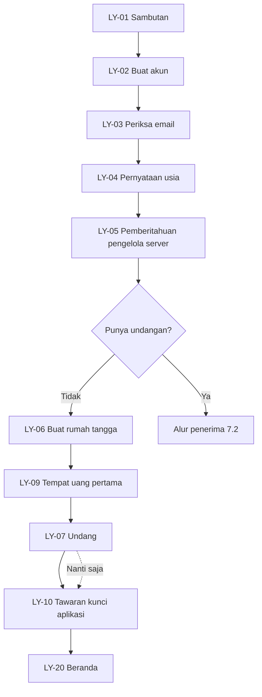
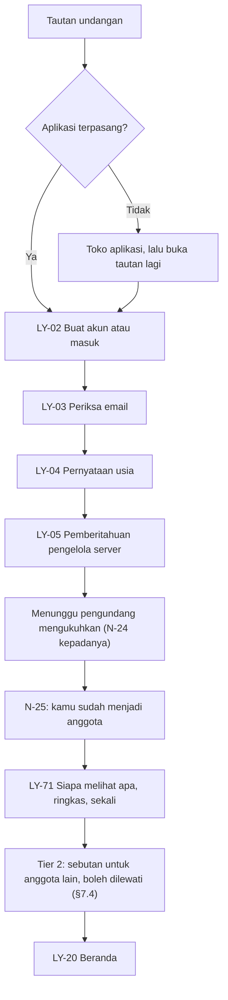
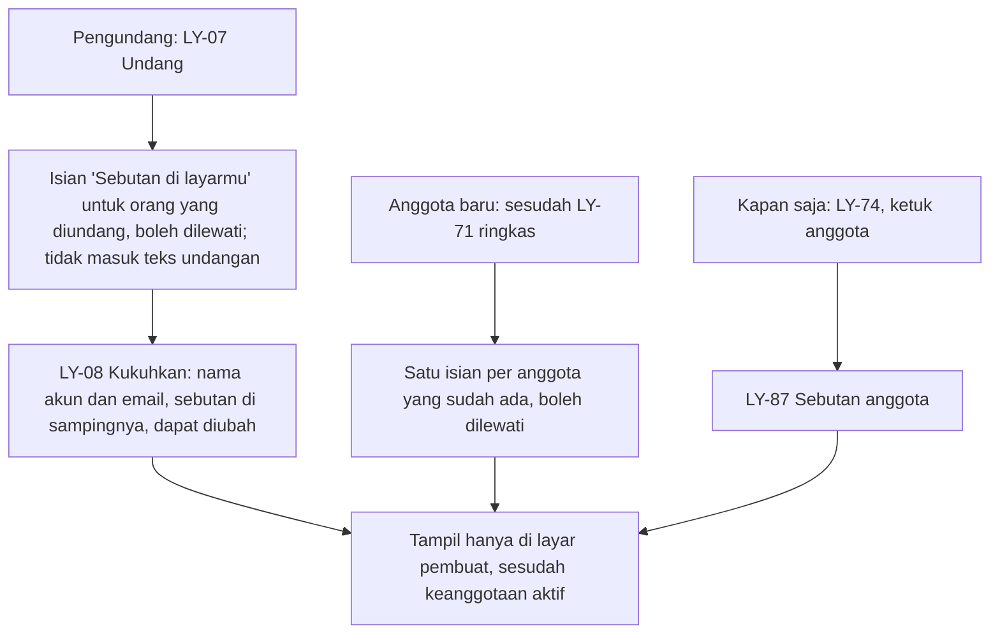
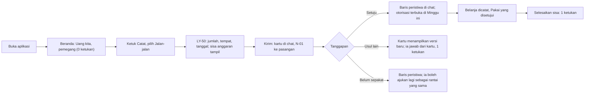
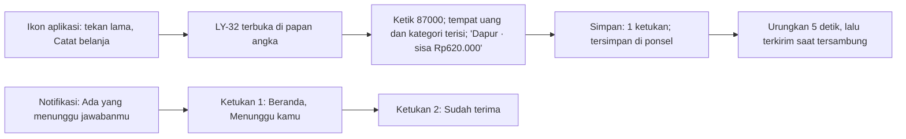
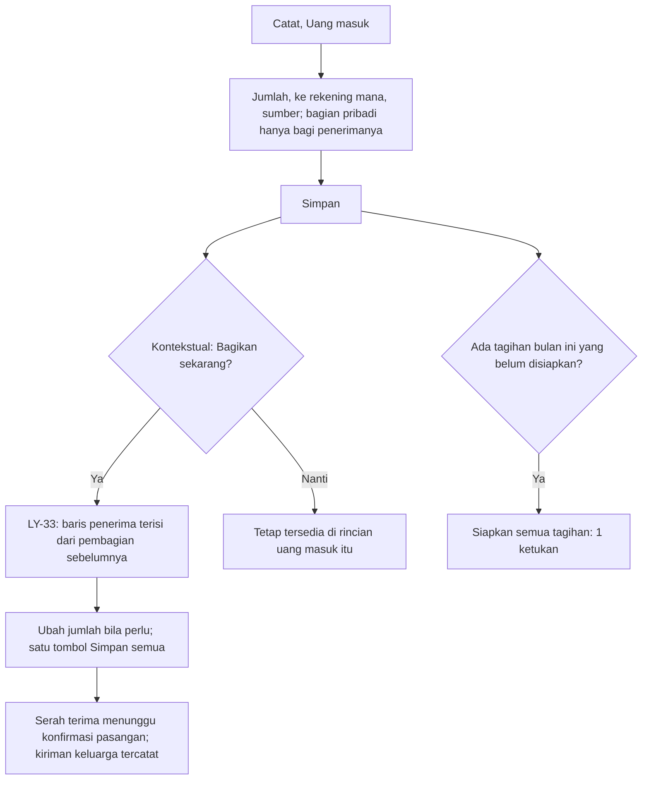
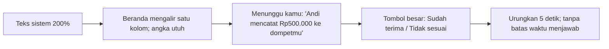
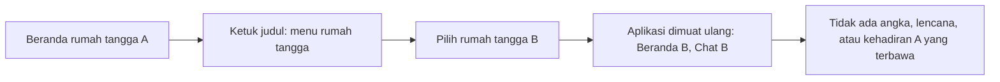

# 08 — Strategi UX dan UI

| | |
|---|---|
| Status | Draf pertama, tahap S4 fase C (12 November 2026); diperbaiki di fase D (12 November 2026) atas temuan `critic` B (CS-B-10, CS-B-14, CS-B-15, CS-B-16), permintaan 09 indeks §8, 10 indeks §6, dan 18 §2.12; susulan fase D (12 November 2026): kata layar dari 07 §1.4 dan §2.1, jeda urungkan menurut 06 S-7 dan P-41, LY-32 dan list–detail Android menurut ADR-023 butir 5, layar 10-G (SEC-153, SEC-154; 06 §16.12), lipat N-28 (SEC-57). **Sesudah checkpoint S4 (12 November 2026):** keputusan pemilik produk dicatat (§22): arah C menjadi identitas visual dan diuraikan menjadi sistem kerja (§19), termasuk bagian anti-templat (§19.8) dan pemeriksaan warna uang (§19.9); UX-2 sampai UX-5 dan S4-5 diterapkan (§5.1 LY-78, §10.3, §12.1, §18.1); huruf yang bergantung pada S4-1 (iii), S4-3 (ii), S4-4 (i), S4-6 (ii), dan S4-7 dihapus dari §5, §7, §9, §10.7, §17, §18.3, §21; fitur baru F-FAM-021 sebutan anggota (Tier 2, §7.4, LY-87), diselaraskan dengan SEC-155 dan 10 indeks §7.3; teks final pemberitahuan pengelola (§7.5); kalimat kesepakatan ambang (§18.3). **S5 fase D (12 November 2026):** *tahan tulis* tampil sebagai keadaan antre biasa dan perintah pelindung tetap seketika (§10.2, §13.2, §18.3; ADR-028 butir 3, SEC-151); contoh layar gerbang §19.8 dipakai ulang untuk wawancara 13 §6.3 (§19.8); kalimat status Plus untuk tahap publik (§18.3). **Atas tinjauan ulang `critic` S5 B2 (12 November 2026):** CR5-B-10, keluar dan ekspor tidak lagi diberi kalimat gangguan saat *tahan tulis* (§13.2); CR5-B-11, status Plus "setiap anggota berakun" (§18.3); ketetapan lead, "Salinan data saya" (FR-FAM-013/AC-12) dibangun FS-1 dan masuk LY-75 (§5.1, §21). **Atas keputusan 42 (12 November 2026), platform pilot iOS dan iPadOS:** tata letak iPad mini 7 untuk alur Tier 1 pemilik produk siap di GR-2 (§16, §16.2); rancangan Android tetap utuh, waktu bangunnya mengikuti keputusan (§0, §16, §16.4); sasaran waktu mencatat dan kata perangkat di layar diselaraskan (§9.1, §18.1); gerbang contoh layar memuat iPad (§19.8); permintaan baru di §23.1, fakta baru di §23.2, sumber [S13] sampai [S15]; SEC-59 (b), (c), (d) dengan FR-FAM-021/AC-10 dan FR-NTF-005/AC-6, AC-7: kalimat tablet di LY-10 (§12.3), judul jendela hanya nama tujuan dan tanpa permukaan sistem berdata (§16.2), kalimat perangkat penerima (LY-71, LY-85), §21. Belum ditinjau `critic`. Tidak ada isi yang diterima pemilik produk kecuali yang disebut dengan kedudukannya |
| Pemilik | `ux-designer` |
| Tingkat kedalaman | Tier 1 penuh (brief §1.1); Tier 2 ringkas; Tier 3 daftar saja. Rancangan berlaku untuk setiap rumah tangga tahap publik; rumah tangga pilot adalah pemakai pertamanya (brief §1.1, "Tiers set what is built first, not what is designed") |
| Masukan | Brief §1, §1.1, §3, §4, §5B, §5K, §5O, §10, §16; `CLAUDE.md`; `ENGINEERING-STANDARDS.md` §3, §4; dokumen 00, 02, 03, 04, 05 (FAM, FIN-1, REQ, NTF, COM, tier-2), 06 (§11, §13, §16), 07 (§1.4, §2.1), 10 (indeks §6 dan bagian yang dirujuknya), 11 (IDEA-04, 07, 19), 12, 17 ("Dibawa ke S4"), 18 (§2.9, §4, §5.1); `_progress.md` |
| Dipakai oleh | `ios-dev` dan `android-dev` di fase bangun; `ux-designer` yang meninjau setiap layar yang dibangun (`CLAUDE.md`, tim bangun); dokumen 13 dan 14 di S5 |
| Bukan kode | Layar diuraikan dengan kata, tabel, dan Mermaid. Nama komponen platform disebut agar tim bangun tahu bentuk aslinya, bukan sebagai kode |

## Peta isi

| § | Isi |
|---|---|
| 0 | Cara membaca, label, pengenal, keputusan yang mengikat dokumen ini |
| 1 | Jawaban sembilan pertanyaan brief §10.4 |
| 2 | Sepuluh pemeriksaan desain |
| 3 | Arsitektur informasi |
| 4 | Navigasi per platform dan per ukuran jendela |
| 5 | Inventaris dan hierarki layar |
| 6 | Halaman depan |
| 7 | Onboarding |
| 8 | Perjalanan utama per persona |
| 9 | Pola interaksi |
| 10 | Chat rumah tangga dan kartu objek |
| 11 | Notifikasi |
| 12 | Informasi peka: menyamarkan angka dan layar kunci |
| 13 | Keadaan kosong, galat, luring, memuat |
| 14 | Permintaan izin sistem |
| 15 | Aksesibilitas |
| 16 | Ponsel, tablet, dan perangkat lipat |
| 17 | Sistem desain di atas komponen native |
| 18 | Kata-kata dan nada |
| 19 | Identitas visual: arah C sebagai sistem kerja, anti-templat, warna uang |
| 20 | Catatan keputusan desain sasaran dewasa (SEC-82) |
| 21 | Pemenuhan persyaratan dokumen 10 untuk dokumen 08 |
| 22 | Keputusan checkpoint S4 yang mengikat dokumen ini |
| 23 | Permintaan kepada pemilik dokumen lain, fakta untuk dokumen 18, butir terbuka |
| 24 | Sumber |

---

## 0. Cara membaca

**Label** mengikuti brief §16: **[Terverifikasi]**, **[Asumsi]**, **[Usulan]**, **[Perlu validasi]**. "**[Usulan]**" tanpa nama berarti usulan `ux-designer`. Fakta pedoman platform yang sudah diteliti dikutip dari dokumen 18 dengan nomor bagiannya; fakta yang saya periksa sendiri untuk dokumen ini diberi sumber dan tanggal akses di §24 dan didaftar untuk `researcher` di §23.2.

**Pengenal.** Dokumen ini memakai satu awalan baru, `LY-NN`, untuk layar (§5). Lead diminta menambahkannya ke tabel pengenal `README.md`. Butir lain dirujuk dengan pengenal dokumen asalnya (`FR-`, `F-`, `SEC-`, `N-`, `PRN-`, `Q-`).

**Kolom iOS dan Android.** Setiap pola diberi bentuk iOS dan bentuk Android. Yang sama di kedua aplikasi hanya warna merek, ikon (maknanya), kata-kata, dan arsitektur informasi (brief §10.1). Bila sebuah baris hanya menyebut satu bentuk, bentuk yang lain mengikuti pedoman platformnya tanpa tambahan.

**Yang mengikat dokumen ini dan tidak diubahnya.**

| Hal | Kedudukan | Sumber |
|---|---|---|
| UI native penuh: Swift (SwiftUI) untuk iPhone dan iPad, Kotlin (Jetpack Compose, Material 3) untuk Android | Diputuskan pemilik produk: "Swift + Kotlin saya setuju untuk apple dan android catat dulu yaa, tinggal backend." | `_progress.md`, 12 November 2026 |
| Identitas visual sendiri, dibangun di dalam komponen native | Arahan pemilik produk sebagai syarat untuk dokumen ini; kata-katanya atas sketsa lead: "keliatan banget AI SLOP nya kaya gak ada seni tersendiri, standar app atau layout profesional, pallet warna font ... harusnya kita membangun kesan untuk aplikasi kita sendiri". Dua arah buatan lead ("Nila dan Kunyit", "Struk") ia tolak ("ai slop semua") dan tidak dipakai | `_progress.md`, "Arahan pemilik produk tentang tampilan (11 November 2026)" |
| Contoh halaman depan Android hitam dengan satu aksen hijau limau dan huruf Manrope | **Gambaran yang ia terima sebagai arah kasar, bukan keputusan desain**; kata-katanya: "oke sudah bagus untuk gambaran mah, tapi nanti layout tata letak tetep di s4 yaa supaya enak nyaman di semua menu dan fiturnya". Digantikan arah C di checkpoint S4 (baris berikut) | Sama |
| Identitas visual arah C: terang dan tenang, aksen hijau kebiruan tua, Plus Jakarta Sans | **Diterima atas saran lead** di checkpoint S4 (S4-10 (i) C). Ia bertanya lebih dulu (disalin utuh): "standar dan bagus nya di zaman sekarang gimana? coba research orang orang suka gimnaa? bagusnya gmna? cleannya gmna? profesionalnya gmna?"; sesudah riset 18 §4.10 disajikan dan lead menyarankan C dengan syarat glif, ikon aplikasi, dan nada dikerjakan sungguh-sungguh agar tidak terasa templat, ia menjawab: "oke saya ikut saran kamu aja". Syarat itu bagian dari saran yang ia terima, dan menjadi §19.8 | `_progress.md`, "Checkpoint S4: jawaban pemilik produk", jawaban kelima dan keenam |
| Responsif di ponsel Android, iPhone, iPad, tablet Android, ponsel lipat termasuk layar ganda; mode gelap dan terang; UI percakapan dikerjakan sungguh-sungguh | Syarat pemilik produk | Sama |
| Perangkat lipat | Ditunda pemilik produk ("masalah perangkat simpan dulu aja desainnya yang penting"); bawaan (c) kelas ukuran jendela ditambah emulator tetap berlaku (bacaan lead **[Usulan]**) | 17 S3-10 (i), Q-120 |
| Chat dengan tanda terkirim dan dibaca, kehadiran | Tanda pada pesan chat: pernyataan pemilik produk sendiri ("ada tanda di baca/delivery chat itu wajib loh"); tanda pada kartu: diterima atas saran lead; kehadiran "Semua seperti WhatsApp": diputuskan sendiri, berlawanan dengan saran lead, dan **dipertahankannya di checkpoint S4** (S4-5 (i) A, diputuskan sendiri; kata-katanya: "A tetap seperti WhatsApp"): digerakkan pemakaian di bagian mana pun aplikasi. "Terakhir aktif" dengan menit tepat (S4-5 (ii) A) adalah bacaan lead atas kalimat yang sama, dikukuhkan lewat "lanjut" (§10.3) | `_progress.md`, "Checkpoint S4", jawaban pertama dan keputusan yang dikukuhkan |
| Sapaan aplikasi "kamu"; tema iPhone dan iPad ikut sistem; angka tampil saat dibuka | S4-10 (iv) A: bacaan lead atas "kamu aja", dikukuhkan lewat "lanjut"; (ii) A dan (iii) A tidak ia sebut, jatuh ke bawaan dan dikukuhkan dengan "lanjut" | Sama |
| Sebutan anggota per pembaca (F-FAM-021, Tier 2) | Permintaan pemilik produk sendiri (kata-katanya: "sapaan di atur pas nambah keluarga. suami boleh atur sapaan ke semua anggotanya begitupun yang lain"); usulan lead, hanya pembuatnya yang melihat dan Tier 2, ia terima: "3 ya" (§7.4) | Sama, jawaban ketiga dan kelima |
| Layar kunci N-28 "Ada kabar baru" | Bentuk (a), diterima lewat "lanjut" (S3-8 (vii)) | 17 S3-8 |
| Hanya komponen dan API stabil | Aturan keras: versi stabil terbaru, tanpa alpha, beta, rc, atau API berlabel eksperimental kecuali lewat ADR. Komponen Material 3 Expressive tidak dipakai sampai rilis stabil yang memuatnya terbit (§17.1) | `ENGINEERING-STANDARDS.md` §8 (kalimat ADR-023 dipasang lead sesudah S4-1 (iii) A); ADR-012 butir 4 dan 5; ADR-023 |
| Versi OS minimum iOS dan iPadOS 26, Android 10 | Diputuskan pemilik produk di checkpoint S4 (S4-3 (ii) A). Status ADR-012 butir 2 diperbarui `architect` | `_progress.md`, "Checkpoint S4" |
| Platform pilot: iOS dan iPadOS lebih dulu; pilot dengan data nyata di iPhone 13 (istri, pencatat utama) dan iPad mini 7 (pemilik produk: gaji, pembagiannya, membaca angka); GR-2 tidak menunggu Android | **Keputusan 42**, dinyatakan pemilik produk sendiri; kata-katanya: "ios ipad yang bakalan dipakai pilot ya". Bawaan lead **[Usulan]** yang dapat ia ubah: Android dibangun sesudah GR-2 untuk Galaxy A55 miliknya, paling lambat sebelum GR-4. Berbeda dengan brief §1 baris "Pilot devices" ("the pilot needs iOS and Android") dan baris "Platforms" ("Phones come first"); keputusan menang, perbedaannya dicatat di 17. **Akibat di dokumen ini:** tata letak iPad mini 7 untuk alur Tier 1 pemilik produk siap di GR-2 (§16.2); rancangan Android (Material 3) tidak dikurangi, hanya waktu bangunnya yang mengikuti keputusan | `_progress.md`, "Keputusan pemilik produk: platform pilot (12 November 2026)" |

**Dua batas evidensi.** (1) Saya tidak melihat gambar. Rupa aplikasi rujukan di dokumen ini hanya dikutip dari 18 §4.10.2, tempat `researcher` membuka tangkapan layar App Store sebelas aplikasi keuangan dengan batas yang ia nyatakan sendiri (materi pemasaran pilihan vendor, satu tema, warna disebut dengan mata); di luar itu `researcher` membaca halaman sebagai teks (18 §4.0). (2) Uji langsung aplikasi pesaing (R-02) belum dilakukan, jadi sasaran kecepatan mencatat di §9.1 adalah **[Asumsi]** dari `ENGINEERING-STANDARDS.md` §3 dan dari pola di dokumen 03 §2.4, bukan dari pengukuran.

---

## 1. Jawaban sembilan pertanyaan brief §10.4

| # | Pertanyaan | Jawaban | Rincian |
|---|---|---|---|
| 1 | Apa yang langsung terlihat saat membuka aplikasi, dan apakah berbeda per persona? | **Beranda**: angka *Uang kita* dan siapa memegangnya, lalu "Menunggu" (yang menunggu saya dan yang menunggu pasangan), lalu "Minggu ini" (tagihan, cicilan, persetujuan yang masih terbuka), lalu dua atau tiga sisa anggaran yang dipilih pelihatnya. **Strukturnya sama bagi setiap anggota dewasa** (PRN-01, PRN-09); yang berbeda hanya baris yang memang milik pelihat: "Uang pribadi saya", isi "Menunggu kamu", dan kategori yang ia sematkan. Tidak ada beranda menurut peran, hubungan, atau siapa yang berpenghasilan | §6 |
| 2 | Bagaimana keuangan yang rumit tetap mudah dipahami? | Satu angka utama yang hanya berisi uang yang benar-benar ada (07 *uang yang ada*); semua yang lain dijelaskan sebagai **baris di bawahnya dengan kata keluarga** ("Disiapkan untuk tagihan", "Disisihkan untuk tabungan", "Menunggu Sari mengonfirmasi"), tidak dikurangkan diam-diam. Tidak ada istilah akuntansi di layar (§18.2). Grafik hanya di ringkasan bulanan, selalu dengan angka dan label | §6, §17.4, §18 |
| 3 | Bagaimana permintaan dan persetujuan muncul dan diselesaikan dalam satu atau dua ketukan? | Permintaan lahir sebagai **kartu di chat** (06 §16.2) dan sebagai butir "Menunggu kamu" di Beranda. Dari kartu: **satu ketukan** ("Setuju", "Usul lain", "Belum sepakat"). Dari notifikasi: ketukan pertama membuka layar permintaan itu langsung, ketukan kedua menjawab. Setiap jawaban punya jeda "Urungkan" 5 detik di ponsel sebelum dikirim **[Usulan]**; pesan chat dan perintah pelindung tidak ditahan (§9.3). Tidak ada tombol jawab di notifikasi, karena layar kunci tidak boleh membuka isi (SEC-51) | §9.2, §10.4 |
| 4 | Bagaimana tindakan yang paling sering memakan sangat sedikit langkah? | Satu tombol **Catat** di setiap tujuan utama (Android: FAB; iOS: tombol utama di bilah navigasi dengan menu tekan-lama), lembar catat yang langsung membuka papan angka dengan tempat uang dan kategori terisi dari catatan terakhir, sisa anggaran tampil tanpa ketukan tambahan, tombol "000", dan pintasan dari ikon aplikasi. Belanja yang berulang: ketik jumlah, satu ketukan Simpan | §9.1 |
| 5 | Bagaimana anggota yang lebih tua bernavigasi dengan nyaman? | Empat tujuan saja di Tier 1 dengan label kata (bukan ikon saja); sasaran sentuh 48 pt/dp untuk tindakan utama; tata letak yang mengalir ulang sampai teks 200% dan ukuran aksesibilitas Dynamic Type tanpa memotong jumlah uang; setiap gestur punya jalan berupa tombol; "Urungkan" setelah setiap tindakan sendiri, kecuali pesan chat dan perintah pelindung, yang tidak pernah ditahan (§9.3); tidak ada "mode lansia" yang memperlakukan orang dewasa sebagai tanggungan (03 §6) | §15 |
| 6 | Bagaimana pengguna berpindah rumah tangga? | Dibangun di Tier 3 (F-FAM-009); dirancang sekarang. Nama rumah tangga adalah judul Beranda; bila orang itu anggota lebih dari satu rumah tangga, judul itu menjadi pemilih (iOS: menu pada judul; Android: menu pada judul bilah atas; iPad dan layar lebar: kepala sidebar atau rail). Berpindah memuat ulang seluruh aplikasi untuk rumah tangga itu; tidak ada layar, notifikasi, lencana, atau angka yang menggabungkan dua rumah tangga | §4.4 |
| 7 | Bagaimana informasi peka disembunyikan? | Tombol **"Sembunyikan angka"** (ikon mata) di Beranda dan Uang, setelan pribadi per perangkat, yang menyamarkan semua jumlah di seluruh aplikasi; angka tampil saat pertama dibuka dan pilihan mata diingat per perangkat (S4-10 (iii) A); fitur ini F-FIN-027, Tier 3 Could menurut 05, jadi di pilot perlindungannya adalah yang berikut; kunci aplikasi (SEC-19); pengalih aplikasi selalu ditutup layar netral (SEC-20); layar kunci hanya teks kelas (SEC-51). Status suasana hati dan sakit (Tier 2) tidak pernah tampil di Beranda pasangan | §12 |
| 8 | Fitur apa yang muncul kontekstual, bukan di menu? | "Bagikan" sesudah mencatat uang masuk; "Siapkan uang tagihan" bila ada tagihan yang belum disiapkan; "Pakai yang disetujui" saat mencatat belanja yang cocok dengan otorisasi terbuka; "Selesaikan sisa" pada permintaan yang belanjanya sudah tertaut; "Minta konfirmasi" pada catatan bertanda; "Hitung uang" pada tempat uang tunai; "Kirim ke chat" pada setiap objek yang boleh menjadi kartu; "Minta anggaran" saat catatan baru akan melewati ambang | §9.4 |
| 9 | Bagaimana fitur yang banyak tidak menjadi menu yang melelahkan? | Empat tujuan di Tier 1 (Beranda, Uang, Chat, Saya), lima di Tier 2 (tambah Rumah); semua pekerjaan uang di satu daftar "Uang" yang bersekat; pembuatan apa pun lewat satu "Catat"; tindakan lanjutan muncul pada objeknya (pertanyaan 8); rincian opsional terlipat di "Tambah rincian". Tidak ada layar pengaturan izin di pilot (S3-1 (a)) | §3, §4 |

---

## 2. Sepuluh pemeriksaan desain

Kata sifat brief §10.1 (hangat, tenang, premium, dan seterusnya) tidak dapat gagal (02 PRN-07 "Biaya yang diterima"). Dokumen ini menerjemahkannya menjadi pemeriksaan yang dipakai `ux-designer` saat meninjau setiap layar yang dibangun. Semua **[Usulan]** kecuali yang menunjuk sumber.

| # | Pemeriksaan | Gagal bila |
|---|---|---|
| 1 | Komponen sistem dulu | Ada bilah navigasi, tab bar, lembar, menu, dialog, tombol, atau daftar yang digambar sendiri padahal komponen sistemnya ada (brief §10.1; PRN-07) |
| 2 | Kaca hanya di lapisan kontrol | Ada Liquid Glass di lapisan isi di iOS (18 §4.3, HIG Materials), atau warna merek menutup kaca bilah selain pada tombol utama dan tab terpilih |
| 3 | Satu angka utama, tanpa campuran | Angka utama memuat anggaran, target, alokasi, atau dana pribadi (PRN-01) |
| 4 | Kata keluarga | Ada kata dari kolom kiri 07 §1.4 atau dari §18.2 di layar (PRN-07) |
| 5 | Warna bukan satu-satunya pembeda | Uang masuk, uang keluar, tanda, status permintaan, atau tanda dibaca dibedakan dengan warna saja (WCAG 1.4.1; 18 §4.6) |
| 6 | Tanpa penilaian atas orang | Ada warna merah, ikon peringatan, atau kata pelanggaran pada tanda, keberatan, selisih, atau permintaan yang belum dijawab (arah 1, 02 §0; Q-119) |
| 7 | Teks 200% | Ada jumlah uang yang terpotong, elipsis, atau tumpang tindih pada teks 200% Android atau ukuran aksesibilitas terbesar Dynamic Type |
| 8 | Ruang jendela, bukan jenis perangkat | Tata letak bercabang pada "ponsel" lawan "tablet", atau ada fungsi yang hilang di jendela sempit (18 §4.5 butir 1) |
| 9 | Tanpa unsur indikator D | Ada unsur di §20 tanpa keputusan tercatat (SEC-82) |
| 10 | Tidak ada yang menunggu jaringan | Mencatat, membaca angka terakhir, atau menulis pesan menunggu sambungan (PRN-06; 06 S-7) |

Pemeriksaan 11 sampai 15 (identitas tanpa templat) ada di §19.8.

---

## 3. Arsitektur informasi

### 3.1 Prinsip penyusunan

1. **Menurut pertanyaan keluarga, bukan menurut modul.** Pengguna tidak melihat `FIN`, `REQ`, atau `NTF`. Ia melihat "Uang kita sisa berapa" (Beranda), "Ke mana perginya dan apa yang kita punya" (Uang), "Kita bahas dan putuskan" (Chat), dan "Urusan saya sendiri" (Saya). Kolom kanan 04 §9.1 adalah sumbernya.
2. **Objek tinggal di satu tempat, tampil di banyak tempat.** Permintaan tinggal di layar permintaannya; ia tampil sebagai kartu di Chat dan sebagai butir di "Menunggu". Catatan tinggal di riwayat tempat uangnya; ia tampil di anggaran kategorinya dan, bila dikirim, di Chat. Tidak ada salinan, sehingga tidak ada dua keadaan yang berbeda (06 §16.2 "Isi kartu").
3. **Yang pribadi selalu berlabel pribadi.** Setiap tampilan dana pribadi, setelan pribadi, dan status `CARE` yang belum dibagikan membawa keterangan "Hanya kamu yang melihat ini" (PRN-12; SEC-87).
4. **Rancangan untuk N anggota dewasa.** Layar tidak mengandaikan tepat dua orang: daftar pemegang, pihak "Menunggu", dan pemberi persetujuan ditampilkan sebagai daftar nama. Pada pilot daftarnya berisi satu nama lain (PRN-03).

### 3.2 Peta

```mermaid
graph TD
    APP[Aplikasi] --> B[Beranda]
    APP --> U[Uang]
    APP --> C[Chat]
    APP --> R["Rumah (Tier 2)"]
    APP --> S[Saya]
    APP -.-> CT(("Catat"))

    B --> B1[Uang kita dan pemegang]
    B --> B2[Menunggu]
    B --> B3[Minggu ini]
    B --> B4[Anggaran yang disematkan]

    U --> U1[Tempat uang dan riwayatnya]
    U --> U2[Anggaran bulan ini]
    U --> U3[Tagihan dan cicilan]
    U --> U4["Utang dan pinjaman, per orang"]
    U --> U5[Tabungan]
    U --> U6[Harta dan harta bersih]
    U --> U7[Ringkasan bulanan]
    U --> U8[Uang pribadi saya]
    U --> U9["Kesepakatan: ambang, hari mulai, jatah"]

    C --> C1[Pesan, foto, kartu, baris peristiwa]

    R --> R1[Tugas dan permintaan tindakan]
    R --> R2[Daftar belanja]
    R --> R3[Masalah rumah]
    R --> R4[Rutinitas dan rencana]

    S --> S1[Siapa melihat apa]
    S --> S2[Notifikasi dan jam tenang]
    S --> S3[Keamanan: kunci aplikasi, sesi]
    S --> S4["Keanggotaan, sebutan anggota (Tier 2), keluar"]
    S --> S5[Pihak luar]
    S --> S6[Bantuan]
    S --> S7["Pendamping (Tier 2)"]

    CT --> CT1[Belanja]
    CT --> CT2[Uang masuk]
    CT --> CT3["Kasih ke / terima dari"]
    CT --> CT4[Minta anggaran]
    CT --> CT5["Jalan-jalan"]
```

**Mengapa "Menunggu" bukan tab.** 04 F-REQ-012 meminta satu daftar yang sama bagi keduanya. Bila menjadi tab, ia menjadi kotak masuk yang menekan; di Beranda ia hanya bagian yang kosong bila tidak ada yang menunggu. Daftar lengkapnya satu ketukan dari Beranda (LY-21).

**Mengapa Chat tab tersendiri, bukan hanya diskusi di objek.** Keputusan pemilik produk (chat naik Tier 1, "Reply nempel ke kartu") menjadikan chat tempat utama permintaan dan diskusinya. Di layar lebar Chat juga dapat tampil sebagai panel pendamping di samping Beranda atau Uang (§16).

### 3.3 Yang sengaja tidak ada di Tier 1

| Tidak ada | Alasan |
|---|---|
| Layar pengaturan izin, peran, wewenang | S3-1 (a); preset dua dewasa setara (F-FAM-004) |
| Umpan kegiatan per orang, papan skor, riwayat lintas objek menurut orang | PRN-11; 06 AT-4 |
| Pencarian | Tier 3 untuk chat (brief §1.1); untuk uang tidak diminta FR Tier 1. Riwayat tempat uang dan kategori sudah tersaring menurut tempatnya **[Usulan]** |
| Grafik di Beranda | PRN-07 ("Layar pertama berisi enam grafik" adalah contoh pelanggaran) |
| Widget, Live Activity, komplikasi, tampilan layar luar berisi data | SEC-54 |
| Pengingat "kamu belum mencatat" | PRN-08; D-75 |

---

## 4. Navigasi per platform dan per ukuran jendela

### 4.1 Tujuan tingkat atas

| Urutan | Tujuan | Ikon (makna, sama di kedua platform) | Tier |
|---|---|---|---|
| 1 | Beranda | Rumah | 1 |
| 2 | Uang | Dompet | 1 |
| 3 | Chat | Gelembung percakapan | 1 |
| 4 | Rumah | Daftar centang | 2 (menjadi lima tujuan; tetap dalam batas lima, 18 §4.3 HIG Tab bars) |
| 5 | Saya | Orang | 1 |

Label kata selalu tampil di bawah atau di samping ikon. Lencana angka hanya pada Chat (pesan yang belum dibaca pembacanya sendiri, 06 §16.5 "Yang tidak ada") dan pada Beranda (jumlah hal `perlu_tanggapan` milik pembaca, sama dengan lencana ikon aplikasi, SEC-53). Tidak ada lencana pada Uang atau Saya.

### 4.2 Tiga keadaan tata letak

Tata letak dipilih menurut ruang jendela, tidak menurut jenis perangkat (18 §4.5 butir 1). Dokumen ini memakai tiga keadaan yang dapat dinyatakan di kedua platform **[Usulan]**:

| Keadaan | Android (lebar jendela, 18 §4.4) | iOS / iPadOS (18 §4.3) | Contoh perangkat **[Asumsi]** ukurannya |
|---|---|---|---|
| **Ringkas** | Compact, < 600 dp | Lebar *compact* | iPhone 13 (sekitar 390 pt); Galaxy A55 (sekitar 384 dp, hitungan lead, `_progress.md`); layar luar ponsel lipat; jendela iPad yang sempit |
| **Sedang** | Medium, 600–839 dp | Lebar *regular* dengan ruang yang belum cukup untuk dua kolom isi (ditentukan oleh `NavigationSplitView` sendiri) | iPad mini 7 potret layar penuh (sekitar 744 pt); ponsel lipat terbuka potret; tablet 8 inci potret |
| **Lebar** | Expanded dan lebih, ≥ 840 dp | Lebar *regular* dengan ruang dua kolom atau lebih | iPad mini 7 lanskap (sekitar 1133 pt); tablet 10 inci lanskap; ponsel lipat terbuka lanskap |

Tinggi *compact* (ponsel lanskap, Android < 480 dp) diperlakukan sebagai Ringkas dengan isi yang dapat digulir dan papan angka yang tidak menutupi tombol Simpan.

### 4.3 Bentuk navigasi

| Keadaan | iOS / iPadOS | Android |
|---|---|---|
| Ringkas | Tab bar yang mengambang di bawah (Liquid Glass; 18 §4.3). Pada daftar panjang tab bar boleh mengecil saat menggulir ke bawah (`tabBarMinimizeBehavior`, API iOS 26, §24 [S6]; minimum iOS 26 sudah diputuskan, S4-3 (ii) A, jadi tanpa cabang versi). Tiap tab punya `NavigationStack` sendiri dengan judul besar | `NavigationSuiteScaffold` menampilkan navigation bar (18 §4.4); tiap tujuan punya tumpukan navigasinya sendiri; bilah atas Material 3 |
| Sedang | Tab bar di atas yang dapat diubah pengguna menjadi sidebar (`sidebarAdaptable`; 18 §4.3) | Navigation rail (bawaan `NavigationSuiteScaffold`) |
| Lebar | Sidebar (`sidebarAdaptable`) dengan sub-bagian Uang sebagai butir sidebar; `NavigationSplitView` di dalam Uang | Navigation rail. **Drawer permanen tidak dipakai**: lima tujuan muat di rail, dan drawer tidak menambah apa pun bagi daftar sependek ini (ponytail) **[Usulan]** |
| Postur tabletop (Android) | — | Navigation bar (bawaan `NavigationSuiteScaffold` untuk tabletop; 18 §4.4) |

**Kembali.** iOS: tombol kembali sistem dan gestur geser dari tepi. Android: gestur dan tombol kembali sistem, termasuk predictive back yang disediakan Compose **[Perlu validasi]** versi pustakanya di fase bangun. Lembar catat yang berisi isian tidak hilang karena gestur kembali: isiannya tetap sebagai draf (§9.3).

### 4.4 Berpindah rumah tangga (dirancang sekarang, dibangun Tier 3)

| Hal | Rancangan |
|---|---|
| Tempat | Judul Beranda adalah nama rumah tangga. Bila orang itu anggota satu rumah tangga, judul hanya teks. Bila lebih, judul punya tanda pemilih: iOS menu pada judul navigasi; Android menu pada judul bilah atas. Di Sedang dan Lebar: kepala sidebar (iOS) atau kepala rail (Android) |
| Akibat | Seluruh aplikasi dimuat ulang untuk rumah tangga terpilih: tab kembali ke Beranda, tumpukan navigasi dikosongkan, Chat menjadi chat rumah tangga itu |
| Yang tidak pernah ada | Angka gabungan, daftar "Menunggu" gabungan, lencana gabungan, notifikasi yang menyebut nama rumah tangga (06 §11.1), atau kehadiran yang terbaca di rumah tangga lain (06 §16.2 `presence` per rumah tangga) |
| Notifikasi | Teks kelas umum; membukanya bertanya "di rumah tangga mana" hanya bila perlu, lewat pengenal buram yang ditarik sesudah dibuka (SEC-50) **[Usulan]** |
| Persona | PSN-07 (03 §3) |

---

## 5. Inventaris dan hierarki layar

### 5.1 Tier 1

Kolom "Bentuk" menyebut wadah native; isinya diuraikan di bagian yang ditunjuk.

| LY | Layar | Isi dan tujuan | Fitur | Bentuk iOS | Bentuk Android |
|---|---|---|---|---|---|
| **Masuk dan onboarding (§7)** | | | | | |
| LY-01 | Sambutan | Satu kalimat apa aplikasi ini; "Buat akun" dan "Sudah punya akun" | F-FAM-001 | Layar penuh tanpa tab bar | Layar penuh |
| LY-02 | Daftar dan masuk | Email, kata sandi minimal 12 karakter tanpa aturan komposisi (SEC-11); saran memakai email yang hanya dibuka sendiri (10.1 §9) | F-FAM-001 | Form; isian dengan `textContentType` email dan kata sandi baru agar pengelola kata sandi sistem bekerja | Form; autofill kata sandi sistem |
| LY-03 | Periksa email | Menunggu tautan verifikasi; kirim ulang | F-FAM-001 | Layar | Layar |
| LY-04 | Pernyataan usia | "Saya berusia 18 tahun atau lebih" tanpa tanggal lahir (SEC-80) | SEC-80, SEC-32 | Layar dengan satu kotak centang dan tombol | Sama |
| LY-05 | Pemberitahuan pengelola server | Teks final §7.5 (dari 10.1 §11.3, tanpa kalimat janji), dibaca utuh sebelum data apa pun (SEC-34, SEC-35) | F-FAM-008, FR-FAM-019 | Layar gulir; tombol aktif sesudah dibaca sampai akhir | Sama |
| LY-06 | Buat rumah tangga | Nama (wajib), zona waktu (terisi dari perangkat), hari mulai bulan anggaran (bawaan 1); mata uang hanya tampil bila produk mendukung lebih dari satu (FR-FAM-001) | F-FAM-001 | Form | Form |
| LY-07 | Undang | Pernyataan sebelum mengundang (FR-FAM-003/AC-1, AC-8; D-90), tombol bagikan dengan teks tanpa nama (SEC-29); pada Tier 2, isian sebutan opsional yang menempel pada undangan dan tidak pernah masuk teks undangan (§7.4; SEC-155 (a), (c)) | F-FAM-002; F-FAM-021 | Lembar bagikan sistem | Sharesheet sistem |
| LY-08 | Kukuhkan anggota | Email terverifikasi penerima utuh dan nama tampilannya; "pastikan ini email orang yang kamu undang" (SEC-31); pada Tier 2, sebutan yang dibuat di LY-07 tampil di samping nama akun, tidak menggantikannya, dan dapat diubah (§7.4; SEC-155 (d)) | F-FAM-002; F-FAM-021 | Layar dengan tombol "Kukuhkan" dan "Bukan dia" | Sama |
| LY-09 | Tempat uang pertama | "Di mana uang rumah tangga sekarang?" Tunai, rekening, e-wallet; pemegang; "Uang yang ada saat mulai" (saldo awal, F-FIN-001) | F-FIN-001 | Form berulang "Tambah lagi" | Sama |
| LY-10 | Tawaran kunci aplikasi | Sekali; mati secara bawaan; kalimat SEC-14; di iPad ditambah kalimat tablet (§12.3; SEC-59 (b), FR-FAM-021/AC-10) | SEC-19, SEC-59 | Layar dengan "Nyalakan" dan "Nanti" | Sama |
| **Tujuan utama** | | | | | |
| LY-20 | Beranda | §6 | F-FIN-002, F-FIN-010, F-REQ-012, F-FIN-015 | Tab, judul besar | Tujuan navigasi, bilah atas |
| LY-21 | Menunggu | Daftar lengkap: "Menunggu kamu" dan "Menunggu {nama}", masing-masing dengan umur objek (06 §16.2 "Menunggu sejak") | F-REQ-012 | Daftar bersekat | Daftar |
| LY-30 | Uang | Daftar bersekat ke LY-31 sampai LY-45 | F-FIN-* | Daftar `insetGrouped`; di Lebar menjadi kolom pertama `NavigationSplitView` | Daftar; di Lebar menjadi panel daftar list-detail |
| LY-31 | Tempat uang | "Ada Rp…" dan "Bisa dipakai Rp…" (§18.2), pemegang, bagian belum dikonfirmasi dan dikeberatani, riwayat catatan per tanggal kejadian; "Hitung uang" untuk tunai | F-FIN-001, F-FIN-002, F-FIN-017 | Layar dorong | Layar; panel rincian di Lebar |
| LY-32 | Catat | Lembar dengan pilihan jenis di atas: Belanja, Uang masuk, Kasih ke, Terima dari, Pindah; §9.1 | F-FIN-003, 005, 006, 007 | Lembar dengan detent sedang dan besar | Satu composable pembungkus milik kita dengan `ModalBottomSheet`, tercatat di ADR-023 butir 5 (S4-1 (iii) A; ADR-012 butir 5 (b)). Dialog layar penuh hanya cadangan bila API itu rusak atau ditolak (§17.4 baris Lembar) |
| LY-33 | Bagikan uang masuk | Satu layar banyak baris penerima: serah terima, kiriman keluarga, penyisihan, siapkan uang tagihan (06 §7.4; SCN-21) | F-FIN-004, F-FIN-014 | Layar dorong dari LY-32 | Sama |
| LY-34 | Hitung uang | Jumlah yang dihitung, selisih, rincian selisih; dompet campuran dua isian dalam satu layar (SCN-23) | F-FIN-017 | Lembar | Lembar |
| LY-35 | Anggaran bulan ini | Per kategori: batas, terpakai, sudah dijanjikan, sisa; rentang tanggal bulan anggaran | F-FIN-009, F-FIN-010 | Daftar | Daftar |
| LY-36 | Kategori | Catatan kategori itu bulan ini; ubah batas | F-FIN-009 | Layar | Layar |
| LY-37 | Tagihan dan cicilan | Tagihan berulang (pos rutin) dengan status kesepakatan **hanya di sini** (glosarium "Pos rutin"); kejadian bulan ini; cicilan dan sisanya; "Siapkan semua tagihan" | F-FIN-011, F-FIN-012, F-CAL-002 | Daftar bersekat | Daftar |
| LY-38 | Utang dan pinjaman | Dikelompokkan per pihak luar (IDEA-07 tingkat tampilan Tier 1): pinjaman terbuka, riwayat kiriman dan pelunasan, yang diikhlaskan sebagai baris tersendiri; tidak pernah dijumlahkan per "sisi keluarga" (SEC-93) | F-FIN-013 | Daftar per orang | Sama |
| LY-39 | Tabungan | Tujuan, jumlah disisihkan, target opsional sebagai angka dan batang informatif (SEC-82) | F-FIN-015 | Daftar | Daftar |
| LY-40 | Harta | Daftar harta (rumah, kendaraan, emas), nilai yang diisi sendiri, "Harta bersih" dengan cara hitungnya dalam kata | F-FIN-016 | Daftar | Daftar |
| LY-41 | Ringkasan bulanan | Tabel A sampai E (F-FIN-020) dalam kata keluarga; satu grafik per tabel paling banyak, selalu dengan angka | F-FIN-020 | Layar gulir; di Lebar dua kolom | Sama |
| LY-42 | Rincian catatan | Riwayat satu catatan (F-FIN-019): siapa mencatat, membayar, kapan kejadian; "Perbaiki", "Batalkan catatan", "Aku tidak sepakat", "Kirim ke chat", diskusinya | F-FIN-018, F-FIN-019, F-COM-010 | Layar | Layar |
| LY-43 | Uang pribadi saya | Buku pribadi; label "Hanya kamu yang melihat ini" | F-FIN-007 | Layar | Layar |
| LY-44 | Jatah pribadi | Jumlah per bulan, sisa milik sendiri, usul ubah | F-FIN-008 | Layar | Layar |
| LY-45 | Kesepakatan rumah tangga | Ambang permintaan, hari mulai bulan anggaran; usulan yang menunggu. Usulan ambang menampilkan kalimat kesepakatan ambang (§18.3) sebelum tombol "Setuju" | F-REQ-008 | Daftar | Daftar |
| **Permintaan** | | | | | |
| LY-50 | Minta anggaran / Jalan-jalan | Jumlah, untuk apa, kategori, tanggal opsional; untuk jalan-jalan juga tempat, rentang waktu, peserta, barang (F-REQ-002); sisa anggaran kategori tampil | F-REQ-001, F-REQ-002 | Lembar | Lembar |
| LY-51 | Rincian permintaan | Syarat versi terakhir, riwayat versi, diskusi, tombol menurut hak, pengingat (§9.5), belanja tertaut, "Selesaikan sisa" | F-REQ-003 sampai 007, 011 | Layar | Layar |
| LY-52 | Usul lain | Isian syarat yang terisi dari versi yang dibaca; batas dari server ditampilkan (06 §16.4) | F-REQ-003 | Lembar | Lembar |
| LY-53 | Selesaikan sisa | Empat situasi custody dalam kata (07 §3.8) | F-REQ-005 | Lembar | Lembar |
| **Chat (§10)** | | | | | |
| LY-60 | Chat | Satu percakapan rumah tangga | F-COM-001, 008 sampai 012 | Tab; di Lebar boleh menjadi panel `inspector` | Tujuan; di Lebar panel pendamping |
| LY-61 | Penampil foto | Layar penuh, simpan ke galeri atas pilihan sendiri | F-COM-001 | Layar penuh | Layar penuh |
| LY-62 | Sembunyikan pesan {nama} (F-COM-014, S4-7 A) | Konfirmasi menyembunyikan pesan bebas satu anggota di layar sendiri; jalan untuk menampilkannya lagi (§10.7) | SEC-153; 06 §16.12 | `confirmationDialog` | `AlertDialog` |
| LY-63 | Laporkan (F-COM-014, S4-7 A) | Pesan atau foto yang dipilih pelapor, teks opsional, tanda terima; di pilot membuka LY-76 dan jalan keluar (§10.7) | SEC-154; 06 §16.12 | Lembar | Lembar bawah (pembungkus yang sama dengan LY-32) |
| **Saya** | | | | | |
| LY-70 | Saya | Nama tampilan, foto opsional, daftar ke LY-71 sampai LY-79 | F-FAM-003 | Daftar | Daftar |
| LY-71 | Siapa melihat apa | Isi SEC-87 (a) sampai (f); sama bagi setiap anggota. Ditambah (SEC-59 (d)): "Setiap anggota membaca catatan rumah tangga di perangkatnya sendiri. Perangkat itu mungkin juga dipegang orang lain." Tidak menyebut siapa memakai kunci aplikasi (SEC-19) | FR-FAM-010, SEC-59 | Layar gulir | Sama |
| LY-72 | Notifikasi | Jam tenang, jam ringkasan, rincian di layar kunci tidak ditawarkan (SEC-51), tautan ke setelan sistem | F-NTF-002 sampai 005 | Form | Form |
| LY-73 | Keamanan | Kunci aplikasi, daftar sesi dan perangkat milik sendiri (SEC-16), ganti kata sandi | SEC-13, 16, 19, 21 | Form | Form |
| LY-74 | Keanggotaan | Anggota, "sudah keluar" (SEC-56), keluar dengan aman dan masa tenggangnya; pada Tier 2, tiap baris anggota lain membuka LY-87 sebutan (§7.4) | F-FAM-006; F-FAM-021 | Daftar | Daftar |
| LY-75 | Data saya | "Salinan data saya" selama aktif, sesudah autentikasi ulang LY-77: hanya data milik sendiri, tanpa kabar bagi anggota lain; dibangun FS-1, pilot (FR-FAM-013/AC-12, ketetapan lead; 10.3 SEC-107). Ekspor (SEC-101), hapus akun (SEC-105), batas penghapusan (FR-FAM-014/AC-4) | F-FAM-006 | Daftar | Daftar |
| LY-76 | Bantuan | Halaman statis SEC-134 | SEC-134 | Layar | Layar |
| LY-77 | Autentikasi ulang | Kata sandi akun (bukan biometrik saja) untuk tindakan SEC-13 | SEC-13 | Lembar | Lembar |
| LY-78 | Tampilan | Android: Terang, Gelap, Ikuti sistem (bawaan Ikuti sistem). iOS dan iPadOS: **layar ini tidak ada**; tema mengikuti setelan sistem (S4-10 (ii) A; HIG Dark Mode, 18 §4.6). Bunyi brief §10.2 sudah disesuaikan (D-111, dipasang lead 12 November 2026 sesudah pemilik produk menjawab "pasang semua"), jadi K-32 selesai | brief §10.2 | Tidak ada | Form |
| LY-79 | Pihak luar | Nama panggilan, tanpa data lain (F-FAM-007) | F-FAM-007 | Daftar | Daftar |

### 5.2 Tier 2 (ringkas)

| LY | Layar | Isi | Catatan desain |
|---|---|---|---|
| LY-80 | Rumah | Tugas (permintaan tindakan), daftar belanja, masalah rumah, rutinitas, rencana mendatang | Tujuan kelima. Satu daftar bersekat, bukan lima tab |
| LY-81 | Permintaan tindakan | Terima, tolak, batal, tandai selesai (F-REQ-013) | Kartu di chat dengan tombol 06 §16.4 baris "Permintaan tindakan" |
| LY-82 | Daftar belanja | Butir, perkiraan, centang; "Selesai belanja" menjadi pengeluaran (F-SHP-002) | Daftar bersama; perubahan bersamaan (SCN-18) tampil sebagai keadaan terbaru tanpa menyalahkan |
| LY-83 | Masalah rumah | Laporan dengan foto, menjadi tugas, biaya (F-MNT-001 sampai 003) | Foto lewat pemilih sistem (SEC-67) |
| LY-84 | Status saya | Suasana hati dari daftar tertutup, alasan opsional, sakit, "Butuh tenang hari ini" (IDEA-19); berbagi | Baris bantuan SEC-133 hanya bagi pemilik status berat; kata IDEA-19 §18.4 |
| LY-85 | Berbagi status | Penerima dipilih; kalimat SEC-62 sebelum penerima pertama, diikuti (SEC-59 (d)): "{nama} membacanya di perangkatnya sendiri, yang mungkin juga dipegang orang lain." Tidak menyebut apakah penerima memakai kunci aplikasi | Default tidak berbagi (brief §5K) |
| LY-86 | Pendamping | Ikut serta per fitur dengan kalimat SEC-126; nuansa religi pilihan sendiri | Mati secara bawaan; tidak ada fitur yang menunggu `AI` (PRN-06) |
| LY-87 | Sebutan anggota | Sebutan yang hanya terlihat oleh pembuatnya untuk satu anggota lain; ubah atau hapus (F-FAM-021) | §7.4. iOS: lembar; Android: lembar bawah (pembungkus LY-32) |
| — | Saran kata di chat | Baris saran di atas kotak tulis: "Pakai", "Saran lain", "Tutup" (Q-32 pilihan C); pesan terkirim tanpa penanda `AI` (brief §5O keputusan 2) | Tanpa ikon kilau; label kata "Saran kata" **[Usulan]** (§20 baris animasi) |
| — | Kata penyemangat | Satu kalimat di bagian atas Beranda, dapat ditutup (F-AI-001) | Tidak pernah memuat angka atau nama pasangan |

### 5.3 Tier 3 (daftar)

Pemilih rumah tangga (§4.4); profil tanggungan dan layar anak; tamu (asisten, pengasuh) dengan Beranda terbatas; pengaturan izin dan preset lain; pencarian chat dan uang; voice note, reaksi, grup; percakapan nasihat `AI`; persediaan; rencana menu; tujuan tabungan lanjutan; linimasa keluarga; integrasi kalender dan belanja daring; tata letak khusus tablet dan foldable di luar adaptasi §16; zona waktu per orang (F-CAL-006); cermin privasi dinamis (IDEA-20).

---

## 6. Halaman depan (LY-20)

### 6.1 Isi menurut urutan, keadaan Ringkas

| # | Bagian | Isi | Siapa melihat | Aturan |
|---|---|---|---|---|
| 0 | Judul | Nama rumah tangga; tombol "Sembunyikan angka" | Semua | §12 |
| 1 | Kata penyemangat (Tier 2) | Satu kalimat, dapat ditutup untuk hari itu | Yang menyalakannya | F-AI-001; tanpa angka |
| 2 | **Uang kita** | Label "Uang kita", angka besar, tanggal bulan anggaran di bawahnya ("Bulan ini, 1–30 November") | Semua anggota dewasa, angka sama (07 INV-20) | PRN-01; tanpa anggaran, target, atau dana pribadi |
| 3 | Pemegang | Satu baris per pemegang atau tempat uang bersama: "Dipegang Sari Rp2.150.000"; di bawahnya, bila ada, "Rp300.000 menunggu Sari mengonfirmasi" dan "Rp50.000 sedang dibahas" | Semua | 06 INV-A24: jumlah baris sama dengan angka utama, termasuk yang belum dikonfirmasi |
| 4 | Penjelas angka | "Disiapkan untuk tagihan Rp…", "Disisihkan untuk tabungan Rp…" (S3-1 (b)), "Belum disiapkan untuk apa pun Rp…" (IDEA-04 tingkat 1). Baris ketiga hanya tampil bila rumah tangga memakai alokasi; tanpa alokasi ia sama dengan Uang kita | Semua | Tidak dikurangkan dari angka utama (PRN-17) |
| 5 | Uang pribadi saya | Satu baris terpisah dengan garis pemisah dan keterangan "Hanya kamu yang melihat ini" | Pemiliknya saja | 06 V-4; PRN-12 |
| 6 | Menunggu | Paling banyak tiga butir "Menunggu kamu" dengan tindakan satu ketukan bila tindakannya ringan (konfirmasi serah terima: "Sudah terima"), selebihnya membuka rinciannya; lalu "Menunggu {nama}" tanpa tombol; "Lihat semua" ke LY-21. Kosong: bagian tidak tampil | Semua; isinya menurut pelihat | F-REQ-012; tanpa hitungan per orang, tanda dibaca, atau kehadiran |
| 7 | Minggu ini | Tagihan yang jatuh tempo tujuh hari ke depan dan belum dibayar, cicilan, persetujuan terbuka dengan sisanya ("Makan malam: sisa Rp25.000 · Selesaikan"); tagihan yang belum disiapkan dengan perkiraan jumlahnya (IDEA-04) | Semua | Tidak dikurangkan; tanpa nama "siapa yang belum bayar" kecuali penanggung jawab yang disepakati (06 §3.1) |
| 8 | Anggaran | Dua atau tiga kategori yang disematkan pelihat (setelan pribadi), sisa sebagai angka dengan batang informatif; "Semua anggaran" | Semua; pilihan kategori milik pelihat | SEC-82: batang tanpa dorongan |

Tidak ada grafik, tidak ada tren, tidak ada perbandingan antar-orang, tidak ada "skor keuangan".

### 6.2 Yang berbeda per persona, dan yang tidak

| | PSN-01 (penanya: "uang bulanan masih ada?") | PSN-02 (pemegang uang belanja) | PSN-04 (lanjut usia, tahap publik) |
|---|---|---|---|
| Struktur | Sama | Sama | Sama |
| Yang lebih sering ia pakai **[Asumsi]** (03 §2.2–§2.3) | Bagian 2, 3, 7 | Bagian 3 (uang yang ia pegang, termasuk yang belum ia konfirmasi), 6, 8 | Bagian 3 dan 6 (konfirmasi uang yang ia pegang) |
| Yang ia atur sendiri | Kategori yang disematkan | Kategori yang disematkan (misalnya Dapur) | Ukuran teks sistem; tata letak mengalir ulang (§15) |

Aplikasi tidak menebak persona. Kedua pasangan pilot membaca angka yang sama di tempat yang sama, karena prinsip yang diuji di pilot adalah bahwa jawabannya sama bagi keduanya (PRN-01).

### 6.3 Keadaan Sedang dan Lebar

- **Sedang:** dua kolom grid. Kiri: bagian 2 sampai 5. Kanan: bagian 6 sampai 8.
- **Lebar:** sama, ditambah Chat sebagai panel pendamping di kanan bila pengguna membukanya (Android: supporting pane 70/30, 18 §4.4; iOS: `inspector`). Panel Chat tidak terbuka sendiri.
- Isi tidak pernah direntangkan: lebar baca kolom dibatasi **[Usulan]**, dan ruang sisa memberi kolom kedua, bukan baris yang lebih panjang (brief §10.3).

---

## 7. Onboarding

### 7.1 Pembuat rumah tangga

| Langkah | Isi | Wajib | Aturan |
|---|---|---|---|
| Akun | Email dan kata sandi | Ya | SEC-11; tanpa nomor telepon, tanggal lahir, atau nama lengkap |
| Pernyataan usia | Satu kotak centang | Ya, sebelum bergabung atau membuat rumah tangga | SEC-80; tanpa pernyataan, pembuatan ditolak |
| Pemberitahuan pengelola | Teks §7.5 | Ya, sebelum data pribadi apa pun | SEC-34; dibaca sendiri, pengakuan tercatat bertanggal dan berversi, **tanpa kalimat janji** (S4-6 (ii) A; SEC-35) |
| Buat rumah tangga | Nama | Hanya nama (FR-FAM-001/AC-3) | Zona waktu terisi; hari mulai bawaan 1; mata uang tersembunyi selama hanya IDR yang didukung, tetapi ruangnya ada di layar (FR-FAM-001 "Mata uang dan pasar"); tidak ada pertanyaan hubungan atau struktur keluarga |
| Tempat uang pertama | Satu atau beberapa | Tidak; dapat dilewati | Saldo awal sekali (F-FIN-001); "Tambah lagi" untuk tempat berikutnya |
| Undang | Pernyataan dulu, lalu bagikan | Tidak; dapat nanti dari Saya | FR-FAM-003/AC-1; teks terbagi tanpa nama (SEC-29) |
| Kunci aplikasi | Tawaran | Tidak; mati secara bawaan | SEC-19, SEC-14 |
| Izin notifikasi | Tidak di onboarding | — | Diminta saat pertama dibutuhkan (§14) |

Ambang permintaan, jatah, dan pos rutin **tidak** ditanyakan di onboarding: semuanya kesepakatan yang baru berlaku sesudah anggota dewasa kedua menyetujuinya (FR-FAM-001; FR-FAM-002/AC-3). Sesudah pasangan bergabung, Beranda menampilkan satu kartu sekali pakai "Sepakati yang pertama" dengan tiga pintu: ambang, jatah, tagihan rutin. Kartu itu dapat ditutup dan tidak kembali **[Usulan]**.

**Rumah tangga dengan satu anggota dewasa** (FR-FAM-002): semua pencatatan berjalan; "Minta anggaran" tampil dengan keterangan "Permintaan perlu anggota dewasa kedua" dan menyimpan draf di perangkat (FR-FAM-002/AC-2); Chat tidak tampil sebagai tab sampai anggota kedua aktif, digantikan keterangan di Beranda **[Usulan]**.

### 7.2 Penerima undangan

- Undangan yang tidak berlaku menghasilkan satu kalimat yang sama untuk keempat keadaan, tanpa nama rumah tangga (SEC-30): "Undangan ini tidak dapat dipakai. Minta undangan baru kepada yang mengundangmu."
- Selama menunggu pengukuhan, layar menyatakan apa yang sedang terjadi ("{Nama tampilanmu} menunggu dikukuhkan. Kami beri tahu begitu selesai.") dan tidak menampilkan data rumah tangga apa pun (SEC-32).
- Sesudah aktif, layar ringkas "Siapa melihat apa" tampil sekali, dengan tautan ke versi lengkap LY-71.

### 7.3 Kata-kata undangan (D-90, FR-FAM-003/AC-1, AC-8)

> **Sebelum mengundang**
> Orang yang bergabung akan melihat semua catatan uang bersama rumah tangga ini sejak awal, termasuk yang dicatat sebelum ia bergabung. Uang pribadimu tetap hanya kamu yang melihat.

Tambahan bila rumah tangga pernah punya anggota dewasa yang sudah keluar:

> Ia tidak akan membaca chat lama, dan tidak melihat nama, catatan, atau foto dari anggota yang sudah keluar. Catatan uangnya tetap ada dan tampil sebagai "mantan anggota".

Teks yang ikut terbagi (SEC-29): "Kamu diundang bergabung di Family OS. Buka tautan ini: {tautan}". Nama produk mengikuti nama kerja; tidak ada nama rumah tangga, nama pengundang, atau sebutan (SEC-155 (c)).

### 7.4 Sebutan anggota (F-FAM-021, Tier 2 Should; ringkas)

**Asal.** Permintaan pemilik produk sendiri di checkpoint S4 (kata-katanya: "sapaan di atur pas nambah keluarga. suami boleh atur sapaan ke semua anggotanya begitupun yang lain"); usulan lead bahwa sebutan hanya terlihat pembuatnya dan masuk Tier 2 ia terima dengan "3 ya" (`_progress.md`, "Checkpoint S4", jawaban ketiga dan kelima). Sebutan berbeda dari sapaan aplikasi kepada pengguna, yang tetap "kamu" (S4-10 (iv) A). Tingkat Should adalah **[Usulan]** saya; nomor FR dan BR diberikan `product-analyst`, aturan keamanannya SEC-155 milik `security-privacy`.

**Aturan tampil.** Aturannya milik SEC-155 (10.4 §6.3, `security-privacy`); tabel ini menyatakan bentuknya di layar. Yang tidak menunjuk SEC-155 adalah **[Usulan]** saya.

| Hal | Rancangan |
|---|---|
| Apa | Satu kata atau frasa pendek per anggota lain, misalnya "Bunda" atau "Ayah", yang dibuat seorang anggota untuk layarnya sendiri. Bukan data hubungan: aturan mana pun tidak membacanya (F-FAM-003; 06 PG-01) |
| Siapa membuat | Setiap anggota yang punya akun, satu sebutan untuk setiap anggota lain; sama ke semua arah (keputusan di atas; SEC-155 (a)) |
| Siapa melihat | **Hanya pembuatnya.** Yang disebut dan anggota lain tidak melihatnya dan tidak dapat mengetahui ada tidaknya sebutan; membuat, mengubah, atau menghapusnya tidak menghasilkan Peristiwa atau notifikasi dan tidak menyimpan riwayat (SEC-155 (b)) |
| Di mana tampil | Di layar biasa pembuat, menggantikan nama akun: pemegang di Beranda ("Dipegang Bunda"), "Menunggu Bunda", kepala chat, nama di gelembung dan baris peristiwa ("Bunda setuju · 14.20"), kartu, rincian catatan, LY-74. Nama dirender di perangkat pembuat dari pengenal anggota; sebutan tidak pernah ditulis ke isi yang disimpan atau dikirim (SEC-155 (c)) |
| **Layar penentu penerima data atau wewenang** | **Nama akun selalu tampil, sebutan hanya di sampingnya, tidak pernah sendirian** (SEC-155 (d)): "Sari · Bunda", nama akun dengan bobot teks utama, sebutan `tinta-2`. Berlaku di: LY-08 Kukuhkan anggota (F04, SEC-31; bersama email); LY-85 pemilih penerima berbagi `CARE`; pemilih penerima berbagi tempat uang pribadi (F-FAM-005); daftar pihak dan pemberi persetujuan di LY-50 sebelum permintaan dikirim dan di LY-51; LY-71 Siapa melihat apa; LY-74 bagian keluar; LY-75 ekspor. Di layar-layar ini dua anggota dengan sebutan sama tetap dapat dibedakan |
| Nama akun di layar biasa | Tetap terjangkau: di LY-74 dan LY-87 nama akun selalu tertulis di bawah sebutan ("Nama akun: Sari"); mengetuk judul chat membuka rincian anggota dengan kedua nama. Pembaca layar membaca sebutan, lalu "nama akun Sari" pada kepala chat dan LY-74 |
| Tidak pernah tampil | Teks notifikasi mana pun, **termasuk notifikasi pembuat sendiri**, karena layar kunci terbaca orang lain; layar luar perangkat lipat; pintasan ikon aplikasi; teks lembar bagikan; teks undangan (§7.3); badan pesan chat (nama yang disisipkan otomatis, bila ada, memakai nama akun); kartu objek; Peristiwa; teks ringkasan yang disusun server; teks saran pendamping dan apa pun yang dikirim ke `AI` (SEC-155 (c), (e)). Juga setiap teks buatan aplikasi yang terkirim atas nama pembuat (misalnya N-21 "nanti aku jawab"), karena memakai nama akun |
| Bawaan | Tidak ada sebutan; nama akun dipakai seperti sekarang. Tidak ada pilihan yang terisi |
| Isian | **1 sampai 30 karakter tampak** sesudah dipangkas, **teks polos, satu baris** (SEC-155 (h), angka **[Asumsi]** `security-privacy`). Papan ketik satu baris, tombol kembali papan ketik berarti "Simpan". Ditampilkan tanpa format, tanpa deteksi tautan atau nomor. Menurut ketetapan lead yang dimasukkan `security-privacy` ke SEC-155 (h), sebutan tidak boleh sama dengan sebutan lain milik pembuat yang sama, supaya "Dipegang Bunda" di layar biasa tidak tertukar; layar penentu tetap aman walau ada nama yang mirip, karena nama akun selalu tampil (baris di atas) |
| Siapa memeriksa isian | **Aplikasi hanya memeriksa wajib isi dan panjang 1 sampai 30** (bantuan bentuk masukan, S4-1 (ii) A; pengecualian `ENGINEERING-STANDARDS.md` §2 (c) adalah daftar tertutup). Karakter kontrol, pemisah baris, karakter arah teks, normalisasi NFC, dan sebutan kembar **diperiksa server saja**; aplikasi menampilkan galat per medan dari server di bawah isian, dengan kata di tabel berikut |
| Berlaku di | Semua perangkat pembuat di rumah tangga itu; tidak terbaca di rumah tangga lain (SEC-155 (b), (i)) |
| Ekspor | Ekspor pembuat selama ia aktif memuat bagian tersendiri "Sebutan yang kamu buat" (nama akun, sebutan); catatan bersama di ekspor tetap memakai nama akun. Tidak di ekspor anggota lain dan tidak di ekspor sesudah keluar (SEC-155 (f)) |
| Dihapus | Pembuat menghapusnya kapan saja; sebutan antara dua orang hilang ke dua arah saat salah satunya benar-benar keluar (F07) atau menghapus akun; undangan yang batal, lewat masa, atau ditolak menghapus sebutannya; selama masa tenggang keluar sebutan tetap, dan kembali bila keluarnya dibatalkan (SEC-155 (g)) |

**Kapan diatur.** Saat membuat undangan, sebutan menempel pada undangan dan baru tampil sesudah keanggotaan aktif (SEC-155 (a)).

**Kata-kata.** Kalimat keterbukaan adalah bunyi SEC-155 (i); selebihnya **[Usulan]**.

| Tempat | Kata |
|---|---|
| Judul isian (LY-07, langkah anggota baru, LY-87) | "Sebutan di layarmu" |
| Contoh di dalam isian kosong | "Misalnya Bunda, Ayah, Kakak" |
| Keterangan di bawah isian, di setiap tempat itu (SEC-155 (i)) | "Sebutan ini hanya tampil di aplikasimu. Orang yang melihat layarmu dapat membacanya, dan pengelola server dapat membacanya di basis data." |
| Baris kedua keterangan | "{Nama akun} tidak diberi tahu." |
| Tombol | "Simpan" dan "Lewati" (LY-07 dan langkah anggota baru); di LY-87 "Simpan" dan, bila sudah ada sebutan, "Hapus sebutan" |
| Baris LY-74 tanpa sebutan | "{Nama akun}" dengan keterangan kecil "Belum ada sebutan · Tambah" |
| Baris LY-74 dengan sebutan | "Bunda", di bawahnya "Nama akun: Sari" |
| Terlalu panjang (aplikasi) | "Sebutan paling banyak 30 karakter." |
| Karakter yang ditolak (galat server) | "Sebutan hanya boleh berisi satu baris teks biasa." |
| Sebutan kembar (galat server) | "Sebutan ini sudah kamu pakai untuk {nama akun lain}. Pilih yang lain supaya tidak tertukar." |
| Sesudah menghapus | "Sekarang tampil sebagai {nama akun}." Seketika, tanpa jeda urungkan |
| LY-71 Siapa melihat apa (tambahan) | "Sebutan yang kamu beri untuk anggota lain hanya kamu yang melihat. Anggota lain juga bisa memberi sebutan untukmu di layarnya; kamu tidak melihatnya." |

Menyimpan sebutan tidak ditahan 5 detik dan tidak menghasilkan Peristiwa, kartu, atau notifikasi (SEC-155 (b)).

### 7.5 Teks pemberitahuan pengelola server (LY-05; SEC-34, SEC-35)

Bunyi final dari 10.1 §11.3 versi pilot, **tanpa kalimat janji** (S4-6 (ii) A). Disalin utuh; `{pengelola}` adalah nama tampilan yang diisi saat pemasangan. Dua kalimat bertanda **[Tier 2]** hanya tampil bila fiturnya ada di build yang dipasang (SEC-35), dan menambahkannya berarti versi baru yang meminta pembacaan ulang (SEC-34). Teks tahap publik diganti teks lain (FR-FAM-019/AC-6).

> **Siapa yang dapat melihat datamu di luar aplikasi**
>
> Server aplikasi ini dikelola oleh {pengelola}, yang juga anggota rumah tangga ini.
>
> Di dalam aplikasi, pasanganmu tidak dapat melihat dana pribadimu, isi dompet campuranmu, status suasana hati atau kabar sakit yang tidak kamu bagikan, setelan jam tenangmu, atau apa pun yang ditandai "hanya kamu".
>
> **Di luar aplikasi berbeda.** Pengelola server dapat membuka basis data dan salinan cadangan secara langsung. Dari sana semua data yang tersimpan di server dapat terbaca, termasuk dana pribadi, isi dompet campuran, isi chat beserta foto, dan setelan pribadi. Aturan di aplikasi tidak mencegah itu, dan data ini tidak dienkripsi terhadap pengelola server.
>
> **[Tier 2]** Status suasana hati dan kabar sakit yang **tidak** kamu bagikan hanya tersimpan di ponselmu dan tidak sampai ke server. Begitu kamu membagikannya kepada seseorang, status itu tersimpan di server dan dapat terbaca pengelola server.
>
> **[Tier 2]** Sebutan yang kamu berikan untuk anggota lain hanya tampil di aplikasimu, tetapi tersimpan di server dan dapat terbaca pengelola server.
>
> Bila keadaan ini tidak cocok untukmu, jangan mengisi data pribadi apa pun. Kamu dapat membaca pemberitahuan ini lagi kapan saja di "Siapa melihat apa".
>
> [ ] Saya sudah membaca dan memahami pemberitahuan ini.

Bentuk layar tetap LY-05: layar gulir; kotak centang dan tombol lanjut aktif sesudah dibaca sampai akhir; tanggal dan versi yang dibaca tersimpan sebagai catatan milik pembacanya.

---

## 8. Perjalanan utama per persona

Alur di bawah menunjuk skenario dokumen 12. Hitungan ketukan tidak menghitung mengetik angka.

### 8.1 PSN-01: "Uang bulanan masih ada?" lalu minta anggaran jalan-jalan (SCN-01, SCN-37)

### 8.2 PSN-02: belanja dapur dalam hitungan detik, lalu konfirmasi serah terima (SCN-02, SCN-21)

### 8.3 Keduanya: uang masuk, bayar tagihan, bagikan (SCN-21)

### 8.4 PSN-04, tahap publik: anggota lanjut usia mengonfirmasi uang yang ia pegang

### 8.5 PSN-07, Tier 3: berpindah rumah tangga

---

## 9. Pola interaksi

### 9.1 Mencatat dalam hitungan detik (PRN-05; `ENGINEERING-STANDARDS.md` §3)

**Pintu masuk Catat.**

| Pintu | iOS | Android |
|---|---|---|
| Dari tujuan utama | Tombol utama di ujung bilah navigasi Beranda, Uang, dan Chat, dengan gaya kaca menonjol yang diberi warna merek (satu-satunya kaca berwarna selain tab terpilih). **Ketuk = Belanja**; tekan lama membuka menu: Uang masuk, Kasih ke, Terima dari, Minta anggaran, Jalan-jalan | Extended FAB "Catat" di Beranda dan Uang. **Ketuk = Belanja** (LY-32 terbuka pada Belanja). Jenis lain: tombol jenis di kepala LY-32 ("Belanja" dengan tanda pilih) membuka menu tarik-turun Material 3 (`DropdownMenu`) berisi Uang masuk, Kasih ke, Terima dari, Pindah, Minta anggaran, Jalan-jalan (§17.4). Menu FAB Expressive (`FloatingActionButtonMenu`) baru dipakai bila Compose Material 3 versi stabil yang memuatnya sudah terbit (§17.1 butir 4). Di Chat, tombol tambah di kotak tulis |
| Dari luar aplikasi | Quick action ikon aplikasi: "Catat belanja", "Uang masuk" (tanpa data apa pun) | App shortcut statis dengan dua butir yang sama |
| Dari Chat | Tombol tambah di kotak tulis: Foto, Kamera, Catat belanja, Minta anggaran, Kirim catatan yang sudah ada | Sama |

Pintasan dari ikon aplikasi tidak menampilkan angka, nama, atau keadaan, sehingga tidak bertentangan dengan SEC-54. Bila kunci aplikasi menyala, membuka pintasan meminta kunci lebih dulu (SEC-19). Control Center (iOS) dan Quick Settings tile (Android) tidak di Tier 1 (ponytail).

**Lembar Belanja (LY-32), keadaan Ringkas.**

| Urutan | Unsur | Bawaan | Ketukan |
|---|---|---|---|
| 1 | Jumlah, besar, langsung fokus dengan papan angka sistem; format ribuan saat diketik ("87.000"); tombol "000" di baris aksesori papan angka **[Usulan]** | Kosong | Mengetik tidak dihitung |
| 2 | Tempat uang | Tempat uang terakhir yang dipakai pencatat ini | 0, atau 1 untuk mengganti |
| 3 | Kategori, dengan sisa anggaran di sebelahnya: "Dapur · sisa Rp620.000"; berubah seketika saat jumlah diketik menjadi "Dapur · sisa Rp533.000 sesudah ini" **[Usulan]**. Angka "sesudah ini" adalah perkiraan yang dihitung menurut deskriptor perkiraan dari server (09 berkas 01 §3.1); bila sisa kategori itu tidak membawa deskriptor, yang tampil hanya "sisa Rp620.000" tanpa angka sesudahnya (§13.2) | Kategori terakhir untuk tempat uang ini, atau kosong | 0 atau 1 |
| 4 | Tanggal: "Hari ini", "Kemarin", "Pilih tanggal" | Hari ini | 0, atau 1 untuk "Kemarin" |
| 5 | "Tambah rincian" (terlipat): catatan, foto struk, penerima manfaat, pembayar, bagi ke beberapa kategori, bayar dari dua tempat uang, tautan ke tagihan atau cicilan | Terlipat | — |
| 6 | Saran kontekstual (§9.4), paling banyak satu baris | — | 0 atau 1 |
| 7 | Simpan, di baris aksesori papan angka dan di bilah lembar | — | 1 |

Belanja berulang di tempat yang sama: **ketik jumlah, satu ketukan Simpan**. Belanja di kategori lain: dua ketukan. Belanja kemarin di kategori lain: tiga. Semua dalam batas `ENGINEERING-STANDARDS.md` §3.

**Sasaran waktu [Asumsi]** (R-02 belum dilakukan, jadi tidak ada pembanding terukur): median kurang dari 8 detik dari ketuk Catat sampai tersimpan untuk belanja berulang, dan kurang dari 15 detik untuk belanja di kategori lain, diukur di iPhone 13, perangkat pencatat utama, dan di iPad mini 7 untuk alur pemilik produk (Uang masuk dan pembagiannya, §16.2; 14 §3.3 langkah 2, §3.4 "Uji kecepatan") pada minggu pertama pilot, dan di Galaxy A55 pada minggu pertama aplikasi Android terpasang (keputusan 42, §0). Bila meleset, yang diubah adalah bawaan isian, bukan jumlah isian wajib.

**Tetap sah bila terlambat.** "Pilih tanggal" menerima tanggal kejadian lampau tanpa batas selain saldo awal (07 INV-22). Catatan terlambat tampil di riwayat pada tanggal kejadiannya, dengan keterangan kecil "dicatat 3 hari kemudian" bagi **setiap pembaca catatan itu**, sama siapa pun pencatatnya, berupa **tanggal saja, tidak pernah jam**. Usulan rancangan pertama dokumen ini (hanya bagi pencatat) tidak diterima `security-privacy` (10 indeks §7.2): tanggal pencatatan satu-satunya pagar terhadap catatan yang dimundurkan tanggalnya untuk menghindari jatah atau ambang (06 §6.3 baris 7; 07 §3.4, §3.11, T-26). Tanggalnya dari server lewat jalur baca (06 AT-6); keterangan muncul hanya bila tanggal pencatatan berbeda dari tanggal kejadian. Kata tetap netral, tanpa warna atau ikon peringatan (pemeriksaan 6): "dicatat Kam, 12 Nov" bila lebih dari 7 hari **[Usulan]**.

**Melewati ambang tidak menghalangi.** Bila jumlah melewati ambang dan tidak ada otorisasi yang cocok, baris saran berbunyi netral: "Lebih dari Rp500.000 yang kita sepakati. Mau minta persetujuan dulu, atau simpan saja?" Dua tombol sama besar, tanpa warna peringatan. "Simpan saja" menyimpan dan catatan ditandai (PRN-06; ADR-009).

**Tautan ke tagihan rutin mengikuti kategorinya** (07 §3.15 aturan 7b, INV-37, T-47 **[Usulan]** `finance-domain`). Memilih tagihan di "Tambah rincian" mengisi kategori dengan kategori tagihan itu dan menguncinya; pemilih kategori menampilkan keterangan "Mengikuti tagihan {nama tagihan}". Bila catatan dibagi ke beberapa kategori, pilihan tautan tidak tersedia, dengan alasan terbaca: "Catatan yang dibagi ke beberapa kategori tidak bisa ditautkan ke tagihan." Karena kategori tagihan tidak pernah berubah (INV-37), tautan yang ditolak hanya mungkin pada tautan susulan atas catatan lama; kata penolakannya di §13.2. Mengganti kategori catatan yang tertaut ditolak dengan kata yang sama di §13.2 **[Usulan]**.

### 9.2 Menanggapi dalam satu atau dua ketukan (Q-89)

| Dari | Ketukan 1 | Ketukan 2 | Catatan |
|---|---|---|---|
| Kartu di chat | "Setuju" / "Belum sepakat" / "Sudah terima" | — | Kartu menampilkan syarat versi yang sedang berlaku; tombol dikirim dengan versi itu (06 §16.4) |
| Kartu di chat, usul lain | "Usul lain" | Ubah jumlah, "Kirim" | Mengetik tidak dihitung |
| Notifikasi | Membuka layar objek itu langsung (pengenal buram ditarik sesudah dibuka, SEC-50) | Tombol jawaban | Bila kunci aplikasi menyala: ditambah kunci |
| Beranda, "Menunggu kamu" | Tombol ringan langsung pada butir (konfirmasi serah terima) | — | Butir yang syaratnya panjang membuka rinciannya dulu |

**Tidak ada tombol jawab di notifikasi** (iOS notification actions, Android notification action buttons). Alasannya: teks layar kunci hanya kelas (SEC-51), jadi menjawab dari sana berarti menjawab tanpa membaca syarat, dan tombol yang berbeda per jenis membuka jenis peristiwanya di layar kunci (SEC-52) **[Usulan]**.

**Pengaman ketukan tak sengaja.** Tombol kartu tidak menerima ketukan selama daftar sedang digulir dan 0,5 detik pertama sesudah kartu muncul di layar **[Usulan]**; angka **[Asumsi]**.

### 9.3 Pemaaf: urungkan, draf, dan tidak ada yang hilang

| Pola | Rancangan | iOS | Android |
|---|---|---|---|
| **Jeda urungkan 5 detik [Usulan]** | Perintah tulis milik pengguna sendiri (catatan, jawaban permintaan, konfirmasi, usulan, berbagi yang **meluaskan** siapa yang melihat) tersimpan di ponsel seketika lalu **ditahan 5 detik sebelum meninggalkan ponsel**. Selama itu tampil "Urungkan"; mengurungkan membuang perintah itu tanpa jejak di server (06 S-7, revisi ketiga belas). Sesudahnya, perbaikan memakai jalur biasa (catatan "Diperbaiki" atau "Dibatalkan", 07 §1.4). Akibat yang diterima: kartu, tanda, dan notifikasi bagi pasangan paling cepat muncul 5 detik sesudah ketukan. **Pesan chat dan perintah pelindung tidak ditahan** (tabel di bawah). Angka 5 **[Asumsi]** | Baris hasil di layar asal membawa tombol "Urungkan" yang hilang sesudah 5 detik; ditambah Undo sistem (`UndoManager`, gestur tiga jari atau goyang) | Snackbar dengan aksi "Urungkan" |
| Draf | Lembar catat dan lembar permintaan yang ditutup dengan isian menyimpan draf diam-diam; membuka Catat lagi menawarkan "Lanjutkan yang tadi" | Sama | Sama |
| Rotasi, lipat, ganti ukuran jendela | Isian setengah jadi, butir terpilih, dan posisi gulir dipulihkan (18 §4.5 butir 5) | Pemulihan keadaan scene | Penyimpanan keadaan saat activity dibuat ulang |
| Tindakan yang tidak dapat ditarik | Keluar, batal keluar, hapus akun, ekspor sesudah keluar, cabut sesi lain: autentikasi ulang dengan kata sandi akun (SEC-13), lalu satu layar konfirmasi yang menyebut akibatnya dalam kata | `confirmationDialog` | `AlertDialog` |
| Persetujuan | Tidak dapat ditarik sendirian (glosarium "Persetujuan"); karena itu jeda urungkan paling berarti di sini | — | — |

**Yang tidak pernah ditahan** (06 S-7 dan P-41, revisi ketiga belas). Perintah pelindung harus berlaku saat itu juga: menahannya 5 detik berarti orang yang sedang melindungi diri masih terlihat, masih tersambung, atau masih terbaca selama jeda. Pesan chat tidak ditahan karena penulis dapat menghapusnya kapan saja (06 §16.7) dan jeda membuat chat terasa lambat (P-41 **[Usulan]** `architect`, diterima di sini). Untuk semuanya: **tidak ada "Urungkan"**; yang tampil adalah kalimat hasil dan, bila ada, jalan membalikkannya.

| Perintah | Sebelum dikirim | Kalimat hasil | Membalikkan |
|---|---|---|---|
| Pesan teks dan foto di chat | Tidak ada konfirmasi; terkirim saat diketuk kirim (atau antre bila luring, §10.2) | Tanda pesan biasa (§10.2) | "Hapus" di menu pesan, dengan konfirmasi "Hapus pesan ini? {Nama} tidak akan melihatnya lagi." karena tidak ada urungkan |
| Mempersempit siapa yang melihat (mencabut berbagi status, menjadikan pribadi) | Tanpa konfirmasi tambahan | "Sekarang hanya kamu yang melihat ini." | Berbagi lagi; berbagi lagi adalah perintah biasa yang ditahan 5 detik |
| Menghapus (pesan sendiri; status, Tier 2). Catatan uang tidak dihapus, melainkan "Dibatalkan" lewat jalur biasa yang ditahan 5 detik (07 §1.4) | Konfirmasi yang menyebut akibatnya (baris pesan di atas; status: §18.3) | "Sudah dihapus." | Tidak ada |
| Sembunyikan untuk saya (F-COM-014) | LY-62 (§10.7) | "Pesan dari {nama} disembunyikan di layarmu." | "Tampilkan lagi pesan {nama}" (§10.7) |
| Laporkan (F-COM-014) | LY-63 (§10.7) | Tanda terima (§10.7) | Tidak ada |
| Mencabut sesi lain, keluar, dan setiap perintah dengan autentikasi ulang (LY-77) | Autentikasi ulang lalu konfirmasi (baris "Tindakan yang tidak dapat ditarik" di atas) | Menurut tindakannya; keluar: kalimat masa tenggang §18.3 | Keluar: "Batalkan keluar" selama masa tenggang; lainnya tidak ada |

iOS: kalimat hasil tampil di baris hasil yang sama dengan jeda urungkan, tanpa tombol; Undo sistem (`UndoManager`) tidak mendaftarkan perintah ini. Android: `Snackbar` tanpa aksi.

### 9.4 Fitur kontekstual

Setiap saran kontekstual tampil paling banyak satu per layar, sebagai satu baris dengan dua pilihan yang setara, dan tidak kembali bila ditutup untuk objek yang sama **[Usulan]**.

| Saat | Saran | Asal aturan |
|---|---|---|
| Sesudah menyimpan uang masuk | "Bagikan sekarang?" | 06 §7.4; F-FIN-004 |
| Ada tagihan bulan ini yang belum dibayar dan belum disiapkan | "Siapkan semua tagihan" | 07 §3.15; IDEA-04 |
| Mencatat belanja di kategori yang punya otorisasi terbuka | "Pakai yang disetujui: Makan malam (sisa Rp100.000)?" | F-REQ-005 |
| Belanja melewati ambang tanpa otorisasi | "Minta persetujuan dulu, atau simpan saja?" | F-REQ-009 |
| Membuka catatan bertanda milik sendiri | "Minta {nama} mengonfirmasi bahwa ini sudah disepakati" | F-REQ-010 |
| Otorisasi yang belanjanya sudah tertaut | "Selesaikan sisa" | F-REQ-005 |
| Membuka tempat uang tunai | "Hitung uang" | F-FIN-017 |
| Objek yang boleh menjadi kartu dan belum punya kartu | "Kirim ke chat" | 06 §16.2 |
| Gaji yang bagian pribadinya diarahkan | Pernyataan sebelum menyimpan: "Jumlah gaji dan bagian yang disepakati sebagai uang pribadi terlihat oleh {nama}" | SEC-88 |

Tidak ada saran yang meminta orang mencatat ("kamu belum mencatat hari ini"; PRN-08).

### 9.5 Pengingat atas permintaan (KT-12)

| Pihak | Yang tampil di LY-51 |
|---|---|
| Pemohon | Tombol "Ingatkan lagi" dengan keterangan kapan boleh lagi ("bisa lagi pukul 20.10") dan sisa kesempatannya ("1 kali lagi"). Tombol hilang bila batas tercapai, dengan kalimat "Kamu sudah mengingatkan 3 kali. {Nama} tetap bisa menjawab kapan saja." |
| Penerima | Baris riwayat netral, satu per pengingat, di bagian riwayat permintaan: "Andi mengingatkan · Sel 14.10". **Tidak ada penghitung**, tidak ada lencana, tidak ada warna |
| Keduanya | Baris riwayat yang sama, sehingga jumlah dan waktunya terbaca oleh kedua pihak (F-REQ-007) |
| Chat | Pengingat bukan baris peristiwa di chat (pengingat adalah notifikasi N-20, bukan transisi) |

Alasannya **[Usulan]**: F-REQ-007 mewajibkan jumlah dan waktu terlihat keduanya; KT-12 meminta pengingat terasa sebagai mengingat, bukan menagih. Baris riwayat memenuhi yang pertama; ketiadaan penghitung di sisi penerima menjaga yang kedua. Isi notifikasinya tetap kalimat baku kelas (PRN-08).

### 9.6 Tanda, keberatan, dan selisih

| Model | Tampil sebagai | Bentuk |
|---|---|---|
| Tanda dasar `threshold` | "Lebih dari Rp500.000 yang kita sepakati, tanpa permintaan" | Keterangan kecil di bawah jumlah, warna netral, ikon info; tidak merah |
| Tanda dasar `personal_share` | "Lewat dari jatah bulan ini" | Sama |
| Tanda dasar `routine_amount` | "Lebih dari jumlah yang disepakati untuk {pos}" | Sama |
| Tanda yang hilang karena konfirmasi susulan | Keterangan berganti "Dikonfirmasi {nama} sesudahnya" dengan kedua tanggal | 06 §6.2 |
| Keberatan | Tindakan "Aku tidak sepakat dengan catatan ini"; di catatan tampil "Sedang dibahas" dengan nama pengajunya; hanya pengaju yang dapat menutup ("Sudah beres") | Tanpa ikon peringatan |
| Selisih hitung | "Selisih hitung Rp45.000" pada tempat uang, dengan "Rinci" untuk mengubahnya menjadi belanja | Tidak menyebut "hilang" atau "kurang" |
| Belum dikonfirmasi | "Menunggu {nama} mengonfirmasi" | Netral |

### 9.7 Serah terima dua pintu

Dua pintu setara di menu Catat: "Kasih ke …" dan "Terima dari …" (F-FIN-006). Yang mencatat sebagai penerima langsung terkonfirmasi; yang mencatat sebagai pemberi membuat butir "Menunggu {nama penerima}" dengan tombol satu ketukan "Sudah terima" dan pilihan "Tidak sesuai" yang membuka keberatan. Tarik tunai adalah "Pindah" di antara tempat uang orang yang sama, dengan biaya admin sebagai baris "Biaya" di catatan yang sama.

---

## 10. Chat rumah tangga dan kartu objek

Aturan alur kanonis di 06 §16; di sini bentuknya. Tidak ada pedoman platform pihak pertama untuk tata letak utas pesan (18 §4.7), jadi gelembung dan pengelompokan dirancang dari komponen dasar tiap platform, dengan contoh resmi Jetchat sebagai rujukan perilaku Android (keyboard, inset, fokus; 18 §4.7).

### 10.1 Susunan layar (LY-60)

| Bagian | Isi | iOS | Android |
|---|---|---|---|
| Kepala | Nama tampilan peserta lain; di bawahnya satu baris kehadiran (§10.3) | Bilah navigasi dengan judul dua baris | Bilah atas Material 3 dengan judul dan subjudul |
| Utas | Pemisah hari ("Hari ini", "Kemarin", "Sel, 10 Nov"); gelembung; kartu; baris peristiwa | Daftar yang menempel ke bawah; isi di lapisan isi (bukan kaca) | `LazyColumn` terbalik; inset `ime` dan `safeDrawing` (18 §4.7) |
| Kotak tulis | Tombol tambah (§9.1), isian teks yang membesar sampai lima baris, tombol kirim; balasan yang sedang ditulis tampil sebagai kutipan kecil di atasnya | Mengikuti keyboard lewat panduan tata letak keyboard (18 §4.7); bilah bawah | Mengikuti `imeAnimationTarget` |
| Saran kata (Tier 2) | Satu baris di atas kotak tulis, §5.2 | — | — |

**Gelembung.** Pesan sendiri di sisi akhir dengan wadah warna merek tingkat rendah; pesan peserta lain di sisi awal dengan wadah permukaan. Pengirim dibedakan juga oleh sisi dan, di pesan pertama tiap kelompok, oleh nama: warna bukan satu-satunya pembeda (WCAG 1.4.1). Pesan berurutan dari pengirim yang sama dalam 5 menit dikelompokkan **[Usulan]**. Waktu kecil di dalam gelembung, waktu **server menerima** (SEC-64). **Tanpa foto profil atau avatar di utas** (§20).

**Tindakan pada pesan.** Tekan lama membuka menu: Balas, Salin, Tautkan ke kartu (hanya pesan sendiri, 06 §16.3), Hapus (hanya pesan sendiri, dengan konfirmasi, §9.3), Info tanda (§10.2); pada pesan orang lain: "Sembunyikan pesan {nama}" dan "Laporkan" (§10.7). Pesan terkirim tanpa jeda urungkan (§9.3). Gestur geser untuk membalas tersedia di kedua platform sebagai jalan pintas, selalu dengan padanan di menu. iOS: `contextMenu`; Android: menu dari tekan lama.

### 10.2 Tanda pesan (W-27)

| Keadaan | Tanda | Arti yang dinyatakan di "Info tanda" dan di LY-71 |
|---|---|---|
| Belum terkirim | Jam kecil | "Belum terkirim. Tersimpan di ponselmu dan akan terkirim otomatis." **[Usulan]** bunyi ini, bukan "saat tersambung", karena pesan juga antre saat ponsel tersambung tetapi server belum menerima (galat server, *tahan tulis*; §13.2) |
| Tersimpan | Satu centang | "Sudah sampai di server." |
| Terkirim | Dua centang, warna permukaan | "Ponsel {nama} sudah membuka aplikasi sejak pesan ini dikirim." (06 §16.5) |
| Dibaca | Dua centang, warna merek, **ditambah** kata "Dibaca" untuk pembaca layar | "{Nama} sudah membuka chat sampai pesan ini." Kalimat ini, bukan "sudah tampil di layar", karena tanda dibaca juga naik atas pesan yang disembunyikan pembacanya (06 §16.12, SEC-153 (b)) |

**Tanpa waktu baca** di mana pun (06 §16.5). Tanda pada kartu sama dengan pesan (keputusan "Ikut tanda dibaca", diterima atas saran lead). Karena tanda dibaca adalah tanda air, pesan sesudah kartu yang sudah dibaca menunjukkan kartu itu terbaca (06 §16.5); LY-71 menyatakannya.

**Mengapa "terkirim" dijelaskan.** Di WhatsApp, menurut bacaan umum **[Asumsi]**, dua centang berarti sampai di ponsel. Di aplikasi ini tanda itu naik hanya saat ponsel penerima membuka aplikasinya (W-27). Bila tidak dijelaskan, pengirim akan mengira pesan "tidak sampai". Penjelasan satu kali muncul saat pertama kali pengguna menekan lama sebuah pesan, dan selalu ada di "Info tanda" **[Usulan]**.

### 10.3 Kehadiran

| Keadaan | Teks di kepala chat | Aturan |
|---|---|---|
| Sedang mengetik | "sedang mengetik…" | Hanya selama mengetik di chat (06 §16.6) |
| Online | "online" | Digerakkan pemakaian di bagian mana pun aplikasi (S4-5 (i) A) |
| Terakhir aktif hari ini | "terakhir aktif 14.07" (menit tepat) | S4-5 (ii) A |
| Terakhir aktif kemarin | "terakhir aktif kemarin 21.37" | Sama |
| Terakhir aktif lebih lama | "terakhir aktif Sel, 10 Nov 21.37" | Sama |

**Kedudukan.** Pemilik produk mempertahankan keputusannya sendiri "Semua seperti WhatsApp" di checkpoint S4 dengan "A tetap seperti WhatsApp", sesudah peringatan W-18 dibacakan: S4-5 (i) A dicatat sebagai keputusannya sendiri (17 keputusan 35); S4-5 (ii) A, menit tepat, adalah bacaan lead atas kalimat itu, dikukuhkan lewat "lanjut". Pilihan yang disarankan `security-privacy` dan dokumen ini (hanya layar chat; pembulatan 15 menit; tanpa jam untuk hari lalu) **tidak dipilih**. Server mengirim waktu dengan ketelitian menit, tidak lebih teliti dari yang tampil (SEC-60). Bahwa WhatsApp menampilkan jam pada ketiga baris adalah **[Asumsi]** dari pemakaian umum, tidak diteliti.

Kehadiran tidak tampil di luar kepala chat: tidak di Beranda, daftar anggota, notifikasi, atau panel Chat yang tertutup (SEC-61). Tidak ada titik hijau pada ikon atau nama di layar lain.

### 10.4 Kartu objek

**Susunan setiap kartu**, dari atas: (1) jenis dalam kata kecil ("Minta anggaran", "Jalan-jalan", "Usulan jatah", "Serah terima", "Catatan", "Tidak sepakat"); (2) judul dari objek; (3) jumlah besar dengan angka tabular; (4) satu baris keadaan dari objek saat ini ("Menunggu Sari sejak Sel 09.00", "Disetujui", "Sisa Rp25.000"); (5) tombol menurut hak pelihat (06 §16.4); (6) "Lihat rincian". Kartu berada di lapisan isi, dengan wadah permukaan setingkat lebih tinggi dari utas; tidak pernah kaca.

**Tombol per kartu** (pelihat yang berhak saja; 06 §16.4):

| Kartu | Pemberi tanggapan melihat | Pengusul melihat |
|---|---|---|
| Permintaan menunggu | Setuju · Usul lain · Belum sepakat | Ubah syarat · Batalkan · Ingatkan lagi (bila boleh) |
| Usul balik menunggu pemohon | Setuju · Usul lain · Batalkan permintaan | — |
| Perubahan syarat | Setuju · Belum sepakat | Tarik |
| Konfirmasi susulan | Setuju · Belum sepakat | — |
| Usulan kesepakatan (jatah, pos rutin, aturan) | Setuju · Usul lain · Belum sepakat | Tarik |
| Serah terima | Sudah terima · Tidak sesuai | — |
| Catatan | Lihat rincian · Aku tidak sepakat (menurut hak) | Lihat rincian |

Kartu usulan **ambang** (membuat, mengubah, atau mengakhiri) memuat kalimat kesepakatan ambang (§18.3) di atas tombolnya, jadi kalimat itu terbaca sebelum "Setuju" baik dari chat maupun dari LY-45.

Kolom "Terima" di 06 §16.4 adalah nama perintahnya; **kata tombolnya "Setuju"**, kecuali pada serah terima ("Sudah terima"), supaya satu kata dipakai untuk satu arti **[Usulan]**. Perubahan syarat dan konfirmasi susulan tidak punya "Usul lain" (06 §16.4).

Bentuk tombol: iOS, tombol bergaris dan satu tombol menonjol untuk "Setuju"; Android, satu baris berisi satu `Button` terisi ("Setuju") dan `OutlinedButton` untuk yang lain, komponen yang stabil di Compose Material 3 1.4.0. `ButtonGroup` Expressive menggantikannya hanya bila versi stabil yang memuatnya sudah terbit (§17.1 butir 4). Ketiga tombol sama tinggi; "Belum sepakat" tidak berwarna peringatan. Pada jendela sempit atau teks besar, baris tombol turun menjadi tumpukan tegak dengan lebar penuh, "Setuju" di atas (§15).

**Kartu basi (SCN-38).** Isi kartu selalu dibaca dari objek saat ini. Bila tombol dikirim atas versi yang sudah diganti, kartu menampilkan keadaan terbaru dengan satu baris di atas tombol: "Sudah berubah: Sari mengusulkan Rp80.000. Jawabanmu belum terkirim." Tidak ada kata "gagal".

**Kartu yang tidak lagi terlihat** (V-7): "Tidak lagi tersedia" tanpa isi.

**Kartu status kepedulian (Tier 2)**: hilang dari chat bagi kedua orang saat statusnya berganti, berakhir, dicabut, atau dihapus, **tanpa penanda** (06 §16.7; S3-7 (ii)). Animasi keluarnya sama dengan pesan yang dihapus, tanpa sisa ruang.

**Kelompok kartu pos rutin.** Beberapa usulan pos rutin dari satu pengirim pada satu hari tampil sebagai satu kartu kelompok: "4 usulan tagihan rutin dari Andi" dengan daftar nama dan jumlah per kali. Membukanya menampilkan setiap usulan dengan tombolnya sendiri. **Tidak ada "Setujui semua"** **[Usulan]**: tiap jumlah menjadi batas tersendiri (glosarium "Kesepakatan rutin"), dan persetujuan berlaku atas satu versi syarat (06 INV-A06). Di server tetap satu kartu per objek (06 §16.2).

**Baris peristiwa.** Satu baris di tengah, teks kecil, tanpa gelembung: "Sari setuju · 14.20", "Andi mengusulkan Rp80.000 · 14.25", "Kedaluwarsa · Sab". Waktu adalah waktu server (SEC-64). Tidak dapat dihapus (06 §16.7). Tidak memicu notifikasi (INV-A46).

**Balasan yang menempel.** Membalas kartu menampilkan kutipan kecil kartu itu di atas pesan ("↳ Minta anggaran · Makan malam Rp100.000"). Mengetuk kutipan menggulir ke kartunya. Di layar objek (LY-51, LY-42) pesan yang sama tampil sebagai diskusi. Pesan yang ditulis dari layar objek tanpa kartu tampil di chat dengan rujukan ringkas yang sama (06 §16.3).

### 10.5 Pendamping di chat (Tier 2)

- Saran kata tampil hanya di atas kotak tulis milik orang yang menyalakan fiturnya, dengan "Pakai", "Saran lain", "Tutup". "Pakai" memasukkan kalimat ke kotak tulis; orangnya sendiri yang menekan kirim (brief §5O; PRN-14). Tidak ada tombol kirim pada saran.
- Saran yang muncul dari N-28 membalas kartu status itu (06 §13.6).
- Kelompok "berat" dan "butuh tenang dulu" tidak memunculkan saran pesan (S3-8 (v)).
- HIG Generative AI meminta keterbukaan tempat `AI` dipakai (18 §4.7). Keterbukaan itu dipenuhi di baris saran sendiri ("Saran kata"), di LY-86, dan di LY-71 (SEC-87 (d)). Pesan yang terkirim tidak membawa penanda (brief §5O keputusan 2). Pertentangan yang mungkin dengan HIG dicatat 18 §4.7 sebagai **[Perlu validasi]**; dokumen ini tidak mengubahnya.
- `AI` yang gagal atau mati: baris saran tidak tampil. Tidak ada pesan galat, tidak ada yang menunggu (SCN-41).

### 10.6 Chat di layar besar dan lipat

- Sedang: Chat layar penuh di tujuan Chat; Beranda dan Uang tidak membuka panel chat.
- Lebar: Chat dapat dibuka sebagai panel pendamping di samping Beranda atau Uang (iOS `inspector`; Android supporting pane 70/30), sehingga diskusi permintaan terbaca bersama angka. Bila jendela menyempit dari Lebar, panel menutup dan isi utama tetap (18 §4.7: yang tetap tampil adalah panel rincian; di sini isi utama adalah rinciannya) **[Usulan]**.
- Postur tabletop: utas di bagian atas, kotak tulis dan keyboard di bagian bawah lipatan.
- Postur buku atau dua layar berengsel: utas di satu sisi, kartu yang sedang dibuka di sisi lain; tidak ada gelembung atau kartu yang melintasi engsel (18 §4.4).

### 10.7 Menyembunyikan, melaporkan, dan kontak (F-COM-014; SEC-153, SEC-154; 06 §16.12)

**Kedudukan.** Pemilik produk memilih S4-7 A (Apple App Review Guideline 1.2): F-COM-014 masuk Tier 1 dengan FR-COM-019 dan FR-COM-020. Aturan alurnya milik 06 §16.12 dan INV-A53; persyaratannya SEC-153 dan SEC-154. Tidak ada pemindaian isi (SEC-135) dan tidak ada tombol untuk mengeluarkan orang dewasa lain (06 INV-A48; pilihan C tidak dipilih).

| Unsur | Kapan dibangun |
|---|---|
| Sembunyikan pesan {nama} (LY-62) | Pilot (SEC-153 (a) sampai (c), (e)) |
| Foto diburamkan bila peringatan konten sensitif sistem menyala | Sebelum TestFlight eksternal atau App Store (SEC-153 (d)) |
| Laporkan (LY-63) | Pilot: membuka LY-76; ke pengelola: sebelum TestFlight eksternal atau App Store (SEC-154) |
| Kontak pengelola di LY-76 | Sebelum kiriman toko pertama (SEC-154 (d)) |
| Keluar dari rumah tangga (LY-74) | Sudah ada (06 F06) |

**Pintu masuk.** Tekan lama pada pesan atau foto orang lain: "Sembunyikan pesan {nama}" dan "Laporkan". Menu kepala chat: "Sembunyikan pesan {nama}" atau, bila sudah, "Tampilkan lagi pesan {nama}"; pada rumah tangga dengan lebih dari dua dewasa, satu butir per anggota. iOS: `Menu` di bilah navigasi chat dan `contextMenu` pada pesan. Android: menu luapan `DropdownMenu` di bilah atas dan menu tekan lama. Kedua butir tidak pernah ada pada kartu objek, baris peristiwa, atau pesan sendiri.

**LY-62 Sembunyikan pesan {nama}.**

| Bagian | Kata dan perilaku **[Usulan]** |
|---|---|
| Judul | "Sembunyikan pesan dari {nama} di layarmu?" |
| Isi | "Pesan dan foto dari {nama} tidak tampil di chat-mu, dan kamu tidak dapat pemberitahuan pesannya. {Nama} tidak diberi tahu. Permintaan, persetujuan, dan catatan uang dari {nama} tetap tampil, supaya kamu tetap bisa menanggapinya." "Tanda dibaca tetap berjalan seperti biasa saat kamu membuka chat." (06 §16.12; INV-A53; SEC-153 (b)) |
| Tombol | "Sembunyikan" dan "Batal", sama besar; bukan warna galat, karena ini bukan tindakan merusak |
| Sesudahnya | Seketika, tanpa jeda dan tanpa "Urungkan" (§9.3): "Pesan dari {nama} disembunyikan di layarmu." |
| Utas | Setiap pesan bebas anggota itu diganti satu baris di sisi awal, tanpa gelembung: "Pesan disembunyikan · Tampilkan". Pesan tersembunyi yang berurutan tanpa sela digabung menjadi satu baris "3 pesan disembunyikan · Tampilkan" (tampilan di perangkat saja) **[Usulan]**. "Tampilkan" membuka pesan itu di tempatnya sampai chat ditutup |
| Yang tetap tampil | Kartu objek, baris peristiwa, balasan yang menempel pada objek, butir "Menunggu kamu", dan notifikasi selain N-23 (06 §16.12) |
| Kehadiran | Baris "sedang mengetik…" dari anggota itu tidak ditampilkan di perangkat pembaca ini; "online" dan "terakhir aktif" tetap tampil seperti §10.3. Kehadiran pembaca sendiri tetap terkirim kepada anggota itu seperti biasa (06 §16.12; INV-A53) |
| Menampilkan lagi | "Tampilkan lagi pesan {nama}" di menu kepala chat; perintah biasa yang ditahan 5 detik dengan "Urungkan" |
| Privasi | Setelan pribadi seperti SEC-19: tidak terbaca anggota lain, tidak di LY-71 milik orang lain, tidak di ekspor orang lain (SEC-153 (e)) |
| Foto diburamkan (SEC-153 (d)) | Foto dari anggota lain diburamkan dengan "Ketuk untuk melihat" bila pemilik ponsel menyalakan peringatan konten sensitif di setelan sistem; hasil analisis tidak keluar dari ponsel. iOS: SensitiveContentAnalysis (06 §16.12 **[Terverifikasi]**); Android **[Perlu validasi]** (18 §2.12.5) |

**Tanda dibaca.** Tanda air baca tetap naik saat pembaca melewati baris "Pesan disembunyikan", jadi pesan tersembunyi tampil "dibaca" bagi pengirimnya; tanda yang membeku justru akan membuka bahwa ia disembunyikan (06 §16.12; INV-A53; SEC-153 (b)). LY-62 menyatakannya dengan satu kalimat di baris Isi, dan arti "Dibaca" di §10.2 ditulis "sudah membuka chat sampai pesan ini" supaya benar juga bagi pesan tersembunyi.

**LY-63 Laporkan.**

| Keadaan | Rancangan **[Usulan]** |
|---|---|
| Pilot, dan setiap rumah tangga yang pengelola servernya juga anggota (SEC-154 (c)) | "Laporkan" membuka LY-76 dengan satu bagian di atasnya: "Pengelola aplikasi ini juga anggota rumah tanggamu, jadi laporan tidak dikirim kepadanya." Lalu layanan bantuan (§12.4), "Sembunyikan pesan {nama}", lalu "Keluar dari rumah tangga" ke LY-74. Tidak ada yang terkirim |
| Tahap publik | Lembar dengan kutipan pesan atau foto yang dipilih, isian "Mau menambahkan sesuatu? (boleh kosong)", dan kalimat: "Hanya pesan yang kamu pilih dan tulisanmu yang dikirim ke pengelola aplikasi. {Nama} tidak diberi tahu. Pengelola tidak bisa membaca chat kalian." Tombol "Kirim laporan" dan "Batal". Satu laporan memuat satu pesan atau foto; laporan berikutnya boleh dibuat lagi (ponytail: pilih banyak ditambah bila laporan menunjukkan perlunya) |
| Sesudah dikirim | Seketika, tanpa jeda dan tanpa "Urungkan" (§9.3). Tanda terima: "Laporan terkirim. Kami membalas lewat email akunmu." Saluran balasan **[Asumsi]**; tenggat 3 × 24 jam di runbook adalah **[Asumsi]** SEC-154 (e) dan tidak ditulis di layar sebelum dikukuhkan. Di bawahnya: "Kalau kamu dalam bahaya, hubungi layanan bantuan" ke LY-76 dan "Sembunyikan pesan {nama}" |
| Luring | Laporan antre di ponsel dan terkirim saat tersambung: "Laporan akan terkirim saat tersambung." |
| Jejak | Tanpa Peristiwa, notifikasi, baris di chat, atau perubahan yang terbaca anggota yang dilaporkan (SEC-154 (b)); tidak ada daftar laporan yang dapat dibuka anggota lain |

**Kontak pengelola (LY-76).** Satu butir "Hubungi pengelola aplikasi" dengan alamat email dari daftar server (seperti SEC-138, jadi dapat diperbaiki tanpa rilis); dibuka di aplikasi email sistem. Butir ini **tidak tampil** bila pengelola server adalah anggota rumah tangga pembaca (pilot), karena alamat itu jatuh ke pasangannya (06 §16.12 baris Pilot); yang tampil adalah layanan bantuan di luar aplikasi (§12.4).

---

## 11. Notifikasi

### 11.1 Teks per kelas (SEC-51, SEC-52)

| Kelas | Teks layar kunci | Nama kanal Android dan kategori iOS | Lencana |
|---|---|---|---|
| `perlu_tanggapan` | "Ada yang menunggu jawabanmu" | "Perlu tanggapan" | Ya, hanya hitungan milik pemilik ponsel (SEC-53) |
| `kabar` (termasuk N-23 pesan chat dan N-28 kabar kepedulian) | "Ada kabar baru" | "Kabar" | Tidak |
| `ringkasan` | "Ringkasan hari ini sudah ada" **[Usulan]** | "Ringkasan" | Tidak |

Judul notifikasi adalah nama produk; tidak ada nama rumah tangga, nama orang, jenis peristiwa, jumlah, judul, atau kata kepedulian, **juga bila penerima memilih pratinjau "selalu" di setelan sistem** (SEC-51). Pengelompokan notifikasi per kelas, tidak per pengirim (SEC-52). Layar luar perangkat lipat memakai teks yang sama (SEC-54). Sebutan anggota tidak pernah masuk teks notifikasi mana pun, juga notifikasi kepada pembuatnya sendiri (SEC-155 (c)).

### 11.2 Sesudah notifikasi dibuka

- `perlu_tanggapan`: membuka langsung layar objek yang menunggu. Bila ada beberapa, membuka LY-21.
- `kabar`: membuka tempat kabarnya (chat pada pesan itu; kartu status; rincian catatan).
- `ringkasan`: membuka layar ringkasan hari itu, yang menampilkan butir-butirnya dalam kata, termasuk N-32 ("Listrik jatuh tempo lusa, belum dibayar"), N-10 dilebur tanpa hitungan (SP-43 butir b), dan N-26 (§11.3).
- Kata-kata menenangkan dan saran pesan N-28 hanya tampil di sini, sesudah ponsel dibuka (keputusan "Umum di layar kunci", diterima atas saran lead).

### 11.3 Butir yang kata-katanya ditetapkan dokumen ini

| Butir | Kata | Sumber aturan |
|---|---|---|
| N-26 di ringkasan | "{Nama} sudah keluar dari rumah tangga ini." Tanpa menyebut masa tenggang atau kemungkinan kembali | SEC-56 |
| N-26 di LY-74 | "{Nama} · sudah keluar" | SEC-56; FR-FAM-012/AC-7 |
| N-32 di ringkasan | "{Tagihan} jatuh tempo {lusa / hari ini}, belum dibayar." Tanpa jumlah | 06 N-32 |
| N-10 di ringkasan | "Ada catatan yang lewat dari yang kita sepakati." Satu baris, tanpa hitungan | 06 N-10; SP-43 |
| N-21 | "{Nama}: nanti aku jawab." Kalimat baku | 06 N-21 |
| Ringkasan kosong | Tidak dikirim | 06 §11.1 |

### 11.4 Jam tenang dan ringkasan (LY-72)

Bawaan 22.00 sampai 06.00 dan ringkasan 19.00, menurut zona orang itu (06 §11.1). Layar menyatakan: "Selama jam tenang, kami tidak membunyikan apa pun. Semuanya dikirim sebagai satu pemberitahuan pukul 06.00." Dan: "Setelan ini hanya kamu yang melihat." Tidak ada pilihan per jenis peristiwa di pilot (PRN-08 "Biaya yang diterima"). Rincian di layar kunci tidak ditawarkan sebagai setelan aplikasi (SEC-51).

### 11.5 Lipat N-28 (Tier 2; SEC-57; 06 §11.2 N-28)

Aturannya milik 06: paling banyak satu N-28 berbunyi per 60 menit per (pemilik status, penerima); perubahan berikutnya dalam 60 menit itu mengganti notifikasi yang tampil secara senyap lewat satu *collapse id*. Bentuknya di layar **[Usulan]**:

| Tempat | Rancangan | iOS | Android |
|---|---|---|---|
| Layar kunci dan pusat notifikasi | Tetap satu notifikasi "Ada kabar baru", **tanpa hitungan** ("2 kabar baru" membuka seberapa sering status berubah) dan tanpa kata "diperbarui" | Pengganti dengan `apns-collapse-id` yang sama dan tanpa bunyi di payload; mekanismenya 09 (ADR-019) **[Perlu validasi]** di perangkat | Pengganti dengan tag dan pengenal notifikasi yang sama serta `setOnlyAlertOnce`; mekanismenya 09 **[Perlu validasi]** di perangkat |
| Sesudah dibuka | Kartu status **terbaru** di chat; status sebelumnya sudah hilang tanpa penanda (§10.4), jadi tidak ada daftar perubahan | — | — |
| LY-72, bagi penerima | "Kalau status kepedulian seseorang berubah beberapa kali dalam satu jam, kami hanya berbunyi sekali. Yang tampil selalu yang terbaru." | — | — |
| LY-85, bagi pemilik status, di bawah kalimat SEC-62 | "Kalau kamu mengubah status beberapa kali dalam satu jam, {nama} hanya mendapat satu bunyi." | — | — |
| Jam tenang | Berlaku di atasnya (§11.4); lipat tidak menambah bunyi sesudah jam tenang berakhir | — | — |

Lipat itu diterima di checkpoint S4 lewat D-108 (K-57). Kalimat brief §1.1 dan §5K ("notified on every change") **sengaja tidak diubah**: setiap perubahan tetap sampai kepada penerima sebagai kabar terbaru, dan yang dilipat hanya bunyinya. D-111 menutup butir ini dengan "kalimat brief tidak diubah".

---

## 12. Informasi peka: menyamarkan angka dan layar kunci

### 12.1 Sembunyikan angka

| Hal | Rancangan **[Usulan]** |
|---|---|
| Tombol | Ikon mata di bilah judul Beranda dan Uang; label pembaca layar "Sembunyikan angka" / "Tampilkan angka" |
| Yang disamarkan | **Setiap jumlah uang di seluruh aplikasi**, termasuk kartu di chat, ringkasan, dan sisa anggaran saat mencatat: "Rp••••••". Lebar tanda tetap, sehingga panjang samaran tidak membocorkan besarnya |
| Membuka satu angka | Ketuk lama pada angka itu menampilkannya selama ditekan |
| Mencatat saat tersamar | Isian jumlah yang sedang diketik tetap terlihat (orang perlu melihat yang ia ketik); sisa anggaran tersamar |
| Penyimpanan | Setelan per perangkat, pribadi, tanpa Peristiwa atau notifikasi; tidak terbaca anggota lain (seperti SEC-19) |
| Saat aplikasi dibuka | Angka tampil pada pemakaian pertama. Pilihan mata **diingat per perangkat**: bila disembunyikan, angka tetap tersembunyi saat aplikasi dibuka lagi sampai ditampilkan dengan mata (S4-10 (iii) A). Tidak ada setelan "selalu tersembunyi" tersendiri |
| Tier | F-FIN-027, Tier 3 Could menurut 05 (pemilik produk tidak menaikkannya di S4-10 (iii)). Rancangan ini berlaku saat fiturnya dibangun; sampai itu, perlindungan angka di layar adalah kunci aplikasi (§12.3), layar netral pengalih aplikasi, dan teks kelas di layar kunci (§12.2) |
| Status `CARE` (Tier 2) | Tidak pernah di Beranda siapa pun; hanya di chat bagi penerima yang dipilih pemiliknya dan di LY-84 milik pemiliknya |

### 12.2 Aturan per layar

| Layar | Isi peka | Samaran angka | Pengalih aplikasi (SEC-20) | Notifikasi | Tangkapan layar |
|---|---|---|---|---|---|
| Beranda, Uang, semua LY-3x dan LY-4x | Saldo, pemegang, utang, aset | Ya | Layar netral | Teks kelas saja | Tidak diblokir (SEC-20) |
| LY-43 Uang pribadi | Buku pribadi | Ya | Layar netral | — | Tidak diblokir |
| LY-60 Chat | Isi dapat memuat apa saja (SEC-63) | Jumlah di kartu: ya; teks bebas: tidak | Layar netral | Teks kelas, tanpa pengirim | Tidak diblokir |
| LY-84 Status saya (Tier 2) | Suasana hati, sakit | — | Layar netral | N-28 "Ada kabar baru" | Tidak diblokir |
| LY-73 Keamanan | Sesi, perangkat | — | Layar netral | — | Tidak diblokir |
| LY-76 Bantuan | Fakta bahwa orang membukanya | — | Layar netral | Tanpa jejak (SEC-134) | Tidak diblokir |
| LY-62 Sembunyikan, LY-63 Laporkan (F-COM-014) | Fakta bahwa orang menyembunyikan atau melaporkan; isi pesan yang dilaporkan | Jumlah di kutipan kartu: ya | Layar netral | Tidak ada notifikasi bagi siapa pun (SEC-153 (b), SEC-154 (b)) | Tidak diblokir |

Layar netral pengalih aplikasi adalah warna permukaan dengan ikon aplikasi, sama dengan layar peluncuran **[Usulan]**.

### 12.3 Kunci aplikasi (LY-73, SEC-19, SEC-14)

Biometrik di kedua platform menerima **setiap** sidik jari atau wajah yang terdaftar di ponsel, dan tidak memberi tahu aplikasi milik siapa (18 §2.12.2 **[Terverifikasi]**). Karena itu **kode aplikasi adalah dasar kunci, dan biometrik hanya tambahan yang boleh dimatikan** (permintaan 09 indeks §8 (c); 09 berkas 03 §2) **[Usulan]**.

| Langkah | Rancangan **[Usulan]** | iOS | Android |
|---|---|---|---|
| Menyalakan (LY-10 atau LY-73) | Membuat kode aplikasi 6 angka **[Asumsi]**, diketik dua kali. Sesudahnya satu pertanyaan: "Buka juga dengan sidik jari atau wajah?" dengan "Ya" dan "Kode saja"; bawaan tidak ada yang terpilih | Papan angka sistem | Papan angka sistem |
| Kata layar biometrik (SEC-14) | Tampil sebelum "Ya": "Sidik jari atau wajah siapa pun yang terdaftar di ponsel ini bisa membuka kunci ini. Kalau ponsel ini juga dipakai orang lain, pilih 'Kode saja'." | Face ID atau Touch ID lewat autentikasi lokal sistem | `BiometricPrompt` kelas `BIOMETRIC_STRONG` |
| Tawaran di iPad (LY-10; SEC-59 (b), FR-FAM-021/AC-10) | Bila aplikasi berjalan di iPad, LY-10 menambah satu paragraf di atas "Nyalakan" dan "Nanti": "Tablet sering dipegang orang lain. Kalau kamu memakai sidik jari, sidik jari siapa pun yang sudah terdaftar di iPad ini bisa membuka aplikasi. Kamu bisa memakai kode saja, tanpa sidik jari." Sesudah "Nyalakan", pilihan "Kode saja" tetap tersedia seperti baris "Menyalakan". Kunci tetap mati secara bawaan dan hanya pemiliknya yang menyalakannya; tidak ada tombol yang terpilih lebih dulu. Paragraf ini **tidak tampil di iPhone** **[Usulan]** kata-katanya | Paragraf hanya bila perangkat iPad (kata, bukan tata letak; pemeriksaan 8) | — (Android tablet: tidak diminta SEC-59 (b); dinilai saat Android dibangun) |
| Kode aplikasi bukan kode ponsel | Kode milik aplikasi, terpisah dari PIN layar kunci ponsel, karena PIN ponsel sering diketahui pasangan | Tidak memakai kode perangkat sebagai jalan buka | Tidak memakai `DEVICE_CREDENTIAL` |
| Sidik jari atau wajah di ponsel berubah | Biometrik gugur sendiri; aplikasi meminta kode, lalu menawarkan menyalakan biometrik lagi. Kata: "Daftar sidik jari atau wajah di ponsel ini berubah. Masukkan kode aplikasi untuk lanjut." Tanpa menyebut siapa atau menuduh | Item Keychain dengan `.biometryCurrentSet` (18 §2.12.2) | Kunci Keystore dengan `setInvalidatedByBiometricEnrollment(true)` (bawaan; 18 §2.12.2) |
| Lupa kode | "Lupa kode" meminta kata sandi akun (LY-77, SEC-13), lalu membuat kode baru. Tidak ada pemulihan lewat anggota lain (SEC-27) | Sama | Sama |
| Salah berkali-kali | Sesudah 5 kali salah **[Asumsi]**, kode tidak diterima lagi dan yang diminta kata sandi akun | Sama | Sama |
| Mematikan | Memerlukan kata sandi akun (SEC-13) | Sama | Sama |

Setelan kunci, termasuk ada tidaknya biometrik, tidak terbaca anggota lain dan tidak menghasilkan Peristiwa atau notifikasi (SEC-19). Rancangan ini diterima di checkpoint S4 lewat D-107; angka 6 dan 5 tetap **[Asumsi]**.

### 12.4 Halaman Bantuan (LY-76; SEC-133, SEC-134, SEC-138)

Isi dari daftar di server (SEC-138), jadi nomor dapat diperbaiki tanpa rilis. **Hanya butir yang sudah diverifikasi di situs resmi penyelenggaranya yang tampil**; butir yang belum tidak tampil sama sekali, tidak juga dengan keterangan "belum diperiksa", karena orang yang membuka halaman ini perlu nomor yang pasti benar. Isi saat ini menurut 18 §2.12.1 (12 November 2026):

| Butir | Tampil | Kata di layar **[Usulan]** | Dasar |
|---|---|---|---|
| Kalimat pembuka | Ya | "Aplikasi ini bukan layanan darurat. Kalau kamu atau orang lain dalam bahaya, hubungi layanan di bawah." | SEC-134 |
| Healing119 (Kementerian Kesehatan) | Ya | "Healing119 — teman bicara untuk kesehatan jiwa. Telepon 119, lalu tekan 8. Gratis, 24 jam; kadang perlu antre." Tombol "Telepon" dan "Chat lewat healing119.id". Untuk yang di luar negeri: "Dari luar negeri, chat lewat situsnya lebih lancar daripada telepon." | **[Terverifikasi]** 18 §2.12.1; nomor WhatsApp tidak tercantum di situs resmi, jadi yang ditautkan situsnya, bukan nomor WhatsApp |
| 110 (Polri) | Ya | "Polisi: 110. Gratis, 24 jam." | **[Terverifikasi]** 18 §2.12.1 |
| 112 | Ya, dengan batas | "Darurat 112, di daerah yang sudah dilayani." Tidak disebut sebagai nomor darurat nasional | **[Terverifikasi]** per Maret 2025 (161 kabupaten dan kota); cakupan terkini **[Perlu validasi]** |
| SAPA 129 (KemenPPPA) | **Tidak**, sampai diverifikasi | — | Nomornya hanya dari situs pemerintah lain, bukan situs penyelenggara; belum memenuhi SEC-138 (18 §2.12.1 butir 2). Ditambahkan ke daftar server sesudah pemilik produk atau operator memeriksa situs KemenPPPA atau menelepon 129 dan mencatat hasilnya bertanggal (18 §6, butir 9), sebelum pilot memproses data nyata |
| 119 gawat darurat medis | Tidak, sampai diverifikasi | — | Cuplikan pencarian saja (18 §2.12.1) |
| Hubungi pengelola aplikasi (F-COM-014) | Ya, kecuali pengelola server anggota rumah tangga pembaca (pilot) | "Hubungi pengelola aplikasi" dengan alamat email | SEC-154 (d); §10.7 |

Bentuk: daftar statis tanpa gambar. "Telepon" membuka aplikasi telepon sistem dengan nomor terisi, tanpa memanggil langsung (iOS: konfirmasi panggilan sistem; Android: aplikasi telepon, tanpa izin `CALL_PHONE`). Tautan situs dibuka di peramban sistem, bukan di dalam aplikasi. Membuka halaman ini tidak menghasilkan Peristiwa, notifikasi, log berpengenal akun, atau analitik (SEC-134). Halaman ini terbuka dari LY-70 bagi setiap anggota, dan dari baris bantuan SEC-133 (§18.3).

---

## 13. Keadaan kosong, galat, luring, memuat

### 13.1 Asas

1. **Angka terakhir selalu tampil seketika.** Beranda dibuka dari data di perangkat; tidak ada layar putar sebelum angka (`ENGINEERING-STANDARDS.md` §3, cold start ≤ 2 detik). Bila data belum tersinkron, tampil "Diperbarui di ponsel ini 10.42" di bawah angka utama; tanpa itu, tidak ada stempel waktu.
2. **Galat menyebut apa yang terjadi dan langkah berikutnya**, dalam satu kalimat, tanpa menyalahkan orang (HIG Generative AI untuk `AI`; berlaku umum **[Usulan]**).
3. **Kosong mengajak satu langkah**, bukan menjelaskan fitur.
4. **Tidak ada ilustrasi berkarakter** (§20).

### 13.2 Per keadaan

| Keadaan | Contoh layar | Kata | Bentuk |
|---|---|---|---|
| Kosong, belum ada tempat uang | Beranda | "Mulai dari tempat uang yang kamu pegang sekarang." Tombol "Tambah tempat uang" | Teks di tengah, satu tombol |
| Kosong, belum ada catatan bulan ini | LY-35 | "Belum ada belanja bulan ini." | Teks; FAB tetap |
| Kosong, Menunggu | Beranda | Bagian tidak tampil | — |
| Kosong, chat baru | LY-60 | "Ini chat untuk kalian berdua. Permintaan dan kesepakatan juga akan muncul di sini." Pada N dewasa: "untuk anggota dewasa rumah tangga ini" | Teks di tengah |
| Luring | Semua | Baris status di bawah bilah judul: "Belum tersambung. Catatan dan pesan tersimpan di ponsel dan terkirim nanti." | Teks di lapisan isi; tidak menutup apa pun |
| Butir antre | Catatan, pesan, jawaban | Ikon jam pada butirnya | — |
| Angka dengan catatan yang belum terkirim | Beranda (Uang kita, pemegang), LY-31, LY-35, LY-44, LY-32 | Angka server tetap angka utama, dengan "Diperbarui di ponsel ini 10.42". Di bawahnya satu baris perkiraan: "Kira-kira Rp1.850.000 sesudah 2 catatan yang belum terkirim". Baris ini hanya tampil untuk angka yang membawa deskriptor perkiraan dari server; angka tanpa deskriptor tidak diberi perkiraan. Saat semua terkirim, baris hilang dan angka server berganti dengan pudar (§17.6) | FR-FIN-010/AC-6; 06 S-9; 09 berkas 01 §3.1 (permintaan 09 indeks §8 (d)). Tidak ada perhitungan uang di aplikasi selain penafsir deskriptor itu (ADR-013) |
| Tindakan yang memerlukan server saat luring | Buat rumah tangga, terima undangan, keluar, ekspor, salinan data saya | "Ini perlu sambungan internet. Coba lagi saat tersambung." Tombol nonaktif dengan alasan terbaca, bukan hilang. Bila ponsel tersambung tetapi server tidak menerima (galat server, untuk kelima tindakan; *tahan tulis*, hanya buat rumah tangga dan terima undangan): "Ada gangguan di server. Coba lagi beberapa saat lagi." **[Usulan]**; tombol tetap aktif. Selama *tahan tulis*, keluar, ekspor, dan salinan data saya (perintah pelindung SEC-151 butir (6) dan (7), autentikasi ulang) serta masuk, autentikasi ulang, pembaruan token, dan pemulihan lewat email tidak ditahan: semuanya berjalan seperti biasa dengan kalimat hasil yang sama seperti saat normal, tanpa kalimat gangguan (baris di bawah; ADR-028 butir 3) | FR-FAM-001/AC-6; SEC-151 |
| Jawaban luring yang basi saat sinkron | Kartu | "Jawabanmu belum terkirim karena syaratnya sudah berubah. Lihat yang terbaru." | §10.4 |
| Galat server | Semua | "Ada gangguan di server. Catatanmu aman di ponsel; kami coba lagi otomatis." | — |
| Server menahan tulis (*tahan tulis*, ADR-028 butir 3) | Semua | **Tanpa kalimat baru.** Ponsel memperlakukannya seperti server tidak terjangkau: catatan, pesan, dan jawaban masuk antrean dengan ikon jam (baris "Butir antre"), dan angka server tetap tampil dengan "Diperbarui di ponsel ini 10.42". Baris status dipilih dari apa yang diketahui ponsel: bila sistem melaporkan tidak ada jaringan, kalimat baris "Luring"; bila ada jaringan tetapi server tidak menerima tulis, kalimat baris "Galat server" **[Usulan]**, supaya ponsel yang tersambung tidak berkata "Belum tersambung". Layar tidak pernah menyebut *tahan tulis*, alasannya, atau pengelola server | **Perintah pelindung SEC-151 butir (1) sampai (7)** (cabut berbagi, hapus data sendiri, sembunyikan untuk saya, laporkan, cabut sesi, keluar, perintah berautentikasi ulang) tidak ditahan dan diterima server seperti biasa (ketetapan lead; amandemen ADR-028 butir 3 oleh `architect`): dikirim seketika, tidak menunggu di belakang antrean yang tertahan (09 berkas 03 §1), dengan kalimat hasil yang sama seperti saat normal (§9.3). Keluar dengan antrean yang belum kosong: §18.3 |
| Ditolak aturan (bukan galat) | Kesepakatan, tautan ke tagihan rutin (SEC-92; 07 INV-37, T-47) | Tautan susulan: "Kategori catatan ini bukan {kategori tagihan}, jadi tidak bisa ditautkan ke {nama tagihan}." Saat mencatat, catatan tetap tersimpan tanpa tautan: ditambah "Catatannya tetap tersimpan." Mengganti kategori catatan yang tertaut: "Catatan ini tertaut ke {nama tagihan}, jadi kategorinya tetap {kategori tagihan}." Kata dari `finance-domain` (07 fase D) | Keterangan di bawah isian, warna netral (§17.2); bukan galat sistem. Pencegahan di §9.1 |
| Memuat pertama kali | Sesudah masuk di perangkat baru | Kerangka bagian tanpa angka palsu; "Mengambil catatan rumah tangga…" bila lebih dari 1 detik | iOS `ProgressView`; Android indikator Material |
| Memuat foto | Chat | Ruang foto dengan ukuran tetap dan warna permukaan | — |
| `AI` tidak tersedia | Beranda, chat | Bagiannya tidak tampil | SCN-41 |

---

## 14. Permintaan izin sistem

Tier 1 hanya meminta notifikasi dan, saat dipakai, kamera. Tidak ada izin lokasi, kontak, mikrofon, atau galeri penuh (SEC-67).

| Izin | Kapan | Layar sebelum dialog sistem | iOS | Android |
|---|---|---|---|---|
| Notifikasi | Saat pertama mengirim atau menerima permintaan, atau saat pasangan bergabung, bukan di onboarding | "Kami beri tahu bila ada yang menunggu jawabanmu. Layar kunci hanya menampilkan 'Ada yang menunggu jawabanmu' atau 'Ada kabar baru', tanpa nama dan angka." Tombol "Lanjut" dan "Nanti" | Dialog izin sistem sesudah "Lanjut" | Izin notifikasi runtime (Android 13 ke atas) sesudah "Lanjut" |
| Kamera | Saat mengetuk "Kamera" untuk struk atau foto chat | Tidak perlu; dialog sistem dengan kalimat tujuan: "Untuk memotret struk atau foto yang kamu kirim di chat." | Kalimat tujuan di daftar izin aplikasi | Izin kamera runtime |
| Foto | Tidak ada izin: pemilih foto sistem (SEC-67). Foto apa pun (HEIC, PNG, dan lainnya) dikodekan ulang ke JPEG di ponsel sebelum dikirim, karena server hanya menerima JPEG; pengguna tidak pernah memilih format dan tidak ada kata format di layar. Bila pengodean ulang gagal: "Foto ini tidak bisa dikirim. Coba foto lain." **[Usulan]** | — | PHPicker | Photo Picker |
| Biometrik | Saat menyalakan kunci aplikasi | Kalimat SEC-14 (§12.3) | Kalimat tujuan Face ID | Tanpa izin terpisah |

Bila izin ditolak: fitur tetap berjalan sejauh mungkin; satu baris di LY-72 "Notifikasi mati di setelan ponsel. Kamu tetap bisa melihat yang menunggu di Beranda." dengan tautan ke setelan sistem. Tidak ada permintaan berulang.

---

## 15. Aksesibilitas

| Hal | Rancangan | iOS | Android |
|---|---|---|---|
| Ukuran teks | Semua teks mengikuti ukuran sistem sampai ukuran terbesar; diuji pada 200% (WCAG 1.4.4; 18 §4.6). Jumlah uang **tidak pernah** dipotong, dielipsis, atau dikecilkan agar muat; bila tidak muat, label pindah ke atas dan jumlah ke baris sendiri **[Usulan]**. Satu-satunya batas: `angka-utama` berhenti membesar saat memenuhi lebar kolom, tanpa pernah lebih kecil dari ukuran dasarnya (§19.4) | Dynamic Type, termasuk ukuran aksesibilitas; huruf merek diskalakan relatif terhadap gaya teks sistem | Satuan sp; skala huruf nonlinear sampai 200% (§24 [S5]); pratinjau 85% sampai 200% |
| Sasaran sentuh | **48 × 48 pt/dp untuk tindakan utama dan tombol kartu** **[Usulan]** (di atas minimum 44 pt Apple dan 48 dp Material); jarak antar-sasaran sehingga tidak bertumpuk (Q-89) | 44 × 44 pt minimum (18 §4.3) | 48 dp minimum (§24 [S4]) |
| Pembaca layar | Jumlah dibacakan utuh dalam kata ("delapan puluh tujuh ribu rupiah"); kartu dibacakan sebagai satu kesatuan (jenis, judul, jumlah, keadaan) dengan tombolnya sebagai tindakan kustom; tanda pesan dibacakan sebagai kata ("dibaca"); baris peristiwa dibacakan sebagai pesan status tanpa merebut fokus (WCAG 4.1.3, 18 §4.7) | VoiceOver: label aksesibilitas dan tindakan kustom pada kartu | TalkBack: semantik gabungan pada kartu, tindakan kustom, label klik ("Ketuk dua kali untuk menyetujui") |
| Kontras | Teks 4,5:1, teks besar dan unsur grafis 3:1 di kedua tema (18 §4.6); untuk warna kustom pada teks kecil, sasaran 7:1 (HIG Dark Mode, 18 §4.6); skema kontras tinggi bila sistem memintanya | Varian warna "increased contrast" untuk tiap warna kustom (HIG Color, 18 §4.6) | Skema kontras tinggi **[Perlu validasi]** dukungan setelan kontras sistem di versi pustaka yang dipakai |
| Warna | Tidak ada informasi yang hanya lewat warna: uang masuk memakai tanda "+" dan kata; tanda memakai ikon info dan kata; tanda dibaca memakai kata | — | — |
| Gerak | Mengurangi gerak dihormati: transisi menjadi pudar silang; tidak ada gerak berulang | Reduce Motion | Setelan hapus animasi sistem |
| Gestur | Setiap gestur (geser untuk membalas, tekan lama) punya jalan berupa tombol atau menu | — | — |
| Bahasa | Kalimat pendek, satu gagasan; istilah keluarga; angka dengan pemisah titik ("Rp1.250.000") | — | — |
| Anggota lebih tua | Tanpa mode terpisah: tata letak yang sama yang mengalir ulang, label kata pada navigasi, urungkan di setiap tindakan sendiri yang ditahan dan konfirmasi pada pesan yang dihapus (§9.3), tanpa batas waktu menjawab, tanpa tindakan yang hanya lewat gestur | — | — |

---

## 16. Ponsel, tablet, dan perangkat lipat

Tata letak khusus tablet dan foldable adalah Tier 3; adaptasi ke setiap lebar adalah syarat sejak hari pertama (brief §1.1, §10.3). Untuk perangkat lipat berlaku bawaan (c) Q-120: kelas ukuran jendela ditambah emulator; tidak ada perangkat lipat sebenarnya di pilot **[Asumsi]**.

**iPad mini 7 siap di GR-2 (keputusan 42, §0).** Brief §1 menulis "Phones come first". Untuk iPad mini 7 saja keputusan 42 menang: pemilik produk memakai iPad itu sebagai perangkat pilotnya dengan data nyata, jadi keadaan Sedang dan Lebar (dan Ringkas di jendela sempit) untuk setiap alur Tier 1 yang ia pakai dirancang di §16.2 dan **lulus daftar uji §16.4 di iPad mini 7 sebelum GR-2**, bukan sesudahnya. Ini bukan tata letak khusus tablet: tiga keadaan §4.2 dan bentuk per layar §16.1 tetap satu-satunya tata letak; yang berubah adalah waktunya dan bahwa ia diuji di perangkat nyata. Tablet Android dan perangkat lipat tidak berubah: adaptif sejak hari pertama, tata letak khusus Tier 3.

**Android.** Seluruh bentuk Android di dokumen ini (Material 3, §4.3, §16.1, §16.3, §17, §19.7) tetap rancangan lengkap. Yang mengikuti keputusan 42 hanya waktu bangunnya: sesudah GR-2, untuk Galaxy A55 milik pemilik produk, paling lambat sebelum GR-4 (bawaan lead **[Usulan]**). Uji Android di §16.4 dan §19.7 dijalankan sebelum aplikasi Android memakai data nyata (QG-30 (Android), 14).

### 16.1 Per layar

| Layar | Ringkas | Sedang | Lebar |
|---|---|---|---|
| Beranda | Satu kolom | Dua kolom grid (§6.3) | Dua kolom; panel Chat pendamping bila dibuka |
| Uang | Daftar, lalu layar dorong | Daftar lebih lebar, layar dorong | List-detail: daftar bagian dan tempat uang di kiri, rincian di kanan (iOS `NavigationSplitView`; Android dua panel buatan sendiri dari komponen stabil, tanpa `ListDetailPaneScaffold` di pilot, §17.4; 18 §4.4) |
| Riwayat tempat uang | Daftar | Daftar dengan kolom tanggal dan jumlah rata kanan | Panel rincian list-detail; memilih catatan membuka LY-42 sebagai panel ketiga di iPad lanskap layar penuh, atau dialog berlebar terbatas di Android **[Usulan]** |
| Catat | iOS: lembar dari bawah. Android: `ModalBottomSheet` dari bawah (§17.4) | iOS: lembar dengan lebar terbatas. Android: lembar bawah dengan lebar terbatas | Lembar di tengah dengan lebar terbatas pada kedua platform; tidak pernah selebar layar. Bentuk cadangan Android (dialog, §17.4) mengikuti lebar yang sama |
| Chat | Layar penuh | Layar penuh | Layar penuh di tujuan Chat, atau panel pendamping |
| Ringkasan bulanan | Satu kolom | Dua kolom tabel | Dua atau tiga kolom tabel (feed, 18 §4.4) |
| Saya | Daftar | Daftar | List-detail |

### 16.2 iPad mini 7 (perangkat pilot pemilik produk, siap di GR-2)

**Keadaan menurut jendela, bukan menurut perangkat.** Di iPadOS 26 jendela aplikasi dapat diubah ukurannya dan ditata berdampingan; aplikasi tidak mengatur dan tidak diberi tahu susunan multitasking yang dipilih orang (HIG Multitasking, [S13]). Size class ditetapkan sistem menurut jenis perangkat, susunan jendela, dan keadaan multitasking, dan aplikasi iPadOS dapat berada di setiap kombinasi size class (HIG Layout, [S14]). Jadi satu iPad mini 7 menjalankan ketiga keadaan §4.2:

| Susunan | Keadaan | Navigasi (§4.3) |
|---|---|---|
| Potret layar penuh (sekitar 744 pt) | Sedang | Tab bar di atas, dapat menjadi sidebar |
| Lanskap layar penuh (sekitar 1133 pt) | Lebar | Sidebar dengan butir Uang terbuka; panel Chat dapat dibuka |
| Jendela berdampingan atau diperkecil: lebar *compact* (misalnya separuh layar potret, sekitar 372 pt **[Asumsi]** hitungan 744 ÷ 2) | Ringkas, sama dengan iPhone 13, termasuk tab bar bawah | §4.3 baris Ringkas |
| Jendela berdampingan dengan lebar *regular* (misalnya separuh lanskap, sekitar 566 pt **[Asumsi]**; kelasnya ditetapkan sistem) | Sedang atau Ringkas menurut size class yang diberikan sistem, tidak ditebak dari ukuran | §4.3 |
| Tinggi *compact* (jendela pendek) | Aturan tinggi *compact* §4.2: isi dapat digulir, papan angka tidak menutupi Simpan | — |

Tidak ada fungsi yang hilang di keadaan mana pun (HIG Layout: yang berubah hanya banyaknya yang tampil, 18 §4.3; pemeriksaan 8). **Mengubah ukuran jendela di tengah alur** mengikuti aturan peralihan §16.3: isian Catat setengah jadi, butir terpilih, posisi gulir, dan draf pesan dipulihkan, dan jeda urungkan 5 detik tidak terputus.

**Alur Tier 1 pemilik produk di iPad mini 7.** Setiap baris lulus §16.4 di iPad mini 7 sebelum GR-2 (keputusan 42).

| Alur | Layar | Sedang (potret) | Lebar (lanskap) | Ringkas (jendela sempit) |
|---|---|---|---|---|
| Uang masuk (gaji), bagian pribadi | LY-32 jenis Uang masuk; kalimat SEC-88 sebelum simpan (§9.4, §18.3) | Lembar di tengah dengan lebar terbatas (§16.1 baris Catat), tidak pernah selebar layar | Sama | Lembar dari bawah, seperti iPhone 13 |
| Membagikan uang masuk | LY-33, didorong di dalam lembar yang sama (alur §8.3) | Baris penerima satu kolom, jumlah rata kanan, motif angka bersama pemegangnya (§19.8 unsur 5); "Simpan semua" di bilah lembar; lembar tidak melebar karena barisnya banyak | Sama | Sama dengan iPhone 13 |
| Uang kita dan siapa memegangnya | LY-20 bagian 2 dan 3, LY-30, LY-31, LY-42 | Beranda dua kolom (§6.3); Uang daftar lalu layar dorong | Beranda dua kolom; Uang `NavigationSplitView`: LY-30 di kiri, LY-31 dan riwayatnya di kanan, LY-42 sebagai kolom ketiga (§16.1) | Satu kolom |
| Permintaan dan persetujuan | LY-21, LY-50 sampai LY-53, kartu di chat (§10.4) | LY-51 didorong di tumpukan Beranda; tombol jawaban di bawah syarat dalam kolom baca, tidak direntangkan selebar layar (§6.3 butir 3) | Sama, ditambah panel Chat `inspector` yang dapat dibuka di samping LY-51 agar diskusi terbaca bersama syarat (§10.6) | Sama dengan iPhone 13 |
| Chat | LY-60 | Layar penuh di tujuan Chat; lebar gelembung dibatasi seperti di ponsel, tidak ikut melebar **[Usulan]** | Layar penuh atau panel pendamping (§10.6) | Layar penuh |
| Notifikasi | Teks layar kunci §11.1; LY-72 | Membuka objeknya dalam dua ketukan paling banyak (§9.2); teks layar kunci sama dengan iPhone (SEC-51) | Sama; bila objeknya tempat uang atau catatan, ia terbuka sebagai butir terpilih di `NavigationSplitView` Uang | Sama |
| Pengaturan, termasuk "Salinan data saya" | LY-70 sampai LY-77, LY-75 | Daftar lalu layar dorong; isi form dengan lebar baca terbatas | List-detail (§16.1 baris Saya) | Daftar |
| Autentikasi ulang dan kunci aplikasi | LY-77, §12.3 | Lembar dengan lebar terbatas | Sama | Lembar dari bawah |
| Membagikan berkas "Salinan data saya" | LY-75 | Lembar bagikan sistem dalam bentuk yang dipilih sistem untuk iPad; tidak ada pemilih berkas buatan sendiri | Sama | Sama |

**Papan angka di iPad.** iPadOS tidak memakai papan angka gaya ponsel seperti iPhone: menurut laporan pengembang di Developer Forums Apple, `numberPad` di iPad dengan iOS 26 dapat berganti ke papan ketik penuh berisi angka dan tanda baca, dan pelapornya mengutip jawaban Apple lewat Feedback Assistant (FB19626136) bahwa itu perilaku yang diharapkan (bukan pernyataan staf Apple di utas itu, yang hanya meminta laporan bug); laporan lain menyebut baris alat papan ketik SwiftUI tidak tampil bersama papan angka ([S15]) **[Perlu validasi]** di iPad mini 7 saat bangun. Karena itu di iPad, tombol "000" dan "Simpan" LY-32 tidak bergantung pada baris aksesori papan ketik: "Simpan" ada di bilah lembar (§9.1 butir 7), dan "000" menjadi tombol di samping isian jumlah. Isian jumlah hanya menerima angka; karakter lain dari papan ketik penuh atau papan ketik fisik tidak masuk ke isian, tanpa pesan galat **[Usulan]**.

**Judul jendela dan permukaan sistem (SEC-59 (c); FR-NTF-005/AC-6, AC-7).** Judul jendela atau scene yang tampil di pengalih aplikasi, tampilan jendela multitasking iPadOS, dan (Android) daftar tugas **hanya nama tujuan navigasi**: "Beranda", "Uang", "Chat", "Saya", atau "Catat" saat lembar catat terbuka. Tidak pernah nama orang, sebutan, nama tempat uang, kategori, jumlah, atau judul objek, juga ketika layar yang terbuka adalah LY-31, LY-42, atau LY-51 yang judul navigasinya memuat nama. iOS dan iPadOS: judul scene ditetapkan dari tujuan, tidak diturunkan dari judul navigasi layar yang terbuka; apakah SwiftUI menurunkan judul jendela dari judul navigasi **[Perlu validasi]** saat bangun, dan bila ya, judul itu ditimpa. Android: label tugas di daftar tugas mengikuti aturan yang sama. Aplikasi tidak mengisi Spotlight atau pencarian perangkat, dan tidak memberi saran Siri atau donasi App Intents yang memuat data; pintasan ikon aplikasi tetap dua butir statis tanpa data (§9.1, SEC-54). Berlaku di iPhone, iPad, dan Android; bagian iOS dan iPadOS diuji sebelum GR-2, bagian Android sebelum QG-30 (Android).

**Papan ketik terlepas:** kotak tulis chat dan lembar catat mengikuti papan ketik yang dilepas (18 §4.7 `followsUndockedKeyboard`).

**Biometrik.** iPad mini 7 memakai Touch ID di tombol atas **[Terverifikasi]** (18 §2.12.9). Kata layar §12.3 sudah menyebut "sidik jari atau wajah", jadi tidak berubah; tombol dan dialog sistem memakai nama biometrik yang dilaporkan sistem.

### 16.3 Perangkat lipat dan dua layar

| Keadaan | Rancangan | Sumber |
|---|---|---|
| Layar luar (terlipat) | Ringkas, sama dengan ponsel; notifikasi teks kelas (SEC-54) | 18 §4.4 |
| Terbuka datar | Sedang atau Lebar menurut lebar jendela | 18 §4.4 |
| Tabletop (lipatan mendatar) | Navigation bar. Atas: isi baca (angka utama, utas chat, kartu). Bawah: kendali (papan angka Catat, kotak tulis, tombol kartu). Dialog tidak menutupi lipatan | 18 §4.4 |
| Buku (lipatan tegak) | Dua panel dipisah di lipatan: daftar di satu sisi, rincian di sisi lain | 18 §4.4 |
| Dua layar berengsel (`occlusionType` FULL), termasuk kelas perangkat seperti Surface Duo | Selalu dua panel walau keadaannya datar; **jumlah uang, kartu, dan tombol persetujuan tidak pernah melintasi engsel**; lembar dan dialog di satu sisi | 18 §4.4, §4.5 butir 7 |
| Peralihan (melipat atau membuka) | Aplikasi berhenti dan mulai lagi; isian Catat setengah jadi, butir terpilih, posisi gulir, dan draf pesan dipulihkan; jeda urungkan 5 detik tidak terputus | 18 §4.4 "must preserve and restore its state" |
| Orientasi | Tidak dikunci di layar ≥ 600 dp (wajib sejak target API 36, 18 §4.4); di iPhone potret dan lanskap didukung | 18 §4.4 |
| iPhone lipat | Pedoman Apple tidak ditemukan (18 §4.3). Mengikuti size class seperti iPad; dinilai ulang bila Apple menerbitkan pedoman | 18 §4.3 **[Perlu validasi]** |

### 16.4 Daftar uji tata letak

Pada setiap ukuran: teks 200% (Android) atau ukuran aksesibilitas terbesar Dynamic Type (iOS), tema gelap dan terang, luring. Waktunya mengikuti keputusan 42 (§0):

| Kapan | Perangkat atau emulator |
|---|---|
| Sebelum GR-2 | iPhone 13; iPad mini 7 potret, lanskap, jendela berdampingan selebar *compact* dan *regular*, dan jendela yang diubah ukurannya di tengah alur, untuk setiap baris alur di §16.2 |
| Sebelum aplikasi Android memakai data nyata (QG-30 (Android), 14; sesudah GR-2, paling lambat sebelum GR-4) | Galaxy A55; emulator foldable Android 841×701 dp, tablet 8 inci 1024×640 dp, tablet 10,5 inci 1280×800 dp (perangkat uji minimum adaptive app quality, 18 §4.4); emulator foldable dalam tabletop, buku, dan peralihan; emulator dua layar berengsel |

---

## 17. Sistem desain di atas komponen native

### 17.1 Asas

1. **Merek tinggal di token, bukan di komponen.** Kedua aplikasi memakai komponen sistemnya (SwiftUI; Compose Material 3) dan memberinya token yang sama maknanya: peran warna, huruf angka, jarak, sudut, gerak. Tidak ada komponen yang digambar ulang agar sama di kedua platform (brief §10.1).
2. **Liquid Glass tidak diberi warna kecuali pada tindakan utama dan tab terpilih** (18 §4.3: kaca tidak punya warna bawaan dan dipakai hemat). Mulai iOS 27 pengguna dapat mengatur kaca dari sangat bening sampai sepenuhnya diwarnai (§24 [S1]); karena itu **tidak ada keterbacaan yang bergantung pada tembusnya kaca**: isi di bawah bilah harus terbaca pada kedua ujung pengaturan itu.
3. **Material 3 dengan skema warna merek, tanpa warna dinamis** **[Usulan]**. Pemilik produk meminta identitas sendiri (`_progress.md`, 11 November 2026); warna dinamis mengganti warna merek dengan warna wallpaper. Skema dibuat dari palet nada merek (18 §4.4 tonal palettes), dengan varian terang, gelap, dan kontras tinggi.
4. **Hanya komponen dan API dari rilis stabil** (`ENGINEERING-STANDARDS.md` §8; ADR-012 butir 4 dan 5).
   - **Android.** Per 12 November 2026, rilis stabil Compose Material 3 adalah **1.4.0** (24 September 2025); 1.5.0 masih **rc01** (4 November 2026), dan Material 3 Adaptive stabil **1.3.0** (12 Agustus 2026) (§24 [S3], [S9]) **[Terverifikasi]**. Sejak 1.4.0-beta01 semua API berlabel `ExperimentalMaterial3ExpressiveApi` **dihapus** dari jalur 1.4.0, jadi komponen Expressive tidak ada di rilis stabil sama sekali. Kelulusan `ButtonGroup`, menu FAB, daftar Expressive, bilah atas fleksibel, dan `motionScheme` terjadi di pra-rilis 1.5.0 (§24 [S7]); "lulus" di pra-rilis berarti tidak lagi eksperimental **di jalur pra-rilis itu**, bukan stabil. Aturannya: setiap komponen di §17.4 memakai **padanan yang ada di rilis stabil**; padanan Expressive ditulis sebagai "dipakai bila 1.5.0 stabil" dan baru diganti sesudah rilis stabil itu terbit dan diperiksa live saat bangun. Komponen stabil yang masih membawa anotasi `@ExperimentalMaterial3Api` atau `@ExperimentalMaterial3AdaptiveApi` di rilis stabil hanya dipakai lewat ADR pengecualian (§17.4 kolom status). **Tidak dipakai di versi mana pun**: `LoadingIndicator` dan `MaterialShapes` (promosinya ditarik kembali di 1.5.0-alpha19) dan gerak *expressive* yang memantul (§20, D-14).
   - **iOS.** Hanya API di SDK publik Xcode stabil terbaru (ADR-012 butir 4); tidak ada API dari Xcode atau SDK beta. Versi minimum iOS dan iPadOS 26 diputuskan di checkpoint S4 (S4-3 (ii) A), jadi semua API iOS di dokumen ini, termasuk tombol kaca menonjol (§9.1) dan pengecilan tab bar (§4.3), tersedia tanpa cabang. API yang lebih baru dari 26 hanya dipakai di balik pemeriksaan ketersediaan dengan padanan untuk 26. Penggeser kaca iOS 27 (butir 2) adalah setelan pengguna, bukan API, dan tidak memerlukan cabang.
5. **Terang dan gelap dirancang masing-masing.** Gelap bukan kebalikan terang: permukaan bertingkat dengan nada (Android tonal elevation, 18 §4.4; iOS warna sistem bertingkat), aksen diturunkan kecerahannya agar tidak menyilaukan, angka besar tidak memakai putih murni di atas hitam murni **[Usulan]**. Setiap warna kustom punya varian terang, gelap, dan kontras tinggi (HIG Color, 18 §4.6).

### 17.2 Peran warna

Nilai warna arah C ada di §19.3; kontras yang tertulis di sana dihitung dengan rumus WCAG dan diukur ulang dengan alat saat token dibuat. Pemetaan ke peran Material 3 di §19.3 lebih rinci dari tabel ini dan menang bila berbeda.

| Peran | Dipakai untuk | iOS | Android (peran `ColorScheme`) |
|---|---|---|---|
| Aksen merek | Tindakan utama (Catat, Setuju, Simpan), tab terpilih, tanda dibaca | Warna aksen aplikasi (`tint`); kaca menonjol pada tombol utama | `primary`, `onPrimary` |
| Wadah aksen | Gelembung pesan sendiri, butir terpilih | Warna kustom bertingkat rendah | `primaryContainer`, `onPrimaryContainer` |
| Permukaan | Latar layar dan bagian | Warna latar sistem bertingkat | `surface`, `surfaceContainerLow` sampai `surfaceContainerHighest` |
| Teks utama dan sekunder | Isi, label | Warna label sistem | `onSurface`, `onSurfaceVariant` |
| Garis | Pemisah, garis bagian pribadi | Warna pemisah sistem | `outline`, `outlineVariant` |
| Netral informatif | Tanda, "sedang dibahas", "menunggu" | Wadah pasir; tidak merah | `tertiaryContainer`, `onTertiaryContainer` (§19.3); **bukan** `error` |
| Galat sistem | Hanya galat teknis yang perlu tindakan (gagal masuk, kata sandi salah) | Warna merah sistem | `error` |

Uang masuk dan uang keluar **tidak** diberi pasangan hijau-merah: keduanya warna teks utama, dibedakan oleh tanda "+" dan kata (§15; pemeriksaan 6). Pilihan ini diperiksa ulang terhadap pola pasar di 18 §4.10.2 dan dipertahankan (§19.9).

### 17.3 Huruf

| Hal | Rancangan **[Usulan]** | iOS | Android |
|---|---|---|---|
| Teks isi | Huruf sistem, agar ukuran teks, keterbacaan, dan nuansa platform tetap utuh | SF Pro lewat gaya teks sistem (`body`, `callout`, `subheadline`, `footnote`, `caption`) | Huruf sistem lewat skala tipe Material 3 (`body`, `label`) |
| Jumlah uang dan judul bagian di lapisan isi | **Plus Jakarta Sans** (arah C), sama di kedua platform, angka tabular, diskalakan relatif terhadap gaya teks sistem; skala dan bobot di §19.4. Judul di bilah navigasi dan bilah atas tetap huruf sistem, karena bilahnya komponen sistem | Huruf kustom yang diskalakan Dynamic Type relatif terhadap gaya sistem (§19.4) | `FontFamily` kustom pada peran `display`, `headline`, `title` yang dipakai (§19.4) |
| Penulisan angka | "Rp87.000"; tanpa spasi, titik pemisah ribuan, **tanpa desimal** di layar mana pun, termasuk isian jumlah, ringkasan, dan kartu. Dasarnya eksponen milik produk (IDR = 0; 07 §2.1, INV-39; ADR-008), **bukan** eksponen pustaka mata uang platform: ISO 4217 mencantumkan IDR dengan eksponen 2, sehingga gaya mata uang bawaan dapat menampilkan "Rp87.000,00" atau menafsirkan 87000 sebagai Rp870,00 **[Asumsi]** (07 §2.1 butir (a)). Karena itu angka diformat sebagai bilangan bulat dengan pemisah ribuan menurut lokal, digit pecahan 0, dan awalan "Rp" dari token produk; papan angka isian jumlah tanpa tombol koma. Jumlah besar tidak disingkat menjadi "87rb" atau "1,2jt" di layar mana pun **[Usulan]** | Pemformat angka lokal `id_ID` gaya desimal, digit pecahan maksimum 0; papan angka `numberPad` | Pemformat angka lokal `id-ID` gaya desimal, digit pecahan maksimum 0; papan angka bilangan bulat |
| Ukuran dasar | Mengikuti sistem: iOS isi 17 pt bawaan, minimum 11 pt (18 §4.3) | — | Satuan sp |

Alasan: SF Pro tidak boleh dikirim di Android (18 §4.6), jadi huruf yang sama di kedua aplikasi hanya mungkin dengan huruf berlisensi terbuka. Membatasinya pada angka dan judul memberi identitas di tempat yang paling sering dilihat (angka *Uang kita*) tanpa melepas huruf sistem yang dirancang untuk keterbacaan dan Dynamic Type. Satu huruf merek ditambah huruf sistem memenuhi anjuran HIG Typography agar huruf sedikit (18 §4.10.3).

### 17.4 Komponen per pola

Kolom Android menyebut komponen dari rilis stabil (§17.1 butir 4). Kolom terakhir menyatakan statusnya menurut catatan rilis (§24 [S3], [S7], [S9]) dan, bila ada, padanan Expressive yang menunggu 1.5.0 stabil. "Anotasi diperiksa" berarti nama komponennya stabil sejak lama, tetapi ada tidaknya anotasi eksperimental di 1.4.0 tidak terbaca di catatan rilis **[Perlu validasi]**; `android-dev` memeriksanya saat bangun dan memakai padanan di kolom itu bila anotasinya ada.

| Pola | iOS (SwiftUI) | Android (Compose Material 3, rilis stabil) | Status Android; padanan bila 1.5.0 stabil |
|---|---|---|---|
| Navigasi tingkat atas | `TabView` dengan `sidebarAdaptable` | `NavigationSuiteScaffold` | Tanpa anotasi eksperimental di 1.4.0 (18 §5.1.1, §5.1.3; ADR-012 butir 5 (c)) **[Terverifikasi]** |
| Daftar dan bagian | `List` gaya `insetGrouped`, `Section` | `ListItem`, kepala bagian | `ListItem` stabil sejak 1.1.0-alpha06 **[Terverifikasi]**; daftar Expressive bila 1.5.0 stabil |
| Bilah atas | Bilah navigasi sistem, judul besar | `TopAppBar` dan varian yang tidak beranotasi | Sebagian fungsi bilah atas lepas anotasi di 1.4.0-alpha18 **[Terverifikasi]**; hanya yang tanpa anotasi dipakai; bilah atas fleksibel bila 1.5.0 stabil |
| Master–detail | `NavigationSplitView` | **Pilot:** dua panel buatan sendiri dari komponen stabil, dipilih menurut kelas ukuran jendela (daftar di kiri, rincian di kanan; di Ringkas satu panel dengan navigasi dorong) | `ListDetailPaneScaffold` di Adaptive 1.3.0 beranotasi `@ExperimentalMaterial3AdaptiveApi` dan **tidak dipakai di pilot** (ADR-023 butir 5; tidak ada tablet Android di pilot). Dua panel itu tetap wajib bekerja di setiap lebar, termasuk foldable terbuka, postur buku, dan dua layar berengsel (§16.3): batas panel diletakkan di engsel bila ada. Dinilai ulang bila scaffold kehilangan anotasinya |
| Panel pendamping | `inspector` | **Pilot:** sama dengan baris di atas (panel kedua 30% lebar di Lebar) | `SupportingPaneScaffold` di artefak yang sama tidak dipakai di pilot **[Asumsi]** beranotasi sama; diperiksa `android-dev` |
| Lembar | `sheet` dengan detent | **Satu composable pembungkus milik kita** untuk LY-32, LY-50, LY-52, LY-53, LY-63, yang memakai **`ModalBottomSheet`** (beranotasi `@ExperimentalMaterial3Api`, dicatat sebagai pengecualian di ADR-023 butir 5, S4-1 (iii) A; ADR-012 butir 5 (b)). **Cadangan:** dialog layar penuh dari `Dialog` dan `Scaffold` stabil di Ringkas (bilah atas dengan tombol tutup di awal dan "Simpan" di akhir; papan angka langsung terbuka; kembali sistem dan tombol tutup menyimpan draf, §9.3), dialog berlebar terbatas di Sedang dan Lebar, hanya bila API itu rusak atau berubah saat naik versi atau pemakaiannya ditolak sama sekali (ADR-023). Alur, urutan isian, dan jumlah ketukan §9.1 sama pada kedua bentuk | Compose Material 3 stabil terbaru masih 1.4.0; pra-rilis 1.5.0-rc01 (4 November 2026) (§24 [S3], diakses 12 November 2026) **[Terverifikasi]**. Di jalur 1.5.0, `rememberModalBottomSheetState` digantikan `rememberBottomSheetState` (1.5.0-alpha20) **[Terverifikasi]**, alasan lain untuk pembungkus tunggal. Anotasi di 1.4.0 menurut 09 indeks §9 dan ADR-023 |
| Pilihan jenis catat | Tombol jenis di kepala LY-32 ("Belanja" dengan tanda pilih) yang membuka `Picker` gaya menu | Tombol jenis di kepala LY-32 yang membuka `DropdownMenu` | Menu dipilih ganti baris bersegmen lima butir, karena lima segmen tidak muat pada teks 200% (pemeriksaan 7). `SegmentedButton` (stabil sejak 1.3.0-alpha04 **[Terverifikasi]**) dipakai hanya untuk pilihan dua atau tiga butir |
| Tombol utama | Tombol menonjol (kaca berwarna aksen di bilah; tombol isi di layar) | `Button` terisi; `ExtendedFloatingActionButton` | Anotasi diperiksa; menu FAB (`FloatingActionButtonMenu`) bila 1.5.0 stabil (§9.1) |
| Tombol kartu | Tombol bergaris dan satu menonjol | Satu `Button` terisi dan `OutlinedButton`, sama tinggi (§10.4) | Anotasi diperiksa; `ButtonGroup` bila 1.5.0 stabil |
| Menu tekan lama | `contextMenu` | `DropdownMenu` yang dibuka tekan lama | Anotasi diperiksa |
| Konfirmasi tindakan berat | `confirmationDialog` | `AlertDialog` | Anotasi diperiksa |
| Urungkan | Baris hasil dengan tombol "Urungkan"; Undo sistem | `Snackbar` dengan aksi | Anotasi diperiksa |
| Tanggal | `DatePicker` ringkas | `DatePicker` dalam dialog | Lepas anotasi di 1.4.0-alpha18 **[Terverifikasi]** |
| Saklar | `Toggle` | `Switch` | Anotasi diperiksa |
| Batang anggaran dan tabungan | `ProgressView` linear dengan angka di sebelahnya | `LinearProgressIndicator` dengan angka di sebelahnya | Anotasi diperiksa; bukan versi bergelombang (`WavyProgressIndicator` hanya di 1.5.0, dan berkesan dekoratif, §20) |
| Memuat | `ProgressView` | `CircularProgressIndicator` | Anotasi diperiksa; `LoadingIndicator` tidak dipakai di versi mana pun (§17.1) |
| Tarik untuk memperbarui | `refreshable` | `PullToRefreshBox` | Stabil sejak 1.4.0-alpha18 **[Terverifikasi]** |
| Gestur geser pada baris | `swipeActions` hanya untuk tindakan yang dapat diurungkan; selalu ada padanan menu | `SwipeToDismissBox`, dengan padanan menu | Tanpa anotasi eksperimental di 1.4.0, dipakai tanpa butir ADR-023 (18 §5.1.1; ADR-012 butir 5 (d)) **[Terverifikasi]**; gestur tetap hanya jalan pintas |
| Lencana | Lencana tab | `Badge` pada butir navigasi | Stabil sejak 1.2.0-alpha10 **[Terverifikasi]** |
| Skema warna | Warna aset bervarian | `lightColorScheme`, `darkColorScheme` dari palet nada merek | Skema Expressive (`expressiveLightColorScheme`) hanya di 1.5.0; tidak diperlukan karena skema dibuat dari palet merek (butir 3) |
| Ikon | SF Symbols | Material Symbols | 1.4.0 tidak lagi menganjurkan pustaka `material-icons`; Material Symbols dipakai sebagai aset **[Terverifikasi]** (§24 [S3]) |

Untuk iOS, semua API di kolom iOS ada di SDK stabil dan tersedia di iOS 26, minimum yang diputuskan (S4-3 (ii) A) **[Asumsi]** dari dokumentasi SwiftUI yang dikenal, diperiksa `ios-dev` saat bangun.

### 17.5 Ikon

Ikon antarmuka memakai set sistem tiap platform (SF Symbols; Material Symbols) dengan **makna yang sama** di kedua aplikasi (rumah, dompet, gelembung percakapan, daftar centang, orang, mata, jam, centang). Ketebalan ikon mengikuti ketebalan huruf di sampingnya. Identitas sendiri ada pada **ikon aplikasi** dan pada empat glif milik produk (tunai, rekening, e-wallet, dan simpul kesepakatan), diuraikan di §19.5. Tidak ada ikon bergaya mainan (§20).

### 17.6 Gerak dan haptik

| Hal | Rancangan **[Usulan]** | iOS | Android |
|---|---|---|---|
| Transisi navigasi | Bawaan sistem | Dorong dan lembar sistem | Transisi bawaan Compose Navigation |
| Kurva | Pegas tanpa lewat batas (tanpa memantul) | Animasi sistem bawaan, tanpa `bouncy` | Gerak bawaan komponen 1.4.0 (komponennya sudah memakai `MotionScheme` di dalam, §24 [S3]); animasi buatan sendiri memakai pegas tanpa pantulan dari pustaka animasi Compose. `MaterialTheme.motionScheme` versi standar dipakai bila 1.5.0 stabil (lulus di 1.5.0-alpha15, §24 [S7]) |
| Angka berubah | Angka lama memudar ke angka baru dalam waktu singkat, tanpa hitungan naik | Transisi isi numerik sistem | Animasi pudar silang |
| Simpan | Haptik "berhasil" ringan sekali | Umpan balik sensorik sistem **[Perlu validasi]** nama API | `HapticFeedbackConstants` **[Perlu validasi]** konstanta yang tepat |
| Setuju dari kartu | Haptik ringan sekali; tidak ada haptik untuk "Belum sepakat" yang berbeda kekuatannya, supaya keduanya terasa setara | Sama | Sama |
| Gerak dikurangi | Semua menjadi pudar | Reduce Motion | Setelan animasi sistem |

### 17.7 Jarak, sudut, elevasi

- Jarak berkelipatan 4 pt/dp; jarak tepi layar mengikuti margin sistem tiap platform dan kelas ukuran jendela.
- Sudut: iOS mengikuti bentuk kontrol sistem (tidak diubah); kartu chat dan bagian Beranda memakai **12 pt**, label kecil dan wadah tanda **8 pt** **[Usulan]** (arah C, sudut sedang-kecil). Android memakai skala bentuk Material 3 (`Shapes`) dengan `medium` 12 dp untuk kartu dan `small` 8 dp untuk wadah tanda; bentuk lembar, dialog, dan FAB dibiarkan bawaan komponen.
- Elevasi: iOS tanpa bayangan pada isi; Android elevasi nada, bukan bayangan, kecuali FAB dan lembar.

---

## 18. Kata-kata dan nada

### 18.1 Nada

| Asas | Artinya di layar | Contoh benar | Contoh salah |
|---|---|---|---|
| Menyatakan, tidak menilai | Fakta tentang uang, tidak tentang orang | "Lebih dari Rp500.000 yang kita sepakati" | "Kamu melanggar batas" |
| Kita, bukan kamu lawan dia | Uang bersama memakai "kita"; tindakan pribadi memakai "kamu" | "Uang kita", "Kamu mengusulkan Rp80.000" | "Uang suami" |
| Pendek | Satu gagasan per kalimat; tombol berupa kata kerja | "Simpan", "Sudah terima" | "Klik di sini untuk menyimpan catatan Anda" |
| Terus terang tentang batas | Yang terlihat dan tidak terlihat dikatakan | "Hanya kamu yang melihat ini" | "Privasimu terjamin" |
| Tanpa desakan | Tidak ada "segera", "jangan lupa", "ayo", hitung mundur | "Menunggu sejak Sel 09.00" | "Sari belum menjawab 2 hari!" |
| Tanpa tanda seru | Kecuali tidak ada **[Usulan]** | — | — |

**Sapaan.** Aplikasi menyapa pengguna dengan **"kamu"** (S4-10 (iv) A: bacaan lead atas jawaban pemilik produk "kamu aja", dikukuhkan lewat "lanjut"). "Anda" tidak dipakai di layar mana pun. Sapaan ini berbeda dari sebutan anggota (§7.4), yang adalah nama yang dipilih seorang anggota untuk anggota lain di layarnya sendiri.

**Nama perangkat di kalimat layar.** Kata "ponsel" dalam kalimat layar di dokumen ini ("tersimpan di ponsel", "Diperbarui di ponsel ini", kalimat SEC-14) adalah tempat isi untuk jenis perangkat pembaca: "ponsel" di iPhone dan ponsel Android, "iPad" di iPad, "tablet" di tablet Android **[Usulan]**. Sejak GR-2 pemilik produk membaca kalimat itu di iPad mini 7 (keputusan 42), jadi "Diperbarui di ponsel ini" di iPad adalah galat kata. Ini hanya kata, bukan cabang tata letak (pemeriksaan 8).

**Kata yang tidak dipakai** (Q-119; 02 arah 1): melanggar, salah, curang, perintah, izin, ditolak, keberatan (di layar), kurang, hilang, telat, gagal (untuk orang). Untuk saran `AI` berlaku juga daftar terlarang T1 sampai T11 (10.4 §1.5), termasuk diagnosis, saran medis, dan interogasi.

**"Belum sepakat"** dipakai untuk tanggapan yang di model berarti tolak (S3-7 (i)); **"Aku tidak sepakat dengan catatan ini"** untuk keberatan; **"Sedang dibahas"** untuk catatan yang keberatannya terbuka. Ketiganya menggantikan "ditolak" dan "keberatan" di layar (Q-119) **[Usulan]**.

### 18.2 Kata uang di layar (menetapkan usulan 07 §1.4)

| Model | Kata di layar | Catatan |
|---|---|---|
| Entri | "Catatan" | — |
| Tempat uang | "Dompet {nama}", "Rekening {bank} {nama}", "E-wallet {layanan} {nama}"; untuk tunai "Dompet" | Nama pemegang selalu tampil |
| Uang yang ada | "**Uang kita**" | Angka utama |
| Saldo tercatat / saldo tersedia | "Ada Rp…" / "Bisa dipakai Rp…"; "Bisa dipakai" hanya tampil bila berbeda dari "Ada" | **[Usulan]** |
| Pemindahan sendiri | "Pindah uang" | Antara tempat uang orang yang sama |
| Serah terima | "Kasih ke {nama}", "Terima dari {nama}" | 07 memakai "Ambil dari …"; "Terima dari" dipilih karena F-FIN-006 menyebut dua pintu pemberi dan penerima **[Usulan]** |
| Pemasukan | "Uang masuk" | — |
| Pengeluaran | "Belanja", "Bayar" (untuk tagihan dan cicilan) | — |
| Kewajiban | "Utang kita", "Sisa cicilan" | — |
| Piutang | "Dipinjam {nama pihak}" | Daftar per pihak (IDEA-07) |
| Pelepasan klaim | "Utang dihapuskan"; pada pihak luar "Diikhlaskan" | **[Usulan]** "Diikhlaskan" bagi pinjaman keluarga yang tidak ditagih; perlu persetujuan `finance-domain` (§23.1) |
| Hak ganti | "Minta diganti" | — |
| Kontribusi | "Pakai uang pribadi {nama}" | — |
| Selisih kas | "Selisih hitung" | — |
| Pembalik, penyesuaian | "Dibatalkan", "Diperbaiki" | — |
| Otorisasi, terikat | "Disetujui", "Sudah dijanjikan" | — |
| **Alokasi** | "**Disiapkan untuk {tujuan}**" (tagihan, dapur) | Uangnya tetap di tempatnya; hanya diberi tujuan |
| **Reservasi** | "**Sudah dijanjikan untuk {judul permintaan}**" | Reservasi selalu milik satu otorisasi (glosarium "Reservasi"), jadi ia memakai kata otorisasinya. **Mengganti** usulan 07 "Disisihkan untuk …" (§23.1) |
| **Tabungan** | "**Disisihkan untuk tabungan**", "Disisihkan untuk {tujuan}" | Bentuk S3-1 (b); "disisihkan untuk" hanya dipakai di sini |
| **Penyisihan ke dana pribadi** | "**Pindah ke uang pribadi {nama}**"; di ringkasan "Ke uang pribadi" | Mengganti "disisihkan ke dana pribadi" di 07 §6.3 agar tidak bertabrakan dengan tabungan (diterima 07 §1.4). Berbeda dari "Pindah uang", penyisihan **mengurangi** *Uang kita* dan harta bersih (07 §1.4, INV-06), jadi konfirmasinya selalu memuat "Uang kita berkurang Rp…" (§18.3) |
| Bagian penghasilan dan jatah | "Disepakati sebagai uang pribadi {nama}" | SEC-88: bukan "milik" |
| Jatah pribadi | "Jatah pribadi" | — |
| Periode anggaran | "Bulan ini" dengan rentang tanggal; "Bulan lalu" | — |
| Kekayaan bersih | "Harta bersih" | — |
| Aset | "Harta" (rumah, kendaraan, emas) | "Aset" tidak dipakai di layar |
| Penutupan klaim saat keluar | "Ditutup karena {nama} keluar" | — |

Kata yang tidak pernah tampil di layar: debit, kredit, jurnal, buku besar, neraca, akrual, entri, transaksi, otorisasi, reservasi, alokasi, rekonsiliasi, kewajiban, piutang, kontribusi, saldo awal (diganti "Uang yang ada saat mulai"), periode, aset. Kata "saldo" dibolehkan hanya pada rekening dan e-wallet, karena dipakai aplikasi bank sehari-hari **[Asumsi]** yang perlu diuji di pilot.

### 18.3 Kalimat baku penting

| Tempat | Kalimat |
|---|---|
| Label pribadi | "Hanya kamu yang melihat ini." |
| Sebelum menyimpan sesuatu dari sisi pribadi yang akan terlihat (SEC-88) | "{Nama} akan melihat jumlah ini dan tanggalnya. Isi uang pribadimu tetap tidak terlihat." |
| Gaji dengan bagian pribadi (SEC-88) | "Jumlah gaji dan bagian yang disepakati sebagai uang pribadi terlihat oleh {nama}." |
| Menyimpan penyisihan ke uang pribadi (07 §1.4), di setiap layar yang menyimpannya, antara lain LY-33 | Di atas tombol Simpan: "Pindah ke uang pribadi {nama} Rp300.000. Uang kita berkurang Rp300.000." Baris hasil sesudahnya mengulang "Uang kita berkurang Rp300.000" bersama "Urungkan" (perintah biasa, ditahan 5 detik, §9.3). Tersamar menurut §12.1 bila "Sembunyikan angka" menyala. Kalimat ini tidak dipakai untuk "Pindah uang", yang tidak mengubah *Uang kita* |
| Kesepakatan ambang, sebelum tombol "Setuju" pada usulan membuat, mengubah, atau mengakhiri ambang (10 indeks §3.2 butir 2; 10.3 §2.4; keputusan pemilik produk S4-9 (i) A, kata-katanya: "ambang di akhiri berdua juga") | "Ambang ini hanya bisa diubah atau diakhiri kalau semua yang menyepakatinya setuju. Tidak ada yang bisa mengubah atau mengakhirinya sendirian." Pada usulan mengakhiri, ditambah: "Ambang berakhir begitu semua setuju." **[Usulan]** bunyinya |
| Mencabut sesi lain (SEC-21) | "Catatan di perangkat itu yang belum terkirim akan hilang." |
| Keluar (masa tenggang), di LY-74 sebelum mengukuhkan | "Begitu kamu keluar, kamu langsung tidak bisa melihat rumah tangga ini lagi. Selama 7 hari kamu masih bisa membatalkan keluarmu dari akunmu; sesudah itu keluar tidak bisa dibatalkan. Catatan uang bersamamu tetap ada." Ini langkah keselamatan: akses berakhir seketika pada F06, dan masa tenggang hanya untuk membatalkan langkah yang tidak dapat ditarik (F07), bukan untuk tetap melihat (10.3 SEC-23; FR-FAM-022/AC-4; 06 F06 sampai F08). Angka 7 hari **[Asumsi]** 10.4 |
| Keluar dengan catatan yang belum terkirim di ponsel ini (misalnya saat server menahan tulis, §13.2), di LY-74 di atas kalimat sebelumnya | "{n} catatan di ponsel ini belum terkirim dan tidak akan masuk kalau kamu keluar sekarang." **[Usulan]** bunyinya. Keluar tetap tidak menunggu antrean (SEC-151 butir (6)); syarat dari 07 butir 2b, baris "Perintah M yang belum terkirim saat akses berakhir". Tidak tampil bila antrean kosong |
| Hapus status (SEC-68, Tier 2) | "Statusmu hilang dari chat. Balasan yang sudah ditulis tetap ada sebagai pesan penulisnya." |
| Berbagi status (SEC-62, Tier 2) | "{Nama} akan melihat statusmu di chat. Kamu akan melihat kapan ia membacanya, tanpa jamnya." |
| Ikut serta pendamping (SEC-126, Tier 2) | Jalur R1 diputuskan di checkpoint S4 (S4-4 (i) A, penyedia Claude, (ii) A): "Kalimat saran ditulis AI lebih dulu, tanpa data rumah tanggamu. Server kami di Indonesia memilih kalimat yang cocok untukmu. Tidak ada data rumah tanggamu yang dikirim ke penyedia AI. Pesan yang kamu kirim dari saran tidak diberi tanda." Tombol "Nyalakan" dan "Nanti". Kalimat ini hanya benar selama tidak ada data rumah tangga yang keluar; bila jalurnya kelak berubah, teksnya ditulis ulang lebih dulu dan persetujuan diminta lagi (SEC-109, SEC-144) |
| Butuh tenang hari ini (IDEA-19, SP-59) | "{Nama} akan tahu kamu butuh tenang. 'Online' dan tanda dibaca tetap terlihat." |
| Baris bantuan status berat (SEC-133) | Satu baris dapat ditutup, paling banyak sekali sehari, hanya bagi pemilik status: "Kalau perlu teman bicara, ada layanan bantuan." dengan tautan ke LY-76 |
| Biometrik (SEC-14) | §12.3 |
| Status Plus (tahap publik, dirancang sekarang, dibangun FS-3; 13 §7.5 (a); 06 PG-15) | "Plus aktif sampai {tanggal}." **[Usulan]**, satu baris di Pengaturan, sama bagi setiap anggota berakun rumah tangga itu (Q-217; SEC-156 (b)) dan tidak tampil di rumah tangga lain. Tidak pernah menyebut siapa yang membayar, di layar, notifikasi, maupun ringkasan; lembar pembelian dan pengelolaan langganan adalah lembar sistem toko di ponsel pembayar saja. Tidak peka (bukan angka uang rumah tangga), jadi tanpa aturan samar §12 |

### 18.4 Kategori bawaan (SEC-90)

Katalog bawaan berisi kategori netral (Dapur, Listrik dan air, Transportasi, Sekolah, Kesehatan, Kiriman keluarga, dan seterusnya, menurut 07). Tidak ada kategori bertema agama di katalog bawaan; rumah tangga dapat membuatnya sendiri.

---

## 19. Identitas visual: arah C

### 19.1 Keputusan dan dasar

**Keputusan.** Arah C, "huruf Indonesia, terang dan tenang", adalah identitas visual Family OS: permukaan terang dan lapang, satu aksen hijau kebiruan tua, Plus Jakarta Sans untuk angka dan judul bagian. Pemilik produk menerimanya atas saran lead di checkpoint S4 (S4-10 (i) C; kata-katanya dan syaratnya di §0). Syarat yang melekat pada saran itu, yakni glif, ikon aplikasi, dan nada dikerjakan sungguh-sungguh agar tidak terasa templat, adalah §19.8. Arah A dan B dicatat singkat di §19.10. "Nila dan Kunyit" dan "Struk" tetap tidak dipakai (`_progress.md`, 11 November 2026).

**Dasar dari riset 18 §4.10 (12 November 2026).** Rancangan pertama bagian ini hanya punya satu rujukan identitas yang terdokumentasi (Monzo, 18 §4.8). Celah itu kini ditutup oleh 18 §4.10:

| Temuan | Sumber di 18 | Artinya bagi arah C **[Usulan]** |
|---|---|---|
| Bagi penglihatan normal, teks dan angka kecil lebih mudah dibaca di latar terang; gelap lebih nyaman di cahaya redup | §4.10.1 butir 1, 3, 4 (NN/g 2020; Gazit dkk. 2025; Atsani dkk. 2025) | Tema terang dirancang dan diuji lebih dulu; tema gelap tetap dirancang penuh untuk malam hari (§17.1 butir 5) |
| Preferensi terbagi kira-kira sepertiga; pengguna mengharapkan aplikasi mengikuti setelan sistem | §4.10.1 butir 2, 5 (NN/g 2023) | Kedua tema sama matangnya; tema mengikuti sistem (S4-10 (ii) A) |
| 9 dari 11 aplikasi keuangan dalam sampel memamerkan layar terang dengan satu warna merek yang kuat; Revolut gelap, dan YNAB tidak dihitung terang maupun gelap karena memakai gradasi ungu ke hijau yang pekat; keenam aplikasi Indonesia terang dan lebih ramai (ilustrasi, karakter 3D, spanduk promosi, emoji); Monzo, Copilot, dan Monarch lebih tenang: permukaan netral terang, kartu putih, satu aksen | §4.10.2, "Pola yang terlihat" | C memakai pola yang sudah dikenal (terang, satu aksen) dan membedakan diri dari aplikasi Indonesia yang ramai lewat ketenangan, bukan lewat hiasan |
| "Bersih" dan "profesional" diterjemahkan menjadi delapan ciri yang dapat diperiksa: satu hal terpenting per layar, sedikit huruf tanpa bobot tipis, warna hemat pada kontrol, ruang putih, pola yang dikenal, gerak singkat, tanpa salah ketik, angka tabular | §4.10.3 | Semuanya sudah ada di §17 dan di sini; hal terpenting per layar adalah angka |
| Plus Jakarta Sans: buatan Tokotype, OFL, angka tabular sejak v2.600 | §4.6 | Huruf merek arah C terverifikasi untuk angka (§19.4) |
| Tidak ada bukti bersumber primer tentang selera visual pengguna Indonesia, termasuk asosiasi warna dengan uang | §4.10.4 | Selera diuji dengan contoh layar kepada pemilik produk dan pasangannya (§19.8, gerbang); itu pengujian dua orang, bukan riset pasar |

**Batas.** Rupa aplikasi di atas berasal dari tangkapan layar toko yang dipilih vendor, satu tema, warna disebut dengan mata (18 §4.10). Sampelnya kecil dan tidak acak. Tidak ada token di bawah yang meniru aplikasi lain. Arti kata "light" di brief §10.1 ("ringan" atau "terang") tidak ditafsirkan di sini (18 §4.10.5).

### 19.2 Watak

Angka di depan, orang di sebelahnya, satu warna untuk bertindak. Terang, lapang, dan tenang; terasa buatan Indonesia lewat huruf dan kata, bukan lewat motif budaya atau agama (SEC-90).

1. **Angka adalah hal terpenting di layar** yang memuatnya (18 §4.10.3 butir 1): ukurannya paling besar, letaknya di atas, rata kiri bersama label dan pemegangnya (§19.8 motif).
2. **Satu aksen, hanya untuk bertindak**: tombol utama, tab terpilih, tanda dibaca, isian yang sedang difokus. Aksen tidak pernah mewarnai jumlah uang, batang, atau tanda.
3. **Tanpa hiasan**: tanpa ilustrasi, gradasi buatan, foto stok, karakter, atau pola latar.

### 19.3 Token warna

Kontras di kolom kanan memakai rumus luminans relatif WCAG 2.2, dipotong ke satu desimal. **Semua angka di tabel ini diperiksa lead dengan skrip pada 12 November 2026**, termasuk keempat pasangan teal terang `#0C524E`. Saat token dibuat, setiap pasangan tetap diukur di perangkat (§19.11), dan nilainya digeser bila ada yang tidak lolos. Sasaran: teks 4,5:1, teks kecil berwarna kustom 7:1 bila dapat (HIG Dark Mode, 18 §4.6), unsur grafis 3:1 (WCAG 1.4.11). Semua nilai **[Usulan]**.

| Token | Peran | Terang | Gelap | Kontras (terang / gelap) | Material 3 (`ColorScheme`) |
|---|---|---|---|---|---|
| `kertas` | Latar layar | `#FAFAF7` | `#121716` | — | `surface`, `background`, `surfaceContainerLowest` |
| `kertas-1` | Bagian bertingkat rendah | `#F4F4F0` | `#181E1D` | — | `surfaceContainerLow` |
| `kertas-2` | Kartu, bagian Beranda, wadah pesan orang lain | `#EEEEE9` | `#1E2523` | — | `surfaceContainer`, `surfaceContainerHigh` |
| `kertas-3` | Lintasan batang, permukaan tertinggi | `#E8E8E2` | `#2C3532` | — | `surfaceContainerHighest` |
| `tinta` | Teks utama, jumlah uang | `#1C2321` | `#ECEFEC` | 15,3 / 15,6 di atas `kertas` | `onSurface`, `onPrimaryContainer`, `onTertiaryContainer` |
| `tinta-2` | Teks sekunder, "Rp" kecil, glif, isi batang | `#4F5A57` | `#A9B4B1` | 6,8 / 8,4 di atas `kertas`; 6,1 / 7,3 di atas `kertas-2`; 5,8 / 5,9 di atas `kertas-3` | `onSurfaceVariant` |
| `garis-tegas` | Batas isian | `#737D7A` | `#8A9592` | 4,0 / 5,8 di atas `kertas` | `outline` |
| `garis` | Pemisah dekoratif | `#C9CEC9` | `#3A4441` | Tidak wajib (bukan satu-satunya pembeda) | `outlineVariant` |
| `teal` | Aksen: tindakan utama, tab terpilih, tanda dibaca, isian fokus | `#0C524E` | `#5CC2B6` | 8,6 / 8,4 di atas `kertas`; 7,7 di atas `kertas-2` (terang) | `primary` |
| `di-atas-teal` | Teks dan ikon di atas `teal` | `#FFFFFF` | `#0B2A27` | 9,0 / 7,1 | `onPrimary` |
| `teal-muda` | Wadah pesan sendiri, butir terpilih, penanda tab Android | `#DCEDEA` | `#173A36` | `tinta` di atasnya 13,2 / 10,6; tanda dibaca `teal` di atasnya 7,4 / 5,8 | `primaryContainer`, `secondaryContainer` |
| `pasir` | Wadah netral informatif: tanda, "Sedang dibahas", "Menunggu" | `#EFE6D6` | `#3A3326` | `tinta` di atasnya 12,9 / 10,7 | `tertiaryContainer` |
| Galat sistem | Hanya galat teknis (§17.2) | Merah sistem | Merah sistem | Dari sistem | `error` dari skema yang dihasilkan Material Theme Builder untuk kunci `teal` |

**Teal terang digelapkan** dari `#0F5E5A` sesudah pemeriksaan skrip lead. Dengan `#0F5E5A` angkanya 7,2 di atas `kertas`, 7,5 untuk `di-atas-teal`, 6,2 di atas `teal-muda`, dan 6,5 di atas `kertas-2`. Kedua angka terakhir di bawah sasaran 7:1 untuk teks kecil berwarna kustom, padahal tombol bergaris di kartu (iOS) dan `OutlinedButton` (Android) menulis teksnya dengan warna aksen di atas `kertas-2`.

**Kontras tinggi.** Setiap token punya varian kontras tinggi: `teal` digelapkan di tema terang dan diterangkan di tema gelap, `tinta-2` naik menjadi `tinta`, `garis` menjadi `garis-tegas`. Sasarannya 7:1 untuk semua teks; nilainya dihitung saat token dibuat. iOS: varian "High Contrast" pada setiap set warna (HIG Color, 18 §4.6). Android: skema kontras sedang dan tinggi dari Material Theme Builder; dukungan setelan kontras sistem **[Perlu validasi]** (§15).

**Per platform.**

| | iOS | Android |
|---|---|---|
| Tempat token | Set warna di katalog aset dengan varian Any, Dark, dan High Contrast; `teal` sebagai warna aksen aplikasi | `lightColorScheme` dan `darkColorScheme` dari tabel di atas; tanpa warna dinamis (§17.1 butir 3) |
| Lapisan isi | `kertas`, `tinta`, `tinta-2` dipakai langsung | Peran `ColorScheme` di atas |
| Komponen sistem (bilah, tab bar, menu, lembar sistem, dialog) | Warna dan material sistem tidak diganti; hanya diberi aksen (§19.7) | Komponen Material 3 membaca peran skema; tidak ada warna yang ditanam pada komponen |

### 19.4 Huruf dan skala angka

Plus Jakarta Sans hanya untuk jumlah uang dan judul bagian di lapisan isi; selebihnya huruf sistem (§17.3). Bobot yang dipakai hanya Medium (500), SemiBold (600), dan Bold (700), karena HIG menganjurkan menghindari bobot tipis (18 §4.10.3). Ukuran di bawah adalah ukuran dasar milik dokumen ini **[Usulan]**; keduanya ikut membesar bersama ukuran teks sistem.

| Token | Dipakai untuk | iOS: ukuran dasar, diskalakan relatif terhadap | Android: ukuran dasar dan tinggi baris, peran yang diisi | Bobot | Angka |
|---|---|---|---|---|---|
| `angka-utama` | *Uang kita* di Beranda | 40 pt, `largeTitle` | 40/48 sp, `displaySmall` | SemiBold | Tabular |
| `angka-besar` | Jumlah di kartu objek, "Ada Rp…" di LY-31, isian jumlah LY-32 | 28 pt, `title` | 28/36 sp, `headlineMedium` | SemiBold | Tabular |
| `angka-baris` | Jumlah di baris daftar, pemegang, sisa anggaran, ringkasan | 17 pt, `body` | 16/24 sp, `titleMedium` | Medium | Tabular |
| `judul-bagian` | "Uang kita", "Menunggu", "Minggu ini", judul kartu, judul bagian Uang | 20 pt, `title3` | 22/28 sp, `titleLarge` | Bold | — |

**Aturan angka.**

- **Angka tabular** di semua token angka. iOS: `monospacedDigit()`, yang tidak mengubah apa pun bila huruf dasarnya tidak mendukung; Android: `fontFeatureSettings` dengan `"tnum"`, yang bekerja menurut format CSS-nya **[Asumsi]** (18 §4.10.3). **Satu pemeriksaan saat bangun di kedua platform:** "Rp1.111.111" dan "Rp8.888.888" pada setiap token angka harus sama lebar pada teks 100% dan 200%; gagal berarti fitur tabular tidak terpasang.
- **"Rp" kecil** pada `angka-utama` dan `angka-besar`: 60% ukuran angka, garis dasar sama, warna `tinta-2`, tanpa spasi ("Rp" lalu "2.150.000"). Pada `angka-baris` "Rp" berukuran dan berwarna sama dengan angkanya. Pembaca layar membaca jumlah utuh dalam kata (§15).
- Penulisan tetap menurut §17.3: titik ribuan, tanpa desimal, tanpa singkatan "rb" atau "jt".
- **Teks besar.** `angka-baris` dan `angka-besar` tidak pernah dipotong atau dikecilkan (§15). `angka-utama` membesar bersama ukuran teks sistem sampai jumlah terpanjang yang ditampilkan memenuhi lebar kolom, lalu berhenti membesar; ia tidak pernah lebih kecil dari ukuran dasarnya 40 pt/sp, yang sudah termasuk teks besar. Perkiraan saya: "Rp1.000.000.000" pada 40 pt muat di kolom iPhone 13 dan Galaxy A55 **[Asumsi]**, diukur saat bangun; juga di jendela iPad mini 7 separuh layar potret, yang lebih sempit dari iPhone 13 (sekitar 372 pt, §16.2) **[Asumsi]**.
- **Gaya alternatif.** Dipakai gaya bawaan. "Lurus" hanya dipakai bila nomor stylistic set-nya terverifikasi dan bentuk angkanya lebih jelas; repositori menyebut ketiga gaya (Lancip, Lurus, Lingkar) tanpa nomor set **[Perlu validasi]** (§24 [S12]). "Lingkar" tidak dipakai: dekoratif (§20 D-11).
- **Berkas huruf.** Disertakan di kedua aplikasi menurut SIL OFL 1.1; versi rilis terbaru dipastikan saat bangun dari halaman rilis repositori, karena urutan entri catatan perubahannya tidak menunjukkan dengan jelas mana yang terbaru (§24 [S12]) **[Perlu validasi]**.

### 19.5 Glif dan ikon aplikasi

**Glif milik produk.** Ikon antarmuka lain tetap SF Symbols dan Material Symbols (§17.5). Empat glif digambar sendiri **[Usulan]**:

| Glif | Arti | Bentuk | Tampil di |
|---|---|---|---|
| Tunai | Tempat uang tunai | Dua lembar uang kertas bertumpuk sedikit bergeser; **bukan koin** | Baris pemegang, LY-31, pemilih tempat uang di LY-32 |
| Rekening | Rekening bank | Buku tabungan tertutup dengan satu garis punggung | Sama |
| E-wallet | Dompet digital | Ponsel tegak dengan satu persegi kecil di layarnya | Sama |
| Simpul | Kesepakatan berdua | Dua tali yang bertemu dan bersilang sekali menjadi simpul longgar, kedua ujungnya terbuka | Baris "Disepakati" di kartu dan baris peristiwa, LY-45 Kesepakatan rumah tangga, pos rutin yang sudah disepakati di LY-37, ikon aplikasi |

Aturan gambar: kisi dan ketebalan garis sama dengan ikon sistem di sebelahnya, ujung garis lurus mengikuti gaya bawaan Plus Jakarta Sans, sudut kecil. iOS: simbol kustom SF Symbols agar mengikuti bobot dan ukuran teks; Android: vektor 24 dp pada kisi Material Symbols **[Asumsi]** cara pembuatannya, diperiksa `ios-dev` dan `android-dev`. Warna `tinta` atau `tinta-2`, **tidak pernah `teal`**, karena teal berarti tindakan. Glif selalu disertai kata (WCAG 1.4.1).

**Ikon aplikasi.** Diperiksa terhadap HIG App Icons (log perubahan terakhir 28 Oktober 2026) dan pedoman adaptive icon Android, diakses 12 November 2026 (§24 [S10], [S11]).

| Hal | Rancangan **[Usulan]** | Dasar |
|---|---|---|
| Tanda | Simpul tebal berwarna terang di atas latar `teal`; satu bentuk besar dan sederhana, tanpa garis tipis | HIG: Liquid Glass diterapkan pada "large, simple shapes", tidak pada "text and thin lines"; hindari "extremely thin line weights and sharp corners" [S10] |
| Yang tidak dipakai | Teks, "Rp", huruf F, koin, dompet, celengan, grafik naik, atap rumah, tanda centang, tangkapan layar, gradasi buatan, bayangan, kilau | HIG: teks hanya bila perlu; "Let the system handle blurring and other visual effects"; jangan meniru komponen antarmuka [S10]. Selebihnya pilihan anti-templat (§19.8) |
| iOS dan iPadOS | Berkas Icon Composer berlapis: lapisan latar `teal`, lapisan depan simpul. Varian default, dark (latar arang, simpul `teal` terang), clear, dan tinted; ciri ikon sama di semua varian, dan varian gelap diturunkan dari yang terang | HIG: "Keep your icon's features consistent across appearances"; "Use your light app icon as the basis for your dark icon"; ikon tetap terbaca di setiap varian [S10] |
| Android | Adaptive icon: lapisan latar `teal` dan lapisan depan simpul, masing-masing 108 × 108 dp; simpul di dalam zona aman 66 × 66 dp dan tidak lebih kecil dari 48 × 48 dp. Lapisan `monochrome` berisi simpul untuk ikon bertema | [S11]: ikon bertema sejak Android 13; tanpa lapisan monokrom, mulai Android 16 QPR 2 sistem membuat sendiri warna temanya, jadi lapisan milik kita yang menjaga bentuk simpul |
| Ikon toko Google Play | Turunan dari ikon yang sama | Spesifikasi ikon Google Play tidak dibaca **[Perlu validasi]** |
| Layar peluncuran dan pengalih aplikasi (§12.2) | Permukaan `kertas` dengan simpul `teal` di tengah; tanpa nama rumah tangga, angka, atau nama orang | §12.2; SEC-20 |
| Risiko | Simpul dapat terbaca sebagai lambang tak hingga atau pita kepedulian. Diperiksa bersama contoh layar di gerbang §19.8; bila terbaca demikian, bentuk simpul diubah, maknanya tetap | **[Asumsi]** |

### 19.6 Keadaan kosong

Tipografis: satu glif milik produk yang berkaitan, 40 pt/dp, warna `tinta-2`, di atas satu kalimat ajakan dan paling banyak satu tombol. Tanpa ilustrasi, pola, atau karakter (§13.1 butir 4; §20). Kata-katanya tetap §13.2.

| Keadaan (§13.2) | Glif |
|---|---|
| Beranda tanpa tempat uang | Tunai |
| Chat baru | Simpul |
| LY-45 tanpa kesepakatan | Simpul |
| Belum ada belanja bulan ini (LY-35) | Tanpa glif; teks saja, karena tombol Catat sudah ada |
| Menunggu kosong | Bagian tidak tampil |

### 19.7 Di dalam Liquid Glass dan Material 3

| Hal | iOS dan iPadOS 26 (Liquid Glass) | Android (Material 3, rilis stabil 1.4.0) |
|---|---|---|
| Lapisan isi | `kertas`, kartu `kertas-2`; tidak pernah kaca (pemeriksaan 2) | `surface` dan `surfaceContainer*` dengan elevasi nada |
| Bilah dan navigasi | Kaca sistem tanpa warna; di atas `kertas` tema terang tampak terang, di tema gelap tampak gelap. Warna hanya pada tombol Catat (kaca menonjol berwarna `teal`) dan tab terpilih (`tint` `teal`) | Bilah atas `surface`; navigation bar dan rail dengan penanda `secondaryContainer` (`teal-muda`) sehingga tab terpilih berwarna teal **[Asumsi]** pemetaan token komponen di 1.4.0, diperiksa `android-dev` |
| Tombol utama | Tombol menonjol `teal` dengan teks `di-atas-teal` | `Button` terisi dan Extended FAB "Catat" dengan wadah `primary` (`teal`) dan isi `onPrimary`, ditetapkan eksplisit, bukan wadah bawaan FAB **[Usulan]** |
| Huruf | Plus Jakarta Sans hanya di lapisan isi; menu, lembar, dan dialog sistem memakai huruf sistem | `Typography` dengan Plus Jakarta Sans pada peran §19.4; `body` dan `label` huruf bawaan |
| Kaca yang dapat diatur pengguna (iOS 27) | Tidak ada keterbacaan yang bergantung pada tembusnya kaca (§17.1 butir 2) | — |
| Uji saat bangun | Tombol Catat berwarna di atas foto terang dan gelap di chat: tanda di atasnya tetap 3:1 | Ikon bertema dan tidak bertema di peluncur Galaxy A55 |
| Yang tidak dipakai | Kaca berwarna di luar dua tempat itu | Warna dinamis; komponen dan skema Expressive (§17.1 butir 4) |

### 19.8 Anti-templat

**Mengapa.** Pemilik produk menolak tampilan yang "standar app atau layout profesional" tanpa "seni tersendiri" (11 November 2026; kata-katanya di §0), dan risiko arah C yang dicatat rancangan pertama adalah justru "paling mudah terasa 'standar'". Di sisi lain, riset menyebut pola yang dikenal sebagai syarat aplikasi keuangan yang profesional (18 §4.10.3 butir 5; peringatan Google tentang perbankan). Jadi kekhasan **tidak** dibangun dengan mengganti komponen native atau menambah hiasan, melainkan dengan lima hal berikut.

| # | Unsur | Yang membuatnya milik Family OS |
|---|---|---|
| 1 | Glif | Empat glif sendiri (§19.5), terutama simpul: satu tanda untuk "disepakati berdua", yang juga tanda ikon aplikasi. Maknanya berasal dari arahan pemilik produk "karena semua butuh kesepakatan" (`_progress.md`, pernyataan arah kedua) |
| 2 | Ikon aplikasi | Simpul di atas teal, tanpa satu pun lambang uang yang lazim (§19.5) |
| 3 | Nada kata | Kata keluarga yang menyatakan, tidak menilai (§18): "Uang kita", "Dipegang Sari", "Menunggu kamu", "Belum sepakat", "Lebih dari Rp500.000 yang kita sepakati". **Kata templat yang tidak pernah dipakai** **[Usulan]**: "Selamat datang kembali", "Kelola keuanganmu", "Dashboard", "Insight", "Fitur", "Yuk", "Ups", "Oops", "Transaksi berhasil", "Saldo Anda", emoji di teks antarmuka, dan tanda seru (§18.1) |
| 4 | Tipografi angka | Plus Jakarta Sans tabular, "Rp" kecil dengan warna sekunder, tanpa desimal dan tanpa singkatan, angka sebagai unsur terbesar (§19.4) |
| 5 | **Motif tata letak: angka bersama pemegangnya** | Setiap jumlah uang bersama diikuti siapa yang memegangnya, dalam susunan yang sama di mana pun: label kecil, angka rata kiri, satu garis tipis, lalu baris pemegang berisi glif tempat uang, nama atau sebutan (§7.4), dan jumlahnya rata kanan; bagian yang belum dikonfirmasi tampil di bawah baris pemegangnya dengan wadah `pasir`. Tampil di Beranda (bagian 2 dan 3), LY-31, kartu serah terima (glif "dari" dan "ke"), LY-33, dan tabel pemegang di ringkasan. Motif ini menggambar pertanyaan inti produk, "uangnya ada di siapa", sehingga ia hanya masuk akal di aplikasi ini |

**Gerbang sebelum token dibekukan.** Diterima atas saran lead di akhir checkpoint S4 ("pasang semua"; `_progress.md`, "Hal terakhir checkpoint S4"). Lead menunjukkan contoh layar Beranda, Catat, dan Chat di iPhone, iPad mini 7 (perangkat pemilik produk, keputusan 42), dan Android, terang dan gelap, beserta ikon aplikasi, kepada pemilik produk dan pasangannya. Bila mereka menilainya masih seperti templat, yang diubah adalah kelima unsur di atas, bukan komponen native dan bukan arah C.

**Dipakai ulang untuk wawancara keluarga lain (13 §6.3).** Contoh layar statis yang dibuat untuk gerbang ini juga menjadi bahan uji prototipe 13 §6.3 (uji lima detik Beranda; tugas catat, serah terima, dan pengajuan lewat Catat dan Chat), tanpa memasang aplikasi. Karena itu sejak awal contoh layar hanya memuat **data buatan**: nama, sebutan, jumlah, tempat uang, dan pesan rekaan, tidak pernah data atau tangkapan layar rumah tangga pilot **[Usulan]**. Bila sesudah gerbang kelima unsur berubah, versi terakhir yang disetujui yang dipakai. Kedudukannya terhadap Q-209 mengikuti 13 §6.3 (Q-215).

**Pemeriksaan tambahan** saat `ux-designer` meninjau setiap layar yang dibangun, melanjutkan sepuluh pemeriksaan §2 **[Usulan]**:

| # | Pemeriksaan | Gagal bila |
|---|---|---|
| 11 | Glif dan ikon sendiri | Ada glif tempat uang dari set sistem atau lambang uang lazim (koin, celengan) di tempat glif milik produk; ikon aplikasi tanpa simpul |
| 12 | Tanpa hiasan | Ada ilustrasi, gradasi buatan, karakter, foto stok, spanduk promosi, atau pola latar |
| 13 | Angka bertoken | Ada jumlah uang yang tidak memakai token angka §19.4 atau tidak tabular |
| 14 | Motif hadir | Beranda, LY-31, kartu serah terima, atau LY-33 menampilkan jumlah bersama tanpa baris pemegangnya |
| 15 | Kata templat | Ada frasa dari daftar kata templat di butir 3 |

### 19.9 Warna uang

**Yang ditemukan pasar.** Dalam sampel 18 §4.10.2, hijau dipakai untuk uang masuk (Monzo dan SeaBank, dengan tanda "+"), kenaikan (Monarch), dan keadaan baik (Copilot); wondr memasangkan hijau untuk pemasukan dengan merah untuk pengeluaran. Arti konvensi itu bagi pengguna tidak diteliti, dan tidak ada riset tentang asosiasi warna dengan uang di Indonesia (18 §4.10.4, §4.10.5 butir 8).

**Keputusan [Usulan]: §17.2 dipertahankan.** Uang masuk dan keluar sama-sama `tinta`, dibedakan dengan "+" dan kata. Alasannya:

1. Hijau dan merah menilai: merah pada pengeluaran membaca belanja sebagai kesalahan, padahal aplikasi "bukan menunjukan siapa yang salah" (arah pemilik produk; pemeriksaan 6).
2. Aksen arah C adalah hijau kebiruan. Jumlah berwarna hijau akan terbaca sebagai sesuatu yang dapat diketuk dan mengaburkan aturan satu aksen untuk tindakan (§19.2 butir 2). 18 §4.10.5 butir 8 mencatat teal tua "lebih jauh dari hijau 'uang masuk', tetapi tetap keluarga hijau" **[Asumsi]**; karena itu teal tidak pernah dipakai pada jumlah.
3. Warna tidak boleh menjadi satu-satunya pembeda (WCAG 1.4.1), jadi tanda "+" dan kata tetap wajib, dengan atau tanpa warna.

| Tempat | Warna |
|---|---|
| Uang masuk, uang keluar, saldo, sisa | `tinta`; uang masuk dengan "+" |
| Batang anggaran dan tabungan | Isi `tinta-2` di atas lintasan `kertas-3`; tidak berubah warna saat mendekati atau melewati batas (§20 D-7) |
| Tanda, selisih hitung, "Sedang dibahas" | Wadah `pasir` dengan teks `tinta` dan ikon info (§9.6) |
| Galat | Merah hanya untuk galat teknis (§17.2) |

**Risiko dan uji.** Pengguna yang terbiasa dengan hijau untuk uang masuk mungkin membaca daftar lebih lambat **[Asumsi]**. Di minggu pertama pilot, kedua anggota ditanya apakah mereka dapat membedakan uang masuk dan keluar sekilas di LY-31; bila tidak, yang ditambah lebih dulu adalah kata atau ikon arah, bukan hijau dan merah.

### 19.10 Arah yang tidak dipilih

| Arah | Ringkasnya | Alasan tidak dipilih, menurut 18 §4.10.5 |
|---|---|---|
| A — Gelap dengan satu aksen | Permukaan hampir hitam, aksen hijau limau, Manrope; diturunkan dari contoh halaman depan Android yang diterima sebagai gambaran kasar | Keterbacaan condong ke latar terang (butir 1); kira-kira dua pertiga responden NN/g memakai mode terang atau campuran, jadi tema terang A akan sering terlihat sebagai "versi kedua" (butir 2); angka tabular Manrope belum terverifikasi (butir 5) |
| B — Hangat dan lugas | Putih hangat dan biru tua pekat, aksen terakota, grotesk terbuka, ilustrasi garis benda | Kemiripan watak dengan Monzo; ilustrasi menambah pekerjaan dan risiko SEC-82; terakota dekat dengan merah yang di wondr berarti pengeluaran (butir 8) |

Token, huruf, dan ilustrasi kedua arah tidak dibawa ke sistem kerja. Contoh halaman depan Android 11 November tetap catatan sejarah (§0).

### 19.11 Diperiksa saat token dibuat

1. Kontras setiap pasangan di §19.3 di kedua tema dan varian kontras tinggi, dengan alat.
2. Lebar angka tabular di kedua platform (§19.4).
3. Tombol Catat berwarna di atas foto di chat (§19.7).
4. Ikon aplikasi di keempat varian iOS dan di peluncur Android, bertema dan tidak (§19.5).
5. Teks 200% dan ukuran aksesibilitas terbesar pada Beranda, LY-31, LY-32, dan kartu (§15, pemeriksaan 7).
6. Gerbang anti-templat (§19.8).

---

## 20. Catatan keputusan desain sasaran dewasa (SEC-82)

Bukti untuk indikator D Kepmen Komdigi 142/2026 (18 §2.9 butir 3). Berlaku bagi arah C (§19) dan semua tier. Diperbarui setiap kali `ux-designer` meninjau layar yang dibangun.

Bukti ini sejalan dengan rating toko: Apple mewajibkan rating dinaikkan ke 18+ bila syarat layanan melarang pengguna di bawah 18 (SEC-80), dan di Google Play target audiensnya "Ages 18 and over" saja (18 §2.12.3 **[Terverifikasi]**; kewajibannya di SEC-83, dokumen 10). Kata di LY-04 ("Saya berusia 18 tahun atau lebih") dan halaman toko memakai batas usia yang sama. Deskriptor Apple "Dating and Relationships" harus dijawab paling lambat 12 Januari 2027; jawabannya **[Perlu validasi]** dengan Apple (18 §2.12.3 butir 2) dan bukan urusan layar.

| # | Unsur indikator D | Keputusan | Alasan | Tempat yang mirip dan cara membedakannya |
|---|---|---|---|---|
| D-1 | Animasi perayaan (confetti, sparkle, bounce) | Tidak dipakai | Aplikasi mencatat uang dan kesepakatan orang dewasa; perayaan menjadikan mencatat sebagai permainan | Haptik "berhasil" saat menyimpan (§17.6) adalah konfirmasi teknis, satu kali, tanpa gambar. Glif simpul pada baris "Disepakati" tampil diam, tanpa animasi |
| D-2 | Poin | Tidak ada | PRN-08, PRN-11: tanpa skor | — |
| D-3 | Level | Tidak ada | Sama | — |
| D-4 | Badge (lencana penghargaan) | Tidak ada | Sama | Lencana angka pada tab dan ikon aplikasi (SEC-53) adalah hitungan hal yang menunggu, bukan penghargaan |
| D-5 | Streak | Tidak ada | PRN-08; D-75: tanpa pengingat mencatat | — |
| D-6 | Hadiah harian | Tidak ada | Sama | Kata penyemangat (Tier 2) adalah satu kalimat yang dapat ditutup, tanpa hadiah dan tanpa hitungan hari |
| D-7 | Progress bar yang mendorong | Tidak ada | SEC-82 | Batang anggaran dan tabungan bersifat informatif: selalu dengan angka, tanpa warna yang berubah menjadi merah, tanpa pesan "hampir sampai", tanpa animasi saat penuh |
| D-8 | Karakter kartun atau maskot | Tidak ada | SEC-82 | Arah C tanpa ilustrasi; keadaan kosong memakai glif garis (§19.6) |
| D-9 | Avatar lucu | Tidak ada | SEC-82 | Foto profil opsional milik orangnya sendiri, hanya di LY-70 dan daftar anggota; tidak di utas chat (§10.1) |
| D-10 | Ikon mirip mainan | Tidak ada | SEC-82 | Ikon sistem (SF Symbols, Material Symbols) dan empat glif garis; ikon aplikasi simpul tanpa wajah atau karakter (§19.5) |
| D-11 | Tipografi playful atau bulat informal | Tidak ada | SEC-82 | Plus Jakarta Sans gaya bawaan, bobot Medium sampai Bold; gaya alternatif Lingkar ("Swirl" menurut repositori, §24 [S12]) dikecualikan |
| D-12 | Warna pastel mencolok sebagai identitas | Tidak ada | SEC-82 | Teal tua dan pasir arah C adalah nada dalam dan redup, bukan pastel mencolok; `teal-muda` hanya wadah pesan sendiri dan butir terpilih (§19.3) |
| D-13 | Kontras tinggi | **Dipakai** | Aksesibilitas (WCAG 1.4.3, 1.4.11; HIG Color) | Dicatat di sini sebagai pengecualian yang diizinkan SEC-82 |
| D-14 | Gerak memantul M3 Expressive | Tidak dipakai | Mendekati "bounce" (D-1) | Skema gerak standar (§17.6) |
| D-15 | Ikon kilau untuk `AI` (Tier 2) | Tidak dipakai | Mendekati "sparkle" (D-1) | Label kata "Saran kata" |

---

## 21. Pemenuhan persyaratan dokumen 10 untuk dokumen 08

| Persyaratan | Dipenuhi di |
|---|---|
| SEC-82 desain sasaran dewasa dan catatan bukti | §20; §19.2, §19.5, §19.6 (arah C tanpa ilustrasi, karakter, atau gaya huruf bulat) |
| SEC-87 "Yang dilihat pasanganmu tentang kamu, dan yang tidak", isi (a) sampai (f), sama bagi setiap anggota | LY-71 (§5.1); isinya: (a) tabel 10.3 §2.1 sebagai "tidak pernah"; (b) persentuhan dana pribadi 07 §5.3 B1 sampai B6; (c) tanda dibaca dan arti "terkirim" (§10.2), kehadiran seperti WhatsApp (§10.3), tanda baca kartu status, dan sebutan anggota yang hanya terlihat pembuatnya (§7.4); (d) pesan mungkin berasal dari saran tanpa penanda; (e) salinan di perangkat luring baru hilang saat sinkron; (f) pemberitahuan pengelola server |
| SEC-88 "disepakati sebagai" dan pernyataan sebelum menyimpan | §9.4, §18.2, §18.3 |
| SEC-34, SEC-35 pemberitahuan pengelola server | LY-05, §7.1; teks final §7.5 dari 10.1 §11.3, tanpa kalimat janji (S4-6 (ii) A) |
| SEC-62 layar berbagi `CARE` | LY-85; §18.3 |
| SEC-13 autentikasi ulang | LY-77; §9.3 |
| SEC-14 kata biometrik | §12.3 |
| SEC-16 daftar sesi | LY-73 |
| SEC-19 tawaran kunci aplikasi sekali; kode aplikasi sebagai dasar, biometrik pilihan (permintaan 09 indeks §8 (c)) | LY-10; §12.3 |
| SEC-59 perangkat yang dipakai bersama (keputusan 42): (b) kalimat tablet di tawaran kunci; (c) tanpa Spotlight, saran Siri, atau judul jendela berdata; (d) kalimat perangkat penerima | (b) §12.3 baris "Tawaran di iPad", LY-10; (c) §16.2 "Judul jendela dan permukaan sistem"; (d) LY-71, LY-85 |
| SEC-21 peringatan saat mencabut sesi | §18.3 |
| SEC-80 pernyataan usia | LY-04; §7.1 |
| SEC-29 teks undangan tanpa nama | LY-07; §7.3 |
| SEC-31 F04 dengan email | LY-08 |
| SEC-32 urutan sebelum aktif | §7.2 |
| SEC-51, SEC-52, SEC-53, SEC-54 notifikasi | §11.1; §4.1 (lencana); §16.3 (layar luar) |
| SEC-56 N-26 tanpa masa tenggang | §11.3 |
| SEC-60, SEC-61 kehadiran | §10.3; menit tepat (S4-5 (ii) A); server tidak mengirim waktu lebih teliti daripada yang tampil |
| SEC-64 waktu chat | §10.1, §10.4 |
| SEC-68 layar sebelum menghapus status | §18.3 |
| SEC-101, SEC-105, SEC-107, FR-FAM-013/AC-12, FR-FAM-014/AC-4 | LY-75 |
| SEC-125, SEC-126 ikut serta `AI` | LY-86; §18.3 (teks R1, S4-4 (i) A) |
| SEC-133 baris bantuan | LY-84; §18.3 |
| SEC-134 halaman Bantuan | LY-76; §12.2, §12.4 |
| SEC-138 hanya nomor terverifikasi | §12.4 (SAPA 129 tidak tampil sampai diverifikasi) |
| SEC-90 katalog netral | §18.4 |
| SEC-93 tanpa tampilan per sisi keluarga | LY-38 |
| SEC-20 pengalih aplikasi | §12.2 |
| SEC-67 pemilih foto sistem | §14 |
| SEC-153 sembunyikan untuk saya (F-COM-014) | LY-62; §10.7; §9.3 (tidak ditahan); §12.2 |
| SEC-154 lapor dan kontak (F-COM-014) | LY-63; §10.7; LY-76 butir kontak; §12.2 |
| SEC-57 lipat N-28 | §11.5 |
| SEC-155 sebutan anggota (10.4 §6.3) | §7.4: (a) kapan diatur, LY-07; (b) siapa melihat; (c) "Tidak pernah tampil", §7.3, §11.1; (d) layar penentu penerima, LY-08; (f) ekspor; (g) dihapus; (h) isian 1–30 karakter teks polos satu baris; (i) kalimat keterbukaan; LY-87. Teks pengelola §7.5 memuat kalimat [Tier 2] sebutan |
| Indeks §3.2 butir 2, kesepakatan ambang | §18.3 kalimat kesepakatan ambang; LY-45; §10.4 kartu usulan ambang |

---

## 22. Keputusan checkpoint S4 yang mengikat dokumen ini

Dikukuhkan pemilik produk 12 November 2026 (`_progress.md`, "Keputusan checkpoint S4 (dikukuhkan …)"). Kedudukan per butir mengikuti 17 "Checkpoint S4": "dinyatakan sendiri" bila 17 mencatatnya di (a); "diterima atas saran lead" bila di (b); "bacaan lead, dikukuhkan" bila di (c); "bawaan" bila ia tidak menyebutnya dan mengukuhkannya dengan "lanjut".

| Pertanyaan 08 | Butir 17 | Keputusan | Kedudukan | Diterapkan di |
|---|---|---|---|---|
| UX-1 arah identitas | S4-10 (i) | **C** | Diterima atas saran lead ("oke saya ikut saran kamu aja"), dengan syarat anti-templat | §19 |
| UX-2 tema iPhone dan iPad | S4-10 (ii) | **A**: iOS dan iPadOS ikut sistem; Android Terang, Gelap, Ikuti sistem | Bawaan | LY-78; brief §10.2 disesuaikan lewat D-111 ("pasang semua"), K-32 selesai |
| UX-3 angka saat dibuka | S4-10 (iii) | **A**: angka tampil; pilihan mata diingat per perangkat. F-FIN-027 tidak dinaikkan dari Tier 3 | Bawaan | §12.1 |
| UX-4 sapaan | S4-10 (iv) | **A**: "kamu" | Bacaan lead atas "kamu aja", dikukuhkan lewat "lanjut" (17 Checkpoint S4 (c)) | §18.1 |
| UX-5 ketelitian "terakhir aktif" | S4-5 (ii) | **A**: menit tepat | Bacaan lead atas "A tetap seperti WhatsApp", dikukuhkan lewat "lanjut" (17 Checkpoint S4 (c)) | §10.3 |
| — (10-A) | S4-5 (i) | **A**: kehadiran digerakkan pemakaian di bagian mana pun | Dinyatakan sendiri ("#S4-5: A tetap seperti WhatsApp"; 17 keputusan 35) | §10.3 |
| — (10-G) | S4-7 | **A**: sembunyikan untuk saya, laporkan, kontak, keluar; F-COM-014 Tier 1 | Dinyatakan sendiri ("A") | §10.7, LY-62, LY-63 |
| — (10-B, 09-D) | S4-4 (i), (ii) | **A**: jalur R1, Claude | (ii) dinyatakan sendiri ("Claude"); (i) bacaan lead atas "integerasiin aja dulu", dikukuhkan | §18.3 SEC-126 |
| — (10-F) | S4-6 (ii) | **A**: dibaca sendiri, pengakuan tercatat, tanpa kalimat janji | Bawaan | §7.1 |
| — (09-E) | S4-3 (ii) | **A**: iOS dan iPadOS 26, Android 10 | Dinyatakan sendiri | §4.3, §17.1, §17.4 |
| — (09-G) | S4-1 (iii) | **A**: kalimat ADR-023 di `ENGINEERING-STANDARDS.md` §8 | Bacaan lead atas jawaban keempat ("yang penting kan versi stable, versi stable ga musti dari 1 kan?"), dikukuhkan dengan "lanjut" | LY-32, §17.4 |
| Fitur baru | — | **F-FAM-021 sebutan anggota**, Tier 2, hanya terlihat pembuatnya | Permintaan sendiri; usulan lead diterima ("3 ya") | §7.4, LY-87 |

Pilihan yang tidak dipilih (arah A dan B; tema dalam aplikasi di iOS; angka selalu tersembunyi; "Anda"; kehadiran hanya di layar chat dan pembulatan 15 menit yang disarankan `security-privacy` dan dokumen ini) tidak berlaku di mana pun di dokumen ini.

Keputusan lain yang ditetapkan dokumen ini sebagai **[Usulan]** dan tidak disebut pemilik produk di checkpoint, sehingga tetap usulan yang dapat ia ubah: jeda urungkan 5 detik, dengan pesan chat dan perintah pelindung tanpa jeda (§9.3; 06 S-7, P-41); kata-kata lipat N-28 di LY-72 dan LY-85 (§11.5; perilakunya diterima lewat D-108); tanpa tombol jawab di notifikasi (§9.2); tanpa "Setujui semua" pada kelompok usulan tagihan rutin (§10.4); SAPA 129 tidak tampil sampai diverifikasi (§12.4); baris "Belum disiapkan untuk apa pun" di Beranda (§6.1); tanpa drawer permanen (§4.3); sasaran sentuh 48 pt/dp (§15); nilai token, skala angka, glif, ikon aplikasi, dan motif arah C (§19.3 sampai §19.8); hijau dan merah tidak dipakai untuk uang (§19.9); rincian sebutan anggota (§7.4). Kunci aplikasi berdasar kode aplikasi (§12.3) diterima lewat D-107.

---

## 23. Permintaan, fakta untuk dokumen 18, butir terbuka

### 23.1 Permintaan kepada pemilik dokumen lain (lewat lead)

| Kepada | Permintaan |
|---|---|
| Lead (`README.md`, glosarium, 17) | Awalan `LY` ke tabel pengenal. Glosarium: catatan bahwa kata layar final ada di 08 §18.2, dan istilah *jeda urungkan*. Dokumen 17: selisih brief §10.2 ("light/dark/auto") dengan saran HIG tercatat sebagai K-32 dan selesai sesudah brief §10.2 disesuaikan (UX-2 A; D-111); tutup butir "Dibawa ke S4" untuk 08: KT-11 (§6.1: angka tampil, ketenangan dari isi tanpa grafik), KT-12 (§9.5), Q-89 (§9.2, §15), Q-120 (§16, bawaan (c)), Q-121 dan Q-119 (§18.1); R-02 tetap terbuka |
| `architect` (06, 09) | (1) Jeda urungkan 5 detik: perintah tulis pengguna ditahan di antrean perangkat 5 detik sebelum dikirim, dan dapat dibuang tanpa jejak; dampaknya pada 06 S-7 dan pada saat kartu muncul bagi pasangan. (2) Membuka notifikasi ke objek yang tepat lewat pengenal buram yang ditarik sesudah dibuka (SEC-50). (3) Perangkat perlu menyimpan waktu sinkron terakhir untuk "Diperbarui di ponsel ini" dan tanggal pencatatan untuk "dicatat 3 hari kemudian" (AT-6; **dijawab:** tanggal dari server lewat jalur baca, terlihat setiap pembaca catatan, tanggal saja; usulan "hanya pencatat" ditolak 10 indeks §7.2, §9.1 diselaraskan). (4) Kelompok kartu usulan tagihan rutin murni tampilan; server tetap satu kartu per objek (06 §16.2). (5) Bila diperlukan, ADR atau perubahan `ENGINEERING-STANDARDS.md` untuk sasaran ≤ 2 ketukan dari notifikasi dan 48 pt/dp (Q-89). (6) ADR-012 butir 5: pra-rilis terbaru kini 1.5.0-rc01 (4 November 2026), bukan beta02; dan sejak 1.4.0-beta01 semua API Expressive dihapus dari jalur 1.4.0 (§24 [S3]). (7) ADR pengecualian bila, saat bangun, `ModalBottomSheet` atau scaffold Material 3 Adaptive masih beranotasi eksperimental di rilis stabil (§17.4); tanpa ADR, padanan di §17.4 berlaku. (8) Pembulatan "terakhir aktif" (**gugur**: S4-5 (ii) A, menit tepat, §10.3). **Dijawab revisi ketiga belas dan ADR-023:** (1) lewat 06 S-7 dan P-41 (§9.3 diselaraskan); (2) lewat S-11 (g); (4) lewat 06 §16.2; (7) lewat ADR-023 butir 5 dan ADR-012 butir 5 (b): `ModalBottomSheet` dipakai lewat ADR-023 (S4-1 (iii) A; §17.4 diselaraskan). **Dijawab fase D:** (9) menyembunyikan "sedang mengetik…" dari anggota yang disembunyikan, di perangkat pembaca saja, dikukuhkan 06 §16.12 dan INV-A53 (§10.7) |
| Lead, untuk `architect` dan `security-privacy` bersama | **Dijawab fase D:** tanda dibaca atas pesan tersembunyi tetap naik (06 §16.12 baris "Tanda dibaca", INV-A53, SEC-153 (b)); LY-62 memakai satu kalimat dan arti "Dibaca" di §10.2 sudah diubah (§10.7) |
| `finance-domain` (07) | Kata layar final §18.2: reservasi menjadi "Sudah dijanjikan untuk …" (bukan "Disisihkan untuk …"); baris ringkasan 07 §6.3 "disisihkan ke dana pribadi" menjadi "Ke uang pribadi"; "Terima dari" menggantikan "Ambil dari"; "Diikhlaskan" untuk pelepasan klaim atas pihak luar bila sesuai model; "Uang yang ada saat mulai" untuk saldo awal |
| `product-analyst` (05) | Kebutuhan yang dirancang di sini tetapi belum punya FR: "Sembunyikan angka" (§12.1); jeda urungkan (§9.3); pintasan Catat dari ikon aplikasi (§9.1); draf yang tersimpan (§9.3); kartu sekali pakai "Sepakati yang pertama" (§7.1); tab Chat tersembunyi pada rumah tangga satu dewasa (§7.1); kelompok kartu usulan tagihan rutin (§10.4). Masing-masing mungkin cukup sebagai AC pada FR yang ada. Dokumen 17: UX-1 sampai UX-5 sudah diajukan dan dijawab di checkpoint S4 (§22) |
| `security-privacy` (10) | Tinjau: setelan "Sembunyikan angka" per perangkat; pintasan ikon aplikasi di bawah kunci aplikasi; jeda urungkan terhadap SEC-151 (daftar yang tidak ditahan kini mengikuti 06 S-7, §9.3); keterangan "dicatat … kemudian" (**dijawab** 10 indeks §7.2: terlihat setiap pembaca, tanggal saja; §9.1 diselaraskan); kata LY-62 dan LY-63 (§10.7) terhadap SEC-153 dan SEC-154. Baru: (a) kunci aplikasi §12.3 (kode 6 angka sebagai dasar, bukan kode perangkat; gugur biometrik saat pendaftaran berubah; 5 kali salah lalu kata sandi akun); (b) SEC-60 (**dijawab**, lalu diputuskan S4-5 (ii) A: menit tepat); (c) teks SEC-126 di §18.3 (kini R1 saja, S4-4 (i) A); (d) aturan tampil halaman Bantuan §12.4 terhadap SEC-134 dan SEC-138 |

**Permintaan sesudah checkpoint S4 (12 November 2026).**

| Kepada | Permintaan |
|---|---|
| `product-analyst` (04) | F-FAM-021 "Sebutan anggota": Tier 2, Should **[Usulan]**; usaha berulang nol, sekali per anggota dan boleh dilewati; bergantung pada F-FAM-002 dan F-FAM-003; acuan 08 §7.4, SEC-155. F-COM-014, F-FAM-019, F-FAM-020 sudah Tier 1 menurut S4-6 (iii) dan S4-7 |
| `product-analyst` (05 FAM) | FR baru sesudah FR-FAM-024 dan BR sesudah BR-FAM-028 untuk F-FAM-021, dengan AC dari SEC-155 (a) sampai (i) (10 indeks §7.3) dan bentuk layarnya di 08 §7.4: diatur di LY-07 saat mengundang (menempel pada undangan), ditawarkan sekali kepada anggota baru, dan kapan saja di LY-74/LY-87, semuanya boleh dilewati; layar penentu penerima menampilkan nama akun dengan sebutan di sampingnya; isian 1 sampai 30 karakter teks polos satu baris; kalimat keterbukaan SEC-155 (i). Termasuk larangan sebutan kembar di antara sebutan milik satu pembuat, ketetapan lead yang masuk SEC-155 (h). Aplikasi hanya memeriksa wajib isi dan panjang; karakter, NFC, dan kembar diperiksa server, yang mengembalikan galat per medan (ES §2 (c)). Juga: S4-10 (iii) A untuk F-FIN-027 (pilihan mata diingat per perangkat; tanpa setelan "selalu tersembunyi") di tier-3 bagian 9 |
| `architect` (09) | Nama dirender di perangkat dari pengenal anggota, jadi pesan, kartu, dan baris peristiwa tidak membawa nama jadi; sebutan dikirim hanya ke sesi pembuat (SEC-155 (b); permintaan model data di 10 indeks §7.3); sebutan yang dibuat di LY-07 menempel pada undangan dan baru dikirim sesudah keanggotaan aktif. Font Plus Jakarta Sans disertakan di kedua aplikasi (aset, OFL). Tidak ada perubahan pada ketelitian waktu kehadiran: menit (S4-5 (ii) A) |
| `security-privacy` (10) | **Dijawab SEC-155** (10.4 §6.3); 08 §7.4 dan §7.5 diselaraskan. Larangan sebutan kembar ditetapkan lead dan dimasukkan ke SEC-155 (h); uji SEC-155 (d) dengan sebutan kembar tetap berguna untuk data lama atau jalan yang melewati validasi. Untuk ditinjau: (1) kalimat LY-71 di §7.4; (2) bunyi kalimat kesepakatan ambang di §18.3. 10 indeks §6 baris Chat masih menulis "SEC-60 … menurut UX-5"; kini menit tepat |
| Lead (17) | Tutup Q-121 (S4-10 (i) C), Q-200 (S4-5 (ii) A), Q-203, Q-204, Q-205 dengan jawaban di §22; K-32 ditutup, karena kalimat brief §10.2 sudah dipasang (D-111); butir 23.3 nomor 3, 3b, 3b2, 4 ditutup (§23.3) |
| Lead (glosarium) | Istilah baru **Sebutan anggota** (*member label*): nama yang dibuat seorang anggota untuk anggota lain dan hanya tampil di layarnya sendiri; bukan data hubungan dan tidak dibaca aturan mana pun; berbeda dari sapaan aplikasi ("kamu") dan dari "Sapaan pagi". Rujukan ke 08 §19 sebagai tempat token visual |

**Permintaan S5 fase D (12 November 2026).**

| Kepada | Permintaan |
|---|---|
| `architect` (ADR-028, 09 berkas 03) | (1) Kode galat *tahan tulis* dapat dibedakan aplikasi dari "tidak ada jaringan", agar baris status §13.2 tidak berkata "Belum tersambung" pada ponsel yang tersambung; isinya tidak perlu dibedakan dari galat server lain di layar. (2) Penolakan *tahan tulis* atas satu perintah tidak membuat klien menunda perintah pelindung SEC-151 (1) sampai (7) di belakang antrean atau di balik jeda coba ulang. (3) Keluar saat antrean tidak kosong: layar menyebut jumlahnya (§18.3, syarat 07 butir 2b); jumlah itu dihitung dari antrean perangkat, bukan dari server |
| `product-analyst` (13) | 13 §6.3 dan §12: contoh layar statis gerbang 08 §19.8 dipakai ulang dengan data buatan saja (08 §19.8); kalimat status Plus tersedia di 08 §18.3 untuk 13 §7.5 (a) |

**Permintaan atas keputusan 42 (12 November 2026).**

| Kepada | Permintaan |
|---|---|
| `product-analyst` (17, 13, 03) | 17: catat bahwa keputusan 42 juga berbeda dengan brief §1 baris "Platforms" ("Phones come first") untuk iPad mini 7, selain baris "Pilot devices". 13 gerbang GR-2: tata letak iPad mini 7 untuk alur Tier 1 pemilik produk (08 §16.2) lulus 08 §16.4 baris "Sebelum GR-2". 03: bila persona pilot menyebut perangkat, pemilik produk memakai iPad mini 7 untuk gaji, pembagiannya, dan membaca angka; bukan ponsel yang dibawa saat belanja |
| `architect` (14) | 14:257 masih menulis skenario Tier 1 sebelum GR-2 di "iPhone 13 dan Galaxy A55"; menurut keputusan 42 menjadi iPhone 13 dan iPad mini 7, dengan Galaxy A55 di QG-30 (Android). 14:149 baris "iPad mini 7 bisa dipakai pasangan yang lain **[Asumsi]**" kini fakta dari keputusan 42. QG-30: rujuk 08 §16.4 baris "Sebelum GR-2" sebagai daftar uji tata letak iPad |
| `security-privacy` (10) | **Dijawab SEC-59** (10.2; 10 §7.6): kalimat tablet di LY-10 (§12.3), judul jendela dan permukaan sistem (§16.2), kalimat perangkat penerima (LY-71, LY-85) diterapkan. Untuk ditinjau: bunyi ketiga kalimat itu, dan tempat isi jenis perangkat pada kalimat SEC-14 (§18.1, "di iPad ini") |
| `researcher` (18 §4.3) | Fakta §23.2 nomor 14 sampai 16 |
| Lead (16, 01) | Bila 16 atau 01 menyebut uji tata letak atau perangkat pilot, selaraskan dengan 08 §16.4 (iPhone 13 dan iPad mini 7 sebelum GR-2; Galaxy A55 di QG-30 (Android)) |

### 23.2 Fakta untuk dokumen 18 (`researcher`)

Diperiksa `ux-designer` pada 12 November 2026; mohon diverifikasi dan dimasukkan ke 18 §4.

| # | Fakta | Label | Sumber |
|---|---|---|---|
| 1 | iOS 27 menambah penggeser di Settings untuk mengatur Liquid Glass dari "ultra-clear" sampai "fully tinted" | [Terverifikasi] | §24 [S1] |
| 2 | Bawaan Liquid Glass di iOS 27 lebih buram dan lebih menyebarkan isi di bawahnya | [Perlu validasi] | §24 [S2] |
| 3 | Compose Material 3: stabil 1.4.0 (24 September 2025); pra-rilis terbaru 1.5.0-rc01 (4 November 2026). Sejak 1.4.0-beta01 semua API `ExperimentalMaterial3ExpressiveApi` dihapus dari jalur 1.4.0. Di jalur 1.4.0: `PullToRefresh` dan `DatePicker` lepas anotasi eksperimental (alpha18); 1.4.0 tidak lagi menganjurkan `material-icons` | [Terverifikasi] | §24 [S3] |
| 4 | Komponen Expressive yang lulus **di jalur pra-rilis** 1.5.0 (belum stabil): ButtonGroup (alpha22), FAB dan FAB Menu (alpha19), FloatingToolbar (alpha22), motionScheme (alpha15), daftar Expressive (alpha23), bilah atas dan FlexibleBottomAppBar (alpha23); `LoadingIndicator` dan `MaterialShapes` dikembalikan ke eksperimental (alpha19) | [Terverifikasi] | §24 [S7] |
| 4a | Stabil sebelumnya: `ListItem` (1.1.0-alpha06), `Badge` (1.2.0-alpha10), `SegmentedButton` (1.3.0-alpha04) | [Terverifikasi] | §24 [S3] |
| 4b | Material 3 Adaptive: stabil 1.3.0 (12 Agustus 2026); alpha 1.4.0-alpha03 (7 Oktober 2026) | [Terverifikasi] | §24 [S9] |
| 4c | Anotasi eksperimental di rilis stabil: `ModalBottomSheet` (1.4.0) dan `ListDetailPaneScaffold` (Adaptive 1.3.0) menurut 09 indeks §9 dan ADR-023; `NavigationSuiteScaffold` dan `SwipeToDismissBox` tanpa anotasi di 1.4.0; `SupportingPaneScaffold` | Dua yang pertama dari 09 dan ADR-012 :27; `NavigationSuiteScaffold` dan `SwipeToDismissBox` [Terverifikasi] dari sumber 1.4.0; `SupportingPaneScaffold` [Asumsi] beranotasi sama, tidak dipakai di pilot | 09 indeks §9; 18 §5.1.1, §5.1.3; ADR-012 :28 |
| 4d | Di jalur 1.5.0, `rememberModalBottomSheetState` digantikan `rememberBottomSheetState` (1.5.0-alpha20, 19 Mei 2026); stabil terbaru tetap 1.4.0 per 12 November 2026 | [Terverifikasi] | §24 [S3], diakses 12 November 2026 |
| 5 | Sasaran sentuh minimum bawaan Compose 48 dp (`minimumInteractiveComponentSize`) | [Terverifikasi] | §24 [S4] |
| 6 | Android 14 mendukung skala huruf nonlinear sampai 200% | [Terverifikasi] dari ringkasan pencarian | §24 [S5] |
| 7 | SwiftUI `tabBarMinimizeBehavior` dan `tabViewBottomAccessory` | [Terverifikasi] dari ringkasan pencarian | §24 [S6] |
| 8 | Manrope: SIL OFL 1.1 dengan Reserved Font Name; fitur angka tabular | **Ditutup, tidak diperlukan lagi**: arah A tidak dipilih (§19.10) | §24 [S8] |
| 9 | Diminta diperiksa: nama API haptik SwiftUI dan Android; dukungan setelan kontras sistem di Compose; predictive back di Compose | — | — |
| 10 | HIG App Icons: lapisan, Icon Composer, varian default, dark, clear, tinted; Liquid Glass hanya pada bentuk besar sederhana; log perubahan 28 Oktober 2026 | [Terverifikasi] | §24 [S10] |
| 11 | Android adaptive icon 108 dp, zona aman 66 dp, logo minimal 48 dp; lapisan monokrom untuk ikon bertema sejak Android 13; tema otomatis mulai Android 16 QPR 2 | [Terverifikasi] | §24 [S11] |
| 12 | Plus Jakarta Sans: tiga gaya alternatif (Lancip "Sharp", Lurus "Straight", Lingkar "Swirl") tanpa nomor stylistic set di README; angka tabular "(.tf)"; versi terbaru tidak jelas dari urutan catatan perubahan (v2.7.1 bertanggal 6 Mei 2023 di atas v2.700 bertanggal 19 Mei 2023) | [Terverifikasi] isi README; nomor set dan versi [Perlu validasi] | §24 [S12] |
| 13 | Diminta diperiksa: spesifikasi ikon Google Play; pemetaan token warna komponen Material 3 1.4.0 (penanda navigation bar dari `secondaryContainer`, wadah FAB bawaan) | — | — |
| 14 | HIG Multitasking (log perubahan 9 Juni 2025): di iPadOS orang memakai aplikasi layar penuh atau berjendela; jendela dapat diubah ukurannya dan ditata seperti macOS dengan kendali penataan sistem; "Apps don't control multitasking configurations or receive any indication of the ones that people choose" | [Terverifikasi] | §24 [S13] |
| 15 | HIG Layout (log perubahan terakhir 9 September 2026): size class ditetapkan menurut jenis perangkat, susunan jendela, dan keadaan multitasking; aplikasi iOS dan iPadOS dapat berada di setiap kombinasi size class | [Terverifikasi] | §24 [S14] |
| 16 | `numberPad` di iPad dengan iOS 26 dapat berganti ke papan ketik penuh; pelapor di forum mengutip jawaban Apple lewat Feedback Assistant (FB19626136) bahwa itu perilaku yang diharapkan, sedangkan staf Apple di utas itu hanya meminta laporan bug; `allowsNumberPadPopover` tidak punya halaman dokumentasi; baris alat papan ketik SwiftUI dilaporkan tidak tampil bersama papan angka | [Perlu validasi]; laporan pengembang, bukan dokumentasi | §24 [S15] |

### 23.3 Butir terbuka

| # | Butir | Akibat |
|---|---|---|
| 1 | R-02 (uji langsung aplikasi pesaing) belum dilakukan | Sasaran waktu mencatat §9.1 tetap **[Asumsi]** sampai diukur di pilot |
| 2 | Perangkat lipat hanya diuji di emulator (Q-120) | Perilaku engsel dan postur **[Perlu validasi]** di perangkat nyata sebelum tahap publik |
| 3 | Kehadiran dan ketelitian "terakhir aktif" | **Ditutup** di checkpoint S4 (S4-5 A, A; §10.3) |
| 3a | Compose Material 3 1.5.0 belum stabil | Padanan stabil di §17.4 berlaku; padanan Expressive diganti sesudah 1.5.0 stabil, diperiksa live saat bangun |
| 3b | Jalur `AI` | **Ditutup** (S4-4 (i) A, R1; §18.3) |
| 3b2 | 10-G | **Ditutup** (S4-7 A; §10.7) |
| 3c | SAPA 129 belum diverifikasi di situs penyelenggara | Tidak tampil di LY-76 sampai pemilik produk atau operator memverifikasinya (18 §6 butir 9) |
| 4 | Teks final 10.1 §11.3 | **Ditutup**: disalin ke §7.5 tanpa kalimat janji (S4-6 (ii) A) |
| 5 | Nama API haptik, kontras sistem Compose | §17.6, §15 diperbarui di fase bangun. Angka tabular Manrope ditutup karena arah A tidak dipilih |
| 6 | Contoh layar arah C belum dibuat | Dibuat lead untuk gerbang anti-templat §19.8 sebelum token dibekukan |
| 6a | SEC-155 | **Ditutup**: §7.4 diselaraskan dengan SEC-155 (10.4 §6.3) dan 10 indeks §7.3; larangan sebutan kembar menjadi ketetapan lead dan masuk SEC-155 (h) |
| 6b | Nilai token, nomor stylistic set, dan versi Plus Jakarta Sans | Diukur dan dipastikan saat token dibuat (§19.11) |
| 7 | Kata "saldo"; uang masuk tanpa hijau | Diuji dengan anggota pilot di minggu pertama (§18.2; §19.9). Sapaan "kamu" sudah diputuskan (S4-10 (iv) A) |
| 8 | iPhone lipat tanpa pedoman Apple | Dinilai ulang bila pedoman terbit |

---

## 24. Sumber

Sumber yang sudah ada di dokumen 18 dirujuk dengan nomor bagiannya di badan dokumen. Di bawah ini hanya sumber yang diperiksa `ux-designer` untuk dokumen ini, diakses 12 November 2026 ([S10] sampai [S12] sesudah checkpoint S4; [S13] sampai [S15] atas keputusan 42).

| Kode | Sumber | Isi yang dipakai |
|---|---|---|
| [S1] | Apple Newsroom, "Apple unveils next generation of Apple Intelligence, Siri AI, and more", 8 Juni 2026, https://www.apple.com/newsroom/2026/06/apple-unveils-next-generation-of-apple-intelligence-siri-ai-and-more/ | Penggeser Liquid Glass "ultra-clear" sampai "fully tinted"; penyempurnaan desain |
| [S2] | Laporan sekunder (Cult of Mac, SiliconANGLE, TweakTown), Juni 2026 | Bawaan iOS 27 lebih buram **[Perlu validasi]** |
| [S3] | Android Developers, "Compose Material 3" release notes, https://developer.android.com/jetpack/androidx/releases/compose-material3 | Versi stabil dan pra-rilis |
| [S4] | Android Developers, "Accessibility API defaults" (Compose), https://developer.android.com/develop/ui/compose/accessibility/api-defaults | Sasaran sentuh minimum 48 dp |
| [S5] | Android Developers, "Android 14 features", https://developer.android.com/about/versions/14/features | Skala huruf nonlinear 200% |
| [S6] | Apple Developer, WWDC25 sesi 323 dan dokumentasi SwiftUI `TabView`, https://developer.apple.com/videos/play/wwdc2025/323/ | `tabBarMinimizeBehavior`, `tabViewBottomAccessory` |
| [S7] | Sama dengan [S3], entri per versi 1.5.0-alpha15 sampai alpha29, beta01, beta02, rc01 | Kelulusan komponen Expressive di jalur pra-rilis |
| [S9] | Android Developers, "Compose Material 3 Adaptive" release notes, https://developer.android.com/jetpack/androidx/releases/compose-material3-adaptive | Versi stabil 1.3.0 dan alpha 1.4.0 |
| [S8] | Repositori Manrope, https://github.com/sharanda/manrope | Lisensi OFL; fitur angka tabular **[Perlu validasi]**; tidak dipakai lagi (arah A tidak dipilih) |
| [S10] | Apple Human Interface Guidelines, "App icons" (log perubahan terakhir 28 Oktober 2026), https://developer.apple.com/design/human-interface-guidelines/app-icons, dibaca lewat berkas data `…/tutorials/data/design/human-interface-guidelines/app-icons.json` | Lapisan dan Icon Composer; Liquid Glass hanya pada bentuk besar sederhana; varian default, dark, clear, tinted; hindari teks, garis sangat tipis, efek buatan, dan tiruan komponen antarmuka |
| [S11] | Android Developers, "Adaptive icons", https://developer.android.com/develop/ui/views/launch/icon_design_adaptive | Lapisan 108 dp, zona aman 66 dp, logo minimal 48 dp; lapisan monokrom untuk ikon bertema (Android 13); tema otomatis mulai Android 16 QPR 2 |
| [S12] | Repositori Plus Jakarta Sans, https://github.com/tokotype/PlusJakartaSans | OFL 1.1; tiga gaya alternatif Lancip (Sharp), Lurus (Straight), Lingkar (Swirl); angka tabular "(.tf)"; font variabel sumbu bobot; nomor stylistic set tidak tercantum |
| [S13] | Apple Human Interface Guidelines, "Multitasking" (log perubahan 9 Juni 2025), https://developer.apple.com/design/human-interface-guidelines/multitasking, dibaca lewat berkas data `…/tutorials/data/design/human-interface-guidelines/multitasking.json`, diakses 12 November 2026 | Aplikasi layar penuh dan berjendela di iPadOS; jendela dapat diubah ukurannya dan ditata; aplikasi tidak diberi tahu susunan multitasking |
| [S14] | Apple Human Interface Guidelines, "Layout" (log perubahan terakhir 9 September 2026), https://developer.apple.com/design/human-interface-guidelines/layout, dibaca lewat berkas data `…/layout.json`, diakses 12 November 2026 | Size class menurut jenis perangkat, susunan jendela, dan keadaan multitasking; setiap kombinasi size class mungkin |
| [S15] | Apple Developer Forums, "ios26 NumberPad keyboard issue on iPad", https://developer.apple.com/forums/thread/797047, dan "SwiftUI, numeric keypad, and missing keyboard toolbar", https://developer.apple.com/forums/thread/758729, ringkasan pencarian, diakses 12 November 2026 | Perilaku papan angka dan baris alat papan ketik di iPad **[Perlu validasi]** |
