# 08 — Strategi UX dan UI

| | |
|---|---|
| Status | Draf pertama, tahap S4 fase C (12 November 2026); diperbaiki di fase D (12 November 2026) atas temuan `critic` B (CS-B-10, CS-B-14, CS-B-15, CS-B-16), permintaan 09 indeks §8, 10 indeks §6, dan 18 §2.12; susulan fase D (12 November 2026): kata layar dari 07 §1.4 dan §2.1, jeda urungkan menurut 06 S-7 dan P-41, LY-32 dan list–detail Android menurut ADR-023 butir 5, layar 10-G (SEC-153, SEC-154; 06 §16.12), lipat N-28 (SEC-57). **Sesudah checkpoint S4 (12 November 2026):** keputusan pemilik produk dicatat (§22): arah C menjadi identitas visual dan diuraikan menjadi sistem kerja (§19), termasuk bagian anti-templat (§19.8) dan pemeriksaan warna uang (§19.9); UX-2 sampai UX-5 dan S4-5 diterapkan (§5.1 LY-78, §10.3, §12.1, §18.1); huruf yang bergantung pada S4-1 (iii), S4-3 (ii), S4-4 (i), S4-6 (ii), dan S4-7 dihapus dari §5, §7, §9, §10.7, §17, §18.3, §21; fitur baru F-FAM-021 sebutan anggota (Tier 2, §7.4, LY-87), diselaraskan dengan SEC-155 dan 10 indeks §7.3; teks final pemberitahuan pengelola (§7.5); kalimat kesepakatan ambang (§18.3). **S5 fase D (12 November 2026):** *tahan tulis* tampil sebagai keadaan antre biasa dan perintah pelindung tetap seketika (§10.2, §13.2, §18.3; ADR-028 butir 3, SEC-151); contoh layar gerbang §19.8 dipakai ulang untuk wawancara 13 §6.3 (§19.8); kalimat status Plus untuk tahap publik (§18.3). **Atas tinjauan ulang `critic` S5 B2 (12 November 2026):** CR5-B-10, keluar dan ekspor tidak lagi diberi kalimat gangguan saat *tahan tulis* (§13.2); CR5-B-11, status Plus "setiap anggota berakun" (§18.3); ketetapan lead, "Salinan data saya" (FR-FAM-013/AC-12) dibangun FS-1 dan masuk LY-75 (§5.1, §21). **Atas keputusan 42 (12 November 2026), platform pilot iOS dan iPadOS:** tata letak iPad mini 7 untuk alur Tier 1 pemilik produk siap di GR-2 (§16, §16.2); rancangan Android tetap utuh, waktu bangunnya mengikuti keputusan (§0, §16, §16.4); sasaran waktu mencatat dan kata perangkat di layar diselaraskan (§9.1, §18.1); gerbang contoh layar memuat iPad (§19.8); permintaan baru di §23.1, fakta baru di §23.2, sumber [S13] sampai [S15]; SEC-59 (b), (c), (d) dengan FR-FAM-021/AC-10 dan FR-NTF-005/AC-6, AC-7: kalimat tablet di LY-10 (§12.3), judul jendela hanya nama tujuan dan tanpa permukaan sistem berdata (§16.2), kalimat perangkat penerima (LY-71, LY-85), §21. **Atas keputusan 47 dan 50 (12 November 2026):** kedudukan wawancara dan uji prototipe statis terhadap Q-209 kini mengutip keputusan 47 dan keempat syarat 10 §7.4 (Q-215 selesai; §19.8); perbedaan dengan brief §1 baris "Pilot devices" dan "Platforms" dihapus karena kedua baris sudah diubah (K-66, K-67 selesai; §0, §16, §23.1). Keputusan 43 dan 44 tidak mengubah isi dokumen ini. **Atas keputusan 51 (12 November 2026), tanpa rencana go public:** rancangan tidak dikurangi; waktu bangun yang bergantung pada TestFlight eksternal, App Store, kiriman toko, FS-3, GR-4, atau tahap publik kini bersyarat "bila kelak go public" (§10.7, §16, §16.4, §18.3, §23.3); waktu Android di §0 dan §16 berkedudukan "diterima atas saran lead lewat keputusan 50", dan "sebelum beta" hanya berlaku bila beta kelak diadakan; pembingkaian konflik iPad mini 7 dengan brief §1 di §16 dihapus karena baris "Platforms" sudah memuat pengecualiannya. **Atas keputusan 52 dan 10.1 §11.3.1 (12 November 2026):** kata layar final versi keluarga pengelola bagi orang tua dan kerabat yang diberi login (§7.5.1); label versi per akun dan tanggal baca di LY-71, "Riwayat keamanan" dengan baris akses darurat di LY-73 (§7.5.2; SEC-36, SEC-39 (b)); LY-05, §7.1, §21 diselaraskan; lalu atas ketetapan `security-privacy` di 10.1 §11.3.1: "isi dompet campuran" dan isi salinan cadangan ditambahkan ke teks dan tabel fakta wajib (§7.5.1), pergantian versi per akun menulis baris di riwayat keamanan (§7.5.2); atas SEC-34 yang diperbarui, versi baru menahan pengisian sampai dibaca: LY-05 tampil begitu sinkron membawanya, isian yang terbuka masuk antrean atau draf, kata keadaan tertahan (§7.5.3, §13.2). **Atas 10.1 SEC-18 dan SEC-25 (F-FAM-022, FR-FAM-026; Tier 2, FS-2):** layar LY-88 "Pengaman tambahan saat masuk" dengan pernyataan sebelum tombol nyalakan, 10 kode yang tampil sekali, serta matikan dan buat kode baru dengan kata sandi dan faktor kedua atau satu kode (§5.2, §12.5, §21); empat usulan dikukuhkan `security-privacy`, ditambah masa gugur pemasangan dan papan klip sensitif (§12.5). **Atas temuan `critic` (12 November 2026):** S-1 tenggat Android "sebelum jalur pengujian Google Play dibuka" (§16, §16.4); S-2 panggilan identitas tidak pernah ditahan (§7.5.3); S-3 FS-2 hanya TOTP, passkey mungkin di tahap publik (§5.2, §12.5); S-4, menurut SEC-34 (5) final (opsi A usulan lead atas R-3, dipilih `security-privacy`): setiap versi baru dan setiap pergantian versi akun menahan tulis sampai diakui, tanpa batas frekuensi; bila versi lebih baru datang sebelum diakui, LY-05 menampilkan yang terbaru saja (§7.5.2, §7.5.3); M-a tenggat Android yang sama di §0; M-e pengakuan pemberitahuan tidak pernah ditahan (§7.5.3). Atas 10.1 SEC-34 (5), SEC-35, §11.3: LY-05 selalu menampilkan teks lengkap versi dari server; kalimat fitur yang belum tersedia bertanda "berlaku saat fitur ini tersedia", tanpa tampilan yang bergantung pada build (§7.5, §7.5.1). Putaran keputusan 51–55 sudah ditinjau `critic` (`_progress.md`). **S6 (12 November 2026): pass konsistensi.** Tanpa perkiraan offline di pilot: angka server dengan waktunya dan catatan belum terkirim terpisah, perkiraan hanya pilihan kelak yang memerlukan ADR baru dan persetujuan pemilik produk (§9.1 langkah 3, §13.2; ADR-013 butir 2, 06 S-9); kalimat antrean dan sinkron memakai kata "perangkat" (§7.5.3, §10.2, §13, §18.1; keputusan 42); pengenal F dan FR di LY-10, LY-62, LY-63, LY-73, LY-75, LY-76; atribusi opsi A SEC-34 (5) (§7.5.3); kata "pasangan" di teks aturan diganti menurut model per anggota dewasa (W7); judul SEC-87 mengikuti 10.3 (§21); nuansa kata penyemangat menjadi setelan rumah tangga di LY-45 yang diganti lewat usulan kesepakatan, corak tetap pribadi di LY-86 dengan daftar tertutupnya (§5.1, §5.2; keputusan 62, 64; FR-AI-001); daftar nuansa ditetapkan menurut keputusan 66; keputusan 68 tidak mengubah isi dokumen ini karena 08 tidak memuat layar kebijakan privasi. Perubahan S6 menunggu tinjauan ulang `critic`. **Sesudah S6, putaran web lebih dulu (12 November 2026):** atas keputusan pemilik produk bahwa klien web (PWA) dibangun pertama dengan tata letak yang sama (§0), bagian baru §25 merinci klien web untuk `web-dev`: navigasi per lebar pada IA yang sama (§25.2), tata letak di perangkat pilot (§25.3), sistem desain web di atas token arah C dengan komponen sendiri di atas HTML semantik tanpa kit UI pihak ketiga (§25.4), keyboard, pointer, dan WCAG 2.2 AA (§25.5), pemasangan ke layar utama sebelum masuk di iPhone dan iPad, mode perangkat, kunci kode saja, dan layar sesi berakhir (§25.6, LY-90 sampai LY-97), luring dan belum terkirim (§25.7), izin notifikasi dari ketukan (§25.8), informasi peka (§25.9), daftar bagian yang hanya untuk aplikasi native dan ditunda tanpa dihapus (§25.10), serta gerbang contoh layar dan tinjauan per layar untuk web lebih dulu (§25.11); baris 10 indeks §6 "Klien web" (SEC-164 sampai SEC-178) dipenuhi (§21); kalimat [Klien web] final di teks pemberitahuan pengelola, dan "ponselmu" menjadi "perangkatmu" pada kalimat `CARE` (§7.5, §7.5.1; SEC-178 (b)); catatan rujukan web di §0, §1, §2, §4, §12.3, §13, §14, §15, §16, §17, §19; uji tata letak native dijadwal ulang dan uji web sebelum GR-2 (§16.4, §25.11); "Ponsel {nama}" menjadi "Perangkat {nama}" (§10.2); permintaan baru §23.1, fakta §23.2, butir terbuka §23.3, sumber [S16] sampai [S21]. **Atas tinjauan kata `security-privacy` dan keputusan nama Casa (13 November 2026):** LY-90 tanpa janji data tak terhapus; LY-91 menyatakan batas SEC-170 (b), "Catatanmu tidak disimpan", "perekam layar atau ketikan"; LY-10 "menutup tampilan catatanmu"; LY-92 pemulihan menyebut keluar dari perangkat lain (SEC-24) dan faktor kedua (SEC-18); LY-88 di mode bersama (SEC-165 (h)); galat tautan undangan yang ditempel (§25.6); nama di layar "Casa" (§0, §7.3, §7.5, §7.5.1, §19.5, §25), "Family OS" hanya di uraian; LY-95 bernama "Perangkat ini" (§21). **Atas temuan `critic` (13 November 2026):** S3 kalimat [Klien web] disalin persis dari bunyi kanonis 10.1 (§7.5, §7.5.1, §23.1); M14 LY-90 dengan dua jalan, mode bersama di tab Safari tanpa LY-91, mode pribadi tidak pernah di tab (§25.1 W-6, §25.6, §25.8, §25.11; SEC-171 (b)(5), SEC-165 (d)); M10 "keputusan 69" dan "keputusan 70" (§0). **Atas gerbang contoh layar 1.8, fase bangun (13 November 2026), permintaan `ux-designer` yang disetujui lead:** pelihat menyebut dirinya "kamu" di baris pemegang, kata dan jumlah dipisah di baris (§6.1, §19.4, §19.8 butir 5); satu glif per jenis tempat uang yang dipegang, paling banyak tiga (§19.8 butir 5); letak dan batas kartu di utas, bunyi baris "Disepakati" (§10.4); token `selubung` (§19.3, §25.4); arti batang anggaran (§19.9); data rekaan tanpa merek bank atau layanan (§19.8). **Atas tinjauan QG-09 gerbang 1.8 (13 November 2026), keputusan `ux-designer` A sampai D:** `angka-besar` berhenti membesar pada lebar wadahnya seperti `angka-utama`, dengan rumus web dan batas bawah 40 px dan 28 px (§15, §19.4, §25.4; batas bawah "2,5 rem" dibetulkan); nama aksesibel "000, tambah tiga nol" (§25.3); `-apple-system-body` hanya di WebKit sentuh dan meta `text-scale` (§25.4, [S22]); nilai aksen kontras tinggi (§19.3, kini §19.12.5); warna jumlah di kalimat keterangan (§19.4); label navigasi tanpa pemenggalan di tengah kata (§25.4); pemeriksaan 17 diperjelas (§25.11). **Atas gerbang 1.8 yang tidak lulus (13 November 2026; pernyataan pemilik produk di `_progress.md`, "Gerbang contoh layar 1.8": "tampilannya jelek bangett, ... coba cek standarya gmna, sekarang keliatan jelek ai slop warnanya juga gak enak") dan riset 18 §4.12:** tata letak mengikuti standar per ukuran, bukan selera: empat keadaan dengan keadaan baru **Sangat lebar** ≥ 1200 (§4.2, §4.3, §25.2); Sedang satu kolom isi di samping rail, dua panel baru di Lebar (§6.3, §10.6, §16.1, §16.2, §25.3); letak Catat per platform (§4.3, §25.2); kisi, lebar isi maksimum, margin, dan jarak dalam angka, kartu lebih terang dari latar, tanpa wadah di dalam kartu, satu angka menonjol dan hierarki judul lewat ukuran dan bobot (§6.1, §17.7, §17.8, §19.4, §19.8, §19.9, §25.4); pemeriksaan 22 sampai 27 (§25.11). Nilai warna dan huruf arah C **tidak dibekukan** dan menunggu arah baru sesudah riset 18 §4.13 (§19.3). **Atas arahan UI pemilik produk dan riset 18 §4.13 (13 November 2026):** tiga arah visual untuk dipilih di gerbang ulang, Tinta & Limau, Koral Hangat, dan Pulpen Biru, dengan nama token baru, skala netral dan warna makna bersama, huruf satu keluarga per arah, bentuk, hasil kontras keempat mode, dan kebutuhan contoh layar yang dapat dialihkan (§19.12); §19.3 tetap tidak dibekukan sampai pemilik produk memilih. Tidak ada isi yang diterima pemilik produk kecuali yang disebut dengan kedudukannya. **Atas gerbang ulang 1.8 (13 November 2026), keputusan pemilik produk "ikutin gambar yang saya kirim aja udah":** ketiga arah §19.12 ditolak dan menjadi catatan sejarah; arah baru mengikuti dua gambar rujukannya (§19.13): token calon beku dengan hasil kontras, Figtree (keputusan pemilik produk), komponen, dok mengambang di Ringkas dan bilah atas bergrup tab di Sedang ke atas menggantikan rail dan sidebar web, kisi per ukuran, gerak CSS (§19.13.7; batas §25.4 dilonggarkan menjadi 400 ms), dan daftar perubahan untuk `web-dev`; bagian yang digantikan didaftar di §19.13.8 |
| Pemilik | `ux-designer` |
| Tingkat kedalaman | Tier 1 penuh (brief §1.1); Tier 2 ringkas; Tier 3 daftar saja. Rancangan berlaku untuk setiap rumah tangga tahap publik; rumah tangga pilot adalah pemakai pertamanya (brief §1.1, "Tiers set what is built first, not what is designed") |
| Masukan | Brief §1, §1.1, §3, §4, §5B, §5K, §5O, §10, §16; `CLAUDE.md`; `ENGINEERING-STANDARDS.md` §3, §4; dokumen 00, 02, 03, 04, 05 (FAM, FIN-1, REQ, NTF, COM, tier-2), 06 (§11, §13, §16), 07 (§1.4, §2.1), 10 (indeks §6 dan bagian yang dirujuknya, termasuk 10.5 Klien web), 11 (IDEA-04, 07, 19), 12, 17 ("Dibawa ke S4"), 18 (§2.9, §4, §5.1, §5.13); `_progress.md` |
| Dipakai oleh | `web-dev` lebih dulu (§25), lalu `ios-dev` dan `android-dev` di fase bangun; `ux-designer` yang meninjau setiap layar yang dibangun (`CLAUDE.md`, tim bangun); dokumen 13 dan 14 di S5 |
| Bukan kode | Layar diuraikan dengan kata, tabel, dan Mermaid. Nama komponen platform disebut agar tim bangun tahu bentuk aslinya, bukan sebagai kode |

## Peta isi

| § | Isi |
|---|---|
| 0 | Cara membaca, label, pengenal, keputusan yang mengikat dokumen ini |
| 1 | Jawaban sembilan pertanyaan brief §10.4 |
| 2 | Sepuluh pemeriksaan desain |
| 3 | Arsitektur informasi |
| 4 | Navigasi per platform dan per ukuran jendela |
| 5 | Inventaris dan hierarki layar |
| 6 | Halaman depan |
| 7 | Onboarding |
| 8 | Perjalanan utama per persona |
| 9 | Pola interaksi |
| 10 | Chat rumah tangga dan kartu objek |
| 11 | Notifikasi |
| 12 | Informasi peka: menyamarkan angka dan layar kunci |
| 13 | Keadaan kosong, galat, luring, memuat |
| 14 | Permintaan izin sistem |
| 15 | Aksesibilitas |
| 16 | Ponsel, tablet, dan perangkat lipat |
| 17 | Sistem desain di atas komponen native |
| 18 | Kata-kata dan nada |
| 19 | Identitas visual: arah C sebagai sistem kerja, anti-templat, warna uang; tiga arah yang ditolak (§19.12); **arah pemilik produk dari gambar rujukan, set token calon beku (§19.13)** |
| 20 | Catatan keputusan desain sasaran dewasa (SEC-82) |
| 21 | Pemenuhan persyaratan dokumen 10 untuk dokumen 08 |
| 22 | Keputusan checkpoint S4 yang mengikat dokumen ini |
| 23 | Permintaan kepada pemilik dokumen lain, fakta untuk dokumen 18, butir terbuka |
| 24 | Sumber |
| 25 | Klien web (PWA): klien pertama, dengan IA dan tata letak yang sama |

---

## 0. Cara membaca

**Label** mengikuti brief §16: **[Terverifikasi]**, **[Asumsi]**, **[Usulan]**, **[Perlu validasi]**. "**[Usulan]**" tanpa nama berarti usulan `ux-designer`. Fakta pedoman platform yang sudah diteliti dikutip dari dokumen 18 dengan nomor bagiannya; fakta yang saya periksa sendiri untuk dokumen ini diberi sumber dan tanggal akses di §24 dan didaftar untuk `researcher` di §23.2.

**Pengenal.** Dokumen ini memakai satu awalan baru, `LY-NN`, untuk layar (§5). Lead diminta menambahkannya ke tabel pengenal `README.md`. Butir lain dirujuk dengan pengenal dokumen asalnya (`FR-`, `F-`, `SEC-`, `N-`, `PRN-`, `Q-`).

**Kolom iOS dan Android.** Setiap pola diberi bentuk iOS dan bentuk Android. Yang sama di kedua aplikasi hanya warna merek, ikon (maknanya), kata-kata, dan arsitektur informasi (brief §10.1). Bila sebuah baris hanya menyebut satu bentuk, bentuk yang lain mengikuti pedoman platformnya tanpa tambahan.

**Klien web.** Kolom iOS dan Android adalah rancangan aplikasi native dan tetap utuh. Klien web dibangun lebih dulu (baris keputusan web di tabel berikut) dan memakai IA, layar, isi, urutan, kata-kata, dan token yang sama dengan dokumen ini; bentuk web-nya ada di §25. Bagian yang hanya berlaku untuk aplikasi native dan ditunda sampai aplikasi itu dibangun didaftar di §25.10 dan diberi catatan "**[Native]**" di tempatnya. Bila sebuah bagian tidak bercatatan dan tidak disebut di §25, isinya berlaku juga untuk web.

**Nama di layar: Casa.** Nama kerja aplikasi adalah **Casa**, sementara, selama belum go public (**diputuskan pemilik produk sendiri**, keputusan 70; kata-katanya: "Casa aja untuk sementara dan belum go public"; `_progress.md`, "Keputusan pemilik produk: nama aplikasi"; glosarium *Casa*). Setiap teks yang tampil kepada pengguna dan menyebut nama produk (nama di bawah ikon, manifest, ajakan pasang, judul halaman, teks pemberitahuan, kata layar) memakai "Casa". "Family OS" di uraian dokumen ini adalah nama kerja lama proyek perencanaan untuk produk yang sama dan tidak pernah tampil di layar (bacaan lead, tanpa penggantian massal).

**Yang mengikat dokumen ini dan tidak diubahnya.**

| Hal | Kedudukan | Sumber |
|---|---|---|
| UI native penuh: Swift (SwiftUI) untuk iPhone dan iPad, Kotlin (Jetpack Compose, Material 3) untuk Android | Diputuskan pemilik produk: "Swift + Kotlin saya setuju untuk apple dan android catat dulu yaa, tinggal backend." | `_progress.md`, 12 November 2026 |
| Identitas visual sendiri, dibangun di dalam komponen native | Arahan pemilik produk sebagai syarat untuk dokumen ini; kata-katanya atas sketsa lead: "keliatan banget AI SLOP nya kaya gak ada seni tersendiri, standar app atau layout profesional, pallet warna font ... harusnya kita membangun kesan untuk aplikasi kita sendiri". Dua arah buatan lead ("Nila dan Kunyit", "Struk") ia tolak ("ai slop semua") dan tidak dipakai | `_progress.md`, "Arahan pemilik produk tentang tampilan (11 November 2026)" |
| Contoh halaman depan Android hitam dengan satu aksen hijau limau dan huruf Manrope | **Gambaran yang ia terima sebagai arah kasar, bukan keputusan desain**; kata-katanya: "oke sudah bagus untuk gambaran mah, tapi nanti layout tata letak tetep di s4 yaa supaya enak nyaman di semua menu dan fiturnya". Digantikan arah C di checkpoint S4 (baris berikut) | Sama |
| Identitas visual arah C: terang dan tenang, aksen hijau kebiruan tua, Plus Jakarta Sans | **Diterima atas saran lead** di checkpoint S4 (S4-10 (i) C). Ia bertanya lebih dulu (disalin utuh): "standar dan bagus nya di zaman sekarang gimana? coba research orang orang suka gimnaa? bagusnya gmna? cleannya gmna? profesionalnya gmna?"; sesudah riset 18 §4.10 disajikan dan lead menyarankan C dengan syarat glif, ikon aplikasi, dan nada dikerjakan sungguh-sungguh agar tidak terasa templat, ia menjawab: "oke saya ikut saran kamu aja". Syarat itu bagian dari saran yang ia terima, dan menjadi §19.8 | `_progress.md`, "Checkpoint S4: jawaban pemilik produk", jawaban kelima dan keenam |
| Responsif di ponsel Android, iPhone, iPad, tablet Android, ponsel lipat termasuk layar ganda; mode gelap dan terang; UI percakapan dikerjakan sungguh-sungguh | Syarat pemilik produk | Sama |
| Perangkat lipat | Ditunda pemilik produk ("masalah perangkat simpan dulu aja desainnya yang penting"); bawaan (c) kelas ukuran jendela ditambah emulator tetap berlaku (bacaan lead **[Usulan]**) | 17 S3-10 (i), Q-120 |
| Chat dengan tanda terkirim dan dibaca, kehadiran | Tanda pada pesan chat: pernyataan pemilik produk sendiri ("ada tanda di baca/delivery chat itu wajib loh"); tanda pada kartu: diterima atas saran lead; kehadiran "Semua seperti WhatsApp": diputuskan sendiri, berlawanan dengan saran lead, dan **dipertahankannya di checkpoint S4** (S4-5 (i) A, diputuskan sendiri; kata-katanya: "A tetap seperti WhatsApp"): digerakkan pemakaian di bagian mana pun aplikasi. "Terakhir aktif" dengan menit tepat (S4-5 (ii) A) adalah bacaan lead atas kalimat yang sama, dikukuhkan lewat "lanjut" (§10.3) | `_progress.md`, "Checkpoint S4", jawaban pertama dan keputusan yang dikukuhkan |
| Sapaan aplikasi "kamu"; tema iPhone dan iPad ikut sistem; angka tampil saat dibuka | S4-10 (iv) A: bacaan lead atas "kamu aja", dikukuhkan lewat "lanjut"; (ii) A dan (iii) A tidak ia sebut, jatuh ke bawaan dan dikukuhkan dengan "lanjut" | Sama |
| Sebutan anggota per pembaca (F-FAM-021, Tier 2) | Permintaan pemilik produk sendiri (kata-katanya: "sapaan di atur pas nambah keluarga. suami boleh atur sapaan ke semua anggotanya begitupun yang lain"); usulan lead, hanya pembuatnya yang melihat dan Tier 2, ia terima: "3 ya" (§7.4) | Sama, jawaban ketiga dan kelima |
| Layar kunci N-28 "Ada kabar baru" | Bentuk (a), diterima lewat "lanjut" (S3-8 (vii)) | 17 S3-8 |
| Hanya komponen dan API stabil | Aturan keras: versi stabil terbaru, tanpa alpha, beta, rc, atau API berlabel eksperimental kecuali lewat ADR. Komponen Material 3 Expressive tidak dipakai sampai rilis stabil yang memuatnya terbit (§17.1) | `ENGINEERING-STANDARDS.md` §8 (kalimat ADR-023 dipasang lead sesudah S4-1 (iii) A); ADR-012 butir 4 dan 5; ADR-023 |
| Versi OS minimum iOS dan iPadOS 26, Android 10 | Diputuskan pemilik produk di checkpoint S4 (S4-3 (ii) A). Status ADR-012 butir 2 diperbarui `architect` | `_progress.md`, "Checkpoint S4" |
| Klien web (PWA) responsif dibangun pertama dan menjadi klien pertama untuk pengalaman pengguna; aplikasi iOS dan Android native tetap dan menyusul; tata letak sama di semua klien | **Diputuskan pemilik produk sendiri** (keputusan 69, dicatat `product-analyst` di 17); kata-katanya: "web dibangun duluan aja yang penting web jalan dulu aja. ios dan android nanti. web akan jadi yang pertama untuk user experience". Tentang tata letak, dari usulannya sendiri: "untuk aplikasi perngkat kaya ios dan android tetep dan tata letaknya sama paham gaa". Sesudah lead bertanya apakah ia menerima bahwa web belum terasa sepenuhnya iPhone atau Android: "ya saya terima kan ini versi webnya, selebihnya saya ikut saran kamu pastikan semua valid dan matang wajib profesional"; jadi syarat platform-native brief §10.1 dipenuhi aplikasi native kemudian, bukan oleh web. Menggantikan keputusan 41 dan urutan platform keputusan 42. Pilot dengan data nyata di klien web saja, di iPhone 13 (iOS 26), iPad mini 7 (iPadOS 26), Galaxy A55, dan browser desktop: **bacaan lead [Usulan]** yang dipakai 10.5 §0 dan dokumen ini. **Akibat di dokumen ini:** §25; "tata letak sama" berarti IA, layar, isi, urutan, keadaan lebar §4.2, token, dan kata-kata yang sama, bukan komponen yang sama (18 §5.13.7) | `_progress.md`, "Sesudah S6: audit kesiapan bangun dan usulan web app (12 November 2026)" |
| Platform pilot: **urutannya digantikan keputusan web lebih dulu (baris di atas)**; yang di bawah tetap berlaku bagi aplikasi native. iOS dan iPadOS lebih dulu; pilot dengan data nyata di iPhone 13 (istri, pencatat utama) dan iPad mini 7 (pemilik produk: gaji, pembagiannya, membaca angka); GR-2 tidak menunggu Android | Platform pilot iOS dan iPadOS: **keputusan 42**, dinyatakan pemilik produk sendiri; kata-katanya: "ios ipad yang bakalan dipakai pilot ya". Waktu Android tidak ada di kata-kata itu: Android dibangun sesudah GR-2 untuk Galaxy A55 miliknya, waktu yang semula bawaan lead **[Usulan]** dan kini **diterima atas saran lead lewat keputusan 50** (bunyi brief §1 baris "Pilot devices" yang ia setujui). Tenggat Android di dokumen ini adalah **sebelum jalur pengujian Google Play dibuka (GR-4 butir 8; QG-31 (b))**; bagian "bergabung ke pilot sebelum beta" tidak lagi dipakai sebagai tenggat, karena go public tidak direncanakan atau dijadwalkan (**keputusan 51**). Brief §1 baris "Pilot devices" dan "Platforms" sudah diubah sejalan dengan keputusan ini, termasuk pengecualian iPad mini 7 di baris "Platforms" (**keputusan 50**, diterima atas saran lead; K-66 selesai). **Akibat di dokumen ini:** tata letak iPad mini 7 untuk alur Tier 1 pemilik produk siap di GR-2 (§16.2); rancangan Android (Material 3) tidak dikurangi, hanya waktu bangunnya yang mengikuti keputusan | `_progress.md`, "Keputusan pemilik produk: platform pilot (12 November 2026)" dan "Keputusan pemilik produk 51"; 17, keputusan 50 |

**Dua batas evidensi.** (1) Saya tidak melihat gambar. Rupa aplikasi rujukan di dokumen ini hanya dikutip dari 18 §4.10.2, tempat `researcher` membuka tangkapan layar App Store sebelas aplikasi keuangan dengan batas yang ia nyatakan sendiri (materi pemasaran pilihan vendor, satu tema, warna disebut dengan mata); di luar itu `researcher` membaca halaman sebagai teks (18 §4.0). (2) Uji langsung aplikasi pesaing (R-02) belum dilakukan, jadi sasaran kecepatan mencatat di §9.1 adalah **[Asumsi]** dari `ENGINEERING-STANDARDS.md` §3 dan dari pola di dokumen 03 §2.4, bukan dari pengukuran.

---

## 1. Jawaban sembilan pertanyaan brief §10.4

| # | Pertanyaan | Jawaban | Rincian |
|---|---|---|---|
| 1 | Apa yang langsung terlihat saat membuka aplikasi, dan apakah berbeda per persona? | **Beranda**: angka *Uang kita* dan siapa memegangnya, lalu "Menunggu" (yang menunggu saya dan yang menunggu anggota dewasa lain), lalu "Minggu ini" (tagihan, cicilan, persetujuan yang masih terbuka), lalu dua atau tiga sisa anggaran yang dipilih pelihatnya. **Strukturnya sama bagi setiap anggota dewasa** (PRN-01, PRN-09); yang berbeda hanya baris yang memang milik pelihat: "Uang pribadi saya", isi "Menunggu kamu", dan kategori yang ia sematkan. Tidak ada beranda menurut peran, hubungan, atau siapa yang berpenghasilan | §6 |
| 2 | Bagaimana keuangan yang rumit tetap mudah dipahami? | Satu angka utama yang hanya berisi uang yang benar-benar ada (07 *uang yang ada*); semua yang lain dijelaskan sebagai **baris di bawahnya dengan kata keluarga** ("Disiapkan untuk tagihan", "Disisihkan untuk tabungan", "Menunggu Sari mengonfirmasi"), tidak dikurangkan diam-diam. Tidak ada istilah akuntansi di layar (§18.2). Grafik hanya di ringkasan bulanan, selalu dengan angka dan label | §6, §17.4, §18 |
| 3 | Bagaimana permintaan dan persetujuan muncul dan diselesaikan dalam satu atau dua ketukan? | Permintaan lahir sebagai **kartu di chat** (06 §16.2) dan sebagai butir "Menunggu kamu" di Beranda. Dari kartu: **satu ketukan** ("Setuju", "Usul lain", "Belum sepakat"). Dari notifikasi: ketukan pertama membuka layar permintaan itu langsung, ketukan kedua menjawab. Setiap jawaban punya jeda "Urungkan" 5 detik di ponsel sebelum dikirim **[Usulan]**; pesan chat dan perintah pelindung tidak ditahan (§9.3). Tidak ada tombol jawab di notifikasi, karena layar kunci tidak boleh membuka isi (SEC-51) | §9.2, §10.4 |
| 4 | Bagaimana tindakan yang paling sering memakan sangat sedikit langkah? | Satu tombol **Catat** di setiap tujuan utama (Android: FAB; iOS: tombol utama di bilah navigasi dengan menu tekan-lama), lembar catat yang langsung membuka papan angka dengan tempat uang dan kategori terisi dari catatan terakhir, sisa anggaran tampil tanpa ketukan tambahan, tombol "000", dan pintasan dari ikon aplikasi. Belanja yang berulang: ketik jumlah, satu ketukan Simpan | §9.1 |
| 5 | Bagaimana anggota yang lebih tua bernavigasi dengan nyaman? | Empat tujuan saja di Tier 1 dengan label kata (bukan ikon saja); sasaran sentuh 48 pt/dp untuk tindakan utama; tata letak yang mengalir ulang sampai teks 200% dan ukuran aksesibilitas Dynamic Type tanpa memotong jumlah uang; setiap gestur punya jalan berupa tombol; "Urungkan" setelah setiap tindakan sendiri, kecuali pesan chat dan perintah pelindung, yang tidak pernah ditahan (§9.3); tidak ada "mode lansia" yang memperlakukan orang dewasa sebagai tanggungan (03 §6) | §15 |
| 6 | Bagaimana pengguna berpindah rumah tangga? | Dibangun di Tier 3 (F-FAM-009); dirancang sekarang. Nama rumah tangga adalah judul Beranda; bila orang itu anggota lebih dari satu rumah tangga, judul itu menjadi pemilih (iOS: menu pada judul; Android: menu pada judul bilah atas; iPad dan layar lebar: kepala sidebar atau rail). Berpindah memuat ulang seluruh aplikasi untuk rumah tangga itu; tidak ada layar, notifikasi, lencana, atau angka yang menggabungkan dua rumah tangga | §4.4 |
| 7 | Bagaimana informasi peka disembunyikan? | Tombol **"Sembunyikan angka"** (ikon mata) di Beranda dan Uang, setelan pribadi per perangkat, yang menyamarkan semua jumlah di seluruh aplikasi; angka tampil saat pertama dibuka dan pilihan mata diingat per perangkat (S4-10 (iii) A); fitur ini F-FIN-027, Tier 3 Could menurut 05, jadi di pilot perlindungannya adalah yang berikut; kunci aplikasi (SEC-19); pengalih aplikasi selalu ditutup layar netral (SEC-20); layar kunci hanya teks kelas (SEC-51). Status suasana hati dan sakit (Tier 2) tidak pernah tampil di Beranda anggota dewasa lain | §12 |
| 8 | Fitur apa yang muncul kontekstual, bukan di menu? | "Bagikan" sesudah mencatat uang masuk; "Siapkan uang tagihan" bila ada tagihan yang belum disiapkan; "Pakai yang disetujui" saat mencatat belanja yang cocok dengan otorisasi terbuka; "Selesaikan sisa" pada permintaan yang belanjanya sudah tertaut; "Minta konfirmasi" pada catatan bertanda; "Hitung uang" pada tempat uang tunai; "Kirim ke chat" pada setiap objek yang boleh menjadi kartu; "Minta anggaran" saat catatan baru akan melewati ambang | §9.4 |
| 9 | Bagaimana fitur yang banyak tidak menjadi menu yang melelahkan? | Empat tujuan di Tier 1 (Beranda, Uang, Chat, Saya), lima di Tier 2 (tambah Rumah); semua pekerjaan uang di satu daftar "Uang" yang bersekat; pembuatan apa pun lewat satu "Catat"; tindakan lanjutan muncul pada objeknya (pertanyaan 8); rincian opsional terlipat di "Tambah rincian". Tidak ada layar pengaturan izin di pilot (S3-1 (a)) | §3, §4 |

Kesembilan jawaban berlaku sama di klien web; yang berbeda hanya bentuk komponennya: tombol Catat (§25.2), kunci kode saja (§25.6), dan tanpa pintasan ikon aplikasi di pilot web (§25.10).

---

## 2. Sepuluh pemeriksaan desain

Kata sifat brief §10.1 (hangat, tenang, premium, dan seterusnya) tidak dapat gagal (02 PRN-07 "Biaya yang diterima"). Dokumen ini menerjemahkannya menjadi pemeriksaan yang dipakai `ux-designer` saat meninjau setiap layar yang dibangun. Semua **[Usulan]** kecuali yang menunjuk sumber.

| # | Pemeriksaan | Gagal bila |
|---|---|---|
| 1 | Komponen sistem dulu | Ada bilah navigasi, tab bar, lembar, menu, dialog, tombol, atau daftar yang digambar sendiri padahal komponen sistemnya ada (brief §10.1; PRN-07) |
| 2 | Kaca hanya di lapisan kontrol | Ada Liquid Glass di lapisan isi di iOS (18 §4.3, HIG Materials), atau warna merek menutup kaca bilah selain pada tombol utama dan tab terpilih |
| 3 | Satu angka utama, tanpa campuran | Angka utama memuat anggaran, target, alokasi, atau dana pribadi (PRN-01) |
| 4 | Kata keluarga | Ada kata dari kolom kiri 07 §1.4 atau dari §18.2 di layar (PRN-07) |
| 5 | Warna bukan satu-satunya pembeda | Uang masuk, uang keluar, tanda, status permintaan, atau tanda dibaca dibedakan dengan warna saja (WCAG 1.4.1; 18 §4.6) |
| 6 | Tanpa penilaian atas orang | Ada warna merah, ikon peringatan, atau kata pelanggaran pada tanda, keberatan, selisih, atau permintaan yang belum dijawab (arah 1, 02 §0; Q-119) |
| 7 | Teks 200% | Ada jumlah uang yang terpotong, elipsis, atau tumpang tindih pada teks 200% Android atau ukuran aksesibilitas terbesar Dynamic Type |
| 8 | Ruang jendela, bukan jenis perangkat | Tata letak bercabang pada "ponsel" lawan "tablet", atau ada fungsi yang hilang di jendela sempit (18 §4.5 butir 1) |
| 9 | Tanpa unsur indikator D | Ada unsur di §20 tanpa keputusan tercatat (SEC-82) |
| 10 | Tidak ada yang menunggu jaringan | Mencatat, membaca angka terakhir, atau menulis pesan menunggu sambungan (PRN-06; 06 S-7) |

Pemeriksaan 11 sampai 15 (identitas tanpa templat) ada di §19.8. Untuk klien web, pemeriksaan 1 dibaca "elemen HTML bawaan dulu", pemeriksaan 2 tidak berlaku (**[Native]**), dan pemeriksaan 16 sampai 21 ditambahkan (§25.11). Pemeriksaan tata letak 22 sampai 27 (13 November 2026, §17.8) berlaku di semua klien dan tercantum di §25.11.

---

## 3. Arsitektur informasi

### 3.1 Prinsip penyusunan

1. **Menurut pertanyaan keluarga, bukan menurut modul.** Pengguna tidak melihat `FIN`, `REQ`, atau `NTF`. Ia melihat "Uang kita sisa berapa" (Beranda), "Ke mana perginya dan apa yang kita punya" (Uang), "Kita bahas dan putuskan" (Chat), dan "Urusan saya sendiri" (Saya). Kolom kanan 04 §9.1 adalah sumbernya.
2. **Objek tinggal di satu tempat, tampil di banyak tempat.** Permintaan tinggal di layar permintaannya; ia tampil sebagai kartu di Chat dan sebagai butir di "Menunggu". Catatan tinggal di riwayat tempat uangnya; ia tampil di anggaran kategorinya dan, bila dikirim, di Chat. Tidak ada salinan, sehingga tidak ada dua keadaan yang berbeda (06 §16.2 "Isi kartu").
3. **Yang pribadi selalu berlabel pribadi.** Setiap tampilan dana pribadi, setelan pribadi, dan status `CARE` yang belum dibagikan membawa keterangan "Hanya kamu yang melihat ini" (PRN-12; SEC-87).
4. **Rancangan untuk N anggota dewasa.** Layar tidak mengandaikan tepat dua orang: daftar pemegang, pihak "Menunggu", dan pemberi persetujuan ditampilkan sebagai daftar nama. Pada pilot daftarnya berisi satu nama lain (PRN-03).

### 3.2 Peta

```mermaid
graph TD
    APP[Aplikasi] --> B[Beranda]
    APP --> U[Uang]
    APP --> C[Chat]
    APP --> R["Rumah (Tier 2)"]
    APP --> S[Saya]
    APP -.-> CT(("Catat"))

    B --> B1[Uang kita dan pemegang]
    B --> B2[Menunggu]
    B --> B3[Minggu ini]
    B --> B4[Anggaran yang disematkan]

    U --> U1[Tempat uang dan riwayatnya]
    U --> U2[Anggaran bulan ini]
    U --> U3[Tagihan dan cicilan]
    U --> U4["Utang dan pinjaman, per orang"]
    U --> U5[Tabungan]
    U --> U6[Harta dan harta bersih]
    U --> U7[Ringkasan bulanan]
    U --> U8[Uang pribadi saya]
    U --> U9["Kesepakatan: ambang, hari mulai, jatah"]

    C --> C1[Pesan, foto, kartu, baris peristiwa]

    R --> R1[Tugas dan permintaan tindakan]
    R --> R2[Daftar belanja]
    R --> R3[Masalah rumah]
    R --> R4[Rutinitas dan rencana]

    S --> S1[Siapa melihat apa]
    S --> S2[Notifikasi dan jam tenang]
    S --> S3[Keamanan: kunci aplikasi, sesi]
    S --> S4["Keanggotaan, sebutan anggota (Tier 2), keluar"]
    S --> S5[Pihak luar]
    S --> S6[Bantuan]
    S --> S7["Pendamping (Tier 2)"]

    CT --> CT1[Belanja]
    CT --> CT2[Uang masuk]
    CT --> CT3["Kasih ke / terima dari"]
    CT --> CT4[Minta anggaran]
    CT --> CT5["Jalan-jalan"]
```

**Mengapa "Menunggu" bukan tab.** 04 F-REQ-012 meminta satu daftar yang sama bagi keduanya. Bila menjadi tab, ia menjadi kotak masuk yang menekan; di Beranda ia hanya bagian yang kosong bila tidak ada yang menunggu. Daftar lengkapnya satu ketukan dari Beranda (LY-21).

**Mengapa Chat tab tersendiri, bukan hanya diskusi di objek.** Keputusan pemilik produk (chat naik Tier 1, "Reply nempel ke kartu") menjadikan chat tempat utama permintaan dan diskusinya. Di layar lebar Chat juga dapat tampil sebagai panel pendamping di samping Beranda atau Uang (§16).

### 3.3 Yang sengaja tidak ada di Tier 1

| Tidak ada | Alasan |
|---|---|
| Layar pengaturan izin, peran, wewenang | S3-1 (a); preset dua dewasa setara (F-FAM-004) |
| Umpan kegiatan per orang, papan skor, riwayat lintas objek menurut orang | PRN-11; 06 AT-4 |
| Pencarian | Tier 3 untuk chat (brief §1.1); untuk uang tidak diminta FR Tier 1. Riwayat tempat uang dan kategori sudah tersaring menurut tempatnya **[Usulan]** |
| Grafik di Beranda | PRN-07 ("Layar pertama berisi enam grafik" adalah contoh pelanggaran) |
| Widget, Live Activity, komplikasi, tampilan layar luar berisi data | SEC-54 |
| Pengingat "kamu belum mencatat" | PRN-08; D-75 |

---

## 4. Navigasi per platform dan per ukuran jendela

Tujuan (§4.1), empat keadaan (§4.2), dan berpindah rumah tangga (§4.4) berlaku untuk semua klien. Bentuk navigasi di §4.3 adalah **[Native]**; bentuk web ada di §25.2.

### 4.1 Tujuan tingkat atas

| Urutan | Tujuan | Ikon (makna, sama di kedua platform) | Tier |
|---|---|---|---|
| 1 | Beranda | Rumah | 1 |
| 2 | Uang | Dompet | 1 |
| 3 | Chat | Gelembung percakapan | 1 |
| 4 | Rumah | Daftar centang | 2 (menjadi lima tujuan; tetap dalam batas lima, 18 §4.3 HIG Tab bars) |
| 5 | Saya | Orang | 1 |

Label kata selalu tampil di bawah atau di samping ikon. Lencana angka hanya pada Chat (pesan yang belum dibaca pembacanya sendiri, 06 §16.5 "Yang tidak ada") dan pada Beranda (jumlah hal `perlu_tanggapan` milik pembaca, sama dengan lencana ikon aplikasi, SEC-53). Tidak ada lencana pada Uang atau Saya.

### 4.2 Empat keadaan tata letak

Tata letak dipilih menurut ruang jendela, tidak menurut jenis perangkat (18 §4.5 butir 1). Dokumen ini memakai empat keadaan yang dapat dinyatakan di kedua platform **[Usulan]**. Batasnya adalah kelas lebar Android (18 §4.12.1 **[Terverifikasi]**); jumlah panel per keadaan mengikuti nilai bawaan pustaka adaptif Material: satu panel pada compact dan medium, dua pada expanded, sampai tiga pada large ke atas, dengan jarak antarpanel 24 dp (18 §4.12.1 **[Terverifikasi]**). Dua panel pada medium tidak dipakai, karena dokumentasi pustaka itu sendiri menyebutnya "can make your layout look too packed", dan itulah yang terlihat di contoh layar yang ditolak: label terbungkus dua baris di kolom sempit (18 §4.12.7). Keadaan **Sangat lebar** ditambahkan 13 November 2026 atas gerbang 1.8 (18 §4.12.8).

| Keadaan | Android (lebar jendela) | iOS / iPadOS (18 §4.3, §4.12.2) | Panel isi | Contoh perangkat **[Asumsi]** ukurannya (18 §4.12.3) |
|---|---|---|---|---|
| **Ringkas** | Compact, < 600 dp | Lebar *compact* | 1 | iPhone 13 (sekitar 390 pt); Galaxy A55 (sekitar 384 dp, hitungan lead, `_progress.md`); layar luar ponsel lipat; jendela iPad yang sempit |
| **Sedang** | Medium, 600–839 dp | Lebar *regular*, jendela < 840 pt | 1, dipusatkan dengan lebar terbatas | iPad mini 7 potret layar penuh (sekitar 744 pt); ponsel lipat terbuka potret; tablet 8 inci potret |
| **Lebar** | Expanded, 840–1199 dp | Lebar *regular*, 840–1199 pt | 2 (list–detail, atau isi utama dan panel pendamping) | iPad mini 7 lanskap (sekitar 1133 pt); tablet 10 inci lanskap; ponsel lipat terbuka lanskap |
| **Sangat lebar** | Large dan Extra-large, ≥ 1200 dp | Lebar *regular*, ≥ 1200 pt | 2, atau 3 bila setiap panel mendapat lebar minimumnya (§17.8); isi berhenti melebar pada lebar maksimum dan berada di tengah | Tablet besar lanskap; jendela iPad besar; laptop dan komputer 1280–1920 (web) |

Di iOS dan iPadOS, size class tidak membedakan Sedang, Lebar, dan Sangat lebar (semuanya *regular*); ketiganya dipilih dari lebar jendela dalam pt dengan ambang yang sama, dan `NavigationSplitView` hanya dipakai pada Lebar ke atas **[Usulan]**. Kesetaraan 1 dp, 1 pt, dan 1 CSS px adalah **[Asumsi]** (18 §4.12.3). Angka kisi per keadaan (margin, lebar isi maksimum, lebar panel, jarak) ada di §17.8.

Tinggi *compact* (ponsel lanskap, Android < 480 dp) diperlakukan sebagai Ringkas dengan isi yang dapat digulir dan papan angka yang tidak menutupi tombol Simpan.

### 4.3 Bentuk navigasi

| Keadaan | iOS / iPadOS | Android |
|---|---|---|
| Ringkas | Tab bar yang mengambang di bawah (Liquid Glass; 18 §4.3). Pada daftar panjang tab bar boleh mengecil saat menggulir ke bawah (`tabBarMinimizeBehavior`, API iOS 26, §24 [S6]; minimum iOS 26 sudah diputuskan, S4-3 (ii) A, jadi tanpa cabang versi). Tiap tab punya `NavigationStack` sendiri dengan judul besar | `NavigationSuiteScaffold` menampilkan navigation bar (18 §4.4); tiap tujuan punya tumpukan navigasinya sendiri; bilah atas Material 3 |
| Sedang | Tab bar di atas yang dapat diubah pengguna menjadi sidebar (`sidebarAdaptable`; 18 §4.3) | Navigation rail (bawaan `NavigationSuiteScaffold`) |
| Lebar | Sidebar (`sidebarAdaptable`) dengan sub-bagian Uang sebagai butir sidebar; `NavigationSplitView` di dalam Uang | Navigation rail. **Drawer permanen tidak dipakai**: lima tujuan muat di rail, dan drawer tidak menambah apa pun bagi daftar sependek ini (ponytail) **[Usulan]** |
| Sangat lebar (13 November 2026) | Sama dengan Lebar; isi dibatasi lebar maksimum §17.8 | Navigation rail yang sama. Rail lebar berlabel (`WideNavigationRail` dibentangkan, 18 §4.12.1) hanya bila komponennya ada di rilis stabil tanpa anotasi eksperimental **[Perlu validasi]** `android-dev`; sampai itu rail biasa |
| Postur tabletop (Android) | — | Navigation bar (bawaan `NavigationSuiteScaffold` untuk tabletop; 18 §4.4) |

**Letak tindakan utama "Catat" per platform (13 November 2026, 18 §4.12.1, §4.12.2).**

| Keadaan | iOS / iPadOS | Android | Web (§25.2) |
|---|---|---|---|
| Ringkas | Satu tombol `.prominent` di sisi *trailing* bilah navigasi Beranda, Uang, dan Chat (§9.1). HIG: tab bar untuk navigasi, bukan tindakan; satu tindakan utama di sisi *trailing* toolbar, tetap terlihat di setiap ukuran jendela | Extended FAB "Catat" di kanan bawah, di atas navigation bar, di Beranda dan Uang | Tombol "Catat" mengambang di kanan bawah, di atas bilah navigasi |
| Sedang, Lebar, Sangat lebar | Sama: sisi *trailing* toolbar di atas, yang di iPadOS berbagi ruang mendatar dengan tab bar atau berada di atas kolom isi saat sidebar tampil | FAB di kepala rail (`NavigationRail` menerima FAB di kepalanya; codelab Google: "moving a FAB to the nav rail") | Tombol "Catat" di kepala rail (Sedang, Lebar) atau di kepala sidebar (Sangat lebar) |

Di setiap platform hanya ada satu tombol berisi warna aksen yang terlihat per layar (§17.8 aturan 4); tombol lain di layar yang sama bergaris atau tonal.

**Kembali.** iOS: tombol kembali sistem dan gestur geser dari tepi. Android: gestur dan tombol kembali sistem, termasuk predictive back yang disediakan Compose **[Perlu validasi]** versi pustakanya di fase bangun. Lembar catat yang berisi isian tidak hilang karena gestur kembali: isiannya tetap sebagai draf (§9.3).

### 4.4 Berpindah rumah tangga (dirancang sekarang, dibangun Tier 3)

| Hal | Rancangan |
|---|---|
| Tempat | Judul Beranda adalah nama rumah tangga. Bila orang itu anggota satu rumah tangga, judul hanya teks. Bila lebih, judul punya tanda pemilih: iOS menu pada judul navigasi; Android menu pada judul bilah atas. Di Sedang dan Lebar: kepala sidebar (iOS) atau kepala rail (Android) |
| Akibat | Seluruh aplikasi dimuat ulang untuk rumah tangga terpilih: tab kembali ke Beranda, tumpukan navigasi dikosongkan, Chat menjadi chat rumah tangga itu |
| Yang tidak pernah ada | Angka gabungan, daftar "Menunggu" gabungan, lencana gabungan, notifikasi yang menyebut nama rumah tangga (06 §11.1), atau kehadiran yang terbaca di rumah tangga lain (06 §16.2 `presence` per rumah tangga) |
| Notifikasi | Teks kelas umum; membukanya bertanya "di rumah tangga mana" hanya bila perlu, lewat pengenal buram yang ditarik sesudah dibuka (SEC-50) **[Usulan]** |
| Persona | PSN-07 (03 §3) |

---

## 5. Inventaris dan hierarki layar

### 5.1 Tier 1

Kolom "Bentuk" menyebut wadah native; isinya diuraikan di bagian yang ditunjuk. Di klien web setiap layar di tabel ini ada dengan isi yang sama dan bentuk web menurut §25.4; layar yang hanya ada di klien web (LY-90 sampai LY-97) diinventaris di §25.6. LY-78 Tampilan tidak ada di web (§25.4 "Tema").

| LY | Layar | Isi dan tujuan | Fitur | Bentuk iOS | Bentuk Android |
|---|---|---|---|---|---|
| **Masuk dan onboarding (§7)** | | | | | |
| LY-01 | Sambutan | Satu kalimat apa aplikasi ini; "Buat akun" dan "Sudah punya akun" | F-FAM-001 | Layar penuh tanpa tab bar | Layar penuh |
| LY-02 | Daftar dan masuk | Email, kata sandi minimal 12 karakter tanpa aturan komposisi (SEC-11); saran memakai email yang hanya dibuka sendiri (10.1 §9) | F-FAM-001 | Form; isian dengan `textContentType` email dan kata sandi baru agar pengelola kata sandi sistem bekerja | Form; autofill kata sandi sistem |
| LY-03 | Periksa email | Menunggu tautan verifikasi; kirim ulang | F-FAM-001 | Layar | Layar |
| LY-04 | Pernyataan usia | "Saya berusia 18 tahun atau lebih" tanpa tanggal lahir (SEC-80) | SEC-80, SEC-32 | Layar dengan satu kotak centang dan tombol | Sama |
| LY-05 | Pemberitahuan pengelola server | Teks final §7.5 (dari 10.1 §11.3, tanpa kalimat janji) dalam versi yang ditetapkan untuk akun itu (§7.5.1), dibaca utuh sebelum data apa pun (SEC-34, SEC-35) | F-FAM-008, FR-FAM-019 | Layar gulir; tombol aktif sesudah dibaca sampai akhir | Sama |
| LY-06 | Buat rumah tangga | Nama (wajib), zona waktu (terisi dari perangkat), hari mulai bulan anggaran (bawaan 1); mata uang hanya tampil bila produk mendukung lebih dari satu (FR-FAM-001) | F-FAM-001 | Form | Form |
| LY-07 | Undang | Pernyataan sebelum mengundang (FR-FAM-003/AC-1, AC-8; D-90), tombol bagikan dengan teks tanpa nama (SEC-29); pada Tier 2, isian sebutan opsional yang menempel pada undangan dan tidak pernah masuk teks undangan (§7.4; SEC-155 (a), (c)) | F-FAM-002; F-FAM-021 | Lembar bagikan sistem | Sharesheet sistem |
| LY-08 | Kukuhkan anggota | Email terverifikasi penerima utuh dan nama tampilannya; "pastikan ini email orang yang kamu undang" (SEC-31); pada Tier 2, sebutan yang dibuat di LY-07 tampil di samping nama akun, tidak menggantikannya, dan dapat diubah (§7.4; SEC-155 (d)) | F-FAM-002; F-FAM-021 | Layar dengan tombol "Kukuhkan" dan "Bukan dia" | Sama |
| LY-09 | Tempat uang pertama | "Di mana uang rumah tangga sekarang?" Tunai, rekening, e-wallet; pemegang; "Uang yang ada saat mulai" (saldo awal, F-FIN-001) | F-FIN-001 | Form berulang "Tambah lagi" | Sama |
| LY-10 | Tawaran kunci aplikasi | Sekali; mati secara bawaan; kalimat SEC-14; di iPad ditambah kalimat tablet (§12.3; SEC-59 (b), FR-FAM-021/AC-10) | F-FAM-019, FR-FAM-021; SEC-19, SEC-59 | Layar dengan "Nyalakan" dan "Nanti" | Sama |
| **Tujuan utama** | | | | | |
| LY-20 | Beranda | §6 | F-FIN-002, F-FIN-010, F-REQ-012, F-FIN-015 | Tab, judul besar | Tujuan navigasi, bilah atas |
| LY-21 | Menunggu | Daftar lengkap: "Menunggu kamu" dan "Menunggu {nama}", masing-masing dengan umur objek (06 §16.2 "Menunggu sejak") | F-REQ-012 | Daftar bersekat | Daftar |
| LY-30 | Uang | Daftar bersekat ke LY-31 sampai LY-45 | F-FIN-* | Daftar `insetGrouped`; di Lebar menjadi kolom pertama `NavigationSplitView` | Daftar; di Lebar menjadi panel daftar list-detail |
| LY-31 | Tempat uang | "Ada Rp…" dan "Bisa dipakai Rp…" (§18.2), pemegang, bagian belum dikonfirmasi dan dikeberatani, riwayat catatan per tanggal kejadian; "Hitung uang" untuk tunai | F-FIN-001, F-FIN-002, F-FIN-017 | Layar dorong | Layar; panel rincian di Lebar |
| LY-32 | Catat | Lembar dengan pilihan jenis di atas: Belanja, Uang masuk, Kasih ke, Terima dari, Pindah; §9.1 | F-FIN-003, 005, 006, 007 | Lembar dengan detent sedang dan besar | Satu composable pembungkus milik kita dengan `ModalBottomSheet`, tercatat di ADR-023 butir 5 (S4-1 (iii) A; ADR-012 butir 5 (b)). Dialog layar penuh hanya cadangan bila API itu rusak atau ditolak (§17.4 baris Lembar) |
| LY-33 | Bagikan uang masuk | Satu layar banyak baris penerima: serah terima, kiriman keluarga, penyisihan, siapkan uang tagihan (06 §7.4; SCN-21) | F-FIN-004, F-FIN-014 | Layar dorong dari LY-32 | Sama |
| LY-34 | Hitung uang | Jumlah yang dihitung, selisih, rincian selisih; dompet campuran dua isian dalam satu layar (SCN-23) | F-FIN-017 | Lembar | Lembar |
| LY-35 | Anggaran bulan ini | Per kategori: batas, terpakai, sudah dijanjikan, sisa; rentang tanggal bulan anggaran | F-FIN-009, F-FIN-010 | Daftar | Daftar |
| LY-36 | Kategori | Catatan kategori itu bulan ini; ubah batas | F-FIN-009 | Layar | Layar |
| LY-37 | Tagihan dan cicilan | Tagihan berulang (pos rutin) dengan status kesepakatan **hanya di sini** (glosarium "Pos rutin"); kejadian bulan ini; cicilan dan sisanya; "Siapkan semua tagihan" | F-FIN-011, F-FIN-012, F-CAL-002 | Daftar bersekat | Daftar |
| LY-38 | Utang dan pinjaman | Dikelompokkan per pihak luar (IDEA-07 tingkat tampilan Tier 1): pinjaman terbuka, riwayat kiriman dan pelunasan, yang diikhlaskan sebagai baris tersendiri; tidak pernah dijumlahkan per "sisi keluarga" (SEC-93) | F-FIN-013 | Daftar per orang | Sama |
| LY-39 | Tabungan | Tujuan, jumlah disisihkan, target opsional sebagai angka dan batang informatif (SEC-82) | F-FIN-015 | Daftar | Daftar |
| LY-40 | Harta | Daftar harta (rumah, kendaraan, emas), nilai yang diisi sendiri, "Harta bersih" dengan cara hitungnya dalam kata | F-FIN-016 | Daftar | Daftar |
| LY-41 | Ringkasan bulanan | Tabel A sampai E (F-FIN-020) dalam kata keluarga; satu grafik per tabel paling banyak, selalu dengan angka | F-FIN-020 | Layar gulir; di Lebar dua kolom | Sama |
| LY-42 | Rincian catatan | Riwayat satu catatan (F-FIN-019): siapa mencatat, membayar, kapan kejadian; "Perbaiki", "Batalkan catatan", "Aku tidak sepakat", "Kirim ke chat", diskusinya | F-FIN-018, F-FIN-019, F-COM-010 | Layar | Layar |
| LY-43 | Uang pribadi saya | Buku pribadi; label "Hanya kamu yang melihat ini" | F-FIN-007 | Layar | Layar |
| LY-44 | Jatah pribadi | Jumlah per bulan, sisa milik sendiri, usul ubah | F-FIN-008 | Layar | Layar |
| LY-45 | Kesepakatan rumah tangga | Ambang permintaan, hari mulai bulan anggaran; usulan yang menunggu. Usulan ambang menampilkan kalimat kesepakatan ambang (§18.3) sebelum tombol "Setuju". Pada Tier 2, baris "Nuansa kata penyemangat" milik rumah tangga, diganti hanya lewat usulan kesepakatan (§5.2 "Nuansa rumah tangga"; keputusan 62, 64) | F-REQ-008; Tier 2 F-AI-001, FR-AI-001 | Daftar | Daftar |
| **Permintaan** | | | | | |
| LY-50 | Minta anggaran / Jalan-jalan | Jumlah, untuk apa, kategori, tanggal opsional; untuk jalan-jalan juga tempat, rentang waktu, peserta, barang (F-REQ-002); sisa anggaran kategori tampil | F-REQ-001, F-REQ-002 | Lembar | Lembar |
| LY-51 | Rincian permintaan | Syarat versi terakhir, riwayat versi, diskusi, tombol menurut hak, pengingat (§9.5), belanja tertaut, "Selesaikan sisa" | F-REQ-003 sampai 007, 011 | Layar | Layar |
| LY-52 | Usul lain | Isian syarat yang terisi dari versi yang dibaca; batas dari server ditampilkan (06 §16.4) | F-REQ-003 | Lembar | Lembar |
| LY-53 | Selesaikan sisa | Empat situasi custody dalam kata (07 §3.8) | F-REQ-005 | Lembar | Lembar |
| **Chat (§10)** | | | | | |
| LY-60 | Chat | Satu percakapan rumah tangga | F-COM-001, 008 sampai 012 | Tab; di Lebar boleh menjadi panel `inspector` | Tujuan; di Lebar panel pendamping |
| LY-61 | Penampil foto | Layar penuh, simpan ke galeri atas pilihan sendiri | F-COM-001 | Layar penuh | Layar penuh |
| LY-62 | Sembunyikan pesan {nama} (F-COM-014, S4-7 A) | Konfirmasi menyembunyikan pesan bebas satu anggota di layar sendiri; jalan untuk menampilkannya lagi (§10.7) | F-COM-014, FR-COM-019; SEC-153; 06 §16.12 | `confirmationDialog` | `AlertDialog` |
| LY-63 | Laporkan (F-COM-014, S4-7 A) | Pesan atau foto yang dipilih pelapor, teks opsional, tanda terima; di pilot membuka LY-76 dan jalan keluar (§10.7) | F-COM-014, FR-COM-020; SEC-154; 06 §16.12 | Lembar | Lembar bawah (pembungkus yang sama dengan LY-32) |
| **Saya** | | | | | |
| LY-70 | Saya | Nama tampilan, foto opsional, daftar ke LY-71 sampai LY-79 | F-FAM-003 | Daftar | Daftar |
| LY-71 | Siapa melihat apa | Isi SEC-87 (a) sampai (f); sama bagi setiap anggota. Ditambah (SEC-59 (d)): "Setiap anggota membaca catatan rumah tangga di perangkatnya sendiri. Perangkat itu mungkin juga dipegang orang lain." Tidak menyebut siapa memakai kunci aplikasi (SEC-19). Bagian "Pemberitahuan pengelola server" di atasnya menampilkan versi yang berlaku untuk akun pembaca saja, dengan label dan tanggal bacanya (§7.5.2) | FR-FAM-010, SEC-59, SEC-34 | Layar gulir | Sama |
| LY-72 | Notifikasi | Jam tenang, jam ringkasan, rincian di layar kunci tidak ditawarkan (SEC-51), tautan ke setelan sistem | F-NTF-002 sampai 005 | Form | Form |
| LY-73 | Keamanan | Kunci aplikasi, daftar sesi dan perangkat milik sendiri (SEC-16), ganti kata sandi, "Riwayat keamanan" (jejak keamanan akun sendiri, termasuk baris akses darurat; §7.5.2); pada Tier 2, "Pengaman tambahan saat masuk" ke LY-88 (§12.5) | F-FAM-019, FR-FAM-021, FR-FAM-022; SEC-13, 16, 19, 21, 39 (b), 36; Tier 2 F-FAM-022, FR-FAM-026, SEC-18, 25 | Form | Form |
| LY-74 | Keanggotaan | Anggota, "sudah keluar" (SEC-56), keluar dengan aman dan masa tenggangnya; pada Tier 2, tiap baris anggota lain membuka LY-87 sebutan (§7.4) | F-FAM-006; F-FAM-021 | Daftar | Daftar |
| LY-75 | Data saya | "Salinan data saya" selama aktif, sesudah autentikasi ulang LY-77: hanya data milik sendiri, tanpa kabar bagi anggota lain; dibangun FS-1, pilot (FR-FAM-013/AC-12, ketetapan lead; 10.3 SEC-107). Ekspor (SEC-101), hapus akun (SEC-105), batas penghapusan (FR-FAM-014/AC-4) | F-FAM-006, FR-FAM-013, FR-FAM-014, FR-FAM-023 | Daftar | Daftar |
| LY-76 | Bantuan | Halaman statis SEC-134 | F-FAM-020, FR-FAM-024; SEC-134 | Layar | Layar |
| LY-77 | Autentikasi ulang | Kata sandi akun (bukan biometrik saja) untuk tindakan SEC-13 | SEC-13 | Lembar | Lembar |
| LY-78 | Tampilan | Android: Terang, Gelap, Ikuti sistem (bawaan Ikuti sistem). iOS dan iPadOS: **layar ini tidak ada**; tema mengikuti setelan sistem (S4-10 (ii) A; HIG Dark Mode, 18 §4.6). Bunyi brief §10.2 sudah disesuaikan (D-111, dipasang lead 12 November 2026 sesudah pemilik produk menjawab "pasang semua"), jadi K-32 selesai | brief §10.2 | Tidak ada | Form |
| LY-79 | Pihak luar | Nama panggilan, tanpa data lain (F-FAM-007) | F-FAM-007 | Daftar | Daftar |

### 5.2 Tier 2 (ringkas)

| LY | Layar | Isi | Catatan desain |
|---|---|---|---|
| LY-80 | Rumah | Tugas (permintaan tindakan), daftar belanja, masalah rumah, rutinitas, rencana mendatang | Tujuan kelima. Satu daftar bersekat, bukan lima tab |
| LY-81 | Permintaan tindakan | Terima, tolak, batal, tandai selesai (F-REQ-013) | Kartu di chat dengan tombol 06 §16.4 baris "Permintaan tindakan" |
| LY-82 | Daftar belanja | Butir, perkiraan, centang; "Selesai belanja" menjadi pengeluaran (F-SHP-002) | Daftar bersama; perubahan bersamaan (SCN-18) tampil sebagai keadaan terbaru tanpa menyalahkan |
| LY-83 | Masalah rumah | Laporan dengan foto, menjadi tugas, biaya (F-MNT-001 sampai 003) | Foto lewat pemilih sistem (SEC-67) |
| LY-84 | Status saya | Suasana hati dari daftar tertutup, alasan opsional, sakit, "Butuh tenang hari ini" (IDEA-19); berbagi | Baris bantuan SEC-133 hanya bagi pemilik status berat; kata IDEA-19 §18.4 |
| LY-85 | Berbagi status | Penerima dipilih; kalimat SEC-62 sebelum penerima pertama, diikuti (SEC-59 (d)): "{nama} membacanya di perangkatnya sendiri, yang mungkin juga dipegang orang lain." Tidak menyebut apakah penerima memakai kunci aplikasi | Default tidak berbagi (brief §5K) |
| LY-86 | Pendamping | Ikut serta per fitur dengan kalimat SEC-126; corak pilihan sendiri, pribadi (FR-AI-001). Nuansa **bukan** setelan pribadi: di sini hanya tampil terbaca "Nuansa rumah tangga: {nilai}" dengan tautan ke LY-45 (§5.2 "Nuansa rumah tangga") | Mati secara bawaan; tidak ada fitur yang menunggu `AI` (PRN-06) |
| LY-87 | Sebutan anggota | Sebutan yang hanya terlihat oleh pembuatnya untuk satu anggota lain; ubah atau hapus (F-FAM-021) | §7.4. iOS: lembar; Android: lembar bawah (pembungkus LY-32) |
| LY-88 | Pengaman tambahan saat masuk | Faktor kedua (TOTP di FS-2; passkey mungkin di tahap publik, SEC-11) dan 10 kode pemulihan, pilihan per akun: nyalakan, sisa kode, buat kode baru, matikan (F-FAM-022, FR-FAM-026; SEC-18, SEC-25; FS-2) | §12.5. Dibuka dari LY-73; mati secara bawaan; tidak terbaca anggota lain |
| — | Saran kata di chat | Baris saran di atas kotak tulis: "Pakai", "Saran lain", "Tutup" (Q-32 pilihan C); pesan terkirim tanpa penanda `AI` (brief §5O keputusan 2) | Tanpa ikon kilau; label kata "Saran kata" **[Usulan]** (§20 baris animasi) |
| — | Kata penyemangat | Satu kalimat di bagian atas Beranda, dapat ditutup (F-AI-001) | Tidak pernah memuat angka atau nama anggota dewasa lain |

**Nuansa rumah tangga (Tier 2; F-AI-001, FR-AI-001 AC-3).** Nuansa kata penyemangat adalah satu pilihan per rumah tangga, netral (bawaan) atau satu tradisi, menggantikan saklar nyala-mati (keputusan 62, diterima atas saran lead). Ia diganti, termasuk kembali ke netral, hanya lewat kesepakatan rumah tangga (`rule`) oleh semua pihak yang disyaratkan (keputusan 64, "Lewat kesepakatan (Saran)", diterima atas saran lead; subjek kesepakatannya di 06 §6.3, `architect`). Corak tetap setelan pribadi di LY-86.

| Unsur | Isi | iOS dan iPadOS | Android |
|---|---|---|---|
| Letak | Satu baris di LY-45 Kesepakatan rumah tangga, terlihat oleh setiap anggota dewasa penuh: "Nuansa kata penyemangat · {nilai yang berlaku}". LY-86 hanya menampilkannya terbaca dengan tautan ke sini | Baris daftar `insetGrouped` dengan nilai di kanan | Butir daftar dengan teks pendukung berisi nilai |
| Daftar tertutup (keputusan 66, "Enam agama, tanpa Kepercayaan (Saran)", diterima atas saran lead) | "Netral" di urutan pertama, lalu menurut abjad: Buddha, Hindu, Islam, Katolik, Khonghucu, Kristen. Urutan abjad supaya tidak ada tradisi yang tampak didahulukan. Tradisi yang belum punya kumpulan kalimat siap pakai (FR-AI-001, SP-54) tidak ditampilkan | Layar dorong berisi daftar pilihan tunggal dengan tanda centang pada nilai yang berlaku | Dialog dengan `RadioButton` per pilihan, tombol "Usulkan" dan "Batal" |
| Memilih nilai lain | Memilih **tidak** langsung mengganti nuansa. Sebelum tombol "Usulkan" tampil: "Nuansa ini berlaku untuk kata penyemangat setiap anggota yang menyalakannya, dan berganti sesudah semua yang perlu setuju menyetujuinya." **[Usulan]** bunyinya. "Usulkan" membuat usulan kesepakatan biasa: kartu "Usulan kesepakatan" di chat dengan Setuju · Usul lain · Belum sepakat, dan Tarik bagi pengusul (§10.4) | Tombol "Usulkan" di bilah atas layar dorong | Tombol "Usulkan" di dialog |
| Selama menunggu | Nilai yang berlaku tetap; di bawahnya baris usulan seperti usulan lain di LY-45: "Usulan: {tradisi}, menunggu {nama}" | Sama | Sama |
| Kepekaan | Nuansa agama adalah data peka (FR-AI-001). Tidak pernah tampil di layar kunci, isi notifikasi, atau Beranda; notifikasi kartu usulan memakai kalimat kelas biasa saja (SEC-51). Tidak dikirim ke penyedia `AI` (FR-AI-001/AC-2) | Sama | Sama |

**Corak pribadi (Tier 2; FR-AI-001, AC-4) [Usulan] `ux-designer`.** Setelan per orang di LY-86, dipilih sendiri dan berlaku seketika tanpa kesepakatan. Gunanya hanya memilih kumpulan kalimat supaya kata penyemangat relevan bagi setiap peran (brief §5O "Morning greeting"). Daftar tertutup, satu pilihan: "Umum" (bawaan; kalimat universal), "Bekerja", "Mengurus rumah dan anak", "Bekerja dan mengurus rumah", "Sedang belajar", "Pensiun". Kata pilihan menyebut kegiatan, tidak pernah hubungan, jenis kelamin, atau penghasilan (FR-AI-001/AC-4). Corak yang belum punya kumpulan kalimat siap pakai (SP-54) tidak ditampilkan. Kalimat di bawah daftar: "Hanya kamu yang melihat ini. Dipakai untuk memilih kata penyemangatmu." Corak tidak terbaca anggota lain, tidak dibaca aturan alur, tidak tampil di layar kunci atau notifikasi, dan tidak dikirim ke penyedia `AI` (FR-AI-001/AC-2). iOS: layar dorong berisi daftar pilihan tunggal dengan tanda centang. Android: dialog dengan `RadioButton` per pilihan dan tombol "Simpan".

### 5.3 Tier 3 (daftar)

Pemilih rumah tangga (§4.4); profil tanggungan dan layar anak; tamu (asisten, pengasuh) dengan Beranda terbatas; pengaturan izin dan preset lain; pencarian chat dan uang; voice note, reaksi, grup; percakapan nasihat `AI`; persediaan; rencana menu; tujuan tabungan lanjutan; linimasa keluarga; integrasi kalender dan belanja daring; tata letak khusus tablet dan foldable di luar adaptasi §16; zona waktu per orang (F-CAL-006); cermin privasi dinamis (IDEA-20).

---

## 6. Halaman depan (LY-20)

### 6.1 Isi menurut urutan, keadaan Ringkas

| # | Bagian | Isi | Siapa melihat | Aturan |
|---|---|---|---|---|
| 0 | Judul | Nama rumah tangga; tombol "Sembunyikan angka" | Semua | §12 |
| 1 | Kata penyemangat (Tier 2) | Satu kalimat, dapat ditutup untuk hari itu | Yang menyalakannya | F-AI-001; tanpa angka |
| 2 | **Uang kita** | Label "Uang kita", angka besar, tanggal bulan anggaran di bawahnya ("Bulan ini, 1–30 November") | Semua anggota dewasa, angka sama (07 INV-20) | PRN-01; tanpa anggaran, target, atau dana pribadi |
| 3 | Pemegang | Satu baris per pemegang atau tempat uang bersama: glif jenis tempat uang yang dipegangnya, "Dipegang Sari" di kiri, Rp2.150.000 di kanan. Baris pelihat sendiri berbunyi "Dipegang kamu"; tempat uang bersama "Dipegang bersama". Di bawahnya, bila ada, **baris anak** yang menjorok sejajar dengan teks nama (bukan dengan glif), dengan ikon info, kata `tinta-2` di kiri, dan jumlah `angka-baris` di kanan: "Menunggu Sari mengonfirmasi" Rp300.000 (bagi pelihat yang harus mengonfirmasi: "Menunggu kamu mengonfirmasi") dan "Sedang dibahas" Rp50.000. Baris anak **tanpa wadah berwarna**: kartu di dalam kartu tidak dipakai (§17.8 aturan 3; 18 §4.12.7, §4.12.8) (13 November 2026). **Ukuran (13 November 2026, tinjauan QG-09 gerbang 1.8):** kata baris anak teks terkecil (0,8125 rem; 13 pt/sp) `tinta-2`, jumlahnya tetap `angka-baris`; pada 16 px "Menunggu kamu mengonfirmasi" dan jumlahnya tidak muat berdampingan di kolom iPhone 13. Glif pemegang bertumpuk tegak di kolom glif selebar 18, berjarak 2, paling banyak tiga, sehingga jorok baris anak tetap pendek; label pemegang di tengah tumpukan itu. Tinggi baris anak paling sedikit 32 selama ia bukan tautan; bila menjadi tautan, sasaran sentuh §15 (44) | Semua | 06 INV-A24: jumlah baris sama dengan angka utama, termasuk yang belum dikonfirmasi |
| 4 | Penjelas angka | "Disiapkan untuk tagihan Rp…", "Disisihkan untuk tabungan Rp…" (S3-1 (b)), "Belum disiapkan untuk apa pun Rp…" (IDEA-04 tingkat 1). Baris ketiga hanya tampil bila rumah tangga memakai alokasi; tanpa alokasi ia sama dengan Uang kita. Kata ketiga baris memakai teks terkecil `tinta-2` dan jumlahnya `angka-baris`, sama dengan baris anak di bagian 3 (13 November 2026) | Semua | Tidak dikurangkan dari angka utama (PRN-17) |
| 5 | Uang pribadi saya | Satu baris terpisah dengan garis pemisah dan keterangan "Hanya kamu yang melihat ini" | Pemiliknya saja | 06 V-4; PRN-12 |
| 6 | Menunggu | Paling banyak tiga butir "Menunggu kamu" dengan tindakan satu ketukan bila tindakannya ringan (konfirmasi serah terima: "Sudah terima"), selebihnya membuka rinciannya; lalu "Menunggu {nama}" tanpa tombol; "Lihat semua" ke LY-21. Kosong: bagian tidak tampil | Semua; isinya menurut pelihat | F-REQ-012; tanpa hitungan per orang, tanda dibaca, atau kehadiran |
| 7 | Minggu ini | Tagihan yang jatuh tempo tujuh hari ke depan dan belum dibayar, cicilan, persetujuan terbuka dengan sisanya ("Makan malam" dan "sisa" di kiri, Rp25.000 di kanan, tombol "Selesaikan"; 13 November 2026); tagihan yang belum disiapkan dengan perkiraan jumlahnya (IDEA-04) | Semua | Tidak dikurangkan; tanpa nama "siapa yang belum bayar" kecuali penanggung jawab yang disepakati (06 §3.1) |
| 8 | Anggaran | Dua atau tiga kategori yang disematkan pelihat (setelan pribadi), sisa sebagai angka dengan batang informatif; "Semua anggaran". Di bawah batang: "dari Rp2.500.000"; bila sebagian yang terpakai belum dikonfirmasi (bagian batang yang diarsir atau putus-putus, §19.12.5), kalimat kedua "Rp200.000 yang terpakai belum dikonfirmasi." (13 November 2026) | Semua; pilihan kategori milik pelihat | SEC-82: batang tanpa dorongan |

Tidak ada grafik, tidak ada tren, tidak ada perbandingan antar-orang, tidak ada "skor keuangan".

**Kata dan jumlah di baris (13 November 2026, atas gerbang contoh layar 1.8).** Di setiap bagian di atas, baris yang memuat kata dan jumlah ditulis dengan kata di kiri dan jumlah di kanan sebagai unsur sendiri bertoken `angka-baris` (§19.4 "Jumlah di baris dan di kalimat"), bukan sebagai satu kalimat. Pelihat menyebut dirinya "kamu" di baris pemegang dan di bagian yang belum dikonfirmasi, sama dengan "Menunggu kamu" di bagian 6 dan sapaan §18.1; nama tempat uang tetap memuat nama pemegangnya ("Dompet Andi"), karena §18.2 menuntut nama pemegang selalu tampil. Struktur dan angka sama bagi setiap pelihat (PRN-01); yang berbeda hanya kata "kamu".

### 6.2 Yang berbeda per persona, dan yang tidak

| | PSN-01 (penanya: "uang bulanan masih ada?") | PSN-02 (pemegang uang belanja) | PSN-04 (lanjut usia, tahap publik) |
|---|---|---|---|
| Struktur | Sama | Sama | Sama |
| Yang lebih sering ia pakai **[Asumsi]** (03 §2.2–§2.3) | Bagian 2, 3, 7 | Bagian 3 (uang yang ia pegang, termasuk yang belum ia konfirmasi), 6, 8 | Bagian 3 dan 6 (konfirmasi uang yang ia pegang) |
| Yang ia atur sendiri | Kategori yang disematkan | Kategori yang disematkan (misalnya Dapur) | Ukuran teks sistem; tata letak mengalir ulang (§15) |

Aplikasi tidak menebak persona. Kedua pasangan pilot membaca angka yang sama di tempat yang sama, karena prinsip yang diuji di pilot adalah bahwa jawabannya sama bagi keduanya (PRN-01).

### 6.3 Keadaan Sedang, Lebar, dan Sangat lebar

Diubah 13 November 2026 atas gerbang 1.8 (18 §4.12.1, §4.12.4, §4.12.7). Urutan bagian §6.1 sama di setiap keadaan; yang berubah hanya letaknya. Angka lebar di §17.8.

| Keadaan | Susunan Beranda |
|---|---|
| Ringkas | Satu kolom, urutan §6.1 |
| **Sedang** | **Satu kolom isi** yang dipusatkan di samping rail, paling lebar 640, urutan sama dengan Ringkas. Bukan dua kolom: pada 744 dua kolom menyisakan sekitar 300 per kolom, lebih sempit dari iPhone 13, sehingga label terbungkus (18 §4.12.7). Monarch dan Revolut di iPad potret memakai satu kolom isi (18 §4.12.4) |
| **Lebar** | Dua panel. **Panel utama** (kiri, sekitar dua pertiga): bagian 0 sampai 5 (judul, kata penyemangat, Uang kita, pemegang, penjelas, Uang pribadi saya). **Panel pendamping** (kanan, sepertiga, 320 sampai 400): bagian 6 sampai 8 (Menunggu, Minggu ini, Anggaran). Pola supporting pane Material (18 §4.12.1) |
| **Sangat lebar** | Sama dengan Lebar, di dalam lebar isi maksimum yang dipusatkan; panel pendamping paling sempit 336 (§17.8). Panel Chat menjadi panel ketiga bila ketiga panel mendapat lebar minimumnya, yaitu lebar isi 1200 (jendela web ≥ 1504; §17.8); bila tidak, ia menggantikan panel pendamping selama terbuka |

- **Panel Chat** (Lebar dan Sangat lebar) dibuka dari tombol "Chat" di bilah atas, tidak pernah terbuka sendiri. Di Lebar ia menggantikan panel pendamping selama terbuka; menutupnya mengembalikan panel pendamping (iOS `inspector`; Android panel kedua, §17.4).
- Isi tidak pernah direntangkan: lebar kolom dan panjang baris dibatasi (§17.8), dan ruang sisa memberi panel kedua atau ketiga, bukan baris yang lebih panjang (brief §10.3).
- Hanya satu angka menonjol: `angka-utama` Uang kita. Bagian lain memakai `angka-baris` (§17.8 aturan 5).

---

## 7. Onboarding

### 7.1 Pembuat rumah tangga

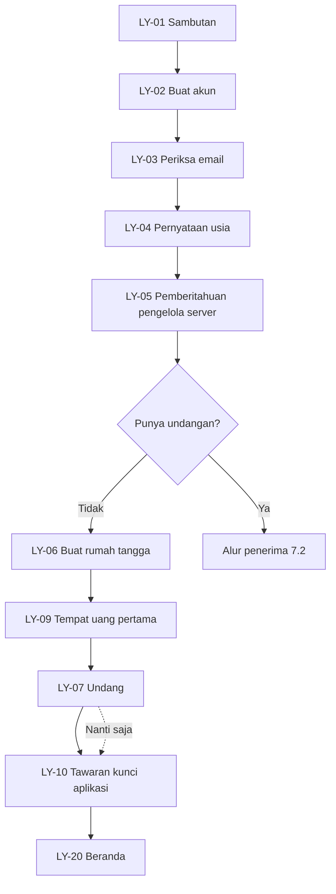

| Langkah | Isi | Wajib | Aturan |
|---|---|---|---|
| Akun | Email dan kata sandi | Ya | SEC-11; tanpa nomor telepon, tanggal lahir, atau nama lengkap |
| Pernyataan usia | Satu kotak centang | Ya, sebelum bergabung atau membuat rumah tangga | SEC-80; tanpa pernyataan, pembuatan ditolak |
| Pemberitahuan pengelola | Teks §7.5, versi per akun (§7.5.1) | Ya, sebelum data pribadi apa pun | SEC-34; dibaca sendiri, pengakuan tercatat bertanggal dan berversi, **tanpa kalimat janji** (S4-6 (ii) A; SEC-35) |
| Buat rumah tangga | Nama | Hanya nama (FR-FAM-001/AC-3) | Zona waktu terisi; hari mulai bawaan 1; mata uang tersembunyi selama hanya IDR yang didukung, tetapi ruangnya ada di layar (FR-FAM-001 "Mata uang dan pasar"); tidak ada pertanyaan hubungan atau struktur keluarga |
| Tempat uang pertama | Satu atau beberapa | Tidak; dapat dilewati | Saldo awal sekali (F-FIN-001); "Tambah lagi" untuk tempat berikutnya |
| Undang | Pernyataan dulu, lalu bagikan | Tidak; dapat nanti dari Saya | FR-FAM-003/AC-1; teks terbagi tanpa nama (SEC-29) |
| Kunci aplikasi | Tawaran | Tidak; mati secara bawaan | SEC-19, SEC-14 |
| Izin notifikasi | Tidak di onboarding | — | Diminta saat pertama dibutuhkan (§14) |

Ambang permintaan, jatah, dan pos rutin **tidak** ditanyakan di onboarding: semuanya kesepakatan yang baru berlaku sesudah anggota dewasa kedua menyetujuinya (FR-FAM-001; FR-FAM-002/AC-3). Sesudah anggota dewasa kedua bergabung, Beranda menampilkan satu kartu sekali pakai "Sepakati yang pertama" dengan tiga pintu: ambang, jatah, tagihan rutin. Kartu itu dapat ditutup dan tidak kembali **[Usulan]**.

**Rumah tangga dengan satu anggota dewasa** (FR-FAM-002): semua pencatatan berjalan; "Minta anggaran" tampil dengan keterangan "Permintaan perlu anggota dewasa kedua" dan menyimpan draf di perangkat (FR-FAM-002/AC-2); Chat tidak tampil sebagai tab sampai anggota kedua aktif, digantikan keterangan di Beranda **[Usulan]**.

### 7.2 Penerima undangan

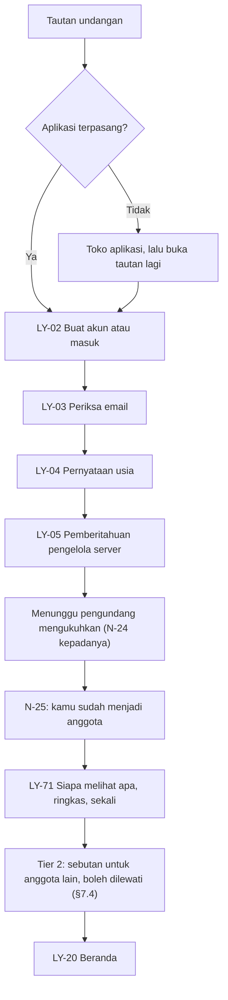

- Undangan yang tidak berlaku menghasilkan satu kalimat yang sama untuk keempat keadaan, tanpa nama rumah tangga (SEC-30): "Undangan ini tidak dapat dipakai. Minta undangan baru kepada yang mengundangmu."
- Selama menunggu pengukuhan, layar menyatakan apa yang sedang terjadi ("{Nama tampilanmu} menunggu dikukuhkan. Kami beri tahu begitu selesai.") dan tidak menampilkan data rumah tangga apa pun (SEC-32).
- Sesudah aktif, layar ringkas "Siapa melihat apa" tampil sekali, dengan tautan ke versi lengkap LY-71.

### 7.3 Kata-kata undangan (D-90, FR-FAM-003/AC-1, AC-8)

> **Sebelum mengundang**
> Orang yang bergabung akan melihat semua catatan uang bersama rumah tangga ini sejak awal, termasuk yang dicatat sebelum ia bergabung. Uang pribadimu tetap hanya kamu yang melihat.

Tambahan bila rumah tangga pernah punya anggota dewasa yang sudah keluar:

> Ia tidak akan membaca chat lama, dan tidak melihat nama, catatan, atau foto dari anggota yang sudah keluar. Catatan uangnya tetap ada dan tampil sebagai "mantan anggota".

Teks yang ikut terbagi (SEC-29): "Kamu diundang bergabung di Casa. Buka tautan ini: {tautan}". Nama produk mengikuti nama kerja (Casa, §0); tidak ada nama rumah tangga, nama pengundang, atau sebutan (SEC-155 (c)).

### 7.4 Sebutan anggota (F-FAM-021, Tier 2 Should; ringkas)

**Asal.** Permintaan pemilik produk sendiri di checkpoint S4 (kata-katanya: "sapaan di atur pas nambah keluarga. suami boleh atur sapaan ke semua anggotanya begitupun yang lain"); usulan lead bahwa sebutan hanya terlihat pembuatnya dan masuk Tier 2 ia terima dengan "3 ya" (`_progress.md`, "Checkpoint S4", jawaban ketiga dan kelima). Sebutan berbeda dari sapaan aplikasi kepada pengguna, yang tetap "kamu" (S4-10 (iv) A). Tingkat Should adalah **[Usulan]** saya; nomor FR dan BR diberikan `product-analyst`, aturan keamanannya SEC-155 milik `security-privacy`.

**Aturan tampil.** Aturannya milik SEC-155 (10.4 §6.3, `security-privacy`); tabel ini menyatakan bentuknya di layar. Yang tidak menunjuk SEC-155 adalah **[Usulan]** saya.

| Hal | Rancangan |
|---|---|
| Apa | Satu kata atau frasa pendek per anggota lain, misalnya "Bunda" atau "Ayah", yang dibuat seorang anggota untuk layarnya sendiri. Bukan data hubungan: aturan mana pun tidak membacanya (F-FAM-003; 06 PG-01) |
| Siapa membuat | Setiap anggota yang punya akun, satu sebutan untuk setiap anggota lain; sama ke semua arah (keputusan di atas; SEC-155 (a)) |
| Siapa melihat | **Hanya pembuatnya.** Yang disebut dan anggota lain tidak melihatnya dan tidak dapat mengetahui ada tidaknya sebutan; membuat, mengubah, atau menghapusnya tidak menghasilkan Peristiwa atau notifikasi dan tidak menyimpan riwayat (SEC-155 (b)) |
| Di mana tampil | Di layar biasa pembuat, menggantikan nama akun: pemegang di Beranda ("Dipegang Bunda"), "Menunggu Bunda", kepala chat, nama di gelembung dan baris peristiwa ("Bunda setuju, 14.20"), kartu, rincian catatan, LY-74. Nama dirender di perangkat pembuat dari pengenal anggota; sebutan tidak pernah ditulis ke isi yang disimpan atau dikirim (SEC-155 (c)) |
| **Layar penentu penerima data atau wewenang** | **Nama akun selalu tampil, sebutan hanya di sampingnya, tidak pernah sendirian** (SEC-155 (d)): "Sari · Bunda", nama akun dengan bobot teks utama, sebutan `tinta-2`. Berlaku di: LY-08 Kukuhkan anggota (F04, SEC-31; bersama email); LY-85 pemilih penerima berbagi `CARE`; pemilih penerima berbagi tempat uang pribadi (F-FAM-005); daftar pihak dan pemberi persetujuan di LY-50 sebelum permintaan dikirim dan di LY-51; LY-71 Siapa melihat apa; LY-74 bagian keluar; LY-75 ekspor. Di layar-layar ini dua anggota dengan sebutan sama tetap dapat dibedakan |
| Nama akun di layar biasa | Tetap terjangkau: di LY-74 dan LY-87 nama akun selalu tertulis di bawah sebutan ("Nama akun: Sari"); mengetuk judul chat membuka rincian anggota dengan kedua nama. Pembaca layar membaca sebutan, lalu "nama akun Sari" pada kepala chat dan LY-74 |
| Tidak pernah tampil | Teks notifikasi mana pun, **termasuk notifikasi pembuat sendiri**, karena layar kunci terbaca orang lain; layar luar perangkat lipat; pintasan ikon aplikasi; teks lembar bagikan; teks undangan (§7.3); badan pesan chat (nama yang disisipkan otomatis, bila ada, memakai nama akun); kartu objek; Peristiwa; teks ringkasan yang disusun server; teks saran pendamping dan apa pun yang dikirim ke `AI` (SEC-155 (c), (e)). Juga setiap teks buatan aplikasi yang terkirim atas nama pembuat (misalnya N-21 "nanti aku jawab"), karena memakai nama akun |
| Bawaan | Tidak ada sebutan; nama akun dipakai seperti sekarang. Tidak ada pilihan yang terisi |
| Isian | **1 sampai 30 karakter tampak** sesudah dipangkas, **teks polos, satu baris** (SEC-155 (h), angka **[Asumsi]** `security-privacy`). Papan ketik satu baris, tombol kembali papan ketik berarti "Simpan". Ditampilkan tanpa format, tanpa deteksi tautan atau nomor. Menurut ketetapan lead yang dimasukkan `security-privacy` ke SEC-155 (h), sebutan tidak boleh sama dengan sebutan lain milik pembuat yang sama, supaya "Dipegang Bunda" di layar biasa tidak tertukar; layar penentu tetap aman walau ada nama yang mirip, karena nama akun selalu tampil (baris di atas) |
| Siapa memeriksa isian | **Aplikasi hanya memeriksa wajib isi dan panjang 1 sampai 30** (bantuan bentuk masukan, S4-1 (ii) A; pengecualian `ENGINEERING-STANDARDS.md` §2 (c) adalah daftar tertutup). Karakter kontrol, pemisah baris, karakter arah teks, normalisasi NFC, dan sebutan kembar **diperiksa server saja**; aplikasi menampilkan galat per medan dari server di bawah isian, dengan kata di tabel berikut |
| Berlaku di | Semua perangkat pembuat di rumah tangga itu; tidak terbaca di rumah tangga lain (SEC-155 (b), (i)) |
| Ekspor | Ekspor pembuat selama ia aktif memuat bagian tersendiri "Sebutan yang kamu buat" (nama akun, sebutan); catatan bersama di ekspor tetap memakai nama akun. Tidak di ekspor anggota lain dan tidak di ekspor sesudah keluar (SEC-155 (f)) |
| Dihapus | Pembuat menghapusnya kapan saja; sebutan antara dua orang hilang ke dua arah saat salah satunya benar-benar keluar (F07) atau menghapus akun; undangan yang batal, lewat masa, atau ditolak menghapus sebutannya; selama masa tenggang keluar sebutan tetap, dan kembali bila keluarnya dibatalkan (SEC-155 (g)) |

**Kapan diatur.** Saat membuat undangan, sebutan menempel pada undangan dan baru tampil sesudah keanggotaan aktif (SEC-155 (a)).

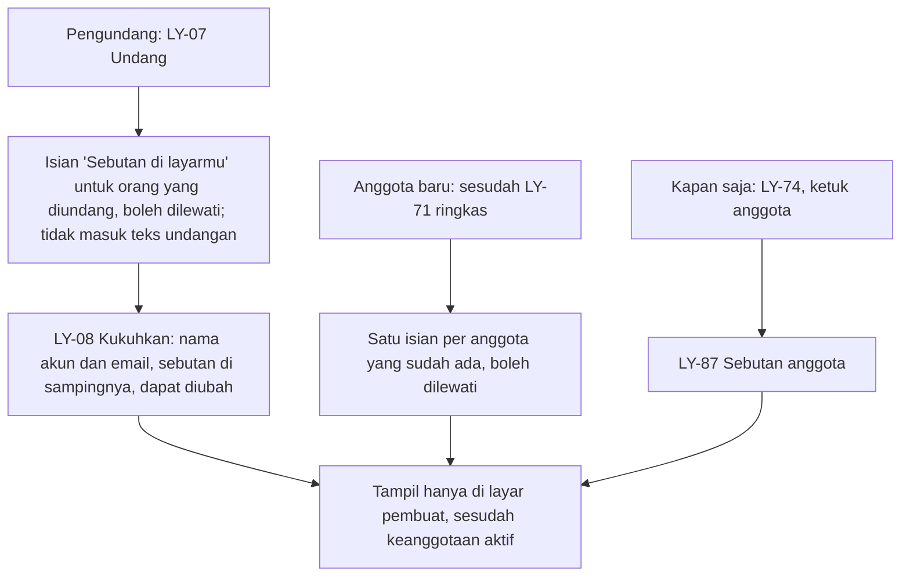

**Kata-kata.** Kalimat keterbukaan adalah bunyi SEC-155 (i); selebihnya **[Usulan]**.

| Tempat | Kata |
|---|---|
| Judul isian (LY-07, langkah anggota baru, LY-87) | "Sebutan di layarmu" |
| Contoh di dalam isian kosong | "Misalnya Bunda, Ayah, Kakak" |
| Keterangan di bawah isian, di setiap tempat itu (SEC-155 (i)) | "Sebutan ini hanya tampil di aplikasimu. Orang yang melihat layarmu dapat membacanya, dan pengelola server dapat membacanya di basis data." |
| Baris kedua keterangan | "{Nama akun} tidak diberi tahu." |
| Tombol | "Simpan" dan "Lewati" (LY-07 dan langkah anggota baru); di LY-87 "Simpan" dan, bila sudah ada sebutan, "Hapus sebutan" |
| Baris LY-74 tanpa sebutan | "{Nama akun}" dengan keterangan kecil "Belum ada sebutan · Tambah" |
| Baris LY-74 dengan sebutan | "Bunda", di bawahnya "Nama akun: Sari" |
| Terlalu panjang (aplikasi) | "Sebutan paling banyak 30 karakter." |
| Karakter yang ditolak (galat server) | "Sebutan hanya boleh berisi satu baris teks biasa." |
| Sebutan kembar (galat server) | "Sebutan ini sudah kamu pakai untuk {nama akun lain}. Pilih yang lain supaya tidak tertukar." |
| Sesudah menghapus | "Sekarang tampil sebagai {nama akun}." Seketika, tanpa jeda urungkan |
| LY-71 Siapa melihat apa (tambahan) | "Sebutan yang kamu beri untuk anggota lain hanya kamu yang melihat. Anggota lain juga bisa memberi sebutan untukmu di layarnya; kamu tidak melihatnya." |

Menyimpan sebutan tidak ditahan 5 detik dan tidak menghasilkan Peristiwa, kartu, atau notifikasi (SEC-155 (b)).

### 7.5 Teks pemberitahuan pengelola server (LY-05; SEC-34, SEC-35)

Pemberitahuan ini punya **tiga versi, dipilih per akun** (SEC-34; 10.1 §11.3, §11.3.1): versi pilot di bawah, versi keluarga pengelola (§7.5.1), dan teks umum. Bunyi di bawah adalah versi pilot dari 10.1 §11.3, hanya untuk pasangan pilot, **tanpa kalimat janji** (S4-6 (ii) A). Disalin utuh; `{pengelola}` adalah nama tampilan yang diisi saat pemasangan. LY-05 selalu menampilkan **teks lengkap versi yang dikirim server**, termasuk kalimat tentang fitur yang belum ada di build yang terpasang; tidak ada tampilan yang bergantung pada build (10.1 SEC-34 (5), SEC-35, §11.3). Kalimat semacam itu, di dokumen ini bertanda **[Tier 2]**, membawa tanda "berlaku saat fitur ini tersedia" yang dikirim server per kalimat, sehingga build lama pun menampilkannya (bentuk tanda: di bawah teks). Pengakuan mencakup seluruh versi, termasuk kalimat bertanda. Teks tahap publik diganti teks lain (FR-FAM-019/AC-6).

> **Siapa yang dapat melihat datamu di luar aplikasi**
>
> Server aplikasi ini dikelola oleh {pengelola}, yang juga anggota rumah tangga ini.
>
> Di dalam aplikasi, pasanganmu tidak dapat melihat dana pribadimu, isi dompet campuranmu, status suasana hati atau kabar sakit yang tidak kamu bagikan, setelan jam tenangmu, atau apa pun yang ditandai "hanya kamu".
>
> **Di luar aplikasi berbeda.** Pengelola server dapat membuka basis data dan salinan cadangan secara langsung. Dari sana semua data yang tersimpan di server dapat terbaca, termasuk dana pribadi, isi dompet campuran, isi chat beserta foto, dan setelan pribadi. Aturan di aplikasi tidak mencegah itu, dan data ini tidak dienkripsi terhadap pengelola server.
>
> **[Tier 2]** Status suasana hati dan kabar sakit yang **tidak** kamu bagikan hanya tersimpan di perangkatmu dan tidak sampai ke server. Begitu kamu membagikannya kepada seseorang, status itu tersimpan di server dan dapat terbaca pengelola server.
>
> **[Klien web]** Kalau kamu memakai Casa di browser atau dari ikonnya di layar utama, aplikasinya dimuat dari server yang dikelola {pengelola} setiap kali diperbarui. Pengelola server dapat mengubah aplikasi itu, juga khusus untuk akunmu, termasuk agar data yang hanya tersimpan di perangkatmu ikut terkirim.
>
> **[Tier 2]** Sebutan yang kamu berikan untuk anggota lain hanya tampil di aplikasimu, tetapi tersimpan di server dan dapat terbaca pengelola server.
>
> Bila keadaan ini tidak cocok untukmu, jangan mengisi data pribadi apa pun. Kamu dapat membaca pemberitahuan ini lagi kapan saja di "Siapa melihat apa".
>
> [ ] Saya sudah membaca dan memahami pemberitahuan ini.

Bentuk layar tetap LY-05: layar gulir; kotak centang dan tombol lanjut aktif sesudah dibaca sampai akhir; tanggal dan versi yang dibaca tersimpan sebagai catatan milik pembacanya.

**Kalimat [Klien web]** (10.1 §11.3; 10.5 SEC-178 (b); TM-42). Bunyinya kanonis di 10.1 §11.3 dan §11.3.1 (ditetapkan `security-privacy`) dan disalin persis di sini; mengubahnya terhitung versi pemberitahuan baru (SEC-34), jadi perubahan dimulai di 10.1, bukan di 08. Ia masuk ke versi yang dibaca sebelum GR-2 dan tampil **tanpa** tanda "berlaku saat fitur ini tersedia", karena klien web sudah dibangun. Kalimatnya dibuka dengan "Kalau kamu memakai Casa di browser atau dari ikonnya di layar utama", sehingga tetap benar bagi pembaca yang kelak memakai aplikasi native dan membaca teks lengkap yang sama (SEC-34 (5)). Penanda "[Klien web]" dan "[Tier 2]" adalah tanda dokumen, tidak tampil di layar. Usulan kata dokumen ini ("aplikasi" menggantikan "kode", "khusus untuk akunmu") sudah masuk ke bunyi kanonis 10.1.

**Tanda "berlaku saat fitur ini tersedia"** **[Usulan]** bentuknya. Satu baris keterangan tepat di atas paragraf bertanda, berbunyi persis "Berlaku saat fitur ini tersedia", dengan gaya teks sekunder yang tetap memenuhi kontras teks normal dan ikut ukuran teks sistem (Dynamic Type; ukuran font Android). Tanda berupa kata, bukan warna, ikon, atau huruf miring saja. Paragrafnya tampil utuh dengan gaya biasa: tidak dilipat, tidak dipudarkan, dan ikut dihitung dalam "dibaca sampai akhir". Pembaca layar membaca tanda lebih dulu, lalu paragrafnya. Tanda yang sama tampil di LY-71 dan berlaku untuk ketiga versi. iOS dan Android sama; hanya gaya teks sekundernya mengikuti platform (§17, §19).

#### 7.5.1 Versi keluarga pengelola (10.1 §11.3.1; keputusan 52)

Untuk orang tua atau kerabat pengelola yang diberi login, yang menurut keputusan 52 adalah pengguna luar. Bunyi final di bawah adalah penulisan ulang draf 10.1 §11.3.1 untuk pembaca yang lebih tua: kalimat pendek, kata "server", "akses darurat", dan "dienkripsi" dijelaskan di tempat, dan letak riwayat keamanan disebut sebagai jalur menu. Setiap fakta draf tetap ada (tabel di bawah teks). Sapaan tetap "kamu" (§18.1), karena dokumen ini tidak menetapkan sapaan lain bagi orang tua; kehangatan datang dari penjelasan dan dari izin untuk menolak, bukan dari "Anda".

> **Siapa yang dapat melihat datamu di luar aplikasi**
>
> Semua catatan di aplikasi ini disimpan di server, yaitu komputer tempat data aplikasi disimpan. Server itu dikelola oleh {pengelola}, anggota keluargamu sendiri. {Hanya bila {pengelola} anggota rumah tangga yang sama di aplikasi: "{pengelola} juga anggota rumah tangga ini."}
>
> **Di dalam aplikasi**, {pengelola} dan anggota lain tidak dapat melihat dana pribadimu, isi dompet campuranmu, status suasana hati atau kabar sakit yang tidak kamu bagikan, atau apa pun yang ditandai "hanya kamu".
>
> **Di luar aplikasi berbeda.** Sehari-hari {pengelola} tidak membuka data di server secara langsung. Bila perlu, misalnya untuk memperbaiki kerusakan, ia memakai akses darurat, yaitu cara masuk khusus yang meminta alasan tertulis. Setiap akses darurat tercatat di riwayat keamanan akunmu, berisi tanggal, lamanya, dan alasannya. Catatan itu hanya kamu yang dapat membacanya, di Saya > Keamanan > Riwayat keamanan.
>
> Lewat akses darurat, semua data yang tersimpan di server dapat terbaca, termasuk dana pribadi, isi dompet campuran, isi chat beserta foto, dan setelan pribadi. Data itu tidak dienkripsi terhadap {pengelola}, artinya tidak ada kunci yang menutupnya dari dia.
>
> **Pencatatan itu tidak mencegah semuanya.** {pengelola} memegang server dan kunci salinan cadangan data, dan salinan cadangan itu berisi data yang sama dengan server. Karena itu, secara teknis ia tetap dapat membuka datamu, dari server maupun dari salinan cadangan, tanpa tercatat di riwayat keamanan akunmu.
>
> **[Tier 2]** Status suasana hati dan kabar sakit yang **tidak** kamu bagikan hanya tersimpan di perangkatmu dan tidak sampai ke server. Begitu kamu membagikannya kepada seseorang, status itu tersimpan di server dan dapat terbaca dengan cara di atas.
>
> **[Klien web]** Kalau kamu memakai Casa di browser, atau dari ikon yang kamu pasang di layar utama lewat browser, aplikasinya diambil dari server {pengelola} setiap kali diperbarui. Artinya {pengelola} dapat mengubah cara aplikasi itu bekerja, juga khusus untuk akunmu, misalnya supaya data yang selama ini hanya ada di perangkatmu ikut terkirim ke server. Perubahan seperti itu tidak tercatat di riwayat keamanan akunmu.
>
> **[Tier 2]** Sebutan yang kamu berikan untuk anggota lain hanya tampil di aplikasimu, tetapi tersimpan di server dan dapat terbaca dengan cara di atas.
>
> Bila keadaan ini tidak cocok untukmu, kamu boleh tidak mengisi data pribadi apa pun. Itu pilihan yang wajar. Kamu dapat membaca pemberitahuan ini lagi kapan saja di Saya > Siapa melihat apa.
>
> [ ] Saya sudah membaca dan memahami pemberitahuan ini.

| Fakta yang diwajibkan 10.1 §11.3.1 | Kalimat di atas |
|---|---|
| Pengelola server adalah anggota keluarga pembaca; kalimat serumah hanya bila memang serumah di aplikasi | Paragraf 1 |
| Di dalam aplikasi: dana pribadi, isi dompet campuran, suasana hati dan kabar sakit yang tidak dibagikan, "hanya kamu" tertutup bagi pengelola dan anggota lain | Paragraf 2 |
| Pengelola tidak membuka basis data sehari-hari; bila perlu, akses darurat dengan alasan tertulis; setiap akses tercatat di riwayat keamanan akun pembaca, hanya terbaca pemiliknya (SEC-36; SEC-39 (b)). Isi baris (tanggal, lama, alasan, tanpa isi data) dari SEC-36 | Paragraf 3 |
| Lewat akses itu semua data server terbaca, termasuk dana pribadi, isi dompet campuran, chat dan foto, setelan pribadi (setelan jam tenang tercakup di sini); tidak dienkripsi terhadap pengelola | Paragraf 4 |
| Pencatatan tidak mencegah semuanya; pengelola menguasai server dan kunci cadangan; salinan cadangan berisi data yang sama; data dapat dibuka dari server maupun dari cadangan tanpa tercatat | Paragraf 5 |
| [Tier 2] Status yang tidak dibagikan tetap di perangkat; sesudah dibagikan tersimpan di server | Paragraf 6 |
| [Klien web] Klien web dimuat dari server pengelola setiap pembaruan; pengelola dapat mengubahnya, juga hanya untuk satu akun, termasuk agar data yang hanya ada di perangkat ikut terkirim (10.1 §11.3.1; SEC-178 (b); TM-42) | Paragraf 7, disalin persis dari bunyi kanonis 10.1 §11.3.1, termasuk kalimat terakhir "Perubahan seperti itu tidak tercatat di riwayat keamanan akunmu." (TM-42) |
| [Tier 2] Sebutan anggota hanya tampil di aplikasi pembuatnya, tetapi tersimpan di server dan dapat terbaca (SEC-155 (i)) | Paragraf 8 |
| Bila tidak cocok, pembaca boleh tidak mengisi data pribadi; dapat dibaca ulang di "Siapa melihat apa" | Paragraf 9 |

**Yang ditambahkan dokumen ini, dan alasannya.** (1) Penjelasan "server", "akses darurat", dan "dienkripsi" di tempat, karena pembacanya mungkin tidak mengenal kata itu. (2) Jalur menu ke riwayat keamanan, agar janji "tercatat" dapat diperiksa sendiri. Dua usulan dokumen ini kini menjadi bagian draf 10.1 §11.3.1 atas ketetapan `security-privacy` (tabel "Ketetapan atas kata-kata akhir 08 §7.5.1"): kalimat [Tier 2] sebutan anggota, dan "kamu boleh tidak mengisi … Itu pilihan yang wajar" sebagai pengganti "jangan mengisi", yang dinilai bukan kalimat janji operator (SEC-35). Atas ketetapan yang sama, "isi dompet campuran" dan kalimat isi salinan cadangan ditambahkan ke paragraf 2, 4, dan 5.

**Gerbang tampil** (SEC-35; 10.1 §11.3.1 "Uji"). Versi ini tidak tampil sebelum baris akses darurat SEC-36 di riwayat keamanan dibangun; karena SEC-36 berlaku sebelum pengguna luar pertama (10 indeks §4.2), orang tua tidak dapat masuk sebelum itu. Kalimat [Tier 2] selalu tampil dengan tanda "berlaku saat fitur ini tersedia", sama dengan versi pilot (§7.5). Akun berversi keluarga pengelola tidak pernah menampilkan versi pilot.

#### 7.5.2 Versi mana yang berlaku: di "Siapa melihat apa" (LY-71)

Versi ditetapkan pengelola per akun saat memberi akses, sebagai konfigurasi server; aplikasi tidak menebak hubungan keluarga (10.1 §11.3.1). Karena itu pemilik akun harus dapat melihat sendiri versi mana yang ia baca, dalam kalimat yang dapat ia periksa kebenarannya.

| Tempat | Isi | iOS dan iPadOS | Android |
|---|---|---|---|
| LY-71, bagian paling atas "Pemberitahuan pengelola server" | Satu baris label versi (tabel berikut), lalu "Kamu membacanya {tanggal}." Lalu teks lengkap versi akun itu. Versi lain tidak pernah tampil | Bagian (`Section`) dalam daftar gulir; teks penuh di bawah label | Kartu atau bagian berjudul di layar gulir; teks penuh di bawah label |
| LY-71, di bawah label | "Kalau kalimat ini tidak sesuai dengan keadaanmu, jangan mengisi data pribadi dulu dan minta {pengelola} memperbaikinya." | Teks sekunder | Teks sekunder |
| LY-73 "Riwayat keamanan" | Daftar baris jejak keamanan milik sendiri (SEC-39 (b)); baris akses darurat berbunyi "Akses darurat oleh {pengelola} · {tanggal} · {lama} · Alasan: {alasan tertulis}", tanpa isi data (SEC-36). Baris pergantian versi pemberitahuan berbunyi "Pemberitahuan pengelola server diganti ke versi untuk {pasangan / keluarga / pengguna umum} · {tanggal}" (SEC-34), ditulis saat versi itu diterbitkan untuk akun tersebut (§7.5.3). Hanya pemilik akun yang melihatnya; tidak ada hitungan atau tanda di Beranda | Daftar dorong dari LY-73 | Daftar dorong dari LY-73 |

| Versi (10.1) | Label di LY-71 | Siapa |
|---|---|---|
| Versi pilot | "Pemberitahuan ini untuk pasangan {pengelola}, yang mengelola server." | Pasangan pilot saja (keputusan 25) |
| Versi keluarga pengelola | "Pemberitahuan ini untuk keluarga {pengelola}, yang mengelola server." | Orang tua dan kerabat yang diberi login di server keluarga pemilik produk (keputusan 52) |
| Teks umum | "Pemberitahuan ini untuk pengguna umum. Pengelola server bukan anggota keluargamu." | Beta atau publik, bila kelak ada (FR-FAM-019/AC-6) |

Label menyebut nama pengelola dan hubungannya, sehingga salah pilih tampak bagi pembacanya sendiri. Bila pengelola mengubah versi sebuah akun, itu dihitung versi baru (SEC-34, dikukuhkan 10.1 §11.3.1): LY-05 tampil begitu sinkron membawa versi baru, tidak menunggu pembukaan berikutnya, dan pengisian data ditahan sampai pengakuan (§7.5.3). Pergantian itu juga menulis satu baris di riwayat keamanan akun tersebut (tabel di atas), sehingga pergantian versi tidak terjadi diam-diam.

**Masking dan layar kunci.** Teks pemberitahuan dan label tidak memuat angka atau isi peka, jadi tidak disamarkan. Baris "Riwayat keamanan" tidak memuat isi data, tetapi alasan tertulis dapat menyinggung hal peka; karena itu isinya tidak pernah menjadi isi notifikasi, judul jendela, atau widget, dan pengalih aplikasi menampilkan layar netral seperti layar lain (SEC-20, §12.2).

#### 7.5.3 Versi baru di tengah pemakaian: pengisian ditahan sampai dibaca (SEC-34)

Berlaku untuk setiap versi baru, termasuk pergantian versi akun. Sampai pemilik akun mencentang dan menekan "Lanjut" di LY-05, server menolak perintah tulis biasa dari akun itu dengan kode galat "pemberitahuan baru perlu dibaca" (10.1 SEC-34). Yang tidak pernah ditahan: perintah pelindung SEC-151 (1) sampai (7), keluar akun, ekspor, dan hapus akun; juga masuk, autentikasi ulang, pembaruan token, dan pemulihan lewat email, yang adalah panggilan identitas di luar tabel perintah (09 berkas 03 §1), sehingga orang yang belum membaca tetap dapat masuk untuk membacanya; dan pengakuan pemberitahuan itu sendiri (09 berkas 03 §1), karena tanpanya tahanan tidak pernah dapat dibuka. Membaca tetap boleh.

**Tanpa batas frekuensi** (10.1 SEC-34 (5): opsi A usulan lead atas temuan `critic` R-3, dipilih `security-privacy`; temuan `critic` S-4). Setiap versi baru dan setiap pergantian versi akun menahan tulis sampai diakui di LY-05, tampil pada sinkron berikutnya, dan menulis satu baris di riwayat keamanan (§7.5.2). Tidak ada jendela waktu dan tidak ada versi yang menunggu di server. Bila versi yang lebih baru datang sebelum versi sebelumnya diakui, LY-05 langsung menampilkan versi terbaru saja; hanya pengakuan atas versi terbaru itu yang membuka tahanan, dan versi lama tidak perlu dibaca lagi. Catatan yang dibuat di perangkat tidak pernah hilang (PRN-06): ia antre dan terkirim sesudah pengakuan.

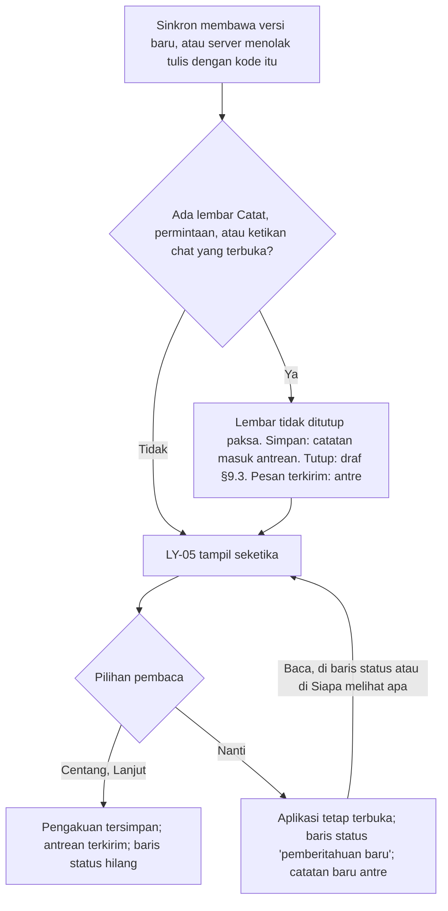

| Saat | Perilaku | iOS dan iPadOS | Android |
|---|---|---|---|
| Versi baru diketahui | Bila tidak ada isian yang terbuka, LY-05 tampil seketika, juga bila aplikasi sedang di layar mana pun. Bila ada lembar Catat atau permintaan yang terbuka, atau ketikan chat, LY-05 tampil sesudah lembar itu ditutup atau pesan dikirim, tidak menutupnya di tengah ketikan. Isian tidak pernah dibuang: "Simpan" memasukkan catatan ke antrean dengan ikon jam (§13.2 "Butir antre"); menutup lembar menyimpan draf (§9.3) | LY-05 sebagai lembar ukuran besar yang tidak tertutup dengan gestur geser; "Nanti" di posisi batal bilah atas **[Usulan]** | LY-05 sebagai dialog layar penuh dari `Dialog` dan `Scaffold` stabil (bentuk yang sama dengan cadangan lembar di §17.4), tombol tutup "Nanti" di awal bilah atas; kembali sistem sama dengan "Nanti" **[Usulan]** |
| Di LY-05 | Teks lengkap versi akun itu dengan satu baris di atas judul (bunyi di bawah). Kotak centang dan "Lanjut" aktif sesudah digulir sampai akhir, sama dengan pembacaan pertama | Sama | Sama |
| Sesudah "Nanti" | Semua layar terbuka untuk dibaca. Mencatat dan menjawab tetap bisa; hasilnya antre di perangkat. Perintah pelindung, keluar, ekspor, salinan data saya, dan hapus akun berjalan seperti biasa dengan kalimat hasil yang sama seperti saat normal, dan dikirim seketika, tidak di belakang antrean yang tertahan (sama dengan *tahan tulis*, §13.2) | Baris status di bawah bilah judul, posisi yang sama dengan baris "Luring" | Sama |
| Tindakan yang perlu server dan bukan pelindung (buat rumah tangga, terima undangan) | Tombol tetap aktif; menekannya membuka LY-05 | Sama | Sama |
| Sesudah pengakuan | Antrean terkirim dalam urutan biasa; ikon jam hilang satu per satu; tidak ada kalimat tambahan | Sama | Sama |

**Kata layar** **[Usulan]**:

| Tempat | Bunyi |
|---|---|
| Baris di atas judul LY-05, hanya untuk versi baru | "Pemberitahuan ini berubah. Bacalah sampai akhir. Sementara itu kamu tetap bisa melihat semua catatan, dan catatan baru tersimpan di perangkatmu sampai kamu selesai membaca." |
| Tombol sekunder LY-05 | "Nanti" |
| Baris status sesudah "Nanti" | "Ada pemberitahuan baru tentang siapa yang dapat melihat datamu. Catatan baru tersimpan di perangkat ini dan terkirim sesudah kamu membacanya." dengan tombol "Baca" |
| Butir antre selama ditahan | Ikon jam yang sama; "Info tanda" berbunyi "Belum terkirim. Tersimpan di perangkatmu dan terkirim sesudah kamu membaca pemberitahuan baru." |
Bedanya dengan *tahan tulis* (§13.2): di sana layar tidak menyebut alasannya karena pembaca tidak dapat berbuat apa-apa; di sini alasannya disebut karena pembaca sendiri yang membuka tahanan. Kata "perangkat" mengikuti aturan nama perangkat §18.1. Bentuk penyajian di kedua platform berstatus **[Perlu validasi]** terhadap HIG Modality dan panduan dialog Material 3: kedua halaman tidak terbaca lewat alat pengambil halaman pada 12 November 2026, jadi `ux-designer` memeriksanya langsung sebelum bangun.

---

## 8. Perjalanan utama per persona

Alur di bawah menunjuk skenario dokumen 12. Hitungan ketukan tidak menghitung mengetik angka.

### 8.1 PSN-01: "Uang bulanan masih ada?" lalu minta anggaran jalan-jalan (SCN-01, SCN-37)

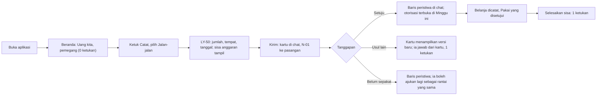

### 8.2 PSN-02: belanja dapur dalam hitungan detik, lalu konfirmasi serah terima (SCN-02, SCN-21)

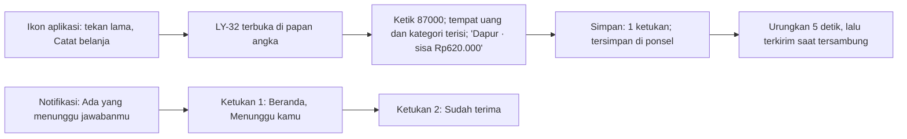

### 8.3 Keduanya: uang masuk, bayar tagihan, bagikan (SCN-21)

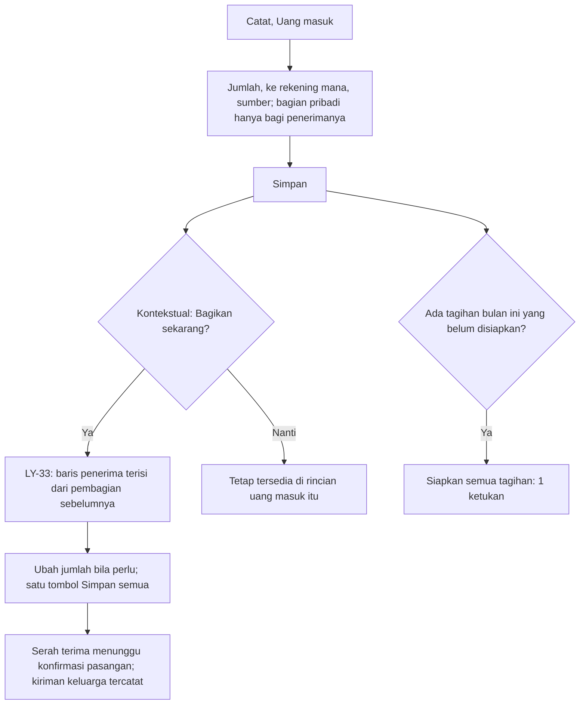

### 8.4 PSN-04, tahap publik: anggota lanjut usia mengonfirmasi uang yang ia pegang

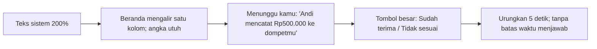

### 8.5 PSN-07, Tier 3: berpindah rumah tangga

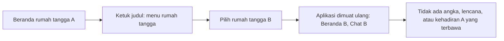

---

## 9. Pola interaksi

### 9.1 Mencatat dalam hitungan detik (PRN-05; `ENGINEERING-STANDARDS.md` §3)

**Pintu masuk Catat.**

| Pintu | iOS | Android |
|---|---|---|
| Dari tujuan utama | Tombol utama di ujung bilah navigasi Beranda, Uang, dan Chat, dengan gaya kaca menonjol yang diberi warna merek (satu-satunya kaca berwarna selain tab terpilih). **Ketuk = Belanja**; tekan lama membuka menu: Uang masuk, Kasih ke, Terima dari, Minta anggaran, Jalan-jalan | Extended FAB "Catat" di Beranda dan Uang. **Ketuk = Belanja** (LY-32 terbuka pada Belanja). Jenis lain: tombol jenis di kepala LY-32 ("Belanja" dengan tanda pilih) membuka menu tarik-turun Material 3 (`DropdownMenu`) berisi Uang masuk, Kasih ke, Terima dari, Pindah, Minta anggaran, Jalan-jalan (§17.4). Menu FAB Expressive (`FloatingActionButtonMenu`) baru dipakai bila Compose Material 3 versi stabil yang memuatnya sudah terbit (§17.1 butir 4). Di Chat, tombol tambah di kotak tulis |
| Dari luar aplikasi | Quick action ikon aplikasi: "Catat belanja", "Uang masuk" (tanpa data apa pun) | App shortcut statis dengan dua butir yang sama |
| Dari Chat | Tombol tambah di kotak tulis: Foto, Kamera, Catat belanja, Minta anggaran, Kirim catatan yang sudah ada | Sama |

Pintasan dari ikon aplikasi tidak menampilkan angka, nama, atau keadaan, sehingga tidak bertentangan dengan SEC-54. Bila kunci aplikasi menyala, membuka pintasan meminta kunci lebih dulu (SEC-19). Control Center (iOS) dan Quick Settings tile (Android) tidak di Tier 1 (ponytail).

**Lembar Belanja (LY-32), keadaan Ringkas.**

| Urutan | Unsur | Bawaan | Ketukan |
|---|---|---|---|
| 1 | Jumlah, besar, langsung fokus dengan papan angka sistem; format ribuan saat diketik ("87.000"); tombol "000" di baris aksesori papan angka **[Usulan]** | Kosong | Mengetik tidak dihitung |
| 2 | Tempat uang | Tempat uang terakhir yang dipakai pencatat ini | 0, atau 1 untuk mengganti |
| 3 | Kategori, dengan sisa anggaran dari server di sebelahnya: "Dapur · sisa Rp620.000". Di pilot angka ini **tidak berubah** saat jumlah diketik: tanpa perkiraan offline (ADR-013 butir 2; 06 S-9); bila angkanya belum tersinkron, berlaku stempel waktu §13.1 butir 1. **Pilihan kelak, bukan bagian pilot:** "Dapur · sisa Rp533.000 sesudah ini", dihitung menurut deskriptor perkiraan dari server; hanya bila ADR baru menambahkannya dan pemilik produk menyetujuinya sebagai pengecualian ES §2 tambahan (09 berkas 01 §3 "Perkiraan offline kelak"; 09 baris "Perkiraan offline") | Kategori terakhir untuk tempat uang ini, atau kosong | 0 atau 1 |
| 4 | Tanggal: "Hari ini", "Kemarin", "Pilih tanggal" | Hari ini | 0, atau 1 untuk "Kemarin" |
| 5 | "Tambah rincian" (terlipat): catatan, foto struk, penerima manfaat, pembayar, bagi ke beberapa kategori, bayar dari dua tempat uang, tautan ke tagihan atau cicilan | Terlipat | — |
| 6 | Saran kontekstual (§9.4), paling banyak satu baris | — | 0 atau 1 |
| 7 | Simpan, di baris aksesori papan angka dan di bilah lembar | — | 1 |

Belanja berulang di tempat yang sama: **ketik jumlah, satu ketukan Simpan**. Belanja di kategori lain: dua ketukan. Belanja kemarin di kategori lain: tiga. Semua dalam batas `ENGINEERING-STANDARDS.md` §3.

**Sasaran waktu [Asumsi]** (R-02 belum dilakukan, jadi tidak ada pembanding terukur): median kurang dari 8 detik dari ketuk Catat sampai tersimpan untuk belanja berulang, dan kurang dari 15 detik untuk belanja di kategori lain, diukur di iPhone 13, perangkat pencatat utama, dan di iPad mini 7 untuk alur pemilik produk (Uang masuk dan pembagiannya, §16.2; 14 §3.3 langkah 2, §3.4 "Uji kecepatan") pada minggu pertama pilot, dan di Galaxy A55 pada minggu pertama aplikasi Android terpasang (keputusan 42, §0). **Sejak keputusan web lebih dulu:** pengukuran minggu pertama pilot dijalankan di klien web yang terpasang di layar utama iPhone 13, iPad mini 7, dan Galaxy A55 (§25.3); pengukuran di aplikasi native diulang pada minggu pertama masing-masing aplikasi memegang data nyata. Bila meleset, yang diubah adalah bawaan isian, bukan jumlah isian wajib.

**Tetap sah bila terlambat.** "Pilih tanggal" menerima tanggal kejadian lampau tanpa batas selain saldo awal (07 INV-22). Catatan terlambat tampil di riwayat pada tanggal kejadiannya, dengan keterangan kecil "dicatat 3 hari kemudian" bagi **setiap pembaca catatan itu**, sama siapa pun pencatatnya, berupa **tanggal saja, tidak pernah jam**. Usulan rancangan pertama dokumen ini (hanya bagi pencatat) tidak diterima `security-privacy` (10 indeks §7.2): tanggal pencatatan satu-satunya pagar terhadap catatan yang dimundurkan tanggalnya untuk menghindari jatah atau ambang (06 §6.3 baris 7; 07 §3.4, §3.11, T-26). Tanggalnya dari server lewat jalur baca (06 AT-6); keterangan muncul hanya bila tanggal pencatatan berbeda dari tanggal kejadian. Kata tetap netral, tanpa warna atau ikon peringatan (pemeriksaan 6): "dicatat Kam, 12 Nov" bila lebih dari 7 hari **[Usulan]**.

**Melewati ambang tidak menghalangi.** Bila jumlah melewati ambang dan tidak ada otorisasi yang cocok, baris saran berbunyi netral: "Lebih dari Rp500.000 yang kita sepakati. Mau minta persetujuan dulu, atau simpan saja?" Dua tombol sama besar, tanpa warna peringatan. "Simpan saja" menyimpan dan catatan ditandai (PRN-06; ADR-009).

**Tautan ke tagihan rutin mengikuti kategorinya** (07 §3.15 aturan 7b, INV-37, T-47 **[Usulan]** `finance-domain`). Memilih tagihan di "Tambah rincian" mengisi kategori dengan kategori tagihan itu dan menguncinya; pemilih kategori menampilkan keterangan "Mengikuti tagihan {nama tagihan}". Bila catatan dibagi ke beberapa kategori, pilihan tautan tidak tersedia, dengan alasan terbaca: "Catatan yang dibagi ke beberapa kategori tidak bisa ditautkan ke tagihan." Karena kategori tagihan tidak pernah berubah (INV-37), tautan yang ditolak hanya mungkin pada tautan susulan atas catatan lama; kata penolakannya di §13.2. Mengganti kategori catatan yang tertaut ditolak dengan kata yang sama di §13.2 **[Usulan]**.

### 9.2 Menanggapi dalam satu atau dua ketukan (Q-89)

| Dari | Ketukan 1 | Ketukan 2 | Catatan |
|---|---|---|---|
| Kartu di chat | "Setuju" / "Belum sepakat" / "Sudah terima" | — | Kartu menampilkan syarat versi yang sedang berlaku; tombol dikirim dengan versi itu (06 §16.4) |
| Kartu di chat, usul lain | "Usul lain" | Ubah jumlah, "Kirim" | Mengetik tidak dihitung |
| Notifikasi | Membuka layar objek itu langsung (pengenal buram ditarik sesudah dibuka, SEC-50) | Tombol jawaban | Bila kunci aplikasi menyala: ditambah kunci |
| Beranda, "Menunggu kamu" | Tombol ringan langsung pada butir (konfirmasi serah terima) | — | Butir yang syaratnya panjang membuka rinciannya dulu |

**Tidak ada tombol jawab di notifikasi** (iOS notification actions, Android notification action buttons). Alasannya: teks layar kunci hanya kelas (SEC-51), jadi menjawab dari sana berarti menjawab tanpa membaca syarat, dan tombol yang berbeda per jenis membuka jenis peristiwanya di layar kunci (SEC-52) **[Usulan]**.

**Pengaman ketukan tak sengaja.** Tombol kartu tidak menerima ketukan selama daftar sedang digulir dan 0,5 detik pertama sesudah kartu muncul di layar **[Usulan]**; angka **[Asumsi]**.

### 9.3 Pemaaf: urungkan, draf, dan tidak ada yang hilang

| Pola | Rancangan | iOS | Android |
|---|---|---|---|
| **Jeda urungkan 5 detik [Usulan]** | Perintah tulis milik pengguna sendiri (catatan, jawaban permintaan, konfirmasi, usulan, berbagi yang **meluaskan** siapa yang melihat) tersimpan di ponsel seketika lalu **ditahan 5 detik sebelum meninggalkan ponsel**. Selama itu tampil "Urungkan"; mengurungkan membuang perintah itu tanpa jejak di server (06 S-7, revisi ketiga belas). Sesudahnya, perbaikan memakai jalur biasa (catatan "Diperbaiki" atau "Dibatalkan", 07 §1.4). Akibat yang diterima: kartu, tanda, dan notifikasi bagi anggota dewasa lain paling cepat muncul 5 detik sesudah ketukan. **Pesan chat dan perintah pelindung tidak ditahan** (tabel di bawah). Angka 5 **[Asumsi]** | Baris hasil di layar asal membawa tombol "Urungkan" yang hilang sesudah 5 detik; ditambah Undo sistem (`UndoManager`, gestur tiga jari atau goyang) | Snackbar dengan aksi "Urungkan" |
| Draf | Lembar catat dan lembar permintaan yang ditutup dengan isian menyimpan draf diam-diam; membuka Catat lagi menawarkan "Lanjutkan yang tadi" | Sama | Sama |
| Rotasi, lipat, ganti ukuran jendela | Isian setengah jadi, butir terpilih, dan posisi gulir dipulihkan (18 §4.5 butir 5) | Pemulihan keadaan scene | Penyimpanan keadaan saat activity dibuat ulang |
| Tindakan yang tidak dapat ditarik | Keluar, batal keluar, hapus akun, ekspor sesudah keluar, cabut sesi lain: autentikasi ulang dengan kata sandi akun (SEC-13), lalu satu layar konfirmasi yang menyebut akibatnya dalam kata | `confirmationDialog` | `AlertDialog` |
| Persetujuan | Tidak dapat ditarik sendirian (glosarium "Persetujuan"); karena itu jeda urungkan paling berarti di sini | — | — |

**Yang tidak pernah ditahan** (06 S-7 dan P-41, revisi ketiga belas). Perintah pelindung harus berlaku saat itu juga: menahannya 5 detik berarti orang yang sedang melindungi diri masih terlihat, masih tersambung, atau masih terbaca selama jeda. Pesan chat tidak ditahan karena penulis dapat menghapusnya kapan saja (06 §16.7) dan jeda membuat chat terasa lambat (P-41 **[Usulan]** `architect`, diterima di sini). Untuk semuanya: **tidak ada "Urungkan"**; yang tampil adalah kalimat hasil dan, bila ada, jalan membalikkannya.

| Perintah | Sebelum dikirim | Kalimat hasil | Membalikkan |
|---|---|---|---|
| Pesan teks dan foto di chat | Tidak ada konfirmasi; terkirim saat diketuk kirim (atau antre bila luring, §10.2) | Tanda pesan biasa (§10.2) | "Hapus" di menu pesan, dengan konfirmasi "Hapus pesan ini? {Nama} tidak akan melihatnya lagi." karena tidak ada urungkan |
| Mempersempit siapa yang melihat (mencabut berbagi status, menjadikan pribadi) | Tanpa konfirmasi tambahan | "Sekarang hanya kamu yang melihat ini." | Berbagi lagi; berbagi lagi adalah perintah biasa yang ditahan 5 detik |
| Menghapus (pesan sendiri; status, Tier 2). Catatan uang tidak dihapus, melainkan "Dibatalkan" lewat jalur biasa yang ditahan 5 detik (07 §1.4) | Konfirmasi yang menyebut akibatnya (baris pesan di atas; status: §18.3) | "Sudah dihapus." | Tidak ada |
| Sembunyikan untuk saya (F-COM-014) | LY-62 (§10.7) | "Pesan dari {nama} disembunyikan di layarmu." | "Tampilkan lagi pesan {nama}" (§10.7) |
| Laporkan (F-COM-014) | LY-63 (§10.7) | Tanda terima (§10.7) | Tidak ada |
| Mencabut sesi lain, keluar, dan setiap perintah dengan autentikasi ulang (LY-77) | Autentikasi ulang lalu konfirmasi (baris "Tindakan yang tidak dapat ditarik" di atas) | Menurut tindakannya; keluar: kalimat masa tenggang §18.3 | Keluar: "Batalkan keluar" selama masa tenggang; lainnya tidak ada |

iOS: kalimat hasil tampil di baris hasil yang sama dengan jeda urungkan, tanpa tombol; Undo sistem (`UndoManager`) tidak mendaftarkan perintah ini. Android: `Snackbar` tanpa aksi.

### 9.4 Fitur kontekstual

Setiap saran kontekstual tampil paling banyak satu per layar, sebagai satu baris dengan dua pilihan yang setara, dan tidak kembali bila ditutup untuk objek yang sama **[Usulan]**.

| Saat | Saran | Asal aturan |
|---|---|---|
| Sesudah menyimpan uang masuk | "Bagikan sekarang?" | 06 §7.4; F-FIN-004 |
| Ada tagihan bulan ini yang belum dibayar dan belum disiapkan | "Siapkan semua tagihan" | 07 §3.15; IDEA-04 |
| Mencatat belanja di kategori yang punya otorisasi terbuka | "Pakai yang disetujui: Makan malam (sisa Rp100.000)?" | F-REQ-005 |
| Belanja melewati ambang tanpa otorisasi | "Minta persetujuan dulu, atau simpan saja?" | F-REQ-009 |
| Membuka catatan bertanda milik sendiri | "Minta {nama} mengonfirmasi bahwa ini sudah disepakati" | F-REQ-010 |
| Otorisasi yang belanjanya sudah tertaut | "Selesaikan sisa" | F-REQ-005 |
| Membuka tempat uang tunai | "Hitung uang" | F-FIN-017 |
| Objek yang boleh menjadi kartu dan belum punya kartu | "Kirim ke chat" | 06 §16.2 |
| Gaji yang bagian pribadinya diarahkan | Pernyataan sebelum menyimpan: "Jumlah gaji dan bagian yang disepakati sebagai uang pribadi terlihat oleh {nama}" | SEC-88 |

Tidak ada saran yang meminta orang mencatat ("kamu belum mencatat hari ini"; PRN-08).

### 9.5 Pengingat atas permintaan (KT-12)

| Pihak | Yang tampil di LY-51 |
|---|---|
| Pemohon | Tombol "Ingatkan lagi" dengan keterangan kapan boleh lagi ("bisa lagi pukul 20.10") dan sisa kesempatannya ("1 kali lagi"). Tombol hilang bila batas tercapai, dengan kalimat "Kamu sudah mengingatkan 3 kali. {Nama} tetap bisa menjawab kapan saja." |
| Penerima | Baris riwayat netral, satu per pengingat, di bagian riwayat permintaan: "Andi mengingatkan, Sel 14.10". **Tidak ada penghitung**, tidak ada lencana, tidak ada warna |
| Keduanya | Baris riwayat yang sama, sehingga jumlah dan waktunya terbaca oleh kedua pihak (F-REQ-007) |
| Chat | Pengingat bukan baris peristiwa di chat (pengingat adalah notifikasi N-20, bukan transisi) |

Alasannya **[Usulan]**: F-REQ-007 mewajibkan jumlah dan waktu terlihat keduanya; KT-12 meminta pengingat terasa sebagai mengingat, bukan menagih. Baris riwayat memenuhi yang pertama; ketiadaan penghitung di sisi penerima menjaga yang kedua. Isi notifikasinya tetap kalimat baku kelas (PRN-08).

### 9.6 Tanda, keberatan, dan selisih

| Model | Tampil sebagai | Bentuk |
|---|---|---|
| Tanda dasar `threshold` | "Lebih dari Rp500.000 yang kita sepakati, tanpa permintaan" | Keterangan kecil di bawah jumlah, warna netral, ikon info; tidak merah |
| Tanda dasar `personal_share` | "Lewat dari jatah bulan ini" | Sama |
| Tanda dasar `routine_amount` | "Lebih dari jumlah yang disepakati untuk {pos}" | Sama |
| Tanda yang hilang karena konfirmasi susulan | Keterangan berganti "Dikonfirmasi {nama} sesudahnya" dengan kedua tanggal | 06 §6.2 |
| Keberatan | Tindakan "Aku tidak sepakat dengan catatan ini"; di catatan tampil "Sedang dibahas" dengan nama pengajunya; hanya pengaju yang dapat menutup ("Sudah beres") | Tanpa ikon peringatan |
| Selisih hitung | "Selisih hitung Rp45.000" pada tempat uang, dengan "Rinci" untuk mengubahnya menjadi belanja | Tidak menyebut "hilang" atau "kurang" |
| Belum dikonfirmasi | "Menunggu {nama} mengonfirmasi" | Netral |

### 9.7 Serah terima dua pintu

Dua pintu setara di menu Catat: "Kasih ke …" dan "Terima dari …" (F-FIN-006). Yang mencatat sebagai penerima langsung terkonfirmasi; yang mencatat sebagai pemberi membuat butir "Menunggu {nama penerima}" dengan tombol satu ketukan "Sudah terima" dan pilihan "Tidak sesuai" yang membuka keberatan. Tarik tunai adalah "Pindah" di antara tempat uang orang yang sama, dengan biaya admin sebagai baris "Biaya" di catatan yang sama.

---

## 10. Chat rumah tangga dan kartu objek

Aturan alur kanonis di 06 §16; di sini bentuknya. Tidak ada pedoman platform pihak pertama untuk tata letak utas pesan (18 §4.7), jadi gelembung dan pengelompokan dirancang dari komponen dasar tiap platform, dengan contoh resmi Jetchat sebagai rujukan perilaku Android (keyboard, inset, fokus; 18 §4.7).

### 10.1 Susunan layar (LY-60)

| Bagian | Isi | iOS | Android |
|---|---|---|---|
| Kepala | Nama tampilan peserta lain; di bawahnya satu baris kehadiran (§10.3) | Bilah navigasi dengan judul dua baris | Bilah atas Material 3 dengan judul dan subjudul |
| Utas | Pemisah hari ("Hari ini", "Kemarin", "Sel, 10 Nov"); gelembung; kartu; baris peristiwa | Daftar yang menempel ke bawah; isi di lapisan isi (bukan kaca) | `LazyColumn` terbalik; inset `ime` dan `safeDrawing` (18 §4.7) |
| Kotak tulis | Tombol tambah (§9.1), isian teks yang membesar sampai lima baris, tombol kirim; balasan yang sedang ditulis tampil sebagai kutipan kecil di atasnya | Mengikuti keyboard lewat panduan tata letak keyboard (18 §4.7); bilah bawah | Mengikuti `imeAnimationTarget` |
| Saran kata (Tier 2) | Satu baris di atas kotak tulis, §5.2 | — | — |

**Gelembung.** Pesan sendiri di sisi akhir dengan wadah warna merek tingkat rendah; pesan peserta lain di sisi awal dengan wadah permukaan. Pengirim dibedakan juga oleh sisi dan, di pesan pertama tiap kelompok, oleh nama: warna bukan satu-satunya pembeda (WCAG 1.4.1). Pesan berurutan dari pengirim yang sama dalam 5 menit dikelompokkan **[Usulan]**. Waktu kecil di dalam gelembung, waktu **server menerima** (SEC-64). **Tanpa foto profil atau avatar di utas** (§20).

**Tindakan pada pesan.** Tekan lama membuka menu: Balas, Salin, Tautkan ke kartu (hanya pesan sendiri, 06 §16.3), Hapus (hanya pesan sendiri, dengan konfirmasi, §9.3), Info tanda (§10.2); pada pesan orang lain: "Sembunyikan pesan {nama}" dan "Laporkan" (§10.7). Pesan terkirim tanpa jeda urungkan (§9.3). Gestur geser untuk membalas tersedia di kedua platform sebagai jalan pintas, selalu dengan padanan di menu. iOS: `contextMenu`; Android: menu dari tekan lama.

### 10.2 Tanda pesan (W-27)

| Keadaan | Tanda | Arti yang dinyatakan di "Info tanda" dan di LY-71 |
|---|---|---|
| Belum terkirim | Jam kecil | "Belum terkirim. Tersimpan di perangkatmu dan akan terkirim otomatis." **[Usulan]** bunyi ini, bukan "saat tersambung", karena pesan juga antre saat ponsel tersambung tetapi server belum menerima (galat server, *tahan tulis*; §13.2) |
| Tersimpan | Satu centang | "Sudah sampai di server." |
| Terkirim | Dua centang, warna permukaan | "Perangkat {nama} sudah membuka aplikasi sejak pesan ini dikirim." (06 §16.5; kata "perangkat" menurut §18.1) |
| Dibaca | Dua centang, warna merek, **ditambah** kata "Dibaca" untuk pembaca layar | "{Nama} sudah membuka chat sampai pesan ini." Kalimat ini, bukan "sudah tampil di layar", karena tanda dibaca juga naik atas pesan yang disembunyikan pembacanya (06 §16.12, SEC-153 (b)) |

**Tanpa waktu baca** di mana pun (06 §16.5). Tanda pada kartu sama dengan pesan (keputusan "Ikut tanda dibaca", diterima atas saran lead). Karena tanda dibaca adalah tanda air, pesan sesudah kartu yang sudah dibaca menunjukkan kartu itu terbaca (06 §16.5); LY-71 menyatakannya.

**Mengapa "terkirim" dijelaskan.** Di WhatsApp, menurut bacaan umum **[Asumsi]**, dua centang berarti sampai di ponsel. Di aplikasi ini tanda itu naik hanya saat ponsel penerima membuka aplikasinya (W-27). Bila tidak dijelaskan, pengirim akan mengira pesan "tidak sampai". Penjelasan satu kali muncul saat pertama kali pengguna menekan lama sebuah pesan, dan selalu ada di "Info tanda" **[Usulan]**.

### 10.3 Kehadiran

| Keadaan | Teks di kepala chat | Aturan |
|---|---|---|
| Sedang mengetik | "sedang mengetik…" | Hanya selama mengetik di chat (06 §16.6) |
| Online | "online" | Digerakkan pemakaian di bagian mana pun aplikasi (S4-5 (i) A) |
| Terakhir aktif hari ini | "terakhir aktif 14.07" (menit tepat) | S4-5 (ii) A |
| Terakhir aktif kemarin | "terakhir aktif kemarin 21.37" | Sama |
| Terakhir aktif lebih lama | "terakhir aktif Sel, 10 Nov 21.37" | Sama |

**Kedudukan.** Pemilik produk mempertahankan keputusannya sendiri "Semua seperti WhatsApp" di checkpoint S4 dengan "A tetap seperti WhatsApp", sesudah peringatan W-18 dibacakan: S4-5 (i) A dicatat sebagai keputusannya sendiri (17 keputusan 35); S4-5 (ii) A, menit tepat, adalah bacaan lead atas kalimat itu, dikukuhkan lewat "lanjut". Pilihan yang disarankan `security-privacy` dan dokumen ini (hanya layar chat; pembulatan 15 menit; tanpa jam untuk hari lalu) **tidak dipilih**. Server mengirim waktu dengan ketelitian menit, tidak lebih teliti dari yang tampil (SEC-60). Bahwa WhatsApp menampilkan jam pada ketiga baris adalah **[Asumsi]** dari pemakaian umum, tidak diteliti.

Kehadiran tidak tampil di luar kepala chat: tidak di Beranda, daftar anggota, notifikasi, atau panel Chat yang tertutup (SEC-61). Tidak ada titik hijau pada ikon atau nama di layar lain.

### 10.4 Kartu objek

**Susunan setiap kartu**, dari atas: (1) jenis dalam kata kecil ("Minta anggaran", "Jalan-jalan", "Usulan jatah", "Serah terima", "Catatan", "Tidak sepakat"); (2) judul dari objek; (3) jumlah besar dengan angka tabular; (4) satu baris keadaan dari objek saat ini ("Menunggu Sari sejak Sel 09.00", "Disetujui", "Sisa Rp25.000"); (5) tombol menurut hak pelihat (06 §16.4); (6) "Lihat rincian". Kartu berada di lapisan isi, dengan wadah permukaan setingkat lebih tinggi dari utas; tidak pernah kaca.

**Letak kartu di utas (13 November 2026).** Kartu selebar kolom utas dan paling lebar 480 px (pt/dp di aplikasi native), tidak berpihak ke sisi pengirim maupun penerima, karena kartu adalah objek bersama, bukan pesan seseorang. Wadahnya `kartu` dengan batas 1 px `garis`, karena gelembung peserta lain juga `kartu` (Arah 3: `sisip`; §19.12.2, §19.12.5); batas itu, bersama lebar dan letaknya, yang membedakan kartu dari gelembung, bukan warna saja. Siapa yang mengajukan terbaca dari butir (4) dan dari judulnya.

**Tombol per kartu** (pelihat yang berhak saja; 06 §16.4):

| Kartu | Pemberi tanggapan melihat | Pengusul melihat |
|---|---|---|
| Permintaan menunggu | Setuju · Usul lain · Belum sepakat | Ubah syarat · Batalkan · Ingatkan lagi (bila boleh) |
| Usul balik menunggu pemohon | Setuju · Usul lain · Batalkan permintaan | — |
| Perubahan syarat | Setuju · Belum sepakat | Tarik |
| Konfirmasi susulan | Setuju · Belum sepakat | — |
| Usulan kesepakatan (jatah, pos rutin, aturan) | Setuju · Usul lain · Belum sepakat | Tarik |
| Serah terima | Sudah terima · Tidak sesuai | — |
| Catatan | Lihat rincian · Aku tidak sepakat (menurut hak) | Lihat rincian |

Kartu usulan **ambang** (membuat, mengubah, atau mengakhiri) memuat kalimat kesepakatan ambang (§18.3) di atas tombolnya, jadi kalimat itu terbaca sebelum "Setuju" baik dari chat maupun dari LY-45.

Kolom "Terima" di 06 §16.4 adalah nama perintahnya; **kata tombolnya "Setuju"**, kecuali pada serah terima ("Sudah terima"), supaya satu kata dipakai untuk satu arti **[Usulan]**. Perubahan syarat dan konfirmasi susulan tidak punya "Usul lain" (06 §16.4).

Bentuk tombol (diubah 13 November 2026, §17.8 aturan 4): iOS, tombol bergaris dan satu tombol tonal (wadah aksen muda, teks aksen) untuk "Setuju"; Android, satu baris berisi satu `FilledTonalButton` ("Setuju") dan `OutlinedButton` untuk yang lain, komponen yang stabil di Compose Material 3 1.4.0. `ButtonGroup` Expressive menggantikannya hanya bila versi stabil yang memuatnya sudah terbit (§17.1 butir 4). Ketiga tombol sama tinggi; "Belum sepakat" tidak berwarna peringatan. Pada jendela sempit atau teks besar, baris tombol turun menjadi tumpukan tegak dengan lebar penuh, "Setuju" di atas (§15).

**Kartu basi (SCN-38).** Isi kartu selalu dibaca dari objek saat ini. Bila tombol dikirim atas versi yang sudah diganti, kartu menampilkan keadaan terbaru dengan satu baris di atas tombol: "Sudah berubah: Sari mengusulkan Rp80.000. Jawabanmu belum terkirim." Tidak ada kata "gagal".

**Kartu yang tidak lagi terlihat** (V-7): "Tidak lagi tersedia" tanpa isi.

**Kartu status kepedulian (Tier 2)**: hilang dari chat bagi kedua orang saat statusnya berganti, berakhir, dicabut, atau dihapus, **tanpa penanda** (06 §16.7; S3-7 (ii)). Animasi keluarnya sama dengan pesan yang dihapus, tanpa sisa ruang.

**Kelompok kartu pos rutin.** Beberapa usulan pos rutin dari satu pengirim pada satu hari tampil sebagai satu kartu kelompok: "4 usulan tagihan rutin dari Andi" dengan daftar nama dan jumlah per kali. Membukanya menampilkan setiap usulan dengan tombolnya sendiri. **Tidak ada "Setujui semua"** **[Usulan]**: tiap jumlah menjadi batas tersendiri (glosarium "Kesepakatan rutin"), dan persetujuan berlaku atas satu versi syarat (06 INV-A06). Di server tetap satu kartu per objek (06 §16.2).

**Baris peristiwa.** Satu baris di tengah, teks kecil, tanpa gelembung: "Sari setuju, 14.20", "Andi mengusulkan Rp80.000, 14.25", "Kedaluwarsa, Sab" (koma, bukan titik tengah, §18.1). Waktu adalah waktu server (SEC-64). Tidak dapat dihapus (06 §16.7). Tidak memicu notifikasi (INV-A46).

**Baris "Disepakati" (13 November 2026).** Saat persetujuan terakhir membuat sebuah usulan kesepakatan (jatah, pos rutin, ambang, aturan) berlaku, baris peristiwanya diawali glif simpul (§19.5) dan berbunyi "Disepakati: {judul objek}, {waktu}", misalnya "Disepakati: Jatah pribadi Sari, 16.10". Tanpa jumlah di baris ini; jumlahnya ada di kartu dan di layar objek. Baris "Sari setuju, 14.20" tetap untuk setiap persetujuan yang belum menuntaskan kesepakatan. Di kartu usulan kesepakatan, butir (4) berbunyi "Disepakati" dengan glif simpul yang sama. Permintaan anggaran dan jalan-jalan yang disetujui tetap "Disetujui" tanpa glif simpul (§18.2), supaya simpul hanya berarti kesepakatan rumah tangga.

**Balasan yang menempel.** Membalas kartu menampilkan kutipan kecil kartu itu di atas pesan ("↳ Minta anggaran · Makan malam Rp100.000"). Mengetuk kutipan menggulir ke kartunya. Di layar objek (LY-51, LY-42) pesan yang sama tampil sebagai diskusi. Pesan yang ditulis dari layar objek tanpa kartu tampil di chat dengan rujukan ringkas yang sama (06 §16.3).

### 10.5 Pendamping di chat (Tier 2)

- Saran kata tampil hanya di atas kotak tulis milik orang yang menyalakan fiturnya, dengan "Pakai", "Saran lain", "Tutup". "Pakai" memasukkan kalimat ke kotak tulis; orangnya sendiri yang menekan kirim (brief §5O; PRN-14). Tidak ada tombol kirim pada saran.
- Saran yang muncul dari N-28 membalas kartu status itu (06 §13.6).
- Kelompok "berat" dan "butuh tenang dulu" tidak memunculkan saran pesan (S3-8 (v)).
- HIG Generative AI meminta keterbukaan tempat `AI` dipakai (18 §4.7). Keterbukaan itu dipenuhi di baris saran sendiri ("Saran kata"), di LY-86, dan di LY-71 (SEC-87 (d)). Pesan yang terkirim tidak membawa penanda (brief §5O keputusan 2). Pertentangan yang mungkin dengan HIG dicatat 18 §4.7 sebagai **[Perlu validasi]**; dokumen ini tidak mengubahnya.
- `AI` yang gagal atau mati: baris saran tidak tampil. Tidak ada pesan galat, tidak ada yang menunggu (SCN-41).

### 10.6 Chat di layar besar dan lipat

- Sedang: Chat layar penuh di tujuan Chat, kolom utas paling lebar 640 dan dipusatkan (§17.8); Beranda dan Uang tidak membuka panel chat.
- Lebar dan Sangat lebar: Chat dapat dibuka sebagai panel pendamping di samping Beranda atau Uang (iOS `inspector`; Android panel kedua, sepertiga lebar isi, 320 sampai 400), sehingga diskusi permintaan terbaca bersama angka. Di Lebar ia menggantikan panel pendamping Beranda atau panel daftar Uang selama terbuka, sehingga angka dan rinciannya tetap tampil; di Sangat lebar ia menjadi panel ketiga bila lebarnya cukup (§6.3, §17.8). Bila jendela menyempit dari Lebar, panel menutup dan isi utama tetap (18 §4.7: yang tetap tampil adalah panel rincian; di sini isi utama adalah rinciannya) **[Usulan]**.
- Postur tabletop: utas di bagian atas, kotak tulis dan keyboard di bagian bawah lipatan.
- Postur buku atau dua layar berengsel: utas di satu sisi, kartu yang sedang dibuka di sisi lain; tidak ada gelembung atau kartu yang melintasi engsel (18 §4.4).

### 10.7 Menyembunyikan, melaporkan, dan kontak (F-COM-014; SEC-153, SEC-154; 06 §16.12)

**Kedudukan.** Pemilik produk memilih S4-7 A (Apple App Review Guideline 1.2): F-COM-014 masuk Tier 1 dengan FR-COM-019 dan FR-COM-020. Aturan alurnya milik 06 §16.12 dan INV-A53; persyaratannya SEC-153 dan SEC-154. Tidak ada pemindaian isi (SEC-135) dan tidak ada tombol untuk mengeluarkan orang dewasa lain (06 INV-A48; pilihan C tidak dipilih).

| Unsur | Kapan dibangun |
|---|---|
| Sembunyikan pesan {nama} (LY-62) | Pilot (SEC-153 (a) sampai (c), (e)) |
| Foto diburamkan bila peringatan konten sensitif sistem menyala | Bila kelak go public: sebelum TestFlight eksternal atau App Store (SEC-153 (d)) |
| Laporkan (LY-63) | Pilot: membuka LY-76; ke pengelola, bila kelak go public: sebelum TestFlight eksternal atau App Store (SEC-154) |
| Kontak pengelola di LY-76 | Bila kelak go public: sebelum kiriman toko pertama (SEC-154 (d)) |
| Keluar dari rumah tangga (LY-74) | Sudah ada (06 F06) |

**Pintu masuk.** Tekan lama pada pesan atau foto orang lain: "Sembunyikan pesan {nama}" dan "Laporkan". Menu kepala chat: "Sembunyikan pesan {nama}" atau, bila sudah, "Tampilkan lagi pesan {nama}"; pada rumah tangga dengan lebih dari dua dewasa, satu butir per anggota. iOS: `Menu` di bilah navigasi chat dan `contextMenu` pada pesan. Android: menu luapan `DropdownMenu` di bilah atas dan menu tekan lama. Kedua butir tidak pernah ada pada kartu objek, baris peristiwa, atau pesan sendiri.

**LY-62 Sembunyikan pesan {nama}.**

| Bagian | Kata dan perilaku **[Usulan]** |
|---|---|
| Judul | "Sembunyikan pesan dari {nama} di layarmu?" |
| Isi | "Pesan dan foto dari {nama} tidak tampil di chat-mu, dan kamu tidak dapat pemberitahuan pesannya. {Nama} tidak diberi tahu. Permintaan, persetujuan, dan catatan uang dari {nama} tetap tampil, supaya kamu tetap bisa menanggapinya." "Tanda dibaca tetap berjalan seperti biasa saat kamu membuka chat." (06 §16.12; INV-A53; SEC-153 (b)) |
| Tombol | "Sembunyikan" dan "Batal", sama besar; bukan warna galat, karena ini bukan tindakan merusak |
| Sesudahnya | Seketika, tanpa jeda dan tanpa "Urungkan" (§9.3): "Pesan dari {nama} disembunyikan di layarmu." |
| Utas | Setiap pesan bebas anggota itu diganti satu baris di sisi awal, tanpa gelembung: "Pesan disembunyikan · Tampilkan". Pesan tersembunyi yang berurutan tanpa sela digabung menjadi satu baris "3 pesan disembunyikan · Tampilkan" (tampilan di perangkat saja) **[Usulan]**. "Tampilkan" membuka pesan itu di tempatnya sampai chat ditutup |
| Yang tetap tampil | Kartu objek, baris peristiwa, balasan yang menempel pada objek, butir "Menunggu kamu", dan notifikasi selain N-23 (06 §16.12) |
| Kehadiran | Baris "sedang mengetik…" dari anggota itu tidak ditampilkan di perangkat pembaca ini; "online" dan "terakhir aktif" tetap tampil seperti §10.3. Kehadiran pembaca sendiri tetap terkirim kepada anggota itu seperti biasa (06 §16.12; INV-A53) |
| Menampilkan lagi | "Tampilkan lagi pesan {nama}" di menu kepala chat; perintah biasa yang ditahan 5 detik dengan "Urungkan" |
| Privasi | Setelan pribadi seperti SEC-19: tidak terbaca anggota lain, tidak di LY-71 milik orang lain, tidak di ekspor orang lain (SEC-153 (e)) |
| Foto diburamkan (SEC-153 (d)) | Foto dari anggota lain diburamkan dengan "Ketuk untuk melihat" bila pemilik ponsel menyalakan peringatan konten sensitif di setelan sistem; hasil analisis tidak keluar dari ponsel. iOS: SensitiveContentAnalysis (06 §16.12 **[Terverifikasi]**); Android **[Perlu validasi]** (18 §2.12.5) |

**Tanda dibaca.** Tanda air baca tetap naik saat pembaca melewati baris "Pesan disembunyikan", jadi pesan tersembunyi tampil "dibaca" bagi pengirimnya; tanda yang membeku justru akan membuka bahwa ia disembunyikan (06 §16.12; INV-A53; SEC-153 (b)). LY-62 menyatakannya dengan satu kalimat di baris Isi, dan arti "Dibaca" di §10.2 ditulis "sudah membuka chat sampai pesan ini" supaya benar juga bagi pesan tersembunyi.

**LY-63 Laporkan.**

| Keadaan | Rancangan **[Usulan]** |
|---|---|
| Pilot, dan setiap rumah tangga yang pengelola servernya juga anggota (SEC-154 (c)) | "Laporkan" membuka LY-76 dengan satu bagian di atasnya: "Pengelola aplikasi ini juga anggota rumah tanggamu, jadi laporan tidak dikirim kepadanya." Lalu layanan bantuan (§12.4), "Sembunyikan pesan {nama}", lalu "Keluar dari rumah tangga" ke LY-74. Tidak ada yang terkirim |
| Tahap publik | Lembar dengan kutipan pesan atau foto yang dipilih, isian "Mau menambahkan sesuatu? (boleh kosong)", dan kalimat: "Hanya pesan yang kamu pilih dan tulisanmu yang dikirim ke pengelola aplikasi. {Nama} tidak diberi tahu. Pengelola tidak bisa membaca chat kalian." Tombol "Kirim laporan" dan "Batal". Satu laporan memuat satu pesan atau foto; laporan berikutnya boleh dibuat lagi (ponytail: pilih banyak ditambah bila laporan menunjukkan perlunya) |
| Sesudah dikirim | Seketika, tanpa jeda dan tanpa "Urungkan" (§9.3). Tanda terima: "Laporan terkirim. Kami membalas lewat email akunmu." Saluran balasan **[Asumsi]**; tenggat 3 × 24 jam di runbook adalah **[Asumsi]** SEC-154 (e) dan tidak ditulis di layar sebelum dikukuhkan. Di bawahnya: "Kalau kamu dalam bahaya, hubungi layanan bantuan" ke LY-76 dan "Sembunyikan pesan {nama}" |
| Luring | Laporan antre di perangkat dan terkirim saat tersambung: "Laporan akan terkirim saat tersambung." |
| Jejak | Tanpa Peristiwa, notifikasi, baris di chat, atau perubahan yang terbaca anggota yang dilaporkan (SEC-154 (b)); tidak ada daftar laporan yang dapat dibuka anggota lain |

**Kontak pengelola (LY-76).** Satu butir "Hubungi pengelola aplikasi" dengan alamat email dari daftar server (seperti SEC-138, jadi dapat diperbaiki tanpa rilis); dibuka di aplikasi email sistem. Butir ini **tidak tampil** bila pengelola server adalah anggota rumah tangga pembaca (pilot), karena alamat itu jatuh ke pasangannya (06 §16.12 baris Pilot); yang tampil adalah layanan bantuan di luar aplikasi (§12.4).

---

## 11. Notifikasi

### 11.1 Teks per kelas (SEC-51, SEC-52)

| Kelas | Teks layar kunci | Nama kanal Android dan kategori iOS | Lencana |
|---|---|---|---|
| `perlu_tanggapan` | "Ada yang menunggu jawabanmu" | "Perlu tanggapan" | Ya, hanya hitungan milik pemilik ponsel (SEC-53) |
| `kabar` (termasuk N-23 pesan chat dan N-28 kabar kepedulian) | "Ada kabar baru" | "Kabar" | Tidak |
| `ringkasan` | "Ringkasan hari ini sudah ada" **[Usulan]** | "Ringkasan" | Tidak |

Judul notifikasi adalah nama produk; tidak ada nama rumah tangga, nama orang, jenis peristiwa, jumlah, judul, atau kata kepedulian, **juga bila penerima memilih pratinjau "selalu" di setelan sistem** (SEC-51). Pengelompokan notifikasi per kelas, tidak per pengirim (SEC-52). Layar luar perangkat lipat memakai teks yang sama (SEC-54). Sebutan anggota tidak pernah masuk teks notifikasi mana pun, juga notifikasi kepada pembuatnya sendiri (SEC-155 (c)).

### 11.2 Sesudah notifikasi dibuka

- `perlu_tanggapan`: membuka langsung layar objek yang menunggu. Bila ada beberapa, membuka LY-21.
- `kabar`: membuka tempat kabarnya (chat pada pesan itu; kartu status; rincian catatan).
- `ringkasan`: membuka layar ringkasan hari itu, yang menampilkan butir-butirnya dalam kata, termasuk N-32 ("Listrik jatuh tempo lusa, belum dibayar"), N-10 dilebur tanpa hitungan (SP-43 butir b), dan N-26 (§11.3).
- Kata-kata menenangkan dan saran pesan N-28 hanya tampil di sini, sesudah ponsel dibuka (keputusan "Umum di layar kunci", diterima atas saran lead).

### 11.3 Butir yang kata-katanya ditetapkan dokumen ini

| Butir | Kata | Sumber aturan |
|---|---|---|
| N-26 di ringkasan | "{Nama} sudah keluar dari rumah tangga ini." Tanpa menyebut masa tenggang atau kemungkinan kembali | SEC-56 |
| N-26 di LY-74 | "{Nama} · sudah keluar" | SEC-56; FR-FAM-012/AC-7 |
| N-32 di ringkasan | "{Tagihan} jatuh tempo {lusa / hari ini}, belum dibayar." Tanpa jumlah | 06 N-32 |
| N-10 di ringkasan | "Ada catatan yang lewat dari yang kita sepakati." Satu baris, tanpa hitungan | 06 N-10; SP-43 |
| N-21 | "{Nama}: nanti aku jawab." Kalimat baku | 06 N-21 |
| Ringkasan kosong | Tidak dikirim | 06 §11.1 |

### 11.4 Jam tenang dan ringkasan (LY-72)

Bawaan 22.00 sampai 06.00 dan ringkasan 19.00, menurut zona orang itu (06 §11.1). Layar menyatakan: "Selama jam tenang, kami tidak membunyikan apa pun. Semuanya dikirim sebagai satu pemberitahuan pukul 06.00." Dan: "Setelan ini hanya kamu yang melihat." Tidak ada pilihan per jenis peristiwa di pilot (PRN-08 "Biaya yang diterima"). Rincian di layar kunci tidak ditawarkan sebagai setelan aplikasi (SEC-51).

### 11.5 Lipat N-28 (Tier 2; SEC-57; 06 §11.2 N-28)

Aturannya milik 06: paling banyak satu N-28 berbunyi per 60 menit per (pemilik status, penerima); perubahan berikutnya dalam 60 menit itu mengganti notifikasi yang tampil secara senyap lewat satu *collapse id*. Bentuknya di layar **[Usulan]**:

| Tempat | Rancangan | iOS | Android |
|---|---|---|---|
| Layar kunci dan pusat notifikasi | Tetap satu notifikasi "Ada kabar baru", **tanpa hitungan** ("2 kabar baru" membuka seberapa sering status berubah) dan tanpa kata "diperbarui" | Pengganti dengan `apns-collapse-id` yang sama dan tanpa bunyi di payload; mekanismenya 09 (ADR-019) **[Perlu validasi]** di perangkat | Pengganti dengan tag dan pengenal notifikasi yang sama serta `setOnlyAlertOnce`; mekanismenya 09 **[Perlu validasi]** di perangkat |
| Sesudah dibuka | Kartu status **terbaru** di chat; status sebelumnya sudah hilang tanpa penanda (§10.4), jadi tidak ada daftar perubahan | — | — |
| LY-72, bagi penerima | "Kalau status kepedulian seseorang berubah beberapa kali dalam satu jam, kami hanya berbunyi sekali. Yang tampil selalu yang terbaru." | — | — |
| LY-85, bagi pemilik status, di bawah kalimat SEC-62 | "Kalau kamu mengubah status beberapa kali dalam satu jam, {nama} hanya mendapat satu bunyi." | — | — |
| Jam tenang | Berlaku di atasnya (§11.4); lipat tidak menambah bunyi sesudah jam tenang berakhir | — | — |

Lipat itu diterima di checkpoint S4 lewat D-108 (K-57). Kalimat brief §1.1 dan §5K ("notified on every change") **sengaja tidak diubah**: setiap perubahan tetap sampai kepada penerima sebagai kabar terbaru, dan yang dilipat hanya bunyinya. D-111 menutup butir ini dengan "kalimat brief tidak diubah".

---

## 12. Informasi peka: menyamarkan angka dan layar kunci

### 12.1 Sembunyikan angka

| Hal | Rancangan **[Usulan]** |
|---|---|
| Tombol | Ikon mata di bilah judul Beranda dan Uang; label pembaca layar "Sembunyikan angka" / "Tampilkan angka" |
| Yang disamarkan | **Setiap jumlah uang di seluruh aplikasi**, termasuk kartu di chat, ringkasan, dan sisa anggaran saat mencatat: "Rp••••••". Lebar tanda tetap, sehingga panjang samaran tidak membocorkan besarnya |
| Membuka satu angka | Ketuk lama pada angka itu menampilkannya selama ditekan |
| Mencatat saat tersamar | Isian jumlah yang sedang diketik tetap terlihat (orang perlu melihat yang ia ketik); sisa anggaran tersamar |
| Penyimpanan | Setelan per perangkat, pribadi, tanpa Peristiwa atau notifikasi; tidak terbaca anggota lain (seperti SEC-19) |
| Saat aplikasi dibuka | Angka tampil pada pemakaian pertama. Pilihan mata **diingat per perangkat**: bila disembunyikan, angka tetap tersembunyi saat aplikasi dibuka lagi sampai ditampilkan dengan mata (S4-10 (iii) A). Tidak ada setelan "selalu tersembunyi" tersendiri |
| Tier | F-FIN-027, Tier 3 Could menurut 05 (pemilik produk tidak menaikkannya di S4-10 (iii)). Rancangan ini berlaku saat fiturnya dibangun; sampai itu, perlindungan angka di layar adalah kunci aplikasi (§12.3), layar netral pengalih aplikasi, dan teks kelas di layar kunci (§12.2) |
| Status `CARE` (Tier 2) | Tidak pernah di Beranda siapa pun; hanya di chat bagi penerima yang dipilih pemiliknya dan di LY-84 milik pemiliknya |

### 12.2 Aturan per layar

| Layar | Isi peka | Samaran angka | Pengalih aplikasi (SEC-20) | Notifikasi | Tangkapan layar |
|---|---|---|---|---|---|
| Beranda, Uang, semua LY-3x dan LY-4x | Saldo, pemegang, utang, aset | Ya | Layar netral | Teks kelas saja | Tidak diblokir (SEC-20) |
| LY-43 Uang pribadi | Buku pribadi | Ya | Layar netral | — | Tidak diblokir |
| LY-60 Chat | Isi dapat memuat apa saja (SEC-63) | Jumlah di kartu: ya; teks bebas: tidak | Layar netral | Teks kelas, tanpa pengirim | Tidak diblokir |
| LY-84 Status saya (Tier 2) | Suasana hati, sakit | — | Layar netral | N-28 "Ada kabar baru" | Tidak diblokir |
| LY-73 Keamanan | Sesi, perangkat; riwayat keamanan dengan alasan akses darurat (§7.5.2) | — | Layar netral | — | Tidak diblokir |
| LY-76 Bantuan | Fakta bahwa orang membukanya | — | Layar netral | Tanpa jejak (SEC-134) | Tidak diblokir |
| LY-62 Sembunyikan, LY-63 Laporkan (F-COM-014) | Fakta bahwa orang menyembunyikan atau melaporkan; isi pesan yang dilaporkan | Jumlah di kutipan kartu: ya | Layar netral | Tidak ada notifikasi bagi siapa pun (SEC-153 (b), SEC-154 (b)) | Tidak diblokir |

Layar netral pengalih aplikasi adalah warna permukaan dengan ikon aplikasi, sama dengan layar peluncuran **[Usulan]**.

### 12.3 Kunci aplikasi (LY-73, SEC-19, SEC-14)

Biometrik di kedua platform menerima **setiap** sidik jari atau wajah yang terdaftar di ponsel, dan tidak memberi tahu aplikasi milik siapa (18 §2.12.2 **[Terverifikasi]**). Karena itu **kode aplikasi adalah dasar kunci, dan biometrik hanya tambahan yang boleh dimatikan** (permintaan 09 indeks §8 (c); 09 berkas 03 §2) **[Usulan]**.

| Langkah | Rancangan **[Usulan]** | iOS | Android |
|---|---|---|---|
| Menyalakan (LY-10 atau LY-73) | Membuat kode aplikasi 6 angka **[Asumsi]**, diketik dua kali. Sesudahnya satu pertanyaan: "Buka juga dengan sidik jari atau wajah?" dengan "Ya" dan "Kode saja"; bawaan tidak ada yang terpilih | Papan angka sistem | Papan angka sistem |
| Kata layar biometrik (SEC-14) | Tampil sebelum "Ya": "Sidik jari atau wajah siapa pun yang terdaftar di ponsel ini bisa membuka kunci ini. Kalau ponsel ini juga dipakai orang lain, pilih 'Kode saja'." | Face ID atau Touch ID lewat autentikasi lokal sistem | `BiometricPrompt` kelas `BIOMETRIC_STRONG` |
| Tawaran di iPad (LY-10; SEC-59 (b), FR-FAM-021/AC-10) | Bila aplikasi berjalan di iPad, LY-10 menambah satu paragraf di atas "Nyalakan" dan "Nanti": "Tablet sering dipegang orang lain. Kalau kamu memakai sidik jari, sidik jari siapa pun yang sudah terdaftar di iPad ini bisa membuka aplikasi. Kamu bisa memakai kode saja, tanpa sidik jari." Sesudah "Nyalakan", pilihan "Kode saja" tetap tersedia seperti baris "Menyalakan". Kunci tetap mati secara bawaan dan hanya pemiliknya yang menyalakannya; tidak ada tombol yang terpilih lebih dulu. Paragraf ini **tidak tampil di iPhone** **[Usulan]** kata-katanya | Paragraf hanya bila perangkat iPad (kata, bukan tata letak; pemeriksaan 8) | — (Android tablet: tidak diminta SEC-59 (b); dinilai saat Android dibangun) |
| Kode aplikasi bukan kode ponsel | Kode milik aplikasi, terpisah dari PIN layar kunci ponsel, karena PIN ponsel sering diketahui pasangan | Tidak memakai kode perangkat sebagai jalan buka | Tidak memakai `DEVICE_CREDENTIAL` |
| Sidik jari atau wajah di ponsel berubah | Biometrik gugur sendiri; aplikasi meminta kode, lalu menawarkan menyalakan biometrik lagi. Kata: "Daftar sidik jari atau wajah di ponsel ini berubah. Masukkan kode aplikasi untuk lanjut." Tanpa menyebut siapa atau menuduh | Item Keychain dengan `.biometryCurrentSet` (18 §2.12.2) | Kunci Keystore dengan `setInvalidatedByBiometricEnrollment(true)` (bawaan; 18 §2.12.2) |
| Lupa kode | "Lupa kode" meminta kata sandi akun (LY-77, SEC-13), lalu membuat kode baru. Tidak ada pemulihan lewat anggota lain (SEC-27) | Sama | Sama |
| Salah berkali-kali | Sesudah 5 kali salah **[Asumsi]**, kode tidak diterima lagi dan yang diminta kata sandi akun | Sama | Sama |
| Mematikan | Memerlukan kata sandi akun (SEC-13) | Sama | Sama |

Setelan kunci, termasuk ada tidaknya biometrik, tidak terbaca anggota lain dan tidak menghasilkan Peristiwa atau notifikasi (SEC-19). Rancangan ini diterima di checkpoint S4 lewat D-107; angka 6 dan 5 tetap **[Asumsi]**.

**Klien web.** Baris biometrik, Keychain, Keystore, dan "Tawaran di iPad" di atas adalah **[Native]**. Di web kunci aplikasi hanya kode, menutup tampilan, dan tidak mengenkripsi (SEC-174); rancangannya di §25.6.

### 12.4 Halaman Bantuan (LY-76; SEC-133, SEC-134, SEC-138)

Isi dari daftar di server (SEC-138), jadi nomor dapat diperbaiki tanpa rilis. **Hanya butir yang sudah diverifikasi di situs resmi penyelenggaranya yang tampil**; butir yang belum tidak tampil sama sekali, tidak juga dengan keterangan "belum diperiksa", karena orang yang membuka halaman ini perlu nomor yang pasti benar. Isi saat ini menurut 18 §2.12.1 (12 November 2026):

| Butir | Tampil | Kata di layar **[Usulan]** | Dasar |
|---|---|---|---|
| Kalimat pembuka | Ya | "Aplikasi ini bukan layanan darurat. Kalau kamu atau orang lain dalam bahaya, hubungi layanan di bawah." | SEC-134 |
| Healing119 (Kementerian Kesehatan) | Ya | "Healing119 — teman bicara untuk kesehatan jiwa. Telepon 119, lalu tekan 8. Gratis, 24 jam; kadang perlu antre." Tombol "Telepon" dan "Chat lewat healing119.id". Untuk yang di luar negeri: "Dari luar negeri, chat lewat situsnya lebih lancar daripada telepon." | **[Terverifikasi]** 18 §2.12.1; nomor WhatsApp tidak tercantum di situs resmi, jadi yang ditautkan situsnya, bukan nomor WhatsApp |
| 110 (Polri) | Ya | "Polisi: 110. Gratis, 24 jam." | **[Terverifikasi]** 18 §2.12.1 |
| 112 | Ya, dengan batas | "Darurat 112, di daerah yang sudah dilayani." Tidak disebut sebagai nomor darurat nasional | **[Terverifikasi]** per Maret 2025 (161 kabupaten dan kota); cakupan terkini **[Perlu validasi]** |
| SAPA 129 (KemenPPPA) | **Tidak**, sampai diverifikasi | — | Nomornya hanya dari situs pemerintah lain, bukan situs penyelenggara; belum memenuhi SEC-138 (18 §2.12.1 butir 2). Ditambahkan ke daftar server sesudah pemilik produk atau operator memeriksa situs KemenPPPA atau menelepon 129 dan mencatat hasilnya bertanggal (18 §6, butir 9), sebelum pilot memproses data nyata |
| 119 gawat darurat medis | Tidak, sampai diverifikasi | — | Cuplikan pencarian saja (18 §2.12.1) |
| Hubungi pengelola aplikasi (F-COM-014) | Ya, kecuali pengelola server anggota rumah tangga pembaca (pilot) | "Hubungi pengelola aplikasi" dengan alamat email | SEC-154 (d); §10.7 |

Bentuk: daftar statis tanpa gambar. "Telepon" membuka aplikasi telepon sistem dengan nomor terisi, tanpa memanggil langsung (iOS: konfirmasi panggilan sistem; Android: aplikasi telepon, tanpa izin `CALL_PHONE`). Tautan situs dibuka di peramban sistem, bukan di dalam aplikasi. Membuka halaman ini tidak menghasilkan Peristiwa, notifikasi, log berpengenal akun, atau analitik (SEC-134). Halaman ini terbuka dari LY-70 bagi setiap anggota, dan dari baris bantuan SEC-133 (§18.3).

### 12.5 Pengaman tambahan saat masuk (LY-88; Tier 2, ringkas)

F-FAM-022, FR-FAM-026; isi dari 10.1 SEC-18 dan SEC-25. Dibangun di FS-2, tidak menahan GR-2 (keputusan 54). Pilihan per akun, mati secara bawaan, hanya pemiliknya yang mengatur; tidak ada layar, tanda, atau notifikasi yang memberi tahu anggota lain apakah fitur ini menyala (FR-FAM-026/AC-5). Kata di layar **[Usulan]**.

| Langkah | Rancangan dan kata layar | iOS dan iPadOS | Android |
|---|---|---|---|
| 1. Pembuka | "Sesudah ini menyala, masuk di perangkat baru meminta kata sandi dan satu kode dari perangkat pengamanmu. Atur ulang kata sandi lewat email juga tidak cukup untuk masuk." Tombol "Mulai" | Layar dorong dari LY-73 | Sama |
| 2. Autentikasi ulang | Kata sandi akun (LY-77, SEC-13) | Lembar LY-77 | Sama |
| 3. Pasang pengaman | Aplikasi autentikator (TOTP) saja di FS-2 (ketetapan lead, temuan `critic` S-3): kode QR dan kunci teks yang dapat disalin, lalu ketik satu kode yang benar. Fitur belum menyala di langkah ini (FR-FAM-026/AC-1). Passkey tidak ditawarkan; ia mungkin datang di tahap publik (SEC-11), sebagai pilihan tambahan di langkah ini | QR tampil di layar; kunci teks dapat disalin dengan aturan papan klip langkah 4 | Sama |
| 4. Kode pemulihan, ditampilkan sekali | Judul "Simpan kode pemulihanmu dulu". "Ini 10 kode pemulihan. Setiap kode hanya bisa dipakai sekali, untuk masuk kalau perangkat pengamanmu tidak ada. Kode ini hanya tampil sekarang dan tidak bisa dilihat lagi. Simpan di tempat yang hanya kamu yang bisa membuka." Tombol "Salin" dan "Simpan atau bagikan"; kotak centang "Saya sudah menyimpan 10 kode ini" | Daftar kode dengan huruf monospace; "Simpan atau bagikan" membuka lembar bagikan sistem. "Salin" menaruh kode di papan klip yang hanya di perangkat ini (tidak ikut Universal Clipboard) dan kedaluwarsa sendiri (SEC-25) **[Perlu validasi]** di fase bangun | Lembar bagikan sistem. "Salin" menaruh kode di papan klip bertanda sensitif, sehingga pratinjau papan klip sistem tidak menampilkannya, dan dikosongkan sendiri sesudah waktu singkat bila platform memungkinkan (SEC-25) **[Perlu validasi]** di fase bangun |
| 5. Pernyataan sebelum tombol nyalakan (SEC-18) | Tepat di atas tombol: "Kalau perangkat pengamanmu dan semua kode pemulihan hilang, akun ini tidak bisa dibuka lagi. Tidak ada orang lain yang bisa membukanya untukmu, termasuk pengelola server dan anggota rumah tanggamu." Hanya bila ada anggota dewasa lain yang aktif, ditambah: "Rumah tangga tetap berjalan bagi anggota lain." (FR-FAM-017). Tombol "Nyalakan" aktif sesudah kotak centang langkah 4 dicentang | Tombol menonjol | `Button` terisi |
| Batal di langkah mana pun, atau pemasangan gugur | Tidak ada yang menyala; rahasia pengaman dan kode yang sudah tampil gugur. Pemasangan yang belum dinyalakan juga gugur sesudah 15 menit **[Asumsi]** atau bila pemasangan baru dimulai (SEC-25). Kata saat batal: "Pengaman tambahan belum dinyalakan." Kata saat kembali ke pemasangan yang sudah gugur: "Waktu memasang sudah habis, jadi kode tadi tidak berlaku. Mulai lagi dari awal." dengan tombol "Mulai lagi" | Sama | Sama |
| Masuk sesudah menyala (AC-2, AC-3) | Sesudah kata sandi: "Masukkan kode dari perangkat pengamanmu." dengan tautan "Pakai kode pemulihan". Sesudah satu kode pemulihan dipakai: "Kode itu sudah terpakai. Sisa {n} kode." | Sama | Sama |
| LY-88 sesudah menyala | Status "Menyala", "Sisa kode pemulihan: {n}"; bila sisa 3 atau kurang: "Kodemu tinggal sedikit. Buat kode baru supaya tetap bisa masuk kalau perangkat pengamanmu hilang." | Daftar | Daftar |
| Buat kode baru (AC-4) | Kata sandi (LY-77) **dan** "Masukkan kode dari perangkat pengamanmu atau satu kode pemulihan." Sebelum mengukuhkan: "Semua kode lama tidak berlaku lagi begitu kode baru dibuat." Lalu langkah 4 | Sama | Sama |
| Matikan (AC-4) | Kata sandi (LY-77) **dan** kode dari perangkat pengaman atau satu kode pemulihan. Konfirmasi: "Sesudah dimatikan, masuk di perangkat baru cukup dengan kata sandi, dan semua kode pemulihan dihapus." Tombol "Matikan" | `confirmationDialog` | `AlertDialog` |

Menyalakan, mematikan, membuat kode baru, dan memakai kode pemulihan menulis satu baris di "Riwayat keamanan" pemiliknya saja (SEC-39 (b); §7.5.2) dan diberitahukan kepadanya saja (SEC-17). Kode tidak pernah tampil di notifikasi, judul jendela, atau widget; pengalih aplikasi menampilkan layar netral (SEC-20). Tangkapan layar tidak diblokir (SEC-20); layar langkah 4 tidak menganjurkan atau melarang cara simpan tertentu. Empat usulan dokumen ini **dikukuhkan `security-privacy`** di 10.1 SEC-18 dan SEC-25: kode yang tampil lalu dibatalkan gugur; tangkapan layar tidak diblokir di layar kode; kalimat "Rumah tangga tetap berjalan bagi anggota lain." hanya bila ada anggota dewasa lain yang aktif; ambang "tinggal sedikit" 3 kode (angkanya tetap **[Asumsi]**). Dua tambahan dari `security-privacy` (SEC-25): masa gugur pemasangan 15 menit **[Asumsi]**, dan papan klip yang hanya lokal, kedaluwarsa sendiri, dan bertanda sensitif **[Perlu validasi]**.

---

## 13. Keadaan kosong, galat, luring, memuat

Semua keadaan di bagian ini berlaku juga di klien web dengan kata yang sama. Keadaan yang hanya ada di browser (tab lawan terpasang, penyimpanan tetap, data dihapus browser, mode bersama, versi minimum) ada di §25.7.

### 13.1 Asas

1. **Angka terakhir selalu tampil seketika.** Beranda dibuka dari data di perangkat; tidak ada layar putar sebelum angka (`ENGINEERING-STANDARDS.md` §3, cold start ≤ 2 detik). Bila data belum tersinkron, tampil "Diperbarui di perangkat ini 10.42" di bawah angka utama; tanpa itu, tidak ada stempel waktu.
2. **Galat menyebut apa yang terjadi dan langkah berikutnya**, dalam satu kalimat, tanpa menyalahkan orang (HIG Generative AI untuk `AI`; berlaku umum **[Usulan]**).
3. **Kosong mengajak satu langkah**, bukan menjelaskan fitur.
4. **Tidak ada ilustrasi berkarakter** (§20).

### 13.2 Per keadaan

| Keadaan | Contoh layar | Kata | Bentuk |
|---|---|---|---|
| Kosong, belum ada tempat uang | Beranda | "Mulai dari tempat uang yang kamu pegang sekarang." Tombol "Tambah tempat uang" | Teks di tengah, satu tombol |
| Kosong, belum ada catatan bulan ini | LY-35 | "Belum ada belanja bulan ini." | Teks; FAB tetap |
| Kosong, Menunggu | Beranda | Bagian tidak tampil | — |
| Kosong, chat baru | LY-60 | "Ini chat untuk kalian berdua. Permintaan dan kesepakatan juga akan muncul di sini." Pada N dewasa: "untuk anggota dewasa rumah tangga ini" | Teks di tengah |
| Luring | Semua | Baris status di bawah bilah judul: "Belum tersambung. Catatan dan pesan tersimpan di perangkat ini dan terkirim nanti." | Teks di lapisan isi; tidak menutup apa pun |
| Butir antre | Catatan, pesan, jawaban | Ikon jam pada butirnya | — |
| Angka dengan catatan yang belum terkirim | Beranda (Uang kita, pemegang), LY-31, LY-35, LY-44, LY-32 | **Pilot:** angka yang tampil hanya angka server terakhir, dengan "Diperbarui di perangkat ini 10.42". Catatan yang belum terkirim tampil **terpisah**, tidak dikurangkan dan tidak dijumlahkan ke angka itu: satu baris di bawahnya "2 catatan belum terkirim" yang membuka daftar catatan antre, masing-masing dengan jumlahnya sendiri dan ikon jam **[Usulan]** bunyi dan letaknya. Saat semua terkirim dan server mengirim angka baru, baris hilang dan angka berganti dengan pudar (§17.6). **Pilihan kelak, bukan bagian pilot:** baris perkiraan "Kira-kira Rp1.850.000 sesudah 2 catatan yang belum terkirim", hanya untuk angka yang membawa deskriptor perkiraan dari server; memerlukan ADR baru dan persetujuan pemilik produk sebagai pengecualian ES §2 tambahan | FR-FIN-010/AC-6 (mengatur perkiraan hanya "bila ditampilkan"); 06 S-9; ADR-013 butir 2 "Tanpa perkiraan offline di pilot"; pilihan kelak: 09 berkas 01 §3 "Perkiraan offline kelak", 09 baris "Perkiraan offline". Aplikasi tidak menghitung angka uang apa pun (ADR-013) |
| Tindakan yang memerlukan server saat luring | Buat rumah tangga, terima undangan, keluar, ekspor, salinan data saya | "Ini perlu sambungan internet. Coba lagi saat tersambung." Tombol nonaktif dengan alasan terbaca, bukan hilang. Bila ponsel tersambung tetapi server tidak menerima (galat server, untuk kelima tindakan; *tahan tulis*, hanya buat rumah tangga dan terima undangan): "Ada gangguan di server. Coba lagi beberapa saat lagi." **[Usulan]**; tombol tetap aktif. Selama *tahan tulis*, keluar, ekspor, dan salinan data saya (perintah pelindung SEC-151 butir (6) dan (7), autentikasi ulang) serta masuk, autentikasi ulang, pembaruan token, dan pemulihan lewat email tidak ditahan: semuanya berjalan seperti biasa dengan kalimat hasil yang sama seperti saat normal, tanpa kalimat gangguan (baris di bawah; ADR-028 butir 3) | FR-FAM-001/AC-6; SEC-151 |
| Jawaban luring yang basi saat sinkron | Kartu | "Jawabanmu belum terkirim karena syaratnya sudah berubah. Lihat yang terbaru." | §10.4 |
| Galat server | Semua | "Ada gangguan di server. Catatanmu aman di perangkat ini; kami coba lagi otomatis." | — |
| Server menahan tulis (*tahan tulis*, ADR-028 butir 3) | Semua | **Tanpa kalimat baru.** Ponsel memperlakukannya seperti server tidak terjangkau: catatan, pesan, dan jawaban masuk antrean dengan ikon jam (baris "Butir antre"), dan angka server tetap tampil dengan "Diperbarui di perangkat ini 10.42". Baris status dipilih dari apa yang diketahui ponsel: bila sistem melaporkan tidak ada jaringan, kalimat baris "Luring"; bila ada jaringan tetapi server tidak menerima tulis, kalimat baris "Galat server" **[Usulan]**, supaya ponsel yang tersambung tidak berkata "Belum tersambung". Layar tidak pernah menyebut *tahan tulis*, alasannya, atau pengelola server | **Perintah pelindung SEC-151 butir (1) sampai (7)** (cabut berbagi, hapus data sendiri, sembunyikan untuk saya, laporkan, cabut sesi, keluar, perintah berautentikasi ulang) tidak ditahan dan diterima server seperti biasa (ketetapan lead; amandemen ADR-028 butir 3 oleh `architect`): dikirim seketika, tidak menunggu di belakang antrean yang tertahan (09 berkas 03 §1), dengan kalimat hasil yang sama seperti saat normal (§9.3). Keluar dengan antrean yang belum kosong: §18.3 |
| Pemberitahuan pengelola versi baru belum dibaca (SEC-34) | Semua | Baris status "Ada pemberitahuan baru tentang siapa yang dapat melihat datamu. Catatan baru tersimpan di perangkat ini dan terkirim sesudah kamu membacanya." dengan tombol "Baca" ke LY-05 | Catatan, pesan, dan jawaban antre dengan ikon jam; perintah pelindung, keluar, ekspor, salinan data saya, dan hapus akun tidak ditahan. Rincian §7.5.3 |
| Ditolak aturan (bukan galat) | Kesepakatan, tautan ke tagihan rutin (SEC-92; 07 INV-37, T-47) | Tautan susulan: "Kategori catatan ini bukan {kategori tagihan}, jadi tidak bisa ditautkan ke {nama tagihan}." Saat mencatat, catatan tetap tersimpan tanpa tautan: ditambah "Catatannya tetap tersimpan." Mengganti kategori catatan yang tertaut: "Catatan ini tertaut ke {nama tagihan}, jadi kategorinya tetap {kategori tagihan}." Kata dari `finance-domain` (07 fase D) | Keterangan di bawah isian, warna netral (§17.2); bukan galat sistem. Pencegahan di §9.1 |
| Memuat pertama kali | Sesudah masuk di perangkat baru | Kerangka bagian tanpa angka palsu; "Mengambil catatan rumah tangga…" bila lebih dari 1 detik | iOS `ProgressView`; Android indikator Material |
| Memuat foto | Chat | Ruang foto dengan ukuran tetap dan warna permukaan | — |
| `AI` tidak tersedia | Beranda, chat | Bagiannya tidak tampil | SCN-41 |

---

## 14. Permintaan izin sistem

Tier 1 hanya meminta notifikasi dan, saat dipakai, kamera. Tidak ada izin lokasi, kontak, mikrofon, atau galeri penuh (SEC-67).

| Izin | Kapan | Layar sebelum dialog sistem | iOS | Android |
|---|---|---|---|---|
| Notifikasi | Saat pertama mengirim atau menerima permintaan, atau saat anggota dewasa lain bergabung, bukan di onboarding | "Kami beri tahu bila ada yang menunggu jawabanmu. Layar kunci hanya menampilkan 'Ada yang menunggu jawabanmu' atau 'Ada kabar baru', tanpa nama dan angka." Tombol "Lanjut" dan "Nanti" | Dialog izin sistem sesudah "Lanjut" | Izin notifikasi runtime (Android 13 ke atas) sesudah "Lanjut" |
| Kamera | Saat mengetuk "Kamera" untuk struk atau foto chat | Tidak perlu; dialog sistem dengan kalimat tujuan: "Untuk memotret struk atau foto yang kamu kirim di chat." | Kalimat tujuan di daftar izin aplikasi | Izin kamera runtime |
| Foto | Tidak ada izin: pemilih foto sistem (SEC-67). Foto apa pun (HEIC, PNG, dan lainnya) dikodekan ulang ke JPEG di ponsel sebelum dikirim, karena server hanya menerima JPEG; pengguna tidak pernah memilih format dan tidak ada kata format di layar. Bila pengodean ulang gagal: "Foto ini tidak bisa dikirim. Coba foto lain." **[Usulan]** | — | PHPicker | Photo Picker |
| Biometrik | Saat menyalakan kunci aplikasi | Kalimat SEC-14 (§12.3) | Kalimat tujuan Face ID | Tanpa izin terpisah |

Bila izin ditolak: fitur tetap berjalan sejauh mungkin; satu baris di LY-72 "Notifikasi mati di setelan ponsel. Kamu tetap bisa melihat yang menunggu di Beranda." dengan tautan ke setelan sistem. Tidak ada permintaan berulang.

Kolom iOS dan Android tabel ini adalah **[Native]**. Di klien web: notifikasi lewat §25.8; kamera dan foto lewat pemilih berkas browser tanpa izin terpisah (SEC-67, SEC-166); tidak ada biometrik (SEC-174).

---

## 15. Aksesibilitas

| Hal | Rancangan | iOS | Android |
|---|---|---|---|
| Ukuran teks | Semua teks mengikuti ukuran sistem sampai ukuran terbesar; diuji pada 200% (WCAG 1.4.4; 18 §4.6). Jumlah uang **tidak pernah** dipotong, dielipsis, atau dikecilkan agar muat; bila tidak muat, label pindah ke atas dan jumlah ke baris sendiri **[Usulan]**. Satu-satunya batas: `angka-utama` dan `angka-besar` berhenti membesar saat memenuhi lebar wadahnya, tanpa pernah lebih kecil dari ukuran dasarnya pada teks bawaan (§19.4; `angka-besar` ditambahkan 13 November 2026 atas gerbang 1.8) | Dynamic Type, termasuk ukuran aksesibilitas; huruf merek diskalakan relatif terhadap gaya teks sistem | Satuan sp; skala huruf nonlinear sampai 200% (§24 [S5]); pratinjau 85% sampai 200% |
| Sasaran sentuh | **48 × 48 pt/dp untuk tindakan utama dan tombol kartu** **[Usulan]** (di atas minimum 44 pt Apple dan 48 dp Material); jarak antar-sasaran sehingga tidak bertumpuk (Q-89) | 44 × 44 pt minimum (18 §4.3) | 48 dp minimum (§24 [S4]) |
| Pembaca layar | Jumlah dibacakan utuh dalam kata ("delapan puluh tujuh ribu rupiah"); kartu dibacakan sebagai satu kesatuan (jenis, judul, jumlah, keadaan) dengan tombolnya sebagai tindakan kustom; tanda pesan dibacakan sebagai kata ("dibaca"); baris peristiwa dibacakan sebagai pesan status tanpa merebut fokus (WCAG 4.1.3, 18 §4.7) | VoiceOver: label aksesibilitas dan tindakan kustom pada kartu | TalkBack: semantik gabungan pada kartu, tindakan kustom, label klik ("Ketuk dua kali untuk menyetujui") |
| Kontras | Teks 4,5:1, teks besar dan unsur grafis 3:1 di kedua tema (18 §4.6); untuk warna kustom pada teks kecil, sasaran 7:1 (HIG Dark Mode, 18 §4.6); skema kontras tinggi bila sistem memintanya | Varian warna "increased contrast" untuk tiap warna kustom (HIG Color, 18 §4.6) | Skema kontras tinggi **[Perlu validasi]** dukungan setelan kontras sistem di versi pustaka yang dipakai |
| Warna | Tidak ada informasi yang hanya lewat warna: uang masuk memakai tanda "+" dan kata; tanda memakai ikon info dan kata; tanda dibaca memakai kata | — | — |
| Gerak | Mengurangi gerak dihormati: transisi menjadi pudar silang; tidak ada gerak berulang | Reduce Motion | Setelan hapus animasi sistem |
| Gestur | Setiap gestur (geser untuk membalas, tekan lama) punya jalan berupa tombol atau menu | — | — |
| Bahasa | Kalimat pendek, satu gagasan; istilah keluarga; angka dengan pemisah titik ("Rp1.250.000") | — | — |
| Anggota lebih tua | Tanpa mode terpisah: tata letak yang sama yang mengalir ulang, label kata pada navigasi, urungkan di setiap tindakan sendiri yang ditahan dan konfirmasi pada pesan yang dihapus (§9.3), tanpa batas waktu menjawab, tanpa tindakan yang hanya lewat gestur | — | — |

Asas di kolom "Rancangan" berlaku untuk web; kolom iOS dan Android adalah **[Native]**. Aksesibilitas klien web (WCAG 2.2 AA, keyboard, fokus, pembaca layar di Safari dan Chrome, ukuran teks dan zoom) ada di §25.5.

---

## 16. Ponsel, tablet, dan perangkat lipat

Tata letak khusus tablet dan foldable adalah Tier 3; adaptasi ke setiap lebar adalah syarat sejak hari pertama (brief §1.1, §10.3). Untuk perangkat lipat berlaku bawaan (c) Q-120: kelas ukuran jendela ditambah emulator; tidak ada perangkat lipat sebenarnya di pilot **[Asumsi]**.

**Sesudah keputusan web lebih dulu (§0).** GR-2 memakai klien web **[Usulan]** bacaan lead. Empat keadaan §4.2 dan bentuk per layar §16.1 berlaku untuk web apa adanya; keadaan dipilih dari lebar viewport, bukan size class (§25.2). Kesiapan iPad mini 7 dan Galaxy A55 sebelum GR-2 dipenuhi oleh tata letak web §25.3 dan uji §25.11. Bagian native di bawah (size class, `NavigationSplitView`, papan angka iPad, judul scene, postur Jetpack WindowManager) adalah **[Native]** dan berlaku saat aplikasi itu dibangun; waktunya pindah dari "sebelum GR-2" ke "sebelum aplikasi itu memegang data nyata" (§16.4).

**iPad mini 7 siap di GR-2 (keputusan 42, §0).** Brief §1 baris "Platforms" mendahulukan ponsel, kecuali iPad mini 7: perangkat pilot harian, sehingga setiap alur Tier 1 yang dipakainya ditata untuknya sebelum data nyata (keputusan 42 dan 50). Pemilik produk memakai iPad itu sebagai perangkat pilotnya dengan data nyata, jadi keadaan Sedang dan Lebar (dan Ringkas di jendela sempit) untuk setiap alur Tier 1 yang ia pakai dirancang di §16.2 dan **lulus daftar uji §16.4 di iPad mini 7 sebelum GR-2**, bukan sesudahnya. Ini bukan tata letak khusus tablet: empat keadaan §4.2 dan bentuk per layar §16.1 tetap satu-satunya tata letak; yang berubah adalah waktunya dan bahwa ia diuji di perangkat nyata. Tablet Android dan perangkat lipat tidak berubah: adaptif sejak hari pertama, tata letak khusus Tier 3.

**Android.** Seluruh bentuk Android di dokumen ini (Material 3, §4.3, §16.1, §16.3, §17, §19.7) tetap rancangan lengkap. Yang mengikuti keputusan 42 hanya waktu bangunnya: sesudah GR-2, untuk Galaxy A55 milik pemilik produk, dan sebelum jalur pengujian Google Play dibuka (GR-4 butir 8; QG-31 (b)). Waktunya **diterima atas saran lead lewat keputusan 50** (brief §1 baris "Pilot devices"). Uji Android di §16.4 dan §19.7 dijalankan sebelum aplikasi Android memakai data nyata (QG-30 (Android), 14).

### 16.1 Per layar

Diubah 13 November 2026 atas gerbang 1.8: Sedang selalu satu kolom isi, keadaan Sangat lebar ditambahkan (§4.2; 18 §4.12.1). Angka lebar di §17.8.

| Layar | Ringkas | Sedang | Lebar | Sangat lebar |
|---|---|---|---|---|
| Beranda | Satu kolom | Satu kolom dipusatkan, paling lebar 640 (§6.3) | Panel utama dan panel pendamping (§6.3); panel Chat menggantikan panel pendamping bila dibuka | Sama dengan Lebar; panel pendamping paling sempit 336; panel Chat sebagai panel ketiga bila lebar isi 1200 (§17.8) |
| Uang | Daftar, lalu layar dorong | Daftar satu kolom dipusatkan, paling lebar 640, lalu layar dorong | List-detail: daftar bagian dan tempat uang di kiri, rincian di kanan (iOS `NavigationSplitView`; Android dua panel buatan sendiri dari komponen stabil, tanpa `ListDetailPaneScaffold` di pilot, §17.4; 18 §4.4) | List-detail; LY-42 sebagai panel ketiga bila lebar isi 1200 (§17.8) |
| Riwayat tempat uang | Daftar | Daftar dengan kolom tanggal dan jumlah rata kanan, di kolom yang sama | Panel rincian list-detail; memilih catatan membuka LY-42 sebagai dialog berlebar terbatas | Sama dengan Lebar, atau panel ketiga bila lebarnya cukup |
| Catat | iOS: lembar dari bawah. Android: `ModalBottomSheet` dari bawah (§17.4) | iOS: lembar dengan lebar terbatas. Android: lembar bawah dengan lebar terbatas | Lembar di tengah dengan lebar terbatas pada kedua platform; tidak pernah selebar layar. Bentuk cadangan Android (dialog, §17.4) mengikuti lebar yang sama | Sama dengan Lebar |
| Chat | Layar penuh | Layar penuh, kolom utas dipusatkan | Layar penuh di tujuan Chat, atau panel pendamping | Sama dengan Lebar |
| Ringkasan bulanan | Satu kolom | Satu kolom; tabel baris label dan nilai | Dua kolom tabel | Dua atau tiga kolom tabel (feed, 18 §4.4) |
| Saya | Daftar | Daftar dipusatkan | List-detail | List-detail |

Panel ketiga LY-42 di iPad (semula "iPad lanskap layar penuh") kini mengikuti aturan lebar §17.8; di iPad mini 7 lanskap (sekitar 1133) LY-42 terbuka sebagai lembar berlebar terbatas.

### 16.2 iPad mini 7 (perangkat pilot pemilik produk, siap di GR-2)

**Keadaan menurut jendela, bukan menurut perangkat.** Di iPadOS 26 jendela aplikasi dapat diubah ukurannya dan ditata berdampingan; aplikasi tidak mengatur dan tidak diberi tahu susunan multitasking yang dipilih orang (HIG Multitasking, [S13]). Size class ditetapkan sistem menurut jenis perangkat, susunan jendela, dan keadaan multitasking, dan aplikasi iPadOS dapat berada di setiap kombinasi size class (HIG Layout, [S14]). Jadi satu iPad mini 7 menjalankan tiga dari empat keadaan §4.2 (Ringkas, Sedang, Lebar; Sangat lebar tidak tercapai pada 1133):

| Susunan | Keadaan | Navigasi (§4.3) |
|---|---|---|
| Potret layar penuh (sekitar 744 pt) | Sedang | Tab bar di atas, dapat menjadi sidebar |
| Lanskap layar penuh (sekitar 1133 pt) | Lebar | Sidebar dengan butir Uang terbuka; panel Chat dapat dibuka |
| Jendela berdampingan atau diperkecil: lebar *compact* (misalnya separuh layar potret, sekitar 372 pt **[Asumsi]** hitungan 744 ÷ 2) | Ringkas, sama dengan iPhone 13, termasuk tab bar bawah | §4.3 baris Ringkas |
| Jendela berdampingan dengan lebar *regular* (misalnya separuh lanskap, sekitar 566 pt **[Asumsi]**; kelasnya ditetapkan sistem) | Sedang atau Ringkas menurut size class yang diberikan sistem, tidak ditebak dari ukuran | §4.3 |
| Tinggi *compact* (jendela pendek) | Aturan tinggi *compact* §4.2: isi dapat digulir, papan angka tidak menutupi Simpan | — |

Tidak ada fungsi yang hilang di keadaan mana pun (HIG Layout: yang berubah hanya banyaknya yang tampil, 18 §4.3; pemeriksaan 8). **Mengubah ukuran jendela di tengah alur** mengikuti aturan peralihan §16.3: isian Catat setengah jadi, butir terpilih, posisi gulir, dan draf pesan dipulihkan, dan jeda urungkan 5 detik tidak terputus.

**Alur Tier 1 pemilik produk di iPad mini 7.** Setiap baris lulus §16.4 di iPad mini 7 sebelum GR-2 (keputusan 42).

| Alur | Layar | Sedang (potret) | Lebar (lanskap) | Ringkas (jendela sempit) |
|---|---|---|---|---|
| Uang masuk (gaji), bagian pribadi | LY-32 jenis Uang masuk; kalimat SEC-88 sebelum simpan (§9.4, §18.3) | Lembar di tengah dengan lebar terbatas (§16.1 baris Catat), tidak pernah selebar layar | Sama | Lembar dari bawah, seperti iPhone 13 |
| Membagikan uang masuk | LY-33, didorong di dalam lembar yang sama (alur §8.3) | Baris penerima satu kolom, jumlah rata kanan, motif angka bersama pemegangnya (§19.8 unsur 5); "Simpan semua" di bilah lembar; lembar tidak melebar karena barisnya banyak | Sama | Sama dengan iPhone 13 |
| Uang kita dan siapa memegangnya | LY-20 bagian 2 dan 3, LY-30, LY-31, LY-42 | Beranda satu kolom dipusatkan (§6.3); Uang daftar lalu layar dorong | Beranda panel utama dan pendamping (§6.3); Uang `NavigationSplitView`: LY-30 di kiri, LY-31 dan riwayatnya di kanan, LY-42 sebagai lembar berlebar terbatas (§16.1, §17.8; diubah 13 November 2026) | Satu kolom |
| Permintaan dan persetujuan | LY-21, LY-50 sampai LY-53, kartu di chat (§10.4) | LY-51 didorong di tumpukan Beranda; tombol jawaban di bawah syarat dalam kolom baca, tidak direntangkan selebar layar (§17.8, kolom paling lebar 640) | Sama, ditambah panel Chat `inspector` yang dapat dibuka di samping LY-51 agar diskusi terbaca bersama syarat (§10.6) | Sama dengan iPhone 13 |
| Chat | LY-60 | Layar penuh di tujuan Chat; lebar gelembung dibatasi seperti di ponsel, tidak ikut melebar **[Usulan]** | Layar penuh atau panel pendamping (§10.6) | Layar penuh |
| Notifikasi | Teks layar kunci §11.1; LY-72 | Membuka objeknya dalam dua ketukan paling banyak (§9.2); teks layar kunci sama dengan iPhone (SEC-51) | Sama; bila objeknya tempat uang atau catatan, ia terbuka sebagai butir terpilih di `NavigationSplitView` Uang | Sama |
| Pengaturan, termasuk "Salinan data saya" | LY-70 sampai LY-77, LY-75 | Daftar lalu layar dorong; isi form dengan lebar baca terbatas | List-detail (§16.1 baris Saya) | Daftar |
| Autentikasi ulang dan kunci aplikasi | LY-77, §12.3 | Lembar dengan lebar terbatas | Sama | Lembar dari bawah |
| Membagikan berkas "Salinan data saya" | LY-75 | Lembar bagikan sistem dalam bentuk yang dipilih sistem untuk iPad; tidak ada pemilih berkas buatan sendiri | Sama | Sama |

**Papan angka di iPad.** iPadOS tidak memakai papan angka gaya ponsel seperti iPhone: menurut laporan pengembang di Developer Forums Apple, `numberPad` di iPad dengan iOS 26 dapat berganti ke papan ketik penuh berisi angka dan tanda baca, dan pelapornya mengutip jawaban Apple lewat Feedback Assistant (FB19626136) bahwa itu perilaku yang diharapkan (bukan pernyataan staf Apple di utas itu, yang hanya meminta laporan bug); laporan lain menyebut baris alat papan ketik SwiftUI tidak tampil bersama papan angka ([S15]) **[Perlu validasi]** di iPad mini 7 saat bangun. Karena itu di iPad, tombol "000" dan "Simpan" LY-32 tidak bergantung pada baris aksesori papan ketik: "Simpan" ada di bilah lembar (§9.1 butir 7), dan "000" menjadi tombol di samping isian jumlah. Isian jumlah hanya menerima angka; karakter lain dari papan ketik penuh atau papan ketik fisik tidak masuk ke isian, tanpa pesan galat **[Usulan]**.

**Judul jendela dan permukaan sistem (SEC-59 (c); FR-NTF-005/AC-6, AC-7).** Judul jendela atau scene yang tampil di pengalih aplikasi, tampilan jendela multitasking iPadOS, dan (Android) daftar tugas **hanya nama tujuan navigasi**: "Beranda", "Uang", "Chat", "Saya", atau "Catat" saat lembar catat terbuka. Tidak pernah nama orang, sebutan, nama tempat uang, kategori, jumlah, atau judul objek, juga ketika layar yang terbuka adalah LY-31, LY-42, atau LY-51 yang judul navigasinya memuat nama. iOS dan iPadOS: judul scene ditetapkan dari tujuan, tidak diturunkan dari judul navigasi layar yang terbuka; apakah SwiftUI menurunkan judul jendela dari judul navigasi **[Perlu validasi]** saat bangun, dan bila ya, judul itu ditimpa. Android: label tugas di daftar tugas mengikuti aturan yang sama. Aplikasi tidak mengisi Spotlight atau pencarian perangkat, dan tidak memberi saran Siri atau donasi App Intents yang memuat data; pintasan ikon aplikasi tetap dua butir statis tanpa data (§9.1, SEC-54). Berlaku di iPhone, iPad, dan Android; bagian iOS dan iPadOS diuji sebelum GR-2, bagian Android sebelum QG-30 (Android).

**Papan ketik terlepas:** kotak tulis chat dan lembar catat mengikuti papan ketik yang dilepas (18 §4.7 `followsUndockedKeyboard`).

**Biometrik.** iPad mini 7 memakai Touch ID di tombol atas **[Terverifikasi]** (18 §2.12.9). Kata layar §12.3 sudah menyebut "sidik jari atau wajah", jadi tidak berubah; tombol dan dialog sistem memakai nama biometrik yang dilaporkan sistem.

### 16.3 Perangkat lipat dan dua layar

| Keadaan | Rancangan | Sumber |
|---|---|---|
| Layar luar (terlipat) | Ringkas, sama dengan ponsel; notifikasi teks kelas (SEC-54) | 18 §4.4 |
| Terbuka datar | Sedang atau Lebar menurut lebar jendela | 18 §4.4 |
| Tabletop (lipatan mendatar) | Navigation bar. Atas: isi baca (angka utama, utas chat, kartu). Bawah: kendali (papan angka Catat, kotak tulis, tombol kartu). Dialog tidak menutupi lipatan | 18 §4.4 |
| Buku (lipatan tegak) | Dua panel dipisah di lipatan: daftar di satu sisi, rincian di sisi lain | 18 §4.4 |
| Dua layar berengsel (`occlusionType` FULL), termasuk kelas perangkat seperti Surface Duo | Selalu dua panel walau keadaannya datar; **jumlah uang, kartu, dan tombol persetujuan tidak pernah melintasi engsel**; lembar dan dialog di satu sisi | 18 §4.4, §4.5 butir 7 |
| Peralihan (melipat atau membuka) | Aplikasi berhenti dan mulai lagi; isian Catat setengah jadi, butir terpilih, posisi gulir, dan draf pesan dipulihkan; jeda urungkan 5 detik tidak terputus | 18 §4.4 "must preserve and restore its state" |
| Orientasi | Tidak dikunci di layar ≥ 600 dp (wajib sejak target API 36, 18 §4.4); di iPhone potret dan lanskap didukung | 18 §4.4 |
| iPhone lipat | Pedoman Apple tidak ditemukan (18 §4.3). Mengikuti size class seperti iPad; dinilai ulang bila Apple menerbitkan pedoman | 18 §4.3 **[Perlu validasi]** |

### 16.4 Daftar uji tata letak

Pada setiap ukuran: teks 200% (Android) atau ukuran aksesibilitas terbesar Dynamic Type (iOS), tema gelap dan terang, luring. Waktunya semula mengikuti keputusan 42 (§0); sesudah keputusan web lebih dulu, uji sebelum GR-2 adalah uji klien web di §25.11, dan kedua baris native di bawah berlaku sebelum aplikasi native masing-masing memegang data nyata (10 indeks §4.3, §4.4):

| Kapan | Perangkat atau emulator |
|---|---|
| Sebelum GR-2 (klien web) | §25.11 tabel "Perangkat dan lebar" |
| Sebelum aplikasi iOS native memegang data nyata (10 indeks §4.4; semula "sebelum GR-2") | iPhone 13; iPad mini 7 potret, lanskap, jendela berdampingan selebar *compact* dan *regular*, dan jendela yang diubah ukurannya di tengah alur, untuk setiap baris alur di §16.2 |
| Sebelum aplikasi Android memakai data nyata (QG-30 (Android), 14; sesudah GR-2, dan sebelum jalur pengujian Google Play dibuka, GR-4 butir 8; QG-31 (b)) | Galaxy A55; emulator foldable Android 841×701 dp, tablet 8 inci 1024×640 dp, tablet 10,5 inci 1280×800 dp (perangkat uji minimum adaptive app quality, 18 §4.4); emulator foldable dalam tabletop, buku, dan peralihan; emulator dua layar berengsel |

---

## 17. Sistem desain di atas komponen native

Bagian ini adalah sistem desain aplikasi native. Yang dibagi dengan web: peran warna (§17.2), aturan huruf merek dan penulisan angka (§17.3 kolom "Rancangan"), makna ikon (§17.5), asas gerak (§17.6 kolom "Rancangan" kecuali haptik), dan jarak serta sudut (§17.7). Selebihnya, yakni §17.1 butir 2 sampai 4, kolom iOS dan Android, seluruh tabel komponen §17.4, dan haptik, adalah **[Native]**. Sistem desain web ada di §25.4.

### 17.1 Asas

1. **Merek tinggal di token, bukan di komponen.** Kedua aplikasi memakai komponen sistemnya (SwiftUI; Compose Material 3) dan memberinya token yang sama maknanya: peran warna, huruf angka, jarak, sudut, gerak. Tidak ada komponen yang digambar ulang agar sama di kedua platform (brief §10.1).
2. **Liquid Glass tidak diberi warna kecuali pada tindakan utama dan tab terpilih** (18 §4.3: kaca tidak punya warna bawaan dan dipakai hemat). Mulai iOS 27 pengguna dapat mengatur kaca dari sangat bening sampai sepenuhnya diwarnai (§24 [S1]); karena itu **tidak ada keterbacaan yang bergantung pada tembusnya kaca**: isi di bawah bilah harus terbaca pada kedua ujung pengaturan itu.
3. **Material 3 dengan skema warna merek, tanpa warna dinamis** **[Usulan]**. Pemilik produk meminta identitas sendiri (`_progress.md`, 11 November 2026); warna dinamis mengganti warna merek dengan warna wallpaper. Skema dibuat dari palet nada merek (18 §4.4 tonal palettes), dengan varian terang, gelap, dan kontras tinggi.
4. **Hanya komponen dan API dari rilis stabil** (`ENGINEERING-STANDARDS.md` §8; ADR-012 butir 4 dan 5).
   - **Android.** Per 12 November 2026, rilis stabil Compose Material 3 adalah **1.4.0** (24 September 2025); 1.5.0 masih **rc01** (4 November 2026), dan Material 3 Adaptive stabil **1.3.0** (12 Agustus 2026) (§24 [S3], [S9]) **[Terverifikasi]**. Sejak 1.4.0-beta01 semua API berlabel `ExperimentalMaterial3ExpressiveApi` **dihapus** dari jalur 1.4.0, jadi komponen Expressive tidak ada di rilis stabil sama sekali. Kelulusan `ButtonGroup`, menu FAB, daftar Expressive, bilah atas fleksibel, dan `motionScheme` terjadi di pra-rilis 1.5.0 (§24 [S7]); "lulus" di pra-rilis berarti tidak lagi eksperimental **di jalur pra-rilis itu**, bukan stabil. Aturannya: setiap komponen di §17.4 memakai **padanan yang ada di rilis stabil**; padanan Expressive ditulis sebagai "dipakai bila 1.5.0 stabil" dan baru diganti sesudah rilis stabil itu terbit dan diperiksa live saat bangun. Komponen stabil yang masih membawa anotasi `@ExperimentalMaterial3Api` atau `@ExperimentalMaterial3AdaptiveApi` di rilis stabil hanya dipakai lewat ADR pengecualian (§17.4 kolom status). **Tidak dipakai di versi mana pun**: `LoadingIndicator` dan `MaterialShapes` (promosinya ditarik kembali di 1.5.0-alpha19) dan gerak *expressive* yang memantul (§20, D-14).
   - **iOS.** Hanya API di SDK publik Xcode stabil terbaru (ADR-012 butir 4); tidak ada API dari Xcode atau SDK beta. Versi minimum iOS dan iPadOS 26 diputuskan di checkpoint S4 (S4-3 (ii) A), jadi semua API iOS di dokumen ini, termasuk tombol kaca menonjol (§9.1) dan pengecilan tab bar (§4.3), tersedia tanpa cabang. API yang lebih baru dari 26 hanya dipakai di balik pemeriksaan ketersediaan dengan padanan untuk 26. Penggeser kaca iOS 27 (butir 2) adalah setelan pengguna, bukan API, dan tidak memerlukan cabang.
5. **Terang dan gelap dirancang masing-masing.** Gelap bukan kebalikan terang: permukaan bertingkat dengan nada (Android tonal elevation, 18 §4.4; iOS warna sistem bertingkat), aksen diturunkan kecerahannya agar tidak menyilaukan, angka besar tidak memakai putih murni di atas hitam murni **[Usulan]**. Setiap warna kustom punya varian terang, gelap, dan kontras tinggi (HIG Color, 18 §4.6).

### 17.2 Peran warna

Nilai warna arah C ada di §19.3; kontras yang tertulis di sana dihitung dengan rumus WCAG dan diukur ulang dengan alat saat token dibuat. Pemetaan ke peran Material 3 di §19.3 lebih rinci dari tabel ini dan menang bila berbeda.

| Peran | Dipakai untuk | iOS | Android (peran `ColorScheme`) |
|---|---|---|---|
| Aksen merek | Tindakan utama (Catat, Setuju, Simpan), tab terpilih, tanda dibaca | Warna aksen aplikasi (`tint`); kaca menonjol pada tombol utama | `primary`, `onPrimary` |
| Wadah aksen | Gelembung pesan sendiri, butir terpilih | Warna kustom bertingkat rendah | `primaryContainer`, `onPrimaryContainer` |
| Permukaan | Latar layar dan bagian | Warna latar sistem bertingkat | `surface`, `surfaceContainerLow` sampai `surfaceContainerHighest` |
| Teks utama dan sekunder | Isi, label | Warna label sistem | `onSurface`, `onSurfaceVariant` |
| Garis | Pemisah, garis bagian pribadi | Warna pemisah sistem | `outline`, `outlineVariant` |
| Netral informatif | Tanda, "sedang dibahas", "menunggu" | Ikon info dan kata; latar berwarna hanya sebagai label kecil di baris, tidak pernah wadah di dalam kartu (§17.8 aturan 3); tidak merah, kuning, amber, atau jingga (18 §4.12.8 warna butir 6) | `tertiaryContainer`, `onTertiaryContainer` (§19.3); **bukan** `error` |
| Galat sistem | Hanya galat teknis yang perlu tindakan (gagal masuk, kata sandi salah) | Warna merah sistem | `error` |

Uang masuk dan uang keluar **tidak** diberi pasangan hijau-merah: keduanya warna teks utama, dibedakan oleh tanda "+" dan kata (§15; pemeriksaan 6). Pilihan ini diperiksa ulang terhadap pola pasar di 18 §4.10.2 dan dipertahankan (§19.9).

### 17.3 Huruf

| Hal | Rancangan **[Usulan]** | iOS | Android |
|---|---|---|---|
| Teks isi | Huruf sistem, agar ukuran teks, keterbacaan, dan nuansa platform tetap utuh | SF Pro lewat gaya teks sistem (`body`, `callout`, `subheadline`, `footnote`, `caption`) | Huruf sistem lewat skala tipe Material 3 (`body`, `label`) |
| Jumlah uang dan judul bagian di lapisan isi | **Plus Jakarta Sans** (arah C), sama di kedua platform, angka tabular, diskalakan relatif terhadap gaya teks sistem; skala dan bobot di §19.4. Judul di bilah navigasi dan bilah atas tetap huruf sistem, karena bilahnya komponen sistem | Huruf kustom yang diskalakan Dynamic Type relatif terhadap gaya sistem (§19.4) | `FontFamily` kustom pada peran `display`, `headline`, `title` yang dipakai (§19.4) |
| Penulisan angka | "Rp87.000"; tanpa spasi, titik pemisah ribuan, **tanpa desimal** di layar mana pun, termasuk isian jumlah, ringkasan, dan kartu. Dasarnya eksponen milik produk (IDR = 0; 07 §2.1, INV-39; ADR-008), **bukan** eksponen pustaka mata uang platform: ISO 4217 mencantumkan IDR dengan eksponen 2, sehingga gaya mata uang bawaan dapat menampilkan "Rp87.000,00" atau menafsirkan 87000 sebagai Rp870,00 **[Asumsi]** (07 §2.1 butir (a)). Karena itu angka diformat sebagai bilangan bulat dengan pemisah ribuan menurut lokal, digit pecahan 0, dan awalan "Rp" dari token produk; papan angka isian jumlah tanpa tombol koma. Jumlah besar tidak disingkat menjadi "87rb" atau "1,2jt" di layar mana pun **[Usulan]** | Pemformat angka lokal `id_ID` gaya desimal, digit pecahan maksimum 0; papan angka `numberPad` | Pemformat angka lokal `id-ID` gaya desimal, digit pecahan maksimum 0; papan angka bilangan bulat |
| Ukuran dasar | Mengikuti sistem: iOS isi 17 pt bawaan, minimum 11 pt (18 §4.3) | — | Satuan sp |

Alasan: SF Pro tidak boleh dikirim di Android (18 §4.6), jadi huruf yang sama di kedua aplikasi hanya mungkin dengan huruf berlisensi terbuka. Membatasinya pada angka dan judul memberi identitas di tempat yang paling sering dilihat (angka *Uang kita*) tanpa melepas huruf sistem yang dirancang untuk keterbacaan dan Dynamic Type. Satu huruf merek ditambah huruf sistem memenuhi anjuran HIG Typography agar huruf sedikit (18 §4.10.3).

### 17.4 Komponen per pola

Kolom Android menyebut komponen dari rilis stabil (§17.1 butir 4). Kolom terakhir menyatakan statusnya menurut catatan rilis (§24 [S3], [S7], [S9]) dan, bila ada, padanan Expressive yang menunggu 1.5.0 stabil. "Anotasi diperiksa" berarti nama komponennya stabil sejak lama, tetapi ada tidaknya anotasi eksperimental di 1.4.0 tidak terbaca di catatan rilis **[Perlu validasi]**; `android-dev` memeriksanya saat bangun dan memakai padanan di kolom itu bila anotasinya ada.

| Pola | iOS (SwiftUI) | Android (Compose Material 3, rilis stabil) | Status Android; padanan bila 1.5.0 stabil |
|---|---|---|---|
| Navigasi tingkat atas | `TabView` dengan `sidebarAdaptable` | `NavigationSuiteScaffold` | Tanpa anotasi eksperimental di 1.4.0 (18 §5.1.1, §5.1.3; ADR-012 butir 5 (c)) **[Terverifikasi]** |
| Daftar dan bagian | `List` gaya `insetGrouped`, `Section` | `ListItem`, kepala bagian | `ListItem` stabil sejak 1.1.0-alpha06 **[Terverifikasi]**; daftar Expressive bila 1.5.0 stabil |
| Bilah atas | Bilah navigasi sistem, judul besar | `TopAppBar` dan varian yang tidak beranotasi | Sebagian fungsi bilah atas lepas anotasi di 1.4.0-alpha18 **[Terverifikasi]**; hanya yang tanpa anotasi dipakai; bilah atas fleksibel bila 1.5.0 stabil |
| Master–detail | `NavigationSplitView` | **Pilot:** dua panel buatan sendiri dari komponen stabil, dipilih menurut kelas ukuran jendela (daftar di kiri, rincian di kanan; di Ringkas satu panel dengan navigasi dorong) | `ListDetailPaneScaffold` di Adaptive 1.3.0 beranotasi `@ExperimentalMaterial3AdaptiveApi` dan **tidak dipakai di pilot** (ADR-023 butir 5; tidak ada tablet Android di pilot). Dua panel itu tetap wajib bekerja di setiap lebar, termasuk foldable terbuka, postur buku, dan dua layar berengsel (§16.3): batas panel diletakkan di engsel bila ada. Dinilai ulang bila scaffold kehilangan anotasinya |
| Panel pendamping | `inspector` | **Pilot:** sama dengan baris di atas (panel kedua 30% lebar di Lebar) | `SupportingPaneScaffold` di artefak yang sama tidak dipakai di pilot **[Asumsi]** beranotasi sama; diperiksa `android-dev` |
| Lembar | `sheet` dengan detent | **Satu composable pembungkus milik kita** untuk LY-32, LY-50, LY-52, LY-53, LY-63, yang memakai **`ModalBottomSheet`** (beranotasi `@ExperimentalMaterial3Api`, dicatat sebagai pengecualian di ADR-023 butir 5, S4-1 (iii) A; ADR-012 butir 5 (b)). **Cadangan:** dialog layar penuh dari `Dialog` dan `Scaffold` stabil di Ringkas (bilah atas dengan tombol tutup di awal dan "Simpan" di akhir; papan angka langsung terbuka; kembali sistem dan tombol tutup menyimpan draf, §9.3), dialog berlebar terbatas di Sedang dan Lebar, hanya bila API itu rusak atau berubah saat naik versi atau pemakaiannya ditolak sama sekali (ADR-023). Alur, urutan isian, dan jumlah ketukan §9.1 sama pada kedua bentuk | Compose Material 3 stabil terbaru masih 1.4.0; pra-rilis 1.5.0-rc01 (4 November 2026) (§24 [S3], diakses 12 November 2026) **[Terverifikasi]**. Di jalur 1.5.0, `rememberModalBottomSheetState` digantikan `rememberBottomSheetState` (1.5.0-alpha20) **[Terverifikasi]**, alasan lain untuk pembungkus tunggal. Anotasi di 1.4.0 menurut 09 indeks §9 dan ADR-023 |
| Pilihan jenis catat | Tombol jenis di kepala LY-32 ("Belanja" dengan tanda pilih) yang membuka `Picker` gaya menu | Tombol jenis di kepala LY-32 yang membuka `DropdownMenu` | Menu dipilih ganti baris bersegmen lima butir, karena lima segmen tidak muat pada teks 200% (pemeriksaan 7). `SegmentedButton` (stabil sejak 1.3.0-alpha04 **[Terverifikasi]**) dipakai hanya untuk pilihan dua atau tiga butir |
| Tombol utama | Tombol menonjol (kaca berwarna aksen di bilah; tombol isi di layar) | `Button` terisi; `ExtendedFloatingActionButton` | Anotasi diperiksa; menu FAB (`FloatingActionButtonMenu`) bila 1.5.0 stabil (§9.1) |
| Tombol kartu | Tombol bergaris dan satu tonal (wadah aksen muda, teks aksen), bukan menonjol, supaya tombol berisi aksen tetap satu per layar (§17.8 aturan 4; 13 November 2026) | Satu `FilledTonalButton` dan `OutlinedButton`, sama tinggi (§10.4) | Anotasi diperiksa; `ButtonGroup` bila 1.5.0 stabil |
| Menu tekan lama | `contextMenu` | `DropdownMenu` yang dibuka tekan lama | Anotasi diperiksa |
| Konfirmasi tindakan berat | `confirmationDialog` | `AlertDialog` | Anotasi diperiksa |
| Urungkan | Baris hasil dengan tombol "Urungkan"; Undo sistem | `Snackbar` dengan aksi | Anotasi diperiksa |
| Tanggal | `DatePicker` ringkas | `DatePicker` dalam dialog | Lepas anotasi di 1.4.0-alpha18 **[Terverifikasi]** |
| Saklar | `Toggle` | `Switch` | Anotasi diperiksa |
| Batang anggaran dan tabungan | `ProgressView` linear dengan angka di sebelahnya | `LinearProgressIndicator` dengan angka di sebelahnya | Anotasi diperiksa; bukan versi bergelombang (`WavyProgressIndicator` hanya di 1.5.0, dan berkesan dekoratif, §20) |
| Memuat | `ProgressView` | `CircularProgressIndicator` | Anotasi diperiksa; `LoadingIndicator` tidak dipakai di versi mana pun (§17.1) |
| Tarik untuk memperbarui | `refreshable` | `PullToRefreshBox` | Stabil sejak 1.4.0-alpha18 **[Terverifikasi]** |
| Gestur geser pada baris | `swipeActions` hanya untuk tindakan yang dapat diurungkan; selalu ada padanan menu | `SwipeToDismissBox`, dengan padanan menu | Tanpa anotasi eksperimental di 1.4.0, dipakai tanpa butir ADR-023 (18 §5.1.1; ADR-012 butir 5 (d)) **[Terverifikasi]**; gestur tetap hanya jalan pintas |
| Lencana | Lencana tab | `Badge` pada butir navigasi | Stabil sejak 1.2.0-alpha10 **[Terverifikasi]** |
| Skema warna | Warna aset bervarian | `lightColorScheme`, `darkColorScheme` dari palet nada merek | Skema Expressive (`expressiveLightColorScheme`) hanya di 1.5.0; tidak diperlukan karena skema dibuat dari palet merek (butir 3) |
| Ikon | SF Symbols | Material Symbols | 1.4.0 tidak lagi menganjurkan pustaka `material-icons`; Material Symbols dipakai sebagai aset **[Terverifikasi]** (§24 [S3]) |

Untuk iOS, semua API di kolom iOS ada di SDK stabil dan tersedia di iOS 26, minimum yang diputuskan (S4-3 (ii) A) **[Asumsi]** dari dokumentasi SwiftUI yang dikenal, diperiksa `ios-dev` saat bangun.

### 17.5 Ikon

Ikon antarmuka memakai set sistem tiap platform (SF Symbols; Material Symbols) dengan **makna yang sama** di kedua aplikasi (rumah, dompet, gelembung percakapan, daftar centang, orang, mata, jam, centang). Ketebalan ikon mengikuti ketebalan huruf di sampingnya. Identitas sendiri ada pada **ikon aplikasi** dan pada empat glif milik produk (tunai, rekening, e-wallet, dan simpul kesepakatan), diuraikan di §19.5. Tidak ada ikon bergaya mainan (§20).

### 17.6 Gerak dan haptik

| Hal | Rancangan **[Usulan]** | iOS | Android |
|---|---|---|---|
| Transisi navigasi | Bawaan sistem | Dorong dan lembar sistem | Transisi bawaan Compose Navigation |
| Kurva | Pegas tanpa lewat batas (tanpa memantul) | Animasi sistem bawaan, tanpa `bouncy` | Gerak bawaan komponen 1.4.0 (komponennya sudah memakai `MotionScheme` di dalam, §24 [S3]); animasi buatan sendiri memakai pegas tanpa pantulan dari pustaka animasi Compose. `MaterialTheme.motionScheme` versi standar dipakai bila 1.5.0 stabil (lulus di 1.5.0-alpha15, §24 [S7]) |
| Angka berubah | Angka lama memudar ke angka baru dalam waktu singkat, tanpa hitungan naik | Transisi isi numerik sistem | Animasi pudar silang |
| Simpan | Haptik "berhasil" ringan sekali | Umpan balik sensorik sistem **[Perlu validasi]** nama API | `HapticFeedbackConstants` **[Perlu validasi]** konstanta yang tepat |
| Setuju dari kartu | Haptik ringan sekali; tidak ada haptik untuk "Belum sepakat" yang berbeda kekuatannya, supaya keduanya terasa setara | Sama | Sama |
| Gerak dikurangi | Semua menjadi pudar | Reduce Motion | Setelan animasi sistem |

### 17.7 Jarak, sudut, elevasi

- Jarak berkelipatan 4 pt/dp; jarak tepi layar mengikuti margin sistem tiap platform dan kelas ukuran jendela.
- Sudut: iOS mengikuti bentuk kontrol sistem (tidak diubah); kartu chat dan bagian Beranda memakai **12 pt**, label kecil dan wadah tanda **8 pt** **[Usulan]** (arah C, sudut sedang-kecil). Android memakai skala bentuk Material 3 (`Shapes`) dengan `medium` 12 dp untuk kartu dan `small` 8 dp untuk wadah tanda; bentuk lembar, dialog, dan FAB dibiarkan bawaan komponen.
- Elevasi: iOS tanpa bayangan pada isi; Android elevasi nada, bukan bayangan, kecuali FAB dan lembar.
- Margin tepi layar per keadaan kini berangka (§17.8). Nilai sudut di atas tetap berlaku sampai arah visual baru dipilih; aturan "tidak satu sudut untuk semua" (§17.8 aturan 7) sudah berlaku (13 November 2026).

### 17.8 Kisi, permukaan, dan hierarki per ukuran (13 November 2026)

**Untuk web, baris navigasi, kolom Sangat lebar, ambang tiga panel, dan aturan 3 serta 7 di bawah digantikan §19.13.6 dan §19.13.8 (13 November 2026, keputusan pemilik produk); batas keadaan, margin, satu kolom di bawah 840, dan aturan 1, 2, 4, 5, 6 tetap.** Ditambahkan atas gerbang 1.8 yang tidak lulus. Pemilik produk meminta standar, bukan selera ("coba cek standarya gmna"; `_progress.md`), jadi bagian ini memakai aturan yang dapat diperiksa dari 18 §4.12.8 dan memberi angka. Satuan: CSS px di web, pt di iOS, dp di Android, dianggap setara **[Asumsi]** (18 §4.12.3). Berlaku di semua klien dan **tidak bergantung pada arah warna yang dipilih kelak**.

**Kisi per keadaan.**

| | Ringkas (< 600) | Sedang (600–839) | Lebar (840–1199) | Sangat lebar (≥ 1200) |
|---|---|---|---|---|
| Navigasi (web; native di §4.3) | Bilah bawah, tinggi 64 ditambah ruang aman | Rail 80 | Rail 80 | Sidebar 240 berlabel |
| Margin samping isi | 16 | Paling sedikit 24 | 24 | 32 |
| Kolom isi | 1, selebar jendela dikurangi margin | 1, paling lebar 640, dipusatkan di ruang sisa rail | 2: panel samping (pendamping atau daftar) selebar sepertiga lebar isi, paling sempit 320 dan paling lebar 400; panel utama sisanya, paling sempit 360 | 2 seperti Lebar, dengan panel samping selebar sepertiga lebar isi, paling sempit **336** dan paling lebar 400; 3 bila lebar isi 1200 (panel utama paling sempit 480, dua panel samping 336, dua jarak 24), yaitu jendela web ≥ 1504 (diubah 13 November 2026 dari 320, 1168, dan 1472; tinjauan QG-09 gerbang 1.8) |
| Lebar isi maksimum | — | 640 | Tidak dibatasi | 1200, dipusatkan; ruang di luarnya latar polos |
| Jarak antarpanel | — | — | 24 | 24 |
| Jarak antarbagian | 24 | 24 | 24 | 32 |
| Padding dalam kartu dan kelompok daftar | 16 | 20 | 20 di panel utama; 16 di panel samping | 24 di panel utama; 16 di panel samping |
| Panjang baris paragraf | Paling panjang 70 karakter (`70ch`) di semua keadaan | | | |
| Lembar dan dialog | Selebar layar, menempel di bawah | Di tengah, paling lebar 560 | Sama | Sama |

**Dasar angka.** Batas keadaan, jumlah panel, jarak antarpanel 24, dan panel sekitar 360 (412 pada Large): pustaka adaptif Material (18 §4.12.1 **[Terverifikasi]**). Satu kolom pada Sedang: anjuran pustaka yang sama dan rupa Monarch serta Revolut di iPad potret (18 §4.12.1, §4.12.4). Panel samping sepertiga: canonical layout supporting pane, panel utama "about two thirds" (18 §4.12.1). Panjang baris: WCAG 1.4.8 paling banyak 80 karakter, codelab Google 60 (18 §4.12.3); 70 di antaranya **[Usulan]**. Margin 16, 24, 32, rail 80, sidebar 240, lebar maksimum 640 dan 1200, padding, dan ambang tiga panel adalah **[Usulan]** `ux-designer`: angka margin Material per kelas tidak terverifikasi (18 §4.12.1), dan HIG tidak lagi memuat tabel ukuran (18 §4.12.2).

**Dihitung pada perangkat pilot** (lebar CSS **[Asumsi]** 18 §4.12.3):

| Perangkat | Keadaan | Lebar isi |
|---|---|---|
| iPhone 13, 390 | Ringkas | 390 − 2 × 16 = 358 |
| Galaxy A55, sekitar 384 | Ringkas | 352 |
| iPad mini 7 potret, 744 | Sedang | 744 − 80 = 664; dikurangi 2 × 24 = 616 (di bawah batas 640) |
| iPad mini 7 lanskap, 1133 | Lebar | 1133 − 80 − 2 × 24 = 1005; panel samping 1005 ÷ 3 = 335, panel utama 1005 − 24 − 335 = 646 |
| Jendela 840 (batas bawah Lebar) | Lebar | 840 − 80 − 48 = 712; panel samping 320 (sepertiga 237 di bawah minimum), panel utama 712 − 24 − 320 = 368, masih lebih lebar dari iPhone 13 |
| Komputer 1280 | Sangat lebar | 1280 − 240 − 2 × 32 = 976; sepertiganya 325, jadi panel samping 336 (minimum), panel utama 976 − 24 − 336 = 616; dua panel |
| Komputer 1920 | Sangat lebar | Ruang 1920 − 240 = 1680, isi dibatasi 1200 di tengah; tiga panel tersedia (lebar isi 1200): utama 1200 − 48 − 672 = 480 |

Panel utama tidak pernah lebih sempit dari kolom iPhone 13 (358), karena isi Beranda dirancang untuk lebar itu; jadi tidak ada label atau jumlah yang terbungkus di panel yang lebih lebar dari ponsel pada teks 100%.

**Panel samping adalah kolom selebar ponsel (13 November 2026, tinjauan QG-09 gerbang 1.8).** Panel samping (pendamping, daftar list–detail, panel Chat) selebar 320 sampai 400, jadi isinya ditata seperti kolom Ringkas: padding kartu dan kelompok daftar di dalamnya **16 di setiap keadaan**, bukan padding jendela. Sebabnya baris terpanjang panel pendamping, "Sari minta anggaran" dengan Rp7.850.000 dan ikon lanjut, membutuhkan 286 (Manrope) sampai sekitar 295 (Plus Jakarta Sans dengan `spasi-kata`, §19.12.6) pada teks 100%; dengan padding 24 dan panel 325 di 1280 hanya tersisa 277, sehingga jumlahnya turun ke baris kedua (pemeriksaan 23). Dengan aturan ini: 1133 memberi 335 − 32 = 303; 1280 memberi 336 − 32 = 304. Di Lebar dengan jendela 840 sampai sekitar 900 (panel samping 320, tersisa 288) jumlah boleh pindah ke baris sendiri menurut §15, karena lebar itu bukan lebar pilot aturan 2; jumlah tidak pernah dipotong. Minimum 336 hanya di Sangat lebar: di Lebar ia akan membuat panel utama pada jendela 840 lebih sempit dari 360 (712 − 24 − 336 = 352).

**Permukaan dan wadah.**

| Peran | Aturan | iOS | Android | Web |
|---|---|---|---|---|
| Latar layar | Permukaan paling dasar | `systemGroupedBackground` atau padanan merek | `surfaceContainerLow` | `--kertas` |
| Kartu dan kelompok daftar | Tema terang: **lebih terang** dari latar layar, dengan rasio kontras kartu terhadap latar paling sedikit 1,08, atau, bila kurang, garis 1 px `garis` di sekelilingnya. Tema gelap: satu tingkat nada lebih terang dari latar (permukaan yang lebih tinggi lebih terang), ditambah garis 1 px bila rasionya di bawah 1,08. Tidak pernah kartu yang lebih gelap dari latar di tema terang (18 §4.12.4 pola 1, §4.12.6, §4.12.8 butir 3) | `secondarySystemGroupedBackground` atau padanan merek; bentuk `insetGrouped` | `surfaceContainerLowest` di tema terang (peran paling terang, bukan bawaan kartu Material yang lebih gelap dari `surface`); di tema gelap `surfaceContainer` di atas latar `surfaceContainerLow` **[Usulan]** pemetaan, diperiksa `android-dev` | Token kartu yang ditetapkan arah visual |
| Di dalam kartu | Kelompok dipisah dengan jarak, garis 1 px `garis`, atau jorok. **Tidak ada wadah berwarna di dalam kartu** dan tidak ada kartu di dalam kartu: tingkat paling dalam adalah latar, kartu, baris | — | — | — |
| Bayangan | Isi tanpa bayangan; hanya lembar, dialog, dan tombol Catat yang mengambang | Sama | Elevasi nada | Sama |

Rasio 1,08 adalah **[Usulan]**: latar berkelompok iOS (abu sistem 242, 242, 247) dengan sel putih memberi sekitar 1,12 menurut rumus luminans WCAG (hitungan `ux-designer`), dan contoh yang ditolak memberi 1,11 dengan arah yang terbalik (kartu lebih gelap; hitungan lead). Arah lebih menentukan daripada besarnya.

**Aturan yang dapat diperiksa** (dipakai pemeriksaan 22 sampai 27, §25.11):

1. **Satu kolom di bawah 840.** Tidak ada dua kolom isi pada lebar < 840.
2. **Tanpa bungkus di lebar pilot.** Tidak ada label baris atau jumlah yang terbungkus ke baris kedua pada teks 100% di 390, 744, 1133, dan 1280. Pada teks besar jumlah pindah ke baris sendiri menurut §15, itu bukan kegagalan.
3. **Kartu terang, tanpa wadah di dalamnya** (tabel permukaan di atas).
4. **Satu tombol berisi aksen per layar.** Paling banyak satu tombol berlabel berisi warna aksen yang terlihat per layar (Beranda dan Uang: Catat; lembar: Simpan atau tindakan utamanya; selama lembar terbuka hitungannya untuk lembar). Tombol lain bergaris atau tonal; tombol kartu memakai tonal dan bergaris (§17.4). Tombol ikon kirim di kotak tulis Chat tidak dihitung. Dasar: HIG "Only specify one primary action"; Apple tentang warna "sparingly", "Refrain from adding color to the background of multiple controls" (18 §4.12.2, §4.12.6).
5. **Satu angka menonjol per layar.** `angka-utama` atau `angka-besar` paling banyak sekali per layar (Beranda: Uang kita; LY-31: "Ada Rp…"; LY-32: isian jumlah); jumlah lain `angka-baris`. Pengecualian: di utas Chat setiap kartu objek adalah satuan sendiri dengan satu `angka-besar` (§10.4). Dasar: NN/g dan Canatselis tentang penekanan yang datar atau salah tempat (18 §4.12.5).
6. **Hierarki lewat ukuran dan bobot.** `judul-layar`, `judul-bagian`, dan `judul-subbagian` berbeda ukuran **dan** bobot (§19.4: 1,5 rem 700, 1,25 rem 600, 0,9375 rem 500); judul subbagian tidak pernah sama dengan judul bagian, seperti "Menunggu" dan "Menunggu kamu" di contoh yang ditolak (18 §4.12.7). Tanpa label huruf kapital berjarak lebar (18 §4.12.5 (e)).
7. **Tidak seragam.** Di Beranda hanya Uang kita yang berbentuk kartu utama (padding lebih besar, tanpa judul di luar kartu); Menunggu, Minggu ini, dan Anggaran adalah kelompok daftar dengan judul bagian di atas latar. Sudut kartu utama, kelompok daftar, tombol, dan label kecil tidak semuanya sama (18 §4.12.5 (d), "the SaaS-card kit") **[Usulan]**; nilainya ditetapkan bersama arah visual.

---

## 18. Kata-kata dan nada

### 18.1 Nada

| Asas | Artinya di layar | Contoh benar | Contoh salah |
|---|---|---|---|
| Menyatakan, tidak menilai | Fakta tentang uang, tidak tentang orang | "Lebih dari Rp500.000 yang kita sepakati" | "Kamu melanggar batas" |
| Kita, bukan kamu lawan dia | Uang bersama memakai "kita"; tindakan pribadi memakai "kamu" | "Uang kita", "Kamu mengusulkan Rp80.000" | "Uang suami" |
| Pendek | Satu gagasan per kalimat; tombol berupa kata kerja | "Simpan", "Sudah terima" | "Klik di sini untuk menyimpan catatan Anda" |
| Terus terang tentang batas | Yang terlihat dan tidak terlihat dikatakan | "Hanya kamu yang melihat ini" | "Privasimu terjamin" |
| Tanpa desakan | Tidak ada "segera", "jangan lupa", "ayo", hitung mundur | "Menunggu sejak Sel 09.00" | "Sari belum menjawab 2 hari!" |
| Tanpa tanda seru | Kecuali tidak ada **[Usulan]** | — | — |
| Keterangan sebagai kalimat, bukan rangkaian titik tengah (13 November 2026) | Baris peristiwa di chat dan baris keterangan di bawah label baris ditulis sebagai frasa pendek dengan koma, karena "deretan meta bertitik tengah" adalah salah satu tanda tampilan templat (18 §4.12.5 (e)). Titik tengah tetap untuk judul halaman ("Casa · Beranda"), string teknis (versi, perangkat), dan deretan tombol yang ditulis di dokumen ini | "Servis motor, sejak Rab 08.15"; "Sari setuju, 14.20"; "Disepakati: Jatah pribadi Sari, 16.10" | "Servis motor · sejak Rab 08.15"; "Disepakati · Jatah pribadi Sari · 16.10" |

**Sapaan.** Aplikasi menyapa pengguna dengan **"kamu"** (S4-10 (iv) A: bacaan lead atas jawaban pemilik produk "kamu aja", dikukuhkan lewat "lanjut"). "Anda" tidak dipakai di layar mana pun. Sapaan ini berbeda dari sebutan anggota (§7.4), yang adalah nama yang dipilih seorang anggota untuk anggota lain di layarnya sendiri.

**Nama perangkat di kalimat layar.** Kalimat antrean dan sinkron ("tersimpan di perangkat ini", "Catatanmu aman di perangkat ini", "Diperbarui di perangkat ini", "Info tanda", baris status §7.5.3 dan §13.2) memakai kata netral **"perangkat"**, sama di perangkat pilot iPhone 13 dan iPad mini 7 (keputusan 42), ponsel Android, dan tablet **[Usulan]** (S6). Kata "ponsel" yang masih ada di kalimat layar lain (kalimat SEC-14 dan SEC-59, teks pemberitahuan pengelola §7.5) adalah tempat isi untuk jenis perangkat pembaca: "ponsel" di iPhone dan ponsel Android, "iPad" di iPad, "tablet" di tablet Android **[Usulan]**. Sejak GR-2 pemilik produk membaca kalimat itu di iPad mini 7 (keputusan 42), jadi kata "ponsel" yang tampil di iPad adalah galat kata. Ini hanya kata, bukan cabang tata letak (pemeriksaan 8).

**Kata yang tidak dipakai** (Q-119; 02 arah 1): melanggar, salah, curang, perintah, izin, ditolak, keberatan (di layar), kurang, hilang, telat, gagal (untuk orang). Untuk saran `AI` berlaku juga daftar terlarang T1 sampai T11 (10.4 §1.5), termasuk diagnosis, saran medis, dan interogasi.

**"Belum sepakat"** dipakai untuk tanggapan yang di model berarti tolak (S3-7 (i)); **"Aku tidak sepakat dengan catatan ini"** untuk keberatan; **"Sedang dibahas"** untuk catatan yang keberatannya terbuka. Ketiganya menggantikan "ditolak" dan "keberatan" di layar (Q-119) **[Usulan]**.

### 18.2 Kata uang di layar (menetapkan usulan 07 §1.4)

| Model | Kata di layar | Catatan |
|---|---|---|
| Entri | "Catatan" | — |
| Tempat uang | "Dompet {nama}", "Rekening {bank} {nama}", "E-wallet {layanan} {nama}"; untuk tunai "Dompet" | Nama pemegang selalu tampil |
| Uang yang ada | "**Uang kita**" | Angka utama |
| Saldo tercatat / saldo tersedia | "Ada Rp…" / "Bisa dipakai Rp…"; "Bisa dipakai" hanya tampil bila berbeda dari "Ada" | **[Usulan]** |
| Pemindahan sendiri | "Pindah uang" | Antara tempat uang orang yang sama |
| Serah terima | "Kasih ke {nama}", "Terima dari {nama}" | 07 memakai "Ambil dari …"; "Terima dari" dipilih karena F-FIN-006 menyebut dua pintu pemberi dan penerima **[Usulan]** |
| Pemasukan | "Uang masuk" | — |
| Pengeluaran | "Belanja", "Bayar" (untuk tagihan dan cicilan) | — |
| Kewajiban | "Utang kita", "Sisa cicilan" | — |
| Piutang | "Dipinjam {nama pihak}" | Daftar per pihak (IDEA-07) |
| Pelepasan klaim | "Utang dihapuskan"; pada pihak luar "Diikhlaskan" | **[Usulan]** "Diikhlaskan" bagi pinjaman keluarga yang tidak ditagih; perlu persetujuan `finance-domain` (§23.1) |
| Hak ganti | "Minta diganti" | — |
| Kontribusi | "Pakai uang pribadi {nama}" | — |
| Selisih kas | "Selisih hitung" | — |
| Pembalik, penyesuaian | "Dibatalkan", "Diperbaiki" | — |
| Otorisasi, terikat | "Disetujui", "Sudah dijanjikan" | — |
| **Alokasi** | "**Disiapkan untuk {tujuan}**" (tagihan, dapur) | Uangnya tetap di tempatnya; hanya diberi tujuan |
| **Reservasi** | "**Sudah dijanjikan untuk {judul permintaan}**" | Reservasi selalu milik satu otorisasi (glosarium "Reservasi"), jadi ia memakai kata otorisasinya. **Mengganti** usulan 07 "Disisihkan untuk …" (§23.1) |
| **Tabungan** | "**Disisihkan untuk tabungan**", "Disisihkan untuk {tujuan}" | Bentuk S3-1 (b); "disisihkan untuk" hanya dipakai di sini |
| **Penyisihan ke dana pribadi** | "**Pindah ke uang pribadi {nama}**"; di ringkasan "Ke uang pribadi" | Mengganti "disisihkan ke dana pribadi" di 07 §6.3 agar tidak bertabrakan dengan tabungan (diterima 07 §1.4). Berbeda dari "Pindah uang", penyisihan **mengurangi** *Uang kita* dan harta bersih (07 §1.4, INV-06), jadi konfirmasinya selalu memuat "Uang kita berkurang Rp…" (§18.3) |
| Bagian penghasilan dan jatah | "Disepakati sebagai uang pribadi {nama}" | SEC-88: bukan "milik" |
| Jatah pribadi | "Jatah pribadi" | — |
| Periode anggaran | "Bulan ini" dengan rentang tanggal; "Bulan lalu" | — |
| Kekayaan bersih | "Harta bersih" | — |
| Aset | "Harta" (rumah, kendaraan, emas) | "Aset" tidak dipakai di layar |
| Penutupan klaim saat keluar | "Ditutup karena {nama} keluar" | — |

Kata yang tidak pernah tampil di layar: debit, kredit, jurnal, buku besar, neraca, akrual, entri, transaksi, otorisasi, reservasi, alokasi, rekonsiliasi, kewajiban, piutang, kontribusi, saldo awal (diganti "Uang yang ada saat mulai"), periode, aset. Kata "saldo" dibolehkan hanya pada rekening dan e-wallet, karena dipakai aplikasi bank sehari-hari **[Asumsi]** yang perlu diuji di pilot.

### 18.3 Kalimat baku penting

| Tempat | Kalimat |
|---|---|
| Label pribadi | "Hanya kamu yang melihat ini." |
| Sebelum menyimpan sesuatu dari sisi pribadi yang akan terlihat (SEC-88) | "{Nama} akan melihat jumlah ini dan tanggalnya. Isi uang pribadimu tetap tidak terlihat." |
| Gaji dengan bagian pribadi (SEC-88) | "Jumlah gaji dan bagian yang disepakati sebagai uang pribadi terlihat oleh {nama}." |
| Menyimpan penyisihan ke uang pribadi (07 §1.4), di setiap layar yang menyimpannya, antara lain LY-33 | Di atas tombol Simpan: "Pindah ke uang pribadi {nama} Rp300.000. Uang kita berkurang Rp300.000." Baris hasil sesudahnya mengulang "Uang kita berkurang Rp300.000" bersama "Urungkan" (perintah biasa, ditahan 5 detik, §9.3). Tersamar menurut §12.1 bila "Sembunyikan angka" menyala. Kalimat ini tidak dipakai untuk "Pindah uang", yang tidak mengubah *Uang kita* |
| Kesepakatan ambang, sebelum tombol "Setuju" pada usulan membuat, mengubah, atau mengakhiri ambang (10 indeks §3.2 butir 2; 10.3 §2.4; keputusan pemilik produk S4-9 (i) A, kata-katanya: "ambang di akhiri berdua juga") | "Ambang ini hanya bisa diubah atau diakhiri kalau semua yang menyepakatinya setuju. Tidak ada yang bisa mengubah atau mengakhirinya sendirian." Pada usulan mengakhiri, ditambah: "Ambang berakhir begitu semua setuju." **[Usulan]** bunyinya |
| Mencabut sesi lain (SEC-21) | "Catatan di perangkat itu yang belum terkirim akan hilang." |
| Keluar (masa tenggang), di LY-74 sebelum mengukuhkan | "Begitu kamu keluar, kamu langsung tidak bisa melihat rumah tangga ini lagi. Selama 7 hari kamu masih bisa membatalkan keluarmu dari akunmu; sesudah itu keluar tidak bisa dibatalkan. Catatan uang bersamamu tetap ada." Ini langkah keselamatan: akses berakhir seketika pada F06, dan masa tenggang hanya untuk membatalkan langkah yang tidak dapat ditarik (F07), bukan untuk tetap melihat (10.3 SEC-23; FR-FAM-022/AC-4; 06 F06 sampai F08). Angka 7 hari **[Asumsi]** 10.4 |
| Keluar dengan catatan yang belum terkirim di ponsel ini (misalnya saat server menahan tulis, §13.2), di LY-74 di atas kalimat sebelumnya | "{n} catatan di perangkat ini belum terkirim dan tidak akan masuk kalau kamu keluar sekarang." **[Usulan]** bunyinya. Keluar tetap tidak menunggu antrean (SEC-151 butir (6)); syarat dari 07 butir 2b, baris "Perintah M yang belum terkirim saat akses berakhir". Tidak tampil bila antrean kosong |
| Hapus status (SEC-68, Tier 2) | "Statusmu hilang dari chat. Balasan yang sudah ditulis tetap ada sebagai pesan penulisnya." |
| Berbagi status (SEC-62, Tier 2) | "{Nama} akan melihat statusmu di chat. Kamu akan melihat kapan ia membacanya, tanpa jamnya." |
| Ikut serta pendamping (SEC-126, Tier 2) | Jalur R1 diputuskan di checkpoint S4 (S4-4 (i) A, penyedia Claude, (ii) A): "Kalimat saran ditulis AI lebih dulu, tanpa data rumah tanggamu. Server kami di Indonesia memilih kalimat yang cocok untukmu. Tidak ada data rumah tanggamu yang dikirim ke penyedia AI. Pesan yang kamu kirim dari saran tidak diberi tanda." Tombol "Nyalakan" dan "Nanti". Kalimat ini hanya benar selama tidak ada data rumah tangga yang keluar; bila jalurnya kelak berubah, teksnya ditulis ulang lebih dulu dan persetujuan diminta lagi (SEC-109, SEC-144) |
| Butuh tenang hari ini (IDEA-19, SP-59) | "{Nama} akan tahu kamu butuh tenang. 'Online' dan tanda dibaca tetap terlihat." |
| Baris bantuan status berat (SEC-133) | Satu baris dapat ditutup, paling banyak sekali sehari, hanya bagi pemilik status: "Kalau perlu teman bicara, ada layanan bantuan." dengan tautan ke LY-76 |
| Biometrik (SEC-14) | §12.3 |
| Status Plus (tahap publik, dirancang sekarang, dibangun di FS-3 bila kelak go public; 13 §7.5 (a); 06 PG-15) | "Plus aktif sampai {tanggal}." **[Usulan]**, satu baris di Pengaturan, sama bagi setiap anggota berakun rumah tangga itu (Q-217; SEC-156 (b)) dan tidak tampil di rumah tangga lain. Tidak pernah menyebut siapa yang membayar, di layar, notifikasi, maupun ringkasan; lembar pembelian dan pengelolaan langganan adalah lembar sistem toko di ponsel pembayar saja. Tidak peka (bukan angka uang rumah tangga), jadi tanpa aturan samar §12 |

### 18.4 Kategori bawaan (SEC-90)

Katalog bawaan berisi kategori netral (Dapur, Listrik dan air, Transportasi, Sekolah, Kesehatan, Kiriman keluarga, dan seterusnya, menurut 07). Tidak ada kategori bertema agama di katalog bawaan; rumah tangga dapat membuatnya sendiri.

---

## 19. Identitas visual: arah C

### 19.1 Keputusan dan dasar

**Keputusan.** Arah C, "huruf Indonesia, terang dan tenang", adalah identitas visual Family OS: permukaan terang dan lapang, satu aksen hijau kebiruan tua, Plus Jakarta Sans untuk angka dan judul bagian. Pemilik produk menerimanya atas saran lead di checkpoint S4 (S4-10 (i) C; kata-katanya dan syaratnya di §0). Syarat yang melekat pada saran itu, yakni glif, ikon aplikasi, dan nada dikerjakan sungguh-sungguh agar tidak terasa templat, adalah §19.8. Arah A dan B dicatat singkat di §19.10. "Nila dan Kunyit" dan "Struk" tetap tidak dipakai (`_progress.md`, 11 November 2026).

**Dasar dari riset 18 §4.10 (12 November 2026).** Rancangan pertama bagian ini hanya punya satu rujukan identitas yang terdokumentasi (Monzo, 18 §4.8). Celah itu kini ditutup oleh 18 §4.10:

| Temuan | Sumber di 18 | Artinya bagi arah C **[Usulan]** |
|---|---|---|
| Bagi penglihatan normal, teks dan angka kecil lebih mudah dibaca di latar terang; gelap lebih nyaman di cahaya redup | §4.10.1 butir 1, 3, 4 (NN/g 2020; Gazit dkk. 2025; Atsani dkk. 2025) | Tema terang dirancang dan diuji lebih dulu; tema gelap tetap dirancang penuh untuk malam hari (§17.1 butir 5) |
| Preferensi terbagi kira-kira sepertiga; pengguna mengharapkan aplikasi mengikuti setelan sistem | §4.10.1 butir 2, 5 (NN/g 2023) | Kedua tema sama matangnya; tema mengikuti sistem (S4-10 (ii) A) |
| 9 dari 11 aplikasi keuangan dalam sampel memamerkan layar terang dengan satu warna merek yang kuat; Revolut gelap, dan YNAB tidak dihitung terang maupun gelap karena memakai gradasi ungu ke hijau yang pekat; keenam aplikasi Indonesia terang dan lebih ramai (ilustrasi, karakter 3D, spanduk promosi, emoji); Monzo, Copilot, dan Monarch lebih tenang: permukaan netral terang, kartu putih, satu aksen | §4.10.2, "Pola yang terlihat" | C memakai pola yang sudah dikenal (terang, satu aksen) dan membedakan diri dari aplikasi Indonesia yang ramai lewat ketenangan, bukan lewat hiasan |
| "Bersih" dan "profesional" diterjemahkan menjadi delapan ciri yang dapat diperiksa: satu hal terpenting per layar, sedikit huruf tanpa bobot tipis, warna hemat pada kontrol, ruang putih, pola yang dikenal, gerak singkat, tanpa salah ketik, angka tabular | §4.10.3 | Semuanya sudah ada di §17 dan di sini; hal terpenting per layar adalah angka |
| Plus Jakarta Sans: buatan Tokotype, OFL, angka tabular sejak v2.600 | §4.6 | Huruf merek arah C terverifikasi untuk angka (§19.4) |
| Tidak ada bukti bersumber primer tentang selera visual pengguna Indonesia, termasuk asosiasi warna dengan uang | §4.10.4 | Selera diuji dengan contoh layar kepada pemilik produk dan pasangannya (§19.8, gerbang); itu pengujian dua orang, bukan riset pasar |

**Batas.** Rupa aplikasi di atas berasal dari tangkapan layar toko yang dipilih vendor, satu tema, warna disebut dengan mata (18 §4.10). Sampelnya kecil dan tidak acak. Tidak ada token di bawah yang meniru aplikasi lain. Arti kata "light" di brief §10.1 ("ringan" atau "terang") tidak ditafsirkan di sini (18 §4.10.5).

### 19.2 Watak

Angka di depan, orang di sebelahnya, satu warna untuk bertindak. Terang, lapang, dan tenang; terasa buatan Indonesia lewat huruf dan kata, bukan lewat motif budaya atau agama (SEC-90).

1. **Angka adalah hal terpenting di layar** yang memuatnya (18 §4.10.3 butir 1): ukurannya paling besar, letaknya di atas, rata kiri bersama label dan pemegangnya (§19.8 motif).
2. **Satu aksen, hanya untuk bertindak**: tombol utama, tab terpilih, tanda dibaca, isian yang sedang difokus. Aksen tidak pernah mewarnai jumlah uang, batang, atau tanda.
3. **Tanpa hiasan**: tanpa ilustrasi, gradasi buatan, foto stok, karakter, atau pola latar.

### 19.3 Token warna

**Tidak dibekukan (13 November 2026).** Contoh layar dengan nilai di tabel ini ditolak di gerbang 1.8, dan penilaian pemilik produk mencakup warna ("warnanya juga gak enak"; `_progress.md`). Riset 18 §4.12.6 dan §4.12.7 mencatat sebabnya: kartu `kertas-2` lebih gelap dari latar `kertas` dengan rasio sekitar 1,11, permukaan putih tulang dan pasir di keluarga warna yang disebut ciri bawaan desain buatan AI, dan aksen yang jauh kurang jenuh dari warna sistem. Nilai baru diajukan sebagai pilihan arah sesudah riset 18 §4.13, dan dipilih pemilik produk di gerbang ulang. **Tiga arah pengganti beserta nama token baru dan hasil kontrasnya ada di §19.12 (13 November 2026)**; ketiganya ditolak, dan **nilai yang berlaku kini §19.13.2** (arah pemilik produk dari gambar rujukan). **Catatan sejarah dengan nama lama.** Subbagian ini (tabel, "Teal terang digelapkan", "Kontras tinggi", dan tabel platform) adalah catatan arah C dan **memakai nama token lama** (`kertas-1` sampai `kertas-3`, `teal`, `di-atas-teal`, `teal-muda`, `pasir`), sengaja tidak diganti supaya angka kontrasnya tetap sesuai dengan nilai yang diperiksa lead. Tidak ada klien yang memakainya: `tokens.css` dan contoh layar memakai nama §19.12.2, dan di bagian lain dokumen ini setiap rujukan token sudah memakai nama baru (13 November 2026).

Kontras di kolom kanan memakai rumus luminans relatif WCAG 2.2, dipotong ke satu desimal. **Semua angka di tabel ini diperiksa lead dengan skrip pada 12 November 2026**, termasuk keempat pasangan teal terang `#0C524E`. Saat token dibuat, setiap pasangan tetap diukur di perangkat (§19.11), dan nilainya digeser bila ada yang tidak lolos. Sasaran: teks 4,5:1, teks kecil berwarna kustom 7:1 bila dapat (HIG Dark Mode, 18 §4.6), unsur grafis 3:1 (WCAG 1.4.11). Semua nilai **[Usulan]**.

| Token | Peran | Terang | Gelap | Kontras (terang / gelap) | Material 3 (`ColorScheme`) |
|---|---|---|---|---|---|
| `kertas` | Latar layar | `#FAFAF7` | `#121716` | — | `surface`, `background`, `surfaceContainerLowest` |
| `kertas-1` | Bagian bertingkat rendah | `#F4F4F0` | `#181E1D` | — | `surfaceContainerLow` |
| `kertas-2` | Kartu, bagian Beranda, wadah pesan orang lain | `#EEEEE9` | `#1E2523` | — | `surfaceContainer`, `surfaceContainerHigh` |
| `kertas-3` | Lintasan batang, permukaan tertinggi | `#E8E8E2` | `#2C3532` | — | `surfaceContainerHighest` |
| `tinta` | Teks utama, jumlah uang | `#1C2321` | `#ECEFEC` | 15,3 / 15,6 di atas `kertas` | `onSurface`, `onPrimaryContainer`, `onTertiaryContainer` |
| `tinta-2` | Teks sekunder, "Rp" kecil, glif, isi batang | `#4F5A57` | `#A9B4B1` | 6,8 / 8,4 di atas `kertas`; 6,1 / 7,3 di atas `kertas-2`; 5,8 / 5,9 di atas `kertas-3` | `onSurfaceVariant` |
| `garis-tegas` | Batas isian | `#737D7A` | `#8A9592` | 4,0 / 5,8 di atas `kertas` | `outline` |
| `garis` | Pemisah dekoratif | `#C9CEC9` | `#3A4441` | Tidak wajib (bukan satu-satunya pembeda) | `outlineVariant` |
| `teal` | Aksen: tindakan utama, tab terpilih, tanda dibaca, isian fokus | `#0C524E` | `#5CC2B6` | 8,6 / 8,4 di atas `kertas`; 7,7 di atas `kertas-2` (terang) | `primary` |
| `di-atas-teal` | Teks dan ikon di atas `teal` | `#FFFFFF` | `#0B2A27` | 9,0 / 7,1 | `onPrimary` |
| `teal-muda` | Wadah pesan sendiri, butir terpilih, penanda tab Android | `#DCEDEA` | `#173A36` | `tinta` di atasnya 13,2 / 10,6; tanda dibaca `teal` di atasnya 7,4 / 5,8 | `primaryContainer`, `secondaryContainer` |
| `pasir` | Wadah netral informatif: tanda, "Sedang dibahas", "Menunggu" | `#EFE6D6` | `#3A3326` | `tinta` di atasnya 12,9 / 10,7 | `tertiaryContainer` |
| `selubung` | Latar redup di belakang lembar dan dialog modal (13 November 2026) | `tinta` dengan opasitas 40% | Hitam (`#000000`) dengan opasitas 60% | Tidak diukur: teks dan kontrol tidak pernah dibaca di atas selubung, hanya di atas permukaan lembar | `scrim` |
| Galat sistem | Hanya galat teknis (§17.2) | Merah sistem | Merah sistem | Dari sistem | `error` dari skema yang dihasilkan Material Theme Builder untuk kunci `teal` |

**Teal terang digelapkan** dari `#0F5E5A` sesudah pemeriksaan skrip lead. Dengan `#0F5E5A` angkanya 7,2 di atas `kertas`, 7,5 untuk `di-atas-teal`, 6,2 di atas `teal-muda`, dan 6,5 di atas `kertas-2`. Kedua angka terakhir di bawah sasaran 7:1 untuk teks kecil berwarna kustom, padahal tombol bergaris di kartu (iOS) dan `OutlinedButton` (Android) menulis teksnya dengan warna aksen di atas `kertas-2`.

**Kontras tinggi.** Setiap token punya varian kontras tinggi: `teal` digelapkan di tema terang dan diterangkan di tema gelap, `tinta-2` naik menjadi `tinta`, `garis` menjadi `garis-tegas`. Sasarannya 7:1 untuk semua teks. **Nilai `teal` kontras tinggi ditetapkan 13 November 2026 (keputusan D gerbang 1.8):** terang `#084440`, gelap `#84D8CD`, rona hijau kebiruan yang sama dengan `teal`, dihitung `web-dev` dan diperiksa lead dengan skrip (keempat varian, 0 gagal): terang 10,5 di atas `kertas`, 9,4 di atas `kertas-2`, 8,9 di atas `kertas-3`, 9,0 di atas `teal-muda`, `di-atas-teal` di atasnya 10,9; gelap 10,9 / 9,4 / 7,6 / 7,4 dan 9,2. `tinta-2` kontras tinggi = `tinta` (13,0 sampai 15,6 di semua permukaan); `garis` kontras tinggi = `garis-tegas`; token lain tetap nilainya. Di web varian ini ditulis sebagai rujukan (`--tinta-2: var(--tinta)`), sehingga tema gelap tetap benar. iOS: varian "High Contrast" pada setiap set warna (HIG Color, 18 §4.6). Android: skema kontras sedang dan tinggi dari Material Theme Builder; dukungan setelan kontras sistem **[Perlu validasi]** (§15).

**Per platform.**

| | iOS | Android |
|---|---|---|
| Tempat token | Set warna di katalog aset dengan varian Any, Dark, dan High Contrast; `teal` sebagai warna aksen aplikasi | `lightColorScheme` dan `darkColorScheme` dari tabel di atas; tanpa warna dinamis (§17.1 butir 3) |
| Lapisan isi | `kertas`, `tinta`, `tinta-2` dipakai langsung | Peran `ColorScheme` di atas |
| Komponen sistem (bilah, tab bar, menu, lembar sistem, dialog) | Warna dan material sistem tidak diganti; hanya diberi aksen (§19.7) | Komponen Material 3 membaca peran skema; tidak ada warna yang ditanam pada komponen |

### 19.4 Huruf dan skala angka

Plus Jakarta Sans hanya untuk jumlah uang dan judul bagian di lapisan isi; selebihnya huruf sistem (§17.3). Bobot yang dipakai hanya Medium (500), SemiBold (600), dan Bold (700), karena HIG menganjurkan menghindari bobot tipis (18 §4.10.3). Ukuran di bawah adalah ukuran dasar milik dokumen ini **[Usulan]**; keduanya ikut membesar bersama ukuran teks sistem.

| Token | Dipakai untuk | iOS: ukuran dasar, diskalakan relatif terhadap | Android: ukuran dasar dan tinggi baris, peran yang diisi | Bobot | Angka |
|---|---|---|---|---|---|
| `angka-utama` | *Uang kita* di Beranda | 40 pt, `largeTitle` | 40/48 sp, `displaySmall` | SemiBold | Tabular |
| `angka-besar` | Jumlah di kartu objek, "Ada Rp…" di LY-31, isian jumlah LY-32 | 28 pt, `title` | 28/36 sp, `headlineMedium` | SemiBold | Tabular |
| `angka-baris` | Jumlah di baris daftar, pemegang, sisa anggaran, ringkasan | 17 pt, `body` | 16/24 sp, `titleMedium` | Medium | Tabular |
| `judul-layar` (13 November 2026) | Judul layar di bilah atas: nama rumah tangga di Beranda, nama peserta di Chat, nama tujuan | Judul bilah navigasi sistem; token ini hanya untuk web (1,5 rem) **[Native]** | 24/32 sp, `headlineSmall` | Bold | — |
| `judul-bagian` | "Uang kita", "Menunggu", "Minggu ini", judul kartu, judul bagian Uang | 20 pt, `title3` | 22/28 sp, `titleLarge` | SemiBold (diubah dari Bold, 13 November 2026) | — |
| `judul-subbagian` (13 November 2026) | "Menunggu kamu", "Menunggu Sari", kelompok di dalam satu bagian | 15 pt, `subheadline`; warna `tinta-2`; huruf kalimat biasa, tanpa kapital dan tanpa jarak huruf tambahan | 14/20 sp, `titleSmall` | Medium (diubah dari SemiBold, 13 November 2026) | — |

Hierarki (§17.8 aturan 6): judul layar 24 Bold `tinta`, judul bagian 20 SemiBold `tinta`, judul subbagian 15 Medium `tinta-2`, label baris 17 Regular `tinta`; tiap tingkat berbeda ukuran dan bobot. Bobot judul diturunkan satu tingkat (tinjauan QG-09 gerbang 1.8) karena judul layar 24 Bold dan judul bagian 20 Bold tampak hampir sama di contoh layar; tidak ada bobot di atas Bold. Huruf yang dipakai tiap token ditetapkan bersama arah visual baru (§19.3); sampai itu berlaku tabel di atas dan §17.3.

**Aturan angka.**

- **Angka tabular** di semua token angka. iOS: `monospacedDigit()`, yang tidak mengubah apa pun bila huruf dasarnya tidak mendukung; Android: `fontFeatureSettings` dengan `"tnum"`, yang bekerja menurut format CSS-nya **[Asumsi]** (18 §4.10.3). **Satu pemeriksaan saat bangun di kedua platform:** "Rp1.111.111" dan "Rp8.888.888" pada setiap token angka harus sama lebar pada teks 100% dan 200%; gagal berarti fitur tabular tidak terpasang.
- **"Rp" kecil** pada `angka-utama` dan `angka-besar`: 60% ukuran angka, garis dasar sama, warna `tinta-2`, tanpa spasi ("Rp" lalu "2.150.000"). Pada `angka-baris` "Rp" berukuran dan berwarna sama dengan angkanya. Pembaca layar membaca jumlah utuh dalam kata (§15).
- Penulisan tetap menurut §17.3: titik ribuan, tanpa desimal, tanpa singkatan "rb" atau "jt".
- **Jumlah di baris dan di kalimat (13 November 2026).** Baris yang memuat kata dan jumlah (baris pemegang, baris anak di bawahnya, penjelas angka, Menunggu, Minggu ini, anggaran, kategori di LY-32) memisahkan keduanya: kata di kiri dengan huruf sistem, jumlah di kanan sebagai unsur sendiri dengan `angka-baris`, dan "Rp" dari token. Hanya kalimat yang tidak bermakna tanpa jumlahnya (misalnya "Lebih dari Rp500.000 yang kita sepakati", kalimat konfirmasi §18.3, baris kartu basi §10.4) memuat jumlah di tengah kalimat; jumlah itu memakai Plus Jakarta Sans Medium tabular pada ukuran dan warna teks di sekitarnya (di kalimat keterangan `tinta-2`, misalnya "dari Rp2.500.000" di bawah batang anggaran; tidak pernah `aksen`, `aksen-tinta`, atau warna makna, §19.9, §19.12.4), dan dihitung bertoken untuk pemeriksaan 13 (§19.8). Teks pesan bebas di chat adalah isi pengguna, bukan jumlah bertoken.
- **Teks besar.** `angka-baris` tidak pernah dipotong atau dikecilkan; bila tidak muat di samping katanya, ia pindah ke baris sendiri (§15). `angka-utama` membesar bersama ukuran teks sistem sampai jumlah terpanjang yang ditampilkan memenuhi lebar kolom, lalu berhenti membesar; ia tidak pernah lebih kecil dari ukuran dasarnya 40 pt/sp, yang sudah termasuk teks besar. **`angka-besar` mengikuti aturan berhenti-membesar yang sama (13 November 2026, keputusan A gerbang 1.8):** ia membesar bersama teks, berhenti saat jumlah itu memenuhi lebar wadahnya, dan tidak pernah lebih kecil dari 28 pt/sp. Alasannya: `angka-besar` selalu berdiri di baris sendiri (kartu, "Ada Rp…" di LY-31, isian jumlah LY-32), jadi memindahkannya ke baris sendiri tidak menolong; pada jendela 320 CSS px dengan teks 200% "Rp7.850.000" berukuran 56 px lebih lebar dari kartu dan halaman tergulir ke samping. Jumlah tetap utuh dalam satu baris: tidak dipotong, tidak dielipsis, tidak dipecah. Bentuk web di §25.4 "Huruf"; native: batas atas ukuran dari lebar wadah, batas bawah ukuran dasar (`ViewThatFits` atau ukur di iOS, `BoxWithConstraints` di Android **[Asumsi]**, dipastikan `ios-dev` dan `android-dev`). Perkiraan saya: "Rp1.000.000.000" pada 40 pt muat di kolom iPhone 13 dan Galaxy A55 **[Asumsi]**, diukur saat bangun; juga di jendela iPad mini 7 separuh layar potret, yang lebih sempit dari iPhone 13 (sekitar 372 pt, §16.2) **[Asumsi]**.
- **Gaya alternatif.** Dipakai gaya bawaan. "Lurus" hanya dipakai bila nomor stylistic set-nya terverifikasi dan bentuk angkanya lebih jelas; repositori menyebut ketiga gaya (Lancip, Lurus, Lingkar) tanpa nomor set **[Perlu validasi]** (§24 [S12]). "Lingkar" tidak dipakai: dekoratif (§20 D-11).
- **Berkas huruf.** Disertakan di kedua aplikasi menurut SIL OFL 1.1; versi rilis terbaru dipastikan saat bangun dari halaman rilis repositori, karena urutan entri catatan perubahannya tidak menunjukkan dengan jelas mana yang terbaru (§24 [S12]) **[Perlu validasi]**.

### 19.5 Glif dan ikon aplikasi

**Glif milik produk.** Ikon antarmuka lain tetap SF Symbols dan Material Symbols (§17.5). Empat glif digambar sendiri **[Usulan]**:

| Glif | Arti | Bentuk | Tampil di |
|---|---|---|---|
| Tunai | Tempat uang tunai | Dua lembar uang kertas bertumpuk sedikit bergeser; **bukan koin** | Baris pemegang, LY-31, pemilih tempat uang di LY-32 |
| Rekening | Rekening bank | Buku tabungan tertutup dengan satu garis punggung | Sama |
| E-wallet | Dompet digital | Ponsel tegak dengan satu persegi kecil di layarnya | Sama |
| Simpul | Kesepakatan berdua | Dua tali yang bertemu dan bersilang sekali menjadi simpul longgar, kedua ujungnya terbuka | Baris "Disepakati" di kartu dan baris peristiwa, LY-45 Kesepakatan rumah tangga, pos rutin yang sudah disepakati di LY-37, ikon aplikasi |

Aturan gambar: kisi dan ketebalan garis sama dengan ikon sistem di sebelahnya, ujung garis lurus mengikuti gaya bawaan Plus Jakarta Sans, sudut kecil. iOS: simbol kustom SF Symbols agar mengikuti bobot dan ukuran teks; Android: vektor 24 dp pada kisi Material Symbols **[Asumsi]** cara pembuatannya, diperiksa `ios-dev` dan `android-dev`. Warna `tinta` atau `tinta-2`, **tidak pernah `aksen` atau `aksen-tinta`**, karena aksen berarti tindakan. Glif selalu disertai kata (WCAG 1.4.1).

**Ikon aplikasi.** Diperiksa terhadap HIG App Icons (log perubahan terakhir 28 Oktober 2026) dan pedoman adaptive icon Android, diakses 12 November 2026 (§24 [S10], [S11]).

| Hal | Rancangan **[Usulan]** | Dasar |
|---|---|---|
| Tanda | Simpul tebal di atas latar `aksen` (warna simpul dan latar per arah, §19.12.9); satu bentuk besar dan sederhana, tanpa garis tipis | HIG: Liquid Glass diterapkan pada "large, simple shapes", tidak pada "text and thin lines"; hindari "extremely thin line weights and sharp corners" [S10] |
| Yang tidak dipakai | Teks, "Rp", huruf F, koin, dompet, celengan, grafik naik, atap rumah, tanda centang, tangkapan layar, gradasi buatan, bayangan, kilau | HIG: teks hanya bila perlu; "Let the system handle blurring and other visual effects"; jangan meniru komponen antarmuka [S10]. Selebihnya pilihan anti-templat (§19.8) |
| iOS dan iPadOS | Berkas Icon Composer berlapis: lapisan latar `aksen` (Arah 1: `tinta`), lapisan depan simpul. Varian default, dark (latar `#1C1C1C`, simpul berwarna aksen gelap, §19.12.9), clear, dan tinted; ciri ikon sama di semua varian, dan varian gelap diturunkan dari yang terang | HIG: "Keep your icon's features consistent across appearances"; "Use your light app icon as the basis for your dark icon"; ikon tetap terbaca di setiap varian [S10] |
| Android | Adaptive icon: lapisan latar menurut arah (§19.12.9) dan lapisan depan simpul, masing-masing 108 × 108 dp; simpul di dalam zona aman 66 × 66 dp dan tidak lebih kecil dari 48 × 48 dp. Lapisan `monochrome` berisi simpul untuk ikon bertema | [S11]: ikon bertema sejak Android 13; tanpa lapisan monokrom, mulai Android 16 QPR 2 sistem membuat sendiri warna temanya, jadi lapisan milik kita yang menjaga bentuk simpul |
| Ikon toko Google Play | Turunan dari ikon yang sama | Spesifikasi ikon Google Play tidak dibaca **[Perlu validasi]** |
| Layar peluncuran dan pengalih aplikasi (§12.2) | Permukaan `kertas` dengan simpul berwarna ikon arah di tengah (§19.12.9); tanpa nama rumah tangga, angka, atau nama orang | §12.2; SEC-20 |
| Klien web | Baris iOS dan Android di atas adalah **[Native]**. Web memakai gambar yang sama sebagai berkas statis milik sendiri: ikon manifest berukuran 192 dan 512 px (tujuan `any`), satu versi `maskable` dengan simpul di dalam zona aman, dan ikon layar utama Apple 180 px; nama di manifest dan di bawah ikon layar utama "Casa" tanpa data (SEC-175 (g)). Penutup netral dan layar muat pertama memakai rupa layar peluncuran di atas (§25.9) | Ukuran dan zona aman `maskable`, dukungan lapisan `monochrome` di manifest, dan perlakuan iOS 26 atas ikon web app (gelap, berwarna) **[Perlu validasi]** (§23.2) |
| Risiko | Simpul dapat terbaca sebagai lambang tak hingga atau pita kepedulian. Diperiksa bersama contoh layar di gerbang §19.8; bila terbaca demikian, bentuk simpul diubah, maknanya tetap | **[Asumsi]** |

### 19.6 Keadaan kosong

Tipografis: satu glif milik produk yang berkaitan, 40 pt/dp, warna `tinta-2`, di atas satu kalimat ajakan dan paling banyak satu tombol. Tanpa ilustrasi, pola, atau karakter (§13.1 butir 4; §20). Kata-katanya tetap §13.2.

| Keadaan (§13.2) | Glif |
|---|---|
| Beranda tanpa tempat uang | Tunai |
| Chat baru | Simpul |
| LY-45 tanpa kesepakatan | Simpul |
| Belum ada belanja bulan ini (LY-35) | Tanpa glif; teks saja, karena tombol Catat sudah ada |
| Menunggu kosong | Bagian tidak tampil |

### 19.7 Di dalam Liquid Glass dan Material 3

**[Native]** seluruhnya. Di web tidak ada kaca dan tidak ada komponen Material; token arah C dipakai langsung di lapisan isi dan di kontrol buatan sendiri (§25.4).

| Hal | iOS dan iPadOS 26 (Liquid Glass) | Android (Material 3, rilis stabil 1.4.0) |
|---|---|---|
| Lapisan isi | Latar `kertas`, kartu permukaan yang lebih terang dari latar (§17.8); tidak pernah kaca (pemeriksaan 2) | `surface` dan `surfaceContainer*` dengan elevasi nada |
| Bilah dan navigasi | Kaca sistem tanpa warna; di atas `kertas` tema terang tampak terang, di tema gelap tampak gelap. Warna hanya pada tombol Catat (kaca menonjol berwarna `aksen`) dan tab terpilih (`tint` `aksen-tinta`) | Bilah atas `surface`; navigation bar dan rail dengan penanda `secondaryContainer` (`aksen-muda`; Arah 1: `aksen`) sehingga tab terpilih berwarna aksen **[Asumsi]** pemetaan token komponen di 1.4.0, diperiksa `android-dev` |
| Tombol utama | Tombol menonjol `aksen` dengan teks `di-atas-aksen` | `Button` terisi dan Extended FAB "Catat" dengan wadah `primary` (`aksen`) dan isi `onPrimary`, ditetapkan eksplisit, bukan wadah bawaan FAB **[Usulan]** |
| Huruf | Plus Jakarta Sans hanya di lapisan isi; menu, lembar, dan dialog sistem memakai huruf sistem | `Typography` dengan Plus Jakarta Sans pada peran §19.4; `body` dan `label` huruf bawaan |
| Kaca yang dapat diatur pengguna (iOS 27) | Tidak ada keterbacaan yang bergantung pada tembusnya kaca (§17.1 butir 2) | — |
| Uji saat bangun | Tombol Catat berwarna di atas foto terang dan gelap di chat: tanda di atasnya tetap 3:1 | Ikon bertema dan tidak bertema di peluncur Galaxy A55 |
| Yang tidak dipakai | Kaca berwarna di luar dua tempat itu | Warna dinamis; komponen dan skema Expressive (§17.1 butir 4) |

### 19.8 Anti-templat

**Mengapa.** Pemilik produk menolak tampilan yang "standar app atau layout profesional" tanpa "seni tersendiri" (11 November 2026; kata-katanya di §0), dan risiko arah C yang dicatat rancangan pertama adalah justru "paling mudah terasa 'standar'". Di sisi lain, riset menyebut pola yang dikenal sebagai syarat aplikasi keuangan yang profesional (18 §4.10.3 butir 5; peringatan Google tentang perbankan). Jadi kekhasan **tidak** dibangun dengan mengganti komponen native atau menambah hiasan, melainkan dengan lima hal berikut.

| # | Unsur | Yang membuatnya milik Family OS |
|---|---|---|
| 1 | Glif | Empat glif sendiri (§19.5), terutama simpul: satu tanda untuk "disepakati berdua", yang juga tanda ikon aplikasi. Maknanya berasal dari arahan pemilik produk "karena semua butuh kesepakatan" (`_progress.md`, pernyataan arah kedua) |
| 2 | Ikon aplikasi | Simpul di atas warna arah (§19.12.9), tanpa satu pun lambang uang yang lazim (§19.5) |
| 3 | Nada kata | Kata keluarga yang menyatakan, tidak menilai (§18): "Uang kita", "Dipegang Sari", "Menunggu kamu", "Belum sepakat", "Lebih dari Rp500.000 yang kita sepakati". **Kata templat yang tidak pernah dipakai** **[Usulan]**: "Selamat datang kembali", "Kelola keuanganmu", "Dashboard", "Insight", "Fitur", "Yuk", "Ups", "Oops", "Transaksi berhasil", "Saldo Anda", emoji di teks antarmuka, dan tanda seru (§18.1) |
| 4 | Tipografi angka | Plus Jakarta Sans tabular, "Rp" kecil dengan warna sekunder, tanpa desimal dan tanpa singkatan, angka sebagai unsur terbesar (§19.4) |
| 5 | **Motif tata letak: angka bersama pemegangnya** | Setiap jumlah uang bersama diikuti siapa yang memegangnya, dalam susunan yang sama di mana pun: label kecil, angka rata kiri, satu garis tipis, lalu baris pemegang berisi glif tempat uang, nama atau sebutan (§7.4), dan jumlahnya rata kanan; bagian yang belum dikonfirmasi tampil di bawah baris pemegangnya sebagai baris anak yang menjorok dengan ikon info, tanpa wadah berwarna (§6.1; §17.8 aturan 3; 13 November 2026). Pemegang yang memegang lebih dari satu tempat uang tetap satu baris, dengan satu glif per jenis tempat uang yang dipegangnya, paling banyak tiga, berurutan tunai, rekening, e-wallet; tempat uang satu per satu ada di LY-30 dan LY-31. Pelihat menyebut dirinya "Dipegang kamu" (§6.1) (13 November 2026). Tampil di Beranda (bagian 2 dan 3), LY-31, kartu serah terima (glif "dari" dan "ke"), LY-33, dan tabel pemegang di ringkasan. Motif ini menggambar pertanyaan inti produk, "uangnya ada di siapa", sehingga ia hanya masuk akal di aplikasi ini |

**Gerbang sebelum token dibekukan.** Diterima atas saran lead di akhir checkpoint S4 ("pasang semua"; `_progress.md`, "Hal terakhir checkpoint S4"). Lead menunjukkan contoh layar Beranda, Catat, dan Chat di iPhone, iPad mini 7 (perangkat pemilik produk, keputusan 42), dan Android, terang dan gelap, beserta ikon aplikasi, kepada pemilik produk dan pasangannya. Bila mereka menilainya masih seperti templat, yang diubah adalah kelima unsur di atas, bukan komponen native dan bukan arah C. **Sesudah keputusan web lebih dulu**, gerbang ini dijalankan lebih dulu atas contoh layar klien web di keempat konteks pilot; token yang dibekukan di sana berlaku untuk semua klien, dan aplikasi native kelak hanya melewati gerbang wadah native (§25.11). **Putaran pertama tidak lulus (13 November 2026).** Penilaian pemilik produk mencakup tata letak dan warna (`_progress.md`, "Gerbang contoh layar 1.8"), jadi perubahan tidak dibatasi pada kelima unsur: tata letak kini mengikuti §4.2, §6.3, dan §17.8, dan nilai warna serta huruf diajukan ulang sebagai pilihan sesudah riset 18 §4.13 (§19.3). Kelima unsur di atas tetap.

**Dipakai ulang untuk wawancara keluarga lain (13 §6.3).** Contoh layar statis yang dibuat untuk gerbang ini juga menjadi bahan uji prototipe 13 §6.3 (uji lima detik Beranda; tugas catat, serah terima, dan pengajuan lewat Catat dan Chat), tanpa memasang aplikasi. Karena itu sejak awal contoh layar hanya memuat **data buatan**: nama, sebutan, jumlah, tempat uang, dan pesan rekaan, tidak pernah data atau tangkapan layar rumah tangga pilot **[Usulan]**. Tempat uang rekaan ditulis tanpa merek bank atau layanan e-wallet ("Rekening Andi", "E-wallet Sari", "Rekening bersama"), yakni bentuk §18.2 dengan bagian `{bank}` dan `{layanan}` dikosongkan, supaya bahan wawancara tidak memuat atau menyiratkan merek (13 November 2026). Bila sesudah gerbang kelima unsur berubah, versi terakhir yang disetujui yang dipakai. Wawancara dan uji prototipe statis ini bukan "pengguna di luar rumah tangga pilot" (Q-209) selama keempat syarat 10 §7.4 terpenuhi (keputusan 47, diterima atas saran lead; Q-215 selesai): (1) tidak ada build terpasang, akun, atau data peserta yang masuk server; (2) prototipe tanpa data nyata dan, bila dibuka daring, tanpa analitik atau rekaman sesi; (3) catatan wawancara tanpa nama di samping jawaban dan tanpa angka keuangan rumah tangga peserta, disimpan di luar repositori dan server, dihapus sesudah dirangkum; (4) peserta diberi tahu tujuan dan haknya menolak di awal. Syarat dicentang dengan tanggal sebelum wawancara pertama (13 §6.3); begitu satu syarat gugur, Q-209 berlaku.

**Pemeriksaan tambahan** saat `ux-designer` meninjau setiap layar yang dibangun, melanjutkan sepuluh pemeriksaan §2 **[Usulan]**:

| # | Pemeriksaan | Gagal bila |
|---|---|---|
| 11 | Glif dan ikon sendiri | Ada glif tempat uang dari set sistem atau lambang uang lazim (koin, celengan) di tempat glif milik produk; ikon aplikasi tanpa simpul |
| 12 | Tanpa hiasan | Ada ilustrasi, gradasi buatan, karakter, foto stok, spanduk promosi, atau pola latar |
| 13 | Angka bertoken | Ada jumlah uang yang tidak memakai token angka §19.4 atau tidak tabular |
| 14 | Motif hadir | Beranda, LY-31, kartu serah terima, atau LY-33 menampilkan jumlah bersama tanpa baris pemegangnya |
| 15 | Kata templat | Ada frasa dari daftar kata templat di butir 3 |

### 19.9 Warna uang

**Yang ditemukan pasar.** Dalam sampel 18 §4.10.2, hijau dipakai untuk uang masuk (Monzo dan SeaBank, dengan tanda "+"), kenaikan (Monarch), dan keadaan baik (Copilot); wondr memasangkan hijau untuk pemasukan dengan merah untuk pengeluaran. Arti konvensi itu bagi pengguna tidak diteliti, dan tidak ada riset tentang asosiasi warna dengan uang di Indonesia (18 §4.10.4, §4.10.5 butir 8).

**Keputusan [Usulan]: §17.2 dipertahankan.** Uang masuk dan keluar sama-sama `tinta`, dibedakan dengan "+" dan kata. Alasannya:

1. Hijau dan merah menilai: merah pada pengeluaran membaca belanja sebagai kesalahan, padahal aplikasi "bukan menunjukan siapa yang salah" (arah pemilik produk; pemeriksaan 6).
2. Aksen arah C adalah hijau kebiruan. Jumlah berwarna hijau akan terbaca sebagai sesuatu yang dapat diketuk dan mengaburkan aturan satu aksen untuk tindakan (§19.2 butir 2). 18 §4.10.5 butir 8 mencatat teal tua "lebih jauh dari hijau 'uang masuk', tetapi tetap keluarga hijau" **[Asumsi]**; karena itu aksen, di arah mana pun (`aksen`, `aksen-tinta`), tidak pernah dipakai pada jumlah (§19.12.4).
3. Warna tidak boleh menjadi satu-satunya pembeda (WCAG 1.4.1), jadi tanda "+" dan kata tetap wajib, dengan atau tanpa warna.

| Tempat | Warna |
|---|---|
| Uang masuk, uang keluar, saldo, sisa | `tinta`; uang masuk dengan "+" |
| Batang anggaran dan tabungan | Isi `--isi-batang` (Arah 1 `tinta`, Arah 2 dan 3 `tinta-2`) di atas `lintasan` (§19.12.5); tidak berubah warna saat mendekati atau melewati batas (§20 D-7). Pada anggaran, isi batang adalah bagian yang **terpakai** dari batas, dan angka "sisa" selalu tertulis di sampingnya; pada tabungan, isi adalah yang sudah disisihkan terhadap target. Batang hanya penegas, angkanya yang dibaca (13 November 2026) |
| Tanda, selisih hitung, "Sedang dibahas" | Ikon info dan kata; label kecil `sisip` di baris bila perlu, tidak pernah wadah di dalam kartu (§9.6, §17.8 aturan 3; 13 November 2026) |
| Galat | Merah hanya untuk galat teknis (§17.2) |

**Risiko dan uji.** Pengguna yang terbiasa dengan hijau untuk uang masuk mungkin membaca daftar lebih lambat **[Asumsi]**. Di minggu pertama pilot, kedua anggota ditanya apakah mereka dapat membedakan uang masuk dan keluar sekilas di LY-31; bila tidak, yang ditambah lebih dulu adalah kata atau ikon arah, bukan hijau dan merah.

### 19.10 Arah yang tidak dipilih

| Arah | Ringkasnya | Alasan tidak dipilih, menurut 18 §4.10.5 |
|---|---|---|
| A — Gelap dengan satu aksen | Permukaan hampir hitam, aksen hijau limau, Manrope; diturunkan dari contoh halaman depan Android yang diterima sebagai gambaran kasar | Keterbacaan condong ke latar terang (butir 1); kira-kira dua pertiga responden NN/g memakai mode terang atau campuran, jadi tema terang A akan sering terlihat sebagai "versi kedua" (butir 2); angka tabular Manrope belum terverifikasi (butir 5) |
| B — Hangat dan lugas | Putih hangat dan biru tua pekat, aksen terakota, grotesk terbuka, ilustrasi garis benda | Kemiripan watak dengan Monzo; ilustrasi menambah pekerjaan dan risiko SEC-82; terakota dekat dengan merah yang di wondr berarti pengeluaran (butir 8) |

Token, huruf, dan ilustrasi kedua arah tidak dibawa ke sistem kerja. Contoh halaman depan Android 11 November tetap catatan sejarah (§0).

### 19.11 Diperiksa saat token dibuat

1. Kontras setiap pasangan di §19.3 di kedua tema dan varian kontras tinggi, dengan alat.
2. Lebar angka tabular di kedua platform (§19.4).
3. Tombol Catat berwarna di atas foto di chat (§19.7).
4. Ikon aplikasi di keempat varian iOS dan di peluncur Android, bertema dan tidak (§19.5).
5. Teks 200% dan ukuran aksesibilitas terbesar pada Beranda, LY-31, LY-32, dan kartu (§15, pemeriksaan 7).
6. Gerbang anti-templat (§19.8).

### 19.12 Tiga arah visual untuk gerbang ulang (13 November 2026)

**Ditolak (13 November 2026); catatan sejarah.** Ketiga arah di subbagian ini ditunjukkan kepada pemilik produk di gerbang ulang dan ditolak semuanya: "masih jelek ikutin saya aja yang ini tolong punya kamu pallet warna masih ai slop banget, layout juga, ikutin gambar yang saya kirim aja udah" (`_progress.md`, "Gerbang ulang contoh layar 1.8"). Penggantinya adalah §19.13. Yang masih berlaku dari sini hanya yang disebut §19.13 dengan nomornya: nama token §19.12.2, skala netral §19.12.3, warna makna §19.12.4, aturan "Rp" diredam dan pemeriksaan `tnum` §19.12.6, dan spasi kata Figtree (0). Selebihnya (aksen, navigasi, bentuk, dan batang per arah; pengalih arah) tidak dipakai lagi dan tidak dibangun. Teks di bawah tidak diubah supaya angka kontrasnya tetap dapat dicocokkan dengan skrip lead.

**Kedudukan semula.** Seluruh subbagian ini **[Usulan]** `ux-designer`, diajukan kepada pemilik produk dan pasangannya di gerbang ulang §19.8. Pemilik produk memilih satu arah; sampai itu §19.3 dan §19.4 **tidak dibekukan**, dan nilai arah C di sana hanya catatan. Sesudah pilihan, nilai arah terpilih menggantikan tabel §19.3, aturan huruf §19.4 dan §25.4 "Huruf", dan baris "Uang masuk" §19.9; dua arah lainnya dicatat singkat di §19.10.

**Dasar.** Arahan pemilik produk (`_progress.md`, "Arahan pemilik produk tentang UI", 13 November 2026): "ui harus bener bener yang bisa ngebuat user nyaman, dari font, warna, layout, ... pemilihan pallete warna yang sesuai", dengan gambar rujukan "bukan untuk ditiru tapi sebagai referensi saja". Pada 11 November 2026 ia menerima sketsa hitam dengan satu aksen limau dan Manrope sebagai "gambaran" (`_progress.md` baris 218; 18 §4.13). Riset: 18 §4.13 (rujukan, galeri, palet, huruf, kenyamanan, empat arah kandidat dan sepuluh aturan yang dapat diperiksa) dan §4.12 (standar ukuran, tanda "AI slop", warna). Ukuran lead atas gambar rujukan dengan Pillow: halaman `#F4F4F4`, kartu `#FCFCFC`, hitam sekitar 7% piksel, limau sekitar `#98EC70` di bawah 3%.

**Yang sama di ketiga arah.** Tata letak §4.2, §6.3, §17.8 dan pemeriksaan 22–27; skala ukuran §19.4 dan §25.4; lima unsur anti-templat §19.8 (glif, simpul, nada kata, tipografi angka, motif "angka bersama pemegangnya"), dengan perubahan yang disebut di §19.12.9; skala netral dan warna makna (§19.12.3, §19.12.4). Netral dibuat sama dengan sengaja: rujukan pemilik produk memakai abu netral murni, dan bedanya arah harus terbaca dari aksen, huruf, bentuk, dan perlakuan, bukan dari geseran abu yang hampir tak terlihat. Pengecualian satu: Arah 3 memakai halaman putih.

#### 19.12.1 Tiga arah dan yang dibuang

| # | Nama | Watak dalam satu kalimat | Rujukan (18) |
|---|---|---|---|
| 1 | **Tinta & Limau** | Hitam-putih seperti buku catatan, dengan satu sapuan stabilo limau pada yang perlu dilakukan | Rujukan pemilik produk (§4.13.1: monokrom, hitam sebagai jangkar, limau hanya isi, arsiran); galeri 6 dan 15; Wise (terbit: tombol limau dengan teks gelap, §4.13.2 baris 16); sketsa 11 November |
| 2 | **Koral Hangat** | Abu terang yang tenang, koral hangat untuk bertindak, bentuk lebih bulat dan ramah | Monzo (koral) dan Monarch ("warmth and approachability") (§4.10.2, §4.12.4, §4.13.3) |
| 3 | **Pulpen Biru** | Kertas putih bergaris dan tinta pulpen biru: rapi, dikenal, dipercaya | Copilot (Webby 2025), Jenius, blu (§4.10.2, §4.12.4); konvensi biru keuangan (§4.13.3) |

Ketiganya berbeda di empat sumbu sekaligus: suhu warna (netral-asam, hangat, dingin), peran hitam (jangkar navigasi; tidak ada; tidak ada), bentuk (sudut sedang dengan batang persegi; bulat penuh; rapat dan bergaris), dan huruf (Manrope, Plus Jakarta Sans, Figtree).

**Dibuang: "Hutan dan Limau" (18 §4.13.6 Arah 2).** Sorotannya limau yang sama dengan Arah 1, jadi pemilik produk tidak akan membandingkan dua pilihan yang sungguh berbeda; hijau hutan tua berada di keluarga teal tua yang baru ditolak (`#0C524E`, §4.12.7); dan keluarga hijau paling mudah terbaca "uang masuk" (§4.10.5 butir 8). Arah 3 dan 4 riset diambil dengan perbaikan: biru dijauhkan dari "SaaS biru" lewat struktur bergaris dan huruf, koral dipisah menjadi isi terang dan tinta gelap supaya lolos kontras (koral riset `#C9432A` di atas `#F5F5F4` hanya 4,46:1, hitungan lead).

#### 19.12.2 Nama token: yang diganti

Nama yang menyebut rona (`teal`, `pasir`) tidak lagi benar untuk arah lain, dan nomor `kertas-1` sampai `kertas-3` menyiratkan "makin gelap", padahal kartu kini lebih terang dari latar (§17.8). Penggantian berlaku untuk ketiga arah; `web-dev` mengganti nama di `tokens.css` dan di contoh layar dalam satu perubahan.

| Lama | Baru | Peran |
|---|---|---|
| `kertas` | `kertas` (tetap) | Latar layar |
| `kertas-1` | `sisip` | Baris yang disorot atau dipilih, latar isian, label netral kecil |
| `kertas-2` | `kartu` | Kartu, kelompok daftar, gelembung pesan orang lain, permukaan mengambang tema terang |
| `kertas-3` | `lintasan` | Lintasan batang. **Tidak pernah membawa teks** |
| `pasir` | dihapus; perannya dipegang `sisip` | Label netral di baris adalah abu, bukan rona hangat (§17.2; 18 §4.12.8 warna butir 6) |
| `teal` | `aksen` | Isi tindakan utama (Catat, Simpan), pil tab terpilih |
| `di-atas-teal` | `di-atas-aksen` | Teks dan ikon di atas `aksen` |
| `teal-muda` | `aksen-muda` | Gelembung pesan sendiri, isi tombol tonal, butir terpilih |
| — (baru) | `aksen-tinta` | Aksen sebagai teks atau garis: tautan, label tombol bergaris dan tonal, tanda dibaca, cincin fokus |
| — (baru) | `navigasi`, `di-atas-navigasi` | Latar bilah bawah, rail, dan sidebar; ikon dan label tab yang tidak terpilih |
| — (baru) | `positif`, `peringatan`, `lebih`, `galat` | Warna makna (§19.12.4) |

`tinta`, `tinta-2`, `garis`, `garis-tegas`, `selubung`, `bayangan`, dan `permukaan-mengambang` tetap. Token huruf, sudut, dan bentuk batang di §19.12.6 dan §19.12.7.

**Mengapa `aksen` dan `aksen-tinta` dipisah.** Limau dan koral terang gagal sebagai teks di atas permukaan terang (limau di atas putih 1,4:1), tetapi justru warna itulah yang membuat arahnya hidup. Jadi warna terang dipakai sebagai **isi** dengan teks gelap di atasnya, dan peran teks dipegang token lain. Pada Arah 3 keduanya sama (`aksen-tinta` merujuk `aksen`).

#### 19.12.3 Skala netral bersama

| Token | Terang | Gelap | Kontras tinggi terang | Kontras tinggi gelap |
|---|---|---|---|---|
| `kertas` | `#F4F4F4` (Arah 3: `#FFFFFF`) | `#111111` | sama | sama |
| `kartu` | `#FFFFFF` | `#1C1C1C` | sama | sama |
| `sisip` | `#EEEEEE` | `#262626` | sama | sama |
| `lintasan` | `#E2E2E2` | `#333333` | sama | sama |
| `garis` | `#DCDCDC` | `#333333` | = `garis-tegas` | = `garis-tegas` |
| `garis-tegas` | `#767676` | `#8C8C8C` | `#595959` | `#ADADAD` |
| `tinta` | `#141414` | `#F0F0F0` | sama | sama |
| `tinta-2` | `#595959` | `#ADADAD` | = `tinta` | = `tinta` |
| `selubung` | `tinta` 40% | `#000000` 60% | sama | sama |
| `bayangan` | `0 2px 12px` `tinta` 16% | tidak ada | sama | sama |
| `permukaan-mengambang` | = `kartu` | = `sisip` (sebelumnya `kertas-3`; diubah agar teks di lembar gelap berada di permukaan yang dihitung) | sama | sama |

Kartu terhadap latar: 1,09 di tema terang dan 1,10 di tema gelap, di atas ambang 1,08 §17.8. Arah 3 (halaman dan kartu sama-sama putih) memakai garis 1 px `garis` di sekeliling kartu, yang memang jalan kedua aturan itu. Abu netral murni, tanpa krem atau pasir (18 §4.12.8 warna butir 1); delapan langkah dengan peran tetap (butir 2). Teks hanya duduk di atas `kertas`, `kartu`, `sisip`, `aksen`, `aksen-muda`, dan `navigasi`; karena semua teks lebih gelap dari setiap permukaan terang (dan lebih terang dari setiap permukaan gelap), pasangan terburuk selalu `sisip`, dan itulah yang menentukan lulus.

#### 19.12.4 Warna makna bersama: masuk, lebih dari rencana, peringatan, berhasil

| Token | Arti | Terang | Gelap | Penanda bukan warna (wajib, WCAG 1.4.1) |
|---|---|---|---|---|
| `positif` | Uang masuk; berhasil | `#005A43` hijau kebiruan tua | `#6BD6A8` | Tanda "+" dan ikon panah masuk; "Tersimpan" dengan ikon centang |
| `peringatan` | Mendekati batas rencana | `#6E4500` oker tua | `#E8B456` | Ikon jam pasir dan kata ("sisa Rp…") |
| `lebih` | Lebih dari rencana | `#8C2B0A` vermilion tua | `#FF9A70` | Ikon panah melewati garis dan kalimat "Lebih Rp… dari rencana" |
| `galat` | Hanya galat teknis (§17.2) | `#93112B` merah tua | `#FF9EAB` | Ikon galat dan kalimat tindakan |

**Aturan pakai.** Warna makna hanya pada **penanda kecil**: tanda, ikon, dan satu kalimat pendek. Jumlah uang tetap `tinta` dalam segala keadaan: uang masuk ditulis "+Rp350.000" dengan "+" dan ikon panah berwarna `positif` dan angka `tinta`; ini mengganti baris pertama tabel §19.9 bila arah dipilih (alasan §19.9 butir 1 tetap: pengeluaran tidak pernah diberi warna). "Lebih dari rencana" tidak pernah berupa kartu, latar, atau angka besar berwarna (18 §4.13.6 aturan 6), dan batang tidak berubah warna (§20 D-7). Tanpa merah dan hijau murni: hijau kebiruan dan vermilion menurut panduan Okabe dan Ito untuk buta warna merah-hijau, sekitar 5% laki-laki Asia (18 §4.13.3); `peringatan` dan `lebih` sama-sama kecokelatan bagi buta warna, karena itu ikonnya berbeda bentuk. Keempat warna lolos **7:1** di setiap permukaan teks pada kedua tema, jadi tidak perlu varian kontras tinggi. `galat` menggantikan "merah sistem" di web (§25.4).

#### 19.12.5 Aksen per arah

**Arah 1 — Tinta & Limau.**

| Token | Terang | Gelap | Kontras tinggi |
|---|---|---|---|
| `aksen` (isi) | `#A3EB6E` limau | `#A3EB6E` | sama |
| `di-atas-aksen` | `#141414` | `#141414` | sama |
| `aksen-tinta` | = `tinta` (`#141414`) | `#A3EB6E` | sama |
| `aksen-muda` | `#ECF8DF` | `#2A3A1F` | sama |
| `navigasi` | `#141414` | `#1C1C1C` | sama |
| `di-atas-navigasi` | `#ADADAD` | `#ADADAD` | `#F0F0F0` |

- **Limau hanya isi, tidak pernah teks atau garis di atas permukaan terang.** Paling banyak dua unsur limau per layar: tombol utama (Catat atau Simpan) dan pil tab terpilih. Luasnya sekitar 3% layar, seperti rujukan, dan tidak lebih dari 4% (diukur pada contoh layar: Catat 122 × 56 dan pil 77 × 52 di 390 × 844, sekitar 3,3%; 13 November 2026). Limau tidak masuk batang dan grafik (lihat bawah), karena warna "segar" pada data mudah terbaca "baik" atau "uang masuk" (18 §4.10.5 butir 8).
- **Hitam sebagai jangkar.** Di tema terang, bilah bawah (Ringkas), rail (Sedang, Lebar), dan sidebar (Sangat lebar) berlatar `navigasi` hitam; tab terpilih adalah pil limau dengan ikon terisi dan label `di-atas-aksen` tebal 600. Bilah 64 px di iPhone 13 kira-kira 7–8% tinggi layar, sama dengan porsi hitam pada rujukan (sekitar 7%). Tautan dan tombol bergaris memakai `tinta` dengan garis bawah atau garis tepi `garis-tegas`. Cincin fokus `aksen-tinta`; di dalam `navigasi` tema terang cincin fokus memakai `aksen` (limau di atas hitam 12,8:1). **Jarak 24 (`--jarak-6`) di bawah tombol Catat di rail** (Sedang dan Lebar, 600–1199), karena tanpa jarak itu lingkaran Catat limau dan pil tab terpilih limau tepat di bawahnya terbaca sebagai dua tab (tinjauan QG-09, 13 November 2026). Di sidebar (Sangat lebar) jarak bawaannya cukup.
- **Batang dan grafik monokrom.** Batang anggaran dan tabungan tinggi 8 px, ujung persegi (sudut 2 px), isi `tinta` di atas `lintasan`. Bagian yang belum dikonfirmasi diarsir: garis 45° selebar 1,5 px berjarak 5 px berwarna `tinta`. Seri kedua dalam grafik (Tier 2) diarsir, seri ketiga bertitik; tidak ada rona tambahan. Setiap grafik diawali kalimat ringkasan dan berlabel langsung (HIG Charting data; 18 §4.13.3).
- **Kartu dan daftar.** Hanya *Uang kita* berbentuk kartu (`kartu`, sudut 20, padding §17.8, tanpa garis dan bayangan). Menunggu, Minggu ini, dan Anggaran adalah kelompok daftar (`kartu`, sudut 14) dengan pemisah `garis` yang menjorok. Tombol utama berbentuk pil penuh; tombol lain sudut 12; label kecil sudut 6; sudut atas lembar 24.
- **Menghindari tanda bawaan AI (18 §4.12.5).** Ciri (b) "latar hampir hitam dengan satu aksen hijau asam" dihindari: watak utamanya terang, hitam hanya di navigasi, limau hanya isi di dua tempat. Ciri (d) "SaaS-card kit" dihindari: satu kartu, sisanya kelompok daftar, empat nilai sudut berbeda, tanpa bayangan. Tanpa label kapital berjarak lebar dan tanpa angka monospace (e).
- **[Native].** Bilah hitam hanya untuk web. Di iOS bilah tetap kaca sistem tanpa warna (§17.1 butir 2), tab terpilih dan tombol Catat diberi limau; di Android `NavigationBar` memakai `surface` dengan penanda limau.

**Arah 2 — Koral Hangat.**

| Token | Terang | Gelap | Kontras tinggi |
|---|---|---|---|
| `aksen` (isi) | `#FF7F62` koral | `#FF9580` | sama |
| `di-atas-aksen` | `#141414` | `#141414` | sama |
| `aksen-tinta` | `#B5391F` koral tua | `#FF9580` | = `tinta` (kedua tema) |
| `aksen-muda` | `#FFE4DC` | `#3D2420` | sama |
| `navigasi` | = `kartu` | = `kartu` | sama |
| `di-atas-navigasi` | = `tinta-2` | = `tinta-2` | = `tinta` |

- **Koral isi, koral tua tinta.** Tombol utama koral dengan teks hitam; tab terpilih berupa pil `aksen-muda` dengan ikon terisi dan label `aksen-tinta` tebal 600; tautan, tombol bergaris, dan tanda dibaca `aksen-tinta`. Koral terang tidak pernah teks di atas permukaan terang (2,4:1 di atas putih). Luas koral terang paling banyak 5% layar; paling banyak dua unsur koral terang per layar.
- **Koral tidak pernah dekat jumlah uang** (18 §4.13.6 Arah 4): tidak sebagai warna angka, batang, atau latar baris. Risiko yang tersisa: `aksen-tinta` koral tua dan `lebih` vermilion tua sama-sama kemerahan. Karena itu `lebih` selalu disertai ikon panah melewati garis dan kalimatnya, dan tautan selalu bergaris bawah.
- **Bentuk bulat.** Kartu *Uang kita* sudut 24, kelompok daftar 18, semua tombol pil penuh, label kecil pil, sudut atas lembar 28. Batang tinggi 10 px berujung bulat, isi `tinta-2`, bagian belum dikonfirmasi diarsir `tinta-2`.
- **Menghindari ciri (a) 18 §4.12.5** (latar krem, judul serif, aksen terakota): latar abu netral `#F4F4F4`, tanpa huruf serif, dan koral yang terang dan jenuh, bukan tanah liat.

**Arah 3 — Pulpen Biru.**

| Token | Terang | Gelap | Kontras tinggi terang | Kontras tinggi gelap |
|---|---|---|---|---|
| `kertas` | `#FFFFFF` | `#111111` | sama | sama |
| `aksen` (isi dan teks) | `#2443C4` biru pulpen | `#8DBBFF` | `#1D36A8` | sama |
| `di-atas-aksen` | `#FFFFFF` | `#141414` | sama | sama |
| `aksen-tinta` | = `aksen` | = `aksen` | = `aksen` | = `aksen` |
| `aksen-muda` | `#E6ECFB` | `#1C2A45` | sama | sama |
| `navigasi` | = `kartu`, garis atas `garis` | = `kartu` | sama | sama |
| `di-atas-navigasi` | = `tinta-2` | = `tinta-2` | = `tinta` | = `tinta` |

- **Biru untuk bertindak, sebagai isi maupun teks.** Tombol utama biru dengan teks putih; tab terpilih pil `aksen-muda` dengan ikon dan label `aksen`; tautan biru bergaris bawah. Biru tidak pernah mewarnai jumlah atau batang (§19.2 butir 2). Rona sekitar 228°, biru, bukan nila atau ungu, dan tanpa gradasi (18 §4.13.6 aturan 9).
- **Struktur buku bergaris.** Halaman putih. *Uang kita* satu-satunya kartu: putih, garis 1 px `garis`, sudut 12. Kelompok daftar **tanpa wadah**: baris di atas halaman, dipisah garis rambut `garis` selebar isi, judul bagian di atasnya, seperti buku kas bergaris. Tombol sudut 8, label kecil sudut 4, sudut atas lembar 16. **Gelembung pesan orang lain** berisi `sisip` tanpa garis (13 November 2026, tinjauan QG-09): di halaman putih gelembung `kartu` membutuhkan garis 1 px, dan dengan garis itu gelembung dan kartu objek tampak sama, padahal garis kartu yang membedakan keduanya (§10.4). `sisip` terhadap halaman putih 1,16 (di atas 1,08 §17.8); `tinta` di atasnya 15,8 dan `tinta-2` 6,0. Kartu objek tetap `kartu` dengan garis 1 px.
- **Batang seperti penggaris.** Garis 4 px berujung persegi, isi `tinta-2` di atas `lintasan`, dengan takik 1 px `garis-tegas` setiap seperempat. Bagian belum dikonfirmasi digambar putus-putus (4 px isi, 3 px celah), karena arsiran tidak terbaca pada batang 4 px.
- **Risiko.** Paling dekat dengan "SaaS biru" yang generik dan paling jauh dari selera pemilik produk yang dinyatakan (18 §4.13.6). Kekhasannya harus datang dari struktur bergaris, angka, glif, dan kata. Struktur bergaris itu sendiri sebagian mengenai ciri (c) 18 §4.12.5, "tata letak ala koran dengan garis rambut dan sudut nol": kelompok daftarnya memang bergaris rambut dan bersudut nol. Yang menahannya: kartu *Uang kita*, tombol, label, dan lembar tetap bersudut (12, 8, 4, 16), dan tidak ada judul serif atau kolom ala koran. Risiko ini disampaikan kepada pemilik produk di gerbang, tidak disembunyikan (13 November 2026).

#### 19.12.6 Huruf dan angka per arah

Satu keluarga huruf untuk seluruh teks web, angka maupun isi, mengganti "huruf sistem untuk isi" di §25.4: rujukan pemilik produk memakai satu keluarga, huruf sistem disebut tanda generik (18 §4.12.5, §4.13.4 butir 2), dan aturan 10 18 §4.13.6 menggagalkan lebih dari satu keluarga. Untuk aplikasi native, §17.3 diputuskan ulang saat jalurnya mulai.

| | Arah 1 | Arah 2 | Arah 3 |
|---|---|---|---|
| Huruf | **Manrope** (berkas Google Fonts versi 4.505 atau lebih baru) | **Plus Jakarta Sans** (berkas yang sudah ada di repositori) | **Figtree** (berkas Google Fonts versi 2.002 atau lebih baru) |
| Lisensi; `tnum` | OFL; `tnum` ada di 4.505, **tidak** di build lama (18 §4.13.4) | OFL 1.1; `tnum` ada (18 §4.13.4) | OFL; `tnum` ada di 2.002 (18 §4.13.4) |
| Alasan | Pilihan pemilik produk 11 November; grotesk geometris yang agak rapat, angkanya tegas | Buatan Tokotype, Indonesia: "terasa buatan Indonesia lewat huruf" (§19.2); bukaannya lebar dan ramah | Geometris ramah dan jelas pada ukuran kecil; tidak seumum Inter atau Geist di keluaran alat AI |
| Bobot | Isi 400; label 500 (label isian dan `legend`); `judul-layar` 700; kepala navigasi (`.kepala-navigasi`: nama rumah tangga di kepala sidebar, tempat `judul-layar` disembunyikan secara visual) 600 pada ukuran `judul-bagian`; `judul-bagian` 600, `judul-subbagian` 500 (§19.4); label tab terpilih 600 (§19.12.5); `angka-utama` 700 | Sama; `angka-utama` 600 | Sama; `angka-utama` 600 |
| `spasi-kata` (13 November 2026) | 0 | **0,08 em** | 0 |

**Spasi kata (13 November 2026, tinjauan QG-09 gerbang 1.8).** Lebar spasi Plus Jakarta Sans 170/1000 em (Manrope 200, Figtree 250, hitungan lead dari berkasnya). Pada teks 13 sampai 16 px spasinya hampir hilang di contoh layar ("Menunggukamumengonfirmasi"), juga pada tangkapan 3×. Token `--spasi-kata` per arah, dipasang sekali di akar: `html { word-spacing: var(--spasi-kata); }`, ditambah `button, input, select, textarea { word-spacing: inherit; }` karena lembar gaya bawaan browser mengatur ulang spasi kata pada kontrol isian. Nilai 0,08 em dihitung terhadap ukuran huruf akar, jadi ikut ukuran teks pengguna: 1,28 px pada teks bawaan, sehingga spasi Plus Jakarta Sans menjadi sekitar 0,25 em pada 16 px, setara Figtree. Arah 1 dan 3 bernilai 0. Bila Arah 2 dipilih, aplikasi native memasang spasi yang setara saat jalurnya mulai **[Native]**.

**Skala tetap §25.4** (`angka-utama` 2,5 rem, `angka-besar` 1,75 rem, `angka-baris` 1,0625 rem, `judul-bagian` 1,25 rem, isi 1 rem, terkecil 0,8125 rem): perbandingan angka utama terhadap judul kartu sudah sekitar dua kali, seperti rujukan (18 §4.13.1), dan aturan berhenti-membesar §19.4 bergantung pada skala ini. Tidak ada bobot Thin atau Light.

**Angka.** Rupiah tanpa desimal (§17.3), jadi padanan "desimal yang diredam" pada rujukan adalah **"Rp" yang diredam**: 60% ukuran angka, warna `tinta-2`, garis dasar sama, pada `angka-utama` dan `angka-besar` (§19.4). `tinta-2` lolos 6,0:1 atau lebih di setiap permukaan, sedangkan desimal abu rujukan hanya 2,81:1 (18 §4.13.1). Titik ribuan sewarna dengan angkanya; meredam "000" tidak dipakai karena mengubah cara jumlah dibaca. `tabular-nums` pada setiap token angka. `web-dev` memeriksa `tnum` dengan fontTools pada berkas yang benar-benar dikirim, bukan pada halaman Google Fonts (18 §4.13.6 aturan 3), lalu menjalankan pemeriksaan lebar "Rp1.111.111" dan "Rp8.888.888" (§19.4).

#### 19.12.7 Bentuk per arah, ringkas

| | Arah 1 | Arah 2 | Arah 3 |
|---|---|---|---|
| Halaman | Abu `#F4F4F4` | Abu `#F4F4F4` | Putih |
| *Uang kita* | Kartu putih, sudut 20, tanpa garis | Kartu putih, sudut 24, tanpa garis | Kartu putih, garis 1 px, sudut 12 |
| Kelompok daftar | Putih, sudut 14 | Putih, sudut 18 | Tanpa wadah; garis rambut antarbaris |
| Tombol utama; tombol lain; label kecil; lembar | Pil; 12; 6; 24 | Pil; pil; pil; 28 | 8; 8; 4; 16 |
| Gelembung chat | 12, sudut di sisi pengirim 4 (`--jarak-1`) | Sama | Sama; gelembung orang lain `sisip` tanpa garis |
| Navigasi | Hitam; tab terpilih pil limau | Putih; pil koral muda | Putih bergaris atas; pil biru muda |
| Batang | 8 px persegi, `tinta`, arsiran | 10 px bulat, `tinta-2`, arsiran | 4 px dengan takik, `tinta-2`, putus-putus |
| Bayangan | Hanya lembar dan tombol Catat yang mengambang, tema terang (`bayangan`) | Sama | Sama |

Token bentuk baru: `--sudut-kelompok`, `--sudut-tombol-utama`, `--tebal-batang`, `--bobot-angka-utama`; nilai `--sudut-kartu`, `--sudut-tombol`, `--sudut-tanda`, dan `--sudut-lembar` mengikuti tabel ini dan menggantikan nilai §17.7 dan §25.4 bila arah dipilih. Aturan §17.8 nomor 7 (tidak satu sudut untuk semua) dipenuhi ketiganya.

#### 19.12.8 Pemeriksaan terhadap aturan 18 §4.13.6

| Aturan (gagal bila) | Arah 1 | Arah 2 | Arah 3 |
|---|---|---|---|
| 1. Aksen terang sebagai teks di bawah ambang | Limau tidak pernah teks di latar terang | Koral terang tidak pernah teks; teks memakai `aksen-tinta` | Biru lolos sebagai teks |
| 2. "Rp" atau satuan diredam di bawah 4,5:1 | `tinta-2`, ≥ 6,0 | Sama | Sama |
| 3. Jumlah tanpa `tabular-nums` atau huruf tanpa `tnum` | Diperiksa fontTools (§19.12.6) | Sama | Sama |
| 4. Warna satu-satunya pembeda | Penanda §19.12.4; seri grafik diarsir | Sama | Sama; seri dibedakan putus-putus |
| 5. Aksen > 10% layar atau > 2 unsur | Sekitar 3%, paling banyak 4%; 2 unsur | ≤ 5%; 2 unsur | ≤ 8% (teks tautan ikut dihitung); 1 tombol berisi |
| 6. "Lebih dari rencana" berupa kartu atau angka berwarna | Penanda kecil | Sama | Sama |
| 7. Grafik lebih dari satu rona di luar aksen dan netral; tanpa kalimat ringkasan | Monokrom; kalimat wajib | Netral; kalimat wajib | Netral; kalimat wajib |
| 8. Gerak saat `prefers-reduced-motion` | §25.4 "Gerak" | Sama | Sama |
| 9. Gradasi ungu, ikon 3D, label monospace | Tidak ada | Tidak ada | Tidak ada |
| 10. Lebih dari satu keluarga huruf, Thin atau Light | Satu keluarga, bobot 400–700 | Sama; spasi kata ditambah 0,08 em (§19.12.6) | Sama |

#### 19.12.9 Anti-templat: yang tetap dan yang berubah

Kelima unsur §19.8 tetap di ketiga arah. Yang berubah hanya warnanya:

- **Glif (§19.5):** tetap `tinta` atau `tinta-2`, tidak pernah `aksen` (§19.5 sudah memakai nama baru).
- **Ikon aplikasi (§19.5):** simpul tetap tanda tunggalnya. Arah 1: simpul limau di atas `tinta` hitam; varian gelap simpul limau di atas `#1C1C1C`. Arah 2: simpul `tinta` di atas koral (7,4:1); varian gelap simpul koral di atas `#1C1C1C`. Arah 3: simpul putih di atas biru (7,8:1); varian gelap simpul `#8DBBFF` di atas `#1C1C1C`. Varian gelap ketiga arah adalah **[Native]** (ikon gelap iOS 26 dan ikon bertema Android): manifest web dan `apple-touch-icon` tidak punya tempat untuk ikon gelap, jadi contoh layar dan klien web hanya memakai varian terang (13 November 2026). Layar peluncuran dan penutup netral (§19.5, §25.9): `kertas` dengan simpul berwarna ikon itu.
- **Tipografi angka (§19.8 butir 4):** "Plus Jakarta Sans" dibaca sebagai huruf arah terpilih; aturan "Rp" kecil, tanpa desimal, dan angka sebagai unsur terbesar tetap.
- Nada kata dan motif "angka bersama pemegangnya" tidak berubah.

#### 19.12.10 Hasil kontras

Rumus luminans relatif WCAG 2.2, rasio dipotong (bukan dibulatkan) ke satu desimal. Ambang: teks 4,5:1; unsur grafis dan batas komponen 3:1 (WCAG 1.4.11); semua teks 7:1 di bawah kontras tinggi. **Cara hitung:** sesi `ux-designer` ini tanpa alat shell, jadi semua angka dihitung dengan rumus itu per kanal, tanpa alat; skrip Python yang memuat setiap pasangan di bawah beserta angka yang diharapkan diserahkan kepada lead untuk dijalankan (`python3 -I`) sebelum gerbang. Angka di sini berlaku sesudah skrip itu lulus tanpa selisih. T = terang, G = gelap, KT = kontras tinggi.

**Netral dan warna makna (ketiga arah).** Kolom: di atas `kertas` / `kartu` / `sisip`.

| Pasangan | Ambang | T | G | KT terang | KT gelap |
|---|---|---|---|---|---|
| `tinta` | 4,5 (KT 7) | 16,7 / 18,4 / 15,8 | 16,5 / 14,9 / 13,2 | sama dengan T | sama dengan G |
| `tinta-2` | 4,5 | 6,3 / 7,0 / 6,0 | 8,4 / 7,5 / 6,7 | menjadi `tinta` | menjadi `tinta` |
| `garis-tegas` (grafis) | 3 | 4,1 / 4,5 / 3,9 | 5,6 / 5,0 / 4,5 | 6,3 / 7,0 / 6,0 | 8,4 / 7,5 / 6,7 |
| `positif` | 7 | 7,5 / 8,2 / 7,1 | 10,6 / 9,5 / 8,5 | sama | sama |
| `peringatan` | 7 | 7,5 / 8,3 / 7,1 | 9,9 / 9,0 / 7,9 | sama | sama |
| `lebih` | 7 | 7,7 / 8,5 / 7,3 | 9,0 / 8,2 / 7,2 | sama | sama |
| `galat` | 7 | 8,1 / 8,9 / 7,6 | 9,6 / 8,7 / 7,7 | sama | sama |
| Isi batang `tinta` di atas `lintasan` / `kartu` (grafis) | 3 | 14,2 / 18,4 | 11,0 / 14,9 | sama | sama |
| Isi batang `tinta-2` di atas `lintasan` / `kartu` (grafis) | 3 | 5,4 / 7,0 | 5,6 / 7,5 | menjadi `tinta` | menjadi `tinta` |

Arah 3 dengan halaman putih: kolom `kertas` sama dengan kolom `kartu` (misalnya `tinta` 18,4, `tinta-2` 7,0, `garis-tegas` 4,5).

**Arah 1 — Tinta & Limau.**

| Pasangan | Ambang | T | G | KT |
|---|---|---|---|---|
| `di-atas-aksen` di atas `aksen` (limau) | 7 | 12,8 | 12,8 | sama |
| `aksen-tinta` di atas `kertas` / `kartu` / `sisip` | 7 | = `tinta`: 16,7 / 18,4 / 15,8 | 13,1 / 11,9 / 10,5 | sama |
| `tinta` di atas `aksen-muda` | 7 | 16,7 | 10,6 | sama |
| `aksen-tinta` di atas `aksen-muda` | 7 | 16,7 | 8,5 | sama |
| `di-atas-navigasi` di atas `navigasi` | 4,5 (KT 7) | 8,2 | 7,5 | 16,1 (T) / 14,9 (G) |
| Pil tab dan cincin fokus `aksen` di atas `navigasi` (grafis) | 3 | 12,8 | 11,9 | sama |

**Arah 2 — Koral Hangat.**

| Pasangan | Ambang | T | G | KT |
|---|---|---|---|---|
| `di-atas-aksen` di atas `aksen` (koral) | 7 | 7,4 | 8,6 | sama |
| `aksen-tinta` di atas `kertas` / `kartu` / `sisip` | 4,5 | 5,3 / 5,8 / 5,0 | 8,8 / 8,0 / 7,1 | menjadi `tinta` |
| `tinta` di atas `aksen-muda` | 7 | 15,2 | 12,5 | sama |
| `aksen-tinta` di atas `aksen-muda` (label tab, tombol tonal) | 4,5 | 4,8 | 6,7 | menjadi `tinta`: 15,2 / 12,5 |

**Arah 3 — Pulpen Biru.**

| Pasangan | Ambang | T | G | KT terang | KT gelap |
|---|---|---|---|---|---|
| `di-atas-aksen` di atas `aksen` | 7 | 7,8 | 9,3 | 9,7 | sama dengan G |
| `aksen` di atas `kertas` / `kartu` / `sisip` | 4,5 (KT 7) | 7,8 / 7,8 / 6,7 | 9,6 / 8,6 / 7,6 | 9,7 / 9,7 / 8,4 | sama dengan G |
| `tinta` di atas `aksen-muda` | 7 | 15,5 | 12,5 | sama | sama |
| `aksen` di atas `aksen-muda` | 4,5 (KT 7) | 6,6 | 7,2 | 8,2 | sama dengan G |

**Hasil: 0 pasangan gagal** di ketiga arah dan keempat mode. Pasangan di bawah ambang berikut **bukan** kegagalan karena tidak diwajibkan, dan dicatat supaya tidak dipakai untuk peran lain: `garis` terhadap permukaan (pemisah dekoratif, bukan satu-satunya pembeda); `lintasan` terhadap `kartu` (yang diwajibkan adalah isi batang terhadap lintasan); tepi tombol limau terhadap `kartu` 1,4:1 dan tombol koral 2,4:1 (tombol dikenali dari labelnya, yang lolos; WCAG 1.4.11 tidak mewajibkan batas tombol berlabel); tepi `aksen-muda` terhadap `kartu` (gelembung dan pil dikenali dari isi, ikon terisi, dan bobot label); kartu terhadap latar (1,09 dan 1,10, diatur §17.8, bukan WCAG).

#### 19.12.11 Yang dibutuhkan `web-dev` untuk contoh layar yang dapat dialihkan

Rencana lead: satu set halaman contoh dengan pengalih arah. Isinya:

1. **Token per arah.** `tokens.css` memuat tiga blok, `:root[data-arah="limau"]`, `[data-arah="koral"]`, dan `[data-arah="biru"]`, masing-masing dengan nilai terang, gelap (`prefers-color-scheme: dark`), dan kontras tinggi (`prefers-contrast: more`) dari §19.12.3–§19.12.5, ditambah token bentuk dan huruf §19.12.6–§19.12.7. Blok `forced-colors` tetap satu untuk semua arah, dengan nama baru. Penggantian nama §19.12.2 dikerjakan di `tokens.css` dan `design-samples/` sekaligus; tidak ada nama lama yang tersisa.
2. **Pengalih hanya di halaman contoh**, tidak di produk: tiga pilihan arah, ditambah penimpa tema (`data-tema="terang"` atau `"gelap"`) dan penimpa kontras (`data-kontras="tinggi"`), supaya pemilik produk dapat membandingkan di perangkat tanpa mengubah setelan sistem. Keadaan pengalih dibawa di alamat (`?arah=koral&tema=gelap`), tanpa penyimpanan di perangkat. Halaman yang sama, data rekaan yang sama (§19.8), keempat konteks §25.11.
3. **Tiga berkas huruf** WOFF2 variabel dari origin sendiri (SEC-160 (d)): Manrope ≥ 4.505, Plus Jakarta Sans yang sudah ada, Figtree ≥ 2.002, masing-masing dengan bobot 400–700 dan berkas lisensi OFL-nya. Pemeriksaan fontTools atas `tnum` dan pemeriksaan lebar angka §19.4 per huruf.
4. **Perbedaan struktur yang bukan sekadar token**: navigasi hitam Arah 1; kelompok daftar tanpa wadah dengan garis rambut di Arah 3; batang (persegi berarsir, bulat berarsir, penggaris bertakik putus-putus). Semuanya lewat pemilih atribut `data-arah` di CSS, tanpa cabang di komponen.
5. **Ikon aplikasi tiga varian** (§19.12.9) untuk manifest contoh, supaya ikon di layar utama iPhone dan peluncur Galaxy A55 ikut dinilai.
6. Lead menjalankan skrip kontras §19.12.10 dan menyerahkan tangkapan layar Ringkas, Sedang, dan Lebar per arah untuk tinjauan QG-09 sebelum gerbang.

Sesudah pemilik produk memilih, dua blok lainnya, kedua berkas huruf yang tidak terpilih, dan pengalihnya dihapus; token dibekukan sesuai §19.8.

### 19.13 Arah pemilik produk (rujukan gambar) (13 November 2026)

**Kedudukan.** **Diputuskan pemilik produk sendiri:** palet warna dan tata letak mengikuti dua gambar rujukan yang ia kirim, dasbor keuangan web dan aplikasi ponselnya dari Dribbble ("ikutin gambar yang saya kirim aja udah"; `_progress.md`, "Gerbang ulang contoh layar 1.8"). Keputusan itu berkedudukan sama dengan brief untuk hal yang diputuskannya, jadi subbagian ini tidak menimbang ulang arahnya dan tidak memberi pilihan lain. **Huruf: Figtree, diputuskan pemilik produk** atas contoh layar Pulpen Biru ("kalau font sekarang sudah bagus yaa"; kata-katanya dicatat lead di `_progress.md`). **Gerak: permintaan pemilik produk** ("tinggal sedikit animasi supaya keliatan smooth"; dicatat lead), dirinci di §19.13.7. Subbagian ini **menggantikan §19.12** dan nilai §19.3, dan menjadi **set token calon beku**: token dibekukan begitu gerbang §19.8 lulus atas contoh layar yang dibangun menurut subbagian ini. Bentuk komponen, kisi, dan nilai yang dibaca dari gambar adalah **[Usulan]** `ux-designer` dalam batas keputusan itu.

**Batas.** Gambar tidak disalin ke repositori (hak cipta pembuatnya; salinan kerja di scratchpad sesi lead). Yang diikuti adalah bahasa visualnya. **Tidak diambil:** nama merek, logo, avatar, foto orang, ilustrasi, kartu promosi ("Get Premium Feature"), dan grafik mosaik hiasan. **Tetap milik Casa:** nama Casa, simpul sebagai ikon dan tanda, empat glif (§19.5), isi dan urutan layar (§6, §9, §10), kata (§18), aksesibilitas (§15, §25.5), dan aturan uang: **jumlah tidak pernah diberi warna** (§19.9) dan warna makna hanya penanda kecil (§19.12.4). Nilai hex dibaca dari gambar dengan mata, lalu digeser seperlunya supaya lolos kontras (§19.13.3); itu bukan ukuran piksel.

#### 19.13.1 Yang dibaca dari gambar

| Bagian gambar | Yang terlihat | Yang diikuti Casa |
|---|---|---|
| Latar dan kartu (keduanya) | Halaman abu sangat terang; kartu putih bersudut besar (kira-kira 24 pada lebar asli), tanpa garis, tanpa bayangan; jarak antarkartu sempit dan rata | `kertas` abu, `kartu` putih, sudut 24, jarak §19.13.6 |
| Kepala kartu (keduanya) | Ikon di dalam lingkaran abu muda, lalu judul kartu, lalu di kanan kendali berbentuk pil ("JUNE 2025 ▾", "USD ▾") atau tombol bulat (tambah, saring) | Kepala kartu §19.13.5; kendali kanan hanya bila layar memang punya tindakannya |
| Angka saldo (keduanya) | Jumlah sangat besar, hitam, huruf grotesk rapat; ".00" lebih kecil di sebagian kartu | `angka-utama` lebih besar dan rapat; padanan Rupiah untuk desimal yang diredam adalah "Rp" yang diredam (§19.12.6) |
| Tombol (keduanya) | Tiga tombol pil sama tinggi: biru berisi dengan teks putih, hitam berisi dengan teks putih, abu muda dengan teks gelap; ikon kecil di depan label | Tiga bentuk tombol §19.13.5 |
| Kartu pengeluaran (keduanya) | Bagian atas kartu berlatar abu; di bawahnya batang bersegmen hitam, biru, limau dengan celah di antaranya, ujung bulat, label persen di atas dan keterangan bertitik warna di bawah | Batang anggaran bersegmen §19.13.5; panel `sisip` di dalam kartu |
| Grafik arus kas (keduanya) | Kolom bersudut bulat; bulan lampau abu; bulan terpilih bertumpuk biru di atas limau; bulan mendatang abu berarsir; garis acuan putus-putus; tooltip hitam bersudut bulat | Grafik kolom §19.13.5 (Tier 2; Beranda tetap tanpa grafik, §6.1) |
| Tabel transaksi (keduanya) | Kepala kolom kecil abu; baris dengan ikon, nama, jumlah, cara bayar dengan ikon, tanggal, dan pil status berisi hijau atau merah dengan teks putih; baris terpilih berlatar abu | Baris tabel §19.13.5 (LY-31); kepala kolom huruf kalimat biasa, bukan kapital (§17.8 aturan 6) |
| Navigasi desktop | Bilah atas: tanda merek kiri; di tengah grup tab berbentuk pil putih, tab terpilih pil hitam dengan ikon dan label putih; kanan tombol bulat dan nama pengguna | Bilah atas Sedang ke atas §19.13.6 |
| Navigasi ponsel | Pil gelap mengambang di bawah, tidak selebar layar; tab terpilih pil putih berikon dan berlabel; tab lain hanya ikon di lingkaran yang sedikit lebih terang | Dok Ringkas §19.13.6 |
| Kepala ponsel | Tanda merek dan nama di kiri, tombol ikon bulat di kanan, di atas latar halaman | Baris kepala Ringkas §19.13.6 |
| Palet (gambar ponsel, kiri bawah) | Empat bulatan: biru jenuh, limau, hitam, putih | Token §19.13.2 |

#### 19.13.2 Token warna

Nama token mengikuti §19.12.2; nama baru hanya untuk peran baru (`sorot`, `di-atas-sorot`, `pil-navigasi`). Skala netral §19.12.3 dipakai apa adanya: nilainya sudah sesuai dengan gambar (halaman abu terang netral, kartu putih) dan kontrasnya sudah dihitung. Satu perubahan: `permukaan-mengambang` gelap kini `kartu`, bukan `sisip` (alasan di §19.13.3).

| Token | Peran | Terang | Gelap | Kontras tinggi terang | Kontras tinggi gelap |
|---|---|---|---|---|---|
| `kertas` | Latar halaman | `#F4F4F4` | `#111111` | sama | sama |
| `kartu` | Kartu, lembar, grup tab desktop, gelembung orang lain; juga teks dan ikon di atas `tinta` dan di atas warna makna | `#FFFFFF` | `#1C1C1C` | sama | sama |
| `sisip` | Panel netral di dalam kartu, tombol abu, isian, pil status netral, baris terpilih, lingkaran ikon | `#EEEEEE` | `#262626` | sama | sama |
| `lintasan` | Kolom grafik yang tidak disorot; **tidak pernah membawa teks** | `#E2E2E2` | `#333333` | sama | sama |
| `garis` | Pemisah dekoratif, garis kartu objek | `#DCDCDC` | `#333333` | = `garis-tegas` | = `garis-tegas` |
| `garis-tegas` | Batas isian, garis acuan grafik | `#767676` | `#8C8C8C` | `#595959` | `#ADADAD` |
| `tinta` | Teks utama, jumlah; isi tombol hitam, tab desktop terpilih, segmen "terpakai" | `#141414` | `#F0F0F0` | sama | sama |
| `tinta-2` | Teks sekunder, "Rp" diredam, glif | `#595959` | `#ADADAD` | = `tinta` | = `tinta` |
| `aksen` | Biru: tombol utama berisi (Catat, Simpan), pilihan terpilih, tombol kirim, seri grafik 1, segmen "belum dikonfirmasi" | `#1757F0` | `#1A5CFF` | `#0B3FBF` | `#8DBBFF` |
| `di-atas-aksen` | Teks dan ikon di atas `aksen` | `#FFFFFF` | `#FFFFFF` | `#FFFFFF` | `#141414` |
| `aksen-tinta` | Biru sebagai teks atau garis: tautan, ikon di lingkaran kepala kartu, cincin fokus, tanda dibaca | = `aksen` (`#1757F0`) | `#8DBBFF` | `#0B3FBF` | `#8DBBFF` |
| `aksen-muda` | Gelembung pesan sendiri | `#E8EFFF` | `#1C2A45` | sama | sama |
| `sorot` (baru) | Limau: **isi saja**. Seri grafik 2, segmen "sisa", lencana, cincin fokus di atas `navigasi` | `#C6F432` | `#C6F432` | sama | sama |
| `di-atas-sorot` (baru) | Teks dan ikon di atas `sorot`; tetap gelap di kedua tema | `#141414` | `#141414` | sama | sama |
| `navigasi` | Dok mengambang Ringkas, tooltip grafik | `#262626` | `#333333` | sama | sama |
| `di-atas-navigasi` | Ikon tab yang tidak terpilih di dok | `#ADADAD` | `#ADADAD` | `#F0F0F0` | `#F0F0F0` |
| `pil-navigasi` (baru) | Pil tab terpilih di dok; teks tooltip; isinya (ikon dan label) berwarna `navigasi` | `#FFFFFF` | `#F0F0F0` | sama | sama |
| `positif`, `peringatan`, `lebih`, `galat` | Warna makna (§19.12.4), nilai tetap: `#005A43`, `#6E4500`, `#8C2B0A`, `#93112B`; gelap `#6BD6A8`, `#E8B456`, `#FF9A70`, `#FF9EAB` | | | sama | sama |
| `selubung`, `bayangan` | Tetap §19.12.3. `bayangan` hanya pada dok, tombol Catat bulat, dan lembar, tema terang | | | | |
| `permukaan-mengambang` | Lembar dan dialog | = `kartu` | = `kartu` (diubah dari `sisip`) | sama | sama |

**Aturan pakai.**

1. **Biru untuk bertindak dan memilih.** Satu tombol biru berlabel per layar (§17.8 aturan 4: Catat di Beranda dan Uang, Simpan di lembar). Pilihan terpilih (tempat uang, tanggal, kategori, pil pemilih) juga biru berisi, **selalu dengan ikon centang** supaya keadaan tidak hanya dibawa warna (WCAG 1.4.1). Di tema gelap, `aksen` berisi tidak pernah diletakkan di atas `sisip` (2,8:1); ia selalu di atas `kartu` atau `kertas`.
2. **Hitam untuk tindakan kedua dan navigasi.** Tombol hitam (`tinta` berisi, label `kartu`) adalah tindakan utama di dalam kartu ("Sudah terima", "Setuju") dan tindakan kedua di layar. Di tema gelap ia otomatis menjadi tombol terang dengan label gelap, karena `tinta` dan `kartu` bertukar nilai; begitu pula tab terpilih di grup tab desktop. Dok Ringkas memakai `navigasi`, yang tetap gelap di kedua tema.
3. **Limau hanya isi.** Tidak pernah teks, garis tipis, atau ikon tanpa isi di atas permukaan terang (1,2:1 di atas `kartu`). Di atasnya selalu `di-atas-sorot`. Setiap unsur limau punya kata atau angka di sampingnya (segmen batang dengan keterangan, lencana dengan angkanya), jadi limau tidak pernah satu-satunya pembawa informasi.
4. **Warna makna tetap §19.12.4.** Rujukan memakai hijau dan merah terang; nilai buta warna kita dipertahankan karena tetap terbaca sebagai "hijau" dan "merah" di samping palet ini, sedangkan hijau dan merah terang tidak lolos dengan teks putih. Pil status berisi warna makna dengan label `kartu`. **Pengeluaran tidak pernah merah** (§19.9 butir 1): lingkaran ikon uang keluar memakai `tinta` berisi; uang masuk boleh `positif` berisi dengan panah, angkanya tetap `tinta`. Lencana perubahan seperti "↗ $456" di rujukan tidak dipakai untuk jumlah: jumlah tetap `tinta` (§19.9).
5. **Grafik dan batang** memakai paling banyak tiga isi: `tinta`, `aksen`, `sorot`, ditambah `lintasan` untuk kolom yang tidak disorot. Ini menggantikan "batang dan grafik monokrom" §19.12.5 dan butir 2 §19.2 (aksen tidak pernah mewarnai batang). Batang tidak berubah warna saat mendekati atau melewati batas (§20 D-7); setiap grafik diawali kalimat ringkasan dan berlabel langsung.

**[Native].** Di iOS, tab bar dan bilah tetap kaca sistem (§19.7); `aksen` menjadi warna aksen aplikasi, dan pil tab terpilih serta tombol Catat mengikuti kaca menonjol. Di Android, `aksen` menjadi `primary` dan `sorot` `tertiary`. Pemetaan rinci dikerjakan saat jalur native mulai.

#### 19.13.3 Hasil kontras

Rumus luminans relatif WCAG 2.2, rasio dipotong ke satu desimal. Ambang: teks 4,5 (kontras tinggi 7); unsur grafis dan keadaan komponen 3 (WCAG 1.4.11). Sesi ini tanpa alat shell: angka dihitung per kanal dengan rumus itu, dan skrip pemeriksa beserta angka yang diharapkan diserahkan kepada lead untuk dijalankan (`python3 -I`) sebelum gerbang, seperti §19.12.10. T = terang, G = gelap, KT = kontras tinggi. Kolom bertiga: di atas `kertas` / `kartu` / `sisip`.

**Netral dan warna makna:** tidak berubah dari §19.12.10 tabel pertama (`tinta` 16,7 / 18,4 / 15,8 dan 16,5 / 14,9 / 13,2; `tinta-2` 6,3 / 7,0 / 6,0 dan 8,4 / 7,5 / 6,7; `garis-tegas` 4,1 / 4,5 / 3,9 dan 5,6 / 5,0 / 4,5; keempat warna makna ≥ 7,1 di setiap permukaan kedua tema). Label `kartu` di atas warna makna (pil status) sama dengan kolom `kartu` di tabel itu: T 8,2 / 8,3 / 8,5 / 8,9, G 9,5 / 9,0 / 8,2 / 8,7.

| Pasangan | Ambang | T | G | KT T | KT G |
|---|---|---|---|---|---|
| `di-atas-aksen` di atas `aksen` (tombol biru, pilihan terpilih) | 4,5 (KT 7) | 5,7 | 5,2 | 8,4 | 9,3 |
| `aksen-tinta` di atas `kertas` / `kartu` / `sisip` | 4,5 (KT 7) | 5,2 / 5,7 / 4,9 | 9,6 / 8,6 / 7,6 | 7,7 / 8,4 / 7,3 | sama dengan G |
| `aksen-tinta` di atas `aksen-muda` | 4,5 (KT 7) | 4,9 | 7,2 | 7,3 | 7,2 |
| `tinta` di atas `aksen-muda` | 4,5 | 15,9 | 12,5 | sama | sama |
| `tinta-2` di atas `aksen-muda` (waktu di gelembung sendiri) | 4,5 | 6,0 | 6,3 | menjadi `tinta` | menjadi `tinta` |
| `aksen` isi terhadap `kartu` / `kertas` (pilihan terpilih, tombol Catat bulat, segmen) | 3 | 5,7 / 5,2 | 3,2 / 3,6 | 8,4 / 7,7 | 8,6 / 9,6 |
| `kartu` di atas `tinta` (tombol hitam, tab desktop terpilih); `tinta` terhadap wadah `kartu` | 4,5 (KT 7) | 18,4 | 14,9 | sama | sama |
| `tinta` di atas `sisip` (tombol abu, pil status netral) | 4,5 (KT 7) | 15,8 | 13,2 | sama | sama |
| `di-atas-sorot` di atas `sorot` (lencana) | 4,5 (KT 7) | 14,3 | 14,3 | sama | sama |
| `sorot` terhadap `aksen` (segmen bersebelahan) | 3 | 4,4 | 4,0 | 6,6 | 1,5 (dipisah celah, lihat bawah) |
| `sorot` terhadap `kartu` gelap; terhadap `navigasi` (cincin fokus, lencana di dok) | 3 | — / 11,8 | 13,2 / 9,8 | sama | sama |
| `di-atas-navigasi` di atas `navigasi` (ikon tab) | 3 (ikon) | 6,7 | 5,6 | 13,2 | 11,0 |
| `di-atas-navigasi` di atas lingkaran tab (`di-atas-navigasi` 12% di atas `navigasi`, `#363636` / `#424242`) | 3 | 5,3 | 4,4 | 9,3 | 7,7 |
| `pil-navigasi` terhadap `navigasi` (keadaan terpilih); `navigasi` sebagai isi pil | 3; 4,5 | 15,1 | 11,0 | sama | sama |
| `pil-navigasi` sebagai teks tooltip di atas `navigasi` | 4,5 | 15,1 | 11,0 | sama | sama |
| `aksen-tinta` di lingkaran `sisip` (ikon kepala kartu) | 3 | 4,9 | 7,6 | 7,3 | 7,6 |
| Arsiran `di-atas-aksen` di atas segmen `aksen` | 3 | 5,7 | 5,2 | 8,4 | — (arsiran `di-atas-aksen` gelap 9,3) |

**Diperbaiki saat menghitung.** (1) Biru yang terbaca dari gambar, sekitar `#1A5CFF`, sebagai teks di atas `sisip` hanya 4,50 dan di atas `aksen-muda` 4,53, terlalu tipis; tema terang memakai `#1757F0` (rona sama, sedikit lebih dalam). Tema gelap justru memakai `#1A5CFF`, karena `#1757F0` terhadap `kartu` gelap di bawah 3:1 sebagai isi. (2) Teks putih di atas biru tidak mencapai 7 di tema gelap, jadi kontras tinggi gelap membalik: isi `#8DBBFF` dengan teks `#141414`. (3) `permukaan-mengambang` gelap diganti `kartu`, karena di atas `sisip` gelap biru berisi hanya 2,8:1 dan lembar Catat memuat pilihan terpilih berwarna biru.

**Di bawah ambang, tidak diwajibkan, dan tidak dipakai untuk peran lain:** `sorot` terhadap `kartu` dan `kertas` terang (1,2 dan 1,1): limau hanya isi dengan kata atau angka di sampingnya (aturan 3); di tema gelap segmen `tinta` (`#F0F0F0`) dan `sorot` hampir sama terangnya (1,1) dan di KT gelap `aksen` dan `sorot` 1,5, karena itu **segmen selalu dipisah celah 3 px berwarna kartu**, sehingga tiap segmen dibandingkan dengan `kartu` (lolos di G); `navigasi` gelap terhadap `kertas` gelap 1,4 (dok dikenali dari ikonnya); tepi tombol abu dan grup tab terhadap latar (1,16 dan 1,09; dikenali dari labelnya); kartu terhadap latar 1,09 dan 1,10 (§17.8).

#### 19.13.4 Huruf

**Figtree** (diputuskan pemilik produk, lihat Kedudukan), satu keluarga untuk seluruh teks: berkas variabel Google Fonts versi 2.002 yang sudah ada di repositori (`web/static/fonts/Figtree-Variable.woff2`), OFL, `tnum` sudah diperiksa `web-dev` dengan fontTools. Skala §25.4 tetap, dengan dua perubahan supaya angka sebesar dan serapat rujukan: `angka-utama` **3 rem** mulai Sedang (Ringkas tetap 2,5 rem; batas bawah tetap 40 px, aturan berhenti-membesar §19.4 tetap) dengan jarak huruf −0,03 em; `angka-besar` −0,02 em. Bobot: isi 400; label 500; tombol dan tab 600; `judul-bagian` 600; `judul-layar` 700; `angka-utama` dan `angka-besar` 600; `angka-baris` 500. `spasi-kata` 0. Tanpa Thin, Light, atau label huruf kapital.

#### 19.13.5 Komponen

Ukuran dalam CSS px; sasaran sentuh setiap kendali paling sedikit 44 (§15), juga bila tampaknya lebih kecil (area tak tampak).

| Komponen | Bentuk | Token |
|---|---|---|
| **Kartu** | Sudut 24, tanpa garis dan bayangan, padding §19.13.6. Di dalamnya boleh **satu tingkat panel netral** `sisip` bersudut 16 (seperti bagian atas kartu pengeluaran di rujukan); tidak ada wadah berwarna lain di dalam kartu kecuali pil status dan pilihan terpilih | `kartu`; panel `sisip` |
| **Kepala kartu** | Satu baris tinggi 44: lingkaran ikon 40, jarak 12, judul kartu (`judul-bagian`), lalu di kanan kendali pil atau tombol bulat, paling banyak dua. Bila layar tidak punya tindakan untuk kartu itu, sisi kanan kosong; **tidak ada pil tiruan yang tidak dapat diketuk** | — |
| **Lingkaran ikon** | Bulat 40, ikon 20. Bawaan: isi `sisip`, ikon `aksen-tinta`. Uang keluar: isi `tinta`, ikon `kartu`. Uang masuk: isi `positif`, ikon `kartu`. Glif produk di lingkaran tetap `tinta-2` (§19.5) | — |
| **Tombol bulat** | Bulat 44, ikon 20, isi `sisip` di dalam kartu atau `kartu` di atas halaman; lencana titik atau angka `sorot` | — |
| **Pil pemilih dan chip** | Pil tinggi 40 (sasaran 44), padding 16, label 500 dengan ikon `expand_more` bila membuka pilihan. Tidak terpilih: isi `kartu` dengan garis 1 px `garis` (di dalam kartu: isi `sisip` tanpa garis). Terpilih: isi `aksen`, label `di-atas-aksen`, ikon centang di depan label | — |
| **Tombol** | Ketiganya pil penuh, tinggi 48 (di dalam kartu 44), label 600, ikon 20 di depan label. **Biru**: `aksen` + `di-atas-aksen`, satu per layar. **Hitam**: `tinta` + `kartu`. **Abu**: `sisip` + `tinta`. Dua atau tiga tombol sebaris sama lebar dan sama tinggi; pada lebar sempit atau teks besar menjadi tumpukan tegak (§10.4) | — |
| **Jumlah besar** | `angka-utama` rata kiri; "Rp" 60%, `tinta-2`, garis dasar sama, tanpa desimal (§17.3, §19.12.6). Di rujukan bagian yang diredam adalah desimal; di Casa bagian itu "Rp" | `tinta`, `tinta-2` |
| **Batang bersegmen** (anggaran, tabungan) | Tinggi 10, setiap segmen pil penuh, celah 3 px berwarna kartu di antara segmen. Anggaran: **terpakai yang sudah dikonfirmasi** `tinta`, **terpakai yang belum dikonfirmasi** `aksen` dengan arsiran 45° `di-atas-aksen` (garis 1,5 px berjarak 5 px), **sisa** `sorot`. Tabungan: sudah disisihkan `tinta`, kurang dari target `sorot`. Lewat batas: segmen sisa hilang, penanda `lebih` dengan ikon dan kalimat. Satu baris keterangan bertitik (titik 8 px) di bawah batang terakhir kartu: "Terpakai", "Belum dikonfirmasi", "Sisa". Batang `aria-hidden`; angkanya selalu tertulis | `tinta`, `aksen`, `sorot` |
| **Grafik kolom** (Tier 2, ringkasan bulan) | Kolom selebar 40 (Ringkas 28), sudut 12, jarak 12. Kolom yang tidak disorot `lintasan`; kolom terpilih bertumpuk: uang masuk `aksen` di atas, uang keluar `sorot` di bawah, celah 3; kolom mendatang `lintasan` berarsir `garis`. Garis acuan putus-putus 1 px `garis-tegas`. Tooltip: `navigasi`, sudut 16, teks `pil-navigasi`, titik seri 8 px, jumlah `angka-baris`. Kalimat ringkasan di atas grafik dan tabel padanan untuk pembaca layar | — |
| **Baris tabel** (LY-31, Lebar ke atas) | Kepala kolom teks terkecil 500 `tinta-2`, huruf kalimat biasa. Baris tinggi 56; baris yang disorot atau terpilih `sisip` bersudut 12, tanpa garis antarbaris. Kolom: lingkaran ikon 32 dengan kata; jumlah `angka-baris` rata kanan; tempat uang dengan glif; tanggal; keadaan sebagai pil status. Di Ringkas dan Sedang tabel menjadi baris daftar: kata dan tanggal di kiri, jumlah dan pil status di kanan | — |
| **Pil status** | Tinggi 24, teks terkecil 600, padding 10, tidak dapat diketuk. Netral (Menunggu, Belum dikonfirmasi, Sedang dibahas): `sisip` + `tinta`. Disepakati, Diterima: `positif` + `kartu`. Gagal terkirim: `galat` + `kartu`. Lebih dari rencana: `lebih` + `kartu`. Selalu berkata; ikon boleh ditambah | — |
| **Gelembung chat** | Sudut 20, sudut di sisi pengirim 6. Orang lain `kartu`; sendiri `aksen-muda`; teks `tinta`, waktu `tinta-2`. Kartu objek: `kartu` dengan garis 1 px `garis` (pembeda dari gelembung, §10.4), kepala kartu dengan lingkaran ikon dan pil status di kanan | — |
| **Kotak tulis** | Pil `kartu` tinggi 52 berisi tombol bulat tambah (`sisip`) di kiri, isian, dan tombol kirim bulat 44 berisi `aksen` dengan ikon `di-atas-aksen` di kanan (tidak dihitung sebagai tombol biru, §17.8 aturan 4) | — |
| **Lembar** | `permukaan-mengambang`, sudut atas 28 (Ringkas) atau keempat sudut 28 (Sedang ke atas); kepala: tombol bulat Tutup, pemilih jenis sebagai pil, tombol biru Simpan. Isian jumlah di panel `sisip` sudut 20 dengan `angka-besar`; "000" tombol abu di sampingnya | — |
| **Cincin fokus** | 2 px, berjarak 2 px dari kendali, mengikuti bentuknya. `aksen-tinta` di atas permukaan terang dan gelap; `sorot` di atas `navigasi` dan di atas `aksen` berisi | — |

#### 19.13.6 Tata letak per ukuran

Batas keadaan §4.2 tetap. Rail dan sidebar §25.2 **tidak dipakai lagi di web**: Ringkas memakai dok mengambang seperti gambar ponsel, Sedang ke atas memakai bilah atas dengan grup tab di tengah seperti gambar desktop.

| | Ringkas (< 600) | Sedang (600–839) | Lebar (840–1199) | Sangat lebar (≥ 1200) |
|---|---|---|---|---|
| Navigasi | Dok mengambang di bawah | Bilah atas tinggi 72, menempel, latar `kertas` | Sama | Sama |
| Catat | Tombol bulat biru 56 di kanan dok | Tombol biru "Catat" di kanan bilah atas | Sama | Sama |
| Kolom kartu | 1 | 1, paling lebar 640, di tengah | 2: utama `minmax(360px, 1fr)` + samping `clamp(320px, 33.333%, 400px)` | 3 sama lebar; isi paling lebar 1200, di tengah |
| Margin samping | 16 | 24 | 24 | 32 |
| Jarak antarkartu (baris dan kolom) | 12 | 16 | 16 | 20 |
| Padding kartu | 16 | 20 | 20 utama; 16 samping | 20 |
| Ruang bawah isi | Tinggi dok + 24 + ruang aman bawah | 32 | 32 | 32 |

**Ringkas, mengikuti gambar ponsel.**

- **Baris kepala** (bukan bilah menempel): simpul 32 dalam warna ikon aplikasi, lalu nama rumah tangga sebagai `h1` (`judul-layar`); di kanan paling banyak dua tombol bulat untuk tindakan layar itu. Beranda Tier 1 di web tidak punya tindakan kepala, jadi sisi kanannya kosong; tombol "Sembunyikan angka" datang di sana bersama fiturnya (Tier 3 di web, §25.10).
- **Dok**: pil `navigasi` tinggi 56, padding 6, jarak antartab 4, menempel 12 di atas ruang aman bawah, rata kiri pada margin. Tab terpilih: pil `pil-navigasi` tinggi 44, padding 14, berisi ikon terisi 24 dan label 600 berwarna `navigasi`. Tab lain: lingkaran 44 berisi ikon garis `di-atas-navigasi` di atas lingkaran `di-atas-navigasi` 12%. **Setiap tab tetap tautan dengan nama aksesibel berupa teks tak tampak** ("Uang", "Chat, 2 belum dibaca"), bukan `aria-label`, dan `aria-current="page"` pada yang terpilih. Ini mengganti "label kata selalu tampil" §4.1 dan §25.4 untuk tab yang tidak terpilih di Ringkas web (keputusan pemilik produk). Lencana: pil `sorot` dengan angka `di-atas-sorot` di sudut kanan atas ikon.
- **Catat**: tombol bulat 56, `aksen`, ikon tambah `di-atas-aksen`, nama aksesibel "Catat", `bayangan`; di kanan dok pada margin kanan, sejajar garis bawah dok. Lebar dok dan Catat bersama, dengan jarak 8: sekitar 340 dengan "Beranda" terpilih pada teks 100%, muat di 352 (Galaxy A55) dan 358 (iPhone 13). Di bawah 360 CSS px, atau bila label tab terpilih tidak muat pada teks besar, tombol Catat naik ke atas dok di kanan (12 di atasnya); label tab terpilih berhenti membesar pada lebar pilnya dan tidak pernah dipotong (§25.4 "Navigasi"). Di Chat tidak ada tombol Catat bulat; Catat lewat tombol tambah di kotak tulis (§9.1), dan dok berada di tengah.
- Kartu bertumpuk dengan urutan §6.1.

**Sedang ke atas, mengikuti gambar desktop.**

- **Bilah atas**: kiri simpul 32, lalu kata "Casa" (`judul-bagian`, 700) mulai Lebar; tengah **grup tab**: pil `kartu` padding 4, tab tinggi 44 berikon dan berlabel, tab terpilih pil `tinta` dengan ikon terisi dan label `kartu`, yang lain label `tinta`; kanan tombol biru "Catat". Bila grup tab tidak muat (sekitar 600–680), label tab yang tidak terpilih disembunyikan secara visual lewat container query dan tetap menjadi nama aksesibel. Lebar yang dibutuhkan: sekitar 610 di Sedang dan 730 di Lebar, muat di 696 (744 − 48) dan 792 (840 − 48).
- **Baris kepala isi** di bawah bilah atas, sama dengan Ringkas tanpa simpul: `h1` nama rumah tangga; di kanan, di Beranda Lebar ke atas, tombol bulat "Chat di samping" (`chat_bubble`) yang membuka panel Chat (§6.3).
- **Hitungan pilot:** iPad mini 7 potret 744: satu kolom 640. Lanskap 1133: 1085 − 16 = 1069; samping 361, utama 708. Jendela 840: samping 320, utama 456. Komputer 1280: isi 1200, kolom (1200 − 40) ÷ 3 = 386; baris terpanjang kolom samping ("Sari minta anggaran" dengan Rp7.850.000 dan ikon lanjut, sekitar 290 dengan Figtree) muat di 386 − 40 = 346.

**Isi Beranda per kolom.** Urutan dalam kolom mengikuti §6.1.

| Kartu | Isi (§6.1) | Kepala kartu | Ringkas, Sedang | Lebar | Sangat lebar |
|---|---|---|---|---|---|
| Uang kita | Bagian 2 sampai 4: angka utama, "Bulan ini, 1–30 November", garis, baris pemegang dengan baris anak (motif §19.8 butir 5), lalu penjelas angka di panel `sisip` di dasar kartu | `account_balance_wallet`; "Uang kita"; kanan kosong (Tier 1 web) | 1 | Utama | Kolom 1 |
| Uang pribadi saya | Bagian 5: satu baris dan "Hanya kamu yang melihat ini." | `lock`; "Uang pribadi saya" | 2 | Utama | Kolom 1 |
| Menunggu | Bagian 6; "Sudah terima" tombol hitam 44 | `schedule`; "Menunggu"; kanan pil "Lihat semua" | 3 | Samping | Kolom 2 |
| Minggu ini | Bagian 7; "Selesaikan" tombol abu 44 | `calendar_month`; "Minggu ini" | 4 | Samping | Kolom 2 |
| Anggaran | Bagian 8 dengan batang bersegmen dan satu baris keterangan | `pie_chart`; "Anggaran"; kanan pil "Semua anggaran" | 5 | Samping | Kolom 3 |

**Panel Chat** (Lebar ke atas, §6.3): `aside` berisi utas tanpa dok dan tanpa bilah atas sendiri. Di Lebar ia menggantikan kolom samping selama terbuka. Di Sangat lebar ia menggantikan kolom 3, dan Anggaran pindah ke bawah Minggu ini di kolom 2. Panel tidak terbuka sendiri dan menutup di bawah 840. Ambang tiga panel 1504 di §17.8 dan §25.3 diganti oleh aturan ini.

**Catat (lembar).** Ringkas: menempel di bawah, selebar layar, paling tinggi 90% tinggi viewport dinamis. Sedang ke atas: di tengah, paling lebar 560. Urutan isi tetap §9.1; bentuknya §19.13.5 "Lembar".

**Chat (tujuan).** Baris kepala dengan `h1` nama dan "online" di bawahnya; utas satu kolom paling lebar 640 di tengah (Sedang ke atas); gelembung paling lebar 80% dan 480; kotak tulis menempel 8 di atas dok (Ringkas) atau di dasar kolom (Sedang ke atas).

#### 19.13.7 Gerak

CSS saja, tanpa pustaka animasi (§25.4). Hanya `transform` dan `opacity` yang dianimasikan, ditambah transisi warna (`background-color`, `color`, `border-color`) dan `clip-path` pada wadah batang, yang tidak memicu tata letak. Properti tata letak (`width`, `height`, `top`, `left`, `margin`, `padding`) tidak pernah dianimasikan. Kurva: `--lengkung` `cubic-bezier(0.2, 0, 0, 1)` (melambat, tanpa melewati sasaran) untuk masuk, `--lengkung-keluar` `cubic-bezier(0.4, 0, 1, 1)` untuk keluar; tidak ada kurva yang memantul (§20 D-14). **Batas baru:** satu gerak paling lama 400 ms, satu urutan muncul paling lama 500 ms, menggantikan "paling lama 200 ms" §25.4. Gerak tidak pernah menunda masukan: kendali dapat diketuk sejak tampak.

| Interaksi | Yang bergerak | Durasi dan kurva | Di bawah `prefers-reduced-motion: reduce` |
|---|---|---|---|
| Tekan tombol, pil, tombol bulat, tab dok, baris dan kartu yang dapat diketuk | `:active`: `scale(0.97)`; kembali saat dilepas | 100 ms `--lengkung`; kembali 200 ms | Tanpa skala; `opacity: 0.8` seketika selama ditekan |
| Pilihan terpilih berganti (tab dok, grup tab, pil pemilih, chip) | Pil terpilih yang baru: `opacity` 0 → 1 dan `scale(0.92)` → 1; warna isi dan label bertransisi | 200 ms `--lengkung`; warna 150 ms | Warna berganti seketika; tanpa skala |
| Lembar Catat buka dan tutup | Ringkas: `translateY(100%)` → 0; Sedang ke atas: `opacity` 0 → 1 dan `scale(0.96)` → 1; `::backdrop` `opacity` 0 → 1. Lewat `@starting-style` dan `transition-behavior: allow-discrete` pada `display` dan `overlay` **[Perlu validasi]** di Safari iOS 26 dan Chrome Android; bila tidak didukung, lembar tampil tanpa gerak | Buka 280 ms `--lengkung`; tutup 200 ms `--lengkung-keluar` | Pudar 150 ms saja |
| Kartu muncul saat tujuan pertama kali dimuat | Setiap kartu: `opacity` 0 → 1 dan `translateY(12px)` → 0, berurutan menurut urutan sumber dengan jeda 40 ms, paling banyak 6 kartu. Hanya kunjungan pertama ke tujuan itu dalam satu sesi; tidak saat sinkron memperbarui isi dan tidak saat kembali. `@keyframes` dengan `animation-fill-mode: backwards`, sehingga kartu tetap tampak bila animasi tidak berjalan | 280 ms `--lengkung`; urutan ≤ 480 ms | Tanpa gerak; kartu langsung tampak |
| Angka Uang kita berganti | Angka baru masuk: `opacity` 0 → 1 dan `translateY(6px)` → 0 (unsur angka dibuat ulang saat nilainya berubah). **Tanpa angka berputar atau menghitung naik**: angka antara adalah jumlah yang tidak pernah ada | 200 ms `--lengkung` | Seketika |
| Batang dan grafik saat pertama tampil | Batang bersegmen: `clip-path: inset(0 100% 0 0)` → `inset(0)` pada wadahnya, terbuka dari awal baris (tanpa merusak ujung bulat); kolom grafik: `scaleY(0)` → 1 dari dasar, jeda 30 ms per kolom. Perubahan sesudahnya tidak dianimasikan | 400 ms `--lengkung` | Seketika |
| Pemilih dan chip membuka pilihan (`popover`, `details` "Tambah rincian") | Panel: `opacity` 0 → 1, `scale(0.96)` → 1, `translateY(-4px)` → 0, berpangkal di pemicunya; isi `details` memudar masuk, tingginya berubah seketika | Buka 160 ms `--lengkung`; tutup 120 ms `--lengkung-keluar` | Pudar 120 ms |
| Baris hasil dengan Urungkan (§9.3) | Masuk: `translateY(16px)` → 0 dan `opacity`; keluar: `opacity` | 200 ms masuk; 150 ms keluar | Pudar saja |
| Arahkan pointer (hover) dan fokus | Warna isi dan garis | 150 ms linear | Sama (perubahan warna bukan gerak) |

Token gerak di `tokens.css`: `--gerak-tekan` 100 ms, `--gerak-cepat` 150 ms, `--gerak` 200 ms, `--gerak-lembar` 280 ms, `--gerak-tumbuh` 400 ms, `--lengkung`, `--lengkung-keluar`; semuanya 0 ms di bawah `prefers-reduced-motion: reduce` kecuali pudar yang disebut di kolom kanan (`--gerak-pudar` 150 ms).

#### 19.13.8 Yang digantikan di bagian lain

| Bagian | Yang berubah karena §19.13 |
|---|---|
| §19.2 butir 2 | Aksen kini juga pilihan terpilih dan seri grafik (aturan 1 dan 5 §19.13.2); tetap tidak pernah mewarnai jumlah |
| §19.3, §19.12 | Nilai warna, huruf, bentuk, dan batang digantikan; nama token §19.12.2 tetap |
| §19.4 | `angka-utama` 3 rem mulai Sedang dan jarak huruf §19.13.4; aturan lain tetap |
| §19.5, §19.12.9 | Ikon aplikasi satu varian: simpul `sorot` di atas `aksen` (4,4:1); varian gelap **[Native]**; layar peluncuran `kertas` dengan simpul itu |
| §19.9 tabel, baris "Batang" | Isi batang bersegmen §19.13.5, bukan `--isi-batang` |
| §17.8 aturan 3 | Satu tingkat panel `sisip` netral di dalam kartu diperbolehkan |
| §17.8 aturan 7 | Semua bagian Beranda adalah kartu, seperti gambar; pembedanya kartu Uang kita dengan `angka-utama` dan panel penjelasnya |
| §17.8 tabel kisi baris "Navigasi", "Kolom isi" Sangat lebar, ambang tiga panel 1504; §25.2 rail dan sidebar; §25.3 baris "Kisi" dan "Beranda" | Diganti §19.13.6 untuk web. Native tetap §4.3 |
| §4.1 dan §25.4 "Navigasi", label selalu tampil | Tab yang tidak terpilih di dok Ringkas web hanya ikon dengan nama aksesibel |
| §25.4 "Huruf" baris "Teks isi" dan "Angka dan judul bagian" | Satu keluarga, Figtree (§19.13.4) |
| §25.4 "Gerak" | Batas dan tabel §19.13.7 |

#### 19.13.9 Yang diubah `web-dev`

1. **`tokens.css`**: satu arah. Hapus ketiga blok `:root[data-arah=…]`, blok kontras tinggi per arah, dan `@font-face` Manrope serta Plus Jakarta Sans. `--huruf: 'Figtree', system-ui, sans-serif`. Nilai §19.13.2 dengan `light-dark()`, termasuk token baru `--sorot`, `--di-atas-sorot`, `--pil-navigasi`, dan `--permukaan-mengambang` = `--kartu`. Kontras tinggi (`prefers-contrast: more` dan `data-kontras="tinggi"`): `--aksen` dan `--aksen-tinta` `light-dark(#0b3fbf, #8dbbff)`, `--di-atas-aksen` `light-dark(#fff, #141414)`, `--di-atas-navigasi` `#f0f0f0`, ditambah aturan netral yang sudah ada. Token bentuk satu nilai: `--sudut-kartu` 24, `--sudut-panel` 16, `--sudut-gelembung` 20, `--sudut-lembar` 28, `--sudut-baris` 12, `--sudut-kolom` 12, `--penuh` untuk tombol, pil, dan batang; `--tebal-batang` 10, `--celah-segmen` 3. Kisi §19.13.6 (margin, jarak antarkartu, padding, tinggi bilah atas 72, dok 56); hapus `--lebar-rail`, `--lebar-sidebar`. `--ukuran-angka-utama` 3 rem mulai 600. Token gerak §19.13.7. Hapus `--isi-batang`, `--sudut-kelompok`, `--sudut-tombol-utama`, `--sudut-tanda`, `--bobot-angka-utama` bila tidak lagi berbeda. Blok `forced-colors` tetap satu, dengan token baru (`--sorot` `Highlight`, `--di-atas-sorot` `HighlightText`, `--pil-navigasi` `Highlight`).
2. **Berkas huruf**: hapus `Manrope-Variable.woff2`, `Manrope-OFL.txt`, `PlusJakartaSans-Variable.woff2`, `PlusJakartaSans-OFL.txt` dari `web/static/fonts/`; Figtree tetap.
3. **`samples.css`**: hapus semua pemilih `[data-arah]` dan bagian indeks pemilih arah. Ganti rail dan sidebar dengan dok (Ringkas) dan bilah atas dengan grup tab (Sedang ke atas); kartu untuk setiap bagian Beranda; kepala kartu, lingkaran ikon, tombol bulat, pil pemilih, tiga tombol, batang bersegmen dengan keterangan, pil status, gelembung, kotak tulis, dan lembar menurut §19.13.5; kisi §19.13.6; gerak §19.13.7.
4. **HTML** (`beranda.html`, `catat.html`, `chat.html`, `index.html`): hapus `data-arah`; satu `link rel="manifest"` ke `manifest.webmanifest`, satu ikon dan satu `apple-touch-icon`. Struktur menurut `design-samples/CONTENT.md` yang baru: baris kepala, kartu dengan kepala kartu, dok dengan tombol Catat bulat, bilah atas dengan grup tab, panel penjelas, satu baris keterangan batang. `index.html` hanya daftar contoh dan pilihan tema dan kontras.
5. **`pengalih.js`**: dikecilkan menjadi penimpa tema dan kontras saja (`?tema=terang|gelap`, `&kontras=tinggi`), tetap lewat alamat dan tanpa penyimpanan; hapus `arah`, penggantian manifest dan ikon, dan pembacaan `theme-color` per arah (`theme-color` cukup `#F4F4F4` terang dan `#111111` gelap di meta).
6. **Ikon aplikasi dan manifest**: satu set. `web/static/icons/casa-icon.svg` (simpul `#C6F432` di atas `#1757F0`, satu bentuk besar) dan `casa-icon-maskable.svg` (zona aman seperti sebelumnya); PNG `icon-192.png`, `icon-512.png`, `icon-maskable-512.png`, `icon-180.png`. Hapus semua berkas `limau`, `koral`, `biru` di `web/static/icons/` dan ketiga `manifest-*.webmanifest`; satu `design-samples/manifest.webmanifest` dengan `name` dan `short_name` "Casa", `theme_color` dan `background_color` `#F4F4F4`.
7. **Simbol**: tambahkan SVG Material Symbols `lock`, `schedule`, `calendar_month`, `pie_chart`, `expand_more`, `check`, dan simbol jenis kartu objek yang dipilih (padanan dengan makna sama boleh), dengan lisensi yang sudah ada di `web/static/symbols/LICENSE`.
8. **Pemeriksaan**: lead menjalankan skrip kontras §19.13.3; `web-dev` menjalankan pemeriksaan lebar angka §19.4 dengan Figtree pada 320 CSS px dan teks 200%, dan menyerahkan tangkapan Ringkas, Sedang, dan Lebar terang, gelap, dan kontras tinggi untuk tinjauan QG-09 sebelum gerbang.

---

## 20. Catatan keputusan desain sasaran dewasa (SEC-82)

Bukti untuk indikator D Kepmen Komdigi 142/2026 (18 §2.9 butir 3). Berlaku bagi arah C (§19) dan semua tier. Diperbarui setiap kali `ux-designer` meninjau layar yang dibangun.

Bukti ini sejalan dengan rating toko: Apple mewajibkan rating dinaikkan ke 18+ bila syarat layanan melarang pengguna di bawah 18 (SEC-80), dan di Google Play target audiensnya "Ages 18 and over" saja (18 §2.12.3 **[Terverifikasi]**; kewajibannya di SEC-83, dokumen 10). Kata di LY-04 ("Saya berusia 18 tahun atau lebih") dan halaman toko memakai batas usia yang sama. Deskriptor Apple "Dating and Relationships" harus dijawab paling lambat 12 Januari 2027; jawabannya **[Perlu validasi]** dengan Apple (18 §2.12.3 butir 2) dan bukan urusan layar.

| # | Unsur indikator D | Keputusan | Alasan | Tempat yang mirip dan cara membedakannya |
|---|---|---|---|---|
| D-1 | Animasi perayaan (confetti, sparkle, bounce) | Tidak dipakai | Aplikasi mencatat uang dan kesepakatan orang dewasa; perayaan menjadikan mencatat sebagai permainan | Haptik "berhasil" saat menyimpan (§17.6) adalah konfirmasi teknis, satu kali, tanpa gambar. Glif simpul pada baris "Disepakati" tampil diam, tanpa animasi |
| D-2 | Poin | Tidak ada | PRN-08, PRN-11: tanpa skor | — |
| D-3 | Level | Tidak ada | Sama | — |
| D-4 | Badge (lencana penghargaan) | Tidak ada | Sama | Lencana angka pada tab dan ikon aplikasi (SEC-53) adalah hitungan hal yang menunggu, bukan penghargaan |
| D-5 | Streak | Tidak ada | PRN-08; D-75: tanpa pengingat mencatat | — |
| D-6 | Hadiah harian | Tidak ada | Sama | Kata penyemangat (Tier 2) adalah satu kalimat yang dapat ditutup, tanpa hadiah dan tanpa hitungan hari |
| D-7 | Progress bar yang mendorong | Tidak ada | SEC-82 | Batang anggaran dan tabungan bersifat informatif: selalu dengan angka, tanpa warna yang berubah menjadi merah, tanpa pesan "hampir sampai", tanpa animasi saat penuh |
| D-8 | Karakter kartun atau maskot | Tidak ada | SEC-82 | Arah C tanpa ilustrasi; keadaan kosong memakai glif garis (§19.6) |
| D-9 | Avatar lucu | Tidak ada | SEC-82 | Foto profil opsional milik orangnya sendiri, hanya di LY-70 dan daftar anggota; tidak di utas chat (§10.1) |
| D-10 | Ikon mirip mainan | Tidak ada | SEC-82 | Ikon sistem (SF Symbols, Material Symbols) dan empat glif garis; ikon aplikasi simpul tanpa wajah atau karakter (§19.5) |
| D-11 | Tipografi playful atau bulat informal | Tidak ada | SEC-82 | Plus Jakarta Sans gaya bawaan, bobot Medium sampai Bold; gaya alternatif Lingkar ("Swirl" menurut repositori, §24 [S12]) dikecualikan |
| D-12 | Warna pastel mencolok sebagai identitas | Tidak ada | SEC-82 | Netral §19.12.3 adalah abu murni; aksen terang ketiga arah (limau, koral, biru) hanya isi tindakan utama dan tab terpilih, paling banyak dua unsur per layar, bukan warna identitas di seluruh layar; `aksen-muda` hanya gelembung pesan sendiri, tombol tonal, dan butir terpilih (§19.12.2, §19.12.5; diubah 13 November 2026 dari arah C) |
| D-13 | Kontras tinggi | **Dipakai** | Aksesibilitas (WCAG 1.4.3, 1.4.11; HIG Color) | Dicatat di sini sebagai pengecualian yang diizinkan SEC-82 |
| D-14 | Gerak memantul M3 Expressive | Tidak dipakai | Mendekati "bounce" (D-1) | Skema gerak standar (§17.6) |
| D-15 | Ikon kilau untuk `AI` (Tier 2) | Tidak dipakai | Mendekati "sparkle" (D-1) | Label kata "Saran kata" |

---

## 21. Pemenuhan persyaratan dokumen 10 untuk dokumen 08

| Persyaratan | Dipenuhi di |
|---|---|
| SEC-82 desain sasaran dewasa dan catatan bukti | §20; §19.2, §19.5, §19.6 (arah C tanpa ilustrasi, karakter, atau gaya huruf bulat) |
| SEC-87 "Yang dilihat anggota lain tentang kamu, dan yang tidak", isi (a) sampai (f), sama bagi setiap anggota | LY-71 (§5.1); isinya: (a) tabel 10.3 §2.1 sebagai "tidak pernah"; (b) persentuhan dana pribadi 07 §5.3 B1 sampai B6; (c) tanda dibaca dan arti "terkirim" (§10.2), kehadiran seperti WhatsApp (§10.3), tanda baca kartu status, dan sebutan anggota yang hanya terlihat pembuatnya (§7.4); (d) pesan mungkin berasal dari saran tanpa penanda; (e) salinan di perangkat luring baru hilang saat sinkron; (f) pemberitahuan pengelola server |
| SEC-88 "disepakati sebagai" dan pernyataan sebelum menyimpan | §9.4, §18.2, §18.3 |
| SEC-34, SEC-35 pemberitahuan pengelola server | LY-05, §7.1; teks final §7.5 dari 10.1 §11.3, tanpa kalimat janji (S4-6 (ii) A); versi keluarga pengelola §7.5.1 dari 10.1 §11.3.1; versi yang berlaku tampil di LY-71 (§7.5.2); penahanan sampai versi baru dibaca §7.5.3, §13.2 |
| SEC-36 baris akses darurat, SEC-39 (b) jejak keamanan | LY-73 "Riwayat keamanan" (§7.5.2) |
| SEC-18, SEC-25 faktor kedua dan kode pemulihan (Tier 2, FS-2) | LY-88, §12.5 |
| SEC-62 layar berbagi `CARE` | LY-85; §18.3 |
| SEC-13 autentikasi ulang | LY-77; §9.3 |
| SEC-14 kata biometrik | §12.3 |
| SEC-16 daftar sesi | LY-73 |
| SEC-19 tawaran kunci aplikasi sekali; kode aplikasi sebagai dasar, biometrik pilihan (permintaan 09 indeks §8 (c)) | LY-10; §12.3 |
| SEC-59 perangkat yang dipakai bersama (keputusan 42): (b) kalimat tablet di tawaran kunci; (c) tanpa Spotlight, saran Siri, atau judul jendela berdata; (d) kalimat perangkat penerima | (b) §12.3 baris "Tawaran di iPad", LY-10; (c) §16.2 "Judul jendela dan permukaan sistem"; (d) LY-71, LY-85 |
| SEC-21 peringatan saat mencabut sesi | §18.3 |
| SEC-80 pernyataan usia | LY-04; §7.1 |
| SEC-29 teks undangan tanpa nama | LY-07; §7.3 |
| SEC-31 F04 dengan email | LY-08 |
| SEC-32 urutan sebelum aktif | §7.2 |
| SEC-51, SEC-52, SEC-53, SEC-54 notifikasi | §11.1; §4.1 (lencana); §16.3 (layar luar) |
| SEC-56 N-26 tanpa masa tenggang | §11.3 |
| SEC-60, SEC-61 kehadiran | §10.3; menit tepat (S4-5 (ii) A); server tidak mengirim waktu lebih teliti daripada yang tampil |
| SEC-64 waktu chat | §10.1, §10.4 |
| SEC-68 layar sebelum menghapus status | §18.3 |
| SEC-101, SEC-105, SEC-107, FR-FAM-013/AC-12, FR-FAM-014/AC-4 | LY-75 |
| SEC-125, SEC-126 ikut serta `AI` | LY-86; §18.3 (teks R1, S4-4 (i) A) |
| SEC-133 baris bantuan | LY-84; §18.3 |
| SEC-134 halaman Bantuan | LY-76; §12.2, §12.4 |
| SEC-138 hanya nomor terverifikasi | §12.4 (SAPA 129 tidak tampil sampai diverifikasi) |
| SEC-90 katalog netral | §18.4 |
| SEC-93 tanpa tampilan per sisi keluarga | LY-38 |
| SEC-20 pengalih aplikasi | §12.2 |
| SEC-67 pemilih foto sistem | §14 |
| SEC-153 sembunyikan untuk saya (F-COM-014) | LY-62; §10.7; §9.3 (tidak ditahan); §12.2 |
| SEC-154 lapor dan kontak (F-COM-014) | LY-63; §10.7; LY-76 butir kontak; §12.2 |
| SEC-57 lipat N-28 | §11.5 |
| SEC-155 sebutan anggota (10.4 §6.3) | §7.4: (a) kapan diatur, LY-07; (b) siapa melihat; (c) "Tidak pernah tampil", §7.3, §11.1; (d) layar penentu penerima, LY-08; (f) ekspor; (g) dihapus; (h) isian 1–30 karakter teks polos satu baris; (i) kalimat keterbukaan; LY-87. Teks pengelola §7.5 memuat kalimat [Tier 2] sebutan |
| Indeks §3.2 butir 2, kesepakatan ambang | §18.3 kalimat kesepakatan ambang; LY-45; §10.4 kartu usulan ambang |
| **Klien web (10 indeks §6; 10.5)** | |
| SEC-165 pertanyaan mode tanpa pilihan terpilih, kalimat batas mode bersama, tombol keluar selalu terlihat | LY-91 (§25.6); bilah mode bersama (§25.2); peringatan sebelum keluar otomatis (§25.5) |
| SEC-164 jumlah catatan belum terkirim sebelum keluar, keluar perlu koneksi | §25.6 "Keluar akun di web"; §18.3 kalimat keluar dengan antrean |
| SEC-171 ajakan pasang, jumlah belum terkirim dengan kalimat kemungkinan hilang, pesan data dihapus browser, isian tetap terbuka saat gagal simpan | LY-90 (pasang sebelum masuk di iPhone dan iPad), kartu pasang Android dan desktop (§25.6); §25.7 baris "Belum terkirim, penyimpanan tidak tetap", "Gagal menyimpan ke antrean"; LY-96 |
| SEC-172 kalimat browser yang belum dibuka lagi di layar cabut sesi | §25.6 "Mencabut sesi web"; LY-94 di sisi yang dicabut |
| SEC-174 kunci web kode saja, kalimat "hanya menutup tampilan", saran bukan PIN ATM, penutup netral | LY-10 versi web dan LY-93 (§25.6); §25.9 penutup netral |
| SEC-175 judul halaman hanya nama tujuan; tanpa "Salin" kode pemulihan di web (FS-2) | §25.9; §25.6 "LY-88 di web" |
| SEC-176 layar penjelasan sebelum izin notifikasi | §25.8 |
| SEC-170 (c) kalimat `CARE` di browser (Tier 2); SEC-178 (d) kalimat salinan browser di "Siapa melihat apa" | §25.6 "Tambahan LY-71 dan LY-84 di web" |
| SEC-169 (f) versi di layar "Tentang" | LY-95 "Perangkat ini" (§25.6); di 08 layar itu hanya bernama "Perangkat ini" |
| SEC-178 (b) kalimat [Klien web] pemberitahuan pengelola | §7.5, §7.5.1 (kata-kata akhir) |
| SEC-59 (b) kalimat tablet di tawaran kunci, di web | LY-10 versi web, kalimat untuk semua perangkat (§25.6) |
| SEC-160 (e) browser yang tidak didukung | LY-97 (§25.6) |

---

## 22. Keputusan checkpoint S4 yang mengikat dokumen ini

Dikukuhkan pemilik produk 12 November 2026 (`_progress.md`, "Keputusan checkpoint S4 (dikukuhkan …)"). Kedudukan per butir mengikuti 17 "Checkpoint S4": "dinyatakan sendiri" bila 17 mencatatnya di (a); "diterima atas saran lead" bila di (b); "bacaan lead, dikukuhkan" bila di (c); "bawaan" bila ia tidak menyebutnya dan mengukuhkannya dengan "lanjut".

| Pertanyaan 08 | Butir 17 | Keputusan | Kedudukan | Diterapkan di |
|---|---|---|---|---|
| UX-1 arah identitas | S4-10 (i) | **C** | Diterima atas saran lead ("oke saya ikut saran kamu aja"), dengan syarat anti-templat | §19 |
| UX-2 tema iPhone dan iPad | S4-10 (ii) | **A**: iOS dan iPadOS ikut sistem; Android Terang, Gelap, Ikuti sistem | Bawaan | LY-78; brief §10.2 disesuaikan lewat D-111 ("pasang semua"), K-32 selesai |
| UX-3 angka saat dibuka | S4-10 (iii) | **A**: angka tampil; pilihan mata diingat per perangkat. F-FIN-027 tidak dinaikkan dari Tier 3 | Bawaan | §12.1 |
| UX-4 sapaan | S4-10 (iv) | **A**: "kamu" | Bacaan lead atas "kamu aja", dikukuhkan lewat "lanjut" (17 Checkpoint S4 (c)) | §18.1 |
| UX-5 ketelitian "terakhir aktif" | S4-5 (ii) | **A**: menit tepat | Bacaan lead atas "A tetap seperti WhatsApp", dikukuhkan lewat "lanjut" (17 Checkpoint S4 (c)) | §10.3 |
| — (10-A) | S4-5 (i) | **A**: kehadiran digerakkan pemakaian di bagian mana pun | Dinyatakan sendiri ("#S4-5: A tetap seperti WhatsApp"; 17 keputusan 35) | §10.3 |
| — (10-G) | S4-7 | **A**: sembunyikan untuk saya, laporkan, kontak, keluar; F-COM-014 Tier 1 | Dinyatakan sendiri ("A") | §10.7, LY-62, LY-63 |
| — (10-B, 09-D) | S4-4 (i), (ii) | **A**: jalur R1, Claude | (ii) dinyatakan sendiri ("Claude"); (i) bacaan lead atas "integerasiin aja dulu", dikukuhkan | §18.3 SEC-126 |
| — (10-F) | S4-6 (ii) | **A**: dibaca sendiri, pengakuan tercatat, tanpa kalimat janji | Bawaan | §7.1 |
| — (09-E) | S4-3 (ii) | **A**: iOS dan iPadOS 26, Android 10 | Dinyatakan sendiri | §4.3, §17.1, §17.4 |
| — (09-G) | S4-1 (iii) | **A**: kalimat ADR-023 di `ENGINEERING-STANDARDS.md` §8 | Bacaan lead atas jawaban keempat ("yang penting kan versi stable, versi stable ga musti dari 1 kan?"), dikukuhkan dengan "lanjut" | LY-32, §17.4 |
| Fitur baru | — | **F-FAM-021 sebutan anggota**, Tier 2, hanya terlihat pembuatnya | Permintaan sendiri; usulan lead diterima ("3 ya") | §7.4, LY-87 |

Pilihan yang tidak dipilih (arah A dan B; tema dalam aplikasi di iOS; angka selalu tersembunyi; "Anda"; kehadiran hanya di layar chat dan pembulatan 15 menit yang disarankan `security-privacy` dan dokumen ini) tidak berlaku di mana pun di dokumen ini.

Keputusan lain yang ditetapkan dokumen ini sebagai **[Usulan]** dan tidak disebut pemilik produk di checkpoint, sehingga tetap usulan yang dapat ia ubah: jeda urungkan 5 detik, dengan pesan chat dan perintah pelindung tanpa jeda (§9.3; 06 S-7, P-41); kata-kata lipat N-28 di LY-72 dan LY-85 (§11.5; perilakunya diterima lewat D-108); tanpa tombol jawab di notifikasi (§9.2); tanpa "Setujui semua" pada kelompok usulan tagihan rutin (§10.4); SAPA 129 tidak tampil sampai diverifikasi (§12.4); baris "Belum disiapkan untuk apa pun" di Beranda (§6.1); tanpa drawer permanen (§4.3); sasaran sentuh 48 pt/dp (§15); nilai token, skala angka, glif, ikon aplikasi, dan motif arah C (§19.3 sampai §19.8); hijau dan merah tidak dipakai untuk uang (§19.9); rincian sebutan anggota (§7.4). Kunci aplikasi berdasar kode aplikasi (§12.3) diterima lewat D-107.

---

## 23. Permintaan, fakta untuk dokumen 18, butir terbuka

### 23.1 Permintaan kepada pemilik dokumen lain (lewat lead)

| Kepada | Permintaan |
|---|---|
| Lead (`README.md`, glosarium, 17) | Awalan `LY` ke tabel pengenal. Glosarium: catatan bahwa kata layar final ada di 08 §18.2, dan istilah *jeda urungkan*. Dokumen 17: selisih brief §10.2 ("light/dark/auto") dengan saran HIG tercatat sebagai K-32 dan selesai sesudah brief §10.2 disesuaikan (UX-2 A; D-111); tutup butir "Dibawa ke S4" untuk 08: KT-11 (§6.1: angka tampil, ketenangan dari isi tanpa grafik), KT-12 (§9.5), Q-89 (§9.2, §15), Q-120 (§16, bawaan (c)), Q-121 dan Q-119 (§18.1); R-02 tetap terbuka |
| `architect` (06, 09) | (1) Jeda urungkan 5 detik: perintah tulis pengguna ditahan di antrean perangkat 5 detik sebelum dikirim, dan dapat dibuang tanpa jejak; dampaknya pada 06 S-7 dan pada saat kartu muncul bagi pasangan. (2) Membuka notifikasi ke objek yang tepat lewat pengenal buram yang ditarik sesudah dibuka (SEC-50). (3) Perangkat perlu menyimpan waktu sinkron terakhir untuk "Diperbarui di ponsel ini" dan tanggal pencatatan untuk "dicatat 3 hari kemudian" (AT-6; **dijawab:** tanggal dari server lewat jalur baca, terlihat setiap pembaca catatan, tanggal saja; usulan "hanya pencatat" ditolak 10 indeks §7.2, §9.1 diselaraskan). (4) Kelompok kartu usulan tagihan rutin murni tampilan; server tetap satu kartu per objek (06 §16.2). (5) Bila diperlukan, ADR atau perubahan `ENGINEERING-STANDARDS.md` untuk sasaran ≤ 2 ketukan dari notifikasi dan 48 pt/dp (Q-89). (6) ADR-012 butir 5: pra-rilis terbaru kini 1.5.0-rc01 (4 November 2026), bukan beta02; dan sejak 1.4.0-beta01 semua API Expressive dihapus dari jalur 1.4.0 (§24 [S3]). (7) ADR pengecualian bila, saat bangun, `ModalBottomSheet` atau scaffold Material 3 Adaptive masih beranotasi eksperimental di rilis stabil (§17.4); tanpa ADR, padanan di §17.4 berlaku. (8) Pembulatan "terakhir aktif" (**gugur**: S4-5 (ii) A, menit tepat, §10.3). **Dijawab revisi ketiga belas dan ADR-023:** (1) lewat 06 S-7 dan P-41 (§9.3 diselaraskan); (2) lewat S-11 (g); (4) lewat 06 §16.2; (7) lewat ADR-023 butir 5 dan ADR-012 butir 5 (b): `ModalBottomSheet` dipakai lewat ADR-023 (S4-1 (iii) A; §17.4 diselaraskan). **Dijawab fase D:** (9) menyembunyikan "sedang mengetik…" dari anggota yang disembunyikan, di perangkat pembaca saja, dikukuhkan 06 §16.12 dan INV-A53 (§10.7) |
| Lead, untuk `architect` dan `security-privacy` bersama | **Dijawab fase D:** tanda dibaca atas pesan tersembunyi tetap naik (06 §16.12 baris "Tanda dibaca", INV-A53, SEC-153 (b)); LY-62 memakai satu kalimat dan arti "Dibaca" di §10.2 sudah diubah (§10.7) |
| `finance-domain` (07) | Kata layar final §18.2: reservasi menjadi "Sudah dijanjikan untuk …" (bukan "Disisihkan untuk …"); baris ringkasan 07 §6.3 "disisihkan ke dana pribadi" menjadi "Ke uang pribadi"; "Terima dari" menggantikan "Ambil dari"; "Diikhlaskan" untuk pelepasan klaim atas pihak luar bila sesuai model; "Uang yang ada saat mulai" untuk saldo awal |
| `product-analyst` (05) | Kebutuhan yang dirancang di sini tetapi belum punya FR: "Sembunyikan angka" (§12.1); jeda urungkan (§9.3); pintasan Catat dari ikon aplikasi (§9.1); draf yang tersimpan (§9.3); kartu sekali pakai "Sepakati yang pertama" (§7.1); tab Chat tersembunyi pada rumah tangga satu dewasa (§7.1); kelompok kartu usulan tagihan rutin (§10.4). Masing-masing mungkin cukup sebagai AC pada FR yang ada. Dokumen 17: UX-1 sampai UX-5 sudah diajukan dan dijawab di checkpoint S4 (§22) |
| `security-privacy` (10) | Tinjau: setelan "Sembunyikan angka" per perangkat; pintasan ikon aplikasi di bawah kunci aplikasi; jeda urungkan terhadap SEC-151 (daftar yang tidak ditahan kini mengikuti 06 S-7, §9.3); keterangan "dicatat … kemudian" (**dijawab** 10 indeks §7.2: terlihat setiap pembaca, tanggal saja; §9.1 diselaraskan); kata LY-62 dan LY-63 (§10.7) terhadap SEC-153 dan SEC-154. Baru: (a) kunci aplikasi §12.3 (kode 6 angka sebagai dasar, bukan kode perangkat; gugur biometrik saat pendaftaran berubah; 5 kali salah lalu kata sandi akun); (b) SEC-60 (**dijawab**, lalu diputuskan S4-5 (ii) A: menit tepat); (c) teks SEC-126 di §18.3 (kini R1 saja, S4-4 (i) A); (d) aturan tampil halaman Bantuan §12.4 terhadap SEC-134 dan SEC-138 |

**Permintaan sesudah checkpoint S4 (12 November 2026).**

| Kepada | Permintaan |
|---|---|
| `product-analyst` (04) | F-FAM-021 "Sebutan anggota": Tier 2, Should **[Usulan]**; usaha berulang nol, sekali per anggota dan boleh dilewati; bergantung pada F-FAM-002 dan F-FAM-003; acuan 08 §7.4, SEC-155. F-COM-014, F-FAM-019, F-FAM-020 sudah Tier 1 menurut S4-6 (iii) dan S4-7 |
| `product-analyst` (05 FAM) | FR baru sesudah FR-FAM-024 dan BR sesudah BR-FAM-028 untuk F-FAM-021, dengan AC dari SEC-155 (a) sampai (i) (10 indeks §7.3) dan bentuk layarnya di 08 §7.4: diatur di LY-07 saat mengundang (menempel pada undangan), ditawarkan sekali kepada anggota baru, dan kapan saja di LY-74/LY-87, semuanya boleh dilewati; layar penentu penerima menampilkan nama akun dengan sebutan di sampingnya; isian 1 sampai 30 karakter teks polos satu baris; kalimat keterbukaan SEC-155 (i). Termasuk larangan sebutan kembar di antara sebutan milik satu pembuat, ketetapan lead yang masuk SEC-155 (h). Aplikasi hanya memeriksa wajib isi dan panjang; karakter, NFC, dan kembar diperiksa server, yang mengembalikan galat per medan (ES §2 (c)). Juga: S4-10 (iii) A untuk F-FIN-027 (pilihan mata diingat per perangkat; tanpa setelan "selalu tersembunyi") di tier-3 bagian 9 |
| `architect` (09) | Nama dirender di perangkat dari pengenal anggota, jadi pesan, kartu, dan baris peristiwa tidak membawa nama jadi; sebutan dikirim hanya ke sesi pembuat (SEC-155 (b); permintaan model data di 10 indeks §7.3); sebutan yang dibuat di LY-07 menempel pada undangan dan baru dikirim sesudah keanggotaan aktif. Font Plus Jakarta Sans disertakan di kedua aplikasi (aset, OFL). Tidak ada perubahan pada ketelitian waktu kehadiran: menit (S4-5 (ii) A) |
| `security-privacy` (10) | **Dijawab SEC-155** (10.4 §6.3); 08 §7.4 dan §7.5 diselaraskan. Larangan sebutan kembar ditetapkan lead dan dimasukkan ke SEC-155 (h); uji SEC-155 (d) dengan sebutan kembar tetap berguna untuk data lama atau jalan yang melewati validasi. Untuk ditinjau: (1) kalimat LY-71 di §7.4; (2) bunyi kalimat kesepakatan ambang di §18.3. 10 indeks §6 baris Chat masih menulis "SEC-60 … menurut UX-5"; kini menit tepat |
| Lead (17) | Tutup Q-121 (S4-10 (i) C), Q-200 (S4-5 (ii) A), Q-203, Q-204, Q-205 dengan jawaban di §22; K-32 ditutup, karena kalimat brief §10.2 sudah dipasang (D-111); butir 23.3 nomor 3, 3b, 3b2, 4 ditutup (§23.3) |
| Lead (glosarium) | Istilah baru **Sebutan anggota** (*member label*): nama yang dibuat seorang anggota untuk anggota lain dan hanya tampil di layarnya sendiri; bukan data hubungan dan tidak dibaca aturan mana pun; berbeda dari sapaan aplikasi ("kamu") dan dari "Sapaan pagi". Rujukan ke 08 §19 sebagai tempat token visual |

**Permintaan S5 fase D (12 November 2026).**

| Kepada | Permintaan |
|---|---|
| `architect` (ADR-028, 09 berkas 03) | (1) Kode galat *tahan tulis* dapat dibedakan aplikasi dari "tidak ada jaringan", agar baris status §13.2 tidak berkata "Belum tersambung" pada ponsel yang tersambung; isinya tidak perlu dibedakan dari galat server lain di layar. (2) Penolakan *tahan tulis* atas satu perintah tidak membuat klien menunda perintah pelindung SEC-151 (1) sampai (7) di belakang antrean atau di balik jeda coba ulang. (3) Keluar saat antrean tidak kosong: layar menyebut jumlahnya (§18.3, syarat 07 butir 2b); jumlah itu dihitung dari antrean perangkat, bukan dari server |
| `product-analyst` (13) | 13 §6.3 dan §12: contoh layar statis gerbang 08 §19.8 dipakai ulang dengan data buatan saja (08 §19.8); kalimat status Plus tersedia di 08 §18.3 untuk 13 §7.5 (a) |

**Permintaan atas keputusan 42 (12 November 2026).**

| Kepada | Permintaan |
|---|---|
| `product-analyst` (17, 13, 03) | 17: catat bahwa keputusan 42 juga berbeda dengan brief §1 baris "Platforms" ("Phones come first") untuk iPad mini 7, selain baris "Pilot devices". 13 gerbang GR-2: tata letak iPad mini 7 untuk alur Tier 1 pemilik produk (08 §16.2) lulus 08 §16.4 baris "Sebelum GR-2". 03: bila persona pilot menyebut perangkat, pemilik produk memakai iPad mini 7 untuk gaji, pembagiannya, dan membaca angka; bukan ponsel yang dibawa saat belanja. **Bagian 17 dijawab:** K-66 dan K-67 selesai lewat keputusan 50 (dua baris brief §1 diubah lead; ES §3 lewat ADR-029) |
| `architect` (14) | 14:257 masih menulis skenario Tier 1 sebelum GR-2 di "iPhone 13 dan Galaxy A55"; menurut keputusan 42 menjadi iPhone 13 dan iPad mini 7, dengan Galaxy A55 di QG-30 (Android). 14:149 baris "iPad mini 7 bisa dipakai pasangan yang lain **[Asumsi]**" kini fakta dari keputusan 42. QG-30: rujuk 08 §16.4 baris "Sebelum GR-2" sebagai daftar uji tata letak iPad |
| `security-privacy` (10) | **Dijawab SEC-59** (10.2; 10 §7.6): kalimat tablet di LY-10 (§12.3), judul jendela dan permukaan sistem (§16.2), kalimat perangkat penerima (LY-71, LY-85) diterapkan. Untuk ditinjau: bunyi ketiga kalimat itu, dan tempat isi jenis perangkat pada kalimat SEC-14 (§18.1, "di iPad ini") |
| `researcher` (18 §4.3) | Fakta §23.2 nomor 14 sampai 16 |
| Lead (16, 01) | Bila 16 atau 01 menyebut uji tata letak atau perangkat pilot, selaraskan dengan 08 §16.4 (iPhone 13 dan iPad mini 7 sebelum GR-2; Galaxy A55 di QG-30 (Android)) |

**Permintaan atas keputusan web lebih dulu (12 November 2026).**

| Kepada | Permintaan |
|---|---|
| `architect` (09, ADR-030) | (1) Tautan verifikasi email dan pemulihan kata sandi yang terbuka di tab Safari harus selesai **tanpa membuat sesi** di tab itu; web app layar utama mengetahui hasilnya saat sinkron atau saat kembali terlihat (LY-92; data web app layar utama terpisah dari Safari, 18 §5.13.2). (2) Penerimaan undangan dari tautan yang **ditempel** di LY-02 web app layar utama; token dibaca dari fragmen tautan yang ditempel, dengan aturan SEC-175 (c) (§25.6). (3) Peringatan sebelum keluar otomatis di mode bersama (WCAG 2.2.1, §25.5): "Tetap masuk" memperpanjang masa diam lewat satu panggilan baca biasa; batas mutlak 12 jam tidak dapat diperpanjang. (4) Membuka notifikasi: service worker membuka aplikasi di tujuan umum, lalu aplikasi berpindah ke objeknya sesudah pengenal opak ditarik dan kunci dibuka (SEC-50, SEC-176 (i); §25.8). (5) ADR-030: daftar browser yang didukung memuat Safari iOS dan iPadOS 26 sebagai web app layar utama, Chrome di Galaxy A55, dan browser desktop yang dipilih; Samsung Internet tidak diuji di pilot (§25.6). (6) Tidak ada kit UI pihak ketiga di bundel; ikon sebagai berkas SVG dan huruf Plus Jakarta Sans WOFF2 dari origin sendiri, ikut di-precache app shell (§25.4; SEC-160 (d), SEC-168 (d)). (7) Foto dikodekan ulang ke JPEG di browser sebelum dikirim; dukungan HEIC di Chrome Android **[Perlu validasi]** (§14, §25.4). (8) API Viewport Segments hanya peningkatan opsional, bukan ketergantungan (§25.3) |
| `architect` (14) | QG-30 (GR-2): daftar uji tata letak web 08 §25.11 "Perangkat dan lebar" dan pemeriksaan 16 sampai 21; baris native 08 §16.4 dipindah ke gerbang "sebelum aplikasi iOS memegang data nyata" dan QG-30 (Android) |
| `security-privacy` (10.5, 10.1) | Tinjau: (1) kata LY-90, LY-91, LY-93, LY-94, LY-96, LY-97 dan LY-10 versi web (§25.6); (2) kalimat tablet SEC-59 (b) di web ditampilkan di **semua** perangkat karena iPad di Safari tidak dapat dikenali dengan pasti (§25.6); (3) **dijawab**: kalimat [Klien web] kedua versi kini kanonis di 10.1, termasuk "Perubahan seperti itu tidak tercatat di riwayat keamanan akunmu" (§7.5.1); (4) LY-88 di web: kunci teks TOTP ditampilkan untuk diketik tanpa tombol "Salin", dan kode pemulihan tanpa "Salin", "Bagikan", atau unduh; apakah tautan `otpauth://` ke aplikasi autentikator di perangkat yang sama boleh (§25.6); (5) peringatan sebelum keluar otomatis di mode bersama memperpanjang masa diam atas tindakan pengguna (§25.5); (6) jalur menempel tautan undangan (§25.6) |
| `product-analyst` (17) | K: brief §10.2 meminta Android menawarkan terang, gelap, ikuti sistem di dalam aplikasi; klien web **mengikuti sistem di semua perangkat tanpa pilihan di aplikasi** **[Usulan]** (§25.4 "Tema"), termasuk di Galaxy A55. LY-78 tetap untuk aplikasi Android native |
| `product-analyst` (05, 13) | 05: AC untuk pemasangan ke layar utama sebelum masuk di iPhone dan iPad (LY-90), penerimaan undangan lewat tautan yang ditempel, LY-95 Perangkat ini, peringatan sebelum keluar otomatis di mode bersama. 13: GR-2 memuat uji §25.11; gerbang contoh layar §19.8 dijalankan atas klien web (§25.11) |
| Lead (`README.md`, glosarium, `CLAUDE.md`) | `README.md`: rentang LY-90 sampai LY-97 milik klien web. Glosarium: istilah *web app layar utama* (web app yang dipasang ke layar utama dan dibuka dari ikonnya, datanya terpisah dari tab browser di iPhone dan iPad), bersama *Klien web* dan *Mode perangkat bersama* yang sudah diminta 10. `CLAUDE.md` "Build team": peran `web-dev`, dan `ux-designer` meninjau setiap layar web terhadap 08 §25 dan WCAG 2.2 AA |
| `researcher` (18) | Fakta §23.2 nomor 17 sampai 30 |
| `security-privacy` (10.5) | Nama produk Casa (keputusan 70) di kalimat SEC-172 (e) yang dikutip 08 ("membuka Casa lagi"). Kalimat [Klien web] sudah kanonis di 10.1 §11.3 dan §11.3.1 dan disalin persis di 08 §7.5 dan §7.5.1. Kalimat LY-91 pilihan 1 kini memuat batas SEC-170 (b) |

### 23.2 Fakta untuk dokumen 18 (`researcher`)

Diperiksa `ux-designer` pada 12 November 2026; mohon diverifikasi dan dimasukkan ke 18 §4.

| # | Fakta | Label | Sumber |
|---|---|---|---|
| 1 | iOS 27 menambah penggeser di Settings untuk mengatur Liquid Glass dari "ultra-clear" sampai "fully tinted" | [Terverifikasi] | §24 [S1] |
| 2 | Bawaan Liquid Glass di iOS 27 lebih buram dan lebih menyebarkan isi di bawahnya | [Perlu validasi] | §24 [S2] |
| 3 | Compose Material 3: stabil 1.4.0 (24 September 2025); pra-rilis terbaru 1.5.0-rc01 (4 November 2026). Sejak 1.4.0-beta01 semua API `ExperimentalMaterial3ExpressiveApi` dihapus dari jalur 1.4.0. Di jalur 1.4.0: `PullToRefresh` dan `DatePicker` lepas anotasi eksperimental (alpha18); 1.4.0 tidak lagi menganjurkan `material-icons` | [Terverifikasi] | §24 [S3] |
| 4 | Komponen Expressive yang lulus **di jalur pra-rilis** 1.5.0 (belum stabil): ButtonGroup (alpha22), FAB dan FAB Menu (alpha19), FloatingToolbar (alpha22), motionScheme (alpha15), daftar Expressive (alpha23), bilah atas dan FlexibleBottomAppBar (alpha23); `LoadingIndicator` dan `MaterialShapes` dikembalikan ke eksperimental (alpha19) | [Terverifikasi] | §24 [S7] |
| 4a | Stabil sebelumnya: `ListItem` (1.1.0-alpha06), `Badge` (1.2.0-alpha10), `SegmentedButton` (1.3.0-alpha04) | [Terverifikasi] | §24 [S3] |
| 4b | Material 3 Adaptive: stabil 1.3.0 (12 Agustus 2026); alpha 1.4.0-alpha03 (7 Oktober 2026) | [Terverifikasi] | §24 [S9] |
| 4c | Anotasi eksperimental di rilis stabil: `ModalBottomSheet` (1.4.0) dan `ListDetailPaneScaffold` (Adaptive 1.3.0) menurut 09 indeks §9 dan ADR-023; `NavigationSuiteScaffold` dan `SwipeToDismissBox` tanpa anotasi di 1.4.0; `SupportingPaneScaffold` | Dua yang pertama dari 09 dan ADR-012 :27; `NavigationSuiteScaffold` dan `SwipeToDismissBox` [Terverifikasi] dari sumber 1.4.0; `SupportingPaneScaffold` [Asumsi] beranotasi sama, tidak dipakai di pilot | 09 indeks §9; 18 §5.1.1, §5.1.3; ADR-012 :28 |
| 4d | Di jalur 1.5.0, `rememberModalBottomSheetState` digantikan `rememberBottomSheetState` (1.5.0-alpha20, 19 Mei 2026); stabil terbaru tetap 1.4.0 per 12 November 2026 | [Terverifikasi] | §24 [S3], diakses 12 November 2026 |
| 5 | Sasaran sentuh minimum bawaan Compose 48 dp (`minimumInteractiveComponentSize`) | [Terverifikasi] | §24 [S4] |
| 6 | Android 14 mendukung skala huruf nonlinear sampai 200% | [Terverifikasi] dari ringkasan pencarian | §24 [S5] |
| 7 | SwiftUI `tabBarMinimizeBehavior` dan `tabViewBottomAccessory` | [Terverifikasi] dari ringkasan pencarian | §24 [S6] |
| 8 | Manrope: SIL OFL 1.1 dengan Reserved Font Name; fitur angka tabular | **Ditutup, tidak diperlukan lagi**: arah A tidak dipilih (§19.10) | §24 [S8] |
| 9 | Diminta diperiksa: nama API haptik SwiftUI dan Android; dukungan setelan kontras sistem di Compose; predictive back di Compose | — | — |
| 10 | HIG App Icons: lapisan, Icon Composer, varian default, dark, clear, tinted; Liquid Glass hanya pada bentuk besar sederhana; log perubahan 28 Oktober 2026 | [Terverifikasi] | §24 [S10] |
| 11 | Android adaptive icon 108 dp, zona aman 66 dp, logo minimal 48 dp; lapisan monokrom untuk ikon bertema sejak Android 13; tema otomatis mulai Android 16 QPR 2 | [Terverifikasi] | §24 [S11] |
| 12 | Plus Jakarta Sans: tiga gaya alternatif (Lancip "Sharp", Lurus "Straight", Lingkar "Swirl") tanpa nomor stylistic set di README; angka tabular "(.tf)"; versi terbaru tidak jelas dari urutan catatan perubahan (v2.7.1 bertanggal 6 Mei 2023 di atas v2.700 bertanggal 19 Mei 2023) | [Terverifikasi] isi README; nomor set dan versi [Perlu validasi] | §24 [S12] |
| 13 | Diminta diperiksa: spesifikasi ikon Google Play; pemetaan token warna komponen Material 3 1.4.0 (penanda navigation bar dari `secondaryContainer`, wadah FAB bawaan) | — | — |
| 14 | HIG Multitasking (log perubahan 9 Juni 2025): di iPadOS orang memakai aplikasi layar penuh atau berjendela; jendela dapat diubah ukurannya dan ditata seperti macOS dengan kendali penataan sistem; "Apps don't control multitasking configurations or receive any indication of the ones that people choose" | [Terverifikasi] | §24 [S13] |
| 15 | HIG Layout (log perubahan terakhir 9 September 2026): size class ditetapkan menurut jenis perangkat, susunan jendela, dan keadaan multitasking; aplikasi iOS dan iPadOS dapat berada di setiap kombinasi size class | [Terverifikasi] | §24 [S14] |
| 16 | `numberPad` di iPad dengan iOS 26 dapat berganti ke papan ketik penuh; pelapor di forum mengutip jawaban Apple lewat Feedback Assistant (FB19626136) bahwa itu perilaku yang diharapkan, sedangkan staf Apple di utas itu hanya meminta laporan bug; `allowsNumberPadPopover` tidak punya halaman dokumentasi; baris alat papan ketik SwiftUI dilaporkan tidak tampil bersama papan angka | [Perlu validasi]; laporan pengembang, bukan dokumentasi | §24 [S15] |
| 17 | WCAG 2.2 adalah W3C Recommendation 12 Desember 2024. AA memuat 2.4.11 Focus Not Obscured (Minimum), 2.5.7 Dragging Movements, 2.5.8 Target Size (Minimum) 24 × 24 CSS px, 3.3.8 Accessible Authentication (Minimum; catatan informatif menyebut pengelola kata sandi dan salin-tempel); 2.4.13 Focus Appearance adalah AAA (perimeter 2 CSS px, kontras 3:1) | [Terverifikasi] | §24 [S16] |
| 18 | Fitur media `prefers-contrast` (Safari dan Safari iOS 14.1, Chrome 96), `prefers-color-scheme` (Safari 12.1, Safari iOS 13, Chrome 76), `prefers-reduced-motion` (Safari 10.1, Chrome 74), `display-mode` (Safari 13, Safari iOS 12.2, Chrome 42), `forced-colors` (Safari 16, Chrome 89) | [Terverifikasi] data BCD MDN | §24 [S17] |
| 19 | API Viewport Segments dikirim di Chrome 138 dan Edge 138; Firefox dan Safari tidak mendukung | [Terverifikasi] | §24 [S18] |
| 20 | Dynamic Type iOS di konten web lewat `font: -apple-system-body`; berlakunya di web app layar utama iOS dan iPadOS 26 | Mekanisme dari WebKit; perilaku di 26 [Perlu validasi] | §24 [S19] |
| 21 | Langkah dan label "Tambah ke Layar Utama" di Safari iOS 26 (menu ⋯, Bagikan, sakelar "Buka sebagai Web App"), termasuk label bahasa Indonesia | [Perlu validasi]; panduan pihak ketiga, bukan Apple | §24 [S20] |
| 22 | Pemasangan PWA dan `beforeinstallprompt` di Samsung Internet | [Perlu validasi]; laporan forum saling bertentangan | §24 [S21] |
| 23 | Diminta diperiksa: `navigator.standalone` bernilai `false` di tab Safari iOS dan iPadOS 26 dan tidak ada di browser lain; iPadOS Safari melaporkan User-Agent desktop | — | — |
| 24 | Diminta diperiksa: apakah web app layar utama iOS 26 punya gestur kembali dari tepi; apakah tekan lama di Safari iOS memicu peristiwa `contextmenu` | — | — |
| 25 | Diminta diperiksa: apakah Safari iOS memperbesar halaman saat isian berukuran huruf di bawah 16 px difokuskan | — | — |
| 26 | Diminta diperiksa: apakah PWA yang dipasang Chrome Android memakai penyimpanan dan cookie yang sama dengan tab Chrome; apakah tautan dari aplikasi lain dibuka di PWA terpasang | — | — |
| 27 | Diminta diperiksa: lisensi SF Symbols untuk web (dugaan: hanya untuk aplikasi di platform Apple); lisensi Material Symbols untuk aset SVG | — | — |
| 28 | Diminta diperiksa: dukungan lapisan `monochrome` dan zona aman `maskable` pada ikon manifest di Chrome Android; perlakuan iOS 26 atas ikon web app (gelap, berwarna) | — | — |
| 29 | Diminta diperiksa: cara VoiceOver (iOS 26, bahasa Indonesia) dan TalkBack membacakan "87.000 rupiah"; dekode HEIC di Chrome Android | — | — |
| 30 | Diminta diperiksa: apakah `navigator.storage.persist()` memunculkan permintaan izin di Firefox desktop | — | — |

### 23.3 Butir terbuka

| # | Butir | Akibat |
|---|---|---|
| 1 | R-02 (uji langsung aplikasi pesaing) belum dilakukan | Sasaran waktu mencatat §9.1 tetap **[Asumsi]** sampai diukur di pilot |
| 2 | Perangkat lipat hanya diuji di emulator (Q-120) | Perilaku engsel dan postur **[Perlu validasi]** di perangkat nyata sebelum tahap publik, bila kelak go public |
| 3 | Kehadiran dan ketelitian "terakhir aktif" | **Ditutup** di checkpoint S4 (S4-5 A, A; §10.3) |
| 3a | Compose Material 3 1.5.0 belum stabil | Padanan stabil di §17.4 berlaku; padanan Expressive diganti sesudah 1.5.0 stabil, diperiksa live saat bangun |
| 3b | Jalur `AI` | **Ditutup** (S4-4 (i) A, R1; §18.3) |
| 3b2 | 10-G | **Ditutup** (S4-7 A; §10.7) |
| 3c | SAPA 129 belum diverifikasi di situs penyelenggara | Tidak tampil di LY-76 sampai pemilik produk atau operator memverifikasinya (18 §6 butir 9) |
| 4 | Teks final 10.1 §11.3 | **Ditutup**: disalin ke §7.5 tanpa kalimat janji (S4-6 (ii) A) |
| 5 | Nama API haptik, kontras sistem Compose | §17.6, §15 diperbarui di fase bangun. Angka tabular Manrope ditutup karena arah A tidak dipilih |
| 6 | Contoh layar arah C belum dibuat | Dibuat lead untuk gerbang anti-templat §19.8 sebelum token dibekukan |
| 6a | SEC-155 | **Ditutup**: §7.4 diselaraskan dengan SEC-155 (10.4 §6.3) dan 10 indeks §7.3; larangan sebutan kembar menjadi ketetapan lead dan masuk SEC-155 (h) |
| 6b | Nilai token, nomor stylistic set, dan versi Plus Jakarta Sans | Diukur dan dipastikan saat token dibuat (§19.11) |
| 7 | Kata "saldo"; uang masuk tanpa hijau | Diuji dengan anggota pilot di minggu pertama (§18.2; §19.9). Sapaan "kamu" sudah diputuskan (S4-10 (iv) A) |
| 8 | iPhone lipat tanpa pedoman Apple | Dinilai ulang bila pedoman terbit |
| 9 | Butir web **[Perlu validasi]** (§25.12) | Diperiksa di perangkat pilot dengan staging sebelum GR-2; tanpa Mac, tanpa Web Inspector (18 §5.13.8), jadi lewat pengamatan dan halaman pemeriksaan diri SEC-179 |
| 10 | Tema web tanpa pilihan di aplikasi berbeda dari brief §10.2 untuk Android | K di 17 (§23.1); bila pemilik produk ingin pilihan di web, LY-78 dibangun di web untuk semua perangkat, disimpan sebagai setelan tampilan tanpa data (10.5 §5) |

---

## 24. Sumber

Sumber yang sudah ada di dokumen 18 dirujuk dengan nomor bagiannya di badan dokumen. Di bawah ini hanya sumber yang diperiksa `ux-designer` untuk dokumen ini, diakses 12 November 2026 ([S10] sampai [S12] sesudah checkpoint S4; [S13] sampai [S15] atas keputusan 42; [S16] sampai [S21] atas keputusan web lebih dulu). Fakta web lain dikutip dari 18 §5.13 dan 10.5 dengan nomor bagiannya.

| Kode | Sumber | Isi yang dipakai |
|---|---|---|
| [S1] | Apple Newsroom, "Apple unveils next generation of Apple Intelligence, Siri AI, and more", 8 Juni 2026, https://www.apple.com/newsroom/2026/06/apple-unveils-next-generation-of-apple-intelligence-siri-ai-and-more/ | Penggeser Liquid Glass "ultra-clear" sampai "fully tinted"; penyempurnaan desain |
| [S2] | Laporan sekunder (Cult of Mac, SiliconANGLE, TweakTown), Juni 2026 | Bawaan iOS 27 lebih buram **[Perlu validasi]** |
| [S3] | Android Developers, "Compose Material 3" release notes, https://developer.android.com/jetpack/androidx/releases/compose-material3 | Versi stabil dan pra-rilis |
| [S4] | Android Developers, "Accessibility API defaults" (Compose), https://developer.android.com/develop/ui/compose/accessibility/api-defaults | Sasaran sentuh minimum 48 dp |
| [S5] | Android Developers, "Android 14 features", https://developer.android.com/about/versions/14/features | Skala huruf nonlinear 200% |
| [S6] | Apple Developer, WWDC25 sesi 323 dan dokumentasi SwiftUI `TabView`, https://developer.apple.com/videos/play/wwdc2025/323/ | `tabBarMinimizeBehavior`, `tabViewBottomAccessory` |
| [S7] | Sama dengan [S3], entri per versi 1.5.0-alpha15 sampai alpha29, beta01, beta02, rc01 | Kelulusan komponen Expressive di jalur pra-rilis |
| [S9] | Android Developers, "Compose Material 3 Adaptive" release notes, https://developer.android.com/jetpack/androidx/releases/compose-material3-adaptive | Versi stabil 1.3.0 dan alpha 1.4.0 |
| [S8] | Repositori Manrope, https://github.com/sharanda/manrope | Lisensi OFL; fitur angka tabular **[Perlu validasi]**; tidak dipakai lagi (arah A tidak dipilih) |
| [S10] | Apple Human Interface Guidelines, "App icons" (log perubahan terakhir 28 Oktober 2026), https://developer.apple.com/design/human-interface-guidelines/app-icons, dibaca lewat berkas data `…/tutorials/data/design/human-interface-guidelines/app-icons.json` | Lapisan dan Icon Composer; Liquid Glass hanya pada bentuk besar sederhana; varian default, dark, clear, tinted; hindari teks, garis sangat tipis, efek buatan, dan tiruan komponen antarmuka |
| [S11] | Android Developers, "Adaptive icons", https://developer.android.com/develop/ui/views/launch/icon_design_adaptive | Lapisan 108 dp, zona aman 66 dp, logo minimal 48 dp; lapisan monokrom untuk ikon bertema (Android 13); tema otomatis mulai Android 16 QPR 2 |
| [S12] | Repositori Plus Jakarta Sans, https://github.com/tokotype/PlusJakartaSans | OFL 1.1; tiga gaya alternatif Lancip (Sharp), Lurus (Straight), Lingkar (Swirl); angka tabular "(.tf)"; font variabel sumbu bobot; nomor stylistic set tidak tercantum |
| [S13] | Apple Human Interface Guidelines, "Multitasking" (log perubahan 9 Juni 2025), https://developer.apple.com/design/human-interface-guidelines/multitasking, dibaca lewat berkas data `…/tutorials/data/design/human-interface-guidelines/multitasking.json`, diakses 12 November 2026 | Aplikasi layar penuh dan berjendela di iPadOS; jendela dapat diubah ukurannya dan ditata; aplikasi tidak diberi tahu susunan multitasking |
| [S14] | Apple Human Interface Guidelines, "Layout" (log perubahan terakhir 9 September 2026), https://developer.apple.com/design/human-interface-guidelines/layout, dibaca lewat berkas data `…/layout.json`, diakses 12 November 2026 | Size class menurut jenis perangkat, susunan jendela, dan keadaan multitasking; setiap kombinasi size class mungkin |
| [S15] | Apple Developer Forums, "ios26 NumberPad keyboard issue on iPad", https://developer.apple.com/forums/thread/797047, dan "SwiftUI, numeric keypad, and missing keyboard toolbar", https://developer.apple.com/forums/thread/758729, ringkasan pencarian, diakses 12 November 2026 | Perilaku papan angka dan baris alat papan ketik di iPad **[Perlu validasi]** |
| [S16] | W3C, "Web Content Accessibility Guidelines (WCAG) 2.2", W3C Recommendation 12 Desember 2024, https://www.w3.org/TR/WCAG22/, diakses 12 November 2026 | Kriteria AA 1.4.4, 1.4.10, 1.4.12, 2.4.7, 2.4.11, 2.5.7, 2.5.8, 3.3.8; AAA 2.4.13 |
| [S17] | MDN browser-compat-data, `css/at-rules/media.json`, https://raw.githubusercontent.com/mdn/browser-compat-data/main/css/at-rules/media.json, diakses 12 November 2026 | Versi dukungan `prefers-contrast`, `prefers-color-scheme`, `prefers-reduced-motion`, `display-mode`, `forced-colors` |
| [S18] | Chrome for Developers, "Support foldable devices with the Viewport Segments API", 9 Juni 2025, https://developer.chrome.com/blog/viewport-segments-api-shipped, diakses 12 November 2026 | Dikirim di Chrome 138 dan Edge 138; Firefox dan Safari tidak |
| [S19] | WebKit, "Using the System Font in Web Content", https://webkit.org/?p=3709, ringkasan pencarian, diakses 12 November 2026 | `font: -apple-system-body` sebagai jalan Dynamic Type di konten web; perilaku di iOS 26 **[Perlu validasi]** |
| [S20] | Panduan pihak ketiga tentang "Add to Home Screen" di iOS 26: iThinkDifferent, https://www.ithinkdiff.com/add-web-app-bookmark-iphone-home-screen-ios-26/; MacRumors Forums, https://forums.macrumors.com/threads/ios-26-add-web-app-or-bookmark-to-iphone-home-screen.2462753, ringkasan pencarian, diakses 12 November 2026. Fakta primer bahwa setiap situs yang ditambahkan ke layar utama terbuka sebagai web app ada di 18 §5.13.3 (WebKit, Safari 26.0) | Langkah menu ⋯, Bagikan, Tambah ke Layar Utama, sakelar "Open as Web App" **[Perlu validasi]** |
| [S21] | Samsung Developers Forum, utas tentang `beforeinstallprompt` di Samsung Internet, https://forum.developer.samsung.com/t/beforeinstallprompt-event/30862, ringkasan pencarian, diakses 12 November 2026 | Laporan saling bertentangan tentang pemasangan PWA di Samsung Internet **[Perlu validasi]** |
| [S22] | Chrome for Developers, "Respect Operating System Text Scale", https://developer.chrome.com/docs/modern-web-guidance/guides/accessibility/respect-os-text-scale; MDN, "`<meta name="text-scale">`", https://developer.mozilla.org/en-US/docs/Web/HTML/Reference/Elements/meta/name/text-scale; blink-dev, "Intent to Ship: meta name="text-scale"", https://groups.google.com/a/chromium.org/g/blink-dev/c/0yp2ygJK5HE (ringkasan pencarian); diakses 13 November 2026 | `content="scale"` membuat ukuran huruf akar mengikuti skala teks sistem di browser seluler dan mematikan text autosizing; tanpa tag (sama dengan `legacy`) setelan sistem diabaikan; jangan menetapkan ukuran huruf akar, pakai rem/em, jangan digabung dengan `env(preferred-text-scale)`; uji sampai 200% hingga lebih dari 300%. Versi Chrome Android pertama berbeda antar-sumber (146 menurut web-features, 149 atau 150 menurut caniuse) **[Perlu validasi]**; Safari dan Firefox tidak mendukung |

---

## 25. Klien web (PWA): klien pertama, dengan IA dan tata letak yang sama

**Kedudukan.** Pemilik produk memutuskan klien web dibangun pertama dan menjadi klien pertama untuk pengalaman pengguna, dengan tata letak yang sama dengan aplikasi native, dan menerima bahwa web belum terasa sepenuhnya iPhone atau Android (kata-katanya di §0). Bagian ini menerjemahkan seluruh dokumen ke klien web supaya `web-dev` dapat membangunnya tanpa menebak. Ia tidak mengulang isi: layar, isi, urutan, aturan, dan kata di §3 sampai §20 berlaku apa adanya; di sini hanya bentuk web dan hal yang ditambahkan browser. Keamanan browser milik 10.5 (SEC-160 sampai SEC-179), stack dan arsitektur klien milik `architect` (ADR-030, 09); riset di 18 §5.13. Semua isi bagian ini **[Usulan]** `ux-designer` kecuali disebut lain.

### 25.1 Asas klien web

| # | Asas | Artinya bagi `web-dev` |
|---|---|---|
| W-1 | **Satu IA, satu tata letak** | Peta §3.2, tujuan §4.1, layar §5, isi Beranda §6, onboarding §7, pola §9 sampai §13, kata §18, serta empat keadaan §4.2 dengan bentuk per layar §16.1 dipakai apa adanya. Web tidak punya tujuan, layar, urutan isian, atau kata sendiri, kecuali LY-90 sampai LY-97 yang ada karena browser (§25.6). "Tata letak sama" berarti hal-hal itu, bukan komponen yang sama (18 §5.13.7 butir 1, 2) |
| W-2 | **Satu bentuk web di semua perangkat** | Web adalah gaya ketiga (18 §5.13.7 butir 3). Ia tidak meniru Liquid Glass, tab bar iOS, atau komponen Material, dan tata letaknya tidak bercabang menurut sistem operasi, browser, atau User-Agent (pemeriksaan 8). Yang boleh berbeda per sistem hanya **teks petunjuk** tentang hal di luar aplikasi: langkah pasang (LY-90) dan jalan ke setelan notifikasi (§25.8) |
| W-3 | **Elemen HTML bawaan dulu** | `button`, `a`, `input`, `select`, `textarea`, `dialog`, `details`, `input type="date"`, atribut `popover`, dengan semantik dan aksesibilitasnya sendiri. Komponen buatan sendiri hanya bila elemen bawaan tidak ada (§25.4) |
| W-4 | **Komponen sendiri yang kecil, tanpa kit UI pihak ketiga** | Satu set komponen milik produk di atas HTML semantik dan CSS, bertoken arah C (§25.4). Kit UI pihak ketiga tidak dipakai, karena (a) Material Web dalam mode pemeliharaan (18 §5.13.7) dan tidak ada komponen Liquid Glass untuk web; (b) setiap dependensi di bundel berjalan dengan akses penuh ke IndexedDB dan sesi, sehingga perlu daftar ADR-030 dan tinjauan `security-privacy` (SEC-168 (d), TM-38); (c) set yang dibutuhkan kecil (tabel §25.4) dan kebanyakan elemen bawaan. Menambah kit kelak memerlukan alasan yang tidak dapat dipenuhi elemen bawaan, ditambah prosedur SEC-168 (d) |
| W-5 | **Kata "perangkat"** | Setiap tempat isi jenis perangkat di kalimat layar (§18.1: "ponsel", "iPad", "tablet") berbunyi **"perangkat"** di web, karena jenis perangkat tidak dapat diketahui dengan pasti dari browser; iPad di Safari dapat melaporkan diri seperti komputer (§23.2 nomor 23) |
| W-6 | **Terpasang dulu di iPhone dan iPad** | Di iPhone dan iPad, Casa di perangkat sendiri dipakai dari web app layar utama dan **dipasang sebelum masuk akun**; di tab Safari hanya mode bersama yang tersedia (LY-90; SEC-171 (b)(5)): data web app layar utama terpisah dari Safari dan bebas dari batas 7 hari, sedangkan data tab Safari dapat terhapus dan tidak terbawa ke web app (18 §5.13.2 **[Terverifikasi]**; SEC-171 (b)). Di Android dan komputer pemasangan dianjurkan, tidak diwajibkan (§25.6) |
| W-7 | **Klien tidak menghitung uang** | Sama dengan aplikasi native: angka dari server, catatan belum terkirim tampil terpisah (§13.2; ADR-013) |

### 25.2 Navigasi per lebar

Keadaan dipilih dari **lebar viewport dalam CSS px**, karena web tidak punya size class (18 §5.13.7 butir 2). Ambangnya sama dengan ambang dp Android di §4.2, sehingga perangkat pilot jatuh di keadaan yang sama dengan rancangan native.

| Keadaan | Lebar viewport **[Usulan]** | Perangkat pilot (lebar CSS px **[Asumsi]**, §4.2, §16.2) | Navigasi tingkat atas | Tombol Catat | Kembali |
|---|---|---|---|---|---|
| **Ringkas** | < 600 | iPhone 13 (390); Galaxy A55 (sekitar 384); iPad mini 7 di jendela sempit (sekitar 372); jendela browser komputer yang disempitkan | Bilah navigasi bawah yang menempel, empat tujuan Tier 1 (lima di Tier 2), ikon dengan label kata selalu tampil, lencana menurut §4.1; diberi ruang aman bawah (`env(safe-area-inset-bottom)`) | Tombol berlabel "Catat" yang mengambang di ujung kanan bawah, di atas bilah navigasi, di Beranda dan Uang; di Chat lewat tombol tambah di kotak tulis (§9.1). Ketuk = Belanja; jenis lain lewat pemilih jenis di kepala LY-32 (§25.4) | Tombol kembali di bilah atas setiap layar dorong |
| **Sedang** | 600–839 | iPad mini 7 potret layar penuh (744) | Rail 80 px di kiri: tujuan bertumpuk dengan ikon dan label di bawahnya | Tombol "Catat" di kepala rail: 56 × 56 px, ikon tambah dan label "Catat" di bawahnya, sebesar butir rail dan bukan blok yang lebih lebar dari rail (13 November 2026) | Sama; layar list–detail tidak punya kembali |
| **Lebar** | 840–1199 | iPad mini 7 lanskap (1133); laptop kecil | Rail yang sama. Tanpa sidebar: lima tujuan muat di rail, dan sub-bagian Uang sudah tampil sebagai kolom daftar list–detail (alasan §4.3) | Sama dengan Sedang | Sama |
| **Sangat lebar** (13 November 2026) | ≥ 1200 | Laptop dan komputer 1280–1920 | Sidebar 240 px: nama rumah tangga di kepala, lalu tujuan dengan ikon dan label di sampingnya. Pola sidebar Apple untuk ruang besar ("switch from a tab bar to a sidebar") dan navigasi berlabel Material untuk large (18 §4.12.1, §4.12.2) | Tombol "Catat" di kepala sidebar, di bawah nama rumah tangga: selebar sidebar dikurangi padding 16, tinggi 48, ikon dan label sebaris | Sama |

**Digantikan untuk web oleh §19.13.6 (13 November 2026, keputusan pemilik produk):** Ringkas memakai dok mengambang dengan tombol Catat bulat di kanannya; Sedang, Lebar, dan Sangat lebar memakai bilah atas dengan grup tab di tengah dan tombol Catat di kanan, tanpa rail dan sidebar. Kolom "Navigasi tingkat atas" dan "Tombol Catat" di tabel ini menjadi catatan sejarah; kolom lain tetap.

Keempat letak tombol Catat adalah satu tombol yang berpindah tempat (pola *repositioning* Material, 18 §4.12.1), dengan kata, ikon, dan perilaku yang sama. Di setiap keadaan ia satu-satunya tombol berisi aksen di Beranda dan Uang (§17.8 aturan 4). Kisi, margin, dan lebar isi per keadaan di §17.8.

Tinggi viewport < 480 CSS px (ponsel lanskap) mengikuti aturan tinggi *compact* §4.2: isi dapat digulir, dan "Simpan" tidak pernah tertutup papan ketik (§25.3).

**Mengapa tombol Catat di bawah, bukan di bilah atas seperti iOS native (§9.1).** Satu bentuk di semua perangkat (W-2), dan di ponsel tombol bawah terjangkau ibu jari tanpa mengubah genggaman. Bentuk iOS di §9.1 adalah **[Native]**.

**Bilah mode bersama.** Di mode perangkat bersama (LY-91), di bawah bilah atas setiap layar dan di semua keadaan, tampil satu baris tetap "Perangkat bersama · Keluar akun" (SEC-165 (f)). Baris ini bukan baris status dan tidak dapat ditutup.

**Riwayat dan alamat.** Setiap tujuan dan layar dorong punya alamat sendiri, sehingga tombol kembali browser, gestur kembali Android, dan Alt+← bekerja. Membuka lembar atau dialog menambah satu entri riwayat; kembali menutupnya dan menyimpan draf (§9.3). Alamat hanya berisi nama tujuan dan pengenal acak (SEC-175 (b)), misalnya `/uang/tempat/{pengenal acak}`; judul halaman "Casa · {nama tujuan}" (SEC-175 (a); §25.9). Di web app layar utama iOS tidak ada tombol kembali browser, dan gestur kembali dari tepi belum dipastikan (§23.2 nomor 24), jadi tombol kembali di bilah atas adalah satu-satunya jalan yang diandalkan dan selalu ada pada layar dorong.

**Berpindah rumah tangga (Tier 3, §4.4).** Nama rumah tangga di bilah atas Beranda (Ringkas), di kepala rail (Sedang, Lebar), atau di kepala sidebar (Sangat lebar) menjadi pemilih; aturan "yang tidak pernah ada" di §4.4 berlaku.

### 25.3 Tata letak per layar dan di perangkat pilot

Tabel §16.1 berlaku apa adanya. Bentuk web-nya:

| Hal | Rancangan web |
|---|---|
| Pemilihan keadaan | Media query lebar viewport untuk kerangka (navigasi, jumlah kolom); container query untuk komponen (kartu, baris pemegang, baris anggaran), sehingga kartu yang sama tampil benar di Chat layar penuh dan di panel Chat 30% |
| Kisi | Angka §17.8 sebagai custom property (margin, lebar rail dan sidebar, lebar isi maksimum, jarak), satu set per keadaan; grid CSS untuk panel dengan `grid-template-columns` dari aturan panel samping `clamp(320px, 33.333%, 400px)` di Lebar dan `clamp(336px, 33.333%, 400px)` di Sangat lebar, panel utama sisanya; padding kartu dan kelompok daftar di panel samping 16 px di setiap keadaan; tiga panel `minmax(480px, 1fr) 336px 336px` dari jendela 1504 px (§17.8; 13 November 2026) |
| Beranda | Ringkas satu kolom; **Sedang satu kolom** dipusatkan, paling lebar 640; Lebar dan Sangat lebar panel utama dan panel pendamping (§6.3). Di Lebar dan Sangat lebar, tombol "Chat" di bilah atas membuka panel Chat sebagai `aside`: di Lebar ia menggantikan panel pendamping, di Sangat lebar ia menjadi panel ketiga bila lebar isi 1200 px, yaitu jendela ≥ 1504 px (§17.8; diubah 13 November 2026 dari ≥ 1168 px). Panel samping memakai padding 16 di setiap keadaan dan di Sangat lebar paling sempit 336 px (§17.8 "Panel samping adalah kolom selebar ponsel"); panel tidak terbuka sendiri, dan menutup bila lebar turun di bawah 840 (§10.6) |
| Uang dan Saya | Ringkas dan Sedang: daftar lalu layar dorong (Sedang dipusatkan, paling lebar 640). Lebar dan Sangat lebar: dua kolom list–detail (daftar sepertiga lebar isi, 320 sampai 400 px, di Sangat lebar paling sempit 336 px; rincian sisa lebar). LY-42 menjadi kolom ketiga hanya bila lebar isi 1200 px, yaitu jendela ≥ 1504 px (§17.8); di bawah itu ia terbuka sebagai dialog berlebar terbatas (diubah 13 November 2026 dari "lebar ≥ 1200 px", lalu dari "lebar isi ≥ 1168 px") |
| Lembar (LY-32, LY-34, LY-50, LY-52, LY-53, LY-63, LY-77, LY-87) | Dialog modal. Ringkas: menempel di bawah, selebar layar, tinggi paling banyak 90% tinggi viewport dinamis. Sedang dan Lebar: di tengah, lebar paling banyak 560 px, tidak pernah selebar layar (§16.1 baris Catat) |
| Lebar baca | Kolom satu-kolom (Sedang; Chat, form, rincian Saya di setiap keadaan) paling lebar 640 px, dan paragraf paling panjang `70ch`; ruang sisa memberi panel berikutnya, bukan baris yang lebih panjang (§6.3). Di Sangat lebar seluruh isi berhenti melebar pada 1200 px di luar sidebar dan berada di tengah (§17.8; 13 November 2026) |
| Papan ketik virtual | "Simpan" ada **di kepala lembar** (atas), sehingga tidak pernah tertutup papan ketik di browser mana pun, dan diulang di akhir isi. Isian jumlah memakai `inputmode="numeric"`; karakter selain angka tidak masuk, tanpa pesan galat. Tombol "000" berada **di samping isian jumlah**, karena web tidak punya baris aksesori papan ketik (sama dengan aturan iPad §16.2). Nama aksesibelnya **"000, tambah tiga nol"**: teks tampak "000" lalu teks tak tampak ", tambah tiga nol" di dalam tombol, tanpa `aria-label`, sehingga nama dimulai dengan label tampak (WCAG 2.5.3) dan perintah suara "ketuk 000" bekerja (13 November 2026, keputusan B gerbang 1.8) |
| Ruang aman | `viewport-fit=cover` dan `env(safe-area-inset-*)` untuk poni dan indikator layar utama iPhone 13 di web app layar utama |
| Gulir | Utas chat dan lembar menahan gulir berlebih (`overscroll-behavior: contain`), supaya tarik-untuk-memuat-ulang browser tidak memuat ulang halaman di tengah isian |
| Orientasi | Tidak dikunci; manifest tanpa `orientation` |
| Perangkat lipat | Keadaan menurut lebar viewport seperti di atas. Melipat dan membuka adalah perubahan ukuran, bukan aplikasi yang dimulai ulang; isian, butir terpilih, dan posisi gulir tetap, dan draf sudah tersimpan (§9.3). API Viewport Segments (Chrome dan Edge 138; Safari dan Firefox tidak, [S18] **[Terverifikasi]**) dipakai hanya sebagai peningkatan: bila viewport terbagi dua, batas list–detail diletakkan di lipatan dan tidak ada jumlah, kartu, atau tombol persetujuan yang melintasinya (§16.3) |

**Perangkat pilot.**

| Perangkat | Konteks | Keadaan |
|---|---|---|
| iPhone 13, iOS 26 | Web app layar utama | Ringkas; tinggi *compact* saat lanskap |
| iPad mini 7, iPadOS 26 | Web app layar utama: layar penuh potret dan lanskap, jendela berdampingan atau diubah ukurannya | Sedang (potret), Lebar (lanskap), Ringkas bila jendela < 600. Ditentukan dari lebar jendela, karena aplikasi tidak diberi tahu susunan multitasking (HIG Multitasking, [S13]). Mengubah ukuran di tengah alur mengikuti §16.2 |
| Galaxy A55 | Chrome, dipasang ke layar utama | Ringkas; tinggi *compact* saat lanskap |
| Laptop dan komputer | Browser yang didukung ADR-030, di tab atau terpasang | Biasanya Sangat lebar (≥ 1200); Lebar, Sedang, dan Ringkas saat jendela disempitkan |

### 25.4 Sistem desain web: token arah C dan komponen sendiri

**Token.** Nilai, token baru (`--sorot`, `--di-atas-sorot`, `--pil-navigasi`), huruf, bentuk, dan gerak menurut §19.13 (13 November 2026); yang di bawah tetap untuk nama dan mekanismenya. Setiap token warna §19.12.2 sampai §19.12.5 menjadi CSS custom property bernama sama (`--kertas`, `--kartu`, `--sisip`, `--lintasan`, `--garis`, `--garis-tegas`, `--tinta`, `--tinta-2`, `--selubung`, `--bayangan`, `--permukaan-mengambang`, `--aksen`, `--di-atas-aksen`, `--aksen-tinta`, `--aksen-muda`, `--navigasi`, `--di-atas-navigasi`, `--positif`, `--peringatan`, `--lebih`, `--galat`), ditambah token huruf dan bentuk §19.12.6 dan §19.12.7; nama lama §19.3 tidak dipakai (diubah 13 November 2026). `--selubung` dipakai untuk `::backdrop` lembar dan dialog modal (§25.3), sehingga tidak ada warna latar redup yang ditulis langsung (13 November 2026). Nilai terang adalah bawaan; nilai gelap di bawah `prefers-color-scheme: dark`; varian kontras tinggi (§19.12.3 sampai §19.12.5) di bawah `prefers-contrast: more`. Di bawah `forced-colors: active` aplikasi memakai warna sistem: batas isian, garis kartu, dan cincin fokus tetap terlihat, dan tidak ada informasi yang hanya dibawa warna latar. Dukungan keempat fitur media itu di Safari, Safari iOS, dan Chrome **[Terverifikasi]** ([S17]). `color-scheme: light dark` dipasang supaya kontrol bawaan (pemilih tanggal, `select`, batang gulir) ikut tema; meta `theme-color` per tema bernilai `kertas`. Galat teknis memakai `--galat` (§19.12.4), lolos 7:1 di kedua tema; tidak pernah untuk tanda, keberatan, atau selisih (§17.2).

**Tema.** Klien web **mengikuti setelan sistem di semua perangkat, tanpa pilihan di dalam aplikasi** **[Usulan]**. Alasannya: di iPhone dan iPad tema harus mengikuti sistem (brief §10.2; S4-10 (ii) A), web tidak dapat mengenali perangkat dengan pasti (W-5), dan satu aturan lebih sederhana daripada pilihan yang hanya muncul di sebagian perangkat. Di Galaxy A55 ini berbeda dari kalimat brief §10.2 untuk Android, yang ditulis bagi aplikasi Android native dan tetap berlaku di LY-78; perbedaannya dicatat sebagai K (§23.1). Bila pemilik produk ingin pilihan di web, LY-78 dibangun untuk semua perangkat web dan disimpan sebagai setelan tampilan tanpa data (10.5 §5).

**Huruf.**

| Hal | Rancangan |
|---|---|
| Teks isi | Tumpukan huruf sistem (`system-ui`), sehingga tampil dengan huruf sistem tiap perangkat **[Asumsi]** pemetaannya. Tidak ada huruf lain untuk isi |
| Angka dan judul bagian | Plus Jakarta Sans hanya pada token §19.4, bobot 500, 600, 700. Berkas WOFF2 dari origin sendiri (SEC-160 (d)), ikut di-precache app shell sehingga tersedia luring; dua bobot yang paling sering dipakai dimuat lebih dulu. Lompatan tata letak saat huruf berganti hanya boleh terjadi pada kunjungan pertama |
| Ukuran | Dalam `rem`, ikut ukuran teks browser: `angka-utama` 2,5 rem, `angka-besar` 1,75 rem, `angka-baris` 1,0625 rem, `judul-layar` 1,5 rem 700, `judul-bagian` 1,25 rem 600, `judul-subbagian` 0,9375 rem 500, isi 1 rem, teks terkecil 0,8125 rem **[Usulan]** (bobot judul diubah 13 November 2026, §19.4). Spasi kata per arah lewat `--spasi-kata` di akar (§19.12.6). `angka-utama` dan `angka-besar` membesar bersama teks lalu berhenti saat jumlahnya memenuhi lebar wadahnya (satuan container query), tidak pernah di bawah ukuran dasarnya pada teks bawaan: **40 px** dan **28 px** (§19.4). Batas bawahnya px, bukan rem: batas bawah 2,5 rem akan ikut membesar dan meniadakan batas atasnya (dibetulkan 13 November 2026) |
| Batas lebar jumlah (13 November 2026, keputusan A gerbang 1.8) | Rumus untuk kedua token: `font-size: max(DASAR, min(UKURAN-REM, calc(100cqi / var(--lebar-em))))`, dengan DASAR 40 px atau 28 px dan UKURAN-REM 2,5 rem atau 1,75 rem. **Wadah** (`container-type: inline-size`) adalah unsur yang lebarnya membatasi jumlah: bagian Uang kita untuk `angka-utama`; kartu untuk `angka-besar` di kartu (sudah `container: kartu`), bagian "Ada Rp…" di LY-31; untuk isian jumlah LY-32, baris isian jumlah (bukan kotaknya; "000" turun ke bawah lebih dulu, lalu lebar kotak dipakai, dikurangi padding kotak). **`--lebar-em`** adalah lebar jumlah yang tampil dalam em, dihitung komponen dari teksnya: banyaknya angka × lebar angka tabular + banyaknya titik × lebar titik + lebar "Rp" × 0,6, dengan lebar per karakter dibaca sekali dari metrik Plus Jakarta Sans yang dipakai (bukan diukur di DOM tiap render), ditambah 2% cadangan. Pada isian jumlah nilainya dihitung ulang setiap kali isinya berubah. Faktor tetap (`14cqi`) hanya boleh di contoh statis, dengan ukuran jumlah terpanjang di halaman itu. Uji tetap 1.10: jumlah 1 sampai 10 angka di setiap token pada 320 CSS px dengan teks 100% dan 200%, dan di panel Chat 320 px, tanpa gulir mendatar dan tanpa jumlah yang meluap dari wadahnya. Bila wadah lebih sempit dari jumlah pada ukuran dasarnya (tidak terjadi pada lebar yang didukung untuk jumlah sampai Rp9.999.999.999 **[Asumsi]**, dibuktikan uji itu), ukuran dasar menang dan wadahnya yang melebar, tidak pernah jumlahnya yang dipotong |
| Dynamic Type iOS | Akar memakai `font: -apple-system-body` bila didukung, supaya ukuran teks iOS ikut; mekanismenya dari WebKit, berlakunya di web app layar utama iOS 26 **[Perlu validasi]** ([S19]; §23.2 nomor 20). Bila tidak berlaku, pengguna iPhone dan iPad tetap mendapat ukuran dasar yang memenuhi §15, dan uji 200% dijalankan di Chrome Android dan browser komputer. **Hanya di WebKit sentuh (13 November 2026, keputusan C gerbang 1.8):** aturannya dijaga `@supports (font: -apple-system-body) and (-webkit-touch-callout: none)`, karena di Safari macOS nilai itu 13 px dan akan mengecilkan setiap rem **[Asumsi]** laporan `web-dev`. Ini aturan ukuran teks, bukan cabang tata letak, jadi tidak melanggar W-2. Bahwa kueri itu benar di web app layar utama iPhone dan iPad dan salah di Safari macOS **[Perlu validasi]** di perangkat. Akibat yang diterima: di iOS ukuran teks bawaan sistem adalah 17 px (gaya body 17 pt **[Asumsi]**), jadi semua rem sekitar 6% lebih besar daripada di perangkat lain; pada ukuran aksesibilitas terbesar (di atas 300%) aturan batas lebar jumlah di atas yang menjaga jumlah utuh |
| Skala teks Android (13 November 2026, keputusan C gerbang 1.8) | Setiap halaman memuat `<meta name="text-scale" content="scale">` di samping meta viewport. Dengannya Chrome Android membesarkan ukuran huruf akar (`1rem`) menurut setelan ukuran huruf sistem; tanpanya setelan sistem diabaikan ([S22]). Syaratnya dipegang: ukuran huruf akar tidak pernah ditetapkan di CSS (kecuali aturan WebKit sentuh di atas, yang tidak berlaku di Chrome), semua ukuran huruf dalam rem atau em, tidak memakai `env(preferred-text-scale)` bersamanya. Browser lain mengabaikannya tanpa akibat. Chromium mengirimnya aktif bagi semua pengguna (Intent to Ship); MDN menandainya eksperimental karena baru satu mesin, jadi ia bukan API eksperimental dari pemeliharanya menurut `ENGINEERING-STANDARDS.md` §8 **[Usulan]** bacaan `ux-designer`, dikukuhkan lead. Perilaku di Galaxy A55 pada ukuran huruf terbesar **[Perlu validasi]** di gerbang |
| Isian | Ukuran huruf isian paling kecil 1 rem, supaya Safari iOS tidak memperbesar halaman saat isian difokuskan **[Asumsi]** (§23.2 nomor 25). Zoom cubit tidak pernah dimatikan: meta viewport tanpa `maximum-scale` dan tanpa `user-scalable=no` |
| Angka tabular | `font-variant-numeric: tabular-nums` pada setiap token angka; pemeriksaan §19.4 ("Rp1.111.111" dan "Rp8.888.888" sama lebar) dijalankan di Safari dan Chrome |
| Penulisan angka | Aturan §17.3: pemformat angka bawaan browser dengan lokal `id-ID`, gaya desimal, digit pecahan 0, awalan "Rp" dari token; bukan gaya mata uang |

**Ikon.** Ikon antarmuka dengan makna §17.5 diambil dari Material Symbols sebagai berkas SVG milik sendiri (gaya garis, ketebalan disesuaikan dengan teks di sampingnya); empat glif produk (§19.5) sebagai SVG. SVG adalah aset, bukan kode, jadi tidak menambah dependensi bundel (SEC-168 (d)). SF Symbols tidak dipakai di web; lisensi kedua set **[Perlu validasi]** (§23.2 nomor 27). Navigasi selalu ikon dengan kata.

**Komponen per pola.** Kolom "Elemen" menyebut elemen HTML yang dipakai; kolom ketiga hal yang wajib dijaga.

| Pola (§17.4) | Elemen web | Wajib |
|---|---|---|
| Navigasi tingkat atas | `nav` berisi tautan; tujuan aktif bertanda `aria-current="page"` | Label kata selalu tampil; lencana dibacakan sebagai kata ("3 menunggu"). Label tidak pernah dipenggal di tengah kata ("Beran/da"): bila label terpanjang tidak muat di selnya pada teks besar, ukuran label berhenti membesar pada lebar selnya (satuan container query), tidak pernah di bawah 0,8125 rem pada teks bawaan (13 px), sama dengan asas batas lebar jumlah; ikon ikut ukuran label (1,5 em, paling kecil 24 px) (13 November 2026, gerbang 1.8). Lencana mengikuti label, bukan ukuran teks sendiri: huruf 0,8 em dari label, paling kecil 13 px (teks terkecil 0,8125 rem pada teks bawaan, batas bawah yang sama dengan label), sehingga tidak pernah di bawah skala dan ikut berhenti membesar bersama label, jadi tidak pernah lebih besar dari labelnya; ia menempel di sudut kanan atas ikon dan tidak pernah menutupi lebih dari seperempat kanan atas ikon (13 November 2026) |
| Bilah atas | `header` dengan `h1` judul layar, tombol kembali, dan paling banyak dua tombol ikon berlabel | Menempel di atas; tidak menutupi isi yang difokuskan (§25.5) |
| Daftar dan bagian | `section` dengan judul; baris adalah satu `a` atau `button` selebar baris | Sasaran sentuh §25.5; jumlah rata kanan, tidak pernah dipotong (§15) |
| Master–detail, panel Chat | Grid CSS dua atau tiga kolom; panel Chat sebagai `aside` | Fokus pindah ke panel rincian saat butir dipilih |
| Lembar | `dialog` modal (`showModal`), bentuk §25.3 | Esc, kembali, dan tombol tutup menyimpan draf (§9.3); fokus awal di isian jumlah; fokus kembali ke pemicunya sesudah tutup |
| Pilihan jenis catat | `select` bawaan di kepala LY-32 ("Belanja" dan seterusnya) | Pemilih bawaan sistem, jadi tetap terbaca pada teks besar; memilih Minta anggaran atau Jalan-jalan membuka LY-50 di tempat yang sama |
| Tanggal | Tiga tombol "Hari ini", "Kemarin", "Pilih tanggal"; yang terakhir `input type="date"` | Tanggal kejadian lampau tanpa batas selain saldo awal (§9.1) |
| Rincian terlipat | `details` dan `summary` untuk "Tambah rincian" | Terlipat bawaan |
| Tombol utama dan tombol kartu | `button`; utama berwadah `aksen` dengan teks `di-atas-aksen`, paling banyak satu per layar (§17.8 aturan 4); tombol utama kartu tonal (wadah `aksen-muda`, teks `aksen-tinta`); lainnya bergaris `garis-tegas` dengan teks `aksen-tinta`; sama tinggi (§10.4; 13 November 2026) | "Belum sepakat" tidak berwarna peringatan; baris tombol menjadi tumpukan tegak pada lebar sempit atau teks besar (§10.4) |
| Menu tindakan pada pesan dan baris | Panel `popover` berisi daftar `button`, dibuka tombol "Tindakan", tekan lama, atau klik kanan | Esc menutup; tanpa pola keyboard `role="menu"` yang rumit: butir dijangkau dengan Tab **[Usulan]** |
| Konfirmasi tindakan berat | `dialog` dengan dua tombol yang menyebut akibatnya (§9.3) | Tidak memakai dialog bawaan `confirm()` |
| Urungkan dan kalimat hasil | Baris hasil di bawah, di atas bilah navigasi, `role="status"`, dengan tombol "Urungkan" selama 5 detik (§9.3) | Tanpa "Urungkan" untuk pesan chat dan perintah pelindung (§9.3) |
| Saklar | `input type="checkbox"` dengan peran `switch` | Label kata di sampingnya |
| Batang anggaran dan tabungan | Batang visual `aria-hidden` di samping angka | Angkanya selalu tertulis; batang tidak berubah warna (§19.9) |
| Memuat | Kerangka bagian tanpa angka palsu dan `aria-busy` (§13.2) | "Mengambil catatan rumah tangga…" sesudah 1 detik |
| Foto | `input type="file"` dengan `accept="image/*"`; dikodekan ulang ke JPEG di browser sebelum dikirim (§14) | Tanpa izin kamera terpisah (SEC-166); penampil foto LY-61 sebagai `dialog` layar penuh |

**Gerak.** Transisi dan animasi CSS, hanya `transform` dan `opacity` (ditambah warna dan `clip-path` wadah batang), paling lama 400 ms per gerak dan 500 ms per urutan muncul, tanpa pantulan (§17.6, §20 D-14); interaksi, durasi, kurva, dan bentuk `prefers-reduced-motion: reduce` per baris di §19.13.7 (diubah 13 November 2026 dari "paling lama 200 ms" atas permintaan pemilik produk akan gerak yang halus). Di bawah `prefers-reduced-motion: reduce` semuanya menjadi pudar atau seketika. Tidak ada pustaka animasi.

**Haptik.** Tidak ada di web. Safari tidak mendukung Vibration API (18 §5.13.7 **[Terverifikasi]**), dan Chrome juga tidak dipakai, supaya web terasa sama di semua perangkat. Konfirmasi simpan adalah baris hasil (§9.3).

**Jarak, sudut, elevasi.** Kisi, margin, lebar isi, dan aturan permukaan menurut §17.8: kartu dan kelompok daftar lebih terang dari latar di tema terang, tanpa wadah berwarna di dalam kartu (13 November 2026). Jarak berkelipatan 4 px. Sudut kartu, kelompok daftar, tombol, label kecil, lembar, gelembung, dan batang per arah menurut §19.12.7 (`--sudut-kartu`, `--sudut-kelompok`, `--sudut-tombol-utama`, `--sudut-tombol`, `--sudut-tanda`, `--sudut-lembar`; menggantikan nilai 12, 8, 12, dan 16 sebelumnya) **[Usulan]**, karena di web tidak ada bentuk sistem yang diwarisi. Isi tanpa bayangan; hanya lembar dan tombol Catat yang mengambang diberi `--bayangan` di tema terang dan `--permukaan-mengambang` (= `sisip`) di tema gelap **[Usulan]** (diubah 13 November 2026).

### 25.5 Keyboard, pointer, dan aksesibilitas (WCAG 2.2 AA)

Sasaran setiap layar web adalah **WCAG 2.2 tingkat AA** ([S16], W3C Recommendation 12 Desember 2024, **[Terverifikasi]**), ditambah asas §15 yang lebih ketat (sasaran sentuh, jumlah tidak dipotong, tanpa mode lansia).

| Hal | Rancangan |
|---|---|
| Struktur | `lang="id"`; landmark `header`, `nav`, `main`, `aside`; satu `h1` per layar berisi judul layarnya; tautan "Lewati ke isi" sebagai tempat fokus pertama (2.4.1) |
| Pindah layar | Sesudah navigasi, fokus pindah ke `h1` layar baru dan judul halaman diganti (2.4.2; SEC-175 (a)); menutup dialog mengembalikan fokus ke pemicunya |
| Keyboard | Semua tindakan terjangkau dengan Tab dalam urutan tampilan, tanpa jebakan fokus di luar dialog modal. Enter dan Spasi mengaktifkan; Esc menutup dialog, lembar, dan menu (draf tersimpan). **Tanpa pintasan satu huruf** (2.1.4). Di lembar Catat, Enter pada isian satu baris sama dengan "Simpan", sehingga belanja berulang tetap "ketik jumlah, satu tekan" (§9.1). Kotak tulis chat: bila perangkat punya pointer halus dan hover (`(hover: hover) and (pointer: fine)`), Enter mengirim dan Shift+Enter membuat baris baru; selain itu Enter membuat baris baru dan pesan dikirim dengan tombol kirim. Menu "Tindakan" pesan yang difokuskan dibuka dengan tombol menu konteks atau Shift+F10. Ctrl+Z atau ⌘+Z sama dengan "Urungkan" selama baris hasil tampil |
| Fokus | Cincin `:focus-visible` 2 px berwarna `aksen-tinta` (di dalam `navigasi` hitam Arah 1: `aksen`, §19.12.5) dengan jarak 2 px, kontras paling sedikit 3:1 terhadap sekitarnya di kedua tema (memenuhi AAA 2.4.13, [S16]); outline tidak pernah dihapus tanpa pengganti. Bilah atas, bilah navigasi bawah, baris status, dan baris hasil tidak pernah menutupi elemen yang difokuskan (2.4.11; jarak gulir disetel setinggi bilah) |
| Pointer | Hover hanya memperkaya: tombol "Tindakan" pada pesan tampil saat hover, saat fokus, dan saat gelembung diketuk sekali, jadi tidak ada yang hanya lewat hover. Klik kanan pada pesan atau kartu membuka menu yang sama. Tidak ada tindakan yang hanya lewat seret (2.5.7) |
| Sasaran sentuh | Paling kecil 44 × 44 CSS px untuk setiap sasaran sentuh; 48 × 48 untuk tindakan utama dan tombol kartu (§15); jauh di atas minimum AA 24 × 24 (2.5.8, [S16]) |
| Gestur | Tekan lama pada pesan hanya jalan pintas ke menu "Tindakan". Geser untuk membalas dan geser pada baris tidak dibangun di pilot web (**[Native]**; ponytail: ditambah bila pilot memintanya); "Balas" ada di menu |
| Ukuran teks dan zoom | Satuan `rem`. Diuji pada teks 200% (penskalaan teks Chrome Android; ukuran teks browser komputer) tanpa jumlah terpotong (1.4.4; pemeriksaan 7); zoom browser 400% pada jendela 1280 px, setara 320 CSS px, tanpa gulir dua arah (1.4.10). Tabel ringkasan LY-41 di Ringkas menjadi baris label-di-atas-nilai, jadi tidak perlu gulir mendatar. Pengaturan jarak teks pengguna tidak merusak tata letak (1.4.12) |
| Pembaca layar | Diuji dengan VoiceOver di Safari (web app layar utama iOS 26 dan iPadOS 26), TalkBack di Chrome (Galaxy A55), dan satu pembaca layar per sistem operasi komputer yang dipakai pilot. "Rp" tampak disembunyikan dari pembaca layar dan kata "rupiah" disisipkan tak tampak sesudah angka, sehingga terbaca "87.000 rupiah"; apakah angka itu dibacakan sebagai kata dalam bahasa Indonesia **[Perlu validasi]** (§23.2 nomor 29). Angka tersamar dibacakan "angka disembunyikan". Kartu adalah `article` berjudul (jenis dan judul objek); tombolnya `button` biasa yang dihubungkan ke judul kartu, sehingga terbaca "Setuju, Minta anggaran Makan malam". Tanda pesan punya kata tak tampak ("Dibaca", "Terkirim") |
| Pengumuman | Utas chat `role="log"` (sopan); baris status luring dan baris hasil `role="status"`; `role="alert"` hanya untuk galat yang menghentikan langkah; galat per isian lewat `aria-describedby` dan `aria-invalid` |
| Formulir | Label tampak di atas setiap isian, bukan hanya teks contoh; galat dalam kata (§13.1). Menempel tidak pernah diblokir di kata sandi, kode, dan jumlah (3.3.8, catatan informatif tentang salin-tempel dan pengelola kata sandi, [S16]); kata sandi punya tombol tampilkan. Isian otomatis menurut SEC-175 (d) |
| Batas waktu | Jeda urungkan 5 detik bukan satu-satunya jalan membalik: perbaikan lewat "Perbaiki" dan "Batalkan catatan" tetap ada (§9.3) **[Usulan]** bacaan 2.2.1. Di mode bersama, 60 detik sebelum keluar otomatis tampil dialog "Kamu akan keluar otomatis dalam 1 menit karena tidak ada kegiatan." dengan "Tetap masuk" dan "Keluar sekarang" (2.2.1); batas mutlak 12 jam **[Asumsi]** SEC-165 adalah batas keamanan yang dinyatakan di LY-91. Kunci aplikasi sesudah 1 menit tersembunyi tidak membuang apa pun |
| Gerak, warna, orientasi | `prefers-reduced-motion`, `prefers-contrast`, `forced-colors` (§25.4); orientasi tidak dikunci (1.3.4) |

### 25.6 Pasang, masuk, mode perangkat, kunci, dan sesi

**Layar yang hanya ada di klien web.** Kata di layar **[Usulan]**; label menu sistem di dalam petunjuk **[Perlu validasi]** (§23.2 nomor 21).

| LY | Layar | Kapan | Isi |
|---|---|---|---|
| LY-90 | Pasang ke layar utama | iPhone dan iPad di tab Safari: **sebelum masuk**, dengan dua jalan (pasang, atau mode bersama di tab). Android dan komputer: kartu sekali di Beranda dan baris di LY-95 | Tabel "LY-90" di bawah |
| LY-91 | Mode perangkat | Setiap kali masuk dimulai, sebelum LY-02 (SEC-165) | Tabel "LY-91" |
| LY-92 | Halaman tautan di tab | Tautan verifikasi email atau pemulihan kata sandi terbuka di tab Safari iPhone atau iPad | Menyelesaikan satu tindakan server tanpa membuat sesi, lalu menunjuk ke web app layar utama |
| LY-93 | Layar kunci web | Kunci aplikasi menyala: saat dibuka dan sesudah tersembunyi lebih dari 1 menit (SEC-174 (d)) | Tabel "Kunci aplikasi di web" |
| LY-94 | Sesi berakhir | Jawaban `session_revoked` atau `session_expired`; berakhirnya sesi mode bersama | Tabel "Sesi berakhir" |
| LY-95 | Perangkat ini | Dari LY-70 Saya | Tabel "LY-95" |
| LY-96 | Data perangkat dihapus browser | Sesi sah tetapi basis data lokal tidak ada (SEC-171 (e)) | Dialog sekali, §25.7 |
| LY-97 | Browser tidak didukung | Fitur wajib tidak ada (SEC-160 (e)) | "Browser ini belum bisa menjalankan Casa dengan aman. Perbarui browser ini, atau buka Casa di browser lain yang lebih baru." Tanpa isian masuk |

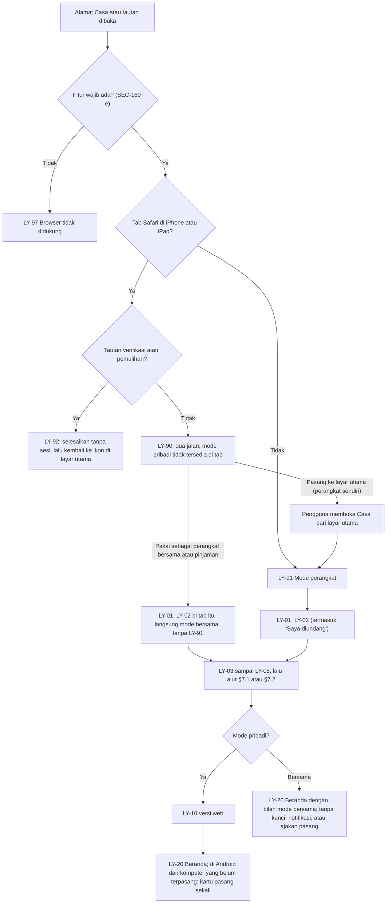

**Mengenali tab Safari iPhone dan iPad.** Dari ada tidaknya mode tampilan layar utama (`display-mode: standalone`, [S17]) dan sifat `navigator.standalone` yang hanya ada di Safari iOS dan iPadOS **[Perlu validasi]** (§23.2 nomor 23). Bila tidak dapat dipastikan, layar yang tampil adalah LY-91, bukan LY-90, supaya tidak ada pengguna yang terkunci di luar.

**LY-90, di tab Safari iPhone dan iPad** (SEC-171 (b)(5), SEC-165 (d)). Layar ini menawarkan dua jalan: memasang ke layar utama untuk perangkat sendiri, atau "Pakai sebagai perangkat bersama atau pinjaman", yang langsung membuka LY-01 dan LY-02 dalam mode bersama di tab itu, tanpa memasang ikon dan tanpa LY-91. **Mode pribadi tidak pernah tersedia di tab Safari.** Kalimat "buka halaman ini di Safari dulu" tampil di atas kedua jalan.

| Bagian | Kata |
|---|---|
| Baris pertama, di atas kedua jalan | "Kalau kamu membuka halaman ini dari aplikasi lain, buka halaman ini di Safari dulu." (menutup kasus browser di dalam aplikasi lain tanpa mengenalinya) |
| Judul | "Pasang Casa di layar utama dulu" |
| Alasan | "Di iPhone dan iPad, Casa dibuka dari ikonnya di layar utama. Dengan begitu catatanmu tidak terhapus oleh aturan pembersihan data Safari, dan kamu bisa menerima pemberitahuan." (tidak menjanjikan data tak pernah hilang: browser tetap dapat menghapus data saat ruang penyimpanan menipis, §25.7; ketetapan `security-privacy`) |
| Langkah | "1. Ketuk ⋯ di samping alamat situs, lalu ketuk Bagikan." "2. Pilih Tambah ke Layar Utama." "3. Biarkan Buka sebagai Web App menyala, lalu ketuk Tambah." "4. Tutup Safari, lalu buka Casa dari layar utama." Langkah ditulis sebagai teks bernomor dengan nama tombol persis menurut iOS berbahasa Indonesia, tanpa gambar tangkapan layar |
| Jalan kedua | Di bawah langkah, tombol bergaris setara "Pakai sebagai perangkat bersama atau pinjaman" dengan keterangan "Untuk iPhone atau iPad milik orang lain. Catatanmu tidak disimpan di perangkat ini, dan kamu keluar otomatis sesudah 30 menit tidak dipakai." Mengetuknya membuka LY-01 dan LY-02 di tab itu dalam mode bersama (aturan SEC-165 (a) sampai (f), bilah mode bersama §25.2) |
| Bila halaman dibuka dari tautan undangan | Ditambah: "Kamu membuka undangan. Sesudah Casa terpasang, bukalah, pilih Saya diundang, lalu tempel tautan undangan dari pesan yang kamu terima." Aplikasi tidak menyalin tautan itu ke papan klip; tokennya dibuang dari bilah alamat seperti SEC-175 (c). Pada jalan kedua, undangan dari tautan itu dibawa ke LY-02 di tab yang sama |
| Yang tidak ada | Isian masuk sebelum jalan dipilih, data apa pun, dan pilihan mode pribadi di tab |

**Kartu pasang, Android dan komputer.** Sekali di Beranda sesudah masuk pertama di mode pribadi, bila belum terpasang: "Pasang Casa di perangkat ini supaya bisa dibuka dari layar utama dan catatanmu lebih terjaga." dengan "Pasang" dan "Nanti". "Pasang" membuka permintaan pasang browser bila browser menyediakannya; bila tidak, petunjuk: Chrome Android "Buka menu ⋮, lalu pilih Tambahkan ke layar utama atau Instal aplikasi."; komputer "Pakai ikon pasang di bilah alamat, atau menu browser." Kartu tidak kembali sesudah ditutup; pemasangan tetap tersedia di LY-95. Tidak tampil di mode bersama (SEC-165 (d)). Di Galaxy A55, pilot memakai Chrome **[Usulan]**, karena pemasangan PWA di Samsung Internet belum dapat dipastikan ([S21]); bila Casa dibuka di Samsung Internet, kartu itu menambah satu kalimat "Untuk saat ini, pakai Casa di Chrome."

**LY-91 Mode perangkat** (SEC-165; tanpa pilihan terpilih).

| Bagian | Kata |
|---|---|
| Pertanyaan | "Ini perangkat pribadimu, atau perangkat bersama atau pinjaman?" |
| Pilihan 1 | "Perangkat pribadiku" — "Salinan catatan tersimpan di browser perangkat ini, jadi kamu bisa mencatat tanpa internet. Siapa pun yang bisa membuka browser ini dapat membaca salinan itu. Bisa memakai pemberitahuan dan kunci aplikasi." (batas SEC-170 (b) dinyatakan di layar mode) |
| Pilihan 2 | "Perangkat bersama atau pinjaman" — "Catatanmu tidak disimpan di perangkat ini. Kamu keluar otomatis sesudah 30 menit tidak dipakai, dan paling lama 12 jam. Mencatat perlu internet." (angka dari SEC-165, **[Asumsi]** di sana; "catatanmu", bukan "tidak ada apa pun", karena kode aplikasi tetap tersimpan di browser) |
| Batas | "Casa tidak bisa mencegah perekam layar atau ketikan, atau pengelola kata sandi, yang terpasang di perangkat ini." |
| Bentuk | Dua tombol besar setara, selebar kolom, tanpa yang terpilih; memilih langsung lanjut ke LY-01. Mode tidak dapat diganti di tengah sesi: menggantinya berarti keluar akun lalu masuk lagi (SEC-165) |

**LY-02 di web.** (1) Tautan "Saya diundang" membuka isian "Tempel tautan undangan" dengan keterangan "Salin tautan dari pesan undangan yang kamu terima, lalu tempel di sini."; tautan undangan yang tidak berlaku memakai kalimat SEC-30 (§7.2); teks yang bukan tautan undangan Casa sama sekali (tautan situs lain, teks biasa) memakai "Tautan ini bukan tautan undangan Casa. Salin lagi tautan dari pesan undangan." Keduanya galat per isian di bawah isian, tanpa menyebut nama rumah tangga. (2) Mode pribadi: isian kata sandi dengan `current-password` atau `new-password`. Mode bersama: tanpa isian otomatis yang menyimpan, ditambah "Jangan simpan kata sandi di browser perangkat ini." (SEC-165 (e)).

**LY-92 Halaman tautan di tab** (iPhone dan iPad).

| Tautan | Kata sesudah tindakan server |
|---|---|
| Verifikasi email | "Email sudah terverifikasi. Kembali ke Casa di layar utama untuk lanjut." |
| Pemulihan kata sandi | Isian kata sandi baru di tab itu; sesudahnya: "Kata sandi baru sudah tersimpan, dan akunmu sudah dikeluarkan dari semua perangkat lain (SEC-24). Buka Casa di layar utama, lalu masuk dengan kata sandi baru." Bila pengaman tambahan menyala, ditambah: "Saat masuk, kamu tetap diminta kode dari perangkat pengamanmu." (SEC-18). Tidak ada sesi yang dibuat di tab |
| Undangan | LY-90 dengan tambahan undangan (di atas) |

**LY-10 versi web** (SEC-174 (a) sampai (c), SEC-59 (b)). Ditawarkan sekali, mati secara bawaan, tidak di mode bersama.

| Bagian | Kata |
|---|---|
| Pembuka | "Kunci aplikasi menutup Casa dengan kode 6 angka setiap kali dibuka, dan sesudah kamu tinggalkan lebih dari 1 menit." |
| Batas (SEC-174 (c), bunyi persis) | "Di versi web, kunci ini menutup tampilan aplikasi. Data yang tersimpan di browser ini tetap dapat dibaca orang yang tahu cara membuka penyimpanan browser." |
| Perangkat yang dipegang orang lain (SEC-59 (b)) | "Kalau perangkat ini sering dipegang orang lain, misalnya tablet di rumah, kunci aplikasi membantu menutup tampilan catatanmu dari mereka." (SEC-174 (c)) Tampil di **semua** perangkat web, karena iPad tidak dapat dikenali dengan pasti (W-5); tanpa bagian biometrik |
| Tombol | "Nyalakan" dan "Nanti", setara, tanpa yang terpilih |
| Membuat kode | Satu isian 6 angka, diketik dua kali; di atasnya: "Jangan pakai PIN ATM atau kode layar kunci perangkatmu." Kode yang terlalu mudah ditolak (SEC-19 (a)): "Kode ini terlalu mudah ditebak. Pilih 6 angka lain." Tidak ada pertanyaan sidik jari atau wajah |

**Kunci aplikasi di web, LY-93.**

| Keadaan | Rancangan |
|---|---|
| Terkunci | Permukaan `kertas` dengan simpul (§19.5), satu isian kode 6 angka (`inputmode="numeric"`, tanpa isian otomatis, menempel boleh), "Buka" dan "Lupa kode". Data dilepas dari halaman, bukan hanya dikaburkan (SEC-174 (c)); judul halaman "Casa" saja |
| Salah | "Kode belum cocok." Tanpa hitungan mundur |
| Salah 5 kali atau "Lupa kode" | "Masukkan kata sandi akun untuk membuka." (LY-77; SEC-174 (e)). Saat luring: "Membuka dengan kata sandi perlu sambungan internet. Catatanmu tetap tersimpan di perangkat ini." Tidak ada data yang dihapus |
| Semua tab | Terkunci dan terbuka bersama (SEC-173 (b)) |
| Mematikan | Di LY-73, dengan kata sandi akun (SEC-19 (e)) |

**Sesi berakhir, LY-94.** Tidak pernah menyebut siapa atau apa yang mencabut.

| Sebab | Kata | Tombol |
|---|---|---|
| `session_revoked` (SEC-172 (a)) | "Kamu sudah keluar di perangkat ini, dan data Casa di browser ini sudah dihapus." Bila antrean tidak kosong sebelum dihapus: "{n} catatan yang belum terkirim dari perangkat ini ikut terhapus." | "Masuk" |
| `session_expired`, mode pribadi (SEC-161 (d)) | "Waktu masukmu di perangkat ini sudah habis. Masuk lagi dengan akun yang sama; catatan yang belum terkirim tetap tersimpan dan terkirim sesudah kamu masuk." | "Masuk" dan "Masuk dengan akun lain"; yang kedua meminta konfirmasi: "Data Casa di perangkat ini akan dihapus, termasuk {n} catatan yang belum terkirim." (SEC-170 (a)) |
| Mode bersama berakhir | "Kamu sudah keluar otomatis. Catatanmu tidak tersimpan di perangkat ini." | "Masuk" |

**Keluar akun di web** (SEC-164). Tombol "Keluar akun" di LY-73 dan LY-95, dan selalu terlihat di bilah mode bersama; namanya sengaja berbeda dari "Keluar dari rumah tangga" (LY-74). Konfirmasi: "Data Casa di perangkat ini akan dihapus." ditambah kalimat §18.3 tentang catatan belum terkirim bila antrean tidak kosong. Saat luring tombol nonaktif dengan alasan terbaca: "Keluar akun perlu sambungan internet." (§13.2 baris "Tindakan yang memerlukan server").

**Mencabut sesi web** (LY-73; SEC-16, SEC-21, SEC-172 (e)). Baris sesi berbunyi "{browser} · {sistem operasi} · {pribadi / bersama}" (SEC-161 (e)). Konfirmasi memuat kalimat SEC-21 (§18.3) lalu kalimat SEC-172 (e), dengan nama produk diganti Casa (§0): "Data di browser itu terhapus saat browser itu membuka Casa lagi dan tersambung. Sampai itu, orang yang dapat membuka browser itu dapat membaca salinannya."

**Tambahan LY-71 dan LY-84 di web.** LY-71 (SEC-178 (d), SEC-170 (b)): "Di versi web, salinan catatan rumah tangga tersimpan di browser perangkat ini tanpa perlindungan tambahan dari sistem. Siapa pun yang dapat membuka browser ini dan tahu caranya dapat membaca salinan itu. Kunci aplikasi hanya menutup tampilan." dan "Perangkat ini dipakai sebagai perangkat {pribadi / bersama}." LY-84, Tier 2 (SEC-170 (c)): "Status yang tidak kamu bagikan hanya tersimpan di browser perangkat ini, dan hilang kalau browser menghapus data situs atau kamu keluar akun." Di mode bersama LY-84 berbunyi "Status tidak tersedia di perangkat bersama."

**LY-95 Perangkat ini** (dari LY-70). Daftar baris tanpa angka uang, jadi tanpa samaran:

| Baris | Isi |
|---|---|
| Mode | "Perangkat pribadi" atau "Perangkat bersama" |
| Dibuka sebagai | "Aplikasi di layar utama" atau "Tab browser", dengan "Pasang" bila belum terpasang dan mode pribadi |
| Penyimpanan tetap | "Diberikan browser" atau "Belum diberikan browser" dengan tombol "Minta lagi" (hasil `persist()`, SEC-171 (a)); permintaan ulang dari ketukan, karena sebagian browser mungkin menampilkan pertanyaan (§23.2 nomor 30) |
| Catatan belum terkirim | Jumlahnya; membuka daftar antrean (§13.2) |
| Versi aplikasi | "{versi} · {hash pendek}" (SEC-169 (f)) |
| Keluar akun | Tombol, aturan di atas |

**LY-88 di web (FS-2; SEC-175 (e)).** Langkah 3: kode QR untuk dipindai aplikasi autentikator, dan kunci teks dalam huruf monospace berkelompok empat karakter **untuk diketik**, tanpa tombol "Salin". Langkah 4: sepuluh kode tampil dalam huruf monospace, tanpa "Salin", "Bagikan", atau unduh **[Usulan]**, dengan tambahan kalimat: "Di versi web tidak ada tombol salin. Tulis kode ini di tempat yang hanya kamu yang bisa membuka." Apakah tautan `otpauth://` ke aplikasi autentikator di perangkat yang sama boleh ditawarkan, diserahkan kepada `security-privacy` (§23.1). **Di mode bersama LY-88 tidak tersedia** (SEC-165 (h)): baris "Pengaman tambahan saat masuk" di LY-73 tetap tampil tanpa tombol, dengan kalimat "Pasang faktor kedua dari perangkat pribadimu." Masuk dengan faktor kedua yang sudah menyala tetap berjalan di mode bersama.

### 25.7 Luring, belum terkirim, dan keadaan khusus browser

Keadaan §13.2 berlaku dengan kata yang sama. Yang ditambahkan browser:

| Keadaan | Kata **[Usulan]** | Bentuk dan aturan |
|---|---|---|
| Belum terkirim, penyimpanan tidak tetap (`persist()` ditolak, atau berjalan di tab browser) | Di bawah "{n} catatan belum terkirim" (§13.2): "Catatan ini bisa hilang kalau browser menghapus data situs. Buka Casa saat tersambung supaya terkirim." | SEC-171 (c). Tidak tampil bila penyimpanan tetap diberikan |
| Gagal menyimpan ke antrean (`QuotaExceededError` atau galat tulis) | "Catatan belum tersimpan karena penyimpanan browser penuh atau bermasalah. Isianmu masih di sini. Coba Simpan lagi, atau kosongkan ruang di perangkat ini." | Lembar tidak ditutup, isian tidak dibuang (SEC-171 (f)) |
| Data perangkat dihapus browser (LY-96) | "Data Casa di perangkat ini dihapus oleh browser. Kalau ada catatan yang belum terkirim, catatan itu tidak bisa dipulihkan. Catatan yang sudah terkirim aman di server dan sedang diambil lagi." Tombol "Mengerti" | Dialog sekali, lalu sinkron ulang dengan kerangka §13.2 "Memuat pertama kali" (SEC-171 (e)) |
| Mode bersama, tidak tersambung | Baris status: "Belum tersambung. Di perangkat bersama, catatan tidak disimpan di perangkat ini." Saat Simpan: "Catatan belum tersimpan karena belum tersambung. Isianmu masih di sini; Simpan lagi saat tersambung." | Lembar tetap terbuka; tidak ada antrean (SEC-165 (c)) |
| Versi aplikasi di bawah minimum (SEC-169 (d)) | Baris status: "Aplikasi perlu diperbarui untuk mengirim catatan. Catatanmu tersimpan di perangkat ini." Tombol "Perbarui" | "Perbarui" memuat ulang hanya bila tidak ada isian terbuka; bila ada, setelah isian ditutup atau disimpan. Antrean utuh dan terkirim sesudah pembaruan |
| Versi baru tersedia (bukan minimum) | Tanpa kalimat | Aktif saat aplikasi dibuka berikutnya atau saat tidak ada isian terbuka (SEC-169 (c)) |
| Pemeriksaan sesi saat dibuka (SEC-172 (b)) | Tanpa kalimat | Paling lama 3 detik **[Asumsi]** SEC-172 sebelum data lokal tampil; selama itu permukaan `kertas` dengan simpul, bukan pemutar |
| Kunjungan pertama | Tanpa kalimat | App shell dari jaringan dengan rupa layar peluncuran (§19.5); kunjungan berikutnya dari cache |

Antrean dikirim saat aplikasi dibuka, saat tersambung kembali, saat halaman kembali terlihat, dan sesudah setiap perintah baru (SEC-171 (d)). Di iPhone dan iPad tidak ada pengiriman latar (18 §5.13.4), jadi baris "belum terkirim" adalah satu-satunya tanda; ia tidak pernah disembunyikan (ADR-024 butir 6).

### 25.8 Notifikasi di web

Kelas, teks layar kunci, judul, pengelompokan, jam tenang, dan ringkasan sama dengan §11 (SEC-51 sampai SEC-56; SEC-176 (a), (h)).

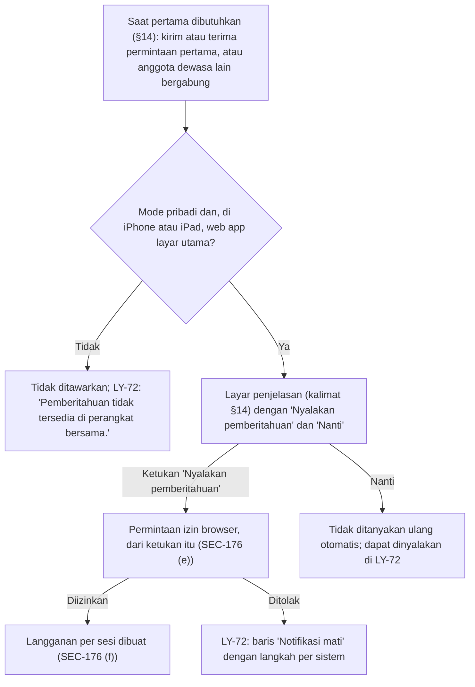

| Hal | Rancangan |
|---|---|
| Waktu meminta | Tidak pernah saat halaman dimuat atau saat onboarding (§14; SEC-176 (e)). Di iPhone dan iPad hanya di web app layar utama, yang selalu terpenuhi di mode pribadi karena mode pribadi hanya ada di sana; masuk di tab Safari selalu mode bersama, yang tidak ditawari notifikasi (W-6; LY-90) |
| Ditolak | Baris LY-72: "Notifikasi mati untuk Casa. Kamu tetap bisa melihat yang menunggu di Beranda." dengan langkah dalam kata, karena web tidak dapat membuka setelan sistem: iPhone dan iPad "Buka Pengaturan, Notifikasi, lalu Casa."; Android "Buka info aplikasi Casa, lalu Notifikasi."; komputer "Buka setelan situs Casa di browser." Label menu **[Perlu validasi]**. Tanpa permintaan ulang |
| Lencana | iPhone dan iPad: hanya jumlah `perlu_tanggapan` milik penerima (SEC-53, SEC-176 (d)). Android: sistem menandai ikon untuk setiap notifikasi yang belum dibuka, termasuk `kabar` (18 §5.13.3 **[Terverifikasi]**); batas ini dinyatakan di LY-72 Android: "Di Android, tanda di ikon aplikasi juga muncul untuk kabar baru, bukan hanya yang menunggu jawabanmu." |
| Mengetuk notifikasi | Membuka aplikasi di tujuan umum; kunci aplikasi diminta lebih dulu bila menyala (SEC-176 (i)); sesudah pengenal opak ditarik (SEC-50), aplikasi berpindah ke objeknya seperti §11.2, sehingga sasaran dua ketukan §9.2 tetap |
| Lipat N-28 (Tier 2) | Satu notifikasi per pasangan lewat `tag` opak (SEC-57, SEC-176 (c)); kata LY-72 dan LY-85 dari §11.5 tetap |
| Tombol di notifikasi | Tidak ada (§9.2) |

### 25.9 Informasi peka di web

Aturan §12.2 per layar berlaku; tabel ini menambah permukaan browser.

| Permukaan | Aturan |
|---|---|
| Halaman tersembunyi (pindah aplikasi, pindah tab, layar mati) | Seketika menampilkan penutup netral: permukaan `kertas` dengan simpul, sama dengan layar peluncuran, menyala atau tidak kuncinya (SEC-174 (f); padanan SEC-20). Apakah gambar pengalih aplikasi iOS dan Android diambil sesudah penutup itu **[Perlu validasi]**; bila tidak, batasnya ditambahkan ke kalimat batas LY-10 |
| Judul halaman | "Casa · {nama tujuan}" ("Beranda", "Uang", "Chat", "Saya", "Catat"); tidak pernah nama orang, sebutan, tempat uang, kategori, jumlah, atau judul objek (SEC-175 (a)) |
| Alamat dan riwayat browser | Nama tujuan dan pengenal acak saja (SEC-175 (b)); token undangan, pemulihan, dan pemasangan dibuang dari bilah alamat sebelum permintaan pertama (SEC-175 (c)) |
| Isian otomatis | Jumlah, catatan, pesan, kode, dan pencarian tanpa isian otomatis (SEC-175 (d)) |
| Notifikasi dan lencana | §25.8; teks kelas saja |
| Pratinjau tautan | Umum, tanpa nama rumah tangga atau orang (SEC-175 (f)) |
| Sembunyikan angka (Tier 3, §12.1) | Sama dengan native; pilihan mata disimpan sebagai setelan tampilan tanpa data (10.5 §5) |
| Tangkapan layar dan cetak | Tidak dicegah dan tidak dicoba dicegah (SEC-20); tidak ada tampilan cetak khusus |
| Status `CARE` (Tier 2) | §25.6 "Tambahan LY-71 dan LY-84" |

### 25.10 Yang hanya untuk aplikasi native: ditunda, tidak dihapus

Bagian berikut tetap rancangan aplikasi iOS dan Android dan dibangun saat aplikasi itu dibangun. Klien web tidak membangunnya; padanannya di kolom kanan.

| Bagian 08 | Isi native | Padanan web |
|---|---|---|
| §2 pemeriksaan 1, 2 | Komponen sistem; Liquid Glass hanya di lapisan kontrol | Pemeriksaan 1 dibaca "HTML bawaan dulu"; 2 tidak berlaku; 16 sampai 21 (§25.11) |
| §4.3 | `TabView` dan `sidebarAdaptable`, `NavigationSuiteScaffold`, predictive back, postur tabletop | §25.2 |
| §9.1 baris "Dari luar aplikasi"; tombol Catat iOS di bilah | Quick action dan app shortcut; tombol kaca menonjol | Pintasan manifest tidak dibangun di pilot web (ponytail; bila kelak ditambah, mengikuti SEC-175 (g)); tombol Catat §25.2 |
| §9.3 kolom iOS dan Android | `UndoManager`, `Snackbar` | Baris hasil dan Ctrl/⌘+Z (§25.4, §25.5) |
| §10.1, §10.7 baris foto diburamkan | Komponen utas native; SensitiveContentAnalysis | §25.4; tanpa peburaman foto di web |
| §11.1 kolom kanal dan kategori; §11.5 kolom iOS dan Android | Kanal Android, kategori iOS, `apns-collapse-id`, `setOnlyAlertOnce` | `tag` Web Push (§25.8) |
| §12.3 baris biometrik, Keychain, Keystore, "Tawaran di iPad" | Face ID, Touch ID, `BiometricPrompt` | Kode saja (§25.6) |
| §14 kolom iOS dan Android | PHPicker, Photo Picker, izin runtime | Pemilih berkas dan izin notifikasi browser (§25.4, §25.8) |
| §15 kolom iOS dan Android | Dynamic Type, sp, VoiceOver dan TalkBack native | §25.5 |
| §16.2, §16.3 | Size class, `NavigationSplitView`, papan angka iPad, papan ketik terlepas, judul scene, Spotlight dan Siri, postur WindowManager | §25.3; judul halaman §25.9 |
| §16.4 baris native | Uji aplikasi native | Dijadwal ulang ke sebelum aplikasi itu memegang data nyata; uji web §25.11 |
| §17.1 butir 2 sampai 4; §17.3 kolom iOS dan Android; §17.4 seluruhnya; §17.5 set ikon per platform; §17.6 haptik; §17.7 bentuk sistem | Sistem desain di atas SwiftUI dan Compose Material 3 | §25.4 |
| §19.3 tabel "Per platform"; §19.5 baris iOS dan Android; §19.7 seluruhnya | Katalog aset, `ColorScheme`, Icon Composer, adaptive icon, Liquid Glass dan Material 3 | CSS custom property, ikon manifest (§19.5 baris "Klien web"), §25.4 |
| LY-78 Tampilan | Pilihan tema di aplikasi Android | Web mengikuti sistem (§25.4 "Tema") |
| §20 D-14 | Gerak Material 3 Expressive | Tanpa pantulan (§25.4) |

Widget, Live Activity, komplikasi, dan layar luar berisi data sudah tidak ada di Tier 1 (§3.3; SEC-54) dan tidak ada di web.

### 25.11 Gerbang contoh layar dan tinjauan per layar, web lebih dulu

**Gerbang §19.8 dijalankan atas klien web.** Sebelum token dibekukan, lead menunjukkan kepada pemilik produk dan pasangannya contoh layar Beranda, Catat, dan Chat yang dirender dengan token web, di empat konteks: iPhone 13 sebagai web app layar utama, iPad mini 7 potret dan lanskap, Galaxy A55 di Chrome, dan satu browser komputer di keadaan Lebar; terang dan gelap; ditambah ikon dan nama Casa di layar utama iPhone dan di peluncur Galaxy A55. Contoh layar dapat berupa halaman statis bertoken web yang dibuka dari origin staging, dengan data buatan saja dan tanpa analitik, sehingga sekaligus memenuhi syarat (1) dan (2) Q-209 untuk uji prototipe 13 §6.3 (§19.8). Bila dinilai masih seperti templat, yang diubah adalah kelima unsur §19.8. Token yang dibekukan di gerbang ini berlaku untuk semua klien; saat aplikasi native dibangun, gerbangnya hanya memeriksa wadah native (bilah kaca, komponen Material 3, varian ikon §19.5) dan kontras token di dalamnya, tanpa memilih ulang token.

**Tinjauan per layar.** `ux-designer` meninjau setiap layar web yang dibangun sebelum layar itu dipakai dengan data nyata, dan setiap perubahan sesudahnya, dengan pemeriksaan 1 (dibaca "HTML bawaan dulu"), 3 sampai 15, enam pemeriksaan web berikut, dan pemeriksaan tata letak 22 sampai 27 di bawahnya **[Usulan]**:

| # | Pemeriksaan | Gagal bila |
|---|---|---|
| 16 | Keyboard | Ada tindakan yang tidak terjangkau atau tidak dapat dijalankan dengan keyboard, jebakan fokus di luar dialog, cincin fokus yang hilang, atau pintasan satu huruf (§25.5) |
| 17 | Mengalir ulang | Ada gulir dua arah pada 320 CSS px dengan teks 100% **atau 200%**, atau jumlah terpotong pada teks 200% atau zoom 400% (§25.5). Gabungan 320 px dan teks 200% melampaui WCAG (1.4.10 memasangkan 320 px dengan teks 100%, 1.4.4 memasangkan 200% dengan lebar perangkat), tetapi tetap diuji karena jendela iPad separuh layar dan ponsel kecil dengan teks besar adalah keadaan nyata; aturan batas lebar jumlah §25.4 membuatnya dapat lulus (13 November 2026) |
| 18 | Semantik dan pembaca layar | Layar tanpa `h1` atau landmark, isian tanpa label tampak, kartu yang tombolnya tidak menyebut objeknya, atau alur Tier 1 yang gagal di VoiceOver Safari atau TalkBack Chrome |
| 19 | Permukaan luar | Judul halaman, alamat, atau riwayat browser memuat nama, sebutan, jumlah, kategori, atau judul objek (§25.9) |
| 20 | Keadaan browser | Layar salah atau kosong di salah satu keadaan: tab lawan terpasang, luring, ada antrean, penyimpanan tidak tetap, mode bersama, terkunci, sesi berakhir (§25.6, §25.7) |
| 21 | Tanpa tiruan dan tanpa kit | Ada tiruan Liquid Glass, tab bar iOS, atau efek riak Material; ada komponen UI dari pustaka pihak ketiga; atau tata letak bercabang menurut sistem operasi atau browser (W-2, W-4) |

**Pemeriksaan tata letak 22 sampai 27 (13 November 2026, atas gerbang 1.8; 18 §4.12.8).** Berlaku juga bagi aplikasi native saat dibangun. Diperiksa pada 390, 744, 1133, 1280, dan 1920 CSS px, tema terang dan gelap.

| # | Pemeriksaan | Gagal bila |
|---|---|---|
| 22 | Kolom per keadaan | Ada dua kolom isi pada lebar < 840, kolom satu-kolom lebih lebar dari 640, isi yang melebar melewati 1200 di Sangat lebar, atau margin dan panel yang menyimpang dari §17.8 |
| 23 | Tanpa bungkus | Ada label baris atau jumlah yang terbungkus ke baris kedua pada teks 100% di 390, 744, 1133, atau 1280 (§17.8 aturan 2) |
| 24 | Permukaan | Di tema terang ada kartu atau kelompok daftar yang lebih gelap dari latarnya, rasio kartu terhadap latar di bawah 1,08 tanpa garis 1 px, atau wadah berwarna di dalam kartu (§17.8 aturan 3) |
| 25 | Satu tombol berisi aksen | Ada lebih dari satu tombol berlabel berisi warna aksen yang terlihat di satu layar (§17.8 aturan 4) |
| 26 | Satu angka menonjol dan hierarki | Ada lebih dari satu `angka-utama` atau `angka-besar` di satu layar di luar utas Chat, atau judul bagian dan judul subbagian sama ukuran dan bobotnya (§17.8 aturan 5, 6) |
| 27 | Tidak seragam | Semua bagian Beranda berbentuk kartu yang sama, atau satu nilai sudut dipakai untuk kartu utama, kelompok daftar, tombol, dan label sekaligus (§17.8 aturan 7) |

**Perangkat dan lebar, sebelum GR-2.** Setiap baris pada terang dan gelap, teks besar, dan luring. Tanpa Mac, uji di iPhone dan iPad adalah pengamatan tanpa Web Inspector, dibantu halaman pemeriksaan diri staging (18 §5.13.8; SEC-179).

| Perangkat | Yang diuji |
|---|---|
| iPhone 13, iOS 26 | LY-90 di tab Safari dengan kedua jalannya, termasuk masuk mode bersama di tab tanpa LY-91; seluruh alur Tier 1 di web app layar utama, potret dan lanskap; ukuran teks terbesar bila Dynamic Type berlaku di web (§25.4); VoiceOver |
| iPad mini 7, iPadOS 26 | Web app layar utama potret (Sedang), lanskap (Lebar), jendela berdampingan selebar Ringkas dan Sedang, dan jendela yang diubah ukurannya di tengah alur Catat dan Bagikan uang masuk (§16.2 alur pemilik produk); papan ketik fisik bila dipakai; VoiceOver |
| Galaxy A55 | Chrome terpasang ke layar utama; penskalaan teks 200%; TalkBack; lencana (§25.8) |
| Laptop atau komputer | Browser yang didukung ADR-030 pada 1280 dan 1920 px, zoom 200% dan 400%, hanya keyboard, `forced-colors` bila Windows dipakai |
| Emulator perangkat lipat Chrome | Terlipat, terbuka, dan peralihan di Chrome DevTools; Viewport Segments bila tersedia |

### 25.12 Butir [Perlu validasi] web

Diperiksa di perangkat pilot dengan staging sebelum GR-2, atau oleh `researcher` (§23.2 nomor 20 sampai 30): label menu "Tambah ke Layar Utama" iOS 26 berbahasa Indonesia (LY-90); Dynamic Type lewat `-apple-system-body` di web app layar utama, dan kueri `-webkit-touch-callout` yang menjaganya (benar di iPhone dan iPad, salah di Safari macOS); meta `text-scale` di Chrome Galaxy A55 pada ukuran huruf terbesar (§25.4); pengenalan tab Safari lewat `navigator.standalone` dan User-Agent iPad; gestur kembali di web app layar utama dan `contextmenu` pada tekan lama di Safari iOS; pembesaran otomatis isian di bawah 16 px; penyimpanan bersama PWA terpasang dan tab di Chrome Android; lisensi SF Symbols dan Material Symbols; ikon `maskable` dan `monochrome` di manifest dan perlakuan iOS 26 atas ikon web app; pembacaan "87.000 rupiah" oleh VoiceOver dan TalkBack; dekode HEIC di Chrome Android; pertanyaan izin `persist()` di Firefox; pemasangan di Samsung Internet; penutup netral di pengalih aplikasi (SEC-174 (f)).