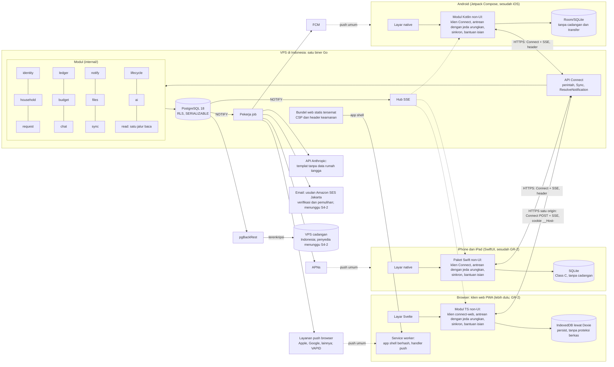

# 09 — Arsitektur teknis

**Status:** **Sesudah S6 (12 November 2026): web lebih dulu.** Klien web (PWA) dibangun pertama dan GR-2 berjalan di web saja (keputusan 69; [ADR-030](adr/ADR-030-klien-web-pwa-lebih-dulu.md), diterima): klien web di §1, §2, §3; sesi web, SSE dengan cookie, dan Web Push di 09.2, 09.3, 09.4; biaya pilot tanpa Apple Developer Program sampai jalur iOS native (09.4 §7.1); temuan audit 9 (§5 baris advokat) diperbaiki. Aplikasi native tetap dirancang dan dibangun sesudah GR-2. Bunyi baru ES §2, §3, §8 disetujui pemilik produk dan dipasang (13 November 2026; ADR-030 butir 15 sampai 17). **S6 (12 November 2026): pass konsistensi**: ADR-028 kini diterima seluruhnya (keputusan 56); pemicu `content_report`, SEC-36, dan SEC-154 dinyatakan menurut keanggotaan pengelola dan pengguna luar pertama (GR-4; keputusan 52); baris SEC-18 dan SEC-25 di 09.4 §8; perkiraan offline hanya pilihan kelak (riwayat di akhir). Versi S4 fase D ditulis `architect`; temuan `critic` CS-A-01 sampai CS-A-26 sudah ditangani, dan dokumen ini ditinjau ulang `critic` pada S4 fase D, S5 (A, A2), dan putaran keputusan 51–55 ([_progress.md](_progress.md)). Stack mobile diputuskan pemilik produk ("Swift + Kotlin saya setuju untuk apple dan android catat dulu yaa, tinggal backend."; [_progress.md](_progress.md); [ADR-012](adr/ADR-012-ui-native-per-platform-dan-versi-os-minimum.md) butir 1). **Checkpoint S4 (12 November 2026):** pemilik produk menjawab semua pertanyaan 09-A sampai 09-G kecuali 09-B, dan mengukuhkannya dengan "lanjut" ([_progress.md](_progress.md), "Checkpoint S4: jawaban pemilik produk", "Keputusan checkpoint S4"). Pilihan yang diterima tercatat di §1 dan §7; ADR yang diterima dicatat di §3. **Hosting, cadangan, dan email (S4-2; ADR-020, ADR-026) tetap usulan**, karena pemilik produk menundanya sampai menjelang deploy ("#S4-2: nanti aja pas mau deploy"), yang menurut keputusan 45 berarti sebelum deploy pertama yang memegang data nyata (GR-2; 14 §7.8); syarat server di Indonesia (keputusan 10) tetap mengikat. Keputusan 43 sampai 50 (12 November 2026) dicatat di §1, §3, §5, §6, dan §7. Keputusan 51 (go public tidak direncanakan, tetap terbuka) dicatat di §5 dan §6: tahap publik menjadi syarat bila diambil, bukan jadwal; tidak ada pilihan arsitektur yang berubah. Rincian di bawah yang tidak disebut keputusan checkpoint tetap **[Usulan]** `architect`.

**Pemilik:** `architect`. Keamanan dan privasi dimiliki `security-privacy` ([dokumen 10](10-security-privacy.md)); dokumen ini memenuhi persyaratannya (pemetaan di berkas 04 §8). Aturan uang kanonis di [07](07-financial-domain.md), dan aturan alur di [06](06-activity-approval-architecture.md).

**Dibaca sebelum menulis:** `CLAUDE.md`; brief §1, §1.1, §4.3, §5D, §5O, §6 sampai §9, §14, §16; `ENGINEERING-STANDARDS.md`; glosarium; `_progress.md`; dokumen 05 (indeks, FIN-1, dan LM-01 sampai LM-11), 06 (seluruhnya), 07 (§1 sampai §4, §8), 08 (§9.3, §23.1), 10 (indeks dan keempat berkas), 17 (keputusan 10, bagian S4, 2.13, L-31), 18 §5; ADR-005, ADR-008, ADR-011; laporan `critic` S4 (CS-A).

## Peta berkas

| Berkas | Isi |
|---|---|
| Indeks ini | Ringkasan, diagram komponen, daftar ADR, keterlacakan, keputusan sekarang dan yang ditunda, pertanyaan checkpoint S4, permintaan kepada pemilik dokumen lain, fakta baru |
| [09.1 Pilihan teknologi](09-technical-architecture/01-pilihan-teknologi.md) | Matriks: mobile, letak logika bersama, kontrak API, backend, monolit, basis data, waktu nyata, push, hosting, `AI`, build iOS, versi |
| [09.2 Modul, data, dan skema](09-technical-architecture/02-data-dan-skema.md) | Modul, penyimpanan per jenis data, isolasi rumah tangga, pengenal, sketsa skema, transaksi, uang, idempotensi, konkurensi, evolusi skema, berkas, pencarian |
| [09.3 Offline, sinkron, waktu nyata, push, pekerjaan latar, dan `AI`](09-technical-architecture/03-sinkron-waktu-nyata-notifikasi.md) | Offline per modul, jeda urungkan, penyimpanan perangkat, protokol sinkron dan potret awal, SSE, tanda terkirim, kehadiran, push, pekerjaan terjadwal, alur berbasis peristiwa, `AI` jalur R1 |
| [09.4 Keamanan, operasi, CI/CD, pengujian, cadangan, biaya, dan risiko](09-technical-architecture/04-operasi-uji-biaya.md) | Penempatan, autentikasi dan email, keteramatan, pengujian, CI/CD dan iOS tanpa Mac, cadangan dan DR, biaya, pemetaan SEC; penunjuk `RISK-NN` ke register kanonis di [15](15-risk-assessment.md) |

---

## 1. Ringkasan rekomendasi

Ringkasnya, Family OS dibangun sebagai **satu monolit modular Go dengan satu PostgreSQL 18**, di satu VPS di Indonesia (usulan: Biznet Gio; menunggu S4-2). **Klien web (PWA) lebih dulu** (ADR-030): SvelteKit mode SPA dan Svelte 5, IndexedDB lewat Dexie, dilayani biner Go yang sama dari satu origin; GR-2 berjalan di web saja. Aplikasi native SwiftUI dan Jetpack Compose menyusul sesudah GR-2. Semua klien memanggil server lewat **kontrak Protobuf dan Connect** yang di-generate untuk Go, TypeScript, Swift, dan Kotlin.

- **Aturan hanya di server.** Perangkat tidak menghitung aturan uang atau persetujuan, juga tidak menghitung perkiraan offline. Yang tersisa di perangkat adalah tiga bantuan isian kecil yang ditulis per platform dan dijaga vektor uji emas dari server. Itu pengecualian ES §2 yang disetujui tegas oleh pemilik produk (09-F A, S4-1 (ii)) dan sudah tercantum di ES §2.
- **Penulisan.** Setiap perintah tulis berjalan dalam satu transaksi `SERIALIZABLE` yang juga menulis Peristiwa, umpan per pembaca, notifikasi, dan pekerjaan latar. Message broker tidak ada.
- **Waktu nyata.** Aplikasi di depan menerima tanda lewat SSE lalu menarik lewat satu jalur baca. Aplikasi di latar hanya menerima push umum: Web Push dengan VAPID untuk klien web, APNs dan FCM untuk aplikasi native.
- **Cadangan.** Dienkripsi di VPS lalu dikirim ke VPS lain di Indonesia; data yang dihapus bertahan paling lama 38 hari di salinan mana pun (D-104, diterima). Penyedianya menunggu S4-2.
- **Email.** Usulan: Amazon SES di Jakarta lewat API HTTPS, hanya untuk verifikasi, pemulihan, dan tanda ke operator (menunggu S4-2).
- **`AI`.** Hanya membangun kumpulan kalimat tanpa data rumah tangga.
- **Web.** Dibangun di CI Linux, bundel berhash disematkan ke biner server; tanpa Mac, tanpa toko, tanpa biaya Apple (ADR-030).
- **iOS (sesudah GR-2).** Dibangun di Xcode Cloud dan diuji lewat TestFlight internal, tanpa Mac bulanan atau milik sendiri sampai dana ada (keputusan 43); berlaku sejak jalur iOS native dimulai (ADR-022 catatan web).

Kolom "Kedudukan" mencatat jawaban checkpoint S4 (12 November 2026; [_progress.md](_progress.md), "Keputusan checkpoint S4").

| Lapisan | Pilihan | ADR | Kedudukan |
|---|---|---|---|
| Klien pertama dan urutan platform | Klien web (PWA): SvelteKit 3 mode SPA, Svelte 5, Dexie 4, connect-web 2.x, `EventSource`, Web Push; GR-2 di web; lalu iOS dan iPadOS native, lalu Android native | ADR-030 | **Urutan diputuskan pemilik produk sendiri** (keputusan 69); **stack diterima atas saran lead** (`_progress.md`, "Jawaban pemilik produk") |
| UI native | SwiftUI (iOS, iPadOS) dan Jetpack Compose Material 3 (Android), sesudah GR-2 | ADR-012 | **Diputuskan pemilik produk** (butir 1, sebelum S4) |
| Versi OS minimum | iOS dan iPadOS 26; Android 10 (API 29), target API 36 | ADR-012 | **Diterima** (09-E A; S4-3 (ii) A) |
| Letak logika bersama | Server saja; tanpa perkiraan offline; tiga bantuan isian berpagar sebagai pengecualian ES §2 | ADR-013 | **Diterima** (09-F A; S4-1 (ii) A); pengecualian tercantum di ES §2 |
| Kontrak API dan validasi | Protobuf + Connect, dikelola `buf`; aturan bentuk sebagai anotasi protovalidate, ditegakkan server | ADR-013 | **Diterima** (D-100) |
| Bentuk server | Monolit modular, satu proses | ADR-014 | **Diterima** (D-99) |
| Bahasa backend | **Go** 1.27 (stdlib `net/http`, connect-go, pgx, sqlc, goose) | ADR-015 | **Diterima** (09-A A; S4-1 (i) A) |
| Basis data | PostgreSQL 18, satu skema, `household_id` di setiap kunci, RLS dipaksakan, `SERIALIZABLE` | ADR-016 | **Diterima** (D-99) |
| Pengenal dan kursor | UUIDv4 acak; umpan sinkron per pembaca; potret awal untuk kursor kosong | ADR-017 | **Diterima** (D-99) |
| Sinkron dan waktu nyata | Offline per modul; jeda urungkan 5 detik; SSE + tarik berkursor; kehadiran seperti WhatsApp, ketelitian menit | ADR-018 | **Diterima** (D-100; S4-5 A, A) |
| Push | Langsung ke APNs dan FCM, payload umum, tanpa ekstensi notifikasi | ADR-019 | **Diterima** (D-101) |
| Hosting dan cadangan | Usulan: Biznet Gio NEO Lite MS 4.2 (PT Biznet Gio Nusantara); cadangan di VPS IDCloudHost (PT Cloud Hosting Indonesia **[Perlu validasi]**) | ADR-020 | **Diusulkan; ditunda sampai menjelang deploy** (S4-2). Syarat di Indonesia tetap mengikat |
| `AI` | R1 kumpulan kalimat, Claude Sonnet 5.5 untuk membangun kumpulan, batas USD 10 per bulan dan USD 3 per pembangunan | ADR-021 | **Diterima** (10-B A, 09-D A; S4-4 (i), (ii) A) |
| Build iOS | Xcode Cloud + TestFlight internal, dengan sewa Mac sekali; tanpa Mac bulanan atau milik sendiri sampai dana ada; **berlaku sejak jalur iOS native** | ADR-022 | **Diterima** (09-C A; S4-3 (i) A); butir 4 diubah keputusan 43; waktunya diubah ADR-030 |
| Irama rilis | Web: rilis server berisi bundel, tanpa toko. iOS (sejak jalur native): rilis pemeliharaan bila 60 hari tanpa rilis; batas keras 80 hari sejak unggahan TestFlight | ADR-028 butir 4 dan catatan web | Diterima atas saran lead (keputusan 44; ADR-030) |
| Lingkungan, pelepasan fitur, tahan tulis, kompatibilitas klien | Staging di VPS yang sama dengan basis data terpisah sejak GR-2; tanpa feature flag; saklar tahan tulis yang tidak pernah menahan perintah pelindung; server melayani build yang masih terpasang | ADR-028 butir 1, 2, 3, 5 | Diterima atas saran lead (keputusan 56) |
| Perangkat pengukuran ES §3 | iPhone 13 dan iPad mini 7 sebelum data nyata pertama; Galaxy A55 sebelum aplikasi Android memegang data nyata. Klien web: ketiganya sebelum GR-2 | ADR-029 dan catatan web | **Diterima** atas saran lead (keputusan 50); bunyi ES §3 untuk web disetujui pemilik produk dan dipasang (13 November 2026) |
| Versi 0.x dan API eksperimental | Boleh bila memenuhi lima syarat dan tercatat dengan jalan mundurnya | ADR-023 | **Diterima** (09-G A; S4-1 (iii) A); kalimatnya tercantum di ES §8 |
| Data perangkat | Proteksi berkas Class C (`CARE` lokal Class A), dikecualikan dari cadangan dan transfer, hapus jarak jauh | ADR-024 | **Diterima** (D-102; 10-D A, S4-6 (i) A) |
| Alat kualitas | Formatter, linter, pemindai kerentanan, dan pemeriksa duplikasi per bahasa | ADR-025 | **Diterima** (D-103) |
| Email | Usulan: Amazon SES `ap-southeast-3`, API HTTPS | ADR-026 | **Diusulkan; ditunda sampai menjelang deploy** (S4-2); K-62 menunggu |
| Asas pengawasan (06 PG-14) | Rumusan (a) sampai (e); aturan batas periode hanya atas jatah di atas ambang | ADR-027 | **Diterima** (D-113; S4-9 (i) A) |

**Tradeoff utama** (dicatat sebagai dasar keputusan; Go dan server saja diterima di S4).

1. **Go dibandingkan Rust.** Keduanya memerlukan pustaka 0.x. Di Go, pustaka 0.x itu (`golang.org/x/crypto`, `golang.org/x/oauth2`) berasal dari proyek Go sendiri dan berada di tepi sistem; jalur setiap permintaan memakai pustaka ≥ 1.0. Di Rust, framework HTTP (axum) dan akses basis data (sqlx) masih 0.x dan berada di jalur setiap permintaan. Rust memberi tipe yang lebih ketat dan kemungkinan inti bersama kelak.
2. **Server saja dibandingkan inti bersama.** Server saja menghemat satu bahasa dan langkah build yang hanya dapat dikompilasi di macOS. Harganya: perangkat tidak menghitung tanda, sisa, atau perkiraan saat offline (06 S-8, S-9), dan tiga bantuan isian ditulis dua kali dengan pagar uji.
3. **Xcode Cloud tanpa Mac.** Biayanya hampir nol, tetapi siklus UI iOS lambat. Sejak ADR-030, harga ini hanya dibayar di jalur iOS native sesudah GR-2.
7. **Web lebih dulu dibandingkan native lebih dulu** (ADR-030). Data nyata lebih cepat di ketiga perangkat, tanpa Mac dan tanpa biaya Apple, dengan siklus UI di Linux. Harganya: web tidak terasa native di ponsel (diterima pemilik produk), antrean luring lebih rapuh di browser (TM-44), pengelola dapat mengubah kode web per akun (TM-42), dan rantai pasok npm (TM-38).
4. **Foto di PostgreSQL.** Cadangan dan penghapusannya sederhana, dengan batas pindah yang dinyatakan.
5. **R1.** Tidak ada data rumah tangga ke luar negeri, dan biayanya tidak tumbuh dengan pengguna. Harganya: saran tidak menyebut hal yang spesifik.
6. **Email per pemakaian** (menunggu S4-2). SES melanggar bunyi "no usage-priced managed services" kecuali dengan alasan; alasannya ada di ADR-026 (tidak ada jalur SMTP bertarif tetap yang terverifikasi di Indonesia, biayanya mendekati nol, dan isinya tidak memuat data rumah tangga). Kalimat brief untuknya (K-62, D-111 §1) disusun lead sesudah S4-2 dijawab.

---

## 2. Arsitektur utama

| Komponen | Tanggung jawab | Berkas |
|---|---|---|
| Klien web (PWA) | Sama dengan aplikasi native, di browser: layar Svelte, antrean di IndexedDB dengan satu pengirim per profil (Web Locks), salinan baca, bantuan isian TypeScript (ES §2; ADR-030 butir 15). Service worker hanya app shell dan tampilan push. Tanpa aturan uang atau persetujuan | 01 §14; 03 §2, §4, §8; ADR-030 |
| Aplikasi native | Layar, navigasi, dan komponen sistem; antrean perintah dengan jeda urungkan; salinan baca; bantuan isian (09-F A, pengecualian ES §2). Tanpa aturan uang atau persetujuan | 01 §2, §3; 03 §1, §2 |
| API Connect | Perintah tulis idempoten, `Sync` berkursor per pembaca, dan `ResolveNotification` | 02 §6; 03 §3, §8 |
| Modul | Aturan 06 dan 07, masing-masing pemilik tabelnya | 02 §1 |
| `read` | Satu-satunya jalur baca untuk layar, laporan, ekspor, sinkron, potret awal, dan `AI` | 02 §1; 03 §3 |
| Hub SSE | Tanda "umpan bergerak" dan kehadiran sesaat; autentikasi cookie (web) atau header (native) | 03 §4, §6 |
| Bundel web | Disematkan ke biner, dilayani dari origin yang sama dengan CSP, HSTS, dan header lain (ADR-030 butir 3, 7) | 04 §1, §5 |
| Pekerja job | Push (Web Push, APNs, FCM), jam tenang, ringkasan, pengingat, kedaluwarsa, penutupan keluar, penghapusan, kumpulan `AI`, email | 03 §9 |
| PostgreSQL | Semua data, termasuk foto di pilot | 02 |
| pgBackRest dan VPS cadangan | PITR 30 hari, terenkripsi, di Indonesia, salinan pelindung yang hanya menambah | 04 §6 |

---

## 3. Daftar ADR

| ADR | Judul | Status |
|---|---|---|
| [ADR-012](adr/ADR-012-ui-native-per-platform-dan-versi-os-minimum.md) | UI native per platform dan versi OS minimum | **Diputuskan pemilik produk** (butir 1); butir 2 sampai 6 **Diterima** (S4) |
| [ADR-013](adr/ADR-013-logika-bersama-hanya-di-server.md) | Logika bersama hanya di server; kontrak API satu sumber; pengecualian ES §2 untuk bantuan isian | **Diterima** (S4), opsi A termasuk pengecualian ES §2 |
| [ADR-014](adr/ADR-014-monolit-modular.md) | Monolit modular satu proses | **Diterima** (S4) |
| [ADR-015](adr/ADR-015-bahasa-dan-framework-backend.md) | Bahasa dan framework backend: Go | **Diterima** (S4), Go |
| [ADR-016](adr/ADR-016-postgresql-tenancy-dan-transaksi.md) | PostgreSQL 18: tenancy, isolasi, transaksi, idempotensi, berkas | **Diterima** (S4) |
| [ADR-017](adr/ADR-017-pengenal-acak-dan-kursor-per-pembaca.md) | Pengenal acak dan kursor sinkron per pembaca (dokumen 10 §8 butir 1 dan 2) | **Diterima** (S4) |
| [ADR-018](adr/ADR-018-model-sinkron-dan-waktu-nyata.md) | Model sinkron dan waktu nyata | **Diterima** (S4) |
| [ADR-019](adr/ADR-019-push-langsung-apns-fcm.md) | Push langsung ke APNs dan FCM dengan payload umum | **Diterima** (S4) |
| [ADR-020](adr/ADR-020-hosting-dan-cadangan-di-indonesia.md) | Hosting dan cadangan di Indonesia | Diusulkan; **ditunda sampai menjelang deploy** (S4-2), yaitu sebelum deploy pertama yang memegang data nyata (keputusan 45) |
| [ADR-021](adr/ADR-021-jalur-ai-kumpulan-kalimat.md) | Jalur `AI`: kumpulan kalimat (R1) dan batas biaya | **Diterima** (S4), R1 dan Claude |
| [ADR-022](adr/ADR-022-jalur-build-ios-tanpa-mac.md) | Jalur build iOS tanpa Mac | **Diterima** (S4), opsi A; butir 4 diubah keputusan 43 (tetap A sampai dana ada); butir 1 diubah ADR-028 butir 4; catatan keputusan 51: jalur keluarga tanpa batas waktu dinilai ulang (18 §5.2.9); **keputusan 55**: tetap A, pindah ke App Store unlisted (syarat C-1 sampai C-7, akun demo lewat demo mode di perangkat) bila Apple menghentikan TestFlight |
| [ADR-023](adr/ADR-023-kebijakan-versi-0x.md) | Kebijakan pustaka versi 0.x dan API eksperimental (ES §8) | **Diterima** (S4); kalimat ES §8 dipasang |
| [ADR-024](adr/ADR-024-data-di-perangkat-dan-hapus-jarak-jauh.md) | Data di perangkat: proteksi, cadangan, hapus jarak jauh, `CARE` lokal (dokumen 10 §8 butir 3, 4, 9) | **Diterima** (S4), termasuk butir 5 |
| [ADR-025](adr/ADR-025-alat-kualitas-kode.md) | Alat kualitas kode per bahasa (ES §4, §7) | **Diterima** (S4) |
| [ADR-026](adr/ADR-026-pengiriman-email.md) | Pengiriman email: Amazon SES Jakarta | Diusulkan; **ditunda sampai menjelang deploy** (S4-2), yaitu sebelum deploy pertama yang memegang data nyata (keputusan 45) |
| [ADR-027](adr/ADR-027-asas-pengawasan-batas-periode-dan-aturan-dasar.md) | Asas pengawasan: batas periode dan aturan dasar (06 PG-14; dokumen 10.3 §2.4.1) | **Diterima** (S4), opsi A; butir (c) disempitkan menurut S4-9 (i) A |
| [ADR-028](adr/ADR-028-lingkungan-dan-irama-rilis-pilot.md) | Lingkungan, irama rilis, dan kompatibilitas klien (dokumen 14 §6) | **Diterima** seluruhnya: butir 1, 2, 3, 5 atas saran lead (keputusan 56, S6); butir 4 atas saran lead (keputusan 44) |
| [ADR-029](adr/ADR-029-perangkat-pengukuran-kinerja-es-3.md) | Perangkat pengukuran kinerja ES §3 (17 K-66, K-67) | **Diterima** atas saran lead (keputusan 50); kalimat ES §3 dipasang lead; catatan web (ketiga perangkat sebelum GR-2; bunyi ES §3 baru disetujui pemilik produk dan dipasang, 13 November 2026) |
| [ADR-030](adr/ADR-030-klien-web-pwa-lebih-dulu.md) | Klien web (PWA) lebih dulu: urutan, stack, sesi cookie, CSRF, CSP, npm, service worker, kunci aplikasi web, Web Push (10 §7.9; 10 §8 butir 16, 18, 19, 20) | **Diterima**: urutan diputuskan pemilik produk sendiri, stack atas saran lead; bunyi ES §2, §3, §8 disetujui pemilik produk dan dipasang (13 November 2026) |

---

## 4. Keterlacakan: setiap modul Tier 1 punya rumah arsitektur

| Modul Tier 1 (05) | Modul server | Pola offline | Komponen klien | Penyimpanan |
|---|---|---|---|---|
| `FAM` (FAM.md: FR-FAM-001 sampai 024; F-FAM-001 sampai 008, F-FAM-019, F-FAM-020) | `identity`, `household`, `lifecycle` | Online-first | Layar keanggotaan, undangan, keluar, sesi, kunci aplikasi (FR-FAM-021; 03 §2), daftar sesi dan jejak keamanan sendiri (FR-FAM-022; `security_event`), hapus akun (FR-FAM-023; `lifecycle`, 04 §1 SEC-105), halaman Bantuan (FR-FAM-024; konten statis di aplikasi, tanpa komponen server) | `account`, `membership`, `invitation`, `session`, `security_event`, `operator_notice_ack`, `consent_record` |
| `FIN` bagian 1 (FIN-1.md: FR-FIN-001 sampai 099; F-FIN-001 sampai 010) | `ledger`, `budget`, `read` | Pencatatan offline-first; pengaturan online-first | Pencatatan dengan bantuan isian, angka server terakhir beserta waktunya, entri yang belum terkirim terpisah | `entry`, `line`, `holding`, `budget`, `authorization`, `reservation` |
| `FIN` bagian 2 (FIN-2.md: FR-FIN-100 sampai 199; F-FIN-011 sampai 020) | `ledger`, `budget`, `read`, `lifecycle` (laporan, ekspor) | Pencatatan offline-first | Tagihan berulang, cicilan, alokasi, aset, riwayat, laporan | Tabel 07 §2 |
| `REQ` (REQ.md) | `request`, `budget` | Offline-first dengan compare-and-set | Permintaan, tanggapan, kartu | `request`, `request_terms`, `request_response`, `object_event` |
| `NTF` (NTF.md) | `notify`, `jobs` | Dibuat server | Kanal per kelas, lencana, buka ke objek lewat `push_ref` | `notification`, `push_token` |
| `COM` (COM.md: FR-COM-001 sampai 020) | `chat`, `files`, `sync` | Kirim offline-first; kehadiran tidak pernah diantrekan; "Sembunyikan untuk saya" tanpa jeda urungkan | Chat, kartu, tanda terkirim dan dibaca, kehadiran, Sembunyikan untuk saya (FR-COM-019; 06 §16.12), Laporkan (FR-COM-020; di pilot membuka halaman Bantuan, SEC-154 (c)) | `conversation`, `message`, `read_state`, `member_mute`, memori proses; `content_report` hanya sejak ada rumah tangga yang pengelola servernya bukan anggotanya (SEC-154 (c)), yaitu sejak build pertama ke TestFlight eksternal atau App Store, atau sejak pengguna luar pertama membuat rumah tangga tanpa pengelola, mana yang lebih dulu (SEC-154; keputusan 52; 02 §5.3) |
| Lintas modul LM-01 sampai LM-11 | `read`, uji privasi, uji simetri | — | — | — |

| Kebutuhan lintas modul | Rumah arsitekturnya |
|---|---|
| LM-01 dua arah | Uji simetri berpermutasi (04 §4); tidak ada kolom hubungan (02 §2) |
| LM-02 pencatatan tidak pernah terhalang | Antrean offline-first; jeda urungkan tidak menolak apa pun; modul `ai` tidak di jalur pencatatan (03 §1, §11) |
| LM-03 notifikasi aman | Payload umum, kanal per kelas, jam tenang (03 §8) |
| LM-04 offline | 03 §1, §3; 02 §6, §8 |
| LM-06 tidak atas nama orang lain | Otorisasi server; INV-25 (02 §3) |
| LM-07 visibilitas per objek | `read.can_read` dan fan-out umpan (02 §1; 03 §3) |
| LM-08 pelaku terlihat | `entry.actor`, `object_event` (02 §5) |
| LM-09 isolasi | 02 §3 |
| LM-10 pesan tidak mengubah state | Kartu = perintah objek (03 §10) |
| LM-11 tanda dan kehadiran tidak dibaca apa pun | Aturan dependensi 4 (02 §1); kehadiran di memori (03 §6) |

Tier 2 (`SHP`, `MNT`, `CARE`, `CAL`, `PLN`, `AI`) memakai pola yang sama: modul di 02 §1, pola offline di 03 §1, dan `AI` di 03 §11. Sebutan anggota per pembaca (F-FAM-021, Tier 2, tambahan pemilik produk di checkpoint S4) tinggal di modul `household`, tabel `member_label`, online-first, dengan aturan kanonis SEC-155 (02 §5.5). Tier 3 tidak memerlukan komponen baru. Fondasinya (banyak rumah tangga per akun, isolasi) sudah ada di skema.

---

## 5. Yang harus diputuskan sekarang

Semua keputusan yang harus ada sebelum fase bangun dimulai sudah diambil di checkpoint S4, kecuali dua yang ditunda pemilik produk sampai menjelang deploy. Penundaan itu tidak menghalangi fase bangun: kode server tidak bergantung pada penyedia VPS, dan pengiriman email hanya dipakai di tiga titik (verifikasi, pemulihan, tanda ke operator; 09.4 §2, §3) sehingga penyedianya dapat dipilih sesudah kode lain selesai **[Asumsi]**.

| Keputusan | Alasan tidak dapat menunggu | Di mana | Kedudukan |
|---|---|---|---|
| Bahasa backend (09-A) | Menentukan agen build, pustaka, dan kontrak | ADR-015 | Diterima: Go |
| Letak logika bersama dan pengecualian ES §2 (09-F) | Menentukan struktur kedua aplikasi dan bunyi FR-FIN-042/AC-2 dan AC-3 | ADR-013 | Diterima: A |
| Kalimat ES §8 untuk 0.x dan API eksperimental (09-G) | connect-kotlin, `golang.org/x/*`, dan `ModalBottomSheet` diperlukan sejak minggu pertama | ADR-023 | Diterima: A |
| Klien pertama, stack web, dan model keamanan browser | Menentukan FS-1 langkah 1 dan GR-2; 10.5 meminta keputusan atas 13 butir (10 §7.9) | ADR-030 | Diterima (web lebih dulu: keputusan 69; stack dan bawaan 69.1 sampai 69.7 atas saran lead); bunyi ES §2, §3, §8 disetujui pemilik produk dan dipasang (13 November 2026); bantuan isian TypeScript diizinkan |
| Jalur build iOS (09-C) | Langganan Apple dan penyiapan Xcode Cloud harus ada sebelum build iOS pertama, kini di jalur iOS native sesudah GR-2 | ADR-022 | Diterima: A; sumber Mac sekali diputuskan saat jalur iOS native dimulai |
| Versi OS minimum (09-E) | ES §8 menuntutnya di S4 | ADR-012 | Diterima: A |
| Alat kualitas per bahasa | ES §4 dan §7 menuntut pemilihannya lewat ADR di S4 | ADR-025 | Diterima |
| Penyedia `AI` di bawah R1 (09-D) dan jalur 10-B | Integrasi dibangun atas permintaan pemilik produk; `AI` tetap Tier 2 | ADR-021 | Diterima: R1, Claude |
| Kontrak Protobuf dan Connect, PostgreSQL, monolit, pengenal, kursor, SSE, push | Fondasi; mengubahnya kemudian mahal | ADR-013, ADR-014, ADR-016 sampai ADR-019 | Diterima |
| **Hosting dan tujuan cadangan (09-B)** | Harus ada sebelum deploy pertama yang memegang data nyata; pernyataan tertulis penyedia soal letak data (ADR-020 butir 1) sebelum data nyata | ADR-020 | **Ditunda sampai menjelang deploy** (S4-2): sebelum deploy pertama yang memegang data nyata, dengan server uji sementara sampai itu (keputusan 45; 14 §7.8); diajukan ulang sebelum FS-1 langkah 7 **[Usulan]**. L-01, L-14, L-24 sudah dijawab lewat konsultasi advokat (keputusan 59); konsultasi ulang hanya sebelum go public (keputusan 67) |
| **Pengiriman email** | Pilot memerlukan verifikasi dan pemulihan (SEC-24) sebelum akun nyata pertama dibuat | ADR-026 | **Ditunda sampai menjelang deploy** (S4-2), sama dengan baris di atas (keputusan 45); K-62 menunggu |

## 6. Yang ditunda, dan pemicunya

| Butir | Ditunda sampai | Pemicu atau syarat |
|---|---|---|
| Hosting, tujuan cadangan, dan email (S4-2) | Sebelum deploy pertama yang memegang data nyata. Penundaannya **diputuskan pemilik produk sendiri** ("#S4-2: nanti aja pas mau deploy", keputusan 31); arti "pas mau deploy" sebagai sebelum data nyata **diterima atas saran lead** (keputusan 45) | Server uji sementara berisi data uji saja di FS-1 langkah 1 sampai 6 (14 §7.8). ADR-020 dan ADR-026 diajukan ulang sebelum FS-1 langkah 7 **[Usulan]** dengan harga dan pihak kontrak yang dicek ulang; syarat di Indonesia (keputusan 10) tetap. Baris biaya yang bergantung padanya ditandai di 09.4 §7.1 |
| Aplikasi iOS dan iPadOS native (SwiftUI; ADR-012 butir 1 tetap) | Sesudah GR-2 (ADR-030 butir 1; keputusan 69). Apple Developer Program, Xcode Cloud, dan sumber Mac sekali baru saat itu (ADR-022 catatan web) | Jalur iOS native dan QG-30 (iOS) di 14 §3.9 dan §5.3 |
| Klien Android (Kotlin, Compose; ADR-012 butir 1 tetap) | Sesudah jalur iOS native (bawaan 69.5, diterima atas saran lead; dasar keputusan 42; ADR-030 butir 1). Galaxy A55 memegang data nyata lewat web sejak GR-2. Semula: sesudah GR-2, untuk keluarga; sebelum jalur pengujian Google Play dibuka (GR-4 butir 8; QG-31 (b)) (semula bawaan lead dalam keputusan 42; kini **diterima atas saran lead lewat keputusan 50**, dengan syarat beta dari keputusan 51; bunyi brief §1 "Android is built after real data starts and joins the pilot before the beta, if a beta is ever held"; urutan iOS dan iPadOS lebih dulu dan pilot di iPhone 13 dan iPad mini 7 **diputuskan pemilik produk**) | Jalur Android dan QG-30 (Android) di 14 §3.8 dan §5.3 |
| Mac sewaan bulanan atau Mac mini sendiri (ADR-022 B, C) | Dana tersedia (keputusan 43) | Prakarsa pemilik produk; titik impas di 14 §9 sebagai acuan, harga dicek ulang |
| Perkiraan offline (angka server − entri yang belum terkirim) | Bila pilot menunjukkan kebutuhannya; **bukan cakupan pilot** (ADR-013 butir 2) | ADR baru: deskriptor dari server + satu penafsir per platform; butir pengecualian ES §2 tambahan yang memerlukan persetujuan pemilik produk tersendiri (01 §3) |
| Pembungkus SQLite iOS (GRDB, Core Data, SwiftData) | Minggu pertama `ios-dev` | Dapat diuji di Linux; stabil (03 §2) |
| Kebijakan Trusted Types Svelte, gaya inline, waktu PBKDF2 di perangkat, ukuran app shell, host push non-Apple | Prototipe web, FS-1 langkah 1 sampai 2 | ADR-030 butir 7, 12, 14, 16 |
| Pustaka property-based Go | Minggu pertama `backend-dev` | Status stabil (ES §8) |
| Gerbang CI kerentanan Swift | Minggu pertama `ios-dev` | Dependabot atau OSV-Scanner terbukti membaca `Package.resolved` (ADR-025) |
| SQLCipher | Sebelum tahap publik, bila diambil | SEC-46 |
| E2EE chat, foto chat, alasan bebas `CARE`, dan sebutan anggota | Satu ADR sebelum tahap publik, bila diambil | Pilot tanpa E2EE (S4-6 (i) A); sebutan menurut SEC-155 (j) |
| RLS dengan banyak proses; batas laju dan hub SSE di PostgreSQL | Lebih dari satu proses aplikasi | 03 §4; 04 §2 |
| Penyimpanan objek untuk foto | 5 GB foto atau 20 GB basis data | 02 §11 |
| Pencarian `tsvector` + `pg_trgm`; pencarian chat | Volume atau Tier 3 | 02 §12 |
| Akses darurat (SEC-36) | Sebelum pengguna luar pertama, termasuk orang tua yang diberi login (keputusan 52; 10 §4.2; 14 QG-31 (a)) | Dokumen 10 §4.2 |
| Faktor kedua TOTP (SEC-18) dan kode pemulihan (SEC-25) | FS-2, sebagai satu pasangan opsional per akun; tidak menahan GR-2 (keputusan 54; 14 §3.5). Faktor kedua di FS-2 hanya TOTP (ketetapan lead) | Dokumen 10 SEC-18, SEC-25 |
| Enkripsi disk (SEC-45), passkey | Tahap publik, bila diambil; passkey tetap di tahap publik menurut SEC-11 (ketetapan lead) | Dokumen 10 §4 |
| Jalur `AI` R2 (panggilan langsung) | Sesudah advokat menjawab, sebelum tahap publik bila diambil | ADR baru; pilot memakai R1 (S4-4 (i) A); SEC-122 |
| Konsultasi advokat ulang | Sebelum go public, satu-satunya pemicu (keputusan 67). L-01, L-14, L-24 sudah dijawab lewat konsultasi advokat, termasuk bagi orang tua yang diberi login (keputusan 59; Q-209) | Risiko PSE di pilot (W-32) diterima pemilik produk; dinilai ulang P2 di 15 RISK-65 |
| Komponen Material 3 Expressive | Compose Material 3 1.5.0 menjadi stabil | ADR-012 butir 5 |
| `ListDetailPaneScaffold` (eksperimental) | Tablet Android di luar pilot | ADR-023 butir 5 |
| SES keluar dari sandbox | Sebelum pengguna di luar rumah tangga pilot, termasuk orang tua yang diberi login (keputusan 52) | ADR-026 |
| Penyeimbang beban, replika basis data | Tahap publik, bila diambil, dengan beban terukur | 04 §7.2 |

**Tahap publik sejak keputusan 51.** Go public tidak direncanakan dan tidak dijadwalkan, tetapi tetap terbuka (brief §1.1; glosarium *Tahap publik*). Setiap "sebelum tahap publik" di dokumen ini dan di ADR dibaca sebagai syarat bila pemilik produk kelak mengambil jalur publik, bukan sebagai jadwal. Syarat "sebelum pengguna di luar rumah tangga pilot" (Q-209; 10 §4.2) terpisah dari tahap publik, dan sejak keputusan 52 dipicu juga oleh orang tua yang diberi login (14 QG-31 (a)). Arsitektur tetap dirancang untuk tahap itu (isolasi rumah tangga, RLS sejak pilot, N anggota dewasa, kontrak berversi), sehingga go public tidak memerlukan pembangunan ulang.

---

## 7. Pertanyaan checkpoint S4 dan jawabannya

Tujuh pertanyaan diajukan lead di daftar gabungan (S4-1 sampai S4-3, S4-4 (ii)). Jawaban pemilik produk, dikukuhkan dengan "lanjut" pada 12 November 2026 ([_progress.md](_progress.md), "Keputusan checkpoint S4"):

| ID | Butir gabungan | Jawaban | Catatan |
|---|---|---|---|
| 09-A | S4-1 (i) | **A, Go** ("#S4-1: A Go") | Rust tidak dipilih; axum dan sqlx keluar dari daftar ADR-023 |
| 09-B | S4-2 | **Ditunda sampai menjelang deploy** ("#S4-2: nanti aja pas mau deploy"); artinya sebelum deploy pertama yang memegang data nyata (keputusan 45, "Sebelum data nyata (Saran)") | ADR-020 tetap diusulkan; syarat di Indonesia tetap |
| 09-C | S4-3 (i) | **A**; kemudian tetap A tanpa Mac bulanan atau milik sendiri sampai dana ada (keputusan 43, "Tetap Xcode Cloud saja (Saran)") | ADR-022 |
| 09-D | S4-4 (ii) | **A, Claude** | ADR-021 |
| 09-E | S4-3 (ii) | **A**: iOS dan iPadOS 26; Android 10 | ADR-012 butir 2, 3 |
| 09-F | S4-1 (ii) | **A**, disetujui tegas ("hp boleh ikut, validasi di app dan server wajib jadi a") | Pengecualian dipasang lead di ES §2 |
| 09-G | S4-1 (iii) | **A** (bacaan lead atas jawaban keempat, dikukuhkan) | Kalimat dipasang lead di ES §8 |

Pilihan semula di bawah tetap sebagai catatan dasar keputusan; pilihan selain jawaban di atas **tidak dipilih**, kecuali 09-B, yang ketiga pilihannya tetap terbuka sampai S4-2 diajukan ulang.

| ID | Pertanyaan | A (disarankan) | Pilihan lain (tidak dipilih) |
|---|---|---|---|
| 09-A | Bahasa backend | **Go**: pustaka di jalur setiap permintaan ≥ 1.0; pustaka 0.x (`golang.org/x/crypto`, `golang.org/x/oauth2`) dari proyek Go sendiri dan hanya di tepi sistem; produktif bagi tim kecil | B. **Rust**: tipe lebih ketat; axum dan sqlx 0.x di jalur setiap permintaan (ADR-023); kompilasi lebih lambat **[Asumsi]** |
| 09-B | Hosting dan tujuan cadangan | **Biznet Gio MS 4.2 (Rp139.000) + VPS cadangan IDCloudHost di lokasi Indonesia (sekitar Rp105.000 [Perlu validasi])**: dua pihak kontrak Indonesia yang berbeda | B. Keduanya Biznet Gio (cadangan XS Rp59.000): lebih murah, pihak kontrak sama. C. AWS Lightsail Jakarta (PT Amazon Web Services Indonesia), USD 24 |
| 09-C | Perangkat keras pengembangan iOS | **Xcode Cloud + TestFlight internal, sewa Mac sekali (sekitar EUR 5,28 [Perlu validasi])**; naik ke B saat UI iOS dikerjakan harian (pemicu ini dihapus keputusan 43) | B. Sewa Mac bulanan selama fase UI iOS (sekitar EUR 149 per bulan [Perlu validasi]). C. Beli Mac mini M4 (Rp12.749.000 [Perlu validasi]; harga saat checkpoint, kini basi: Mac mini M6 mulai dari Rp17.499.000 [Perlu validasi], 18 §5.2.7.1) |
| 09-D | Penyedia `AI` untuk membangun kumpulan kalimat (bila 10-B A atau B) | **Claude** (API Anthropic; Sonnet 5.5 untuk kumpulan, sekitar USD 1,32 per pembangunan; Haiku 5.5 bila 10-B B) | B. **ChatGPT** (API OpenAI; gpt-6.1-terra, sekitar USD 0,66 per pembangunan; mutu bahasa Indonesia tanpa tolok ukur primer). Pihak kontrak OpenAI bagi pelanggan Indonesia belum diteliti |
| 09-E | Versi OS minimum | **iOS dan iPadOS 26; Android 10 (API 29)**: satu bahasa desain iOS (Liquid Glass); penyimpanan terenkripsi berbasis berkas di Android **[Perlu validasi]** semua produsen | B. iOS 18 dan Android 9 (API 28): jangkauan lebih luas di tahap publik; dua tampilan iOS harus diuji |
| 09-F | Letak logika bersama | **Server saja, ditambah pengecualian ES §2 untuk tiga bantuan isian** di perangkat (selisih baris sebab, "bagi rata", bentuk masukan), masing-masing ditulis di Swift dan Kotlin dan dijaga vektor uji emas dari server Go. Tanpa perkiraan offline | B. Server saja tanpa pengecualian: perangkat tidak membantu isian; server menolak dengan kode galat per medan saat perintah tiba; FR-FIN-042/AC-2 dan AC-3 diubah. C. Modul KMP: perlu macOS untuk setiap build iOS, dan tetap bukan implementasi yang sama dengan server Go. D. Inti Rust lewat UniFFI: satu implementasi hanya bila 09-A = B |
| 09-G | Kalimat baru ES §8 untuk pustaka 0.x dan API eksperimental | **Setujui kalimat ADR-023**: "A 0.x release that is not a pre-release, or an API marked experimental inside a stable release, counts as stable only if it is listed in ADR-023 with its fallback; anything else needs its own ADR." | B. ES §8 tetap seperti sekarang: setiap pustaka 0.x dan setiap API eksperimental (connect-kotlin, `golang.org/x/crypto`, `golang.org/x/oauth2`, `ModalBottomSheet`) dicatat dengan ADR sendiri. Isinya sama dengan daftar ADR-023, hanya lebih banyak berkas |

---

## 8. Permintaan kepada pemilik dokumen lain

Dokumen ini tidak menyunting dokumen milik agen lain. Permintaan berikut dikirim lewat lead.

| Kepada | Permintaan |
|---|---|
| `security-privacy` (10) | (a) SEC-46: penyimpangan Class C dari saran Apple dan Class A untuk berkas `CARE` lokal sudah dicatat di ADR-024 dan 03 §2; mohon dirujuk. (b) Jeda urungkan: 03 §1 kini memuat tujuh jenis SEC-151 kata demi kata beserta uji kontrak `hold_seconds = 0`. (c) AT-6: `recorded_on` dikirim kepada setiap pembaca entri, sesuai putusan dokumen 10 (03 §2). (d) TestFlight mengirim laporan crash otomatis (04 §3); mohon dimasukkan ke catatan persetujuan uji (SEC-109). (e) Pilot memakai TestFlight **internal** (ADR-022), sehingga hanya SEC-153 (d) dan SEC-154 selain (c) yang menunggu TestFlight eksternal atau App Store; SEC-153 (a) sampai (c), (e) dan SEC-154 (c) wajib di pilot (06 §16.12) |
| `product-analyst` (05, 17) | (a) FR-FIN-042/AC-2 dan AC-3 tetap seperti bunyinya, karena 09-F dijawab A. (b) FR-FIN-010/AC-6 dan FR-FIN-091/AC-2: pilot tidak menampilkan perkiraan; bunyi "bila ditampilkan" tetap benar. (c) 17: catat 09-A sampai 09-G; catat P-40 dan P-41 dari 06 revisi ketiga belas; catat bahwa butir email sudah diusulkan (ADR-026); catat pengenal risiko `RISK-01` sampai `RISK-17` (04 §9) untuk dokumen 15 |
| `ux-designer` (08) | (a) Selesai: pesan chat tanpa jeda urungkan sudah diterima di 08 §9.3 (03 §1; 06 P-41). (b) `ModalBottomSheet` boleh dipakai lewat ADR-023 butir 5 dengan jalan mundur dialog layar penuh; `ListDetailPaneScaffold` tidak dipakai di pilot (ADR-012 butir 5). (c) "Diperbarui di ponsel ini" memakai jam perangkat; "dicatat 3 hari kemudian" memakai tanggal server dan tampil kepada setiap pembaca entri, bukan hanya pencatat (dokumen 10; 03 §2) |
| Lead | (a) Glosarium: *umpan per pembaca* (reader feed), *jalur baca*, *bantuan isian*, *jeda urungkan*, *potret awal* bila belum ada. (b) README: label batasan `BT-N` hanya dipakai di dokumen 09 |
| Lead (web lebih dulu) | (c) Pratinjau kepada pemilik produk dan pemasangan bunyi ES §2 (TypeScript), §3 (perangkat ukur web), §8 (masa tunggu 7 hari dependensi bundel) dari ADR-030 butir 15 sampai 17; bacaan ES §4 (cookie `HttpOnly` sebagai penyimpanan aman browser) tidak mengubah bunyi. (d) `CLAUDE.md` "Build team": peran `web-dev`; "Platform order": web, lalu iOS dan iPadOS, lalu Android. (e) Glosarium: *Klien web*, *Mode perangkat bersama*, *Kunci aplikasi* dan *Autentikasi ulang* (bunyi usulan 10 §7.9). (f) 16 dan 01: biaya pilot baru (09.4 §7.1) |
| `security-privacy` (10, 10.5) | (f) ADR-030 butir 11 lebih ketat dari SEC-171 (b): di iOS dan iPadOS, tab Safari tidak menawarkan masuk akun, hanya petunjuk pasang; mohon dikukuhkan atau dikoreksi. (g) Daftar izin host push non-Apple (ADR-030 butir 14) dari daftar pihak ketiga, diperiksa di perangkat pilot sebelum GR-2. (h) PBKDF2 600.000 iterasi (OWASP); bila waktu derivasi di perangkat melebihi 1 detik, penurunan iterasi memerlukan persetujuan Anda. **Ketiganya dijawab (13 November 2026):** (f) SEC-171 (b) (5): dua jalan di tab Safari, mode pribadi tidak pernah di tab, mode bersama langsung di tab (ADR-030 butir 5, 11); (g) aturan daftar izin host SEC-176 (g) (ADR-030 butir 14); (h) aturan penurunan SEC-174 (b) di ADR-030 butir 12, tanpa persetujuan baru selama di dalam aturan itu |

---

## 9. Fakta yang diperiksa untuk dokumen ini

Semuanya diakses 12 November 2026. Fakta yang sudah ada di dokumen 18 (termasuk tambahan fase D) dirujuk ke 18 dan tidak diulang.

| Fakta | Sumber | Label |
|---|---|---|
| Pihak kontrak Biznet Gio: PT Biznet Gio Nusantara, hukum Indonesia; kebijakan privasi: data pribadi "dapat diproses atau disimpan di luar wilayah Republik Indonesia" | 18 §5 (fase D) | **[Terverifikasi]** |
| Harga NEO Lite MS 4.2 Rp139.000, XS 1.1 Rp59.000; PPN tidak disebut | [biznetgio.com/en/product/neo-lite](https://biznetgio.com/en/product/neo-lite) | **[Terverifikasi]** |
| Pusat data NEO Cloud di Cimanggis dan MidPlaza | 18 §5 (fase D), halaman Biznet Gio 2024 | **[Terverifikasi]**; yang melayani NEO Lite **[Perlu validasi]** |
| IDCloudHost dioperasikan PT Cloud Hosting Indonesia; pusat data di Indonesia dan Singapura | [idcloudhost.com/llms.txt](https://idcloudhost.com/llms.txt) | **[Perlu validasi]** |
| `golang.org/x/crypto` v0.59.0, `golang.org/x/oauth2` v0.38.0, keduanya 0.x; peringatan pkg.go.dev soal versi modul terbaru | 18 §5 (fase D); [pkg.go.dev](https://pkg.go.dev/golang.org/x/crypto) | **[Terverifikasi]**; dicek saat dipasang |
| protovalidate: pustaka resmi Go, Java, Python, C++, TypeScript/JavaScript; tanpa Swift dan Kotlin. protovalidate-go v1.4.0 (31 Agustus 2026) | [protovalidate.com](https://protovalidate.com); [pkg.go.dev/buf.build/go/protovalidate](https://pkg.go.dev/buf.build/go/protovalidate); 18 §5 (fase D) | **[Terverifikasi]** |
| `image/jpeg` menulis SOI, DQT, SOF0, DHT, SOS, EOI tanpa APPn; `image/png` menulis IHDR, PLTE, tRNS, IDAT, IEND (tRNS adalah chunk tambahan, karena itu server tidak mengeluarkan PNG; 02 §11) | [go.dev/src/image/jpeg/writer.go](https://go.dev/src/image/jpeg/writer.go); [go.dev/src/image/png/writer.go](https://go.dev/src/image/png/writer.go); 18 §5 (fase D) | **[Terverifikasi]** dari kode sumber; keluaran berkas **[Perlu validasi]** sampai uji korpus |
| Compose Material 3: stabil 1.4.0; 1.5.0-rc01 (4 November 2026). Material 3 Adaptive: stabil 1.3.0 (12 Agustus 2026), 1.4.0-alpha03 (7 Oktober 2026) | [developer.android.com/jetpack/androidx/releases/compose-material3](https://developer.android.com/jetpack/androidx/releases/compose-material3); [.../compose-material3-adaptive](https://developer.android.com/jetpack/androidx/releases/compose-material3-adaptive) | **[Terverifikasi]** |
| `ModalBottomSheet` (Material 3 1.4.0) dan `ListDetailPaneScaffold` (Adaptive 1.3.0) bertanda eksperimental di kode stabil; `SwipeToDismissBox` dan `NavigationSuiteScaffold` **tidak** eksperimental di sumber 1.4.0; `rememberModalBottomSheetState` sudah `@Deprecated` di kode pengembangan (perlu diperhatikan saat naik ke 1.5) | 18 §5.1.1, §5.1.3 (fase D, dari 09); kode sumber [github.com/androidx/androidx](https://github.com/androidx/androidx) | **[Terverifikasi]** |
| Amazon SES `ap-southeast-3`: endpoint API `email.ap-southeast-3.amazonaws.com`; endpoint SMTP tidak tersedia di Jakarta | [docs.aws.amazon.com/general/latest/gr/ses.html](https://docs.aws.amazon.com/general/latest/gr/ses.html) | **[Terverifikasi]** |
| SES: kuota kirim bawaan per wilayah 200 pesan per 24 jam | [docs.aws.amazon.com/general/latest/gr/ses.html](https://docs.aws.amazon.com/general/latest/gr/ses.html); 18 §5.10 | **[Terverifikasi]** |
| SES sandbox: berlaku per wilayah; di sandbox email hanya dapat dikirim ke alamat terverifikasi; keluar lewat permohonan *production access* | Halaman SES "Request production access" (18 §5.10, fase D, dari 09) | **[Terverifikasi]** |
| IDCloudHost menawarkan email hosting; harga dan akses SMTP keluar untuk aplikasi tidak terbaca. Biznet Gio tidak punya email hosting tersendiri, hanya add-on Plesk mulai Rp439.000 per bulan | Halaman produk kedua penyedia; 18 §5.11 | IDCloudHost: tidak ditemukan; Biznet Gio **[Terverifikasi]** |
| OSV-Scanner v2.7.1 (9 November 2026); daftar lockfile resmi memuat `go.mod` dan `gradle.lockfile`, tanpa Swift | [google.github.io/osv-scanner/supported-languages-and-lockfiles](https://google.github.io/osv-scanner/supported-languages-and-lockfiles/) | **[Terverifikasi]** |
| Dependabot mendukung Swift (`Package.resolved`), Gradle, dan Go modules | Dukungan `Package.resolved`: GitHub Changelog, 31 Maret 2026 (18 §5.3, fase D, dari 09); ekosistem lain: [docs.github.com](https://docs.github.com/en/code-security/dependabot) | **[Terverifikasi]** |
| PMD CPD mendukung Go, Kotlin, dan Swift | [pmd.github.io/pmd/pmd_userdocs_cpd.html](https://pmd.github.io/pmd/pmd_userdocs_cpd.html) | **[Terverifikasi]** |
| golangci-lint v2.15.0 (16 Oktober 2026); govulncheck (`golang.org/x/vuln`) v1.9.0 (11 Oktober 2026) | [github.com/golangci/golangci-lint/releases](https://github.com/golangci/golangci-lint/releases); [pkg.go.dev/golang.org/x/vuln](https://pkg.go.dev/golang.org/x/vuln) | **[Terverifikasi]** |
| swift-format ikut toolchain Swift 6 ke atas (`swift format`, termasuk mode `lint`) | [github.com/swiftlang/swift-format](https://github.com/swiftlang/swift-format) | **[Terverifikasi]** |
| SwiftLint 0.65.1 dan ktfmt 0.65 masih 0.x; ktlint 1.8.0 bertanggal "14 Nov" tanpa tahun, jadi November 2025 atau lebih awal, dan 2.0 alpha sudah ada; detekt stabil terakhir 1.23.8 (2025) | Halaman rilis GitHub masing-masing; 18 §5.3 | **[Terverifikasi]** |
| pgBackRest 2.60.0 (18 Oktober 2026); dukungan PG18 diperkenalkan 2.55.0 sebagai eksperimental | 18 §5 (fase D); [pgbackrest.org/release.html](https://pgbackrest.org/release.html) | **[Terverifikasi]** |
| Target Kotlin/Native Apple hanya didukung di host macOS | 18 §5 (fase D); [kotlinlang.org](https://kotlinlang.org/docs/native-target-support.html) | **[Terverifikasi]** |
| Class C `NSFileProtectionCompleteUntilFirstUserAuthentication`: kelas bawaan data aplikasi pihak ketiga | [Apple Platform Security](https://support.apple.com/guide/security/data-protection-classes-secb010e978a/web) | **[Terverifikasi]** |
| Android: data tetap di perangkat hanya bila dikecualikan di `<cloud-backup>`, `<device-transfer>`, dan `<cross-platform-transfer>`; `allowBackup="false"` tidak cukup | 18 §5 (fase D); [developer.android.com/identity/data/autobackup](https://developer.android.com/identity/data/autobackup) | **[Terverifikasi]** |
| FCM *notification message* saat aplikasi di latar dikirim ke system tray tanpa `onMessageReceived` | [firebase.google.com/docs/cloud-messaging/android/receive-messages](https://firebase.google.com/docs/cloud-messaging/android/receive-messages) | **[Terverifikasi]** |
| Argon2id opsi kedua RFC 9106: t = 3, p = 4, m = 64 MiB | [RFC 9106 §4](https://www.rfc-editor.org/rfc/rfc9106.html#section-4) | **[Terverifikasi]**; diterima `security-privacy` |
| Play: target API 36 sejak 31 Agustus 2026; biaya pendaftaran USD 25 sekali | 18 §5 (fase D) | **[Terverifikasi]** |
| iOS 27 mendukung iPhone 13; iPadOS 27 mencantumkan "iPad mini (6th generation, A17 Pro and later)" | 18 §5.1 ([apple.com/ios](https://www.apple.com/ios/), [apple.com/ipados](https://www.apple.com/ipados/)) | **[Terverifikasi]** |
| connect-swift 1.2.3; connect-kotlin 0.10.0 (rilis terbaru yang bukan pra-rilis, dicek ulang di checkpoint S4; dipakai sebagai 0.10.x) | 18 §5 (fase D); [github.com/connectrpc/connect-kotlin/releases](https://github.com/connectrpc/connect-kotlin/releases) | **[Terverifikasi]** |
| ISO 4217: IDR, minor unit 2 | 18 §5 (fase D) | **[Terverifikasi]** |
| TestFlight mengirim laporan crash otomatis, terlepas dari setelan perangkat | 18 §5 (fase D) | **[Terverifikasi]** |
| Stack web: Svelte 5.57.3, SvelteKit 3.2.0, Vite 8.3.8, `@vite-pwa/sveltekit` 2.0.2 dan Workbox 7.4.1 (tidak dipakai sejak 13 November 2026, ADR-030 butir 2), connect-web 2.3.0; `EventSource` tanpa header; Web Push iOS hanya web app layar utama; Background Sync tidak di Safari; data web app layar utama terpisah dari tab Safari | 18 §5.13.1 sampai §5.13.4 | **[Terverifikasi]** |
| OWASP: "PBKDF2-HMAC-SHA256: 600,000 iterations" | [OWASP Password Storage Cheat Sheet](https://cheatsheetseries.owasp.org/cheatsheets/Password_Storage_Cheat_Sheet.html) | **[Terverifikasi]** |
| pnpm: `strictDepBuilds` bawaan `true`, paket di luar `allowBuilds` tidak menjalankan skrip; `minimumReleaseAge` dalam menit, bawaan 1440 | [pnpm.io/settings/build](https://pnpm.io/settings/build); [pnpm.io/settings/dependency-resolution](https://pnpm.io/settings/dependency-resolution) | **[Terverifikasi]** |
| OSV-Scanner membaca `pnpm-lock.yaml`, `package-lock.json`, `yarn.lock`, `bun.lock` | [google.github.io/osv-scanner/supported-languages-and-lockfiles](https://google.github.io/osv-scanner/supported-languages-and-lockfiles/) | **[Terverifikasi]** |
| Web Locks: Baseline "Widely available" sejak Maret 2022. Trusted Types: Baseline 2026 "Newly available" sejak Februari 2026 | [MDN Web Locks API](https://developer.mozilla.org/en-US/docs/Web/API/Web_Locks_API); [MDN Trusted Types API](https://developer.mozilla.org/en-US/docs/Web/API/Trusted_Types_API) | **[Terverifikasi]**; versi Safari per fitur **[Perlu validasi]** |
| Svelte membungkus `innerHTML` dalam kebijakan Trusted Types `svelte-trusted-html` | PR sveltejs/svelte #16271 | **[Perlu validasi]** status merge dan versi |
| Host layanan push browser selain Apple (`fcm.googleapis.com`, `*.notify.windows.com`, `updates.push.services.mozilla.com`) | Daftar pihak ketiga `github.com/pushpad/known-push-services`; tidak ada daftar resmi vendor yang ditemukan | **[Perlu validasi]** |

---

## Riwayat

| Tanggal | Tahap | Perubahan |
|---|---|---|
| 12 November 2026 | S4 fase C | Versi pertama: indeks dan empat berkas; ADR-012 sampai ADR-024. Belum ditinjau `critic` |
| 12 November 2026 | S4 fase D | Perbaikan CS-A-01 sampai CS-A-12, CS-A-15 sampai CS-A-23, CS-A-25, CS-A-26: kebenaran 0.x Go; tanpa perkiraan offline dan pengecualian ES §2 di 09-F; protovalidate; batas `AI` per pembangunan; jangka simpan cadangan 38 hari; potret awal sinkron; `household_id` sebagai pemilih; ADR-025 alat kualitas; ADR-026 email; kedudukan ADR; 09-G; `RISK-NN`; label `BT-N`. Masukan `security-privacy`, `finance-domain`, `ux-designer`, dan `researcher` fase D ikut dimasukkan |
| 12 November 2026 | Checkpoint S4 | Jawaban pemilik produk dicatat: status ADR-012 sampai ADR-019, ADR-021 sampai ADR-025, dan ADR-027 menjadi Diterima; ADR-020 dan ADR-026 tetap diusulkan (S4-2 ditunda sampai menjelang deploy). Cabang pilihan yang tidak dipilih (Rust, 09-F B, 09-G B, 10-A selain A, 10-B selain A, 10-D selain A, 10-G selain A) dihapus atau ditandai tidak dipilih. Baris biaya yang bergantung pada S4-2 ditandai (09.4 §7.1). RISK-15 ditutup. Sketsa data F-FAM-021 (`member_label`, 02 §5.5). connect-kotlin dikukuhkan 0.10.x |
| 12 November 2026 | S5 | ADR-028 baru (Diusulkan) bersama dokumen 14. Harga Mac diperbarui dari 18 §5.2.7 di 09.1 §12, 09.4 §5 dan §7.1, ADR-022 (Mac mini M6; minimum 24 jam terverifikasi; AWS EC2 Mac; tanpa Mac sewaan di Jakarta; Swift di Linux terverifikasi; paket non-UI tanpa Security, LocalAuthentication, UserNotifications). Keputusan ADR-022 tidak berubah |
| 12 November 2026 | S5 fase D | 09.4 §9 menjadi penunjuk ke register kanonis 15 (pengenal tetap; judul RISK-12 diselaraskan dengan 15). 09.3 §1: tanda `protective` di tabel jenis perintah, perintah pelindung dikirim lebih dulu, galat `WRITE_FROZEN`, hitungan catatan yang belum terkirim dari antrean perangkat (ADR-028 butir 3). 09.4 §4 cakupan SCN; §5 Xcode Cloud sebagai pemeriksaan wajib pull request; titik impas Mac per konfigurasi dari 18 §5.2.7.6 di 09.1 §12 (penomoran butir 4 dan 5 dibetulkan) dan 09.4 §5 |
| 12 November 2026 | Keputusan 42 | Pilot dengan data nyata di iOS dan iPadOS; Android sesudah GR-2: §6 baris klien Android; 09.1 BT-4; 09.4 §1 (diagram), §4 (perangkat dan kinerja), §5 (kolom Android), §6.1 (sepuluh butir 10 §4.1), §7.1 (Play dan CI Android di luar biaya pilot); ADR-012 dan ADR-022 diberi catatan, keputusannya tidak berubah |
| 12 November 2026 | Keputusan 43 sampai 50 | Keputusan 43: ADR-022 butir 4 diubah (tetap A tanpa Mac bulanan atau milik sendiri sampai dana ada), §1, §6, §7 09-C, 09.1 §12, 09.4 §5 dan §7.1. Keputusan 44: ADR-028 butir 4 diterima, ADR-022 butir 1 diubah. Keputusan 45: arti "menjelang deploy" di baris Status, §3, §5, §6, §7 09-B, 09.1 §10, ADR-020, ADR-026, ADR-028 butir 1. Keputusan 50: **ADR-029 baru** (perangkat pengukuran ES §3) |
| 12 November 2026 | Keputusan 51 | Go public tidak direncanakan, tetap terbuka: baris Status; §5 baris 09-B; §6 baris klien Android ("sebelum GR-4 hanya bila beta kelak diadakan"), SQLCipher, E2EE, SEC-36 dan SEC-45, R2, advokat, penyeimbang beban menjadi "bila diambil", dan alinea baru "Tahap publik sejak keputusan 51"; §1 baris irama rilis "diterima atas saran lead (keputusan 44)"; §6 baris S4-2: penundaan diputuskan pemilik produk sendiri (keputusan 31), artinya diterima atas saran lead (keputusan 45); 09.1 BT-4; 09.3 §2 SQLCipher; 09.4 §7.1 Play dan biaya yang tumbuh; ADR-012, ADR-020, ADR-024, ADR-028, ADR-029; ADR-022 catatan keputusan 51 (TestFlight internal sebagai jalur keluarga, menunggu riset). Keputusan 52 (orang tua yang diberi login adalah pengguna luar): §6 baris SEC-36, advokat, SES, dan alinea tahap publik. Tidak ada pilihan arsitektur, angka, atau status ADR yang berubah |
| 12 November 2026 | Temuan 18 §5.2.9 | ADR-022 catatan keputusan 51 dinilai penuh: matriks A (TestFlight internal), B (Ad Hoc), C (App Store unlisted); Custom Apps dan App Store publik gugur; rekomendasi **[Usulan]** tetap A dengan C sebagai jalan keluar, B ditolak selama keputusan 43; pertanyaan untuk pemilik produk. §2 indeks ADR-022. Status ADR-022 tetap Diterima |
| 12 November 2026 | Keputusan 55; susulan `security-privacy` (10 §3.3, §7.8) | ADR-022: keputusan 55 dicatat, tabel syarat opsi C, jalan akun demo App Review (demo mode di perangkat dengan izin Apple; cadangan rumah tangga demo sesudah QG-31 (a) dan (a+)), Developer Mode mati di perangkat berdata nyata (10 §0). **SEC-158** pendaftaran tertutup: 09.2 §1 tabel `setup_token`, 09.4 §2 dan indeks SEC. **SEC-34 tahan tulis per akun:** 09.3 §1 galat `NOTICE_UNREAD`, tanda `notice_exempt` di tabel jenis perintah (`protective` ⊆ `notice_exempt`), urutan pemeriksaan dengan `WRITE_FROZEN`, jeda urungkan tidak berubah. Dikukuhkan `security-privacy` dengan tambahan: RPC `identity` tidak ditahan `NOTICE_UNREAD`; pengakuan diterima selama tahan tulis tanpa melepas tulisan lain; token pemasangan terikat email (normalisasi, verifikasi tautan) |
| 12 November 2026 | Temuan `critic` | Tenggat Android di §6 dan 09.1 BT-4 menjadi "sebelum jalur pengujian Google Play dibuka (GR-4 butir 8; QG-31 (b))"; §6 baris baru faktor kedua TOTP dan kode pemulihan di FS-2 (keputusan 54; ketetapan lead), passkey tetap tahap publik; 09.3 §1 satu tahan `NOTICE_UNREAD` per akun dalam 30 hari (usulan lead; kemudian diganti SEC-34 aturan (5) opsi A: setiap versi menahan tanpa batas jumlah, hanya pengakuan versi terakhir yang melepas; batas 30 hari dan slot versi tertunda dicabut); ADR-012, ADR-029 tenggat Android; ADR-022 kedudukan keputusan 55 dan rujukan Q-209 |
| 12 November 2026 | S6: pass konsistensi | Keputusan 56: ADR-028 diterima seluruhnya (§1 baris baru, §3 status). `content_report` dan SEC-153/SEC-154 dinyatakan menurut keanggotaan pengelola dan pemicu SEC-154 (§4, 09.2 §5.3, 09.4 §8; S6-D-08); SEC-36 sebelum GR-4 (09.4 §8; S6-D-02); baris SEC-18 dan SEC-25 (09.4 §8; S6-D-09); perkiraan offline dan perkiraan selisih rekonsiliasi bukan cakupan pilot (09.1 §3, 09.3 §1, §6; ADR-013 butir 2); ADR-022 pemicu kedua SEC-154 (S6-D-07); baris Status (S6-D-05). Tidak ada pilihan arsitektur atau angka yang berubah |
| 12 November 2026 | S6: keputusan 67 dan 68 | DPIA, catatan prosesor, dan rencana pemberitahuan insiden SEC-148 (b) tidak disiapkan untuk pilot dan ditunda ke go public (SEC-148 (a) tetap Pilot) (09.4 §6.1 baris butir 4 dan skenario VPS dibobol; ADR-020); ADR-007, ADR-022 C-2: tidak ada konsultasi advokat lanjutan sebelum go public. Kontrol teknis dan angka tidak berubah |
| 12 November 2026 | Sesudah S6: web lebih dulu (keputusan 69) | **ADR-030 baru** (diterima): klien web (PWA) lebih dulu, GR-2 di web, stack SvelteKit/Svelte/Dexie/connect-web, satu origin, sesi cookie, CSRF, CSP dan Trusted Types, npm (pnpm, OSV-Scanner, daftar dependensi bundel), service worker dan versi minimum, mode bersama, Web Locks, PBKDF2 600.000, Web Push dengan daftar izin host; 10 §8 butir 16, 18, 19, 20. Catatan bertanggal di ADR-012, 013, 018, 019, 022 (termasuk temuan audit 2: sumber Mac saat jalur iOS native), 024 (butir 7 web), 025 (butir 8 TypeScript), 028, 029. Indeks: Status, §1 (ringkasan, tabel, tradeoff 7), §2 (diagram, komponen), §3, §5 (baris ADR-030; temuan audit 9: baris advokat), §6 (iOS native, Android, prototipe web, konsultasi advokat ulang), §8, §9. 09.1 BT-4, §4, §12, §13, §14 baru; 09.2 §5.1 `session`, `push_token`; 09.3 §2, §4, §5, §8; 09.4 §1, §2, §4, §5, §6.1, §7.1, §8. Biaya pilot berubah (09.4 §7.1) |
| 13 November 2026 | Sesudah tinjauan `security-privacy` atas ADR-030 | ADR-030 butir 5 (SEC-165 (g) masa diam mode bersama hanya dari RPC bertanda tindakan pengguna; (h) tanpa LY-88), butir 9 (LY-95 "Perangkat ini"; manifest bernama Casa), butir 11 (selaras SEC-171 (b); masuk diizinkan dengan peringatan bila deteksi tab tidak pasti), butir 12 (aturan penurunan PBKDF2, batas bawah 300.000), butir 14 (aturan pencocokan endpoint SEC-176 (g), diperiksa sebelum setiap pengiriman); 09.4 §2 baris sesi web (`user_initiated`) dan §8 SEC-169. Angka tidak berubah |
| 13 November 2026 | Temuan `critic` atas putaran web; 18 §5.13.10; SEC-171 (b) (5) | "Calon keputusan 69" menjadi keputusan 69 di 09, 09.1, ADR-012, ADR-030 (juga keputusan 70); §5 baris ADR-030 dan §6 baris Android memakai bawaan 69.5 dan "pratinjau ES tidak menahan FS-1"; 09.4 §7.1 sumber Mac AWS EC2 Mac atau Mac pinjaman (bawaan 69.6; Scaleway catatan riwayat) dan job CI Android sesudah jalur iOS native; ADR-022 catatan web butir 2 ditetapkan; ADR-030 butir 5 dan 11 (mode bersama di tab Safari lewat LY-90, mode pribadi tidak pernah di tab), butir 7 dan 8 (label dan rujukan 18 §5.13.10), butir 9 (LY-95 wajib untuk pilot), butir 15, 16, 19 dan tabel menunggu. Sesudahnya bunyi ES §2, §3, §8 disetujui pemilik produk dan dipasang (13 November 2026): Status, §2 baris ADR-029 dan ADR-030, §3 klien web, §5, ADR-029 catatan web, 09.4 §4 dan CI tanpa syarat "bila ES §2 disetujui". Angka tidak berubah |
