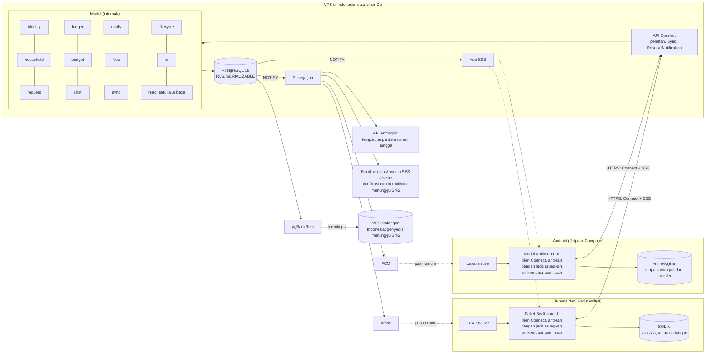

# 09 — Arsitektur teknis

**Status:** versi S4 fase D (12 November 2026), ditulis `architect`; temuan `critic` CS-A-01 sampai CS-A-26 milik `architect` sudah ditangani, menunggu tinjauan ulang. Stack mobile diputuskan pemilik produk ("Swift + Kotlin saya setuju untuk apple dan android catat dulu yaa, tinggal backend."; [_progress.md](_progress.md); [ADR-012](adr/ADR-012-ui-native-per-platform-dan-versi-os-minimum.md) butir 1). **Checkpoint S4 (12 November 2026):** pemilik produk menjawab semua pertanyaan 09-A sampai 09-G kecuali 09-B, dan mengukuhkannya dengan "lanjut" ([_progress.md](_progress.md), "Checkpoint S4: jawaban pemilik produk", "Keputusan checkpoint S4"). Pilihan yang diterima tercatat di §1 dan §7; ADR yang diterima dicatat di §3. **Hosting, cadangan, dan email (S4-2; ADR-020, ADR-026) tetap usulan**, karena pemilik produk menundanya sampai menjelang deploy ("#S4-2: nanti aja pas mau deploy"); syarat server di Indonesia (keputusan 10) tetap mengikat. Rincian di bawah yang tidak disebut keputusan checkpoint tetap **[Usulan]** `architect`.

**Pemilik:** `architect`. Keamanan dan privasi dimiliki `security-privacy` ([dokumen 10](10-security-privacy.md)); dokumen ini memenuhi persyaratannya (pemetaan di berkas 04 §8). Aturan uang kanonis di [07](07-financial-domain.md), dan aturan alur di [06](06-activity-approval-architecture.md).

**Dibaca sebelum menulis:** `CLAUDE.md`; brief §1, §1.1, §4.3, §5D, §5O, §6 sampai §9, §14, §16; `ENGINEERING-STANDARDS.md`; glosarium; `_progress.md`; dokumen 05 (indeks, FIN-1, dan LM-01 sampai LM-11), 06 (seluruhnya), 07 (§1 sampai §4, §8), 08 (§9.3, §23.1), 10 (indeks dan keempat berkas), 17 (keputusan 10, bagian S4, 2.13, L-31), 18 §5; ADR-005, ADR-008, ADR-011; laporan `critic` S4 (CS-A).

## Peta berkas

| Berkas | Isi |
|---|---|
| Indeks ini | Ringkasan, diagram komponen, daftar ADR, keterlacakan, keputusan sekarang dan yang ditunda, pertanyaan checkpoint S4, permintaan kepada pemilik dokumen lain, fakta baru |
| [09.1 Pilihan teknologi](09-technical-architecture/01-pilihan-teknologi.md) | Matriks: mobile, letak logika bersama, kontrak API, backend, monolit, basis data, waktu nyata, push, hosting, `AI`, build iOS, versi |
| [09.2 Modul, data, dan skema](09-technical-architecture/02-data-dan-skema.md) | Modul, penyimpanan per jenis data, isolasi rumah tangga, pengenal, sketsa skema, transaksi, uang, idempotensi, konkurensi, evolusi skema, berkas, pencarian |
| [09.3 Offline, sinkron, waktu nyata, push, pekerjaan latar, dan `AI`](09-technical-architecture/03-sinkron-waktu-nyata-notifikasi.md) | Offline per modul, jeda urungkan, penyimpanan perangkat, protokol sinkron dan potret awal, SSE, tanda terkirim, kehadiran, push, pekerjaan terjadwal, alur berbasis peristiwa, `AI` jalur R1 |
| [09.4 Keamanan, operasi, CI/CD, pengujian, cadangan, biaya, dan risiko](09-technical-architecture/04-operasi-uji-biaya.md) | Penempatan, autentikasi dan email, keteramatan, pengujian, CI/CD dan iOS tanpa Mac, cadangan dan DR, biaya, pemetaan SEC; penunjuk `RISK-NN` ke register kanonis di [15](15-risk-assessment.md) |

---

## 1. Ringkasan rekomendasi

Ringkasnya, Family OS dibangun sebagai **satu monolit modular Go dengan satu PostgreSQL 18**, di satu VPS di Indonesia (usulan: Biznet Gio; menunggu S4-2). Aplikasi native SwiftUI dan Jetpack Compose memanggilnya lewat **kontrak Protobuf dan Connect** yang di-generate untuk ketiga bahasa.

- **Aturan hanya di server.** Perangkat tidak menghitung aturan uang atau persetujuan, juga tidak menghitung perkiraan offline. Yang tersisa di perangkat adalah tiga bantuan isian kecil yang ditulis per platform dan dijaga vektor uji emas dari server. Itu pengecualian ES §2 yang disetujui tegas oleh pemilik produk (09-F A, S4-1 (ii)) dan sudah tercantum di ES §2.
- **Penulisan.** Setiap perintah tulis berjalan dalam satu transaksi `SERIALIZABLE` yang juga menulis Peristiwa, umpan per pembaca, notifikasi, dan pekerjaan latar. Message broker tidak ada.
- **Waktu nyata.** Aplikasi di depan menerima tanda lewat SSE lalu menarik lewat satu jalur baca. Aplikasi di latar hanya menerima push umum dari APNs dan FCM.
- **Cadangan.** Dienkripsi di VPS lalu dikirim ke VPS lain di Indonesia; data yang dihapus bertahan paling lama 38 hari di salinan mana pun (D-104, diterima). Penyedianya menunggu S4-2.
- **Email.** Usulan: Amazon SES di Jakarta lewat API HTTPS, hanya untuk verifikasi, pemulihan, dan tanda ke operator (menunggu S4-2).
- **`AI`.** Hanya membangun kumpulan kalimat tanpa data rumah tangga.
- **iOS.** Dibangun di Xcode Cloud dan diuji lewat TestFlight internal.

Kolom "Kedudukan" mencatat jawaban checkpoint S4 (12 November 2026; [_progress.md](_progress.md), "Keputusan checkpoint S4").

| Lapisan | Pilihan | ADR | Kedudukan |
|---|---|---|---|
| UI | SwiftUI (iOS, iPadOS) dan Jetpack Compose Material 3 (Android) | ADR-012 | **Diputuskan pemilik produk** (butir 1, sebelum S4) |
| Versi OS minimum | iOS dan iPadOS 26; Android 10 (API 29), target API 36 | ADR-012 | **Diterima** (09-E A; S4-3 (ii) A) |
| Letak logika bersama | Server saja; tanpa perkiraan offline; tiga bantuan isian berpagar sebagai pengecualian ES §2 | ADR-013 | **Diterima** (09-F A; S4-1 (ii) A); pengecualian tercantum di ES §2 |
| Kontrak API dan validasi | Protobuf + Connect, dikelola `buf`; aturan bentuk sebagai anotasi protovalidate, ditegakkan server | ADR-013 | **Diterima** (D-100) |
| Bentuk server | Monolit modular, satu proses | ADR-014 | **Diterima** (D-99) |
| Bahasa backend | **Go** 1.27 (stdlib `net/http`, connect-go, pgx, sqlc, goose) | ADR-015 | **Diterima** (09-A A; S4-1 (i) A) |
| Basis data | PostgreSQL 18, satu skema, `household_id` di setiap kunci, RLS dipaksakan, `SERIALIZABLE` | ADR-016 | **Diterima** (D-99) |
| Pengenal dan kursor | UUIDv4 acak; umpan sinkron per pembaca; potret awal untuk kursor kosong | ADR-017 | **Diterima** (D-99) |
| Sinkron dan waktu nyata | Offline per modul; jeda urungkan 5 detik; SSE + tarik berkursor; kehadiran seperti WhatsApp, ketelitian menit | ADR-018 | **Diterima** (D-100; S4-5 A, A) |
| Push | Langsung ke APNs dan FCM, payload umum, tanpa ekstensi notifikasi | ADR-019 | **Diterima** (D-101) |
| Hosting dan cadangan | Usulan: Biznet Gio NEO Lite MS 4.2 (PT Biznet Gio Nusantara); cadangan di VPS IDCloudHost (PT Cloud Hosting Indonesia **[Perlu validasi]**) | ADR-020 | **Diusulkan; ditunda sampai menjelang deploy** (S4-2). Syarat di Indonesia tetap mengikat |
| `AI` | R1 kumpulan kalimat, Claude Sonnet 5.5 untuk membangun kumpulan, batas USD 10 per bulan dan USD 3 per pembangunan | ADR-021 | **Diterima** (10-B A, 09-D A; S4-4 (i), (ii) A) |
| Build iOS | Xcode Cloud + TestFlight internal, dengan sewa Mac sekali | ADR-022 | **Diterima** (09-C A; S4-3 (i) A) |
| Versi 0.x dan API eksperimental | Boleh bila memenuhi lima syarat dan tercatat dengan jalan mundurnya | ADR-023 | **Diterima** (09-G A; S4-1 (iii) A); kalimatnya tercantum di ES §8 |
| Data perangkat | Proteksi berkas Class C (`CARE` lokal Class A), dikecualikan dari cadangan dan transfer, hapus jarak jauh | ADR-024 | **Diterima** (D-102; 10-D A, S4-6 (i) A) |
| Alat kualitas | Formatter, linter, pemindai kerentanan, dan pemeriksa duplikasi per bahasa | ADR-025 | **Diterima** (D-103) |
| Email | Usulan: Amazon SES `ap-southeast-3`, API HTTPS | ADR-026 | **Diusulkan; ditunda sampai menjelang deploy** (S4-2); K-62 menunggu |
| Asas pengawasan (06 PG-14) | Rumusan (a) sampai (e); aturan batas periode hanya atas jatah di atas ambang | ADR-027 | **Diterima** (D-113; S4-9 (i) A) |

**Tradeoff utama** (dicatat sebagai dasar keputusan; Go dan server saja diterima di S4).

1. **Go dibandingkan Rust.** Keduanya memerlukan pustaka 0.x. Di Go, pustaka 0.x itu (`golang.org/x/crypto`, `golang.org/x/oauth2`) berasal dari proyek Go sendiri dan berada di tepi sistem; jalur setiap permintaan memakai pustaka ≥ 1.0. Di Rust, framework HTTP (axum) dan akses basis data (sqlx) masih 0.x dan berada di jalur setiap permintaan. Rust memberi tipe yang lebih ketat dan kemungkinan inti bersama kelak.
2. **Server saja dibandingkan inti bersama.** Server saja menghemat satu bahasa dan langkah build yang hanya dapat dikompilasi di macOS. Harganya: perangkat tidak menghitung tanda, sisa, atau perkiraan saat offline (06 S-8, S-9), dan tiga bantuan isian ditulis dua kali dengan pagar uji.
3. **Xcode Cloud tanpa Mac.** Biayanya hampir nol, tetapi siklus UI iOS lambat.
4. **Foto di PostgreSQL.** Cadangan dan penghapusannya sederhana, dengan batas pindah yang dinyatakan.
5. **R1.** Tidak ada data rumah tangga ke luar negeri, dan biayanya tidak tumbuh dengan pengguna. Harganya: saran tidak menyebut hal yang spesifik.
6. **Email per pemakaian** (menunggu S4-2). SES melanggar bunyi "no usage-priced managed services" kecuali dengan alasan; alasannya ada di ADR-026 (tidak ada jalur SMTP bertarif tetap yang terverifikasi di Indonesia, biayanya mendekati nol, dan isinya tidak memuat data rumah tangga). Kalimat brief untuknya (K-62, D-111 §1) disusun lead sesudah S4-2 dijawab.

---

## 2. Arsitektur utama

| Komponen | Tanggung jawab | Berkas |
|---|---|---|
| Aplikasi native | Layar, navigasi, dan komponen sistem; antrean perintah dengan jeda urungkan; salinan baca; bantuan isian (09-F A, pengecualian ES §2). Tanpa aturan uang atau persetujuan | 01 §2, §3; 03 §1, §2 |
| API Connect | Perintah tulis idempoten, `Sync` berkursor per pembaca, dan `ResolveNotification` | 02 §6; 03 §3, §8 |
| Modul | Aturan 06 dan 07, masing-masing pemilik tabelnya | 02 §1 |
| `read` | Satu-satunya jalur baca untuk layar, laporan, ekspor, sinkron, potret awal, dan `AI` | 02 §1; 03 §3 |
| Hub SSE | Tanda "umpan bergerak" dan kehadiran sesaat | 03 §4, §6 |
| Pekerja job | Push, jam tenang, ringkasan, pengingat, kedaluwarsa, penutupan keluar, penghapusan, kumpulan `AI`, email | 03 §9 |
| PostgreSQL | Semua data, termasuk foto di pilot | 02 |
| pgBackRest dan VPS cadangan | PITR 30 hari, terenkripsi, di Indonesia, salinan pelindung yang hanya menambah | 04 §6 |

---

## 3. Daftar ADR

| ADR | Judul | Status |
|---|---|---|
| [ADR-012](adr/ADR-012-ui-native-per-platform-dan-versi-os-minimum.md) | UI native per platform dan versi OS minimum | **Diputuskan pemilik produk** (butir 1); butir 2 sampai 6 **Diterima** (S4) |
| [ADR-013](adr/ADR-013-logika-bersama-hanya-di-server.md) | Logika bersama hanya di server; kontrak API satu sumber; pengecualian ES §2 untuk bantuan isian | **Diterima** (S4), opsi A termasuk pengecualian ES §2 |
| [ADR-014](adr/ADR-014-monolit-modular.md) | Monolit modular satu proses | **Diterima** (S4) |
| [ADR-015](adr/ADR-015-bahasa-dan-framework-backend.md) | Bahasa dan framework backend: Go | **Diterima** (S4), Go |
| [ADR-016](adr/ADR-016-postgresql-tenancy-dan-transaksi.md) | PostgreSQL 18: tenancy, isolasi, transaksi, idempotensi, berkas | **Diterima** (S4) |
| [ADR-017](adr/ADR-017-pengenal-acak-dan-kursor-per-pembaca.md) | Pengenal acak dan kursor sinkron per pembaca (dokumen 10 §8 butir 1 dan 2) | **Diterima** (S4) |
| [ADR-018](adr/ADR-018-model-sinkron-dan-waktu-nyata.md) | Model sinkron dan waktu nyata | **Diterima** (S4) |
| [ADR-019](adr/ADR-019-push-langsung-apns-fcm.md) | Push langsung ke APNs dan FCM dengan payload umum | **Diterima** (S4) |
| [ADR-020](adr/ADR-020-hosting-dan-cadangan-di-indonesia.md) | Hosting dan cadangan di Indonesia | Diusulkan; **ditunda sampai menjelang deploy** (S4-2) |
| [ADR-021](adr/ADR-021-jalur-ai-kumpulan-kalimat.md) | Jalur `AI`: kumpulan kalimat (R1) dan batas biaya | **Diterima** (S4), R1 dan Claude |
| [ADR-022](adr/ADR-022-jalur-build-ios-tanpa-mac.md) | Jalur build iOS tanpa Mac | **Diterima** (S4), opsi A |
| [ADR-023](adr/ADR-023-kebijakan-versi-0x.md) | Kebijakan pustaka versi 0.x dan API eksperimental (ES §8) | **Diterima** (S4); kalimat ES §8 dipasang |
| [ADR-024](adr/ADR-024-data-di-perangkat-dan-hapus-jarak-jauh.md) | Data di perangkat: proteksi, cadangan, hapus jarak jauh, `CARE` lokal (dokumen 10 §8 butir 3, 4, 9) | **Diterima** (S4), termasuk butir 5 |
| [ADR-025](adr/ADR-025-alat-kualitas-kode.md) | Alat kualitas kode per bahasa (ES §4, §7) | **Diterima** (S4) |
| [ADR-026](adr/ADR-026-pengiriman-email.md) | Pengiriman email: Amazon SES Jakarta | Diusulkan; **ditunda sampai menjelang deploy** (S4-2) |
| [ADR-027](adr/ADR-027-asas-pengawasan-batas-periode-dan-aturan-dasar.md) | Asas pengawasan: batas periode dan aturan dasar (06 PG-14; dokumen 10.3 §2.4.1) | **Diterima** (S4), opsi A; butir (c) disempitkan menurut S4-9 (i) A |
| [ADR-028](adr/ADR-028-lingkungan-dan-irama-rilis-pilot.md) | Lingkungan, irama rilis, dan kompatibilitas klien (dokumen 14 §6) | Diusulkan (S5) |

---

## 4. Keterlacakan: setiap modul Tier 1 punya rumah arsitektur

| Modul Tier 1 (05) | Modul server | Pola offline | Komponen klien | Penyimpanan |
|---|---|---|---|---|
| `FAM` (FAM.md: FR-FAM-001 sampai 024; F-FAM-001 sampai 008, F-FAM-019, F-FAM-020) | `identity`, `household`, `lifecycle` | Online-first | Layar keanggotaan, undangan, keluar, sesi, kunci aplikasi (FR-FAM-021; 03 §2), daftar sesi dan jejak keamanan sendiri (FR-FAM-022; `security_event`), hapus akun (FR-FAM-023; `lifecycle`, 04 §1 SEC-105), halaman Bantuan (FR-FAM-024; konten statis di aplikasi, tanpa komponen server) | `account`, `membership`, `invitation`, `session`, `security_event`, `operator_notice_ack`, `consent_record` |
| `FIN` bagian 1 (FIN-1.md: FR-FIN-001 sampai 099; F-FIN-001 sampai 010) | `ledger`, `budget`, `read` | Pencatatan offline-first; pengaturan online-first | Pencatatan dengan bantuan isian, angka server terakhir beserta waktunya, entri yang belum terkirim terpisah | `entry`, `line`, `holding`, `budget`, `authorization`, `reservation` |
| `FIN` bagian 2 (FIN-2.md: FR-FIN-100 sampai 199; F-FIN-011 sampai 020) | `ledger`, `budget`, `read`, `lifecycle` (laporan, ekspor) | Pencatatan offline-first | Tagihan berulang, cicilan, alokasi, aset, riwayat, laporan | Tabel 07 §2 |
| `REQ` (REQ.md) | `request`, `budget` | Offline-first dengan compare-and-set | Permintaan, tanggapan, kartu | `request`, `request_terms`, `request_response`, `object_event` |
| `NTF` (NTF.md) | `notify`, `jobs` | Dibuat server | Kanal per kelas, lencana, buka ke objek lewat `push_ref` | `notification`, `push_token` |
| `COM` (COM.md: FR-COM-001 sampai 020) | `chat`, `files`, `sync` | Kirim offline-first; kehadiran tidak pernah diantrekan; "Sembunyikan untuk saya" tanpa jeda urungkan | Chat, kartu, tanda terkirim dan dibaca, kehadiran, Sembunyikan untuk saya (FR-COM-019; 06 §16.12), Laporkan (FR-COM-020; di pilot membuka halaman Bantuan, SEC-154 (c)) | `conversation`, `message`, `read_state`, `member_mute`, memori proses; `content_report` hanya sesudah pilot (02 §5.3) |
| Lintas modul LM-01 sampai LM-11 | `read`, uji privasi, uji simetri | — | — | — |

| Kebutuhan lintas modul | Rumah arsitekturnya |
|---|---|
| LM-01 dua arah | Uji simetri berpermutasi (04 §4); tidak ada kolom hubungan (02 §2) |
| LM-02 pencatatan tidak pernah terhalang | Antrean offline-first; jeda urungkan tidak menolak apa pun; modul `ai` tidak di jalur pencatatan (03 §1, §11) |
| LM-03 notifikasi aman | Payload umum, kanal per kelas, jam tenang (03 §8) |
| LM-04 offline | 03 §1, §3; 02 §6, §8 |
| LM-06 tidak atas nama orang lain | Otorisasi server; INV-25 (02 §3) |
| LM-07 visibilitas per objek | `read.can_read` dan fan-out umpan (02 §1; 03 §3) |
| LM-08 pelaku terlihat | `entry.actor`, `object_event` (02 §5) |
| LM-09 isolasi | 02 §3 |
| LM-10 pesan tidak mengubah state | Kartu = perintah objek (03 §10) |
| LM-11 tanda dan kehadiran tidak dibaca apa pun | Aturan dependensi 4 (02 §1); kehadiran di memori (03 §6) |

Tier 2 (`SHP`, `MNT`, `CARE`, `CAL`, `PLN`, `AI`) memakai pola yang sama: modul di 02 §1, pola offline di 03 §1, dan `AI` di 03 §11. Sebutan anggota per pembaca (F-FAM-021, Tier 2, tambahan pemilik produk di checkpoint S4) tinggal di modul `household`, tabel `member_label`, online-first, dengan aturan kanonis SEC-155 (02 §5.5). Tier 3 tidak memerlukan komponen baru. Fondasinya (banyak rumah tangga per akun, isolasi) sudah ada di skema.

---

## 5. Yang harus diputuskan sekarang

Semua keputusan yang harus ada sebelum fase bangun dimulai sudah diambil di checkpoint S4, kecuali dua yang ditunda pemilik produk sampai menjelang deploy. Penundaan itu tidak menghalangi fase bangun: kode server tidak bergantung pada penyedia VPS, dan pengiriman email hanya dipakai di tiga titik (verifikasi, pemulihan, tanda ke operator; 09.4 §2, §3) sehingga penyedianya dapat dipilih sesudah kode lain selesai **[Asumsi]**.

| Keputusan | Alasan tidak dapat menunggu | Di mana | Kedudukan |
|---|---|---|---|
| Bahasa backend (09-A) | Menentukan agen build, pustaka, dan kontrak | ADR-015 | Diterima: Go |
| Letak logika bersama dan pengecualian ES §2 (09-F) | Menentukan struktur kedua aplikasi dan bunyi FR-FIN-042/AC-2 dan AC-3 | ADR-013 | Diterima: A |
| Kalimat ES §8 untuk 0.x dan API eksperimental (09-G) | connect-kotlin, `golang.org/x/*`, dan `ModalBottomSheet` diperlukan sejak minggu pertama | ADR-023 | Diterima: A |
| Jalur build iOS (09-C) | Langganan Apple dan penyiapan Xcode Cloud harus ada sebelum build iOS pertama | ADR-022 | Diterima: A |
| Versi OS minimum (09-E) | ES §8 menuntutnya di S4 | ADR-012 | Diterima: A |
| Alat kualitas per bahasa | ES §4 dan §7 menuntut pemilihannya lewat ADR di S4 | ADR-025 | Diterima |
| Penyedia `AI` di bawah R1 (09-D) dan jalur 10-B | Integrasi dibangun atas permintaan pemilik produk; `AI` tetap Tier 2 | ADR-021 | Diterima: R1, Claude |
| Kontrak Protobuf dan Connect, PostgreSQL, monolit, pengenal, kursor, SSE, push | Fondasi; mengubahnya kemudian mahal | ADR-013, ADR-014, ADR-016 sampai ADR-019 | Diterima |
| **Hosting dan tujuan cadangan (09-B)** | Harus ada sebelum deploy pertama; pernyataan tertulis penyedia soal letak data (ADR-020 butir 1) sebelum data nyata | ADR-020 | **Ditunda sampai menjelang deploy** (S4-2). Advokat (L-01, L-14, L-24) sebelum tahap publik (S4-4 (iii) A) |
| **Pengiriman email** | Pilot memerlukan verifikasi dan pemulihan (SEC-24) sebelum akun pertama dibuat di server yang di-deploy | ADR-026 | **Ditunda sampai menjelang deploy** (S4-2); K-62 menunggu |

## 6. Yang ditunda, dan pemicunya

| Butir | Ditunda sampai | Pemicu atau syarat |
|---|---|---|
| Hosting, tujuan cadangan, dan email (S4-2) | Menjelang deploy; **keputusan pemilik produk** | ADR-020 dan ADR-026 diajukan ulang dengan harga dan pihak kontrak yang dicek ulang; syarat di Indonesia (keputusan 10) tetap. Baris biaya yang bergantung padanya ditandai di 09.4 §7.1 |
| Platform mana yang dibangun lebih dulu | Awal fase bangun; **keputusan pemilik produk** (`CLAUDE.md`) | Bila iOS lebih dulu, ADR-022 butir 4 cenderung naik ke Mac bulanan |
| Perkiraan offline (angka server − entri yang belum terkirim) | Bila pilot menunjukkan kebutuhannya | ADR baru: deskriptor dari server + satu penafsir per platform; butir pengecualian ES §2 tambahan (01 §3) |
| Pembungkus SQLite iOS (GRDB, Core Data, SwiftData) | Minggu pertama `ios-dev` | Dapat diuji di Linux; stabil (03 §2) |
| Pustaka property-based Go | Minggu pertama `backend-dev` | Status stabil (ES §8) |
| Gerbang CI kerentanan Swift | Minggu pertama `ios-dev` | Dependabot atau OSV-Scanner terbukti membaca `Package.resolved` (ADR-025) |
| SQLCipher | Sebelum tahap publik | SEC-46 |
| E2EE chat, foto chat, alasan bebas `CARE`, dan sebutan anggota | Satu ADR sebelum tahap publik | Pilot tanpa E2EE (S4-6 (i) A); sebutan menurut SEC-155 (j) |
| RLS dengan banyak proses; batas laju dan hub SSE di PostgreSQL | Lebih dari satu proses aplikasi | 03 §4; 04 §2 |
| Penyimpanan objek untuk foto | 5 GB foto atau 20 GB basis data | 02 §11 |
| Pencarian `tsvector` + `pg_trgm`; pencarian chat | Volume atau Tier 3 | 02 §12 |
| Akses darurat (SEC-36), enkripsi disk (SEC-45), passkey | Tahap publik | Dokumen 10 §4 |
| Jalur `AI` R2 (panggilan langsung) | Sesudah advokat menjawab, sebelum tahap publik | ADR baru; pilot memakai R1 (S4-4 (i) A); SEC-122 |
| Advokat (L-01, L-14, L-24 dan daftar 10-C) | Sebelum tahap publik (S4-4 (iii) A) | Risiko PSE di pilot (W-32) diterima pemilik produk |
| Komponen Material 3 Expressive | Compose Material 3 1.5.0 menjadi stabil | ADR-012 butir 5 |
| `ListDetailPaneScaffold` (eksperimental) | Tablet Android di luar pilot | ADR-023 butir 5 |
| SES keluar dari sandbox | Sebelum pengguna di luar rumah tangga pilot | ADR-026 |
| Penyeimbang beban, replika basis data | Tahap publik dengan beban terukur | 04 §7.2 |

---

## 7. Pertanyaan checkpoint S4 dan jawabannya

Tujuh pertanyaan diajukan lead di daftar gabungan (S4-1 sampai S4-3, S4-4 (ii)). Jawaban pemilik produk, dikukuhkan dengan "lanjut" pada 12 November 2026 ([_progress.md](_progress.md), "Keputusan checkpoint S4"):

| ID | Butir gabungan | Jawaban | Catatan |
|---|---|---|---|
| 09-A | S4-1 (i) | **A, Go** ("#S4-1: A Go") | Rust tidak dipilih; axum dan sqlx keluar dari daftar ADR-023 |
| 09-B | S4-2 | **Ditunda sampai menjelang deploy** ("#S4-2: nanti aja pas mau deploy") | ADR-020 tetap diusulkan; syarat di Indonesia tetap |
| 09-C | S4-3 (i) | **A** | ADR-022 |
| 09-D | S4-4 (ii) | **A, Claude** | ADR-021 |
| 09-E | S4-3 (ii) | **A**: iOS dan iPadOS 26; Android 10 | ADR-012 butir 2, 3 |
| 09-F | S4-1 (ii) | **A**, disetujui tegas ("hp boleh ikut, validasi di app dan server wajib jadi a") | Pengecualian dipasang lead di ES §2 |
| 09-G | S4-1 (iii) | **A** (bacaan lead atas jawaban keempat, dikukuhkan) | Kalimat dipasang lead di ES §8 |

Pilihan semula di bawah tetap sebagai catatan dasar keputusan; pilihan selain jawaban di atas **tidak dipilih**, kecuali 09-B, yang ketiga pilihannya tetap terbuka sampai S4-2 diajukan ulang.

| ID | Pertanyaan | A (disarankan) | Pilihan lain (tidak dipilih) |
|---|---|---|---|
| 09-A | Bahasa backend | **Go**: pustaka di jalur setiap permintaan ≥ 1.0; pustaka 0.x (`golang.org/x/crypto`, `golang.org/x/oauth2`) dari proyek Go sendiri dan hanya di tepi sistem; produktif bagi tim kecil | B. **Rust**: tipe lebih ketat; axum dan sqlx 0.x di jalur setiap permintaan (ADR-023); kompilasi lebih lambat **[Asumsi]** |
| 09-B | Hosting dan tujuan cadangan | **Biznet Gio MS 4.2 (Rp139.000) + VPS cadangan IDCloudHost di lokasi Indonesia (sekitar Rp105.000 [Perlu validasi])**: dua pihak kontrak Indonesia yang berbeda | B. Keduanya Biznet Gio (cadangan XS Rp59.000): lebih murah, pihak kontrak sama. C. AWS Lightsail Jakarta (PT Amazon Web Services Indonesia), USD 24 |
| 09-C | Perangkat keras pengembangan iOS | **Xcode Cloud + TestFlight internal, sewa Mac sekali (sekitar EUR 5,28 [Perlu validasi])**; naik ke B saat UI iOS dikerjakan harian | B. Sewa Mac bulanan selama fase UI iOS (sekitar EUR 149 per bulan [Perlu validasi]). C. Beli Mac mini M4 (Rp12.749.000 [Perlu validasi]; harga saat checkpoint, kini basi: Mac mini M6 mulai dari Rp17.499.000 [Perlu validasi], 18 §5.2.7.1) |
| 09-D | Penyedia `AI` untuk membangun kumpulan kalimat (bila 10-B A atau B) | **Claude** (API Anthropic; Sonnet 5.5 untuk kumpulan, sekitar USD 1,32 per pembangunan; Haiku 5.5 bila 10-B B) | B. **ChatGPT** (API OpenAI; gpt-6.1-terra, sekitar USD 0,66 per pembangunan; mutu bahasa Indonesia tanpa tolok ukur primer). Pihak kontrak OpenAI bagi pelanggan Indonesia belum diteliti |
| 09-E | Versi OS minimum | **iOS dan iPadOS 26; Android 10 (API 29)**: satu bahasa desain iOS (Liquid Glass); penyimpanan terenkripsi berbasis berkas di Android **[Perlu validasi]** semua produsen | B. iOS 18 dan Android 9 (API 28): jangkauan lebih luas di tahap publik; dua tampilan iOS harus diuji |
| 09-F | Letak logika bersama | **Server saja, ditambah pengecualian ES §2 untuk tiga bantuan isian** di perangkat (selisih baris sebab, "bagi rata", bentuk masukan), masing-masing ditulis di Swift dan Kotlin dan dijaga vektor uji emas dari server Go. Tanpa perkiraan offline | B. Server saja tanpa pengecualian: perangkat tidak membantu isian; server menolak dengan kode galat per medan saat perintah tiba; FR-FIN-042/AC-2 dan AC-3 diubah. C. Modul KMP: perlu macOS untuk setiap build iOS, dan tetap bukan implementasi yang sama dengan server Go. D. Inti Rust lewat UniFFI: satu implementasi hanya bila 09-A = B |
| 09-G | Kalimat baru ES §8 untuk pustaka 0.x dan API eksperimental | **Setujui kalimat ADR-023**: "A 0.x release that is not a pre-release, or an API marked experimental inside a stable release, counts as stable only if it is listed in ADR-023 with its fallback; anything else needs its own ADR." | B. ES §8 tetap seperti sekarang: setiap pustaka 0.x dan setiap API eksperimental (connect-kotlin, `golang.org/x/crypto`, `golang.org/x/oauth2`, `ModalBottomSheet`) dicatat dengan ADR sendiri. Isinya sama dengan daftar ADR-023, hanya lebih banyak berkas |

---

## 8. Permintaan kepada pemilik dokumen lain

Dokumen ini tidak menyunting dokumen milik agen lain. Permintaan berikut dikirim lewat lead.

| Kepada | Permintaan |
|---|---|
| `security-privacy` (10) | (a) SEC-46: penyimpangan Class C dari saran Apple dan Class A untuk berkas `CARE` lokal sudah dicatat di ADR-024 dan 03 §2; mohon dirujuk. (b) Jeda urungkan: 03 §1 kini memuat tujuh jenis SEC-151 kata demi kata beserta uji kontrak `hold_seconds = 0`. (c) AT-6: `recorded_on` dikirim kepada setiap pembaca entri, sesuai putusan dokumen 10 (03 §2). (d) TestFlight mengirim laporan crash otomatis (04 §3); mohon dimasukkan ke catatan persetujuan uji (SEC-109). (e) Pilot memakai TestFlight **internal** (ADR-022), sehingga hanya SEC-153 (d) dan SEC-154 selain (c) yang menunggu TestFlight eksternal atau App Store; SEC-153 (a) sampai (c), (e) dan SEC-154 (c) wajib di pilot (06 §16.12) |
| `product-analyst` (05, 17) | (a) FR-FIN-042/AC-2 dan AC-3 tetap seperti bunyinya, karena 09-F dijawab A. (b) FR-FIN-010/AC-6 dan FR-FIN-091/AC-2: pilot tidak menampilkan perkiraan; bunyi "bila ditampilkan" tetap benar. (c) 17: catat 09-A sampai 09-G; catat P-40 dan P-41 dari 06 revisi ketiga belas; catat bahwa butir email sudah diusulkan (ADR-026); catat pengenal risiko `RISK-01` sampai `RISK-17` (04 §9) untuk dokumen 15 |
| `ux-designer` (08) | (a) Selesai: pesan chat tanpa jeda urungkan sudah diterima di 08 §9.3 (03 §1; 06 P-41). (b) `ModalBottomSheet` boleh dipakai lewat ADR-023 butir 5 dengan jalan mundur dialog layar penuh; `ListDetailPaneScaffold` tidak dipakai di pilot (ADR-012 butir 5). (c) "Diperbarui di ponsel ini" memakai jam perangkat; "dicatat 3 hari kemudian" memakai tanggal server dan tampil kepada setiap pembaca entri, bukan hanya pencatat (dokumen 10; 03 §2) |
| Lead | (a) Glosarium: *umpan per pembaca* (reader feed), *jalur baca*, *bantuan isian*, *jeda urungkan*, *potret awal* bila belum ada. (b) README: label batasan `BT-N` hanya dipakai di dokumen 09 |

---

## 9. Fakta yang diperiksa untuk dokumen ini

Semuanya diakses 12 November 2026. Fakta yang sudah ada di dokumen 18 (termasuk tambahan fase D) dirujuk ke 18 dan tidak diulang.

| Fakta | Sumber | Label |
|---|---|---|
| Pihak kontrak Biznet Gio: PT Biznet Gio Nusantara, hukum Indonesia; kebijakan privasi: data pribadi "dapat diproses atau disimpan di luar wilayah Republik Indonesia" | 18 §5 (fase D) | **[Terverifikasi]** |
| Harga NEO Lite MS 4.2 Rp139.000, XS 1.1 Rp59.000; PPN tidak disebut | [biznetgio.com/en/product/neo-lite](https://biznetgio.com/en/product/neo-lite) | **[Terverifikasi]** |
| Pusat data NEO Cloud di Cimanggis dan MidPlaza | 18 §5 (fase D), halaman Biznet Gio 2024 | **[Terverifikasi]**; yang melayani NEO Lite **[Perlu validasi]** |
| IDCloudHost dioperasikan PT Cloud Hosting Indonesia; pusat data di Indonesia dan Singapura | [idcloudhost.com/llms.txt](https://idcloudhost.com/llms.txt) | **[Perlu validasi]** |
| `golang.org/x/crypto` v0.59.0, `golang.org/x/oauth2` v0.38.0, keduanya 0.x; peringatan pkg.go.dev soal versi modul terbaru | 18 §5 (fase D); [pkg.go.dev](https://pkg.go.dev/golang.org/x/crypto) | **[Terverifikasi]**; dicek saat dipasang |
| protovalidate: pustaka resmi Go, Java, Python, C++, TypeScript/JavaScript; tanpa Swift dan Kotlin. protovalidate-go v1.4.0 (31 Agustus 2026) | [protovalidate.com](https://protovalidate.com); [pkg.go.dev/buf.build/go/protovalidate](https://pkg.go.dev/buf.build/go/protovalidate); 18 §5 (fase D) | **[Terverifikasi]** |
| `image/jpeg` menulis SOI, DQT, SOF0, DHT, SOS, EOI tanpa APPn; `image/png` menulis IHDR, PLTE, tRNS, IDAT, IEND (tRNS adalah chunk tambahan, karena itu server tidak mengeluarkan PNG; 02 §11) | [go.dev/src/image/jpeg/writer.go](https://go.dev/src/image/jpeg/writer.go); [go.dev/src/image/png/writer.go](https://go.dev/src/image/png/writer.go); 18 §5 (fase D) | **[Terverifikasi]** dari kode sumber; keluaran berkas **[Perlu validasi]** sampai uji korpus |
| Compose Material 3: stabil 1.4.0; 1.5.0-rc01 (4 November 2026). Material 3 Adaptive: stabil 1.3.0 (12 Agustus 2026), 1.4.0-alpha03 (7 Oktober 2026) | [developer.android.com/jetpack/androidx/releases/compose-material3](https://developer.android.com/jetpack/androidx/releases/compose-material3); [.../compose-material3-adaptive](https://developer.android.com/jetpack/androidx/releases/compose-material3-adaptive) | **[Terverifikasi]** |
| `ModalBottomSheet` (Material 3 1.4.0) dan `ListDetailPaneScaffold` (Adaptive 1.3.0) bertanda eksperimental di kode stabil; `SwipeToDismissBox` dan `NavigationSuiteScaffold` **tidak** eksperimental di sumber 1.4.0; `rememberModalBottomSheetState` sudah `@Deprecated` di kode pengembangan (perlu diperhatikan saat naik ke 1.5) | 18 §5.1.1, §5.1.3 (fase D, dari 09); kode sumber [github.com/androidx/androidx](https://github.com/androidx/androidx) | **[Terverifikasi]** |
| Amazon SES `ap-southeast-3`: endpoint API `email.ap-southeast-3.amazonaws.com`; endpoint SMTP tidak tersedia di Jakarta | [docs.aws.amazon.com/general/latest/gr/ses.html](https://docs.aws.amazon.com/general/latest/gr/ses.html) | **[Terverifikasi]** |
| SES: kuota kirim bawaan per wilayah 200 pesan per 24 jam | [docs.aws.amazon.com/general/latest/gr/ses.html](https://docs.aws.amazon.com/general/latest/gr/ses.html); 18 §5.10 | **[Terverifikasi]** |
| SES sandbox: berlaku per wilayah; di sandbox email hanya dapat dikirim ke alamat terverifikasi; keluar lewat permohonan *production access* | Halaman SES "Request production access" (18 §5.10, fase D, dari 09) | **[Terverifikasi]** |
| IDCloudHost menawarkan email hosting; harga dan akses SMTP keluar untuk aplikasi tidak terbaca. Biznet Gio tidak punya email hosting tersendiri, hanya add-on Plesk mulai Rp439.000 per bulan | Halaman produk kedua penyedia; 18 §5.11 | IDCloudHost: tidak ditemukan; Biznet Gio **[Terverifikasi]** |
| OSV-Scanner v2.7.1 (9 November 2026); daftar lockfile resmi memuat `go.mod` dan `gradle.lockfile`, tanpa Swift | [google.github.io/osv-scanner/supported-languages-and-lockfiles](https://google.github.io/osv-scanner/supported-languages-and-lockfiles/) | **[Terverifikasi]** |
| Dependabot mendukung Swift (`Package.resolved`), Gradle, dan Go modules | Dukungan `Package.resolved`: GitHub Changelog, 31 Maret 2026 (18 §5.3, fase D, dari 09); ekosistem lain: [docs.github.com](https://docs.github.com/en/code-security/dependabot) | **[Terverifikasi]** |
| PMD CPD mendukung Go, Kotlin, dan Swift | [pmd.github.io/pmd/pmd_userdocs_cpd.html](https://pmd.github.io/pmd/pmd_userdocs_cpd.html) | **[Terverifikasi]** |
| golangci-lint v2.15.0 (16 Oktober 2026); govulncheck (`golang.org/x/vuln`) v1.9.0 (11 Oktober 2026) | [github.com/golangci/golangci-lint/releases](https://github.com/golangci/golangci-lint/releases); [pkg.go.dev/golang.org/x/vuln](https://pkg.go.dev/golang.org/x/vuln) | **[Terverifikasi]** |
| swift-format ikut toolchain Swift 6 ke atas (`swift format`, termasuk mode `lint`) | [github.com/swiftlang/swift-format](https://github.com/swiftlang/swift-format) | **[Terverifikasi]** |
| SwiftLint 0.65.1 dan ktfmt 0.65 masih 0.x; ktlint 1.8.0 bertanggal "14 Nov" tanpa tahun, jadi November 2025 atau lebih awal, dan 2.0 alpha sudah ada; detekt stabil terakhir 1.23.8 (2025) | Halaman rilis GitHub masing-masing; 18 §5.3 | **[Terverifikasi]** |
| pgBackRest 2.60.0 (18 Oktober 2026); dukungan PG18 diperkenalkan 2.55.0 sebagai eksperimental | 18 §5 (fase D); [pgbackrest.org/release.html](https://pgbackrest.org/release.html) | **[Terverifikasi]** |
| Target Kotlin/Native Apple hanya didukung di host macOS | 18 §5 (fase D); [kotlinlang.org](https://kotlinlang.org/docs/native-target-support.html) | **[Terverifikasi]** |
| Class C `NSFileProtectionCompleteUntilFirstUserAuthentication`: kelas bawaan data aplikasi pihak ketiga | [Apple Platform Security](https://support.apple.com/guide/security/data-protection-classes-secb010e978a/web) | **[Terverifikasi]** |
| Android: data tetap di perangkat hanya bila dikecualikan di `<cloud-backup>`, `<device-transfer>`, dan `<cross-platform-transfer>`; `allowBackup="false"` tidak cukup | 18 §5 (fase D); [developer.android.com/identity/data/autobackup](https://developer.android.com/identity/data/autobackup) | **[Terverifikasi]** |
| FCM *notification message* saat aplikasi di latar dikirim ke system tray tanpa `onMessageReceived` | [firebase.google.com/docs/cloud-messaging/android/receive-messages](https://firebase.google.com/docs/cloud-messaging/android/receive-messages) | **[Terverifikasi]** |
| Argon2id opsi kedua RFC 9106: t = 3, p = 4, m = 64 MiB | [RFC 9106 §4](https://www.rfc-editor.org/rfc/rfc9106.html#section-4) | **[Terverifikasi]**; diterima `security-privacy` |
| Play: target API 36 sejak 31 Agustus 2026; biaya pendaftaran USD 25 sekali | 18 §5 (fase D) | **[Terverifikasi]** |
| iOS 27 mendukung iPhone 13; iPadOS 27 mencantumkan "iPad mini (6th generation, A17 Pro and later)" | 18 §5.1 ([apple.com/ios](https://www.apple.com/ios/), [apple.com/ipados](https://www.apple.com/ipados/)) | **[Terverifikasi]** |
| connect-swift 1.2.3; connect-kotlin 0.10.0 (rilis terbaru yang bukan pra-rilis, dicek ulang di checkpoint S4; dipakai sebagai 0.10.x) | 18 §5 (fase D); [github.com/connectrpc/connect-kotlin/releases](https://github.com/connectrpc/connect-kotlin/releases) | **[Terverifikasi]** |
| ISO 4217: IDR, minor unit 2 | 18 §5 (fase D) | **[Terverifikasi]** |
| TestFlight mengirim laporan crash otomatis, terlepas dari setelan perangkat | 18 §5 (fase D) | **[Terverifikasi]** |

---

## Riwayat

| Tanggal | Tahap | Perubahan |
|---|---|---|
| 12 November 2026 | S4 fase C | Versi pertama: indeks dan empat berkas; ADR-012 sampai ADR-024. Belum ditinjau `critic` |
| 12 November 2026 | S4 fase D | Perbaikan CS-A-01 sampai CS-A-12, CS-A-15 sampai CS-A-23, CS-A-25, CS-A-26: kebenaran 0.x Go; tanpa perkiraan offline dan pengecualian ES §2 di 09-F; protovalidate; batas `AI` per pembangunan; jangka simpan cadangan 38 hari; potret awal sinkron; `household_id` sebagai pemilih; ADR-025 alat kualitas; ADR-026 email; kedudukan ADR; 09-G; `RISK-NN`; label `BT-N`. Masukan `security-privacy`, `finance-domain`, `ux-designer`, dan `researcher` fase D ikut dimasukkan |
| 12 November 2026 | Checkpoint S4 | Jawaban pemilik produk dicatat: status ADR-012 sampai ADR-019, ADR-021 sampai ADR-025, dan ADR-027 menjadi Diterima; ADR-020 dan ADR-026 tetap diusulkan (S4-2 ditunda sampai menjelang deploy). Cabang pilihan yang tidak dipilih (Rust, 09-F B, 09-G B, 10-A selain A, 10-B selain A, 10-D selain A, 10-G selain A) dihapus atau ditandai tidak dipilih. Baris biaya yang bergantung pada S4-2 ditandai (09.4 §7.1). RISK-15 ditutup. Sketsa data F-FAM-021 (`member_label`, 02 §5.5). connect-kotlin dikukuhkan 0.10.x |
| 12 November 2026 | S5 | ADR-028 baru (Diusulkan) bersama dokumen 14. Harga Mac diperbarui dari 18 §5.2.7 di 09.1 §12, 09.4 §5 dan §7.1, ADR-022 (Mac mini M6; minimum 24 jam terverifikasi; AWS EC2 Mac; tanpa Mac sewaan di Jakarta; Swift di Linux terverifikasi; paket non-UI tanpa Security, LocalAuthentication, UserNotifications). Keputusan ADR-022 tidak berubah |
| 12 November 2026 | S5 fase D | 09.4 §9 menjadi penunjuk ke register kanonis 15 (pengenal tetap; judul RISK-12 diselaraskan dengan 15). 09.3 §1: tanda `protective` di tabel jenis perintah, perintah pelindung dikirim lebih dulu, galat `WRITE_FROZEN`, hitungan catatan yang belum terkirim dari antrean perangkat (ADR-028 butir 3). 09.4 §4 cakupan SCN; §5 Xcode Cloud sebagai pemeriksaan wajib pull request; titik impas Mac per konfigurasi dari 18 §5.2.7.6 di 09.1 §12 (penomoran butir 4 dan 5 dibetulkan) dan 09.4 §5 |
