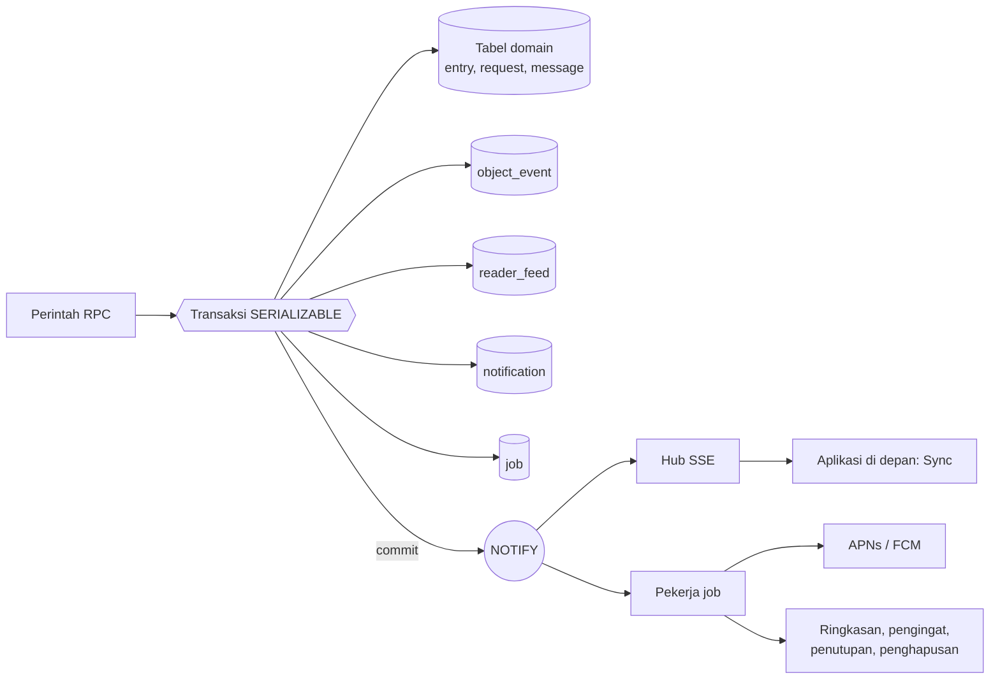
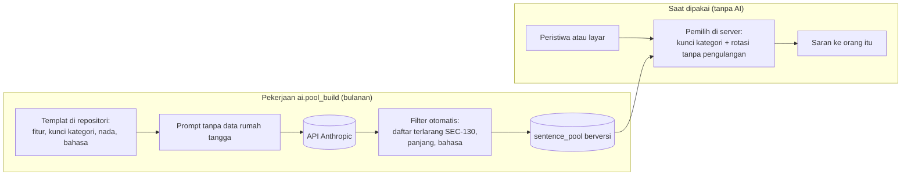

# 09.3 — Offline, sinkron, waktu nyata, push, pekerjaan latar, dan `AI`

Bagian dari [dokumen 09](../09-technical-architecture.md). Aturan domain untuk bersamaan dan offline kanonis di 06 §12 (S-1 sampai S-11). Berkas ini menetapkan mekanisme yang memenuhinya. Semua butir **[Usulan]** `architect`, kecuali yang diberi label lain.

---

## 1. Offline-first atau online-first, per modul

Asasnya:

- Yang harus selalu dapat dicatat dikerjakan **offline-first**: LM-02 "pencatatan tidak pernah terhalang"; 06 S-7.
- Yang memerlukan keputusan orang lain, autentikasi ulang, atau keadaan terbaru server dikerjakan **online-first**, dengan antrean bila aman.
- Server selalu memutus transisi (06 S-1).

| Modul dan tindakan | Pola | Yang terjadi tanpa sinyal | Penyelesaian tabrakan |
|---|---|---|---|
| `FIN` mencatat belanja, pemasukan, pemindahan, penyisihan, pembayaran cicilan dan tagihan | **Offline-first**: perintah diantrekan dengan `idempotency_key` | Tampil "menunggu terkirim", terpisah. Angka server terakhir tetap tampil dengan waktunya; perangkat tidak menghitung perkiraan (berkas 01 §3; 06 S-9). Bantuan isian (selisih baris, bagi rata, bentuk masukan) berjalan di perangkat (09-F A, pengecualian ES §2) | Tidak ada tabrakan: entri hanya ditambah. Tanda, tautan, dan periode dihitung server saat diterima (06 S-7, S-8) |
| `FIN` rekonsiliasi (hitung uang) | Offline-first | Perangkat menampilkan jumlah yang dihitung dan saldo server terakhir beserta waktunya, tanpa menghitung perkiraan selisih (ADR-013 butir 2; berkas 01 §3; S6) | Server menghitung selisih terhadap baris yang sudah ia terima (07 INV-16). Perangkat penghitung menampilkan selisih server sesudah sinkron (06 S-10) |
| `FIN` konfirmasi dan keberatan custody | Offline-first, dengan compare-and-set | "Menunggu terkirim" | `state_changed` bila baris sudah dikonfirmasi orang lain (INV-36) |
| `FIN` membuat atau mengubah tempat uang, anggaran, tagihan berulang, cicilan | **Online-first** | Tombol menyatakan perlu sinyal | — |
| `REQ` mengajukan, membatalkan, menanggapi, mengusulkan perubahan | Offline-first, dengan `expected_state` dan `terms_version` | "Menunggu terkirim"; tidak pernah tampil "disetujui" (06 S-1) | `terms_superseded` atau `state_changed`; kartu dan layar menampilkan state terbaru yang boleh dibaca (SEC-152) |
| Kesepakatan rumah tangga (ambang, hari mulai, jatah, sumber penghasilan) | Online-first | Perlu sinyal | Compare-and-set |
| `COM` mengirim pesan dan foto | Offline-first: antrean kirim lokal (06 S-11 (a)) | Pesan tampil "menunggu"; foto diunggah saat tersambung | Tidak ada tabrakan; urutan menurut urutan server menerima |
| `COM` tanda dibaca | Dikumpulkan offline, dikirim saat tersambung (06 S-11 (c)) | — | Tanda air hanya naik (`GREATEST`) |
| `COM` kehadiran dan mengetik | **Tidak pernah diantrekan** (06 S-11 (d)) | Tidak dikirim | — |
| `NTF` | Dibuat server | — | — |
| `FAM` undangan, keluar, sesi, kunci, pemulihan | Online-first; sebagian memerlukan autentikasi ulang (SEC-13) | Perlu sinyal | — |
| `SHP` daftar belanja (Tier 2) | Offline-first per butir: tambah, centang, hapus centang, hapus | Butir dan centang tampil langsung | Per butir: perintah diterapkan dalam urutan server menerima. Centang terakhir yang diterima server berlaku. Butir yang dihapus orang lain mengabaikan centang sesudahnya, tanpa galat |
| `MNT`, `PLN` (Tier 2) | Online-first; pencatatan masalah boleh diantrekan | — | Compare-and-set |
| `CARE` status (Tier 2) | Status yang tidak dibagikan: **perangkat saja** (10-D A, S4-6 (i) A; ADR-024). Berbagi dan mencabut: online-first | — | Satu penulis: pemilik status |
| Sebutan anggota (F-FAM-021, Tier 2) | Online-first, seperti pengaturan; tanpa jeda urungkan, Peristiwa, atau notifikasi (02 §5.5; SEC-155 (b)) | Perlu sinyal | Satu penulis: pembuatnya; penggantian menimpa |
| `AI` (Tier 2) | Online saja; dipilih server dari kumpulan | Tidak ada saran | — |
| Laporan, ekspor | Online; laporan terakhir disimpan sebagai cache baca | Laporan terakhir tampil dengan waktunya | — |

**Otorisasi ulang saat tiba** (SEC-151). Setiap perintah dari antrean diperiksa ulang dengan keadaan server saat diterima: peran, keanggotaan, masa tenggang, visibilitas, dan state. Perintah yang ditolak dikembalikan dengan galat yang tidak membuka data yang tidak boleh dibaca pengirim (SEC-152). Contohnya, penolakan atas objek yang visibilitasnya sudah menyempit berbunyi sama dengan "tidak ada" (SEC-05).

**Urutan kirim dari antrean.** Pengiriman berurutan FIFO per rumah tangga menurut **waktu lepas** perintah (di bawah). Perintah yang merujuk objek yang belum terkirim (misalnya foto pada belanja offline) merujuknya lewat `pending_ref` dan baru dikirim sesudah perintah pembuatnya diterima. Perintah yang ditolak atau masih ditahan tidak menahan perintah lain yang tidak bergantung padanya. **Perintah pelindung lebih dulu** (revisi S5; ADR-028 butir 3): perintah yang jenisnya bertanda `protective` (daftar di bawah) dikirim seketika saat tersambung, mendahului antrean FIFO, dan tidak pernah menunggu jeda coba ulang yang dipicu penolakan perintah lain, termasuk `WRITE_FROZEN`. Perintah pelindung atas objek yang belum diterima server diselesaikan di perangkat: misalnya pencabutan atas berbagi yang belum terkirim menghapus kedua baris antrean, sehingga berbagi itu tidak pernah sampai. **`WRITE_FROZEN`** (server dalam tahan tulis, ADR-028 butir 3) adalah kode galat tersendiri yang dapat dicoba ulang dan dibedakan aplikasi dari "tidak ada jaringan" (08 §13.2). **Jumlah catatan yang belum terkirim** yang tampil di layar keluar (08 §18.3; 07 §8.2) dihitung dari antrean perangkat, bukan dari server, karena server tidak mengetahui perintah yang belum tiba.

**`NOTICE_UNREAD`: tahan tulis per akun sampai pemberitahuan baru dibaca** (10.1 SEC-34; **[Usulan]** `architect` untuk mekanismenya). Sesudah versi pemberitahuan pengelola yang berlaku bagi sebuah akun berubah, termasuk saat versi akun diganti, server menolak perintah tulis biasa dari akun itu dengan kode galat `NOTICE_UNREAD` sampai versi itu diakui. Kode ini terpisah dari `WRITE_FROZEN`: `WRITE_FROZEN` berlaku untuk seluruh server dan diputus operator, sedangkan `NOTICE_UNREAD` berlaku per akun dan diputus pemilik akun sendiri.

- **Yang tidak pernah ditahan `NOTICE_UNREAD`:**
  - setiap jenis bertanda `protective` (SEC-151 (1) sampai (7)), termasuk hapus akun;
  - keluar akun (sign-out);
  - ekspor;
  - pengakuan pemberitahuan itu sendiri;
  - RPC `identity` di luar antrean (masuk, autentikasi ulang, pembaruan token, pemulihan lewat email). Tanpa keempatnya, pemilik akun tidak dapat mencapai LY-05 untuk mengakui (dikukuhkan `security-privacy`, 10.1 SEC-34).
  
  RPC `identity` tidak lewat tabel jenis perintah, jadi pengecualiannya ditegakkan di tempat yang sama dengan pengecualian tahan tulisnya (ADR-028 butir 3): pemeriksaan `NOTICE_UNREAD` hanya dipasang pada jalur perintah antrean dan perintah daring biasa, tidak pada RPC `identity`. Daftarnya satu tanda tambahan `notice_exempt` di tabel jenis perintah yang sama, dibaca server, Swift, dan Kotlin dari kode hasil generate. **Uji kontrak:** setiap jenis `protective` juga `notice_exempt`; jenis yang `notice_exempt` tetapi bukan `protective` hanya keluar akun, ekspor, dan pengakuan. Jadi tidak ada daftar kedua yang ditulis tangan.
- **Setiap versi menahan, tanpa batas jumlah dan tanpa jendela** (10.1 SEC-34 aturan (5)):
  - setiap versi pemberitahuan baru dan setiap pergantian versi sebuah akun menahan tulisan biasa akun itu (`NOTICE_UNREAD`) sampai diakui di LY-05;
  - LY-05 tampil pada sinkron berikutnya;
  - setiap versi menulis satu baris di jejak keamanan akun itu.

  Server menyimpan per akun hanya versi terakhir yang diterbitkan dan versi terakhir yang diakui. Akun ditahan selama keduanya berbeda. **Hanya pengakuan atas versi terakhir yang melepas tahan.** Bila v4 terbit sebelum v3 diakui, LY-05 menampilkan v4, dan pengakuan atas v3 saja tidak melepas. Sesudah pengakuan, antrean perangkat terkirim utuh.
- **Versi pemberitahuan mendahului fitur** (SEC-35; FR-FAM-019/AC-8). Versi yang memuat kalimat sebuah fitur harus sampai ke akun sebelum, atau bersama, build yang melepas fitur itu. Build yang lebih dulu gagal tinjauan rilis (14 §6.3).
- **Risiko sisa:** pengelola dapat menerbitkan versi berulang kali untuk menahan pencatatan pasangan atau orang tuanya. Batasnya:
  - tidak ada data yang hilang;
  - satu kali baca dan satu ketukan mengakhiri tahan, kapan saja;
  - tindakan pelindung tidak pernah ditahan;
  - setiap versi terlihat di Riwayat keamanan.
  
  Dinilai di 15 RISK-11 dan RISK-93.
- **Uji:**
  - v2, v3 (pergantian versi akun), dan v4 masing-masing menahan, menulis satu baris di jejak keamanan, dan sesudah diakui antrean terkirim utuh;
  - v4 terbit sebelum v3 diakui: LY-05 menampilkan v4, dan pengakuan v3 saja tidak melepas;
  - build Tier 2 yang dilepas sebelum versi pemberitahuannya gagal tinjauan rilis.
- **Membaca tetap boleh.** Umpan `sync` dan `read` tidak diperiksa, sehingga data yang sudah ada tetap tampil (SEC-34 (3)).
- **Urutan pemeriksaan di server untuk setiap perintah:**
  1. jenis `protective` melewati butir 2 dan 3; jenis `notice_exempt` lainnya melewati butir 3 saja, dan tahan tulis bagi mereka mengikuti ADR-028 butir 3 seperti sekarang;
  2. `WRITE_FROZEN` (server);
  3. `NOTICE_UNREAD` (akun);
  4. otorisasi ulang saat tiba (SEC-151);
  5. penerapan.
  
  `WRITE_FROZEN` diperiksa lebih dulu karena keadaannya berlaku bagi semua orang dan menentukan teks status 08 §13.2. Aplikasi tidak bergantung pada kode mana yang datang lebih dulu untuk menampilkan LY-05: ia mengetahui versi baru dari sinkron (SEC-34 (2)).
- **Penolakan ini menunda, tidak menolak.** Kedua kode dapat dicoba ulang. Perintah tidak diterapkan, `idempotency_key`-nya **tidak dicatat sebagai selesai**, dan perintah tetap di antrean perangkat. Saat dikirim ulang, perintah diterima tepat sekali dengan tanggal kejadian aslinya (07 §3.11). Jadi 06 S-7 (pencatatan tidak pernah ditolak) tetap berlaku, sama seperti pada `WRITE_FROZEN`.
- **Di perangkat:**
  - Begitu sinkron menyatakan ada versi yang belum diakui, pengirim antrean berhenti mengambil perintah yang bukan `notice_exempt` dari akun itu, agar tidak menghasilkan penolakan yang sia-sia. Perintah pelindung tetap dikirim seketika (urutan kirim di atas).
  - Pengguna tetap dapat mencatat; catatan masuk antrean seperti biasa, dan layar menampilkannya "menunggu terkirim".
  - Sesudah pengakuan diterima server, antrean terkirim FIFO menurut waktu lepas.
- **Pengakuan adalah RPC daring di luar antrean**, karena teks harus dibaca utuh di layar dari versi yang tersimpan di server. Selama `WRITE_FROZEN`, pengakuan **diterima** (dikukuhkan `security-privacy`, 10.4 SEC-151), karena hanya menulis catatan pengakuan milik akun itu dan satu baris jejak keamanan, tanpa menyentuh inti moneter. **Pengakuan selama `WRITE_FROZEN` tidak melepas tulisan lain yang ditahan:** `NOTICE_UNREAD` gugur bagi akun itu, tetapi perintah biasanya tetap ditolak `WRITE_FROZEN` dan tetap di antrean sampai saklar mati.
- **Jeda urungkan tidak berubah.** Jeda berjalan di perangkat sebelum perintah dikirim. "Urungkan" selama jeda tetap menghapus baris antrean, dan `NOTICE_UNREAD` baru dapat terjadi sesudah `release_at`, saat perintah tiba di server. Perintah yang lewat jedanya ketika ada versi yang belum diakui tetap di antrean tanpa dikirim. Kesempatan mengurungkan tidak diperpanjang.
- **Hanya akun itu.** Anggota lain di rumah tangga yang sama tidak terpengaruh. Pasangan tidak melihat apa pun dari keadaan ini selain catatan yang terlambat datang, sama dengan perangkat yang luring.
- **Uji** (berkas 04 §4; 14 QG-30 butir 15):
  - ubah versi akun uji: perintah biasa ditolak `NOTICE_UNREAD` dan tetap di antrean; perintah pada daftar di atas diterima;
  - sesudah pengakuan, antrean terkirim tanpa catatan hilang dan tanpa penerapan ganda;
  - `WRITE_FROZEN` dan `NOTICE_UNREAD` bersamaan: perintah biasa ditolak `WRITE_FROZEN`, perintah pelindung diterima, pengakuan diterima tetapi perintah biasa tetap ditolak `WRITE_FROZEN` sampai saklar mati, dan hasil akhirnya identik dengan rangkaian tanpa keduanya;
  - dengan versi yang belum diakui: masuk, autentikasi ulang, pembaruan token, dan pemulihan lewat email berhasil, dan LY-05 tercapai;
  - urungkan selama jeda saat ada versi yang belum diakui: tidak ada jejak di server;
  - anggota lain tetap dapat menulis.

**Jeda urungkan 5 detik** (dokumen 08 §9.3; angka **[Asumsi]** 08). Mekanismenya **[Usulan]**:

- **Perintah yang tidak pernah ditahan** (daftar kanonis dokumen 10 SEC-151; keduanya diubah bersama): (1) setiap perintah yang **menyempitkan** visibilitas (pencabutan berbagi V-7, hapus status `CARE` yang dibagikan); (2) **menghapus data sendiri**: pesan, rincian, akun (SEC-105); (3) **sembunyikan untuk saya** (`mute_member`, SEC-153); (4) **melaporkan** (`report_content`, SEC-154); (5) **mencabut sesi** (SEC-16, SEC-21); (6) **keluar rumah tangga** (F06); (7) setiap perintah yang memerlukan **autentikasi ulang** (SEC-13). Perintah itu melindungi pengguna dan dikirim seketika saat tersambung. Daftarnya satu tabel jenis perintah di kontrak (`hold_seconds` dan, sejak revisi S5, tanda `protective` per jenis), sehingga server, Swift, dan Kotlin membaca nilai yang sama dari kode hasil generate; satu daftar `protective` melayani jeda urungkan (`hold_seconds = 0`) dan pengecualian tahan tulis di server (ADR-028 butir 3; SEC-151), dan klien memakainya untuk urutan kirim (di atas). Masuk, autentikasi ulang, pembaruan token, dan pemulihan email adalah RPC `identity` di luar antrean dan di luar pemeriksaan tahan tulis. **Uji kontrak** (CI, berkas 04 §4): setiap jenis di daftar (1) sampai (7) bernilai `hold_seconds = 0` dan bertanda `protective`; `protective` selalu disertai `hold_seconds = 0`; setiap jenis perintah baru yang menyempitkan, menghapus, atau berautentikasi ulang gagal uji bila nilainya bukan 0 atau tandanya tidak ada. Pesan chat (06 P-41) dan `unmute_member` boleh 0 karena rasa pakai, bukan karena daftar ini. Urungkan atas penyempitan adalah perintah berbagi baru yang mengikuti aturan perluasan biasa (V-6). Jeda tidak mengubah otorisasi: perintah dinilai saat tiba di server (SEC-151).
- Saat pengguna mengetuk simpan, perintah ditulis ke antrean lokal seketika, lengkap dengan `idempotency_key`, dan diberi `release_at = sekarang + 5 detik` menurut jam perangkat. Pengirim antrean tidak mengambil perintah sebelum `release_at`.
- "Urungkan" selama jeda menghapus baris antrean itu. Perintahnya tidak pernah meninggalkan perangkat, jadi tidak ada jejak di server, tidak ada Peristiwa, dan tidak ada notifikasi. Sesudah jeda, perbaikan memakai jalur biasa (entri pembalik, membatalkan permintaan, menghapus pesan sendiri).
- Aplikasi yang ditutup atau dimatikan selama jeda tidak membuang perintah: pada pembukaan berikutnya ia terkirim seperti antrean biasa. Yang hilang hanya kesempatan mengurungkan.
- **Akibat bagi 06 S-7** (pencatatan tidak pernah ditolak): tidak ada. Perintah tetap diterima apa pun state-nya saat tiba; tanda, tautan, dan periode tetap dihitung server saat menerima, kira-kira 5 detik lebih lambat. Tanggal kejadian tidak bergeser.
- **Akibat bagi pasangan:** kartu, notifikasi, dan tanda paling cepat muncul 5 detik sesudah ketukan. Untuk persetujuan dari kartu, pemohon yang merevisi syarat di dalam 5 detik itu membuat persetujuan ditolak `terms_superseded` saat tiba, sama dengan kasus offline (06 §12).
- **Pesan chat** **[Usulan]** `architect`, **diterima `ux-designer`** (08 §9.3, "Yang tidak pernah ditahan"): pesan teks dan foto **tidak** diberi jeda, karena penulis sudah dapat menghapus pesannya kapan saja (06 §16.7) dan jeda 5 detik pada setiap pesan membuat chat terasa lambat dibandingkan yang dikenal pemilik produk ("Semua seperti WhatsApp" untuk kehadiran). Bila kelak pesan perlu ditahan, mekanismenya tidak berubah: cukup mengubah `hold_seconds` jenis perintah itu.

---

## 2. Penyimpanan di perangkat

| Hal | iOS / iPadOS | Android | Persyaratan |
|---|---|---|---|
| Mesin | SQLite. Pustaka pembungkusnya (GRDB, Core Data, atau SwiftData) dipilih `ios-dev` saat fase bangun dengan kriteria: dapat diuji di Linux, versi stabil (ES §8), dan migrasi antrean yang eksplisit | SQLite lewat Room (Jetpack, versi stabil) | ES §8 |
| Isi | Hanya data yang terbaca anggota itu, sebagaimana dikirim jalur baca (SEC-47); antrean perintah; cache foto | Sama | SEC-47 |
| Waktu milik perangkat (dokumen 08 §23.1 butir 3) | (1) `last_synced_at`: jam perangkat saat `Sync` terakhir berhasil, untuk "Diperbarui di ponsel ini 10.42". Ini **hanya tampilan di perangkat ini**: tidak dikirim ke server, tidak masuk ekspor, dan tidak dibaca aturan. (2) Keterangan "dicatat 3 hari kemudian" **tidak** memakai jam perangkat: proyeksi jalur baca menyertakan **tanggal** pencatatan server (`recorded_on`, tanggal saja, tidak pernah jam) kepada **setiap pembaca entri itu**, sebagai pagar terhadap entri bertanggal mundur (06 AT-6, §6.3; 07 §3.4, §3.11, T-26; dokumen 10 menolak usulan 08 "hanya pencatat"). Nilainya sama di semua perangkat dan bagi semua pembaca | Sama | 06 AT-6, S-6; SEC-03 |
| Proteksi berkas | Kelas **`NSFileProtectionCompleteUntilFirstUserAuthentication`** (Class C). Kunci kelasnya tetap di memori sesudah perangkat pertama kali dibuka, sehingga sinkron latar tetap mungkin, dan ini kelas bawaan untuk data aplikasi pihak ketiga ([Apple Platform Security, Data Protection classes](https://support.apple.com/guide/security/data-protection-classes-secb010e978a/web), diakses 12 November 2026) **[Terverifikasi]**. Kelas ditetapkan eksplisit pada berkas basis data, WAL, dan direktori foto. Apple menyarankan kelas yang lebih ketat bila sinkron latar tidak diperlukan, dan pilot memang tidak punya jalur latar (§8 butir 2); penyimpangan ini dan alasannya dicatat di ADR-024: dengan Class A, tulisan SQLite dan WAL yang masih berjalan saat perangkat dikunci (misalnya jawaban `Sync` atau penghapusan antrean sesudah perintah diterima) gagal, dan basis data antrean dapat tertinggal dalam keadaan setengah tertulis **[Asumsi]**, diuji `ios-dev` di perangkat. **Berkas `CARE` lokal** (status yang tidak dibagikan; 10-D A) memakai **Class A, `NSFileProtectionComplete`**: tidak terbaca selama perangkat terkunci, karena tidak pernah disinkron | Penyimpanan internal aplikasi (*credential encrypted*), yang terbuka sesudah pengguna pertama kali membuka perangkat (Android 10 ke atas memakai *file-based encryption*, **[Perlu validasi]** untuk semua produsen). Tidak memakai *device protected storage* | SEC-46 |
| Pengecualian dari cadangan | `URLResourceValues.isExcludedFromBackup = true` pada direktori basis data, antrean, dan foto **[Perlu validasi]**: halaman dokumentasi Apple tidak terbaca alat; perilakunya diuji di perangkat (cadangan iCloud tidak memuat basis data) | `android:dataExtractionRules` (target API 31+) dengan `<exclude>` domain `database`, `file`, dan `sharedpref` pada **`<cloud-backup>`, `<device-transfer>`, dan `<cross-platform-transfer>`** (18 §5, fase D) **[Terverifikasi]**, ditambah `android:fullBackupContent` untuk Android 11 ke bawah. Halaman resmi menyatakan bahwa `allowBackup="false"` pada sebagian produsen **tidak** menghentikan transfer antarperangkat, sehingga aturan eksklusi eksplisit diperlukan ([developer.android.com/identity/data/autobackup](https://developer.android.com/identity/data/autobackup), diakses 12 November 2026) **[Terverifikasi]**. Direktori `getNoBackupFilesDir()` selalu dikecualikan | SEC-46, SEC-145 |
| Token sesi | Keychain, `kSecAttrAccessibleAfterFirstUnlockThisDeviceOnly` **[Perlu validasi]** nama konstanta | Android Keystore, kunci yang tidak dapat diekspor, membungkus token di penyimpanan internal yang dikecualikan dari cadangan | SEC-15 |
| SQLCipher | Tidak dipakai di pilot (SEC-46); dinilai ulang sebelum tahap publik, bila diambil | Sama | SEC-46 |
| Keluar dari akun | Menghapus basis data, cache foto, dan antrean, sesudah peringatan jumlah catatan yang belum terkirim | Sama | SEC-47 |
| Sesi dicabut dari perangkat lain | Hapus jarak jauh sebelum layar pertama (ADR-024) | Sama | SEC-21 |

**Klien web** ([ADR-030](../adr/ADR-030-klien-web-pwa-lebih-dulu.md); ADR-024 butir 7; 10.5 SEC-170 sampai SEC-173), padanan setiap baris tabel di atas:

| Hal | Klien web |
|---|---|
| Mesin | IndexedDB lewat Dexie 4 |
| Isi | Sama (SEC-47); antrean; tanpa cache foto di luar Cache Storage yang dibersihkan bersama data. `CARE` tak dibagikan (Tier 2) di store tersendiri |
| Waktu milik perangkat | Sama |
| Proteksi berkas | Tidak ada padanan; batasnya dinyatakan (SEC-170). `navigator.storage.persist()` diminta di mode pribadi |
| Pengecualian dari cadangan | Tidak dapat diatur aplikasi; dinyatakan |
| Token sesi | Cookie `__Host-` `HttpOnly`, tidak terbaca skrip (SEC-161) |
| Keluar akun, sesi dicabut | Sama, di **semua tab** lewat `BroadcastChannel`; pemeriksaan sesi paling lama 3 detik **[Asumsi]** sebelum data lokal tampil (SEC-172) |
| Beberapa tab | Satu pengirim antrean per profil lewat Web Locks (`navigator.locks`); idempotency key penjaga terakhir (SEC-173) |
| Mode bersama | Tanpa IndexedDB; data hanya di memori tab (SEC-165) |
| Kunci aplikasi | Kode 6 digit saja, pemverifikasi PBKDF2-HMAC-SHA-256 600.000 iterasi di IndexedDB; menutup tampilan, tidak mengenkripsi (SEC-174; ADR-030 butir 12) |

**Biometrik untuk kunci aplikasi** (SEC-14, SEC-19). Kedua platform menerima **setiap** sidik jari atau wajah yang terdaftar di perangkat, dan tidak memberi tahu aplikasi milik siapa. Pasangan yang sidik jarinya terdaftar di ponsel yang sama karena itu dapat membuka kunci aplikasi **[Perlu validasi]** pada dokumentasi resmi kedua platform. Rancangannya: kunci aplikasi menawarkan **kode aplikasi** sebagai pilihan selain biometrik. Pada iOS, kunci yang menjaga kunci aplikasi memakai kebijakan yang batal bila daftar biometrik berubah (`biometryCurrentSet`) **[Perlu validasi]**, sehingga sidik jari yang ditambahkan kemudian tidak membuka kunci aplikasi tanpa kode. Ini diserahkan ke `researcher` dan `security-privacy` untuk dikukuhkan (indeks §8).

---

## 3. Protokol sinkron

```text
rpc Sync(SyncRequest) returns (SyncResponse)
  SyncRequest  { household_id;               -- pemilih saja; diperiksa terhadap keanggotaan akun sesi
                 cursor: opaque string (kosong = mulai dengan potret);
                 purpose: FOREGROUND | BACKGROUND; limit }
  SyncResponse { changes: [ Change ]; next_cursor: opaque string; has_more: bool;
                 resync_required: bool }   -- true: buang cache (bukan antrean), mulai dengan kursor kosong
  Change       { kind: UPSERT | PURGE; object: OneOf(Entry, Holding, Request, Message, …);
                 retract_push_refs: [uuid] }      -- untuk PURGE (SEC-48)
```

- **`household_id` hanya pemilih.** Server memeriksa bahwa akun sesi punya keanggotaan aktif di rumah tangga itu sebelum membaca apa pun; bila tidak, jawabannya sama dengan "tidak ada" (SEC-05). Kursor juga memuat anggota dan rumah tangga di dalam MAC-nya, sehingga kursor rumah tangga lain ditolak (berkas 02 §3 lapisan 1).
- **Kursor per pembaca** (ADR-017). Kursor adalah posisi terakhir di `reader_feed` milik **(rumah tangga, anggota pemanggil)**, dibungkus sebagai string opak: posisi + anggota + MAC server. Kursor anggota lain atau kursor yang diubah ditolak dengan galat yang sama dengan "tidak ada" (SEC-05). Karena umpan seorang anggota hanya bergerak untuk perubahan yang terbaca olehnya, entri pribadi pasangan tidak meninggalkan jejak (SEC-04).
- **Isi diambil lewat jalur baca.** `reader_feed` hanya menyimpan "objek X berubah". Isinya dibangun saat `Sync` lewat `read.can_read` dan proyeksi yang sama dengan layar (SEC-06). Bila objek sudah tidak terbaca saat ditarik, `Change` menjadi `PURGE`.
- **Fan-out saat menulis.** Di dalam transaksi perintah, satu baris `reader_feed` ditulis untuk setiap anggota yang `can_read(objek)` **sesudah** perubahan. Anggota yang dapat membacanya **sebelum** perubahan tetapi tidak lagi sesudahnya mendapat `purge`. Pencabutan berbagi (06 V-7), status yang dihapus, dan keluarnya anggota karena itu otomatis menghasilkan pembuangan di perangkat yang kehilangan akses (SEC-48). Perluasan visibilitas menghasilkan `upsert` untuk setiap objek yang baru terbaca.
- **Potret awal** (CS-A-05). Kursor kosong (ponsel baru, anggota baru, cache dibuang, atau `resync_required`) **tidak** membaca `reader_feed` dari awal, karena umpan sudah dipangkas dan objek yang tidak berubah 90 hari tidak ada di sana. Server membangun **potret** dari tabel domain lewat jalur baca, di satu transaksi `REPEATABLE READ READ ONLY`:
  1. catat `last_pos` umpan pembaca itu pada awal transaksi;
  2. kembalikan, berhalaman (per jenis objek, urut pengenal, `limit` per halaman; ES §3), setiap **objek hidup** yang `can_read` oleh pembaca: keanggotaan, tempat uang, kategori, anggaran, kesepakatan, permintaan yang belum selesai, tagihan dan cicilan, status yang dibagikan kepadanya, percakapan terbuka dengan pesan terbaru (jumlah bawaan **[Asumsi]** 200), dan entri pada periode anggaran berjalan dan sebelumnya;
  3. sesudah halaman terakhir, `next_cursor` = posisi yang dicatat di langkah 1, sehingga perubahan selama potret dibangun tertarik lewat umpan biasa.

  Riwayat yang lebih tua (entri periode lama, pesan lama, laporan) **tidak** masuk cache lewat `Sync`; ia dibaca berhalaman lewat RPC baca biasa saat layar memintanya, juga lewat jalur baca. Potret dan bacaan itu memakai proyeksi yang sama dengan layar, jadi tidak ada jalan data kedua (SEC-06).
- **Pemangkasan.** Baris `reader_feed` yang lebih tua dari 90 hari dipangkas oleh pekerjaan harian. Kursor yang lebih tua dari batas pangkas mendapat `resync_required`. Klien lalu membuang cache (bukan antrean) dan memulai lagi dengan potret.
- **Kirim perintah** memakai RPC per perintah (`RecordExpense`, `RespondToRequest`, `SendMessage`, dan seterusnya). Masing-masing membawa `idempotency_key` dan, bila berlaku, `expected_version` dan `terms_version`. Jawabannya memuat hasil dan objek terbaru yang boleh dibaca.

```mermaid
sequenceDiagram
  participant A as Aplikasi istri (offline)
  participant Q as Antrean lokal
  participant S as Server
  participant B as Aplikasi suami
  A->>Q: Catat belanja 100000 (key k1)
  Note over A: Tampil "menunggu terkirim";<br/>angka server terakhir dengan waktunya (S-9)
  A-->>S: (sinyal kembali) RecordExpense(k1)
  S->>S: SERIALIZABLE: idempotensi, otorisasi ulang,<br/>entry+line, penilaian tanda, event,<br/>reader_feed (istri, suami), notification
  S-->>A: hasil + entri dengan tanda server
  A-->>S: kirim ulang k1 (jaringan putus sebelum jawaban)
  S-->>A: hasil pertama (INV-10)
  S-)B: SSE: feed bergerak (bila B di depan)
  B->>S: Sync(cursor_B, FOREGROUND)
  S-->>B: UPSERT entri (lewat jalur baca)
```

---

## 4. Waktu nyata: SSE saat di depan, push saat tidak

| Hal | Rancangan |
|---|---|
| Titik akhir | `GET /v1/stream`; `Content-Type: text/event-stream`, `Cache-Control: no-store`. **Aplikasi native:** header `Authorization` sesi. **Klien web:** `EventSource` same-origin dengan **cookie sesi** (SEC-161), karena `EventSource` tidak dapat mengirim header (18 §5.13.1). Titik akhir tanpa efek samping; permintaan dengan `Sec-Fetch-Site` selain `same-origin` ditolak (SEC-162 (a)). Saat sesi dicabut atau berakhir, server mengirim satu peristiwa terakhir berisi `session_revoked` atau `session_expired` lalu menutup aliran (SEC-163) |
| Kapan dibuka | Hanya saat aplikasi **di depan**. Ditutup saat aplikasi ke latar. Tidak ada mode latar iOS dan tidak ada layanan latar Android untuknya. Web: dibuka saat `document.visibilityState` menjadi `visible`, ditutup saat `hidden` |
| Isi peristiwa | `feed` (tanpa isi; pembaca menarik `Sync`); `presence` (kehadiran sesaat dalam percakapan, §6). Tidak ada isi objek, jumlah, atau teks pesan |
| Menjaga sambungan | Komentar `:` setiap 15 detik (18 §5.6) |
| Melanjutkan | Klien menyambung ulang dengan jeda yang membesar. Sesudah tersambung ia selalu memanggil `Sync`, sehingga peristiwa yang terlewat tidak hilang. `Last-Event-ID` tidak diperlukan karena `Sync` berkursor adalah sumber kebenaran |
| Hub di server | Peta dalam proses: (rumah tangga, anggota) ke sambungan. Dibangunkan `LISTEN feed` PostgreSQL sesudah commit. Pada tahap publik dengan beberapa proses, `LISTEN/NOTIFY` yang sama menyebarkan peristiwa antar-proses |
| TLS dan proxy | Biner Go melayani TLS langsung (berkas 04 §1); tidak ada proxy yang menahan aliran |

**Push disusul tarik** (06 S-11 (e)). Saat aplikasi tidak di depan, push (§8) hanya memberi tahu bahwa ada sesuatu. Isinya ditarik saat aplikasi dibuka. Semua aturan tetap benar bila SSE tidak pernah tersambung: SSE hanya mempercepat tarik.

---

## 5. Tanda terkirim dan dibaca (D-93, W-27; 06 §16.5)

**Aturannya:** tanda terkirim naik hanya ketika aplikasi penerima **di depan** menarik pesan. Push, ekstensi notifikasi, dan sinkron latar tidak pernah menggerakkannya.

**Rancangan yang membuat aturan itu berlaku:**

1. `Sync` membawa `purpose`. Hanya `purpose = FOREGROUND` yang menaikkan `delivered_upto_seq`, sampai pesan terakhir yang dikembalikan di percakapan itu. Kenaikan itu dihitung server di transaksi bacaan-tulis kecil sesudah proyeksi dibangun.
2. **Pilot tidak punya jalur kode latar sama sekali**: tidak ada Notification Service Extension, tidak ada `content-available`, tidak ada `BGAppRefreshTask`, dan tidak ada `WorkManager` sinkron. Juga tidak ada ekstensi lain: widget, komplikasi, Live Activity, atau tampilan layar luar (SEC-54). Push iOS hanya berisi teks umum yang ditampilkan sistem tanpa menjalankan kode aplikasi (§8). Di Android, *notification message* FCM saat aplikasi di latar "is delivered to the device's system tray" tanpa memanggil `onMessageReceived` ([firebase.google.com/docs/cloud-messaging/android/receive-messages](https://firebase.google.com/docs/cloud-messaging/android/receive-messages), diakses 12 November 2026) **[Terverifikasi]**. Karena itu tidak ada kode yang dapat menarik pesan di latar.
3. Klien mengirim `FOREGROUND` hanya dari jalur yang dipicu siklus hidup layar: `scenePhase == .active` di SwiftUI, `Lifecycle.State.RESUMED` (`ProcessLifecycleOwner`) di Android, dan `document.visibilityState === 'visible'` di klien web. **Service worker web tidak memanggil `Sync`**: handler `push` hanya menampilkan notifikasi dan lencana, tanpa panggilan jaringan, dan Background Sync tidak dipakai (ADR-018 catatan web). Bila kelak sinkron latar ditambahkan, ia memakai klien sinkron terpisah yang secara struktur hanya dapat mengirim `BACKGROUND`. Uji unit klien memeriksanya.
4. Tanda **dibaca** naik saat pesan tampil di layar chat yang terbuka di depan. Tanda yang terkumpul selama offline dikirim saat tersambung (06 S-11 (c)).
5. Server tidak dapat membuktikan bahwa klien sungguh di depan. Yang dijamin adalah kode aplikasi resmi. Klien yang dimodifikasi hanya dapat memalsukan tanda **miliknya sendiri**, dan itu tidak membuka data orang lain.

Dengan rancangan ini, **[Asumsi]** 06 §16.5 (bahwa platform membedakan tarik di depan dari ekstensi dan tugas latar) tidak lagi diperlukan. Pembedaannya dibuat oleh kode kita, bukan disimpulkan dari platform. Uji perangkat untuk `qa`: kirim pesan saat aplikasi penerima tertutup; tanda terkirim tidak naik sampai aplikasi dibuka, termasuk setelah notifikasi tampil di layar kunci.

---

## 6. Kehadiran (D-95; 10-A A dan UX-5 A, diterima di checkpoint S4, S4-5)

| Hal | Rancangan |
|---|---|
| Sumber | Klien mengirim `PresenceBeat` lewat RPC paling sering setiap 15 detik selama ada **interaksi** (sentuhan atau ketikan dalam 15 detik terakhir) di **layar aplikasi mana pun** (10-A A), dan hanya saat aplikasi di depan |
| Online | Server menandai online sampai **30 detik** sesudah denyut terakhir **[Usulan]**, atau segera berakhir saat aplikasi ke latar (sambungan SSE tertutup atau `PresenceEnd`). Ini batas diam yang diserahkan 06 §16.6 ke dokumen 09 |
| Mengetik | Denyut `typing` paling sering setiap 3 detik saat teks berubah; tampil sampai 6 detik sesudah denyut terakhir **[Usulan]** |
| Penyimpanan | Online dan mengetik **hanya di memori proses**: tidak di basis data, log, cadangan, atau ekspor (06 §16.6; INV-A45; SEC-61). Terakhir aktif: satu baris per (anggota, rumah tangga) yang ditimpa, berisi waktu akhir sesi online yang **sudah dipotong ke menit** sebelum disimpan (SEC-60; UX-5 A), sesuai keputusan pemilik produk sendiri ("Semua seperti WhatsApp"; `_progress.md`). Proses yang dimulai ulang membuat semua orang "offline", dan itu benar |
| Penyebaran | Peristiwa SSE `presence` hanya kepada peserta percakapan yang sedang membuka **layar chat** (SEC-61). Tidak ada API lain yang mengembalikan kehadiran |
| Kerincian | Peristiwa membawa **tidak lebih rinci daripada yang tampil di layar** (dokumen 10, UX-5): status `online` / `typing` / `offline` dan "terakhir aktif" pada ketelitian menit (UX-5 A), sehingga aplikasi yang dimodifikasi tidak memperoleh lebih dari layar (SEC-60). Tidak ada cap waktu denyut, layar asal, perangkat, atau hitungan denyut |
| Tidak pernah diantrekan | Denyut yang gagal dikirim dibuang (06 S-11 (d)) |

**Pilihan 10-A yang diterima: A (P0)**, setiap layar aplikasi saat di depan dengan interaksi, tanpa setelan sembunyi. B (layar chat saja), C (`presence_hidden` timbal balik), dan D tidak dipilih dan tidak dibangun. 06 §16.6 (revisi keempat belas) memuat angka 30 dan 6 detik.

---

## 7. Menutup celah `seq` kartu status yang hilang (06 §13.5, INV-A47 (d))

`message.seq` naik tanpa celah per percakapan, dan itu **internal**. API tidak pernah mengirim `seq` ke klien:

- Urutan tampil diberikan sebagai `order_key`: string opak yang dapat dibandingkan, dibangun dari `server_received_at` dan pengenal pesan. Ia tidak dapat dihitung mundur menjadi jumlah pesan.
- Kartu status yang hilang (`removed = true`) dikirim kepada pembaca yang pernah menerimanya sebagai `PURGE`. Bagi pembaca yang tidak pernah dapat membacanya, ia tidak pernah ada.
- Tanda air dikirim klien sebagai "sampai pesan X" (pengenal), lalu diterjemahkan server ke `seq`. Tanda dibaca yang terlihat pengirim dihitung server per pesan sebagai benar atau salah.

Akibatnya **tidak ada celah apa pun yang terbaca** di chat, termasuk celah kartu status. 06 S-11 (a) dan INV-A47 (d) sudah memakai rumusan ini sejak revisi ketiga belas.

---

## 8. Push: Web Push, APNs, dan FCM, isi umum

| Hal | APNs (iOS dan iPadOS) | FCM HTTP v1 (Android) | Persyaratan |
|---|---|---|---|
| Autentikasi server | Token JWT ES256 dari kunci `.p8`, diperbarui tiap 20 sampai 60 menit (18 §5.6) | OAuth2 akun layanan; API lama sudah dihapus (18 §5.6) | SEC-42 |
| Jenis pesan | Alert dengan `aps.alert` berisi **teks kelas** (SEC-51), `aps.thread-id` = kelas, `aps.category` = kelas. **Tanpa** `mutable-content` dan `content-available` (tanpa NSE; §5) | *Notification message* dengan `android.notification.channel_id` = kanal kelas dan `tag` untuk lipatan; tanpa `data` yang bermakna | SEC-50, SEC-52 |
| Isi | Teks kelas dalam bahasa penerima, ditambah satu medan khusus: `r` = `push_ref` (UUIDv4 per notifikasi, tidak bermakna tanpa sesi) | `r` di `data` (satu medan). Kelas sudah tersirat oleh kanal | SEC-50 |
| Lencana | `aps.badge` = jumlah butir `perlu_tanggapan` penerima, dihitung server | `notification_count` = jumlah yang sama | SEC-53 |
| Lipatan N-28 (Tier 2) | `apns-collapse-id` per (pemilik status, penerima). Bunyi hanya bila bunyi terakhir lebih dari 60 menit lalu; sesudahnya tanpa `sound` | `tag` yang sama; `notification.sound` hanya sekali per 60 menit | SEC-57 |
| Kanal dan kategori | Dibuat aplikasi saat pertama dijalankan: "Perlu tanggapan", "Kabar", "Ringkasan" | Sama | SEC-52 |
| Token | Disimpan per sesi; dihapus saat keluar akun, sesi dicabut, atau F06 | Sama; Firebase installation ID dihapus lewat API Firebase Installations saat keluar akun **[Perlu validasi]** nama API dan perilakunya di versi SDK yang dipakai | SEC-58 |
| Membuka notifikasi ke objeknya (SEC-50; dokumen 08 §23.1 butir 2) | Ketukan membuka aplikasi dengan `r`. Sesudah kunci aplikasi dan sesi lolos, aplikasi memanggil `ResolveNotification(push_ref)`. Server mencari `notification` dengan `push_ref` itu **milik penerima = anggota sesi**, lalu memeriksa `read.can_read` atas objeknya **saat itu**. Jawaban: tujuan layar (jenis dan pengenal objek), atau "tidak lagi tersedia" yang berbentuk sama untuk `push_ref` orang lain, kedaluwarsa, atau objek yang sudah tidak terbaca (SEC-05). Notifikasi gabungan sesudah jam tenang (SEC-55) membuka daftar "Perlu tanggapan", bukan satu objek. Membuka notifikasi tidak menggerakkan tanda apa pun (06 §11.1 "Tanpa tanda terima") | Sama | SEC-50, SEC-55 |
| SDK di aplikasi | Tidak ada (UserNotifications sistem) | `firebase-messaging` saja; pengumpulan analitik Firebase dimatikan | SEC-49 |
| Batas penyedia | Tidak relevan untuk pilot | 240 per menit dan 5.000 per jam per perangkat; collapsible: semburan 20, isi ulang 1 per 3 menit (18 §5.6) | — |

**Web Push (klien web; kanal ketiga; ADR-019 catatan web, ADR-030 butir 14; SEC-176, SEC-177):**

| Hal | Web Push |
|---|---|
| Autentikasi server | VAPID (RFC 8292): JWT ES256 P-256, `exp` paling lama 24 jam, diperbarui paling sering sekali per jam, `sub` alamat operasi umum; kunci privat lewat `LoadCredential=` |
| Jenis pesan | Payload terenkripsi (RFC 8291), di bawah 4 KB; service worker **selalu** memanggil `showNotification` (Safari mencabut izin bila tidak) |
| Isi | Teks kelas dan `r` = `push_ref`, sama dengan SEC-50, ditambah angka lencana |
| Lencana | Badging API di web app layar utama iOS, iPadOS, dan desktop; tidak di Android (18 §5.13.3) |
| Lipatan N-28 | `tag` notifikasi dan header `Topic` opak, paling banyak 32 karakter |
| Kanal dan kategori | Tidak ada padanan kanal sistem; kelas tampil di judul notifikasi |
| Langganan | `push_token` dengan `platform = 'webpush'`, endpoint, `p256dh`, `auth` (berkas 02 §5.1); dihapus seperti token SEC-58. Endpoint diperiksa terhadap daftar izin host, tanpa redirect, saat berlangganan dan saat mengirim (TM-43) |
| Membuka notifikasi | `notificationclick` membuka atau memfokuskan web app di `/n/{r}`; aplikasi memanggil `ResolveNotification` sesudah kunci dan sesi lolos, sama dengan native |
| Pustaka | `webpush-go` v1.4.0 (perawatan **[Perlu validasi]**); jalan mundur stdlib |
| Izin | Diminta sesudah ketukan pengguna pada layar penjelasan (08), tidak saat dibuka; di iPhone dan iPad hanya di web app layar utama (18 §5.13.3) |

Menarik kembali di web: `registration.getNotifications({tag})` lalu `close()` saat aplikasi dibuka.

**Alur dari peristiwa ke push:**

1. Transaksi domain menulis `notification` (06 §11.2, katalog N-01 sampai N-32) dan pekerjaan `push.send`.
2. Bila penerima sedang dalam jam tenang (06 §11.1), `hold_until` diisi akhir jam tenangnya menurut **zona penerima** (`account.time_zone`, atau zona rumah tangga bila kosong).
3. Pekerjaan `notify.release` pada akhir jam tenang mengirim **satu** push untuk semua yang tertahan. Butir yang objeknya tidak lagi menunggu atau statusnya sudah dicabut gugur tanpa jejak (SEC-55).
4. Plafon harian dan jendela 6 jam pengingat ulang (06 §10) diperiksa saat pekerjaan berjalan, bukan saat dibuat.
5. `ringkasan` tidak dikirim satu per satu. Ia masuk ringkasan pukul 19.00 zona penerima (06 §11). N-26 masuk ringkasan pertama sesudah F06, dan F07 serta F08 tidak menghasilkan notifikasi apa pun (SEC-56).
6. **FCM berprioritas tinggi diturunkan bila tidak ada notifikasi yang tampil** (18 §5.6). Karena setiap push kita selalu menampilkan teks, hal itu tidak terjadi.

**Menarik kembali notifikasi yang sudah tampil** (SEC-48). `PURGE` membawa `retract_push_refs`. Aplikasi menghapusnya dari pusat notifikasi saat dibuka: `removeDeliveredNotifications(withIdentifiers:)` di iOS, dengan `push_ref` dikirim sebagai header `apns-id` agar menjadi pengenal notifikasi yang tampil **[Perlu validasi]** (bila tidak, aplikasi mencocokkan medan `r` pada daftar notifikasi yang tampil), dan `NotificationManager.cancel(tag, id)` di Android. Notifikasi yang tampil saat perangkat tidak pernah membuka aplikasi tetap tampil, tetapi teksnya hanya teks kelas. Batas ini dinyatakan di "siapa melihat apa" (SEC-48).

---

## 9. Pekerjaan latar dan terjadwal

**Mesin.** Tabel `job` (berkas 02 §5.1) dan satu kelompok goroutine di proses yang sama. Ia mengambil pekerjaan jatuh tempo dengan `SELECT … FOR UPDATE SKIP LOCKED LIMIT n`, dibangunkan `LISTEN jobs` sesudah commit, dan juga memeriksa setiap detik. Pekerjaan diantrekan **di dalam transaksi domain yang sama** (outbox), sehingga tidak ada pekerjaan tanpa perubahan atau perubahan tanpa pekerjaan.

Setiap penangan **idempoten** dan dapat dijalankan lebih dari sekali. Coba ulang memakai jeda yang membesar sampai 10 kali, lalu pekerjaan berhenti dengan kode galat dan menandai operator. River v0.51.2 menawarkan hal yang sama, tetapi masih 0.x dan tidak diperlukan untuk daftar di bawah. Ia tetap alternatif bila daftarnya tumbuh (ADR-015).

**Waktu.** Semua jadwal memakai waktu server (06 S-6). Jam lokal penerima dihitung dengan basis data zona IANA yang disertakan di biner (`time/tzdata`). Pekerjaan berulang per orang menjadwalkan kemunculan berikutnya saat selesai, dihitung dari **tanggal lokal** penerima, sehingga pergantian zona atau DST di tahap publik tidak menggeser jam 19.00.

| Pekerjaan | Pemicu | Sumber aturan |
|---|---|---|
| `push.send` | Notifikasi dibuat atau dilepas | 06 §11; §8 di atas |
| `notify.release` | Akhir jam tenang per penerima (bawaan 22.00 sampai 06.00) | 06 §11.1; SEC-55 |
| `notify.digest` | 19.00 zona penerima | 06 §11 |
| `reminder.request` | Pengingat ulang (dua per rantai, jendela 6 jam, plafon harian) | 06 §10; D-20 |
| `reminder.bill` | Jatuh tempo tagihan berulang (N-32) | 07 §3.15; S3-1 (d) |
| `request.expire` | Kedaluwarsa menurut waktu server | 06 §4.4, S-6 |
| `household.exit_closure` | Akhir masa tenggang keluar 7 hari: satu transaksi dengan penutupan buku pribadi | 07 INV-28; 06 §3.6 |
| `lifecycle.delete_personal_book` | 90 hari sesudah F07 | SEC-94; 07 §8.2 |
| `lifecycle.delete_empty_household` | 90 hari sesudah rumah tangga kosong | SEC-100 |
| `lifecycle.export_link_expire` | 15 menit sesudah tautan ekspor dibuat | SEC-101 |
| `sync.prune_feed`, `idempotency.prune`, `identity.prune_tokens` | Harian | §3; berkas 02 §8 |
| `ai.pool_build` (Tier 2) | Bulanan, atau saat templat berubah | §11; SEC-120 |
| `ops.invariant_check` | Malam | Berkas 02 §5.2 butir 3 |
| `ops.backup_verify` | Harian | Berkas 04 §5 |

Catatan 13 November 2026 (FS-1 1.4, putusan lead Q9): pekerjaan `identity.send_mail` (email verifikasi pendaftaran dan pemulihan, dengan coba ulang idempoten dan waktu tanggap permintaan pemulihan yang seragam) ditambahkan ke tabel ini di FS-1 1.7, bersama modul `jobs`. Sampai saat itu email verifikasi pendaftaran dikirim `identity` secara sinkron sesudah commit, sedangkan email pemulihan disimpan lalu dikirim sesudah respons, di dalam proses yang sama dan tanpa coba ulang (FS-1 1.4 PR B); keduanya ke direktori email palsu (`-mail-dir`) di mesin pengembang dan server uji; pengirim SES menyusul di langkah 7 (ADR-026).

---

## 10. Alur berbasis peristiwa

Tidak ada message broker. **Satu transaksi menulis semua akibat** sebuah perintah (berkas 02 §6):

- perubahan domain dan `object_event`;
- `reader_feed`;
- `notification`;
- `job`.

`NOTIFY` sesudah commit membangunkan hub SSE dan pekerja. Bila proses mati sesudah commit dan sebelum `NOTIFY`, pemeriksaan setiap detik dan `Sync` saat klien tersambung ulang menutup celahnya. Tidak ada peristiwa yang hilang, karena sumbernya tabel, bukan pesan di memori.



Kartu chat (06 §16) bukan salinan: pesan `card` hanya merujuk objek, dan isinya dibangun jalur baca saat ditarik. Satu peristiwa menghasilkan satu notifikasi (INV-A46), karena notifikasi dibuat oleh perintah objeknya, bukan oleh pesan chat.

---

## 11. Pendamping `AI` (Tier 2): jalur R1

Diterima pemilik produk di checkpoint S4: R1 dengan batas USD 10 per bulan dan USD 3 per pembangunan (S4-4 (i) A), penyedia Claude (S4-4 (ii) A); ADR-021. Integrasinya dibangun ("integerasiin aja dulu"); `AI` tetap Tier 2.

### 11.1 R1, kumpulan kalimat (10-B A)



- **Tidak ada data rumah tangga yang keluar.** Prompt hanya memuat templat produk, misalnya "kalimat apresiasi untuk pasangan yang menyelesaikan tugas rumah, nada hangat, bahasa Indonesia". Tidak ada nama, judul, jumlah, tanggal, atau status (SEC-120, SEC-121, SEC-123). Foto tidak pernah dikirim (SEC-69).
- **Saat dipakai tidak ada pemanggilan `AI`.** Pemilih di server memakai kunci kategori dari jalur baca (SEC-06), dan tidak pernah membandingkan orang (SEC-129). "Minta ubah" berarti kalimat lain dari kumpulan (10-B A).
- **Model:** Claude Sonnet 5.5 untuk membangun kumpulan (penyedia diterima; model dan harga dicek ulang saat dibangun, ES §8). Satu pembangunan kumpulan, misalnya 40 pemanggilan × (1.500 token masukan + 3.000 token keluaran termasuk thinking) **[Asumsi]**, menghabiskan 0,06 juta token masukan dan 0,12 juta token keluaran. Biayanya 0,06 × 2 + 0,12 × 10 = **USD 1,32** per pembangunan. Bila dibangun bulanan, sekitar USD 1,32 per bulan.
- **Batas biaya** (SEC-127): spend limit USD 10 per bulan di **workspace khusus**, karena Default Workspace tidak dapat diberi batas (18 §5.9). Server juga memegang penghitung `ai_usage` dengan dua batas (diterima, S4-4 (i) A):
  - **per bulan**: USD 10;
  - **per pekerjaan pembangunan kumpulan**: USD 3, sekitar dua kali perkiraan satu pembangunan (USD 1,32), sehingga pembangunan bulanan tidak menghentikan dirinya sendiri.

  Batas per hari untuk panggilan langsung (USD 0,33) tidak dibangun, karena jalur `ai.suggest` (10-B B) tidak dipilih.

  Sebelum setiap panggilan, server menghitung biaya terburuknya (token masuk × harga masuk + `max_tokens` × harga keluar) dan tidak memanggil bila sisa batas mana pun lebih kecil daripada itu. Biaya sebenarnya dari jawaban penyedia ditambahkan ke penghitung. Pembangunan yang berhenti karena batas **tidak menerbitkan kumpulan setengah jadi** (dokumen 10 SEC-127): kumpulan baru ditulis sebagai versi tersendiri dan baru diaktifkan bila seluruh pembangunan selesai dan lolos saringan; bila tidak, kumpulan lama tetap berlaku utuh. Angka USD 3 **[Asumsi]**.
- **Saklar mati** (SEC-128): setelan server yang dibaca setiap pemanggilan dan setiap pemilihan.
- **Fallback:** penyedia gagal atau batas tercapai berarti kumpulan lama tetap dipakai. Bila kumpulan kosong, tidak ada saran. Pencatatan, permintaan, dan persetujuan tidak pernah memanggil modul `ai` (LM-02).

### 11.2 Pilihan lain (tidak dipilih; dicatat sebagai riwayat)

B, C, dan D tidak dipilih di checkpoint S4. Jalur R2 kelak memerlukan ADR baru sesudah advokat menjawab (indeks §6).

| Pilihan 10-B | Perubahan arsitektur | Biaya per bulan |
|---|---|---|
| **A (R1)** | Seperti §11.1 | Sekitar USD 1,32 dengan batas USD 10 |
| B (panggilan langsung berdata minimum sampai PP berlaku, lalu A) | Ditambah jalur `ai.suggest` sinkron: prompt hanya berisi kunci kategori yang diizinkan (SEC-123), dengan persetujuan yang tercatat (SEC-109, SEC-125). Pilihan B **adalah** R2, sehingga saklar konfigurasi R2 dinyalakan hanya sesudah syarat SEC-122 terpenuhi (syarat dokumen 10 §1.2; penyedia dengan retensi nol atau tanpa simpan yang dikonfirmasi, tanpa pelatihan atas data pelanggan, dari server saja); sebelum itu jalurnya tetap mati walaupun B dipilih. Tanggal berlakunya PP dipasang sebagai saklar yang mematikan jalur ini otomatis. Model Haiku 5.5 | Perkiraan 18 §5.9: Haiku 5.5 USD 0,33 untuk 720 pemanggilan, ditambah pembangunan kumpulan; batas tetap USD 10 |
| C (self-hosted saja) | Karena R1 bekerja secara batch, model self-hosted **tidak** perlu menempati VPS pilot secara permanen. Pembangunan kumpulan dapat dijalankan di VPS 8 sampai 16 GB yang disewa beberapa jam per bulan, atau di mesin pengembang di Indonesia. p95 server pilot tidak terganggu | VPS sewa jam-jaman **[Perlu validasi]** ketersediaan tagihan per jam di Biznet Gio; bila hanya bulanan, Rp269.000 sampai Rp459.000 |
| D (tanpa `AI` sampai advokat menjawab) | Modul `ai` dimatikan dengan saklar. Apakah kalimat tulisan manusia boleh menggantikannya adalah keputusan produk, bukan arsitektur | 0 |
