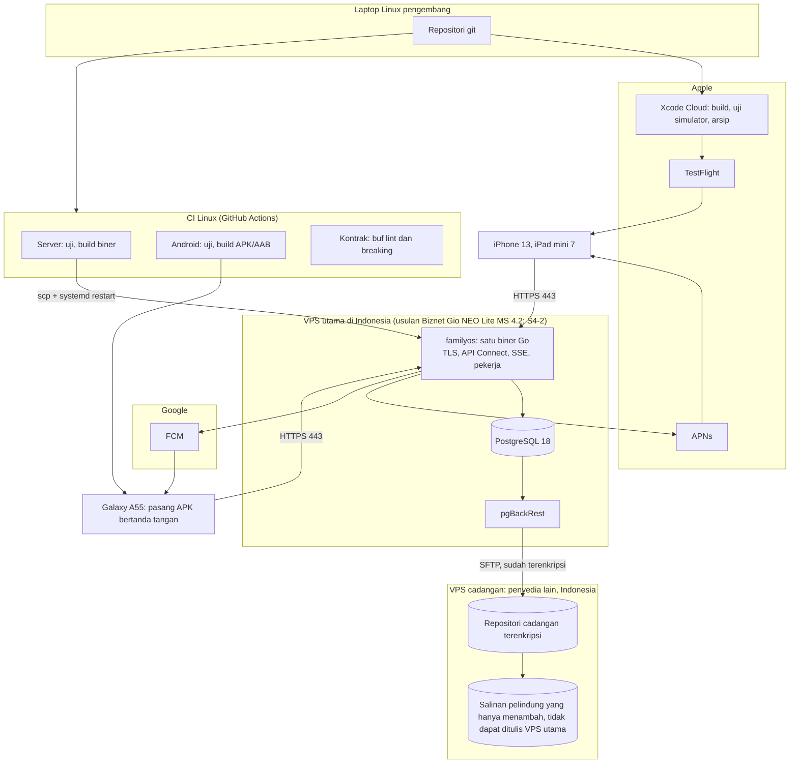

# 09.4 — Keamanan, operasi, CI/CD, pengujian, cadangan, biaya, dan risiko

Bagian dari [dokumen 09](../09-technical-architecture.md). Semua butir **[Usulan]** `architect`, kecuali yang diberi label lain. **Checkpoint S4:** ADR-022 (build iOS), ADR-025 (alat kualitas), dan ADR-013 (vektor uji emas) diterima; penyedia hosting, cadangan, dan email (§1, §2, §6, §7.1) tetap usulan sampai S4-2 dijawab menjelang deploy.

---

## 1. Penempatan (deployment)

| Hal | Rancangan | Persyaratan |
|---|---|---|
| Sistem operasi | Rilis LTS terbaru Ubuntu atau Debian stabil yang didukung PGDG; versi diperiksa saat penyiapan (ES §8) | — |
| Proses | Satu unit systemd `familyos` (API, SSE, pekerja), `postgresql`, dan timer `pgbackrest`. `GOMEMLIMIT` sekitar 512 MiB; `shared_buffers` PostgreSQL sekitar 1 GB pada RAM 4 GB **[Asumsi]**, disetel ulang sesudah pengukuran | ES §3 |
| TLS | Biner Go melayani TLS langsung dengan sertifikat ACME (`golang.org/x/crypto/acme/autocert`, 0.x menurut ADR-023, tantangan TLS-ALPN-01, sehingga hanya porta 443 yang terbuka), `MinVersion` TLS 1.2, tanpa pinning di aplikasi. Jalan mundur bila paket itu tidak tersedia saat dipasang: certbot di VPS dengan tantangan HTTP-01 lewat porta 80 yang hanya melayani tantangan itu, dan biner membaca berkas sertifikat | SEC-40 |
| Porta | 443 dari internet. SSH 22 dengan kunci saja, tanpa kata sandi dan tanpa login root langsung. PostgreSQL hanya di `localhost` | SEC-41 |
| Pemutakhiran | Pemutakhiran keamanan otomatis untuk paket OS; PostgreSQL minor diperbarui bulanan bersama pembaruan dependensi (ES §8) | SEC-41 |
| Rahasia | Kunci APNs `.p8`, akun layanan FCM, kunci API `AI`, kunci MAC kursor, kunci sesi, dan kata sandi cadangan dimuat lewat `LoadCredential=` systemd (berkas 0400, di luar repositori dan image). Rotasi: ganti berkas lalu mulai ulang, tanpa rilis aplikasi. Salinan kunci cadangan disimpan pemilik produk di luar VPS | SEC-42 |
| Rilis server | CI membangun biner. Perintah `familyos migrate` (peran `migrator`) dijalankan, lalu biner baru dipasang dan systemd memulai ulang. Putus sekitar satu detik; aplikasi menyambung ulang dan menarik `Sync`. Rollback: pasang biner sebelumnya (migrasi bersifat expand–contract, berkas 02 §10) | ES §7 |
| Enkripsi disk | Dipakai bila penyedia menawarkannya. Bila tidak, dicatat sebagai risiko yang diterima di pilot | SEC-45 |
| Tanpa API admin | Tidak ada titik akhir admin. Operasi dijalankan sebagai subperintah biner lewat SSH (`familyos ops …`), misalnya perintah anggota wafat (SEC-106), dan setiap pemakaiannya tercatat di `security_event` | SEC-33, SEC-106 |

---

## 2. Autentikasi dan sesi (parameter yang diserahkan dokumen 10)

| Hal | Parameter | Persyaratan |
|---|---|---|
| Hash kata sandi | **Argon2id, t = 3, p = 4, m = 64 MiB, garam 128 bit, tag 256 bit.** Ini opsi kedua yang direkomendasikan RFC 9106 §4 untuk lingkungan dengan memori terbatas ([rfc-editor.org/rfc/rfc9106](https://www.rfc-editor.org/rfc/rfc9106.html#section-4), diakses 12 November 2026) **[Terverifikasi]**. Paket `golang.org/x/crypto/argon2`. Paling banyak 2 hash berjalan bersamaan (semafor), sehingga memori puncaknya 128 MiB. Parameter disimpan bersama hash agar dapat dinaikkan kemudian. Sasaran waktu ≤ 500 ms di VPS pilot, diukur saat dibangun | SEC-11 |
| Kata sandi | Minimal 12 karakter, tanpa aturan komposisi. Ditolak bila ada di daftar kata sandi bocor yang disimpan **di server** (berkas statis di biner; tidak ada pemanggilan layanan luar) | SEC-11 |
| Token akses | String acak 256 bit, opak, berumur 15 menit; disimpan sebagai SHA-256 di `session`. Dicek di basis data per permintaan (kunci berindeks), sehingga pencabutan berlaku seketika | SEC-15 |
| Token penyegar | Acak 256 bit, diputar setiap dipakai, dalam satu keluarga per sesi. Pemakaian ulang token lama mencabut seluruh keluarga (sesi) | SEC-15 |
| Autentikasi ulang | `reauth_grant` berumur 5 menit, terikat sesi | SEC-13 |
| Batas laju | Ember token di memori proses per (akun, alamat jaringan) untuk masuk, pemulihan, undangan, dan pendaftaran. Pada tahap publik dengan beberapa proses, dipindah ke PostgreSQL | SEC-12 |
| Pemulihan | Tautan email sekali pakai, 30 menit, token tersimpan sebagai hash | SEC-24 |
| Undangan | Token ≥ 128 bit, disimpan sebagai hash, 7 hari; tanggapan seragam untuk token salah, kedaluwarsa, atau sudah dipakai | SEC-28, SEC-30 |
| Pengiriman email | **Usulan, menunggu S4-2:** **Amazon SES di wilayah Jakarta `ap-southeast-3` lewat API HTTPS** (`email.ap-southeast-3.amazonaws.com`), dari biner dengan AWS SDK for Go v2 (`sesv2`). Endpoint SMTP SES **tidak** tersedia di Jakarta, jadi API HTTPS adalah satu-satunya jalan di wilayah itu ([docs.aws.amazon.com/general/latest/gr/ses.html](https://docs.aws.amazon.com/general/latest/gr/ses.html), diakses 12 November 2026) **[Terverifikasi]**. Isinya hanya alamat penerima dan teks templat (tautan sekali pakai); tidak ada data rumah tangga. SPF, DKIM, dan DMARC di domain produk. Di pilot, mode sandbox cukup karena penerimanya dua alamat yang diverifikasi. Alasan dan pembandingnya di [ADR-026](../adr/ADR-026-pengiriman-email.md) | SEC-24; BT-5; BT-6 |

---

## 3. Keteramatan (observability)

| Hal | Rancangan | Persyaratan |
|---|---|---|
| Log | `log/slog` (stdlib) berformat JSON ke journald. **Hanya medan dari daftar izin**: pengenal permintaan acak, templat rute (bukan URL dengan pengenal), kode status, kode galat, durasi, pengenal internal. Tidak ada jumlah, isi `CARE`, teks pesan, nama, email, judul, token, atau kehadiran. Daftar izin dijaga tipe: fungsi log hanya menerima tipe medan yang diizinkan | SEC-44; ES §4 |
| Jangka simpan | journald `MaxRetentionSec=14day`, termasuk alamat jaringan | SEC-44 |
| Metrik | Histogram durasi per RPC dan jumlah coba ulang `40001`, disediakan `expvar` (stdlib) di porta `localhost` saja. Statistik kueri lewat `pg_stat_statements`. p95 baca dan tulis dihitung dari histogram (ES §3) | ES §3 |
| Peringatan | Pemantau uptime luar memanggil `/healthz` (tanpa data). Pekerjaan `ops.backup_verify` dan `ops.invariant_check` menandai operator bila gagal, lewat email SES yang sama (ADR-026) ke alamat operator; isinya nama pemeriksaan dan waktu saja | — |
| Laporan crash aplikasi | **Tanpa SDK.** Memakai laporan crash dari sistem. **Pilot iOS (TestFlight):** TestFlight mengirim laporan crash secara otomatis, terlepas dari setelan berbagi analitik di perangkat (18 §5, fase D) **[Terverifikasi]**; pemilik produk dan pasangannya diberi tahu hal ini di catatan persetujuan uji (SEC-109). Laporan crash berisi jejak tumpukan, bukan isi layar **[Perlu validasi]**. **App Store:** laporan dikirim hanya bila pengguna mengizinkan berbagi analitik **[Perlu validasi]**. **Android:** APK pilot tanpa Play tidak punya Android vitals; crash dibaca lewat `adb logcat` saat uji. Android vitals hanya bila Play dipakai | SEC-49 |

---

## 4. Pengujian otomatis

Mengikuti ES §6 (TDD; setiap AC Tier 1 punya uji yang menyebut pengenalnya; property-based untuk logika keuangan dan persetujuan) dan §5 (invarian dan contoh kerja sebagai uji yang memblokir merge).

| Lapisan | Isi | Alat | Di mana berjalan |
|---|---|---|---|
| Domain (Go, tanpa basis data) | Fungsi aturan 06 dan 07: transisi, tanda, jatah, periode, rekonsiliasi | `testing` (stdlib) | CI Linux |
| **Invarian keuangan** | **Setiap invarian 07** (sekarang **INV-01 sampai INV-41**; daftar dibaca dari 07 saat dibangun, ES §5) sebagai property test berstate: perintah acak dari 2 sampai 5 anggota dewasa, dijalankan ke PostgreSQL nyata, lalu setiap invarian diperiksa atas **data penuh** (07 §4). Contoh: INV-09 hash inti moneter sebelum dan sesudah setiap perintah (juga SEC-108); INV-10 setiap perintah dikirim ulang; INV-23 perintah bersamaan dari beberapa goroutine di bawah `SERIALIZABLE`, dibandingkan dengan hasil berurutan | Pustaka property-based Go, misalnya `pgregory.net/rapid` (versi dan status stabil diperiksa saat dibangun, ES §8), atau fuzzing stdlib `testing.F` | CI Linux, dengan PostgreSQL 18 sebagai layanan CI |
| **Invarian alur dan persetujuan** | **Setiap invarian 06** (sekarang **INV-A01 sampai INV-A53**, termasuk yang bersyarat bila pilihannya berlaku) sebagai property test berstate (ES §6): perintah alur acak (B, K, C, D, F, pesan chat) dari 2 sampai 5 anggota dewasa, dengan perangkat offline, kiriman ulang, dan jam yang dimajukan; setiap invarian diperiksa sesudah setiap langkah. Kolom "Cara menguji" tiap invarian 06 menjadi kasus wajib di dalamnya, termasuk daftar PG-14 | Pustaka property-based yang sama | CI Linux, dengan PostgreSQL 18 |
| Contoh kerja | Setiap CTH di 07 §7 dan setiap SCN di dokumen 12 sebagai uji tabel dengan angka yang sama (ES §5) | `testing` | CI Linux |
| AC Tier 1 | Satu uji per `FR-…/AC-n`, bernama pengenalnya, di tingkat API (Connect di atas server uji dan basis data nyata) | `testing` | CI Linux |
| Isolasi | Untuk setiap kueri sqlc: uji lintas rumah tangga yang dibangkitkan (SEC-02, LM-09); "tidak ada" sama dengan "tidak boleh" (SEC-05) | Pembangkit di atas daftar kueri sqlc | CI Linux |
| Privasi | Uji "tidak pernah terlihat" (SEC-86); simetri berpermutasi 3 sampai 5 dewasa (SEC-89, LM-01); **urutan kursor identik byte demi byte** dengan 0, 1, dan 5 entri pribadi (SEC-04); pengacakan `read_state` dan `presence` tidak mengubah keluaran di luar chat (LM-11); tidak ada hitungan per orang (SEC-07); **sebutan anggota** (F-FAM-021, Tier 2, bila dibangun): uji SEC-155 (b) sampai (i) persis seperti kolom "Cara menguji" di 10.4 §6.3, termasuk tanggapan API dan `Sync` yang identik byte demi byte bagi orang yang disebut dan anggota ketiga, dan payload push tanpa sebutan (02 §5.5) | `testing` | CI Linux |
| Kontrak dan bantuan isian | `buf lint`, `buf breaking`; **vektor uji emas** (09-F A, diterima) bantuan isian (selisih baris, bagi rata, bentuk masukan) dibangkitkan dari acuan Go (07 INV-02, aturan protovalidate) dan dijalankan di Swift dan Kotlin; beda hasil memblokir merge (berkas 01 §3; ADR-013) | buf; `testing`; Swift Testing; JUnit | CI Linux (Go, Kotlin, Swift non-UI bila dapat dibangun di Linux); Xcode Cloud (Swift) |
| Payload push | Tangkap payload untuk setiap N-NN: hanya teks kelas dan `r` (SEC-50, SEC-51) | Server uji dengan klien APNs/FCM tiruan | CI Linux |
| Log | Jalankan rangkaian AC, lalu pindai log untuk angka berformat uang, kata status `CARE`, teks pesan uji, dan email uji (SEC-44) | Skrip uji | CI Linux |
| Migrasi | Setiap migrasi naik, turun, naik lagi pada salinan skema; biner lama berjalan di atas skema baru | goose | CI Linux |
| Arsitektur | Impor lintas modul hanya dari daftar izin (ADR-014); tidak ada `UPDATE` atau `DELETE` atas tabel inti uang di kode (berkas 02 §5.2) | Uji Go atas `go list` | CI Linux |
| Duplikasi | Pemeriksaan duplikasi kode per bahasa (ES §2) | PMD CPD, yang mendukung Go, Kotlin, dan Swift (ADR-025) | CI Linux |
| UI Android | Uji Compose di emulator (KVM di Linux) | Compose UI test | CI Linux |
| UI iOS | XCUITest di simulator | Xcode Cloud | Xcode Cloud |
| Perangkat pilot | `qa` membuktikan AC Tier 1 dan invarian ujung ke ujung di iPhone 13, iPad mini 7, dan Galaxy A55, termasuk tanda terkirim (berkas 03 §5) dan cadangan perangkat (SEC-46) | Manual dengan daftar periksa | Perangkat |
| Kinerja | Data rumah tangga sintetis setahun **[Asumsi]**; p95 baca ≤ 200 ms dan tulis ≤ 400 ms diukur di VPS pilot; cold start ≤ 2 detik di Galaxy A55 dan iPhone 13 | Skrip beban kecil | VPS uji, perangkat |

---

## 5. CI/CD

| Tahap | Server dan kontrak | Android | iOS |
|---|---|---|---|
| Setiap push (gerbang ES §7; alat di ADR-025) | `buf lint` dan `buf breaking`; `gofmt -l` kosong; `go vet` dan golangci-lint; `govulncheck`; PMD CPD; uji domain, invarian, AC, isolasi, privasi, migrasi; pemeriksaan rahasia di repositori | ktlint (format dan lint); Android Lint; OSV-Scanner atas `gradle.lockfile`; PMD CPD; uji unit dan Compose | `swift format lint --strict`; PMD CPD; uji paket Swift non-UI di Linux **[Perlu validasi]**; peringatan kerentanan Dependabot atas `Package.resolved` (gerbang CI-nya **[Perlu validasi]**, ADR-025) |
| Setiap merge ke cabang utama | Build biner; arsip artefak | Build APK bertanda tangan untuk pilot | Xcode Cloud: build, XCUITest, arsip, unggah ke TestFlight internal |
| Rilis pilot | Manual: `familyos migrate`, lalu pasang | APK dipasang langsung ke Galaxy A55 (tanpa Play di pilot; SEC-143 hanya bila Play dipakai) | TestFlight internal ke iPhone 13 dan iPad mini 7 |
| Penandatanganan | — | Kunci unggah disimpan offline oleh pemilik produk dan sebagai rahasia CI | Penandatanganan dikelola Xcode Cloud (sertifikat di cloud Apple); tidak ada Mac yang menyimpan kunci |
| Persyaratan toko | — | Target API 36 bila Play dipakai (berkas 01 §13) | Xcode dan SDK iOS stabil terbaru saat bangun; minimal Xcode 26 / SDK iOS 26 untuk unggahan (18 §5.1) |

**iOS tanpa Mac: langkah dan biaya** (ADR-022; 18 §5.2):

1. Daftar Apple Developer Program: **USD 99 per tahun**.
2. **Sekali**: sewa Mac jarak jauh minimal 24 jam (Scaleway Mac mini M4, sekitar EUR 0,22 per jam → 24 × 0,22 = **EUR 5,28** **[Perlu validasi]**). Mac itu dipakai untuk membuat proyek Xcode, menghubungkan repositori, dan menyiapkan alur kerja Xcode Cloud pertama, yang menurut 18 §5.2 harus dibuat di Xcode.
3. Sesudahnya setiap push memicu build di Xcode Cloud. Jatah 25 jam komputasi per bulan sudah termasuk keanggotaan. Dengan build sekitar 10 menit **[Asumsi]**, itu sekitar 150 build per bulan.
4. Build dipasang di iPhone 13 dan iPad mini 7 lewat TestFlight internal.
5. **Batasnya:** tanpa pratinjau SwiftUI, simulator, dan debugger di Linux, setiap perubahan UI iOS diuji lewat perjalanan build dan TestFlight. Pemicu untuk Mac bulanan (Scaleway sekitar EUR 149 per bulan **[Perlu validasi]**) atau Mac mini sendiri (iBox Rp12.749.000 **[Perlu validasi]**) adalah dimulainya pekerjaan UI iOS harian (ADR-022 butir 4; 09-C A diterima).
6. xtool tidak dipakai sampai 17 L-31 dijawab advokat.

---

## 6. Cadangan dan pemulihan bencana

| Hal | Rancangan | Persyaratan |
|---|---|---|
| Alat | **pgBackRest 2.60.0** (berkas 01 §13): base backup fisik ditambah arsip WAL. Foto ikut, karena ada di PostgreSQL (berkas 02 §11) | SEC-43; 18 §5.5 |
| Tujuan | Repositori di VPS cadangan lewat **SFTP** (`repo1-type=sftp` **[Perlu validasi]** di versi 2.60.0), di Indonesia, pada pihak kontrak yang berbeda (ADR-020) | SEC-43; dokumen 10 §5 |
| Enkripsi | `repo1-cipher-type=aes-256-cbc`: dienkripsi **di VPS utama sebelum dikirim**. Kata sandi repositori ada di VPS utama (`LoadCredential`) dan salinan offline pemilik produk, **tidak pernah di VPS cadangan** | SEC-43 |
| Jadwal | Full mingguan, differential harian, WAL terus-menerus dengan `archive_timeout = 60 s`. **RPO ≤ 1 menit** **[Usulan]** | — |
| Jangka simpan repositori | Berbasis waktu: `repo1-retention-full-type=time`, `repo1-retention-full=30`. pgBackRest menyimpan full backup yang diperlukan untuk memulihkan ke titik mana pun dalam **30 hari** terakhir, beserta WAL-nya. Dengan full mingguan, set cadangan tertua di repositori berumur paling lama 30 + 7 = 37 hari | SEC-43, SEC-96 |
| Perlindungan dari VPS utama yang dibobol | **Salinan pelindung yang hanya menambah.** Setiap hari VPS cadangan menyalin berkas **baru** dari repositori (`rsync --ignore-existing`, tanpa `--delete`) ke direktori milik pengguna lain yang **tidak dapat ditulis** pengguna SFTP VPS utama. Menghapus atau menimpa berkas di repositori tidak menyentuh salinan. Salinan dipangkas oleh pekerjaan di VPS cadangan **menurut umur set cadangan** (label dan waktu selesai di manifest pgBackRest), bukan menurut umur salinan: set beserta WAL-nya dihapus bila sudah keluar dari jangka simpan repositori. Ruang disk sekitar repositori ditambah satu hari | TM-05 |
| Umur data paling tua (SEC-96) | Data yang dihapus di aplikasi bertahan di salinan mana pun **paling lama 38 hari**: jendela pemulihan 30 hari, ditambah 7 hari interval full, ditambah 1 hari jeda salinan (dokumen 10 SEC-96). `ops.backup_verify` memeriksa set tertua di repositori dan di salinan pelindung | SEC-96 |
| Jurnal penghapusan | Setiap penghapusan menurut ADR-007, SEC-94, SEC-100, dan SEC-105 menulis pengenal internalnya (tanpa isi) ke `deletion_journal` **dan** ke berkas jurnal yang dikirim ke VPS cadangan bersama WAL. Pemulihan ke titik mana pun menjalankan ulang jurnal yang lebih baru dari titik itu **sebelum menerima lalu lintas** | SEC-97 |
| Uji pemulihan | Sebelum pilot memakai data nyata, dan sesudahnya bulanan: pulihkan ke instans PostgreSQL sementara **di VPS cadangan** (data tetap di Indonesia), jalankan `ops.invariant_check` dan jurnal penghapusan, lalu hapus instans itu. RTO yang diukur dicatat | SEC-43 |
| **RTO** | ≤ 4 jam **[Usulan]**: sewa VPS baru, pasang biner, pulihkan, ubah DNS | — |

Penyedia VPS utama dan VPS cadangan menunggu S4-2 (ditunda sampai menjelang deploy; ADR-020). Rancangan di atas tidak bergantung pada penyedia, hanya pada syaratnya: keduanya di Indonesia dan pada pihak kontrak yang berbeda.

### 6.1 Butir operasi sebelum pilot memproses data nyata

Daftar kanonisnya dokumen 10 §4.1 (sembilan butir, dicentang bertanggal di runbook pilot). Butir yang dikerjakan lewat rancangan dokumen ini:

| 10 §4.1 | Butir | Di dokumen ini |
|---|---|---|
| 1 | Persyaratan berkolom "Pilot" dibangun dan lulus uji | §4, §8 |
| 4 | DPIA singkat dan catatan ketentuan setiap prosesor tersimpan bertanggal, sebelum data nyata. Untuk hosting, cadangan, dan email catatan itu dibuat **saat S4-2 diputuskan**. Waktu ini **[Usulan]** `security-privacy` (10 §3.1), **menunggu Q-208** | ADR-020; ADR-026 |
| 7 | Penyedia hosting dan cadangan dipilih (S4-2), dengan pihak kontrak dan lokasi pusat data tercatat dan pernyataan tertulis bahwa isi VPS dan cadangan tetap di Indonesia | ADR-020 butir 1; RISK-04 |
| 8 | Pemulihan cadangan diuji sekali; uji SEC-96 dan SEC-97 lulus | §6 "Uji pemulihan", "Umur data paling tua", "Jurnal penghapusan" |

**Bukan syarat sebelum data nyata** (10-C A, S4-4 (iii) A): jawaban advokat atas L-01, L-14, L-24. Risiko PSE (W-32) diterima pemilik produk. Pemicu dokumen 10 §4.1 (pengguna di luar rumah tangga pilot sebelum tahap publik berarti advokat dijawab lebih dulu) masih **[Usulan]** `security-privacy`, **menunggu Q-209**, belum berlaku.

| Skenario | Akibat | Pemulihan |
|---|---|---|
| Disk VPS utama rusak | Layanan mati | Pulihkan ke VPS baru dari repositori; kehilangan ≤ 1 menit |
| Penyedia utama mati atau akun ditangguhkan | Layanan mati | Sama, di penyedia lain; cadangan tidak di pihak kontrak yang sama |
| Kesalahan operator (`DELETE` yang salah) | Data hilang | PITR ke sesaat sebelum kesalahan, lalu jurnal penghapusan dijalankan ulang |
| VPS utama dibobol | Data terbaca penyerang; cadangan terancam dihapus | Salinan yang tidak dapat ditulis di VPS cadangan; rencana insiden SEC-148 |
| Ponsel hilang | Sesi di perangkat itu | Cabut dari perangkat lain atau lewat pemulihan; hapus jarak jauh (SEC-21) |

---

## 7. Perkiraan biaya

### 7.1 Pilot, per bulan

Baris bertanda **(S4-2)** bergantung pada pilihan hosting, cadangan, dan email yang ditunda pemilik produk sampai menjelang deploy; angkanya usulan ADR-020 dan ADR-026 dan dihitung ulang dengan harga yang dicek saat itu. Baris lain mengikuti keputusan yang sudah diterima (ADR-021, ADR-022).

| Butir | Hitungan | Rupiah | USD | Label |
|---|---|---|---|---|
| **(S4-2)** VPS utama, usulan Biznet Gio NEO Lite MS 4.2 | Harga halaman | Rp139.000 | — | **[Terverifikasi]** harga; PPN tidak disebut |
| **(S4-2)** VPS cadangan, usulan IDCloudHost (2 core, 4 GB, 60 GB) | Cuplikan pencarian 18 §5.8 | Rp105.000 | — | **[Perlu validasi]** |
| Apple Developer Program | 99 ÷ 12 | — | 8,25 | **[Terverifikasi]** |
| `AI` R1, pembangunan kumpulan bulanan | Berkas 03 §11.1: 0,06 × 2 + 0,12 × 10 | — | 1,32 (batas 10) | Harga **[Terverifikasi]**; jumlah token **[Asumsi]** |
| Xcode Cloud | Di dalam 25 jam | — | 0 | **[Terverifikasi]** jatah |
| CI Linux | Sekitar 100 push × 15 menit = 1.500 menit × USD 0,006 = USD 9, di dalam jatah Free USD 12 | — | 0 | Tarif **[Terverifikasi]** (18 §5.2); jumlah push **[Asumsi]** |
| Push APNs dan FCM | — | — | 0 | **[Asumsi]** tanpa biaya untuk volume ini |
| Domain | Sekitar Rp200.000 per tahun ÷ 12 | Rp16.667 | — | **[Asumsi]** |
| **(S4-2)** Email, usulan Amazon SES | Puluhan email per bulan **[Asumsi]** | — | Mendekati 0 | Tarif per pesan **[Perlu validasi]** (ADR-026) |
| **Jumlah** | | **Rp260.667** + PPN bila berlaku, **dengan Rp244.000 di antaranya bergantung pada S4-2** | **USD 9,57** + email (paling tinggi 18,25 + email bila batas `AI` tercapai) | |

Dengan VPS cadangan Biznet Gio XS 1.1 (Rp59.000) sebagai ganti IDCloudHost, jumlah rupiahnya Rp139.000 + Rp59.000 + Rp16.667 = **Rp214.667** (juga **(S4-2)**). Konversi ke satu mata uang tidak dilakukan karena kurs tidak diteliti (sama dengan 18 §5.9).

**Satu kali:** sewa Mac 24 jam ≈ EUR 5,28 **[Perlu validasi]**. **Bila ADR-022 butir 4 terpicu:** Mac bulanan sekitar EUR 149 per bulan selama fase UI iOS, atau Mac mini Rp12.749.000 sekali (keduanya **[Perlu validasi]**).

### 7.2 Tahap publik

Semua angka **[Asumsi]**, untuk dikalibrasi dengan pengukuran pilot.

| Skala | Infrastruktur | Per bulan | Catatan |
|---|---|---|---|
| Sampai sekitar 500 rumah tangga | VPS MM 8.4 (4 vCPU, 8 GB) Rp269.000; VPS cadangan yang lebih besar | Sekitar Rp400.000 sampai Rp500.000 + email | Satu proses masih cukup **[Asumsi]** |
| Sekitar 5.000 rumah tangga | PostgreSQL di VPS LL 16.8 (Rp459.000) + dua VPS aplikasi + penyeimbang beban; foto dipindah ke penyimpanan objek self-hosted | Sekitar Rp1,5 juta sampai Rp2 juta + email | Ember token dan hub SSE memakai PostgreSQL (berkas 03 §4) |
| Biaya yang tidak tumbuh dengan pengguna | Apple USD 99 per tahun; Play USD 25 sekali (18 §5, fase D) **[Terverifikasi]** | — | **`AI` R1 tidak tumbuh dengan jumlah rumah tangga**: satu kumpulan dipakai semua |
| Biaya yang tumbuh | Email SES (per pesan, keluar dari sandbox perlu permohonan ke AWS); `AI` bila R2 dipilih kelak (per pemanggilan); dukungan pengguna | — | Dinilai sebelum tahap publik |

---

## 8. Pemetaan persyaratan dokumen 10 §5 ke komponen

| SEC | Ringkas | Komponen | Tempat di dokumen 09 |
|---|---|---|---|
| SEC-01 | Otorisasi server per perintah dan bacaan | Handler + modul `read` | 02 §3, §6 |
| SEC-02 | `household_id` di setiap kunci; galat konstrain tidak diteruskan | Skema; pemetaan galat | 02 §3, §5 |
| SEC-03 | Pengenal tanpa waktu | UUIDv4 `gen_random_uuid()` | 02 §4; ADR-017 |
| SEC-04 | Kursor tanpa celah yang membocorkan | `reader_feed` per pembaca | 03 §3; ADR-017 |
| SEC-05 | "Tidak ada" = "tidak boleh" | Pemetaan galat | 02 §3 |
| SEC-06 | Satu jalur baca | Modul `read` | 02 §1 |
| SEC-07 | Tanpa hitungan per orang | `read`; uji privasi | 02 §12; 04 §4 |
| SEC-08 | RLS | `FORCE ROW LEVEL SECURITY` sejak pilot | 02 §3 |
| SEC-09 | Peran basis data | `app_rw`, `migrator`, `lifecycle_rw`, `backup` | 02 §3 |
| SEC-10 | `full_adult_members` satu fungsi | Modul `household` | 02 §3 |
| SEC-11 | Kata sandi dan Argon2id | `identity` | 04 §2 |
| SEC-12 | Batas laju | `identity` | 04 §2 |
| SEC-13 | Autentikasi ulang 5 menit | `reauth_grant` | 04 §2 |
| SEC-14 | Biometrik lokal | Aplikasi | 03 §2 |
| SEC-15 | Token dan penyimpanannya | `identity`; Keychain/Keystore | 03 §2; 04 §2 |
| SEC-16, SEC-17 | Daftar sesi dan pemberitahuan masuk, hanya kepada pemilik | `security_event` milik akun | 02 §2 |
| SEC-19, SEC-20 | Kunci aplikasi; pengalih aplikasi tertutup | Aplikasi (layar netral saat `scenePhase` tidak aktif atau `onPause`) | 03 §2 |
| SEC-21 | Hapus jarak jauh | `identity` + aplikasi | 03 §2; ADR-024 |
| SEC-22, SEC-23, SEC-27 | Tidak mencabut sesi orang lain; F06 mencabut semua; tanpa akses darurat oleh anggota | `identity` (pencabutan hanya oleh sesi akun yang sama); `household` F06 | 02 §1 |
| SEC-24 | Pemulihan email 30 menit | `identity` | 04 §2 |
| SEC-28, SEC-30 sampai SEC-32 | Token undangan; tanggapan seragam; F04 dengan email; syarat sebelum aktif | `household` | 04 §2 |
| SEC-33 | Tanpa API admin | Subperintah `familyos ops` lewat SSH | 04 §1 |
| SEC-34 | Pemberitahuan operator berversi | `operator_notice`, `operator_notice_ack` | 02 §1 |
| SEC-36 | Akses darurat (publik) | Ditunda | Indeks §6 |
| SEC-40 | TLS ≥ 1.2 | Biner Go | 04 §1 |
| SEC-41 | Pengerasan VPS | Ops | 04 §1 |
| SEC-42 | Rahasia | `LoadCredential` systemd | 04 §1 |
| SEC-43 | Cadangan terenkripsi, di Indonesia, 30 hari | pgBackRest | 04 §6; ADR-020 |
| SEC-44 | Log | `slog` dengan daftar izin; journald 14 hari | 04 §3 |
| SEC-45 | Enkripsi disk (publik) | Penyedia | 04 §1 |
| SEC-46 | Basis data perangkat | Proteksi berkas dan pengecualian cadangan | 03 §2; ADR-024 |
| SEC-47, SEC-48 | Perangkat hanya menyimpan yang terbaca; pembuangan saat menyempit | `sync` (`purge`) + aplikasi | 03 §3; 03 §8 |
| SEC-49 | Tanpa SDK pihak ketiga | Aplikasi; `firebase-messaging` saja | 03 §8; 04 §3 |
| SEC-50 sampai SEC-53 | Payload; teks kelas; kanal; lencana | `notify` | 03 §8 |
| SEC-54 | Layar luar; tanpa widget | Aplikasi (tidak ada ekstensi widget, komplikasi, atau Live Activity) | 03 §5 |
| SEC-55 | Satu notifikasi sesudah jam tenang | `notify.release` | 03 §8, §9 |
| SEC-56 | N-26 sebagai `ringkasan` | `notify.digest` | 03 §8 |
| SEC-57 | Lipat N-28 | Collapse id dan bunyi per 60 menit | 03 §8 |
| SEC-58 | Token push dihapus | `push_token` | 03 §8 |
| SEC-61 | Kehadiran hanya di chat | Hub SSE `presence` | 03 §6 |
| SEC-63 | Chat sebagai kelas peka | `chat`; log; `ai` tidak membaca | 02 §2; 04 §3 |
| SEC-64 | Waktu server di chat | `message.server_received_at` | 02 §5.3 |
| SEC-65 | Penyimpanan foto | `attachment_blob`; RPC berotorisasi | 02 §11 |
| SEC-66 | Metadata foto | Re-encode di perangkat dan di server, dengan empat syarat dokumen 10 | 02 §11 |
| SEC-67 | Pemilih foto sistem | Aplikasi | 02 §11 |
| SEC-69 | Foto tidak ke `AI` | `ai` tidak menerima lampiran | 03 §11 |
| SEC-85 | Skema tanggungan minimum | Skema (Tier 3; tidak ada kolom di luar 06) | 02 §5 (pembuka) |
| SEC-86, SEC-89 | Uji tidak pernah terlihat; simetri berpermutasi | Rangkaian uji | 04 §4 |
| SEC-92 | Kecocokan kategori | Modul `budget` (satu fungsi) | 02 §1 baris `budget` |
| SEC-155 | Sebutan anggota per pembaca (F-FAM-021, Tier 2): hanya pembuat yang membaca; diterapkan di perangkat pembuat saat tampil; tidak di push, Peristiwa, kartu, ringkasan server, `AI`, log, atau ekspor orang lain; dihapus dua arah pada F07, hapus akun, dan undangan yang gugur | `household` (`member_label`, `invitation.inviter_label`); `read`; `lifecycle` (ekspor dan hapus) | 02 §5.5; 04 §4 |
| SEC-153, SEC-154 | "Sembunyikan untuk saya"; "Laporkan" (Apple 1.2; 10-G A, Tier 1). Di pilot "Laporkan" hanya membuka Bantuan, tanpa kiriman apa pun; sesudah pilot laporan ke pengelola yang bukan anggota rumah tangga pelapor, tidak pernah kepada yang dilaporkan | `chat` (`member_mute`); sesudah pilot `report` dan `familyos ops report` | 06 §16.12; 02 §5.3 |
| SEC-93 | Tanpa agregasi sisi keluarga | Hubungan tidak disimpan; uji laporan | 02 §2 |
| SEC-94, SEC-100 | Penghapusan 90 hari | Pekerjaan `lifecycle.*` | 03 §9 |
| SEC-96, SEC-97 | Cadangan kedaluwarsa; pemulihan menjalankan jurnal penghapusan | pgBackRest; `deletion_journal` | 04 §6 |
| SEC-98 | Penghapusan di perangkat | Aplikasi | 03 §2 |
| SEC-101 sampai SEC-104 | Ekspor sesudah keluar | `lifecycle` (CSV dan JSON berversi; bilangan bulat dan mata uang; ISO 8601); tautan sekali pakai 15 menit | 03 §9; 02 §7 |
| SEC-105, SEC-106 | Hapus akun; perintah anggota wafat | `lifecycle`; `familyos ops` | 04 §1 |
| SEC-108 | Uji hash inti identik | Uji invarian INV-09 | 04 §4 |
| SEC-109 | Catatan persetujuan | `consent_record` | 02 §1 |
| SEC-120, SEC-121, SEC-123 | R1; tanpa data rumah tangga; daftar yang tidak pernah dikirim | `ai.pool_build` | 03 §11 |
| SEC-122 | Kunci konfigurasi R2 | `ai` | 03 §11.2 |
| SEC-124, SEC-125, SEC-129 | Keluaran tidak membuka data orang lain; persetujuan; tanpa perbandingan | Pemilih di server lewat `read` | 03 §11.1 |
| SEC-127, SEC-128 | Batas biaya di dua tempat; saklar mati | Workspace khusus + `ai_usage`; setelan server | 03 §11.1 |
| SEC-130 | Daftar terlarang otomatis | Filter pembangunan kumpulan | 03 §11.1 |
| SEC-133 sampai SEC-136 | Tanda tekanan berat; tanpa pemindaian | `care` dan `ai` (Tier 2); tidak ada pekerjaan yang memindai isi | 03 §9 (tidak ada pekerjaan semacam itu) |
| SEC-151, SEC-152 | Otorisasi ulang perintah luring; penolakan tanpa kebocoran | Transaksi perintah | 02 §6; 03 §1 |

---

## 9. Risiko

Pengenal memakai skema `RISK-NN` dari README. Dokumen 15 (S5) mengambil alih daftar ini dan menambah risiko produk; pengenalnya tidak diubah.

| # | Risiko | Kemungkinan | Akibat | Penanganan |
|---|---|---|---|---|
| RISK-01 | Siklus pengembangan UI iOS tanpa Mac terlalu lambat | Tinggi | Fase iOS molor | Pemicu Mac bulanan atau Mac mini (ADR-022 butir 4); kode non-UI diuji di Linux |
| RISK-02 | Pustaka 0.x berubah tidak kompatibel: connect-kotlin, `golang.org/x/crypto`, `golang.org/x/oauth2` | Sedang | Pekerjaan ulang di satu paket | Dipatok dengan lockfile; jalan mundur per pustaka di ADR-023 |
| RISK-03 | Satu VPS adalah titik gagal tunggal | Sedang | Pilot mati beberapa jam | RPO 1 menit, RTO 4 jam; pencatatan offline tetap jalan (LM-02) |
| RISK-04 | Kota pusat data penyedia usulan (Biznet Gio NEO Lite) tidak dinyatakan; kebijakan privasinya mengizinkan data pribadi diproses di luar Indonesia | Sedang | Syarat "di Indonesia" tidak dapat dibuktikan tertulis | Penyedia dipilih di S4-2 menjelang deploy; pernyataan tertulis penyedia sebelum data nyata (10 §4.1 butir 7); penilaian advokat sebelum tahap publik (S4-4 (iii) A; ADR-020) |
| RISK-05 | pgBackRest belum menyatakan dukungan PG18 "penuh" | Rendah | Cadangan tidak andal | Uji pemulihan sebelum pilot dan bulanan; WAL-G v3.0.9 sebagai alternatif |
| RISK-06 | Email pemulihan tidak sampai (masuk spam, kuota sandbox SES) | Rendah | Pemulihan akun gagal | SPF, DKIM, DMARC; uji kirim sebelum pilot; pengiriman sebagai job yang dicoba ulang (ADR-026) |
| RISK-07 | Foto di PostgreSQL membesarkan cadangan | Rendah di pilot | Cadangan lambat | Batas pindah 5 GB / 20 GB (berkas 02 §11) |
| RISK-08 | SSE terputus di jaringan seluler atau proxy operator | Sedang | Chat terasa lambat | Tarik `Sync` saat tersambung ulang; push tetap menjadi jalan saat tidak di depan |
| RISK-09 | Eksponen IDR produk (0) berbeda dari ISO 4217 (2) | Rendah | Ekspor dibaca salah oleh alat lain; pustaka platform membaca 2 | Eksponen hanya dari tabel produk; ekspor membawa `minor_unit_exponent` (07 INV-39; berkas 02 §5) |
| RISK-10 | Satu pemegang pengetahuan (bus factor) | Tinggi | Operasi berhenti bila pemimpin berhalangan | Runbook pemulihan, rilis, dan rotasi rahasia ditulis di fase bangun; komponen sedikit |
| RISK-11 | Operator adalah pasangan (keputusan 25) | Pasti di pilot | Operator dapat membaca data; laporan Apple 1.2 tentang operator jatuh ke operator itu sendiri | Kendali dokumen 10 (SEC-33, SEC-34, 10-F A, 10-G A); arsitektur tidak dapat menutupnya tanpa E2EE, yang tidak dipakai di pilot (S4-6 (i) A) dan dinilai lewat ADR sebelum tahap publik, termasuk sebutan anggota (SEC-155 (j)) |
| RISK-12 | Lisensi alat build iOS (17 L-31); transfer push dan `AI` (L-16) | Sedang | Jalur harus diganti | Xcode Cloud sebagai jalur resmi; R1 tanpa data rumah tangga |
| RISK-13 | Pembungkus SQLite iOS tidak dapat dibangun di Linux | Sedang | Uji non-UI iOS hanya di Xcode Cloud | Dinilai `ios-dev` di awal fase bangun (berkas 03 §2) |
| RISK-14 | Biometrik membuka kunci aplikasi untuk sidik jari pasangan yang terdaftar | Sedang | Kunci aplikasi tidak menahan pasangan | Pilihan kode aplikasi; kebijakan yang batal saat daftar biometrik berubah (berkas 03 §2) |
| RISK-15 | Pemilik produk menolak pengecualian ES §2 untuk bantuan isian (09-F) | **Ditutup** (checkpoint S4: 09-F A disetujui tegas) | — | Pengenal tidak dipakai ulang |
| RISK-16 | Peninjau App Store menolak aplikasi karena Guideline 1.2 (konten buatan pengguna di chat) | Sedang, saat beralih ke TestFlight eksternal atau App Store | Rilis tertunda | Mekanisme 06 §16.12 (10-G A, Tier 1); sisa SEC-153 (d) dan SEC-154 dibangun sebelum peninjauan pertama (ADR-022) |
| RISK-17 | API eksperimental Compose (`ModalBottomSheet`) berubah atau rilis stabil berikutnya mengubah perilakunya | Sedang | Lembar Catat di Android dikerjakan ulang | Dipatok ke 1.4.0; jalan mundur dialog layar penuh (ADR-012 butir 5, ADR-023 butir 5) |
