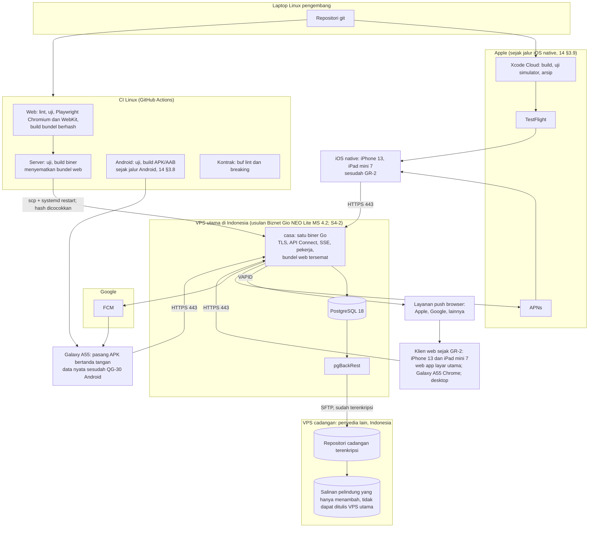

# 09.4 — Keamanan, operasi, CI/CD, pengujian, cadangan, biaya, dan risiko

Bagian dari [dokumen 09](../09-technical-architecture.md). Semua butir **[Usulan]** `architect`, kecuali yang diberi label lain. **Sesudah S6 (12 November 2026): web lebih dulu** ([ADR-030](../adr/ADR-030-klien-web-pwa-lebih-dulu.md)): §1, §2, §4, §5, §6.1, §7.1, §8 memuat klien web; jalur iOS dan biaya Apple berlaku sejak jalur iOS native. **Checkpoint S4:** ADR-022 (build iOS), ADR-025 (alat kualitas), dan ADR-013 (vektor uji emas) diterima; penyedia hosting, cadangan, dan email (§1, §2, §6, §7.1) tetap usulan sampai S4-2 dijawab menjelang deploy.

---

## 1. Penempatan (deployment)

| Hal | Rancangan | Persyaratan |
|---|---|---|
| Sistem operasi | Rilis LTS terbaru Ubuntu atau Debian stabil yang didukung PGDG; versi diperiksa saat penyiapan (ES §8) | — |
| Proses | Satu unit systemd `casa` (API, SSE, pekerja), `postgresql`, dan timer `pgbackrest`. `GOMEMLIMIT` sekitar 512 MiB; `shared_buffers` PostgreSQL sekitar 1 GB pada RAM 4 GB **[Asumsi]**, disetel ulang sesudah pengukuran. Catatan 13 November 2026 (FS-1 1.2): sejak GR-2 staging berjalan di klaster PostgreSQL kedua dengan `shared_buffers` kecil, bukan di klaster produksi (ADR-028 butir 1; berkas 02 §3 lapis 5) | ES §3 |
| TLS | Biner Go melayani TLS langsung dengan sertifikat ACME (`golang.org/x/crypto/acme/autocert`, 0.x menurut ADR-023, tantangan TLS-ALPN-01, sehingga hanya porta 443 yang terbuka), `MinVersion` TLS 1.2, tanpa pinning di aplikasi. Jalan mundur bila paket itu tidak tersedia saat dipasang: certbot di VPS dengan tantangan HTTP-01 lewat porta 80 yang hanya melayani tantangan itu, dan biner membaca berkas sertifikat | SEC-40 |
| Batas ukuran permintaan | Catatan 13 November 2026 (FS-1 1.3, kontrak dasar): badan setiap permintaan Connect paling besar **1 MiB** **[Usulan]**, ditegakkan sebelum validasi pesan. Jalur yang memerlukan lebih (unggah lampiran, modul `files`) menaikkannya per jalur di tugasnya, dengan alasan dicatat | ES §4 |
| Porta | 443 dari internet. SSH 22 dengan kunci saja, tanpa kata sandi dan tanpa login root langsung. PostgreSQL hanya di `localhost` | SEC-41 |
| Pemutakhiran | Pemutakhiran keamanan otomatis untuk paket OS; PostgreSQL minor diperbarui bulanan bersama pembaruan dependensi (ES §8) | SEC-41 |
| Rahasia | Kunci privat VAPID (Web Push, sejak FS-1), kunci APNs `.p8` dan akun layanan FCM (sejak jalur native), kunci API `AI`, kunci MAC kursor, kunci sesi, dan kata sandi cadangan dimuat lewat `LoadCredential=` systemd (berkas 0400, di luar repositori dan image). Rotasi: ganti berkas lalu mulai ulang, tanpa rilis aplikasi. Salinan kunci cadangan disimpan pemilik produk di luar VPS | SEC-42 |
| Bundel web | Disematkan ke biner (`embed`, ADR-030 butir 3) dan dilayani dari origin yang sama dengan CSP, HSTS, dan header lain (ADR-030 butir 7). Hash setiap berkas bundel dan hash biner dicatat CI; runbook rilis mencocokkan hash biner di VPS dengan artefak CI (SEC-169 (a)). Service worker pengganti disimpan di repositori untuk keadaan darurat (SEC-169 (e)) | SEC-166, SEC-169 |
| Rilis server | CI membangun biner. Perintah `casa migrate` (peran `migrator`) dijalankan, lalu biner baru dipasang dan systemd memulai ulang. Putus sekitar satu detik; aplikasi menyambung ulang dan menarik `Sync`. Rollback: pasang biner sebelumnya (migrasi bersifat expand–contract, berkas 02 §10). Peran basis data tidak dibuat `casa migrate`: `roles.sql` dijalankan sekali per cluster oleh superuser `postgres` saat penyiapan (berkas 02 §3 lapis 5; catatan 13 November 2026) | ES §7 |
| Enkripsi disk | Dipakai bila penyedia menawarkannya. Bila tidak, dicatat sebagai risiko yang diterima di pilot | SEC-45 |
| Tanpa API admin | Tidak ada titik akhir admin. Operasi dijalankan sebagai subperintah biner lewat SSH (`casa ops …`), misalnya perintah anggota wafat (SEC-106), dan setiap pemakaiannya tercatat di `security_event` | SEC-33, SEC-106 |

---

## 2. Autentikasi dan sesi (parameter yang diserahkan dokumen 10)

| Hal | Parameter | Persyaratan |
|---|---|---|
| Hash kata sandi | **Argon2id, t = 3, p = 4, m = 64 MiB, garam 128 bit, tag 256 bit.** Ini opsi kedua yang direkomendasikan RFC 9106 §4 untuk lingkungan dengan memori terbatas ([rfc-editor.org/rfc/rfc9106](https://www.rfc-editor.org/rfc/rfc9106.html#section-4), diakses 12 November 2026) **[Terverifikasi]**. Paket `golang.org/x/crypto/argon2`. Paling banyak 2 hash berjalan bersamaan (semafor), sehingga memori puncaknya 128 MiB; menjadi 1 bila syarat kapasitas [10.1 §8.1](../10-security-privacy/01-ancaman-dan-akses.md) butir 4 (`H` ≤ 0,8 × `maxLimiterKeys`) tidak terpenuhi pada pengukuran di VPS. Batas waktu menunggu slot hash dan penarikan hitungan bila slot tidak didapat: 10.1 §8.1 butir 3. Parameter disimpan bersama hash agar dapat dinaikkan kemudian. Sasaran waktu ≤ 500 ms di VPS pilot, diukur saat dibangun | SEC-11 |
| Kata sandi | Minimal 12 karakter, tanpa aturan komposisi. Ditolak bila ada di daftar kata sandi bocor yang disimpan **di server** (berkas statis di biner; tidak ada pemanggilan layanan luar) | SEC-11 |
| Token akses (native) | String acak 256 bit, opak, berumur 15 menit; disimpan sebagai SHA-256 di `session`. Dicek di basis data per permintaan (kunci berindeks), sehingga pencabutan berlaku seketika | SEC-15 |
| Token penyegar | Acak 256 bit, diputar setiap dipakai, dalam satu keluarga per sesi. Pemakaian ulang token lama mencabut seluruh keluarga (sesi) | SEC-15 |
| **Sesi klien web** | Satu cookie `__Host-` (`Secure`, `HttpOnly`, `SameSite=Strict`, `Path=/`, tanpa `Domain`) berisi token opak 256 bit; server menyimpan SHA-256-nya di `session` dengan `client_kind = 'web'` (berkas 02 §5.1). Tanpa token penyegar: token cookie diputar paling sering setiap 15 menit pada permintaan berikutnya; nilai sebelumnya diterima 60 detik; pemakaian ulang sesudahnya mencabut sesi dan menulis `security_event`. **Mode pribadi:** diam 30 hari, mutlak 180 hari, `Max-Age` = sisa umur mutlak. **Mode bersama:** diam 30 menit, mutlak 12 jam, cookie tanpa `Max-Age`/`Expires`, tanpa IndexedDB, push, kunci aplikasi, atau LY-88 (SEC-165 (h)). **Masa diam mode bersama hanya dari tindakan orang** (SEC-165 (g)): setiap RPC membawa medan kontrak `user_initiated` yang diisi klien untuk navigasi, perintah, dan "Tetap masuk"; hanya RPC bertanda itu yang memperbarui `last_used_at` sebagai pengatur waktu diam sesi mode bersama. Denyut kehadiran, aliran SSE, dan `Sync` otomatis yang dipicu tanda SSE tidak memperbaruinya. Tanda dipercaya dari klien **[Usulan]** (ancamannya sesi terlupa, bukan klien bermusuhan); batas mutlak 12 jam tidak dapat diperpanjang. Uji: dengan jam uji, tab mode bersama tanpa masukan sementara SSE dan `Sync` berjalan berakhir di menit ke-30; "Tetap masuk" di menit ke-29 memperpanjang sampai menit ke-59. Galat `session_expired` (masuk lagi, data lokal tetap) dan `session_revoked` (hapus di semua tab). Catatan 13 November 2026 (FS-1 tugas 1.5): nama cookie `__Host-casa_session`; respons masuk, daftar, dan pulih varian web tanpa medan `tokens`, sesi hanya lewat `Set-Cookie`; `device_mode` dipilih klien web di kontrak. Pemakaian nilai sebelumnya sesudah 60 detik mencabut sesi **hanya bila nilai sekarang sudah terkonfirmasi**; bila jawaban rotasi hilang, server menerbitkan ulang tanpa pencabutan, dan nilai yang dibuang mencabut sesi bila dibawa kemudian; nilai tak dikenal berarti masuk lagi, bukan `session_revoked` (aturan di 10.5 SEC-161 (c) catatan tanggal itu; ADR-030 butir 5). Mode bersama: hanya RPC `user_initiated` yang memperbarui `last_used_at`; mode pribadi disentuh seperti native. Keluar akun web menjawab `Clear-Site-Data: "cookies", "storage"` dan cookie `Max-Age=0` (SEC-164 (b)) | SEC-161, SEC-165 |
| **CSRF klien web** | RPC sesi cookie hanya `POST`; Connect `GET` ditolak. Tolak bila `Origin` bukan origin produksi, tidak ada, atau `Sec-Fetch-Site` ada dan bukan `same-origin`. Tanpa CORS dan tanpa token CSRF di pilot. Catatan 13 November 2026 (FS-1 tugas 1.5): diperiksa sebelum isi dibaca bagi setiap permintaan yang membawa cookie sesi, `Origin`, atau `Sec-Fetch-Site`, apa pun `client_kind`-nya, dan bagi setiap RPC `client_kind = WEB`, termasuk RPC identitas publik. Origin pembanding adalah `casa serve -origin`, dibandingkan sebagai string persis. Jenis klien permintaan terautentikasi harus sama dengan sesinya (`InvalidArgument`). Rincian ADR-030 butir 6 catatan tanggal itu; 10.5 SEC-162 (a) | SEC-162 |
| **Kunci aplikasi web** | Kode 6 digit; pemverifikasi PBKDF2-HMAC-SHA-256, 600.000 iterasi (OWASP, diakses 12 November 2026) **[Terverifikasi]**, garam 128 bit, keluaran 256 bit, di IndexedDB; tidak pernah dikirim ke server. Waktu derivasi diukur di perangkat pilot | SEC-174 |
| Autentikasi ulang | `reauth_grant` berumur 5 menit, terikat sesi. Di web: kata sandi akun ditambah faktor kedua bila menyala; tanpa passkey di pilot | SEC-13, SEC-174 (g) |
| Batas laju | Di memori proses, dengan **kunci terpisah per akun dan per alamat jaringan** (SEC-12), untuk masuk, pemulihan, autentikasi ulang, undangan, dan pendaftaran. Pada tahap publik dengan beberapa proses, dipindah ke PostgreSQL. Catatan 13 November 2026 (FS-1 1.4, putusan lead Q11): menggantikan kunci gabungan "(akun, alamat jaringan)", yang membiarkan satu alamat mencoba banyak akun. Kunci akun sebelum akun dikenal adalah email yang dinormalkan (dipangkas, huruf kecil; string yang sama dengan pencarian), sehingga email terdaftar dan tidak terdaftar diperlakukan sama. Kunci alamat adalah host `PeerAddr` (TLS langsung di biner, §1; tanpa proksi): IPv4 per alamat, IPv6 per `/64`, IPv4 dalam IPv6 (`::ffff:a.b.c.d`) sebagai IPv4. Angka **[Usulan]**, ditetapkan `security-privacy` ([10.1 §8.1](../10-security-privacy/01-ancaman-dan-akses.md), tabel per RPC di sana): sesudah kegagalan ke-`n` (`n` ≥ ambang) permintaan berikutnya ditolak sampai kegagalan terakhir + min(2^(n − ambang) detik, 15 menit). Ambang 20 untuk setiap kunci, kecuali **5 per email untuk permintaan pemulihan**, yang setiap permintaannya dihitung sebagai kegagalan. Keberhasilan hanya mengosongkan kunci akun; **kunci alamat tidak pernah dikosongkan oleh keberhasilan**. Permintaan yang ditolak batas laju tidak dihitung, tidak menjalankan Argon2, dan tidak menyentuh basis data. Kunci dilupakan 1 jam sesudah kegagalan terakhirnya; kapasitas tabel dan aturan pengusiran (eviction) kunci ditetapkan di [10.1 §8.1](../10-security-privacy/01-ancaman-dan-akses.md) | SEC-12 |
| Pemulihan | Tautan email sekali pakai, 30 menit, token tersimpan sebagai hash | SEC-24 |
| Undangan | Token ≥ 128 bit, disimpan sebagai hash, 7 hari; tanggapan seragam untuk token salah, kedaluwarsa, atau sudah dipakai | SEC-28, SEC-30 |
| Pendaftaran tertutup (Pilot, semua jalur distribusi) | Server menolak pembuatan akun kecuali dengan (a) token undangan yang sah, atau (b) **token pemasangan** sekali pakai yang dibuat pengelola lewat subperintah SSH tercatat (SEC-33) untuk satu orang tertentu, ≥ 128 bit, disimpan sebagai hash, 7 hari **[Asumsi]** 10.4. **Token (b) terikat pada alamat email orang yang dituju** (dikukuhkan `security-privacy`, 10.4 SEC-158): akun hanya dibuat dengan alamat yang sama, dibandingkan sesudah normalisasi yang sama dengan keunikan email akun, dan akun aktif baru sesudah tautan verifikasi ke alamat itu dibuka. Alamat yang tidak cocok mendapat tanggapan seragam yang sama. Token (b) hanya membuka pendaftaran: orang itu memasang kata sandinya sendiri, dan tidak ada perintah pengelola yang memasang kata sandi (SEC-26). Hanya akun dari (b) yang boleh membuat rumah tangga; akun dari (a) bergabung ke rumah tangga pengundang. Tanpa token, token salah, kedaluwarsa, atau terpakai: tanggapan seragam yang sama dengan SEC-30. Setiap token (b) dicatat di catatan operasi (SEC-37). Ditegakkan di `identity` dan `household` di server, bukan dengan menyembunyikan tombol daftar. Disimpan di tabel `setup_token` milik `identity` **[Usulan]**, tanpa `household_id` karena rumah tangganya belum ada, dengan pola hash dan kedaluwarsa yang sama dengan `recovery_token`, dan dibersihkan `identity.prune_tokens` | SEC-158; ADR-022 syarat C-3 |
| Pengiriman email | **Usulan, menunggu S4-2:** **Amazon SES di wilayah Jakarta `ap-southeast-3` lewat API HTTPS** (`email.ap-southeast-3.amazonaws.com`), dari biner dengan AWS SDK for Go v2 (`sesv2`). Endpoint SMTP SES **tidak** tersedia di Jakarta, jadi API HTTPS adalah satu-satunya jalan di wilayah itu ([docs.aws.amazon.com/general/latest/gr/ses.html](https://docs.aws.amazon.com/general/latest/gr/ses.html), diakses 12 November 2026) **[Terverifikasi]**. Isinya hanya alamat penerima dan teks templat (tautan sekali pakai); tidak ada data rumah tangga. SPF, DKIM, dan DMARC di domain produk. Di pilot, mode sandbox cukup karena penerimanya dua alamat yang diverifikasi. Alasan dan pembandingnya di [ADR-026](../adr/ADR-026-pengiriman-email.md) | SEC-24; BT-5; BT-6 |

---

## 3. Keteramatan (observability)

| Hal | Rancangan | Persyaratan |
|---|---|---|
| Log | `log/slog` (stdlib) berformat JSON ke journald. **Hanya medan dari daftar izin**: pengenal permintaan acak, templat rute (bukan URL dengan pengenal), kode status, kode galat, durasi, pengenal internal. Tidak ada jumlah, isi `CARE`, teks pesan, nama, email, judul, token, atau kehadiran. Daftar izin dijaga tipe: fungsi log hanya menerima tipe medan yang diizinkan | SEC-44; ES §4 |
| Jangka simpan | journald `MaxRetentionSec=14day`, termasuk alamat jaringan | SEC-44 |
| Metrik | Histogram durasi per RPC dan jumlah coba ulang `40001`, disediakan `expvar` (stdlib) di porta `localhost` saja. Statistik kueri lewat `pg_stat_statements`. p95 baca dan tulis dihitung dari histogram (ES §3) | ES §3 |
| Peringatan | Pemantau uptime luar memanggil `/healthz` (tanpa data). Pekerjaan `ops.backup_verify` dan `ops.invariant_check` menandai operator bila gagal, lewat email SES yang sama (ADR-026) ke alamat operator; isinya nama pemeriksaan dan waktu saja | — |
| Laporan crash aplikasi | **Tanpa SDK.** Memakai laporan crash dari sistem. **Pilot iOS (TestFlight):** TestFlight mengirim laporan crash secara otomatis, terlepas dari setelan berbagi analitik di perangkat (18 §5, fase D) **[Terverifikasi]**; pemilik produk dan pasangannya diberi tahu hal ini di catatan persetujuan uji (SEC-109). Laporan crash berisi jejak tumpukan, bukan isi layar **[Perlu validasi]**. **App Store:** laporan dikirim hanya bila pengguna mengizinkan berbagi analitik **[Perlu validasi]**. **Android:** APK pilot tanpa Play tidak punya Android vitals; crash dibaca lewat `adb logcat` saat uji. Android vitals hanya bila Play dipakai. **Klien web:** tanpa laporan galat otomatis ke pihak mana pun, termasuk server sendiri, sehingga tidak perlu catatan persetujuan uji (SEC-178 (c)); galat dibaca saat uji lewat konsol Chrome jarak jauh (Galaxy A55, desktop) dan halaman pemeriksaan diri staging (iPhone, iPad; SEC-179) | SEC-49, SEC-178 |

---

## 4. Pengujian otomatis

Mengikuti ES §6 (TDD; setiap AC Tier 1 punya uji yang menyebut pengenalnya; property-based untuk logika keuangan dan persetujuan) dan §5 (invarian dan contoh kerja sebagai uji yang memblokir merge).

| Lapisan | Isi | Alat | Di mana berjalan |
|---|---|---|---|
| Domain (Go, tanpa basis data) | Fungsi aturan 06 dan 07: transisi, tanda, jatah, periode, rekonsiliasi | `testing` (stdlib) | CI Linux |
| **Invarian keuangan** | **Setiap invarian 07** (sekarang **INV-01 sampai INV-41**; daftar dibaca dari 07 saat dibangun, ES §5) sebagai property test berstate: perintah acak dari 2 sampai 5 anggota dewasa, dijalankan ke PostgreSQL nyata, lalu setiap invarian diperiksa atas **data penuh** (07 §4). Contoh: INV-09 hash inti moneter sebelum dan sesudah setiap perintah (juga SEC-108); INV-10 setiap perintah dikirim ulang; INV-23 perintah bersamaan dari beberapa goroutine di bawah `SERIALIZABLE`, dibandingkan dengan hasil berurutan | Pustaka property-based Go, misalnya `pgregory.net/rapid` (versi dan status stabil diperiksa saat dibangun, ES §8), atau fuzzing stdlib `testing.F` | CI Linux, dengan PostgreSQL 18 sebagai layanan CI |
| **Invarian alur dan persetujuan** | **Setiap invarian 06** (sekarang **INV-A01 sampai INV-A53**, termasuk yang bersyarat bila pilihannya berlaku) sebagai property test berstate (ES §6): perintah alur acak (B, K, C, D, F, pesan chat) dari 2 sampai 5 anggota dewasa, dengan perangkat offline, kiriman ulang, dan jam yang dimajukan; setiap invarian diperiksa sesudah setiap langkah. Kolom "Cara menguji" tiap invarian 06 menjadi kasus wajib di dalamnya, termasuk daftar PG-14 | Pustaka property-based yang sama | CI Linux, dengan PostgreSQL 18 |
| Contoh kerja | Setiap CTH di 07 §7 sebagai uji tabel dengan angka yang sama (ES §5); setiap SCN Tier 1 di 12 §2, termasuk bagian Tier 1 bertanda "+1" dari SCN-08, SCN-18, dan SCN-41, sebagai uji ujung ke ujung tingkat API; SCN Tier 2 bersama gelombangnya; SCN Tier 3 tidak diuji (14 §4.4) | `testing` | CI Linux |
| AC Tier 1 | Satu uji per `FR-…/AC-n`, bernama pengenalnya, di tingkat API (Connect di atas server uji dan basis data nyata) | `testing` | CI Linux |
| Isolasi | Untuk setiap kueri sqlc: uji lintas rumah tangga yang dibangkitkan (SEC-02, LM-09); "tidak ada" sama dengan "tidak boleh" (SEC-05) | Pembangkit di atas daftar kueri sqlc | CI Linux |
| Privasi | Uji "tidak pernah terlihat" (SEC-86); simetri berpermutasi 3 sampai 5 dewasa (SEC-89, LM-01); **urutan kursor identik byte demi byte** dengan 0, 1, dan 5 entri pribadi (SEC-04); pengacakan `read_state` dan `presence` tidak mengubah keluaran di luar chat (LM-11); tidak ada hitungan per orang (SEC-07); **sebutan anggota** (F-FAM-021, Tier 2, bila dibangun): uji SEC-155 (b) sampai (i) persis seperti kolom "Cara menguji" di 10.4 §6.3, termasuk tanggapan API dan `Sync` yang identik byte demi byte bagi orang yang disebut dan anggota ketiga, dan payload push tanpa sebutan (02 §5.5) | `testing` | CI Linux |
| Kontrak dan bantuan isian | `buf lint`, `buf breaking`; **vektor uji emas** (09-F A, diterima) bantuan isian (selisih baris, bagi rata, bentuk masukan) dibangkitkan dari acuan Go (07 INV-02, aturan protovalidate) dan dijalankan di TypeScript (klien web; ES §2; ADR-030 butir 15), Swift, dan Kotlin; beda hasil memblokir merge (berkas 01 §3; ADR-013) | buf; `testing`; Vitest; Swift Testing; JUnit | CI Linux (Go, TypeScript, Kotlin, Swift non-UI bila dapat dibangun di Linux); Xcode Cloud (Swift) |
| **Keamanan klien web** | Header CSP dan header lain persis menurut ADR-030 butir 7 pada setiap jenis jawaban (HTML, berkas statis, API, SSE, service worker); CSRF: RPC lintas origin, tanpa `Origin`, dan `GET` dengan cookie ditolak; XSS: masukan berisi markup di setiap medan teks tidak pernah menjadi elemen DOM, dan pelanggaran Trusted Types tidak muncul; cookie dengan atribut SEC-161; Cache Storage hanya berisi app shell (10.5 §9). Catatan 13 November 2026 (FS-1 tugas 1.5, putusan lead Q6): **uji e2e berjalan atas server Go**, bukan `vite preview`. Server Playwright adalah `cmd/webpreview` (ADR-030 butir 3), yang menyajikan bundel tersemat dengan pembungkus header produksi yang sama dengan `casa`, sehingga setiap uji Playwright, termasuk muat aplikasi tanpa pelanggaran CSP, skrip sisipan yang tidak berjalan, dan bingkai dari origin lain, berjalan di bawah CSP produksi. `webpreview` tanpa API dan basis data, jadi CSRF dengan formulir dan `fetch` dari origin lain dibuktikan uji Go dengan header yang sama persis | Playwright Chromium dan WebKit; uji Go untuk header dan CSRF | CI Linux |
| **Bundel web** | Paket di peta bundel hanya dari daftar ADR-030 butir 8; bundel produksi tanpa penanda pemeriksaan diri dan alamat staging (SEC-179); hash berkas dicatat | Skrip CI | CI Linux |
| UI web | Alur Tier 1 ujung ke ujung di atas server uji | Playwright Chromium dan WebKit (WebKit Playwright bukan Safari; 18 §5.13.8) | CI Linux |
| Payload push | Tangkap payload untuk setiap N-NN: hanya teks kelas dan `r` (SEC-50, SEC-51); Web Push di bawah 4 KB, `Topic` opak ≤ 32 karakter; endpoint di luar daftar izin host dan redirect ditolak (SEC-176 (g)) | Server uji dengan klien Web Push, APNs, dan FCM tiruan | CI Linux |
| Log | Jalankan rangkaian AC, lalu pindai log untuk angka berformat uang, kata status `CARE`, teks pesan uji, dan email uji (SEC-44) | Skrip uji | CI Linux |
| Migrasi | Setiap migrasi naik, turun, naik lagi pada salinan skema; biner lama berjalan di atas skema baru | goose | CI Linux |
| Arsitektur | Impor lintas modul hanya dari daftar izin (ADR-014); tidak ada `UPDATE` atau `DELETE` atas tabel inti uang di kode (berkas 02 §5.2) | Uji Go atas `go list` | CI Linux |
| Duplikasi | Pemeriksaan duplikasi kode per bahasa (ES §2) | PMD CPD, yang mendukung Go, Kotlin, dan Swift (ADR-025); TypeScript dan `.svelte` **[Perlu validasi]** (ADR-025 butir 8) | CI Linux |
| UI Android | Uji Compose di emulator (KVM di Linux) | Compose UI test | CI Linux |
| UI iOS | XCUITest di simulator | Xcode Cloud | Xcode Cloud |
| Perangkat pilot | **Klien web, sebelum GR-2:** `qa` membuktikan AC Tier 1 dan invarian ujung ke ujung di iPhone 13 dan iPad mini 7 (web app layar utama) dan Galaxy A55 (Chrome), termasuk tanda terkirim (berkas 03 §5), `persist()`, hapus jarak jauh dua tab, dan kunci aplikasi web (10.5 §9; 14 QG-30). **Aplikasi native:** iPhone 13 dan iPad mini 7 sebelum iOS native memegang data nyata (QG-30 (iOS)), Galaxy A55 sebelum Android memegang data nyata (QG-30 (Android)), termasuk cadangan perangkat (SEC-46) | Manual dengan daftar periksa; halaman pemeriksaan diri staging di iPhone dan iPad | Perangkat |
| Kinerja | Data rumah tangga sintetis setahun **[Asumsi]**; p95 baca ≤ 200 ms dan tulis ≤ 400 ms diukur di VPS pilot; cold start ≤ 2 detik dan ukuran app shell di klien web pada ketiga perangkat sebelum GR-2 (ADR-029 catatan web); aplikasi native sebelum masing-masing memegang data nyata | Skrip beban kecil | VPS uji, perangkat |

---

## 5. CI/CD

| Tahap | Server dan kontrak | Klien web (sejak FS-1 langkah 1; ADR-030) | Android (sejak jalur Android langkah A1; 14 §3.8) | iOS (sejak jalur iOS native; 14 §3.9) |
|---|---|---|---|---|
| Setiap push (gerbang ES §7; alat di ADR-025) | `buf lint` dan `buf breaking`; `gofmt -l` kosong; `go vet` dan golangci-lint; `govulncheck`; PMD CPD; uji domain, invarian, AC, isolasi, privasi, migrasi; pemeriksaan rahasia di repositori dengan Betterleaks atas seluruh riwayat, mencakup semua klien (ADR-025 butir 9) | `pnpm install --frozen-lockfile` (skrip dependensi diblokir); Prettier; ESLint dan `svelte-check`; OSV-Scanner atas `pnpm-lock.yaml`; PMD CPD; Vitest (termasuk vektor emas); Playwright Chromium dan WebKit (alur, header, CSRF, XSS); pemeriksaan daftar dependensi bundel dan bundel produksi tanpa penanda staging (ADR-025 butir 8) | ktlint (format dan lint); Android Lint; OSV-Scanner atas `gradle.lockfile`; PMD CPD; uji unit dan Compose | `swift format lint --strict`; PMD CPD; uji paket Swift non-UI di Linux **[Perlu validasi]**; peringatan kerentanan Dependabot atas `Package.resolved` (gerbang CI-nya **[Perlu validasi]**, ADR-025); setiap pull request: Xcode Cloud build dan XCUITest sebagai pemeriksaan status wajib di GitHub sebelum merge (14 §5.1) |
| Setiap merge ke cabang utama | Build biner yang menyematkan bundel web; arsip artefak dengan hash biner | Build bundel produksi dan staging; daftar hash setiap berkas sebagai artefak | Build APK bertanda tangan untuk pilot | Xcode Cloud: build, XCUITest, arsip, unggah ke TestFlight internal |
| Rilis pilot | Manual: `casa migrate`, lalu pasang; hash biner di VPS dicocokkan dengan artefak CI | Ikut rilis server: staging lebih dulu (header, halaman pemeriksaan diri), lalu produksi; klien memuat versi baru saat dibuka berikutnya; versi minimum dinaikkan bila rilis memperbaiki celah (ADR-028 catatan web) | APK dipasang langsung ke Galaxy A55 sesudah QG-30 (Android); sebelumnya APK staging saja (tanpa Play di pilot; SEC-143 hanya bila Play dipakai) | TestFlight internal ke iPhone 13 dan iPad mini 7 |
| Penandatanganan | — | Tidak ada; integritas lewat TLS dan hash artefak (TM-42 tetap terbuka, 10.5) | Kunci unggah disimpan offline oleh pemilik produk dan sebagai rahasia CI | Penandatanganan dikelola Xcode Cloud (sertifikat di cloud Apple); tidak ada Mac yang menyimpan kunci |
| Persyaratan toko | — | Tidak ada | Target API 36 bila Play dipakai (berkas 01 §13) | Xcode dan SDK iOS stabil terbaru saat bangun; minimal Xcode 26 / SDK iOS 26 untuk unggahan (18 §5.1) |

**Klien web tanpa Mac: build, uji di iPhone, distribusi, biaya.** Build dan uji otomatis di CI Linux. Uji di iPhone 13 dan iPad mini 7: web app layar utama dipasang dari URL staging, lalu diamati dengan tangan dibantu halaman pemeriksaan diri staging (SEC-179), karena Web Inspector memerlukan Mac (18 §5.13.8). Distribusi: URL produksi, dipasang ke layar utama. Biaya: nol di luar VPS dan menit CI (§7.1).

**iOS tanpa Mac: langkah dan biaya** (ADR-022; 18 §5.2), **berlaku sejak jalur iOS native** (ADR-022 catatan web):

1. Daftar Apple Developer Program: **USD 99 per tahun**.
2. **Sekali**: Mac untuk penyiapan, AWS EC2 Mac atau Mac pinjaman (bawaan 69.6; ADR-022 catatan web). AWS minimal 24 jam (minimum **[Terverifikasi]**, 18 §5.2.7.2): Singapura `mac2` 24 × USD 0,779 = **USD 18,696**, belum termasuk EBS **[Terverifikasi]** harga per jam (pembanding Sydney `mac-m4` USD 36,912); Mac pinjaman **USD 0**. *Catatan riwayat:* Scaleway Mac mini M4 24 × EUR 0,22 = EUR 5,28 **[Perlu validasi]** tidak dipakai lagi. Tidak ada Mac sewaan di Jakarta; terdekat Malaysia dan Singapura (18 §5.2.7.2). Mac itu dipakai untuk membuat proyek Xcode, menghubungkan repositori, dan menyiapkan alur kerja Xcode Cloud pertama, yang menurut 18 §5.2 harus dibuat di Xcode.
3. Sesudahnya setiap push memicu build di Xcode Cloud. Jatah 25 jam komputasi per bulan sudah termasuk keanggotaan. Dengan build sekitar 10 menit **[Asumsi]**, itu sekitar 150 build per bulan.
4. Build dipasang di iPhone 13 dan iPad mini 7 lewat TestFlight internal.
5. **Batasnya:** tanpa pratinjau SwiftUI, simulator, dan debugger di Linux, setiap perubahan UI iOS diuji lewat perjalanan build dan TestFlight. Batas ini berlaku untuk seluruh pekerjaan UI iOS, diterima atas saran lead (keputusan 43; ADR-022 butir 4): Mac bulanan (Scaleway sekitar EUR 149 per bulan **[Perlu validasi]**; penawaran M4 16 GB lain USD 149–164 **[Terverifikasi]**) atau Mac mini sendiri (Mac mini M6 16 GB/256 GB "mulai dari" Rp17.499.000; 16 GB/512 GB, konfigurasi minimum usulan `researcher`, Rp21.499.000 **[Perlu validasi]**, 18 §5.2.7.1) ditinjau lagi hanya bila dana tersedia. Mac sewaan memulihkan pratinjau dan simulator, tetapi tidak debugger di iPhone fisik. Titik impas membeli terhadap menyewa bulanan **[Usulan]** (18 §5.2.7.3, §5.2.7.6; 14 §9): sekitar 7,1 sampai 7,9 bulan untuk 16 GB/512 GB; 5,8 sampai 6,4 bulan untuk 16 GB/256 GB (8,8 terhadap sewa berkomitmen 12 bulan); 5,5 sampai 6,2 bulan untuk 24 GB/512 GB.
6. xtool tidak dipakai sampai 17 L-31 dijawab advokat.

---

## 6. Cadangan dan pemulihan bencana

| Hal | Rancangan | Persyaratan |
|---|---|---|
| Alat | **pgBackRest 2.60.0** (berkas 01 §13): base backup fisik ditambah arsip WAL. Foto ikut, karena ada di PostgreSQL (berkas 02 §11) | SEC-43; 18 §5.5 |
| Tujuan | Repositori di VPS cadangan lewat **SFTP** (`repo1-type=sftp` **[Perlu validasi]** di versi 2.60.0), di Indonesia, pada pihak kontrak yang berbeda (ADR-020) | SEC-43; dokumen 10 §5 |
| Enkripsi | `repo1-cipher-type=aes-256-cbc`: dienkripsi **di VPS utama sebelum dikirim**. Kata sandi repositori ada di VPS utama (`LoadCredential`) dan salinan offline pemilik produk, **tidak pernah di VPS cadangan** | SEC-43 |
| Jadwal | Full mingguan, differential harian, WAL terus-menerus dengan `archive_timeout = 60 s`. **RPO ≤ 1 menit** **[Usulan]** | — |
| Jangka simpan repositori | Berbasis waktu: `repo1-retention-full-type=time`, `repo1-retention-full=30`. pgBackRest menyimpan full backup yang diperlukan untuk memulihkan ke titik mana pun dalam **30 hari** terakhir, beserta WAL-nya. Dengan full mingguan, set cadangan tertua di repositori berumur paling lama 30 + 7 = 37 hari | SEC-43, SEC-96 |
| Perlindungan dari VPS utama yang dibobol | **Salinan pelindung yang hanya menambah.** Setiap hari VPS cadangan menyalin berkas **baru** dari repositori (`rsync --ignore-existing`, tanpa `--delete`) ke direktori milik pengguna lain yang **tidak dapat ditulis** pengguna SFTP VPS utama. Menghapus atau menimpa berkas di repositori tidak menyentuh salinan. Salinan dipangkas oleh pekerjaan di VPS cadangan **menurut umur set cadangan** (label dan waktu selesai di manifest pgBackRest), bukan menurut umur salinan: set beserta WAL-nya dihapus bila sudah keluar dari jangka simpan repositori. Ruang disk sekitar repositori ditambah satu hari | TM-05 |
| Umur data paling tua (SEC-96) | Data yang dihapus di aplikasi bertahan di salinan mana pun **paling lama 38 hari**: jendela pemulihan 30 hari, ditambah 7 hari interval full, ditambah 1 hari jeda salinan (dokumen 10 SEC-96). `ops.backup_verify` memeriksa set tertua di repositori dan di salinan pelindung | SEC-96 |
| Jurnal penghapusan | Setiap penghapusan menurut ADR-007, SEC-94, SEC-100, dan SEC-105 menulis pengenal internalnya (tanpa isi) ke `deletion_journal` **dan** ke berkas jurnal yang dikirim ke VPS cadangan bersama WAL. Pemulihan ke titik mana pun menjalankan ulang jurnal yang lebih baru dari titik itu **sebelum menerima lalu lintas** | SEC-97 |
| Uji pemulihan | Sebelum pilot memakai data nyata, dan sesudahnya bulanan: pulihkan ke instans PostgreSQL sementara **di VPS cadangan** (data tetap di Indonesia), jalankan `ops.invariant_check` dan jurnal penghapusan, lalu hapus instans itu. RTO yang diukur dicatat | SEC-43 |
| **RTO** | ≤ 4 jam **[Usulan]**: sewa VPS baru, pasang biner, pulihkan, ubah DNS | — |

Penyedia VPS utama dan VPS cadangan menunggu S4-2 (ditunda sampai menjelang deploy; ADR-020). Rancangan di atas tidak bergantung pada penyedia, hanya pada syaratnya: keduanya di Indonesia dan pada pihak kontrak yang berbeda.

### 6.1 Butir operasi sebelum pilot memproses data nyata

Daftar kanonisnya dokumen 10 §4.1 (**tiga belas butir** sejak 10.5: butir 11 tinjauan hanya-temuan `security-privacy`, keputusan 49; butir 12 perangkat pilot klien web; butir 13 pemeriksaan origin produksi; dicentang bertanggal di runbook pilot; bagian khusus Android di 10 §4.3 dan iOS native di 10 §4.4, masing-masing sebelum aplikasi itu memakai data nyata). Butir yang dikerjakan lewat rancangan dokumen ini:

| 10 §4.1 | Butir | Di dokumen ini |
|---|---|---|
| 1 | Persyaratan berkolom "Pilot" dibangun dan lulus uji | §4, §8 |
| 4 | DPIA singkat dan catatan ketentuan setiap prosesor tersimpan bertanggal, sebelum data nyata. Untuk hosting, cadangan, dan email catatan itu dibuat **saat S4-2 diputuskan**. DPIA dan catatan prosesor adalah pekerjaan fase bangun, selesai sebelum data nyata dipakai: usulan `security-privacy` (10 §3.1), **diterima atas saran lead** (Q-208, "pasang semua"; `_progress.md`, "Hal terakhir checkpoint S4"). **Diganti keputusan 68:** tidak disiapkan untuk pilot dan ditunda ke go public; kontrol teknis tetap | ADR-020; ADR-026 |
| 7 | Penyedia hosting dan cadangan dipilih (S4-2), dengan pihak kontrak dan lokasi pusat data tercatat dan pernyataan tertulis bahwa isi VPS dan cadangan tetap di Indonesia | ADR-020 butir 1; RISK-04 |
| 8 | Pemulihan cadangan diuji sekali; uji SEC-96 dan SEC-97 lulus | §6 "Uji pemulihan", "Umur data paling tua", "Jurnal penghapusan" |
| 12 | Klien web di perangkat pilot (10 §4.1 butir 12; bunyi kanonis di 10) | §4 "Perangkat pilot", "Keamanan klien web"; ADR-030 butir 11 |
| 13 | Pemeriksaan origin produksi (10 §4.1 butir 13; bunyi kanonis di 10) | §1 "Bundel web"; §4 "Keamanan klien web", "Bundel web"; ADR-030 butir 3, 7 |

**Bukan syarat sebelum data nyata** (10-C A, S4-4 (iii) A): jawaban advokat atas L-01, L-14, L-24. Risiko PSE (W-32) diterima pemilik produk. Pemicu dokumen 10 §4.1 (pengguna di luar rumah tangga pilot sebelum tahap publik berarti advokat dijawab lebih dulu) **berlaku**: usulan `security-privacy`, diterima atas saran lead (Q-209, "pasang semua"; `_progress.md`, "Hal terakhir checkpoint S4").

| Skenario | Akibat | Pemulihan |
|---|---|---|
| Disk VPS utama rusak | Layanan mati | Pulihkan ke VPS baru dari repositori; kehilangan ≤ 1 menit |
| Penyedia utama mati atau akun ditangguhkan | Layanan mati | Sama, di penyedia lain; cadangan tidak di pihak kontrak yang sama |
| Kesalahan operator (`DELETE` yang salah) | Data hilang | PITR ke sesaat sebelum kesalahan, lalu jurnal penghapusan dijalankan ulang |
| VPS utama dibobol | Data terbaca penyerang; cadangan terancam dihapus | Salinan yang tidak dapat ditulis di VPS cadangan; runbook insiden SEC-148 (a) (rencana pemberitahuan SEC-148 (b) ditunda ke go public, keputusan 68) |
| Ponsel hilang | Sesi di perangkat itu | Cabut dari perangkat lain atau lewat pemulihan; hapus jarak jauh (SEC-21) |

---

## 7. Perkiraan biaya

### 7.1 Pilot, per bulan

Baris bertanda **(S4-2)** bergantung pada pilihan hosting, cadangan, dan email yang ditunda pemilik produk sampai menjelang deploy; angkanya usulan ADR-020 dan ADR-026 dan dihitung ulang dengan harga yang dicek saat itu. Baris lain mengikuti keputusan yang sudah diterima (ADR-021, ADR-022, ADR-030).

**Sejak ADR-030 (web lebih dulu):** Apple Developer Program dan Xcode Cloud keluar dari biaya pilot sampai jalur iOS native dimulai (tabel "Sesudah jalur iOS native" di bawah). Web Push tidak berbayar dan tidak memerlukan keanggotaan Apple untuk web (18 §5.13.3).

| Butir | Hitungan | Rupiah | USD | Label |
|---|---|---|---|---|
| **(S4-2)** VPS utama, usulan Biznet Gio NEO Lite MS 4.2 | Harga halaman | Rp139.000 | — | **[Terverifikasi]** harga; PPN tidak disebut |
| **(S4-2)** VPS cadangan, usulan IDCloudHost (2 core, 4 GB, 60 GB) | Cuplikan pencarian 18 §5.8 | Rp105.000 | — | **[Perlu validasi]** |
| `AI` R1, pembangunan kumpulan bulanan | Berkas 03 §11.1: 0,06 × 2 + 0,12 × 10 | — | 1,32 (batas 10) | Harga **[Terverifikasi]**; jumlah token **[Asumsi]** |
| CI Linux, termasuk job web (lint, Vitest, Playwright Chromium dan WebKit) | Sekitar 100 push × 15 menit = 1.500 menit × USD 0,006 = USD 9, di dalam jatah Free USD 12. 15 menit per push tetap batas atas **[Asumsi]** dengan job web; diukur ulang di FS-1 langkah 1. Bila melewati jatah, Playwright WebKit dijalankan hanya saat merge | — | 0 | Tarif **[Terverifikasi]** (18 §5.2); jumlah push dan menit **[Asumsi]** |
| Web Push | — | — | 0 | **[Terverifikasi]** tanpa biaya dan tanpa keanggotaan Apple (18 §5.13.3) |
| Domain | Sekitar Rp200.000 per tahun ÷ 12 | Rp16.667 | — | **[Asumsi]** |
| **(S4-2)** Email, usulan Amazon SES | Puluhan email per bulan **[Asumsi]** | — | Mendekati 0 | Tarif per pesan **[Perlu validasi]** (ADR-026) |
| **Jumlah** | Rupiah: 139.000 + 105.000 + 16.667. USD: 1,32 (paling tinggi 10, batas `AI`) | **Rp260.667** + PPN bila berlaku, **dengan Rp244.000 di antaranya bergantung pada S4-2** | **USD 1,32** + email (paling tinggi **USD 10** + email bila batas `AI` tercapai) | |

**Sesudah jalur iOS native dimulai** (14 §3.9; ADR-022), baris ini ditambahkan:

| Butir | Hitungan | USD per bulan | Label |
|---|---|---|---|
| Apple Developer Program | 99 ÷ 12 | 8,25 | **[Terverifikasi]** |
| Xcode Cloud | Di dalam 25 jam | 0 | **[Terverifikasi]** jatah |
| Push APNs (dan FCM sejak jalur Android) | — | 0 | **[Asumsi]** tanpa biaya untuk volume ini |
| **Jumlah USD saat itu** | 1,32 + 8,25 | **9,57** (paling tinggi 10 + 8,25 = **18,25**) | Sama dengan angka sebelum ADR-030 |

**Yang berubah dari angka sebelumnya:** USD per bulan selama jalur web 9,57 → **1,32** (selisih 8,25 = 99 ÷ 12); batas atas 18,25 → **10** (selisih 8,25). Rupiah tidak berubah.

**Android di biaya pilot (keputusan 42).** Biaya pendaftaran Google Play (USD 25 sekali) tidak masuk biaya pilot: APK pilot dipasang langsung tanpa Play, dan akun dibuat saat jalur beta Play disiapkan di FS-3, hanya bila jalur publik opsional kelak diambil (keputusan 51; 14 §6.7; §7.2). Job CI Android baru berjalan sejak jalur Android dimulai, sesudah jalur iOS native (bawaan 69.5; 14 §3.8); sampai itu baris CI Linux di atas adalah batas atas **[Asumsi]**, dan anggarannya diukur ulang saat job Android ditambahkan. Angka di tabel tidak berubah.

Dengan VPS cadangan Biznet Gio XS 1.1 (Rp59.000) sebagai ganti IDCloudHost, jumlah rupiahnya Rp139.000 + Rp59.000 + Rp16.667 = **Rp214.667** (juga **(S4-2)**). Konversi ke satu mata uang tidak dilakukan karena kurs tidak diteliti (sama dengan 18 §5.9).

**Satu kali, sejak jalur iOS native** (bukan biaya FS-1 atau GR-2 lagi): sumber Mac adalah **AWS EC2 Mac atau Mac pinjaman** (bawaan 69.6, diterima atas saran lead; pilihan di antara keduanya saat itu; ADR-022 catatan web). AWS EC2 Mac Singapura `mac2` 24 × 0,779 = **USD 18,696** tanpa EBS **[Terverifikasi]** harga per jam; Mac pinjaman tanpa biaya. *Catatan riwayat:* sewa Scaleway 24 jam ≈ EUR 5,28 **[Perlu validasi]** (≈ Rp107.458,77, kurs jual BI 12 November 2026; 18 §5.2.7.6) tidak dipakai lagi. **Tidak masuk biaya pilot** (keputusan 43; acuan bila dana tersedia): Mac bulanan sekitar EUR 149 atau USD 149–164 per bulan, atau Mac mini M6 mulai dari Rp17.499.000 sekali (harga Mac mini dan Scaleway **[Perlu validasi]**; 18 §5.2.7). Angka lama Mac mini M4 Rp12.749.000 tidak berlaku lagi.

### 7.2 Tahap publik

Semua angka **[Asumsi]**, untuk dikalibrasi dengan pengukuran pilot.

| Skala | Infrastruktur | Per bulan | Catatan |
|---|---|---|---|
| Sampai sekitar 500 rumah tangga | VPS MM 8.4 (4 vCPU, 8 GB) Rp269.000; VPS cadangan yang lebih besar | Sekitar Rp400.000 sampai Rp500.000 + email | Satu proses masih cukup **[Asumsi]** |
| Sekitar 5.000 rumah tangga | PostgreSQL di VPS LL 16.8 (Rp459.000) + dua VPS aplikasi + penyeimbang beban; foto dipindah ke penyimpanan objek self-hosted | Sekitar Rp1,5 juta sampai Rp2 juta + email | Ember token dan hub SSE memakai PostgreSQL (berkas 03 §4) |
| Biaya yang tidak tumbuh dengan pengguna | Apple USD 99 per tahun; Play USD 25 sekali (18 §5, fase D) **[Terverifikasi]** | — | **`AI` R1 tidak tumbuh dengan jumlah rumah tangga**: satu kumpulan dipakai semua |
| Biaya yang tumbuh | Email SES (per pesan, keluar dari sandbox perlu permohonan ke AWS); `AI` bila R2 dipilih kelak (per pemanggilan); dukungan pengguna | — | Dinilai sebelum tahap publik, bila diambil |

---

## 8. Pemetaan persyaratan dokumen 10 §5 ke komponen

| SEC | Ringkas | Komponen | Tempat di dokumen 09 |
|---|---|---|---|
| SEC-01 | Otorisasi server per perintah dan bacaan | Handler + modul `read` | 02 §3, §6 |
| SEC-02 | `household_id` di setiap kunci; galat konstrain tidak diteruskan | Skema; pemetaan galat | 02 §3, §5 |
| SEC-03 | Pengenal tanpa waktu | UUIDv4 `gen_random_uuid()` | 02 §4; ADR-017 |
| SEC-04 | Kursor tanpa celah yang membocorkan | `reader_feed` per pembaca | 03 §3; ADR-017 |
| SEC-05 | "Tidak ada" = "tidak boleh" | Pemetaan galat | 02 §3 |
| SEC-06 | Satu jalur baca | Modul `read` | 02 §1 |
| SEC-07 | Tanpa hitungan per orang | `read`; uji privasi | 02 §12; 04 §4 |
| SEC-08 | RLS | `FORCE ROW LEVEL SECURITY` sejak pilot | 02 §3 |
| SEC-09 | Peran basis data | `app_rw`, `migrator`, `lifecycle_rw`, `backup` | 02 §3 |
| SEC-10 | `full_adult_members` satu fungsi | Modul `household` | 02 §3 |
| SEC-11 | Kata sandi dan Argon2id | `identity` | 04 §2 |
| SEC-12 | Batas laju | `identity` | 04 §2 |
| SEC-13 | Autentikasi ulang 5 menit | `reauth_grant` | 04 §2 |
| SEC-14 | Biometrik lokal | Aplikasi | 03 §2 |
| SEC-15 | Token dan penyimpanannya | `identity`; Keychain/Keystore | 03 §2; 04 §2 |
| SEC-16, SEC-17 | Daftar sesi dan pemberitahuan masuk, hanya kepada pemilik | `security_event` milik akun | 02 §2 |
| SEC-18, SEC-25 | Faktor kedua dan kode pemulihan: satu pasangan opsional per akun, dibangun di FS-2, tidak menahan GR-2 (keputusan 54; FR-FAM-026); faktor kedua di FS-2 hanya TOTP, passkey tetap di tahap publik (ketetapan lead; SEC-11) | `identity`; `security_event` | Indeks §6 |
| SEC-19, SEC-20 | Kunci aplikasi; pengalih aplikasi tertutup | Aplikasi (layar netral saat `scenePhase` tidak aktif atau `onPause`) | 03 §2 |
| SEC-21 | Hapus jarak jauh | `identity` + aplikasi | 03 §2; ADR-024 |
| SEC-22, SEC-23, SEC-27 | Tidak mencabut sesi orang lain; F06 mencabut semua; tanpa akses darurat oleh anggota | `identity` (pencabutan hanya oleh sesi akun yang sama); `household` F06 | 02 §1 |
| SEC-24 | Pemulihan email 30 menit | `identity` | 04 §2 |
| SEC-28, SEC-30 sampai SEC-32 | Token undangan; tanggapan seragam; F04 dengan email; syarat sebelum aktif | `household` | 04 §2 |
| SEC-158 | Pendaftaran tertutup; token pemasangan sekali pakai dari pengelola | `identity`; `household` | 04 §2 |
| SEC-33 | Tanpa API admin | Subperintah `casa ops` lewat SSH | 04 §1 |
| SEC-34 | Pemberitahuan operator berversi | Teks versi di biner (paket `household`), `operator_notice_ack` (catatan 14 November 2026, FS-1 tugas 1.6) | 02 §1; 03 §1 |
| SEC-36 | Akses darurat | Tidak dibangun di pilot; wajib sebelum GR-4 (pengguna luar pertama, termasuk orang tua yang diberi login; keputusan 52; 10 §4.2; 14 QG-31 (a)) | Indeks §6 |
| SEC-40 | TLS ≥ 1.2 | Biner Go | 04 §1 |
| SEC-41 | Pengerasan VPS | Ops | 04 §1 |
| SEC-42 | Rahasia | `LoadCredential` systemd | 04 §1 |
| SEC-43 | Cadangan terenkripsi, di Indonesia, 30 hari | pgBackRest | 04 §6; ADR-020 |
| SEC-44 | Log | `slog` dengan daftar izin; journald 14 hari | 04 §3 |
| SEC-45 | Enkripsi disk (publik) | Penyedia | 04 §1 |
| SEC-46 | Basis data perangkat | Proteksi berkas dan pengecualian cadangan | 03 §2; ADR-024 |
| SEC-47, SEC-48 | Perangkat hanya menyimpan yang terbaca; pembuangan saat menyempit | `sync` (`purge`) + aplikasi | 03 §3; 03 §8 |
| SEC-49 | Tanpa SDK pihak ketiga | Aplikasi; `firebase-messaging` saja | 03 §8; 04 §3 |
| SEC-50 sampai SEC-53 | Payload; teks kelas; kanal; lencana | `notify` | 03 §8 |
| SEC-54 | Layar luar; tanpa widget | Aplikasi (tidak ada ekstensi widget, komplikasi, atau Live Activity) | 03 §5 |
| SEC-55 | Satu notifikasi sesudah jam tenang | `notify.release` | 03 §8, §9 |
| SEC-56 | N-26 sebagai `ringkasan` | `notify.digest` | 03 §8 |
| SEC-57 | Lipat N-28 | Collapse id dan bunyi per 60 menit | 03 §8 |
| SEC-58 | Token push dihapus | `push_token` | 03 §8 |
| SEC-61 | Kehadiran hanya di chat | Hub SSE `presence` | 03 §6 |
| SEC-63 | Chat sebagai kelas peka | `chat`; log; `ai` tidak membaca | 02 §2; 04 §3 |
| SEC-64 | Waktu server di chat | `message.server_received_at` | 02 §5.3 |
| SEC-65 | Penyimpanan foto | `attachment_blob`; RPC berotorisasi | 02 §11 |
| SEC-66 | Metadata foto | Re-encode di perangkat dan di server, dengan empat syarat dokumen 10 | 02 §11 |
| SEC-67 | Pemilih foto sistem | Aplikasi | 02 §11 |
| SEC-69 | Foto tidak ke `AI` | `ai` tidak menerima lampiran | 03 §11 |
| SEC-85 | Skema tanggungan minimum | Skema (Tier 3; tidak ada kolom di luar 06) | 02 §5 (pembuka) |
| SEC-86, SEC-89 | Uji tidak pernah terlihat; simetri berpermutasi | Rangkaian uji | 04 §4 |
| SEC-92 | Kecocokan kategori | Modul `budget` (satu fungsi) | 02 §1 baris `budget` |
| SEC-155 | Sebutan anggota per pembaca (F-FAM-021, Tier 2): hanya pembuat yang membaca; diterapkan di perangkat pembuat saat tampil; tidak di push, Peristiwa, kartu, ringkasan server, `AI`, log, atau ekspor orang lain; dihapus dua arah pada F07, hapus akun, dan undangan yang gugur | `household` (`member_label`, `invitation.inviter_label`); `read`; `lifecycle` (ekspor dan hapus) | 02 §5.5; 04 §4 |
| SEC-153, SEC-154 | "Sembunyikan untuk saya"; "Laporkan" (Apple 1.2; 10-G A, Tier 1). Selama pengelola server anggota rumah tangga pelapor (pilot, keputusan 25), "Laporkan" hanya membuka Bantuan, tanpa kiriman apa pun (SEC-154 (c)); laporan dikirim ke pengelola hanya bila pengelola bukan anggota rumah tangga pelapor, tidak pernah kepada yang dilaporkan. SEC-154 (a), (b), (d) sampai (f) wajib sebelum build pertama ke TestFlight eksternal atau App Store, atau sebelum pengguna luar pertama yang membuat rumah tangga tanpa pengelola, mana yang lebih dulu (keputusan 52) | `chat` (`member_mute`); `report` dan `casa ops report` sejak pemicu itu | 06 §16.12; 02 §5.3 |
| SEC-93 | Tanpa agregasi sisi keluarga | Hubungan tidak disimpan; uji laporan | 02 §2 |
| SEC-94, SEC-100 | Penghapusan 90 hari | Pekerjaan `lifecycle.*` | 03 §9 |
| SEC-96, SEC-97 | Cadangan kedaluwarsa; pemulihan menjalankan jurnal penghapusan | pgBackRest; `deletion_journal` | 04 §6 |
| SEC-98 | Penghapusan di perangkat | Aplikasi | 03 §2 |
| SEC-101 sampai SEC-104 | Ekspor sesudah keluar | `lifecycle` (CSV dan JSON berversi; bilangan bulat dan mata uang; ISO 8601); tautan sekali pakai 15 menit | 03 §9; 02 §7 |
| SEC-105, SEC-106 | Hapus akun; perintah anggota wafat | `lifecycle`; `casa ops` | 04 §1 |
| SEC-108 | Uji hash inti identik | Uji invarian INV-09 | 04 §4 |
| SEC-109 | Catatan persetujuan | `consent_record` | 02 §1 |
| SEC-120, SEC-121, SEC-123 | R1; tanpa data rumah tangga; daftar yang tidak pernah dikirim | `ai.pool_build` | 03 §11 |
| SEC-122 | Kunci konfigurasi R2 | `ai` | 03 §11.2 |
| SEC-124, SEC-125, SEC-129 | Keluaran tidak membuka data orang lain; persetujuan; tanpa perbandingan | Pemilih di server lewat `read` | 03 §11.1 |
| SEC-127, SEC-128 | Batas biaya di dua tempat; saklar mati | Workspace khusus + `ai_usage`; setelan server | 03 §11.1 |
| SEC-130 | Daftar terlarang otomatis | Filter pembangunan kumpulan | 03 §11.1 |
| SEC-133 sampai SEC-136 | Tanda tekanan berat; tanpa pemindaian | `care` dan `ai` (Tier 2); tidak ada pekerjaan yang memindai isi | 03 §9 (tidak ada pekerjaan semacam itu) |
| SEC-151, SEC-152 | Otorisasi ulang perintah luring; penolakan tanpa kebocoran | Transaksi perintah | 02 §6; 03 §1 |
| SEC-160 | Satu origin, tanpa CORS; staging di origin lain; batas bawah browser dan deteksi fitur | Biner Go (bundel tersemat); klien web | 04 §1; ADR-030 butir 3, 4 |
| SEC-161, SEC-165 | Sesi cookie `__Host-`, rotasi, umur; mode bersama | `identity` (`session.client_kind`, `device_mode`) | 02 §5.1; 04 §2 |
| SEC-162, SEC-163 | CSRF; SSE lewat cookie, tanpa efek samping, ditutup saat dicabut | `identity` (middleware), hub SSE | 03 §4; 04 §2 |
| SEC-164 | Keluar akun di web | Klien web; `identity` | 03 §2 |
| SEC-166, SEC-167 | CSP dan header; Trusted Types, larangan sink HTML | Biner Go (header); lint klien web | 04 §1, §4; ADR-030 butir 7 |
| SEC-168 | Rantai pasok npm | CI (pnpm, OSV-Scanner, daftar dependensi bundel) | 04 §5; ADR-025 butir 8; ADR-030 butir 8 |
| SEC-169 | Build berhash, service worker, versi minimum, service worker pengganti, LY-95 "Perangkat ini" (08 §25.6) | CI; biner Go; kontrak (`CLIENT_UPGRADE_REQUIRED`) | 04 §1, §5; ADR-028 catatan web |
| SEC-170 sampai SEC-173 | IndexedDB, `persist()`, antrean yang dapat dihapus browser, hapus jarak jauh di semua tab, beberapa tab | Klien web | 03 §2; ADR-024 butir 7 |
| SEC-174 | Kunci aplikasi web dan autentikasi ulang | Klien web (PBKDF2 Web Crypto); `identity` | 04 §2; ADR-030 butir 12 |
| SEC-175 | Permukaan di luar aplikasi (judul halaman, URL, riwayat, isian otomatis, manifest) | Klien web | 08; 10.5 |
| SEC-176, SEC-177 | Web Push: payload, langganan, daftar izin host, VAPID | `notify` (`push_token` `webpush`) | 02 §5.1; 03 §8; ADR-030 butir 14 |
| SEC-178 | Pemberitahuan pengelola di web; tanpa laporan galat otomatis | Teks pemberitahuan di biner (paket `household`); klien web | 04 §3 |
| SEC-179 | Halaman pemeriksaan diri hanya di staging | CI (pemeriksaan bundel produksi) | 04 §4, §5 |

---

## 9. Risiko

**Register risiko kanonis di [dokumen 15](../15-risk-assessment.md)** (revisi S5). Tabel yang semula ada di sini dihapus agar tidak ada dua salinan; penilaian, mitigasi, dan risiko sisa hanya dibaca di 15. Pengenal yang lahir di sini tetap sama dan rujukannya di ADR-008, ADR-012, ADR-013, ADR-020, ADR-022, ADR-023, dan ADR-026 tetap berlaku:

RISK-01 siklus UI iOS tanpa Mac terlalu lambat · RISK-02 pustaka 0.x berubah tidak kompatibel · RISK-03 satu VPS titik gagal tunggal · RISK-04 letak pusat data dan kebijakan privasi penyedia hosting · RISK-05 pgBackRest dan PG18: cadangan tidak andal · RISK-06 email pemulihan tidak sampai · RISK-07 foto di PostgreSQL membesarkan cadangan · RISK-08 SSE terputus di jaringan seluler · RISK-09 eksponen IDR produk lawan ISO 4217 · RISK-10 satu pemegang pengetahuan (bus factor) · RISK-11 pengelola server pilot adalah pasangan · RISK-12 jalur yang bergantung pada tafsir hukum: xtool, transfer push dan `AI` · RISK-13 pembungkus SQLite iOS tidak dapat dibangun di Linux · RISK-14 biometrik membuka kunci aplikasi bagi pasangan · RISK-15 ditutup · RISK-16 App Review menolak karena Guideline 1.2 · RISK-17 API eksperimental Compose berubah.
