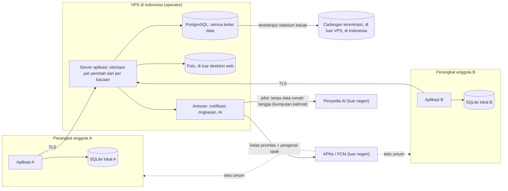

# 10.1 — Model ancaman, kontrol akses, autentikasi, dan pengelola server

Bagian dari [10-security-privacy.md](../10-security-privacy.md). Pengenal, label, dan cara membaca: indeks §0. Persyaratan di berkas ini bernomor SEC-01 sampai SEC-39.

Daftar isi: [1. Aset](#1-aset) · [2. Pelaku](#2-pelaku) · [3. Batas kepercayaan](#3-batas-kepercayaan) · [4. Ancaman](#4-ancaman) · [5. Kontrol akses dan isolasi](#5-kontrol-akses-dan-isolasi-rumah-tangga) · [6. Siapa `adults`](#6-siapa-yang-termasuk-adults-p-38) · [7. Pengukuhan V dan AT](#7-pengukuhan-v-1-sampai-v-9-dan-at-3-sampai-at-7) · [8. Autentikasi dan sesi](#8-autentikasi-sesi-perangkat-dan-kunci-aplikasi) · [9. Pemulihan akun](#9-pemulihan-akun) · [10. Undangan](#10-keamanan-undangan-a-33-sp-65) · [11. Pengelola server](#11-pengelola-server-sp-42-sp-63-keputusan-25)

---

## 1. Aset

| ID | Aset | Kelas data (10.2 §1) | Siapa yang boleh membaca di aplikasi | Rujukan |
|---|---|---|---|---|
| AS-01 | Inti moneter buku rumah tangga (jumlah, tanggal, kategori, tempat uang, pelaku internal) | Keuangan | Semua anggota dewasa penuh (`adults`) | 07 §8.2; 06 V-1 |
| AS-02 | Rincian entri (catatan teks, foto struk, lampiran) | Keuangan; dapat memuat data anak dan pihak luar | Mengikuti entrinya; tidak oleh anggota yang bergabung sesudah penulisnya keluar | 06 V-1, SP-49 |
| AS-03 | Buku pribadi, tempat uang pribadi, isi dompet campuran (`C`) | Keuangan pribadi | Hanya pemiliknya, kecuali tempat uang yang ia bagikan; `C` tidak pernah | 06 V-4, V-9 |
| AS-04 | Catatan alur: permintaan, tanggapan, keberatan, kesepakatan, diskusi objek | Keuangan; teks bebas | Pihak-pihaknya (06 §9.2) | 06 §2.5 |
| AS-05 | Status suasana hati, laporan sakit, tindak lanjutnya (`CARE`, Tier 2) | Kesehatan (diperlakukan spesifik) | Pemiliknya; penerima pilihannya bila dibagikan | 06 §13.5; brief §5K |
| AS-06 | Isi chat rumah tangga: teks, foto, kartu | Pesan pribadi; dapat memuat semua kelas lain | Peserta percakapan | 06 §16 |
| AS-07 | Tanda terkirim dan dibaca, kehadiran (online, terakhir aktif, mengetik) | Metadata perilaku | Peserta chat, hanya di layar chat | 06 §16.5, §16.6 |
| AS-08 | Setelan pribadi: jam tenang, tunda, setelan `AI`, kunci aplikasi, corak, sebutan anggota yang dibuatnya (F-FAM-021, Tier 2). Nuansa religi bukan setelan pribadi: data rumah tangga, satu pilihan (Netral bawaan, atau satu dari enam agama), diubah hanya dengan persetujuan semua pihak yang diperlukan, terbaca semua anggota dewasa (keputusan 62, 64, 66; 08 §5.2) | Metadata perilaku; nuansa religi peka | Hanya pemiliknya; nuansa religi: `adults` | 06 INV-A42, INV-A33; FR-AI-005 |
| AS-09 | Kredensial, token sesi, token perangkat push, kode pemulihan | Rahasia autentikasi | Tidak seorang pun (hash atau penyimpanan aman) | `ENGINEERING-STANDARDS.md` §4 |
| AS-10 | Data tentang anak di catatan orang dewasa | Data anak (spesifik) | Mengikuti catatan tempatnya | 17 Q-186; 18 §2.9 |
| AS-11 | Data pihak luar (ibu, ayah, saudara) | Data orang yang bukan pengguna | `adults` | FR-FAM-018; L-03, L-17 |
| AS-12 | Salinan cadangan, ekspor, cache perangkat | Semua kelas | Pemilik ekspor; operator (cadangan) | 10.3 §3 |
| AS-13 | Muatan ke penyedia `AI` dan kumpulan kalimat | Bergantung fitur | Penyedia `AI` (prosesor) | 10.4 §1 |
| AS-14 | Pengakuan pemberitahuan pengelola server (tanggal, versi) | Bukti persetujuan | Pemiliknya | FR-FAM-019 |

## 2. Pelaku

Brief §8 meminta dua jenis lawan: orang luar, dan anggota keluarga yang memakai aplikasi untuk mengendalikan atau mengawasi anggota lain. Keduanya diperlakukan setara.

| ID | Pelaku | Kemampuan yang diandaikan | Catatan |
|---|---|---|---|
| PL-01 | Penyerang dari internet | Menebak kata sandi, memakai kredensial bocor dari layanan lain, memanggil API langsung, memindai server | Tidak punya akun di rumah tangga |
| PL-02 | **Anggota dewasa sebagai lawan** | Punya akun sah dan aplikasi asli atau yang dimodifikasi; membaca semua yang memang terbaca olehnya; mencatat sendiri apa yang ia lihat (tangkapan layar, mencatat waktu online pasangan); menekan pasangan secara langsung di luar aplikasi | Lawan utama penyalahgunaan. "Tidak ada riwayat" di server tidak mencegah ia mencatat sendiri; yang dapat dicegah adalah apa yang ia terima |
| PL-03 | Orang yang memegang ponsel yang tidak terkunci | Anak 12 tahun ke atas, kerabat, pasangan; sidik jari atau wajahnya mungkin terdaftar di ponsel itu | Biometrik perangkat menerima siapa pun yang terdaftar, bukan hanya pemilik akun, dan tidak memberi tahu aplikasi siapa yang cocok (**[Terverifikasi]** dokumentasi Apple dan Android, 18 §2.12.2) |
| PL-04 | Penemu atau pencuri perangkat | Perangkat terkunci atau tidak; waktu tak terbatas | — |
| PL-05 | **Pengelola server (operator)** | Akses root ke VPS dan basis data, kunci cadangan, log | **Pilot: pemilik produk, yang juga anggota rumah tangga** (keputusan 25, S2-10 "a"). Tahap publik: operator bukan anggota |
| PL-06 | Penyedia: VPS, penyimpanan cadangan, APNs, FCM, penyedia `AI` | Membaca yang diproses atau disimpan di infrastrukturnya sejauh ketentuannya | Prosesor menurut UU PDP Pasal 51 (18 §2.1) |
| PL-07 | Penerima undangan yang salah | Memegang tautan undangan yang diteruskan | — |
| PL-08 | Mantan anggota | Pernah punya akses; mungkin menyimpan cache, ekspor, atau sesi lama | — |
| PL-09 | Rumah tangga lain di server yang sama (tahap publik) | Akun sah di rumah tangganya sendiri | Isolasi rumah tangga. Juga: anggota rumah tangga lain yang sekaligus anggota rumah tangga ini (SEC-38) |
| PL-10 | Aparat atau instansi yang meminta data | Permintaan resmi kepada operator atau penyedia | Bunyi kewajibannya menurut Permenkominfo 5/2020 Pasal 21 sampai 44: 10.4 §3.4; penerapannya pertanyaan advokat (L-14, L-38) |

## 3. Batas kepercayaan

Garis ke APNs, FCM, dan penyedia `AI` adalah titik transfer lintas batas yang mungkin (18 §2.8). Batas yang paling lemah pada pilot adalah VPS: operator ada di dalamnya dan juga anggota (§11). Diagram ini untuk aplikasi native; klien web (klien pertama sejak keputusan web lebih dulu) menambah tiga batas: kode yang dimuat dari server, profil browser tanpa proteksi berkas OS, dan layanan push browser (10.5 §1).

## 4. Ancaman

Kolom "Kontrol" menunjuk persyaratan dokumen ini atau aturan 06 dan 07. "Sisa" adalah risiko yang diterima dan dinyatakan.

| ID | Pelaku | Ancaman | Aset | Kontrol | Sisa |
|---|---|---|---|---|---|
| TM-01 | PL-01 | Menebak kata sandi, credential stuffing | AS-09 | SEC-11, SEC-12 | Kata sandi lemah yang lolos daftar blokir |
| TM-02 | PL-01, PL-09 | Membaca objek rumah tangga lain dengan mengganti pengenal (IDOR) | Semua | SEC-01 sampai SEC-05 | — |
| TM-03 | PL-01 | Menyadap lalu lintas | Semua | SEC-40 | — |
| TM-04 | PL-01 | Menguasai VPS, membuang isi basis data | Semua | SEC-41, SEC-42, SEC-45; pemutakhiran (dokumen 09) | Seluruh data terbuka bila VPS dikuasai; tanpa E2EE (10.2 §4) |
| TM-05 | PL-06 | Salinan cadangan bocor dari penyimpanan | AS-12 | SEC-43 | Kunci cadangan dipegang operator |
| TM-06 | PL-02 | Membaca data pribadi pasangan lewat API atau aplikasi yang dimodifikasi | AS-03, AS-05, AS-08 | SEC-01, SEC-06; 06 V-4, V-5 | — |
| TM-07 | PL-02 | Menyimpulkan data pribadi lewat saluran samping: celah kursor sinkron, waktu di pengenal, beda pesan galat, hitungan, jumlah dompet campuran | AS-03, AS-08 | SEC-03, SEC-04, SEC-07; 06 V-9; 07 §5.3 | Kebocoran B1 sampai B6 di 07 §5.3, dinyatakan di layar |
| TM-08 | PL-02 | Mengawasi perilaku pasangan lewat kehadiran, tanda dibaca, waktu notifikasi | AS-07 | 10.2 §6; 06 INV-A45, INV-A33 | Kehadiran seperti WhatsApp, dipertahankan pemilik produk (10-A A dan UX-5 A); risiko 10.2 §6.2 diterima (W-18) |
| TM-09 | PL-02 | Menekan pasangan: memaksa menyetujui, berbagi, membuka ponsel, tidak keluar | Semua | 10.3 §2; 06 PG-01 sampai PG-14 | Tekanan di luar aplikasi tidak dapat dicegah aplikasi |
| TM-10 | PL-02, PL-03 | Memakai ponsel pasangan yang terbuka untuk bertindak atas namanya: keluar, membagikan, mengekspor, menyetujui | Semua | SEC-13, SEC-14, SEC-19 | Persetujuan dan pencatatan dari ponsel yang terbuka tidak dapat dibedakan dari pemiliknya |
| TM-11 | PL-02 | Mengambil alih akun pasangan lewat email yang ia kuasai | AS-09 | SEC-17, SEC-24, SEC-25, SEC-18 | Tanpa faktor kedua, penguasa email dapat mengatur ulang kata sandi; pemiliknya mengetahuinya (SEC-17, SEC-24). Penutupnya SEC-18 dengan SEC-25 sebagai pasangan pilihan per akun di FS-2 (keputusan 54); sampai FS-2, dan bagi akun yang tidak menyalakannya, sisa ini tetap |
| TM-12 | PL-05 | Operator yang juga anggota membuka data pribadi pasangan dari basis data | AS-03, AS-05, AS-06, AS-08 | §11; SEC-33, SEC-34; 10-D A, 10-F A | **Diterima untuk pilot** dengan syarat keputusan 25 |
| TM-13 | PL-05, PL-02 | Fitur "admin" di aplikasi yang membuka data orang lain | Semua | SEC-33; 06 V-5, PG-03 | — |
| TM-14 | PL-04 | Membaca basis data lokal atau memakai sesi di perangkat yang hilang | AS-03 sampai AS-08 | SEC-15, SEC-19, SEC-21, SEC-46, SEC-47 | Perangkat yang diambil dalam keadaan terbuka |
| TM-15 | PL-03 | Anak di ponsel orang tua membaca chat, uang, status pasangan | AS-05, AS-06 | SEC-19, SEC-50 sampai SEC-53 | Tanpa kunci aplikasi, ponsel yang terbuka memperlihatkan semuanya |
| TM-16 | PL-07 | Tautan undangan diteruskan ke orang yang salah | AS-01 | SEC-28 sampai SEC-31; 06 F04 | — |
| TM-17 | PL-08 | Mantan anggota tetap membaca lewat sesi lama atau cache | Semua | SEC-23, SEC-48; 06 INV-A48 (c) | Yang sudah ia simpan sendiri sebelum keluar |
| TM-18 | PL-06 | Isi notifikasi terbaca di infrastruktur push | AS-05, AS-06 | SEC-50, SEC-51 | Token perangkat dan waktu kirim tetap lewat Apple dan Google (L-16) |
| TM-19 | PL-06 | Penyedia `AI` menyimpan, melatih, atau membocorkan muatan | AS-13 | 10.4 §1; SEC-120 sampai SEC-128 | Pada jalur kumpulan kalimat tidak ada data rumah tangga yang keluar |
| TM-20 | PL-02 lewat `AI` | Keluaran `AI` membocorkan kepada satu orang apa yang ditutup orang lain | AS-03, AS-05 | SEC-124, SEC-129; brief §5O | — |
| TM-21 | `AI` | Keluaran `AI` mendiagnosis, menyuruh mengawasi, menekan, membandingkan | AS-05 | SEC-130 sampai SEC-134 | — |
| TM-22 | PL-09 | Kebocoran lintas rumah tangga lewat constraint, pesan galat, cache, konteks `AI`, atau orang yang menjadi anggota dua rumah tangga | Semua | SEC-02, SEC-05, SEC-38; FR-FAM-020 | — |
| TM-23 | Semua | Penghapusan tidak tuntas: cadangan, cache, ekspor, perangkat | AS-12 | SEC-95 sampai SEC-99 | Ekspor yang sudah diunduh pemiliknya |
| TM-24 | PL-10 | Permintaan data oleh aparat | Semua | Minimisasi; SEC-39 (d) rekam jejak; L-14, L-38 | Bunyi naskah 2020 dibaca (10.4 §3.4); penerapannya dan perubahan sesudah 2020 belum diketahui |
| TM-31 | PL-02, PL-05 | Menghapus atau mengubah jejak: siapa menyetujui apa, siapa masuk dari perangkat mana, siapa membuka basis data | AS-01, AS-04, AS-09 | SEC-39; SEC-108; SEC-37 (pilot), SEC-36 (publik) | Pada pilot operator dapat mengubah basis data langsung (§11) |
| TM-25 | PL-02, PL-06 | Metadata foto membuka lokasi atau perangkat | AS-02, AS-06 | SEC-66 | — |
| TM-26 | PL-03 | Layar kunci atau layar luar perangkat lipat membuka isi | AS-05, AS-06 | SEC-50 sampai SEC-55 | — |
| TM-27 | PL-05, PL-06 | Log memuat jumlah, kesehatan, teks pesan, atau identitas | Semua | SEC-44 | — |
| TM-28 | PL-02 | Permintaan, pengingat, atau keberatan dipakai untuk melecehkan | AS-04 | 06 §10 (batas pengingat), §8.2 (alasan tertutup) | — |
| TM-29 | PL-02 | Hitungan oleh bukan pemegang dipakai untuk menuduh "uangmu kurang" | AS-01 | 07 T-33, INV-33 (SP-50); SEC-91 | — |
| TM-30 | PL-02 | Menautkan entri ke pos rutin yang tidak sejenis agar lolos dari tanda | AS-01 | SEC-92 (SP-44) | — |
| TM-32 sampai TM-36 | PL-02, PL-03, PL-05 | Sebutan anggota per pembaca (F-FAM-021): terbaca lewat layar pembuat, ditukar untuk menyesatkan pilihan penerima, dibaca operator, dipakai sebagai catatan pengawasan, keberadaannya tersimpulkan | AS-08 | SEC-155; rincian 10.4 §6.2 | Layar pembuat yang terbuka; operator pada pilot |
| TM-37 sampai TM-45 | PL-01, PL-03, PL-04, PL-05, PL-06, PL-08 | Yang ditambahkan browser pada klien web: XSS, dependensi npm yang disusupi, permintaan lintas situs, perangkat bersama, browser dicabut yang tak dibuka lagi, kode web yang diubah pengelola per akun, SSRF lewat endpoint push, kehilangan antrean karena browser, service worker versi lama | Semua | SEC-160 sampai SEC-179; rincian 10.5 §1 | Data di profil browser tanpa proteksi berkas OS; kode web dari server |

---

## 5. Kontrol akses dan isolasi rumah tangga

Aturan siapa melihat apa kanonis di 06 §9 dan 07 §5.3. Bagian ini menetapkan cara menegakkannya sehingga dapat diuji.

| ID | Persyaratan | Untuk | Tahap | Label | Cara menguji |
|---|---|---|---|---|---|
| SEC-01 | Setiap perintah dan setiap bacaan diotorisasi di server dari keanggotaan, peran, dan himpunan penerima saat itu, bukan dari yang dikirim klien. Klien tidak pernah menerima data yang tidak boleh ia tampilkan untuk "disembunyikan di layar" | 09 | Pilot | `ENGINEERING-STANDARDS.md` §4; **[Usulan]** | Untuk setiap jenis objek dan tingkat visibilitas: panggil API sebagai setiap peran; tanggapan tidak memuat medan yang tidak boleh dibaca, juga sebagai `null` yang membedakan "ada tapi tertutup" dari "tidak ada" |
| SEC-02 | Setiap baris membawa `household_id`; setiap indeks unik dan foreign key atas data rumah tangga diawali `household_id`, sehingga pelanggaran constraint tidak membuka keberadaan baris rumah tangga lain (18 §5.5 butir 4). Pesan galat constraint tidak diteruskan ke klien | 09 | Pilot | **[Usulan]** | Uji FR-FAM-020/AC-1 diperluas: kirim pengenal, kunci idempotency, dan nilai unik yang sudah dipakai rumah tangga lain; tanggapan identik dengan nilai yang belum pernah dipakai |
| SEC-03 | Pengenal objek yang terbaca anggota lain **tidak menyandikan waktu** (bukan UUIDv7, ULID, atau snowflake bercap waktu) dan tidak berurutan. Alasannya AT-6: jam pencatatan entri disimpan tetapi tidak boleh terbaca, dan pengenal bercap waktu membukanya | 09 | Pilot | **[Usulan]** | Pengenal yang keluar ke klien acak minimal 122 bit; dua entri yang dicatat berurutan tidak dapat diurutkan dari pengenalnya |
| SEC-04 | **Urutan sinkron tidak membocorkan keberadaan entri pribadi** (SP-40 c). Kursor yang diterima seorang anggota hanya bergerak untuk perubahan yang terbaca olehnya, atau opak sehingga celah tidak dapat dihitung. Bagi `seq` chat, satu-satunya celah yang terbaca adalah `seq` kartu status yang hilang (06 INV-A47 (d)) | 09 | Pilot | **[Usulan]** | Seorang anggota dewasa mencatat 0, 1, dan 5 entri pribadi di antara dua entri dana bersama: urutan kursor yang diterima anggota lain identik byte demi byte di ketiga keadaan |
| SEC-05 | Tanggapan "tidak ada" dan "tidak boleh" identik (kode, isi, dan waktu tanggapan dalam batas wajar) untuk objek rumah tangga lain dan objek pribadi anggota lain | 09 | Pilot | `ENGINEERING-STANDARDS.md` §4; FR-FAM-020/AC-1 | Akses entri pribadi anggota dewasa lain dan pengenal acak: tanggapan sama |
| SEC-06 | Hitungan, ringkasan, laporan, ekspor, notifikasi, dan fitur `AI` membaca data lewat fungsi otorisasi yang sama dengan layar; tidak ada jalur baca kedua yang melewati visibilitas | 09 | Pilot | **[Usulan]** | Pemeriksaan statis atas setiap kueri baca; uji: data pribadi anggota dewasa lain tidak muncul di ringkasan, ekspor, atau muatan `AI` |
| SEC-07 | Tidak ada medan tanggapan, Peristiwa, atau notifikasi yang memuat hitungan per orang yang dilarang 06 AT-4, juga sebagai angka tersirat (misalnya "3 entri bertanda" di ringkasan) | 09, 08 | Pilot | 06 AT-4, SP-43 (b) | Uji AT-4 (06 §9.4) |
| SEC-08 | **Row-level security PostgreSQL sebagai lapis kedua**: peran basis data aplikasi bukan pemilik tabel, bukan superuser, tanpa `BYPASSRLS`; tabel ber-`FORCE ROW LEVEL SECURITY`; policy per `household_id` (18 §5.5 butir 4). Tidak menggantikan SEC-01 | 09 | **Pilot** (ADR-016 butir 3, diterima lewat D-99; 09 berkas 02 §3 butir 4) | **[Usulan]**; ADR-016 | Di lingkungan uji, matikan pemeriksaan otorisasi di kode: uji isolasi tetap tidak membaca baris rumah tangga lain |
| SEC-09 | Peran basis data aplikasi tidak pernah superuser, juga di pilot; migrasi memakai peran terpisah | 09 | Pilot | **[Usulan]** | Pemeriksaan konfigurasi |
| SEC-38 | **Satu orang di beberapa rumah tangga** (brief §8 "multi-household access control"; berpindah rumah tangga dirancang sekarang, dibangun Tier 3, 08 §4.4). (a) Setiap perintah dan bacaan berlaku dalam satu rumah tangga; `household_id` dalam permintaan hanya pemilih yang diperiksa terhadap keanggotaan aktif akun sesi itu, tidak pernah sumber wewenang. (b) Tidak ada jalur baca, hitungan, ringkasan, notifikasi, ekspor, kumpulan atau pilihan `AI`, atau pencarian yang menggabungkan data dua rumah tangga, termasuk data milik orang yang sama; buku pribadi, tempat uang pribadi, `CARE`, berbagi, dan izin `AI` berlaku per (akun, rumah tangga). (c) Anggota rumah tangga X tidak dapat mengetahui bahwa seseorang juga anggota rumah tangga Y: tidak ada tampilan, galat, waktu tanggapan, atau tanggapan undangan yang membedakannya (SEC-05, SEC-30). (d) Setelan akun yang berlaku lintas rumah tangga (jam tenang, zona waktu pribadi, kunci aplikasi) tetap hanya terbaca pemiliknya. (e) F06 di X hanya mengakhiri keanggotaan di X; sesi dan keanggotaan di Y tidak berubah (SEC-23). (f) Basis data perangkat dipisah per rumah tangga, dan berpindah rumah tangga di layar tidak menampilkan data rumah tangga sebelumnya. (g) Teks layar kunci tidak menyebut rumah tangga (SEC-51) | 09, 08 | Pilot: (a), (b), (e), (g); Tier 3 untuk sisanya bila keanggotaan ganda dibangun, dirancang sekarang | **[Usulan]** | Akun A anggota X dan Y: untuk setiap API, kirim pengenal objek X dengan pemilih Y: tanggapan identik dengan "tidak ada"; muatan `AI`, ringkasan, dan ekspor untuk X tidak memuat satu baris pun dari Y; anggota X mengundang A: tanggapan sama dengan mengundang akun tanpa rumah tangga |
| SEC-39 | **Jejak audit sebagai kontrol keamanan** (brief §8 "audit trails"). Dua jejak, keduanya hanya-menambah bagi peran basis data aplikasi (tanpa `UPDATE` atau `DELETE`; penghapusan hanya lewat pekerjaan retensi dan jalur ADR-007): (a) **Peristiwa alur dan uang** (06 §2.5; 07): siapa mencatat, menyetujui, menolak, berkeberatan, mengoreksi, kapan menurut waktu server; terbaca menurut visibilitas objeknya; tidak pernah dipakai untuk hitungan atau tren per orang (06 AT-3, AT-4). (b) **Jejak keamanan per akun**: masuk, perangkat baru, pemulihan, ganti kata sandi atau email, autentikasi ulang dan untuk tindakan apa, sesi dicabut, ekspor dibuat dan diunduh, hapus akun dimulai, perubahan kunci aplikasi; **hanya terbaca pemilik akun** (SEC-16), tidak pernah anggota lain; tanpa isi peka (SEC-44); disimpan 90 hari **[Asumsi]**. Persetujuan berbagi dan pencabutannya dicatat sebagai catatan persetujuan milik pemiliknya (SEC-109), tidak sebagai Peristiwa yang terbaca penerima (06 V-7). (c) **Tindakan operator**: pilot, catatan operasi (SEC-37); publik, log akses darurat yang tidak dapat diubah operator yang sama (SEC-36). (d) **Akses oleh Kementerian, Lembaga, atau aparat** atas data: dicatat dengan dasar permintaan, data yang diberikan, dan tanggal (Permenkominfo 5/2020 Pasal 43, 44; 10.4 §3.4) | 09, Ops | Pilot: (a), (b), (c) pilot; sebelum GR-4: (c) publik (indeks §4.2); Publik: (d) | **[Usulan]**; brief §8 | Sebagai peran aplikasi, `UPDATE` dan `DELETE` atas tabel Peristiwa dan jejak keamanan ditolak; B memanggil setiap API jejak keamanan dengan pengenal A: ditolak seperti SEC-05; masuk dari perangkat baru menulis satu baris di jejak A dan tidak ada apa pun yang terbaca B |

## 6. Siapa yang termasuk `adults` (P-38)

**Dikukuhkan, dengan lima syarat.** Tabel 06 §9.1 benar: keanggotaan `aktif`, bukan tanggungan, berperan ikut memiliki dana bersama (pilot: peran pemilik rumah tangga). Ditentukan peran, bukan umur, hubungan, atau jenis kelamin (06 INV-A51; PG-01). **[Usulan]** `security-privacy`.

Masuknya seseorang ke `adults` membuka seluruh buku rumah tangga kepadanya, sejak awal (06 §3.5). Karena itu (syarat 1 sampai 3), dan untuk dua butir [Dok. 10] yang bergantung padanya (syarat 4 dan 5):

1. **Tidak ada jalan masuk otomatis.** Tidak ada transisi berdasar waktu, umur, atau perubahan data lain yang menjadikan seseorang anggota dewasa penuh. Anak yang berumur 18 tahun tidak menjadi `adults` dengan sendirinya (10.4 §4.4).
2. **Memberi peran yang ikut memiliki dana bersama** kepada anggota yang sudah ada (tahap publik: anak dewasa, saudara) adalah perluasan visibilitas atas data semua anggota dewasa penuh. Ia memerlukan kesepakatan dengan **semua** pihak yang disyaratkan, bukan mayoritas, apa pun `agreement_mode` (06 PG-14), ditambah penerimaan orang itu sendiri, dan melahirkan N-22 kepada setiap orang yang datanya menjadi lebih terlihat (06 V-6).
3. **Himpunan penerima persetujuan berbagi tidak ikut bertambah** saat seseorang masuk `adults` (06 INV-A50). Masuk `adults` membuka data dana bersama, bukan status kepedulian atau tempat uang pribadi siapa pun.
4. **Penerima berbagi hanya anggota dewasa penuh** (menjawab daftar [Dok. 10] di 06 §9.4 dan §13.5 "penerima selain anggota dewasa penuh"). Status kepedulian, tempat uang pribadi, dan `others_may_count` tidak dapat dibagikan kepada tanggungan, pekerja rumah tangga, tamu, atau peran terbatas. Memperluasnya di tahap publik memerlukan penilaian dokumen ini lebih dulu; kepada tanggungan tidak pernah.
5. **`account.time_zone` tidak terbaca anggota lain** (bawaan 06 dikukuhkan): zona waktu pribadi membuka di mana seseorang berada.

Anggota dalam `keluar_tenggang` tidak membaca apa pun (06 F06) tetapi masih terhitung `member(M)` untuk aturan uang sampai F07 (07 §8.2 butir 2b). Keduanya konsisten dan dikukuhkan: yang dihitung untuk tanda bukan pembaca.

| ID | Persyaratan | Untuk | Tahap | Label | Cara menguji |
|---|---|---|---|---|---|
| SEC-10 | `full_adult_members` satu fungsi server untuk visibilitas, pihak kesepakatan, dan pilihan awal penerima berbagi; tidak ada salinan logikanya di klien; pemberian peran pemilik kepada anggota yang sudah ada memakai kesepakatan `all` dan penerimaan orang itu (syarat 2) | 09 | Pilot (fungsi); Publik (pemberian peran) | 06 INV-A51; **[Usulan]** | Uji INV-A51; usulan peran dengan `agreement_mode = majority` tetap meminta semua pihak |

## 7. Pengukuhan V-1 sampai V-9 dan AT-3 sampai AT-7

06 §9.4 meminta dokumen ini mengukuhkan larangan visibilitas dan keterangan pelaku.

| Aturan 06 | Hasil | Tambahan dokumen 10 |
|---|---|---|
| V-1 (dana bersama tidak dapat `private`; batas SP-49) | Dikukuhkan | — |
| V-2, V-3 | Dikukuhkan | — |
| V-4, V-5 | Dikukuhkan **sebagai aturan peran di aplikasi**; tidak melindungi dari operator (§11) | SEC-33 |
| V-6, V-7 (perluasan diberitahukan, penyempitan senyap; himpunan penerima) | Dikukuhkan | SEC-48: perangkat yang kehilangan akses membuang salinannya pada sinkron berikutnya |
| V-8 | Dikukuhkan | — |
| V-9 (isi dompet campuran) | Dikukuhkan; bukan perlindungan terhadap operator, dan layar tidak boleh menyiratkannya | FR-FAM-019/AC-5 |
| AT-3 (tanpa umpan per orang) | Dikukuhkan | — |
| AT-4 (tanpa hitungan per orang) | Dikukuhkan, termasuk rincian SP-20, SP-25, SP-31, SP-35, SP-38, SP-43 (b), dan chat | SEC-07; ekspor SEC-104 |
| AT-5 (tanda dan kehadiran hanya di chat) | Dikukuhkan. Bentuk kehadiran: P0 dengan terakhir aktif menit tepat (10-A A, UX-5 A) | 10.2 §6 |
| AT-6 (tanpa lokasi; jam pencatatan tidak tampil) | Dikukuhkan | SEC-03, SEC-64, SEC-66 |
| AT-7 (laporan "siapa membayar apa") | **Cukup, dengan dua tambahan**: (a) tidak ada laporan, penyaring, ekspor, atau keluaran `AI` yang mengelompokkan jumlah menurut "sisi keluarga", dan medan hubungan pihak luar hanya label tampilan, tidak pernah kunci pengelompokan (IDEA-07); (b) tabel C 07 §6.3 tidak pernah dikirim ke penyedia `AI` dan narasi bulanan tidak menyebut siapa membayar | SEC-93, SEC-129 |

**Visibilitas Peristiwa bagi anggota yang keluar.** Sejak F06 yang keluar tidak membaca Peristiwa apa pun di aplikasi. Ekspornya memuat entri buku rumah tangga dan tautannya per saat F06 (07 §8.2 butir 1a) dan Peristiwa alur atas objek yang ia menjadi pihaknya sampai saat itu; tidak ada Peristiwa sesudah F06, termasuk `exit_closure` (FR-FAM-013/AC-6). Isi lengkap ekspor: 10.3 §3.3.

---

## 8. Autentikasi, sesi, perangkat, dan kunci aplikasi

**Asas.** Biometrik perangkat menjawab "seseorang yang terdaftar di ponsel ini", bukan "pemilik akun". Di rumah tangga, sidik jari pasangan sering terdaftar di ponsel yang sama **[Asumsi]**. Karena itu biometrik hanya membuka aplikasi; tindakan yang tidak dapat ditarik, atau yang membawa data keluar dari aplikasi, memerlukan **kredensial akun**.

| ID | Persyaratan | Untuk | Tahap | Label | Cara menguji |
|---|---|---|---|---|---|
| SEC-11 | Akun memakai email terverifikasi dan kata sandi minimal 12 karakter, tanpa aturan komposisi, ditolak bila ada di daftar kata sandi umum atau bocor yang disimpan di server. Disimpan dengan fungsi hash kata sandi yang lambat dan bergaram (Argon2id). Parameter 09 berkas 04 §2 diterima: t = 3, p = 4, m = 64 MiB, garam 128 bit, tag 256 bit (opsi kedua RFC 9106 §4), parameter disimpan bersama hash agar dapat dinaikkan, dan semafor hash serentak dilindungi batas laju SEC-12 agar tidak menjadi jalan penolakan layanan. Passkey sebagai pilihan: tahap publik | 09 | Pilot | **[Usulan]** | Kata sandi 11 karakter dan kata sandi di daftar ditolak; basis data tidak memuat kata sandi atau hash tak bergaram |
| SEC-12 | Batas laju dan penundaan bertahap per akun dan per alamat jaringan pada masuk, pemulihan, autentikasi ulang, dan pemakaian token undangan. Tanggapan gagal tidak membedakan "email tidak terdaftar" dari "kata sandi salah" | 09 | Pilot | **[Usulan]** | 20 percobaan salah berturut-turut: berikutnya ditunda; tanggapan untuk email terdaftar dan tidak terdaftar identik |
| SEC-13 | **Autentikasi ulang dengan kredensial akun** (bukan sesi terbuka, bukan biometrik saja) untuk: F06 keluar, F08 batal keluar, ekspor sesudah keluar, hapus akun, ganti kata sandi atau email, mencabut sesi lain, melihat atau membuat ulang kode pemulihan, mematikan kunci aplikasi. Berlaku untuk satu tindakan dalam 5 menit **[Asumsi]** | 09, 08 | Pilot | FR-FAM-012/AC-13 untuk F06; **[Usulan]** untuk sisanya | Tiap tindakan tanpa autentikasi ulang ditolak tanpa akibat (06 INV-A48 (a)); autentikasi ulang berumur 6 menit ditolak |
| SEC-14 | Biometrik hanya membuka kunci aplikasi di perangkat; tidak pernah dikirim ke server dan tidak pernah menjadi kredensial akun. Saat menyalakan kunci biometrik, layar menyatakan bahwa sidik jari atau wajah siapa pun yang terdaftar di ponsel itu dapat membukanya | 09, 08 | Pilot | **[Usulan]** | Tidak ada data biometrik di jaringan atau basis data; kata layar ditinjau |
| SEC-15 | Sesi per perangkat: token akses berumur pendek (15 menit **[Asumsi]**); token penyegar diputar setiap dipakai, dengan deteksi pemakaian ulang yang mencabut seluruh rantai sesi itu. Token disimpan di Keychain (iOS) atau Keystore (Android) dengan kelas "hanya perangkat ini", tidak ikut cadangan atau sinkron awan. Klien web: sesi dalam cookie `__Host-` `HttpOnly` dengan rotasi dan deteksi pemakaian ulang yang setara (10.5 SEC-161) | 09 | Pilot; bagian Keychain dan Keystore saat aplikasi native dibangun (indeks §4.3, §4.4) | **[Usulan]** | Pakai token penyegar lama sekali lagi: sesi dicabut; pulihkan cadangan perangkat ke perangkat lain: tidak ada sesi yang ikut |
| SEC-16 | Daftar sesi dan perangkat hanya terbaca pemilik akun (model perangkat, tanggal masuk, terakhir dipakai), dengan cabut per sesi. Tidak seorang pun anggota rumah tangga dapat melihat perangkat, sesi, atau waktu masuk anggota lain | 09, 08 | Pilot | 06 PG-03; **[Usulan]** | Sebagai B, panggil setiap API sesi dengan pengenal A: ditolak seperti SEC-05 |
| SEC-17 | Masuk dari perangkat baru, pemulihan akun, dan ganti kata sandi diberitahukan **kepada pemilik akun saja**: di semua sesinya yang lain dan lewat email akunnya; tidak pernah kepada anggota rumah tangga | 09 | Pilot | **[Usulan]** | Masuk di perangkat ketiga: pemberitahuan tampil di perangkat pertama A dan di email A; B tidak menerima apa pun |
| SEC-18 | Faktor kedua **TOTP** tersedia sebagai pilihan per akun (ketetapan lead: di FS-2 TOTP saja; passkey tetap pilihan tahap publik, SEC-11). Kunci teks TOTP di langkah pasang (LY-88 langkah 3) adalah rahasia setara kode pemulihan: tombol salinnya memakai papan klip yang hanya lokal, kedaluwarsa sendiri, dan bertanda sensitif bila platform menyediakannya (aturan yang sama dengan SEC-25; dikukuhkan), dan kunci itu tidak pernah masuk log (SEC-44). Bila pemilik akun menyalakannya, **pemulihan lewat email (SEC-24) tidak melewatinya**: sesudah kata sandi baru dipasang, masuk tetap meminta faktor kedua atau satu kode pemulihan (SEC-25). Karena itu SEC-18 dan SEC-25 dibangun dan dinyalakan berpasangan: menyalakan faktor kedua sekaligus membuat kode pemulihan (SEC-25), dan faktor kedua tanpa kode pemulihan membuat pemilik akun terkunci bila perangkatnya hilang. **Mematikan faktor kedua atau membuat ulang kode pemulihan** memerlukan kredensial akun **dan** faktor kedua atau satu kode pemulihan (FR-FAM-026/AC-4, dikukuhkan). Bila cukup kredensial akun, orang yang menguasai email dapat mengatur ulang kata sandi lalu mematikan pengaman ini, sehingga TM-11 terbuka lagi. **Tidak ada jalan bagi orang lain** untuk mematikan faktor kedua sebuah akun: bukan anggota lain atau pengelola rumah tangga (SEC-27), bukan operator server (SEC-26). Pemilik yang kehilangan perangkat faktor kedua **dan** semua kode pemulihan kehilangan akses ke akun itu. Layar saat menyalakan menyatakannya sebelum tombol nyalakan (asas 2), dan menawarkan menyimpan kode lebih dulu (LY-88). Kalimat "Rumah tangga tetap berjalan bagi anggota lain." hanya tampil bila ada anggota dewasa lain yang aktif, karena tanpa anggota itu kalimatnya tidak benar (FR-FAM-017). Ini harga yang disengaja: jalan pemulihan oleh pihak lain adalah jalan bagi anggota lain yang mengendalikan | 09, 08 | **FS-2**, sebagai satu pasangan pilihan per akun dengan SEC-25, tidak menahan GR-2 (keputusan 54: "Opsional, setelah dipakai harian (Saran)", diterima atas saran lead; indeks §3.3 butir 8); F-FAM-022, FR-FAM-026 | **[Usulan]**; TM-11; RISK-40 | Faktor kedua menyala: atur ulang kata sandi lewat email, lalu masuk tanpa faktor kedua: ditolak; dengan satu kode pemulihan: diterima dan kode itu gugur. Matikan faktor kedua atau buat ulang kode dengan kata sandi saja: ditolak; dengan kata sandi dan faktor kedua, atau kata sandi dan satu kode: diterima, dan satu baris di jejak keamanan pemilik (SEC-39 (b)). Tidak ada perintah operator, pengelola, atau anggota lain yang mematikan faktor kedua akun mana pun |
| SEC-19 | **Kunci aplikasi** tersedia bagi setiap anggota, **mati secara bawaan**, ditawarkan sekali saat memulai, diatur hanya pemiliknya; setelannya tidak terbaca anggota lain dan tidak menghasilkan Peristiwa atau notifikasi. Bila menyala, aplikasi terkunci saat dibuka dan sesudah di latar lebih dari 1 menit **[Asumsi]**. Bentuknya (sesuai 08 §12.3): (a) **kode aplikasi milik aplikasi sendiri, paling sedikit 6 digit** **[Asumsi]** angkanya, terpisah dari kata sandi akun dan dari kode ponsel; disimpan hanya di perangkat sebagai hash lambat bergaram atau dibungkus kunci Keychain/Keystore "hanya perangkat ini"; tidak pernah dikirim ke server; kode yang terlalu mudah (semua digit sama, berurutan) ditolak. (b) Biometrik hanya pilihan di atas kode, dan **gugur bila pendaftaran biometrik perangkat berubah** (iOS `biometryCurrentSet`; Android `setInvalidatedByBiometricEnrollment(true)`, 18 §2.12.2): sesudah sidik jari atau wajah baru didaftarkan, pembukaan biometrik tidak berlaku sampai pemiliknya memasukkan kode atau kredensial akun dan menyalakannya lagi. Ini menutup orang lain yang menambahkan sidik jarinya kemudian, tidak yang sudah terdaftar sebelumnya (kata layar SEC-14). (c) **Salah kode 5 kali berturut-turut** **[Asumsi]**: pembukaan dengan kode dan biometrik ditutup, dan aplikasi hanya terbuka dengan **kredensial akun** (autentikasi ulang SEC-13, yang tunduk pada batas laju SEC-12), lalu pemiliknya memasang kode baru. **Tidak ada penghapusan data karena salah kode**: penghapusan otomatis akan memberi siapa pun yang memegang ponsel cara membuang catatan yang belum terkirim milik orang lain. (d) Lupa kode: sama dengan (c). (e) Mematikan kunci aplikasi memerlukan kredensial akun (SEC-13). **Klien web**: kode saja, tanpa biometrik, dan kunci hanya menutup tampilan, tidak mengenkripsi data di browser (10.5 SEC-174) | 09, 08 | Pilot; (b) saat aplikasi native dibangun (indeks §4.3, §4.4) | **[Usulan]**; menjawab Q-186 (anak 12+ memegang ponsel orang tua); 18 §2.12.2 | Nyalakan, pindah ke latar 2 menit, buka: diminta kunci; sebagai B, tidak ada API atau tampilan yang mengungkap setelan A; daftarkan sidik jari baru di ponsel: biometrik tidak membuka kunci sampai kode dimasukkan; salah kode 5 kali: hanya kredensial akun yang diterima, basis data lokal utuh; lalu lintas jaringan saat memasang kode tidak memuat kode atau hash-nya |
| SEC-20 | Pratinjau aplikasi di pengalih aplikasi (app switcher, recents) selalu ditutup layar netral, menyala atau tidak kunci aplikasinya. Tangkapan layar tidak diblokir (orang menyimpan struk) | 09 | Pilot | **[Usulan]** | Buka chat, buka pengalih aplikasi: tidak ada isi yang tampil |
| SEC-21 | **Perangkat hilang**: pemilik mencabut sesi itu dari sesinya yang lain atau lewat pemulihan (SEC-24). Perangkat yang sesinya dicabut, saat menghubungi server lagi, menerima perintah menghapus basis data lokal, berkas, dan antrean yang belum terkirim, dan menghapusnya sebelum menampilkan apa pun. Catatan yang belum terkirim di perangkat itu hilang; layar cabut menyatakannya | 09, 08 | Pilot | FR-FAM-017/AC-3; **[Usulan]** | Cabut sesi perangkat X; sambungkan X: basis data lokal X kosong sebelum layar pertama; perintah lama dari X ditolak |
| SEC-22 | Tidak ada anggota yang dapat mencabut sesi, mengeluarkan perangkat, atau mengunci akun anggota lain, juga atas permintaan orang itu | 09 | Pilot | 06 PG-13, INV-A48 (a) | Perintah sesi atas akun lain ditolak |
| SEC-23 | F06 mencabut hak baca rumah tangga itu pada **semua** sesi orang yang keluar dalam transaksi yang sama; sinkron berikutnya dari tiap perangkatnya menghapus data rumah tangga itu dari perangkat. Yang tersisa hanya jalur ekspor (SEC-101) | 09 | Pilot | 06 F06, INV-A48 (c) | Keluar dari perangkat X; perangkat Y orang yang sama, saat tersambung, tidak lagi menyimpan data rumah tangga itu |

## 9. Pemulihan akun

Brief §8 "the admin losing access". Setiap anggota dewasa penuh adalah pemilik dengan wewenang identik, jadi kehilangan akses satu akun tidak menghentikan rumah tangga (FR-FAM-017). Yang dijaga di sini: **pemulihan tidak menjadi jalan mengambil alih akun anggota lain.**

| ID | Persyaratan | Untuk | Tahap | Label | Cara menguji |
|---|---|---|---|---|---|
| SEC-24 | Pemulihan lewat tautan sekali pakai ke email terverifikasi akun, berlaku 30 menit **[Asumsi]**. Sesudah kata sandi baru dipasang, semua sesi lain akun itu dicabut, dan pemilik membaca di perangkat barunya kapan dan dari perangkat apa pemulihan terjadi | 09 | Pilot | **[Usulan]** | Tautan dipakai dua kali: kedua ditolak; sesudah pemulihan, sesi lama tidak dapat menyegarkan token |
| SEC-25 | Kode pemulihan: 10 kode sekali pakai, **dibuat saat pemilik akun menyalakan faktor kedua** (SEC-18; keputusan 54), bukan saat mendaftar, dan ditampilkan sekali saja. Kode dapat dibuat ulang dengan kredensial akun **dan** faktor kedua atau satu kode yang masih berlaku (SEC-18; FR-FAM-026/AC-4); membuat ulang membatalkan semua kode lama. **Pemasangan bersifat tertunda sampai tombol nyalakan** (LY-88, 08 §12.5): rahasia TOTP dan kode yang sudah tampil tersimpan di server sebagai pemasangan tertunda, dan gugur bila dibatalkan, bila pemasangan baru dimulai, atau bila tidak dinyalakan dalam 15 menit **[Asumsi]** (aplikasi ditutup tanpa batal). Tangkapan layar di layar kode tidak diblokir (SEC-20) dan layar tidak menganjurkan atau melarang cara simpan; tombol "Salin" menaruh kode di papan klip yang **hanya lokal dan kedaluwarsa** sendiri, dengan tanda sensitif bila platform menyediakannya **[Perlu validasi]** di fase bangun. Peringatan "kode tinggal sedikit" tampil di LY-88 bila sisa 3 atau kurang **[Asumsi]**, hanya bagi pemilik, tanpa notifikasi push. Server menyimpan kode hanya sebagai hash (seperti SEC-11), dan kode tidak pernah masuk log (SEC-44). **Mengganti email akun**, bagi setiap akun, dengan atau tanpa faktor kedua, memerlukan autentikasi ulang dan konfirmasi ke email lama, yang juga diberi tahu | 09, 08 | **FS-2**, berpasangan dengan SEC-18, tidak menahan GR-2 (keputusan 54); F-FAM-022, FR-FAM-026. Bila pengguna luar pertama datang sebelum FS-2 selesai: sebelum pengguna luar pertama (indeks §4.2) | **[Usulan]**; TM-11; RISK-40 | Lihat SEC-18. Tambahan: kode yang ditampilkan saat menyalakan berjumlah 10 dan tidak dapat ditampilkan lagi; sesudah dibuat ulang, kode lama ditolak; basis data dan log uji tidak memuat kode dalam bentuk asli; ganti email tanpa konfirmasi ke email lama: ditolak; batal di langkah kode, atau tunggu lewat 15 menit tanpa menyalakan: masuk dengan kode yang tadi tampil ditolak dan faktor kedua tetap mati; sisa 3 kode: peringatan tampil di LY-88, tidak ada notifikasi ke siapa pun |
| SEC-26 | Operator tidak pernah memasang kata sandi untuk akun orang lain, tidak pernah meminta kata sandi, dan tidak punya jalan masuk sebagai anggota. Bantuan operator terbatas pada mengirim ulang tautan pemulihan ke email akun itu | Ops | Pilot | **[Usulan]** | Tinjauan runbook; tidak ada perintah operator yang menulis kredensial |
| SEC-27 | Tidak ada "pemulihan darurat" yang memberi anggota lain akses ke akun, data pribadi, atau wewenang orang yang kehilangan akses, juga bila orang itu tidak akan kembali (FR-FAM-017/AC-2). Anggota yang wafat: 10.3 §3.6 | 09, Ops | Pilot | 06 PG-02, PG-03 | FR-FAM-017/AC-2 |

**Batas yang dinyatakan.** Bagi akun yang tidak menyalakan faktor kedua (SEC-18, SEC-25; opsional per akun, keputusan 54), dan bagi setiap akun sebelum FS-2 selesai, siapa pun yang menguasai email seorang anggota dapat memulihkan akunnya. SEC-17 memastikan pemiliknya mengetahuinya dan dapat memulihkan kembali, tetapi tidak mencegahnya. Layar pendaftaran menyarankan email yang hanya dibuka pemiliknya sendiri. Pada pilot operator juga dapat mengubah basis data langsung; itu tercakup pemberitahuan §11.

## 10. Keamanan undangan (A-33, SP-65)

| ID | Persyaratan | Untuk | Tahap | Label | Cara menguji |
|---|---|---|---|---|---|
| SEC-28 | Token undangan acak dari CSPRNG, minimal 128 bit, disimpan di server sebagai hash, sekali pakai, dapat dibatalkan pengundang, **berlaku 7 hari** (A-33 dikukuhkan: dengan F04 yang mengukuhkan orangnya, masa yang lebih pendek tidak menambah perlindungan yang berarti). Dibagikan sebagai tautan yang membuka aplikasi | 09 | Pilot | A-33 **[Asumsi]** angkanya, dikukuhkan **[Usulan]** | Token dipakai kedua kali, sesudah dibatalkan, dan sesudah hari ke-7 waktu server: ditolak |
| SEC-29 | Teks yang ikut terbagi lewat lembar bagikan sistem, dan pratinjau tautannya, **tidak memuat nama rumah tangga, nama pengundang, atau data apa pun**; nama-nama itu baru tampil di aplikasi sesudah penerima masuk. Ini lebih sempit daripada "paling banyak" di FR-FAM-003/AC-6. Halaman web cadangan untuk tautan itu, bila ada, tidak memuat pratinjau bernama | 09, 08 | Pilot | **[Usulan]** | Bagikan ke aplikasi pesan: pratinjau dan teks tidak memuat nama |
| SEC-30 | Token yang tidak sah, lewat masa, sudah dipakai, atau dibatalkan menghasilkan tanggapan identik tanpa nama rumah tangga (FR-FAM-003/AC-3); pemakaian token terkena batas laju SEC-12 | 09 | Pilot | FR-FAM-003/AC-3 | Empat keadaan token: tanggapan identik |
| SEC-31 | **F04 memakai identitas, bukan nama tampilan** (SP-65): layar konfirmasi pengundang menampilkan email terverifikasi penerima secara utuh bersama nama tampilannya, dan menyatakan "pastikan ini email orang yang kamu undang". Nama tampilan dapat diisi siapa saja | 09, 08 | Pilot | **[Usulan]** `security-privacy` | Penerima dengan nama tampilan sama tetapi email lain: email yang tampil di F04 adalah email penerima itu |
| SEC-32 | Sebelum keanggotaan aktif, penerima sudah menyatakan berumur 18 tahun atau lebih (SEC-80) dan membaca pemberitahuan pengelola server (SEC-34) | 09, 08 | Pilot | **[Usulan]** | Tanpa keduanya, F02 ditolak |

## 11. Pengelola server (SP-42, SP-63, keputusan 25)

### 11.1 Kedudukan

Pada pilot pemilik produk mengelola VPS dan juga anggota rumah tangga. Ia menerima keadaan itu untuk pilot dengan syarat istrinya diberi tahu dengan terus terang sebelum mulai memakai (keputusan 25, S2-10 "a", **diputuskan pemilik produk sendiri**). Di checkpoint S4 ia menulis "masalah istri sudah tahu gdong"; itu pernyataannya, tidak diverifikasi dokumen ini, dan tidak menggantikan pembacaan teks di aplikasi (SEC-34; 10-F A). Larangan peran (06 V-4, V-5, V-9, PG-03) mengikat aplikasi, bukan akses server (06 §9.4).

Dokumen ini tidak mengubah keputusan 25. Sejak keputusan 60 (diterima atas saran lead) pengelola juga terikat aturan bahwa ia tidak membuka data akun orang lain tanpa izin (SEC-159); jawaban advokat atas L-24 menyatakan pengecualian rumah tangga tidak gugur "selama istri tahu dan setuju cara kerjanya" (indeks §3.4). Yang ditetapkan: bentuk pemberitahuan dan buktinya (10-F A: dibaca sendiri di aplikasi, pengakuan bertanggal dan berversi, tanpa kalimat janji), dan kontrol yang membuat akses operator di tahap publik dapat dipertanggungjawabkan.

Sejak keputusan 51 pilot adalah pemakaian keluarga ini tanpa tanggal akhir, jadi keputusan 25 dan versi pilot pemberitahuan berlaku sepanjang pemakaian itu. SEC-36 datang sebelum pengguna luar pertama, termasuk orang tua yang diberi login (keputusan 52), dan sejak itu mencakup seluruh basis data produksi (indeks §4.2); ADR E2EE hanya bila jalur opsional menuju tahap publik ditempuh. Selama hanya pasangan yang memakai, perlindungan istri terhadap pengelola server tidak membaik dengan waktu; teks §11.3 sudah menyatakannya tanpa batas waktu. Penilaiannya: indeks §3.3 butir 4.

### 11.2 Persyaratan

| ID | Persyaratan | Untuk | Tahap | Label | Cara menguji |
|---|---|---|---|---|---|
| SEC-33 | Tidak ada peran, layar, atau API "admin" atau "operator" di aplikasi yang membaca data anggota mana pun. Alat operator hanya akses server, dan tidak pernah bertindak sebagai anggota | 09 | Pilot | 06 V-5, PG-03; **[Usulan]** | Tidak ada titik API di luar otorisasi anggota yang mengembalikan data rumah tangga |
| SEC-34 | Pemberitahuan pengelola server (FR-FAM-019) berversi; setiap anggota membacanya utuh di aplikasi sebelum keanggotaannya aktif dan sebelum mengisi data apa pun; tanggal dan versi yang ia baca tersimpan sebagai catatan miliknya; versi baru meminta pembacaan ulang. Teksnya mencakup buku pribadi, isi dompet campuran, catatan `CARE`, **isi chat dan foto** (SP-63), setelan pribadi, dan cadangan. **Tiga versi, dipilih per akun** (§11.3): versi pilot, versi keluarga pengelola, teks umum. **Mengubah versi sebuah akun dihitung versi baru**: pemilik akun diminta membaca ulang di LY-05 sebelum memakai aplikasi lagi, dan perubahan itu menulis satu baris di jejak keamanan akunnya (SEC-39 (b); di layar bernama "Riwayat keamanan", 08 §7.5.2), sehingga pergantian versi tidak pernah senyap. **Sampai versi baru dibaca dan diakui, pengisian data baru ditahan** (berlaku untuk setiap versi baru, termasuk pergantian versi akun): (1) server menolak perintah tulis dari akun itu dengan kode galat "pemberitahuan baru perlu dibaca", kecuali jenis perintah bertanda `notice_exempt` (09 berkas 03 §1), yang tidak pernah ditahan: setiap jenis `protective` (SEC-151 (1) sampai (7), termasuk hapus akun dan keluar rumah tangga), keluar akun, ekspor, dan pengakuan pemberitahuan itu sendiri; uji kontrak: setiap jenis `protective` bernilai `notice_exempt`, dan jenis `notice_exempt` yang bukan `protective` hanya keluar akun, ekspor, dan pengakuan. **RPC `identity`** (masuk, autentikasi ulang, pembaruan token, pemulihan lewat email) bukan anggota `notice_exempt` karena tidak lewat tabel jenis perintah; pemeriksaan tahan ini tidak dipasang pada jalurnya sama sekali (09 berkas 03 §1), karena tanpa keempatnya LY-05 tidak dapat dicapai; (2) aplikasi menampilkan LY-05 segera setelah mengetahui versi baru lewat sinkron, tidak menunggu pembukaan berikutnya. Bila saat itu sebuah isian sedang terbuka, LY-05 menunggu sampai isian itu ditutup atau disimpan (08 §7.5.3), sehingga ketikan orang itu tidak terputus. Isian yang ditutup tetap sebagai draf di perangkat. Isian yang disimpan masuk antrean, tetapi tidak dikirim sebelum pengakuan, karena server menahannya menurut (1); (3) membaca data yang sudah ada tetap boleh; (4) catatan yang sudah dibuat di perangkat tidak hilang: ia tetap di antrean dan terkirim sesudah pengakuan (`ENGINEERING-STANDARDS.md`); (5) **setiap versi baru atau pergantian versi akun menahan sampai diakui, tanpa batas jumlah dan tanpa jendela** (opsi (A) `critic` R-3, usulan lead, dikukuhkan `security-privacy`; menggantikan batas 30 hari yang dicoba atas S-4 dan R-2). Setiap batas jumlah membuat sebagian versi berlaku tanpa diakui atau tertunda, dan selama itu kebenaran teks yang diakui hanya bersandar pada kepatuhan pengelola, pihak yang dijaga pagar ini sendiri (contoh: build T2-1 dengan kalimat `CARE` dan sebutan, FR-FAM-019/AC-8, tidak boleh dipakai di bawah teks lama). Versi yang memuat kalimat sebuah fitur sampai ke akun **sebelum atau bersama** build yang memasang fitur itu (SEC-35; FR-FAM-019/AC-8). **LY-05 selalu menampilkan teks utuh versi sebagaimana dikirim server**, termasuk kalimat fitur yang belum ada di build terpasang, dengan tanda "berlaku saat fitur ini tersedia"; tidak ada tampilan bersyarat build, dan pengakuan mencakup seluruh versi (atas `critic` R-4, usulan lead, dikukuhkan). Tanda itu dikirim server per kalimat, sehingga build lama yang tidak mengenal fiturnya tetap menampilkan kalimat dan tandanya. **Risiko sisa yang dinyatakan:** pengelola dapat menerbitkan atau mengganti versi berulang kali untuk menahan pencatatan pasangan atau orang tuanya (TM-09, TM-12; 15 RISK-11, RISK-93). Batasnya: tidak ada data yang hilang (catatan tetap di antrean, (4)); setiap tahan hanya meminta satu bacaan dan satu ketukan dari pemilik akun, yang kapan saja dapat mengakhirinya sendiri; perintah pelindung, keluar akun, ekspor, dan RPC `identity` tidak pernah ditahan, (1); setiap versi menulis satu baris di jejak keamanan akun itu, sehingga pola tahan berulang terlihat oleh pemilik akun di "Riwayat keamanan". Di server pasangan saja risiko ini termasuk keputusan 25; sejak pengguna luar pertama, hal yang sama ditambah SEC-36, sehingga pengelola yang melewati aturan ini lewat basis data hanya dapat melakukannya lewat akses darurat yang tercatat di riwayat keamanan setiap akun. Alasan tahan itu sendiri: versi baru, terutama pergantian versi akun, berarti teks yang dibaca sebelumnya mungkin keliru bagi orang itu, sehingga data yang ia isi sesudahnya tidak lagi bersandar pada pengakuan yang benar | 09, 08 | **Pilot, sebelum data nyata** | FR-FAM-019; SP-42, SP-63 **[Usulan]** | FR-FAM-019/AC-1 sampai AC-4. Ubah versi akun uji: LY-05 tampil pada sinkron berikutnya tanpa menunggu pembukaan ulang; satu baris baru di jejak keamanan akun itu saja; sebelum pengakuan, perintah tulis biasa ditolak dengan kode galat itu dan tetap di antrean, sedangkan pencabutan berbagi, keluar dari rumah tangga, ekspor, dan hapus akun diterima; sesudah pengakuan, antrean terkirim tanpa catatan hilang. Saat tahan berlaku: masuk, autentikasi ulang, pembaruan token, dan pemulihan lewat email berhasil. Akun uji: v2 terbit hari 0, v3 (pergantian versi akun) hari 5, v4 hari 6: masing-masing menahan perintah tulis biasa sampai diakui, tampil di LY-05 pada sinkron berikutnya, dan menulis satu baris jejak keamanan (tiga baris), dan antrean yang tertahan terkirim utuh sesudah setiap pengakuan. Bila v3 dan v4 terbit sebelum v3 diakui, LY-05 menampilkan v4 dan pengakuan atas v3 saja tidak melepas tahan. Build uji dengan fitur Tier 2 dipasang sebelum versi yang memuat kalimatnya terbit: ditolak tinjauan rilis (SEC-35). Versi dengan kalimat `CARE` sampai ke akun uji yang masih memakai build tanpa `CARE`: LY-05 menampilkan kalimat itu dengan tanda "berlaku saat fitur ini tersedia", dan pengakuan di build lama tercatat untuk seluruh versi; lalu build dengan `CARE` dipasang tanpa versi baru: tidak ada tahan baru, dan catatan pengakuan akun itu menunjukkan versi berisi kalimat `CARE` sudah tampil dan diakui |
| SEC-35 | Teks pemberitahuan tidak memuat janji yang tidak dapat ditegakkan secara teknis, dan tidak memuat kalimat janji operator (10-F A). Setiap kalimatnya benar terhadap rancangan yang dibangun. Kalimat sebuah fitur baru masuk ke versi pemberitahuan sesudah build fitur itu lulus tinjauan rilis, dan versi itu terbit sebelum atau bersama build tersebut (SEC-34 (5)); kalimat tentang fitur yang belum dibangun tidak masuk ke versi mana pun. Di LY-05, kalimat fitur yang belum ada di build terpasang tetap tampil dengan tanda "berlaku saat fitur ini tersedia" (SEC-34 (5)) | 08 | Pilot | SP-42; 10-F A | Tinjauan teks: kalimat tanpa tanda benar terhadap build yang dipasang dan build yang akan dirilis; kalimat bertanda "berlaku saat fitur ini tersedia" benar terhadap build yang akan dirilis; versi yang memuat kalimat fitur tanpa build yang lulus tinjauan ditolak |
| SEC-36 | Akses operator ke data produksi rumah tangga yang pengelola servernya bukan anggota (sejak pengguna luar pertama, indeks §0: orang tua atau anggota keluarga lain di luar pasangan yang diberi login, keputusan 52, lewat GR-4 pintu (a), atau rumah tangga beta lewat GR-4 pintu (b); lalu tahap publik; karena basis datanya satu, sejak itu berlaku bagi seluruh basis data produksi, indeks §4.2): tidak ada akses basis data tetap; akses darurat (break-glass) per kejadian dengan alasan tertulis, waktu terbatas, dan log yang tidak dapat diubah operator yang sama; dukungan pelanggan tidak pernah melihat isi buku, `CARE`, atau chat; ringkasan akses darurat dilaporkan berkala. Satu operator tidak dapat memenuhi "log yang tidak dapat diubah operator yang sama" di VPS yang ia kuasai; karena itu log akses darurat dikirim seketika ke tujuan hanya-menambah di luar VPS (cara: `architect`). **Pada server keluarga pemilik produk** (sebelum ada rumah tangga beta atau publik), log itu tidak boleh hanya terbaca pengelola sendiri, karena pengguna luarnya keluarga pengelola: setiap akses darurat juga menulis satu baris di jejak keamanan (SEC-39 (b)) **setiap akun** yang datanya ada di basis data itu, berisi tanggal, lama, dan alasan tertulis, tanpa isi data; baris itu hanya terbaca pemilik akunnya **[Usulan]** | Ops, 09 | **Sebelum pengguna luar pertama** (indeks §0, §4.2) | **[Usulan]** | Audit; sesi basis data tanpa tiket ditolak; satu akses darurat uji di staging menulis satu baris di jejak keamanan setiap akun uji, tanpa isi data, dan baris itu tidak terbaca akun lain |
| SEC-37 | Pada pilot, setiap kali operator membuka sesi basis data atau memulihkan cadangan, ia mencatatnya di catatan operasi yang terbaca setiap anggota dewasa. Ini kebiasaan, bukan kontrol teknis: operator dapat tidak mencatat | Ops | Pilot, dianjurkan | **[Usulan]** | — |
| SEC-159 | **Aturan pengelola server: pengelola server tidak membuka data akun orang lain tanpa izin** (keputusan 60: "Ya, catat sebagai aturan (Saran)", diterima atas saran lead; asalnya jawaban advokat atas L-24, "Sepakati bersama bahwa admin tidak membuka data akun orang lain tanpa izin", dengan dasar yang dinyatakan advokat UU ITE Pasal 30; indeks §3.4). Rinciannya **[Usulan]** `security-privacy`: (a) "membuka" berarti membaca, menyalin, atau mengekspor isi data milik akun lain (buku pribadi, isi dompet campuran, `CARE`, chat dan foto, setelan pribadi, jejak keamanan) lewat basis data, cadangan, log, atau alat apa pun di luar aplikasi; pemeliharaan yang tidak membaca isi (migrasi, pemulihan cadangan utuh, pemantauan) bukan membuka, tetapi tetap dicatat (SEC-37). (b) Izin diberikan pemilik akun itu sendiri, sebelum akses, untuk satu keperluan yang disebut, dan dicatat bertanggal di catatan operasi (SEC-37); izin tidak berlaku untuk keperluan lain dan tidak dapat diberikan anggota lain atas namanya. (c) Permintaan resmi aparat atau pengadilan tidak memerlukan izin itu, tetapi dicatat menurut SEC-39 (d). (d) Pada server pasangan saja aturan ini **bukan kontrol teknis**: pengelola tetap dapat membuka basis data, dan pelanggarannya tidak tercatat otomatis (keputusan 25; teks §11.3 tetap menyatakan kemampuan itu tanpa kalimat janji, 10-F A). Sejak pengguna luar pertama, akses ke isi basis data hanya lewat akses darurat yang tercatat di jejak keamanan setiap akun (SEC-36), sehingga pelanggaran terlihat oleh pemilik akun. (e) Q-222 (operator pengganti) tetap terbuka; siapa pun pengelolanya terikat aturan yang sama | Ops | Pilot | Keputusan 60; L-24 (dijawab lewat konsultasi advokat); **[Usulan]** rinciannya | Tinjauan runbook: tidak ada prosedur yang membaca isi data satu akun tanpa langkah izin tercatat; satu latihan pemulihan cadangan di staging tercatat di catatan operasi tanpa membaca isi akun |

### 11.3 Draf teks pemberitahuan (versi pilot)

Untuk dokumen 08 (kata-kata akhir dan tampilan). Ditampilkan sama kepada setiap anggota. `{pengelola}` adalah nama tampilan yang diisi saat pemasangan, bukan hasil membaca siapa operatornya. Bentuknya mengikuti 10-D A dan 10-F A (tanpa kalimat janji). Kalimat bertanda **[Tier 2]** masuk ke versi pemberitahuan begitu build fiturnya lulus tinjauan rilis (SEC-35); sejak itu LY-05 selalu menampilkannya, juga di build lama, dengan tanda "berlaku saat fitur ini tersedia" bila fiturnya belum ada di build terpasang (SEC-34 (5)). Kalimat bertanda **[Klien web]** masuk ke versi yang dibaca sebelum GR-2, karena klien web adalah klien pertama (10.5 SEC-178 (b); TM-42); ia tetap di teks selama klien web dipakai siapa pun. **Bunyi kalimat [Klien web] di versi pilot dan versi keluarga pengelola di berkas ini kanonis** (13 November 2026): ia memakai kata-kata 08 §7.5 dan §7.5.1 dengan nama aplikasi Casa (keputusan 70), dan 08 menyalinnya kata demi kata. Mengubahnya berarti versi baru (SEC-34).

> **Siapa yang dapat melihat datamu di luar aplikasi**
>
> Server aplikasi ini dikelola oleh {pengelola}, yang juga anggota rumah tangga ini.
>
> Di dalam aplikasi, pasanganmu tidak dapat melihat dana pribadimu, isi dompet campuranmu, status suasana hati atau kabar sakit yang tidak kamu bagikan, setelan jam tenangmu, atau apa pun yang ditandai "hanya kamu".
>
> **Di luar aplikasi berbeda.** Pengelola server dapat membuka basis data dan salinan cadangan secara langsung. Dari sana semua data yang tersimpan di server dapat terbaca, termasuk dana pribadi, isi dompet campuran, isi chat beserta foto, dan setelan pribadi. Aturan di aplikasi tidak mencegah itu, dan data ini tidak dienkripsi terhadap pengelola server.
>
> **[Tier 2]** Status suasana hati dan kabar sakit yang **tidak** kamu bagikan hanya tersimpan di perangkatmu dan tidak sampai ke server. Begitu kamu membagikannya kepada seseorang, status itu tersimpan di server dan dapat terbaca pengelola server.
>
> **[Klien web]** Kalau kamu memakai Casa di browser atau dari ikonnya di layar utama, aplikasinya dimuat dari server yang dikelola {pengelola} setiap kali diperbarui. Pengelola server dapat mengubah aplikasi itu, juga khusus untuk akunmu, termasuk agar data yang hanya tersimpan di perangkatmu ikut terkirim.
>
> **[Tier 2]** Sebutan yang kamu berikan untuk anggota lain hanya tampil di aplikasimu, tetapi tersimpan di server dan dapat terbaca pengelola server.
>
> Bila keadaan ini tidak cocok untukmu, jangan mengisi data pribadi apa pun. Kamu dapat membaca pemberitahuan ini lagi kapan saja di "Siapa melihat apa".
>
> [ ] Saya sudah membaca dan memahami pemberitahuan ini.

#### 11.3.1 Versi keluarga pengelola (keputusan 52)

**Masalahnya** (cermin RISK-11 di 15). Orang tua yang diberi login adalah pengguna luar (keputusan 52), jadi mereka tidak membaca versi pilot. Tetapi teks umum juga keliru bagi mereka: teks itu ditulis untuk orang yang tidak mengenal pengelola, dan tidak menyebut bahwa pengelola server adalah **anak atau kerabat mereka sendiri**. Bagi persetujuan orang tua, hal itu menentukan. Anak dewasa yang dapat membuka data keuangan dan kesehatan orang tuanya adalah hubungan kuasa tersendiri. Orang tua juga dapat sungkan menolak anaknya, sehingga "jangan mengisi data pribadi" lebih sulit dipilih. Dokumen ini menilai bahwa **perlu versi tersendiri** **[Usulan]**, tanpa keputusan pemilik produk baru, karena isinya penerapan SEC-34, SEC-35, dan asas 2 di dokumen ini. Keputusan 25 tidak mengikat orang tua; dasar bagi mereka hanya pembacaan dan pengakuan mereka sendiri, dan SEC-36 sudah berlaku sebelum login pertama mereka (indeks §4.2).

**Pemilihan versi.** Per akun, ditetapkan pengelola saat memberi akses, sebagai konfigurasi server per akun. Versi itu terbaca pemilik akun di "Siapa melihat apa", jadi bila salah pilih, pembacanya sendiri melihat kalimat yang keliru. Aplikasi tidak menebak hubungan keluarga. Pasangan pilot membaca versi pilot. Orang tua dan anggota keluarga lain membaca versi ini selama server itu server keluarga pemilik produk, juga bila mereka membuat rumah tangga sendiri. Orang yang bukan keluarga pengelola (beta, publik) membaca teks umum.

> **Siapa yang dapat melihat datamu di luar aplikasi**
>
> Server aplikasi ini dikelola oleh {pengelola}, anggota keluargamu. {Bila serumah di aplikasi: "{pengelola} juga anggota rumah tangga ini."}
>
> Di dalam aplikasi, {pengelola} dan anggota lain tidak dapat melihat dana pribadimu, isi dompet campuranmu, status suasana hati atau kabar sakit yang tidak kamu bagikan, atau apa pun yang ditandai "hanya kamu".
>
> **Di luar aplikasi berbeda.** {pengelola} tidak membuka basis data dalam pemakaian sehari-hari. Bila perlu, misalnya untuk memperbaiki kerusakan, ia memakai akses darurat dengan alasan tertulis, dan setiap akses darurat tercatat di riwayat keamanan akunmu, yang hanya kamu yang dapat membacanya. Lewat akses itu semua data yang tersimpan di server dapat terbaca, termasuk dana pribadi, isi dompet campuran, isi chat beserta foto, dan setelan pribadi. Data ini tidak dienkripsi terhadap pengelola server.
>
> Pencatatan itu tidak mencegah semuanya. {pengelola} menguasai server dan kunci salinan cadangan, dan salinan cadangan berisi data yang sama. Jadi secara teknis ia tetap dapat membuka data, dari server maupun dari salinan cadangan, tanpa tercatat.
>
> **[Tier 2]** Status suasana hati dan kabar sakit yang **tidak** kamu bagikan hanya tersimpan di perangkatmu dan tidak sampai ke server. Begitu kamu membagikannya kepada seseorang, status itu tersimpan di server.
>
> **[Klien web]** Kalau kamu memakai Casa di browser, atau dari ikon yang kamu pasang di layar utama lewat browser, aplikasinya diambil dari server {pengelola} setiap kali diperbarui. Artinya {pengelola} dapat mengubah cara aplikasi itu bekerja, juga khusus untuk akunmu, misalnya supaya data yang selama ini hanya ada di perangkatmu ikut terkirim ke server. Perubahan seperti itu tidak tercatat di riwayat keamanan akunmu.
>
> **[Tier 2]** Sebutan yang kamu berikan untuk anggota lain hanya tampil di aplikasimu, tetapi tersimpan di server dan dapat terbaca dengan cara di atas.
>
> Bila keadaan ini tidak cocok untukmu, kamu boleh tidak mengisi data pribadi apa pun. Itu pilihan yang wajar. Kamu dapat membaca pemberitahuan ini lagi kapan saja di "Siapa melihat apa".
>
> [ ] Saya sudah membaca dan memahami pemberitahuan ini.

**Ketetapan atas kata-kata akhir 08 §7.5.1** (`ux-designer`; kata-kata akhir milik 08, fakta wajibnya milik dokumen ini):

| Selisih 08 terhadap draf | Ketetapan |
|---|---|
| (1) Kalimat **[Tier 2]** sebutan anggota | **Diterima** dan dimasukkan ke draf di atas. Orang tua yang punya akun dapat memberi sebutan (SEC-155 (a)), dan sebutannya tersimpan di server (§8 butir 13 indeks; SEC-155 (i)); tanpa kalimat itu teksnya kurang |
| (2) "kamu boleh tidak mengisi data pribadi apa pun. Itu pilihan yang wajar." menggantikan "jangan mengisi" | **Diterima** dan dimasukkan ke draf. Ini bukan kalimat janji operator (SEC-35, 10-F A): tidak menyatakan apa yang akan atau tidak akan dilakukan pengelola, hanya menyatakan pilihan pembaca. Kalimat itu benar terhadap rancangan: tanpa data pribadi, orang itu tetap dapat memakai bagian bersama, dan buku pribadi tidak wajib diisi |
| (3) Tanpa "isi dompet campuran", "setelan jam tenang", dan salinan cadangan | **Teks itu kurang di dua hal**, dan draf di atas diperbaiki. *Isi dompet campuran* adalah data keuangan pribadi yang dapat dimiliki orang tua yang punya akun, dan SEC-34 mewajibkan teksnya menyebutnya; jadi ia disebut di paragraf dalam aplikasi dan di paragraf luar aplikasi. *Salinan cadangan* juga diwajibkan SEC-34. Bunyi 08 hanya menyebut kunci cadangan, sehingga pembaca dapat mengira cadangan tidak berisi datanya; draf kini menyatakan bahwa cadangan berisi data yang sama dan dapat dibuka tanpa tercatat. *Setelan jam tenang* cukup tercakup "setelan pribadi" di paragraf luar aplikasi; tidak wajib disebut sendiri |
| (4) Mengubah versi akun berarti versi baru yang dibaca ulang di LY-05 | **Dikukuhkan** dan dinyatakan di SEC-34, dengan satu tambahan: perubahan itu menulis satu baris di jejak keamanan akun itu, sehingga pergantian versi tidak senyap |
| (5) Kalimat [Klien web] ditutup "Perubahan seperti itu tidak tercatat di riwayat keamanan akunmu." (13 November 2026) | **Dikukuhkan benar** dan dimasukkan ke draf. Menyajikan bundel yang diubah adalah deploy, bukan akses darurat ke basis data, jadi tidak menulis baris SEC-36 atau SEC-39 (b); hash di layar perangkat (SEC-169 (f)) juga tidak membuktikan apa pun karena bundel yang diubah dapat menampilkan apa saja (TM-42). Kalimat itu perlu di versi ini, karena paragraf akses darurat dapat membuat pembaca mengira setiap tindakan pengelola tercatat. Versi pilot tidak menjanjikan pencatatan, jadi tidak memerlukannya |

Nama layar jejak keamanan SEC-39 (b) adalah "Riwayat keamanan" (08 §7.5.2, LY-73); dicatat lead di glosarium.

**Uji** (SEC-35): setiap kalimat benar terhadap build dan konfigurasi yang dipasang. Akses darurat uji di staging muncul di riwayat keamanan akun orang tua uji (SEC-36). Akun berversi keluarga pengelola tidak pernah menampilkan versi pilot. Kalimat "tercatat di riwayat keamanan akunmu" tidak tampil sebelum baris SEC-36 itu dibangun.

Teks tahap publik (FR-FAM-019/AC-6) diganti pemberitahuan operator umum yang menyebut SEC-36 dan tidak menyebut operator sebagai anggota. Versinya dipilih **per akun** (keputusan 52; indeks §4.2): hanya pasangan pilot membaca versi pilot, karena keputusan 25 hanya mengikat mereka; orang tua dan anggota keluarga lain di luar pasangan yang diberi login membaca versi keluarga pengelola (§11.3.1); bila jalur publik opsional ditempuh (GR-4 pintu (b), 13 §3.6), rumah tangga beta membaca teks umum. Pasangan pilot tetap membaca versi pilot selama pengelola server salah satu dari mereka; sejak SEC-36 berlaku, kalimatnya tetap benar karena pengelola masih dapat membuka basis data, hanya lewat akses darurat yang tercatat.
