# 10.3 — Anak, pencegahan penyalahgunaan, dan siklus data

Bagian dari [10-security-privacy.md](../10-security-privacy.md). Persyaratan di berkas ini bernomor SEC-80 sampai SEC-110.

Daftar isi: [1. Anak](#1-anak) · [2. Pencegahan penyalahgunaan](#2-pencegahan-penyalahgunaan) · [3. Siklus data](#3-siklus-data-retensi-ekspor-penghapusan)

---

## 1. Anak

### 1.1 Kedudukan

Rumah tangga pilot punya anak berusia 12 tahun ke atas (Q-186). Anak menurut Permen 9/2026 Pasal 1 angka 1 adalah orang di bawah 18 tahun **[Terverifikasi]**; menurut salinan teks PP 33/2026 Pasal 1 angka 21, di bawah 18 tahun dan belum menikah **[Perlu validasi]** (17 Q-186; 18 §2.2). Dua hal yang berbeda dinilai terpisah:

1. **Apakah aplikasi "mungkin digunakan atau diakses oleh anak"** (PP 17/2025 Pasal 3 dan 4; Kepmen Komdigi 142/2026; 18 §2.9). Satu indikator cukup. Indikator A terpenuhi bila syarat dan ketentuan tidak melarang pengguna anak secara tegas; indikator B terpenuhi bila tidak ada mekanisme usia; indikator D terpenuhi oleh elemen desain yang menarik bagi anak, kecuali ada bukti desain ditujukan bagi orang dewasa (**[Terverifikasi]** 18 §2.9).
2. **Data tentang anak yang dimasukkan orang dewasa** (kategori "les anak", tagihan SPP, foto, nama di catatan dan chat). Itu bukan anak yang memakai produk; rujukannya UU 27/2022 Pasal 4 dan 25 (data anak spesifik; persetujuan orang tua atau wali), bukan PP 17/2025 (18 §2.9 butir 5).

Bawaan Q-186 (pilot tanpa akun anak; data anak hanya sebagai catatan orang dewasa) dikukuhkan.

### 1.2 Persyaratan

| ID | Persyaratan | Untuk | Tahap | Label | Cara menguji |
|---|---|---|---|---|---|
| SEC-80 | Syarat dan ketentuan **melarang pengguna di bawah 18 tahun secara tegas** (indikator A). Sebelum akun dapat bergabung atau membuat rumah tangga, orang itu menyatakan "saya berusia 18 tahun atau lebih" (indikator B); yang disimpan hanya pernyataan, tanggal, dan versi teks, **tanpa tanggal lahir** (minimisasi). Cukup-tidaknya pernyataan ini untuk indikator B: L-27 | 09, 08, Ops | Pilot | 18 §2.9 butir 1, 2; **[Usulan]** | Tanpa pernyataan: F02 dan pembuatan rumah tangga ditolak; basis data tidak punya kolom tanggal lahir akun |
| SEC-81 | Tier 1 dan pilot tidak punya akun anak dan tidak ada login bagi tanggungan. Tanggungan (Tier 3, F-FAM-010) dirancang tanpa login sampai penilaian dokumen ini atas PP 17/2025 dan Permen 9/2026 (L-08, L-09) selesai | 09, 05 | Pilot | Q-186 bawaan; dikukuhkan | Tidak ada jalur pendaftaran yang menghasilkan keanggotaan tanggungan berkredensial |
| SEC-82 | **Desain yang tampak ditujukan bagi orang dewasa** (indikator D; 18 §2.9 butir 3). Dokumen 08 tidak memakai: animasi perayaan (confetti, sparkle, bounce), poin, level, badge, streak, hadiah harian, progress bar yang mendorong, karakter kartun atau maskot, avatar lucu, ikon mirip mainan, tipografi playful atau bulat informal, warna pastel mencolok sebagai identitas. Progres tabungan tampil sebagai angka dan batang informatif tanpa perayaan atau dorongan. Kontras tinggi tetap dipakai untuk aksesibilitas dengan alasan tercatat. Dokumen 08 menyimpan **catatan keputusan desain sasaran dewasa** yang menyebut tiap unsur indikator D dan alasannya, sebagai bukti | 08 | Pilot | 18 §2.9 butir 3; **[Usulan]** | Tinjauan 08 terhadap daftar indikator D; catatan bukti ada |
| SEC-83 | Tidak ada iklan, dan aplikasi tidak dipromosikan kepada anak (indikator C). **Rating usia toko** (18 §2.12.3): (a) **Apple: 18+**, lewat "Override to Higher Age Rating", karena syarat layanan melarang pengguna di bawah 18 (SEC-80) dan Apple menyatakan "you must override" bila batas usia EULA melebihi rating hitungan kuesioner (**[Terverifikasi]**); kuesioner tetap dijawab jujur (Messaging and Chat; Health or Wellness Topics); (b) deskriptor baru **"Dating and Relationships"** dijawab "tidak" (Family OS tidak mempertemukan orang yang belum saling kenal dan tidak punya pendamping romantis) **[Perlu validasi]** dengan Apple (18 §6.4 butir 10); jawabannya wajib ada sebelum kiriman pertama sesudah 16 November 2026 dan paling lambat **12 Januari 2027**; dengan override 18+ hasil ratingnya sama; (c) **Google Play: target audiens hanya "Ages 18 and over"**, sehingga Families Policy tidak berlaku; kuesioner IARC diisi jujur (pengguna berinteraksi); apakah Google punya override seperti Apple tidak ditemukan; (d) aplikasi tidak masuk Kids Category (10.4 §2) | Ops | Sebelum kiriman toko pertama, termasuk TestFlight eksternal dan Play di luar internal testing; deskriptor Apple paling lambat 12 Januari 2027 | 18 §2.12.3; **[Usulan]** untuk pilihannya | App Store Connect menampilkan 18+; Play Console menampilkan target audiens 18+ saja; jawaban deskriptor tersimpan |
| SEC-84 | Penilaian mandiri indikator A sampai E Kepmen 142/2026 didokumentasikan sebelum tahap publik; pada pilot sebagai bagian bahan DPIA (10.4 §5). Apakah hasil "tidak mungkin digunakan anak" tetap wajib disampaikan ke Kementerian dalam 3 hari kerja: L-28 | Ops | Sebelum GR-4 (indeks §4.2); pilot sebagai catatan | 18 §2.9 butir 4; **[Usulan]** | Dokumen penilaian ada |
| SEC-85 | **Minimisasi data anak.** Profil tanggungan (Tier 3) hanya nama tampilan; tidak ada kolom tanggal lahir, sekolah, foto, kesehatan, atau lokasi anak. `CARE` hanya untuk status orang dewasa itu sendiri (06 §13.3 I01; FR-CARE-005/AC-1), tidak pernah atas nama anak. Nama kategori, judul, dan teks bebas yang dapat memuat nama anak tidak pernah dikirim ke penyedia `AI` (SEC-123). **Anak kerabat** (IDEA-08 salam tempel): dicatat lewat satu pihak luar kelompok (misalnya "Keponakan"), tanpa nama anak satu per satu (11 §9 butir 2) | 09, 05, 08 | Pilot (minimisasi); Tier 3 (profil) | **[Usulan]** | Skema tanggungan; uji muatan `AI` |

Kunci aplikasi (SEC-19) mengurangi akses anak yang memegang ponsel orang tua; Kepmen tidak memintanya (18 §2.9 butir 6). Apakah anak yang memakai akun orang tuanya dihitung "pengguna Anak" untuk ambang 25 pengguna: L-29. Siapa yang memberi persetujuan atas data anak yang dicatat orang dewasa yang bukan orang tua atau walinya (pasangan tiri, kerabat): L-30.

---

## 2. Pencegahan penyalahgunaan

Brief §8 menjadikan pencegahan penyalahgunaan persyaratan utama. Pagar alur kanonis di 06 §10 (PG-01 sampai PG-14) dan §9 (V, AT). Bagian ini mengumpulkannya menjadi aturan yang dapat diuji dari sudut orang yang mungkin dikendalikan.

### 2.1 Yang tidak pernah dapat dilihat siapa pun selain pemiliknya

Berlaku bagi setiap peran, termasuk pemilik rumah tangga dan, di tahap publik, admin dan dukungan pelanggan. **Tidak melindungi dari operator server pada pilot** (10.1 §11).

| # | Data | Rujukan |
|---|---|---|
| 1 | Saldo, entri, dan keberadaan tempat uang pribadi yang tidak dibagikan; isi buku pribadi | 06 V-4, V-5; FR-FAM-005/AC-4 |
| 2 | Isi dompet campuran (`C`), jumlah kedua saldonya, dan pembagian selisih yang dipilih pemegang | 06 V-9, INV-A41 |
| 3 | Status suasana hati dan laporan sakit yang tidak dibagikan; apakah seseorang pernah mengisinya ("belum diisi" tidak dapat dibedakan dari "tidak dibagikan") | FR-CARE-001/AC-3 |
| 4 | Jam tenang, tunda, zona waktu pribadi, setelan notifikasi | 06 INV-A42, INV-A33 |
| 5 | Setelan `AI`, izin e1 dan e2, dan apakah saran dipakai | FR-AI-005/AC-4; FR-AI-002/AC-4 |
| 6 | Kunci aplikasi, sesi, perangkat, waktu masuk, riwayat pemulihan | SEC-16, SEC-19 |
| 7 | Nuansa religi dan corak pribadi | FR-AI-001/AC-3 |
| 8 | Waktu baca per pesan, riwayat kehadiran, jam pencatatan entri, lokasi (tidak ada) | 06 §16.5, AT-6 |
| 9 | Hitungan atau tren per orang atas apa pun di 06 AT-4 | 06 AT-4 |
| 10 | Bahwa seseorang mencabut berbagi (penyempitan senyap) | 06 V-6, V-7, INV-A36 |
| 11 | Sebutan yang diberikan anggota lain untuk seseorang, dan ada atau tidaknya sebutan itu (F-FAM-021, Tier 2) | SEC-155 |

| ID | Persyaratan | Untuk | Tahap | Label | Cara menguji |
|---|---|---|---|---|---|
| SEC-86 | Untuk setiap baris tabel 2.1: tidak ada layar, API, notifikasi, ringkasan, ekspor, atau keluaran `AI` yang membuka data itu kepada anggota lain dengan peran apa pun; uji dijalankan sebagai setiap peran yang ada di model, termasuk peran yang belum dipakai pilot | 09 | Pilot | **[Usulan]** | Satu uji per baris, sebagai setiap peran; keluaran tidak memuat atau memungkinkan menurunkan data itu |

### 2.2 Keterbukaan tentang siapa melihat apa

| ID | Persyaratan | Untuk | Tahap | Label | Cara menguji |
|---|---|---|---|---|---|
| SEC-87 | Penjelasan statis "Yang dilihat pasanganmu tentang kamu, dan yang tidak" (FR-FAM-010) memuat paling sedikit: (a) tabel 2.1 sebagai "tidak pernah"; (b) daftar persentuhan dana pribadi yang terlihat menurut 07 §5.3 (B1 sampai B6); (c) tanda dibaca, kehadiran dan "terakhir aktif" menit tepat seperti WhatsApp (10-A A), dan tanda baca pada kartu status (SEC-62); (d) bahwa pesan mungkin berasal dari saran `AI` tanpa penanda (brief §5O keputusan 2; FR-AI-005/AC-2); (e) bahwa salinan di perangkat yang luring baru hilang saat sinkron (SEC-48); (f) pemberitahuan pengelola server (SEC-34). Isinya sama bagi setiap anggota. Versi dinamis (IDEA-20) Tier 3 | 08 | Pilot | FR-FAM-010; **[Usulan]** | FR-FAM-010/AC-3: tidak ada persentuhan yang terlihat tetapi tidak disebut |
| SEC-88 | **Dana pribadi tetap pribadi.** Setiap layar yang akan membuat sesuatu dari sisi pribadi terlihat pasangan menyatakannya sebelum menyimpan (FR-FAM-010/AC-1). Kata antarmuka untuk bagian penghasilan dan jatah memakai "disepakati sebagai dana pribadi", bukan "milik", sampai L-25 terjawab | 08 | Pilot | FR-FAM-010; L-25 saran `security-privacy` | Tinjauan kata layar |

### 2.3 Wewenang dua arah

Brief §8 dan tugas dokumen ini: persetujuan berjalan dua arah di antara pasangan, dan setiap rancangan yang membuat wewenang atas uang atau izin mengalir satu arah secara bawaan harus ditandai.

| Wewenang | Arah | Penilaian |
|---|---|---|
| Menyetujui permintaan, kesepakatan, ambang, jatah | Dua arah; `resolve_parties` dan `resolve_approvers` tidak membaca hubungan (06 §3.2, PG-01) | Simetris |
| Mencatat, mengoreksi, berkeberatan | Dua arah (06 §8) | Simetris |
| Membagikan atau mencabut data sendiri | Hanya pemilik data, bagi setiap orang (06 V-4) | Simetris |
| Keluar | Setiap orang atas dirinya; tidak ada yang mengeluarkan orang lain (06 INV-A48) | Simetris |
| Sembunyikan untuk saya (SEC-153) | Setiap orang atas layarnya sendiri, terhadap siapa pun | Simetris; tidak mengubah apa pun yang dilihat pihak lain |
| Konfirmasi F04 oleh pengundang | Satu arah, sebelum keanggotaan aktif | Diterima: mencegah orang yang salah; tidak memberi wewenang sesudah aktif |
| Hitungan tempat uang oleh bukan pemegang | Hanya bila pemegang menandai (07 T-33) | Diterima: pemegang yang membuka |
| Pemilik jatah selalu pihak yang wajib (07 T-44) | Melindungi pemilik jatah | Diterima |
| **Pengelola server pada pilot** | **Satu arah**: pemilik produk dapat membuka data istrinya, tidak sebaliknya | **Ditandai.** Diterima pemilik produk dengan syarat (keputusan 25); bentuknya 10-F A; tahap publik SEC-36 |
| **Kesepakatan ambang (P-15)** | Simetris, tetapi tidak dapat diakhiri sendirian | **Ditandai**: satu pihak dapat mempertahankan ambang atas pihak lain tanpa batas waktu. Pemilik produk memutuskan ambang diakhiri hanya berdua (10-E A); risiko sisa yang diterimanya dan mitigasinya: indeks §3.2 |
| Sebutan anggota (F-FAM-021) | Setiap orang atas layarnya sendiri, terhadap siapa pun | Simetris; tidak mengubah apa pun yang dilihat pihak lain (SEC-155) |

| ID | Persyaratan | Untuk | Tahap | Label | Cara menguji |
|---|---|---|---|---|---|
| SEC-89 | Uji simetri: setiap uji penerimaan yang menyangkut dua anggota dewasa dijalankan dua kali dengan A dan B ditukar, dan untuk rumah tangga uji dengan 3 sampai 5 anggota dewasa penuh dengan urutan anggota diacak (permutasi); hasil identik sampai penamaan | 09 | Pilot | FR-FAM-009/AC-6 diperluas; **[Usulan]** | Rangkaian uji berpermutasi |

### 2.4 Menarik diri dari kesepakatan ambang (P-15, SP-41, Q-93; keputusan 10-E)

Kesepakatan ambang (S2-4 pilihan A, diterapkan lead) hanya dapat diubah dengan persetujuan semua pihak. Di rumah tangga dua orang, satu orang dapat menolak setiap penurunan atau pencabutan ambang, sehingga pasangannya tetap di bawah ambang yang ia sendiri tidak lagi setujui. SP-41 menilainya dapat diterima untuk pilot dengan dua syarat yang sudah diterapkan (menyepakati ambang terpisah dari menerima undangan, FR-FAM-004/AC-6; layar menyatakan ambang tidak dapat diubah sendirian).

**Asas yang dipakai** (06 PG-14; 11 IDEA-19): menambah pengawasan atas orang lain memerlukan persetujuan semua; mengurangi pengawasan atas diri sendiri boleh sendirian. Ambang adalah kesepakatan yang menambah pengawasan atas kedua orang.

**Keputusan (10-E A, S4-9 (i)), untuk semua tahap.** Saran dokumen ini (B: setiap anggota dewasa penuh dapat mengakhiri kesepakatan ambang sendirian mulai periode berikutnya) dan bawaan checkpoint (C: B baru sebelum tahap publik) **tidak diambil**. Pemilik produk memutuskan lain: ambang dibuat, diubah, dan diakhiri hanya dengan persetujuan semua pihak, di semua rumah tangga, pilot maupun publik ("Ambang itu batas yang di tentukan/disepakati 2 orang"; "ambang di akhiri berdua juga"; **diputuskan pemilik produk sendiri**). S4-9 (ii) gugur. Keputusan itu berlaku menurut butir (e) asas pengawasan (§2.4.1). Risiko sisanya, bahwa satu pihak dapat mempertahankan ambang atas pihak lain tanpa batas waktu, dicatat sebagai risiko yang diterima pemilik produk beserta tujuh mitigasinya di indeks §3.2. Aturan uangnya milik `finance-domain` (07) dan alurnya `architect` (06).

**Usulan 07 tentang saat berlakunya pengakhiran yang disepakati** (`finance-domain`, **[Usulan]**): ambang yang diakhiri dengan persetujuan semua pihak berlaku seketika bagi entri yang disimpan sesudah kesepakatan itu. **Dinilai: tidak ada keberatan.** Batas periode di butir (c) §2.4.1 hanya melindungi dari pengakhiran **sepihak** di tengah periode; bila semua pihak setuju, tidak ada yang kehilangan batas tanpa persetujuannya. Satu syarat yang dapat diuji: "disimpan sesudah kesepakatan" diukur dengan waktu server menerima entri, bukan tanggal kejadiannya, sehingga entri yang ditanggalkan mundur tetap memperlihatkan tanggal pencatatannya kepada setiap pembaca (indeks §7.2; 06 AT-6). Uji: kesepakatan pengakhiran pukul 10.00 waktu server; entri di atas ambang yang diterima server pukul 09.59 ditandai, yang diterima pukul 10.01 tidak, apa pun tanggal kejadiannya.

### 2.4.1 K-34 titik (2) dan (3) terhadap asas pengawasan (06 PG-14; SP-33; 06 §15.5 R7-6)

Titik (1) K-34 adalah §2.4, ditutup oleh 10-E A. Bagian ini menilai dua titik lainnya. Keduanya bersandar pada keputusan yang sudah berlaku dan **tidak diubah** di sini:

- **Titik (2)**, penegasan 1 (T-29 pilihan 1), rumusan lead yang dikukuhkan pemilik produk dengan "bener" (`_progress.md`, 11 November 2026): "jatah yang diakhiri pemiliknya tetap menjadi dasar penilaian sampai akhir periode anggaran itu; periode berikutnya barulah tanpa jatah". Dipersempit SP-33 (disampaikan dan tidak dibantah; 17 SP-33): hanya jatah yang lebih besar daripada ambang saat K06; selain itu seketika (06 §6.3 "Batas masa penilaian itu").
- **Titik (3)**, S3-5 (i), diterima lewat "lanjut" di checkpoint S3 (`_progress.md`, 12 November 2026; 17 S3-5): satu orang boleh mengakhiri kesepakatan pos rutin sendirian, seketika, pasangan diberi tahu (06 §6.3 "Pos rutin" (d), (f); P-26). Harganya dinyatakan sebagai W-25.

| | Titik (2): jatah di atas ambang yang diakhiri pemiliknya | Titik (3): mengakhiri kesepakatan pos rutin sendirian |
|---|---|---|
| Apa yang berubah atas tanda | Jatah di atas ambang adalah **pertukaran**: penyisihan di atas ambang yang masih di dalam jatah tidak ditandai (kelonggaran), sedangkan potongan kecil sesudah jatah habis ditandai (batas). Mengakhirinya di tengah periode sesudah kelonggaran terpakai melepas batasnya saja | Pembayaran pos itu kembali ke aturan ambang (06 §6.3 "Pos rutin" (a)): pembayaran di antara ambang dan jumlah per kali kini ditandai (menambah), pembayaran di atas jumlah per kali tetapi di bawah ambang kini tidak ditandai (mengurangi). Tanda itu jatuh pada siapa pun yang membayar, termasuk pasangan (W-25) |
| Bertentangan dengan PG-14? | **Ya, menurut bunyi PG-14 sekarang**: mengurangi pengawasan atas diri sendiri yang menurut asas boleh berlaku seketika ditunda sampai akhir periode | **Ya, menurut bunyi PG-14 sekarang**: satu orang dapat membuat pembayaran orang dewasa lain lebih mungkin ditandai tanpa persetujuannya. Alasan 06 PG-14 ("tandanya jatuh pada pembayaran rumah tangga, bukan pada uang pribadi satu orang") benar tetapi tidak disebut dalam asasnya |
| Terbatas? | **Ya.** Paling lama satu periode; hanya jatah di atas ambang saat K06; pengakhiran sendiri berlaku seketika sebagai Peristiwa, terlihat, N-12; layar K06 menyebut tanggal persisnya; tidak ada yang dihalangi (INV-A11); jatah baru menggantikannya (06 §6.3) | **Ya.** Hasilnya selalu aturan dasar yang **orang itu sendiri sudah setujui**: ambang hanya berlaku dengan persetujuan semua (S2-4 pilihan A; K02 atas `rule`); tanpa ambang, tidak ada tanda sama sekali. Ke depan saja; pembayaran lama tidak dinilai ulang; hanya atas uang bersama (jatah pribadi tetap hanya diakhiri pemiliknya, SP-24, D-52); tidak ada yang dihalangi; pelakunya terlihat dan diberitahukan (N-12, `kabar`); menyepakatinya lagi satu usulan |
| Mengapa tidak dibalik | Tanpa masa penilaian, K06 menjadi jalan keluar begitu jatah habis: kelonggaran sudah diambil, batasnya dilepas. Itu mengalihkan pertukaran yang disepakati berdua menjadi keputusan satu orang di tengah periode | Bila harus berdua, orang yang tidak lagi setuju dengan jumlah per kali tidak dapat menarik persetujuannya atas pembayaran di atas ambang (06 P-26, kolom kanan), yaitu masalah yang sama dengan §2.4 |
| Rekomendasi **[Usulan]** | Pertahankan apa adanya (penegasan 1 dengan batas SP-33). Rumuskan ulang PG-14 (butir (c) di bawah) | Pertahankan apa adanya (S3-5 (i)). Rumuskan ulang PG-14 (butir (d) di bawah) |
| Perlu pertanyaan kepada pemilik produk? | **Tidak.** Rekomendasinya mempertahankan keputusan yang ia kukuhkan; yang berubah hanya bunyi asas. S4-9 (ii) gugur bersama 10-E A, jadi aturan yang berlaku tetap: tanpa ambang, jatah tidak memberi kelonggaran, hanya menambah pengawasan, dan boleh dilepas seketika (butir (b)) | **Tidak.** S3-5 (i) sudah diterima dengan W-25; rumusan ulang tidak mengubah perilakunya. Tidak ada pertanyaan baru, juga tidak di S4-9 |
| Cara menguji (perluasan daftar uji 06 PG-14) | K06 atas jatah 1000000 dengan ambang 500000 sesudah jatah habis: penyisihan 400000 yang disimpan sebelum `assessment_until` ditandai, yang disimpan sesudahnya tidak; K06 atas jatah 300000 atau tanpa ambang: tanpa masa penilaian | Sesudah K06 atas pos rutin (atau pengarsipan, (f)): tanda setiap pembayaran pos itu identik dengan tanda aturan ambang yang berlaku, diuji dengan pembayar = pengakhir dan pembayar ≠ pengakhir; tanpa ambang: tanpa tanda; tidak ada entri lama yang berubah tandanya |

**Rumusan ulang asas pengawasan (PG-14), diterima** lewat D-113 di checkpoint S4 dan dicatat sebagai ADR-027 opsi A. Bunyi kanonisnya di ADR-027; ringkasannya:

- (a) **Menambah pengawasan atas orang dewasa lain hanya berlaku dengan persetujuan orang itu** (tidak berubah).
- (b) **Melepas sesuatu yang hanya pernah menambah pengawasan atas diri sendiri boleh sendirian dan berlaku seketika**: jatah yang tidak di atas ambang, termasuk 0; jatah selama tidak ada ambang (aturan yang berlaku; S4-9 (ii) gugur); berbagi data sendiri (06 V-7).
- (c) **Mengakhiri kesepakatan timbal balik yang dalam periode berjalan memberi kelonggaran sekaligus batas atas diri sendiri boleh sendirian**; pengakhirannya seketika, terlihat, dan diberitahukan, tetapi akibatnya atas penilaian berlaku pada **batas periode**, tidak di tengah periode dan tidak surut. Sejak S4-9 (i) A hanya berlaku atas jatah di atas ambang yang diakhiri pemiliknya (titik (2)). Kesepakatan ambang tidak termasuk; ia diatur butir (e).
- (d) **Perintah sepihak boleh membuat pembayaran bersama yang dilakukan orang dewasa lain lebih mungkin ditandai hanya bila hasilnya kembali ke aturan dasar yang orang itu sudah setujui** (ambang yang berlaku), ke depan saja, dan tidak pernah atas uang pribadi seseorang (titik (3)).
- (e) **Asas ini batas bawah, bukan izin**: keputusan pemilik produk yang menuntut semua pihak tetap berlaku (keputusan 16; ambang, S4-9 (i) A). Ambang tidak dapat diakhiri sendirian; ia diakhiri lewat usulan `rule` tanpa ambang yang disetujui semua pihak yang disyaratkan, dan pengakhiran bersama itu bukan perintah sepihak, jadi aturan batas periode (c) tidak berlaku atasnya (ADR-027 butir (c), (e); §2.4).

K-34 titik (2) dan (3) ditutup oleh ADR-027; titik (1) ditutup oleh S4-9 (i) A lewat butir (e).

### 2.5 Aturan yang dikukuhkan atau ditambahkan atas uang

| ID | Persyaratan | Untuk | Tahap | Label | Cara menguji |
|---|---|---|---|---|---|
| SEC-91 | **Hitungan oleh bukan pemegang (T-33)** dikukuhkan dalam bentuk yang ditutup di checkpoint S3: hanya atas rekening atau dompet digital yang ditandai pemegangnya (`others_may_count`, himpunan, bawaan kosong), paling banyak satu terbuka per tempat uang, tidak atas pemegang dalam masa tenggang, selisih bertanda belum dikonfirmasi (07 §3.10 butir 1, INV-33; SP-50) | 07, 09 | Pilot | Dikukuhkan | Uji INV-33 |
| SEC-92 | **Kecocokan kategori pada tautan ke pos rutin (SP-44)**: entri hanya dapat ditautkan ke pos rutin yang kategorinya sama dengan kategori entri; tautan yang tidak cocok ditolak dengan alasan yang terbaca pencatat, sehingga pos rutin yang disepakati tidak dapat dipakai menutup belanja lain dari tanda. Daftar uji PG-14 di 06 diperluas dengan jatah pertama, kesepakatan pos rutin, dan tautan ke pos rutin | 06, 07, 09 | Pilot | SP-44 **[Usulan]** | Tautkan belanja berkategori "Belanja" ke pos rutin "Listrik": ditolak; tanda tetap |
| SEC-93 | **Tanpa jumlah per sisi keluarga (IDEA-07)**: tidak ada laporan, penyaring, urutan, ekspor, ringkasan, atau keluaran `AI` yang menjumlahkan atau membandingkan uang menurut kelompok hubungan pihak luar (keluarga suami lawan keluarga istri). Hubungan pihak luar adalah label tampilan bebas, bukan kunci pengelompokan. Jumlah per satu pihak luar (misalnya kiriman kepada Ibu) tetap terbaca sebagai catatannya | 07, 09, 08 | Pilot | **[Usulan]**; melengkapi AT-7 | Pemeriksaan skema dan laporan: tidak ada agregasi atas `relationship` pihak luar |

### 2.6 Data peka lain dan konsep Tier 3

| ID | Persyaratan | Untuk | Tahap | Label | Cara menguji |
|---|---|---|---|---|---|
| SEC-90 | **Kategori bertema agama (IDEA-09)**: katalog kategori bawaan netral, tanpa kategori bertema agama; rumah tangga dapat menambahkannya sendiri atau memilih paket bernuansa religi (sejalan dengan "Netral, bisa pilih", diterima pemilik produk atas saran lead untuk kata penyemangat). Nama kategori yang dibuat sendiri atau bertema agama tidak pernah dikirim ke penyedia `AI` (SEC-123). Keyakinan tidak tercantum di Pasal 4 ayat (2) UU PDP sebagaimana dikutip 18 §2.1, tetapi tetap diperlakukan peka | 07, 08, 09 | Pilot | **[Usulan]**; 11 §9 butir 3 | Rumah tangga baru: tidak ada kategori bertema agama; muatan narasi tidak memuat nama kategori buatan sendiri |

- **IDEA-17 (Buku rumah), Tier 3.** Syarat sebelum dibangun: kolom terstruktur tanpa satu pun kolom rahasia (kata sandi, PIN, OTP, nomor kartu, kata sandi wifi, letak barang berharga); kontak pihak ketiga hanya nama panggilan dan nomor yang dibutuhkan (Q-28); tidak pernah ke `AI`; tampilan peringatan bila teks bebas tampak seperti kata sandi atau nomor kartu. Dinilai ulang di dokumen ini saat diangkat.
- **IDEA-20 (Cermin privasi), Tier 3.** Syarat: hasilnya dihitung oleh fungsi otorisasi yang sama dengan bacaan pasangan (SEC-06), bukan model kedua; uji: untuk setiap objek, yang tampil di cermin identik dengan yang dibaca pasangan; hanya menampilkan data pelihat sendiri; menyatakan batas operator. Untuk pilot cukup SEC-87.

### 2.7 Skenario paksaan

| Skenario | Yang dilakukan aplikasi | Yang tidak dapat dicegah |
|---|---|---|
| Pasangan memaksa membuka ponsel lalu membaca semuanya | Tidak ada yang tersembunyi di dalam aplikasi yang terbuka; kunci aplikasi (SEC-19) hanya menghalangi orang yang tidak tahu kodenya | Membaca langsung di ponsel yang dibuka paksa |
| Pasangan memaksa menyalakan berbagi `CARE` | Berbagi dapat dicabut seketika dan senyap (V-7); status yang tidak diisi tidak dapat dibedakan dari yang tidak dibagikan | Paksaan untuk mengisi status palsu |
| Pasangan memaksa menyetujui | Persetujuan tidak dapat dipaksakan oleh aplikasi: tanpa pengingat berulang di luar batas (06 §10), diam bukan persetujuan (PG-04), tidak ada hitungan lama menanggapi (AT-4) | Paksaan di luar aplikasi |
| Pasangan memakai ponsel yang terbuka untuk mengeluarkan atau membatalkan keluarnya orang lain | Keluar dan batal keluar memerlukan kredensial akun (SEC-13); tidak ada perintah atas orang lain (INV-A48) | Bila kata sandi pun dipaksa |
| Pasangan mengawasi lewat kehadiran | Kehadiran tanpa riwayat, hanya di chat (SEC-61); bentuknya seperti WhatsApp atas keputusan pemilik produk (10-A A) | Kapan seseorang memegang aplikasi, juga di jam tenang; pencatatan manual oleh pasangan (W-18) |
| Pasangan menekan lewat chat | Sembunyikan untuk saya, senyap (SEC-153); halaman Bantuan (SEC-134); keluar sebagai pemutus terakhir. Tidak ada tombol mengeluarkan orang dewasa lain (06 INV-A48; 10-G A) | Pesan yang sudah terbaca; tekanan di luar aplikasi |
| Pasangan menolak mengakhiri ambang | Ambang menandai, tidak menghalangi; usulan selalu dapat diajukan; tidak ada hitungan penolakan (indeks §3.2) | Ambang tetap berlaku selama tidak semua setuju (10-E A, risiko yang diterima) |
| Orang yang ingin pergi tidak ingin pasangannya tahu seketika | N-26 hanya di ringkasan (SEC-56); jalan ekspor terbuka sejak F06 sampai hari ke-90 sesudah F07 tanpa membuka rumah tangga (SEC-101) | Pasangan membuka aplikasi dan melihat keanggotaan |
| Pasangan menyatakan orang yang pergi "tidak akan kembali" untuk mengambil alih | Tidak ada jalan: hanya bukti kematian resmi yang dipakai (SEC-106); "tidak dapat dihubungi" bukan dasar | — |
| Pasangan mengambil alih akun lewat email | SEC-17 memberi tahu pemiliknya; kode pemulihan di tahap publik (SEC-25) | Pada pilot, bila email dikuasai |

---

## 3. Siklus data: retensi, ekspor, penghapusan

### 3.1 Aturan dasar: hanya-menambah dan hak hapus

**Aturannya, terus terang:** inti moneter (07 §8.2) dan inti alur (06 §2.5) tidak pernah diubah atau dihapus selama rumah tangga masih punya anggota. Hak hapus dipenuhi atas semua yang bukan inti: rincian (teks, foto, lampiran), buku pribadi, catatan `CARE`, isi chat, setelan, dan pemetaan identitas. Sesudah pemetaan diputus, inti yang tersisa menunjuk "mantan anggota". Inti ikut dihapus hanya ketika rumah tangga kosong (SEC-100), atau bila advokat menyatakan pseudonimisasi tidak cukup (L-04, L-20), dengan jalan cadangan opsi D ADR-007: buku dirangkum menjadi saldo awal baru lalu entri lama dihapus.

Ini adalah bacaan ADR-007 (keputusan sementara pemilik produk, S2-8 "a") yang dikukuhkan dokumen ini. Batasnya dinyatakan di layar penghapusan (FR-FAM-014/AC-4): di rumah tangga dua orang "mantan anggota" tetap dikenali pasangannya, dan jumlah serta tanggal belanja dana bersama tetap ada.

**Satu aturan untuk jalan ekspor sesudah keluar** (SEC-101): jalan itu **terbuka sejak F06 dan tertutup pada akhir hari ke-90 sesudah F07** menurut waktu server, apa pun cara keluarnya. Isinya mengikuti apa yang masih ada saat ekspor dibuat: bila ia memilih hapus seketika, buku pribadi dan rincian yang ia minta dihapus sudah tidak ada sejak F07, jadi ekspor berikutnya hanya memuat buku rumah tangga per saat F06 (SEC-102 (c) sampai (f)). Karena itu ekspor lengkap ditawarkan sebelum F06 (07 §8.2 butir 1). Titik awal ini sama dengan 06 F06 ("kecuali satu jalan: ekspor") dan 07 §8.2 butir 1a; titik akhirnya sama dengan penghapusan buku pribadi (SEC-94) dan rumah tangga kosong (SEC-100).

**Pengecualian atas masa tenggang yang diterima: hapus seketika atas pilihan orang itu sendiri.** Masa tenggang 7 hari (SP-48) berlaku pada setiap F06, kecuali bila yang keluar sendiri memilih **hapus seketika** pada perintah F06 yang sama; maka F07 berjalan dalam transaksi itu (06 F06, F07, INV-A48 (d)). Pengecualian ini bagian dari paket yang diterima pemilik produk lewat "lanjut" di checkpoint S3 (S3-4 (c); Q-179: "langkah yang tidak dapat dibalik sesudah 7 hari **[Asumsi]** atau seketika atas pilihannya"), jadi bukan jalan pintas baru dan tidak memerlukan huruf checkpoint. Hapus akun (SEC-105) memakai pengecualian yang sama untuk setiap rumah tangga tempat ia aktif. Pagarnya: (a) hapus seketika hanya dapat dipilih orang itu sendiri, dengan autentikasi ulang kredensial akun (SEC-13), sehingga orang yang hanya memegang ponselnya tidak dapat memakainya; (b) bukan pilihan bawaan; layar menyebut bahwa pilihan itu meniadakan masa batal 7 hari dan menawarkan ekspor lebih dulu; (c) yang tidak dapat dicegah, dinyatakan: bila kata sandinya pun dipaksa, hapus seketika menghapus catatan `CARE` dan menutup klaimnya tanpa masa batal.

```mermaid
stateDiagram-v2
    [*] --> Aktif
    Aktif --> Tenggang: F06 keluar (akses berakhir; jalan ekspor terbuka)
    Tenggang --> Aktif: F08 batal (hanya ia)
    Tenggang --> Ditutup: F07 hari ke-7 (exit_closure; buku pribadi ditutup; CARE dihapus; chat ditutup)
    Aktif --> Ditutup: F06 dengan hapus seketika atas pilihannya sendiri (pengecualian Q-179; F07 dalam transaksi yang sama)
    Ditutup --> Dihapus: hari ke-90 sesudah F07 (jalan ekspor tertutup), atau pada F07 bila diminta
    Dihapus --> Cadangan_bersih: paling lambat 38 hari kemudian (SEC-96)
    note right of Dihapus
      Buku pribadi, rincian tulisannya (bila diminta),
      pemetaan identitas (bila diminta) hilang.
      Inti moneter dan inti alur tetap, menunjuk
      "mantan anggota"; chat tetap terbaca bekas
      peserta kecuali penghapusan diminta.
    end note
```

### 3.2 Jangka retensi

| Data | Selama aktif | Sesudah F07 (tanpa permintaan hapus) | Atas permintaan hapus | Rumah tangga kosong |
|---|---|---|---|---|
| Inti moneter dan inti alur | Tetap | Tetap | Tetap; pemetaan identitas diputus | Dihapus 90 hari sesudah F07 anggota terakhir |
| Rincian yang ditulis orang itu | Tetap | Tetap; tidak terbaca anggota yang bergabung sesudahnya (SP-49) | Dihapus, kecuali rincian entri dana bersama yang juga data anggota tersisa (07 §8.2 butir 4) | Dihapus bersama |
| Buku pribadi | Tetap | **Ditutup; dihapus 90 hari sesudah F07** | Dihapus pada F07 | Dihapus bersama |
| `CARE` | Tanpa riwayat; dihapus pemiliknya kapan saja | Dihapus pada F07 | Dihapus pada F07 | — |
| Chat | Tetap; dihapus per pesan oleh penulisnya | Percakapan ditutup, tetap terbaca bekas peserta yang tersisa | Isi dan foto pesan orang itu dibuang, penanda tetap | Dihapus bersama |
| Akun (kredensial, sesi, setelan) | Selama akun ada | Akun tetap ada (ia dapat bergabung ke rumah tangga lain dan mengekspor) | Hapus akun: SEC-105 | — |
| Akun tanpa rumah tangga yang tidak masuk 12 bulan | — | Dihapus sesudah pemberitahuan ke email 30 hari sebelumnya (tahap publik) | — | — |
| Log server | 14 hari (SEC-44) | — | — | — |
| Cadangan | Jendela pemulihan 30 hari; umur set cadangan paling lama 38 hari (SEC-43) | — | Penghapusan sampai ke cadangan dan salinannya paling lambat 38 hari (SEC-96) | Sama |
| Token push | Sampai keluar akun atau sesi dicabut (SEC-58) | Dihapus pada F06 untuk rumah tangga itu | — | — |

Angka 90 hari, 30 hari, 38 hari, 14 hari, dan 12 bulan **[Usulan]** `security-privacy`. Alasan 90 hari: cukup panjang bagi orang yang pergi dalam keadaan sulit untuk mengambil ekspornya, cukup pendek agar data pribadi tidak tinggal tanpa tujuan (UU PDP Pasal 43 ayat (1): dihapus bila tidak lagi diperlukan; 18 §2.1). Dokumen kebijakan retensi (PP 33/2026 Pasal 75, salinan teks) ditulis dari tabel ini.

| ID | Persyaratan | Untuk | Tahap | Label | Cara menguji |
|---|---|---|---|---|---|
| SEC-94 | Buku pribadi yang ditutup pada F07 tanpa permintaan hapus dihapus otomatis pada hari ke-90 sesudah F07 menurut waktu server, oleh pekerjaan terjadwal yang idempoten; sampai itu tidak terbaca siapa pun selain pemiliknya lewat jalur ekspor (SEC-101) | 09 | Pilot | ADR-007 butir 10; **[Usulan]** angkanya | Majukan jam 89 dan 90 hari: ada lalu tidak ada; angka buku rumah tangga identik |
| SEC-95 | Permintaan hapus di aplikasi dijalankan seketika (atau pada F07 menurut pilihan orang itu, FR-FAM-014); bila lewat operator (pilot), paling lambat 3 x 24 jam sejak diterima, dengan pemberitahuan kepada pemohon (18 §2.1 baris "Hak subjek data") | 09, Ops | Pilot | **[Usulan]**; L-36 untuk bukti | Uji FR-FAM-014; runbook operator |
| SEC-96 | Penghapusan sampai ke cadangan lewat **berakhirnya umur set cadangan**. **Batas yang dijamin: data yang dihapus tidak bertahan di salinan cadangan mana pun, termasuk salinan pelindung di VPS cadangan, lebih dari 38 hari sesudah penghapusannya** **[Usulan]**. Asal angka: jendela pemulihan 30 hari (SEC-43) memerlukan full backup yang lebih tua dari 30 hari tetap disimpan; dengan full mingguan, full itu paling tua 30 + 7 = 37 hari, ditambah paling lama 1 hari sampai pembersihan berikutnya. Akibatnya bagi rancangan 09: (a) salinan pelindung harian di VPS cadangan **hanya menambah berkas baru** (bukan salinan penuh repositori setiap hari) dan (b) pembersihannya, yang berjalan di VPS cadangan dan tidak dapat diperintah VPS utama, menghapus set cadangan menurut **umur set itu**, bukan umur salinannya; jadi salinan tidak memperpanjang umur data dan tidak melipatgandakan disk. Penyimpanan yang lebih lama dari 38 hari memerlukan penilaian dokumen ini lebih dulu. Cukup-tidaknya cara ini terhadap Penjelasan PP 33/2026 Pasal 82 ("termasuk salinan cadangan"): L-34 | Ops, 09 | Pilot | **[Usulan]** | Set cadangan tertua di repositori dan di salinan pelindung tidak lebih tua dari 38 hari; uji pemulihan ke titik 30 hari lalu berhasil; di lingkungan uji dengan jam dimajukan, pulihkan set tertua **tanpa** menjalankan jurnal penghapusan: baris yang dihapus 39 hari sebelumnya tidak ada |
| SEC-97 | **Pemulihan cadangan tidak menghidupkan kembali yang sudah dihapus**: server menyimpan daftar pengenal yang dihapus sejak cadangan tertua (hanya pengenal internal, tanpa isi), dan setiap pemulihan menjalankan ulang penghapusan itu sebelum aplikasi menerima lalu lintas | 09, Ops | Pilot | **[Usulan]** | Hapus buku pribadi, pulihkan cadangan sebelum penghapusan: sesudah pemulihan buku itu tidak ada |
| SEC-98 | Penghapusan sampai ke perangkat: sinkron berikutnya perangkat yang menyimpan salinan menghapusnya (SEC-48), termasuk thumbnail foto dan notifikasi yang masih tampil bila platform mengizinkan | 09 | Pilot | **[Usulan]**; FR-CARE-004/AC-2 | Hapus pesan berfoto: sesudah sinkron, perangkat pasangan tidak menyimpan foto atau thumbnail |
| SEC-99 | Prosesor: penyedia `AI` dipakai tanpa retensi bila tersedia (ZDR atau ketentuan yang menyatakan tidak disimpan; 18 §5.9), dan pada jalur kumpulan kalimat tidak menerima data rumah tangga sama sekali; penyedia cadangan menghapus objek yang kedaluwarsa; FCM installation ID dihapus (SEC-58) | Ops, 09 | Pilot | **[Usulan]** | Tinjauan ketentuan penyedia (L-12) |
| SEC-100 | **Rumah tangga kosong (PA-FAM-5)**: saat F07 anggota dewasa terakhir berjalan, rumah tangga menjadi `kosong`, tidak menerima perintah apa pun, dan seluruh datanya, termasuk inti moneter dan inti alur, dihapus pada hari ke-90 sesudahnya; sampai itu setiap bekas anggota dapat mengekspor menurut SEC-101 | 09 | Pilot | **[Usulan]**; menjawab PA-FAM-5 | Dua anggota keluar berurutan; hari ke-90 sesudah F07 kedua: tidak ada baris dengan `household_id` itu |

### 3.3 Ekspor

| ID | Persyaratan | Untuk | Tahap | Label | Cara menguji |
|---|---|---|---|---|---|
| SEC-101 | **Jalan ekspor sesudah keluar** (PA-FAM-3; 06 INV-A48 (c)): tersedia di aplikasi dengan akun orang itu, sesudah autentikasi ulang dengan kredensial akun (SEC-13), **terbuka sejak F06 dan tertutup pada akhir hari ke-90 sesudah F07** menurut waktu server (satu aturan untuk keluar biasa, hapus seketika, dan rumah tangga kosong; §3.1), tanpa membuka layar rumah tangga mana pun. Ekspor dibuat server, diunduh ke perangkat lewat lembar simpan atau bagikan sistem, dengan tautan sekali pakai berumur 15 menit. **Tidak dikirim lewat email** | 09, 08 | Pilot | **[Usulan]** | FR-FAM-013/AC-8; tautan dipakai dua kali: kedua ditolak; majukan jam ke akhir hari ke-90 sesudah F07: ekspor masih dapat dibuat; sesudahnya ditolak seperti SEC-05 |
| SEC-102 | **Isi ekspor orang yang keluar** (FR-FAM-013): (a) seluruh buku pribadinya, selama belum dihapus; (b) **`CARE` tidak dimuat**: tidak ada riwayat (D-61), status yang tidak dibagikan tidak pernah ada di server (10-D A), dan status yang dibagikan hanya status saat itu, yang terhapus pada F07; (c) buku rumah tangga per saat F06: inti dan **rincian semua entri yang terbaca olehnya saat itu, termasuk catatan dan foto struk yang ditulis anggota yang tersisa** (PA-FAM-3); (d) Peristiwa alur atas objek yang ia menjadi pihaknya sampai F06; (e) daftar klaim antar-pemilik terbuka beserta jumlahnya; (f) **isi chat sampai F06, pesan dan foto kedua peserta**, tanpa kartu status kepedulian siapa pun dan tanpa isinya; (g) **sebutan anggota tidak dimuat**, baik yang ia buat maupun yang dibuat orang lain untuknya (SEC-155 (f)); catatan bersama memakai nama akun. Alasan (c) dan (f): ia sudah membaca semuanya sebelum keluar, dan bagi orang yang berpisah catatan itu dapat menjadi bukti (SP-62); batas PP 33/2026 Pasal 76 ayat (2) atas data orang lain: L-33 | 09 | Pilot | **[Usulan]** `security-privacy`; L-33 **[Perlu validasi]** | FR-FAM-013/AC-6, AC-7; ekspor memuat pesan B sebelum F06, tidak memuat kartu status B |
| SEC-103 | Format ekspor: CSV per tabel ditambah JSON lengkap dengan skema berversi; jumlah sebagai bilangan bulat beserta mata uang (ADR-008); waktu dalam ISO 8601 dengan zona; tanpa format milik aplikasi | 09 | Pilot | **[Usulan]** | Impor ulang ke lembar kerja tanpa kehilangan angka |
| SEC-104 | Ekspor tidak pernah memuat: data pribadi anggota lain (buku pribadi, `CARE`, setelan, sebutan yang ia buat; SEC-155 (f)), `read_state`, `presence`, waktu baca, jam pencatatan entri anggota lain, kolom hitungan atau tren per orang yang dilarang AT-4, atau apa pun yang diterima server sesudah F06 (LM-11) | 09 | Pilot | 06 AT-4; FR-FAM-013/AC-3, AC-7 | Pindai kolom ekspor |
| SEC-107 | **Salinan data milik sendiri kapan saja**, tanpa keluar (hak akses dan salinan, UU PDP Pasal 32 dengan tenggat 3 x 24 jam; 18 §2.1): buku pribadi, `CARE` miliknya, pesan dan rincian tulisannya. Swalayan di aplikasi sejak GR-2 (FR-FAM-013/AC-12, dibangun di FS-1; ketetapan lead atas CR5-B-09), sehingga tidak ada anggota yang bergantung pada pasangannya, yang di pilot adalah pengelola server, untuk memperoleh datanya sendiri. Dipenuhi pembangkit ekspor FR-FAM-013 yang dibuka selama keanggotaan aktif dan terbatas pada data milik peminta; tidak memerlukan F-FIN-023 (ekspor data rumah tangga) | 09, 05 | **Pilot** (swalayan sejak GR-2) | **[Usulan]** | Sebagai A yang aktif, buat salinan: memuat buku pribadi A dan tulisan A, tidak memuat tulisan atau data pribadi B; tidak ada Peristiwa atau notifikasi bagi B |

### 3.4 Isi chat sesudah keluar (SP-62)

- Sesudah F06 yang keluar tidak membaca chat di aplikasi; percakapannya ditutup pada F07 dan tetap terbaca bekas peserta yang tersisa (06 §16.2). Anggota yang bergabung kemudian tidak pernah membacanya (SP-49).
- Pesan orang yang keluar tetap ada kecuali ia meminta penghapusan; atas permintaan, isi dan fotonya dibuang dengan penanda (ADR-007 bagian Konsekuensi).
- Yang keluar memperoleh salinan chat lewat ekspornya (SEC-102 (f)).
- Apakah catatan aplikasi, termasuk chat, dapat dipakai sebagai bukti dalam perpisahan, dan apakah pihak yang tersisa berhak menolak pesannya ikut diekspor: L-22 (bagian bukti) dan L-33.

### 3.5 Hapus akun

| ID | Persyaratan | Untuk | Tahap | Label | Cara menguji |
|---|---|---|---|---|---|
| SEC-105 | **Hapus akun di dalam aplikasi** (Apple 5.1.1(v); Google Play; 18 §2.4, §2.10): sesudah autentikasi ulang, untuk setiap rumah tangga tempat ia aktif dijalankan F06 dengan hapus seketika (F07 dalam transaksi yang sama, dengan permintaan hapus; pengecualian masa tenggang yang diterima, §3.1), lalu kredensial, sesi, token push, setelan, dan pernyataan usia dihapus. Ekspor ditawarkan lebih dulu. Inti moneter yang tersisa menunjuk "mantan anggota". Tautan web untuk permintaan hapus (Google): sebelum tahap publik | 09, 08 | Pilot (di aplikasi); Publik (tautan web) | **[Usulan]** | Hapus akun: tidak ada baris yang menunjuk akun itu selain inti berpemetaan terputus; masuk dengan kredensial lama ditolak |
| SEC-109 | (a) Catatan persetujuan (pengakuan pemberitahuan operator, persetujuan berbagi, izin `AI`, pernyataan usia) disimpan selama akun ada dan dihapus bersama akun. Apakah bukti persetujuan harus disimpan lebih lama (UU PDP Pasal 24; PP 33/2026 Pasal 36, salinan teks): L-36. (b) **Catatan persetujuan uji (pilot)**, dibaca dan diakui setiap penguji sebelum build pertama dipasang, memuat paling sedikit: pilot memakai TestFlight internal (ADR-022), dan penguji TestFlight **mengirim laporan crash ke pengembang secara otomatis, terlepas dari setelan berbagi diagnostik di perangkat** (**[Terverifikasi]**, 18 §5.1.8); laporan itu sampai ke akun pengembang Apple (App Store Connect dan Xcode) dan terbaca pengguna App Store Connect yang perannya berhak, bukan ke server Family OS; isinya jejak tumpukan dan versi, bukan isi layar (**[Perlu validasi]**, 09 berkas 04 baris "Laporan crash aplikasi"); di Android pilot tidak ada laporan otomatis (APK tanpa Play). Catatan ini terpisah dari pemberitahuan pengelola server (SEC-34) karena penerimanya Apple, bukan operator | 09, Ops | Pilot | **[Usulan]**; (b) 09 indeks §8 (d) | (a) —. (b) Pengakuan kedua penguji tercatat bertanggal sebelum build TestFlight pertama dipasang |

### 3.6 Anggota yang tidak akan kembali (PA-FAM-6)

| ID | Persyaratan | Untuk | Tahap | Label | Cara menguji |
|---|---|---|---|---|---|
| SEC-106 | Hanya **kematian dengan bukti resmi di luar aplikasi** (misalnya akta kematian) yang menjadi dasar. "Tidak dapat dihubungi" bukan dasar, karena orang yang melarikan diri dari pasangannya juga tidak dapat dihubungi. Anggota yang tersisa mengajukan kepada operator; operator mencatat pengajuan dan buktinya, lalu menjalankan perintah operasi tersendiri (bukan perintah aplikasi) yang setara F07 dengan permintaan hapus: buku pribadi dan `CARE` dihapus tanpa dibaca siapa pun, chat ditutup, objek yang menunggu orang itu tampil "sudah keluar" (06 §3.5), pemetaan identitas tetap. Tidak seorang pun memperoleh data pribadi almarhum lewat aplikasi; hak ahli waris atasnya: L-35 | Ops, 09 | Pilot | **[Usulan]**; menjawab PA-FAM-6 | Perintah operasi tanpa catatan bukti ditolak; sesudahnya buku pribadi tidak ada; tidak ada F06 berpelaku anggota lain |

**Batas pilot.** Operator adalah salah satu anggota. Bila operatornya yang wafat atau tidak mampu, pasangannya tidak dapat menjalankan server. Runbook pilot memuat petunjuk kelanjutan untuk anggota yang lain: cara mengekspor buku rumah tangga dan siapa yang dihubungi untuk mematikan server dan menghapus datanya. Ini kebutuhan operasi, bukan fitur.

### 3.7 Pengujian aturan hanya-menambah

| ID | Persyaratan | Untuk | Tahap | Label | Cara menguji |
|---|---|---|---|---|---|
| SEC-108 | Hash inti moneter dan inti alur setiap entri lama identik sebelum dan sesudah setiap penghapusan rincian, penghapusan buku pribadi, pemutusan pemetaan, hapus akun, dan perintah operasi SEC-106; angka buku rumah tangga identik (ADR-007 bagian Konsekuensi; 07 INV-09) | 09 | Pilot | ADR-007 | Uji yang disebut |

### 3.8 Serah terima kepemilikan (brief §8 "ownership transfer")

Family OS tidak punya pemilik tunggal atau admin: setiap anggota dewasa penuh pemilik dengan wewenang identik (keputusan 4; FR-FAM-017; 06 §3.1). Karena itu "serah terima kepemilikan" bukan perintah di aplikasi. Yang perlu dijaga adalah bahwa tidak ada jalan lain yang memindahkan data atau wewenang seseorang kepada orang lain.

| ID | Persyaratan | Untuk | Tahap | Label | Cara menguji |
|---|---|---|---|---|---|
| SEC-110 | **Tidak ada pengalihan kepemilikan atau data pribadi.** (a) Tidak ada perintah, peran, atau perintah operasi yang mengalihkan buku pribadi, tempat uang pribadi, `CARE`, setelan, sesi, atau kredensial seseorang kepada anggota lain, juga atas permintaan orang itu sendiri, juga sesudah ia keluar atau wafat (SEC-27, SEC-106); yang ingin memberikan datanya memakai ekspornya sendiri. (b) Tidak ada "pemilik rumah tangga" yang dapat diserahkan: anggota yang keluar tidak meninggalkan wewenang kepada siapa pun; anggota yang tersisa sudah memegang wewenang identik; anggota dewasa terakhir yang keluar menjadikan rumah tangga `kosong` (SEC-100), bukan diwariskan. (c) Tempat uang bersama yang dipegang orang yang keluar tidak berpindah pemegang secara otomatis; pemegang baru dicatat lewat aturan pemegang di 07, oleh anggota yang tersisa, tanpa membuka data pribadi yang pergi. (d) **Pengendali layanan berganti** (misalnya pilot di VPS pemilik produk dipindahkan ke layanan tahap publik yang dijalankan badan usaha): data rumah tangga pilot dipindahkan hanya dengan persetujuan tertulis setiap anggota dewasa penuh sesudah membaca pemberitahuan pengelola versi publik (SEC-34); anggota yang tidak setuju memperoleh ekspornya, lalu datanya dihapus menurut 3.2. Kewajiban pemberitahuan bila pengendali bergabung atau beralih: L-03 dan L-21 diperluas **[Perlu validasi]**. **Belum diteliti** (18 belum memuatnya, per 12 November 2026); riset yang masih diperlukan sebelum migrasi (d), oleh `researcher` dari naskah resmi: (1) pasal UU 27/2022 dan PP 33/2026 (naskah resmi, bukan salinan teks) yang mengatur pengalihan data pribadi ketika pengendali bergabung, dipisah, diambil alih, dilebur, atau bubar, beserta bunyinya; (2) apakah ketentuan itu juga berlaku bila pengendali asal adalah **orang perorangan** (operator pilot) dan pengendali baru badan usaha, atau hanya antar-badan hukum; (3) bentuk, isi minimum, dan tenggat pemberitahuan kepada subjek data, dan apakah Lembaga PDP juga harus diberi tahu; (4) apakah pemberitahuan cukup atau persetujuan baru diperlukan, terutama untuk data spesifik (kesehatan `CARE`, keuangan) yang dasar pemrosesannya persetujuan. Sampai terjawab, bawaan dokumen ini tetap yang paling ketat: persetujuan tertulis setiap anggota dewasa penuh, seperti di atas | 09, Ops | Pilot (a) sampai (c); sebelum migrasi (d) | **[Usulan]**; brief §8 | Tidak ada API atau perintah operasi yang menulis `owner` atau pemegang data pribadi milik akun lain; rumah tangga dengan satu anggota yang keluar menjadi `kosong`; runbook migrasi menolak berjalan tanpa catatan persetujuan setiap anggota |
