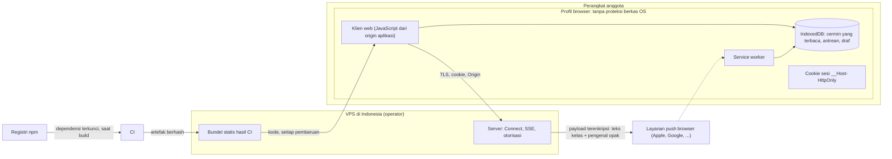
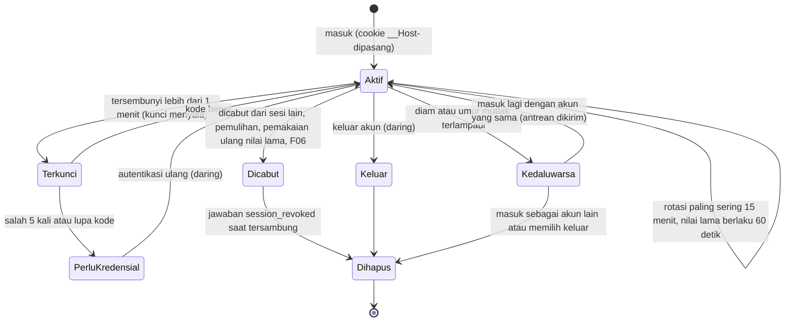

# 10.5 — Klien web (PWA): model keamanan browser

| | |
|---|---|
| Status | **Draf kedua (13 November 2026)**: diselaraskan dengan ADR-030 dan 08 §25 (SEC-160 (e), SEC-161 (e), SEC-165 (g), (h), SEC-167 (c), SEC-168 (c), SEC-171 (b), SEC-173 (a), SEC-174 (a), (b), SEC-175 (c), (e), SEC-176 (g), §10). Catatan 13 November 2026 (FS-1 tugas 1.9a): SEC-167 (c) kebijakan `casa-sw`, SEC-169 (b) berkas bernama tetap, SEC-169 (e) `skipWaiting` service worker pengganti, SEC-171 (d) pengatur waktu coba ulang. Catatan 13 November 2026 (FS-1 tugas 1.9a, tindak lanjut tinjauan): SEC-160 (e) batas bawah Safari 17.5 dan delapan fitur, SEC-164 (c) langkah push saat penghapusan (juga SEC-172 (a)), SEC-165 (b) mode bersama tanpa service worker, SEC-166 dan SEC-169 (b) halaman aplikasi di kunci `/`, SEC-169 (e) medan teks payload service worker pengganti. Catatan 14 November 2026 (jalur web 1.10, putusan Q2/Q4): SEC-171 (b) (2) tanda tanpa sesi, SEC-171 (b) (3) dan SEC-175 (c) undangan pada jalan mode bersama, §5 `account_id` di store `meta`. Draf pertama 12 November 2026. Belum ditinjau `critic`. Isi **[Usulan]** `security-privacy` kecuali disebut lain |
| Pemilik | `security-privacy` |
| Tingkat kedalaman | Tier 1 penuh: klien web adalah klien pertama yang memegang data nyata |
| Masukan | `_progress.md` "Sesudah S6: audit kesiapan bangun dan usulan web app (12 November 2026)"; 18 §5.12, §5.13 (terutama §5.13.5 dan §5.13.6); 17 Q-210; ADR-013, ADR-018, ADR-019, ADR-024; glosarium *Kunci aplikasi*, *Autentikasi ulang*; 10.1 sampai 10.4; `ENGINEERING-STANDARDS.md` §4, §7, §8 |
| Dipakai oleh | `architect` (ADR-030, ADR-018, ADR-019, ADR-024, 09, 14, 15); `ux-designer` (08); `product-analyst` (05, 13, 17) |
| Persyaratan | SEC-160 sampai SEC-179; ancaman TM-37 sampai TM-45 |

## 0. Kedudukan dan cakupan

**Keputusan.** Pemilik produk: "web dibangun duluan aja yang penting web jalan dulu aja. ios dan android nanti. web akan jadi yang pertama untuk user experience" (**diputuskan pemilik produk sendiri**; keputusan 69 di 17). Sesudah lead menanyakan apakah ia menerima bahwa web belum terasa sepenuhnya iPhone atau Android: "ya saya terima kan ini versi webnya, selebihnya saya ikut saran kamu" (keduanya `_progress.md`, "Sesudah S6: audit kesiapan bangun dan usulan web app"). Keputusan itu menggantikan keputusan 41 (web tidak di pilot) dan urutan platform keputusan 42. **Bacaan lead [Usulan]** yang dipakai berkas ini sebagai dasar perencanaan: pilot dengan data nyata (GR-2) memakai klien web saja, di iPhone 13 (iOS 26), iPad mini 7 (iPadOS 26), Galaxy A55, dan browser desktop.

**Yang tidak berubah.** Semua aturan ada di server (ADR-013): otorisasi per perintah dan per bacaan, isolasi rumah tangga, RLS, tahan `NOTICE_UNREAD` (SEC-34), perintah pelindung (SEC-151), `PURGE`, retensi, dan penghapusan. Persyaratan yang tidak menyebut platform berlaku bagi klien web apa adanya. Berkas ini hanya menambah yang dibawa browser, dan memberi padanan web bagi bagian yang di 10.1 dan 10.2 ditulis untuk iOS dan Android. Bagian khusus native tetap berlaku saat aplikasi native dibangun (indeks §4.3, §4.4).

| Kebutuhan | Native (10.1, 10.2, ADR-024) | Klien web (berkas ini) |
|---|---|---|
| Tempat token sesi | Keychain atau Keystore "hanya perangkat ini" (SEC-15) | Cookie `__Host-` `HttpOnly`, tidak terbaca skrip (SEC-161) |
| Basis data lokal | SQLite dengan proteksi berkas OS, di luar cadangan (SEC-46) | IndexedDB **tanpa** proteksi berkas OS; batasnya dinyatakan (SEC-170) |
| Status `CARE` yang tidak dibagikan (Tier 2) | Berkas Class A (SEC-46 (b)) | Store IndexedDB tersendiri, tanpa padanan Class A (SEC-170 (c)) |
| Hapus jarak jauh | Saat tersambung, sebelum layar pertama (SEC-21) | Sama, di semua tab; browser yang tak pernah dibuka lagi dinyatakan (SEC-172) |
| Kunci aplikasi | Kode dan biometrik (SEC-19) | Kode saja; menutup tampilan, tidak mengenkripsi (SEC-174) |
| Pratinjau di pengalih aplikasi | Ditutup (SEC-20) | Penutup netral saat tersembunyi, upaya terbaik (SEC-174 (f)) |
| Push | APNs dan FCM (SEC-50 sampai SEC-58) | Web Push dengan VAPID (SEC-176, SEC-177) |
| Permukaan di luar aplikasi | Spotlight, Siri, pintasan, judul scene (SEC-54, SEC-59) | Judul halaman, URL, riwayat, isian otomatis, manifest (SEC-175) |
| Lalu lintas keluar | Hanya server, APNs, FCM (SEC-49) | Satu origin; CSP `connect-src 'self'` (SEC-160, SEC-166) |
| Kode yang berjalan | Build dari TestFlight atau APK, terpasang terlihat | Bundel dimuat dari server setiap pembaruan (TM-42; SEC-169, SEC-178 (b)) |
| Catatan persetujuan uji | Laporan crash TestFlight (SEC-109 (b)) | Tidak diperlukan selama tidak ada laporan otomatis ke pihak ketiga (SEC-178 (c)) |

**Empat prasyarat Q-210** (17; 18 §5.13.9 risiko 2) dijawab di sini:

| Prasyarat | Jawaban |
|---|---|
| 1. Model keamanan browser | §1 sampai §4: SEC-160 sampai SEC-169 |
| 2. Sesi di PC bersama atau pinjaman | §3: SEC-165; keluar akun SEC-164 |
| 3. ADR-024 (data di perangkat, hapus jarak jauh) diterjemahkan ke penyimpanan browser | §5: SEC-170 sampai SEC-173 |
| 4. Padanan kunci aplikasi dan pemberitahuan pengelola di web | §6: SEC-174; §8: SEC-178 |

**Kolom "Tahap"** mengikuti indeks §0. "Pilot" di berkas ini berarti wajib bagi server dan klien web sebelum GR-2.

## 1. Yang ditambahkan browser

Tiga batas baru dibanding 10.1 §3: (1) **kode klien datang dari server setiap kali diperbarui**, sehingga rantai pasok npm dan pengelola server berada di dalam kode yang memegang sesi; (2) **profil browser** menggantikan wadah aplikasi yang dilindungi OS; (3) **layanan push browser** menambah penerima metadata selain APNs dan FCM bila browser desktop selain Safari dan Chrome dipakai.

| ID | Pelaku | Ancaman | Aset | Kontrol | Sisa |
|---|---|---|---|---|---|
| TM-37 | PL-01 | XSS: skrip asing di origin aplikasi membaca IndexedDB dan memanggil API dengan cookie sesi selama halaman terbuka | Semua yang ada di perangkat dan yang terbaca anggota itu | SEC-166, SEC-167 | `HttpOnly` mencegah pencurian token, tidak mencegah pemakaiannya oleh skrip yang sudah berjalan |
| TM-38 | PL-01, PL-06 | Dependensi npm atau alat build yang disusupi masuk ke bundel | Semua | SEC-168, SEC-169 (a) | Penyusupan yang belum diketahui publik saat versi dipasang |
| TM-39 | PL-01 | Lintas situs: CSRF atas sesi cookie, clickjacking lewat bingkai, membaca aliran SSE dari situs lain | AS-01, AS-04, AS-07 | SEC-161, SEC-162, SEC-163, SEC-166 | — |
| TM-40 | PL-03, PL-08 | Perangkat atau PC bersama dan pinjaman: sesi tertinggal, salinan IndexedDB, riwayat browser, isian otomatis, kata sandi tersimpan | Semua | SEC-164, SEC-165, SEC-175 | Pengelola kata sandi browser dan perekam yang terpasang di PC itu sendiri |
| TM-41 | PL-04, PL-08 | Browser yang sesinya dicabut, tetapi tidak pernah membuka aplikasi lagi, menyimpan salinan tanpa batas waktu | AS-01 sampai AS-08 | SEC-172 | Dinyatakan di layar cabut sesi |
| TM-42 | PL-05 | Pengelola menyajikan bundel yang diubah, juga hanya bagi satu akun, tanpa jejak pemasangan; misalnya mengirim status `CARE` yang tidak dibagikan atau isi buku pribadi yang sudah ada di perangkat | AS-03, AS-05, AS-08 | SEC-169 (a), (f); kalimat pemberitahuan SEC-178 (b); SEC-159 | Di server pasangan saja termasuk keadaan keputusan 25 dan dinyatakan di pemberitahuan; indeks §8 butir 17 |
| TM-43 | PL-01 | Endpoint langganan push palsu membuat server mengirim permintaan ke alamat internal atau sembarang (SSRF) | Server | SEC-176 (g) | — |
| TM-44 | Ketersediaan | Browser menghapus data situs (aturan 7 hari Safari, tekanan ruang, pengguna menghapus data situs), sehingga antrean yang belum terkirim hilang | Catatan belum terkirim | SEC-171 | Berkurang, tidak hilang; bertabrakan dengan "Recording is a burden" (brief §1.1; 18 §5.13.9 risiko 1) |
| TM-45 | PL-01 | Service worker terus menyajikan versi lama yang memuat celah yang sudah diperbaiki | Semua | SEC-169 (b) sampai (e) | — |

## 2. Sesi, permintaan lintas situs, SSE, dan keluar akun

| ID | Persyaratan | Untuk | Tahap | Label | Cara menguji |
|---|---|---|---|---|---|
| SEC-160 | **Satu origin, HTTPS, tanpa pihak ketiga.** (a) Bundel statis dan API (`/v1/...`, termasuk `GET /v1/stream`) dilayani dari satu origin HTTPS; staging memakai origin lain (SEC-41 (d)), sehingga cookie dan penyimpanan keduanya tidak pernah bercampur. (b) Tanpa CORS: tidak ada titik API yang mengirim `Access-Control-Allow-Origin`. (c) `Strict-Transport-Security` dengan `max-age` paling sedikit 1 tahun **[Asumsi]** dan `includeSubDomains`; preload tidak diwajibkan. (d) Tidak ada sumber dari origin lain: huruf, skrip, gaya, gambar, analitik, CDN, atau perekam sesi; semuanya dari origin sendiri (padanan SEC-49). (e) Saat mulai, klien memeriksa delapan fitur menurut ADR-030 butir 4 (IndexedDB, service worker, `navigator.storage`, Web Crypto `subtle`, Web Locks, `BroadcastChannel`, `crypto.randomUUID`, dan `CSS.supports('color', 'light-dark(#000, #fff)')`) dan, bila salah satunya tidak ada, tidak memuat layar masuk (LY-97). **Daftar browser mengikuti ADR-030 butir 4**: *diizinkan berjalan* bila lolos deteksi fitur: Safari, iOS, dan iPadOS **17.5** ke atas (`Clear-Site-Data` dan `estimate()` baru ada di Safari 17, **[Terverifikasi]** 18 §5.13.2, §5.13.6; batas naik ke 17.5 karena token warna memakai CSS `light-dark()`, yang ada sejak Safari 17.5 dan Chrome 123, **[Terverifikasi]** ADR-030 butir 4, BCD diakses 13 November 2026; catatan 13 November 2026, FS-1 tugas 1.9a) dan Chromium yang masih menerima pembaruan keamanan (Chrome, Edge, Samsung Internet); Firefox diizinkan bila lolos, **tidak diuji** di pilot. *Diuji sebelum GR-2*: Safari 26 di web app layar utama iPhone 13 dan iPad mini 7, Chrome di Galaxy A55, browser desktop yang dipakai rumah tangga, Playwright Chromium dan WebKit. Browser yang diizinkan tetapi tidak diuji tetap di bawah semua kontrol server; kontrol yang ditegakkan browser (atribut cookie, CSP, Trusted Types) tidak dijamin di sana, dan hal itu tidak menahan GR-2 selama pasangan pilot memakai browser yang diuji **[Usulan]** | 09, ADR-030 | Pilot | **[Usulan]** | Pindai header origin produksi dan staging; preflight `OPTIONS` dari origin uji lain: tanpa `Access-Control-Allow-Origin`; catatan jaringan Playwright selama rangkaian uji: nol permintaan ke host lain |
| SEC-161 | **Sesi web dalam cookie.** (a) Token sesi web acak 256 bit dan opak, disimpan di server hanya sebagai hash, dicek di basis data per permintaan sehingga pencabutan berlaku seketika (pola token akses 09 berkas 04 §2). (b) Dikirim **hanya** sebagai cookie berawalan `__Host-` dengan `Secure`, `HttpOnly`, `SameSite=Strict`, `Path=/`, tanpa `Domain` (18 §5.13.6 butir 1). Tidak pernah di isi respons, `localStorage`, `sessionStorage`, IndexedDB, Cache Storage, URL, atau log. Ini bacaan dokumen ini atas `ENGINEERING-STANDARDS.md` §4 "Tokens are stored in the platform's secure storage" bagi browser (indeks §8 butir 18). Server memasang cookie ini hanya pada RPC masuk varian web; klien native tetap memakai SEC-15. (c) **Rotasi**: nilai cookie diganti paling sering setiap 15 menit **[Asumsi]** pada permintaan yang berhasil, dan selalu saat masuk, autentikasi ulang, dan pemulihan (menutup session fixation). Nilai lama masih diterima paling lama 60 detik **[Asumsi]** bagi permintaan yang sedang berjalan; dipakai sesudah itu, seluruh sesi dicabut dan satu baris ditulis di jejak keamanan pemiliknya (padanan deteksi pemakaian ulang SEC-15). Catatan 13 November 2026 (FS-1 tugas 1.5; celah yang ditemukan lead, usul lead diterima dengan tambahan (3) sampai (5)): **cookie baru yang tidak sampai tidak boleh mencabut sesi.** Bila jawaban pembawa `Set-Cookie` hasil rotasi tidak pernah masuk ke cookie jar (web app layar utama iPhone dihentikan sementara saat permintaan berjalan, atau jaringan seluler memutus jawaban), browser tetap memegang nilai lama, dan pencabutan karenanya menghapus antrean belum terkirim (SEC-172 (a)) tanpa ada penyerang. Aturannya: (1) **Tanda terkonfirmasi**: server mencatat permintaan pertama yang membawa nilai sekarang sesudah rotasi; nilai yang sudah dibawa kembali terbukti sampai di browser. (2) Nilai sebelumnya dipakai sesudah jendela 60 detiknya: bila nilai sekarang **terkonfirmasi**, sesi dicabut (`reuse_detected`) dan satu baris jejak keamanan ditulis, seperti di atas; bila **belum**, server memutar lagi tanpa menunggu 15 menit: nilai baru terbit di jawaban itu, nilai yang dibawa menjadi nilai sebelumnya dengan jendela 60 detik baru, dan nilai yang belum terkonfirmasi dibuang sehingga tidak lagi mengautentikasi; tanpa pencabutan dan tanpa baris jejak keamanan. (3) **Nilai buangan diingat**: hash nilai yang dibuang di (2) disimpan (satu nilai, yang terakhir); bila nilai itu dibawa kemudian, sesi dicabut (`reuse_detected`) dan satu baris jejak keamanan ditulis. Browser yang tidak menerima nilai itu tidak mungkin membawanya, jadi pembawanya membuktikan ada dua pemegang. Tanpa (3), penyerang yang lebih dulu membawa nilai lama mendapat sesi, sedangkan browser sah hanya tampak keluar. (4) **Satu keputusan per baris**: pemeriksaan dan tulisan (1) sampai (3) terjadi dalam satu transaksi dengan kunci baris `session` atau `UPDATE` bersyarat, sehingga dua permintaan serentak dengan nilai lama yang sama menghasilkan satu rotasi ulang, dan yang kedua diterima sebagai nilai sebelumnya di dalam jendela. Tanpa itu, jawaban yang tiba terakhir dapat memasang nilai yang sudah dibuang, dan (3) mencabut sesi yang sah. (5) Nilai yang tidak cocok dengan nilai sekarang, sebelumnya, atau buangan dijawab sebagai tanpa sesi (masuk lagi), **tidak pernah** `session_revoked`, karena server tidak tahu sesi siapa; data lokal tidak dihapus. Klausa pencarian nilai buangan mengikuti berkas 01 §5.1 aturan 7. Rotasi tetap paling sering setiap 15 menit dan selalu saat masuk, autentikasi ulang, dan pemulihan. **Sisa risiko yang dinyatakan**: penyerang yang menyalin cookie (perlu perangkat lunak jahat atau akses ke profil browser, karena `HttpOnly`) dan memakai nilai lama sesudah jendela tetapi sebelum permintaan berikutnya browser sah tidak terdeteksi saat itu; ia terdeteksi pada permintaan berikutnya pihak yang lain, lewat (2) bila nilai sekarang sudah terkonfirmasi atau lewat (3), jadi aksesnya paling lama sampai pemilik membuka aplikasi lagi. Pemakaian di dalam jendela 60 detik tetap tidak terdeteksi, seperti sebelumnya. Dua kegagalan beruntun (permintaan bernilai lama yang tiba di server lebih dari 60 detik sesudah rotasi, lalu jawabannya juga hilang) dapat membuat browser sah membawa nilai buangan dan mencabut sesinya sendiri; diterima karena sangat jarang. **Opsi yang ditolak**: menolak nilai lama tanpa pernah mencabut (deteksi pemakaian ulang hilang, dan pemilik yang cookie barunya hilang tetap harus masuk lagi); `session_revoked` tanpa menghapus antrean (bertentangan dengan tujuan SEC-172: browser yang dicabut tidak menyimpan catatan rumah tangga) **[Usulan]**. Catatan 13 November 2026 (FS-1 tugas 1.5 Task 5; putusan atas keberatan tinjauan keamanan otomatis): **rotasi paksa saat autentikasi ulang mempertahankan jendela 60 detik, dan izin autentikasi ulang web terikat pada nilai cookie.** (6) Rotasi paksa saat autentikasi ulang sama dengan rotasi biasa: nilai yang dipegang browser (nilai sekarang, atau nilai sebelumnya bila nilai sekarang belum terkonfirmasi dan jendelanya masih berjalan) menjadi nilai sebelumnya dengan jendela 60 detik baru. Nilai sekarang belum terkonfirmasi yang dilepas di sini **tidak** ditulis sebagai nilai buangan (3), karena jawabannya mungkin sudah sampai di browser; bila dibawa kemudian, dijawab menurut (5), tanpa pencabutan. (7) **`reauth_grant` sesi web menyimpan hash nilai cookie yang terbit di jawaban autentikasi ulang itu**; izin hanya diperiksa dan dipakai oleh permintaan yang membawa nilai itu persis. Permintaan dengan nilai sebelumnya, atau dengan nilai yang terbit kemudian lewat rotasi apa pun (15 menit atau (2)), diperlakukan sebagai tanpa izin (autentikasi ulang lagi), tanpa pencabutan. Pengguna sah tidak menanggung biaya: nilai itu tetap nilai sekarang paling sedikit 15 menit, lebih lama dari umur izin 5 menit. Sesi native tidak berubah. Alasan: pemegang nilai sebelum autentikasi ulang sudah berbagi sesi itu; tanpa (7) ia mendapat izin tanpa kata sandi selama jendela 60 detik, dan lewat (2) juga sesudahnya bila nilai baru belum terkonfirmasi (ia menerima nilai sekarang yang baru). Dengan (7) keuntungannya nol, sedangkan jendela tetap menjaga permintaan sah yang sedang berjalan. **Opsi yang ditolak**: mematikan semua nilai sebelum autentikasi ulang, karena denyut dan `Sync` yang sedang berjalan gagal dan pengguna diminta masuk lagi tepat di tengah tindakan sensitif; bila nilai itu diingat sebagai buangan, browser sah mencabut sesinya sendiri dan antreannya terhapus (SEC-172 (a)), dan bila tidak diingat, deteksi pemakaian ulang atasnya hilang **[Usulan]**. (d) **Umur, mode pribadi**: berakhir sesudah 30 hari tanpa pemakaian **[Asumsi]** dan paling lama 180 hari sejak masuk **[Asumsi]**; `Max-Age` sama dengan sisa umur mutlak. Server membedakan `session_expired` dari `session_revoked`: kedaluwarsa tidak menghapus data lokal sampai orang lain masuk atau pemiliknya memilih keluar (SEC-172), sehingga antrean tidak hilang hanya karena umur sesi. Mode bersama: SEC-165. (e) Setiap sesi web tampil di daftar sesi pemiliknya (SEC-16) sebagai browser, sistem operasi, dan mode (pribadi atau bersama), dari User-Agent yang dikasarkan, dan dapat dicabut dari sesi lain (SEC-21). Data web app layar utama terpisah dari Safari (**[Terverifikasi]** 18 §5.13.2, webkit.org/tracking-prevention, diakses 12 November 2026), sehingga sesi di tab Safari tidak terbawa ke web app; karena tab Safari iOS dan iPadOS tidak menawarkan masuk mode pribadi (SEC-171 (b)), di iPhone dan iPad biasanya hanya ada satu sesi web pribadi, dan bila ada dua (deteksi tidak pasti), keduanya tampil sebagai dua sesi. Catatan 13 November 2026 (FS-1 tugas 1.5; bacaan lead dikukuhkan dengan satu koreksi): `ua_summary` web hanya berisi keluarga browser dan keluarga OS dari daftar tetap, tanpa nomor versi, paling banyak 64 karakter, dihitung server saat sesi dibuat; User-Agent mentah tidak disimpan atau dicatat (SEC-44), dan Client Hints tidak diminta. Browser dicocokkan berurutan: Edge, Samsung Internet, Firefox, Chrome (termasuk penanda iOS-nya), Safari, selain itu label umum, karena UA Edge dan Samsung Internet memuat "Chrome" dan UA Chrome memuat "Safari". OS: iOS (iPhone), iPadOS (UA "iPad"), Android, Windows, Linux, selain itu label umum. **Koreksi**: UA "Macintosh" ditampilkan "macOS/iPadOS", bukan "macOS", karena Safari iPad meminta situs desktop secara bawaan dan tidak dapat dibedakan dari Mac; label "macOS" saja dapat membuat pemilik iPad tanpa Mac mencabut sesinya sendiri atau tidak curiga pada sesi asing. Alasan tanpa versi: lebih sedikit data perangkat (asas minimasi); label umum dan bunyi tampilannya urusan 08 | 09, ADR-030 | Pilot | **[Usulan]**; OWASP menurut 18 §5.13.6 | `document.cookie` dan pemindaian seluruh penyimpanan browser (SEC-179) tidak memuat nilai token; atribut cookie di respons masuk sesuai (a), (b); dengan jam uji: nilai berganti sesudah 15 menit; nilai baru dipakai sekali, lalu nilai lama pada detik ke-61 mencabut sesi (`reuse_detected`) dan menulis satu baris jejak keamanan; (c) catatan 1.5: jawaban rotasi dibuang klien uji (cookie baru tidak disimpan), lalu nilai lama pada detik ke-61 diterima, nilai baru terbit, tanpa pencabutan dan tanpa baris jejak keamanan, antrean lokal utuh; sesudah rotasi ulang itu, nilai buangan dibawa: sesi dicabut dan satu baris ditulis; dua permintaan serentak dengan nilai lama sesudah jendela dan nilai sekarang belum terkonfirmasi: tepat satu rotasi ulang, keduanya diterima; nilai acak tak dikenal: tanpa sesi, bukan `session_revoked`; catatan Task 5: sesudah autentikasi ulang, tindakan sensitif dengan nilai sebelum autentikasi ulang di dalam 60 detik ditolak sebagai tanpa izin dan sesi tidak dicabut, RPC biasa dengan nilai itu diterima, dan tindakan yang sama dengan nilai baru diterima; nilai lama dibawa sesudah 60 detik saat nilai baru belum terkonfirmasi: rotasi ulang (2), dan nilai hasil rotasi itu tidak dapat memakai izin; autentikasi ulang sebagai permintaan pertama sesudah batas 15 menit: nilai yang dipegang browser tetap diterima 60 detik, dan nilai sekarang yang dilepas, bila dibawa, dijawab tanpa sesi, bukan `session_revoked`; sesi diam 31 hari dan sesi berumur 181 hari ditolak dengan `session_expired`, antrean lokal utuh |
| SEC-162 | **Permintaan lintas situs (CSRF) dan bingkai.** (a) Setiap permintaan yang diautentikasi cookie ditolak bila header `Origin` ada dan bukan origin aplikasi, atau bila `Sec-Fetch-Site` ada dan bukan `same-origin`. RPC tanpa `Origin` juga ditolak. Catatan 13 November 2026 (FS-1 tugas 1.5; bacaan lead dikukuhkan dengan satu tambahan): pemeriksaan (a) berlaku bagi (1) setiap permintaan yang membawa cookie sesi, apa pun prosedurnya; (2) RPC identitas publik varian web (`client_kind = WEB`: `StartSignUp`, `CompleteSignUp`, `SignIn`, `StartRecovery`, `CompleteRecovery`), yang belum diautentikasi cookie tetapi dapat memasangnya, sehingga login CSRF tertutup; (3) **tambahan**: setiap permintaan yang membawa `Origin` atau `Sec-Fetch-Site`, apa pun `client_kind` yang dinyatakannya, karena `client_kind` diisi pengirim dan halaman lintas situs dapat menyatakan `ios`. Klien native tidak membawa cookie dan tidak mengirim kedua header itu, jadi tidak pernah terkena. (b) Semua RPC Connect dari klien web memakai POST dengan `Content-Type` protobuf atau JSON Connect, yang bukan jenis yang dapat dikirim formulir lintas situs; varian GET Connect tidak diterima bagi sesi cookie. (c) `SameSite=Strict` adalah lapis kedua, bukan satu-satunya, karena bawaan SameSite berbeda antarbrowser (MDN menurut 18 §5.13.6 butir 1). (d) Tanpa token CSRF tersendiri di pilot **[Usulan]**: (a) sampai (c) menutup formulir dan fetch lintas situs selama tidak ada CORS (SEC-160 (b)); ditinjau ulang bila kelak ada CORS atau origin lain yang dipercaya. (e) Halaman tidak dapat dibingkai (`frame-ancestors 'none'`, SEC-166) | 09 | Pilot | **[Usulan]** | Dari origin uji lain: formulir POST, `fetch` dengan `credentials: "include"`, dan `iframe` atas aplikasi: ditolak atau tidak termuat, tanpa efek di server; RPC sama-origin tanpa `Origin` ditolak; RPC sama-origin biasa diterima; catatan 1.5: `SignIn` varian web dari origin lain, dan `SignIn` yang menyatakan `client_kind = ios` dengan `Origin` lain, ditolak tanpa cookie terpasang; `SignIn` native tanpa kedua header diterima |
| SEC-163 | **SSE dengan cookie.** `GET /v1/stream` bagi klien web dibaca `EventSource` bawaan dengan cookie sesi yang sama, karena `EventSource` tidak dapat mengirim header `Authorization` (**[Terverifikasi]** 18 §5.13.1). (a) Titik itu tanpa efek samping: membukanya tidak menaikkan tanda terkirim, kehadiran, atau keadaan apa pun (kehadiran tetap lewat denyut RPC, ADR-018 butir 5). (b) SEC-162 (a) berlaku. (c) Tanpa CORS, situs lain tidak dapat membaca alirannya. (d) Server menutup aliran seketika saat sesi dicabut, F06, atau keluar akun; sambungan ulang dijawab `session_revoked`. (e) Isinya tetap hanya tanda tanpa isi (ADR-018 butir 3). Pembaca SSE berbasis `fetch` tidak diperlukan | 09, ADR-018 | Pilot | **[Usulan]**; menjawab 18 §5.13.1 butir 3 | Buka aliran dari origin lain dengan `withCredentials`: tidak terbaca; membuka aliran tanpa denyut tidak mengubah kehadiran atau tanda terkirim; cabut sesi: aliran tertutup dalam satu detik **[Asumsi]** dan sambungan ulang ditolak |
| SEC-164 | **Keluar akun di web.** (a) Keluar akun daring-saja, sejalan dengan sesi yang online-first (ADR-018 butir 1); saat luring layar menyatakannya. Sebelum keluar, jumlah catatan belum terkirim tampil (SEC-47). (b) Server mencabut sesi, menghapus langganan push sesi itu (SEC-176 (f)), dan menjawab dengan `Clear-Site-Data: "cookies", "storage"`. Nilai `"cache"` tidak dipakai karena catatan bug Chrome (**[Terverifikasi]** 18 §5.13.6 butir 6) dan karena HTTP cache dan Cache Storage tidak memuat data (SEC-166, SEC-169 (b)). (c) Klien tidak bergantung pada header itu: ia sendiri menghapus IndexedDB, entri Cache Storage selain app shell, langganan push (`unsubscribe`), dan keadaan di memori, memberi tahu tab lain (SEC-173), lalu berpindah ke layar masuk dengan mengganti entri riwayat. Catatan 13 November 2026 (FS-1 tugas 1.9a, tindak lanjut tinjauan; berlaku juga bagi SEC-172 (a)): **langkah langganan push** dalam penghapusan mengikuti tiga aturan. (1) `pushManager.getSubscription()` dipanggil hanya bila `Notification.permission === 'granted'`; **diterima**. Langganan hanya dibuat sesudah izin diberikan (SEC-176 (e)), browser tidak menampilkan notifikasi tanpa izin, dan penjamin utamanya server, yang sudah menghapus langganan sesi itu sebelum menjawab keluar akun atau saat mencabut sesi (SEC-164 (b), SEC-176 (f)); `unsubscribe()` di klien adalah lapis kedua. Tanpa penjaga itu `getSubscription()` tidak pernah selesai di WebKit Playwright dan menahan muat ulang. (2) **Urutan**: IndexedDB, Cache Storage, dan keadaan memori dihapus lebih dulu; langkah push paling akhir, sehingga langkah yang macet tidak pernah menyisakan data. (3) **Batas waktu**: `getSubscription()` dan `unsubscribe()` bersama dibatasi 3 detik **[Asumsi]**; habis waktu atau galat dianggap selesai, dan perpindahan ke layar masuk tetap terjadi. (1) dan (2) Pilot, berlaku sekarang; (3) wajib paling lambat saat Web Push dibangun (FS-1 langkah 4), yang tetap sebelum GR-2: sebelum itu aplikasi tidak pernah meminta izin, dan macet yang diketahui hanya terjadi tanpa izin, yang ditutup (1). (d) Halaman yang dipulihkan dari back/forward cache sesudah keluar tidak menampilkan data: saat `pageshow` dari cache, klien memeriksa sesi lebih dulu | 09, 08 | Pilot | **[Usulan]** | Keluar, lalu tombol kembali: tidak ada data; periksa penyimpanan (SEC-179): IndexedDB tidak ada, tidak ada langganan push, cookie sesi tidak ada; di server sesi tercabut dan langganan terhapus; uji yang sama dengan header `Clear-Site-Data` dimatikan di staging: hasil penyimpanan sama; keluar dengan izin notifikasi belum diberikan, di Chromium dan WebKit Playwright: layar masuk tampil; sejak FS-1 langkah 4, dengan langkah push dibuat tidak pernah selesai: layar masuk tampil sesudah batas waktu, IndexedDB sudah kosong |

## 3. Perangkat bersama atau pinjaman

| Hal | Mode pribadi | Mode bersama |
|---|---|---|
| Untuk | Ponsel, tablet, atau komputer milik anggota itu | PC keluarga, warnet, perangkat pinjaman |
| Cookie | `Max-Age` sisa umur mutlak (SEC-161 (d)) | Tanpa `Max-Age` dan `Expires` |
| Umur sesi di server | Diam 30 hari, mutlak 180 hari **[Asumsi]** | Diam 30 menit, mutlak 12 jam **[Asumsi]** |
| Data di perangkat | IndexedDB (SEC-170) | Hanya di memori tab |
| Service worker dan app shell di Cache Storage | Didaftarkan dalam sesi mode pribadi (SEC-169 (b)) | Tidak didaftarkan; tidak ada Cache Storage (SEC-165 (b)) |
| Pencatatan luring dan antrean tersimpan | Ya | Tidak |
| Push, ajakan pasang, kunci aplikasi | Ya, atas pilihan pemilik | Tidak |
| Status `CARE` yang tidak dibagikan (Tier 2) | Di browser perangkat ini | Tidak tersedia; layar menyatakannya |

| ID | Persyaratan | Untuk | Tahap | Label | Cara menguji |
|---|---|---|---|---|---|
| SEC-165 | **Mode perangkat bersama.** Layar masuk web menanyakan "Ini perangkat pribadimu, atau perangkat bersama atau pinjaman?" tanpa pilihan terpilih **[Usulan]**; jawabannya berlaku untuk sesi itu dan tidak dapat diubah di tengah sesi (pindah mode berarti keluar lalu masuk lagi). Mode bersama: (a) cookie sesi tanpa `Max-Age` dan `Expires`; sesi berakhir di server sesudah 30 menit tanpa pemakaian dan paling lama 12 jam **[Asumsi]**, karena browser dapat memulihkan cookie sesi saat dibuka ulang; (b) tidak ada yang ditulis ke IndexedDB, Cache Storage, `localStorage`, atau `sessionStorage`; data hanya di memori tab. Catatan 13 November 2026 (FS-1 tugas 1.9a, tindak lanjut tinjauan; menjawab `web-dev`): **mode bersama tidak mendaftarkan service worker**. `registerServiceWorker()` (SEC-167 (c)) hanya dipanggil dalam sesi mode pribadi; layar masuk dan mode bersama tidak pernah memanggilnya. Alasan: mode bersama tidak luring dan tanpa push (c), (d), jadi service worker tidak membawa manfaat apa pun, sedangkan registrasi dan app shell yang tertinggal adalah jejak pemakaian Casa di perangkat orang lain (sejalan dengan SEC-171 (b) (5)); halaman dimuat dari jaringan setiap kali, sehingga versi minimum (SEC-169 (d)) berlaku tanpa jeda. Registrasi yang sudah ada di profil itu dari sesi mode pribadi sebelumnya dibiarkan: tidak berisi data, dan langganan pushnya sudah dihapus saat keluar akun (SEC-164); (c) tanpa pencatatan luring: perintah dikirim seketika, dan bila gagal, isian tetap terbuka dengan pesan bahwa catatan belum tersimpan; (d) tanpa langganan push, ajakan pasang ke layar utama, atau kunci aplikasi (sesi pendek menggantikannya); di iPhone dan iPad mode bersama berjalan di tab Safari tanpa memasang (SEC-171 (b) (5)); (e) isian kata sandi tanpa `autocomplete` yang menyimpan, dan layar menyarankan untuk tidak menyimpan kata sandi di browser itu; (f) tombol keluar selalu terlihat; sesudah sesi berakhir, layar masuk tampil tanpa data. (g) **Masa diam hanya dihitung dari tindakan orang** (menjawab 08 §25.5): tab yang dibiarkan terbuka di PC warnet tidak boleh hidup terus karena kegiatan latar. Di mode bersama, pengatur waktu diam di server hanya diulang oleh RPC yang ditandai klien sebagai hasil tindakan pengguna (navigasi, perintah, "Tetap masuk"); denyut kehadiran, aliran SSE, dan `Sync` otomatis yang dipicu tanda SSE tidak mengulangnya. Tanda itu dipercaya dari klien karena ancamannya sesi yang terlupa, bukan klien yang bermusuhan **[Usulan]**. Klien juga menghitung diam dari masukan pengguna (sentuh, pointer, tombol) dan keluar sendiri (SEC-164) saat 30 menit tercapai. Peringatan 60 detik sebelumnya dengan "Tetap masuk" diterima: ketukan itu satu tindakan pengguna yang mengulang kedua pengatur waktu; batas mutlak 12 jam tidak dapat diperpanjang dengan cara apa pun. (h) **Tanpa pemasangan faktor kedua dan kode pemulihan di mode bersama**: LY-88 (SEC-18, SEC-25) tidak tersedia, dan layar meminta memakai perangkat pribadi, karena perekam di PC itu (TM-40) akan menangkap rahasia TOTP dan kode pemulihan. Batas yang dinyatakan di layar pilihan mode: perekam layar atau ketikan, dan pengelola kata sandi, yang terpasang di PC itu tidak dapat dicegah aplikasi (TM-40) | 08, 09 | Pilot | **[Usulan]**; Q-210 prasyarat 2; 18 §5.13.6 butir 6 | Masuk mode bersama, catat satu entri, tutup tab, buka lagi sesudah 31 menit: layar masuk; IndexedDB, Cache Storage, dan `localStorage` kosong; di profil browser baru tidak ada registrasi service worker; tidak ada langganan push; daftar sesi pemilik menampilkan "bersama"; isian luring tidak masuk antrean. Dengan jam uji: tab mode bersama dibiarkan terbuka tanpa masukan, sementara pasangan membuat perubahan (tanda SSE dan `Sync` berjalan): sesi berakhir di menit ke-30; "Tetap masuk" di menit ke-29 memperpanjang sampai menit ke-59; sesi berumur 12 jam berakhir walau ada masukan. LY-88 di mode bersama: tidak dapat dibuka |

## 4. XSS, header keamanan, dan rantai pasok

| ID | Persyaratan | Untuk | Tahap | Label | Cara menguji |
|---|---|---|---|---|---|
| SEC-166 | **Header keamanan dasar**, sebagai header HTTP dari server (bukan hanya meta tag). Content Security Policy paling ketat yang masih menjalankan klien: `default-src 'none'; script-src 'self'; style-src 'self'; img-src 'self' blob:; font-src 'self'; connect-src 'self'; worker-src 'self'; manifest-src 'self'; base-uri 'none'; form-action 'self'; frame-ancestors 'none'; object-src 'none'`, ditambah `require-trusted-types-for 'script'` menurut SEC-167 (c). **Tidak pernah** `'unsafe-inline'` atau `'unsafe-eval'` di `script-src`, dan tanpa `'wasm-unsafe-eval'` (stack yang diusulkan tanpa WASM, 18 §5.13.2 butir 1; bila kelak perlu, lewat ADR). Bila framework mengeluarkan skrip pembuka inline, skrip itu diizinkan hanya lewat hash yang dibuat saat build. Bila framework memerlukan gaya inline, `'unsafe-inline'` hanya di `style-src` dan dicatat di ADR-030 (**[Perlu validasi]** keduanya untuk SvelteKit mode SPA; 18 §5.13.6 butir 4 tidak meneliti CSP). Header lain: `X-Content-Type-Options: nosniff`; `Referrer-Policy: no-referrer`; `Cross-Origin-Opener-Policy: same-origin`; `Cross-Origin-Resource-Policy: same-origin`; `Permissions-Policy` yang mematikan kamera, mikrofon, lokasi, pembayaran, dan USB (foto dipilih lewat `<input type="file">`, SEC-67; bahwa pilihan kamera di pemilih berkas Safari iOS tetap jalan dengan kebijakan itu **[Perlu validasi]**). Jawaban API dan SSE `Cache-Control: no-store`; berkas statis berhash boleh di-cache lama; halaman aplikasi (di `/` dan di setiap jalur yang dijawab dengan halaman itu) dan skrip service worker `no-cache` (SEC-169 (b), (c)). Catatan 13 November 2026 (FS-1 tugas 1.5; menjawab `web-dev`): SvelteKit selalu merender pengumum rute `#svelte-announcer` (pembaca layar) dengan satu atribut `style` tetap yang menyembunyikannya secara visual, tanpa opsi untuk mematikannya; dengan `style-src 'self'` atribut itu diblokir dan setiap muat halaman melanggar CSP. Diukur `web-dev` di Chromium dan WebKit: dengan atribut itu diblokir, kedua mesin tetap menyembunyikan pengumum secara visual, dan judul halaman **tidak** tampil di layar; pernyataan awal bahwa judul dapat tampil berasal dari laporan pertama yang tidak diukur dan tidak teramati. Hash tetap dipakai agar pengumum tidak menjadi pelanggaran CSP permanen dan agar penyembunyiannya tidak bergantung pada perilaku browser. **Diputuskan**: atribut itu diizinkan lewat hash di direktif baru `style-src-attr 'unsafe-hashes' 'sha256-S8qMpvofolR8Mpjy4kQvEm7m1q8clzU4dfDH0AmvZjo='`; `style-src 'self'` tetap bagi elemen dan stylesheet. `'unsafe-inline'` tidak dipakai di direktif gaya mana pun; kalimat "Bila framework memerlukan gaya inline, `'unsafe-inline'` hanya di `style-src`" di atas diganti aturan ini. Alasan: penyerang yang dapat menyisipkan markup hanya mendapat satu string gaya itu persis, yang menyembunyikan elemen ke 1 piksel terpotong: tanpa `url(`, tanpa kebocoran lewat CSS, tanpa lapisan penutup layar; semua gaya lain tetap diblokir. **Opsi yang ditolak**: aturan CSS sendiri ditambah pengecualian pelanggaran di uji (pelanggaran tetap terjadi di setiap muat, dan uji "tanpa pelanggaran" menjadi berlubang permanen); menandai uji gagal-diketahui (ES §6). Aturan: (1) hash adalah satu konstanta server; kode Casa sendiri tidak mendapat hash gaya, dan pelanggaran baru dari kode Casa diperbaiki di kode, bukan di CSP; (2) bila pembaruan SvelteKit mengubah atribut itu, uji tanpa pelanggaran gagal, dan hash baru diterima hanya bila atributnya masih milik pengumum, hanya deklarasi penyembunyi visual, tanpa `url(`; diperiksa `code-reviewer` dengan merujuk catatan ini. CSP produksi menjadi `default-src 'none'; script-src 'self' <hash build>; style-src 'self'; style-src-attr 'unsafe-hashes' 'sha256-S8qMpvofolR8Mpjy4kQvEm7m1q8clzU4dfDH0AmvZjo='; img-src 'self' blob:; font-src 'self'; connect-src 'self'; worker-src 'self'; manifest-src 'self'; base-uri 'none'; form-action 'self'; frame-ancestors 'none'; object-src 'none'; require-trusted-types-for 'script'; trusted-types svelte-trusted-html casa-sw` | 09, Ops | Pilot | **[Usulan]**; menjawab 18 §5.13.6 butir 4 | Uji CI membandingkan header setiap jenis jawaban dengan daftar ini; pindai origin produksi sebelum GR-2 (indeks §4.1 butir 13); halaman uji di staging yang menyisipkan skrip inline: tidak dijalankan; catatan 1.5, di Chromium dan WebKit Playwright dengan CSP produksi: muat aplikasi menghasilkan nol pelanggaran, tanpa saringan atau pengecualian apa pun; inilah bukti hash, karena hash yang hilang atau salah menghasilkan pelanggaran `style-src-attr`. Pemeriksaan gaya terhitung `#svelte-announcer` (`position: absolute`, lebar `1px`) boleh tetap ada, tetapi bukan bukti hash: browser tetap menyembunyikan pengumum walau atributnya diblokir; header: `style-src` tepat `'self'`, `style-src-attr` tepat satu hash itu, tanpa `'unsafe-inline'` di mana pun; elemen sisipan dengan atribut `style` lain diblokir (pelanggaran `style-src-attr`, gaya tidak berlaku) |
| SEC-167 | **Pencegahan XSS di kode.** (a) Semua teks dari pengguna dan server (pesan, catatan, nama tampilan, sebutan, kategori, judul, nama berkas, pesan galat) dirender sebagai teks oleh templat framework. Tidak ada `innerHTML`, `outerHTML`, `insertAdjacentHTML`, `document.write`, penyisip HTML mentah framework (misalnya `{@html}`), `eval`, `new Function`, atau `setTimeout` dengan string; aturan lint menggagalkan build. (b) Tautan di pesan, bila dijadikan tautan, hanya berskema `https:` atau `http:` dan dibuka dengan `rel="noopener noreferrer"`; skema lain tampil sebagai teks. (c) Trusted Types diwajibkan lewat CSP bila framework terpilih berjalan tanpa sink HTML. Bila framework memerlukan satu sink untuk membuat templatnya, satu kebijakan bernama khusus itu diizinkan dan dicatat di ADR-030; tidak ada kebijakan lain **[Usulan]**. Trusted Types Baseline sejak Februari 2026 (**[Terverifikasi]** ADR-030 butir 7, MDN, diakses 12 November 2026); Safari 17.5 sampai 25 dapat mengabaikannya, dan di browser yang tidak mendukungnya (a) tetap penjaga utama. Nama kebijakan dan status PR Svelte di ADR-030 butir 7. Catatan 13 November 2026 (FS-1 tugas 1.9a; menjawab catatan terbuka ADR-030 butir 7): bila Trusted Types ditegakkan, `navigator.serviceWorker.register()` meminta `TrustedScriptURL` sejak Chrome 140 dan Safari 26, Chrome Android dan Safari iOS mengikuti (BCD `api/ServiceWorkerContainer.json`, `register.enforces_trusted_types`, [github.com/mdn/browser-compat-data](https://github.com/mdn/browser-compat-data), diakses 13 November 2026) **[Terverifikasi]**. Karena itu kebijakan kedua **`casa-sw`** diterima, dengan aturan: (1) pendaftaran otomatis Kit mati; satu fungsi `registerServiceWorker()` di satu modul adalah satu-satunya pemanggil `register()` dan satu-satunya pembuat `casa-sw`, yang dibuat sekali saat modul dimuat; lint menolak `serviceWorker.register` dan `trustedTypes.createPolicy` di berkas lain; (2) `casa-sw` hanya mempunyai `createScriptURL`, yang mengembalikan masukannya bila sama persis (perbandingan string) dengan satu konstanta URL service worker (path same-origin, tanpa query dan fragment) dan melempar galat untuk masukan lain; tanpa `createHTML` dan `createScript`; objek kebijakan tidak diekspor; (3) opsi pendaftaran juga tetap (`type: 'module'`, scope tetap); (4) tanpa kebijakan `default` dan tanpa `'allow-duplicates'`; (5) di browser tanpa Trusted Types (Safari 17.5 sampai 25) konstanta yang sama diberikan sebagai string; (6) service worker pengganti (SEC-169 (e)) disajikan di URL yang sama, jadi tidak ada kebijakan ketiga. Direktif CSP menjadi `require-trusted-types-for 'script'; trusted-types svelte-trusted-html casa-sw`; `svelte-trusted-html` dihapus dari daftar bila framework tidak memerlukannya. "Tidak ada kebijakan lain" di atas dibaca: tidak ada kebijakan selain kedua nama itu. (d) Berkas unggahan tidak pernah dirender inline; foto tampil sebagai `` dari blob JPEG yang dikeluarkan server (SEC-66); SVG dari pengguna tidak diterima | 09, ADR-030 | Pilot | **[Usulan]**; TM-37 | Korpus uji XSS (penanda ``, `<script>`, URL `javascript:`, SVG) di pesan, catatan, nama tampilan, kategori, dan pihak luar: tampil sebagai teks tanpa eksekusi, di Chromium dan WebKit Playwright; berkas uji yang memakai sink terlarang gagal lint; dengan CSP produksi di Chromium dan WebKit Playwright, service worker terdaftar dan aktif tanpa pelanggaran CSP, dan `createScriptURL` `casa-sw` dengan URL lain melempar galat |
| SEC-168 | **Kebijakan dependensi npm** (memperinci `ENGINEERING-STANDARDS.md` §7, §8 untuk klien web). (a) Lockfile dikomit dengan versi persis; CI memasang hanya dari lockfile dengan instalasi bersih, dan gagal bila lockfile tidak sesuai manifest. (b) Skrip pasang (install scripts) dependensi dimatikan secara bawaan; pengecualian per paket dengan alasan di deskripsi perubahan. (c) Pemindaian kerentanan atas lockfile npm di CI pada setiap perubahan, setiap bulan, dan seketika saat ada advisori; alatnya OSV-Scanner atas `pnpm-lock.yaml`, dan (b) ditegakkan lewat `strictDepBuilds` pnpm (keduanya **[Terverifikasi]** ADR-030 butir 8). (d) **Dependensi yang masuk bundel** dibatasi pada daftar di ADR-030 (framework, pembungkus IndexedDB, klien Connect dan protobuf, pustaka service worker; 18 §5.13.9). Menambah satu memerlukan catatan ES §8 **dan** tinjauan `security-privacy` atas alasan, pemelihara, dan apa yang dapat disentuhnya, karena kode itu berjalan dengan akses penuh ke IndexedDB dan sesi (TM-38). Dependensi pengembangan mengikuti ES §8 biasa. (e) Tidak ada kode yang dimuat dari jaringan saat berjalan (CDN, skrip jarak jauh, `import()` dari origin lain); SEC-166 menegakkannya. (f) **Dianjurkan**: versi baru dependensi bundel dipakai paling cepat 7 hari **[Asumsi]** sesudah terbit, kecuali perbaikan keamanan; menyimpang dari ES §8 "Newest stable only", jadi diajukan sebagai pertentangan (indeks §8 butir 16) | 09, 14, ADR-030 | Pilot; (f) dianjurkan | **[Usulan]**; ES §7, §8 | CI gagal bila lockfile tidak sinkron; paket uji berskrip pasang: skripnya tidak berjalan; laporan pemindai terlampir di setiap PR; uji yang membandingkan dependensi bundel dengan daftar ADR-030 gagal bila ada tambahan |
| SEC-169 | **Build, deploy, service worker, dan versi.** (a) Bundel dibangun hanya di CI dari komit bertanda; hash setiap berkas dicatat; deploy menyalin artefak itu tanpa membangun ulang di VPS; berkas statis hanya-baca bagi proses yang melayaninya. (b) Service worker hanya meng-cache app shell statis berversi: berkas yang namanya berisi hash, ditambah berkas bernama tetap (halaman aplikasi, berkas `static/` seperti font, ikon, dan manifest) yang diversikan lewat nama cache berisi `version` build; tidak pernah jawaban API, SSE, foto, atau halaman berisi data. Catatan 13 November 2026 (FS-1 tugas 1.9a; putusan lead dikukuhkan): berkas bernama tetap diterima dengan syarat (1) daftar berkas ditetapkan saat build (`$app/manifest` ditambah halaman aplikasi) dan tidak ada yang ditambahkan ke cache saat `fetch` (tanpa runtime caching); (2) satu cache per versi, bernama memuat `version`, diisi saat `install` dengan permintaan yang melewati cache HTTP (`cache: 'reload'`), sehingga berkas bernama tetap tidak terambil dari versi lama; (3) saat `activate`, setiap cache dengan nama lain dihapus, sehingga sesudah versi baru aktif tidak ada berkas versi lama yang tersaji (TM-45). Catatan 13 November 2026 (FS-1 tugas 1.9a, tindak lanjut tinjauan): halaman aplikasi di-cache dan diminta dengan kunci **`/`**, bukan `/index.html`, karena Vite preview menjawab 404 untuk `/index.html` dan file server Go mengalihkannya ke `/`; syarat (1) sampai (3) tidak berubah. (c) Versi baru service worker aktif saat aplikasi dibuka berikutnya atau saat tidak ada isian terbuka, tidak di tengah isian, dan tidak pernah membuang antrean. (d) Kontrak memuat versi klien web. Server menolak perintah dari versi di bawah batas minimum dengan kode galat "perbarui aplikasi"; perintah tetap di antrean dan terkirim sesudah pembaruan (pola SEC-34 (4)). Pengelola menaikkan batas minimum pada rilis yang memperbaiki celah keamanan (TM-45). (e) Runbook memuat jalan darurat bila service worker rusak terpasang: server menyajikan service worker pengganti yang hanya mengosongkan cache app shell dan mendaftar ulang, tanpa menyentuh IndexedDB. Catatan 13 November 2026 (FS-1 tugas 1.9a): service worker pengganti boleh memanggil `skipWaiting()`, dan itu **di luar (c)**: (c) menjaga isian yang terbuka dan antrean dari pergantian kode aplikasi, sedangkan pengganti tidak membawa kode aplikasi. Syaratnya: (1) tanpa handler `fetch`, jadi semua permintaan langsung ke jaringan; (2) tidak memuat ulang atau mengarahkan halaman (`client.navigate()`, pesan muat ulang) dan tidak menyentuh IndexedDB, jadi isian yang tampil dan antrean tetap utuh; (3) tidak memanggil `registration.unregister()`, karena langganan push terikat pada registrasi (SEC-176 (f)); kembali ke service worker normal lewat pembaruan biasa di URL yang sama (SEC-167 (c)); (4) tetap memuat handler `push` menurut SEC-176 (b), yang menampilkan teks kelas dari payload di dalam `event.waitUntil()`, karena Safari mencabut izin bila push tidak ditampilkan. Catatan 13 November 2026 (FS-1 tugas 1.9a, tindak lanjut tinjauan): medan yang dibaca (4) adalah medan **teks kelas** SEC-176 (a), bukan medan lain; namanya belum ada di kontrak (09 berkas 03 §8 baru menamai `r`) dan **ditetapkan saat Web Push dibangun (FS-1 langkah 4)**. Nama sementara `text` diterima sampai itu, karena sebelum langkah 4 tidak ada push yang dikirim. Saat langkah 4: service worker normal dan pengganti membaca medan yang sama dari satu definisi kontrak, dan bila payload tidak terbaca atau medannya tidak ada, keduanya menampilkan teks umum tetap (nama aplikasi), tidak pernah isi payload mentah. Sisa risiko yang dinyatakan: tab yang terbuka saat pengganti aktif dapat gagal memuat potongan kode berhash yang sudah tidak ada di server; isian yang sudah tampil dan antrean tidak hilang. (f) Versi dan hash bundel yang berjalan tampil di LY-95 "Perangkat ini" (08 §25.6) **[Usulan]**, **wajib Pilot** (ditetapkan 13 November 2026, sebelumnya dianjurkan): di perangkat produksi tidak ada alat pengembang dan SEC-179 hanya ada di staging, jadi inilah satu-satunya cara memastikan bahwa rilis perbaikan celah (d) sudah berjalan di perangkat pilot (TM-45). Ini alat periksa, bukan bukti terhadap TM-42, karena bundel yang diubah dapat menampilkan apa saja | 09, 14, Ops | Pilot | **[Usulan]**; 18 §5.13.6 butir 9 | Hash berkas di VPS sama dengan catatan CI; isi Cache Storage (SEC-179) hanya berkas statis; klien uji bervesi di bawah minimum: perintah tulis ditolak dengan kode itu, antrean utuh, terkirim sesudah pembaruan; latihan service worker pengganti di staging: antrean utuh, isian yang terbuka tidak hilang, langganan push masih menerima notifikasi; sejak FS-1 langkah 4, payload uji yang sama ke service worker normal dan pengganti: teks notifikasi sama, dan payload tanpa medan teks: teks umum tetap; dua build berurutan dengan berkas `static/` yang berubah: sesudah versi baru aktif, Cache Storage hanya memuat satu cache versi baru dan berkas barunya |

## 5. Penyimpanan browser

| Tempat | Boleh | Tidak pernah |
|---|---|---|
| IndexedDB (mode pribadi saja) | Cermin data yang terbaca anggota itu dari `Sync` (SEC-47); antrean perintah dengan idempotency key; draf isian; cache foto yang terbaca; kursor sinkron opak; status `CARE` yang tidak dibagikan (Tier 2) di store tersendiri; pemverifikasi kode kunci aplikasi dan hitungan salah (SEC-174); pengenal akun pemilik data. Catatan 14 November 2026 (jalur web 1.10, putusan Q2/Q4; Q3 (a) diterima `architect`): pengenal itu adalah `account_id` dari `GetSession`, satu baris di store `meta`, ditulis saat basis data lokal dibuat sesudah masuk mode pribadi; dipakai **hanya** untuk membandingkan dengan `account_id` sesi sekarang dan menghapus seluruh basis data bila berbeda (SEC-170 (a)), sebelum data apa pun ditampilkan atau antrean dikirim. Ia bukan wewenang: tidak pernah dikirim sebagai pengganti sesi, dan server tetap menentukan akun dari cookie. Tanpa email, nama, atau `device_mode` di sana; mode sesi selalu dibaca dari `GetSession`. Mode bersama tidak menulisnya (SEC-165 (b)) | Token sesi atau nilai cookie; kata sandi; `reauth_grant`; kode pemulihan; rahasia TOTP; kode kunci aplikasi dalam bentuk asli; data yang tidak terbaca anggota itu; data akun lain |
| Cache Storage | App shell statis berversi | Jawaban API, foto, apa pun yang berisi data |
| `localStorage`, `sessionStorage` | Paling banyak setelan tampilan tanpa data (misalnya tema) | Apa pun yang lain |
| Cookie | Satu cookie sesi (SEC-161) | Cookie lain berisi data |

| ID | Persyaratan | Untuk | Tahap | Label | Cara menguji |
|---|---|---|---|---|---|
| SEC-170 | **Isi penyimpanan browser** menurut tabel di atas. (a) Satu akun per profil browser: masuk sebagai akun lain hanya sesudah keluar, yang menghapus data akun sebelumnya (SEC-164). (b) **Tanpa proteksi berkas OS**: siapa pun yang dapat membuka profil browser itu (akun komputer yang terbuka, ponsel yang terbuka, alat pengembang) dapat membaca dan mengubah isinya (OWASP, **[Terverifikasi]** 18 §5.13.6 butir 5). Enkripsi buatan sendiri tidak dipakai karena kuncinya harus tersimpan di browser yang sama (§6, opsi C dan D). Batas ini dinyatakan di "Siapa melihat apa" (SEC-87) dan di layar pilihan mode (SEC-165). (c) **Status `CARE` yang tidak dibagikan** (Tier 2; ADR-024 butir 5; 10-D A tetap: tidak pernah ke server) disimpan di store IndexedDB tersendiri, dihapus bersama data lain saat keluar akun atau dicabut; layar `CARE` di web menyatakan bahwa status itu tersimpan di browser perangkat ini dan hilang bila data situs dihapus browser atau pemiliknya. Tidak ada padanan Class A | 09, 08 | Pilot; (c) bila Tier 2 dibangun | **[Usulan]**; Q-210 prasyarat 3 | Pemeriksaan penyimpanan (SEC-179) sesudah sinkron sebagai B: tidak ada baris buku pribadi A (SEC-47), tidak ada token, kode, atau rahasia di tempat mana pun; masuk sebagai akun lain tanpa keluar: ditolak |
| SEC-171 | **Antrean yang dapat dihapus browser** (TM-44). (a) Di mode pribadi, sesudah masuk, klien meminta `navigator.storage.persist()` dan menyimpan hasilnya; hasil itu tampil di LY-95 "Perangkat ini" (08 §25.6). `persist()` dikabulkan menurut heuristik browser, antara lain pemasangan ke layar utama (**[Terverifikasi]** 18 §5.13.2). (b) **Di iPhone dan iPad, tab Safari tidak menawarkan masuk mode pribadi** (dikukuhkan atas ADR-030 butir 11, menggantikan "ajakan memasang" draf pertama). Dasarnya **[Terverifikasi]** (18 §5.13.2; webkit.org/tracking-prevention, diakses 12 November 2026): data web app layar utama terpisah dari Safari, dan domainnya dikecualikan dari batas 7 hari ITP atas semua penyimpanan yang ditulis skrip, sedangkan data skrip tab Safari terhapus sesudah 7 hari pemakaian Safari tanpa interaksi. Sesi dan antrean yang dibuat di tab tidak pernah sampai ke web app. Aturannya: (1) tab Safari iOS dan iPadOS, termasuk browser di dalam aplikasi lain, menampilkan petunjuk pasang (LY-90) dan tidak pernah menawarkan masuk **mode pribadi**; satu-satunya pengecualian adalah (5); (2) tautan verifikasi email dan pemulihan kata sandi (SEC-24) yang terbuka di tab diselesaikan **tanpa membuat sesi** di tab (LY-92); SEC-24 tetap berlaku (semua sesi lain dicabut, faktor kedua tidak dilewati, SEC-18); bentuk kontraknya di catatan 14 November 2026 di bawah; (3) token undangan yang terbuka di tab dibuang dari bilah alamat dan **tidak dikirim** ke server dari tab, sehingga undangan tidak terpakai di tempat yang salah; penerimaannya lewat tautan yang ditempel di web app (SEC-175 (c)); **satu pengecualian**: jalan mode bersama (5), menurut catatan 14 November 2026 di bawah; (4) **bila deteksi tidak pasti** (iPad dapat melapor seperti komputer), klien memperlakukan halaman sebagai browser biasa dan masuk diizinkan, dengan kalimat (c) bila berjalan di tab atau `persist()` ditolak **[Usulan]**, supaya tidak ada pemilik akun yang terkunci di luar (08 §25.6); risikonya kehilangan antrean, bukan kebocoran; (5) **iPhone atau iPad pinjaman**: LY-90 juga menawarkan "Pakai sebagai perangkat bersama atau pinjaman", yang langsung membuka masuk dalam **mode bersama** (SEC-165) di tab Safari itu, tanpa memasang ikon dan tanpa LY-91. Alasan **[Usulan]**: mode bersama tidak menyimpan apa pun, jadi batas 7 hari dan pemisahan penyimpanan tidak menyentuhnya, sedangkan memasang ikon di perangkat orang lain meninggalkan jejak di perangkatnya. Browser di dalam aplikasi lain tidak dapat dibedakan dengan pasti dari Safari, dan aplikasi induknya dapat membaca halaman; karena itu kalimat LY-90 "buka halaman ini di Safari dulu" tampil di atas kedua jalan, dan sisanya dinyatakan (TM-40). Di Android dan komputer, pemasangan dianjurkan sekali, tidak diwajibkan. Sisa risiko: browser masih dapat menghapus data karena ruang menipis atau tindakan pengguna (TM-44); jumlah catatan belum terkirim selalu tampil. Catatan 14 November 2026 (jalur web 1.10, putusan Q2/Q4): **Q2, tautan verifikasi dan pemulihan di tab tanpa sesi.** `CompleteSignUp` dan `CompleteRecovery` selalu membuka sesi; menyelesaikan lalu langsung `SignOut` **ditolak**, karena sesi tetap lahir, cookie terpasang di tab, dan bila `SignOut` gagal sesi itu hidup sampai batas diamnya, sedangkan daftar sesi dan jejak keamanan pemulihan menunjuk ke sesi tab. **Diterima**: satu tanda "tanpa sesi" di kedua permintaan (namanya ditetapkan `architect` di kontrak), dengan syarat: (Q2-1) sah hanya bila `client_kind = WEB`; dari klien lain ditolak di batas sebagai argumen tidak sah. Bila tanda diisi, `device_mode` harus kosong dan ditolak bila diisi; bila tidak diisi, aturan sekarang berlaku (web wajib `device_mode`). (Q2-2) Yang mengisi: klien web, **selalu** di tab Safari iOS dan iPadOS yang terdeteksi pasti (b) (1), dan tidak di tempat lain; bila deteksi tidak pasti, (4) berlaku (jalan biasa dengan sesi). Server tidak memeriksa apakah pengirim memang tab: tanda itu hanya mengurangi hak, jadi pengirim yang berbohong tidak mendapat apa pun; kewajiban mengisinya ditegakkan klien dan dibuktikan uji. (Q2-3) Transaksinya sama persis kecuali pembukaan sesi: tautan dan token pasang terpakai, pemeriksaan undangan SEC-158 tetap, kredensial dipasang atau diganti; pemulihan mencabut **semua** sesi akun tanpa pengecualian dan menulis baris jejak keamanan `recovery` dengan `session_id` kosong dan `detail` berisi `ua_summary` yang dihitung seperti SEC-161 (e), sehingga "kapan dan dari perangkat mana" SEC-24 tetap terbaca. Tidak ada baris `session`, token penyegar, atau `reauth_grant` yang dibuat. (Q2-4) Jawaban sukses kosong: `tokens` tidak diisi, **tanpa `Set-Cookie` apa pun** (juga tanpa menghapus cookie yang ada), tanpa medan tambahan; galat memakai kode yang sama seperti tanpa tanda. (Q2-5) Tidak berubah: pemeriksaan `Origin` dan `Sec-Fetch-Site` SEC-162 (a) (2); pembatas laju pemakaian token per alamat (10.1 §8.1), dihitung sama dengan atau tanpa tanda; pemeriksaan kata sandi umum; tautan sekali pakai; faktor kedua diminta saat masuk berikutnya (SEC-18). (Q2-6) Klien di tab: token diambil dari fragmen dan dibuang dari bilah alamat sebelum RPC (SEC-175 (c)); sesudah sukses hanya kalimat LY-92, tanpa RPC lain, tanpa menulis penyimpanan apa pun, tanpa mendaftarkan service worker. Sampai kontraknya ada, rute itu di tab menampilkan LY-90 tanpa RPC (rencana 1.9b/1.10 Task 6) **diterima**. **Q4, undangan pada jalan mode bersama di tab.** Pengecualian atas (3) **diterima**: alasan (3) adalah penerimaan yang terikat pada sesi tab yang datanya terhapus dan tidak ikut ke web app; di mode bersama tidak ada yang disimpan dan keanggotaan ada di server, jadi alasan itu tidak berlaku. Browser di dalam aplikasi lain sudah memegang token karena ia yang membuka URL-nya; mengirimnya ke server tidak menambah paparan, dan paparan kata sandi di sana tetap sisa risiko TM-40 yang dinyatakan LY-90. Syarat: (Q4-1) token diambil dari fragmen dan bilah alamat dibersihkan sebelum halaman dirender; token hanya di variabel memori tab, tidak di URL, riwayat, `sessionStorage`, atau penyimpanan lain (SEC-165 (b)); muat ulang membuangnya. (Q4-2) **Tidak ada RPC berisi token sebelum ketukan eksplisit** "Pakai sebagai perangkat bersama atau pinjaman"; memilih jalan pasang atau meninggalkan halaman membuang token tanpa pernah mengirimnya, dan kalimat undangan LY-90 tetap tampil. (Q4-3) Sesudah ketukan, token hanya dipakai dalam sesi `device_mode = SHARED` (atau `StartSignUp` yang diikuti sesi bersama); tautan verifikasi dari pendaftaran itu yang terbuka di tab mengikuti Q2 (tanpa sesi). (Q4-4) Semua aturan undangan tetap tanpa pengecualian: pratinjau hanya nama rumah tangga dan pengundang (SEC-32), pengukuhan pengundang (SEC-31), satu kalimat SEC-30. (Q4-5) Deteksi tidak pasti: jalan biasa (4). Bunyi ADR-030 butir 11 "tidak dikirim ke server dari tab" perlu disesuaikan `architect` dengan pengecualian ini **[Usulan]**. (c) Bila ada catatan belum terkirim, jumlahnya selalu tampil (ADR-024 butir 6); bila `persist()` tidak dikabulkan atau aplikasi berjalan di tab Safari, ditambah kalimat bahwa catatan itu dapat hilang bila browser menghapus data situs. (d) Antrean dikirim saat aplikasi dibuka, saat peristiwa `online`, saat halaman kembali terlihat, sesudah setiap perintah baru, dan oleh pengatur waktu coba ulang selama halaman terlihat sesudah galat sementara (catatan 13 November 2026, FS-1 tugas 1.9a, diselaraskan dengan ADR-030 butir 10, yang memuat daftar galat dan angkanya: jeda acak seragam antara d/2 dan d, d = min(2 detik × 2^(n−1), 5 menit)). Pengatur waktu itu tidak pernah dipicu `session_revoked`, `session_expired`, `CLIENT_UPGRADE_REQUIRED`, `NOTICE_UNREAD`, atau penolakan aturan, dan perintah pelindung tidak pernah menunggu jedanya; pengiriman tetap lewat kunci antartab dan idempotency key yang sama (SEC-173); Background Sync hanya mempercepat di browser yang mendukungnya (18 §5.13.4). (e) **Kehilangan dinyatakan, tidak disembunyikan**: basis data lokal dibuat saat masuk; bila server menyatakan sesi sah tetapi basis data lokal tidak ada, klien menyatakan bahwa data di perangkat ini dihapus browser dan bahwa catatan yang belum terkirim, bila ada, tidak dapat dipulihkan, lalu menyinkron ulang dari potret awal (ADR-017 butir 7). (f) `QuotaExceededError` atau galat tulis lain saat menyimpan ke antrean: isian tidak ditutup, dan pesannya menyatakan catatan belum tersimpan; tidak pernah dibuang diam-diam | 09, 08 | Pilot | **[Usulan]**; 18 §5.13.9 risiko 1 | Di Chromium: hapus IndexedDB dengan cookie sesi utuh, buka aplikasi: pesan (e) tampil dan sinkron ulang berjalan; paksa galat kuota: isian tetap terbuka; luring, catat tiga entri, kembali daring tanpa interaksi lain: ketiganya terkirim tepat sekali; server menjawab 503 dua kali lalu pulih, tab tetap terlihat tanpa interaksi: perintah terkirim tepat sekali; jawaban `session_revoked`: tidak ada percobaan ulang; di iPhone 13 dan iPad mini 7 (pengamatan, staging): tab Safari menampilkan LY-90 tanpa masuk mode pribadi, dan "Pakai sebagai perangkat bersama atau pinjaman" membuka masuk mode bersama yang tidak menulis ke IndexedDB; tautan undangan dibuka di tab: tidak ada RPC berisi token di log server dan undangan tetap berlaku; catatan 14 November 2026: tautan undangan di tab, jalan pasang atau tanpa ketukan: nol RPC berisi token; jalan mode bersama: RPC berisi token pertama hanya sesudah ketukan, sesinya `SHARED`, IndexedDB kosong, dan muat ulang sesudah ketukan membuang token; `CompleteSignUp` dan `CompleteRecovery` dengan tanda tanpa sesi dari web: tanpa `Set-Cookie`, `tokens` kosong, tanpa baris `session` baru, pemulihan mencabut semua sesi dan menulis satu baris `recovery` dengan `session_id` kosong dan `ua_summary`; tanda dari klien native, atau bersama `device_mode`: ditolak sebagai argumen tidak sah; pembatas laju terhitung sama dengan dan tanpa tanda; tautan pemulihan dibuka di tab: kata sandi berganti dan daftar sesi tanpa sesi baru dari tab; web app layar utama menampilkan hasil `persist()` |
| SEC-172 | **Hapus jarak jauh di web** (padanan SEC-21; ADR-024 butir 4). (a) Setiap jawaban `session_revoked` (RPC, SSE, `Sync`) membuat klien menghapus IndexedDB, Cache Storage selain app shell, langganan push, dan keadaan memori di **semua tab** (SEC-173) sebelum menampilkan layar lain, dengan penjaga izin, urutan, dan batas waktu langkah push menurut catatan SEC-164 (c); perintah lama dari sesi itu ditolak server. (b) Saat dibuka dan tersambung, klien memeriksa sesi lebih dulu dan menunggu jawaban paling lama 3 detik **[Asumsi]** sebelum menampilkan data lokal; bila luring atau waktu habis, data lokal tampil seperti aplikasi native yang luring, dan pemeriksaan diulang begitu tersambung. (c) `PURGE` dan F06 (SEC-23, SEC-48) berlaku sama. (d) `session_expired` tidak menghapus (SEC-161 (d)). (e) **Batas yang dinyatakan** di layar cabut sesi web (FR-FAM-017/AC-3; SEC-21): "Data di browser itu terhapus saat browser itu membuka Casa lagi dan tersambung. Sampai itu, orang yang dapat membuka browser itu dapat membaca salinannya." Tidak ada push senyap di web untuk memicu penghapusan (**[Terverifikasi]** 18 §5.13.3), dan dokumen ini tidak menambah jalan lain di pilot **[Usulan]**: perilakunya setara dengan aplikasi native pilot yang juga tanpa kode latar (ADR-018 butir 4), kecuali bagi browser yang tidak pernah dibuka lagi (TM-41) | 09, 08 | Pilot | FR-FAM-017/AC-3; **[Usulan]**; Q-210 prasyarat 3 | Cabut sesi browser X dari sesi lain; buka X dengan dua tab: penyimpanan X kosong sebelum layar data pertama di kedua tab (SEC-179); perintah antrean lama X ditolak server; X luring saat dibuka: data lokal tampil, lalu terhapus begitu tersambung |
| SEC-173 | **Beberapa tab.** (a) Hanya satu pengirim antrean pada satu waktu per profil browser (kunci antartab lewat Web Locks, ADR-030 butir 10; Baseline sejak Maret 2022, **[Terverifikasi]** ADR-030 butir 4); idempotency key tetap penjaga terakhir (ADR-005). (b) Keluar akun, `session_revoked`, F06, dan terkuncinya kunci aplikasi berlaku di semua tab sekaligus lewat siaran antartab; tab yang menerimanya mengosongkan keadaan memori dan menampilkan layar masuk atau layar kunci | 09 | Pilot | **[Asumsi]** 18 §5.13.6 butir 8; **[Usulan]** | Dua tab luring membuat perintah, lalu daring: setiap perintah tercatat tepat sekali dan antrean utuh; cabut sesi saat dua tab terbuka: keduanya kosong; kunci di tab A: tab B ikut terkunci |

## 6. Kunci aplikasi dan autentikasi ulang di web

Glosarium *Kunci aplikasi* menetapkan bahwa biometrik hanya membuka kunci di perangkat dan tidak pernah menjadi kredensial akun. Di browser, biometrik hanya tersedia lewat passkey (WebAuthn), dan passkey adalah kredensial akun yang diperiksa server (18 §5.13.5 butir 1).

| Opsi | Yang dilindungi | Masalah | Hasil |
|---|---|---|---|
| A. Kode aplikasi lokal yang menutup tampilan | Orang yang memegang perangkat terbuka tanpa membuka alat pengembang (PL-03 yang lazim: anak, kerabat, tamu) | Tidak melindungi data di profil browser | **Dipilih untuk pilot**, dengan batas yang dinyatakan |
| B. Passkey sebagai pembuka kunci | Seperti A, dengan Face ID, Touch ID, atau sidik jari | Kredensial akun, perlu jaringan; biometrik perangkat menerima siapa pun yang terdaftar (PL-03); bertentangan dengan glosarium dan asas 6 | Tidak di pilot |
| C. Enkripsi IndexedDB dengan kunci turunan passkey (PRF) | Data di profil browser | PRF `get()` tidak didukung Safari menurut BCD (**[Terverifikasi]** 18 §5.13.5); status Safari 26 **[Perlu validasi]**; pilot memakai iPhone dan iPad | Tidak mungkin di Safari saat ini; dinilai ulang dalam ADR E2EE sebelum tahap publik |
| D. Enkripsi IndexedDB dengan kunci turunan kode 6 digit | Tampak melindungi data | Satu juta kemungkinan dapat ditebak luring dari profil yang sama dengan cepat **[Usulan]**; janji yang tidak dapat ditegakkan (asas 2) | Ditolak |

| ID | Persyaratan | Untuk | Tahap | Label | Cara menguji |
|---|---|---|---|---|---|
| SEC-174 | **Kunci aplikasi dan autentikasi ulang di klien web** (padanan SEC-19, SEC-20, SEC-13). (a) Hanya **kode aplikasi** 6 digit **[Asumsi]** dengan aturan SEC-19 (a) (kode terlalu mudah ditolak); tanpa biometrik atau passkey sebagai pembuka di pilot. Mati secara bawaan, ditawarkan sekali, diatur hanya pemiliknya, tidak terbaca anggota lain, tanpa Peristiwa atau notifikasi (SEC-19); kalimat tablet SEC-59 (b), tanpa bagian biometrik, tampil di **semua** perangkat web karena iPad tidak dapat dikenali dengan pasti dari browser (diterima atas 08 §25.6, W-5), dan kalimat itu tidak boleh menjanjikan lebih dari (c); tidak ditawarkan di mode bersama. (b) Kode disimpan hanya sebagai pemverifikasi PBKDF2-HMAC-SHA-256 bergaram dari Web Crypto bawaan browser, di IndexedDB bersama parameternya, tidak pernah dikirim ke server. Parameter menurut ADR-030 butir 12: 600.000 iterasi (OWASP Password Storage Cheat Sheet, **[Terverifikasi]** ADR-030, diakses 12 November 2026), garam acak 128 bit, keluaran 256 bit. **Aturan penurunan iterasi** **[Usulan]**: waktu derivasi diukur di prototipe pada perangkat pilot paling lambat yang memakai kunci (iPhone 13, iPad mini 7, Galaxy A55); bila melebihi 1 detik, iterasi diturunkan ke kelipatan 50.000 terbesar yang selesai dalam 1 detik di perangkat itu, satu angka untuk semua perangkat, **tidak pernah di bawah 300.000**. Bila 300.000 pun melebihi 1 detik, angka itu tetap dan waktu bukanya diterima, karena menurunkan lebih jauh hanya mempercepat tebakan luring. Dalam batas ini amandemen ADR-030 butir 12 tidak memerlukan tinjauan baru; di luar batas ini memerlukan tinjauan `security-privacy`. Mengubah parameter tidak membuat kode baru: pemverifikasi diturunkan ulang dengan parameter baru saat kode benar dimasukkan berikutnya. Harga yang dinyatakan: ruang 10^6 membuat selisih 300.000 dan 600.000 kecil terhadap penyerang dengan GPU; perlindungan utamanya terhadap tebakan lewat browser itu sendiri. Karena pemverifikasi terbaca dari profil browser dan kode 6 digit dapat ditebak luring, layar memasang kode menyarankan untuk tidak memakai PIN ATM atau kode ponsel. (c) **Yang dilindunginya hanya tampilan.** Saat terkunci, layar berisi data dilepas dari DOM, bukan hanya dikaburkan, dan data di memori dikosongkan; data tetap di IndexedDB. Layar menyalakan kunci menyatakan: "Di versi web, kunci ini menutup tampilan aplikasi. Data yang tersimpan di browser ini tetap dapat dibaca orang yang tahu cara membuka penyimpanan browser." (asas 2). (d) Terkunci saat dibuka dan sesudah halaman tersembunyi lebih dari 1 menit **[Asumsi]** (SEC-19), di semua tab (SEC-173). (e) Salah 5 kali **[Asumsi]** atau lupa kode: aplikasi hanya terbuka dengan kredensial akun lewat autentikasi ulang (SEC-13), yang memerlukan koneksi; tanpa koneksi aplikasi tetap terkunci, dan tidak ada data yang dihapus (SEC-19 (c)). Mematikan kunci memerlukan kredensial akun (SEC-19 (e)). (f) **Padanan SEC-20**: setiap kali halaman menjadi tersembunyi, menyala atau tidak kuncinya, klien seketika menampilkan penutup netral. Apakah tangkapan pengalih aplikasi iOS dan Android diambil sesudah penutup itu **[Perlu validasi]** di perangkat pilot; bila tidak, batas ini dinyatakan di layar menyalakan kunci. (g) **Autentikasi ulang di web** memakai kata sandi akun, ditambah faktor kedua bila menyala (SEC-18); passkey tidak dipakai di pilot (SEC-11: pilihan tahap publik; indeks §8 butir 20) | 09, 08 | Pilot | **[Usulan]**; Q-210 prasyarat 4; 18 §5.13.5 | Nyalakan, sembunyikan halaman 2 menit, tampilkan: layar kunci, DOM tanpa teks data; salah 5 kali: hanya kredensial akun diterima, IndexedDB utuh; luring sesudah salah 5 kali: tetap terkunci; lalu lintas saat memasang kode tidak memuat kode atau pemverifikasinya; pengalih aplikasi di iPhone 13 dan Galaxy A55 (pengamatan): penutup netral atau batas yang dinyatakan |

## 7. Permukaan di luar aplikasi

| ID | Persyaratan | Untuk | Tahap | Label | Cara menguji |
|---|---|---|---|---|---|
| SEC-175 | **Judul, URL, riwayat, isian otomatis, manifest** (padanan SEC-54, SEC-59 (c)). (a) `document.title` hanya nama aplikasi dan nama tujuan navigasi; tidak pernah nama orang, sebutan, jumlah, kategori, atau judul objek, karena judul tampil di tab, riwayat, dan pengalih aplikasi. (b) URL hanya memuat nama tujuan dan pengenal acak (SEC-03); tidak pernah nama, jumlah, istilah cari, atau isi, sehingga riwayat browser tidak memuat data. (c) Token undangan (SEC-28), pemulihan (SEC-24), dan pemasangan (SEC-158) yang dibuka di web dibawa di fragmen URL (`#`), dibaca, lalu dibuang dari bilah alamat dan riwayat dengan mengganti entri riwayat sebelum RPC apa pun; fragmen tidak terkirim ke server atau log, dan `Referrer-Policy: no-referrer` berlaku (SEC-166). Di tab Safari iOS dan iPadOS token undangan dibuang tanpa RPC (SEC-171 (b) (3)), kecuali pada jalan mode bersama sesudah ketukan eksplisit (catatan 14 November 2026 di SEC-171 (b)). **Tautan undangan yang ditempel** di LY-02 web app (08 §25.6) diterima dengan aturan yang sama: (1) isian tanpa isian otomatis, tidak disimpan sebagai draf, tidak masuk IndexedDB atau log, dan dikosongkan sesudah RPC; (2) klien hanya menerima tautan berskema `https` dengan origin produksi persis dan jalur undangan, lalu mengambil token dari fragmennya tanpa membuka tautan itu; selain itu "Tautan ini bukan tautan undangan Casa." tanpa RPC; catatan 14 November 2026 (jalur web 1.10, putusan Q2/Q4; keputusan 8 rencana web, 08 §7.6): isian yang sama juga menerima **tautan pemasangan** (token pemasangan sekali pakai SEC-158), dengan syarat: jenisnya ditentukan hanya oleh jalur persis (`/invite` undangan, `/signup` pemasangan) dengan aturan skema, origin, dan fragmen yang sama; token pemasangan hanya masuk `setup_token` di `StartSignUp`, tidak pernah bersama token undangan; (1), (3), dan (4) berlaku sama, dan penolakan memakai satu kalimat SEC-30 yang sama bagi kedua jenis, sehingga isian tidak membedakan token pemasangan sah dari token undangan sah; tautan verifikasi yang menyusul di tab Safari iOS dan iPadOS mengikuti SEC-171 (b) (2); (3) server menerapkan SEC-28, SEC-30 (tanggapan seragam), batas laju SEC-12, dan F04 (SEC-31) seperti tautan yang dibuka; (4) aplikasi tidak membaca papan klip sendiri, hanya menerima tempelan dari pengguna. (d) Isian jumlah, catatan, pesan, kode, dan pencarian memakai `autocomplete="off"`; kata sandi memakai nilai `current-password` atau `new-password` hanya di mode pribadi (SEC-165 (e)). (e) **FS-2**: kode pemulihan dan kunci teks TOTP (SEC-18, SEC-25) di web tanpa tombol "Salin", karena papan klip browser tidak dapat dibuat hanya lokal dan kedaluwarsa; kode ditampilkan untuk dicatat, dan pemasangan TOTP memakai kode QR yang dipindai aplikasi autentikator atau kunci teks yang diketik (dikukuhkan atas 08 §25.6). **Tautan `otpauth://` boleh** ditawarkan **[Usulan]**, karena pemasangan di ponsel yang sama tidak dapat memindai QR di layarnya sendiri: (1) hanya di mode pribadi (LY-88 tidak ada di mode bersama, SEC-165 (h)); (2) hanya dari ketukan pengguna, tidak pernah dibuka otomatis; (3) URI dibuat di memori saat langkah itu tampil, tidak pernah menjadi alamat atau entri riwayat aplikasi, dan dibuang saat pemasangan tertunda gugur (SEC-25); (4) label dan `issuer` hanya "Casa" (nama aplikasi sementara, glosarium *Casa*) dan email akun, tanpa nama rumah tangga atau orang lain. Batas yang dinyatakan: aplikasi lain yang mendaftarkan skema `otpauth` dapat menerima rahasia itu. **[Perlu validasi]** di iPhone 13 dan Galaxy A55 sebelum FS-2: sesudah ketukan, URI tidak tampil di riwayat browser atau di halaman galat bila tidak ada aplikasi penerima; bila tampil di salah satu, tautan itu tidak ditawarkan di klien web. (f) Pratinjau tautan (meta Open Graph) halaman aplikasi bersifat umum, tanpa nama rumah tangga atau orang (SEC-29). (g) Manifest web app memakai nama dan ikon umum; pintasan statis manifest, bila ada, mengikuti SEC-54 (label tetap tanpa data; kunci aplikasi diminta sebelum lembar apa pun) | 08, 09 | Pilot; (e) FS-2 | **[Usulan]** | Sesudah rangkaian uji: riwayat browser dan judul tab tanpa nama, jumlah, atau kategori uji; buka tautan undangan: bilah alamat dan riwayat tanpa token sebelum permintaan pertama; tempel tautan berorigin lain di LY-02: ditolak tanpa RPC; tempel tautan sah: undangan diterima, isian kosong sesudahnya, token tidak ada di penyimpanan (SEC-179); daftar isian otomatis browser tanpa nilai jumlah atau catatan uji; bagikan tautan ke aplikasi pesan: pratinjau tanpa nama |

## 8. Web Push, pemberitahuan pengelola, dan catatan persetujuan uji

| ID | Persyaratan | Untuk | Tahap | Label | Cara menguji |
|---|---|---|---|---|---|
| SEC-176 | **Web Push.** (a) Isinya sama dengan SEC-50 dan SEC-51: teks kelas dalam bahasa penerima dan satu pengenal opak `r`, ditambah jumlah lencana menurut (d); dienkripsi untuk langganan itu (Web Push dengan VAPID, 18 §5.13.3); di bawah 4 KB (batas Apple). (b) Service worker **selalu** menampilkan notifikasi seketika dengan teks kelas dari payload, tanpa mengambil data lebih dulu; Safari mencabut izin bila push tidak ditampilkan (**[Terverifikasi]** 18 §5.13.3). Isi ditarik saat aplikasi dibuka (SEC-50). (c) `tag` notifikasi per kelas, dan untuk lipat N-28 per pasangan (pemilik status, penerima) sebagai string opak tanpa nama (SEC-57); header `Topic`, bila dipakai, juga opak (paling banyak 32 karakter, Apple). (d) Lencana hanya jumlah `perlu_tanggapan` milik penerima (SEC-53), dihitung server seperti `aps.badge` (ADR-019 butir 5), dipasang `setAppBadge` di web app layar utama iOS dan iPadOS. Di Android, Badging API tidak didukung dan sistem memberi lencana atas notifikasi yang belum dibaca (**[Terverifikasi]** 18 §5.13.3), jadi di Galaxy A55 `kabar` ikut menandai ikon: batas yang dinyatakan. (e) Izin notifikasi diminta hanya dari ketukan pengguna di layar penjelasan dalam aplikasi, tidak saat halaman dimuat; di iPhone dan iPad hanya di web app layar utama (18 §5.13.3). Menolak izin tidak mengurangi fungsi lain. (f) Langganan disimpan per sesi (endpoint dan kunci), dihapus saat keluar akun, sesi dicabut, F06, atau saat layanan push menyatakan langganan tidak berlaku (padanan SEC-58); tidak ada langganan di mode bersama. (g) **Daftar izin endpoint** (TM-43; daftar host di ADR-030 butir 14): Apple `*.push.apple.com` **[Terverifikasi]** 18 §5.13.3; `fcm.googleapis.com`, `*.notify.windows.com`, `updates.push.services.mozilla.com` **[Perlu validasi]**, dikukuhkan dari endpoint nyata Chrome di Galaxy A55 dan browser desktop yang dipakai sebelum GR-2. Pencocokan diperiksa saat berlangganan **dan** sebelum setiap pengiriman: (1) URL diurai dengan pengurai standar, bukan pencocokan string; skema `https`, port kosong atau 443, tanpa userinfo, host berupa nama (bukan literal IP); (2) host sama persis dengan baris tanpa `*`, atau untuk baris `*.` berakhiran titik ditambah sufiks itu (`x.push.apple.com` cocok; `push.apple.com.contoh.id` dan `evilpush.apple.com` tidak); (3) alamat hasil resolusi DNS bukan loopback, jaringan pribadi, link-local, atau alamat metadata, sebagai lapis kedua; (4) tanpa mengikuti redirect, batas waktu permintaan, isi jawaban tidak dibaca selain kode status; (5) panjang endpoint dibatasi **[Asumsi]** 2.048 karakter. Endpoint yang tidak cocok ditolak saat berlangganan tanpa permintaan keluar. Daftar disimpan di konfigurasi server dan diubah hanya lewat amandemen ADR-030 butir 14; bila server memakai daftar izin lalu lintas keluar, host ini masuk ke sana (padanan SEC-49). (h) Jam tenang, ringkasan, dan lipat tetap diputus server (ADR-019 butir 6, 7). (i) Mengetuk notifikasi membuka aplikasi di tujuan umum; kunci aplikasi berlaku sebelum data tampil (SEC-174) | 09, 08, ADR-019 | Pilot | **[Usulan]**; 18 §5.13.3 | Uji server: payload sebelum enkripsi untuk setiap N-NN hanya memuat medan (a), di bawah 4 KB; langganan dengan endpoint `http://127.0.0.1/`, alamat jaringan pribadi, literal IP, port lain, userinfo, `push.apple.com.contoh.id`, `evilpush.apple.com`, atau host di luar daftar: ditolak tanpa permintaan keluar; endpoint sah yang dijawab redirect: tidak diikuti; keluar akun: langganan terhapus; di iPhone 13 (pengamatan): permintaan izin hanya muncul sesudah ketukan, layar kunci hanya menampilkan teks kelas, lencana tidak berubah oleh `kabar` |
| SEC-177 | **Kunci VAPID.** (a) Pasangan kunci ECDSA P-256 (RFC 8292, 18 §5.13.3) dibuat di server produksi; kunci privat di penyimpanan rahasia (SEC-42), tidak pernah di repositori, bundel, atau log; staging punya pasangan sendiri (SEC-41 (b)); kunci publik di bundel boleh. (b) JWT VAPID: `exp` paling lama 24 jam ke depan (RFC 8292) dan tidak diperbarui lebih sering dari sekali per jam (Apple). (c) Klaim `sub` memakai alamat operasi umum produk, bukan email pribadi pengelola **[Usulan]**. (d) Mengganti kunci memutus semua langganan; runbook memuat penggantian dan langganan ulang oleh klien saat dibuka. (e) Kunci produksi dibuat baru, tidak disalin dari server uji sementara (indeks §4.1 butir 7 (c)) | 09, Ops | Pilot | **[Usulan]**; RFC 8292 | Pemindaian rahasia di repositori dan bundel; fingerprint kunci produksi berbeda dari staging dan instans sementara; JWT yang dikirim: `exp` ≤ 24 jam |
| SEC-178 | **Pemberitahuan pengelola dan catatan persetujuan uji di web** (Q-210 prasyarat 4). (a) SEC-34 dan SEC-35 berlaku tanpa perubahan: tahan `NOTICE_UNREAD` ada di server dan tidak bergantung pada klien; LY-05 tampil di web dengan aturan SEC-34 (2) sampai (5); pengakuan dicatat per akun, bukan per klien, sehingga pindah ke aplikasi native kelak tidak meminta pengakuan ulang kecuali ada versi baru. (b) Teks versi pilot dan versi keluarga pengelola (10.1 §11.3, §11.3.1) memuat kalimat **[Klien web]** tentang kode yang dimuat dari server (TM-42), dan kalimat `CARE` memakai "perangkatmu", bukan "ponselmu". Kalimat itu masuk ke versi yang dibaca sebelum GR-2 (indeks §4.1 butir 2), karena klien web sudah dibangun (SEC-35). (c) **SEC-109 (b) tidak diperlukan bagi klien web**: catatan itu ada karena TestFlight mengirim laporan crash ke Apple secara otomatis, sedangkan klien web tidak mengirim laporan otomatis ke pihak ketiga. SEC-109 (b) tetap berlaku sebelum build TestFlight pertama (indeks §4.4). Laporan galat klien web, bila dibangun, hanya ke server sendiri, atas izin pemilik, tanpa isi layar atau teks (SEC-49, SEC-44). (d) "Siapa melihat apa" (SEC-87) di web memuat kalimat salinan di browser (SEC-170 (b)) dan mode perangkat sesi itu | 08, 09, 05 | Pilot | FR-FAM-019; **[Usulan]** | FR-FAM-019/AC-1 sampai AC-4 dijalankan di klien web; tinjauan teks: kalimat [Klien web] ada di versi yang diakui sebelum GR-2; tidak ada permintaan klien web ke host selain origin aplikasi (SEC-160) |

## 9. Cara menguji tanpa Mac

Web Inspector untuk iPhone dan iPad memerlukan Mac (**[Terverifikasi]** 18 §5.13.8), dan WebKit Playwright di Linux bukan Safari. Karena itu uji dibagi seperti indeks §0, tanpa melonggarkan SEC mana pun **[Usulan]**:

| ID | Persyaratan | Untuk | Tahap | Label | Cara menguji |
|---|---|---|---|---|---|
| SEC-179 | **Halaman pemeriksaan diri, hanya di build staging klien web** (padanan indeks §0 dan SEC-41 (d)). Menampilkan nama store IndexedDB dan jumlah barisnya, jumlah antrean, ada atau tidaknya cookie sesi (tanpa nilainya; dari jawaban server), hasil `persist()` dan `estimate()`, mode tampilan (layar utama atau tab), mode perangkat, versi service worker, dan daftar entri Cache Storage; tanpa isi data, tanpa mengirim apa pun. Build produksi tidak memuatnya: dikecualikan saat build, dan CI menolak bundel produksi yang memuat string penanda halaman itu atau alamat staging | 09, 14 | Pilot | **[Usulan]** | Satu bundel produksi uji sengaja diberi penanda: ditolak CI; di perangkat pilot dengan staging, halaman menampilkan medan di atas tanpa isi |

| Jenis uji | Dijalankan di | SEC |
|---|---|---|
| Header, cookie, CSRF, SSE, endpoint push, versi minimum | Uji server dan uji integrasi di CI Linux, Chromium dan WebKit Playwright | SEC-160 sampai SEC-163, SEC-166, SEC-169 (d), SEC-176 (a), (g) |
| XSS dan sink terlarang | Lint dan Playwright (Chromium, WebKit) di CI | SEC-167 |
| Isi penyimpanan sesudah sinkron, keluar, pencabutan, F06, kehilangan data, mode bersama, beberapa tab | Playwright di CI; di perangkat pilot lewat SEC-179 dengan staging | SEC-164, SEC-165, SEC-170 sampai SEC-173 |
| Perilaku yang hanya ada di Safari iOS dan iPadOS 26 dan Chrome Android | Pengamatan tangan di iPhone 13, iPad mini 7, Galaxy A55 dengan staging: `persist()`, LY-90 tanpa masuk di tab Safari, izin push dari ketukan, teks layar kunci, lencana, penutup pengalih aplikasi | SEC-171 (a), (b), SEC-174 (f), SEC-176 (b), (d), (e) |
| Dependensi dan artefak | CI (pemindai, lockfile, hash artefak) | SEC-168, SEC-169 (a) |

Aturan indeks §0 tetap: tidak ada sertifikat root, profil, atau proxy uji di perangkat yang memegang data nyata. Bila satu uji tidak dapat dijalankan dengan cara di atas, uji itu tidak dihapus; GR-2 menunggu, dan hal itu dibawa ke pemilik produk.

## 10. Batas yang dinyatakan dan yang belum dapat ditetapkan

**Batas yang dinyatakan** (asas 2): data di browser terbaca siapa pun yang membuka profilnya (SEC-170 (b)); kunci aplikasi web hanya menutup tampilan (SEC-174 (c)); browser yang dicabut tetapi tak pernah dibuka lagi menyimpan salinannya (SEC-172 (e)); catatan belum terkirim dapat hilang bila browser menghapus data situs (SEC-171); pengelola dapat mengubah kode web, juga hanya bagi satu akun (SEC-178 (b)); lencana Android ikut menghitung `kabar` (SEC-176 (d)).

**[Perlu validasi]**, untuk `researcher` atau saat prototipe dibangun:

**Terjawab sesudah draf pertama** (13 November 2026): penyimpanan web app layar utama terpisah dari Safari dan bebas dari batas 7 hari (**[Terverifikasi]** 18 §5.13.2; SEC-171 (b)); Web Locks dan Trusted Types Baseline, OSV-Scanner atas `pnpm-lock.yaml`, dan parameter PBKDF2 OWASP (**[Terverifikasi]** ADR-030 butir 4, 7, 8, 12). Apakah `persist()` membebaskan tab Safari dari aturan 7 hari tidak lagi menentukan apa pun, karena tab Safari iOS tidak menawarkan masuk mode pribadi.

1. Status PRF `get()` di Safari 26 (18 §5.13.5).
2. Apakah SvelteKit mode SPA memerlukan skrip pembuka atau gaya inline, dan status kebijakan Trusted Types Svelte (ADR-030 butir 7).
3. Host layanan push selain Apple (ADR-030 butir 14), dari endpoint nyata di perangkat pilot.
4. Apakah `Clear-Site-Data: "storage"` juga mencabut pendaftaran service worker di Safari dan Chrome.
5. Apakah tangkapan pengalih aplikasi iOS dan Android diambil sesudah penutup `visibilitychange`.
6. Apakah pemilih berkas Safari iOS tetap menawarkan kamera dengan `Permissions-Policy: camera=()`.
7. Waktu derivasi PBKDF2 600.000 di perangkat pilot (SEC-174 (b)).
8. Tautan `otpauth://` tidak meninggalkan URI di riwayat atau halaman galat (SEC-175 (e)).
