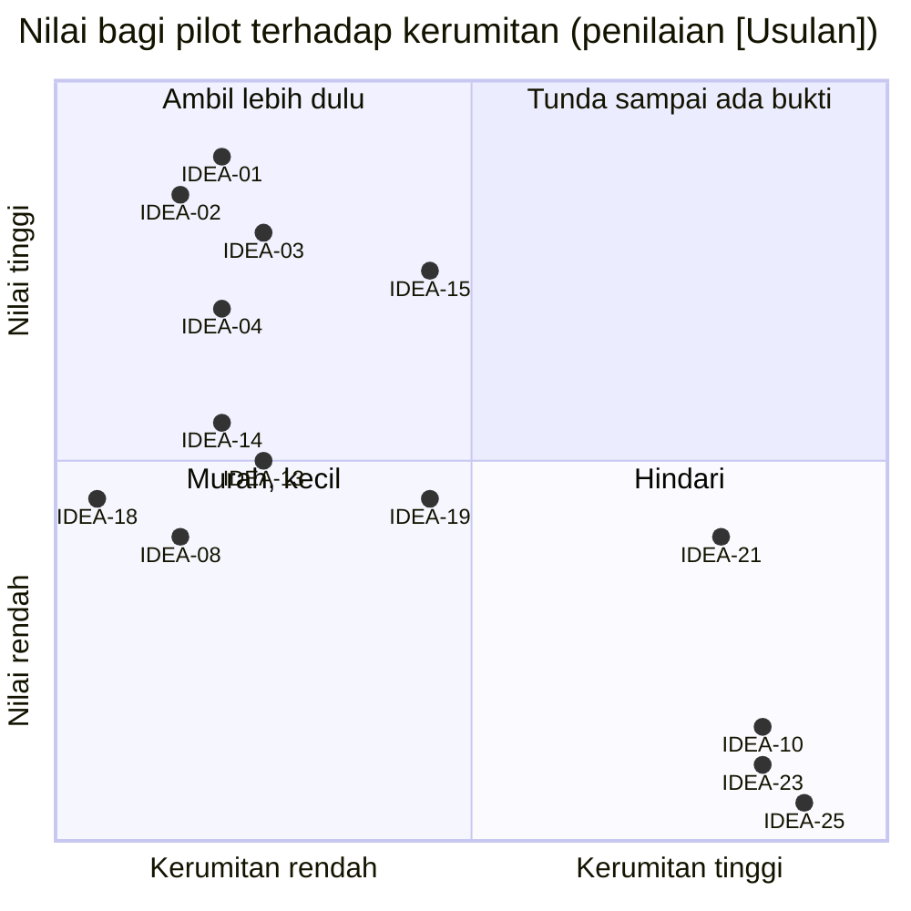
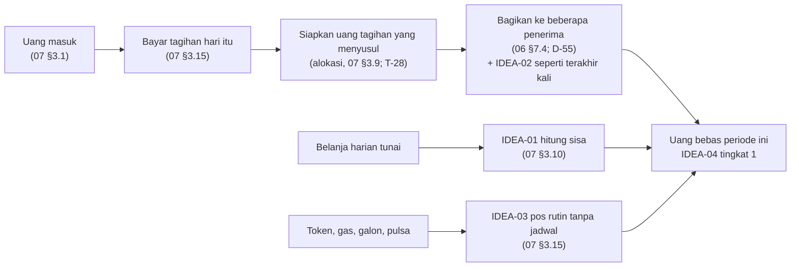

# 11 — Inovasi Fitur

| | |
|---|---|
| Pemilik dokumen | `product-analyst` |
| Tahap | S3 (Definisi produk). **S6 (12 November 2026): pass konsistensi** |
| Status | **S6 (12 November 2026): pass konsistensi.** IDEA-08 ditulis ulang sebagai mekanisme templat musiman yang umum, dengan Ramadan, THR, Lebaran, dan mudik sebagai bawaan rumah tangga pilot (W5); IDEA-13 dan IDEA-14 mengikuti penilaian dokumen 13 §9 (IDEA-14 tercakup "Minggu ini" tanpa fitur baru; IDEA-13 Could, menunggu bukti); Q-184 tercatat selesai (S4-9 (iii) A); hasil S4-5 A (keputusan 35) di IDEA-19; jalur `AI` R1 dan penyedia Claude di lensa `AI` dan IDEA-21; dikte papan ketik dirujuk ke perangkat pilot menurut keputusan 42; judul layar IDEA-20 mengikuti SEC-87. Tidak ada konsep baru; tingkatan yang diterima tidak berubah. **Sesudah checkpoint S3 (12 November 2026):** jawaban "lanjut" dicatat (bagian 0 "Kedudukan", Ringkasan, baris (8) konsep yang diajukan, bagian 9 sampai 11). S3-3 (THR sebagai gaji) dibuka ulang sebagian pada hari yang sama; IDEA-08 menyebutnya (dokumen 17 Q-183 sampai Q-185). **Sebelumnya:** draf untuk tinjauan `critic`. Ditulis bersamaan dengan dokumen 04, sehingga belum ada pengenal `F-`; fitur dirujuk dengan kode modul dan pengenal aturan dari dokumen 06 dan 07. Diselaraskan 12 November 2026 dengan jawaban 07 (§3.1 T-34, §3.10, §3.15, §10.2), keputusan pemilik produk tentang chat dan pendamping `AI`, dan 06 revisi kesembilan (§13.6, §15.3, §16): IDEA-01, 03, 08, 18, 19, 24, 25. **Putaran perbaikan fase D (12 November 2026)** atas tinjauan `critic` B (CB-04, CB-09, CB-14, CB-22) dan SP-59: IDEA-01 baris (6) mengikuti 07 §3.10 butir 1 yang baru (INV-33); skenario IDEA-19 menyatakan apa yang tetap terlihat; IDEA-19 tidak lagi bersyarat penilaian kehadiran; atribusi saran `AI` di IDEA-25 dan bagian 11 butir 7; baris tabel bagian 11 yang tergabung dipisah. Belum ditinjau ulang |
| Tanggal | 12 November 2026 |
| Dibaca sebelum menulis | `CLAUDE.md`; `family-os-brief.md` seluruhnya (terutama §1.1, §5, §8, §11); [00-glossary.md](00-glossary.md) bagian 1 sampai 7.5; [_progress.md](_progress.md); [17-open-questions-assumptions.md](17-open-questions-assumptions.md) dari awal sampai akhir "Dibawa ke S3", ditambah Q-30, Q-31, Q-32, Q-90, Q-91, Q-117, Q-123, A-15, A-17; [02-product-principles.md](02-product-principles.md) seluruhnya; [03-personas-household-models.md](03-personas-household-models.md) seluruhnya; [18-market-research.md](18-market-research.md) §0.3, §1, §2.3 sampai §2.5; [06-activity-approval-architecture.md](06-activity-approval-architecture.md) §9, §10, §13, §14; [07-financial-domain.md](07-financial-domain.md) §3.5 sampai §3.7, §3.9 sampai §3.17 |

Dokumen ini memuat 27 konsep di luar yang sudah ditetapkan brief, masing-masing dinilai dengan delapan butir brief §11. Konsep yang ternyata hanya mengulang isi brief tidak dihitung (bagian 6).

## 0. Cara membaca

**Kedudukan sesudah checkpoint S3 (12 November 2026).** Pemilik produk menjawab "lanjut", jadi bawaan S3-2 pilihan A **diterima lewat "lanjut"**: IDEA-01, IDEA-03, IDEA-02 masuk Tier 1; IDEA-15 (Should) dan IDEA-08 (isi templat) masuk Tier 2; IDEA-19 masuk Tier 2 Could; IDEA-18 cukup lewat balasan pada kartu. D-67 (Q-31, IDEA-21), D-68 (kalkulator zakat tidak dibangun), dan D-69 (konsep lain tidak diadopsi di S3; IDEA-13 dan IDEA-14 ditimbang di S5) juga diterima lewat "lanjut". Tidak satu pun pernyataan pemilik produk sendiri. Konsep yang diterima belum ditulis sebagai baris fitur di dokumen 04 dan kebutuhan di dokumen 05 (04 §9.4). Konsep selebihnya tetap **[Usulan]** `product-analyst`. Teks di bawah, termasuk bagian 9, adalah catatan atas apa yang diajukan. **Sebelum checkpoint S3:** semua konsep di sini **[Usulan]** `product-analyst`. Tidak satu pun diadopsi. Kolom "Tingkatan" adalah saran; Tier 1 dan Tier 2 adalah keputusan pemilik produk, jadi setiap konsep yang disarankan masuk pilot diajukan sebagai pertanyaan checkpoint S3 dengan bawaan yang diusulkan (bagian 9). Bila dokumen 04 ternyata sudah memuat suatu konsep sebagai fitur, konsep itu gugur ke fitur tersebut, dan lead mencocokkannya.

**Aturan uang tidak dibuat di sini.** Setiap konsep yang menyentuh uang menyebut konsep dokumen 07 tempat ia bersandar. Bila ternyata perlu aturan baru, permintaannya ada di bagian 10.1, dan konsepnya tetap Tier 3 sampai aturan itu ada.

**Skala penilaian.**

| Ukuran | Tinggi | Sedang | Rendah |
|---|---|---|---|
| Nilai | Langsung menggerakkan `KS-1` sampai `KS-4` atau `MSL-1` sampai `MSL-5` bagi rumah tangga pilot | Menjawab `MSL-6`, `MSL-7`, `KS-5`, atau kebutuhan tahap publik | Tidak menjawab masalah brief §1.1 |
| Kerumitan | Data baru, alur baru, atau ketergantungan luar (AI, platform) | Satu objek atau layar baru di atas primitif yang ada | Tampilan atau isian bawaan di atas data yang sudah ada |
| Risiko privasi | Menyangkut data kesehatan, pihak luar, anak, lokasi, atau dapat menjadi alat pantau antar-dewasa | Menambah apa yang terlihat pasangan, dengan pengaman | Tidak mengubah apa yang terlihat siapa pun |

Kode `MSL-n`, `KS-n`, `PAGAR`, `PRN-NN`, dan `KT-n` didefinisikan di dokumen 02; `PSN-NN` dan `KB-NN` di dokumen 03.

**Lensa yang dipakai pada setiap konsep.**

1. **Usaha berulang** (PRN-02). Pencatat utama pelupa (brief §1.1). Konsep yang menuntut pemeliharaan manual harian ditolak atau diubah bentuknya. Dokumen 18 §1.3.5 mencatat beban mengumpulkan data sebagai alasan terbanyak orang berhenti melacak keuangan (Epstein dkk., isi studi **[Terverifikasi]** di dokumen 18; penerapannya pada pasangan **[Asumsi]**).
2. **Pagar antar-dewasa.** 06 PG-01 sampai PG-14, AT-1 sampai AT-7, dan PRN-09 sampai PRN-14. Konsep yang menambah pengawasan atas orang dewasa lain tanpa persetujuannya (asas PG-14, **[Usulan]** `security-privacy`) ditolak.
3. **Dua pernyataan arah pemilik produk** (kata-katanya, dari `_progress.md` dan dokumen 17 kelompok (f)): "aplikasi ini bukan menunjukan siapa yang salah, tapi mencatat apa yang perlu di catat" dan "bukan dipakai untuk menyuruh nyuruh, bukan untuk membebankan, tapi mengingat dan mencatat". Bacaan lead atas keduanya **[Usulan]**, belum dikukuhkan pemilik produk kata per kata. Konsep yang menilai orang, menghitung per orang, atau membebani pasangan sebelum ia menerima, gagal di lensa ini.
4. **AI** (brief §5O; PRN-14). Tidak pernah bertindak atas nama siapa pun; hanya memakai yang boleh dilihat anggota yang dibantunya; ikut serta per orang; tanpa diagnosis; aplikasi berfungsi penuh tanpa AI. Sejak checkpoint S4 jalurnya R1 dengan penyedia Claude (ADR-021; S4-4 (i), (ii) A): selama pilot tidak ada data rumah tangga yang keluar ke penyedia, dan server memilih kalimat dari kumpulan yang dibangun lebih dulu. Konsep yang memerlukan data rumah tangga di penyedia hanya mungkin lewat jalur R2 kelak, dengan ADR baru.

## Ringkasan

| ID | Konsep | Modul | Nilai | Kerumitan | Risiko privasi | Tingkatan yang disarankan |
|---|---|---|---|---|---|---|
| IDEA-01 | Pulang dari pasar: hitung sisanya | `FIN` | Tinggi | Rendah | Rendah | **1, diterima lewat "lanjut"** di checkpoint S3 (S3-2 (i)); bentuk uang 07 §3.10 (CTH-48) |
| IDEA-02 | Bagikan seperti terakhir kali | `FIN` | Tinggi | Rendah | Rendah | **1, diterima lewat "lanjut"** (S3-2 (iii)) |
| IDEA-03 | Pos rutin tanpa jadwal (token listrik, gas, galon, paket data) | `FIN` | Tinggi | Rendah | Rendah | **1, diterima lewat "lanjut"** (S3-2 (ii)); adopsi perubahan minimal 07 §3.15 oleh `finance-domain` sesudah jawaban ini |
| IDEA-04 | Uang bebas periode ini | `FIN` | Tinggi | Rendah (tingkat 1); Sedang (tingkat 2) | Rendah | Tingkat 1: tampilan Tier 1, diputuskan dokumen 08. Tingkat 2: 3 |
| IDEA-05 | Laju anggaran | `FIN` | Sedang | Rendah | Sedang | 2 (Could) |
| IDEA-06 | Angka anggaran dari realisasi lalu | `FIN` | Sedang | Rendah | Rendah | 2 (Could) |
| IDEA-07 | Halaman keluarga besar dan orang tua | `FIN` | Sedang | Rendah | Sedang | Pengelompokan per pihak luar di daftar utang Tier 1; selebihnya 3 |
| IDEA-08 | Templat musim dan hari raya (bawaan rumah tangga pilot: Ramadan, THR, Lebaran, mudik) | `REQ`, `PLN` | Sedang | Rendah | Sedang | **2 sebagai isi templat, diterima lewat "lanjut"** (S3-2 (v)); prediksi 3 |
| IDEA-09 | Zakat, sedekah, infak, dan padanannya | `FIN` | Rendah | Rendah | Sedang | Saran nama kategori: 2. Kalkulator zakat: tidak dibangun |
| IDEA-10 | Arisan | `FIN` | Rendah | Tinggi | Sedang | 3; perlu aturan baru |
| IDEA-11 | Iuran lingkungan, sumbangan, kondangan | `FIN` | Rendah | Sedang | Tinggi | 3; catatan balasan amplop: tidak dibangun di pilot |
| IDEA-12 | Siklus biaya sekolah | `FIN`, `GOL` | Rendah (pilot); Tinggi (publik) | Sedang | Tinggi | 3 |
| IDEA-13 | Peta urusan rumah | `FAM`, `CAL` | Sedang | Rendah | Sedang | Diajukan 2 (Should); tidak diadopsi di S3 (D-69). Sesudah S5: Could, menunggu bukti, ditimbang di tinjauan tiga bulan (13 §9) |
| IDEA-14 | Tujuh hari ke depan | `NTF`, `CAL` | Sedang | Rendah | Rendah | Diajukan 2 (Should); tidak diadopsi di S3 (D-69). Sesudah S5: tercakup tanpa fitur baru oleh Beranda "Minggu ini" (08; 13 §9); sisanya ditimbang di tinjauan tiga bulan |
| IDEA-15 | Tinjauan bulanan | `FIN`, `REQ` | Tinggi | Sedang | Sedang | **2 (Should), diterima lewat "lanjut"** (S3-2 (iv)) |
| IDEA-16 | Daftar keinginan bersama | `PLN`, `REQ` | Sedang | Rendah | Sedang | 3 |
| IDEA-17 | Buku rumah | `FAM`, `MNT` | Sedang | Rendah | Tinggi | 3 |
| IDEA-18 | Terima kasih pada catatan | `REQ`, `CARE`, `COM` | Sedang | Nol (diserap chat) | Rendah | **Berubah:** dicakup F-COM-010 tanpa fitur tersendiri; varian satu ketukan 3 (Could) |
| IDEA-19 | "Butuh tenang hari ini" | `CARE`, `NTF` | Sedang | Sedang | Sedang | **2 (Could), diterima lewat "lanjut"** (S3-2 (vi)); bentuk bawaan (hanya menahan pemberitahuan) lolos penilaian `security-privacy` (SP-59) |
| IDEA-20 | Cermin privasi | `FAM` | Sedang | Sedang | Sedang | 3; penjelasan statis milik dokumen 08 dan 10 |
| IDEA-21 | Entri berbantuan: struk dan suara | `FIN`, `AI` | Sedang | Tinggi | Tinggi | Dikte papan ketik: tanpa dibangun. Pengenalan teks di perangkat: 3. Lewat penyedia AI: tidak dibangun di pilot |
| IDEA-22 | AI merapikan nada permintaan | `AI`, `REQ` | Rendah | Sedang | Tinggi | 3 |
| IDEA-23 | AI tanya-jawab uang | `AI`, `FIN` | Rendah | Tinggi | Tinggi | Tidak dibangun |
| IDEA-24 | AI meringkas diskusi | `AI`, `REQ` | Rendah | Sedang | Tinggi | Tidak dibangun |
| IDEA-25 | AI membaca suasana hati dari pola | `AI`, `CARE` | Rendah | Tinggi | Tinggi | Tidak dibangun |
| IDEA-26 | Berbagi lokasi keluarga | `FAM` | Rendah | Tinggi | Tinggi | Tidak dibangun |
| IDEA-27 | Jadwal pemakaian barang bersama | `PLN` | Rendah | Sedang | Rendah | Tidak dibangun |

**Daftar pendek untuk pemilik produk** (urutan, alasannya di bagian 8): IDEA-01, IDEA-03, IDEA-02, IDEA-15, IDEA-08.

---

## 1. Uang sehari-hari dan custody

Kelompok ini menjawab risiko pilot yang paling besar, yaitu `KS-2` (keduanya mencatat tanpa diingatkan), di tempat bebannya paling berat: belanja tunai yang sering dan gelombang uang masuk.

### IDEA-01 — Pulang dari pasar: hitung sisanya

| | |
|---|---|
| Modul | `FIN` |
| (1) Masalah | Belanja di pasar dan warung terdiri atas banyak pembelian kecil tunai tanpa struk (brief §5E). Mencatat tiap pembelian adalah beban terbesar pemegang uang belanja (dokumen 03 §2.4: "beberapa kali seminggu; beban terbesar"). `MSL-5`, `MSL-2`; `KS-2` |
| (2) Fitur | Satu layar "Pulang belanja": pemegang tempat uang tunai mengisi **sisa uang yang ia hitung**. Aplikasi menampilkan selisihnya terhadap saldo tercatat, lalu pemegang memberi selisih itu satu kategori (bawaan: kategori yang terakhir ia pakai di layar ini), atau membaginya ke beberapa kategori. Satu kali menghitung menggantikan banyak catatan |
| (3) Skenario | Istri memegang uang tunai dana bersama, tercatat Rp450.000 **[Asumsi]**. Ia ke pasar dan warung tanpa mencatat apa pun. Sepulangnya ia menghitung sisa Rp285.000 dan membuka "Pulang belanja". Aplikasi menampilkan Rp165.000 (450.000 − 285.000). Ia teringat Rp20.000 untuk bensin, jadi ia membaginya: Dapur Rp145.000, Transportasi Rp20.000 (jumlah 165.000). Saldo tercatat menjadi Rp285.000; anggaran Dapur terpakai bertambah Rp145.000 |
| (4) Nilai | Tinggi. Beban mencatat belanja pasar turun dari satu catatan per pembelian menjadi satu hitungan per perjalanan. Custody tetap benar (`KS-1`) karena saldo tercatat kembali sama dengan uang di tangan |
| (5) Kekurangan dan usaha berulang | Satu kali menghitung uang dan satu sampai dua ketukan kategori per perjalanan belanja. Rincian per barang hilang, jadi laporan per kategori lebih kasar (sudah diterima di KT-2). Bila ada pemakaian lain yang tidak tercatat di antara dua hitungan, pemakaian itu ikut masuk kategori yang dipilih kecuali pemegang membaginya. Bergantung pada saldo tercatat yang benar sebelum berangkat: serah terima yang belum dicatat akan terbaca sebagai belanja |
| (6) Privasi dan risiko penyalahgunaan | Rendah. Konsep ini hanya untuk uang tunai, dan uang tunai hanya dihitung pemegangnya: 07 §3.10 butir 1 kini mengizinkan hitungan oleh bukan pemegang **hanya** atas tempat uang `bank` atau `ewallet` dana bersama yang pemegangnya tandai "pasanganku dapat melihat saldo rekening ini", paling banyak satu yang terbuka per tempat uang (INV-33, T-33; usulan `security-privacy` SP-50; diterima lewat "lanjut" di checkpoint S3, S3-9 (i)), dan tidak pernah atas uang tunai, termasuk dompet campuran. Jadi pasangan tidak dapat memakai layar ini untuk "memeriksa dompet" orang lain; tidak boleh ada perintah "minta pasangan menghitung" (PRN-10). Yang terlihat pasangan sama dengan entri belanja biasa. **Dompet campuran** (07 §2.3; CTH-40) dikecualikan: di sana pemegang harus memilih pembagian selisih bersama atau pribadi setiap kali, tanpa bawaan (keputusan diterima atas saran lead, dokumen 17 kelompok (i) butir 4), sehingga layar ini tidak boleh mengisi pilihan itu untuknya |
| (7) Kerumitan | Rendah. Bentuknya sudah ditetapkan `finance-domain` (07 §3.10 "Menghitung lalu merinci seluruh selisih sekaligus", **[Usulan]**; CTH-48): **satu perintah**, yaitu rekonsiliasi beserta **satu entri `expense`** atas tempat uang itu yang membawa `reconciliation_id`, dirinci ke satu kategori atau lebih, bertanggal kejadian = tanggal hitung; **bukan** `cash_difference` lalu `recategorization`. Akibatnya uang itu tampil sebagai belanja di semua laporan dan kata "selisih" tidak muncul di mana pun (PRN-18). Syaratnya: jumlah baris kategori **sama persis** dengan selisih yang dihitung server; bila server menghitung selisih lain (entri lain tiba lebih dulu), perintah disimpan sebagai rekonsiliasi biasa dan perinciannya ditawarkan lagi sesudah sinkron. **Perincian sebagian** tidak memakai bentuk ini: pemegang memakai jalur biasa (selisih penuh, lalu merinci bagian yang ia ketahui). **Dompet campuran:** sah dari sisi uang, tetapi dokumen ini mengusulkan layar dompet campuran **tidak** menawarkannya, karena pembagian bersama atau pribadi harus dipilih tiap kali tanpa bawaan (baris 6). Yang baru hanya layar dan kata-katanya (dokumen 08) |
| (8) Tingkatan | **Tier 1, diterima lewat "lanjut"** di checkpoint S3 (12 November 2026; S3-2 (i); bagian 9 #1). Bentuk uangnya 07 §3.10, CTH-48. Belum ditulis sebagai fitur dan kebutuhan (04 §9.4) |
| Dasar aturan | 07 §3.10 "Menghitung lalu merinci seluruh selisih sekaligus" (bentuk, syarat, ringkasan bulanan, yang hilang, dompet campuran), CTH-48; 07 §3.10 butir 1 sampai 5 dan 8 untuk jalur biasa; 07 INV-33 (hitungan bukan pemegang, bukan untuk tunai); 07 §2.3, CTH-40, 06 V-9 (dompet campuran); 06 §6.2 (baris `expense`-nya dinilai terhadap ambang seperti belanja lain) |
| Pembanding di pasar | Dokumen 18 tidak mencatat pesaing yang mencatat belanja lewat hitungan sisa uang. Itu belum berarti tidak ada: hanya halaman vendor yang dibaca (18 §0.3) |

**Catatan tentang "uang belanja".** Brief §11 menyebut *uang belanja*. Bentuk amplop (uang belanja sebagai pos terkunci yang habis atau bergulir) tidak diusulkan: pemilik produk memilih anggaran sebagai batas tanpa amplop (keputusan pemilik nomor 8; 07 §6.1). Yang dijawab IDEA-01 adalah sisi custody dan usahanya: siapa memegang uang belanja sudah tampil per pemegang di Tier 1 (07 §5), dan konsep ini membuat pencatatannya murah.

### IDEA-02 — Bagikan seperti terakhir kali

| | |
|---|---|
| Modul | `FIN` |
| (1) Masalah | Penerima penghasilan membagikan tiap uang masuk kepada beberapa penerima, beberapa kali sebulan. Pernyataan pemilik produk (11 November 2026, dokumen 17): "gaji turun, saya input total gaji saya, saya bayar cicilan, lisrik dll, sisa saya kasih ke istri segini ke ibu segini kalau ada, ke adik kalau ada, ke ayah kalau ada", dan "bisa di tf ke istri bisa ditarik cash lalu di bagiin". `MSL-3`, `MSL-5`; `KS-1`, `KS-2` |
| (2) Fitur | Di alur "bagikan ke beberapa penerima" (06 §7.4; D-55), satu ketukan "seperti terakhir kali" mengisi daftar penerima dan jumlah dari pembagian **pencatat sendiri** yang terakhir. Tiap baris dapat diubah atau dihapus. Baris *kiriman keluarga* tampil dengan jumlah lamanya tetapi **tidak tercentang**; pencatat mencentangnya sendiri. Tidak ada yang tersimpan sebelum ia menekan simpan |
| (3) Skenario | Gaji Rp10.000.000 masuk ke rekening (angka brief §1.1). Pembagian terakhirnya: serah terima Rp5.000.000 kepada istri **[Asumsi]** dan kiriman Rp3.000.000 kepada ibu (angka brief §1.1). Ia menekan "seperti terakhir kali": baris istri tercentang, baris ibu tampil tanpa centang. Bulan ini ia tidak mengirim ke ibu, jadi ia langsung menyimpan. Tersimpan satu serah terima Rp5.000.000, bertanda belum dikonfirmasi sampai istri menekan terima (keputusan pemilik nomor 12) |
| (4) Nilai | Tinggi. Gelombang uang masuk adalah momen mencatat utama penerima penghasilan (dokumen 03 §2.4, sampai sekitar tujuh kali sebulan menurut bacaan lead). Satu gelombang menjadi dua sampai tiga ketukan |
| (5) Kekurangan dan usaha berulang | Mengurangi usaha; tidak menambah tindakan. Risikonya jangkar: jumlah lama terasa sebagai "seharusnya". Itulah sebabnya baris kiriman keluarga tidak tercentang: kiriman untuk orang tua di rumah tangga pilot **tidak rutin** (pernyataan pemilik produk, checkpoint S2), dan isian bawaan tidak boleh membuatnya tampak rutin |
| (6) Privasi dan risiko penyalahgunaan | Rendah. Bawaan diambil hanya dari riwayat pencatat sendiri, tidak dari catatan pasangan. Tidak melahirkan *kesepakatan rutin* apa pun; tiap baris adalah catatan tersendiri yang dinilai terhadap ambang seperti biasa (06 §6.2). Bagian yang diarahkan ke dana pribadi hanya dapat diisi penerima penghasilan itu sendiri (keputusan pemilik nomor 18; 07 INV-27), juga lewat isian bawaan ini |
| (7) Kerumitan | Rendah. Isian bawaan di atas alur D-55 yang sudah wajib ada; tanpa entitas baru |
| (8) Tingkatan | **Tier 1, diterima lewat "lanjut"** di checkpoint S3 (12 November 2026; S3-2 (iii); bagian 9 #3); rumahnya F-FIN-004 (04 §9.4). Catatan pengajuan: bila dokumen 04 sudah memuat isian bawaan dari entri terakhir (bawaan Q-31: "bawaan dari entri terakhir, templat untuk yang berulang"), konsep ini gugur ke fitur itu dan yang tersisa hanya syarat "kiriman keluarga tidak tercentang" |
| Dasar aturan | 06 §7.4; D-55; 07 §3.1, §3.2, §3.3; 06 §7 "Konfirmasi custody" |
| Pembanding di pasar | Dokumen 18 tidak mencatat fitur pembagian satu uang masuk ke beberapa penerima pada pesaing yang dibuka |

### IDEA-03 — Pos rutin tanpa jadwal

| | |
|---|---|
| Modul | `FIN` |
| (1) Masalah | Banyak pengeluaran rutin rumah tangga Indonesia tidak punya tanggal jatuh tempo: token listrik prabayar, gas elpiji, air galon, pulsa dan paket data, infak mingguan **[Asumsi]**: kebiasaan rumah tangga pilot tidak diketahui. Pemilik produk menyebut "pulsa/wifi" sebagai contoh kategori (keputusan pemilik nomor 8). Kini tiap pembelian semacam itu adalah belanja biasa yang diisi dari awal. `MSL-5`, `MSL-6` ("siapa membayar tagihan apa"); `KS-2` |
| (2) Fitur | Pos rutin yang hanya punya nama, kategori, dan jumlah sepakat per kali, **tanpa tanggal jatuh tempo dan tanpa pengingat**. Pos itu tampil sebagai daftar tombol di layar catat: satu ketukan memilih pos, jumlahnya terisi dengan jumlah terakhir, lalu simpan |
| (3) Skenario | Rumah tangga menyepakati pos "Token listrik" dengan batas Rp300.000 per kali **[Asumsi]**. Suami membeli token Rp200.000 di minimarket, membuka aplikasi, mengetuk "Token listrik", mengganti jumlah menjadi 200.000, menyimpan. Pembayaran di bawah jumlah sepakat tidak ditandai, siapa pun yang membayar (07 §3.15 aturan 3) |
| (4) Nilai | Tinggi. Pembelian kecil yang sering menjadi dua sampai tiga ketukan, dan pertanyaan "token sudah dibeli siapa?" terjawab tanpa bertanya |
| (5) Kekurangan dan usaha berulang | Satu kesepakatan per pos saat dibuat (satu ketukan pasangan, penegasan 3); sesudahnya nol tambahan. Batas berlaku per kali dan kekerapan tidak diperiksa (07 §3.15 aturan 7), jadi tiga kali Rp300.000 dalam sebulan tidak ditandai; yang menangkap jumlah bulanannya adalah anggaran kategori. Hal ini harus dinyatakan di layar kesepakatan |
| (6) Privasi dan risiko penyalahgunaan | Rendah. Tidak ada data baru. Pagar pos rutin yang sudah ada tetap berlaku: status kesepakatan hanya di layar pos (SP-35), "setuju sekaligus" tanpa pilihan terisi (SP-36), tanda dasar pos rutin tidak pernah menjadi pemberitahuan langsung (dokumen 17 kelompok (i) butir 2) |
| (7) Kerumitan | Rendah. `finance-domain` menjawab (07 §3.15 "Tagihan berulang tanpa `due_rule`"): pada saat itu **belum diadopsi** dan `due_rule` wajib; keputusannya milik pemilik produk, yang menerimanya lewat "lanjut" di checkpoint S3 (S3-2 (ii)), jadi adopsinya kini pekerjaan `finance-domain`. Perubahan minimalnya hanya `due_rule?` menjadi opsional; tagihan tanpanya tidak punya kejadian tagihan, tidak punya pengingat, tidak pernah tampil di "belum dibayar periode ini" atau "siapkan uang", dan tautan pembayarannya tanpa `bill_occurrence_due`. Tidak ada invarian, saldo, atau aturan tanda yang berubah. Layar harus menyatakan bahwa batasnya per kali, bukan per bulan. Sisi alur (`architect`, 10.2 #1) masih perlu konfirmasi bahwa usulan pos rutin tanpa jadwal tidak mengubah K01 |
| (8) Tingkatan | **Tier 1, diterima lewat "lanjut"** di checkpoint S3 (12 November 2026; S3-2 (ii); bagian 9 #2). Menunggu adopsi 07 §3.15 dan konfirmasi sisi alur 06 (10.1 #2, 10.2 #1) sebelum ditulis sebagai fitur dan kebutuhan (04 §9.4) |
| Dasar aturan | 07 §3.15 aturan 1 sampai 7a dan "Tagihan berulang tanpa `due_rule`"; 06 §6.3 "Pos rutin", INV-A43; penegasan 3 (dokumen 17 kelompok (d)) |
| Pembanding di pasar | Pengingat tagihan berulang ada di Money Lover, biaya berulang di Splitwise, transaksi berulang di CoupleWallet (18 §1.1, §1.2, **[Terverifikasi]** untuk isi halaman). Yang tidak terlihat di halaman itu: pos tanpa jadwal dengan batas yang disepakati berdua |

### IDEA-04 — Uang bebas periode ini

| | |
|---|---|
| Modul | `FIN` |
| (1) Masalah | Pertanyaan suami di brief §1.1 bukan hanya "berapa uang kita" tetapi "uang bulanan masih ada?". Sesudah uang masuk, sebagian sudah "milik" tagihan yang jatuh temponya menyusul (pernyataan pemilik produk, checkpoint S2: uang masuk tanggal 11, tagihan tanggal 12, 13, 20, 29). `MSL-1`; `KS-1` |
| (2) Fitur | **Tingkat 1**: di samping *uang yang ada*, tampil berapa yang *belum dialokasikan* pada tempat uang dana bersama, dan daftar tagihan periode ini yang belum dibayar dan belum disiapkan, masing-masing dengan perkiraan jumlahnya. Daftar itu **tidak dikurangkan** dari angka mana pun. **Tingkat 2**: satu angka "perkiraan uang bebas" yang mengurangkan perkiraan tagihan itu |
| (3) Skenario | Tanggal 13, sesudah tagihan tanggal 12 dan 13 dibayar, dana bersama tercatat Rp6.000.000 **[Asumsi]**. Suami sudah menyiapkan Rp1.200.000 untuk tagihan tanggal 20 dan 29 lewat alokasi (07 §3.15; CTH-41). Tingkat 1 menampilkan: uang yang ada Rp6.000.000, belum dialokasikan Rp4.800.000 (6.000.000 − 1.200.000), dan satu baris "air, perkiraan Rp250.000, belum disiapkan". Tingkat 2 akan menampilkan Rp4.550.000 (4.800.000 − 250.000) sebagai perkiraan |
| (4) Nilai | Tinggi, tetapi hanya bila rumah tangga memakai alokasi. Tanpa alokasi, *belum dialokasikan* sama dengan uang yang ada dan tingkat 1 hanya menambah daftar tagihan |
| (5) Kekurangan dan usaha berulang | Tingkat 1: nol usaha bila tagihan disiapkan dengan satu langkah "siapkan semua tagihan" (syarat layar 07 §3.15). Tingkat 2 mencampur perkiraan dengan uang yang ada; angka itu dapat dibaca sebagai uang sungguhan, padahal PRN-17 melarang rencana mengubah angka uang |
| (6) Privasi dan risiko penyalahgunaan | Rendah. Semua angkanya dana bersama yang sudah terlihat keduanya (PRN-13); dana pribadi tidak masuk (07 §2.2) |
| (7) Kerumitan | Tingkat 1 rendah: *belum dialokasikan* dan alokasi sudah didefinisikan (07 §3.9). Tingkat 2 sedang: perlu aturan baru tentang tagihan mana yang dihitung dan jumlah mana yang dipakai (perkiraan atau jumlah sepakat) (10.1 #3) |
| (8) Tingkatan | Tingkat 1: tampilan atas data Tier 1; apakah ia di layar pertama diputuskan dokumen 08 (S4). Tingkat 2: **Tier 3** sampai aturannya ada |
| Dasar aturan | 07 §3.9 (alokasi, *belum dialokasikan*), §3.15 (menyiapkan uang tagihan; T-28, Q-117 masih **[Usulan]**), §5 (tampilan custody); PRN-17 |
| Pembanding di pasar | Tidak diperiksa di dokumen 18 |

### IDEA-05 — Laju anggaran

| | |
|---|---|
| Modul | `FIN` |
| (1) Masalah | Anggaran belanja dapur sering terlampaui (brief §1.1). Batas saja baru terasa ketika sudah terlewati. `MSL-4` |
| (2) Fitur | Pada layar anggaran satu kategori, satu kalimat perkiraan: "dengan laju sejauh ini, anggaran ini habis sekitar tanggal *n*". **Tanpa notifikasi push** kepada siapa pun |
| (3) Skenario | Anggaran Dapur Rp2.000.000 untuk periode 1 sampai 30 November **[Asumsi]**. Sampai akhir tanggal 10 terpakai Rp900.000, jadi lajunya Rp90.000 per hari. Batasnya tercapai sesudah sekitar 22,2 hari (2.000.000 ÷ 90.000), jadi kalimatnya "habis sekitar tanggal 23" |
| (4) Nilai | Sedang. Membantu sebelum belanja, bukan sesudahnya (`KB-04`) |
| (5) Kekurangan dan usaha berulang | Nol usaha. Belanja dapur tidak merata (belanja besar mingguan) **[Asumsi]**, jadi perkiraan di awal periode bising; usulannya, kalimat baru tampil sesudah sepertiga periode |
| (6) Privasi dan risiko penyalahgunaan | Sedang. Anggaran adalah data bersama, tetapi belanja dapur di pilot dilakukan terutama oleh pemegang uang belanja (brief §1.1), jadi peringatan laju yang dikirim kepada pasangan menjadi pantauan atas satu orang (asas PG-14; 07 §10.3 butir 3). Karena itu: hanya di layar anggaran, sama bagi keduanya, tanpa push, tanpa riwayat laju lintas periode (AT-4), dan kalimatnya menyebut anggaran, bukan orang (PRN-18) |
| (7) Kerumitan | Rendah. Angka turunan dari *terpakai*, bukan aturan uang; rumusnya perlu ditetapkan `finance-domain` agar konsisten dengan *sisa anggaran* yang juga mengurangkan yang *terikat* (10.1 #4) |
| (8) Tingkatan | Tier 2 (Could) |
| Dasar aturan | 07 §6.1 (*sisa anggaran*, *terpakai*, *terikat*); 06 AT-4 |
| Pembanding di pasar | CoupleWallet: anggaran bulanan per kategori dengan notifikasi saat mendekati batas (18 §1.2, **[Terverifikasi]** untuk isi halaman). Laju adalah variasi atasnya, bukan gagasan asli |

### IDEA-06 — Angka anggaran dari realisasi lalu

| | |
|---|---|
| Modul | `FIN` |
| (1) Masalah | Rumah tangga yang baru mulai tidak tahu angka anggaran yang masuk akal; angka yang terlalu kecil membuat batas terlampaui setiap bulan dan kehilangan arti. `MSL-4` |
| (2) Fitur | Saat mengubah atau membuat anggaran satu kategori, layar menampilkan realisasi kategori itu pada sampai tiga periode terakhir dan rata-ratanya. Angka itu **tidak** diisikan ke kolom anggaran |
| (3) Skenario | Realisasi Dapur tiga periode terakhir Rp2.300.000, Rp2.150.000, Rp2.450.000 **[Asumsi]**, rata-rata Rp2.300.000 (6.900.000 ÷ 3). Anggarannya Rp2.000.000; istri mengusulkan Rp2.300.000 |
| (4) Nilai | Sedang. Anggaran menjadi kesepakatan atas kenyataan, bukan target yang selalu gagal |
| (5) Kekurangan dan usaha berulang | Nol usaha tambahan. Di bulan pertama pilot belum ada riwayat; sesudah satu periode hanya satu angka |
| (6) Privasi dan risiko penyalahgunaan | Rendah. Realisasi kategori sudah terlihat keduanya |
| (7) Kerumitan | Rendah. *Realisasi* sudah didefinisikan (glosarium 7.4) |
| (8) Tingkatan | Tier 2 (Could). Versi AI ("AI menyarankan anggaran") **ditolak**: tiga angka dan rata-ratanya cukup, dan AI tidak menambah apa pun kecuali biaya dan data keluar |
| Dasar aturan | 07 §6.1, §6.2 |
| Pembanding di pasar | Tidak diperiksa di dokumen 18 |

---

## 2. Keluarga besar dan kenyataan Indonesia

Satu tantangan kepada brief: dari daftar kenyataan Indonesia di brief §11, hanya uang tunai di pasar (IDEA-01), pembelian rutin tanpa jadwal (IDEA-03), kiriman keluarga (IDEA-02, IDEA-07), dan musim Lebaran (IDEA-08) yang menyentuh masalah brief §1.1 bagi rumah tangga pilot. Arisan, zakat, gotong royong, dan biaya sekolah nyata bagi keluarga Indonesia, tetapi untuk pilot ketiganya menambah model tanpa menjawab satu pun `MSL-n`; tempatnya tahap publik, dan sebagian besar sudah dapat dicatat dengan kategori buatan rumah tangga sendiri (keputusan pemilik nomor 9) tanpa membangun apa pun.

### IDEA-07 — Halaman keluarga besar dan orang tua

| | |
|---|---|
| Modul | `FIN` |
| (1) Masalah | Bantuan dan pinjaman kepada saudara dan ayah sering tidak tercatat (brief §1.1). Sesudah tercatat, pertanyaan berikutnya adalah "adik masih pinjam berapa?" dan "tahun ini kita sudah bantu Ayah berapa?". `MSL-3`; `KB-07`, `KB-21` |
| (2) Fitur | Satu halaman per *pihak luar*: pinjaman yang masih terbuka, riwayat kiriman dan pelunasan, dan piutang yang diikhlaskan sebagai baris tersendiri (07 §3.7). Untuk orang tua lanjut usia yang tidak memakai aplikasi (PSN-03), halaman ini juga tempat rutinitas tanpa data kesehatan, misalnya "antar Ibu kontrol" sebagai rutinitas `CAL` biasa |
| (3) Skenario | Adik meminjam Rp1.000.000 dari dana bersama dan sudah mengembalikan Rp400.000 **[Asumsi]**. Halaman "Adik" menampilkan pinjaman terbuka Rp600.000 (1.000.000 − 400.000) dan dua catatannya |
| (4) Nilai | Sedang. Sebagian besar sudah ada di Tier 1 (utang dan pinjaman kepada keluarga besar; ringkasan per penerima manfaat); yang baru hanya pengelompokan per orang |
| (5) Kekurangan dan usaha berulang | Nol usaha; semua datanya akibat samping pencatatan |
| (6) Privasi dan risiko penyalahgunaan | Sedang. (a) Pihak luar tidak pernah menyetujui pencatatannya (Q-28); halaman ini hanya memakai nama panggilan dan hubungan (07 §2.6), tanpa tanggal lahir, kontak, atau data kesehatan. (b) **Tidak ada jumlah per "sisi keluarga"** (keluarga suami lawan keluarga istri): pengelompokan itu membaca *hubungan* untuk membandingkan dua orang dewasa, dan mudah menjadi bahan "keluargamu dapat lebih banyak" (arah 1; PRN-11; semangat AT-7). Usulan ini diteruskan ke `security-privacy` untuk dokumen 10 |
| (7) Kerumitan | Rendah. Tampilan atas entri yang sudah ada |
| (8) Tingkatan | Pengelompokan per pihak luar di daftar utang dan piutang: **syarat tampilan Tier 1** yang diusulkan untuk dokumen 05, tanpa fitur baru. Selebihnya Tier 3 |
| Dasar aturan | 07 §2.6, §3.2 (kiriman keluarga), §3.7 (pinjaman, pelunasan, `write_off`), §6.3 |
| Pembanding di pasar | Money Lover, Splitwise, SakuSaku, CoupleWallet mencatat utang atau pinjaman secara umum; dokumen 18 tidak mencatat ada yang memodelkan kewajiban kepada keluarga besar sebagai konsep tersendiri, dengan label **[Perlu validasi]** karena tidak diperiksa khusus (18 §1.2) |

### IDEA-08 — Templat musim dan hari raya (bawaan rumah tangga pilot: Ramadan, THR, Lebaran, mudik)

| | |
|---|---|
| Modul | `REQ`, `PLN`, `FIN` |
| (1) Masalah | Banyak keluarga punya satu atau beberapa musim pengeluaran besar yang berulang tiap tahun (hari raya, libur sekolah, tahun ajaran baru) **[Asumsi]**; bila datang tanpa rencana, itulah bentuk terbesar `MSL-4`. Bagi rumah tangga pilot musim itu Lebaran. Pengeluaran terbesar dalam setahun bagi banyak keluarga Indonesia berkumpul di sekitar Lebaran: mudik, baju, oleh-oleh, salam tempel, zakat fitrah **[Asumsi]**. Bila datang tanpa rencana, itulah bentuk terbesar `MSL-4`. Pilot diperkirakan berjalan seluruhnya sesudah pertengahan Januari 2027 (dokumen 18 §2.3 butir 5, **[Asumsi]** atas jadwal), dan Idulfitri 1448 H jatuh 10–11 Maret 2027, dengan cuti bersama 9, 12, 15 Maret (**[Terverifikasi]** 18 §2.14, Setneg; awal Ramadan 8 atau 9 Februari 2027, **[Asumsi]**). Jadi pilot tiga bulan kemungkinan besar melewati Ramadan dan Lebaran |
| (2) Fitur | Tidak ada fitur baru. **Mekanisme templat musiman yang umum** **[Usulan]** `product-analyst`: sebuah templat adalah nama, daftar butir rencana yang dapat dihapus untuk *permintaan jalan-jalan*, dan bila perlu satu rutinitas pendamping. Rumah tangga dapat memakai, menyunting, menyembunyikan, dan menambah templat; isi bawaannya per pasar, seperti daftar sumber pemasukan bawaan (07 §3.1, `household.income_source_market`), dan tidak satu pun aturan membaca nama musim atau agama. Templat tidak membuat entri, tidak mengubah aturan uang, dan tidak membawa jadwal yang memicu pemberitahuan. **Bawaan rumah tangga pilot:** "Mudik dan Lebaran": butir transportasi, oleh-oleh, baju, salam tempel, zakat fitrah, dan rutinitas "rumah ditinggal" (kunci, listrik, titip kunci). Rumah tangga lain dapat memakai templat seperti Natal, Imlek, Nyepi, Waisak, libur sekolah, atau tahun ajaran baru, atau tidak memakai templat sama sekali **[Asumsi]** atas isinya. Uang THR dicatat sebagai uang masuk biasa lalu dibagi dengan alokasi. Tingkat lanjut, "musim yang sama tahun lalu menghabiskan Rp…", butuh riwayat setahun |
| (3) Skenario | THR Rp10.000.000 masuk **[Asumsi]** (jumlahnya; bahwa rumah tangga pilot menerima dan memberi THR adalah bacaan lead atas kalimat pemilik produk "thr bisa menerima bisa ngasih", belum dikukuhkan, Q-183); salam tempel di bawah adalah satu bentuk THR yang diberikan, yang aturannya 07 §3.2 "THR dan angpau yang diberikan" (T-42 **[Usulan]**, Q-185); penghasilan lepas lazimnya tanpa THR **[Asumsi]**. Suami mengalokasikan Rp3.000.000 mudik, Rp1.500.000 baju, Rp1.000.000 salam tempel; belum dialokasikan Rp4.500.000 (10.000.000 − 5.500.000). Ia mengajukan permintaan jalan-jalan "Mudik" Rp3.000.000 dari templat; istri mengusulkan balik tanggal berangkat; disetujui. Salam tempel dibagikan lewat alur "bagikan ke beberapa penerima" (D-55) sebagai satu *kiriman keluarga* kepada satu pihak luar "Keponakan", bukan satu catatan per anak |
| (4) Nilai | Sedang, dan sangat bergantung waktu: bagi rumah tangga pilot tinggi bila pilot memang melewati Lebaran, nol bila tidak; bagi rumah tangga lain tergantung musimnya sendiri |
| (5) Kekurangan dan usaha berulang | Sekali per musim per tahun. Templat menambah isi, bukan alur; menyunting templat tidak wajib. Bulan Lebaran akan mengacaukan pembanding antar-bulan di pilot (anggaran dan ringkasan); itu catatan untuk rencana validasi dokumen 13 |
| (6) Privasi dan risiko penyalahgunaan | Sedang. Salam tempel menyentuh anak-anak kerabat, dan data anak adalah data pribadi spesifik (UU PDP Pasal 4 dan 25, **[Terverifikasi]** di dokumen 18 §2.2). Usulan minimisasi: satu pihak luar kelompok ("Keponakan") tanpa nama anak satu per satu, diteruskan ke dokumen 10. Zakat fitrah menyiratkan agama (IDEA-09) |
| (7) Kerumitan | Rendah: isi templat di atas `REQ` Tier 1 dan alokasi. Prediksi dari riwayat: sedang |
| (8) Tingkatan | **Tier 2 sebagai isi templat, diterima lewat "lanjut"** di checkpoint S3 (12 November 2026; S3-2 (v); bagian 9 #5). Yang diterima adalah templat "Mudik dan Lebaran"; bahwa ia dibangun sebagai mekanisme umum dengan templat itu sebagai bawaan pilot adalah rumusan S6 (W5) yang tidak mengubah apa yang dibangun untuk pilot. Waktunya dijadwalkan 13 §9: FS-2 bila jendela pilot mencakup Ramadan 2027, bila tidak sebelum Ramadan berikutnya di FS-2 yang berlanjut (A-37). Prediksi dari riwayat: Tier 3 |
| Dasar aturan | 07 §3.1 (uang masuk), §3.2 (kiriman keluarga), §3.9 (alokasi), §3.8 (otorisasi); 06 §4 (permintaan jalan-jalan), §7.4 (bagikan). **Dijawab `finance-domain`** (07 §3.1, T-34, **[Usulan]**): THR dan bonus dari pemberi kerja adalah sumber `salary`, jadi selalu terlihat pasangan beserta bagian yang diarahkan ke uang pribadi; semula diterima lewat "lanjut" (S3-3 A; 07 §10.4 butir 1), lalu **dibuka ulang sebagian** pada hari yang sama: pemilik produk bertanya "kenapa thr dicatat sebagai gaji? kan pemasukan kita yang atur darimana nya?" dan menyatakan "ada kategori default bisa edit tambah atau yang lainnya" ("kategori" dibaca lead sebagai sumber pemasukan, **[Usulan]**). Aturan bawaannya kini 07 §3.1 "Sumber uang masuk": THR sumber bawaan di kelompok `work`, selalu terlihat; daftar bawaan dapat disunting (T-43; bawaannya diterima lewat "lanjut" di checkpoint S4, S4-9 (iii) A; dokumen 17 Q-184 selesai). Pertanyaan sampingan "apakah kalian menerima THR?" dijawab: "thr bisa menerima bisa ngasih" (Q-183, tertutup sebagai pertanyaan; artinya bacaan lead). THR yang **diberikan**: 07 §3.2, CTH-51, T-42 **[Usulan]** (Q-185; FIN-1.md FR-FIN-040/AC-14). Angka skenario (3) tetap **[Asumsi]** |
| Pembanding di pasar | Tidak diperiksa di dokumen 18 |

### IDEA-09 — Zakat, sedekah, infak, dan padanannya

| | |
|---|---|
| Modul | `FIN` |
| (1) Masalah | Pemberian keagamaan dan sosial adalah pengeluaran rutin banyak keluarga; zakat mal juga menuntut hitungan tahunan atas harta **[Asumsi]**. Tidak menjawab `MSL-n` mana pun bagi pilot secara langsung; paling dekat `MSL-3` (arus uang yang tidak tercatat) |
| (2) Fitur | (a) Saran nama kategori saat onboarding yang dapat dihapus atau diganti, dengan nama yang dipilih rumah tangga sendiri: "Zakat dan sedekah", "Persembahan", "Dana punia", atau netral "Berbagi". (b) Infak atau sedekah mingguan sebagai pos rutin (IDEA-03). (c) **Kalkulator zakat: tidak dibangun** |
| (3) Skenario | Istri memasukkan Rp20.000 ke kotak infak masjid setiap Jumat **[Asumsi]**: satu ketukan pada pos "Infak Jumat". Menjelang Idulfitri ia mencatat zakat fitrah sebagai belanja berkategori "Zakat dan sedekah" kepada pihak luar "Masjid"; aplikasi tidak menghitung jumlahnya |
| (4) Nilai | Rendah bagi pilot; sedang bagi tahap publik sebagai rasa "aplikasi ini mengerti kami" **[Asumsi]** |
| (5) Kekurangan dan usaha berulang | Nol tambahan di luar mencatat. Kalkulator ditolak karena: (i) besaran nisab dan haul adalah ketentuan agama yang tafsirnya beragam, dan aplikasi tidak boleh memberi fatwa; (ii) dasar hitungnya harta pribadi, padahal angka rumah tangga sengaja tidak memuat dana pribadi (07 §2.2), jadi angka yang tersedia di aplikasi adalah dasar yang salah; (iii) salah hitung menyangkut ibadah orang |
| (6) Privasi dan risiko penyalahgunaan | Sedang. Kategori bertema agama mengungkap keyakinan; apakah ia data pribadi spesifik menurut UU PDP **[Perlu validasi]** (tidak diperiksa di dokumen 18). Sedekah dari dana pribadi tetap tertutup (keputusan pemilik nomor 3) kecuali untuk keperluan rumah tangga |
| (7) Kerumitan | Rendah untuk (a) dan (b) |
| (8) Tingkatan | Saran nama kategori: Tier 2 (Could), isi onboarding. Kalkulator zakat: **tidak dibangun**; diterima lewat "lanjut" di checkpoint S3 sebagai D-68 (bagian 9 #7) |
| Dasar aturan | 07 §3.2 (pengeluaran kepada pihak luar), §3.15 (pos rutin); keputusan pemilik nomor 9 (semua daftar buatan pengguna) |
| Pembanding di pasar | Tidak diperiksa di dokumen 18 |

### IDEA-10 — Arisan

| | |
|---|---|
| Modul | `FIN` |
| (1) Masalah | Arisan adalah kelompok tabungan bergilir: tiap anggota menyetor jumlah tetap tiap putaran, dan satu anggota menerima seluruh setoran putaran itu. Dicatat sebagai belanja lalu pemasukan, ia menggelembungkan pemasukan dan pengeluaran. Apakah rumah tangga pilot ikut arisan tidak diketahui; "kue arisan" di 07 §7.6 adalah ilustrasi. Tidak menjawab `MSL-n` bagi pilot |
| (2) Fitur | Satu pihak luar berjenis arisan dengan setoran per putaran dan putaran giliran sendiri, sehingga aplikasi dapat menampilkan "sudah setor sekian, sudah/belum menerima" |
| (3) Skenario | Arisan sepuluh orang, setoran Rp200.000 per bulan, giliran menerima di bulan ketiga sebesar Rp2.000.000 **[Asumsi]**. Dua bentuk yang mungkin, **bukan aturan**, untuk dipilih `finance-domain`: (a) belanja Rp200.000 tiap bulan dan pemasukan Rp2.000.000 di bulan ketiga; atau (b) di atas 07 §3.7: setoran sebelum giliran menjadi piutang kepada kelompok (Rp600.000 sesudah tiga setoran), uang giliran melunasi piutang itu dan sisanya, Rp1.400.000 (2.000.000 − 600.000), menjadi kewajiban yang dilunasi tujuh setoran berikutnya (7 × 200.000 = 1.400.000). Bentuk (b) membuat kekayaan bersih tetap sepanjang putaran, bentuk (a) tidak |
| (4) Nilai | Rendah bagi pilot; sedang bagi tahap publik **[Asumsi]** |
| (5) Kekurangan dan usaha berulang | Satu catatan per setoran, sama dengan sekarang. Arisan nyata punya variasi (potongan uang kocok, arisan barang, giliran yang dibeli) **[Asumsi]**; model yang menampung semuanya mahal |
| (6) Privasi dan risiko penyalahgunaan | Sedang. Arisan sering urusan pribadi seorang anggota dengan teman-temannya **[Asumsi]**; dari dana pribadi ia tetap tertutup. Nama anggota arisan lain tidak dicatat (Q-28) |
| (7) Kerumitan | Tinggi untuk bentuk (b): satu pihak luar yang posisinya berpindah dari piutang ke kewajiban di tengah putaran adalah aturan uang baru |
| (8) Tingkatan | **Tier 3**, sampai `finance-domain` menetapkan aturannya (10.1 #6). Sampai itu, rumah tangga yang ingin dapat mencatatnya dengan kategori buatan sendiri, dengan cacat bentuk (a) yang dinyatakan |
| Dasar aturan | 07 §3.7 (bentuk b); 07 §3.1, §3.2 (bentuk a). Perlu aturan baru |
| Pembanding di pasar | Tidak diperiksa di dokumen 18 |

### IDEA-11 — Iuran lingkungan, sumbangan, dan kondangan

| | |
|---|---|
| Modul | `FIN`, `TML` |
| (1) Masalah | Iuran RT/RW, sumbangan duka, dan amplop kondangan adalah pengeluaran sosial yang nyata; banyak keluarga juga menyimpan catatan siapa memberi berapa di hajatan sendiri supaya dapat membalas setara **[Asumsi]**. Tidak menjawab `MSL-n` bagi pilot |
| (2) Fitur | (a) Iuran RT sebagai pos rutin (IDEA-03), sumbangan dan kondangan sebagai kategori buatan rumah tangga: tanpa dibangun. (b) Catatan balasan: daftar tamu hajatan dan amplopnya |
| (3) Skenario | Iuran RT Rp50.000 per bulan **[Asumsi]** dibayar lewat satu ketukan pos rutin. Kondangan Rp100.000 dicatat sebagai belanja kategori "Sumbangan" |
| (4) Nilai | Rendah bagi pilot |
| (5) Kekurangan dan usaha berulang | (a) nol tambahan. (b) satu catatan per tamu per hajatan, ratusan baris sekali waktu |
| (6) Privasi dan risiko penyalahgunaan | Tinggi untuk (b): nama dan jumlah pemberian orang yang bukan pengguna, dalam jumlah besar, tanpa persetujuan mereka (Q-28; dokumen 18 §2.1) |
| (7) Kerumitan | (a) nol; (b) sedang |
| (8) Tingkatan | (a) sudah mungkin dengan Tier 1 dan IDEA-03. (b) **tidak dibangun di pilot**; dinilai ulang di tahap publik oleh `security-privacy` |
| Dasar aturan | 07 §3.2, §3.15; 07 §3.1 (amplop yang diterima adalah hadiah) |
| Pembanding di pasar | Tidak diperiksa di dokumen 18 |

### IDEA-12 — Siklus biaya sekolah

| | |
|---|---|
| Modul | `FIN`, `GOL`, `CAL` |
| (1) Masalah | Selain SPP bulanan, ada biaya tahunan yang datang serentak di awal tahun ajaran (daftar ulang, buku, seragam) dan uang pangkal saat masuk sekolah baru **[Asumsi]**. Rumah tangga pilot punya anak berusia 12 tahun ke atas (pilihan pemilik produk sendiri, "Ada anak umur 12+"; dokumen 17 A-31 gugur, Q-186; dokumen 03 §4.1). Siklus ini menyentuh `MSL-1` dan `MSL-4` pilot hanya lewat tagihan dan alokasi yang sudah Tier 1: SPP sebagai pos rutin, daftar ulang sebagai alokasi (atau tagihan berulang tahunan, bila 07 §3.15 mendukung pola tahunan; 10.1 #7), uang pangkal sebagai tujuan tabungan. Yang tidak dimiliki Tier 1 hanya saran alokasi bulanan otomatis. Bagi struktur 2, 3, dan 6 di tahap publik ini kebutuhan inti `GOL` (brief §5H "school fees") |
| (2) Fitur | SPP sebagai pos rutin bulanan; biaya tahunan sebagai tagihan berulang tahunan dengan alokasi bulanan yang disarankan; uang pangkal sebagai tujuan tabungan |
| (3) Skenario | Daftar ulang Rp3.600.000 tiap Juli **[Asumsi]**; mulai Agustus rumah tangga menyiapkan Rp300.000 per bulan lewat alokasi (3.600.000 ÷ 12) |
| (4) Nilai | Rendah sampai sedang bagi pilot, karena bentuk Tier 1 sudah menampung polanya; tinggi bagi keluarga dengan anak sekolah di tahap publik **[Asumsi]** |
| (5) Kekurangan dan usaha berulang | Satu alokasi per bulan bila dilakukan manual; dapat menumpang langkah "siapkan semua tagihan" (07 §3.15) |
| (6) Privasi dan risiko penyalahgunaan | Tinggi: anak sebagai penerima manfaat adalah data anak (dokumen 18 §2.2); profil tanggungan Tier 3 |
| (7) Kerumitan | Sedang: tagihan berulang tahunan dan saran alokasi bulanan |
| (8) Tingkatan | **Tier 3** (`GOL` di luar tabungan sederhana). Tingkat tidak berubah sesudah A-31 gugur: alasannya bukan lagi "tidak ada anak", melainkan bahwa pola biaya sekolah pilot sudah dapat dicatat dengan bentuk Tier 1, dan yang tersisa (saran alokasi otomatis) tidak menjawab masalah brief §1.1 yang belum terjawab |
| Dasar aturan | 07 §3.9 (tujuan `savings`, alokasi), §3.15 (apakah aturan jatuh tempo mendukung pola tahunan perlu dikonfirmasi; 10.1 #7) |
| Pembanding di pasar | MoneyKita (target keuangan bersama), FamilyWall (menabung untuk tujuan), Money Lover (rencana tabungan) menurut 18 §1.1, §1.2 (**[Terverifikasi]** untuk isi halaman); siklus biaya sekolah tidak tercatat |

---

## 3. Beban pikiran, keputusan bersama, dan rencana

### IDEA-13 — Peta urusan rumah

| | |
|---|---|
| Modul | `FAM`, `CAL` |
| (1) Masalah | "Siapa membayar tagihan apa, dan berapa, harus jelas" (brief §1.1). Rutinitas yang terlupa (menanak nasi) sering terlupa karena tidak jelas siapa yang memegangnya **[Asumsi]**. `MSL-6` |
| (2) Fitur | Satu daftar "urusan" rumah tangga: tiap tagihan berulang, pos rutin, dan rutinitas beserta *tanggung jawab*-nya (brief §4.3), dengan pilihan "bergantian" atau "siapa saja". Menjadikan orang dewasa lain penanggung jawab memakai *permintaan tindakan* yang ia terima; tidak ada penugasan sepihak (06 §13.1, §13.4) |
| (3) Skenario | Daftar menampilkan: Listrik dan internet — suami; Belanja dapur — istri; Menanak nasi — siapa saja; Token listrik — siapa saja. Istri meminta suami memegang "Bayar air"; suami menerima; baris itu berubah |
| (4) Nilai | Sedang. Menjawab satu baris brief §1.1 secara langsung tanpa data baru |
| (5) Kekurangan dan usaha berulang | Sekali diatur, berubah jarang. Dapat membekukan pembagian peran, termasuk yang mengikuti kebiasaan gender **[Asumsi]** |
| (6) Privasi dan risiko penyalahgunaan | Sedang. **Tidak ada** hitungan, persentase, atau neraca "siapa mengerjakan lebih banyak", dan tidak ada papan peringkat (PRN-11; 06 AT-4, PG-09). Tanggung jawab tidak memberi izin atau wewenang (glosarium bagian 3). Penanggung jawab tidak diberi tanda "terlambat" yang terlihat pasangan |
| (7) Kerumitan | Rendah. *Tanggung jawab* sudah konsep model (06 §3.1); permintaan tindakan sudah Tier 2 |
| (8) Tingkatan | Diajukan Tier 2 (Should); tidak diadopsi di S3 (D-69, diterima lewat "lanjut"). Penilaian S5 (13 §9): Could, menunggu bukti; ditimbang di tinjauan tiga bulan bila VL-00 dan VL-05 menunjukkan "siapa bayar apa" masih ditanyakan |
| Dasar aturan | 06 §3.1, §13.1, §13.4; PRN-10 |
| Pembanding di pasar | Cozi: daftar tugas rumah berulang per anggota; Sweepy: papan peringkat keluarga (18 §1.1, **[Terverifikasi]** untuk isi halaman). Daftar per anggota bukan gagasan asli; papan peringkat sengaja tidak diambil |

### IDEA-14 — Tujuh hari ke depan

| | |
|---|---|
| Modul | `NTF`, `CAL`, `FIN` |
| (1) Masalah | Yang membuat pasangan bertanya bukan hanya keadaan sekarang tetapi "minggu ini ada apa saja": tagihan yang menyusul, jalan-jalan yang sudah disetujui, tugas yang sudah diterima. `MSL-1`, `MSL-4`, `MSL-6`; `KS-1` |
| (2) Fitur | Satu kartu yang hanya membaca data yang ada: tagihan berulang yang jatuh tempo tujuh hari ke depan beserta penanggung jawab dan status disiapkan, permintaan jalan-jalan bertanggal yang sudah disetujui, tugas yang sudah diterima dan bertenggat, dan tindak lanjut sakit yang dibagikan |
| (3) Skenario | Tanggal 14 (uang masuk tanggal 11, tagihan tanggal 20 dan 29 menurut contoh pemilik produk): kartu menampilkan "Tanggal 20: tagihan, disiapkan" dan "Sabtu: jalan-jalan, disetujui Rp500.000" **[Asumsi]** |
| (4) Nilai | Sedang. Mengurangi pertanyaan "jadi kapan?" tanpa usaha |
| (5) Kekurangan dan usaha berulang | Nol. Bila terlalu panjang ia menjadi daftar kewajiban yang menekan |
| (6) Privasi dan risiko penyalahgunaan | Rendah. Hanya objek yang boleh dilihat pelihatnya; tindak lanjut sakit hanya bila dibagikan (PRN-12). Tidak ada tanda merah "lewat" atas tugas pasangan |
| (7) Kerumitan | Rendah |
| (8) Tingkatan | Diajukan Tier 2 (Should); tidak diadopsi di S3 (D-69, diterima lewat "lanjut"). Penilaian S5 (13 §9): tercakup tanpa fitur baru oleh Beranda bagian 7 "Minggu ini" di dokumen 08 (tagihan tujuh hari ke depan, cicilan, persetujuan terbuka); tugas yang diterima dan tindak lanjut sakit yang dibagikan ditimbang di tinjauan tiga bulan |
| Dasar aturan | 07 §3.15; 06 §4.5, §13.1, §13.3 |
| Pembanding di pasar | Kalender bersama ada di Cozi, FamilyWall, TimeTree (18 §1.1); kartu gabungan tagihan, rencana, dan tugas tidak tercatat |

### IDEA-15 — Tinjauan bulanan

| | |
|---|---|
| Modul | `FIN`, `REQ`, `AI` |
| (1) Masalah | Ringkasan bulanan (`KS-3`) hanya berguna bila dibaca dan berujung pada penyesuaian; tanpa itu anggaran dapur tetap terlampaui bulan demi bulan (brief §1.1). Pemilik produk juga menanyakan "dana darurat, impian/goals. udah?" (kata-katanya, `_progress.md`, 12 November 2026; Q-123). `MSL-1`, `MSL-4`; `KS-3`, `KS-4` |
| (2) Fitur | Pada hari mulai periode, satu kartu "Tinjauan periode lalu" yang dapat dibuka masing-masing kapan saja, berisi urutan pendek: ringkasan bulanan (07 §6.3), anggaran lawan realisasi, kemajuan tabungan (07 §3.9), hal yang masih terbuka (serah terima belum dikonfirmasi, permintaan menunggu) sebagai daftar objek, dan narasi bulanan bila anggota itu ikut serta AI. Dari kartu itu tersedia tiga tindakan yang sudah ada: usulkan anggaran baru (IDEA-06), usulkan perubahan jatah (06 §6.3 K01), ajukan permintaan |
| (3) Skenario | Tanggal 1, istri membuka kartu: Dapur Rp2.300.000 dari anggaran Rp2.000.000, tabungan dana darurat bertambah Rp500.000 **[Asumsi]**. Ia mengusulkan anggaran Dapur Rp2.300.000; suami menyetujui malamnya dari notifikasi |
| (4) Nilai | Tinggi. Menjadikan `KS-3` alat keputusan, dan menggantikan "rapat uang" yang bergantung pada mood dengan satu layar yang sama bagi keduanya |
| (5) Kekurangan dan usaha berulang | Sekali sebulan, beberapa menit, sukarela. Kartu yang diabaikan hilang sendiri di periode berikutnya |
| (6) Privasi dan risiko penyalahgunaan | Sedang. Bahayanya menjadi rapor. Karena itu: tanpa tanda "pasangan sudah meninjau" (06 AT-5); tanpa hitungan tanda, keberatan, atau koreksi, dan butir bertanda dilebur menjadi satu baris tanpa angka (06 AT-4; SP-43 (b), **[Usulan]**); "hal yang masih terbuka" berupa objek, bukan per orang; kata "berdua" hanya ajakan, tidak ada jadwal rapat |
| (7) Kerumitan | Sedang. Tidak ada data baru, tetapi satu urutan layar dan pemicu periode |
| (8) Tingkatan | **Tier 2 (Should), diterima lewat "lanjut"** di checkpoint S3 (12 November 2026; S3-2 (iv); bagian 9 #4). Belum ditulis sebagai fitur dan kebutuhan (04 §9.4) |
| Dasar aturan | 07 §6.3, §3.9, §6.1; 06 §6.3 K01, AT-4, AT-5; brief §5O narasi bulanan |
| Pembanding di pasar | Laporan ada di MoneyKita, Money Lover, CoupleWallet (18 §1.1, §1.2); tinjauan berurutan yang berujung pada usulan tidak tercatat |

### IDEA-16 — Daftar keinginan bersama

| | |
|---|---|
| Modul | `PLN`, `REQ` |
| (1) Masalah | Pembelian dan jalan-jalan datang sebagai kejutan karena keinginan baru diucapkan pada saat akan dibeli (brief §1.1). `MSL-4`; `KS-4` |
| (2) Fitur | Tiap orang dapat mencatat barang atau kegiatan yang ingin dibeli kelak, dengan perkiraan harga. Butir yang dibagikan terlihat keduanya; saat siap, satu ketukan menjadikannya permintaan anggaran. Tanpa pemungutan suara |
| (3) Skenario | Suami mencatat "kulkas dua pintu, Rp4.500.000" **[Asumsi]**. Tiga bulan kemudian ia menjadikannya permintaan; istri sudah tahu sejak lama, jadi bukan kejutan |
| (4) Nilai | Sedang |
| (5) Kekurangan dan usaha berulang | Sukarela, sesekali. Daftar yang tidak pernah dirapikan menjadi beban visual |
| (6) Privasi dan risiko penyalahgunaan | Sedang. Daftar keinginan pasangan dapat menjadi bahan kritik; karena itu tiap butir pribadi secara bawaan dan dibagikan atas pilihan pembuatnya (PRN-12). Tidak ada efek uang (PRN-17) |
| (7) Kerumitan | Rendah |
| (8) Tingkatan | Tier 3. Tanpa uji pilot, belum jelas apakah ia lebih baik daripada mengajukan permintaan tanpa tanggal |
| Dasar aturan | 06 §4 (permintaan anggaran); PRN-17 |
| Pembanding di pasar | Tidak diperiksa di dokumen 18 |

### IDEA-17 — Buku rumah

| | |
|---|---|
| Modul | `FAM`, `MNT` |
| (1) Masalah | Banyak pertanyaan rumah tangga bukan soal uang: nomor pelanggan PLN atau PDAM, nomor tukang langganan, di mana kartu garansi. Tujuan di `CLAUDE.md` mencakup "household matters without having to ask each other". `MSL-6` |
| (2) Fitur | Catatan bersama berisi keterangan rumah yang bukan rahasia: nomor pelanggan, kontak tukang (nama panggilan dan nomor), merek dan tanggal beli peralatan, terkait dengan masalah rumah `MNT` |
| (3) Skenario | Atap bocor dilaporkan (`MNT`); dari laporan itu istri membuka kontak "Pak tukang" di buku rumah |
| (4) Nilai | Sedang |
| (5) Kekurangan dan usaha berulang | Sekali isi, jarang diubah |
| (6) Privasi dan risiko penyalahgunaan | Tinggi. Godaan menyimpan kata sandi, PIN, OTP, nomor kartu, dan letak barang berharga. Usulan: kolomnya terstruktur dan **tidak ada** kolom rahasia; kata sandi wifi pun tidak; kontak pihak ketiga minimal (Q-28). Dinilai `security-privacy` sebelum dibangun |
| (7) Kerumitan | Rendah |
| (8) Tingkatan | Tier 3 |
| Dasar aturan | Tidak menyentuh uang |
| Pembanding di pasar | Tidak diperiksa di dokumen 18 |

---

## 4. Kehangatan, kesejahteraan, dan keamanan

### IDEA-18 — Terima kasih pada catatan

| | |
|---|---|
| Modul | `REQ`, `CARE` |
| (1) Masalah | Brief §1.1 ingin aplikasi membantu pasangan saling memperhatikan. Sebagian besar yang dikerjakan satu orang untuk rumah tangga (membayar tagihan, menyelesaikan tugas yang diminta, menyerahkan uang) berlalu tanpa disadari pasangannya **[Asumsi]**. `MSL-7`; `KS-5`; arah 2 ("bukan untuk membebankan") |
| (2) Fitur | Draf pertama: pada tugas yang selesai, serah terima yang dikonfirmasi, atau tagihan yang dibayar pasangan, satu tombol "terima kasih" dengan kalimat pendek opsional yang menempel pada objek itu, dengan satu notifikasi baru. **Sesudah chat Tier 1** (chat: pernyataan pemilik produk sendiri; Tier 1 dan kartu: diterima atas saran lead, 12 November 2026): ucapan yang sama ditulis sebagai **balasan pada kartu objek di chat**, yang menempel pada objek itu dan tercatat di diskusinya (06 §16.3; F-COM-010), tanpa tombol dan tanpa notifikasi baru (06 §15.3: "dapat juga ditulis sebagai balasan pada kartu tanpa fitur baru") |
| (3) Skenario | Suami menandai selesai permintaan tindakan "perbaiki keran"; baris peristiwanya tampil di bawah kartu permintaan di chat. Istri membalas kartu itu: "makasih ya, akhirnya nggak netes lagi". Suami menerima satu N-23, dan kalimat itu tercatat di diskusi permintaan |
| (4) Nilai | Sedang, dan kini tercapai tanpa membangun apa pun |
| (5) Kekurangan dan usaha berulang | Sukarela; nol bila tidak dipakai; tidak ada pengingat untuk berterima kasih. Batas: tagihan yang dibayar hanya punya kartu bila entrinya dicatat atau dikirim dari chat (06 §16.2). Kesenjangan PA-COM-1 di dokumen 05 `COM.md` kini dijawab `share_to_chat` (06 §16.2, **[Usulan]** `architect`): objek yang boleh menjadi kartu dan belum punya kartu dapat dikirim ke chat sesudahnya, lalu dibalas |
| (6) Privasi dan risiko penyalahgunaan | Rendah. Larangan yang tetap: tanpa hitungan, rentetan, atau "kamu belum berterima kasih" (PRN-14; 06 §16.5 "Yang tidak ada"). Larangan draf pertama "tidak tersedia pada catatan bertanda atau dikeberatani" tidak dapat dipertahankan dalam chat bebas, dan tidak diperlukan lagi: balasan adalah kata orangnya sendiri, bukan tombol aplikasi |
| (7) Kerumitan | Nol bila diserap chat. Varian satu ketukan (tombol "terima kasih" yang menyusun balasan di kartu) adalah pintasan layar saja, tanpa notifikasi baru |
| (8) Tingkatan | **Berubah karena keputusan chat:** dari Tier 2 (Could) menjadi **dicakup F-COM-010, tanpa fitur tersendiri**. Varian satu ketukan: Tier 3 (Could), dinilai sesudah pilot bila balasan di kartu ternyata jarang ditulis. Bentuk ini diterima lewat "lanjut" di checkpoint S3 (12 November 2026; S3-2, kalimat penutup; bagian 9 #6) |
| Dasar aturan | 06 §16.3, §16.5, §15.3; PRN-14 |
| Pembanding di pasar | Honeydue: komentar pada pengeluaran (18 §1.1, **[Terverifikasi]** untuk isi halaman). Menempelkan kata pada catatan bukan gagasan asli; bentuk satu ketukan tanpa ukuran adalah usulan ini |

### IDEA-19 — "Butuh tenang hari ini"

| | |
|---|---|
| Modul | `CARE`, `NTF` |
| (1) Masalah | Orang yang sedang lelah atau sedih tetap menerima permintaan dan pengingat sepanjang hari. Brief §5K meminta cara meminta bantuan tanpa membuka rincian; konsep ini adalah sisi sebaliknya: meminta ruang. `MSL-6`, `MSL-7` |
| (2) Fitur | Satu pilihan yang diatur pemiliknya sendiri: sampai pukul 06.00 besok, semua pemberitahuan yang meminta tanggapan kepadanya ditahan seperti jam tenang. Ia boleh, bila mau, sekaligus membagikan status "butuh tenang" kepada pasangan lewat `CARE` |
| (3) Skenario | Istri pulang kerja lelah dan menekan "butuh tenang hari ini" tanpa membagikannya. Suami mengirim permintaan jalan-jalan untuk Sabtu; permintaannya tersimpan dan menunggu, dan pemberitahuannya kepada istri dilepas besok pukul 06.00. Malam itu istri tetap membuka aplikasi untuk mencatat belanja dan sempat membuka chat: suami dapat melihat kartunya terkirim dan dibaca, dan melihat istri sedang online (keputusan pemilik produk atas kehadiran; tanda dibaca pada kartu, diterima atas saran lead). Yang tidak dapat ia ketahui hanyalah bahwa pemberitahuannya ditahan dan mengapa |
| (4) Nilai | Sedang |
| (5) Kekurangan dan usaha berulang | Satu ketukan bila diperlukan. Permintaan bertanggal dekat dapat kedaluwarsa sebelum terbaca; kedaluwarsa bukan penolakan (PG-05) |
| (6) Privasi dan risiko penyalahgunaan | Sedang. Bila penahanan dapat diketahui pengirim, ia menjadi tanda "sedang tidak mau diganggu" yang bisa dipersoalkan; karena itu ia memenuhi syarat tanpa orakel yang sama dengan tunda dan jam tenang (06 INV-A33, INV-A42): penahanan hanya menunda bunyi, tidak mengubah apa yang diterima atau ditampilkan kepada pengirim. Tanda terkirim tidak terpengaruh, karena terkirim hanya naik saat perangkat penerima menarik pesan ketika aplikasinya dibuka (06 §16.5; SP-55). "Sedang online", "terakhir aktif", dan tanda dibaca tetap tampil bila ia memakai aplikasi (keputusan pemilik produk sendiri atas kehadiran), dan **konsep ini tidak mengubahnya**: menyembunyikan kehadiran tidak dikaitkan dengan penahanan. `security-privacy` menilai bentuk bawaan ini lolos (SP-59): yang tertutup adalah alasannya, bukan pemakaiannya, dan layar menyatakan itu terus terang sebelum dinyalakan. Opsi kehadiran P1 dan P2 (06 P-28) disajikan terpisah di S4-5 dan tidak diambil: pemilik produk menjawab "A tetap seperti WhatsApp" (keputusan 35); keputusan itu tidak bergantung pada konsep ini. Sesuai asas PG-14: orang mengurangi pengawasan atas dirinya sendiri, sendirian |
| (7) Kerumitan | Sedang. Mekanismenya sudah ada (jam tenang, tunda senyap); yang baru adalah satu setelan berbatas waktu dan kaitannya ke `CARE` |
| (8) Tingkatan | **Tier 2 (Could), diterima lewat "lanjut"** di checkpoint S3 (12 November 2026; S3-2 (vi); bagian 9 #6), dalam bentuk bawaan: menahan pemberitahuan saja; kehadiran dan tanda dibaca tidak berubah; layar menyatakan bahwa "sedang online" dan tanda dibaca tetap terlihat pasangan. Tidak lagi bersyarat penilaian kehadiran di dokumen 10 (SP-59) |
| Dasar aturan | 06 §10 PG-06, INV-A30, INV-A33, INV-A42; 06 §13.3, §15.3, §16.5, §16.6, P-28; SP-59; brief §5K |
| Pembanding di pasar | Tidak diperiksa di dokumen 18 |

### IDEA-20 — Cermin privasi

| | |
|---|---|
| Modul | `FAM` |
| (1) Masalah | Brief §8 meminta keterbukaan tentang siapa melihat apa. Di pilot, pemilik produk mengelola server sekaligus anggota, dan istrinya harus diberi tahu dengan terus terang sebelum memakai (keputusan pemilik nomor 25). Kepercayaan bahwa dana pribadi dan suasana hati benar tertutup menentukan apakah pasangan kedua mau memakai aplikasi (dokumen 03 §2.1 butir 2, **[Asumsi]**). `PAGAR` |
| (2) Fitur | Satu layar "Yang dilihat anggota lain tentang kamu, dan yang tidak" (judul mengikuti 10 SEC-87): data milik pelihat sendiri, ditampilkan dengan izin pasangan yang sebenarnya, dihitung server |
| (3) Skenario | Istri membuka layar itu: ia melihat bahwa pasangan melihat serah terima, belanja dana bersama, dan bagian pribadi penghasilannya, tetapi tidak saldo dana pribadinya, suasana hatinya, atau jam tenangnya |
| (4) Nilai | Sedang bagi pilot; tinggi bagi tahap publik **[Asumsi]** |
| (5) Kekurangan dan usaha berulang | Nol |
| (6) Privasi dan risiko penyalahgunaan | Sedang. Layar yang salah hitung lebih buruk daripada tidak ada: ia menjanjikan ketertutupan yang tidak benar, atau membuka yang tertutup. Hanya menampilkan data pelihat sendiri. Tidak melindungi dari pengelola server dan harus menyatakannya (06 §9.4 "Batas semua larangan") |
| (7) Kerumitan | Sedang: perlu jalur pembacaan "sebagai anggota lain" yang diuji seketat aturan akses itu sendiri |
| (8) Tingkatan | Tier 3. Untuk pilot cukup penjelasan statis yang ditulis dokumen 08 dan 10 |
| Dasar aturan | 06 §9.1 sampai §9.4; 07 §5.3 "Kebocoran yang tersisa" |
| Pembanding di pasar | Honeydue: "Choose what you want to share" (18 §1.1, **[Terverifikasi]** untuk isi halaman). Pilihan berbagi ada; pratinjau sebagai pasangan tidak tercatat |

---

## 5. AI, otomasi, dan yang ditolak

Brief §11 meminta ide AI yang tidak menyelesaikan masalah nyata ditolak. Ujiannya: apakah tanpa AI hasilnya jauh lebih buruk, dan apakah data yang harus keluar sesuai keputusan pemilik di brief §5O nomor 3 dan 4. Empat dari lima ide AI di bawah gagal.

### IDEA-21 — Entri berbantuan: struk dan suara (menjawab Q-31)

| | |
|---|---|
| Modul | `FIN`, `AI` |
| (1) Masalah | Kecepatan mencatat (`MSL-5`; `KS-2`). Dua dari tiga buku kas pasangan di Indonesia yang halamannya dibuka menjual pencatatan lewat AI: MoneyKita lewat WhatsApp, SakuSaku di dalam aplikasi (18 §1.2, **[Terverifikasi]** untuk isi halaman). Family OS perlu setara dalam kecepatan (A-15, **[Usulan]** peneliti) |
| (2) Fitur | Tiga varian. (a) **Dikte papan ketik**: pengguna mendikte ke kolom catatan atau jumlah dengan fitur papan ketik ponselnya; tidak ada yang dibangun. (b) **Pengenalan teks struk di perangkat**: foto struk dibaca di ponsel, hasilnya mengisi draf yang dikonfirmasi orangnya. (c) **Lewat penyedia AI**: foto atau suara dikirim ke penyedia, kembali sebagai draf |
| (3) Skenario | Suami membeli kebutuhan bulanan di minimarket, memotret struk, dan (b) mengisi jumlah dan nama toko; ia memilih kategori dan menyimpan. Di pasar tidak ada struk, jadi (b) dan (c) tidak membantu; yang membantu IDEA-01 |
| (4) Nilai | Sedang. Membantu belanja berstruk, yang di pilot bukan beban terbesar (dokumen 03 §2.4) **[Asumsi]** |
| (5) Kekurangan dan usaha berulang | Memotret dan memeriksa draf sering lebih lama daripada mengetik satu jumlah **[Asumsi]**; draf yang salah harus dikoreksi. Bahwa dikte papan ketik tersedia di perangkat pilot **[Asumsi]**: iPhone 13 dan iPad mini 7 sejak data nyata, Galaxy A55 sesudah klien Android dibangun (keputusan 42); belum diperiksa riset S4 |
| (6) Privasi dan risiko penyalahgunaan | (c) tinggi: setiap transaksi beserta toko dan barangnya keluar ke penyedia, padahal untuk uang pemilik produk menetapkan AI hanya menerima angka agregat, tidak pernah transaksi satuan (brief §5O nomor 4, yang rumusannya untuk narasi bulanan), dan entri tidak termasuk daftar data yang boleh dikirim (nomor 3). Mengadopsinya berarti pemilik produk mengubah keputusan itu (bagian 11 #1). Sesudah checkpoint S4 varian ini juga bertentangan dengan jalur R1 (ADR-021: tidak ada data rumah tangga ke penyedia selama pilot) dan hanya dapat dinilai bersama jalur R2 kelak. Ditambah batas transfer lintas batas yang berulang (18 §2.3, **[Perlu validasi]** — salinan teks). (b) rendah: data tidak keluar dari perangkat. Semua varian: draf tidak pernah tersimpan tanpa orangnya menekan simpan, dan layar catat tidak pernah menunggu pengenalan (PRN-06, PRN-14) |
| (7) Kerumitan | (a) nol. (b) sedang; kemampuan pengenalan teks bawaan platform atas struk Indonesia **[Perlu validasi]** di riset teknologi S4. (c) tinggi: penyedia, biaya, persetujuan, pagar |
| (8) Tingkatan | (a) tanpa dibangun. (b) Tier 3, dinilai ulang bila pilot menunjukkan beban mencatat belanja berstruk menghalangi `KS-2`. (c) **tidak dibangun di pilot**. Jawaban atas Q-31 (bagian 9 #8), diterima lewat "lanjut" di checkpoint S3 sebagai D-67 |
| Dasar aturan | Brief §5O; PRN-06, PRN-14; Q-10, Q-31 |
| Pembanding di pasar | MoneyKita, SakuSaku, Splitwise Pro (pindai struk), CoupleWallet (pindai struk di catatan rilis) (18 §1.1, §1.2). Bukan gagasan asli |

### IDEA-22 — AI merapikan nada permintaan dan tanggapan

| | |
|---|---|
| Modul | `AI`, `REQ` |
| (1) Masalah | Permintaan, usul balik, dan penolakan menyangkut uang dan mudah terdengar ketus. `MSL-7` |
| (2) Fitur | Saat menulis catatan pada permintaan atau penolakan, tombol "haluskan" menyusun ulang kalimat penulis |
| (3) Skenario | Istri menulis "kemahalan, nggak usah". AI menawarkan "Kayaknya bulan ini agak berat, gimana kalau kita tunda dulu?"; ia menyunting dan mengirim |
| (4) Nilai | Rendah sampai sedang |
| (5) Kekurangan dan usaha berulang | Sukarela. Pesan tanpa penanda AI (brief §5O nomor 2) dalam perundingan uang dapat terasa sebagai bujukan yang dipoles bila pasangan curiga; risiko terasa palsu (KT-3) lebih tajam daripada pada kata dukungan |
| (6) Privasi dan risiko penyalahgunaan | Tinggi. Catatan permintaan memuat jumlah dan sering menyebut pasangan; data ini tidak ada di daftar brief §5O nomor 3, jadi perlu keputusan pemilik baru |
| (7) Kerumitan | Sedang |
| (8) Tingkatan | Tier 3 (percakapan dan bantuan terbuka adalah Tier 3 di brief §1.1) |
| Dasar aturan | Brief §5O; PRN-14; KT-3 |
| Pembanding di pasar | Tidak diperiksa di dokumen 18 |

### IDEA-23 — AI tanya-jawab uang (ditolak)

| | |
|---|---|
| Modul | `AI`, `FIN` |
| (1) Masalah | "Sisa uang dapur berapa?" diajukan dalam bahasa sehari-hari. `MSL-1` |
| (2) Fitur | Kolom tanya ke AI yang menjawab dari catatan rumah tangga |
| (3) Skenario | Suami mengetik "uang kita sisa berapa?" dan menerima jawaban berupa kalimat |
| (4) Nilai | Rendah. Jawabannya sudah paling jauh satu ketukan dari layar pertama (PRN-01); AI hanya menambah jalan memutar yang dapat salah |
| (5) Kekurangan dan usaha berulang | Jawaban AI atas angka dapat keliru, padahal angka adalah inti kepercayaan (`KS-1`) |
| (6) Privasi dan risiko penyalahgunaan | Tinggi. Butuh transaksi satuan (bertentangan dengan brief §5O nomor 4) dan berisiko memadukan data yang tertutup bagi penanya |
| (7) Kerumitan | Tinggi |
| (8) Tingkatan | **Tidak dibangun.** Hanya mengesankan di demo |
| Dasar aturan | PRN-01, PRN-14; brief §5O |
| Pembanding di pasar | MoneyKita: asisten AI dengan empat persona (18 §1.2, §1.3.4) |

### IDEA-24 — AI meringkas diskusi (ditolak)

| | |
|---|---|
| Modul | `AI`, `REQ` |
| (1) Masalah | Diskusi panjang pada permintaan, atau chat rumah tangga yang panjang, sulit diikuti. Tidak ada `MSL-n` yang menyebutnya |
| (2) Fitur | Ringkasan otomatis isi diskusi suatu permintaan, atau isi chat sejak terakhir dibuka |
| (3) Skenario | Permintaan mudik dengan dua puluh balasan di kartunya diringkas menjadi tiga kalimat |
| (4) Nilai | Rendah. Sejak chat Tier 1, diskusi tinggal di chat dan dapat lebih panjang daripada perkiraan draf pertama; tetapi keadaan yang mengikat sudah tampil di kartu sebagai state dan syarat terbaru (06 §16.2 "Isi kartu"), jadi yang perlu diikuti tidak perlu diringkas |
| (5) Kekurangan dan usaha berulang | Ringkasan yang keliru atas apa yang disepakati berbahaya bagi permintaan uang; yang mengikat adalah *versi syarat* (06 §4.4), bukan ringkasan, dan pesan tidak pernah mengubah state (06 INV-A44) |
| (6) Privasi dan risiko penyalahgunaan | **Lebih tinggi sejak chat Tier 1.** Yang keluar ke penyedia kini seluruh isi chat dua orang, termasuk jumlah uang, keadaan kesehatan, dan kata-kata pasangan yang tidak memberi persetujuan. Bertentangan dengan 06 INV-A45 dan §13.6 "Yang tidak dibaca": `AI` tidak membaca isi chat |
| (7) Kerumitan | Sedang |
| (8) Tingkatan | **Tidak dibangun.** Tidak berubah; keputusan chat justru menutupnya lebih rapat (INV-A45) |
| Dasar aturan | 06 §4.4, §13.6, §16.2, INV-A44, INV-A45; brief §5O |
| Pembanding di pasar | Tidak diperiksa di dokumen 18 |

### IDEA-25 — AI membaca suasana hati dari pola (ditolak)

| | |
|---|---|
| Modul | `AI`, `CARE` |
| (1) Masalah | Suasana hati pasangan tidak diketahui kecuali ditanya (brief §1.1, `MSL-6`) |
| (2) Fitur | Menebak lelah atau stres dari jam pencatatan, pola belanja, lama menanggapi, isi chat, tanda dibaca, atau kehadiran, lalu memberi tahu pasangan |
| (3) Skenario | "Sepertinya istrimu sedang stres: tiga hari ini ia mencatat lewat tengah malam" |
| (4) Nilai | Negatif. Menghapus hal yang paling dijaga brief: berbagi suasana hati selalu pilihan yang membagikan (`PAGAR`) |
| (5) Kekurangan dan usaha berulang | — |
| (6) Privasi dan risiko penyalahgunaan | Tinggi. Pemantauan intrusif (brief §5K), diagnosis (brief §5O), membocorkan yang tidak dibagikan (PRN-12), dan jam pencatatan yang sengaja tidak ditampilkan siapa pun (07 §3.11; 06 AT-6) |
| (7) Kerumitan | Tinggi |
| (8) Tingkatan | **Tidak dibangun**, di tahap mana pun. Saran `AI` dari pernyataan pemilik produk (12 November 2026; kata-katanya di dokumen 17 bagian S3, arah 4 dan keputusan 28) dalam bacaan lead **[Usulan]** dipicu **hanya** oleh status yang dibagikan pemiliknya sendiri, tidak pernah tebakan (06 §13.6 "Pemicu"); chat, tanda dibaca, dan kehadiran tidak dibaca `AI` (06 INV-A45) |
| Dasar aturan | PRN-11, PRN-12, PRN-14; 06 AT-5, AT-6, §13.6, INV-A45 |
| Pembanding di pasar | — |

### IDEA-26 — Berbagi lokasi keluarga (ditolak)

| | |
|---|---|
| Modul | `FAM` |
| (1) Masalah | Rasa aman: tahu anggota keluarga sudah sampai. Tidak ada di brief §1.1 |
| (2) Fitur | Lokasi langsung dan zona aman |
| (3) Skenario | Istri melihat suami sudah sampai kantor |
| (4) Nilai | Rendah bagi pilot |
| (5) Kekurangan dan usaha berulang | Baterai dan izin lokasi latar belakang |
| (6) Privasi dan risiko penyalahgunaan | Tinggi. Alat kendali koersif yang klasik antar-pasangan; asas PG-14 melarang menambah pengawasan atas orang dewasa lain tanpa persetujuannya, dan persetujuan yang diminta dalam hubungan yang timpang tidak cukup. 06 AT-6 sudah melarang lokasi perangkat pada catatan apa pun |
| (7) Kerumitan | Tinggi |
| (8) Tingkatan | **Tidak dibangun.** Keluarga yang membutuhkannya dapat memakai aplikasi lain |
| Dasar aturan | 06 AT-6, PG-14 |
| Pembanding di pasar | FamilyWall: lokasi dengan Safe Zone (18 §1.1, **[Terverifikasi]** untuk isi halaman); Life360 tidak dapat dibuka (**[Perlu validasi]**) |

### IDEA-27 — Jadwal pemakaian barang bersama (ditolak)

| | |
|---|---|
| Modul | `PLN` |
| (1) Masalah | Satu motor atau mobil dipakai berdua **[Asumsi]**. Tidak ada di brief §1.1 |
| (2) Fitur | Jadwal siapa memakai kendaraan kapan |
| (3) Skenario | Suami memesan motor untuk Sabtu pagi |
| (4) Nilai | Rendah. Dua orang serumah menyepakatinya dengan bicara; aplikasi menambah langkah |
| (5) Kekurangan dan usaha berulang | Satu catatan per pemakaian: usaha tanpa pertanyaan yang hilang (PRN-02) |
| (6) Privasi dan risiko penyalahgunaan | Rendah |
| (7) Kerumitan | Sedang |
| (8) Tingkatan | **Tidak dibangun.** Servis kendaraan sudah tercakup pengingat perawatan `MNT` di brief §5I |
| Dasar aturan | — |
| Pembanding di pasar | — |

---

## 6. Yang ditimbang dan tidak dihitung sebagai konsep

| Gagasan | Mengapa tidak dihitung |
|---|---|
| Meminta bantuan tanpa membuka rincian kesehatan | Sudah diminta brief §5K |
| Kontak darurat | Sudah ada di daftar brief §5A |
| Saran daftar belanja dari selang waktu pembelian; laporan "hampir habis" satu ketukan | Sudah diusulkan brief §5F; `INV` Tier 3 |
| Amplop uang belanja, rollover | Bertentangan dengan keputusan pemilik nomor 8 (anggaran adalah batas, tanpa amplop); lihat catatan di IDEA-01 |
| Poin, lencana, rentetan, papan peringkat tugas rumah | Dilarang PRN-11 dan 06 PG-09; contoh Sweepy di 18 §1.1 sengaja tidak diikuti |
| Pengingat "kamu belum mencatat hari ini" | Ditolak PRN-08 (Q-90): `KS-2` meminta pencatatan tanpa diingatkan |
| Narasi tahunan oleh AI | Turunan narasi bulanan brief §5O tanpa masalah baru; tahun pertama pilot belum punya setahun data |
| Menyiapkan uang untuk semua tagihan dalam satu langkah | Sudah syarat layar dokumen 05 dari 07 §3.15 |

---

## 7. Bernilai sungguhan lawan hanya mengesankan di demo

| Kelompok | Konsep | Alasan |
|---|---|---|
| **Bernilai sungguhan** | IDEA-01, IDEA-02, IDEA-03 | Menurunkan usaha di dua momen mencatat terberat pilot (belanja tunai, gelombang uang masuk) tanpa aturan uang baru. Langsung menggerakkan `KS-2`, risiko utama pilot |
| | IDEA-04 tingkat 1, IDEA-14, IDEA-15 | Mengubah data yang sudah ada menjadi jawaban atas "masih ada?" dan "minggu ini ada apa?", dengan nol atau satu tindakan sebulan |
| | IDEA-08 (bersyarat) | Bernilai hanya bila pilot melewati Lebaran; murah karena hanya isi |
| | IDEA-13, IDEA-19 | Menjawab baris brief §1.1 di luar uang (siapa membayar apa, ruang) dengan satu objek kecil di atas primitif yang ada |
| | IDEA-18 | Nilainya kini didapat tanpa dibangun: balasan pada kartu di chat (F-COM-010) |
| **Bernilai, bukan untuk pilot** | IDEA-07 (selain pengelompokan), IDEA-09, IDEA-10, IDEA-11 (a), IDEA-12, IDEA-16, IDEA-17, IDEA-20, IDEA-21 (b) | Nyata bagi keluarga Indonesia atau tahap publik, tetapi tidak menjawab `MSL-n` pilot, atau butuh aturan, riset, atau penilaian privasi yang belum ada |
| **Hanya mengesankan di demo** | IDEA-23, IDEA-24, IDEA-21 (c) | Tampak cerdas; hasilnya sudah tersedia satu ketukan atau tidak dibutuhkan dua orang, sementara biayanya data transaksi atau percakapan keluar ke penyedia |
| **Merugikan** | IDEA-25, IDEA-26 | Menjadi alat pantau antar-dewasa; bertentangan dengan `PAGAR` |
| **Usaha tanpa nilai** | IDEA-11 (b), IDEA-27 | Menambah pencatatan tanpa menghapus satu pertanyaan pun |

---

## 8. Daftar pendek untuk pemilik produk

Diurutkan menurut seberapa langsung konsep itu menurunkan risiko pilot yang paling besar: hanya satu orang yang mencatat, atau keduanya berhenti mencatat (`KS-2`; brief §14; dokumen 18 §1.3.5).

**Hasil checkpoint S3 (12 November 2026):** kelima konsep di tabel ini, ditambah IDEA-19, diterima lewat "lanjut" pada tingkat yang diminta (S3-2 pilihan A). Tabel dipertahankan sebagai catatan pengajuan.

| Urutan | Konsep | Mengapa | Yang diminta dari pemilik produk |
|---|---|---|---|
| 1 | IDEA-01 Pulang dari pasar: hitung sisanya | Beban mencatat terbesar adalah belanja tunai harian; satu hitungan menggantikan banyak catatan; bentuk uangnya sudah ditetapkan 07 §3.10 (satu entri `expense` bertaut rekonsiliasi) | Setuju masuk Tier 1 (bagian 9 #1) |
| 2 | IDEA-03 Pos rutin tanpa jadwal | Pembelian kecil yang sering (token, gas, galon, pulsa) menjadi satu ketukan, dan "sudah dibeli siapa" terjawab | Setuju masuk Tier 1 (bagian 9 #2) |
| 3 | IDEA-02 Bagikan seperti terakhir kali | Gelombang uang masuk, sampai beberapa kali sebulan, menjadi dua sampai tiga ketukan, tanpa membuat kiriman orang tua tampak rutin | Setuju masuk Tier 1 (bagian 9 #3) |
| 4 | IDEA-15 Tinjauan bulanan | Ringkasan bulanan menjadi keputusan bersama, termasuk jawaban atas pertanyaannya tentang dana darurat | Setuju masuk Tier 2 (bagian 9 #4) |
| 5 | IDEA-08 Musim Lebaran | Pilot kemungkinan melewati Lebaran 2027, pengeluaran terencana terbesar dalam setahun; biayanya hanya isi templat | Setuju isi templat di Tier 2 (bagian 9 #5) |

Di luar daftar pendek tetapi searah dengan `KS-5`: IDEA-19 (bagian 9 #6). IDEA-18 kini tercapai lewat chat tanpa dibangun.

Bagaimana ketiga konsep teratas menempel pada alur uang masuk yang dinyatakan pemilik produk (dokumen 17; 06 §7.4; 07 CTH-41):

---

## 9. Pertanyaan untuk checkpoint S3

Untuk dimasukkan pemilik dokumen 17 ke daftar checkpoint. Semua bawaan **[Usulan]** `product-analyst`.

**Hasil (12 November 2026).** Pemilik produk menjawab "lanjut" (dokumen 17 "Hasil checkpoint S3"). Butir 1 sampai 6 menjadi S3-2 dan diterima lewat "lanjut" dengan pilihan A; butir 5 bagian THR menjadi S3-3: THR sebagai `salary` semula diterima lewat "lanjut", lalu dibuka ulang sebagian (kelompok sumber pemasukan, Q-184; selesai di checkpoint S4 dengan S4-9 (iii) A, diterima lewat "lanjut"); pertanyaan "apakah pasangan pilot menerima THR?" dijawab "thr bisa menerima bisa ngasih" (Q-183), dan THR yang diberikan menjadi Q-185; butir 7 dan 8 diterima lewat "lanjut" sebagai D-68 dan D-67. Kolom "Bila tidak dijawab" tidak lagi berlaku. Tabel di bawah adalah catatan pengajuan.

| # | Pertanyaan | Bawaan yang diusulkan | Bila tidak dijawab |
|---|---|---|---|
| 1 | IDEA-01: catat belanja pasar dengan menghitung sisa uang, masuk Tier 1? | Ya, hanya untuk uang tunai berpemilik tunggal dan hanya bila seluruh selisih dirinci (bentuk 07 §3.10, CTH-48); perincian sebagian memakai jalur biasa; dompet campuran tidak ditawari layar ini | Tier 2 |
| 2 | IDEA-03: pos rutin tanpa tanggal jatuh tempo, masuk Tier 1? | Ya, dengan perubahan minimal 07 §3.15 (`due_rule?` opsional; tanpa kejadian, pengingat, atau "belum dibayar"); layar kesepakatannya menyatakan bahwa batasnya per kali, bukan per bulan. Sisi alur menunggu `architect` (10.2 #1). **Sesudah checkpoint S3:** diterima lewat "lanjut" (S3-2 (ii)); 07 §3.15 dan 06 §6.3 baris (h) sudah mengadopsinya; diuji FR-FIN-100/AC-8, SCN-11 (dokumen 17 Q-187) | Tier 3; pembelian semacam itu tetap belanja biasa |
| 3 | IDEA-02: "bagikan seperti terakhir kali", masuk Tier 1? | Ya, sebagai isian bawaan alur bagikan; hanya dari riwayat pencatat sendiri; baris kiriman keluarga tidak tercentang | Tier 1 bila dokumen 04 sudah memuat isian bawaan dari entri terakhir; selain itu Tier 2 |
| 4 | IDEA-15: tinjauan bulanan, masuk Tier 2? | Ya (Should), tanpa tanda sudah ditinjau dan tanpa hitungan apa pun | Tier 3 |
| 5 | IDEA-08: templat "Mudik dan Lebaran" untuk permintaan jalan-jalan, masuk Tier 2? Apakah pasangan pilot menerima THR? | Ya sebagai isi, bila pilot dimulai sebelum Ramadan 2027; THR dicatat sebagai `salary` (07 T-34; ditanyakan bersama 07 §10.4 butir 1) | Tier 3 |
| 6 | IDEA-18 cukup lewat balasan pada kartu di chat, dan IDEA-19 ("butuh tenang hari ini") masuk Tier 2? | IDEA-18: ya, tanpa fitur tersendiri. IDEA-19: Could, sesudah Tier 2 lainnya, dalam bentuk bawaan: menahan pemberitahuan saja, kehadiran dan tanda dibaca tidak berubah, dan layar menyatakan bahwa "sedang online" dan tanda dibaca tetap terlihat (SP-59) | IDEA-18 tanpa fitur; IDEA-19 Tier 3 |
| 7 | Kalkulator zakat tidak dibangun di tahap mana pun; yang ada hanya saran nama kategori | Ya | Berlaku bawaan |
| 8 | Q-31: entri berbantuan AI | Tidak di MVP. Dikte papan ketik dipakai apa adanya; pengenalan struk di perangkat Tier 3; lewat penyedia AI tidak dibangun di pilot karena mengirim transaksi satuan (bagian 11 #1) | Berlaku bawaan |

---

## 10. Permintaan kepada pemilik dokumen lain

Diteruskan lewat lead. Tidak satu pun konsep di atas bergantung pada jawaban yang belum ada kecuali disebut di kolom tingkatannya.

### 10.1 Kepada `finance-domain` (dokumen 07)

| # | Untuk | Yang diminta |
|---|---|---|
| 1 | IDEA-01 | **Dijawab** 07 §3.10 "Menghitung lalu merinci seluruh selisih sekaligus", CTH-48: satu entri `expense` bertaut rekonsiliasi |
| 2 | IDEA-03 | **Dijawab** 07 §3.15 "Tagihan berulang tanpa `due_rule`": perubahan minimal tertulis. Pemilik produk menerimanya lewat "lanjut" (S3-2 (ii)); **adopsi ke aturan 07 kini diminta** dari `finance-domain` |
| 3 | IDEA-04 tingkat 2 | Hanya bila kelak dibutuhkan: aturan "perkiraan uang bebas" (tagihan mana yang dikurangkan; perkiraan atau jumlah sepakat; perlakuan *terikat*). Tidak mendesak |
| 4 | IDEA-05 | Rumus laju yang konsisten dengan *sisa anggaran* (apakah *terikat* ikut dihitung; perlakuan pengembalian dana dan selisih yang dirinci) |
| 5 | IDEA-08 | **Dijawab** 07 §3.1, T-34: THR dan bonus adalah `salary`; diterima lewat "lanjut" (S3-3 A), lalu **dibuka ulang sebagian** (kelompok sumber, Q-184, selesai: S4-9 (iii) A, diterima lewat "lanjut"; THR yang diberikan, Q-185) |
| 6 | IDEA-10 | Aturan arisan, bila tahap publik membutuhkannya; dua bentuk yang ditimbang ada di skenario IDEA-10. Prioritas rendah |
| 7 | IDEA-12 | Apakah aturan jatuh tempo tagihan berulang mendukung pola tahunan. Prioritas rendah |

### 10.2 Kepada `architect` (dokumen 06)

| # | Untuk | Yang diminta |
|---|---|---|
| 1 | IDEA-03 | Bersama 10.1 #2: pos rutin tanpa jadwal pada 06 §6.3 "Pos rutin" dan §13.4 (pengingat tidak ada; tanda tetap menurut §6.2). Kini diperlukan: konsepnya diterima lewat "lanjut" (S3-2 (ii)) |
| 2 | IDEA-18 | **Dijawab** 06 §15.3: dapat ditulis sebagai balasan pada kartu tanpa fitur baru. Tidak ada permintaan lagi |
| 3 | IDEA-19 | **Dijawab:** 06 §15.3 tidak lagi mensyaratkan penilaian kehadiran; menyembunyikan kehadiran tidak pernah dikaitkan dengan penahanan (SP-59; 06 §15.12 "Tindak lanjut"). Bila diterima: setelan penahanan berbatas waktu milik pemiliknya sendiri, dengan INV-A33 dan INV-A42 berlaku tanpa perubahan |
| 4 | IDEA-13 | Konfirmasi bahwa menjadikan orang dewasa lain penanggung jawab suatu urusan selalu lewat permintaan tindakan yang diterima (06 §13.1, §13.4), termasuk untuk tagihan berulang |

### 10.3 Kepada `security-privacy` (dokumen 10, S4)

| # | Untuk | Yang diminta |
|---|---|---|
| 1 | IDEA-07 | Larangan jumlah per "sisi keluarga" (keluarga suami lawan keluarga istri) di laporan dan ekspor, sejalan dengan AT-7 |
| 2 | IDEA-08 | Minimisasi data anak kerabat: salam tempel kepada satu pihak luar kelompok, tanpa nama anak satu per satu |
| 3 | IDEA-09 | Apakah kategori bertema agama tergolong data pribadi spesifik |
| 4 | IDEA-17, IDEA-20 | Penilaian sebelum dibangun, bila kelak diangkat dari Tier 3 |
| 5 | IDEA-19 | **Dijawab:** 06 §15.3 tidak lagi mensyaratkan penilaian kehadiran; menyembunyikan kehadiran tidak pernah dikaitkan dengan penahanan (SP-59). Bentuk bawaan lolos (hanya menahan pemberitahuan). Yang tersisa untuk dokumen 10: kata layar yang menyatakan bahwa kehadiran dan tanda dibaca tetap terlihat |

---

## 11. Gesekan dan catatan untuk lead

| # | Hal | Usulan pencatatan |
|---|---|---|
| 1 | **Entri berbantuan AI lawan keputusan pemilik di brief §5O.** Q-31 meminta konsep ini dinilai. Varian lewat penyedia AI mengirim transaksi satuan, padahal keputusan nomor 4 menetapkan AI hanya menerima angka agregat untuk uang, dan daftar di nomor 3 tidak memuat entri. Keputusan nomor 4 dirumuskan untuk narasi bulanan, jadi ini bukan pertentangan tertulis, tetapi mengadopsinya menuntut keputusan pemilik yang baru | Butir baru di dokumen 17 (Q-31, K-44); selesai: D-67 diterima lewat "lanjut" di checkpoint S3 |
| 2 | **Musim Lebaran di dalam jendela pilot.** Bila pilot dimulai sesudah pertengahan Januari 2027 (dokumen 18 §2.3 butir 5, **[Asumsi]**), Ramadan dan Idulfitri 2027 (Idulfitri 1448 H libur 10–11 Maret, cuti bersama 9, 12, 15 Maret, **[Terverifikasi]** 18 §2.14, Setneg; awal Ramadan 8 atau 9 Februari 2027, **[Asumsi]**) jatuh di dalamnya. Lonjakan pengeluaran itu akan mengacaukan pembanding antar-bulan yang dipakai menilai `KS-3` dan `KS-4` | Asumsi baru di dokumen 17; catatan untuk rencana validasi dokumen 13 (S5) |
| 3 | **Pembelian rutin tanpa jadwal tidak tertampung kata "tagihan berulang".** 07 §3.15 mendefinisikannya sebagai jadwal dan pengingat; kategori contoh pemilik produk ("pulsa/wifi", keputusan nomor 8) memuat yang berjadwal dan yang tidak | 07 §3.15 sudah menulis perubahan minimalnya; konsepnya diterima lewat "lanjut" (S3-2 (ii)); tinggal adopsi oleh `finance-domain` |
| 4 | **THR dan bonus terhadap INV-24.** Dijawab 07 T-34 (`salary`, selalu terlihat) | Diterima lewat "lanjut" (S3-3 A), lalu **dibuka ulang sebagian** pada hari yang sama (Q-184; selesai di checkpoint S4, S4-9 (iii) A, diterima lewat "lanjut"); K-47 dibuka kembali. Pemilik produk menjawab "thr bisa menerima bisa ngasih"; bahwa pasangan pilot menerima dan memberi THR adalah bacaan lead, belum dikukuhkan (Q-183 tertutup sebagai pertanyaan). Aturan bawaan kini 07 §3.1 (THR di kelompok `work`, T-43; S4-9 (iii) A); THR yang diberikan: 07 §3.2, T-42 (Q-185) |
| 5 | **Tantangan atas brief §11.** Daftar kenyataan Indonesia di brief §11 (arisan, zakat, gotong royong, biaya sekolah) sebagian besar tidak menjawab masalah brief §1.1 bagi pilot. Dokumen ini menempatkannya di Tier 3 atau "tidak dibangun", dan memusatkan usulan pilot pada uang tunai, pembelian rutin tanpa jadwal, kiriman keluarga, dan musim Lebaran | Keputusan cakupan ini diterima lewat "lanjut" di checkpoint S3 (S3-2, D-68, D-69; K-48) |
| 6 | **Kode baru tidak ditambahkan.** Dokumen ini hanya memakai `IDEA-NN` dari brief §16; permintaan di bagian 10 dan pertanyaan di bagian 9 bernomor lokal | — |
| 7 | **Keputusan chat dan pendamping `AI` (12 November 2026) mengubah empat konsep.** IDEA-18 diserap chat; IDEA-19 sempat dibuat bergantung pada penilaian kehadiran, lalu dilepas lagi karena bentuk bawaannya lolos (SP-59, putaran perbaikan fase D); IDEA-24 dan IDEA-25 makin tertutup oleh INV-A45. Saran `AI` aktif bukan konsep dokumen ini, karena ia lahir dari pernyataan pemilik produk sendiri (kata-katanya di dokumen 17 bagian S3, arah 4 dan keputusan 28); bahwa `AI` menawarkannya aktif, satu sampai dua per hari, pada waktu tertentu adalah bacaan lead, yang diterima lewat "lanjut" di checkpoint S3 (Q-157; S3-8 (0), (iii)); waktunya **[Asumsi]**. Ia fitur F-AI-002 dan F-AI-008 di dokumen 04 | Tidak perlu butir baru; dicatat agar lead tidak menghitungnya dua kali |
