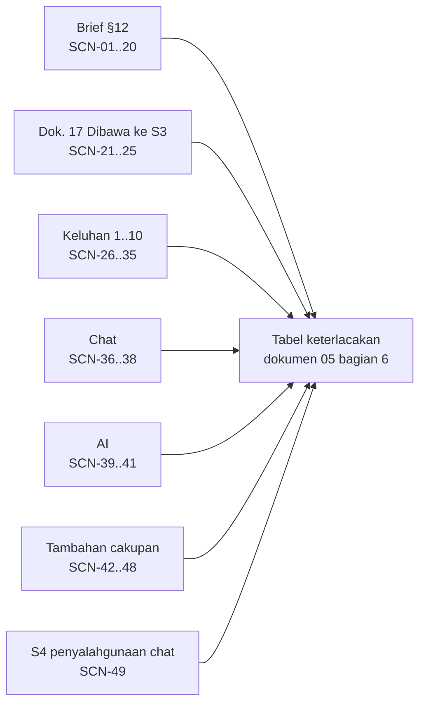

# 12 — Skenario ujung ke ujung

| | |
|---|---|
| Pemilik | `product-analyst` |
| Tahap | S3, fase C (12 November 2026); putaran perbaikan fase D (12 November 2026) |
| Status | **S4 fase D, 12 November 2026 (belum ditinjau `critic`):** satu skenario baru, SCN-49 (sembunyikan, laporkan, Bantuan; bersyarat pada 10-G). Diperluas dengan baris "Tepi tambahan (S4)" atau isi medan: SCN-02 (09-F), SCN-11 (kecocokan kategori, 07 INV-37), SCN-20 (kunci aplikasi, sesi, wafat), SCN-24 (kelompok kartu tagihan rutin), SCN-27 (pintasan, draf, urungkan), SCN-32 (10-A, UX-5; kunci dan sesi bukan alat pantau), SCN-39 (10-B R1, pelipatan N-28, arahan Bantuan), SCN-41 (batas biaya SEC-127), SCN-42 (pernyataan usia, teks undangan, email di F04, kartu "Sepakati yang pertama"), SCN-43 (tab Chat), SCN-44 (N-26 di ringkasan, jalan ekspor 90 hari, hapus akun, rumah tangga kosong), SCN-46 (07 INV-38), SCN-48 (10-E, angka uji 07 INV-40). Tidak ada angka saldo baru; angka yang ditambahkan didaftar di bagian 10. **Penyisiran S4, 12 November 2026 (M4):** SCN di bagian hitungan uang membaca tanda "dapat melihat saldo" sebagai `others_may_count` yang memuat suami; tidak ada angka yang berubah. **Sesudah checkpoint S3 (12 November 2026):** jawaban "lanjut" dicatat; penanda "checkpoint S3-N" dan cabang "bila ditolak" atas butir yang kini diterima diganti dengan "diterima lewat "lanjut"", dengan penulis aturannya tetap disebut; angka **[Asumsi]** tidak berubah; tidak ada angka saldo yang berubah. Tanpa skenario baru, empat skenario diperluas dengan angka yang disalin dari CTH: SCN-11 (IDEA-03, CTH-50; FR-FIN-100/AC-8), SCN-21 (IDEA-02, angka CTH-41; FR-FIN-030/AC-13), SCN-28 (IDEA-01, CTH-48 dan CTH-47; FR-FIN-135/AC-14), SCN-46 (THR dan angpau yang diberikan, CTH-51; FR-FIN-040/AC-14) (dokumen 17 Q-187). **Sebelumnya:** ditinjau `critic` A (fase D); perbaikan fase D belum ditinjau ulang. Perbaikan: atribusi (CA-02, CA-03, aturan 1), "usul lain" (CA-05), SCN-02 (CA-13), SCN-26 (CA-12), N-32 di SCN-11 (CA-08), keluar dengan masa tenggang di SCN-44 (SP-48, SP-49), hitungan bukan pemegang di SCN-28 (SP-50), mengikhlaskan bertahap di SCN-46 (SP-51), konfirmasi susulan `ringkasan` di SCN-22 (SP-52), kepedulian dan `AI` di SCN-09, SCN-10, SCN-39, SCN-40 (SP-45, SP-47, SP-53, SP-54, SP-56, SP-66), pengenal `PA-SCN-n` (CA-06); tidak ada skenario baru |
| Sumber | Brief §12 (20 skenario), §1.1 (tier), §16 (pengenal); dokumen 17 "Dibawa ke S3" baris 1 sampai 5 dan daftar Keluhan 1 sampai 10; `_progress.md` (keputusan chat dan `AI`, 12 November 2026); 06 (revisi kesembilan: §4, §5, §6.2, §6.3, §10, §11, §12, §13, §16; revisi kesepuluh: §3.5, §3.6 F06 sampai F08, §6.3 K02, §7.2, §11.1, §11.2 N-14, N-28, N-32, §13.5, §13.7, §16.4 sampai §16.6); 07 (CTH-01 sampai CTH-49; putaran perbaikan S3: CTH-25 varian SP-51, CTH-38, CTH-47); 05 (indeks dan berkas modul); 04 |

## 1. Cara membaca

| Hal | Ketentuan |
|---|---|
| Aturan | Dokumen ini **tidak** menetapkan aturan uang atau alur. Setiap akibat dikutip dari 07, 06, atau 05. Aturan yang belum ada ditulis **[Perlu aturan]** beserta perilaku yang diharapkan, dan dikumpulkan di bagian 9 |
| Angka | Angka uang disalin dari contoh hitung 07 (`CTH-NN`) dan disebut sumbernya. Angka yang tidak berasal dari CTH ditandai **[Asumsi]** atau disebut asal kriteria penerimaannya, dan semuanya didaftar di bagian 10 agar dihitung ulang lead |
| Ambang | Ambang contoh 500000 **[Asumsi]** (07 §7.1). Permintaan makan 100000 mengikuti brief §5D (`_progress.md`, catatan lead) |
| Pelaku | Suami dan istri dipakai agar angka CTH terbaca. Aturan tidak membaca peran (06 INV-A13, PG-01): setiap skenario punya baris **Dua arah** yang menyatakan cerminnya |
| Notifikasi | Pengenal `N-NN` dari 06 §11.2. Teks layar kunci selalu teks umum kelas prioritasnya (06 §11.1 revisi kesepuluh; FR-NTF-005), tanpa pengecualian: N-23 dan N-28 memakai teks kelas `kabar` ("Ada kabar baru"), tanpa nama dan isi. Yang diterima pemilik produk atas saran lead untuk N-28 adalah pilihan "Umum di layar kunci" (teksnya "ada kabar dari istrimu"); teks pastinya bentuk (a) di atas (usulan `security-privacy` SP-46), diterima lewat "lanjut" di checkpoint S3, S3-8 (vii); alternatif (b) "ada kabar dari {nama}" tidak dipilih |
| Kolom saldo | Sama dengan 07 §7: `UANG` *uang yang ada*, `KB` kekayaan bersih, `PIU` piutang, `AST` aset, `KWJ-C`/`KWJ-U`/`KWJ-G` kewajiban cicilan/utang/hak ganti, `PRI-S`/`PRI-I` dana pribadi suami/istri (hanya terbaca pemiliknya) |
| Kebutuhan | `FR-XXX-NNN`, dengan `/AC-n` bila kriteria tertentu yang dijalankan. Skenario Tier 3 hanya garis besar, tanpa FR, dan menyebut apa yang tidak boleh dihalangi fondasi Tier 1 |
| Tata letak | Kata-kata layar, kartu, dan susunan tampilan milik dokumen 08 |

Medan setiap skenario Tier 1 dan Tier 2: pemicu, aktor, prasyarat, interaksi, perilaku sistem, persetujuan, akibat uang, notifikasi, hasil, kegagalan dan tepi, dua arah, FR. Medan yang tidak berlaku ditulis "tidak ada".

## 2. Ringkasan skenario

| SCN | Judul | Tier | Modul | FR yang dijalankan |
|---|---|---|---|---|
| SCN-01 | Suami meminta uang untuk makan | 1 | REQ, FIN, COM | FR-REQ-001, 002, 003, 007, 014, 017, 018; FR-FIN-040, 045, 090, 091; FR-COM-004 |
| SCN-02 | Istri belanja dapur dengan kas yang dialokasikan | 1 | FIN, COM | FR-FIN-031, 040, 042, 050, 051, 090, 120, 121; FR-COM-005 |
| SCN-03 | Anak minta izin keluar rumah | 3 | REQ | — |
| SCN-04 | Ibu mertua dititipi uang belanja | 1 | FIN, FAM | FR-FAM-018; FR-FIN-001, 011, 040, 052 |
| SCN-05 | Keluarga merencanakan liburan | 1 (+2, 3) | REQ, FIN, PLN, GOL | FR-REQ-006, 009; FR-FIN-125; FR-PLN-001 |
| SCN-06 | Menabung untuk uang sekolah | 1 | FIN | FR-FIN-120, 122, 125, 126, 127, 128 |
| SCN-07 | Minyak goreng habis | 2 (+3) | SHP, FIN, INV | FR-SHP-001, 002; FR-FIN-040 |
| SCN-08 | Atap bocor perlu diperbaiki segera | 2 (+1) | MNT, FIN, REQ | FR-MNT-001, 002, 003; FR-REQ-032, 033, 034, 044; FR-FIN-040 |
| SCN-09 | Anggota sakit dan perlu bantuan | 2 | CARE, REQ, COM | FR-CARE-002, 003, 005, 006; FR-COM-016; FR-REQ-044, 045; FR-NTF-004 |
| SCN-10 | Anggota menyimpan suasana hati secara pribadi | 2 | CARE, FAM, COM | FR-CARE-001, 002, 003, 004; FR-COM-016; FR-FAM-009, 010 |
| SCN-11 | Tagihan listrik jatuh tempo | 1 | FIN, NTF | FR-FIN-031, 100, 103, 108, 141; FR-NTF-009; FR-CAL-002 |
| SCN-12 | Bayar pakai uang pribadi lalu minta diganti | 1 | REQ, FIN, COM | FR-REQ-001, 007, 014, 017, 042; FR-FIN-012, 061, 062, 063; FR-COM-003 |
| SCN-13 | Belanja lebih kecil dari yang disetujui | 1 | REQ, FIN | FR-REQ-005, 007, 014, 017, 019; FR-FIN-050, 051 |
| SCN-14 | Belanja melebihi yang disetujui | 1 | REQ | FR-REQ-012, 013, 016, 032, 034 |
| SCN-15 | Pengembalian dana | 1 | FIN | FR-FIN-044 |
| SCN-16 | Anggota di lebih dari satu rumah tangga | 3 | FAM | — |
| SCN-17 | Wali mengawasi permintaan uang anak | 3 | FAM, REQ | — |
| SCN-18 | Dua orang mengubah hal yang sama bersamaan | 2 (+1) | SHP, FIN, REQ, COM | FR-SHP-001; FR-FIN-040; FR-REQ-010; FR-COM-008, 018 |
| SCN-19 | Sinyal hilang saat belanja | 1 | FIN, REQ, COM | FR-FIN-040; FR-REQ-004, 014, 015, 020; FR-COM-008, 018 |
| SCN-20 | Pengelola rumah tangga berganti atau kehilangan akses | 1 | FAM | FR-FAM-007, 016, 017, 021, 022 |
| SCN-21 | Uang masuk, bayar tagihan, siapkan uang tagihan, bagikan | 1 | FIN | FR-FIN-010, 011, 020, 030, 031, 032, 050, 051, 060, 073, 103, 122; FR-NTF-001 |
| SCN-22 | Konfirmasi susulan sesudah sepakat langsung | 1 | REQ, FIN, COM, NTF | FR-REQ-032, 034, 037, 038, 039, 040; FR-FIN-040, 045; FR-NTF-009 |
| SCN-23 | Menghitung dompet campuran | 1 | FIN, FAM | FR-FIN-003, 012, 137; FR-FAM-008 |
| SCN-24 | Pos rutin yang jumlahnya berubah-ubah | 1 | FIN, REQ, COM | FR-FIN-100 sampai 107; FR-REQ-026, 027, 029; FR-COM-004, 006 |
| SCN-25 | Mengakhiri jatah sendiri di tengah periode | 1 | FIN, REQ | FR-FIN-060, 072, 073, 074, 075, 076; FR-REQ-029 |
| SCN-26 | Keluhan 1: "Aku terlalu sering ditandai" | 1 | REQ, FIN | FR-FIN-021, 072, 073; FR-REQ-031 sampai 036 |
| SCN-27 | Keluhan 2: "Capek mencatat" | 1 | FIN, NTF, REQ, FAM | FR-FIN-023, 030, 040, 041, 043; FR-NTF-003; FR-REQ-001; FR-FAM-021 |
| SCN-28 | Keluhan 3: "Angkanya tidak cocok dengan dompetku" | 1 | FIN | FR-FIN-043, 135, 136, 138 |
| SCN-29 | Keluhan 4: "Aku tidak bisa menghapus catatan yang salah" | 1 | FIN | FR-FIN-140, 141, 142, 145 |
| SCN-30 | Keluhan 5: "Aku ditagih terus" | 1 | NTF, REQ | FR-REQ-011, 024, 025; FR-NTF-001 sampai 003, 005 sampai 015 |
| SCN-31 | Keluhan 6: "Pasanganku tidak menjawab" | 1 | REQ | FR-REQ-002, 021, 022, 023, 043 |
| SCN-32 | Keluhan 7: "Aku merasa diawasi" | 1 | FAM, FIN, COM | FR-FAM-008, 009, 010, 021, 022; FR-FIN-074, 146, 155; FR-COM-011, 012, 013, 014 |
| SCN-33 | Keluhan 8: "Semua aku yang bayar" | 1 | FIN | FR-FIN-152, 155 |
| SCN-34 | Keluhan 9: "Pasanganku tidak mencatat semua penghasilannya" | 1 | FIN | FR-FIN-020, 022 |
| SCN-35 | Keluhan 10: "Keberatan dipakai untuk menyerang" | 1 | FIN, REQ | FR-FIN-051, 062, 143, 144; FR-REQ-041 |
| SCN-36 | Kenaikan jatah disepakati dari kartu di chat | 1 | COM, FIN, REQ | FR-COM-001, 004, 006, 007, 009, 011, 012, 013, 017; FR-FIN-070, 071, 072; FR-REQ-026, 027 |
| SCN-37 | Permintaan dibahas di chat lalu diusul balik | 1 | COM, REQ | FR-COM-002, 003, 005, 007, 009, 015; FR-REQ-001, 008, 009, 041 |
| SCN-38 | Kartu basi | 1 | COM, REQ | FR-COM-008, 010, 018; FR-REQ-010 |
| SCN-39 | Pasangan membagikan suasana hati berat, saran `AI` dikirim lewat chat | 2 | CARE, AI, COM, NTF, FAM | FR-CARE-001, 002, 003, 004, 006; FR-COM-016; FR-AI-002, 005, 006, 009; FR-NTF-005; FR-FAM-024 |
| SCN-40 | Saran apresiasi harian | 2 | AI, NTF | FR-AI-001, 005, 006, 010 |
| SCN-41 | `AI` tidak tersedia | 2 (+1) | AI | FR-AI-007, 008 |
| SCN-42 | Membuat rumah tangga dan mengundang pasangan | 1 | FAM, FIN, REQ, COM | FR-FAM-001, 003, 004, 005, 006, 011, 019, 020, 021; FR-FIN-001, 002, 004, 080, 081, 082; FR-REQ-030; FR-COM-001 |
| SCN-43 | Rumah tangga dengan satu anggota dewasa | 1 | FAM, REQ, FIN | FR-FAM-002, 011; FR-REQ-001, 030; FR-FIN-030, 070, 073, 100 |
| SCN-44 | Keluar dengan aman | 1 | FAM, FIN, REQ, COM | FR-FAM-003, 004, 012, 013, 014, 015, 022, 023; FR-FIN-135; FR-COM-001; FR-REQ-002 |
| SCN-45 | Membeli aset dan membayar cicilan | 1 | FIN, REQ | FR-FIN-110 sampai 113, 130 sampai 133; FR-REQ-001 |
| SCN-46 | Pinjaman, kiriman keluarga, dan piutang | 1 | FIN, FAM | FR-FIN-040, 064, 115 sampai 119; FR-FAM-018 |
| SCN-47 | Ringkasan bulanan | 1 | FIN | FR-FIN-150, 151, 153, 154, 156 |
| SCN-48 | Mengubah ambang dan hari mulai periode | 1 | FIN, REQ | FR-FIN-077, 083; FR-REQ-028, 029, 031 |
| SCN-49 | Pesan yang menyakitkan: sembunyikan, laporkan, cari bantuan | 1 | COM, FAM | FR-COM-019, 020; FR-FAM-016, 024 |

Pembagian: 20 skenario brief (SCN-01 sampai SCN-20), 5 dari dokumen 17 "Dibawa ke S3" (SCN-21 sampai SCN-25), 10 keluhan (SCN-26 sampai SCN-35), 3 chat (SCN-36 sampai SCN-38), 3 `AI` (SCN-39 sampai SCN-41), 7 tambahan agar setiap kebutuhan Must punya skenario (SCN-42 sampai SCN-48), dan 1 dari S4 untuk penyalahgunaan di chat (SCN-49).



---

## 3. Skenario brief §12

### SCN-01 — Suami meminta uang untuk makan

| Medan | Isi |
|---|---|
| Tier / modul | 1 / REQ, FIN, COM |
| Pemicu | Suami ingin makan di luar dan meminta 100000 dari dana bersama (brief §5D) |
| Aktor | Suami (pemohon), istri (pemberi persetujuan, ditentukan server) |
| Prasyarat | Dua anggota dewasa aktif; `TUN-S` dipegang suami, 500000; anggaran "jajan dan makan di luar" 500000, terpakai 0 (CTH-21) |
| Interaksi | (1) Suami mengajukan 100000 berjenis pengeluaran, kategori "jajan dan makan di luar". (2) Istri menyetujui dari kartu di chat atau dari layar permintaan. (3) Suami membayar 75000 dari `TUN-S` dan memilih permintaan itu saat mencatat. (4) Suami menyelesaikan dengan satu ketukan |
| Perilaku sistem | B01: `awaiting_approver` versi 1, kartu lahir di chat dalam transaksi yang sama (06 §16.2). B06: otorisasi 100000, terikat 100000. B14: realisasi 75000, terikat 25000, entri tidak ditandai (N = 0). B15: situasi A dibaca dari entri tertaut; tidak ada pertanyaan; sisa 25000 tetap di `TUN-S` sebagai dana bersama (06 §5.3) |
| Persetujuan | Wajib karena dipilih pemohon (06 §4.1); pemohon tidak dapat menyetujui sendiri (FR-REQ-002/AC-2) |
| Notifikasi | N-01 kepada istri (`perlu_tanggapan`); N-04 kepada suami (`kabar`); N-09 kepada istri (`ringkasan`). Kartu dan baris peristiwa tidak memicu N-23 (06 INV-A46) |
| Hasil | Uang tercatat keluar sekali; anggaran menampilkan yang sudah dijanjikan sebelum belanja terjadi |
| Kegagalan dan tepi | Tidak diselesaikan: 30 hari sesudah persetujuan, B16 menutup otomatis dengan realisasi 75000; N-09 kepada keduanya (FR-REQ-018/AC-1). Realisasi 0 sampai masa berlaku habis: B18, N-07 (FR-REQ-018/AC-2). Suami mencoba menyetujui permintaannya sendiri: ditolak. Ketukan setuju ganda: satu B06 (06 S-2) |
| Dua arah | Simetris. Cerminnya (istri memohon, sumber dipegang suami) adalah SCN-13 |
| FR | FR-REQ-001/AC-1, FR-REQ-002/AC-1 dan AC-2, FR-REQ-003, FR-REQ-007, FR-REQ-014/AC-1, FR-REQ-017/AC-1, FR-REQ-018; FR-FIN-040, FR-FIN-045, FR-FIN-090, FR-FIN-091; FR-COM-004/AC-1 |

Akibat uang (CTH-21):

| Langkah | TUN-S | UANG | KB | Anggaran jajan: terpakai / terikat / sisa |
|---|---|---|---|---|
| Sebelum | 500000 | 10039000 | 14539000 | 0 / 0 / 500000 |
| Disetujui (B06) | 500000 | 10039000 | 14539000 | 0 / 100000 / 400000 |
| Belanja 75000 tertaut | 425000 | 9964000 | 14464000 | 75000 / 25000 / 400000 |
| Diselesaikan (B15) | 425000 | 9964000 | 14464000 | 75000 / 0 / 425000 |

### SCN-02 — Istri belanja dapur dengan kas rumah tangga yang dialokasikan

| Medan | Isi |
|---|---|
| Tier / modul | 1 / FIN, COM |
| Pemicu | Suami menyerahkan uang belanja bulanan; istri belanja beras dan lauk |
| Aktor | Suami (penyerah), istri (pemegang `TUN-I`, pencatat) |
| Prasyarat | Keadaan CTH-08: suami sudah mencatat serah terima 4000000 dari `TUN-S` ke `TUN-I`, `TUN-I` 4300000, baris itu belum dikonfirmasi istri |
| Interaksi | (1) Istri mengonfirmasi serah terima (C03). (2) Istri mengalokasikan 2500000 di `TUN-I` untuk "belanja bulanan" (CTH-09). (3) Istri menyetor 500000 ke tabungan (CTH-10; lihat SCN-06). (4) Istri mencatat beras dan lauk 150000 dari `TUN-I`, tujuan "belanja bulanan": hanya jumlah dan tempat uang yang wajib (FR-FIN-040) |
| Perilaku sistem | Alokasi tidak mengubah saldo dan tidak perlu persetujuan (07 §3.9). Belanja dengan tujuan mengurangi alokasinya (CTH-11). Entri tidak ditandai (150000 tidak di atas ambang) |
| Persetujuan | Tidak ada. Konfirmasi custody bukan persetujuan |
| Notifikasi | N-13 kepada istri saat serah terima dicatat suami (sebelum skenario); N-15 kepada suami (`ringkasan`) saat dikonfirmasi. Belanja istri atas tempat uang yang ia pegang sendiri tidak memicu notifikasi |
| Hasil | Kedua orang melihat sisa anggaran 2350000 dan siapa memegang uangnya, tanpa bertanya |
| Kegagalan dan tepi | Belanja terbagi dana bersama dan pribadi: dua entri (CTH-44: `TUN-I` 500000 → 300000, `PRI-I` 250000 → 150000; FR-FIN-042). Alokasi melebihi uang tidak menghalangi belanja (FR-FIN-031/AC-7). Istri belanja dari chat: entri lahir sebagai kartu karena dibuat dari chat (FR-COM-005); belanja yang dicatat di luar chat tidak menjadi kartu (06 §16.2) |
| Dua arah | Simetris: suami yang belanja dari tempat uang yang ia pegang menghasilkan keadaan yang sama dengan peran tertukar |
| Tepi tambahan (S4) | Istri membagi belanja ke dua kategori dan salah ketik barisnya (150000 + 40000 atas 200000, FR-FIN-042/AC-2): bersyarat pada 09-F; bawaan B, server menolak dengan kode galat per medan pada baris sebab, isian tetap ada untuk dibetulkan; A, layar menyebut selisih 10000 selama mengisi. Tidak ada entri yang tersimpan pada kedua cabang |
| FR | FR-FIN-050, FR-FIN-051, FR-FIN-120, FR-FIN-121, FR-FIN-040, FR-FIN-042 (termasuk AC-2, AC-3), FR-FIN-031/AC-7, FR-FIN-090; FR-COM-005 |

Akibat uang (CTH-09, CTH-10, CTH-11):

| Langkah | TUN-I | Alokasi "belanja bulanan" | Belum dialokasikan TUN-I | UANG | KB | Anggaran belanja bulanan: terpakai / sisa |
|---|---|---|---|---|---|---|
| Sesudah CTH-08 (dikonfirmasi) | 4300000 | 0 | 4300000 | 10600000 | 15100000 | 0 / 2500000 |
| Alokasi (CTH-09) | 4300000 | 2500000 | 1800000 | 10600000 | 15100000 | 0 / 2500000 |
| Setor tabungan 500000 (CTH-10) | 3800000 | 2500000 | 1300000 | 10600000 | 15100000 | 0 / 2500000 |
| Beras dan lauk 150000 (CTH-11) | 3650000 | 2350000 | 1300000 | 10450000 | 14950000 | 150000 / 2350000 |

### SCN-03 — Anak minta izin keluar rumah (Tier 3, garis besar)

| Hal | Isi |
|---|---|
| Alur yang dibayangkan | Anak mengajukan permintaan izin (jenis permintaan tanpa uang) dengan tempat, rentang waktu, dan teman; wali menyetujui, menolak, atau mengusul balik jam pulang. Persetujuan menghasilkan izin, bukan otorisasi uang |
| Mengapa Tier 3 | Brief §1.1: pilot dua orang dewasa; tidak ada akun anak |
| Yang tidak boleh dihalangi fondasi Tier 1 | (a) Permintaan sudah berbentuk umum (state machine 06 §4.2) sehingga jenis "izin" dapat ditambah tanpa mengubah B01 sampai B18; (b) penentuan pemberi persetujuan lewat `resolve_approvers`, bukan "pasangan" yang dikodekan (06 §3.2); (c) peran anggota tanggungan sudah disebut di 06 §14; (d) tidak ada aturan yang membaca "suami" atau "istri" |
| Pagar yang harus ikut | Izin tidak memberi wali akses ke lokasi anak (06 AT-6); anak tidak dapat dipantau lebih dari yang perlu untuk izin itu (dokumen 10) |

### SCN-04 — Ibu mertua dititipi uang belanja

| Medan | Isi |
|---|---|
| Tier / modul | 1 / FIN, FAM |
| Pemicu | Suami menitipkan uang belanja kepada ibu mertua yang membantu belanja (brief §5C) |
| Aktor | Suami (pencatat titipan), istri (pencatat belanja ibu), ibu mertua (pihak luar tanpa login) |
| Prasyarat | Keadaan CTH-02: `TUN-S` 5000000, `TUN-I` 3000000, `BNK-B` 2000000, `UANG` 10000000. Ibu dicatat sebagai pihak luar dengan nama panggilan saja (FR-FAM-018/AC-1); tempat uang titipan `TTP-IBU` dibuat dengan saldo 0 |
| Interaksi | (1) Suami mencatat pemindahan 1000000 dari `TUN-S` ke `TTP-IBU`. (2) Ibu bercerita sudah membeli lauk 150000; istri mencatatnya dari `TTP-IBU` |
| Perilaku sistem | Pemindahan antar-tempat uang dana bersama tidak mengubah *uang yang ada* (07 INV-06). Belanja dari titipan mengurangi `TTP-IBU`. Ibu tidak menerima apa pun dari aplikasi |
| Persetujuan | Tidak ada |
| Notifikasi | Tidak ada notifikasi kepada pihak luar. `TTP-IBU` tidak dipegang anggota dewasa, jadi tidak ada konfirmasi custody |
| Hasil | Kedua orang tahu 850000 masih di tangan ibu tanpa menelepon ibu |
| Kegagalan dan tepi | Ibu tidak ingat jumlah persisnya: menghitung `TTP-IBU` lalu selisih (SCN-28). Ibu dihapus dari daftar: hanya arsip, tidak hapus (FR-FAM-018) |
| Dua arah | Simetris: istri dapat menitipkan dan suami dapat mencatat belanja ibu |
| FR | FR-FAM-018; FR-FIN-001, FR-FIN-011, FR-FIN-052, FR-FIN-040 |

Akibat uang (CTH-02):

| Langkah | TUN-S | TUN-I | TTP-IBU | BNK-B | UANG |
|---|---|---|---|---|---|
| Sebelum | 5000000 | 3000000 | 0 | 2000000 | 10000000 |
| Titip 1000000 | 4000000 | 3000000 | 1000000 | 2000000 | 10000000 |
| Lauk 150000 | 4000000 | 3000000 | 850000 | 2000000 | 9850000 |

### SCN-05 — Keluarga merencanakan liburan

| Medan | Isi |
|---|---|
| Tier / modul | 1 (permintaan jalan-jalan, tujuan tabungan sederhana); 2 (tampilan rencana); 3 (bagian `GOL` di luar tabungan sederhana) |
| Pemicu | Istri ingin liburan keluarga bulan depan |
| Aktor | Istri (pemohon), suami (pemberi persetujuan) |
| Prasyarat | Dua anggota dewasa; ambang 500000 |
| Interaksi | (1) Istri mengajukan permintaan jalan-jalan: tempat, rentang tanggal, peserta, barang rencana, jumlah 1500000 **[Asumsi]**. (2) Suami mengusul balik rentang tanggalnya (B03). (3) Istri menerima usul balik (B07). (4) Bila ingin menabung dulu, salah satu membuat tujuan tabungan "liburan"; setorannya mengikuti pola SCN-06 |
| Perilaku sistem | Syarat jalan-jalan bagian dari versi syarat (06 §2.4); usul balik menaikkan versi. Sesudah disetujui, terikat 1500000 mengurangi sisa anggaran kategori yang dipilih (FR-REQ-003). Tampilan rencana Tier 2 hanya membaca permintaan (FR-PLN-001/AC-1) |
| Persetujuan | Wajib (permintaan) |
| Akibat uang | Tidak ada saldo yang berubah sampai belanja dicatat; terikat 1500000 sesudah disetujui. Belanja liburan sesudahnya mengikuti SCN-01, SCN-13, atau SCN-14 |
| Notifikasi | N-01 kepada suami; N-02 kepada istri atas usul balik; N-04 kepada suami |
| Hasil | Jalan-jalan tidak diumumkan mendadak; keduanya membaca rencana yang sama |
| Kegagalan dan tepi | Tanggal rencana lewat tanpa belanja: B18, N-07. Istri merevisi sendiri sebelum suami menjawab: B02, N-03 menggantikan N-01 lama |
| Bagian Tier 3 (garis besar) | Tanggal target, tonggak, proyeksi, prioritas antar-tujuan, dan kontribusi per orang (dokumen 05 `tier-3.md` bagian 2). Fondasi Tier 1 tidak boleh menghalanginya: tujuan sudah punya target dan alokasi per tempat uang (07 §2.6, §3.9). Pagarnya: kontribusi per orang tidak boleh menjadi papan skor (06 AT-4) |
| Dua arah | Simetris |
| FR | FR-REQ-006, FR-REQ-009; FR-FIN-125; FR-PLN-001 (Tier 2) |

### SCN-06 — Orang tua menabung untuk uang sekolah

| Medan | Isi |
|---|---|
| Tier / modul | 1 / FIN |
| Pemicu | Biaya sekolah tahun depan; istri membuat tujuan tabungan |
| Aktor | Istri (pemegang `TUN-I` dan `TAB-I`); suami melihat kemajuan yang sama |
| Prasyarat | `TUN-I` 4300000, `TAB-I` 5000000 tanpa alokasi (CTH-08). Angka di bawah persis CTH-09 dan CTH-10, yang menamai tujuannya "dana darurat"; di sini namanya "uang sekolah" |
| Interaksi | (1) Membuat tujuan, target 10000000. (2) Mengalokasikan 5000000 yang sudah ada di `TAB-I`. (3) Menyetor 500000 dari `TUN-I` ke `TAB-I` dengan tujuan itu |
| Perilaku sistem | Setoran adalah pemindahan yang membawa tujuan; `UANG` dan `KB` tetap (07 INV-06). Kemajuan dihitung dari alokasi (FR-FIN-127) |
| Persetujuan | Tidak ada |
| Notifikasi | Tidak ada; tempat uang dipegang pencatatnya sendiri |
| Hasil | Kemajuan 5500000 dari 10000000 terbaca keduanya, juga sebagai baris di halaman depan (FR-FIN-127) |
| Kegagalan dan tepi | Alokasi melebihi saldo: perintah ditolak seluruhnya (07 INV-17; FR-FIN-122). Tujuan dibatalkan: alokasi dilepas atas pilihan pemegang, tujuan terarsip (CTH-45; FR-FIN-128). Bagian `GOL` Tier 3: dokumen 17 "Dibawa ke S3" baris 7: tidak ada yang naik, diterima lewat "lanjut" di checkpoint S3 (S3-1 (c)) |
| Dua arah | Simetris |
| FR | FR-FIN-120, FR-FIN-122, FR-FIN-125, FR-FIN-126, FR-FIN-127, FR-FIN-128 |

Akibat uang (CTH-09, CTH-10):

| Langkah | TUN-I | TAB-I | Alokasi tujuan di TAB-I | Belum dialokasikan TUN-I | UANG | KB |
|---|---|---|---|---|---|---|
| Sebelum | 4300000 | 5000000 | 0 | 4300000 | 10600000 | 15100000 |
| Alokasi 5000000 | 4300000 | 5000000 | 5000000 | 4300000 | 10600000 | 15100000 |
| Setor 500000 | 3800000 | 5500000 | 5500000 | 3800000 | 10600000 | 15100000 |

Catatan: CTH-09 juga mengalokasikan 2500000 "belanja bulanan" di `TUN-I` (SCN-02), sehingga di CTH belum dialokasikan `TUN-I` 1800000 lalu 1300000. Tabel ini tanpa alokasi itu.

### SCN-07 — Minyak goreng habis

| Medan | Isi |
|---|---|
| Tier / modul | 2 (`SHP`); 3 (`INV` persediaan); pengeluaran Tier 1 |
| Pemicu | Suami melihat minyak goreng habis |
| Aktor | Suami (menambah barang), istri (belanja) |
| Prasyarat | Daftar belanja bersama berkategori "belanja bulanan" (FR-SHP-001); `TUN-I` 3800000 (CTH-10) |
| Interaksi | (1) Suami menambah "minyak goreng" hanya dengan nama, juga tanpa sinyal. (2) Istri membuka daftar di pasar, mencentang minyak goreng, beras, dan lauk. (3) "Selesai belanja": istri mengisi total aktual 150000 dan `TUN-I` |
| Perilaku sistem | Daftar tidak membuat entri, reservasi, atau tanda (FR-SHP-001). Selesai belanja menghasilkan tepat satu entri pengeluaran biasa (FR-SHP-002/AC-1); perkiraan harga tidak masuk angka apa pun (AC-2) |
| Persetujuan | Tidak ada |
| Akibat uang | Sama dengan CTH-11 (isi barangnya berbeda, angkanya sama): `TUN-I` 3800000 → 3650000, `UANG` 10600000 → 10450000, `KB` 15100000 → 14950000 |
| Notifikasi | Tidak ada notifikasi atas barang daftar. Total perkiraan melebihi sisa anggaran tampil di daftar saja (FR-SHP-001/AC-3) |
| Hasil | Yang belanja tahu apa yang habis tanpa bertanya; satu entri per kunjungan |
| Kegagalan dan tepi | Daftar tidak dipakai: belanja dicatat seperti SCN-02 tanpa kehilangan apa pun (Tier 2 tidak menjadi syarat Tier 1). Daftar diubah bersamaan: SCN-18 |
| Bagian Tier 3 (garis besar) | `INV`: stok minyak goreng berkurang sendiri dan memicu "hampir habis". Fondasi Tier 1 tidak boleh menghalangi: entri pengeluaran dapat membawa rincian barang tanpa mengubah inti uangnya (06 §2.5). Pagarnya: tidak ada pengingat "kamu belum mencatat stok" (PRN-02) |
| Dua arah | Simetris |
| FR | FR-SHP-001, FR-SHP-002 (Tier 2); FR-FIN-040 |

### SCN-08 — Atap bocor perlu diperbaiki segera

| Medan | Isi |
|---|---|
| Tier / modul | 2 (`MNT`); uang dan tanda Tier 1 |
| Pemicu | Hujan malam, atap bocor; tukang hanya bisa datang besok pagi dan minta dibayar di tempat |
| Aktor | Istri (pelapor), suami (yang mengambil dan membayar) |
| Prasyarat | Berdiri sendiri dari keadaan akhir CTH-41: `BNK-S` 810000 dipegang suami, `UANG` 6560000; ambang 500000 |
| Interaksi | (1) Istri melaporkan "atap bocor" dengan foto dan tanda "mendesak" (M01). (2) Suami mengambilnya sendiri (M02; lahir tugas untuk dirinya). (3) Besok suami membayar tukang 650000 **[Asumsi]** dari `BNK-S` langsung dari masalah itu dengan catatan "mendesak", tanpa menunggu persetujuan. (4) Suami menutup tugas dengan foto atap |
| Perilaku sistem | Entri tertaut ke masalah (FR-MNT-003/AC-1). Tanda dihitung server: 650000 > 500000, dasar ambang. Catatan "mendesak" tampil pada tanda; pencatatan tidak pernah dihalangi (06 INV-A11) |
| Persetujuan | Tidak diminta. Bila suami mau, ia dapat meminta konfirmasi susulan sesudahnya (SCN-22) |
| Notifikasi | Laporan: notifikasi kepada suami dengan teks layar kunci umum; "mendesak" tidak menembus jam tenang sampai dokumen 08 dan 10 menetapkannya (FR-MNT-001/AC-2). Tanda: N-10 kepada istri (`kabar`, paling banyak satu langsung per hari) |
| Hasil | Atap diperbaiki malam itu juga tanpa debat lewat telepon; uangnya terlihat beserta alasannya |
| Kegagalan dan tepi | Perbaikan direncanakan, bukan mendesak: dibuka permintaan anggaran biasa dari masalah (FR-MNT-003/AC-2). Istri menutup laporannya sendiri karena ternyata bukan bocor: M05 hanya oleh pelapor selama `dilaporkan` (FR-MNT-002/AC-4). Suami tidak bisa menugaskan istri secara sepihak; ia mengirim permintaan tindakan (T01; FR-REQ-044) |
| Dua arah | Simetris |
| FR | FR-MNT-001, FR-MNT-002, FR-MNT-003, FR-REQ-044 (Tier 2); FR-FIN-040, FR-REQ-032, FR-REQ-033, FR-REQ-034 |

Akibat uang (berdiri sendiri dari akhir CTH-41; angka bayar **[Asumsi]**):

| Langkah | BNK-S | UANG | Tanda |
|---|---|---|---|
| Sebelum | 810000 | 6560000 | — |
| Bayar tukang 650000 | 160000 | 5910000 | Ambang (650000 > 500000), catatan "mendesak" |

### SCN-09 — Anggota sakit dan perlu bantuan

| Medan | Isi |
|---|---|
| Tier / modul | 2 / CARE, REQ (permintaan tindakan), COM |
| Pemicu | Istri demam |
| Aktor | Istri (yang sakit, satu-satunya yang melapor), suami (pasangan) |
| Prasyarat | Istri sudah menyalakan saklar berbagi kabar sakit kepada suami (FR-CARE-002/AC-2, AC-4; saklar sakit terpisah dari saklar suasana hati, usulan `security-privacy` SP-53, diterima lewat "lanjut" sebagai D-91) |
| Interaksi | (1) Istri melaporkan sakit; N bawaan 2 hari (I01). (2) Suami menerima kabar, membalas kartu laporan di chat "mau aku belikan obat?" (3) Istri mengirim permintaan tindakan "tolong jemput anak sore ini" (T01); suami menerima (T02). (4) Dua hari kemudian sistem bertanya hanya kepada istri: sudah sembuh, masih sakit, atau akan ke klinik (I02) |
| Perilaku sistem | Laporan tanpa isian diagnosis, gejala, atau obat (FR-CARE-005/AC-1). Kartu laporan lahir di chat (FR-COM-016). Tanpa jawaban: satu pengingat lalu berhenti, state `menunggu_kabar` tanpa kesimpulan (FR-CARE-005/AC-2) |
| Persetujuan | Permintaan tindakan diterima atau ditolak penerimanya; tidak ada persetujuan uang |
| Akibat uang | Tidak ada. Obat yang dibeli suami dengan uang pribadinya: SCN-12 |
| Notifikasi | N-28 kepada suami untuk laporan dan setiap jawaban tindak lanjut; layar kunci teks umum kelas `kabar`, "Ada kabar baru" (S3-8 (vii) bentuk (a), diterima lewat "lanjut") (FR-CARE-003/AC-1). Balasan suami: N-23 kepada istri. Permintaan tindakan dan tenggatnya: FR-NTF-004 (N-30 bila bertenggat). Pertanyaan I02: hanya kepada istri, `kabar`, tunduk pada jam tenang |
| Hasil | Suami tahu tanpa menanyakan berulang; istri tidak ditanya terus |
| Kegagalan dan tepi | Istri tidak berbagi: suami tidak menemukan apa pun dan tidak ada yang membedakan "tidak sakit" dari "tidak dibagikan" (FR-CARE-001/AC-3). Suami tidak dapat melaporkan sakit atas nama istri (06 §13.3). Saran kata dari `AI`: SCN-39 |
| Dua arah | Simetris |
| FR | FR-CARE-002, FR-CARE-003, FR-CARE-005, FR-CARE-006, FR-REQ-044, FR-REQ-045, FR-NTF-004 (Tier 2); FR-COM-016 (Must bersyarat) |

### SCN-10 — Anggota menyimpan suasana hatinya secara pribadi

| Medan | Isi |
|---|---|
| Tier / modul | 2 / CARE, FAM, COM |
| Pemicu | Suami merasa lelah dan ingin mencatatnya tanpa diketahui siapa pun |
| Aktor | Suami (pemilik status), istri |
| Prasyarat | Belum ada persetujuan berbagi |
| Interaksi | (1) Suami memilih "lelah sekali" dalam satu langkah (FR-CARE-001/AC-1). (2) Seminggu kemudian ia memilih berbagi. (3) Esoknya ia mencabut berbagi. (4) Lalu ia menghapus statusnya |
| Perilaku sistem | Bawaan `private` (06 §9.2). Status baru menggantikan yang lama tanpa riwayat (FR-CARE-001/AC-2). Berbagi berlaku ke depan saja; pencabutan dan penghapusan seketika dan senyap (06 V-7) |
| Persetujuan | Persetujuan berbagi milik pemilik status saja; istri tidak dapat memulai, mengubah, atau mencabutnya (FR-CARE-002/AC-2) |
| Akibat uang | Tidak ada |
| Notifikasi | Langkah 1: tidak ada. Langkah 2: N-22 kepada istri (visibilitas diperluas). Status yang dibagikan dan diubah: N-28. Langkah 3 dan 4: tidak ada notifikasi; kabar yang masih tertahan gugur (FR-CARE-003/AC-2) |
| Hasil | Langkah 1: tidak seorang pun selain suami melihatnya. Langkah 2 menyalakan saklar suasana hati saja (FR-CARE-002/AC-4). Sesudah langkah 3: kartu status hilang dari chat bagi keduanya tanpa penanda; balasan istri pada kartu itu tetap sebagai pesan bebas milik istri, tanpa kutipan kartu (FR-CARE-002/AC-3; SP-45; P-21). Sebelum langkah 4 layar menghapus memberi tahu suami bahwa balasan istri tetap ada dan hanya istri yang dapat menghapusnya (FR-CARE-004/AC-4) |
| Kegagalan dan tepi | Tidak ada pengingat "isi suasana hatimu" (FR-CARE-001/AC-3). Status "hari ini" berakhir sendiri tanpa notifikasi. Penghapusan menghapus status, laporan, tindak lanjut, dan Peristiwanya dari keluaran `AI`, ringkasan, ekspor, dan cache perangkat pasangan (FR-CARE-004/AC-2) |
| Dua arah | Simetris |
| FR | FR-CARE-001, FR-CARE-003 (Tier 2 Should); FR-CARE-002/AC-3, AC-4, FR-CARE-004/AC-1, AC-4, FR-COM-016 (Must bersyarat); FR-FAM-009, FR-FAM-010 |

### SCN-11 — Tagihan listrik jatuh tempo

| Medan | Isi |
|---|---|
| Tier / modul | 1 / FIN, NTF (pembayaran tertaut, menyiapkan uang, pengingat tagihan N-32, usulan `architect`, diterima lewat "lanjut" di checkpoint S3, S3-1 (d); F-CAL-002 Tier 1 di 04, dan FR-CAL-002 Must Tier 1 sebagai penunjuk ke N-32) |
| Pemicu | Kejadian listrik 20 November 2026 jatuh tempo |
| Aktor | Suami (membayar), istri |
| Prasyarat | CTH-41: tagihan listrik jatuh tempo tanggal 20, perkiraan 600000, kesepakatan pos rutin 900000 berlaku; alokasi listrik 900000 di `BNK-S` sudah disiapkan (SCN-21); `BNK-S` 1900000 |
| Interaksi | (1) Baris N-32 muncul di ringkasan 17 November dan, karena belum dibayar, lagi pada 20 November. (2) Pada 20 November suami membuka pembayaran dari baris ringkasan itu dan mencatat 780000 dari `BNK-S`. (3) Layar menawarkan melepas sisa alokasi 120000; suami melepasnya |
| Perilaku sistem | Pembayaran menunjuk kejadian 20 November; hanya pengingat kejadian itu yang mati (FR-FIN-103/AC-12). 780000 ≤ 900000: tidak ditandai walau di atas ambang (FR-FIN-103/AC-1). Pembayaran membawa tujuan tagihan dan mengurangi alokasinya (FR-FIN-031/AC-4) |
| Persetujuan | Tidak diminta; kesepakatan pos rutin sudah menjadi persetujuan di muka (06 §6.3) |
| Notifikasi | N-32 `ringkasan`, tanpa jumlah dan tanpa layar kunci tersendiri, kepada penanggung jawab atau keduanya bila tidak ada: satu baris 17 November (tiga hari sebelum **[Asumsi]**) dan satu 20 November; bila pembayaran tersimpan sebelum ringkasan 20 November dilepas, baris hari itu dibuang (06 N-32; FR-NTF-009/AC-5; FR-FIN-100/AC-1). Pembayaran tanpa tanda tidak memicu notifikasi. PA-SCN-2 ditutup oleh N-32 (bagian 9) |
| Hasil | Listrik dibayar, keduanya melihat statusnya per kejadian |
| Kegagalan dan tepi | Pembayaran 950000: ditandai dasar pos rutin, hanya di ringkasan (CTH-41 varian). Kejadian 20 Oktober belum dibayar: bawaan pembayaran dari layar pos menunjuk kejadian paling awal, dapat diganti (FR-FIN-103/AC-12). Istri yang membayar dari `BNK-I`: hasil sama, tidak ditandai (FR-FIN-103/AC-2). Lewat jatuh tempo tanpa bayar: kejadian tetap tampil belum dibayar, tanpa tanda pada orang dan tanpa notifikasi selain dua baris N-32 (FR-CAL-002/AC-3, uji N-32). **Token listrik tanpa tanggal** (IDEA-03, S3-2 (ii), diterima lewat "lanjut", Tier 1; CTH-50, berdiri sendiri; 07 §3.15 "Tagihan berulang tanpa `due_rule`"; 06 §6.3 "Pos rutin" baris (h)): pos rutin "token listrik" tanpa `due_rule`, R 300000, ambang 500000, `TUN-S` 1000000, anggaran "listrik" 600000. Token 200000 dan 300000 tidak ditandai, `TUN-S` 500000; tautan susulan yang membawa kejadian 20 November ditolak karena pos itu tidak punya kejadian; token 350000 ditandai dasar `routine_amount`, `TUN-S` 150000, anggaran listrik −250000. Pos itu tidak pernah tampil "belum dibayar periode ini" dan tidak memicu N-32 (06 N-32, §13.4) (FR-FIN-100/AC-8) |
| Dua arah | Simetris: siapa pun yang membayar, hasilnya sama |
| Tepi tambahan (S4) | **Kategori tidak cocok** (07 INV-37; 06 INV-A52): pos "Listrik" berkategori "listrik". Bila suami mencatat pembayaran berkategori "belanja bulanan" lalu menautkannya ke pos itu, tautannya ditolak `category_mismatch`; entri tetap tersimpan dan dinilai terhadap ambang seperti entri biasa; entri dua baris ("listrik" dan "belanja bulanan") juga ditolak tautannya. Pembayaran yang sudah tertaut tidak dapat dipindah ke kategori lain sebelum tautannya dilepas. Kategori pos sendiri tidak dapat diganti. Tidak ada saldo yang berubah karena penolakan itu |
| FR | FR-FIN-100/AC-1, AC-8, AC-9; FR-FIN-103/AC-1, AC-2, AC-12, AC-14; FR-FIN-108; FR-FIN-141/AC-4; FR-FIN-031/AC-4; FR-NTF-009/AC-5; FR-CAL-002/AC-1 sampai AC-3 (Must Tier 1, penunjuk ke N-32) |

Akibat uang (CTH-41, 20 November):

| Langkah | BNK-S | UANG | Alokasi listrik | Belum dialokasikan BNK-S |
|---|---|---|---|---|
| Sebelum | 1900000 | 7650000 | 900000 | 750000 |
| Bayar 780000 | 1120000 | 6870000 | 120000 | 750000 |
| Lepas sisa alokasi | 1120000 | 6870000 | 0 | 870000 |

### SCN-12 — Bayar pakai uang pribadi lalu minta diganti

| Medan | Isi |
|---|---|
| Tier / modul | 1 / REQ, FIN, COM |
| Pemicu | Suami membeli obat untuk istri yang sakit; uang dana bersama tidak di tangannya |
| Aktor | Suami (pemohon, yang menalangi), istri (pemberi persetujuan, pemegang `TUN-I`) |
| Prasyarat | CTH-23: otorisasi obat 100000 atas permintaan suami sudah disetujui istri; `TUN-I` 3340000; `PRI-S` 290000; `KWJ-G` 0 |
| Interaksi | (1) Suami membayar 75000 dari `PRI-S`, menautkannya ke otorisasi; "minta diganti" hidup secara bawaan karena tertaut (FR-FIN-062/AC-3). (2) Suami memotret struk dan mengirimnya sebagai balasan kartu permintaan di chat (FR-COM-003; FR-REQ-042). (3) Suami menyelesaikan (situasi C). (4) Penggantian 75000 dari `TUN-I` |
| Perilaku sistem | Hak ganti lahir saat talangan dicatat, sebesar 75000, bukan 100000 (FR-REQ-017/AC-4). Penggantian bukan pengeluaran baru dan tidak mengubah anggaran (FR-FIN-062/AC-4). Foto struk tidak mengubah state (06 INV-A44) |
| Persetujuan | Persetujuan sudah ada (otorisasi). Penggantian tidak memerlukan persetujuan; bila dicatat suami atas `TUN-I` yang dipegang istri, barisnya belum dikonfirmasi sampai istri mengonfirmasi (06 §7.2) |
| Notifikasi | Talangan: N-14 kepada istri (`kabar`; FR-FIN-062/AC-1). Penyelesaian: N-09 (`ringkasan`). Penggantian dicatat suami atas `TUN-I`: N-14 kepada istri. Foto di chat: N-23 |
| Hasil | Talangan tidak terlupa; uang pribadi suami kembali utuh |
| Kegagalan dan tepi | Penggantian 70000 atas hak 60000 ditolak; 40000 menyisakan 20000 (FR-FIN-062/AC-5). Istri tidak dapat mencatat penggantian ke `PRI-S` (AC-6). Talangan tanpa permintaan: CTH-14 dan CTH-15 (hak ganti 60000, `PRI-S` 290000 → 230000 → 290000). Pemilik hak ganti melepasnya: menjadi kontribusi (CTH-16; FR-FIN-063/AC-1). Kontribusi tanpa minta diganti: CTH-13 (FR-FIN-061/AC-1). Istri berkeberatan atas talangan: SCN-35. **Foto struk dari kamera dengan lokasi apotek:** perangkat suami membuang semua metadata (EXIF termasuk lokasi, XMP, thumbnail tertanam) sebelum mengunggah dan server memeriksanya lagi, sehingga foto di chat maupun lampiran entri tidak memberi tahu istri di mana atau dengan perangkat apa foto diambil (FR-COM-003/AC-2; FR-REQ-042/AC-4; usulan `security-privacy` SP-57, diterima lewat "lanjut" sebagai D-94) |
| Dua arah | Simetris: istri yang menalangi dan suami yang memegang dana bersama menghasilkan keadaan tertukar (CTH-16 memakai istri) |
| FR | FR-REQ-001, FR-REQ-007, FR-REQ-014, FR-REQ-017/AC-4, FR-REQ-042/AC-4; FR-FIN-012, FR-FIN-061, FR-FIN-062, FR-FIN-063; FR-COM-003/AC-2 |

Akibat uang (CTH-23; `PRI-S` hanya terbaca suami):

| Langkah | TUN-I | UANG | KWJ-G | KB | PRI-S |
|---|---|---|---|---|---|
| Sebelum | 3340000 | 9889000 | 0 | 14389000 | 290000 |
| Talangan 75000 | 3340000 | 9889000 | 75000 | 14314000 | 215000 |
| Penggantian 75000 dari TUN-I | 3265000 | 9814000 | 0 | 14314000 | 290000 |

### SCN-13 — Belanja lebih kecil dari yang disetujui

| Medan | Isi |
|---|---|
| Tier / modul | 1 / REQ, FIN |
| Pemicu | Istri perlu 100000 untuk kue arisan; uang tunai bersama dipegang suami |
| Aktor | Istri (pemohon), suami (pemberi persetujuan, pemegang `TUN-S`) |
| Prasyarat | CTH-22: `TUN-S` 425000, `TUN-I` 3340000, `UANG` 9964000; anggaran jajan terpakai 75000 |
| Interaksi | (1) Istri mengajukan 100000 dengan sumber `TUN-S`. (2) Suami menyetujui. (3) Suami menyerahkan 100000 tunai dan mencatat serah terima `TUN-S` → `TUN-I`. (4) Istri belanja 75000 dari `TUN-I`, tertaut. (5) Istri menyelesaikan dan memilih "kembalikan sisa" |
| Perilaku sistem | Reservasi 100000 atas `TUN-S` saat disetujui: tersedia 325000 (FR-REQ-005). Situasi B dibaca dari entri tertaut; satu pertanyaan: kembalikan atau tetap dipegang (FR-REQ-017/AC-2). Pengembalian adalah serah terima tertaut yang mengikuti konfirmasi custody. Tampilan permintaan sama bagi keduanya (FR-REQ-019) |
| Persetujuan | Wajib (permintaan). Konfirmasi custody atas serah terima dan pengembalian bukan persetujuan |
| Notifikasi | N-01 kepada suami; N-04 kepada istri; serah terima dicatat suami ke `TUN-I`: N-13 kepada istri; pengembalian dicatat istri ke `TUN-S`: N-13 kepada suami; N-09 kepada suami (`ringkasan`) |
| Hasil | Sisa 25000 kembali tercatat di tangan suami, tanpa menjadi pemasukan atau uang pribadi |
| Kegagalan dan tepi | Istri memilih tetap memegang sisa atau tidak menjawab: tidak ada entri; `TUN-S` 325000, `TUN-I` 3365000; sisa tampil sebagai dana bersama di istri (FR-REQ-017/AC-3). Situasi D: suami yang membayar langsung dari `TUN-S` tanpa serah terima. Suami mencoba menyelesaikan: ditolak (AC-5) |
| Dua arah | Simetris; cerminnya SCN-01 (suami memohon, sumber dipegangnya sendiri, situasi A) |
| FR | FR-REQ-005, FR-REQ-007, FR-REQ-014, FR-REQ-017/AC-2, AC-3, AC-5, FR-REQ-019; FR-FIN-050, FR-FIN-051 |

Akibat uang (CTH-22):

| Langkah | TUN-S | TUN-I | UANG | KB | Anggaran jajan: terpakai / terikat / sisa |
|---|---|---|---|---|---|
| Sebelum (sesudah disetujui; reservasi, `TUN-S` tersedia 325000) | 425000 | 3340000 | 9964000 | 14464000 | 75000 / 100000 / 325000 |
| Serah terima 100000 | 325000 | 3440000 | 9964000 | 14464000 | 75000 / 100000 / 325000 |
| Belanja 75000 | 325000 | 3365000 | 9889000 | 14389000 | 150000 / 25000 / 325000 |
| Kembalikan 25000 dan selesai | 350000 | 3340000 | 9889000 | 14389000 | 150000 / 0 / 350000 |

### SCN-14 — Belanja melebihi yang disetujui

| Medan | Isi |
|---|---|
| Tier / modul | 1 / REQ |
| Pemicu | Istri membeli kado; harganya ternyata lebih mahal |
| Aktor | Istri (pemohon), suami (pemberi persetujuan) |
| Prasyarat | CTH-24: otorisasi "hadiah" 200000 disetujui suami; `TUN-I` 3265000, `UANG` 9814000, `KB` 14314000 |
| Interaksi | Varian A (perubahan syarat lebih dulu): sebelum membayar, istri mengusulkan batas baru (B11), suami menerimanya (B12). Varian B (tanpa bertanya): istri membayar 230000 dan menautkannya |
| Perilaku sistem | Varian B: entri tersimpan penuh, realisasi 230000, terikat 0, "melebihi 30000" tampil kepada keduanya; tidak ada tanggapan yang diminta (FR-REQ-016/AC-1). N = 230000 − 200000 = 30000, tidak di atas ambang: tidak ditandai. Persetujuan tidak dapat dicabut sendirian; suami hanya dapat mengusulkan perubahan syarat (FR-REQ-013) |
| Persetujuan | Persetujuan atas 200000 tetap; kelebihan tidak memerlukan persetujuan |
| Notifikasi | Varian B: N-08 kepada suami, satu kali. Varian A: N-02 kepada suami, N-04 kepada istri |
| Hasil | Kelebihan kecil terlihat tanpa menjadi tuduhan |
| Kegagalan dan tepi | Yang dibayar 800000: N = 600000, ditandai dasar ambang, N-08 satu kali dan N-10 menurut batas harian (FR-REQ-016/AC-2). Dua perubahan syarat bersamaan: yang kedua ditolak (FR-REQ-012/AC-3). Varian A dengan angka CTH-22: batas menjadi 150000, reservasi 150000, `TUN-S` tersedia 275000, sisa anggaran 275000 |
| Dua arah | Simetris |
| FR | FR-REQ-012, FR-REQ-013, FR-REQ-016/AC-1, AC-2, FR-REQ-032, FR-REQ-034 |

Akibat uang (CTH-24, varian B):

| Langkah | TUN-I | UANG | KB | Realisasi / batas |
|---|---|---|---|---|
| Sebelum | 3265000 | 9814000 | 14314000 | 0 / 200000 |
| Bayar 230000 | 3035000 | 9584000 | 14084000 | 230000 / 200000 |

### SCN-15 — Pengembalian dana

| Medan | Isi |
|---|---|
| Tier / modul | 1 / FIN |
| Pemicu | Toko daring mengembalikan sebagian harga panci dan seluruh harga blender |
| Aktor | Istri (pemegang `EWL-I`, pencatat) |
| Prasyarat | CTH-19: `EWL-I` 400000, `UANG` 10339000, `KB` 14839000 |
| Interaksi | (1) Panci 120000. (2) Pengembalian 20000 atas panci. (3) Blender 100000. (4) Pengembalian penuh 100000 atas blender |
| Perilaku sistem | Pengembalian menunjuk entri asalnya, mengurangi kategori asal, bukan pemasukan; jumlahnya tidak boleh melebihi sisa entri asal (07 INV-13) |
| Persetujuan | Tidak ada |
| Notifikasi | Tidak ada (tempat uang dipegang pencatat) |
| Hasil | "Perlengkapan rumah" terpakai 100000; pemasukan tidak bertambah palsu |
| Kegagalan dan tepi | Pengembalian ketiga di atas sisa ditolak (CTH-19; INV-13) |
| Dua arah | Simetris |
| FR | FR-FIN-044 |

Akibat uang (CTH-19):

| Langkah | EWL-I | UANG | KB |
|---|---|---|---|
| Sebelum | 400000 | 10339000 | 14839000 |
| Panci 120000 | 280000 | 10219000 | 14719000 |
| Pengembalian 20000 | 300000 | 10239000 | 14739000 |
| Blender 100000 | 200000 | 10139000 | 14639000 |
| Pengembalian penuh 100000 | 300000 | 10239000 | 14739000 |

### SCN-16 — Anggota di lebih dari satu rumah tangga (Tier 3, garis besar)

| Hal | Isi |
|---|---|
| Alur yang dibayangkan | Istri juga anggota rumah tangga orang tuanya untuk mengurus kebutuhan ibunya. Ia berpindah rumah tangga di aplikasi; data tidak pernah mengalir di antara keduanya |
| Mengapa Tier 3 | Brief §1.1; pilot satu rumah tangga |
| Yang tidak boleh dihalangi fondasi Tier 1 | (a) Setiap objek membawa `household_id` dan setiap query dibatasi olehnya (FR-FAM-020; 06 §14); (b) akun bukan anggota: satu akun dapat menjadi anggota beberapa rumah tangga; (c) buku pribadi per keanggotaan, bukan per akun (06 §14); (d) `AI` tanpa konteks lintas rumah tangga (FR-AI-006) |
| Pagar yang harus ikut | Tidak ada jalan satu rumah tangga melihat keanggotaan seseorang di rumah tangga lain |

### SCN-17 — Wali mengawasi permintaan uang anak (Tier 3, garis besar)

| Hal | Isi |
|---|---|
| Alur yang dibayangkan | Anak remaja meminta uang jajan tambahan; salah satu wali menyetujui; batas dan jenis permintaan anak lebih sempit daripada orang dewasa |
| Mengapa Tier 3 | Brief §1.1; tidak ada akun anak di pilot |
| Yang tidak boleh dihalangi fondasi Tier 1 | (a) `resolve_approvers` dapat mengembalikan wali, bukan "anggota dewasa lain" (06 §3.2); (b) permintaan sudah membekukan daftar pemberi persetujuan pada B01; (c) peran tanggungan 06 §14; (d) simetri antar-orang dewasa (INV-A13) tidak berlaku pada hubungan wali dan anak, dan aturan itu harus ditulis tersendiri, bukan dengan melonggarkan INV-A13 |
| Pagar yang harus ikut | Wali hanya melihat yang diperlukan untuk menanggapi; tidak ada pemantauan lokasi atau isi chat anak |

### SCN-18 — Dua orang mengubah hal yang sama bersamaan

| Medan | Isi |
|---|---|
| Tier / modul | 2 (daftar belanja); 1 (uang dan tanggapan) |
| Pemicu | Suami dan istri memakai aplikasi pada saat yang sama |
| Aktor | Suami, istri |
| Prasyarat | Bagian A: daftar belanja bersama. Bagian B: keadaan CTH-31 (`TUN-I` 2745000 dipegang istri, `TUN-S` 660000 dipegang suami, `UANG` 9604000). Bagian C: permintaan suami menunggu istri |
| Interaksi | A: suami menambah "telur" sementara istri mencentang "beras" dan mengganti nama "minyak" menjadi "minyak goreng 2 liter"; suami juga mengganti nama barang yang sama. B: istri mencatat ojek 20000 dari `TUN-I` pada saat suami mencatat serah terima 100000 `TUN-S` → `TUN-I`. C: istri menyetujui dari kartu chat pada detik yang sama suami membatalkan |
| Perilaku sistem | A (06 §13.7 revisi kesepuluh, **[Usulan]** `architect`; menutup PA-SCN-1): setiap barang objek sendiri; "telur" dan centang "beras" tersimpan; centang idempoten; ganti nama "minyak" yang lebih dulu diterima server berlaku, yang kedua ditolak `state_changed` dan perangkatnya menampilkan nama terbaru, sehingga nama akhir sama di kedua perangkat; barang yang dihapus satu orang tidak dihidupkan kembali oleh centang orang lain; tanpa "terakhir disunting oleh" dan tanpa hitungan per orang. B: kedua entri tersimpan; server menilai menurut urutan tiba; saldo akhir sama dari urutan mana pun (CTH-31). C: compare-and-set; yang kedua ditolak `state_changed` dan kartu menampilkan state terbaru (06 S-4; FR-COM-008) |
| Persetujuan | C: hanya satu dari B06 dan B09 yang berlaku |
| Akibat uang | Bagian B (CTH-31): `TUN-I` 2745000 − 20000 + 100000 = 2825000; `TUN-S` 660000 − 100000 = 560000; `UANG` 9604000 − 20000 = 9584000 |
| Notifikasi | B: serah terima ke `TUN-I` yang dicatat suami: N-13 kepada istri. C: hanya notifikasi perintah yang menang (N-04 atau N-06) |
| Hasil | Tidak ada perubahan yang hilang diam-diam; kedua perangkat sama sesudah sinkron |
| Kegagalan dan tepi | Pesan chat yang dikirim bersamaan dari dua perangkat dengan jam berbeda: urutan `seq` server sama di kedua sisi (06 INV-A47 (d); FR-COM-018) |
| Dua arah | Simetris |
| FR | FR-SHP-001 (Tier 2); FR-FIN-040, FR-REQ-010, FR-COM-008, FR-COM-018 |

### SCN-19 — Sinyal hilang saat belanja

| Medan | Isi |
|---|---|
| Tier / modul | 1 / FIN, REQ, COM |
| Pemicu | Istri belanja kue arisan di pasar tanpa sinyal (lanjutan SCN-13 langkah 4) |
| Aktor | Istri (pencatat offline), suami |
| Prasyarat | Otorisasi istri 100000 disetujui; `TUN-I` 3440000 sesudah serah terima (CTH-22) |
| Interaksi | (1) Istri mencatat 75000 dari `TUN-I`, memilih permintaan itu, tanpa sinyal. (2) Perangkat menampilkan "menunggu terkirim", tanpa status tanda. (3) Sinyal kembali; sinkron. (4) Istri tidak sengaja mengetuk simpan dua kali |
| Perilaku sistem | Server satu-satunya yang memutuskan (06 S-1). Pencatatan offline tidak pernah ditolak karena state permintaan berubah (S-7; INV-A11); tautan sah bila otorisasi masih terbuka atau sudah `settled`/`expired` dengan tanggal di dalam rentang; bila tidak, entri tersimpan tanpa tautan dan tandanya dihitung saat tiba. Kunci idempoten membuat ketukan ganda menjadi satu entri (S-2) |
| Persetujuan | Sudah ada |
| Akibat uang | Sama dengan SCN-13 langkah 4 (CTH-22): `TUN-I` 3440000 → 3365000, `UANG` 9964000 → 9889000 |
| Notifikasi | Tidak ada selama offline. Sesudah sinkron, hanya notifikasi yang memang lahir dari perintah (tidak ada untuk belanja ini) |
| Hasil | Belanja di pasar selalu tercatat |
| Kegagalan dan tepi | Lupa memilih permintaan: tautan susulan oleh pencatat (FR-REQ-015). Kiriman ganda dari kunci berbeda dikenali sebagai entri yang sama (CTH-32: bensin 40000, `TUN-S` 560000 → 520000, `UANG` 9584000 → 9544000, `KB` 13684000 → 13644000, satu entri). Kartu di chat diketuk offline: "menunggu terkirim" (FR-COM-008/AC-3). Permintaan baru diajukan offline: tersimpan sebagai draf/terkirim kemudian, tanpa ganda (FR-REQ-004) |
| Dua arah | Simetris |
| FR | FR-FIN-040; FR-REQ-004, FR-REQ-014, FR-REQ-015, FR-REQ-020; FR-COM-008/AC-3, FR-COM-018 |

### SCN-20 — Pengelola rumah tangga berganti atau kehilangan akses

| Medan | Isi |
|---|---|
| Tier / modul | 1 / FAM |
| Pemicu | Ponsel suami hilang; ia tidak dapat masuk selama dua hari |
| Aktor | Suami (kehilangan akses), istri |
| Prasyarat | Dua anggota dewasa dengan wewenang identik; tidak ada peran "admin" tunggal (FR-FAM-007) |
| Interaksi | (1) Istri tetap mencatat, menanggapi, dan membaca. (2) Permintaan istri yang menunggu suami tetap menunggu. (3) Suami memulihkan akses lewat mekanisme dokumen 10 |
| Perilaku sistem | Kehilangan akses satu akun tidak menghentikan rumah tangga (FR-FAM-017/AC-1). Tidak ada objek yang berubah karena diam (06 PG-04). Tidak ada jalan mengeluarkan, membekukan, atau menurunkan peran orang dewasa lain (FR-FAM-016/AC-1) |
| Persetujuan | Tidak ada "pengalihan admin"; tidak ada yang perlu dialihkan |
| Akibat uang | Tidak ada. Tempat uang yang dipegang suami tetap tercatat; bila uang fisiknya hilang bersama ponsel, dicatat lewat hitung dan selisih (SCN-28) |
| Notifikasi | Tidak ada notifikasi tentang kehilangan akses. Ganti pemegang tempat uang bila perlu: N-27 (`ringkasan`) |
| Hasil | Brief §12 nomor 20 tidak menjadi risiko Tier 1 karena tidak ada admin tunggal |
| Kegagalan dan tepi | **Ponsel yang hilang** (S4): bila suami menyalakan kunci aplikasi, orang yang menemukan ponsel hanya melihat layar kunci aplikasi; pratinjau pengalih aplikasi selalu tertutup; sesudah 5 kode salah **[Asumsi]** hanya kredensial akun yang membuka. Suami masuk dari perangkat lain dengan kredensial akunnya, membuka "Perangkat dan sesi", dan mencabut sesi ponsel yang hilang sesudah membaca bahwa catatan yang belum terkirim dari ponsel itu tidak akan masuk; bila ponsel itu tersambung lagi, sesinya ditolak dan data lokalnya dihapus. Pemberitahuan perangkat baru hanya kepada suami, di aplikasi dan lewat email; istri tidak diberi tahu dan tidak dapat mencabut sesi suami. **Anggota yang wafat:** hanya dengan bukti resmi di luar aplikasi, lewat operator; tidak ada perintah di aplikasi untuk menyatakannya dan tidak ada yang memperoleh data pribadinya. Satu orang ingin "mengambil alih" rumah tangga: tidak ada perintahnya dan tidak ada pemilik yang dapat diserahkan; keluar dengan aman adalah satu-satunya jalan keluar (SCN-44) |
| Dua arah | Simetris |
| FR | FR-FAM-007, FR-FAM-016/AC-1, AC-4, FR-FAM-017/AC-1, AC-3, AC-4, FR-FAM-021/AC-2, AC-5, AC-7, FR-FAM-022/AC-1 sampai AC-3, AC-6 |

---

## 4. Skenario dari dokumen 17 "Dibawa ke S3"

### SCN-21 — Uang masuk, bayar tagihan, siapkan uang tagihan, bagikan (baris 1)

| Medan | Isi |
|---|---|
| Tier / modul | 1 / FIN |
| Pemicu | Gaji suami 8000000 masuk `BNK-S` pada 11 November 2026 |
| Aktor | Suami (pencatat), istri (penerima bagian) |
| Prasyarat | CTH-41: hari mulai 11, periode 11 November sampai 10 Desember 2026, ambang 500000, jatah suami 500000; `BNK-S` 400000, `BNK-I` 250000, `PRI-S` 150000; tagihan berkesepakatan internet (R 350000, tanggal 12), iuran kesehatan (R 150000, tanggal 13), listrik (perkiraan 600000, R 900000, tanggal 20), air (R 250000, tanggal 29), semuanya belum dibayar |
| Interaksi | Satu alur "bagikan" sesudah uang masuk disimpan (FR-FIN-030): (1) empat kejadian tampil belum dibayar periode ini dengan jumlah 350000, 150000, 900000, 250000 (AC-1); (2) bayar internet dan iuran sekarang (AC-2); (3) "siapkan uang untuk semua tagihan yang belum dibayar periode ini" (AC-3); (4) ke istri 5500000, untuk diri sendiri 500000, sisa tampil 1250000 lalu 750000 (AC-4); (5) simpan. Kemudian: listrik 20 November (SCN-11) dan air 29 November |
| Perilaku sistem | Tiap bagian entri atau perintah tersendiri dengan kuncinya (AC-5); server menilai menurut urutan tiba. Penyisihan 500000 tidak ditandai (0 + 500000 ≤ 500000). Air 310000 > R 250000: ditandai dasar pos rutin, hanya di ringkasan (FR-FIN-031/AC-5) |
| Persetujuan | Tidak ada; pos rutin dan jatah sudah disepakati |
| Notifikasi | N-13 kepada istri atas 5500000 (`perlu_tanggapan`); saat istri mengonfirmasi (C03), N-15 kepada suami (`ringkasan`). Air: satu baris ringkasan tanpa hitungan, tanpa N-10 |
| Hasil | Dari tujuh entri uang tepat satu bertanda; kedua orang tahu siapa memegang berapa (FR-FIN-031/AC-6) |
| Kegagalan dan tepi | Tanpa sinyal: keenam catatan "menunggu terkirim", sisa 750000 tetap tampil (FR-FIN-032/AC-1); serah terima gagal sinkron, dikirim ulang dengan kunci yang sama (AC-2). Ke istri 7000000: sisa −250000, tidak dihalangi, "alokasi melebihi uang Rp250000" (FR-FIN-030/AC-6; FR-FIN-122). Listrik 950000: ditandai dasar pos rutin (CTH-41 varian). Kiriman untuk ibu 600000 tanpa permintaan: ditandai dasar ambang (FR-FIN-030/AC-7). **Internet dibayar lebih awal** pada 9 November (periode 11 Oktober sampai 10 November) **[Asumsi]**: isian bawaan kejadian adalah 12 November menurut 07 §3.15 "Urutan bawaan kejadian", sehingga pada 11 November internet tidak tampil belum dibayar dan pengingat N-32 kejadian itu mati (FR-FIN-030/AC-11; menutup PA-FIN-11). **Bagikan berikutnya "seperti terakhir kali"** (IDEA-02, S3-2 (iii), diterima lewat "lanjut", Tier 1): layar mengisi 5500000 ke istri dan 500000 untuk diri sendiri dari riwayat bagikan suami sendiri, dapat diubah, tidak ada yang tersimpan sebelum disimpan; kiriman keluarga dari bagikan terakhir tampil tidak tercentang. Isian layar, bukan aturan uang (07 §3.15; FR-FIN-030/AC-13) |
| Dua arah | Istri yang menerima penghasilan menjalankan alur yang sama; "ke pasangan" menuju tempat uang yang dipegang suami (FR-FIN-030/AC-8). "Seperti terakhir kali" hanya dari riwayat bagikan pencatat sendiri; riwayat pasangan tidak pernah mengisi layarnya (FR-FIN-030/AC-13) |
| FR | FR-FIN-010, FR-FIN-011, FR-FIN-020, FR-FIN-030/AC-1 sampai AC-8, AC-11, AC-13, FR-FIN-031/AC-1, AC-4 sampai AC-6, FR-FIN-032, FR-FIN-050, FR-FIN-051, FR-FIN-060, FR-FIN-073, FR-FIN-103, FR-FIN-122; FR-NTF-001 |

Akibat uang (CTH-41):

| Langkah | BNK-S | BNK-I | UANG | PRI-S | Belum dialokasikan BNK-S |
|---|---|---|---|---|---|
| Sebelum | 400000 | 250000 | 650000 | 150000 | 400000 |
| Gaji 8000000 | 8400000 | 250000 | 8650000 | 150000 | 8400000 |
| Internet 350000 | 8050000 | 250000 | 8300000 | 150000 | 8050000 |
| Iuran kesehatan 150000 | 7900000 | 250000 | 8150000 | 150000 | 7900000 |
| Siapkan listrik 900000 dan air 250000 | 7900000 | 250000 | 8150000 | 150000 | 6750000 |
| Ke istri 5500000 (belum dikonfirmasi) | 2400000 | 5750000 | 8150000 | 150000 | 1250000 |
| Untuk diri sendiri 500000 | 1900000 | 5750000 | 7650000 | 650000 | 750000 |
| 20 Nov listrik 780000, lepas sisa 120000 | 1120000 | 5750000 | 6870000 | 650000 | 870000 |
| 29 Nov air 310000 | 810000 | 5750000 | 6560000 | 650000 | 810000 |

Ringkasan periode (CTH-41): pemasukan 8000000, belanja 1590000, disisihkan 500000, perubahan `KB` 5910000; custody suami 810000, istri 5750000.

### SCN-22 — Konfirmasi susulan sesudah sepakat langsung (baris 2)

| Medan | Isi |
|---|---|
| Tier / modul | 1 / REQ, FIN, COM |
| Pemicu | Di toko, suami dan istri sepakat langsung membeli kasur lipat 600000 **[Asumsi]**; istri membayar dan baru mencatat sepulangnya |
| Aktor | Istri (pencatat, satu-satunya yang dapat memulai), suami (pemberi persetujuan) |
| Prasyarat | Berdiri sendiri dari keadaan akhir CTH-41: `BNK-I` 5750000 dipegang istri, `UANG` 6560000; ambang 500000; tanggal kejadian 1 Desember 2026 **[Asumsi]** |
| Interaksi | (1) Istri mencatat 600000 dari `BNK-I`. (2) Entri ditandai dasar ambang. (3) Pada 3 Desember **[Asumsi]** istri membuka entri itu dan meminta konfirmasi susulan. (4) Suami menyetujui dengan satu ketukan dari kartu di chat |
| Perilaku sistem | B01 dengan `confirms_entry_id`: batas 600000 ditetapkan server, tanpa tempat uang sumber, tanpa usul balik atau revisi (FR-REQ-037/AC-1, AC-4). B06 dalam satu transaksi: otorisasi 600000, tautan ber-`actor` istri, `settled` dengan realisasi 600000; tanda hilang (FR-REQ-038/AC-1). Ditampilkan sebagai diajukan sesudah belanja, dengan kedua tanggal (FR-REQ-040/AC-1) |
| Persetujuan | Sukarela. Aplikasi tidak pernah mengajak istri memintanya, dan suami tidak punya perintah "minta konfirmasi" (FR-REQ-037/AC-2, AC-6) |
| Notifikasi | Langkah 2: N-10 kepada suami (`kabar`, paling banyak satu langsung per hari). Langkah 3: N-01 kepada suami **selalu sebagai `ringkasan`**, tidak pernah pemberitahuan langsung, supaya pemakaian yang sudah terjadi tidak menjadi desakan untuk menyetujuinya (FR-REQ-037/AC-1; usulan `security-privacy` SP-52, 06 P-34, diterima lewat "lanjut" di checkpoint S3, S3-6 (v)). Langkah 4: N-04 kepada istri; tidak ada N-09 tersendiri |
| Hasil | Kesepakatan lisan tercatat tanpa mengetik ulang sebagai permintaan; saldo, anggaran, dan laporan tidak berubah karena konfirmasi (FR-REQ-040/AC-4) |
| Kegagalan dan tepi | **Ditolak:** tidak ada medan alasan, entri tidak berubah dan tidak mendapat tanda tambahan, diskusi tetap tersedia (FR-REQ-038/AC-2); istri tidak dapat mengajukan lagi atas entri itu (FR-REQ-039/AC-3). **Diam:** tidak ada akibat, tidak ada pengingat otomatis; istri dapat menekan "ingatkan lagi" paling banyak satu kali, dan pengingat ulang itu juga hanya `ringkasan` (FR-REQ-039/AC-1, AC-2, AC-5). **Suami menyetujui lewat jalan lain sebelum ringkasan dilepas:** baris N-01 dibuang dari ringkasan karena objeknya tidak lagi menunggu suami (FR-REQ-037/AC-7; BR-NTF-020). Istri membalik entrinya sebelum persetujuan tiba: `state_changed`, permintaan `cancelled` (FR-REQ-038/AC-4). Tidak ada penyaring atau hitungan menurut hasil konfirmasi susulan (FR-REQ-040/AC-3) |
| Dua arah | Simetris per peran: pencatat dan pasangannya (cerminnya: SCN-08 dengan suami sebagai pencatat) |
| FR | FR-REQ-032, FR-REQ-034, FR-REQ-037/AC-1, AC-2, AC-4, AC-6, AC-7, FR-REQ-038/AC-1, AC-2, AC-4, FR-REQ-039/AC-1 sampai AC-3, AC-5, FR-REQ-040/AC-1, AC-3, AC-4; FR-FIN-040, FR-FIN-045; FR-NTF-009 |

Akibat uang (berdiri sendiri dari akhir CTH-41; angka belanja **[Asumsi]**):

| Langkah | BNK-I | UANG | Tanda |
|---|---|---|---|
| Sebelum | 5750000 | 6560000 | — |
| Kasur 600000 | 5150000 | 5960000 | Ambang (600000 > 500000) |
| Konfirmasi susulan disetujui | 5150000 | 5960000 | Hilang (N = 0) |
| Varian ditolak | 5150000 | 5960000 | Tetap |

### SCN-23 — Menghitung dompet campuran di satu layar (baris 3)

| Medan | Isi |
|---|---|
| Tier / modul | 1 / FIN, FAM |
| Pemicu | Suami menghitung isi dompetnya, yang memuat uang belanja rumah dan uang pribadinya bercampur |
| Aktor | Suami (pemegang dompet; satu-satunya yang dapat menghitung dompet campuran); istri |
| Prasyarat | CTH-40: dompet campuran = dua tempat uang, `DMP-B` (dana bersama) 680000 dan `DMP-P` (pribadi) 250000, sesudah sayur 120000 dan pulsa 50000; `BNK-S` 2000000; `UANG` 2680000 |
| Interaksi | (1) Satu layar, satu angka: suami mengisi 890000. (2) Layar menampilkan selisih −40000 (890000 − 930000) dan tiga pilihan "bersama", "pribadi", "dibagi", **tidak satu pun terpilih**. (3) Suami memilih |
| Perilaku sistem | Hitungan tidak dapat disimpan sebelum pilihan diambil bila selisih bukan nol (06 INV-A41). Server menerima dua rekonsiliasi biasa; isi seluruhnya tidak dikirim ke server (FR-FIN-137) |
| Persetujuan | Tidak ada |
| Notifikasi | Tidak ada; `DMP-B` dipegang suami sendiri |
| Hasil | Uang di dompet cocok kembali dalam satu langkah, tanpa membuka uang pribadi |
| Kegagalan dan tepi | "Dibagi" dengan bagian pribadi +10000 atau −50000 tidak dapat disimpan (FR-FIN-137/AC-4). Klien rusak mengirim tanpa pilihan: tidak ada entri (AC-6). Suami kemudian sadar 40000 itu pengeluaran pribadinya: dua catatan perbaikan (AC-7). Istri menghitung `DMP-B` sendiri: rekonsiliasi biasa (AC-8). Batas yang dinyatakan: orang yang melihat dompet fisiknya, dan pengelola server, tidak terhalang (07 §2.3; FR-FAM-019) |
| Dua arah | Simetris: istri dengan dompet campuran mendapat aturan yang sama |
| FR | FR-FIN-003, FR-FIN-012, FR-FIN-137/AC-1 sampai AC-8; FR-FAM-008 |

Akibat uang (CTH-40; yang terbaca istri hanya kolom `DMP-B`, `UANG`, dan selisih bersama):

| Pilihan | DMP-B | DMP-P | UANG | Yang dilihat istri |
|---|---|---|---|---|
| Sebelum | 680000 | 250000 | 2680000 | — |
| "Bersama" | 640000 | 250000 | 2640000 | Selisih −40000 pada `DMP-B` |
| "Pribadi" | 680000 | 210000 | 2680000 | `DMP-B` "dihitung, cocok" di 680000 |
| "Dibagi" (pribadi −15000) | 655000 | 235000 | 2655000 | Selisih −25000 pada `DMP-B` |

Istri tidak pernah dapat menemukan atau menurunkan 890000, 930000, saldo `DMP-P`, atau pilihan pembagian (FR-FIN-137/AC-5).

### SCN-24 — Pos rutin yang jumlahnya berubah-ubah (baris 4)

| Medan | Isi |
|---|---|
| Tier / modul | 1 / FIN, REQ, COM |
| Pemicu | Suami mendaftarkan tagihan bulanan yang jumlahnya berbeda tiap bulan |
| Aktor | Suami (pembuat dan pengusul), istri (penanggap) |
| Prasyarat | CTH-41; ambang 500000 |
| Interaksi | (1) Suami membuat "listrik": layar meminta **jumlah tertinggi yang wajar**, bukan perkiraan; ia mengisi 900000 dan perkiraan 600000 (FR-FIN-100/AC-1, AC-6). (2) Ia membuat internet 350000, iuran kesehatan 150000, air 250000 pada hari yang sama. (3) Istri membuka "setujui sekaligus" (FR-FIN-102). (4) Air dibayar 310000 pada 29 November. (5) Suami memakai tawaran satu ketukan mengusulkan 310000 (FR-FIN-105/AC-1) |
| Perilaku sistem | Satu perintah membuat tagihan dan usulan kesepakatannya (06 §6.3; INV-A43). Langkah 3: internet, iuran, dan air tampil dengan jumlahnya, tidak satu pun terpilih; listrik (di atas ambang) tidak dapat dipilih dan disetujui sendiri (FR-FIN-102/AC-1). Status kesepakatan hanya di layar pos itu (FR-FIN-104/AC-1). Langkah 4: ditandai dasar pos rutin dengan keterangan 250000 (FR-FIN-103/AC-3) |
| Persetujuan | Kesepakatan pos berlaku hanya bila pihak lain menyetujui; diam tidak membuatnya berlaku |
| Akibat uang | Membuat dan menyetujui pos tidak mengubah saldo, anggaran, alokasi, atau `KB` (FR-FIN-100/AC-1). Pembayaran: SCN-21 dan SCN-11 |
| Notifikasi | Langkah 2: satu N-11 langsung per pengirim per hari; usulan lain masuk ringkasan istri (FR-FIN-100/AC-5; FR-COM-004/AC-6). Langkah 3: N-12 kepada suami per K02. Langkah 4: tanpa notifikasi langsung, satu baris ringkasan. Langkah 5: N-11 dengan batas yang sama |
| Hasil | Tagihan yang naik turun tidak menghasilkan tanda setiap bulan |
| Kegagalan dan tepi | **Sekaligus:** istri memilih internet dan air; iuran dan listrik tetap belum dijawab (FR-FIN-102/AC-2); suami menarik air sementara itu: K02 air ditolak dengan state terbaru (AC-4). **Di atas kesepakatan:** usulan 310000 belum disetujui, bulan berikutnya dibayar 320000 **[Asumsi dari FR-FIN-105/AC-3]**: dinilai terhadap 250000 dan ditandai; pembayaran lama tidak dinilai ulang sesudah disetujui. **Tidak dijawab:** usulan air 250000 tidak dijawab 30 hari; air 310000 mengikuti aturan ambang, tidak ditandai (FR-FIN-101/AC-5). **Listrik ditolak istri:** listrik 780000 ditandai dasar ambang, tetap dapat dibayar (FR-FIN-101/AC-4). **Mengakhiri:** salah satu dapat mengakhiri kesepakatan pos; tagihannya tetap ada (FR-FIN-106/AC-1, AC-5). **Arsip:** mengakhiri kesepakatannya dalam satu transaksi, satu N-12 (FR-FIN-107/AC-5) |
| Dua arah | Istri yang membuat pos: suami menerima N-11 (FR-FIN-100/AC-2; FR-FIN-102/AC-5) |
| Tepi tambahan (S4) | Suami membuat empat usulan pos rutin pada hari yang sama (internet, iuran kesehatan, listrik, air; FR-FIN-102/AC-1). Di chat istri keempatnya tampil sebagai satu kelompok kartu; membukanya menampilkan empat kartu, masing-masing dengan tombolnya; tidak ada "Setujui semua" di chat. Setujui sekaligus tetap hanya di layar pos dengan tiga syarat FR-FIN-102 **[Usulan]** `ux-designer` (08 §10.4) |
| FR | FR-COM-006/AC-6; FR-FIN-100/AC-1, AC-5, AC-6, FR-FIN-101/AC-4, AC-5, AC-8, FR-FIN-102/AC-1, AC-2, AC-4, FR-FIN-103/AC-3, FR-FIN-104, FR-FIN-105/AC-1, AC-3, FR-FIN-106, FR-FIN-107/AC-5; FR-REQ-026, FR-REQ-027, FR-REQ-029; FR-COM-004/AC-6 |

### SCN-25 — Mengakhiri jatah sendiri di tengah periode (baris 5)

| Medan | Isi |
|---|---|
| Tier / modul | 1 / FIN, REQ |
| Pemicu | Suami merasa lebih nyaman tanpa jatah dan mengakhirinya pada 20 Oktober 2026 |
| Aktor | Suami (pemilik jatah; satu-satunya yang dapat mengakhiri), istri |
| Prasyarat | Hari mulai 1; periode 1 sampai 31 Oktober 2026; ambang 500000; jatah suami 1000000 dengan jumlah periode 1000000 (angka FR-FIN-075/AC-1) |
| Interaksi | (1) Sebelum mengukuhkan, layar menyebut bahwa jatah masih dihitung sampai 31 Oktober 2026 (SP-33). (2) Suami mengukuhkan (K06). (3) 25 Oktober: penyisihan 100000. (4) 1 November: penyisihan 100000 |
| Perilaku sistem | K06 atas jatah di atas ambang: `assessment_until` = akhir periode menurut waktu server (06 §6.3). Langkah 3: ditandai (1000000 + 100000 > 1000000). Langkah 4: dinilai tanpa jatah, terhadap ambang: tidak ditandai (100000 ≤ 500000) (FR-FIN-075/AC-2). Penyisihan bertanggal 30 Oktober yang baru tiba 1 November: dinilai tanpa jatah (AC-3) |
| Persetujuan | Tidak ada; mengakhiri jatah sendiri tidak memerlukan persetujuan. Istri tidak dapat mengakhirinya; layar menawarinya usulan pengurangan (AC-5) |
| Akibat uang | Tiap penyisihan: dana bersama −100000, `PRI-S` +100000 (hanya terbaca suami). Jumlah periode jatah Oktober 1000000 → 1100000 |
| Notifikasi | K06: N-12 kepada istri (AC-7). Tanda dasar jatah: tanpa pemberitahuan langsung, satu baris ringkasan (FR-FIN-073/AC-6) |
| Hasil | Mengakhiri jatah tidak menjadi jalan mengambil lebih banyak di bulan yang sama; bulan berikutnya tanpa jatah |
| Kegagalan dan tepi | **Jatah 500000 (sama dengan ambang):** pengakhiran seketika juga atas penilaian (AC-4). **Jatah terlewati lalu usul kenaikan** (FR-FIN-072/AC-1, AC-2): jatah 1000000 terpakai per 15 Oktober, suami mengusulkan 1500000; penyisihan 100000 sebelum disetujui ditandai; istri menyetujui 20 Oktober; penyisihan 400000 sesudahnya tidak ditandai (1100000 + 400000 = 1500000). **Tambahan satu bulan lewat permintaan biasa** (FR-FIN-076/AC-1): permintaan penyisihan 300000 disetujui, penyisihan tertaut tidak terhitung terhadap jatah dan tidak ditandai. **Jatah baru disepakati sesudah K06** (AC-6): masa penilaian jatah lama berakhir. **Usulan pengganti yang menunggu saat K06** (06 §6.3 K02 revisi kesepuluh, **[Usulan]** `architect`; menutup PA-SCN-3): usulan kenaikan 1500000 yang belum dijawab tidak gugur karena K06; bila istri menyetujuinya, ia berlaku sebagai jatah baru tanpa K05, dan masa penilaian jatah lama berakhir (sejalan AC-6); layar mengakhiri menyebut adanya usulan itu. **Mengarsipkan jadwal penyisihan** yang dirujuk jatah: hanya suami yang dapat, dan pengarsipan itu sama persis dengan K06 di atas (jatah tetap dihitung sampai 31 Oktober); istri yang mencoba ditolak (FR-FIN-075/AC-9; 07 §2.6; 06 §6.3 (g)) |
| Dua arah | Simetris: istri mengakhiri jatahnya sendiri dengan aturan yang sama |
| FR | FR-FIN-060, FR-FIN-072/AC-1, AC-2, FR-FIN-073/AC-6, FR-FIN-074, FR-FIN-075/AC-1 sampai AC-7, AC-9, FR-FIN-076/AC-1; FR-REQ-029 |

---

## 5. Skenario keluhan (dokumen 17, Keluhan 1 sampai 10)

Keluhan dan jalan keluarnya penalaran lead, **[Asumsi]** sampai diuji di pilot (dokumen 17). Kolom "Yang harus terbukti" menjadi hasil skenario. Skenario ini menguji aturan yang ada dan tidak menambah aturan.

### SCN-26 — Keluhan 1: "Aku terlalu sering ditandai"

| Medan | Isi |
|---|---|
| Tier / modul | 1 / REQ, FIN |
| Pemicu | Suami merasa entrinya sering bertanda |
| Aktor | Suami, istri |
| Prasyarat | CTH-39: periode 1 sampai 31 Oktober, ambang 500000, jatah suami 1000000; `UANG` 1100000, `PRI-S` 400000 |
| Interaksi | (1) Gaji 6000000 dengan bagian pribadi 600000. (2) Suami mengirim 3000000 kepada ibunya (pengeluaran berpenerima pihak luar "ibu", bukan uang dari ibu) dan menerima penghasilan lepas 1500000. (3) Gaji 4000000 dengan bagian pribadi 1000000. (4) Suami membuka entri bertanda dan memakai jalan langsung ke usulan kenaikan jatah (FR-FIN-072/AC-4) |
| Perilaku sistem | Bagian pribadi terhitung terhadap jatah dengan sendirinya (FR-FIN-021). Langkah 1: tidak ditandai (600000 ≤ 1000000). Langkah 3: ditandai dasar jatah (1600000 > 1000000). Tanda hanya lahir dari tiga kesepakatan yang dibuat berdua: ambang, jatah, pos rutin (06 §6.2) |
| Persetujuan | Usulan kenaikan berlaku hanya bila istri menyetujui (SCN-36) |
| Notifikasi | Tanda dasar jatah: tanpa pemberitahuan langsung; satu baris ringkasan tanpa hitungan (FR-REQ-034). Hanya tanda dasar ambang yang memicu N-10, paling banyak satu langsung per penerima per hari |
| Hasil (yang harus terbukti) | Tanda hanya lahir dari tiga kesepakatan yang dibuat berdua; pemberitahuan langsung hanya dari tanda dasar ambang, paling banyak satu per penerima per hari; tanda dasar jatah dan pos rutin hanya di catatan dan ringkasan; ada jalan terlihat untuk mengubah kesepakatan (usul kenaikan jatah, usul jumlah pos, usul ambang; FR-REQ-031); tidak ada hitungan tanda per orang (FR-REQ-036) |
| Kegagalan dan tepi | Varian CTH-39: bagian pribadi kedua 400000 tidak ditandai (1000000), 500000 ditandai (1100000). Tanda hilang bila entri kemudian ditautkan atau dibalik, dan dapat muncul kembali bila tautannya dicabut (FR-REQ-035) |
| Dua arah | Simetris |
| FR | FR-FIN-021, FR-FIN-072/AC-4, FR-FIN-073; FR-REQ-031, FR-REQ-032, FR-REQ-033, FR-REQ-034, FR-REQ-035, FR-REQ-036 |

Akibat uang (CTH-39, baris uang masuk; `PRI-S` hanya terbaca suami):

| Langkah | UANG | PRI-S | Jumlah periode jatah | Tanda |
|---|---|---|---|---|
| Sebelum | 1100000 | 400000 | 0 | — |
| Gaji 6000000, bagian pribadi 600000 | 6500000 | 1000000 | 600000 | Tidak |
| Kiriman kepada ibu 3000000 (`expense`) | 3500000 | 1000000 | 600000 | Tidak, dengan andaian CTH-39 (kesepakatan rutin 3000000 per kali **[Asumsi]**); tanpa itu dasar ambang |
| Penghasilan lepas 1500000 | 5000000 | 1000000 | 600000 | — |
| Gaji 4000000, bagian pribadi 1000000 | 8000000 | 2000000 | 1600000 | Dasar jatah |

### SCN-27 — Keluhan 2: "Capek mencatat"

| Medan | Isi |
|---|---|
| Tier / modul | 1 / FIN, NTF |
| Pemicu | Istri, pencatat utama yang pelupa, merasa mencatat terlalu berat |
| Aktor | Istri |
| Prasyarat | Keadaan CTH-10 (`TUN-I` 3800000) |
| Interaksi | (1) Beras dan lauk 150000: isi jumlah, tempat uang terisi bawaan, simpan (FR-FIN-040, FR-FIN-041). (2) Tiga hari kemudian istri teringat parkir yang belum dicatat dan mencatatnya dengan tanggal kejadian lampau (FR-FIN-043). (3) Uang masuk yang langsung dipakai dicatat sebagai satu langkah (FR-FIN-023). (4) Saat gaji, pembagian satu layar (SCN-21) |
| Perilaku sistem | Isian wajib hanya jumlah dan tempat uang (PRN-05). Entri terlambat sah, tampil dengan tanggal kejadian dan tanggal catat bila berbeda (06 AT-6), tanpa hukuman |
| Persetujuan | Tidak ada |
| Akibat uang | Langkah 1 sama dengan CTH-11: `TUN-I` 3800000 → 3650000, `UANG` 10600000 → 10450000 |
| Notifikasi | Tidak ada pengingat "kamu belum mencatat" (FR-NTF-003) |
| Hasil (yang harus terbukti) | Belanja biasa tercatat dalam hitungan detik; mencatat terlambat sah dan tidak dihukum; pembagian satu uang masuk adalah satu layar; tidak ada pengingat "kamu belum mencatat" |
| Kegagalan dan tepi | Lupa total: selisih hitung menangkapnya (SCN-28). Tanpa sinyal: SCN-19 |
| Dua arah | Simetris |
| Tepi tambahan (S4) | Tiga bantuan yang mengurangi usaha tanpa aturan baru: (1) pintasan ikon "Catat belanja" langsung membuka lembar catat, sesudah kunci aplikasi bila menyala; (2) lembar yang tertutup sebelum disimpan menjadi draf di perangkat dan ditawarkan "Lanjutkan yang tadi"; (3) "Urungkan" selama 5 detik **[Asumsi]** sesudah menyimpan membuang perintah tanpa jejak, dan pasangan melihat kartu atau tandanya paling cepat 5 detik kemudian (LM-12). Permintaan juga punya draf (FR-REQ-001/AC-6) |
| FR | FR-FIN-023, FR-FIN-030, FR-FIN-040 (termasuk AC-15 sampai AC-17), FR-FIN-041, FR-FIN-043; FR-NTF-003; FR-REQ-001/AC-6; FR-FAM-021/AC-8 |

### SCN-28 — Keluhan 3: "Angkanya tidak cocok dengan dompetku"

| Medan | Isi |
|---|---|
| Tier / modul | 1 / FIN |
| Pemicu | Uang tunai di tangan istri lebih sedikit dari catatan |
| Aktor | Istri (pemegang `TUN-I`), suami (pemegang `TUN-S`) |
| Prasyarat | CTH-29: `TUN-I` tercatat 2835000, `TUN-S` 650000, `UANG` 9684000, `KB` 13784000 |
| Interaksi | (1) 10 November istri menghitung 2750000. (2) 12 November ia mencatat sayur 60000 bertanggal 8 November dan menjawab "ya" pada "ini bagian dari selisih hitung?" (bawaan ya). (3) 13 November suami menghitung `TUN-S` 660000 |
| Perilaku sistem | Satu selisih −85000 yang terlihat, dihitung "belum dirinci", tidak mengurangi anggaran kategori mana pun (FR-FIN-135/AC-1, AC-3). Perincian tidak mengubah saldo (FR-FIN-136/AC-1). Selisih +10000 tampil sebagai baris tersendiri, bukan pemasukan (FR-FIN-135/AC-2) |
| Persetujuan | Tidak ada |
| Notifikasi | Tidak ada; masing-masing menghitung tempat uang yang ia pegang. Hitungan oleh bukan pemegang: N-14 kepada pemegang, selalu `ringkasan` (CTH-47; FR-FIN-135/AC-8) |
| Hasil (yang harus terbukti) | Menghitung uang menghasilkan satu selisih yang terlihat; belanja yang baru teringat dapat dicatat sebagai bagian selisih itu; dompet campuran dihitung satu kali (SCN-23) |
| Kegagalan dan tepi | Hitungan offline yang tiba sesudah serah terima: selisih server 0, bukan +200000 (CTH-46; FR-FIN-135/AC-7). Hitung dan rinci sekaligus (IDEA-01, S3-2 (i), diterima lewat "lanjut", Tier 1): `TUN-I` 450000, terhitung 285000 pada 14 November, dirinci belanja bulanan 145000 dan transportasi 20000: satu entri pengeluaran 165000 yang membawa rekonsiliasinya, tanpa selisih kas, tidak ditandai; perincian sebagian tidak memakai bentuk ini (CTH-48; FR-FIN-135/AC-10). Bentuk itu hanya untuk uang tunai berpemilik tunggal: tidak ditawarkan atas `BNK-I` (istri menghitung 3750000 dari 3800000, selisih −50000 lewat jalur biasa, CTH-47) dan tidak di dompet campuran (FR-FIN-135/AC-14). Kapan menghitung ditawarkan: FR-FIN-138. Tidak ada keterangan siapa yang lupa (FR-FIN-136/AC-5). **Suami ingin menghitung uang tunai istri:** tidak ada tombol, perintah langsung ditolak; uang tunai tidak pernah dihitung pasangan (FR-FIN-135/AC-9). **Rekening bersama yang dipegang istri** (CTH-47, **[Usulan]** SP-50): suami hanya dapat menghitung `BNK-I` bila istri sendiri menandainya "pasanganku dapat melihat saldo rekening ini", artinya `others_may_count` `BNK-I` memuat suami (himpunan anggota pilihan pemegang; bawaan kosong; 07 §2.3, INV-33; penyisiran S4, M4); 10 November 3800000 → 3750000 (−50000, belum dikonfirmasi di sisi istri); hitungan kedua 11 November 3740000 ditolak karena yang pertama masih menunggu jawaban istri; istri mengonfirmasi 12 November; hitungan berikutnya 3750000 → 3740000 (−10000); jumlah −60000 (FR-FIN-135/AC-8, AC-11). Istri mematikan tandanya (atau mencabut suami dari himpunannya): hitungan suami berikutnya ditolak (AC-12) |
| Dua arah | Simetris (FR-FIN-136/AC-5) |
| FR | FR-FIN-043, FR-FIN-135/AC-1 sampai AC-3, AC-7 sampai AC-12, AC-14, FR-FIN-136/AC-1, AC-5, FR-FIN-138 |

Akibat uang (CTH-29):

| Langkah | TUN-I | TUN-S | UANG | KB | Belum dirinci TUN-I |
|---|---|---|---|---|---|
| Sebelum | 2835000 | 650000 | 9684000 | 13784000 | 0 |
| Hitung 2750000 (−85000) | 2750000 | 650000 | 9599000 | 13699000 | 85000 |
| Sayur 60000 sebagai perincian | 2750000 | 650000 | 9599000 | 13699000 | 25000 |
| Hitung `TUN-S` 660000 (+10000) | 2750000 | 660000 | 9609000 | 13709000 | 25000 |

### SCN-29 — Keluhan 4: "Aku tidak bisa menghapus catatan yang salah"

| Medan | Isi |
|---|---|
| Tier / modul | 1 / FIN |
| Pemicu | Istri mencatat parkir 50000; seharusnya 5000 |
| Aktor | Istri (pencatat); suami |
| Prasyarat | Keadaan akhir CTH-29: `TUN-I` 2750000, `UANG` 9609000, `KB` 13709000 |
| Interaksi | (1) Istri membuka entri; tidak ada tombol hapus, layar menjelaskan alasannya (PRN-16). (2) Ia membaliknya dengan alasan. (3) Ia mencatat 5000 yang benar |
| Perilaku sistem | Pembalik membawa pelaku dan alasan; entri asal tetap identik dan terlihat (06 INV-A27). Riwayat satu catatan menampilkan ketiganya (FR-FIN-145) |
| Persetujuan | Tidak ada |
| Notifikasi | Pencatat sendiri yang mengoreksi: tidak ada. Bila suami yang mengoreksi entri istri: N-18 kepada istri |
| Hasil (yang harus terbukti) | Catatan salah diperbaiki dengan koreksi beralasan; angka kembali benar; catatan asal tetap terlihat; layar menjelaskan mengapa tidak ada tombol hapus |
| Kegagalan dan tepi | Salah kategori saja: penyesuaian kategori tanpa mengubah saldo (FR-FIN-141). Buku pribadi pasangan: tidak dapat dikoreksi orang lain (FR-FIN-142) |
| Dua arah | Simetris |
| FR | FR-FIN-140, FR-FIN-141, FR-FIN-142, FR-FIN-145 |

Akibat uang (CTH-30):

| Langkah | TUN-I | UANG | KB |
|---|---|---|---|
| Sebelum | 2750000 | 9609000 | 13709000 |
| Parkir 50000 (salah) | 2700000 | 9559000 | 13659000 |
| Pembalik | 2750000 | 9609000 | 13709000 |
| Parkir 5000 | 2745000 | 9604000 | 13704000 |

### SCN-30 — Keluhan 5: "Aku ditagih terus"

| Medan | Isi |
|---|---|
| Tier / modul | 1 / NTF, REQ |
| Pemicu | Suami mengajukan permintaan dan berulang kali menekan "ingatkan lagi"; istri sedang sibuk |
| Aktor | Suami (pihak yang menunggu), istri (pihak yang ditunggu) |
| Prasyarat | Jam tenang istri bawaan 22.00 sampai 06.00; ringkasan 19.00 waktu rumah tangga. Jam di bawah **[Asumsi]** |
| Interaksi | (1) Senin 08.00 suami mengajukan P (N-01 dilepas). (2) 09.00 suami merevisi P. (3) 11.00 suami menekan "ingatkan lagi". (4) Istri memilih tunda senyap 24 jam. (5) Suami menekan "ingatkan lagi" lagi pada hari berikutnya, lalu sekali lagi pada hari ketiga, lalu keempat kalinya. (6) 23.00 suami mengajukan permintaan lain Q |
| Perilaku sistem | Langkah 2: state berubah seketika; N-03 ditahan sampai 14.00 (jendela 6 jam per objek per pengirim; FR-NTF-011/AC-1). Langkah 3: diterima, dihitung, dan melebur; pukul 14.00 istri menerima tepat satu pemberitahuan atas P (FR-NTF-012/AC-1). Langkah 4: tidak ada Peristiwa atau notifikasi; suami tidak dapat mengetahuinya (FR-NTF-014/AC-1, AC-2). Langkah 5: pengingat ulang keempat ditolak (paling banyak tiga per pengirim per objek; FR-REQ-024). Langkah 6: N-01 atas Q ditahan sampai 06.00, satu yang tertahan per objek (FR-NTF-008). Pengingat otomatis paling banyak dua per rantai (FR-REQ-025) dan tunduk pada batas yang sama |
| Persetujuan | Tidak berubah; membaca, menunda, dan diam tidak pernah menjadi tanggapan |
| Akibat uang | Tidak ada |
| Notifikasi | N-01, N-03, N-20 menurut batas di atas. Lebih dari enam `perlu_tanggapan` dari suami kepada istri dalam 24 jam: yang ketujuh ke ringkasan (FR-NTF-013/AC-1). N-21 hanya bila istri sendiri memilih "nanti aku jawab" (FR-REQ-011) |
| Hasil (yang harus terbukti) | Batas 6 jam, tiga pengingat, plafon harian, dan jam tenang bekerja; tunda senyap tersedia dan tidak terlihat pemohon; isi pengingat kalimat baku (FR-NTF-005) |
| Kegagalan dan tepi | Push gagal terkirim: tidak ada pengiriman ulang yang menambah jumlah; aplikasi menampilkan keadaan terbaru saat dibuka (FR-NTF-002). Rincian di layar kunci hanya bila istri sendiri memilihnya (FR-NTF-006). Ringkasan memuat yang ditahan dan yang masuk ringkasan (FR-NTF-009, FR-NTF-010). Batas berlaku pada semua sumber `perlu_tanggapan` (FR-NTF-015) |
| Dua arah | Simetris; batas dihitung per pasangan pengirim dan penerima ke kedua arah |
| FR | FR-REQ-011, FR-REQ-024, FR-REQ-025; FR-NTF-001, FR-NTF-002, FR-NTF-003, FR-NTF-005, FR-NTF-006, FR-NTF-007, FR-NTF-008, FR-NTF-009, FR-NTF-010, FR-NTF-011/AC-1, FR-NTF-012/AC-1, FR-NTF-013/AC-1, FR-NTF-014/AC-1, AC-2, FR-NTF-015 |

### SCN-31 — Keluhan 6: "Pasanganku tidak menjawab"

| Medan | Isi |
|---|---|
| Tier / modul | 1 / REQ |
| Pemicu | Permintaan istri menunggu suami beberapa hari |
| Aktor | Istri (pemohon), suami |
| Prasyarat | Permintaan istri tanpa tanggal di `awaiting_approver` |
| Interaksi | (1) Istri membuka daftar "menunggu pasangan": permintaan tampil menunggu dan sejak kapan (waktu server saat mulai menunggu; 06 §16.2). (2) Istri tetap mencatat belanjanya tanpa menunggu. (3) Istri membatalkan (B09) lalu "ajukan lagi" dalam rantai yang sama |
| Perilaku sistem | Tidak ada transisi `system` yang menyetujui atau menolak (FR-REQ-002/AC-3). Pencatatan tidak pernah dihalangi (06 INV-A11); entri tanpa tautan dinilai seperti biasa. Pengajuan ulang mewarisi hitungan pengingat ulang rantai itu (FR-REQ-023) |
| Persetujuan | Tetap belum ada; diam bukan setuju dan bukan tolak |
| Akibat uang | Belanja yang dicatat mengikuti aturan biasa; tidak ada otorisasi |
| Notifikasi | B09: N-06 kepada suami. Pengajuan ulang: N-01 tunduk pada jendela 6 jam rantai yang sama (FR-NTF-011/AC-4). Permintaan bertanggal yang lewat: B10, N-07 kepada keduanya (FR-REQ-022) |
| Hasil (yang harus terbukti) | Permintaan terlihat menunggu dan sejak kapan; pencatatan tidak pernah dihalangi; diam tidak menjadi setuju atau tolak; pemohon dapat membatalkan atau mengajukan lagi |
| Kegagalan dan tepi | Daftar tidak menampilkan "berapa lama pasangan biasanya menjawab" atau hitungan lain (06 AT-4). Suami keluar dari rumah tangga: permintaan tampil "pemberi persetujuan sudah keluar" dan keluar dari daftar menunggu (FR-REQ-002/AC-4) |
| Dua arah | Simetris |
| FR | FR-REQ-002/AC-3, AC-4, FR-REQ-021, FR-REQ-022, FR-REQ-023, FR-REQ-043 |

### SCN-32 — Keluhan 7: "Aku merasa diawasi"

| Medan | Isi |
|---|---|
| Tier / modul | 1 / FAM, FIN, COM |
| Pemicu | Istri merasa setiap gerakannya terlihat suami |
| Aktor | Istri, suami |
| Prasyarat | Jatah istri berlaku; chat aktif |
| Interaksi | Istri memeriksa apa yang dapat dilihat suami lewat "siapa melihat apa" (FR-FAM-010), lalu mencari umpan kegiatan, hitungan, atau angka lintas bulan |
| Perilaku sistem | Tidak ada umpan kegiatan per orang dan tidak ada riwayat lintas catatan menurut orang (06 AT-3; FR-FIN-146). Tidak ada hitungan atau peringkat (AT-4). Sisa jatah istri terbaca suami hanya bila ia membuka layar kesepakatannya (FR-FIN-074/AC-1). Angka per anggota hanya per periode (FR-FIN-155). Uang pribadi tertutup (FR-FAM-008). Tanpa lokasi (AT-6) |
| Persetujuan | Tidak ada |
| Akibat uang | Tidak ada |
| Notifikasi | Tidak ada notifikasi tentang kehadiran ("pasanganmu online" tidak ada; 06 §16.6) |
| Hasil (yang harus terbukti) | Tidak ada umpan kegiatan, hitungan, peringkat, atau angka lintas bulan; sisa jatah pasangan hanya bila dibuka; uang pribadi tertutup. **Penyesuaian atas keputusan pemilik produk:** dokumen 17 menulis "tidak ada 'sudah dibaca' atau 'terakhir aktif'", tetapi sesudahnya pemilik produk menyatakan sendiri bahwa tanda dibaca dan terkirim di chat wajib ("ada tanda di baca/delivery chat itu wajib loh", 12 November 2026, `_progress.md`), dan memutuskan sendiri bahwa terakhir aktif, sedang online, dan sedang mengetik tampil ("Semua seperti WhatsApp", berlawanan dengan saran lead). Tanda yang sama pada kartu di chat diterima atas saran lead ("Ikut tanda dibaca"). Yang dapat diuji kini: tanda dan kehadiran hanya di layar chat, tanpa waktu baca, tanpa riwayat, tanpa "dibaca tapi belum dijawab", dan tidak dibaca aturan, ringkasan, laporan, ekspor, atau `AI` (06 INV-A45; FR-COM-012, FR-COM-014; LM-11); "terkirim" naik hanya saat aplikasi istri dibuka dan menarik pesannya, dan kehadiran hanya bergerak oleh pemakaian di depan dengan interaksi, sehingga notifikasi atau ponsel yang terbuka tanpa disentuh tidak membuka apa pun (FR-COM-011/AC-1, AC-10; FR-COM-013/AC-1, AC-7; usulan `security-privacy` SP-55, SP-60, diterima lewat "lanjut" sebagai D-93, D-95). Selisihnya diusulkan masuk dokumen 17 (bagian 11) |
| Kegagalan dan tepi | Kehadiran sebagai risiko pengawasan dinilai dokumen 10 di S4 (06 §16.6) |
| Dua arah | Simetris (AT-2) |
| Tepi tambahan (S4) | **Kehadiran bersyarat pada 10-A dan UX-5:** bawaan A (keputusan pemilik produk yang berlaku) seperti di atas, dengan "terakhir aktif" berketelitian menit; B membatasi penggerak kehadiran ke layar chat; C memberi setelan timbal balik per orang; pembulatan 15 menit hanya bila UX-5 B atau C dipilih (FR-COM-013/AC-9, AC-10). **Yang bukan alat pantau:** kunci aplikasi, daftar sesi, dan riwayat keamanan milik pemiliknya saja; pasangan tidak dapat mengetahui apakah kunci menyala, tidak dapat mencabut sesi orang lain, dan tidak diberi tahu tentang perangkat baru pasangannya (FR-FAM-021/AC-9, FR-FAM-022/AC-1, AC-3, AC-6) |
| FR | FR-FAM-008, FR-FAM-009, FR-FAM-010, FR-FAM-021/AC-9, FR-FAM-022/AC-1, AC-3, AC-6; FR-FIN-074/AC-1, AC-3, FR-FIN-146, FR-FIN-155; FR-COM-011/AC-1, AC-10, FR-COM-012, FR-COM-013/AC-1, AC-7, AC-9, AC-10, FR-COM-014 |

### SCN-33 — Keluhan 8: "Semua aku yang bayar"

| Medan | Isi |
|---|---|
| Tier / modul | 1 / FIN |
| Pemicu | Suami membuka ringkasan bulanan dan merasa ia yang menanggung semua |
| Aktor | Suami, istri |
| Prasyarat | Ringkasan periode CTH-37 |
| Interaksi | Membuka tabel "siapa membayar apa" |
| Perilaku sistem | Tabel C hanya dari buku rumah tangga, sama bagi keduanya, selalu dengan tiga kolom sumber, per periode saja, tanpa persentase dan tanpa urutan menurut besarnya (06 AT-7). Keterangan menyatakan bahwa tabel menunjukkan lewat tangan siapa uang dibayarkan, bukan siapa yang berbelanja (07 §10.3 butir 2) |
| Persetujuan | Tidak ada |
| Akibat uang | Tidak ada; hanya membaca |
| Notifikasi | Tidak ada |
| Hasil (yang harus terbukti) | Laporan "siapa membayar apa" tampil dengan keterangan bahwa ia menunjukkan lewat tangan siapa uang dibayarkan; tanpa persentase dan tanpa peringkat |
| Kegagalan dan tepi | Angka kumulatif lintas periode tidak ada di layar, laporan, atau ekspor (FR-FIN-155) |
| Dua arah | Simetris |
| FR | FR-FIN-152, FR-FIN-155 |

Angka (CTH-37, tabel C):

| Anggota | Dari dana bersama | Kontribusi dana pribadi | Talangan | Jumlah |
|---|---|---|---|---|
| Suami | 5816000 | 80000 | 135000 | 6031000 |
| Istri | 890000 | 40000 | 0 | 930000 |

Jumlah keduanya 6961000 = belanja tabel B 5461000 + cicilan 1500000 (CTH-37). Besarnya bagian suami di sini terutama karena ia memegang rekening tempat tagihan dan cicilan dibayar, bukan karena ia lebih banyak berbelanja; keterangan itu yang harus terbaca.

### SCN-34 — Keluhan 9: "Pasanganku tidak mencatat semua penghasilannya"

| Medan | Isi |
|---|---|
| Tier / modul | 1 / FIN |
| Pemicu | Suami menduga ada penghasilan istri yang tidak dicatat |
| Aktor | Suami, istri |
| Prasyarat | Penghasilan suami dicatat sebagai uang masuk (SCN-21). Istri menerima hadiah 500000 ke dana pribadinya (CTH-36) |
| Interaksi | Suami membuka ringkasan dan layar uang masuk |
| Perilaku sistem | Penghasilan yang dicatat sebagai penghasilan selalu terlihat keduanya (07 INV-24). Hadiah ke dana pribadi istri: `PRI-I` 310000 → 810000, hanya terbaca istri (CTH-36); angka rumah tangga tidak berubah |
| Persetujuan | Tidak ada |
| Akibat uang | CTH-36: `PRI-I` 310000 → 810000; `UANG` dan `KB` rumah tangga tetap |
| Notifikasi | Tidak ada |
| Hasil (yang harus terbukti) | Tidak ada layar yang menyatakan atau menyiratkan bahwa semua penghasilan sudah tercatat; penghasilan yang dicatat sebagai penghasilan selalu terlihat; aplikasi tidak menilai kelengkapannya. Keluhan ini tidak punya jalan keluar di dalam aplikasi (W-1); skenario ini hanya menguji bahwa aplikasi tidak menjanjikan lebih |
| Kegagalan dan tepi | Tidak ada label "pemasukan lengkap", "total penghasilan rumah tangga", atau perbandingan penghasilan antar-orang. **Sumber yang mengaburkan kelompok** (07 §3.1, **[Usulan]** T-43, menunggu checkpoint S4): setiap catatan uang masuk dan daftar sumber menampilkan kelompoknya, jadi suami melihat gaji istri sebagai "dari pekerjaan atau usaha" (FR-FIN-020/AC-11). Istri menambah sumber `gift_other` bernama "THR" atau " thr ": ditolak, karena nama bawaan `work` (AC-12). Bernama "Tunjangan hari raya": diterima, dan penambahannya tampil bagi suami sebagai peristiwa beserta kelompoknya; pemasukan dengan sumber itu di buku pribadi istri tetap tidak terlihat. Itu batas yang dinyatakan (dokumen 17 Q-184), bukan jaminan |
| Dua arah | Simetris |
| FR | FR-FIN-020 (termasuk AC-7, AC-11, AC-12), FR-FIN-022 |

### SCN-35 — Keluhan 10: "Keberatan dipakai untuk menyerang"

| Medan | Isi |
|---|---|
| Tier / modul | 1 / FIN, REQ |
| Pemicu | Istri berkeberatan atas talangan suami 60000 (CTH-14) |
| Aktor | Istri (pengaju keberatan), suami (pencatat) |
| Prasyarat | Hak ganti suami 60000, `KB` 14890000 (CTH-14) |
| Interaksi | (1) Istri berkeberatan, memilih alasan dari daftar netral (D01). (2) Keduanya berdiskusi pada keberatan itu. (3) Suami membalik talangannya karena ternyata tercatat dua kali. (4) Istri menutup keberatannya (D02) |
| Perilaku sistem | Alasan wajib dari daftar tertutup (06 §8.2). Membuka atau menutup keberatan tidak mengubah angka apa pun (INV-A25): hak ganti tampil "dikeberatani 60000" (FR-FIN-062/AC-2). Hanya pengaju yang menutup (INV-A26). Keberatan atas catatan yang sudah dikoreksi keluar dari daftar "belum sepakat" (FR-FIN-144) |
| Persetujuan | Tidak ada |
| Akibat uang | Langkah 1 dan 4: tidak ada. Langkah 3: pembalikan talangan mengembalikan `KWJ-G` ke 0, `KB` 14950000, `PRI-S` 290000 (kebalikan baris CTH-14) **[dihitung dari CTH-14]** |
| Notifikasi | D01: N-16 kepada suami. Pembalik oleh pencatat sendiri: tidak ada N-18. D02: N-17 kepada suami |
| Hasil (yang harus terbukti) | Alasan keberatan dari daftar netral; keberatan tidak mengubah angka; hanya pengajunya yang menutup; keberatan atas catatan yang sudah dikoreksi keluar dari daftar terbuka; tidak ada hitungan keberatan per orang |
| Kegagalan dan tepi | Keberatan atas serah terima (C04) mengembalikan status sebelumnya saat ditutup tanpa pembalik (C05; FR-FIN-051). Suami mencoba menutup keberatan istri: ditolak |
| Dua arah | Simetris |
| FR | FR-FIN-051, FR-FIN-062/AC-2, FR-FIN-143, FR-FIN-144; FR-REQ-041 |

---

## 6. Skenario chat

Aturan acuan: 06 §16; ADR-011. Kartu tidak punya state dan tidak menambah transisi; pesan tidak pernah mengubah state (INV-A44).

### SCN-36 — Kenaikan jatah disepakati dari kartu di chat

| Medan | Isi |
|---|---|
| Tier / modul | 1 / COM, FIN, REQ |
| Pemicu | Contoh pemilik produk dalam `_progress.md`: "ada notif, saya mau naik jatah, yaudah bisa terima/diskusi" |
| Aktor | Suami (pengusul), istri (penanggap) |
| Prasyarat | Jatah suami 1000000 berlaku, terpakai 1000000 per 15 Oktober (angka FR-FIN-072/AC-1); ambang 500000; chat rumah tangga dengan dua peserta (FR-COM-001) |
| Interaksi | (1) Suami mengusulkan jatah 1500000 (K01 dengan `replaces`); alasan opsional dari daftar tertutup. (2) Kartu usulan lahir di chat. (3) Istri membuka chat; suami melihat tanda dibaca pada kartu, tanpa waktu baca. (4) Istri membalas kartu: "boleh, tapi kita lihat lagi bulan depan ya"; suami melihat "sedang mengetik" lalu balasannya. (5) Suami membalas "oke". (6) 20 Oktober istri mengetuk "Terima" pada kartu (K02, K05 dalam transaksi yang sama) |
| Perilaku sistem | Kartu membaca state objek saat ini (FR-COM-006). Balasan atas kartu mendapat `subject_ref` usulan dan tampil juga di diskusi usulan (FR-COM-009). "oke" tidak mengubah apa pun (INV-A44). Baris peristiwa "disetujui" ditulis server tanpa notifikasi sendiri (INV-A46). Jatah 1000000 berlaku sampai K02; layar menanggapi menyebut apa yang ditandai dengan dan tanpa jatah (SP-32; FR-FIN-071) |
| Persetujuan | Wajib: kesepakatan berlaku hanya dengan persetujuan istri |
| Akibat uang | Tidak ada saldo yang berubah. Penilaian (FR-FIN-072/AC-1, AC-2): penyisihan 100000 sebelum 20 Oktober ditandai (1100000 > 1000000) dan tetap bertanda; penyisihan 400000 sesudahnya tidak ditandai (1500000) |
| Notifikasi | K01: N-11 kepada istri (layar kunci umum). Balasan: N-23 dengan teks umum kelas `kabar` ("Ada kabar baru"), dilipat per pengirim 10 menit (FR-COM-017). Tanda terkirim pada kartu naik saat aplikasi istri dibuka dan menarik pesannya, bukan saat push tiba (FR-COM-011/AC-1). K02: N-12 kepada suami. Kartu dan baris peristiwa: tanpa N-23 |
| Hasil | Kenaikan disepakati di tempat yang sama dengan obrolannya; jejaknya menempel pada usulan |
| Kegagalan dan tepi | **Usul lain** (06 §16.4 revisi kesepuluh, satu aturan; CA-05): istri memilih 1200000: satu langkah layar menjadi K03 atas usulan suami (suami menerima N-12) lalu K01 baru oleh istri dengan `replaces` (suami menerima N-11); guard K01 berlaku penuh (jatah orang lain hanya di atas ambang). **Usul lain yang ditolak guard:** istri memilih 400000 (di bawah ambang 500000): K03 tetap berlaku, usulan suami 1500000 berakhir `ditolak` dan tidak hidup kembali, tidak ada usulan dari istri, jatah 1000000 tetap; suami menerima N-12 atas K03 seperti biasa dan tidak menerima N-11; istri diberi tahu hasilnya dan boleh mengirim K01 lain yang sah, misalnya 1200000 (FR-COM-007/AC-7; FR-REQ-027/AC-8). **Belum sepakat:** K03, alasan opsional, N-12. **Tarik:** suami K04. **Istri mengusulkan 400000 sebagai K01 tersendiri:** ditolak (FR-FIN-071/AC-6). Tidak ada "dibaca tapi belum dijawab" (FR-COM-012). Kehadiran tanpa riwayat (FR-COM-013) |
| Dua arah | Simetris: jatah istri, usulan istri, tanggapan suami |
| FR | FR-COM-001, FR-COM-004/AC-2, FR-COM-006, FR-COM-007/AC-7, FR-COM-009, FR-COM-011, FR-COM-012, FR-COM-013, FR-COM-017; FR-FIN-070, FR-FIN-071/AC-6, FR-FIN-072/AC-1, AC-2; FR-REQ-026, FR-REQ-027/AC-8 |

### SCN-37 — Permintaan dibahas di chat lalu diusul balik

| Medan | Isi |
|---|---|
| Tier / modul | 1 / COM, REQ |
| Pemicu | Suami meminta 100000 untuk makan di luar (seperti SCN-01) |
| Aktor | Suami (pemohon), istri (pemberi persetujuan) |
| Prasyarat | Sama dengan SCN-01 (CTH-21: `TUN-S` 500000, anggaran jajan 500000, terpakai 0) |
| Interaksi | (1) B01; kartu lahir. (2) Istri membalas kartu: "nanti malam kita bahas ya" (FR-COM-007). (3) Istri mengetuk "Usul lain" dengan 80000 (B03; angka FR-COM-007/AC-2). (4) Suami menerima dari kartu (B07). (5) Suami belanja 75000 tertaut dan menyelesaikan. (6) Suami mengirim foto struk sebagai balasan kartu (FR-COM-003) |
| Perilaku sistem | Langkah 2 tidak mengubah state. B03 menaikkan versi syarat. Pesan bebas tanpa `subject_ref` tidak masuk riwayat objek; server tidak menebak hubungannya (06 §16.3) |
| Persetujuan | Wajib; sesudah usul balik, yang ditunggu pemohon |
| Notifikasi | B01: N-01. Balasan: N-23 (bukan N-19). B03: N-02 kepada suami. B07: N-04 kepada istri. Penyelesaian: N-09 (`ringkasan`) |
| Hasil | Diskusi dan keputusan berada di satu tempat; keputusan tetap lewat perintah objek |
| Kegagalan dan tepi | **Belum sepakat:** tombol "belum sepakat" adalah B08; alasan opsional (FR-REQ-008). **Membuat dari chat:** istri mencatat belanja dapur 75000 dari chat, dari tempat uang yang ia pegang; entri lahir sebagai kartu dan suami menerima N-23 saja; bila istri mencatat 600000 tanpa permintaan, entri ditandai dan suami menerima N-10 saja, tanpa N-23 (FR-COM-005/AC-7); permintaan, tugas, dan rencana juga dapat dibuat dari chat (pernyataan pemilik produk sendiri dalam `_progress.md`: "chat itu ada/diskusi di chat bisa kirim task/pengeluaran/rencana, ada tanda di baca/delivery chat itu wajib loh"). **Kirim ke chat:** suami mengirim kesepakatan "internet" yang sudah berlaku ke chat untuk dibahas; satu kartu lahir dan istri menerima satu N-23; mengirimnya lagi membuka kartu yang sama tanpa notifikasi (FR-COM-005/AC-6). **Pesan dari layar entri:** suami menulis "ini struk yang mana?" di layar entri istri yang tidak punya kartu; pesan tampil di chat sebagai pesan yang menempel dengan rujukan ringkas ke entri itu, tanpa kartu, dan istri menerima N-23, bukan N-19 (FR-COM-009/AC-7; FR-REQ-041/AC-8). **Hapus pesan:** suami menghapus pesannya sendiri; tersisa "pesan dihapus" di chat dan di diskusi permintaan (FR-COM-015) |
| Dua arah | Simetris |
| FR | FR-COM-002, FR-COM-003, FR-COM-005/AC-6, AC-7, FR-COM-007/AC-1, AC-2, FR-COM-009/AC-7, FR-COM-015; FR-REQ-001, FR-REQ-008, FR-REQ-009, FR-REQ-041/AC-8 |

Akibat uang (angka usul balik dari FR-COM-007/AC-2; belanja dan saldo CTH-21):

| Langkah | TUN-S | UANG | KB | Anggaran jajan: terpakai / terikat / sisa |
|---|---|---|---|---|
| Sebelum | 500000 | 10039000 | 14539000 | 0 / 0 / 500000 |
| Usul balik 80000 diterima (B07) | 500000 | 10039000 | 14539000 | 0 / 80000 / 420000 |
| Belanja 75000 tertaut | 425000 | 9964000 | 14464000 | 75000 / 5000 / 420000 |
| Diselesaikan | 425000 | 9964000 | 14464000 | 75000 / 0 / 425000 |

### SCN-38 — Kartu basi

| Medan | Isi |
|---|---|
| Tier / modul | 1 / COM, REQ |
| Pemicu | Istri membuka chat yang belum tersinkron dan mengetuk "Terima" pada kartu yang syaratnya sudah berubah |
| Aktor | Suami (pemohon), istri |
| Prasyarat | Permintaan suami 100000 versi 1 menunggu istri; ponsel istri offline |
| Interaksi | Varian A: suami merevisi menjadi 120000 **[Asumsi]** (B02, versi 2); istri mengetuk "Terima" atas versi 1 secara offline. Varian B: suami membatalkan (B09); istri mengetuk "Terima" secara offline. Varian C: istri mengetuk dua kali |
| Perilaku sistem | Tombol mengirim perintah objek dengan versi dan state yang diharapkan (S-3, S-4). Selama offline: "menunggu terkirim", tidak pernah "disetujui" (S-1). Varian A: ditolak `terms_superseded`; kartu menampilkan versi 2. Varian B: ditolak `state_changed`; kartu menampilkan "dibatalkan". Varian C: satu B06 (S-2) |
| Persetujuan | Persetujuan tidak pernah pindah ke syarat yang belum dibaca pemberinya (FR-REQ-010) |
| Akibat uang | Tidak ada pada varian A dan B |
| Notifikasi | Varian A: N-03 kepada istri (menggantikan N-01). Varian B: N-06. Penolakan perintah tidak memicu notifikasi kepada suami |
| Hasil | Istri tidak pernah menyetujui sesuatu yang tidak ia baca |
| Kegagalan dan tepi | Entri buku pribadi tidak dapat menjadi kartu atau dibalas di chat (FR-COM-010; INV-A47 (c)). Balasan offline atas objek yang sementara itu menyempit tersimpan sebagai pesan bebas, dan pengirim diberi tahu hasil sinkronnya (06 §16.3; FR-COM-018) |
| Dua arah | Simetris |
| FR | FR-COM-008/AC-1 sampai AC-4, FR-COM-010, FR-COM-018; FR-REQ-010 |

---

## 7. Skenario `AI` pendamping

Aturan acuan: 06 §13.5, §13.6, PG-12; brief §5O sebagaimana diubah keputusan pemilik produk 12 November 2026 ("Ke chat", "Umum di layar kunci", "Netral, bisa pilih": diterima atas saran lead; "minimal 1 atau 2 appresiasi atau dukungan perhari": kata-kata pemilik produk sendiri, sedangkan bahwa `AI` yang menyarankan, rentang satu sampai dua saran per hari, dan waktunya adalah bacaan lead, diterima lewat "lanjut" di checkpoint S3, Q-157, S3-8 (0), (iii); `_progress.md`).

### SCN-39 — Pasangan membagikan suasana hati berat; saran dikirim lewat chat

| Medan | Isi |
|---|---|
| Tier / modul | 2 / CARE, AI, COM, NTF |
| Pemicu | Istri memilih status "sedih" dan sudah menyalakan saklar berbagi suasana hati (FR-CARE-002/AC-4) |
| Aktor | Istri (pemilik status), suami (penerima kabar dan pengirim pesan) |
| Prasyarat | Istri mengizinkan status suasana hatinya dipakai `AI` (FR-AI-005 butir e1; usulan `security-privacy` SP-53, D-91, diterima lewat "lanjut"); suami menyalakan saran untuk dirinya (butir b); batas biaya belum habis; di luar jam tenang suami |
| Interaksi | (1) Istri menyimpan status. (2) Ponsel suami menampilkan teks umum kelas `kabar` di layar kunci ("Ada kabar baru", S3-8 (vii) bentuk (a), diterima lewat "lanjut"). (3) Suami membuka: tampil kata-kata yang menenangkan suami sendiri dan satu saran pesan. (4) Suami memilih memakai saran; teks masuk kolom tulis balasan pada kartu status istri. (5) Suami mengubah kata-katanya dan menekan kirim |
| Perilaku sistem | "Sedih" termasuk kelompok "berat" dari daftar tertutup (FR-CARE-001); server tidak pernah menebak kelompok dari teks. Data ke penyedia hanya perasaan yang dinyatakan, tanpa nama, tanpa isi chat, tanda dibaca, atau kehadiran (FR-AI-006/AC-3). Tidak ada tombol kirim pada notifikasi. Pesan terkirim hanya oleh perintah `send_message` dari suami (FR-AI-008/AC-2). Tidak ada penanda `AI` di tampilan maupun model (FR-AI-002/AC-4) |
| Persetujuan | Dua persetujuan `AI` (pemilik data dan penerima). Tidak ada persetujuan uang |
| Akibat uang | Tidak ada |
| Notifikasi | N-28 kepada suami (`kabar`), satu, membawa saran; tidak ada notifikasi tambahan untuk saran (FR-AI-002). Pesan suami: N-23 kepada istri (teks umum kelas `kabar`; FR-COM-016/AC-1 sampai AC-3) |
| Hasil | Suami tahu istrinya sedang berat tanpa bertanya, dan terbantu menemukan kata yang tepat; yang dikirim tetap kata-katanya sendiri |
| Kegagalan dan tepi | Salah satu persetujuan tidak ada, atau status bukan "berat": N-28 tanpa kata `AI` dan tanpa saran, tanpa penjelasan mengapa (FR-AI-002/AC-5). Status jatuh di jam tenang suami: N-28 dan saran dilepas saat jam tenang berakhir, dibuat dari state saat dilepas (AC-6). Lebih dari dua saran per penerima per hari: N-28 tanpa saran **[Asumsi]** 06 §13.6. Istri mencabut berbagi sebelum dilepas: kabar gugur tanpa jejak (FR-CARE-003/AC-2). Istri mengganti statusnya menjadi "biasa saja" sesudah suami membalas: kartu "sedih" hilang dari chat bagi keduanya tanpa penanda, kartu baru lahir untuk "biasa saja", balasan suami tetap sebagai pesan bebas tanpa kutipan (FR-CARE-004/AC-3; SP-45). Istri menghapus status sesudah suami membalas: sebelum menghapus ia membaca bahwa balasan suami tetap ada dan hanya suami yang dapat menghapusnya; balasan suami tetap sebagai pesan bebas milik suami (FR-CARE-004/AC-1, AC-4; P-21). **"Butuh tenang dulu":** istri memilihnya alih-alih "sedih": suami hanya membaca kata-kata yang menenangkan dirinya ("ia minta waktu tenang; tidak perlu dibalas sekarang"), tanpa saran pesan, dan kolom balas pada kartu kosong (FR-CARE-001/AC-5; usulan `security-privacy` SP-47, diterima lewat "lanjut" di checkpoint S3, S3-8 (v)). Kata-kata `AI` tidak pernah menafsirkan keadaan istri atau meminta suami mengawasinya, memeriksa lokasinya, atau menghubungi orang lain (FR-AI-002/AC-7; SP-66). Alasan bebas istri tidak dikirim ke `AI` sampai dokumen 10 menetapkan penanganan tanda tekanan berat (FR-AI-009/AC-1), dan tidak pernah dikutip `AI` (FR-AI-009/AC-2). Keluaran tanpa diagnosis atau saran medis (FR-AI-009/AC-2) |
| Dua arah | Simetris |
| Tepi tambahan (S4) | **Jalur `AI` bersyarat pada 10-B, bawaan A (R1):** kata menenangkan dan saran dipilih server dari kumpulan kalimat per kategori status; tidak ada data rumah tangga yang dikirim ke penyedia; "minta ubah" memberi saran lain dari kumpulan, bukan revisi atas teks yang sudah disunting (selisih dengan brief §5O, diajukan ke lead). **Bunyi N-28 dilipat:** bila istri mengganti status tiga kali dalam 20 menit, hanya yang pertama berbunyi; suami melihat status ketiga saat membuka (60 menit **[Asumsi]**). **Arahan bantuan:** saat istri memilih status "berat", di layarnya sendiri tampil satu baris yang dapat ditutup menuju halaman Bantuan, sekali sehari, tanpa diketahui suami |
| FR | FR-CARE-001/AC-5, FR-CARE-003 (termasuk AC-4), FR-CARE-006, FR-AI-002/AC-3, AC-7, AC-8 (Tier 2 Should); FR-CARE-002/AC-4, FR-CARE-004/AC-3, AC-4, FR-COM-016, FR-AI-005/AC-6, FR-AI-006 (termasuk AC-4), FR-AI-009 (termasuk AC-3) (Must bersyarat); FR-NTF-005; FR-FAM-024 |

```mermaid
sequenceDiagram
    participant I as Istri
    participant SV as Server
    participant AI as Penyedia AI
    participant S as Suami
    I->>SV: simpan status "sedih" (dibagikan)
    SV->>SV: kartu status di chat; kelompok "berat"; cek dua persetujuan, batas dua per hari, batas biaya
    SV->>AI: perasaan yang dinyatakan saja (tanpa nama, chat, tanda, kehadiran)
    alt AI berhasil
        AI-->>SV: kata menenangkan dan satu saran
        SV-->>S: N-28, teks umum kelas kabar (saran tampil sesudah dibuka)
    else AI gagal, lambat, atau batas habis
        SV-->>S: N-28 tanpa saran, tepat waktu
    end
    S->>S: menyunting saran di kolom balasan kartu
    S->>SV: send_message (pelaku: suami)
    SV-->>I: N-23, teks umum kelas kabar
```

### SCN-40 — Saran apresiasi harian

| Medan | Isi |
|---|---|
| Tier / modul | 2 / AI, NTF |
| Pemicu | Hari berjalan biasa |
| Aktor | Suami (menyalakan saran harian untuk dirinya); istri |
| Prasyarat | Suami menyalakan butir (c) FR-AI-005 dan kata penyemangat beranda (butir a); nuansa netral bawaan |
| Interaksi | (1) Pagi, suami membuka aplikasi pertama kali hari itu di luar jam tenangnya: kalimat penyemangat dan saran apresiasi pertama tampil di halaman depan, tanpa pemberitahuan. (2) Pukul 19.00 saran kedua dilepas bersama ringkasan suami sebagai satu pemberitahuan. (3) Suami memakai saran kedua, mengubahnya, dan mengirim sebagai pesan chat biasa |
| Perilaku sistem | `AI` menyarankan kata; orangnya yang mengirim. Saran tidak memakai isi chat, catatan uang per orang, atau siapa mengerjakan apa (FR-AI-010). Saran bagi suami dan istri pada hari yang sama tidak sama dan tidak saling menjawab (AC-5) |
| Persetujuan | Ikut serta per orang, terpisah per fitur; istri tidak melihat apakah suami menyalakan atau memakainya (FR-AI-005/AC-4) |
| Akibat uang | Tidak ada |
| Notifikasi | Paling banyak satu pemberitahuan sehari yang menumpang ringkasan 19.00 (N-29) |
| Hasil | Menurut bacaan lead, diterima lewat "lanjut" di checkpoint S3 (S3-8 (0), (iii)), atas kata-kata pemilik produk ("minimal 1 atau 2 appresiasi atau dukungan perhari"): satu sampai dua kesempatan sehari untuk saling menghargai, tanpa kewajiban |
| Kegagalan dan tepi | Suami tidak membuka aplikasi pagi: saran pagi tidak menyusul; hari berganti, saran hilang tanpa "kamu belum mengirim", rentetan, atau hitungan (FR-AI-010/AC-2). Nuansa religi dinyalakan suami: hanya kalimatnya yang berubah (FR-AI-001/AC-3), dan nuansa itu tidak pernah keluar dari server atau perangkat (FR-AI-001/AC-2). Istri tidak membagikan status atau tidak mengizinkan jenisnya: tidak ada data pribadi apa pun yang dikirim ke penyedia; kalimat dipilih dari kumpulan tanpa data rumah tangga (FR-AI-010/AC-6; usulan `security-privacy` SP-54, diterima lewat "lanjut" sebagai D-92). Istri membagikan "lelah" dengan izin e1: yang keluar hanya kategori "lelah" (AC-6). "Minimal" dibaca sebagai selalu satu sampai dua, dua sebagai batas atas (S3-8 (iii), diterima lewat "lanjut"; pilihan B "lebih dari dua" tidak diambil) |
| Dua arah | Simetris |
| FR | FR-AI-001/AC-2, FR-AI-010/AC-6 (Tier 2 Should); FR-AI-005, FR-AI-006 (Must bersyarat) |

### SCN-41 — `AI` tidak tersedia

| Medan | Isi |
|---|---|
| Tier / modul | 2 (`AI`); menguji Tier 1 |
| Pemicu | Penyedia `AI` mati sepenuhnya, atau batas biaya bulanan rumah tangga habis |
| Aktor | Kedua anggota |
| Prasyarat | Fitur `AI` menyala bagi keduanya |
| Interaksi | Semua alur Tier 1 dijalankan; istri membagikan status berat (seperti SCN-39) |
| Perilaku sistem | Seluruh uji penerimaan Tier 1 lulus tanpa perubahan (FR-AI-008/AC-1). Notifikasi dikirim tepat waktu dengan kalimat baku; `AI` tidak pernah menambah, menunda, atau membatalkan notifikasi (FR-AI-003/AC-2). Batas biaya habis: server tidak memanggil penyedia; fitur `AI` memakai kalimat baku atau tidak tampil sampai periode berikutnya (FR-AI-007/AC-1) |
| Persetujuan | Tidak terpengaruh: `AI` bukan pelaku (06 PG-12) |
| Akibat uang | Tidak ada |
| Notifikasi | N-28 tanpa saran. Tidak ada notifikasi tentang batas biaya; setelan `AI` menyebut bahwa ia berhenti sementara dan kapan menyala lagi (FR-AI-007/AC-2) |
| Hasil | Kegagalan `AI` tidak pernah menghalangi pencatatan, permintaan, atau persetujuan |
| Kegagalan dan tepi | Penyedia lambat: diperlakukan seperti gagal, tanpa menunda N-28 (diagram SCN-39) |
| Dua arah | Simetris |
| Tepi tambahan (S4) | **Batas biaya bersyarat pada 10-B** (10.4 SEC-127): bawaan A, pembangunan kumpulan berhenti bila akan melewati USD 3 per pembangunan **[Asumsi]** atau USD 10 per bulan; kumpulan lama tetap dipakai, jadi kalimat tetap tampil; pembangunan seharga sekitar USD 1,32 (perkiraan 09-D) selesai. B atau C, batas harian 1/30 dari batas bulanan. Pemutus di server mematikan semua panggilan, dan seluruh uji Tier 1 tetap lulus |
| FR | FR-AI-007 (termasuk AC-1, AC-3), FR-AI-008 (Must bersyarat) |

---

## 8. Skenario tambahan untuk cakupan kebutuhan Must

### SCN-42 — Membuat rumah tangga dan mengundang pasangan

| Medan | Isi |
|---|---|
| Tier / modul | 1 / FAM, FIN, REQ, COM |
| Pemicu | Suami memasang aplikasi pertama kali |
| Aktor | Suami (pembuat, pengundang), istri (yang diundang) |
| Prasyarat | Belum ada rumah tangga |
| Interaksi | (1) Suami membuat rumah tangga dan membaca pemberitahuan akses pengelola server sebelum keanggotaannya aktif (FR-FAM-019/AC-1). (2) Ia mendaftarkan `TUN-S` yang ia pegang, mengisi profil, kategori, batas anggaran, dan hari mulai periode (bawaan dapat diganti). (3) Ia mengundang istri (F01). (4) Istri menerima (F02), membaca pemberitahuan yang sama, dan belum dapat membaca data apa pun. (5) Suami mengukuhkan istri (F04). (6) Istri mencatat saldo awal `TUN-S` 200000 pada 24 Oktober; suami menyesuaikannya −20000 pada 25 Oktober (CTH-42). (7) Salah satu mengusulkan ambang 500000 sebagai langkah terpisah; yang lain menyetujui |
| Perilaku sistem | Setiap objek membawa `household_id`; akun bukan anggota (FR-FAM-020). Keanggotaan kedua identik dalam peran, izin, dan wewenang (06 §3.1, F04). Chat mulai kosong saat anggota kedua aktif, tanpa kartu surut (06 §16.2). Ambang tidak dapat diubah sendirian (SP-41; FR-REQ-030) |
| Persetujuan | Pengundang mengukuhkan orangnya (F04). Ambang: kesepakatan `rule` (K01, K02) |
| Akibat uang | CTH-42: `TUN-S` 0 → 200000 → 180000; `UANG` dan `KB` sama. Perintah saldo awal kedua dan penyesuaian −200000 ditolak. Saldo awal tidak masuk tabel A atau arus kas |
| Notifikasi | F02: N-24 kepada suami. F04: N-25 kepada istri. Saldo awal yang dicatat istri atas `TUN-S`: belum dikonfirmasi di sisi suami, N-13. Ambang: N-11, N-12 |
| Hasil | Dua orang dewasa setara sejak hari pertama, dengan data awal yang benar |
| Kegagalan dan tepi | Undangan lewat masa berlaku atau ditolak pengundang: `gugur`, tanpa data yang pernah terbaca (F03, F05). Ganti nama, ganti pemegang (N-27), arsip, dan aktifkan kembali tempat uang: FR-FIN-004; entri terlambat atas tempat uang terarsip ditolak sampai diaktifkan kembali (CTH-43 bagian B). Pengaturan rumah tangga: FR-FAM-011 |
| Dua arah | Simetris: istri yang membuat dan mengundang menghasilkan keadaan yang sama |
| Tepi tambahan (S4) | Sebelum membuat rumah tangga suami menyatakan dirinya berusia 18 tahun atau lebih, tanpa tanggal lahir; istri melakukan hal yang sama sebelum F02; tanpa pernyataan, perintah ditolak. Teks undangan yang dibagikan ke WhatsApp dan pratinjau tautannya tidak memuat nama rumah tangga, nama suami, atau data apa pun. Pada F04 suami melihat nama tampilan dan email istri yang sudah diverifikasi, utuh, dengan kalimat "pastikan ini email orang yang kamu undang". Keduanya ditawari kunci aplikasi sekali, mati secara bawaan. Sesudah F04 Beranda keduanya memuat kartu "Sepakati yang pertama" (ambang, jatah, tagihan rutin) yang dapat ditutup dan tidak membuat usulan apa pun. Layar usulan ambang menyatakan bahwa ambang tidak dapat diubah atau diakhiri sendirian di pilot (bawaan C keputusan 10-E; rumusan cabang lain di FR-FAM-004/AC-6) |
| FR | FR-FAM-001, FR-FAM-003 (termasuk AC-6), FR-FAM-004 (termasuk AC-2, AC-6, AC-12), FR-FAM-005 (termasuk AC-6), FR-FAM-006, FR-FAM-011, FR-FAM-019/AC-1, FR-FAM-020, FR-FAM-021/AC-1; FR-FIN-001, FR-FIN-002, FR-FIN-004, FR-FIN-080, FR-FIN-081, FR-FIN-082; FR-REQ-030; FR-COM-001 |

### SCN-43 — Rumah tangga dengan satu anggota dewasa

| Medan | Isi |
|---|---|
| Tier / modul | 1 / FAM, REQ, FIN |
| Pemicu | Suami memakai aplikasi sebelum istri bergabung |
| Aktor | Suami |
| Prasyarat | Satu anggota dewasa aktif |
| Interaksi | (1) Suami mencatat, membuat anggaran, dan membaca laporan. (2) Ia membuka pengajuan permintaan. (3) Ia membuat tagihan internet 350000 dan mengusulkan jatahnya sendiri. (4) Ia menjalankan "bagikan" atas gajinya |
| Perilaku sistem | Mencatat, anggaran, dan laporan berjalan penuh (FR-FAM-002). Pengajuan tidak ditawarkan; `submit` ditolak `no_approver` (FR-REQ-001/AC-3). Usulan menunggu tanpa akibat dan disampaikan kepada anggota dewasa kedua saat bergabung (FR-FIN-070/AC-7; FR-FIN-100/AC-7). Tidak ada penyisihan yang ditandai (FR-FIN-073/AC-14). "Ke pasangan" tidak ditawarkan (FR-FIN-030/AC-10). Tidak ada chat yang tampil (06 §16.2) |
| Persetujuan | Tidak ada pemberi persetujuan |
| Akibat uang | Mengikuti entri yang dicatat; tidak ada tanda |
| Notifikasi | Tidak ada notifikasi antar-orang |
| Hasil | Aplikasi berguna sejak orang pertama, tanpa membuat aturan yang belum disepakati |
| Kegagalan dan tepi | Saat istri bergabung: pembayaran lama tidak ditandai surut (FR-FIN-100/AC-7); ambang disepakati sebagai langkah terpisah (FR-REQ-030). **Zona waktu salah isi:** selama rumah tangga belum pernah punya dua anggota dewasa aktif, suami dapat menggantinya sendiri, berlaku mulai periode berikutnya; sesudah istri pernah bergabung, hanya lewat kesepakatan `rule` (FR-FAM-011/AC-2, AC-5; 06 §3.5; menutup PA-FAM-8) |
| Dua arah | Simetris |
| Tepi tambahan (S4) | Tab Chat tidak tampil; Beranda memuat satu catatan bahwa chat tersedia sesudah istri aktif (**[Usulan]** `ux-designer`, 08 §7.1) |
| FR | FR-FAM-002 (termasuk AC-6), FR-FAM-011/AC-5; FR-REQ-001/AC-3, FR-REQ-030; FR-FIN-030/AC-10, FR-FIN-070/AC-7, FR-FIN-073/AC-14, FR-FIN-100/AC-7 |

### SCN-44 — Keluar dengan aman

| Medan | Isi |
|---|---|
| Tier / modul | 1 / FAM, FIN, REQ, COM |
| Pemicu | Anggota M memutuskan keluar dari rumah tangga |
| Aktor | M (yang keluar, dengan satu perintah dirinya sendiri), anggota yang tersisa |
| Prasyarat | CTH-38 (berdiri sendiri, semua angka **[Asumsi]** di 07): `UANG` 5000000; M menalangi 60000 minta diganti; dana bersama meminjamkan 200000 kepada M |
| Interaksi | (1) M membuka "keluar" dan membaca akibatnya: aksesnya berakhir seketika; klaim terbuka ditutup "ditutup karena anggota keluar" tanpa menyatakan lunas, pada akhir masa tenggang 7 hari **[Asumsi]**; tempat uang dana bersama yang ia pegang tetap tercatat; selama 7 hari hanya ia yang dapat membatalkan, sesudahnya tidak (FR-FAM-012/AC-1). (2) Ia ditawari ekspor lebih dulu (FR-FAM-013/AC-1). (3) Ia memilih meminta penghapusan data pribadinya, tanpa memilih hapus seketika (FR-FAM-014). (4) Ia keluar pada hari D (F06) dengan autentikasi ulang memakai kredensial akunnya (FR-FAM-012/AC-13) |
| Perilaku sistem | Tidak ada perintah keluar yang ditolak karena state objek alur (INV-A35). **Hari D (F06):** akses M berakhir; keanggotaannya `keluar_tenggang`; belum ada langkah yang merusak: buku pribadi M dibekukan, kedua klaim tetap terbuka di buku rumah tangga, catatan `CARE` M masih ada tetapi tidak terbaca siapa pun (FR-FAM-012/AC-3). **Selama masa tenggang akses dan keanggotaan uang dipisah** (06 §3.5 "Selama masa tenggang", INV-A48 (e)): M bukan pemberi persetujuan, sehingga pengajuan permintaan baru oleh yang tersisa ditolak `no_approver` dan usulan kesepakatan yang menunggu tidak dapat disetujui siapa pun (yang tersisa tetap dapat menarik usulannya sendiri atau menolak usulan M) (FR-FAM-012/AC-14; FR-REQ-002/AC-5); tetapi dalam aturan uang M tetap `member(M)`: tetap terhitung anggota dewasa untuk tanda, sehingga belanja yang tersisa di atas ambang tetap ditandai, dan tetap pemegang tempat uangnya; hitungan bukan pemegang atas tempat uang M ditolak (FR-FAM-012/AC-4; FR-FIN-135/AC-13). Rumah tangga baru dinilai satu dewasa sejak F07; undangan baru ditolak (FR-FAM-003/AC-7); yang tersisa dapat membaca chat lama tetapi tidak ada yang menulis di sana (FR-FAM-012/AC-9). **Hari D + 7 (F07, `system`):** dalam satu transaksi `exit_closure` menutup kedua klaim, buku pribadi M ditutup lalu dihapus karena diminta, catatan `CARE` M dihapus, chat ditutup baginya (FR-FAM-012/AC-3, AC-10; FR-FAM-014/AC-1). Inti moneter entri rumah tangga identik; pelaku tampil "mantan anggota" (FR-FAM-014/AC-2). Objek yang hanya dapat ditutup M tampil "sudah keluar" dan keluar dari daftar menunggu yang tersisa (FR-FAM-015/AC-1) |
| Persetujuan | Tidak ada; keluar tidak memerlukan persetujuan siapa pun, dan pembatalan hanya oleh M sendiri |
| Notifikasi | Tidak ada push pada hari D. N-26 `ringkasan` tampil sebagai satu baris di ringkasan terjadwal pertama sesudah F06 (misalnya pukul 19.00 hari D); layar keanggotaan yang tersisa menyebut "sudah keluar" tanpa menyebut masa tenggang atau kemungkinan M kembali; F07 dan F08 tanpa notifikasi (FR-FAM-012/AC-7; 10.2 SEC-56; 06 N-26 revisi ketiga belas) |
| Hasil | Keluar tidak bisa ditahan, tidak dapat dijalankan oleh orang yang hanya memegang ponsel M yang terbuka, dapat disesali selama 7 hari, tidak meninggalkan daftar yang tidak dapat ditutup, dan tidak menjadi keputusan pembagian harta (07 §8.2 butir 2b, 5) |
| Kegagalan dan tepi | **M membatalkan pada hari D + 3** (F08, autentikasi ulang, tanpa F04): keanggotaan kembali seperti sebelum F06; tidak ada `exit_closure`; angka tetap seperti baris hari D; entri masa tenggang tetap dan tandanya tidak dinilai ulang; permintaan, usulan, dan penanda yang menunggu M kini dapat M jawab; permintaan penghapusan gugur (FR-FAM-012/AC-11, AC-14; FR-REQ-002/AC-5; FR-FAM-014/AC-7). F08 oleh anggota yang tersisa: ditolak. **Hapus seketika:** F07 berjalan dalam transaksi F06, tanpa masa tenggang (FR-FAM-012/AC-12). **F06 tanpa autentikasi ulang:** ditolak (AC-13). Permintaan yang menunggu M: "pemberi persetujuan sudah keluar" (FR-REQ-002/AC-4). **Ekspor sesudah keluar:** satu-satunya akses M sesudah F06 selain F08 adalah satu jalan ekspor berautentikasi ulang, yang tidak membuka layar rumah tangga: buku rumah tangga per saat aksesnya berakhir pada hari D (`KB` 4940000, dengan kedua klaim terbuka) dan buku pribadinya sendiri; entri yang diterima server sesudah F06, juga yang bertanggal kejadian lebih awal, dan `exit_closure` tidak termasuk; kehadiran dan status kepedulian pasangan tidak termasuk; pesan dan foto chat kedua peserta sampai hari D ikut, tanpa kartu status (L-33 **[Perlu validasi]**); jalan itu terbuka sejak hari D sampai akhir hari ke-90 sesudah hari D + 7; berkasnya CSV dan JSON berversi dengan jumlah bilangan bulat dan `minor_unit_exponent` IDR = 0; tautan unduh sekali pakai 15 menit **[Asumsi]**, tidak lewat email (FR-FAM-012/AC-5; FR-FAM-013/AC-5 sampai AC-10; 06 §3.5, INV-A48 (c); 10.3 SEC-101 sampai SEC-104; menutup PA-FAM-3). **Hapus akun sebagai pengganti keluar:** bila M memilih "Hapus akun", F06 dan F07 berjalan dalam satu transaksi seperti hapus seketika, `exit_closure` sama (−140000), lalu kredensial, sesi, token push, setelan, dan pernyataan usia M dihapus; yang tersisa melihat "mantan anggota" dan angka yang sama (FR-FAM-023). **Anggota terakhir keluar:** rumah tangga `kosong`, menolak setiap perintah, dan seluruh datanya dihapus pada hari ke-90 sesudah F07 terakhir; data yang dihapus hilang dari cadangan paling lambat 38 hari kemudian (FR-FAM-012/AC-8; FR-FAM-014/AC-6, AC-8). Tempat uang dana bersama yang dipegang M tetap ber-pemegang M sampai yang tersisa mencatat pemegang baru (FR-FAM-015/AC-5). **Anggota yang bergabung kemudian:** sesudah F07, anggota dewasa baru C yang diundang dan dikukuhkan anggota yang tersisa membaca inti uang seluruh buku, melihat M sebagai "mantan anggota" tanpa catatan, foto, atau lampiran M, dan hanya chat baru (FR-FAM-003/AC-8; FR-FAM-004/AC-10, AC-11; FR-COM-001/AC-7) |
| Dua arah | Simetris: siapa pun dapat keluar |
| FR | FR-FAM-003/AC-7, AC-8, FR-FAM-004/AC-10, AC-11, FR-FAM-012/AC-1, AC-3 sampai AC-5, AC-7 sampai AC-14, FR-FAM-013/AC-1, AC-5 sampai AC-10, FR-FAM-014/AC-1 sampai AC-3, AC-6 sampai AC-8, FR-FAM-015/AC-1, AC-4, AC-5, FR-FAM-022/AC-4, FR-FAM-023/AC-1 sampai AC-4; FR-FIN-135/AC-13; FR-COM-001/AC-6, AC-7; FR-REQ-002/AC-4, AC-5 |

Akibat uang (CTH-38, dengan masa tenggang; `PRI-M` dan `KB-M` hanya terbaca M):

| Langkah | UANG | PIU-A | KWJ-G | KB | PRI-M | KB-M |
|---|---|---|---|---|---|---|
| Sebelum | 5000000 | 0 | 0 | 5000000 | 300000 | 300000 |
| M menalangi 60000 | 5000000 | 0 | 60000 | 4940000 | 240000 | 300000 |
| Pinjaman 200000 kepada M | 4800000 | 200000 | 60000 | 4940000 | 440000 | 300000 |
| Hari D: M keluar, akses berakhir (peristiwa, tanpa entri) | 4800000 | 200000 | 60000 | 4940000 | 440000 | 300000 |
| Hari D + 7: `exit_closure` (−200000 + 60000 = −140000) | 4800000 | 0 | 0 | 4800000 | 440000 | 440000 |

### SCN-45 — Membeli aset dan membayar cicilan

| Medan | Isi |
|---|---|
| Tier / modul | 1 / FIN, REQ |
| Pemicu | Istri perlu laptop; kulkas rusak dan diganti secara cicilan |
| Aktor | Istri (pemohon, pembayar), suami (pemberi persetujuan) |
| Prasyarat | CTH-33: `TUN-I` 2825000, `UANG` 9544000, `AST` 12000000, `KWJ-C` 7500000, `KB` 13644000 |
| Interaksi | (1) Istri mengajukan permintaan pembelian aset laptop 2000000; suami menyetujui; istri membayar tertaut. (2) Nilai motor diperbarui −1000000. (3) Kulkas cicilan: permintaan sebesar uang muka ditambah seluruh cicilan, 400000 + 12 × 330000 = 4360000 (FR-REQ-001; CTH-34); disetujui; uang muka 400000 dibayar. (4) Cicilan bulanan dibayar dari rekening (pola CTH-04) |
| Perilaku sistem | Pembelian aset tunai tidak mengubah `KB` (CTH-33). Cicilan: harga 4000000 menjadi aset, sisa 3960000 menjadi kewajiban cicilan, biaya kredit 360000 mengurangi `KB` (CTH-34). Pembayaran cicilan tidak pernah ditandai (06 §6.2) |
| Persetujuan | Wajib karena di atas ambang menurut kesepakatan (06 §4.1) |
| Notifikasi | N-01, N-04 per permintaan |
| Hasil | Kekayaan bersih menunjukkan apa yang dimiliki dan yang masih harus dibayar |
| Kegagalan dan tepi | Lunas lebih awal dengan potongan: FR-FIN-113. Cicilan 0% atau jumlah bayar di bawah harga: CTH-49. Aset dijual atau dilepas: FR-FIN-132 |
| Dua arah | Simetris |
| FR | FR-FIN-110, FR-FIN-111, FR-FIN-112, FR-FIN-113, FR-FIN-130, FR-FIN-131, FR-FIN-132, FR-FIN-133; FR-REQ-001 |

Akibat uang (CTH-33, CTH-34; cicilan bulanan CTH-04):

| Langkah | TUN-I | UANG | AST | KWJ-C | KB |
|---|---|---|---|---|---|
| Sebelum | 2825000 | 9544000 | 12000000 | 7500000 | 13644000 |
| Laptop 2000000 | 825000 | 7544000 | 14000000 | 7500000 | 13644000 |
| Nilai motor −1000000 | 825000 | 7544000 | 13000000 | 7500000 | 12644000 |
| Kulkas cicilan, uang muka 400000 | 425000 | 7144000 | 17000000 | 11460000 | 12284000 |

CTH-04 (rantai lain, sebelumnya): cicilan 1500000 dari `BNK-S`: `BNK-S` 10500000 → 9000000, `UANG` 16100000 → 14600000, `KWJ-C` 9000000 → 7500000, `KB` tetap 19100000.

### SCN-46 — Pinjaman, kiriman keluarga, dan piutang

| Medan | Isi |
|---|---|
| Tier / modul | 1 / FIN, FAM |
| Pemicu | Adik suami meminjam; ayah suami perlu bantuan; istri meminjam dari kakaknya |
| Aktor | Istri, suami; pihak luar tanpa login (adik, ayah, kakak) |
| Prasyarat | CTH-25: `TUN-I` 3035000, `TUN-S` 350000, `UANG` 9584000, `PIU` 0, `KB` 14084000 |
| Interaksi | (1) Istri meminjamkan 500000 dari `TUN-I` kepada adik suami. (2) Adik melunasi 200000 ke `TUN-S`. (3) Mereka mengikhlaskan 100000. (4) Suami memberi bantuan 200000 dari `TUN-S` kepada ayahnya, sebagai kiriman, bukan pinjaman (CTH-26). (5) Istri meminjam 1000000 dari kakaknya ke `TUN-I` dan mengembalikan 400000 (CTH-28) |
| Perilaku sistem | Pinjaman yang diberikan memindahkan uang ke piutang tanpa mengubah `KB`; mengikhlaskan mengurangi `KB` (07 §3.7). Pilihan "dipinjamkan" atau "kiriman" pada layar yang sama (FR-FIN-118). Pihak luar hanya nama panggilan dan hubungan (FR-FAM-018) |
| Persetujuan | Tidak diminta pada contoh; pinjaman di atas ambang tanpa permintaan akan ditandai |
| Notifikasi | Pelunasan ke `TUN-S` yang dicatat istri: N-13 kepada suami. Kiriman 200000: tidak ditandai, tanpa N-10 |
| Hasil | Keduanya tahu siapa berutang kepada siapa tanpa mengingat-ingat |
| Kegagalan dan tepi | Pinjaman antara dana bersama dan dana pribadi: FR-FIN-064 dan FR-FIN-119 (piutang atas anggota terbaca keduanya). Pinjaman antar-dana pribadi: belum didukung di MVP (FR-FIN-064/AC-4). Mengikhlaskan dinilai kumulatif per piutang: bila sisa 200000 juga diikhlaskan sesudah langkah 3, ia tidak ditandai, 100000 + 200000 = 300000 ≤ 500000 (FR-FIN-117/AC-4). **Mengikhlaskan bertahap** (CTH-25 varian SP-51, berdiri sendiri; tabel kedua di bawah; usulan `security-privacy` SP-51, diterima lewat "lanjut" di checkpoint S3, S3-9 (ii)): suami meminjamkan 700000 dari `TUN-S` 1000000 lewat permintaan yang disetujui, lalu mengikhlaskan 300000, 300000, dan 50000 tanpa permintaan; yang pertama tidak ditandai (0 + 300000 = 300000), yang kedua ditandai (300000 + 300000 = 600000 > 500000) dan istri menerima N-10, yang ketiga ditandai (600000 + 50000 = 650000) (FR-FIN-117/AC-7). Bila yang kedua diajukan dulu dan ditautkan ke otorisasi berbatas 300000, ia tidak ditandai dan tidak menambah `H`, dan yang ketiga dinilai 300000 + 0 + 50000 = 350000, tidak ditandai (AC-8). **THR dan angpau yang diberikan saat Lebaran** (CTH-51, berdiri sendiri; 07 §3.2, T-42; **[Usulan]** `finance-domain` atas pernyataan pemilik produk "thr bisa menerima bisa ngasih"): sesudah THR asisten rumah tangga 600000, `TUN-S` 850000 dan permintaan musiman "THR dan Lebaran" berbatas 2000000 berealisasi 650000; suami mencatat satu entri angpau dengan dua baris, keponakan 300000 dan "anak-anak tetangga" 200000, tertaut ke otorisasi itu: `TUN-S` 350000, realisasi 1150000, tidak ditandai. Tanpa permintaan musiman: entri 500000 tidak ditandai (sama dengan ambang), THR asisten 600000 ditandai. Pemberian kepada keluarga besar memakai jalur kiriman keluarga (FR-FIN-118). Penerima anak hanya catatan orang dewasa; penilaiannya dokumen 10 (dokumen 17 Q-186) (FR-FIN-040/AC-14) |
| Dua arah | Simetris |
| Tepi tambahan (S4) | Bila rumah tangga juga mengirim kepada ibu istri, pihak luar "Ibu" (hubungan "ibu suami") dan "Mama" (hubungan "ibu istri") tidak pernah dijumlah, dikelompokkan, atau dibandingkan menurut hubungan atau "sisi keluarga" di laporan, ringkasan, penyaring, ekspor, atau `AI`; yang ada hanya per pihak luar dan per kategori (07 INV-38) |
| FR | FR-FIN-040/AC-14, FR-FIN-064, FR-FIN-115, FR-FIN-116, FR-FIN-117/AC-1, AC-4, AC-7, AC-8, FR-FIN-118, FR-FIN-119; FR-FAM-018 (termasuk AC-5) |

Akibat uang (CTH-25, CTH-26, CTH-28; CTH-27, pemindahan 300000 `TUN-I` → `TUN-S`, terjadi di antara keduanya dan dicantumkan agar saldo bersambung):

| Langkah | TUN-I | TUN-S | UANG | PIU | KWJ-U | KB |
|---|---|---|---|---|---|---|
| Sebelum | 3035000 | 350000 | 9584000 | 0 | 0 | 14084000 |
| Pinjamkan 500000 | 2535000 | 350000 | 9084000 | 500000 | 0 | 14084000 |
| Pelunasan 200000 | 2535000 | 550000 | 9284000 | 300000 | 0 | 14084000 |
| Diikhlaskan 100000 | 2535000 | 550000 | 9284000 | 200000 | 0 | 13984000 |
| Bantuan ayah 200000 | 2535000 | 350000 | 9084000 | 200000 | 0 | 13784000 |
| Pemindahan 300000 (CTH-27) | 2235000 | 650000 | 9084000 | 200000 | 0 | 13784000 |
| Pinjam dari kakak 1000000 | 3235000 | 650000 | 10084000 | 200000 | 1000000 | 13784000 |
| Kembalikan 400000 | 2835000 | 650000 | 9684000 | 200000 | 600000 | 13784000 |

Akibat uang varian mengikhlaskan bertahap (CTH-25 varian SP-51, berdiri sendiri; `UANG = TUN-S`, `KB = UANG + PIU`):

| Langkah | TUN-S | UANG | PIU | KB | `H + N` | Tanda |
|---|---|---|---|---|---|---|
| Sebelum | 1000000 | 1000000 | 0 | 1000000 | — | — |
| Pinjaman 700000, tertaut otorisasi 700000 | 300000 | 300000 | 700000 | 1000000 | — | Tidak (dalam otorisasi) |
| Diikhlaskan 300000 | 300000 | 300000 | 400000 | 700000 | 0 + 300000 = 300000 | Tidak |
| Diikhlaskan 300000 | 300000 | 300000 | 100000 | 400000 | 300000 + 300000 = 600000 | Ambang |
| Diikhlaskan 50000 | 300000 | 300000 | 50000 | 350000 | 600000 + 50000 = 650000 | Ambang |

### SCN-47 — Ringkasan bulanan

| Medan | Isi |
|---|---|
| Tier / modul | 1 / FIN |
| Pemicu | Akhir periode anggaran |
| Aktor | Kedua anggota (membaca angka yang sama) |
| Prasyarat | Rantai CTH-03 sampai CTH-36 |
| Interaksi | Membuka ringkasan periode: perubahan `KB` (tabel A), belanja per kategori dan anggaran (tabel B), siapa membayar apa (tabel C, SCN-33), tabungan, aset, piutang, kewajiban (tabel D), dan arus kas |
| Perilaku sistem | Angka dari CTH-37: custody suami 819000, istri 6125000, `UANG` 6944000; belanja 5461000 ditambah cicilan 1500000; anggaran belanja bulanan 2500000 / terpakai 540000 / sisa 1960000, tagihan 1100000 / 1000000 / 100000, jajan 500000 / 150000 / 350000; arus kas +844000 |
| Persetujuan | Tidak ada |
| Akibat uang | Tidak ada; membaca |
| Notifikasi | Tidak ada notifikasi ringkasan bulanan di Tier 1. Narasi bulanan `AI` adalah Tier 2 (FR-AI-004) |
| Hasil | Kriteria sukses brief §1.1: keduanya tahu keadaan uang bulan itu tanpa bertanya |
| Kegagalan dan tepi | Entri terlambat bertanggal periode lalu mengubah ringkasan lampau; perubahan itu terlihat sebagai perubahan, bukan diam-diam (FR-FIN-156) |
| Dua arah | Simetris |
| FR | FR-FIN-150, FR-FIN-151, FR-FIN-153, FR-FIN-154, FR-FIN-156 |

### SCN-48 — Mengubah ambang dan hari mulai periode

| Medan | Isi |
|---|---|
| Tier / modul | 1 / FIN, REQ |
| Pemicu | Gaji pindah tanggal; pasangan juga merasa ambang terlalu rendah |
| Aktor | Istri (pengusul), suami (penanggap) |
| Prasyarat | Kesepakatan aturan berlaku: ambang 500000, hari mulai 1 |
| Interaksi | (1) Istri mengusulkan aturan pengganti: hari mulai 11 dan ambang baru (K01 `rule` dengan `replaces`), lewat jalan yang terlihat untuk mengubah kesepakatan (FR-REQ-031). (2) Suami menyetujui (K02, K05) |
| Perilaku sistem | Ambang baru berlaku atas entri yang disimpan sesudahnya; hari mulai baru berlaku mulai periode berikutnya, tanpa mengubah periode yang sudah dimulai (06 §6.3 K05). Bila ambang naik sampai atau melewati jatah seseorang, akibatnya menurut FR-FIN-077 (Q-127) |
| Persetujuan | Wajib; ambang tidak pernah berubah sendirian |
| Akibat uang | Tidak ada saldo yang berubah; entri yang sudah dinilai tidak dinilai ulang (INV-A37) |
| Notifikasi | N-11 kepada suami; N-12 kepada istri |
| Hasil | Aturan berubah hanya bila keduanya sepakat dan tanpa menulis ulang masa lalu |
| Kegagalan dan tepi | Usulan tidak dijawab: aturan lama tetap, tanpa kedaluwarsa. Hari mulai di luar 1 sampai 28: ditolak (06 K01) |
| Dua arah | Simetris |
| Tepi tambahan (S4) | **Istri ingin mengakhiri ambang tanpa persetujuan suami (bersyarat pada 10-E):** bawaan C, di pilot perintahnya ditolak tanpa akibat dan ambang tetap sampai keduanya sepakat; sebelum tahap publik (C) atau sejak pilot (B): ambang 500000 diakhiri istri pada 10 November, suami menerima `kabar`; belanja 600000 yang disimpan 20 November tetap ditandai; yang disimpan 1 Desember tidak; entri bertanggal 25 November yang baru disimpan sesudah 30 November tidak; ambang baru 300000 yang disepakati 15 Desember berlaku, sehingga belanja 400000 pada 16 Desember ditandai. Tidak ada saldo yang berubah (07 INV-40, T-48; 06 K07) |
| FR | FR-FIN-077, FR-FIN-083; FR-REQ-028, FR-REQ-029/AC-5, AC-6, FR-REQ-031 |

### SCN-49 — Pesan yang menyakitkan: sembunyikan, laporkan, cari bantuan

| Medan | Isi |
|---|---|
| Tier / modul | 1 / COM, FAM (bersyarat pada keputusan 10-G, bawaan A) |
| Pemicu | Sesudah bertengkar, suami mengirim pesan dan foto yang menyakitkan di chat rumah tangga beberapa kali dalam satu malam |
| Aktor | Istri (pembaca yang ingin berhenti melihatnya), suami (pengirim) |
| Prasyarat | Dua anggota dewasa aktif; chat terbuka; pengelola server adalah suami (keputusan 25) |
| Interaksi | (1) Istri memilih "Sembunyikan pesan dari suami" dan membaca bahwa tanda dibaca tetap mengikuti posisinya di chat, sehingga pesan yang ia lewati tampil "dibaca" bagi suami. (2) Ia menekan "Laporkan" pada satu pesan. (3) Dari Pengaturan ia membuka halaman Bantuan. (4) Esok harinya suami mengajukan permintaan Rp100.000 untuk makan dan mengusulkan kenaikan jatahnya |
| Perilaku sistem | (1) Di layar istri setiap pesan bebas dan foto suami diganti baris "Pesan disembunyikan" yang dapat dibuka satu per satu; indikator mengetik suami tidak tampil baginya; N-23 dari suami tidak dikirim kepadanya (FR-COM-019/AC-1, AC-4). (2) "Laporkan" membuka halaman Bantuan dengan keterangan bahwa laporan tidak dikirim karena pengelola juga anggota rumah tangganya, lalu jalan keluar. Pengelolanya adalah suami, orang yang dilaporkan, jadi **laporan istri tidak pernah sampai kepadanya**: tidak ada perintah, baris `content_report`, Peristiwa, notifikasi, atau email; bahkan bila klien yang dimodifikasi tetap mengirim `report_content`, server menolaknya dan `familyos ops report` yang dijalankan suami kosong (FR-COM-020/AC-1, AC-5). (3) Halaman Bantuan memuat layanan yang terverifikasi (Healing119, 119 ekstensi 8; 110), kalimat bukan layanan darurat, dan jalan keluar; butir "Hubungi pengelola aplikasi" tidak tampil, karena alamat itu jatuh ke suami; membukanya tidak meninggalkan jejak (FR-FAM-024/AC-1, AC-2). (4) Kartu permintaan dan kartu usulan suami tetap tampil di chat istri dan N-01, N-11 tetap terkirim, jadi istri tetap dapat menanggapinya (FR-COM-019/AC-2) |
| Persetujuan | Tidak ada; menyembunyikan dan membuka Bantuan tidak memerlukan persetujuan siapa pun |
| Akibat uang | Tidak ada |
| Notifikasi | N-23 dari suami tidak dikirim kepada istri selama disembunyikan; notifikasi §11.2 tetap. Tidak ada notifikasi kepada suami tentang apa pun di skenario ini |
| Hasil | Istri berhenti melihat pesan bebas suami tanpa memutus urusan uang dan tanpa suami mengetahuinya; ia tahu ke mana mencari bantuan di luar aplikasi |
| Kegagalan dan tepi | **Yang dilihat suami:** identik dengan bila istri tidak menyembunyikan apa pun, termasuk tanda dibaca dan kehadiran istri (06 INV-A53; FR-COM-019/AC-3). **Ekspor:** setelan sembunyikan istri tidak ada di ekspor siapa pun (FR-COM-019/AC-5). **Rumah tangga lain yang pengelolanya bukan anggota rumah tangga pelapor** (tahap publik; jenis build tidak menentukan): "Laporkan" mengirim hanya pesan yang dipilih istri dan teksnya ke `content_report`; istri menerima tanda terima; suami tidak diberi tahu; operator membacanya lewat perintah operasi tanpa akses baca chat; pengaburan foto bila peringatan konten sensitif sistem menyala (FR-COM-020/AC-2, AC-3; FR-COM-019/AC-6). **Tanpa pemindaian isi** (FR-COM-020/AC-4). **Bila keadaan tidak tertahankan:** keluar dengan aman (SCN-44). **10-G B:** tanpa sembunyikan; laporkan, Bantuan, dan keluar tetap. **10-G D:** hanya halaman Bantuan; kontak pengelola tampil di sana hanya bila pengelola bukan anggota rumah tangga ini (bukan pilot). **10-G C** (mengeluarkan anggota dewasa lain) tidak dijalankan di skenario ini: ia akan memberi satu orang dewasa kendali atas yang lain dan bertentangan dengan FR-FAM-016 |
| Dua arah | Simetris: suami dapat menyembunyikan pesan istri dengan cara dan batas yang sama |
| FR | FR-COM-019/AC-1 sampai AC-6, FR-COM-020/AC-1 sampai AC-5; FR-FAM-024/AC-1 sampai AC-3; FR-FAM-016 |

---

## 9. Aturan yang belum ada (**[Perlu aturan]**)

Pengenal `PA-SCN-n` (skema `PA-<MOD>-N`, README dokumen; dulu `PA-S3-n`, diganti pada putaran perbaikan fase D, CA-06). Ketiganya kini tertutup oleh 06 revisi kesepuluh, semuanya **[Usulan]** `architect`; barisnya dipertahankan agar rujukan tetap dapat dilacak.

| ID | Skenario | Yang dulu belum diatur | Jawaban | Status |
|---|---|---|---|---|
| PA-SCN-1 | SCN-18 | Penggabungan perubahan bersamaan pada daftar belanja (Tier 2) | 06 §13.7: setiap barang objek sendiri; tambah selalu tersimpan; centang idempoten; ganti nama membawa versi, yang kedua ditolak `state_changed`; barang yang dihapus tidak dihidupkan kembali; tanpa "terakhir disunting oleh" dan tanpa hitungan per orang. Mengikuti bawaan di sini | **Tertutup** |
| PA-SCN-2 | SCN-11 | Pengenal notifikasi pengingat tagihan; FR-FIN-100/AC-1 Tier 1 bergantung pada FR-CAL-002 Tier 2 (CA-08) | 06 §11.2 N-32 Tier 1, `ringkasan`, tiga hari sebelum dan pada hari jatuh tempo, per kejadian, dibuang bila sudah dibayar; rekomendasi `architect` (06 P-36), diterima lewat "lanjut" di checkpoint S3, S3-1 (d). FR-FIN-100/AC-1 dan FR-NTF-009/AC-5 kini mengujinya; FR-CAL-002 menjadi penunjuk Must Tier 1 | **Tertutup** |
| PA-SCN-3 | SCN-25 | K06 atas jatah yang sedang punya usulan pengganti (`replaces`) yang belum dijawab | 06 §6.3 K02: di bawah K06, selama usulan pengganti menunggu, usulan itu tidak gugur, dan bila disetujui berlaku tanpa K05. Mengikuti bawaan di sini | **Tertutup** |

Yang sudah tercatat di tempat lain dan tidak ditambah di sini: PA-FIN-11 (FR-FIN-030/AC-11; kini tertutup oleh 07 §3.15 "Urutan bawaan kejadian"), PA-FAM-3 (salinan buku rumah tangga saat keluar; kini tertutup oleh 07 §8.2 butir 1a, **[Usulan]** SP-48), P-T2-4 dan P-T2-5 (`AI`, masih terbuka untuk dokumen 10), P-T2-10 (temuan `security-privacy` untuk `CARE` dan `AI`; kini diterapkan di 06 §13.5, §13.6, V-6, revisi kesepuluh). `COM.md` PA-COM-1 sampai PA-COM-3, `REQ.md` PA-REQ-6, dan `FAM.md` PA-FAM-9 juga tertutup oleh 06 revisi kesepuluh (§15.12 "Tindak lanjut").

## 10. Angka yang tidak disalin dari CTH

Untuk dihitung ulang lead dengan skrip.

| SCN | Angka | Asal |
|---|---|---|
| SCN-05 | Permintaan jalan-jalan 1500000; terikat 1500000 | **[Asumsi]** |
| SCN-06 | Angka CTH-09 dan CTH-10 tanpa alokasi "belanja bulanan": belum dialokasikan `TUN-I` 4300000 lalu 3800000 | Diturunkan dari CTH-09/10 |
| SCN-08 | Bayar tukang 650000: `BNK-S` 810000 → 160000; `UANG` 6560000 → 5910000 | **[Asumsi]** atas akhir CTH-41 |
| SCN-11 | Belum dialokasikan `BNK-S` 750000 → 750000 → 870000; alokasi listrik 900000 → 120000 → 0 | CTH-41 dan FR-FIN-031/AC-4 |
| SCN-11 (fase D) | Baris N-32 pada 17 November dan 20 November untuk kejadian 20 November (20 − 3 = 17) | 06 N-32 (tiga hari **[Asumsi]**); FR-FIN-100/AC-1 |
| SCN-15 | Baris antara: `UANG` 10139000 sesudah blender; `KB` 14719000, 14739000, 14639000 sesudah panci, pengembalian 20000, dan blender | Diturunkan dari CTH-19 (CTH hanya memuat sebagian baris ini) |
| SCN-19 | `KB` 13684000 sebelum bensin ganda | Diturunkan dari CTH-30 dan CTH-31 (13704000 − 20000) |
| SCN-21 | Kolom "belum dialokasikan `BNK-S`" per baris: 400000, 8400000, 8050000, 7900000, 6750000, 1250000, 750000, 870000, 810000 | Diturunkan dari CTH-41 (FR-FIN-030/AC-3, AC-4; FR-FIN-031/AC-4, AC-5) |
| SCN-21 (fase D) | Internet 350000 dibayar 9 November, kejadian bawaan 12 November | FR-FIN-030/AC-11 (tanggal **[Asumsi]**); 07 §3.15 |
| SCN-22 | Kasur 600000 pada 1 Desember, diminta 3 Desember: `BNK-I` 5750000 → 5150000; `UANG` 6560000 → 5960000 | **[Asumsi]** atas akhir CTH-41 |
| SCN-23 | Varian "dibagi": selisih bersama −25000 yang dilihat istri | Diturunkan dari CTH-40 (−40000 − (−15000)) |
| SCN-24 | Pembayaran 320000 bulan berikutnya; usulan 310000 | FR-FIN-105/AC-1, AC-3 |
| SCN-25 | Jatah 1000000, jumlah periode 1000000 → 1100000; penyisihan 100000 (25 Oktober, 1 November); kenaikan 1500000 dengan 100000 dan 400000; tambahan 300000 | FR-FIN-075/AC-1, AC-2; FR-FIN-072/AC-1, AC-2; FR-FIN-076/AC-1 |
| SCN-26 | Kolom "jumlah periode jatah": 0, 600000, 600000, 600000, 1600000 | Diturunkan dari CTH-39 |
| SCN-29 | Baris antara: `UANG` 9559000 dan `KB` 13659000 sesudah parkir yang salah | Diturunkan dari CTH-30 |
| SCN-30 | Jam 08.00, 09.00, 11.00, 14.00, 23.00, 06.00 | FR-NTF-011/AC-1, FR-NTF-012/AC-1; sisanya **[Asumsi]** |
| SCN-35 | Pembalikan talangan: `KWJ-G` 60000 → 0, `KB` 14890000 → 14950000, `PRI-S` 230000 → 290000 | Dihitung sebagai kebalikan baris CTH-14 |
| SCN-36 | Jatah 1000000 → 1500000; penyisihan 100000 dan 400000; jumlah periode 1100000 dan 1500000; usul lain 1200000 dan 400000 | FR-FIN-072/AC-1, AC-2; FR-FIN-071/AC-6; 1200000 **[Asumsi]** |
| SCN-36 (fase D) | "Usul lain" 400000 ditolak guard (400000 < ambang 500000): jatah tetap 1000000, usulan 1500000 `ditolak`, tidak ada usulan istri | 06 §16.4 revisi kesepuluh; FR-COM-007/AC-7; FR-REQ-027/AC-8 |
| SCN-28 (fase D) | `BNK-I` 3800000 → 3750000 (−50000); hitungan 3740000 ditolak; 3750000 → 3740000 (−10000); jumlah −60000 = 3740000 − 3800000 | Disalin dari CTH-47 |
| SCN-44 (fase D) | Hari D: `UANG` 4800000, `PIU-A` 200000, `KWJ-G` 60000, `KB` 4940000, `KB-M` 300000 (Δ 0). Hari D + 7: `exit_closure` −200000 + 60000 = −140000; `KB` 4940000 → 4800000; `KB-M` 300000 → 440000. Pembatalan pada hari D + 3 **[Asumsi]**: angka tetap seperti hari D. Ekspor sampai saat akses berakhir: `KB` 4940000 | Disalin dari CTH-38 (baris hari D dan D + 7); hari D + 3 **[Asumsi]** |
| SCN-46 (fase D) | Varian SP-51: `TUN-S` 1000000 → 300000; `PIU` 0 → 700000 → 400000 → 100000 → 50000; `KB` 1000000 → 1000000 → 700000 → 400000 → 350000; `H + N` 300000, 600000, 650000; varian disetujui 300000 + 0 + 50000 = 350000. Langkah 3 dasar: 100000 + 200000 = 300000 | Disalin dari CTH-25 varian SP-51 dan catatan penilaian CTH-25 |
| SCN-37 | Usul balik 80000; terikat 80000 → 5000 → 0; sisa anggaran 420000 → 420000 → 425000 | 80000 dari FR-COM-007/AC-2; sisanya diturunkan |
| SCN-37 (fase D, tindak lanjut) | Dicatat dari chat: 75000 (N-23 saja) dan 600000 > ambang 500000 (N-10 saja) | FR-COM-005/AC-7; 600000 **[Asumsi]** |
| SCN-38 | Revisi 100000 → 120000 | **[Asumsi]** |
| SCN-02 (S4) | Baris terbagi 150000 + 40000 atas 200000, selisih 10000 | Disalin dari FR-FIN-042/AC-2 (sudah ada sejak S3) |
| SCN-27 (S4) | Jeda urungkan 5 detik | 06 S-7 **[Asumsi]** |
| SCN-39 (S4) | Tiga perubahan status dalam 20 menit; satu bunyi per 60 menit | Uji 10.2 SEC-57; 60 menit **[Asumsi]** |
| SCN-41 (S4) | USD 3 per pembangunan, USD 10 per bulan, USD 1,32 per pembangunan, batas harian 1/30 | 10.4 SEC-127 (USD 3 **[Asumsi]**); USD 1,32 dari 09-D **[Asumsi]** |
| SCN-44 (S4) | Ringkasan pukul 19.00 hari D; jalan ekspor sampai hari ke-90 sesudah D + 7; tautan 15 menit; cadangan 38 hari; `exit_closure` hapus akun −140000 | 10.2 SEC-56 (uji); 10.3 SEC-96, SEC-101; −140000 disalin dari CTH-38, tidak dihitung baru |
| SCN-48 (S4) | Ambang 500000 diakhiri 10 November; 600000 pada 20 November (ditandai), 1 Desember (tidak), entri bertanggal 25 November disimpan sesudah 30 November (tidak); ambang 300000 pada 15 Desember, 400000 pada 16 Desember (ditandai) | Angka uang disalin dari uji 07 INV-40; tanggal **[Asumsi]**, dengan periode 1 sampai 30 November menurut prasyarat SCN-48 (hari mulai 1). Perbandingan: 600000 > 500000; 400000 > 300000 |
| SCN-49 (S4) | Permintaan makan Rp100.000 | Brief §5D (bagian 1 "Ambang") |
| SCN-46 | Baris CTH-27 disisipkan di antara CTH-26 dan CTH-28 agar `TUN-I` dan `TUN-S` bersambung; baris antara pinjaman dari kakak: `UANG` 10084000, `KWJ-U` 1000000 | Urutan CTH 07; baris antara diturunkan dari CTH-28 |

## 11. Usulan butir dokumen 17

| Butir | Isi | Alasan |
|---|---|---|
| Konflik Keluhan 7 dengan keputusan chat | Kolom "Yang harus terbukti" Keluhan 7 menyebut tidak ada "sudah dibaca" atau "terakhir aktif". Pemilik produk 12 November 2026 menyatakan sendiri bahwa tanda dibaca dan terkirim di chat wajib ("ada tanda di baca/delivery chat itu wajib loh"), memilih "Pesan chat saja" atas saran lead, dan memutuskan sendiri kehadiran ("Semua seperti WhatsApp", berlawanan dengan saran lead); tanda yang sama pada kartu di chat diterima atas saran lead ("Ikut tanda dibaca"). Keputusan menang (CLAUDE.md, urutan sumber); SCN-32 menguji batasnya (hanya di chat, tanpa waktu baca, tanpa riwayat, tidak dibaca aturan). Teks Keluhan 7 perlu disesuaikan | Konflik antar-sumber wajib dicatat |
| PA-SCN-1 sampai PA-SCN-3 (dulu PA-S3-1 sampai PA-S3-3) | Bagian 9: ketiganya tertutup oleh 06 revisi kesepuluh | Lead dapat menutup barisnya di dokumen 17 |
| Pengingat tagihan Tier 1 (N-32) | PA-SCN-2: "Pengingat tagihan N-32 Tier 1 [Usulan], menunggu S3-1 (d); bila ditolak, tetap Tier 2 dan FR-FIN-100/AC-1 dipersempit" (rumusan `architect`) | **Historis.** S3-1 (d) diterima lewat "lanjut" (12 November 2026), jadi SCN-11 tetap Tier 1 seluruhnya; cabang "bila ditolak" tidak berlaku |
