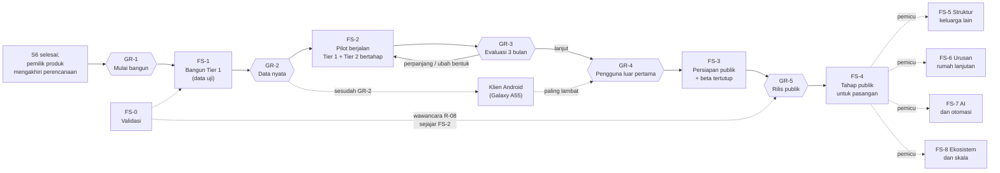
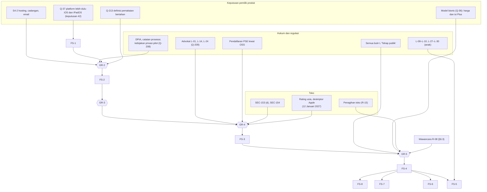

# 13 — Roadmap Produk

| | |
|---|---|
| Pemilik | `product-analyst` |
| Tahap | S5 — Rencana dan sintesis, fase A (12 November 2026; izin pemilik produk "gas", `_progress.md` "S5 dimulai") |
| Status | **Sesudah S5: keputusan 42** (iOS dan iPadOS lebih dulu; pilot dengan data nyata di iPhone 13 dan iPad mini 7; 17 keputusan 42) diterapkan di §1, §3.2 sampai §3.4, §6.4, §7.4, §12; belum ditinjau `critic`. Sebelumnya: direvisi di S5 fase D atas tinjauan `critic` S5 (A, B) dan permintaan 14 §12.2, 15 §11; ditinjau ulang `critic` (B2), temuannya diperbaiki. Semua angka §11, termasuk butir 8 dan 9, dihitung ulang lead dan cocok (`_progress.md`) |
| Sumber yang mengikat | Brief §0.3, §1 (Pilot devices, First users, Target time to MVP, Monthly infrastructure budget, Business model, Money movement scope), §1.1 (tujuan, masalah inti, tier, kriteria sukses, pagar), §13, §16; `CLAUDE.md`; `ENGINEERING-STANDARDS.md` §3, §5, §6, §9; dokumen 02, 03, 04, 05, 08 §19.8, 09 (indeks §6, berkas 04 §5–§7), 10 (indeks §3, §4, §4.1), 11, 12, 17, 18 |
| Dipakai oleh | 14 dan 15 (`architect`), 16 dan 01 (lead), tabel keterlacakan [05 §6](05-functional-requirements.md#6-tabel-keterlacakan) |

---

## 0. Cara membaca

- **Yang ditetapkan dokumen ini:** urutan fase, gerbang di antara fase, apa yang diukur untuk memutuskan, penempatan setiap fitur dokumen 04 pada fase, dan rekomendasi model bisnis. **Yang tidak:** aturan uang (07), aturan alur dan pagar (06), persyaratan keamanan (10), workstream teknis, strategi uji, dan rilis (14), daftar risiko (15). Rujukan "lihat 14" atau "lihat 15" menunjuk dokumen yang ditulis sesudah ini.
- **Tidak ada tanggal kalender** kecuali yang ditetapkan pihak luar (§8). Brief §1: "No fixed deadline. Prefer the smallest scope the pilot household will use daily over a date". Setiap fase berakhir pada **kriteria keluar**, bukan tanggal.
- **Tier mengatur urutan membangun, bukan batas rancangan** (brief §1.1; PRN-03). Roadmap ini mengurutkan pembangunan; rancangan untuk semua rumah tangga tahap publik sudah ada di 02 sampai 10.
- **Label bukti** mengikuti [README](README.md#label-bukti). Seluruh urutan fase, gerbang, ambang ukur, dan rekomendasi di sini **[Usulan]** `product-analyst` kecuali disebut lain. Ambang angka di rencana validasi tidak pernah fakta.
- **Kata pemilik produk** hanya dikutip dari `_progress.md` atau dokumen 17, dengan kedudukannya.
- **Pengenal dokumen ini**, semuanya terdaftar di [README](README.md):

| Kode | Arti |
|---|---|
| `FS-N` | Fase roadmap produk |
| `GR-N` | Gerbang (milestone) di antara fase: kriteria keluar satu fase dan syarat masuk fase berikutnya |
| `VL-NN` | Ukuran dalam rencana validasi |
| `T2-N` | Gelombang pelepasan fitur Tier 2 di dalam pilot (§3.4; glosarium *Gelombang Tier 2*). Bukan `T-NN` dokumen 07 dan bukan `P-T2-N` di 05 `tier-2.md` |
| `TB-N` | Tantangan dokumen ini terhadap brief (§10) |

---

## 1. Ringkasan

| Fase | Nama | Fase brief §13 | Isi | Kriteria keluar (gerbang) |
|---|---|---|---|---|
| **FS-0** | Validasi sebelum dan selama membangun | Phase 0 | Gerbang contoh layar (08 §19.8); uji alur inti di perangkat; garis dasar pilot; wawancara keluarga lain (R-08) berjalan sejajar dengan FS-2 | Contoh layar disetujui kedua pasangan sebelum token dikunci; hasil wawancara masuk GR-5 |
| **FS-1** | Bangun Tier 1 | Phase 1 (MVP) | 55 fitur Tier 1, 190 FR Must, di iOS dan iPadOS (satu aplikasi SwiftUI), dengan data uji | **GR-2 Data nyata**: sepuluh butir 10 §4.1, semua AC Tier 1 lulus, aplikasi terpasang di iPhone 13 istri dan iPad mini 7 pemilik produk (keputusan 42) |
| **FS-2** | Pilot berjalan | Phase 1 (MVP) | Tier 1 dengan data nyata oleh kedua pasangan; 18 fitur Tier 2 menyusul bertahap; klien Android untuk Galaxy A55 menyusul, paling lambat sebelum GR-4 (§3.4); ukuran VL-01 sampai VL-10 | **GR-3 Evaluasi tiga bulan**: KS-1 sampai KS-4 terpenuhi, pemakaian harian bertahan, tanpa kegagalan invarian |
| **FS-3** | Persiapan tahap publik dan beta tertutup | Phase 2 | Butir "Wajib sebelum tahap publik" 10 §4; advokat; PSE; toko; langganan rumah tangga; beta tertutup sekurangnya 5 rumah tangga, lebih banyak bila akun Play pribadi memerlukan 12 penguji Android selama 14 hari (§6.4) | **GR-4 Pengguna luar pertama** (di awal fase) dan **GR-5 Rilis publik** (di akhir) |
| **FS-4** | Tahap publik untuk pasangan | Phase 2 | MVP yang sama untuk rumah tangga dua dewasa (dan satu dewasa) di Indonesia | Dipakai rumah tangga di luar pilot dengan pola yang sama dengan GR-3; pemicu FS-5 sampai FS-8 |
| **FS-5** | Struktur keluarga lain | Phase 2–3 | Banyak rumah tangga per orang, tanggungan dan wali, preset lain, lebih dari dua dewasa | Dijadwalkan bila pemicunya terpenuhi (§3.8) |
| **FS-6** | Urusan rumah lanjutan | Phase 3 | Anggaran periode lain, rencana umum, `MEAL`, kalender bersama, album | Sama |
| **FS-7** | Kecerdasan dan otomasi | Phase 4 | `AI` di luar versi ringan: percakapan saran, entri berbantuan | Sama |
| **FS-8** | Ekosistem dan skala | Phase 5 | Impor mutasi bank, integrasi belanja, sinkron kalender; kandidat klien web | Sama |

**Mengapa struktur brief §13 diubah sedikit** (brief §13 mengizinkan "or justify a better one"):

1. **Phase 0 tidak mendahului seluruh pembangunan.** Bagi tahap pertama, rumah tangga pilot adalah sumber kebenaran (brief §1.1), jadi pilot itu sendiri adalah validasinya. Yang perlu divalidasi sebelum kode hanyalah tampilan (08 §19.8) dan kecepatan alur inti; validasi untuk tahap publik (keluarga lain) berjalan sejajar dengan pilot, tidak menahannya.
2. **Phase 1 dipecah menjadi FS-1 dan FS-2** karena di antaranya ada gerbang yang tidak boleh dilewati, yaitu data nyata (10 §4.1), dan karena Tier 2 dibangun di dalam pilot yang sudah berjalan, bukan sebelum pilot dimulai.
3. **Phase 2 "Core Family Operations" berarti membawa MVP ke rumah tangga lain**, bukan menambah modul. Versi ringan `SHP`, `MNT`, `PLN`, `CAL`, dan `CARE` sudah masuk MVP lewat Tier 2 (brief §1.1), sehingga yang tersisa untuk "operasi inti" adalah gerbang hukum, toko, dan model bisnis.
4. **Phase 3 dipecah menjadi FS-5 dan FS-6**, karena struktur keluarga lain bergantung pada tinjauan hukum anak (L-08 sampai L-10, L-27 sampai L-30), sedangkan urusan rumah lanjutan hanya bergantung pada bukti pemakaian. Keduanya dapat berjalan dalam urutan apa pun.

---

## 2. Kerangka prioritas

### 2.1 Mengapa bukan RICE

Brief §13 memberi contoh "RICE scores plus MoSCoW labels". RICE ditolak **[Usulan]**:

- *Reach* di pilot adalah satu rumah tangga untuk setiap fitur, jadi tidak membedakan apa pun.
- *Impact* dan *Confidence* harus diisi angka yang tidak punya sumber: dokumen 18 §0.3 mencatat bahwa tidak ada bukti dari pengguna di luar rumah tangga pilot. Mengisi angka itu melanggar PRN-04 ("Angka tanpa sumber primer tidak dikutip").
- Satu-satunya angka yang berarti, *Effort*, adalah usaha **pengguna** (04 §6), bukan usaha tim; RICE mengukur yang kedua.

### 2.2 Kerangka yang dipakai: MoSCoW dengan lima syarat yang dapat diperiksa

Satu kerangka, dipakai untuk semua 131 fitur. Label **final** sejak dokumen ini (04 "Cara membaca" menyebutnya sementara sampai S5).

| Label | Syarat masuk (semuanya harus terpenuhi) | Fase |
|---|---|---|
| **Must** | (1) Tier 1 menurut brief §1.1 sebagaimana diubah keputusan checkpoint; (2) menyebut `MSL-1` sampai `MSL-5` atau persyaratan "Pilot" dokumen 10; (3) tanpa fitur ini salah satu dari KS-1 sampai KS-4 tidak dapat terpenuhi, atau pilot tidak boleh memproses data nyata | FS-1 |
| **Must bersyarat** | Pagar yang wajib ada bila fitur Tier 2 yang dijaganya dibangun (05 §4) | FS-2, bersama fiturnya |
| **Should** | Tier 2; menyebut `MSL-n`; usaha berulang nol atau sukarela (04 §6) | FS-2 |
| **Could** | Tier 3; menyebut `MSL-n`, tetapi pilot belum menunjukkan perlunya | "Menunggu bukti" (§4), ditimbang di GR-3 dan sesudah GR-5 |
| **Future** | Tier 3; memerlukan fondasi, tinjauan hukum, atau rumah tangga yang belum ada di pilot | FS-5 sampai FS-8, menurut pemicunya |
| **Will not build** | Tidak menyebut masalah, atau melanggar pagar (06 AT-3, AT-4, PG-09; PRN-02, PRN-11) | Tidak pernah; alasannya di §4.2 |

Urutan **di dalam** satu fase memakai empat pertimbangan, dalam urutan ini: ketergantungan (04 §5.1); masalah yang lebih dekat ke masalah inti (`MSL-1` sampai `MSL-5` sebelum `MSL-6`, `MSL-7`); kriteria sukses yang butuh waktu lebih lama untuk dinilai (KS-5 butuh pemakaian berminggu-minggu); usaha berulang yang lebih kecil.

---

## 3. Fase dan gerbang

### 3.1 FS-0 — Validasi sebelum dan selama membangun

**Untuk siapa.** Bagian pilot: pemilik produk dan istrinya. Bagian publik: keluarga lain (R-08). Rinciannya di §6.

| Kegiatan | Kapan | Yang dihasilkan | Rujukan |
|---|---|---|---|
| Gerbang contoh layar arah C: Beranda, Catat, Chat di iOS dan Android, terang dan gelap, beserta ikon | Di FS-1, sebelum token dibekukan | Persetujuan kedua pasangan, atau perubahan pada lima unsur anti-templat | 08 §19.8; diterima atas saran lead ("pasang semua", 17 keputusan S4 (b)) |
| Uji kecepatan alur inti di perangkat pilot: catat belanja, catat dan konfirmasi serah terima, ajukan dan setujui permintaan | Sesudah alur pertama dapat dipasang (FS-1) | Jumlah ketukan dan waktu dibandingkan dengan ES §3 dan PRN-05 | ES §3 `[DEFAULT]` dikukuhkan ADR sesudah pengukuran pertama |
| Garis dasar pilot (VL-00) | Sebelum GR-2 | Satu percakapan 10 menit, §6.1 | §6.1 |
| Wawancara dan uji prototipe dengan 8–12 rumah tangga lain | Sejajar FS-2; selesai sebelum GR-5 | Pola kebutuhan, kesediaan membayar, keberatan terhadap persetujuan | R-08; §6.3 |
| Uji langsung dua atau tiga aplikasi pesaing | Sebelum materi publik apa pun (GR-5) | Jumlah langkah untuk satu belanja, satu tarik tunai, satu serah terima | R-02 (memerlukan pemilik produk); 18 §1.4 |

### 3.2 GR-1 — Mulai bangun, dan FS-1 — Bangun Tier 1

**GR-1 (syarat masuk FS-1).**

| # | Syarat | Pemutus |
|---|---|---|
| 1 | Pemilik produk menyatakan fase perencanaan selesai (`CLAUDE.md` "Current phase") | Pemilik produk |
| 2 | Agen tim bangun dibuat lead sesudah stack disetujui di S4 (`CLAUDE.md` "Build team") | Lead |
| 3 | Platform yang dibangun lebih dulu: **diputuskan, iOS dan iPadOS** (Q-37 selesai; 17 keputusan 42) | Pemilik produk; sudah diputuskan |

**Platform: diputuskan pemilik produk sendiri** (17 keputusan 42, 12 November 2026), kata-katanya: "a saja karena saya ada ipad dan iphone jadi saya bisa pake ipad bener gaa?" dan "ios ipad yang bakalan dipakai pilot ya".

| Hal | Yang berlaku |
|---|---|
| Dibangun lebih dulu | iOS dan iPadOS, satu aplikasi SwiftUI, lewat Xcode Cloud dan TestFlight internal (keputusan 32); Mac disewa sekali untuk penyiapan, beli atau sewa bulanan menurut ADR-022 butir 4. Server dan kontrak lebih dulu atau bersamaan, karena semua aturan ada di server (ADR-013); urutan teknisnya di 14 §3.4 |
| Pilot dengan data nyata | iPhone 13 istri (pencatat utama) dan iPad mini 7 pemilik produk. GR-2 tidak menunggu Android |
| Android (Kotlin; keputusan stack tetap) | **[Usulan]** lead, dapat diubah pemilik produk: dibangun sesudah GR-2 untuk Galaxy A55 milik pemilik produk, di dalam pilot bila waktu memungkinkan, **paling lambat sebelum GR-4** (§3.4) |
| Brief §1 "Pilot devices" | "the pilot needs iOS and Android" tidak lagi menjadi syarat data nyata; keputusan menang (17 K-66). Maksudnya, kedua pasangan dapat memakai aplikasi, tetap terpenuhi |

**Riwayat pilihan, singkat.** Draf S5 menyajikan tiga pilihan untuk Q-37: keduanya bersamaan, Android dulu, iOS dulu. Saran tim fase D adalah B (Android dulu: siklus kerja di Linux, Mac tertunda), disertai usulan bahwa data nyata tidak dimulai dengan satu platform. Saran B **digantikan** keputusan 42 setelah dua fakta yang belum diketahui saat itu (Q-211): istri tidak memakai Android, dan dialah yang sering mencatat. Usulan "tidak dengan satu platform" juga digantikan; alasannya (PRN-01, KS-1: kedua orang mencatat dan melihat angka yang sama sejak data nyata) tetap terpenuhi, karena kedua pasangan memakai aplikasi iOS yang sama.

**Risiko sisa.** Sampai Android tersedia, pemilik produk mencatat pengeluarannya di luar rumah belakangan dari iPad, karena iPad bukan perangkat yang dibawa saat berbelanja **[Asumsi]**. Entri terlambat diterima (PRN-06; 07 §3.11), tetapi catatan yang tertunda memperbesar 15 RISK-18 dan membuat angka utama tertinggal sampai catatan itu masuk. Yang meredamnya: pemilik produk menyatakan "saya jarang kemana-mana", dan VL-07 butir (2) menanyakan momen yang terlewat di minggu kedua; bila momen yang terlewat terutama pengeluaran pemilik produk di luar rumah, Android dinaikkan urutannya di dalam FS-2 **[Usulan]**.

**FS-1 berisi** semua fitur Tier 1 (§4.1) dan konsep dokumen 11 yang menjadi kriteria penerimaan FR induk Tier 1 (IDEA-01, IDEA-02, IDEA-03; THR yang diberikan; 05 §6). Tidak ada fitur Tier 2 yang menahan GR-2.

**Ketergantungan yang jatuh di dalam FS-1:**

| Butir | Kapan paling lambat | Rujukan |
|---|---|---|
| **S4-2: penyedia hosting, cadangan, dan email** | Sebelum deploy pertama ke server yang akan memegang data nyata **[Usulan]**; pernyataan tertulis letak data sebelum data nyata (10 §4.1 butir 7, tidak dapat ditunda). 14 §7.8 membaca "pas mau deploy" lebih awal: deploy pertama ke VPS uji, akhir FS-1 langkah 1 **[Usulan]** `architect`. Arti penundaan pemilik produk tidak ditetapkan dokumen mana pun; ditanyakan di Q-220 | Keputusan 31, diputuskan pemilik produk sendiri: "#S4-2: nanti aja pas mau deploy"; ADR-020, ADR-026 tetap Diusulkan; R-14; K-62 |
| Catatan persetujuan uji (SEC-109 (b)) | Dibaca dan diakui kedua penguji sebelum build TestFlight pertama dipasang, jadi di FS-1, bukan baru di GR-2 | 10 §4.1 butir 3 |
| Email untuk verifikasi dan pemulihan (SEC-24) | Sebelum akun pertama dibuat di server yang di-deploy | 09 §5 |
| Akun Apple Developer Program dan sewa Mac sekali untuk alur kerja pertama Xcode Cloud | Sebelum build iOS pertama | Keputusan 32; 09.4 §5 |
| Kunci API Claude dan pembangunan kumpulan kalimat pertama (R1) | Tidak menahan GR-2; diperlukan sebelum fitur `AI` Tier 2 di FS-2 | Keputusan 33; 10 §3 10-B |
| Deskriptor rating usia Apple | Lihat §8 (12 Januari 2027) | 18 §2.12.3; SEC-83 |

### 3.3 GR-2 — Data nyata

Satu-satunya gerbang yang menyangkut keselamatan data orang yang bukan pemilik produk (istrinya), jadi daftarnya tidak dipersingkat (`CLAUDE.md` "Instruction priority" butir 3).

| # | Syarat | Rujukan |
|---|---|---|
| 1 | Sepuluh butir 10 §4.1 (butir 10 baru sejak keputusan 42), dicentang bertanggal di runbook pilot: persyaratan "Pilot" dokumen 10 lulus uji; istri membaca sendiri pemberitahuan pengelola dan pengakuannya tercatat (keputusan 25; 10-F A); catatan persetujuan uji (SEC-109 (b); sudah wajib sebelum build TestFlight pertama dipasang, §3.2); DPIA dan catatan prosesor (Q-208, diterima atas saran lead); kebijakan privasi versi pilot; rencana insiden; penyedia hosting dipilih dengan pernyataan letak data; pemulihan cadangan diuji; SAPA 129 terverifikasi atau tidak ditampilkan; pemilik produk ditanya apakah iPad mini 7 dipegang orang lain dan apakah sidik jari orang lain terdaftar di Touch ID-nya (iPad mini 7 memakai Touch ID di tombol atas, **[Terverifikasi]** 18 §2.12.9), jawabannya dicatat (SEC-59 (e) **[Usulan]** `security-privacy`; kunci aplikasi tetap pilihannya, SEC-19). Bagian khusus Android (10 §4.3) bukan syarat GR-2 | 10 §4.1 |
| 2 | Setiap kriteria penerimaan Tier 1 punya uji otomatis yang menyebut ID-nya dan lulus | ES §6; 05 |
| 3 | Uji invarian 07 dan 06, dan setiap contoh terhitung 07 sebagai uji yang dapat dijalankan, lulus | ES §5 |
| 4 | Aplikasi terpasang lewat TestFlight internal di iPhone 13 istri dan iPad mini 7 pemilik produk. Setiap alur Tier 1 yang dipakai pemilik produk (08 §16.2) lulus uji tata letak di iPad mini 7 menurut 08 §16.4 baris "Sebelum GR-2" (potret, lanskap, jendela berdampingan *compact* dan *regular*, jendela yang diubah ukurannya di tengah alur). Android tidak disyaratkan | Keputusan 42; 17 K-66; 08 §16.2, §16.4; 09.4 §5 |
| 5 | Sasaran ES §3 diukur di iPhone 13 dan iPad mini 7 (perangkat harian pemilik produk), dan angkanya dikukuhkan atau diubah lewat ADR. Galaxy A55 diukur sebelum klien Android memegang data nyata (§3.4). Bunyi ES §3 ("pilot phones (iPhone 13, Galaxy A55)") belum diubah: 17 K-67 | ES §3; 14 QG-30 butir 4; keputusan 42 |
| 6 | Gerbang contoh layar 08 §19.8 sudah dilewati | §3.1 |
| 7 | Garis dasar VL-00 sudah dicatat | §6.1 |

**Bukan syarat GR-2** (diputuskan pemilik produk sendiri, keputusan 34): jawaban advokat atas L-01, L-14, L-24 dan pendaftaran PSE. Risiko bila pilot ternyata wajib mendaftar PSE (W-32) diterima pemilik produk.

### 3.4 FS-2 — Pilot berjalan

**Jendela tiga bulan.** Brief §1.1 menilai sukses "after three months of pilot use". **[Usulan]** (A-40): jendela dimulai di GR-2, saat kedua pasangan memakai Tier 1 dengan data nyata, bukan saat Tier 2 lengkap. Alasannya KS-1 sampai KS-4 hanya bergantung pada Tier 1. KS-5 bergantung pada `CARE` dan `AI` (Tier 2), jadi penilaiannya disyaratkan sekurangnya enam minggu pemakaian fitur itu **[Usulan]**; bila Tier 2 datang terlambat, GR-3 menilai KS-1 sampai KS-4 tepat waktu dan KS-5 menyusul.

**Tier 2 di dalam pilot.** 18 fitur, dilepas bertahap. Urutan bawaan di bawah diturunkan dari §2.2; **pasangan pilot boleh mengubahnya di GR-2** (Q-212), karena merekalah sumber kebenaran MVP.

| Gelombang | Fitur | Must bersyarat yang ikut | Mengapa di urutan ini |
|---|---|---|---|
| T2-1 | F-CARE-001, F-CARE-002, F-CARE-003; F-REQ-013; F-FAM-021 | FR-COM-016, FR-CARE-002, FR-CARE-004 | KS-5 perlu waktu paling lama untuk dinilai; permintaan tindakan menjawab `MSL-6`/`MSL-7` dan brief §1.1 ("things one asks of the other kept as tasks until done"); sebutan anggota hampir tanpa biaya |
| T2-2 | F-AI-005 lebih dulu, lalu F-AI-001, F-AI-002, F-AI-003, F-AI-004, F-AI-008 | FR-AI-005 sampai FR-AI-009 | F-AI-002 membutuhkan `CARE`; F-AI-005 (persetujuan, batas biaya, gagal aman) harus ada sebelum `AI` mana pun |
| T2-3 | F-SHP-001, F-SHP-002; F-MNT-001 sampai F-MNT-003; F-CAL-001; F-PLN-001; konsep 11 IDEA-15 (tinjauan bulanan), IDEA-19 (butuh tenang) | — | `MSL-4` (anggaran dapur) sudah sebagian terjawab Tier 1; sisanya `MSL-6`. IDEA-15 dan IDEA-19 belum punya FR (17 Q-187); ditulis sebelum dibangun |
| Di luar gelombang | Konsep 11 IDEA-08 (musim Lebaran), menurut §8 | — | Waktunya ditentukan Ramadan, bukan urutan gelombang; belum punya FR (Q-187) |

**Rilis dalam pilot.** Build TestFlight berlaku 90 hari sejak diunggah ke TestFlight, bukan sejak dipasang (**[Terverifikasi]** 18 §2.12.6, "All builds uploaded to TestFlight are active for 90 days"), hampir sama dengan jendela tiga bulan. **Yang mengikat:** ADR-022 butir 1, build baru paling lambat setiap 90 hari, sasaran setiap 60 hari; bagian dari jalur Xcode Cloud dan TestFlight internal yang diputuskan pemilik produk sendiri (17 keputusan 32). **Usulan `architect`** (ADR-028 butir 4, Diusulkan): rilis pemeliharaan bila 60 hari tanpa rilis, dan batas keras 80 hari, agar tersisa 10 hari untuk build yang gagal atau tertahan. Usulan itu memperketat aturan yang diputuskan pemilik produk, jadi berlaku hanya bila ia menerimanya (Q-219). Setiap gelombang Tier 2 sekaligus memperbarui build. Jadwal rilisnya di 14 §6.3.

**Anak 12+ di rumah tangga pilot** (Q-186; 03 §4.1). **Tidak ada yang dijadwalkan untuk anak selama pilot** **[Usulan]**: tanpa akun anak dan tanpa profil tanggungan (bawaan dikukuhkan dokumen 10, D-109). Risiko anak memegang ponsel orang tua (PL-03; L-29) sudah dijawab kunci aplikasi Tier 1 (F-FAM-019). Akun dan profil anak menunggu FS-5 dan tinjauan advokat L-08 sampai L-10, L-27 sampai L-30. GR-3 menanyakan sekali apakah pasangan ingin anak tercatat sebagai profil; jawabannya bahan FS-5, bukan perubahan pilot.

**Klien Android di dalam pilot** (**[Usulan]** lead, dapat diubah pemilik produk; 17 keputusan 42). Dibangun sesudah GR-2 untuk Galaxy A55 milik pemilik produk, di dalam FS-2 bila waktu memungkinkan, paling lambat sebelum GR-4, karena beta memakai jalur pengujian Google Play (§6.4) dan rumah tangga beta dapat memakai Android. Ia tidak menahan GR-2 dan tidak menggeser jendela tiga bulan. Server, kontrak, dan aturan sama (ADR-013), jadi tidak ada aturan yang berubah. Sebelum APK memegang data nyata di Galaxy A55, syarat GR-2 yang bergantung pada klien diulang untuk klien itu **[Usulan]**: butir 2 (uji AC Tier 1 yang berjalan di klien, termasuk bagian Android FR-COM-011/AC-10, FR-NTF-005/AC-6 dan AC-7), butir 3 (uji invarian lewat klien), butir 5 (ES §3 di Galaxy A55), dan persyaratan "Pilot" dokumen 10 yang menyangkut klien Android; daftar teknisnya di 14. Selama itu klien Android memakai data uji di staging (ADR-028 butir 1). Bila klien Android selesai sebelum GR-3, VL-07 diulang di Galaxy A55.

**Web dan PC tidak dibangun di pilot.** Keputusan pemilik produk selama S5 (`_progress.md`, "Pertanyaan pemilik produk tentang web", 12 November 2026), kata-katanya: "A aja, catat dulu"; **diterima atas saran lead** (17 keputusan 41). Kandidat klien web ada di §3.8; pertanyaannya Q-210.

### 3.5 GR-3 — Evaluasi tiga bulan

Keputusan "lanjut ke tahap publik" adalah keputusan pemilik produk; GR-3 menyiapkan bahannya. Ukurannya di §6.1, tabel keputusannya di §6.2. Ringkas:

| Hasil | Keputusan |
|---|---|
| KS-1 sampai KS-4 terpenuhi, pemakaian harian bertahan (VL-02), tanpa kegagalan invarian (VL-10), tanpa tanda bahaya pagar (VL-08) | Lanjut ke GR-4 dan FS-3 |
| Sebagian terpenuhi, atau Tier 2 datang terlambat | Perpanjang FS-2 satu sampai dua bulan **[Usulan]**, dengan perbaikan yang disebut |
| KS-1 tidak terpenuhi | Masalah inti belum terjawab: tahap publik tidak dimulai; penyebabnya dicari dan dipecahkan di FS-2 |
| Fitur Tier 2 tidak dipakai | Kandidat dikeluarkan dari cakupan publik (PRN-02) |

Brief §1: "Public launch only after the pilot shows sustained daily use". Definisi "pemakaian harian yang bertahan" tidak ada di brief; usulannya VL-02, ditanyakan di 17 (Q-213), dan dijawab sebelum GR-2 **[Usulan]**, agar ambangnya ditetapkan sebelum data yang mengujinya ada (garis dasar VL-00 juga sebelum GR-2; 15 RISK-26).

### 3.6 FS-3 — Persiapan tahap publik dan beta tertutup

**GR-4 — Pengguna luar pertama** (sebelum siapa pun di luar rumah tangga pilot memakai layanan, termasuk penguji, grup TestFlight eksternal, atau jalur pengujian Google Play):

| # | Syarat | Rujukan |
|---|---|---|
| 1 | Advokat menjawab **L-01, L-14, L-24** | Q-209, diterima atas saran lead ("pasang semua"); 10 §4.1 |
| 2 | Pendaftaran PSE lingkup privat lewat OSS sebelum pengguna memakai layanan, bila advokat menyatakan wajib | L-14; R-07; 18 §2.11 (Permenkominfo 5/2020, **[Terverifikasi]** naskah 2020) |
| 3 | SEC-153 (d) dan sisa SEC-154: sebelum build pertama ke TestFlight eksternal atau App Store | 10 §4; R-13 |
| 4 | Rating usia: Apple 18+ dengan override, deskriptor dijawab; Google Play target audiens 18 ke atas | SEC-83; 18 §2.12.3 |
| 5 | Google Play bila dipakai: jenis akun pengembang diputuskan, pribadi atau organisasi (Q-221); akun pengembang (USD 25 sekali, **[Terverifikasi]** 18 §5.1.1); bila akun pribadi yang dibuat sesudah 13 November 2023, rencana *closed testing* dengan sekurangnya 12 penguji yang ikut tanpa putus 14 hari sebelum produksi (**[Terverifikasi]** `architect`, 14 §6.7; syarat itu jatuh di GR-5, ukurannya di §6.4); target API 36 (**[Terverifikasi]** 18 §5.1.1), deklarasi aplikasi kesehatan (18 §2.4), Data safety di luar jalur internal testing (18 §2.4) | SEC-143 |
| 6 | Email keluar dari sandbox SES, bila S4-2 memilih SES | 09 §6; ADR-026 |
| 7 | Butir "sebelum tahap publik" yang jatuh sebelum GR-4, karena rumah tangga beta memakai server yang sama dan pengelolanya bukan anggota mereka: SEC-36 dan SEC-39 (c) publik (akses darurat, log keluar dari VPS operator); SEC-34 teks umum dan SEC-139 versi publik; SEC-25 (pemulihan dan ganti email tanpa operator); SEC-84; SEC-147 bila L-14 mewajibkan pendaftaran. Menurut bunyinya sendiri juga di GR-4: SEC-153 (d), SEC-154 (butir 3), SEC-142, SEC-143 (butir 5). SEC-18 faktor kedua dianjurkan bila biayanya kecil. SEC-107 swalayan tidak di sini: dibangun di FS-1 (FR-FAM-013/AC-12), jadi sudah ada sejak GR-2 | 10 §4.2 **[Usulan]** `security-privacy` |
| 8 | Klien Android memenuhi syarat ulang GR-2 di §3.4 dan terpasang di Galaxy A55, sebelum jalur pengujian Google Play dibuka | Bawaan lead **[Usulan]**, 17 keputusan 42; §3.4 |

**Isi FS-3 sesudah GR-4:**

| Kelompok | Butir | Rujukan |
|---|---|---|
| Hukum | Semua butir L berstatus "Tahap publik", terutama L-04, L-20, L-22, L-23 (keputusan sementara append-only, keputusan 24); tinjauan advokat atas kebijakan privasi, DPIA, dan catatan prosesor | 17 bagian 6; 10 §4 baris "Regulasi dan operasi" |
| Keamanan | Sisa kolom "Wajib sebelum tahap publik" 10 §4, sebelum GR-5: SEC-18, SEC-45, SEC-105 tautan web, SEC-140 tautan web, SEC-141, SEC-157 (uji penetrasi pihak luar); ADR E2EE (10-D A); tinjauan ulang SQLCipher. Yang jatuh sebelum GR-4 ada di GR-4 butir 7. RLS tidak di daftar ini: dipaksakan sejak pilot (ADR-016; D-99; 14 §3.3 langkah 1) | 10 §4, §4.2; 09 §6 |
| `AI` | Jalur R2 hanya lewat ADR baru sesudah advokat; tanpa itu R1 tetap | 09 §6; SEC-122 |
| Model bisnis | Langganan rumah tangga lewat penagihan toko, hak akses per rumah tangga di server (§7.5) | §7 |
| Ekspor | SEC-107 swalayan dipenuhi FR-FAM-013 yang dibuka selama aktif (FR-FAM-013/AC-12, dibangun di FS-1, ada sejak GR-2); **tidak** memerlukan F-FIN-023, yang karena itu pindah ke "Menunggu bukti" (§4.1) | 10 §7.4 |
| Validasi | Beta tertutup sekurangnya 5 rumah tangga, ditambah bila syarat penguji Play menuntut (§6.4), sekurangnya 8 minggu; hasil wawancara R-08 (§6.3) | §6 |
| Cakupan | Segmen rilis publik pertama (Q-214): rumah tangga dua dewasa setara dan satu dewasa, tanpa akun anak | §3.7 |

**GR-5 — Rilis publik:** semua butir FS-3 selesai; beta memenuhi §6.4; lolos tinjauan App Store dan Google Play; harga dan isi Plus diputuskan pemilik produk sesudah hasil wawancara dan beta (§7.5); materi publik tidak memakai positioning yang belum diuji (PRN-04; 18 §1.4).

### 3.7 FS-4 — Tahap publik untuk pasangan

Yang dirilis adalah MVP yang sama dengan pilot (Tier 1 + Tier 2 yang lolos GR-3), untuk rumah tangga yang modelnya sudah dibangun: **dua dewasa setara** (struktur 1, dan struktur 2 tanpa akun anak) dan **satu dewasa** (SCN-43 sudah Tier 1). **[Usulan]** dan Q-214. Alasannya: itulah satu-satunya bentuk yang sudah divalidasi pilot; struktur lain dirancang (03 §4) tetapi belum dipakai siapa pun.

Infrastruktur tumbuh menurut 09.4 §7.2 dan pemicu 09 §6 (lihat 14). Usaha mencatat diukur ulang pada beta dan rilis publik dengan cara yang sama dengan pilot, tanpa analitik perilaku (SEC-49).

### 3.8 FS-5 sampai FS-8 — Tier 3 (garis besar)

Kedalaman satu halaman (`CLAUDE.md`, depth rule). Tidak ada FR; garis besarnya di [05 tier-3.md](05-functional-requirements/tier-3.md). Urutan di antara FS-5 sampai FS-8 tidak tetap: fase dimulai bila pemicunya terpenuhi.

| Fase | Fitur | Pemicu **[Usulan]** | Prasyarat |
|---|---|---|---|
| FS-5 Struktur keluarga lain (12) | F-FAM-009, 010, 011, 012; F-COM-013; F-FIN-024; F-REQ-014, 015, 016, 017; F-CARE-005; F-CAL-006 | Permintaan nyata dari rumah tangga tahap publik (FS-4) atau wawancara R-08; untuk anak, juga jawaban advokat | L-08 sampai L-10, L-27 sampai L-30, R-10 (anak); SEC-38 (satu orang di beberapa rumah tangga); Q-88 (orang dewasa sebagai tanggungan) |
| FS-6 Urusan rumah lanjutan (10) | F-FIN-021; F-PLN-003, 004; F-GOL-002; F-MNT-005; F-MEAL-002, 003; F-CARE-004; F-CAL-003; F-TML-001 | Fitur Tier 2 induknya dipakai rutin di FS-4, dan pengguna meminta kedalaman | Pembukaan anggaran periode lain adalah keputusan pemilik produk (brief §5C, Tier 3) |
| FS-7 Kecerdasan dan otomasi (2) | F-AI-006 (percakapan saran), F-AI-007 (entri berbantuan `AI`) | Bukti bahwa usaha mencatat tetap penghalang terbesar sesudah FS-4; jalur `AI` yang sah | L-05, L-16, L-18, L-19, L-32; ADR R2; kebijakan AI-Generated Content Google Play dinilai ulang (18 §2.4 butir 3) |
| FS-8 Ekosistem dan skala (3) | F-FIN-025 (impor mutasi), F-SHP-005 (belanja online), F-CAL-005 (sinkron kalender) | Permintaan nyata; jalur yang tersedia | 18 §3 (impor manual sebagai jalur realistis; tanpa API pembeli marketplace; kalender perangkat tanpa izin baca); L-13, L-15 |

**Kandidat, bukan komitmen: klien web atau PC.** Tidak dibangun di pilot (§3.4); hanya itu yang diputuskan (keputusan 41). Apakah dan kapan dibuka sesudah pilot adalah Q-210. Yang membuatnya mungkin tanpa membongkar backend: semua aturan ada di server (ADR-013). Prasyaratnya: model keamanan browser di dokumen 10 (belum dirancang), sesi di PC yang dipakai bersama, dan aturan data di perangkat (ADR-024) yang harus diterjemahkan ke penyimpanan browser. Klaim tentang ketersediaan klien browser untuk kontrak Connect dan status Windows Subsystem for Android **tidak dipakai** di sini karena belum diverifikasi di 18 (permintaan riset R-17).

---

## 4. Penempatan setiap fitur

### 4.1 Ringkasan per fase

| Penempatan | Fitur | Jumlah |
|---|---|---|
| **FS-1** (Must) | `FAM` 001–008, 019, 020; `COM` 001, 008–012, 014; `FIN` 001–020; `REQ` 001–012; `CAL` 002; `NTF` 001–005 | **55** |
| **FS-2** (Should; F-AI-005 Must bersyarat) | `FAM` 021; `REQ` 013; `SHP` 001, 002; `PLN` 001; `MNT` 001–003; `CARE` 001–003; `CAL` 001; `AI` 001–005, 008 | **18** |
| **FS-3** (Could, bersyarat) | Tidak ada. F-FIN-023 semula di sini bila SEC-107 memerlukannya; 10 §7.4 menyatakan tidak, jadi pindah ke "Menunggu bukti" | **0** |
| **FS-5** (Future) | §3.8 | **12** |
| **FS-6** (Future) | §3.8 | **10** |
| **FS-7** (Future) | §3.8 | **2** |
| **FS-8** (Future) | §3.8 | **3** |
| **Menunggu bukti** (Could; ditimbang di GR-3 dan sesudah GR-5) | `FAM` 013; `COM` 003, 004, 007; `FIN` 022, 023, 027; `SHP` 003, 004; `INV` 001; `PLN` 002; `GOL` 001; `MNT` 004; `MEAL` 001; `CAL` 004; `TML` 002; `NTF` 006, 007 | **18** |
| **Will not build** | §4.2 | **13** |
| **Jumlah** | | **131** (Tier 1 55, Tier 2 18, Tier 3 58; sama dengan 04 §1) |

Label MoSCoW dokumen 04 tidak diubah: setiap fitur "Future" di 04 berada di FS-5 sampai FS-8, dan setiap "Could" di "Menunggu bukti" atau FS-3. Pengecualian yang disengaja tidak ada.

**"Menunggu bukti" bukan fase.** Fitur Could tidak dijadwalkan sampai pilot atau tahap publik menunjukkan masalah yang dijawabnya. Contoh pemicu: F-COM-003, 004, 007 (pesan suara, reaksi, pencarian) dinilai sesudah pilot (D-70); F-NTF-006 (peringatan anggaran) bila anggaran dapur tetap terlampaui sesudah tiga bulan (Q-134); F-FIN-027 (Sembunyikan angka) bila tombol mata (S4-10 (iii) A) tidak cukup.

### 4.2 Will not build

Alasannya kanonis di 04 §8.1; diulang satu baris agar brief §13 ("Will not build (with reasons)") terpenuhi di satu tempat.

| Fitur | Alasan singkat |
|---|---|
| F-COM-002, 005, 006 utas bebas, pin, polling | Balasan pada kartu dan F-REQ-012 sudah memberi tiap objek tempatnya; dua orang dewasa tidak memungut suara |
| F-FAM-014 visualisasi hubungan | Tidak ada masalah §1.1; aturan tidak membaca hubungan (06 PG-01) |
| F-FAM-015 direktori kontak | Tidak ada masalah §1.1; menambah data pihak luar (Q-28) |
| F-FAM-016 pengumuman | Tidak ada masalah §1.1 bagi dua orang dewasa |
| F-FAM-017, F-NTF-008 riwayat kegiatan per anggota, umpan kegiatan | Dilarang 06 AT-3 |
| F-FAM-018 mengeluarkan orang dewasa lain | Keluar sendiri mencapai keadaan yang sama tanpa tombol tekanan (06 INV-A48) |
| F-FIN-026 penyusutan aset otomatis | Tidak ada masalah §1.1 |
| F-INV-002 stok manual | Contoh pelanggaran PRN-02 |
| F-GOL-003 kontribusi per orang lintas periode | Dilarang 06 AT-4 |
| F-CARE-006 pelacakan siklus | 04 §4.4 (D-63) |

---

## 5. Ketergantungan dan urutan

Ketergantungan antarfitur di dalam FS-1 dan FS-2 kanonis di 04 §5.1 dan tidak diulang. Yang menyangkut urutan Tier 2: `CARE` sebelum F-AI-002; F-AI-005 sebelum semua `AI`; F-SHP-002 bertumpu pada F-FIN-005 dan F-REQ-005 (Tier 1; 04 §5.2 KM-17).

---

## 6. Rencana validasi

### 6.1 Pilot (FS-2): apa yang diukur

**Batas yang mengikat semua ukuran.** Tidak ada SDK analitik perilaku (SEC-49); tidak ada hitungan, peringkat, atau tren per orang (PRN-11; 06 AT-4, PG-09); `read_state` dan kehadiran tidak dibaca apa pun (INV-A45); KS-5 adalah pernyataan pasangan, bukan metrik (brief §1.1; PRN-04). Karena itu setiap ukuran di bawah berasal dari salah satu dari tiga sumber: **(a)** jawaban pasangan sendiri; **(b)** data rumah tangga yang memang terbaca oleh **kedua** anggota dewasa, dibaca pada tingkat rumah tangga, tidak per orang, lewat layar aplikasi atau jalur baca yang sama (SEC-06), **tidak pernah** lewat kueri basis data langsung oleh pengelola server, yang di pilot adalah suami; **(c)** hasil lulus atau gagal pemeriksaan teknis yang sudah ada, tanpa isi (uji invarian, ES §5; SEC-44). Buku pribadi, tempat uang pribadi, setelan `AI`, kehadiran, tanda dibaca, dan `CARE` yang tidak dibagikan tidak pernah menjadi sumber. Tidak ada pengumpulan data baru: validasi tidak menambah instrumen, medan, tabel, log, atau analitik; ukuran waktu VL-07 diambil dalam sesi uji yang disepakati, bukan dari build yang dipasang; jawaban VL-08 tidak disimpan di aplikasi atau server. Batas ini dikukuhkan `security-privacy` (10 §7.4, baris B-04) **[Usulan]**.

**Usaha bagi pasangan:** satu percakapan akhir bulan sekitar 20 sampai 30 menit **[Asumsi]**, ditambah satu percakapan singkat di akhir minggu kedua. Tidak ada buku harian.

| ID | Mengukur | Cara | Sumber | Kapan | Ambang **[Usulan]** |
|---|---|---|---|---|---|
| VL-00 | Garis dasar | Tiga pertanyaan sebelum GR-2: berapa kali minggu lalu bertanya soal uang; jalan-jalan atau pembelian tidak rutin bulan lalu yang datang mendadak; apa yang sekarang dicatat | (a) | Sekali | — (pembanding) |
| VL-01 | **KS-1** tahu sisa dan pemegang | Masing-masing, terpisah, menjawab "uang kita sisa berapa dan siapa memegangnya" dari aplikasi tanpa bertanya, lalu keduanya menghitung uang (rekonsiliasi kas, 07 §3.10) dan mencocokkan. Sama dengan uji pilot PRN-01 | (a), (b) | Akhir bulan 1, 2, 3 | Bulan 2 dan 3: keduanya dapat menjawab dan jawabannya sama; selisih yang tersisa sudah tampil sebagai "belum dikonfirmasi" atau selisih kas, bukan tersembunyi |
| VL-02 | **Pemakaian harian yang bertahan** (brief §1) | Jumlah hari per minggu dengan sedikitnya satu catatan oleh siapa pun, dibaca dari tanggal pencatatan entri yang terbaca keduanya (entri di buku pribadi tidak dihitung); tanpa pemisahan per orang | (b) | Dibaca di akhir bulan 3 | Pada setiap dari empat minggu terakhir jendela, sedikitnya 5 dari 7 hari (Q-213) |
| VL-03 | **KS-2** mencatat tanpa diingatkan | Masing-masing menjawab sendiri: "Bulan ini kamu mencatat tanpa diingatkan pasanganmu?" dan "momen apa yang paling sering terlewat?" | (a) | Akhir bulan 1, 2, 3 | Bulan 3: keduanya "ya" |
| VL-04 | **KS-3** isi ringkasan bulanan | Bersama membuka ringkasan bulanan (F-FIN-020) dan mencentang: per kategori, per orang (siapa membayar apa, 06 AT-7), tabungan, aset; lalu "apakah angkanya dipercaya?" | (a), (b) | Akhir bulan 1, 2, 3 | Bulan 3: keempat butir ada dan dipercaya keduanya |
| VL-05 | **KS-4** rencana, bukan kejutan | "Bulan ini ada jalan-jalan atau pembelian tidak rutin yang datang mendadak?" dibandingkan dengan jumlah permintaan bulan itu (daftar objek, tingkat rumah tangga) | (a), (b) | Akhir bulan 1, 2, 3 | Bulan 3: tidak ada kejutan, atau setiap kejutan sudah dibahas dan pasangan tidak menganggapnya masalah |
| VL-06 | **KS-5** saling memperhatikan | Masing-masing menyatakan apakah aplikasi membantunya memperhatikan dan menanggapi keadaan pasangan, dengan satu kalimat bebas. Tidak dinilai angka, tidak dirata-rata | (a) | Akhir bulan 3, sesudah sekurangnya enam minggu `CARE` dan `AI` (A-40) | Dinilai pasangan sendiri (brief §1.1) |
| VL-07 | Usaha mencatat | (1) Ketukan dan waktu tiga alur inti di perangkat pilot (ES §3); (2) di akhir minggu kedua, momen mencatat yang dilewati dan alasannya, dicocokkan dengan tabel 04 §6 dan 03 §2.4 | (a), (c) | Minggu 2; ulang di bulan 3 | ES §3 terpenuhi; tidak ada momen yang dilewati karena "terlalu lama" |
| VL-08 | **Pagar** | Masing-masing menjawab tentang aplikasi, bukan tentang pasangan: "Pernah merasa diawasi, ditagih, atau didesak lewat aplikasi?" dan "Apa yang ingin kamu ubah?" Boleh dijawab tertulis kapan saja. **Saluran jawaban istri tidak melewati pemilik produk** (yang juga pengelola server) **[Usulan]**: ia menulisnya di tempat yang ia simpan sendiri di luar aplikasi dan di luar server pilot, dan memilih sendiri apa yang dibacakan di GR-3 (15 RISK-25) | (a) | Akhir bulan 1 dan 3 | Tidak ada "ya" yang tidak terjawab perbaikannya; satu "ya" pada SCN-30 atau SCN-32 adalah temuan menghalangi untuk GR-3 |
| VL-09 | Beban notifikasi | "Notifikasinya terasa terlalu banyak, pas, atau terlalu sedikit?" | (a) | Akhir bulan 1 dan 3 | Bukan "terlalu banyak" |
| VL-10 | Kebenaran data | Pemeriksaan invarian di server (`ops.invariant_check`, 09.4 §6) dan catatan yang hilang | (c) | Terus-menerus | **Nol** kegagalan invarian; nol catatan hilang (ES §5). Bukan usulan: syarat |

**Lebaran 2027 di dalam jendela.** Bila FS-2 berjalan melewati Ramadan dan Idulfitri 2027 (libur Idulfitri 10–11 Maret 2027 dan cuti bersama 9, 12, 15 Maret, **[Terverifikasi]** 18 §2.14; awal Ramadan 8 atau 9 Februari 2027 **[Asumsi]**; A-37), tidak satu pun ukuran di atas membandingkan besar pengeluaran antarbulan, jadi lonjakannya tidak merusak penilaian. Bulan itu justru ujian terbaik bagi KS-4 (THR, mudik, dan pembelian besar datang sebagai permintaan atau tidak). Rinciannya di §8.

### 6.2 Keputusan di GR-3

| Bila | Maka | Pemutus |
|---|---|---|
| VL-01, VL-03, VL-04, VL-05 memenuhi ambang, VL-02 terpenuhi, VL-10 nol, VL-08 tanpa temuan menghalangi | **Lanjut** ke GR-4 dan FS-3 | Pemilik produk |
| VL-06 "tidak" dari salah satu | Tidak menahan tahap publik sendirian **[Usulan]**; `CARE` dan `AI` ditinjau ulang bentuknya sebelum masuk cakupan publik | Pemilik produk |
| VL-01 gagal di bulan 3 | **Tidak lanjut.** Masalah inti belum terjawab; penyebab dicari (catatan terlewat, angka tidak dipercaya, layar) dan FS-2 diperpanjang | Pemilik produk |
| VL-03 gagal bagi salah satu | Perpanjang FS-2; perbaikan pada alur yang paling sering terlewat (VL-07); bila pencatat utama tetap tidak mencatat, model "dua pencatat" ditinjau ulang | Pemilik produk |
| VL-02 tidak terpenuhi, tetapi KS-1 terpenuhi | Ditanyakan dulu apakah aplikasi dibuka tanpa mencatat (tidak terukur tanpa analitik); keputusan diambil dari jawaban pasangan | Pemilik produk |
| VL-08 dengan temuan menghalangi | Diperbaiki dan diuji ulang sebelum GR-4; tidak ada pengecualian | Pemilik produk; `security-privacy` |
| Satu fitur Tier 2 tidak pernah dipakai enam minggu sesudah dilepas. Dibaca dari jawaban masing-masing pasangan tentang pemakaiannya sendiri (a); untuk fitur yang objeknya memang terlihat keduanya (`SHP`, `MNT`, `PLN`, `CAL`, F-REQ-013), juga dari ada tidaknya objek yang terbaca keduanya, lewat layar aplikasi, bukan kueri basis data (b; §6.1). Status `CARE` yang tidak dibagikan tidak pernah meninggalkan perangkat (17 keputusan 36), dan sebutan anggota (F-FAM-021) hanya terlihat pembuatnya; keduanya, beserta pemakaian `AI`, **hanya** dinilai dari jawaban pemakainya sendiri, tidak pernah dari data di server, karena pengelola server adalah salah satu pasangan | Kandidat dikeluarkan dari cakupan publik, atau diubah bentuknya (PRN-02) | Pemilik produk |
| VL-10 bukan nol | Server *tahan tulis* (glosarium; ADR-028 butir 3, Diusulkan): server menolak penulisan baru, ponsel tetap mencatat ke antrean dan mengirimnya sesudah tahan tulis dicabut, dan perintah pelindung (SEC-151) tetap diterima. Dicabut sesudah penyebabnya diperbaiki dan diuji (ES §5; PRN-06) | Tim bangun; pemilik produk |

### 6.3 Phase 0 untuk tahap publik: keluarga lain

Menjawab brief §13 Phase 0 dan R-08. Tidak memerlukan aplikasi terpasang.

| Hal | Usulan |
|---|---|
| Siapa | Pasangan menikah yang tinggal serumah di Indonesia, dari jaringan pemilik produk. Sebaran yang dicari: keduanya berpenghasilan dan hanya satu; banyak memakai uang tunai dan hampir tanpa tunai; menopang orang tua atau mertua; dengan anak; yang sudah pernah memakai aplikasi pencatat dan yang belum |
| Berapa | 8 sampai 12 rumah tangga **[Asumsi]** (A-41); berhenti lebih awal bila tiga wawancara berturut-turut tidak menambah pola baru. Hasilnya pola kualitatif, tidak pernah dilaporkan sebagai persentase pasar |
| Cara | Kedua pasangan diwawancarai **terpisah** bila mereka bersedia, karena pertanyaan tentang kendali dan privasi tidak dapat dijawab jujur di depan pasangan **[Asumsi]**; 30 sampai 45 menit; tanpa merekam isi keuangan mereka |
| Pewawancara | Pemilik produk; istrinya bila ia bersedia. Bias jaringan pertemanan diakui di laporan |
| Pertanyaan | (1) Ceritakan uang masuk bulan lalu sampai habis: siapa menerima, siapa memegang, ke mana. (2) Bagaimana kalian tahu sisa uang hari ini? (3) Pertanyaan soal uang apa yang paling sering kalian ajukan satu sama lain? (4) Bagaimana jalan-jalan atau pembelian besar diputuskan? Pernah ada kejutan? (5) Uang untuk orang tua, saudara, atau pinjaman: dicatat? (6) Apakah kalian punya uang pribadi yang tidak dilihat pasangan, dan apakah itu perlu tetap begitu? (7) Bila pasangan harus menyetujui pengeluaran di atas batas yang kalian sepakati, apakah itu terasa membantu atau mengekang? (8) Aplikasi apa yang pernah dipakai, dan mengapa berhenti? (9) Siapa yang akan mencatat, dan seberapa sering kalian sanggup? (10) Apakah kalian mau membayar, dengan cara apa (per bulan, per tahun, sekali), dan berapa yang terasa wajar? |
| Uji prototipe | Contoh layar statis atau dapat diklik dari arah C (yang dibuat untuk 08 §19.8), tanpa data nyata dan tanpa memasang aplikasi: (a) uji lima detik pada Beranda, "uang kalian sisa berapa dan siapa yang pegang?"; (b) tugas: catat belanja tunai; catat serah terima lalu konfirmasi; ajukan jalan-jalan dan tanggapi dengan usul balik; (c) tiga pilihan model bisnis dengan harga uji (§7.5), "mana yang kalian pilih dan mengapa". Jawaban harga adalah preferensi yang dinyatakan, bukti lemah |
| Kedudukan terhadap Q-209 | Prototipe tanpa layanan dan tanpa data nyata dibaca **tidak** sebagai "pengguna di luar rumah tangga pilot" **[Usulan]**. `security-privacy` menilai sama dengan empat syarat (10 §7.4; 17 Q-215): tanpa build, akun, atau data peserta di server; prototipe tanpa analitik atau rekaman sesi; catatan tanpa nama di samping jawaban dan tanpa angka keuangan, di luar repositori dan server, dihapus sesudah dirangkum; peserta diberi tahu tujuan dan haknya menolak. Keputusannya tetap pemilik produk (Q-215) |

**Hasil yang mengubah rencana** (ambang **[Usulan]**; yang memutuskan perubahan tetap pemilik produk):

| Hasil wawancara | Perubahan |
|---|---|
| Sebagian besar rumah tangga hampir tidak memakai uang tunai dan memakai satu rekening bersama | Custody tetap, tetapi tidak dijadikan pembeda utama di materi publik; urutan halaman depan ditinjau 08 |
| Sebagian besar menganggap persetujuan antarpasangan mengekang | Permintaan tetap ada tetapi ambang tidak ditawarkan dalam penyiapan awal; positioning bergeser ke "rencanakan bersama" |
| Pola menopang orang tua jarang | Kiriman keluarga tetap (Tier 1), tidak dijadikan pesan pemasaran |
| Hampir tidak ada yang mau membayar dalam bentuk apa pun | Model bisnis ditinjau ulang sebelum GR-5; tahap publik tetap dapat berjalan dengan inti gratis bila biayanya ditanggung (§7.3) |
| Kebutuhan struktur lain (anak dengan akun, orang tua serumah) muncul berulang | FS-5 dinaikkan urutannya sesudah FS-4 |
| Tugas prototipe gagal di lebih dari sepertiga peserta | Layar yang gagal diubah sebelum beta |

### 6.4 Beta tertutup (FS-3)

Rumah tangga di luar pilot, sesudah GR-4, sekurangnya 8 minggu **[Usulan]**, dengan ukuran yang sama dengan VL-01 sampai VL-09 dan percakapan akhir bulan yang sama. Pengujian pagar yang sebenarnya terjadi di sini, karena pengelola server bukan anggota rumah tangga mereka (glosarium *Pengelola server*). Distribusi lewat TestFlight eksternal dan jalur *closed testing* Google Play, bukan APK langsung **[Usulan]**.

**Ukuran beta** **[Usulan]**. Untuk validasi, sekurangnya 5 rumah tangga. Syarat Play mungkin lebih besar: akun pengembang **pribadi** yang dibuat sesudah 13 November 2023 memerlukan sekurangnya 12 penguji yang ikut tanpa putus 14 hari di *closed testing* sebelum rilis produksi (**[Terverifikasi]** `architect`, 14 §6.7; apakah akun organisasi dikecualikan **[Perlu validasi]**, permintaan ke `researcher` di 14 §12.2). Yang dihitung adalah orang dewasa yang memakai perangkat ber-Google Play, bukan rumah tangga (18 §2.4 butir 6 **[Usulan]** `researcher`; Google tidak menyatakan eksplisit bahwa penguji harus memakai Android): rumah tangga dua dewasa yang keduanya Android menyumbang dua penguji, rumah tangga campuran (satu iPhone, satu Android) satu, rumah tangga yang keduanya iPhone nol. Karena itu, bila akunnya pribadi, jumlah rumah tangga ditetapkan dari jumlah pemakai Android, bukan sebaliknya: rekrut sampai **sekurangnya 14 penguji Android** (12 ditambah 2 cadangan bila ada yang keluar sebelum 14 hari habis) **[Usulan]**, tanpa batas atas 10 rumah tangga. 14 hari itu jatuh di dalam 8 minggu beta. Jenis akun ditanyakan sebelum GR-4 (Q-221); keputusan 42 tidak mengubahnya, karena klien Android hadir paling lambat sebelum GR-4 (GR-4 butir 8). Rumah tangga pilot sendiri, bila tetap di beta, menyumbang paling banyak satu penguji Android (pemilik produk di Galaxy A55).

GR-5 mensyaratkan: tidak ada temuan menghalangi VL-08; VL-10 nol; sebagian besar rumah tangga beta memenuhi VL-01 di bulan kedua; bila akun Play pribadi, syarat 12 penguji × 14 hari sudah dipenuhi. Rumah tangga beta pertama baru masuk sesudah butir 10 §4.2 terpenuhi (GR-4 butir 7).

### 6.5 Batas rencana validasi

| Batas | Akibat | Mitigasi |
|---|---|---|
| Pilot dijalankan oleh salah satu pasangan, yang juga pengelola server; tidak ada pihak ketiga | Jawaban jujur pasangan yang lain tentang pagar tidak dapat dijamin | Pertanyaan tentang aplikasi, bukan tentang pasangan; boleh tertulis, di tempat yang ia simpan sendiri dan dibacakan atas pilihannya (VL-08); beta (§6.4) sebagai uji pagar yang sebenarnya |
| Satu rumah tangga | Tidak ada hasil pilot yang boleh disebut berlaku umum (PRN-04) | Wawancara §6.3 dan beta §6.4 |
| Tanpa analitik | "Membuka tanpa mencatat" tidak terukur | Ditanyakan langsung (§6.2) |
| Pernyataan pemilik produk di checkpoint S4, kata-katanya: "istri saya juga programer dia yang nyruh ini kocak" (17 keputusan 36; tidak diverifikasi dokumen mana pun) | Bila istrinya ikut memprakarsai aplikasi, A-25 gugur dan KS-2 kehilangan "ujian adopsi" yang dimaksud 03 §2.1 | Ditanyakan (Q-218); pencatat utama yang pelupa (brief §1.1) tetap ujiannya |

---

## 7. Model bisnis

Pilot tidak dimonetisasi. Rekomendasi ini untuk tahap publik (FS-3 sampai FS-4). Brief §1: "Evaluate freemium per household, family subscription, and one-time purchase; recommend one with reasoning" (A-03; Q-36).

### 7.1 Batasan dari dokumen lain

| Batasan | Sumber | Akibat bagi model bisnis |
|---|---|---|
| Tidak ada SDK iklan, analitik perilaku, atau perekam sesi | SEC-49 | Model iklan tertutup |
| Data kesehatan tidak dipakai untuk iklan, pemasaran, atau penambangan data | SEC-145; Apple 5.1.3 (**[Terverifikasi]** 18 §2.4) | Sama |
| Data pribadi dan sensitif di Google Play dilarang dijual | **[Terverifikasi]** 18 §2.4 | Menjual data tertutup |
| Aplikasi mencatat uang, tidak memegang atau memindahkan dana | Brief §1 "Money movement scope" | Pembayaran langganan tidak boleh membawa produk ke gateway pembayaran; penagihan lewat toko **[Usulan]** |
| Dana bersama terlihat setiap anggota dewasa penuh; tidak ada peran yang menutupnya | PRN-13 | Tidak boleh ada tingkat berbayar yang membatasi apa yang dilihat pasangan |
| Simetris; tidak ada yang bertindak atas nama orang dewasa lain | PRN-09, PRN-10 | Membayar tidak boleh memberi hak, peran, atau pantauan apa pun |
| Satuan isolasi adalah rumah tangga; satu orang dapat di beberapa rumah tangga | Glosarium; 03 §4.3; PRN-03 | Hak akses berbayar melekat pada rumah tangga, bukan pada akun; tidak bocor ke rumah tangga lain |
| Nilai produk perlu kedua pasangan aktif | PRN-01; KS-1, KS-2; 03 §2.5 | Pasangan kedua tidak boleh menemui dinding bayar untuk bergabung |
| Catatan hanya bertambah; hak hapus dan ekspor | PRN-16; 10 siklus data; UU 27/2022 (18 §2.1) | Langganan yang berhenti tidak pernah mengunci catatan |

### 7.2 Bukti pasar

Semua harga **[Terverifikasi]** primer di 18 §1.1–§1.3.7, tanggal akses 11 November 2026, kecuali disebut lain.

| Aplikasi | Model | Harga | Catatan |
|---|---|---|---|
| SakuSaku (Indonesia) | Freemium; dasar gratis tanpa iklan | Pro Rp85.000/tahun; uji coba 30 hari | Mode Pasangan |
| MoneyKita (Indonesia) | Langganan bulanan | Solo Rp49.000/bulan; Pro Rp79.000/bulan, satu langganan Pro memberi pasangan akses Pro | 18 mencatat halaman tidak konsisten soal pasangan perlu "upgrade" |
| CoupleWallet (dilokalkan) | Gratis dengan iklan | — | Label privasi: pelacakan dan iklan pihak ketiga |
| Cozi | Freemium, langganan keluarga tahunan | Gold USD 39/tahun; Max USD 79/tahun | Tanpa fitur keuangan |
| TimeTree | Freemium | Premium USD 4,49/bulan atau USD 44,99/tahun (bervariasi per wilayah) | Tanpa fitur keuangan |
| Monarch | Satu langganan untuk beberapa anggota rumah tangga | Harga tidak tampil | Menambah anggota tanpa biaya |

**Toko (18 §2.13.1, R-15, fase D).** Semua **[Terverifikasi]** di 18 kecuali disebut lain:

| Hal | Apple | Google Play |
|---|---|---|
| Komisi langganan | Tahun pertama tiap pelanggan pengembang menerima 70%, sesudah satu tahun 85%; peserta Small Business Program (hasil ≤ USD 1 juta per tahun, harus mendaftar) 85% sejak awal, yaitu komisi 15% | 15% untuk langganan berulang di Indonesia bagi pengembang yang terdaftar di tingkat 15% |
| Wajib pembelian dalam aplikasi | Ya (Guideline 3.1.1); hak lintas platform boleh asal Plus juga dapat dibeli di aplikasi iOS (3.1.3(b)) | Ya (Payments policy); aturan lintas platform tidak ditemukan **[Perlu validasi]** |
| PPN pelanggan | Dipungut dan disetor Apple; harga sudah termasuk pajak | Dipungut dan disetor Google, 11% |
| Berbagi | Family Sharing: sampai lima anggota keluarga Apple; **setelah diaktifkan tidak dapat dibatalkan** | Family Library tidak berlaku untuk pembelian dalam aplikasi; langganan tidak disebut **[Perlu validasi]** |

Bacaan `researcher` **[Usulan]**: komisi efektif sekitar 15% di kedua toko bagi pengembang kecil yang mendaftar (Apple tanpa pendaftaran 30% di tahun pertama tiap pelanggan). Tingkat harga rupiah kedua toko belum terbaca **[Perlu validasi]**. **Bukti kesediaan membayar keluarga Indonesia tetap tidak ada** (R-16 terbuka; 18 §1.5: survei untuk kategori ini tidak ditemukan; menurut media, hanya sebagian kecil pengguna internet berlangganan aplikasi digital, dan kebanyakan hiburan **[Perlu validasi]**).

### 7.3 Biaya

| Butir | Angka | Label |
|---|---|---|
| Pilot per bulan | Rp260.667 + PPN bila berlaku, ditambah USD 9,57 + email (paling tinggi USD 18,25 + email bila batas `AI` tercapai); Rp244.000 di antaranya bergantung pada S4-2 | 09.4 §7.1 baris "Jumlah" (dihitung ulang lead S4); harga sebagian **[Terverifikasi]**, sebagian **[Perlu validasi]** |
| Tahap publik, sekitar 500 rumah tangga | Rp400.000 sampai Rp500.000 per bulan + email, yaitu **Rp800 sampai Rp1.000 per rumah tangga per bulan** (Rp9.600 sampai Rp12.000 per tahun) | Angka 09.4 §7.2 **[Asumsi]**; pembagiannya hitungan dokumen ini |
| Tahap publik, sekitar 5.000 rumah tangga | Rp1,5 juta sampai Rp2 juta per bulan + email, yaitu **Rp300 sampai Rp400 per rumah tangga per bulan** (Rp3.600 sampai Rp4.800 per tahun) | Sama |
| Tetap, tidak tumbuh dengan pengguna | Apple USD 99/tahun; Google Play USD 25 sekali; `AI` R1 "tidak tumbuh dengan jumlah rumah tangga: satu kumpulan dipakai semua" | **[Terverifikasi]** 18 §5.1.1, §5.2.3; 09.4 §7.2 |
| Tumbuh dengan pengguna | Email per pesan; `AI` R2 bila kelak dipilih (per panggilan); dukungan pengguna | 09.4 §7.2 |
| Waktu pengembang | Biaya terbesar; tidak diperkirakan dokumen mana pun | — |

**Bacaan [Usulan]** (A-42). Biaya infrastruktur per rumah tangga kecil sekali dibanding harga pesaing; biaya yang sesungguhnya adalah pemeliharaan berkelanjutan (pembaruan OS tahunan, server yang harus terus hidup untuk sinkron dan chat, tinjauan hukum). Ilustrasi saja: pada 5.000 rumah tangga, Rp18 juta sampai Rp24 juta per tahun ditutup oleh sekitar 121 sampai 162 rumah tangga yang membayar Rp149.000 per tahun, **sebelum** PPN yang dipungut toko, komisi toko sekitar 15% (§7.2), dan pajak penghasilan pengembang (L-40), dan tanpa waktu pengembang.

### 7.4 Penilaian tiga pilihan

| Kriteria | Freemium per rumah tangga | Langganan keluarga (tanpa tingkat gratis; hanya uji coba) | Beli sekali |
|---|---|---|---|
| Menutup biaya berulang (server, sinkron, chat, pembaruan OS) | Ya, dari rumah tangga yang membayar | Ya | **Tidak**: pendapatan sekali untuk biaya yang tidak pernah berhenti **[Usulan]** |
| Pasangan kedua dapat bergabung tanpa dinding bayar | Ya, bila inti gratis | Hanya selama uji coba | Bergantung apakah pembelian di satu toko dikenali di toko lain; rumah tangga pilot sendiri memiliki iPhone, iPad, dan Android (brief §1; keputusan 42). Cara tokonya **[Perlu validasi]** (R-15) |
| Simetri (PRN-09) | Ya, bila hak melekat pada rumah tangga dan pembayar tidak mendapat apa pun selain status langganan | Sama | Sama |
| Tidak mengunci catatan | Ya: inti tetap gratis, jadi berhentinya langganan hanya menghapus tambahan | Berisiko: sesudah langganan berhenti, apa yang terjadi pada catatan harus dirancang agar tidak menjadi sandera | Ya |
| Kecocokan dengan pasar Indonesia yang terlihat | Pola SakuSaku (dasar gratis, Pro tahunan murah) | Pola MoneyKita (bulanan, pasangan ikut) | Tidak ada pembanding di 18 |
| Hambatan masuk di pasar yang sensitif harga **[Asumsi]** | Rendah | Tinggi | Sedang |
| Kerumitan bangun | Sedang: penagihan toko dua platform, hak akses per rumah tangga di server, garis "gratis lawan Plus" | Sedang: sama, tanpa garis gratis | Rendah di toko, tetapi tetap perlu pengenal hak lintas platform |
| Risiko prinsip | Godaan menaruh hal penting di balik bayar; dijaga daftar "tidak pernah berbayar" di §7.5 | Rumah tangga yang tidak membayar tidak mendapat apa pun | Dorongan menjual ulang "versi 2" |

### 7.5 Rekomendasi

**Freemium per rumah tangga** **[Usulan]**: inti produk gratis selamanya untuk satu rumah tangga, ditambah satu langganan **Plus per rumah tangga** (tahunan, dengan pilihan bulanan), dijual lewat penagihan App Store dan Google Play, dengan hak aksesnya disimpan server per rumah tangga. Ini memadukan pilihan pertama dan kedua brief: bentuk tagihannya langganan keluarga, tetapi ada tingkat gratis yang memuat masalah inti.

**Alasannya, singkat.** (1) Nilai produk baru muncul bila kedua pasangan aktif (PRN-01, KS-2); dinding bayar di pintu masuk menghalangi orang kedua, yang justru ujian adopsi (03 §2.1). (2) Biaya infrastruktur per rumah tangga kecil (§7.3), jadi tingkat gratis terjangkau. (3) Beli sekali tidak menutup biaya layanan yang terus hidup. (4) Pola harga Indonesia yang terlihat untuk kategori ini adalah dasar gratis dengan tingkat berbayar tahunan murah (SakuSaku). (5) Iklan dan penjualan data tertutup oleh dokumen 10 dan kebijakan toko (§7.1).

**Tidak pernah berbayar** (pagar model bisnis; diperiksa di setiap usulan isi Plus):

| Tidak pernah di balik bayar | Dasar |
|---|---|
| Semua fitur Tier 1: angka utama dan custody, mencatat, serah terima, permintaan dan persetujuan, chat rumah tangga, ringkasan bulanan, pengingat tagihan | Masalah inti; KS-1 sampai KS-4 |
| Bergabung, keluar dengan aman, hapus akun, halaman Bantuan, sembunyikan untuk saya, laporkan, kunci aplikasi | PRN-10; 10 §4; brief §8 |
| Apa yang dilihat pasangan atas dana bersama | PRN-13 |
| Ekspor data milik sendiri | 10 siklus data; UU 27/2022 |
| Jumlah anggota rumah tangga | Biaya per anggota menghukum keluarga yang menopang orang tua (brief §4.1 struktur 8) **[Usulan]** |

**Calon isi Plus** **[Usulan]**, diuji di wawancara dan beta, diputuskan pemilik produk di GR-5: laporan lintas periode dan tren rumah tangga (F-FIN-022), ruang foto yang lebih besar, pendamping `AI` versi ringan, templat musiman (IDEA-08). Apakah `AI` dan `CARE` pantas berbayar adalah pertanyaan nilai, bukan biaya (R1 tidak tumbuh dengan jumlah rumah tangga), dan dibuka di Q-36.

**Aturan langganan yang diusulkan** (bukan aturan uang; diminta ke `architect` dan `security-privacy`, §12.2): (a) Plus melekat pada rumah tangga; setiap anggota dewasa melihat "Plus aktif sampai tanggal …", tanpa nama pembayar **[Usulan]**; (b) pembayar tidak mendapat peran, izin, wewenang, atau pantauan; (c) bila pembayar keluar atau berhenti membayar, Plus berakhir di akhir masa bayar dan tidak ada catatan yang hilang; (d) Plus di satu rumah tangga tidak memberi apa pun di rumah tangga lain dan tidak terlihat di sana; (e) **Family Sharing Apple tidak diaktifkan untuk Plus** **[Usulan]**, sejalan dengan 18 §2.13.3 butir 3: keluarga Apple pembeli belum tentu anggota rumah tangga Family OS (hak bisa bocor ke orang di luar rumah tangga, berlawanan dengan (d)), pengaktifannya tidak dapat dibatalkan, dan hak per rumah tangga di server sudah menjangkau setiap anggota.

**Harga uji** **[Usulan]**, hanya untuk wawancara (§6.3): Rp99.000, Rp149.000, dan Rp249.000 per tahun per rumah tangga. Jangkarnya SakuSaku Pro Rp85.000/tahun dan MoneyKita Pro Rp79.000/bulan (Rp948.000 setahun). Bukan harga yang direkomendasikan.

**Yang dapat membatalkan rekomendasi ini:** aturan toko yang membuat langganan per rumah tangga lintas platform tidak mungkin (Apple mengizinkannya, 3.1.3(b); aturan Google belum ditemukan, R-15 sisa); wawancara dan beta yang menunjukkan hampir tidak ada yang mau membayar (§6.3); kewajiban hukum penjualan langganan yang belum diteliti (L-40).

---

## 8. Tanggal yang ditetapkan pihak luar

| Tanggal | Hal | Akibat pada roadmap | Label |
|---|---|---|---|
| 12 Januari 2027 | Semua aplikasi wajib menjawab deskriptor rating usia Apple baru ("Shared Location", "Dating and Relationships"); jawaban wajib sebelum kiriman pertama sesudah 16 November 2026 | Bila catatan aplikasi di App Store Connect dibuat sebelum tanggal itu, kuesioner dijawab saat itu juga, walaupun pilot hanya memakai TestFlight internal **[Usulan]**; apakah kewajibannya berlaku bagi aplikasi yang hanya di TestFlight internal belum diketahui (R-18) | Tanggal **[Terverifikasi]** 18 §2.12.3 |
| 16 atau 17 Januari 2027 (hitungan peneliti atas salinan teks); 15 Januari 2027 menurut metadata Hukumonline | PP 33/2026 mulai berlaku | Tidak mengubah GR-2: DPIA sudah wajib sebelum data nyata (Q-208) | **[Perlu validasi]** (17 R-01; salinan teks belum dicocokkan dengan pindaian resmi) |
| 10–11 Maret 2027 (libur nasional); cuti bersama 9, 12, 15 Maret | Idulfitri 1448 H (SKB tiga menteri, Setneg 15 September 2026); awal Ramadan belum ditetapkan Menteri Agama, perkiraan 8 atau 9 Februari 2027 | (1) Bila FS-2 mencakupnya: templat IDEA-08 dilepas sebelum Ramadan; THR dan angpau sudah Tier 1 (FR-FIN-040/AC-14); bulan itu ujian KS-4 (§6.1). (2) Bila FS-2 dimulai sesudahnya: IDEA-08 keluar dari pilot dan dijadwalkan sebelum Ramadan berikutnya atau di FS-4 | Idulfitri dan cuti bersama **[Terverifikasi]** 18 §2.14 (halaman Setneg; naskah SKB tidak dibuka); awal Ramadan **[Asumsi]** (11 §11 butir 2; A-37; R-18) |
| 90 hari sesudah setiap unggahan | Build TestFlight kedaluwarsa | Build baru paling lambat setiap 90 hari sejak unggahan sebelumnya, sasaran 60 (ADR-022 butir 1, keputusan 32); usulan batas keras 80 hari (ADR-028 butir 4, Q-219) (§3.4) | **[Terverifikasi]** 18 §2.12.6 |
| 31 Agustus 2026 (sudah lewat) | Google Play: aplikasi baru wajib menargetkan API 36 | Berlaku di GR-4 bila Play dipakai; di pilot, klien Android (sesudah GR-2) dipasang sebagai APK | **[Terverifikasi]** 18 §5.1.1 |

---

## 9. Konsep dokumen 11 dan butir 17 yang diserahkan ke dokumen ini

| Butir | Penempatan |
|---|---|
| IDEA-01, IDEA-02, IDEA-03; THR yang diberikan (Q-185) | **FS-1**, sebagai kriteria penerimaan FR induk Tier 1 (05 §6). Q-187 bagian fase ditutup |
| IDEA-15 tinjauan bulanan, IDEA-19 butuh tenang | **FS-2** gelombang T2-3 (§3.4); FR-nya ditulis sebelum dibangun (bukan Must) |
| IDEA-08 musim Lebaran | **FS-2** bila jendela pilot mencakup Ramadan 2027; bila tidak, FS-4 (§8) |
| IDEA-14 tujuh hari ke depan (D-69) | **Tercakup tanpa fitur baru**: Beranda bagian 7 "Minggu ini" (08) menampilkan tagihan tujuh hari ke depan, cicilan, dan persetujuan terbuka. Yang belum tercakup (tugas yang diterima, tindak lanjut sakit yang dibagikan) ditimbang di GR-3 |
| IDEA-13 peta urusan rumah (D-69) | **Menunggu bukti** (Could). *Tanggung jawab* sudah ada di model (06 §3.1) dan 08 menampilkan penanggung jawab yang disepakati. Ditimbang di GR-3 bila VL-00 dan VL-05 menunjukkan "siapa bayar apa" masih ditanyakan |
| Konsep Could lain dan Tier 3 dokumen 11 | Menunggu hasil pilot (D-69); yang ditolak dokumen 11 tetap tidak dibangun |
| Q-186 sisi S5 (anak 12+) | §3.4: tidak ada yang dijadwalkan untuk anak selama pilot; akun dan profil anak di FS-5 |
| A-37 (bulan mulai pilot) | Tetap **[Asumsi]**; roadmap ini berlaku untuk kedua kemungkinan (§8) |

---

## 10. Tantangan terhadap brief

| # | Brief | Tantangan | Usulan |
|---|---|---|---|
| TB-1 | §13 "RICE scores plus MoSCoW labels" (sebagai contoh) | RICE memaksa angka *Reach*, *Impact*, *Confidence* yang tidak punya sumber | MoSCoW dengan syarat yang dapat diperiksa (§2) |
| TB-2 | §13 Phase 0 sebelum Phase 1 | Bagi tahap pertama, pilot adalah validasinya; menahan pembangunan untuk wawancara keluarga lain tidak menambah apa pun bagi rumah tangga pilot | Phase 0 pilot sempit (§3.1); Phase 0 publik sejajar FS-2 (§6.3) |
| TB-3 | §13 Phase 2 "Core Family Operations" | Versi ringan modul operasi rumah sudah masuk MVP lewat Tier 2; menambah modul sebelum rumah tangga lain memakai MVP adalah cakupan tanpa bukti | Phase 2 = membawa MVP ke publik (FS-3, FS-4) |
| TB-4 | §1 "Public launch only after the pilot shows sustained daily use" | "Sustained daily use" tanpa definisi tidak dapat menjadi gerbang | VL-02 dan Q-213 |
| TB-5 | §1 Business model: tiga pilihan terpisah | Freemium dan langganan keluarga bukan pilihan yang saling meniadakan | Freemium per rumah tangga dengan Plus sebagai langganan rumah tangga (§7.5) |

Tidak satu pun bertentangan dengan bunyi brief (brief §13 sendiri mengizinkan struktur lain), jadi tidak ada baris K baru.

---

## 11. Angka di dokumen ini yang harus dihitung ulang lead

| # | Angka | Masukan | Letak |
|---|---|---|---|
| 1 | 131 = 55 + 18 + 58; Tier 3 58 = 0 + 12 + 10 + 2 + 3 + 18 + 13 (fase D: F-FIN-023 dari FS-3 ke "Menunggu bukti"; semula 1 + … + 17); daftar ID per penempatan cocok dengan 04 §3 | 04 §1, §3; §3.8, §4.1 | §4.1 |
| 2 | 198 Must = 190 `FS-1` + 8 `FS-2` | 05 §6; `grep` baris `Tier / MoSCoW` | 05 §6 |
| 3 | Rp400.000 ÷ 500 = Rp800; Rp500.000 ÷ 500 = Rp1.000; ×12 = Rp9.600; Rp12.000 | 09.4 §7.2 | §7.3 |
| 4 | Rp1.500.000 ÷ 5.000 = Rp300; Rp2.000.000 ÷ 5.000 = Rp400; ×12 = Rp3.600; Rp4.800 | 09.4 §7.2 | §7.3 |
| 5 | Rp18 juta = 1,5 juta × 12; Rp24 juta = 2 juta × 12; 18.000.000 ÷ 149.000 ≈ 120,8 → 121; 24.000.000 ÷ 149.000 ≈ 161,1 → 162 | §7.3 baris 3; harga uji | §7.3 |
| 6 | MoneyKita Pro Rp79.000 × 12 = Rp948.000 | 18 §1.2 | §7.5 |
| 7 | Rp260.667 + USD 9,57; maks USD 18,25; Rp244.000 bergantung S4-2 (dikutip, sudah dihitung ulang S4) | 09.4 §7.1 | §7.3 |
| 8 | Yang mengikat: sasaran 60 < batas 90 hari masa build (ADR-022 butir 1). Usulan ADR-028: 60 < 80 < 90; 90 − 80 = 10 hari sisa | 18 §2.12.6; ADR-022 butir 1; ADR-028 butir 4 | §3.4, §8 |
| 9 | Beta, akun Play pribadi: 12 penguji + 2 cadangan = 14 penguji Android; rumah tangga dua dewasa Android 2, campuran 1, dua iPhone 0; 5 rumah tangga dua dewasa Android = 10 < 12 | 14 §6.7 | §6.4 |

---

## 12. Pertanyaan, asumsi, dan permintaan

### 12.1 Butir baru di dokumen 17

Q-210 (klien web untuk tahap publik) beserta catatan keputusan web; Q-211 (siapa memakai perangkat mana); Q-212 (urutan Tier 2 di pilot); Q-213 (definisi pemakaian harian yang bertahan); Q-214 (segmen rilis publik pertama); Q-215 (uji prototipe tanpa layanan terhadap Q-209); Q-216 (isi Plus dan apakah `AI`/`CARE` boleh berbayar); Q-217 (aturan langganan per rumah tangga); Q-218 (peran istri dalam memprakarsai aplikasi, A-25); A-40, A-41, A-42; R-15 sampai R-18; L-40. Status Q-36, Q-37, Q-186, Q-187, R-08, D-69, A-37 diperbarui di 17 bagian 2.16.

**Fase D:** Q-219 (memperketat irama rilis ke 80 hari, ADR-028 butir 4); Q-220 (arti "pas mau deploy" untuk S4-2); Q-221 (jenis akun Google Play); Q-222 (siapa mengoperasikan server bila pemilik produk berhalangan lama).

**Sesudah S5:** keputusan 42; Q-37 selesai; Q-211 terjawab; A-19 diperbarui; K-66 (brief §1 "Pilot devices"); K-67 (ES §3); Q-223 (kalimat tablet di tablet Android).

### 12.2 Permintaan kepada pemilik dokumen lain (lewat lead)

| Kepada | Permintaan |
|---|---|
| `architect` (14) | Urutan workstream yang memungkinkan GR-2 dengan iOS dan iPadOS saja (keputusan 42; semula menurut ketiga pilihan Q-37), lalu klien Android sesudah GR-2 dengan daftar teknis syarat ulang §3.4 sebelum APK memegang data nyata; daftar teknis GR-2 (§3.3 butir 2–5) sebagai quality gate; irama rilis pilot menurut ADR-022 butir 1 (draf pertama meminta ≤ 80 hari; kini usulan ADR-028, Q-219); hak akses Plus per rumah tangga di server dan penagihan toko dua platform di FS-3; jalur beta (TestFlight eksternal, jalur pengujian Play) |
| `architect` (fase D) | (1) ADR-028 butir 4 dan 14 §6.3, QG-23: hitungan 80 hari dari unggahan ke TestFlight, bukan dari pemasangan (18 §2.12.6). (2) 15 RISK-79 kolom pemantauan "ada tidaknya objeknya": dibatasi ke objek yang terlihat keduanya dan jawaban pemakai sendiri (§6.2) |
| `architect` (15) | Risiko: bias validasi pilot yang dijalankan satu pasangan (§6.5); build TestFlight kedaluwarsa; platform lebih dulu; kesediaan membayar dan komisi toko belum diketahui; Lebaran di jendela pilot; definisi "pemakaian bertahan" |
| `architect` (06/09) | Aturan langganan §7.5 (a)–(d): apakah memerlukan baris di 06 (Plus tidak memberi peran atau wewenang; tidak lintas rumah tangga) |
| `security-privacy` (10) | (1) Periksa bahwa VL-00 sampai VL-10 hanya memakai data yang sudah terlihat kedua anggota dan tidak menambah pengumpulan (SEC-44, SEC-49, PRN-11); (2) Q-215; (3) kelas data penagihan (bukti pembelian toko, identitas pembayar) sebelum FS-3; (4) apakah SEC-107 memerlukan F-FIN-023; (5) model keamanan browser bila Q-210 dibuka. **Dijawab di 10 §7.4 (fase D)** dan diterapkan di §3.6, §6.1, §6.2, 05 FR-FAM-013/AC-12, 17 Q-215, Q-217 |
| `ux-designer` (08) | Contoh layar statis arah C untuk uji prototipe §6.3 (yang dibuat untuk 08 §19.8 dipakai ulang, tanpa data nyata); kelak kata layar status Plus tanpa nama pembayar |
| `finance-domain` (07) | Tidak ada; dokumen ini tidak membuat aturan uang |
| `researcher` (18) | R-15: komisi dan aturan langganan Apple dan Google, kewajiban pembelian dalam aplikasi, tingkat harga Indonesia, pajak langganan aplikasi di Indonesia, pengakuan hak lintas platform. R-16: bukti primer kesediaan membayar aplikasi keuangan rumah tangga di Indonesia. R-17: ketersediaan klien browser untuk Connect; status Windows Subsystem for Android. R-18: apakah deskriptor rating usia 12 Januari 2027 berlaku bagi aplikasi yang hanya di TestFlight internal; tanggal resmi Idulfitri dan awal Ramadan 2027. R-09 (Bank Jago Kantong Bersama) tetap relevan bagi positioning |
| Lead | README: awalan `FS-N`, `GR-N`, `VL-NN` (sudah); fase D: `T2-N` (gelombang Tier 2) dan `TB-N` (tantangan 13 terhadap brief). Glosarium, istilah baru bila disetujui: *langganan rumah tangga* (Plus), *beta tertutup*, *pemakaian harian yang bertahan* (definisi kerja VL-02). Menjadwalkan FR Tier 2 untuk IDEA-15, IDEA-19, IDEA-08 sebelum gelombang T2-3. Bahan 16 dan 01: §1, §7.5 |

### 12.3 Yang tidak diputuskan dokumen ini

Penyedia hosting dan email (S4-2), kapan tepatnya Android dibangun di antara GR-2 dan GR-4 (bawaan lead, dapat diubah; Q-37 sendiri sudah diputuskan, keputusan 42), harga dan isi Plus (Q-36, Q-216), definisi akhir pemakaian bertahan (Q-213), irama rilis 80 hari (Q-219), arti penundaan S4-2 (Q-220), jenis akun Play (Q-221), pengganti pengelola server (Q-222), uji prototipe dan wawancara terhadap Q-209 (Q-215; sebelum wawancara pertama; **Pagar**), dan keputusan lanjut di GR-3 dan GR-5 adalah keputusan pemilik produk.

### 12.4 Riwayat

| Tanggal | Perubahan |
|---|---|
| 12 November 2026 | Draf pertama (S5 fase A) |
| 12 November 2026 | S5 fase D atas `critic` S5 A (A-03, A-05, A-06, A-07) dan B (B-02 sampai B-06, B-08, B-09, B-12 sampai B-14), 14 §12.2, 15 §11: irama rilis (ADR-022 butir 1 mengikat, ADR-028 usulan, Q-219); S4-2 **[Usulan]** dan Q-220; SEC-109 (b) sebelum TestFlight pertama; RLS keluar dari daftar FS-3; syarat penguji Play dan ukuran beta, Q-221; Q-213 sebelum GR-2; ukuran "fitur Tier 2 tidak dipakai" tanpa data yang tidak terlihat keduanya; VL-10 memicu tahan tulis; saluran jawaban VL-08; klien web tanpa batas waktu; `T-N` menjadi `TB-N`; IDEA-15, IDEA-19 masuk T2-3; biaya pilot dengan PPN dan email. Susulan atas 10 §4.2, §7.4: batas sumber ukuran validasi (§6.1; VL-02 hanya entri yang terbaca keduanya); GR-4 butir 7 (butir 10 §4.2); daftar keamanan FS-3 menjadi sisa sebelum GR-5 (dengan SEC-157); F-FIN-023 dari FS-3 ke "Menunggu bukti" (SEC-107 dipenuhi FR-FAM-013/AC-12); Q-215 dengan syarat `security-privacy`. Susulan atas 18 (§1.5, §2.4, §2.13, §2.14): penguji Play dihitung per orang dewasa; tabel toko §7.2 dan aturan (e) tanpa Family Sharing; tanggal Idulfitri 1448 H. Atas `critic` B2: FR-FAM-013/AC-12 di FS-1, jadi SEC-107 keluar dari GR-4 butir 7; Q-215 di §12.3; saran tim untuk Q-37 (§3.2, B Android dulu) |
| 12 November 2026 | Sesudah S5, keputusan 42 (17): §3.2 pilihan platform diganti keputusan (iOS dan iPadOS lebih dulu; saran B dan usulan "tidak dengan satu platform" digantikan, riwayat singkat; risiko sisa pencatatan dari iPad, 15 RISK-18); §1 baris FS-1, FS-2 dan diagram (klien Android sesudah GR-2); GR-1 butir 3; GR-2 butir 1 (sepuluh butir 10 §4.1, termasuk SEC-59 (e)), butir 4 (tata letak iPad mini 7 menurut 08 §16.4) dan 5, tanpa Android; §3.4 klien Android di dalam pilot dengan syarat ulang GR-2 sebelum data nyata di Galaxy A55; GR-4 butir 8; §5 diagram; §6.4 dan Q-221 tetap sebelum GR-4; §7.4, §8; §12. Atas `critic`: CR42-08 Touch ID iPad di GR-2 butir 1, kini **[Terverifikasi]** 18 §2.12.9; CR42-09 GR-2 butir 5 tanpa label usulan, mengikuti 14 QG-30 butir 4, bunyi ES §3 di 17 K-67 |
