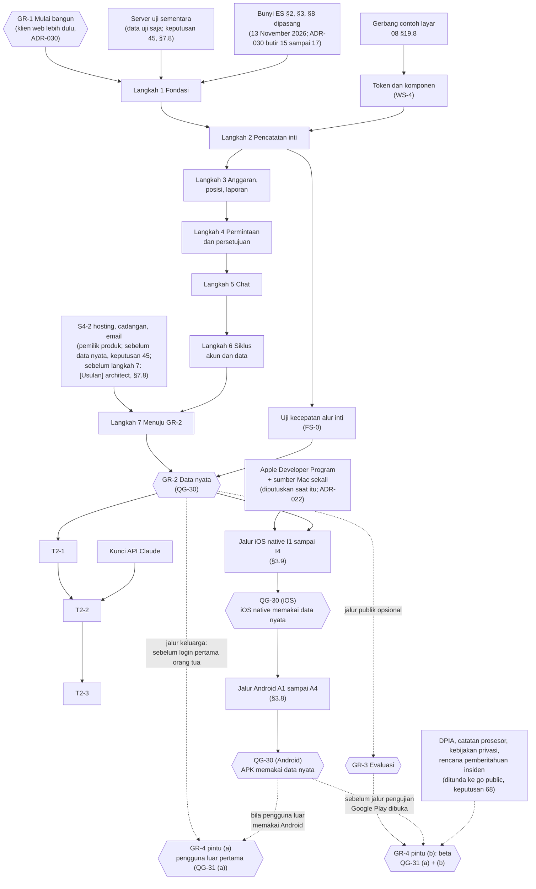

# 14 — Roadmap Rekayasa

| | |
|---|---|
| Pemilik | `architect` |
| Tahap | S5 — Rencana dan sintesis (12 November 2026; izin pemilik produk "gas", [_progress.md](_progress.md) "S5 dimulai"); **S6 (12 November 2026): pass konsistensi**: ADR-028 diterima seluruhnya (keputusan 56), tinjauan `security-privacy` keputusan 53 di WS-6, waktu Android tanpa tenggat di jalur rumah tangga, pertanyaan akun Play sebelum akun dibuat, §12.1 sampai keputusan 56, §12.2 AC-9 dijawab; **sesudah S6 (12 November 2026): web lebih dulu** (keputusan 69; [ADR-030](adr/ADR-030-klien-web-pwa-lebih-dulu.md)) |
| Status | **Revisi web lebih dulu (12 November 2026):** klien web (PWA) menggantikan iOS di FS-1 dan GR-2; WS-8 Web (`web-dev`); QG-30 memuat 10 §4.1 butir 12 dan 13; QG-30 (iOS) baru dengan 10 §4.4; jalur iOS native (§3.9) dan Android (§3.8) sesudah GR-2; Apple, Mac, dan Xcode Cloud keluar dari FS-1; §11 angka biaya berubah. Sebelumnya: revisi S5 fase D sesudah tinjauan `critic` A (CS5-A-01 sampai CS5-A-22), lalu revisi keputusan 42 (urutan dan platform pilot, 12 November 2026), lalu revisi keputusan 43 sampai 46 dan 48 sampai 50 (Mac, irama rilis, server uji sementara, GR-3, akun Play, tinjauan `security-privacy`, brief dan ES §3; 12 November 2026), lalu revisi keputusan 51 (tujuan tanpa rencana go public; GR-3 dan sesudahnya menjadi jalur publik opsional; 12 November 2026), lalu revisi keputusan 52 sampai 55 (orang tua sebagai pengguna luar dan GR-4 dua pintu; tinjauan `security-privacy` sebelum Android dan tahunan; SEC-18 dan SEC-25 di FS-2; jalur iOS tetap TestFlight internal; 12 November 2026). Angka §11 dihitung ulang lead dengan skrip sebelum revisi; angka yang berubah ditandai di §11 untuk dihitung ulang |
| Sumber yang mengikat | Brief §1 (baris Engineering standards, Pilot devices, Build environment, Team size, Monthly infrastructure budget), §1.1, §16; `CLAUDE.md` ("Build team", "Deferred on purpose"); `ENGINEERING-STANDARDS.md` (ES) seluruhnya; [13](13-product-roadmap.md) (FS, GR, VL, §3, §7.5, §12.2); [09](09-technical-architecture.md) dan keempat berkasnya; ADR-012 sampai ADR-029; [10](10-security-privacy.md) §4, §4.1, §5; [07](07-financial-domain.md) INV-01 sampai INV-41 dan contoh terhitung; [06](06-activity-approval-architecture.md) INV-A01 sampai INV-A53, PG-01 sampai PG-15; [05](05-functional-requirements.md) §6; [12](12-scenarios.md) §2; [08](08-ux-ui-strategy.md) §15, §16.4, §19.8 |
| Dipakai oleh | Agen tim bangun (`CLAUDE.md` "Build team"), lead (16, 01), [15](15-risk-assessment.md) |

---

## 0. Cara membaca

- **Yang ditetapkan dokumen ini:** alat per stack di atas ES, workstream dan urutan kerjanya, strategi pengujian, gerbang mutu, strategi rilis, dan operasi. **Yang tidak:** urutan fase dan gerbang produk (13), aturan uang (07), aturan alur (06), persyaratan keamanan (10), stack dan arsitektur (09 dan ADR), risiko (15).
- **ES diadopsi utuh** (brief §1). Dokumen ini tidak mengulang aturannya; ia merujuk per bagian (§2.1) dan hanya menambah yang khas stack.
- **Klien web lebih dulu (keputusan 69; [ADR-030](adr/ADR-030-klien-web-pwa-lebih-dulu.md)).** Pemilik produk memutuskan: "web dibangun duluan aja yang penting web jalan dulu aja. ios dan android nanti. web akan jadi yang pertama untuk user experience" (`_progress.md`, "Keputusan pemilik produk: web lebih dulu"). Urutannya kini: **klien web di FS-1 → GR-2 di web saja** (bacaan lead **[Usulan]**, dipakai sebagai rencana) pada iPhone 13 dan iPad mini 7 (web app layar utama), Galaxy A55 (Chrome), dan browser desktop **→ jalur iOS dan iPadOS native (§3.9) → jalur Android native (§3.8)**. Urutan iOS lalu Android sesudah GR-2 dipertahankan dari keputusan 42, 50, 58. Bunyi brief §1 dan `CLAUDE.md` "Platform order" belum diselaraskan (17 K). Paragraf berikut adalah ketetapan sebelumnya; bagiannya tentang **iOS lebih dulu di FS-1 digantikan**, sedangkan bagiannya tentang waktu Android tetap berlaku untuk aplikasi native.
- *Ketetapan sebelumnya.* **Platform yang dibangun lebih dulu diputuskan pemilik produk** (keputusan 42, 12 November 2026, di 17; menjawab Q-37): iOS dan iPadOS lebih dulu, dan pilot dengan data nyata berjalan di iOS dan iPadOS (istri di iPhone 13 sebagai pencatat utama, pemilik produk di iPad mini 7). GR-2 tidak menunggu Android. Android dibangun sesudah GR-2 untuk Galaxy A55 milik pemilik produk; ia bergabung sebelum jalur pengujian Google Play dibuka (GR-4 butir 8; QG-31 (b)) (semula bawaan lead; diterima atas saran lead lewat keputusan 50; bunyi brief §1 "Pilot devices" sesudah keputusan 51: "Android is built after real data starts and joins the pilot before the beta, if a beta is ever held"). Ini menggantikan bunyi lama brief §1 "Pilot devices" ("the pilot needs iOS and Android"); bunyi baru brief §1 "Pilot devices" dan "Platforms" serta ES §3 (lewat [ADR-029](adr/ADR-029-perangkat-pengukuran-kinerja-es-3.md)) diterima atas saran lead (keputusan 50; 17 K-66, K-67). §3.4 dan §3.8 memuat urutan kerjanya.
- **Jalur rumah tangga dan dua jalur opsional** (keputusan 51 dan 52; keputusan 51, `_progress.md` "Keputusan pemilik produk 51"; diputuskan pemilik produk dengan mengukuhkan bacaan lead; kata-kata jawabannya: "yap benar seperti itu, untuk sekarang gitu aja, tapi tidak menutup kemungkinan untuk go public"). Aplikasi ini untuk keluarga pemilik produk sendiri, dibangun dengan standar produk publik. **Jalur rumah tangga** berakhir pada keluarga yang memakai aplikasi sehari-hari: FS-1, GR-2 (QG-30), FS-2 yang berlanjut dengan gelombang Tier 2, jalur iOS native (§3.9, QG-30 (iOS)), dan jalur Android (§3.8, QG-30 (Android)). Dua jalur opsional, keduanya tidak dijadwalkan dan tidak dihapus:
  - **Pengguna luar pertama** (keputusan 52): orang pertama di luar rumah tangga pilot yang memakai layanan, termasuk orang tua yang diberi login, tanpa rilis toko dan tanpa tahap publik. Syarat teknisnya QG-31 (a) (§5.3) dan kelompok "Keamanan, sebelum GR-4" di §3.6. Ini dapat terjadi walaupun go public tidak pernah diambil.
  - **Jalur publik** (keputusan 51): GR-3, FS-3 dengan beta (§3.6, §6.7), QG-31 (b), GR-5 (QG-32), dan fase sesudahnya (§6.8, §8).
  
  Rancangan keduanya tetap utuh supaya pengguna luar dan go public tidak memerlukan pembangunan ulang. **Yang tidak berubah:** ES diadopsi utuh, semua gerbang per perubahan dan per rilis, QG-25, QG-30, QG-30 (iOS), QG-30 (Android), dan semua yang harus ada sebelum data nyata.
- **Versi.** Nomor versi yang disebut adalah yang terlihat dan tercatat di 09 §9 atau 18 pada 12 November 2026. Versi yang dipasang dicek live saat dipasang (ES §8); nomor di sini bukan izin memakainya.
- **Label bukti** mengikuti [README](README.md#label-bukti). Seluruh rancangan di sini **[Usulan]** `architect`, kecuali yang diberi label lain atau yang dikutip dari keputusan yang sudah diterima.
- **Pengenal baru** (diminta ke lead untuk README, §12): `WS-N` workstream; `QG-NN` gerbang mutu. Pengenal lain dipakai menurut README.

---

## 1. Ringkasan

| Hal | Rancangan |
|---|---|
| Aturan | ES diadopsi utuh; alat per bahasa menurut ADR-025 dan ADR-023 (§2) |
| Workstream | Delapan: server, iOS, Android, sistem desain, operasi, keamanan dan privasi, QA, dan **web** (§3). Server memimpin satu langkah di depan klien, karena semua aturan di server (ADR-013) |
| FS-1 | Tujuh langkah dari fondasi sampai GR-2 (§3.3); klien di FS-1 hanya **klien web**, responsif untuk iPhone, iPad, Galaxy A55, dan desktop sejak langkah 1 (ADR-030; §3.4). iOS dan iPadOS native menyusul sesudah GR-2 (§3.9), lalu Android (§3.8) |
| Pengujian | Hampir seluruh bukti kebenaran ada di server Go terhadap PostgreSQL nyata: setiap INV dan INV-A sebagai uji properti, setiap contoh terhitung dan setiap AC Tier 1 sebagai uji bernama ID-nya. Klien diuji untuk bantuan isian (vektor emas), antrean, sinkron, tampilan, aksesibilitas, dan tata letak; klien web juga untuk header, CSRF, dan XSS dengan Playwright Chromium dan WebKit. `qa` membuktikan AC Tier 1 di klien web pada iPhone 13, iPad mini 7, dan Galaxy A55 sebelum GR-2; aplikasi native di perangkatnya sebelum masing-masing memakai data nyata (QG-30 (iOS), QG-30 (Android)) (§4) |
| Gerbang | Per perubahan QG-01 sampai QG-12; per rilis QG-20 sampai QG-24; sekali sebelum build TestFlight pertama dipasang QG-25 (di jalur iOS native); gerbang fase QG-30 (GR-2, klien web), QG-30 (iOS) sebelum aplikasi iOS native memakai data nyata, QG-30 (Android) sebelum Android memakai data nyata; QG-31 (a) sebelum pengguna luar pertama, termasuk orang tua yang diberi login (keputusan 52), ditambah QG-31 (a+) bila pengguna luar membuat rumah tangga sendiri; di jalur publik opsional QG-31 (b) dan QG-32 (GR-5) (§5) |
| Rilis | Klien web: bundel berhash disematkan ke biner server, staging lebih dulu, tanpa toko dan tanpa TestFlight; versi klien minimum sejak pilot (ADR-028 catatan web). iOS dan iPadOS native (sesudah GR-2): Xcode Cloud ke TestFlight internal, rilis pemeliharaan bila 60 hari tanpa rilis, batas 80 hari sejak unggahan (ADR-028 butir 4, keputusan 44). Android (sesudah iOS): APK bertanda tangan langsung ke Galaxy A55. Staging di VPS yang sama sejak GR-2. Tanpa feature flag (§6; ADR-028) |
| Operasi | Satu biner, satu PostgreSQL, pgBackRest ke VPS kedua di Indonesia; uji pulih bulanan; pemeriksaan invarian harian; rotasi rahasia tanpa rilis; batas biaya `AI` USD 3 per pembangunan dan USD 10 per bulan; FS-1 langkah 1 sampai 6 di server uji sementara (keputusan 45); penyedia S4-2 dipilih sebelum langkah 7 (**[Usulan]** `architect`, turunan keputusan 45; §7.8) |
| Tahap publik | Jalur publik opsional, tidak dijadwalkan (keputusan 51; §0). Hak akses Plus per rumah tangga di server, penagihan toko dua platform: dirancang (§8), dibangun di FS-3 bila jalur itu diambil |
| Mac | **Tidak diperlukan di FS-1 dan GR-2** (ADR-030; ADR-022 catatan web). Sejak jalur iOS native: Xcode Cloud + TestFlight tanpa Mac bulanan atau milik sendiri sampai dana ada (keputusan 43; ADR-022 butir 4), dengan sumber Mac sekali diputuskan saat itu; titik impas membeli terhadap menyewa disimpan sebagai acuan bila dana ada (§9) |

---

## 2. Adopsi `ENGINEERING-STANDARDS.md` dan alat per stack

### 2.1 Adopsi per bagian

| ES | Cara dokumen ini menerapkannya |
|---|---|
| §1 Clean code | Formatter dan linter per bahasa di §2.2 sebagai QG-01. Komentar yang mengutip ID aturan pada setiap aturan uang dan API publik diperiksa `code-reviewer` (QG-08) |
| §2 Tanpa duplikasi | Satu sumber aturan: server Go (ADR-013). Pengecualian tiga bantuan isian dijaga vektor emas (§4.5, QG-06); di klien web juga, sejak bunyi baru ES §2 disetujui pemilik produk dan dipasang (13 November 2026; ADR-030 butir 15). Kontrak satu sumber dan tipe klien di-generate (QG-04). Pemeriksa duplikasi PMD CPD (QG-02). Komponen sistem desain tidak boleh disalin (WS-4, QG-09) |
| §3 Kinerja | Sasaran `[DEFAULT]` diukur di klien web pada iPhone 13, iPad mini 7, dan Galaxy A55, lalu dikukuhkan atau diubah lewat ADR sebelum GR-2 (§4.10, QG-30; ADR-029 catatan web). Aplikasi native diukur sebelum QG-30 (iOS) dan QG-30 (Android) |
| §4 Keamanan dan privasi | Persyaratan dokumen 10 diuji menurut kolom tenggatnya (§4.8); uji isolasi lintas rumah tangga dibangkitkan untuk setiap kueri (QG-05) |
| §5 Kebenaran uang | Setiap INV di 07 dan setiap contoh terhitung adalah uji yang memblokir merge (§4.3, §4.4, QG-05) |
| §6 Pengujian | TDD; setiap AC Tier 1 punya uji bernama ID-nya; uji properti untuk logika uang dan persetujuan; uji flaky diperbaiki atau dihapus dalam minggu yang sama (§4) |
| §7 Review dan delivery | Cabang per tugas, review dua lintasan, satu perubahan satu hal, migrasi berversi dan dapat dibalik (§2.4, QG-07, QG-08, §6.4) |
| §8 Dependensi dan versi | Cek live saat memasang; patok tepat dan lockfile; ADR-023 untuk 0.x dan API eksperimental; pembaruan bulanan sebagai perubahan tersendiri (§2.3, QG-11, §7.7) |
| §9 Definition of done | Dicek per tugas di QG-12, termasuk butir 5: dijalankan di perangkat pilot nyata atau terhadap API nyata (staging, §6.1) |

Usulan perubahan ES dari dokumen ini: **tidak ada.** Usulan perubahan ES dari [ADR-030](adr/ADR-030-klien-web-pwa-lebih-dulu.md) butir 15 sampai 17 (§2 TypeScript, §3 perangkat ukur web, §8 masa tunggu 7 hari dependensi bundel) **disetujui pemilik produk dan dipasang (13 November 2026)** (`_progress.md`, "Persetujuan pemilik produk atas bunyi brief, `CLAUDE.md`, dan ES"). Sejak itu klien web memakai tiga bantuan isian TypeScript dengan vektor emas yang sama (§4.5), masa tunggu 7 hari berlaku bagi dependensi bundel, dan ES §3 diukur di klien web pada ketiga perangkat.

### 2.2 Alat per stack

Alat formatter, linter, pemindai kerentanan, dan pemeriksa duplikasi **diputuskan di ADR-025** (diterima, D-103) dan tidak dipilih ulang di sini. Tabel ini melengkapinya dengan pelari uji, uji properti, cakupan, dan alat kontrak.

| Peran | Go (server) | PostgreSQL 18 | Swift / SwiftUI (iOS, iPadOS) | Kotlin / Compose (Android) | Protobuf / Connect |
|---|---|---|---|---|---|
| Toolchain | Go 1.27 (ADR-015; dicek saat dipasang) | PostgreSQL 18 dari PGDG (ADR-016) | Xcode dan SDK stabil terbaru, minimal Xcode 26 / SDK iOS 26 (09.4 §5); toolchain Swift resmi untuk paket non-UI di Linux **[Terverifikasi]** (18 §5.2.7.4); paket itu tidak mengimpor SwiftUI, Security, LocalAuthentication, atau UserNotifications (ADR-022 butir 3) | Kotlin, Android Gradle Plugin, dan Gradle menurut tabel kompatibilitas resmi Android saat dipasang (ES §8 "Compatible as a set"); target API 36, minimum API 29 (ADR-012) | `buf` (ADR-013) |
| Formatter | `gofmt` (ADR-025 butir 1) | — | `swift format` (butir 2) | ktlint 1.x (butir 3) | `buf format` **[Usulan]**: bagian `buf`, tanpa dependensi baru |
| Linter dan analisis statis | `go vet`, golangci-lint v2 dengan larangan `float32`/`float64` di paket uang (butir 1) | Rencana kueri setiap kueri baru ditinjau (ES §3); `sqlc` menolak kueri yang tidak cocok dengan skema saat generate | `swift format lint --strict` (butir 2) | ktlint, Android Lint dengan peringatan keamanan dan kinerja sebagai galat (butir 3) | `buf lint`, `buf breaking` terhadap cabang utama (butir 5) |
| Pemindai kerentanan | `govulncheck` | Paket OS dan PostgreSQL minor lewat pembaruan bulanan (09.4 §1) | Peringatan Dependabot atas `Package.resolved`; gerbangnya ditetapkan `ios-dev` minggu pertama (ADR-025 butir 2) | OSV-Scanner atas `gradle.lockfile` | — |
| Duplikasi | PMD CPD (butir 4) | — | PMD CPD | PMD CPD | — |
| Pelari uji | `go test` dengan `-race` dan `-shuffle=on` **[Usulan]**: `-race` menangkap balapan di jalur perintah bersamaan (INV-23), `-shuffle` menangkap uji yang bergantung urutan (ES §6 deterministik) | Layanan PostgreSQL 18 nyata di CI; tidak ada tiruan basis data | Swift Testing untuk paket non-UI; XCUITest di simulator Xcode Cloud (09.4 §4) | JUnit untuk modul non-UI; uji Compose di emulator dengan KVM (09.4 §4) | `buf generate` di CI; hasil generate tidak disunting tangan (ES §2) |
| Uji properti | Satu pustaka property-based Go, dipilih `backend-dev` minggu pertama dengan status stabil (09 §6; misalnya `pgregory.net/rapid`), atau fuzzing stdlib `testing.F` bila pustaka itu tidak lolos ES §8 | — | Tidak diperlukan: aturan tidak ada di klien (ADR-013) | Tidak diperlukan | — |
| Cakupan | `go test -coverprofile` dilaporkan, **tanpa ambang persen** (§4.13) | — | Laporan cakupan Xcode bila tersedia, tanpa ambang | Laporan cakupan bila tersedia, tanpa ambang | — |
| Pustaka utama (versi terlihat, dicek saat dipasang) | connect-go v2.0.2; pgx; sqlc; goose; protovalidate-go v1.x; `golang.org/x/crypto` dan `golang.org/x/oauth2` menurut ADR-023 | pgBackRest 2.60.0 (09.4 §6) | connect-swift 1.2.3; pembungkus SQLite dipilih `ios-dev` minggu pertama (09 §6) | connect-kotlin 0.10.x (ADR-023); Room; Compose Material 3 1.4.0 stabil, `ModalBottomSheet` lewat ADR-023 butir 5 | — |
| Keterlacakan | Pemeriksa ID buatan sendiri (§4.13, QG-06): skrip kecil tanpa dependensi baru | — | Sama, membaca nama uji Swift | Sama, membaca nama uji Kotlin | — |
| Rahasia di repositori | Betterleaks v1.10.1 lewat `make secrets`, atas seluruh riwayat repositori, tanpa validasi live (dipilih `backend-dev` di tugas 1.1a; ADR-025 butir 9) | — | Sama: satu pemindaian mencakup seluruh repositori | Sama | — |

**Klien web (TypeScript, Svelte; ADR-025 butir 8, ADR-030 butir 8):**

| Peran | Klien web |
|---|---|
| Toolchain | Node.js LTS dan pnpm, versi dicek saat dipasang (ES §8); `pnpm install --frozen-lockfile`, skrip dependensi diblokir (`strictDepBuilds`) |
| Formatter | Prettier dengan `prettier-plugin-svelte` |
| Linter dan analisis statis | ESLint (`typescript-eslint`, `eslint-plugin-svelte`), `svelte-check`; larangan sink HTML (SEC-167) |
| Pemindai kerentanan | OSV-Scanner atas `pnpm-lock.yaml` |
| Duplikasi | PMD CPD (TypeScript dan `.svelte` **[Perlu validasi]**) |
| Pelari uji | Vitest (unit, vektor emas); Playwright Chromium dan WebKit (alur, header, CSRF, XSS) |
| Uji properti | Tidak diperlukan: aturan tidak ada di klien (ADR-013) |
| Cakupan | Laporan Vitest, tanpa ambang |
| Pustaka utama | SvelteKit 3 (dengan service worker bawaannya, tanpa plugin PWA; ADR-030 butir 2, catatan 13 November 2026), Svelte 5, Dexie 4, connect-web 2.x; daftar dependensi bundel tertutup (ADR-030 butir 8) |
| Keterlacakan | Pemeriksa ID yang sama, membaca nama uji Vitest dan Playwright |

**Satu repositori** untuk `proto/`, `server/`, `web/`, `ios/`, `android/`, dan vektor emas **[Usulan]**. Alasannya: kontrak, kode hasil generate, dan berkas vektor emas berubah bersama dalam satu perubahan, dan `buf breaking` membandingkan terhadap cabang utama yang sama. Dua repositori menambah sinkronisasi versi kontrak tanpa pemakai kedua.

### 2.3 Versi dan pembaruan

- Setiap pemasangan dan pembaruan mencatat versi, tanggal cek, tautan sumber, dan alasan di deskripsi perubahan (ES §8). Pembaruan adalah perubahan sendiri yang lulus seluruh uji (QG-11).
- Pustaka 0.x dan API eksperimental hanya yang terdaftar di ADR-023; tambahan memerlukan revisi ADR-023.
- Pembaruan dicek bulanan bersama pembaruan PostgreSQL minor dan paket OS (§7.7); seketika bila ada advisori keamanan.
- Compose Material 3 naik ke 1.5.x hanya sesudah 1.5.0 stabil, dengan catatan naik versi di ADR-023 butir 5 (`rememberModalBottomSheetState` sudah `@Deprecated` di kode pengembangan).

### 2.4 Alur kerja tim bangun

- **Superpowers** adalah alur bawaan fase bangun (`CLAUDE.md` "Instruction priority" butir 2): rencana per tugas, worktree per cabang, TDD, pengembangan berbasis subagen, dan review.
- **Cabang per tugas**, tidak pernah langsung ke cabang utama (ES §7). Satu perubahan mengerjakan satu hal; refactor terpisah dari perubahan perilaku.
- **Review dua lintasan** oleh `code-reviewer` (`CLAUDE.md` "Build team"): (1) apakah perubahan memenuhi FR/AC, INV, atau SEC yang dikutipnya; (2) apakah kodenya sehat menurut ES. Perubahan layar juga ditinjau `ux-designer` terhadap 08 dan pedoman platform (QG-09).
- **Pesan commit** menyebut ID kebutuhan atau ADR (ES §7).
- **Tugas selesai** menurut ES §9 (QG-12).

---

## 3. Workstream

### 3.1 Daftar

Peran mengikuti tabel "Build team" `CLAUDE.md`, ditambah **`web-dev`** untuk WS-8 (diminta ke lead untuk `CLAUDE.md`, §12.2). Agen tim bangun ditulis lead sesudah fase perencanaan berakhir (13 GR-1 butir 2).

| WS | Nama | Peran yang mengerjakan | Isi | Hasil |
|---|---|---|---|---|
| WS-1 | Server dan kontrak | `backend-dev` | Biner Go, modul 09.2 §1, skema dan migrasi, kontrak Protobuf, `Sync` dan SSE, pekerjaan latar, push, `AI` R1 (Tier 2), uji domain, invarian, AC, isolasi, privasi, vektor emas | Server yang menegakkan 06 dan 07; berkas vektor emas; kode hasil generate untuk Swift dan Kotlin |
| WS-2 | Aplikasi iOS dan iPadOS | `ios-dev` | Paket Swift non-UI (klien Connect, antrean dengan jeda urungkan, sinkron, penyimpanan lokal, bantuan isian), layar SwiftUI, kunci aplikasi, proteksi berkas (ADR-024). Dimulai sesudah GR-2 (ADR-030; §3.9) | Build TestFlight internal |
| WS-3 | Aplikasi Android | `android-dev` | Modul Kotlin non-UI (setara WS-2), layar Compose Material 3, kunci aplikasi, pengecualian cadangan dan transfer (ADR-024). Dimulai sesudah jalur iOS native (keputusan 42; ADR-030; §3.8) | APK bertanda tangan |
| WS-4 | Sistem desain | `ux-designer` bersama `web-dev` (FS-1), `ios-dev`, dan `android-dev` | Token arah C (08 §19), komponen per pola di atas komponen native (08 §17.4), gerbang contoh layar (08 §19.8), tinjauan setiap layar | Satu set komponen per platform; catatan tinjauan per layar |
| WS-5 | Operasi | `backend-dev` menyiapkan; pengelola server (pemilik produk) menjalankan | VPS, TLS, systemd, cadangan dan uji pulih, pemantauan, runbook, rotasi rahasia, staging (ADR-028), kalender operasi | Runbook pilot dengan daftar 10 §4.1 bertanggal |
| WS-6 | Keamanan dan privasi | Tidak ada peran tersendiri **[Usulan]**: setiap SEC dikerjakan pemilik komponennya menurut 09.4 §8, diperiksa `code-reviewer`, dibuktikan `qa`; tinjauan hanya-temuan `security-privacy` sebelum GR-2 (klien web), sebelum klien Android memegang data nyata, sebelum pengguna luar pertama (QG-31 (a)), dan setahun sekali (keputusan 49, 52, 53); dan sebelum aplikasi iOS native memegang data nyata (bawaan 69.4, diterima atas saran lead; 10 §7.9; QG-30 (iOS) I-8) | Persyaratan dokumen 10 menurut kolom tenggatnya; runbook insiden SEC-148 (a) sebelum GR-2; DPIA, catatan prosesor, kebijakan privasi, dan rencana pemberitahuan insiden (10 §4.1 butir 4 dan 5; SEC-139, SEC-148 (b), SEC-149, SEC-150) tidak disiapkan untuk pilot dan ditulis tim sendiri bila go public diputuskan (keputusan 68) | Uji SEC hijau; daftar 10 §4.1 bertanggal (butir 4 dan 5 bukan butir pilot; butir 3 bukan butir GR-2 klien web, ia di jalur iOS native, 10.5 SEC-178 (c)) |
| WS-7 | QA | `qa` | Matriks bukti AC Tier 1, uji skenario ujung ke ujung, daftar periksa perangkat, aksesibilitas, tata letak adaptif, pengukuran ES §3 | Matriks bukti bertanggal per rilis (§4.11) |
| WS-8 | Klien web (PWA) | `web-dev` | Modul TypeScript non-UI (klien connect-web, antrean di IndexedDB dengan jeda urungkan dan Web Locks, sinkron, bantuan isian (ES §2)), layar Svelte responsif, service worker (app shell, handler push), sesi cookie dan mode bersama di sisi klien, kunci aplikasi web, CSP dan Trusted Types, halaman pemeriksaan diri staging (ADR-030; 10.5) | Bundel berhash yang disematkan ke biner server |

**Ponytail atas WS-6.** Peran keamanan tersendiri di tim bangun tidak dibuat untuk pilot: semua aturan keamanan pilot sudah berbentuk persyaratan yang dapat diuji (10 §5 "Cara menguji"), dan uji itu bagian dari gerbang biasa. Yang tidak tertutup oleh uji adalah penilaian, misalnya apakah sebuah layar baru membuka data lewat jalan yang tidak terpikir. Untuk itu ada tinjauan `security-privacy` (hanya temuan) sebelum GR-2 dan sebelum pengguna luar pertama (keputusan 52), diterima atas saran lead (keputusan 49; 10 §4.1 butir 11, §4.2) dan dijadikan gerbang di QG-30 butir 12 dan QG-31; ditambah sebelum klien Android memegang data nyata dan setahun sekali, diterima atas saran lead (keputusan 53; QG-30 (Android) butir A-8; §7.7).

### 3.2 Workstream terhadap fase

Kolom FS-3 dan FS-4 sampai FS-8 adalah jalur publik opsional (keputusan 51; §0): dikerjakan hanya bila pemilik produk kelak mengambilnya.

| WS | FS-0 | FS-1 | GR-2 | FS-2 | FS-3 (opsional) | FS-4 sampai FS-8 (opsional) |
|---|---|---|---|---|---|---|
| WS-1 Server | — | Langkah 1 sampai 7 (§3.3), memimpin klien satu langkah | Uji invarian, AC, SEC "Pilot" hijau; basis data dikosongkan dan dibuat ulang | Modul Tier 2 per gelombang T2-1 sampai T2-3; `ai` R1 dengan batas biaya | SEC "Wajib sebelum tahap publik" sisi server (SEC-08 dan SEC-107 sudah sejak pilot; SEC-18 dan SEC-25 sudah di FS-2, keputusan 54; SEC-105 tautan web; SEC-36 dengan baris di jejak keamanan setiap akun dan setelan versi SEC-34 per akun lebih awal, sebelum pengguna luar pertama, QG-31 (a)); hak akses Plus (§8); `CLIENT_UPGRADE_REQUIRED` (ADR-028 butir 5) | Pemicu skala 09 §6 dan 09.4 §7.2 |
| WS-8 Web | Contoh layar arah C versi web bersama WS-4 (08) | Mengikuti server langkah 1 sampai 7 (§3.3, §3.4); setiap layar siap iPhone, iPad, Galaxy A55, dan desktop | Terpasang sebagai web app layar utama di iPhone 13 dan iPad mini 7, di Chrome Galaxy A55; ketiganya perangkat data nyata | Layar Tier 2 per gelombang | Sama dengan klien lain | Sama |
| WS-2 iOS | Contoh layar arah C bersama WS-4 | — (ADR-030) | — (tidak menahan GR-2) | Jalur iOS native (§3.9) sampai QG-30 (iOS), lalu TestFlight internal ke iPhone 13 dan iPad mini 7; layar Tier 2 yang sudah ada di web | SEC-153 (d), SEC-154 sisanya sebelum TestFlight eksternal; StoreKit (§8) | Desain tablet khusus (Tier 3) bila pemicunya ada |
| WS-3 Android | Contoh layar arah C bersama WS-4 | — | — (tidak menahan GR-2; keputusan 42) | Jalur Android (§3.8) sampai QG-30 (Android), lalu APK di Galaxy A55 dengan data nyata; layar Tier 2 per gelombang | Jalur Play (§6.7), Play Billing (§8); QG-30 (Android) sudah lulus sebelum jalur pengujian Google Play dibuka (GR-4 butir 8; QG-31 (b)) | Sama |
| WS-4 Sistem desain | Gerbang contoh layar 08 §19.8 sebelum token dibekukan | Token dan komponen sebelum layar pertama; tinjauan setiap layar | Gerbang 08 §19.8 sudah lewat (13 §3.3 butir 6) | Tinjauan layar Tier 2 | Kata layar status Plus tanpa nama pembayar (13 §12.2) | — |
| WS-5 Operasi | — | Server uji sementara, TLS, origin dan header web, kunci VAPID di langkah 1 (keputusan 45; §7.8); VPS pilihan S4-2, cadangan, dan staging di langkah 7 | Daftar 10 §4.1 butir 7, 8, 13 dicentang; staging hidup | Kalender operasi (§7.7) | SES keluar sandbox bila dipilih; penyedia diperbesar menurut 09.4 §7.2 | Penyeimbang beban, replika (09 §6) |
| WS-6 Keamanan | — | SEC kolom "Pilot" per komponen | Daftar 10 §4.1 lengkap kecuali butir 3 (SEC-109 (b), bukan butir GR-2 klien web; di jalur iOS native, QG-25; 10.5 SEC-178 (c)) dan butir 4 dan 5 (bukan butir pilot, keputusan 68) | SEC Tier 2 (SEC-57, SEC-62, SEC-68, SEC-120 sampai SEC-136, SEC-155) bersama fiturnya | SEC kolom "Wajib sebelum tahap publik"; 10 §4.1 butir 4 dan 5, SEC-148 (b), dan konsultasi advokat sebelum go public (keputusan 67, 68) | ADR E2EE (10-D A) sebelum tahap publik, bila diambil |
| WS-7 QA | Uji kecepatan alur inti (13 §3.1) begitu alur pertama terpasang | Matriks bukti tumbuh per langkah | Matriks bukti lengkap untuk Tier 1 di klien web pada iPhone 13, iPad mini 7, dan Galaxy A55 (QG-30) | Matriks per gelombang; VL-07 (ukuran ketukan) | Beta tertutup: daftar periksa per rumah tangga beta tidak membaca data mereka | Sama |

### 3.3 Urutan di dalam FS-1

Tujuh langkah. Setiap langkah adalah potongan vertikal: server, kontrak, dan uji lebih dulu, lalu layar klien web (§3.4; ADR-030). iOS native dan Android tidak ada di langkah mana pun; keduanya jalur sendiri sesudah GR-2 (§3.9, §3.8). Isi fitur per langkah mengikuti ketergantungan 04 §5.1; **pemetaan FR Must ke fase tidak berubah** (semua 190 FR Must Tier 1 di FS-1, 05 §6). Langkah adalah urutan, bukan fase baru.

| Langkah | Server dan kontrak (WS-1) | Klien web (WS-8) | Sistem desain, operasi, QA | Selesai bila |
|---|---|---|---|---|
| 1. Fondasi | Repositori, CI dengan semua gerbang QG-01 sampai QG-06; kontrak dasar; skema dasar, peran basis data, RLS dipaksakan (09.2 §3), goose; `identity` (akun, sesi, Argon2id, batas laju, pemulihan; **pendaftaran tertutup SEC-158**: akun hanya dengan token undangan atau token pemasangan sekali pakai dari pengelola, penolakan seragam); `household` (buat rumah tangga, undangan F04, keanggotaan, pemberitahuan pengelola dengan versi per akun dan tahan tulis per akun sampai versi baru dibaca, SEC-34); kerangka `read`, `sync` (umpan per pembaca, kursor, potret awal), `jobs`; pembangkit uji isolasi; rangka uji properti INV dan INV-A; pembangkit vektor emas. **Web:** sesi cookie `__Host-` dengan `client_kind` dan `device_mode`, CSRF, penyajian bundel tersemat dengan CSP dan header, versi klien minimum (ADR-030 butir 3 sampai 7, 9) | Proyek SvelteKit mode SPA, kode hasil generate TypeScript, IndexedDB lewat Dexie, antrean dengan jeda urungkan dan Web Locks, putaran sinkron, service worker app shell, deteksi fitur dan petunjuk pasang ke layar utama di iOS dan iPadOS (ADR-030 butir 11), masuk (mode pribadi dan bersama) dan daftar, buat rumah tangga, undang. **Prototipe pengukur** (ADR-030 "Yang menunggu"): waktu PBKDF2, ukuran app shell, Trusted Types Svelte, gaya inline | WS-4: token dan komponen dasar web sesudah gerbang 08 §19.8. WS-5: server uji sementara dan TLS, berisi data uji saja, termasuk kunci VAPID dan origin staging (keputusan 45; §7.8). WS-6: **tidak ada catatan persetujuan uji SEC-109 (b) untuk web**, karena tidak ada laporan otomatis ke pihak ketiga (SEC-178 (c)); 10 §4.1 butir 3 dan QG-25 pindah ke jalur iOS native (§3.9). Tanpa Apple Developer Program, Mac, atau Xcode Cloud (ADR-022 catatan web) | Dua akun uji di dua browser (iPhone dan iPad sebagai web app layar utama) masuk ke satu rumah tangga lewat undangan |
| 2. Pencatatan inti | `ledger`: entri, baris, tempat uang, serah terima dan konfirmasi custody, koreksi; INV 07 yang menyangkutnya; contoh terhitung yang menyangkutnya; proyeksi Beranda | Lembar Catat (dengan tiga bantuan isian dan vektor emas TypeScript; ES §2); Beranda; konfirmasi serah terima | WS-7: **uji kecepatan alur inti** (13 §3.1; FS-0) di klien web pada iPhone 13 (pencatat utama), iPad mini 7, dan Galaxy A55 | Belanja tunai tercatat offline, terkirim, terlihat pasangan dengan pemegang yang benar |
| 3. Anggaran, posisi, dan laporan | `budget`: kategori, periode dengan hari mulai, alokasi, jatah dan jadwal penyisihan, pos rutin dan tagihan berulang (N-32, FR-CAL-002), cicilan, utang dan piutang, kiriman keluarga, tabungan sederhana, aset dan kekayaan bersih, ringkasan bulanan; kecocokan kategori (SEC-92) | Layar Uang, tagihan, cicilan, aset, ringkasan | — | Contoh terhitung bagian anggaran dan laporan lulus; ringkasan bulanan memuat empat butir VL-04 |
| 4. Permintaan dan persetujuan | `request`: state machine 06 §4, penyelesaian §5, ambang dan kesepakatan rumah tangga K01 sampai K06, tanda; `notify`: **Web Push** dengan VAPID bertuliskan teks kelas dan daftar izin host (pengirim APNs di jalur iOS native §3.9, FCM di jalur Android §3.8), jam tenang, ringkasan, batas pengingat (PG-06) | Alur permintaan, usul balik, persetujuan satu ketukan; layar penjelasan izin notifikasi; handler `push` dan `notificationclick` di service worker; buka dari notifikasi | — | Seluruh INV-A bagian §4 sampai §12 hijau dengan 2 sampai 5 anggota dewasa |
| 5. Chat | `chat`: pesan, kartu objek, tanda terkirim dan dibaca, kehadiran, hub SSE; `files`: JPEG re-encode (SEC-66); sembunyikan untuk saya dan Laporkan bagian pilot (SEC-153 (a) sampai (c), (e); SEC-154 (c)) | Layar Chat, kartu yang menjalankan perintah objeknya | — | INV-A bagian §16 hijau; LM-11 diuji dengan pengacakan `read_state` dan kehadiran |
| 6. Siklus akun dan data | `lifecycle`: keluar F06 sampai F08, ekspor dengan satu jendela, salinan data milik sendiri secara swalayan (SEC-107; FR-FAM-013/AC-12), penghapusan 90 hari, jurnal penghapusan, hapus akun; daftar sesi dan jejak keamanan; hapus jarak jauh | Kunci aplikasi web (SEC-174, PBKDF2), halaman Bantuan, daftar sesi dengan browser dan mode, hapus akun, keluar, hapus jarak jauh di semua tab (SEC-172) | — | SCN-44 dan SCN-49 lulus ujung ke ujung |
| 7. Menuju GR-2 | Pengukuran kinerja ES §3 di klien web (ADR-029 catatan web); perbaikan dari matriks bukti | Pemeriksaan aksesibilitas dan tata letak di iPhone 13, iPad mini 7, Galaxy A55, dan desktop (§4.9); latihan service worker pengganti di staging (SEC-169 (e)) | WS-5: instans utama di VPS pilihan S4-2 (masih data uji), server uji sementara dimatikan dan dihapus (§7.8); pgBackRest dan salinan pelindung, uji pulih, `ops.invariant_check`, `ops.backup_verify`, staging (ADR-028), runbook termasuk deploy web dan versi minimum. WS-6: dokumen 10 §4.1 butir 2, 6 (runbook insiden SEC-148 (a)), 9, 10, 12, 13 (butir 3 di jalur iOS native; butir 4 dan 5 bukan butir pilot, keputusan 68), lalu tinjauan hanya-temuan `security-privacy` (butir 11; keputusan 49) | QG-30 lulus |

**Ketiga perangkat siap sejak langkah 1, bukan di langkah 7.** iPhone 13, iPad mini 7, dan Galaxy A55 memegang data nyata sejak GR-2 lewat web (ADR-030), jadi tata letak tidak boleh menjadi pemeriksaan akhir. Setiap layar web di langkah 1 sampai 7 dibangun dan ditinjau dalam kelas Ringkas, Sedang, dan Lebar menurut 08 (bagian web yang sedang diperbarui `ux-designer`; §16.1 dan §16.2 untuk lebar), dan dijalankan di ketiga perangkat sebagai bagian ES §9 butir 5 dan QG-09. Pemeriksaan di iPhone dan iPad tanpa Web Inspector: pengamatan tangan dan halaman pemeriksaan diri staging (§4.8). Rancangan khusus tablet tetap Tier 3 (RISK-90); yang dibangun di FS-1 adalah tata letak adaptif Tier 1 08 §16.

**Mengapa urutan ini.** Langkah 2 adalah alur yang menjawab KS-1 dan yang diukur FS-0, jadi ia datang sebelum apa pun selain fondasi. Anggaran (3) sebelum permintaan (4) karena tanda dan penyelesaian membaca anggaran, jatah, dan ambang (06 §5, §6). Chat (5) sesudah permintaan karena kartu menjalankan perintah objek yang sudah ada (06 §16.4). Siklus akun (6) membutuhkan semua jenis data sudah ada untuk ekspor dan penghapusan.

### 3.4 Urutan kerja yang diputuskan: klien web lebih dulu

Pemilik produk memutuskan klien web dibangun pertama (keputusan 69; kutipan di §0) dan menerima bahwa web tidak terasa sepenuhnya native (`_progress.md`, "Jawaban pemilik produk"). Stack dan rancangannya di [ADR-030](adr/ADR-030-klien-web-pwa-lebih-dulu.md).

| Hal | Ketetapan |
|---|---|
| Urutan di FS-1 | `web-dev` mengikuti server langkah demi langkah (§3.3); layar web dikerjakan sejak langkah 1, responsif untuk ketiga perangkat pilot dan desktop |
| iOS native dan Android di FS-1 | Tidak ada: tanpa paket Swift, modul Kotlin, job CI iOS atau Android, pengirim APNs atau FCM, keanggotaan Apple, Mac, atau Xcode Cloud. Kontrak tetap dirancang untuk semua klien (ADR-013), dan `buf breaking` menjaganya sejak langkah 1 |
| Uji kecepatan alur inti (FS-0) | Di klien web pada iPhone 13, iPad mini 7, dan Galaxy A55 sesudah langkah 2; diulang di aplikasi native di jalurnya |
| Pemakaian dengan data uji sebelum GR-2 | Kedua pasangan sejak langkah 2, di perangkat yang akan mereka pakai untuk data nyata, sebagai web app layar utama di iPhone dan iPad dari origin staging |
| GR-2 | Klien web saja. QG-30 menuntut ketiga perangkat (§5.3) |
| Mac | Tidak diperlukan sampai jalur iOS native (§3.9; ADR-022 catatan web) |
| Sesudah GR-2 | Jalur iOS dan iPadOS native (§3.9), lalu jalur Android (§3.8), masing-masing dengan gerbang QG-30 sendiri. Klien web tetap dipakai dan dirawat; setiap aplikasi native menggantikannya di perangkatnya sesudah lulus gerbangnya, atas pilihan penggunanya |
| Yang tidak berubah | Satu server dan satu kontrak; semua aturan di server (ADR-013); Swift dan Kotlin tetap stack native (ADR-012 butir 1) |

**Yang dibayar dengan pilihan ini** (dinilai di 15): web tidak terasa native di ponsel (RISK-97, diterima pemilik produk); antrean luring dapat dihapus browser (RISK-94); pengelola dapat menyajikan kode web berbeda per akun (RISK-95); rantai pasok npm (RISK-96); uji di iPhone dan iPad tanpa Web Inspector. **Yang didapat:** data nyata tanpa menunggu Apple atau Mac, siklus UI di Linux (RISK-01 keluar dari jalur kritis), dan Galaxy A55 sejak GR-2 (RISK-18).

**Ketetapan sebelumnya (keputusan 42), digantikan untuk FS-1 dan GR-2; tetap menjadi dasar urutan native sesudah GR-2.** Pemilik produk memilih iOS lebih dulu (pilihan "a" yang disajikan lead sesudah S5, menjawab Q-37), lalu menetapkan bahwa pilot memakai iOS dan iPadOS: "ios ipad yang bakalan dipakai pilot ya" (keputusan 42, `_progress.md` 12 November 2026; 17 keputusan 42; bunyi brief diselaraskan lewat keputusan 50, K-66). Fakta perangkat dari jawabannya (menjawab Q-211): istri mencatat paling sering, di iPhone 13; pemilik produk memakai iPad mini 7 dan jarang bepergian; Galaxy A55 milik pemilik produk. Ketiga pilihan di versi sebelumnya bagian ini (bersamaan, Android dulu, iOS dulu) tidak berlaku lagi.

| Hal | Ketetapan |
|---|---|
| Urutan di FS-1 | `ios-dev` mengikuti server langkah demi langkah (§3.3). Paket Swift non-UI diuji di Linux (ADR-022 butir 3); layar SwiftUI dikerjakan sejak langkah 1 |
| Android di FS-1 | Tidak ada: tanpa modul Kotlin, tanpa job CI Android, tanpa pengirim FCM. Kontrak tetap dirancang untuk semua klien (ADR-013), dan `buf breaking` menjaganya sejak langkah 1 |
| Uji kecepatan alur inti (FS-0) | Di iPhone 13 dan iPad mini 7 sesudah langkah 2; di Galaxy A55 di jalur Android (§3.8) |
| Pemakaian dengan data uji sebelum GR-2 | Kedua pasangan sejak langkah 2, di perangkat yang akan mereka pakai untuk data nyata |
| GR-2 | Tidak menunggu Android. QG-30 menuntut iPhone 13 dan iPad mini 7 (§5.3) |
| Mac (ADR-022 butir 4) | Tidak ada Mac sesudah penyiapan; pekerjaan UI SwiftUI harian lewat Xcode Cloud dan TestFlight (keputusan 43; §9) |
| Android | Jalur sendiri sesudah GR-2, untuk keluarga; sebelum jalur pengujian Google Play dibuka (GR-4 butir 8; QG-31 (b)) (§3.8; keputusan 51) |
| Yang tidak berubah | Satu server dan satu kontrak; semua aturan di server (ADR-013); Kotlin dan Compose tetap stack Android (ADR-012 butir 1) |

**Yang dibayar dengan pilihan ini** (dinilai di 15): siklus UI iOS tanpa Mac lambat sejak hari pertama (RISK-01); belanja pemilik produk di luar rumah baru tercatat saat ia kembali ke iPad sampai Android tersedia (RISK-18); pengalaman Android pertama diuji jauh sesudah iOS, dan dekat beta bila beta kelak diadakan (RISK-91).

### 3.5 FS-2: gelombang Tier 2

| Gelombang (13 §3.4) | Server (WS-1) | Pagar yang harus lulus sebelum titik masuk layar digabung (ADR-028 butir 2) |
|---|---|---|
| T2-1 | `care` (status suasana hati, tindak lanjut sakit), permintaan tindakan (06 §13.1), sebutan anggota (`member_label`, 09.2 §5.5) | FR-COM-016, FR-CARE-002, FR-CARE-004; SEC-62, SEC-68; SEC-155 (a) sampai (i); status `CARE` yang tidak dibagikan hanya di perangkat, Class A di native (ADR-024), store IndexedDB tersendiri tanpa padanan Class A di web, dinyatakan (ADR-024 butir 7; 10 §8 butir 17) |
| T2-2 | `ai` R1: pembangunan kumpulan kalimat, pemilih di server lewat `read`, penghitung biaya | FR-AI-005 sampai FR-AI-009 (F-AI-005 lebih dulu); SEC-120, SEC-121, SEC-123 sampai SEC-136; batas USD 3 per pembangunan dan USD 10 per bulan (SEC-127); saklar mati (SEC-128) |
| T2-3 | `shopping`, `maintenance`, `plan`, pengingat rutinitas | INV-A bagian §13 yang menyangkut; FR untuk IDEA-15, IDEA-19 ditulis dulu (13 §3.4) |

**Di luar gelombang, juga di FS-2: faktor kedua TOTP (SEC-18; passkey tetap di tahap publik menurut SEC-11, ketetapan lead) dan kode pemulihan (SEC-25) sebagai satu pasangan fitur opsional per akun** (keputusan 54, "Opsional, setelah dipakai harian (Saran)", diterima atas saran lead; 15 RISK-40). Keduanya dibangun dan dilepas bersama, tidak pernah salah satu saja:
- bila pemilik akun menyalakan pasangan itu, pemulihan lewat email tidak lagi melewati faktor kedua;
- kode pemulihan adalah jalan kembali bila perangkat faktor kedua hilang (10.1 SEC-18, SEC-25).

Pasangan ini tidak menahan GR-2. Ia dilepas sebagai rilis tersendiri di FS-2, dengan uji SEC-18 dan SEC-25 di server dan di setiap klien yang memakai data nyata. Bila jalur Android sudah berjalan, bagian Android-nya ikut jalur itu (§3.8). Karena dibangun di FS-2, pasangan ini sudah ada sebelum QG-31 (a) dan QG-32.

Setiap gelombang adalah satu rilis untuk setiap klien yang sudah memakai data nyata (§6.3); gelombang yang dilepas sebelum iOS native atau Android bergabung dibangun ulang di jalur masing-masing (§3.9, §3.8). Uji INV dan INV-A seluruhnya berjalan pada setiap perubahan, termasuk yang Tier 2, karena modul Tier 2 berbagi tabel Peristiwa, notifikasi, dan umpan.

### 3.6 FS-3: pekerjaan teknis sebelum tahap publik (jalur publik opsional)

Tidak dijadwalkan (keputusan 51; §0). Daftar ini dipertahankan supaya, bila pemilik produk kelak mengambil jalur publik, pekerjaannya sudah diketahui dan tidak ada yang perlu dibangun ulang. Tidak ada butir di sini yang menjadi syarat jalur rumah tangga, **kecuali** baris "Keamanan, sebelum GR-4": baris itu adalah QG-31 (a) dan menjadi syarat sebelum pengguna luar pertama, termasuk orang tua yang diberi login, walaupun tahap publik tidak diambil (keputusan 52; §5.3).

| Kelompok | Butir | Sumber |
|---|---|---|
| Keamanan, sebelum GR-4 | Tabel 10 §4.2, kelompok (a): SEC-36 dengan log di luar VPS dan, di server keluarga pemilik produk, satu baris tanpa isi di jejak keamanan setiap akun pada setiap akses darurat; SEC-39 (c); SEC-34 tiga versi dipilih per akun (setelan server per akun; FR-FAM-019/AC-9); SEC-84; SEC-109 (b), dan peran App Store Connect tersempit per orang baru; SEC-147 bila wajib (SEC-25 dan SEC-18 sudah di FS-2, keputusan 54). Kelompok (a+) bila pengguna luar membuat rumah tangga sendiri: SEC-154 (a), (b), (d) sampai (f), SEC-134, uji isolasi banyak rumah tangga. Kelompok (b) ada di baris beta (QG-31; §5.3). SEC-107 salinan swalayan tidak di sini: dibangun di FS-1 langkah 6 (FR-FAM-013/AC-12) | 10 §4.2 |
| Keamanan, sebelum GR-5 | SEC-10 pemberian peran, SEC-18 (sudah dibangun di FS-2 sebagai pasangan opsional bersama SEC-25, keputusan 54; yang tersisa di sini hanya bunyi SEC-18 untuk tahap publik, bila berbeda), SEC-45, SEC-105 tautan web, SEC-110 (d) sebelum migrasi, SEC-140 tautan web, SEC-141; SEC-147 pendaftaran PSE (S6: keluar dari QG-31 (a)); SEC-139 semua versi, SEC-148 (b), SEC-149, SEC-150 (10 §4.1 butir 4 dan 5; dari pilot dan GR-4, keputusan 68; di QG-31 (b) bila beta diadakan lebih dulu); SEC-156 sebelum Plus dibangun, sesudah konsultasi advokat sebelum go public (§8; keputusan 67); tinjauan ulang SQLCipher; ADR E2EE termasuk sebutan anggota; SEC-157 uji penetrasi pihak luar (QG-32) | 10 §4; 09 §6 |
| Toko | SEC-153 (d), SEC-154 sisanya, SEC-142, SEC-143, SEC-83 rating usia; jalur beta (§6.7) | 10 §4, §4.2; 13 GR-4 |
| Skala | Batas laju dan hub SSE di PostgreSQL bila lebih dari satu proses (09.4 §2); RLS dengan banyak proses | 09 §6 |
| Model bisnis | Hak akses Plus dan penagihan toko (§8), sesudah sisa R-15 (aturan lintas platform Google, harga rupiah) dijawab dan Q-36 diputuskan | 13 §7.5; 18 §2.13 |
| Kompatibilitas | `CLIENT_UPGRADE_REQUIRED` dan versi minimum per platform native (bagi klien web sudah sejak pilot, ADR-028 catatan web) | ADR-028 butir 5 |
| Email | SES keluar sandbox, bila S4-2 memilih SES | ADR-026; 13 GR-4 butir 6 |
| `AI` | R2 hanya lewat ADR baru sesudah advokat | ADR-021; SEC-122 |

### 3.7 Ketergantungan

GR-4 adalah gerbang pengguna luar pertama (glosarium; 13 §3.6) dengan dua pintu, keduanya bergaris putus-putus karena tidak dijadwalkan. **Pintu (a)** ada di jalur keluarga dan dilewati sebelum login pertama orang tua atau kerabat dewasa lain (keputusan 52, 63), tanpa GR-3 dan tanpa tahap publik. **Pintu (b)** ada di jalur publik opsional, sesudah GR-3, dan dilewati sebelum beta (keputusan 51). Pintu (b) juga mensyaratkan QG-31 (a), ditambah (b) dan (a+). Jalur rumah tangga tanpa pengguna luar berakhir pada QG-30 (iOS), QG-30 (Android), dan gelombang Tier 2 yang berlanjut. Klien web memakai data nyata sejak GR-2, jadi jalur native tidak menahan pemakaian harian. Fase Tier 3 (FS-5 sampai FS-8) dapat dipicu dari kedua jalur (13 §3.8).

### 3.8 Jalur Android sesudah GR-2

**Sejak ADR-030:** jalur ini dimulai sesudah jalur iOS native (§3.9): urutan iOS lalu Android sesudah GR-2 adalah bawaan 69.5, diterima atas saran lead, dengan dasar keputusan 42 (istri pencatat utama di iPhone). Galaxy A55 sudah memegang data nyata lewat klien web sejak GR-2, jadi aplikasi Android menggantikan klien web di perangkat itu, bukan membawa data nyata pertama ke sana. Teks di bawah tetap berlaku, dengan "sesudah GR-2" dibaca "sesudah jalur iOS native".

Android dibangun sesudah GR-2 untuk Galaxy A55 milik pemilik produk dan bergabung dengan pilot; sebelum jalur pengujian Google Play dibuka (GR-4 butir 8; QG-31 (b)). Semula bawaan lead dalam keputusan 42; kini diterima atas saran lead lewat keputusan 50, dengan syarat beta dari keputusan 51 (bunyi brief §1 "Pilot devices": "Android is built after real data starts and joins the pilot before the beta, if a beta is ever held"). Jalur ini bagian jalur rumah tangga: ia dibangun untuk keluarga walaupun jalur publik tidak pernah diambil. Stack tetap Kotlin dan Compose Material 3 (ADR-012).

**Letaknya: workstream tersendiri (WS-3), bukan langkah di dalam FS-2** **[Usulan]** `architect`. Alasannya: FS-2 adalah gelombang Tier 2 dengan rilis dan pengukuran VL-nya sendiri (13 §3.4), sedangkan jalur Android membangun ulang seluruh klien Tier 1 ditambah gelombang yang sudah dilepas. Menjadikannya langkah FS-2 akan menahan gelombang Tier 2 di belakang Android, atau sebaliknya. Sebagai workstream, ia berjalan sejajar dengan FS-2 dan selesai di gerbangnya sendiri. **Kapan dimulai:** sesudah QG-30 (iOS) (bawaan 69.5); di antara gelombang T2-1 sampai T2-3 mana ia jatuh diputuskan pemilik produk saat jalur iOS native selesai, karena dengan tim satu sampai tiga orang keduanya bersaing untuk waktu yang sama (RISK-53). Yang diputuskan di GR-2 adalah kapan jalur iOS native dimulai (§3.9).

| Langkah | Isi | Selesai bila |
|---|---|---|
| A1. Fondasi Android | Proyek, kode hasil generate Kotlin, job CI Android (ktlint, Android Lint, OSV-Scanner, uji unit, uji Compose di emulator), kunci tanda tangan APK dibuat dan disimpan (§7.5), pengirim FCM di server dan akun layanan FCM (§7.5); aplikasi staging `applicationIdSuffix` (§6.1) | Uji vektor emas Kotlin lulus di CI terhadap berkas yang sama dengan TypeScript dan Swift (§4.5); masuk ke staging dari Galaxy A55 |
| A2. Tier 1 Android | Modul non-UI dan layar Compose untuk langkah 1 sampai 6 §3.3, dalam urutan yang sama, di atas server yang sudah ada | Setiap AC Tier 1 yang perlu perangkat lulus di Galaxy A55 di aplikasi staging (§4.11) |
| A3. Gelombang yang sudah dilepas | Layar Tier 2 dari gelombang yang sudah ada di produksi saat A2 selesai | Pagar Must bersyarat gelombang itu lulus di Android (§3.5) |
| A4. Menuju data nyata | Pengukuran ES §3 di Galaxy A55; aksesibilitas dan tata letak Android (§4.9); potret awal dan sinkron pertama atas rumah tangga sintetis seukuran data pilot saat itu **[Usulan]** | QG-30 (Android) lulus (§5.3); APK pilot dipasang di Galaxy A55 dengan akun pemilik produk yang sudah ada |

**Akibat bagi gerbang dan CI.** Sebelum A1, QG-06 hanya menjalankan vektor emas di TypeScript (dan Swift sejak I1), dan kode hasil generate Kotlin tidak dibangkitkan; sejak A1 keduanya wajib di setiap perubahan (§4.5, §4.6). Sejak A1, gelombang Tier 2 baru juga dibangun di Android sebelum rilisnya, atau ditambahkan ke A3 bila Android belum bergabung dengan data nyata. Server tidak berubah karena Android datang: semua aturan sudah di server (ADR-013), dan klien Android hanya pemakai kontrak yang sama.

**Terbuka untuk jalur Android: SEC-20 di API 29 sampai 32** (10 §4.3; 10 §7.6 permintaan (3)). `setRecentsScreenshotEnabled` baru ada sejak API 33 dan hanya mengosongkan pratinjau Recents **[Terverifikasi]**; `FLAG_SECURE` memblokir tangkapan layar **[Terverifikasi]**; bahwa `FLAG_SECURE` juga mengosongkan pratinjau Recents hanya tersirat **[Perlu validasi]**, dan API resmi lain untuk API 29 sampai 32 tidak ditemukan **[Perlu validasi]** (18 §2.12.8). Pilihannya: `FLAG_SECURE` hanya di API 29 sampai 32 (usulan `security-privacy` **[Usulan]**), atau pratinjau Recents terbuka di API itu. Galaxy A55 tidak terkena, karena berjalan di atas API 33 **[Asumsi]**, jadi pilihan ini tidak menahan QG-30 (Android). Ia diputuskan lewat ADR di jalur Android, paling lambat sebelum tahap publik bila diambil, sesudah butir [Perlu validasi] diperiksa di halaman resmi.

**Bila jalur publik diambil dan jalur Android belum selesai sebelum GR-4 pintu (b),** pintu (b) menunggu, karena beta Play (§6.7) dan rumah tangga beta yang memakai Android memerlukannya (RISK-91). Di jalur rumah tangga, jalur Android tidak punya tenggat (13 §3.4; 17 §2.18; keputusan 50, 51); mulainya sesudah jalur iOS native, pada gelombang yang dipilih pemilik produk saat itu (di atas). Tenggat hanya muncul bila jalur publik diambil: sebelum jalur pengujian Google Play dibuka (GR-4 butir 8).

### 3.9 Jalur iOS dan iPadOS native sesudah GR-2 (ADR-030)

Aplikasi SwiftUI dibangun sesudah GR-2 untuk iPhone 13 dan iPad mini 7, sebagai workstream tersendiri (WS-2) yang sejajar dengan FS-2, dengan alasan yang sama dengan §3.8. Ia memenuhi syarat tampilan native brief §10.1 yang tidak dipenuhi web (ADR-030 Konteks). **Kapan dimulai** di antara gelombang Tier 2 diputuskan pemilik produk di GR-2 (RISK-53). Isi rancangannya tidak berubah dari versi sebelumnya dokumen ini: ADR-012, ADR-022, ADR-024 butir 1, §4.8 "Uji iOS tanpa Mac".

| Langkah | Isi | Selesai bila |
|---|---|---|
| I1. Fondasi iOS | Apple Developer Program; sumber Mac sekali, AWS EC2 Mac atau Mac pinjaman (bawaan 69.6; pilihan di antara keduanya oleh pemilik produk; ADR-022 catatan web), dan alur kerja Xcode Cloud pertama; proyek, kode hasil generate Swift, paket Swift non-UI dengan uji Linux, pengirim APNs di server dan kunci `.p8` (§7.5); aplikasi staging dengan bundle ID kedua (ADR-028 butir 1); **catatan persetujuan uji SEC-109 (b) diakui kedua penguji sebelum build TestFlight pertama dipasang** (10 §4.1 butir 3; QG-25); deskriptor rating usia sebelum unggahan pertama (RISK-64) | Vektor emas Swift lulus terhadap berkas yang sama dengan TypeScript (§4.5); masuk ke staging dari iPhone 13 |
| I2. Tier 1 iOS | Paket non-UI dan layar SwiftUI untuk langkah 1 sampai 6 §3.3, dalam urutan yang sama; setiap layar siap iPhone dan iPad (08 §16) | Setiap AC Tier 1 yang perlu perangkat lulus di iPhone 13 dan iPad mini 7 di aplikasi staging (§4.11) |
| I3. Gelombang yang sudah dilepas | Layar Tier 2 yang sudah ada di produksi saat I2 selesai | Pagar Must bersyarat gelombang itu lulus di iOS (§3.5) |
| I4. Menuju data nyata | Pengukuran ES §3 di iPhone 13 dan iPad mini 7 (ADR-029 butir 2); uji iOS tanpa Mac lengkap (§4.8), termasuk uji kelas proteksi (ADR-024 catatan keputusan 43); aksesibilitas dan tata letak; potret awal atas rumah tangga sintetis seukuran data pilot saat itu | QG-30 (iOS) lulus (§5.3); TestFlight internal dipasang dengan akun yang sudah ada |

**Akibat bagi gerbang dan CI.** Sejak I1: job CI iOS (09.4 §5), Xcode Cloud sebagai pemeriksaan wajib pull request (QG-03), vektor emas Swift di QG-06, irama 60/80 hari (QG-23), dan QG-25. Klien web tetap dirawat sesudah I4; pengguna di iPhone dan iPad memilih kapan pindah ke aplikasi native, dan antrean web dikosongkan lebih dulu (jumlah catatan belum terkirim tampil sebelum keluar akun, ADR-024 butir 7 (f)).

---

## 4. Strategi pengujian

### 4.1 Asas

1. **Bukti kebenaran ada di server.** Semua aturan uang dan persetujuan hanya di server Go (ADR-013), jadi uji properti, uji invarian, contoh terhitung, dan AC dijalankan di sana terhadap PostgreSQL 18 nyata. Tidak ada tiruan basis data: isolasi `SERIALIZABLE`, RLS, dan konstrain adalah bagian dari aturan yang diuji.
2. **Klien diuji untuk apa yang ia kerjakan:** tiga bantuan isian (vektor emas), antrean dan jeda urungkan, sinkron dan potret awal, penyimpanan dan pembuangan lokal, tampilan, aksesibilitas, tata letak, kunci aplikasi, dan proteksi data di perangkat.
3. **Setiap uji menyebut ID yang dibuktikannya** di namanya: `FR-FIN-040/AC-14`, `INV-09`, `INV-A33`, `CTH-21`, `SCN-01`, `SEC-96`, `PG-14`. Bentuk nama per bahasa ditetapkan `code-reviewer` di minggu pertama; pemeriksa ID (§4.13) membaca bentuk itu.
4. **Lapisan, alat, dan tempat berjalannya kanonis di 09.4 §4** dan tidak diulang. Bagian ini menetapkan apa yang membuktikan apa, dan apa yang ditambahkan.
5. **Klien web di FS-1; native di jalurnya** (ADR-030). Bagian iOS dari setiap baris §4 berlaku sejak jalur iOS langkah I1 (§3.9), dan bagian Android sejak langkah A1 (§3.8). Sampai itu, "klien", "kedua platform", dan "Swift dan Kotlin" di bagian ini dibaca sebagai klien web (TypeScript), dengan padanan web: Playwright Chromium dan WebKit menggantikan XCUITest dan uji Compose di CI; Vitest menggantikan uji paket Swift; pengamatan tangan dan halaman pemeriksaan diri staging menggantikan pemeriksaan diri build staging iOS. Tidak ada gerbang yang dihapus.
6. **Playwright WebKit bukan Safari** (18 §5.13.8). Hasil di Safari 26 iPhone dan iPad dibuktikan di perangkat oleh `qa`; CI hanya menangkap regresi lebih awal.

### 4.2 Apa membuktikan apa

| Yang harus terbukti | Bukti | Tempat | Gerbang |
|---|---|---|---|
| Setiap INV-01 sampai INV-41 (07) | Uji properti berstate, satu per INV (§4.3) | CI Linux | QG-05 per perubahan |
| Setiap INV-A01 sampai INV-A53 (06), termasuk kolom "Cara menguji" | Uji properti berstate, satu per INV-A, ditambah kasus wajib dari kolom itu (§4.3) | CI Linux | QG-05 |
| Setiap PG-01 sampai PG-14 (06 §10); PG-15 sejak FS-3 (§8) | Kolom "Cara menguji" sebagai uji; PG yang menunjuk INV-A memakai uji INV-A itu | CI Linux | QG-05 |
| Setiap contoh terhitung 07 | Uji tabel dengan angka yang sama (ES §5; §4.4) | CI Linux | QG-05 |
| Setiap AC Tier 1 (05) | Uji tingkat API bernama `FR-…/AC-n`; bila AC menyangkut tampilan atau ketukan, ditambah pemeriksaan perangkat oleh `qa` (§4.11) | CI Linux; perangkat | QG-05; QG-21 |
| Setiap Must bersyarat Tier 2 | Sama dengan AC Tier 1, saat fiturnya dibangun | CI Linux; perangkat | QG-05; QG-21 |
| Skenario 12 | Uji ujung ke ujung tingkat API per skenario Tier 1; dijalankan juga di perangkat sebelum GR-2 (§4.4) | CI Linux; perangkat | QG-05; QG-30 |
| Bantuan isian sama dengan acuan server | Vektor emas di TypeScript, Swift, dan Kotlin (§4.5) | CI Linux; Xcode Cloud | QG-06 |
| Keamanan khas browser (SEC-160 sampai SEC-179) | Uji header, CSRF, XSS, cookie, Cache Storage, bundel produksi (09.4 §4) | CI Linux (Playwright, uji Go); perangkat | QG-05; QG-30 |
| Kontrak tidak merusak klien lama | `buf breaking` (§4.6) | CI Linux | QG-04 |
| Offline, sinkron, jeda urungkan | §4.7 | CI Linux; emulator; Xcode Cloud; perangkat | QG-05; QG-21 |
| SEC kolom "Pilot" | Kolom "Cara menguji" dokumen 10 (§4.8) | Menurut SEC | QG-05; QG-30 |
| Aksesibilitas dan tata letak | §4.9 | Emulator; simulator; perangkat | QG-09; QG-21 |
| Sasaran ES §3 | §4.10 | VPS; perangkat | QG-30; QG-10 bila ada klaim kinerja |
| Pemulihan cadangan | Uji pulih 09.4 §6, uji SEC-96 dan SEC-97 | VPS cadangan | QG-30; bulanan (§7.7) |

### 4.3 Invarian keuangan dan alur

Rancangan uji properti kanonis di 09.4 §4 (baris "Invarian keuangan" dan "Invarian alur dan persetujuan"). Tambahan dokumen ini:

| Hal | Rancangan |
|---|---|
| Daftar yang diuji | Diambil dari 07 dan 06 dengan `grep` pengenal pada setiap perubahan (§4.13). INV atau INV-A baru di dokumen tanpa uji membuat QG-06 gagal; uji yang menyebut ID yang tidak ada juga gagal |
| Pembangkit perintah | Satu pembangkit perintah acak untuk semua modul, dari kontrak Protobuf (jenis perintah dan medannya), dengan pelaku 2 sampai 5 anggota dewasa penuh, perangkat offline, kiriman ulang (idempotensi, INV-10), dan jam yang dimajukan. Satu pembangkit, bukan satu per INV (ES §2) |
| Pemeriksa | Setiap INV dan INV-A adalah satu fungsi pemeriksa atas data penuh, dipanggil sesudah setiap langkah. Pemeriksa yang sama dipakai `ops.invariant_check` di produksi (VL-10) **[Usulan]**: satu implementasi, dua pemakai |
| Simetri | Setiap rangkaian dijalankan ulang dengan anggota dewasa dipermutasikan (LM-01, PG-01, SEC-89); hasil yang terbaca setiap orang harus berpindah bersama orangnya |
| Bersamaan | Perintah dari beberapa goroutine di bawah `SERIALIZABLE` dibandingkan dengan hasil berurutan (INV-23); `-race` menyala |
| Penyusutan dan benih | Benih acak dicetak di setiap kegagalan dan dapat diulang. Kegagalan yang sudah disusutkan disimpan sebagai uji contoh tetap (ES §6: perbaikan dimulai dengan uji yang mereproduksi) |
| Jumlah kasus | Per perubahan: jumlah yang selesai di bawah anggaran waktu CI 15 menit (09.4 §7.1) **[Asumsi]**; mingguan: putaran panjang terjadwal dengan benih baru. Kegagalan putaran panjang diperlakukan sama dengan kegagalan per perubahan |
| Anggaran CI | 15 menit adalah **jumlah menit tertagih semua job Linux per push**, bukan per job: 09.4 §7.1 menghitung sekitar 100 push × 15 menit = 1.500 menit × USD 0,006 = USD 9 dari jatah Free USD 12 (tarif **[Terverifikasi]** 18 §5.2; jumlah push **[Asumsi]**). Uji properti, uji Compose di emulator pada dua skala huruf (§4.9; sejak langkah A1), dan job lain berbagi anggaran itu. Di FS-1 tidak ada job Android atau iOS, tetapi ada job web (lint, Vitest, Playwright Chromium dan WebKit); angka itu tetap batas atas FS-1 **[Asumsi]** dan diukur ulang di langkah 1, lalu saat job Android ditambahkan. Bila job web membuatnya melewati jatah, Playwright WebKit dijalankan hanya saat merge. Apakah semuanya muat **belum diketahui** sampai diukur di bulan pertama fase bangun. Bila tidak muat: uji emulator hanya berjalan pada perubahan yang menyentuh `android/`, `proto/`, atau berkas vektor emas, dan sebagian kasus properti pindah ke putaran mingguan; tidak ada gerbang yang dihapus. Bila tetap melewati jatah, selisihnya dibayar per menit dan dicatat di §7.6 |
| Bersyarat | INV-A Tier 2 diuji sejak modulnya ada; sebelum itu, pemeriksanya tetap berjalan atas data Tier 1 bila berlaku |

### 4.4 Contoh terhitung dan skenario

- **Contoh terhitung.** Setiap `CTH-NN` di 07 (termasuk varian berhuruf, misalnya CTH-03b) adalah satu uji tabel dengan angka yang sama persis. Daftarnya diambil dengan `grep` (§4.13); contoh baru di 07 tanpa uji membuat QG-06 gagal.
- **Skenario.** 38 skenario bertier 1 di 12 §2 (semua kecuali SCN-03, SCN-16, SCN-17 yang Tier 3, dan SCN-07, SCN-08, SCN-09, SCN-10, SCN-18, SCN-39, SCN-40, SCN-41 yang Tier 2) menjadi uji ujung ke ujung tingkat API di FS-1: aktor, urutan perintah, dan akibat uang menurut skenarionya, termasuk baris "Dua arah". Bagian Tier 1 dari SCN-08, SCN-18, SCN-39, dan SCN-41 (bertanda "+1" di 12 §2) diuji di FS-1 juga. Bagian Tier 1 SCN-39 adalah halaman Bantuan (FR-FAM-024/AC-1 sampai AC-3), dibuka dari Pengaturan; baris arahan ke Bantuan saat status "berat" memerlukan modul CARE dan diuji bersama gelombang Tier 2-nya. *(Catatan 13 November 2026: SCN-39 sebelumnya tidak tercantum di kalimat ini walaupun 12 §2 menandainya "2 (+1)"; diperbaiki menurut ketetapan lead untuk pemeriksa ID, karena 12 pemilik penandaan tier.)* Skenario Tier 2 diuji bersama gelombangnya. Skenario Tier 3 tidak diuji.
- **Di perangkat.** Sebelum GR-2, `qa` menjalankan setiap skenario Tier 1 sekali di klien web pada iPhone 13 dan iPad mini 7 dengan dua akun, dan bagian yang dipakai pemilik produk juga di Galaxy A55, dan menandai di matriks bukti (§4.11). Di aplikasi native hal yang sama dijalankan sebelum QG-30 (iOS) (§3.9 langkah I2) dan QG-30 (Android) (§3.8 langkah A2).

### 4.5 Vektor emas bantuan isian

Pengecualian ES §2 (ADR-013 butir 3; S4-1 (ii) A).

| Hal | Rancangan |
|---|---|
| Sumber | Uji Go membangkitkan berkas vektor (masukan dan hasil yang diharapkan) dari acuan: fungsi INV-02 untuk selisih baris, fungsi acuan Go untuk "bagi rata" (sisa pada baris pertama), aturan protovalidate untuk bentuk masukan |
| Isi | Kasus batas yang dipilih tangan (nol baris, satu baris, sisa bagi, jumlah terbesar `int64`, angka negatif, teks di batas panjang, karakter gabungan untuk panjang teks) ditambah kasus acak dengan benih tetap. Berkas berversi di repositori |
| Pemakai | Vitest (modul TypeScript non-UI) sejak FS-1 bila bunyi baru ES §2 disetujui (ADR-030 butir 15); uji unit Swift (paket non-UI) sejak langkah I1 (§3.9) dan Kotlin (modul non-UI) sejak langkah A1 (§3.8) membaca berkas yang sama |
| Gerbang | Berkas yang berubah tanpa uji klien yang lulus di setiap klien yang ada memblokir merge (QG-06). Saat modul Swift atau Kotlin pertama ditambahkan, ia lulus atas seluruh berkas yang ada saat itu, bukan hanya kasus baru. Berkas yang dibangkitkan ulang harus identik dengan yang di repositori (perubahan acuan tanpa memperbarui vektor gagal) |
| Batas | Hanya tiga bantuan itu. Bantuan isian keempat memerlukan ADR baru dengan persetujuan pemilik produk (ES §2) |

### 4.6 Kontrak

- `buf lint` dan `buf breaking` terhadap cabang utama pada setiap perubahan (QG-04).
- Kode hasil generate untuk Go dan TypeScript (Swift sejak langkah I1, Kotlin sejak langkah A1) dibangkitkan ulang di CI dan harus identik dengan yang di repositori.
- **Klien web terhadap server nyata:** Playwright di CI Linux menjalankan alur langkah 2 terhadap biner server uji, jadi klien web teruji terhadap server nyata pada setiap perubahan sejak FS-1. Butir berikut tentang Xcode Cloud dan Android berlaku sejak jalurnya.
- Uji AC berjalan lewat klien Connect Go hasil generate terhadap server uji, jadi kontrak teruji dari sisi pemanggil.
- **Uji klien terhadap server nyata.** Xcode Cloud tidak menjalankan biner Go, jadi alur langkah 2 dijalankan `qa` di perangkat iOS terhadap staging sebelum setiap rilis (QG-21) **[Usulan]**. Karena di FS-1 tidak ada uji instrumen Android yang dapat memakai biner server di mesin CI, paket Swift non-UI menjalankan alur yang sama terhadap biner server di CI Linux, bila klien Connect Swift dapat dibangun di Linux **[Perlu validasi]**, dinilai `ios-dev` minggu pertama bersama RISK-13 **[Usulan]**. Sejak langkah A1, uji instrumen Android di emulator CI menjalankan alur itu juga.
- Nilai per jenis perintah yang dibaca klien, misalnya `hold_seconds` jeda urungkan, ada di kontrak (ADR-013 butir 4). Uji kontrak: setiap jenis perintah pelindung (SEC-151 (1) sampai (7)) membawa `hold_seconds = 0` dan tanda `protective`; `protective` selalu disertai `hold_seconds = 0` (09 berkas 03 §1; ADR-028 butir 3).

### 4.7 Offline dan sinkron

| Yang diuji | Cara | Tempat |
|---|---|---|
| Server memutus transisi; perintah offline yang tiba terlambat dinilai saat tiba (06 S-1 sampai S-9) | Bagian dari uji properti INV-A dengan perangkat offline (§4.3) | CI Linux |
| Idempotensi | Setiap perintah dikirim ulang dalam rangkaian acak (INV-10) | CI Linux |
| Umpan per pembaca dan potret awal | Kursor kosong, kursor kedaluwarsa sesudah pemangkasan 90 hari, dan akses yang menyempit (SEC-47, SEC-48): hasil sinkron sama dengan bacaan langsung lewat `read` | CI Linux |
| Antrean bertahan saat proses dihentikan | Uji instrumen Android dan uji paket Swift: perintah di antrean, proses dimatikan, aplikasi dibuka, perintah terkirim sekali. **Web:** Playwright menutup konteks browser dengan antrean berisi, membuka lagi, perintah terkirim sekali; dua tab luring lalu daring, setiap perintah tepat sekali (SEC-173); IndexedDB dihapus dengan cookie utuh, pesan kehilangan tampil (SEC-171 (e)) | Emulator; Linux atau Xcode Cloud; CI Linux (Playwright) |
| Jeda urungkan | "Urungkan" dalam 5 detik tidak meninggalkan jejak di server; perintah pelindung dan pesan chat tidak ditahan (LM-12; SEC-151) | CI Linux (kontrak); emulator; perangkat |
| Tahan tulis (ADR-028 butir 3): perintah biasa | Perintah yang bukan pelindung ditolak dengan `WRITE_FROZEN` (dapat dicoba ulang, berbeda dari galat jaringan), tetap di antrean, diterima sekali sesudah saklar dimatikan; hasil akhir identik dengan rangkaian tanpa saklar | CI Linux; emulator |
| Tahan tulis: **perintah pelindung tetap berlaku** | Untuk setiap jenis bertanda `protective` (SEC-151 (1) sampai (7): cabut berbagi termasuk `CARE` V-7, hapus data sendiri dan hapus akun, sembunyikan untuk saya, laporkan, cabut sesi termasuk hapus jarak jauh SEC-21, keluar F06, perintah berautentikasi ulang), serta masuk, autentikasi ulang, pembaruan token, dan pemulihan email (SEC-13, SEC-15, SEC-24) beserta baris jejak keamanannya: dengan saklar menyala, semuanya **diterima dan efeknya terbaca seketika** (B tidak lagi membaca status yang dicabut; sesi yang dicabut ditolak), pada skenario insiden tingkat 1 dan tingkat 2; hash inti moneter (INV-09) tidak berubah selama saklar menyala. Hapus akun saat saklar menyala: sesi dan akses berakhir seketika, `exit_closure` belum ada; sesudah saklar mati ditulis tepat satu kali dengan tanggal saat perintah diterima dan angka identik dengan rangkaian tanpa saklar. Batas penghapusan dihitung dari saat diterima. Perluasan berbagi dan `unmute_member` ditolak `WRITE_FROZEN`. Jenis bertanda `protective` yang ditolak saat tahan tulis membuat uji gagal (SEC-151 kolom "Cara menguji") | CI Linux |
| Tahan tulis: urutan di perangkat | Antrean berisi perintah biasa yang ditolak `WRITE_FROZEN` dan sedang menunggu coba ulang, lalu pengguna mencabut berbagi atau keluar: perintah pelindung terkirim seketika, tidak menunggu antrean atau jeda coba ulang, dan layar menampilkan hasil server, bukan "menunggu"; layar keluar menghitung catatan yang belum terkirim dari antrean perangkat (09 berkas 03 §1; 07 §8.2 butir 2b) | Emulator; Linux atau Xcode Cloud (paket non-UI); perangkat |
| Pemberitahuan baru belum dibaca (SEC-34) | Uji `NOTICE_UNREAD` 09.3 §1: perintah biasa ditolak dan tetap di antrean, jenis `notice_exempt` diterima, antrean terkirim tepat sekali sesudah pengakuan; RPC `identity` berhasil dan LY-05 tercapai; bersamaan dengan `WRITE_FROZEN`, pengakuan diterima tetapi perintah biasa tetap ditolak sampai saklar mati, dan hasil akhir identik dengan rangkaian tanpa keduanya; urungkan selama jeda tanpa jejak; anggota lain tidak terpengaruh. Uji kontrak: `protective` ⊆ `notice_exempt` | CI Linux; emulator; perangkat |
| Sinyal hilang saat belanja | SCN-19 di perangkat dengan mode pesawat | Perangkat (`qa`) |
| SSE dan push | Tanda "umpan bergerak" memicu tarik; push hanya teks kelas (SEC-50, SEC-51); tanda terkirim tidak naik oleh push atau sinkron latar (INV-A33) | CI Linux (tangkap payload); perangkat |

### 4.8 Keamanan dan privasi

Setiap SEC berkolom "Pilot" di 10 §4 punya uji menurut kolom "Cara menguji" berkas 10 masing-masing, bernama ID-nya. Pemetaan SEC ke komponen kanonis di 09.4 §8. Pengelompokan menurut cara membuktikan:

| Cara | SEC (contoh, bukan daftar lengkap) |
|---|---|
| Otomatis di CI | SEC-01 sampai SEC-07 (isolasi dibangkitkan per kueri sqlc; "tidak ada" sama dengan "tidak boleh"; urutan kursor identik byte demi byte); SEC-38 (a), (b), (e), (g); SEC-50, SEC-51 (tangkap payload); SEC-44 (pindai log sesudah rangkaian AC); SEC-86, SEC-89 (tidak pernah terlihat; simetri); SEC-108 (hash inti, INV-09); SEC-151 (setiap jenis bertanda `protective` bernilai `hold_seconds = 0` dan diterima selama tahan tulis, §4.7); SEC-154 (server menolak `report_content` bila pengelola anggota rumah tangga pelapor, FR-COM-020/AC-5); SEC-155 saat Tier 2 |
| Operasi, dibuktikan di VPS | SEC-40 sampai SEC-43; SEC-96, SEC-97 (uji pulih dengan jurnal penghapusan); SEC-148 (a) (latihan insiden sekali) |
| Perangkat, oleh `qa` | SEC-14, SEC-19 (kunci aplikasi, biometrik gugur saat pendaftaran berubah, salah 5 kali); SEC-20 (pengalih aplikasi tertutup); SEC-21 (hapus jarak jauh); SEC-46 (data tidak ikut cadangan iCloud, cadangan Android, dan transfer perangkat); SEC-54 (layar luar, pintasan); SEC-60, SEC-61 (kehadiran) |
| Otomatis di CI, klien web | SEC-160 sampai SEC-169, SEC-176, SEC-179 menurut kolom "Cara menguji" 10.5 (header, CSRF, XSS, cookie, Cache Storage, versi minimum, daftar izin host push, bundel produksi tanpa penanda staging) |
| Perangkat, klien web, oleh `qa` | SEC-171 (petunjuk pasang di tab Safari, `persist()` di web app layar utama), SEC-172 (hapus di dua tab), SEC-174 (kunci aplikasi web, penutup netral di pengalih aplikasi), SEC-175, SEC-176 (notifikasi selalu tampil) di iPhone 13, iPad mini 7, dan Galaxy A55; tanpa Web Inspector, dengan halaman pemeriksaan diri staging (SEC-179) |
| Dokumen, dicentang bertanggal | 10 §4.1 butir 2, 6, 7, 9, 12, 13 untuk GR-2 (butir 3 di jalur iOS native); SEC-139, SEC-148 (b), SEC-149, SEC-150 (a), (b) dan 10 §4.1 butir 4 dan 5 sebelum go public (keputusan 68) |

**Uji klien web di iPhone dan iPad tanpa Mac** (ADR-030). Web Inspector untuk iPhone dan iPad memerlukan Mac (18 §5.13.8), jadi: perilaku logika diuji di CI dengan Playwright WebKit; perilaku Safari yang sesungguhnya (web app layar utama, `persist()`, Web Push, penutup netral, Badging) diamati `qa` di perangkat; isi penyimpanan dibaca lewat halaman pemeriksaan diri yang hanya ada di bundel staging (nama store dan jumlah, tanpa isi; SEC-179), dengan penjaga yang sama seperti di bawah: penanda unik dan alamat staging membuat bundel produksi ditolak di CI, dan uji penjaganya dijalankan sekali dengan sengaja. **Bila satu uji ternyata memerlukan Mac**, aturan paragraf terakhir bagian ini berlaku.

**Uji iOS tanpa Mac** (keputusan 43; cara kanonis di 10 §0, diadopsi di sini), **berlaku sejak jalur iOS native** (§3.9). Tidak ada debugger di iPhone 13 dan iPad mini 7, dan tidak ada SEC yang dilonggarkan karenanya:

| Jenis uji | Dijalankan di |
|---|---|
| Isi basis data lokal, berkas, foto, dan antrean sesudah sinkron, pencabutan, keluar, atau salah kode (SEC-19 (c), SEC-21, SEC-47, SEC-48, SEC-98) | XCUITest dan uji unit di simulator Xcode Cloud terhadap staging; di perangkat cukup pengamatan layar |
| Muatan push, sinkron, kehadiran (SEC-50, SEC-60, SEC-155) | Uji server di CI Linux |
| Isi permintaan yang dikirim aplikasi (SEC-19: kode tidak terkirim) | Perekam permintaan di uji simulator |
| Perilaku sistem yang hanya ada di perangkat (SEC-19 (b), SEC-20, SEC-51, SEC-53, SEC-54, SEC-59) | Pengamatan tangan `qa` di perangkat pilot dengan build TestFlight |
| Kelas proteksi berkas dan tanda pengecualian cadangan (SEC-46); bukti kelas antrean (ADR-024 catatan keputusan 43) | **Pemeriksaan diri yang hanya ada di build aplikasi staging**, dijalankan di perangkat pilot: nama kelas dan nilai tanda per berkas, tanpa isi, tanpa mengirim apa pun. Build produksi tidak memuatnya (penjagaan di bawah tabel) |
| Domain yang dihubungi aplikasi (SEC-49) | App Privacy Report iOS dan iPadOS, bagian App Network Activity (10 §0, **[Terverifikasi]** di sana) |

**Menjaga pemeriksaan diri tetap di luar build produksi** (syarat `security-privacy`, 10 §0, **[Usulan]**):

1. **Penjaga utama: pengecualian saat kompilasi.** Pemeriksaan diri berada di target sendiri atau di balik kondisi kompilasi yang hanya menyala untuk identitas staging. Pemeriksaan arsip di bawah hanya menangkap salah konfigurasi, bukan penjaga utama.
2. **Pemeriksaan arsip tidak bersandar pada simbol saja,** karena build rilis Swift dapat membuang atau mengubah nama simbol. Arsip produksi ditolak bila memuat satu string penanda unik yang hanya ada di kode pemeriksaan diri, atau alamat server staging (SEC-41 (d)).
3. **Pemeriksaan berjalan atas arsip yang persis diunggah, dan kegagalannya menghentikan unggahan ke TestFlight.** Apakah skrip sesudah build di Xcode Cloud dapat menghentikan distribusi masih **[Perlu validasi]**. Bila tidak dapat, pemeriksaan menjadi langkah runbook rilis yang menghalangi: build tidak didistribusikan ke penguji sebelum pemeriksaan atas arsip yang diunggah lulus.
4. **Uji penjaga:** sengaja membangun satu arsip produksi yang memuat penanda, lalu memastikan pemeriksaan menolaknya. Hasilnya dicatat bertanggal di matriks bukti.

Di perangkat pilot tidak pernah dipasang sertifikat root, profil konfigurasi, atau proxy untuk menguji, karena perangkat itu memegang data nyata; `qa` memeriksa Pengaturan, Umum, VPN & Device Management tidak memuat profil uji, dicentang di matriks bukti. **Bila satu uji ternyata memerlukan Mac,** uji itu tidak dihapus atau diganti yang lebih lemah: gerbang yang memerlukannya menunggu, dan hal itu dibawa ke pemilik produk sebagai bahan meninjau keputusan 43 (10 §0).

**Sebelum tahap publik, bila diambil** (jalur publik opsional; keputusan 51): SEC kolom "Wajib sebelum tahap publik" dengan cara yang sama; butir yang 10 §4.2 tarik ke sebelum GR-4 di QG-31 (a), yang berlaku sebelum pengguna luar pertama walaupun tahap publik tidak diambil (keputusan 52), dan butir toko di QG-31 (b), sisanya di QG-32. **Uji penetrasi pihak luar** (SEC-157), hanya bila jalur publik diambil (keputusan 51; permintaan `security-privacy`, 10 §7.8): sesudah cakupan publik selesai dibangun di FS-3 dan sebelum GR-5, oleh pihak independen, terhadap instans staging berisi data sintetis, tidak pernah terhadap produksi; temuan tinggi dan kritis diperbaiki dan diuji ulang sebelum GR-5 (QG-32). Tidak diwajibkan untuk pilot dan GR-4 **[Usulan]** `security-privacy`; kisaran biaya dan penyedia di kawasan ada di SEC-157 dan 18 §2.12.7, dan angka akhirnya dari penawaran berdasarkan ruang lingkup.

### 4.9 Aksesibilitas dan tata letak adaptif

| Hal | Rancangan | Sumber |
|---|---|---|
| Persyaratan | 08 §15 (teks sampai 200%, sasaran sentuh 48 pt/dp, pembaca layar, kontras, tanpa informasi lewat warna saja, kurangi gerak, jalan non-gestur) | 08 §15 |
| Otomatis Android | Uji Compose memeriksa semantik (label, tindakan kustom pada kartu) dan ukuran sasaran sentuh pada empat tujuan navigasi dan lembar Catat; dijalankan pada skala huruf 100% dan 200% | Emulator CI |
| Otomatis web | Playwright dengan pemeriksaan aksesibilitas pada empat tujuan navigasi dan lembar Catat, pada zoom teks 200% dan lebar Ringkas, Sedang, Lebar; alat pemeriksa aksesibilitas dipilih `web-dev` minggu pertama sebagai dependensi pengembangan (bukan bundel), versi ≥ 1.0 **[Perlu validasi]** | CI Linux |
| Otomatis iOS | Sejak jalur iOS native: XCUITest pada layar yang sama dengan Dynamic Type terbesar; audit aksesibilitas bawaan XCUITest bila tersedia di versi Xcode yang dipakai **[Perlu validasi]** saat dibangun | Xcode Cloud |
| Manual | VoiceOver (iPhone, iPad) dan TalkBack (Galaxy A55) di klien web sebelum GR-2, lalu di aplikasi native di jalurnya, melewati tiga alur inti (catat belanja, serah terima dan konfirmasi, ajukan dan setujui permintaan) per rilis | Perangkat (`qa`) |
| Tata letak | **Klien web sebelum GR-2:** daftar uji web 08 (bagian web, sedang diperbarui `ux-designer`) di iPhone 13, iPad mini 7 (potret, lanskap, Split View), Galaxy A55, dan desktop, untuk QG-30. **Aplikasi native:** daftar uji 08 §16.4 per baris waktunya: baris "Sebelum GR-2" (kini sebelum QG-30 (iOS)) (iPhone 13; iPad mini 7 potret, lanskap, jendela berdampingan *compact* dan *regular*, jendela yang diubah ukurannya di tengah alur, untuk setiap alur 08 §16.2) untuk QG-30; baris "Sebelum aplikasi Android memakai data nyata" (Galaxy A55; emulator foldable, tablet 8 dan 10,5 inci, tabletop, buku, dua layar berengsel) untuk QG-30 (Android); pada setiap ukuran teks 200%, tema gelap dan terang, luring. Otomatis: uji Compose pada kelas ukuran Ringkas, Sedang, Lebar untuk empat tujuan navigasi (unsur utama tampil, jumlah uang tidak terpotong). Sisanya manual per rilis | 08 §16.4; brief §10.3 |
| Kontras | Pasangan token dicek dengan skrip saat token dibuat (08 §19.11); token tidak berubah tanpa cek ulang | 08 §19.3 |

### 4.10 Kinerja

- Sasaran ES §3 diukur di **klien web** pada iPhone 13, iPad mini 7, dan Galaxy A55 (cold start dari ikon web app, ketukan mencatat, frame, ukuran transfer app shell; padanan di ADR-029 catatan web) dan di VPS pilot (p95 baca dan tulis dari histogram `expvar`, 09.4 §3) dengan data rumah tangga sintetis setahun **[Asumsi]** (09.4 §4). Hasil dan ADR yang mengukuhkan atau mengubah angka `[DEFAULT]` menjadi syarat QG-30 (13 §3.3 butir 5). Aplikasi native diukur sebelum QG-30 (iOS) dan QG-30 (Android); bila hasilnya tidak memenuhi angka yang sudah dikukuhkan, ADR yang sama direvisi sebelum aplikasi itu memakai data nyata. Galaxy A55 tetap perangkat dengan kinerja paling rendah **[Asumsi]** (RISK-54), kini diukur sejak klien web.
- Sesudah GR-2: diukur ulang di setiap gelombang Tier 2 (QG-22) dan di VL-07 (13 §6.1). Klaim kinerja di perubahan apa pun membawa pengukurannya (ES §3; QG-10).
- Uji kinerja dijalankan saat staging diam (ADR-028 konsekuensi).

### 4.11 Bukti AC Tier 1 di perangkat pilot (`qa`)

`qa` membuktikan kriteria penerimaan Tier 1 dan invarian ujung ke ujung di perangkat pilot (`CLAUDE.md` "Build team"). Alatnya satu **matriks bukti** per rilis:

| Kolom | Isi |
|---|---|
| ID | `FR-…/AC-n` (semua Tier 1, dan Must bersyarat yang fiturnya dibangun) |
| Uji otomatis | Nama uji yang menyebut ID itu (dibaca pemeriksa ID, §4.13) |
| Perlu perangkat | Ya bila AC menyebut tampilan, ketukan, teks layar, notifikasi di perangkat, kunci, atau data lokal |
| iPhone 13 / iPad mini 7 / Galaxy A55 | Tanggal, build atau hash bundel, klien (web, iOS, Android), dan hasil. Sebelum GR-2 ketiga kolom diisi untuk klien web; iPad mini 7 dan Galaxy A55 untuk **setiap** AC yang perlu perangkat, bukan hanya tata letak, karena keduanya perangkat data nyata pemilik produk. Baris klien iOS diisi di §3.9, baris Android di §3.8 |
| Catatan | Temuan dan perubahan yang memperbaikinya |

Matriks dibangkitkan dari daftar AC (`grep` 05) dan nama uji, lalu kolom perangkat diisi `qa`. **Data uji saja**: `qa` tidak pernah memakai rumah tangga pilot nyata; sesudah GR-2 semua uji perangkat berjalan di aplikasi staging terhadap instans staging (ADR-028).

### 4.12 Data uji dan determinisme

- Satu pembangkit rumah tangga sintetis untuk uji kinerja, staging, dan contoh layar. Data nyata tidak pernah disalin ke CI, staging, atau laptop pengembang (ADR-028 butir 1); uji pulih berjalan di VPS cadangan dan instansnya dihapus sesudahnya (09.4 §6).
- Uji tidak bergantung pada jam dinding (jam disuntikkan), zona waktu mesin (selalu eksplisit; INV-A49), urutan (`-shuffle=on`), atau jaringan luar (APNs, FCM, Anthropic, email ditiru di batas modul `notify`, `ai`, dan email).
- Uji flaky diperbaiki atau dihapus dalam minggu yang sama (ES §6); penghapusan menyebut ID yang kehilangan buktinya dan menggantinya.

### 4.13 Keterlacakan uji, bukan persen cakupan

- **Pemeriksa ID** (QG-06): skrip kecil di repositori yang (1) membaca semua pengenal yang harus terbukti dari dokumen (`FR-…/AC-n` Tier 1 dari 05, INV dari 07, INV-A dan PG dari 06, CTH dari 07, SCN Tier 1 dari 12 §2, SEC berkolom "Pilot" dari 10 §4), (2) membaca nama uji di ketiga bahasa, dan (3) melaporkan ID tanpa uji dan uji dengan ID yang tidak ada.
- **Batas pengenalan uji yang dilewati** *(catatan 13 November 2026)*. Di Go, pemeriksa ID menganggap `t.Run("<ID> …", func…)` dilewati hanya bila `t.Skip`, `t.Skipf`, atau `t.SkipNow` dipanggil langsung di dalam func literal itu. Ia tidak melihat skip di uji induk, di fungsi bernama yang diberikan ke `t.Run`, atau lewat `defer t.Skip()`; uji seperti itu terhitung sebagai bukti walaupun tidak berjalan. Di TypeScript, uji di dalam berkas yang memuat `describe.skip` atau `describe.fixme` terhitung dilewati. Skip yang tidak terlihat pemeriksa diperiksa `code-reviewer` saat review, sebagai bagian bukti ES §6 (QG-08).
- **Per perubahan:** uji dengan ID yang tidak ada selalu gagal. ID tanpa uji gagal hanya bila ID itu termasuk cakupan langkah yang sudah selesai (daftar cakupan per langkah ada di repositori dan diperbarui di akhir tiap langkah §3.3).
- **Per rilis dan di GR-2:** ID tanpa uji di cakupan rilis gagal, tanpa pengecualian (QG-20, QG-30).
- **Persen cakupan baris dilaporkan, bukan ambang** **[Usulan]**. Alasannya: ambang persen mendorong uji yang tidak membuktikan aturan apa pun; yang dituntut ES §5 dan §6 adalah bukti per ID, dan itu yang dijadikan gerbang.

---

## 5. Gerbang mutu

### 5.1 Per perubahan (merge ke cabang utama)

| QG | Gerbang | Alat atau pelaku | Sumber |
|---|---|---|---|
| QG-01 | Format dan lint tanpa peringatan di semua bahasa; penekanan peringatan membawa alasan | §2.2; ADR-025 | ES §1, §7 |
| QG-02 | Tidak ada blok duplikat baru | PMD CPD; ambang token ditetapkan `code-reviewer` minggu pertama | ES §2; ADR-025 butir 4 |
| QG-03 | Pemindaian kerentanan bersih; dependensi baru membawa alasan, lisensi, dan pemeliharaan | govulncheck, OSV-Scanner (termasuk `pnpm-lock.yaml`), Dependabot (gerbang Swift menurut ADR-025 butir 2); web: `pnpm install --frozen-lockfile`, skrip dependensi diblokir, dependensi bundel baru di luar daftar tertutup memerlukan ADR (ADR-030 butir 8; SEC-168) | ES §4, §8 |
| QG-04 | Kontrak: `buf lint`, `buf breaking`; kode hasil generate identik | `buf` | ES §2; ADR-013; ADR-028 butir 5 |
| QG-05 | Semua uji lulus: domain, INV, INV-A, PG, CTH, AC, skenario API, isolasi, privasi, payload push, log, migrasi naik-turun-naik dan biner lama di atas skema baru, arsitektur (impor lintas modul; tanpa `UPDATE`/`DELETE` atas tabel inti uang), uji klien termasuk Vitest dan Playwright klien web (header, CSRF, XSS, bundel produksi tanpa penanda staging; 09.4 §4) | CI Linux; Xcode Cloud sejak jalur iOS native | ES §5, §6, §7; 09.4 §4 |
| QG-06 | Vektor emas lulus di TypeScript (ADR-030 butir 15), di Swift sejak jalur iOS langkah I1 (§3.9), dan di Kotlin sejak jalur Android langkah A1 (§3.8); pemeriksa ID (§4.13) | CI Linux; Xcode Cloud | ES §2; ADR-013 |
| QG-07 | Cabang per tugas; satu perubahan satu hal; pesan commit menyebut ID | `code-reviewer` | ES §7 |
| QG-08 | Review dua lintasan: (1) memenuhi kebutuhan yang dikutip, (2) kode sehat menurut ES; temuan diselesaikan | `code-reviewer` | `CLAUDE.md`; ES §7 |
| QG-09 | Setiap layar baru atau berubah ditinjau terhadap 08 dan pedoman platform; komponen dari sistem desain, tidak disalin | `ux-designer` | `CLAUDE.md`; ES §2 |
| QG-10 | Klaim kinerja membawa pengukuran; kueri baru membawa indeks dan rencana kueri | `code-reviewer` | ES §3 |
| QG-11 | Dependensi baru atau naik versi: versi, tanggal cek, tautan, alasan; 0.x hanya menurut ADR-023 | `code-reviewer` | ES §8 |
| QG-12 | Definition of done ES §9, termasuk dijalankan di perangkat pilot nyata atau terhadap API nyata (staging) | Penulis perubahan; dicek `code-reviewer` | ES §9 |

**iOS di gerbang per perubahan** (berlaku sejak jalur iOS langkah I1, §3.9; di FS-1 tidak ada job iOS, jadi "langkah 1" di dua paragraf ini dibaca "langkah I1"). Format dan lint Swift serta uji paket non-UI berjalan di CI Linux (09.4 §5). Build dan XCUITest berjalan di Xcode Cloud dengan start condition *Pull Request Changes*, dan hasilnya dijadikan **pemeriksaan status wajib** di aturan perlindungan cabang GitHub, sehingga menjadi bagian QG-05 dan QG-06. Apple menyatakan Xcode Cloud mendukung fitur itu: "You can require that an entire Xcode Cloud build must succeed before it's possible to merge a PR" **[Terverifikasi]** ([developer.apple.com, Configuring requirements for merging a pull request](https://developer.apple.com/documentation/xcode/configuring-requirements-for-merging-a-pull-request), diakses 12 November 2026; 18 §5.2.8); tanpa pengaturan itu status hanya tampil dan tidak menahan merge, jadi pengaturannya dicentang di runbook langkah 1. Di langkah 1 juga diuji bagaimana build Xcode Cloud yang dilewati (misalnya oleh aturan jalur file) dilaporkan ke pemeriksaan wajib GitHub, karena pemeriksaan wajib yang tidak pernah berjalan dapat menahan merge selamanya **[Perlu validasi]** (18 §5.2.8). Laporan pengembang di forum Apple tentang pemicu pull request yang kadang tidak berjalan ada, tetapi bukan pernyataan Apple **[Perlu validasi]** ([forum thread 767451](https://developer.apple.com/forums/thread/767451), diakses 12 November 2026).

**Bila Xcode Cloud tidak berjalan,** perubahan yang menyentuh `ios/`, `proto/`, atau berkas vektor emas **tidak digabung** sampai pemeriksaan iOS lulus; tidak ada jalur "gabung dulu, uji sesudahnya" (ES §7). Jalan mundurnya jalur D ADR-022 (GitHub Actions macOS dengan API `buildUploads`) sebagai pemeriksaan wajib yang sama, dengan biaya USD 0,062 per menit **[Terverifikasi]** (18 §5.2.3): sisa jatah Free sesudah CI Linux sekitar USD 12 − 9 = USD 3, cukup untuk sekitar 48 menit macOS per bulan; di atasnya dibayar per menit **[Usulan]** (§11). Jalan mundur apa pun yang menggabungkan perubahan sebelum pemeriksaannya lulus memerlukan ADR yang disetujui pemilik produk. Usulan perubahan ES dari bagian ini: tidak ada.

### 5.2 Per rilis

| QG | Gerbang | Pelaku |
|---|---|---|
| QG-20 | Semua QG per perubahan hijau pada tag rilis; pemeriksa ID tanpa ID kosong di cakupan rilis | CI |
| QG-21 | Matriks bukti (§4.11) lengkap untuk cakupan rilis di setiap perangkat dan klien yang memakai data nyata (klien web di iPhone 13, iPad mini 7, dan Galaxy A55 sejak GR-2; aplikasi iOS sejak QG-30 (iOS); aplikasi Android sejak QG-30 (Android)), di origin staging atau aplikasi staging; aksesibilitas manual dan tata letak (§4.9) | `qa` |
| QG-22 | Migrasi rilis dijalankan di staging lebih dulu; titik pulih bernama dibuat sebelum migrasi produksi (§6.4); ukuran ES §3 tidak mundur | `backend-dev`; `qa` |
| QG-23 | **Sejak build TestFlight pertama di jalur iOS native** (§3.9): build iOS berikutnya diunggah ke TestFlight paling lambat **80 hari** sesudah build iOS terakhir **diunggah**; rilis pemeliharaan bila 60 hari tanpa rilis (ADR-028 butir 4, keputusan 44; 18 §2.12.6: kedaluwarsa 90 hari) (§6.3) | Pengelola server |
| QG-24 | Catatan rilis menyebut FR, ADR, dan migrasi; tidak memuat data rumah tangga | `backend-dev` |
| QG-25 | **Sekali, sebelum build TestFlight pertama dipasang** di perangkat mana pun (jalur iOS langkah I1, §3.9; tidak ada padanannya bagi klien web, 10.5 SEC-178 (c)): catatan persetujuan uji SEC-109 (b) sudah dibaca dan diakui kedua penguji, dicentang bertanggal di runbook (10 §4.1 butir 3) | Pengelola server; `qa` |

### 5.3 Gerbang fase

**QG-30 — teknis GR-2, klien web** (ADR-030). Daftar keputusan produk GR-2 milik 13 §3.3; yang teknis dijadikan gerbang di sini, tanpa dipersingkat. Isi khusus iOS native lama (butir 3, 11, dan 13 versi sebelumnya) pindah ke QG-30 (iOS) di bawah, tanpa pelonggaran:

| # | Syarat | Sumber |
|---|---|---|
| 1 | Setiap AC Tier 1 punya uji otomatis bernama ID-nya dan lulus; matriks bukti lengkap untuk klien web di iPhone 13, iPad mini 7, dan Galaxy A55 (ADR-030). **Tidak termasuk:** FR-FAM-019/AC-9 (tiga versi pemberitahuan per akun; Tier 3, dibangun bersama login orang tua) dan FR-FAM-019/AC-6 (teks tahap publik); AC-9 diuji di QG-31 (a), AC-6 sebelum orang pertama yang bukan keluarga pengelola membaca teks umum (QG-31 (b)) (catatan `product-analyst`) | 13 §3.3 butir 2; ES §6; 05 FAM |
| 2 | Uji INV-01 sampai INV-41, setiap INV-A01 sampai INV-A53 **yang berlaku untuk Tier 1** (INV-A bersyarat Tier 2 menyusul gelombangnya, §4.3 baris "Bersyarat"), PG-01 sampai PG-14, dan setiap contoh terhitung 07 lulus; putaran panjang mingguan terakhir bersih | 13 §3.3 butir 3; ES §5 |
| 3 | Klien web terpasang sebagai web app layar utama di iPhone 13 dan iPad mini 7, dan dipakai di Chrome Galaxy A55, ketiganya perangkat data nyata; tata letak lulus daftar uji web 08 (setiap alur di iPhone, iPad mini 7 potret, lanskap, Split View, Galaxy A55, dan desktop). Aplikasi iOS native dan Android tidak disyaratkan (ADR-030) | 13 §3.3 butir 4; 08 (bagian web) |
| 4 | Sasaran ES §3 diukur di klien web pada iPhone 13, iPad mini 7, Galaxy A55, dan di VPS; ADR yang mengukuhkan atau mengubah angka `[DEFAULT]` ditulis (ADR-029 catatan web) | 13 §3.3 butir 5 |
| 5 | 38 skenario Tier 1 lulus sebagai uji API dan sekali di perangkat | §4.4 |
| 6 | Semua SEC kolom "Pilot", termasuk 10.5 (SEC-160 sampai SEC-179), lulus ujinya di server dan klien web di iPhone 13, iPad mini 7, Galaxy A55, dan setiap browser desktop yang dipakai (10 §4.1 butir 1); bagian khusus iOS native (10 §4.4) dan Android (10 §4.3) tidak termasuk, dan diuji di QG-30 (iOS) dan QG-30 (Android) | 10 §0, §4, §4.3, §4.4; 10.5 |
| 7 | Uji pulih cadangan, SEC-96, SEC-97 lulus (10 §4.1 butir 8); `ops.invariant_check` dan `ops.backup_verify` berjalan terjadwal dan pernah terbukti menandai operator | 09.4 §6 |
| 8 | Penyedia hosting dan cadangan sudah dipilih dengan pernyataan letak data (10 §4.1 butir 7; S4-2, keputusan 45). **Server uji sementara memenuhi syarat 10 §4.1 butir 7 (a) sampai (d) dan sudah dihapus** (§7.8): daftar akunnya hanya domain uji; fingerprint setiap kunci produksi berbeda dari kunci server sementara; konsol penyedia tidak lagi memuat instans, disk, dan snapshot-nya; tanggal hapus tercatat di runbook | ADR-020; 10 §4.1 butir 7 |
| 9 | Staging hidup; basis data produksi dikosongkan dan dibuat ulang dari migrasi; tidak ada data uji di produksi. **Pemisahan staging teruji:** sebagai peran basis data staging, sambung ke basis data produksi ditolak, dan sebaliknya; pindai konfigurasi kedua instans: sama kecuali alamat, basis data, dan rahasia; akun uji staging hanya beralamat domain uji | ADR-028 butir 1; 10 §7.4 |
| 10 | Runbook berisi: deploy, migrasi, rollback, pulih, rotasi rahasia, tahan tulis, insiden | §7 |
| 11 | iPad mini 7 sebagai tablet yang mungkin dipakai bersama, di klien web: kalimat tablet di tawaran kunci aplikasi web (SEC-174); judul dokumen dan judul notifikasi tanpa data (SEC-176); jawaban pemilik produk atas 10 §4.1 butir 10 (apakah iPad dipegang orang lain) tercatat di runbook, dan bila ya, mode perangkat bersama dipertimbangkan (SEC-165). Menyalakan kunci aplikasi tetap pilihannya. Bagian khusus iOS native SEC-59 (c) (Core Spotlight, `NSUserActivity`, App Intents, judul scene) pindah ke QG-30 (iOS) | 10 §4.1 butir 10; SEC-59; 10.5 |
| 12 | **Tinjauan hanya-temuan `security-privacy` sebelum GR-2** sudah dijalankan dan temuannya tercatat; bahannya daftar 10 §4.1, uji SEC berkolom "Pilot" termasuk 10.5, dan cara uji klien web tanpa Mac (§4.8). Temuan yang menghalangi diperbaiki sebelum GR-2 | 10 §4.1 butir 11; keputusan 49 |
| 13 | **Uji klien web tanpa Mac (§4.8) lengkap:** halaman pemeriksaan diri staging dijalankan di iPhone 13, iPad mini 7, dan Galaxy A55 (store IndexedDB, Cache Storage hanya app shell, hasil `persist()`, sesi dan mode); bundel produksi tanpa halaman itu menurut penjagaan §4.8 (penanda unik dan alamat staging ditolak di CI; uji bundel bertanda yang ditolak, tercatat). Perangkat pilot tanpa profil uji atau sertifikat root. Uji yang ternyata memerlukan Mac menahan GR-2 dan dibawa ke pemilik produk | 10 §0; 10.5 SEC-179; ADR-030 |
| 16 | **10 §4.1 butir 12, perangkat pilot di klien web:** di iPhone 13 dan iPad mini 7 aplikasi dipasang dan dipakai sebagai web app layar utama, bukan tab Safari; hasil `persist()` setiap perangkat dan browser dicatat dari LY-95 "Perangkat ini" (08 §25.6); izin notifikasi diberikan dari ketukan di dalam aplikasi; setiap browser desktop yang dipakai dicatat dengan modenya (pribadi atau bersama) | 10 §4.1 butir 12; SEC-165, SEC-171, SEC-176 (e) |
| 17 | **10 §4.1 butir 13, origin produksi lulus pemeriksaan:** pindai header (SEC-160, SEC-166) atas origin produksi; uji CSRF, SSE, dan XSS (SEC-162, SEC-163, SEC-167) lulus di Playwright Chromium dan WebKit; OSV-Scanner atas `pnpm-lock.yaml` bersih atau setiap temuan dicatat dengan alasan (SEC-168); hash setiap berkas bundel yang disajikan VPS sama dengan artefak CI (SEC-169 (a)); bundel produksi tanpa halaman pemeriksaan diri (SEC-179); latihan service worker pengganti dan versi minimum di staging pernah dijalankan (SEC-169 (e); §7.7) | 10 §4.1 butir 13; 10.5 |
| 14 | **SEC-158 pendaftaran tertutup lulus ujinya di server**, apa pun jalur distribusinya: panggilan API daftar tanpa token, dengan token kedaluwarsa, dengan token terpakai, dan dengan token pemasangan tetapi alamat email lain (sesudah normalisasi) ditolak dengan tanggapan yang sama; token pemasangan dengan alamat yang dituju membuat satu akun yang aktif sesudah tautan verifikasi ke alamat itu dibuka, lalu token gugur; akun lewat undangan tidak dapat membuat rumah tangga baru; tidak ada perintah pengelola yang memasang kata sandi. Akun pasangan pilot dibuat lewat token pemasangan dan undangan, tidak lewat pendaftaran terbuka | 10.4 SEC-158; 10 §3.3; ADR-022 syarat C-3 |
| 15 | **SEC-34 tahan tulis per akun:** sesudah versi pemberitahuan baru dipasang, perintah tulis biasa akun itu ditolak dengan `NOTICE_UNREAD` sampai versi itu dibaca dan diakui; jenis bertanda `notice_exempt` (semua `protective`, ditambah keluar akun, ekspor, dan pengakuan) serta RPC masuk, autentikasi ulang, pembaruan token, dan pemulihan email tetap berjalan, sehingga LY-05 selalu tercapai; pengakuan selama `WRITE_FROZEN` diterima tanpa melepas tulisan lain yang ditahan; setiap versi baru dan setiap pergantian versi akun menahan, tanpa batas jumlah, dan hanya pengakuan atas versi terakhir yang melepas (10.1 SEC-34 aturan (5); uji 09.3 §1: v2, v3, v4 masing-masing menahan dengan satu baris jejak keamanan dan antrean terkirim utuh sesudah pengakuan; v4 terbit sebelum v3 diakui, LY-05 menampilkan v4, dan pengakuan v3 saja tidak melepas); perangkat tetap mengantre; uji kombinasi dengan tahan tulis ADR-028 butir 3 dan jeda urungkan lulus (09.3 §1) | 10.1 SEC-34; 09.3 §1 |

Butir 16 dan 17 ditaruh sesudah 14 dan 15 supaya nomor lama tidak bergeser. Daftar 10 §4.1 kini **tiga belas butir** (13 GR-2 butir 1); butir 11, tinjauan `security-privacy`, adalah QG-30 butir 12; butir 12 dan 13 adalah QG-30 butir 16 dan 17. Butir non-teknis GR-2 (10 §4.1 butir 2, 6 (SEC-148 (a)), 9, 10; gerbang contoh layar; VL-00) dicentang di runbook yang sama, tetapi milik 13 dan 10. Butir 4 dan 5 dan rencana pemberitahuan insiden (DPIA, catatan prosesor, kebijakan privasi; SEC-139, SEC-148 (b), SEC-149, SEC-150) bukan syarat GR-2: tidak disiapkan untuk pilot dan pindah ke QG-31 (b) (keputusan 68, diputuskan pemilik produk sendiri); kontrol keamanan teknisnya tetap. Butir 3 (SEC-109 (b)) bukan butir GR-2 klien web (10.5 SEC-178 (c)); ia dicentang di QG-25 dan QG-30 (iOS).

**QG-30 (iOS) — sebelum build iOS native pertama dipasang di perangkat yang memuat data nyata** (iPhone 13, iPad mini 7; jalur iOS langkah I4, §3.9; sesudah GR-2; batas akhir sebelum TestFlight eksternal atau App Store, GR-4 pintu (b)). Cermin QG-30 (Android); isinya adalah syarat iOS dari versi sebelumnya dokumen ini ditambah 10 §4.4, tanpa pelonggaran. Butir server (2, 7 sampai 10, 14, 15) sudah lulus di GR-2 dan tetap hijau.

| # | Syarat | Sumber |
|---|---|---|
| I-1 | Setiap AC Tier 1, dan setiap Must bersyarat gelombang yang sudah dilepas, yang perlu perangkat lulus di aplikasi iOS di iPhone 13 dan iPad mini 7; baris iOS matriks bukti lengkap (§4.11) | QG-30 butir 1; §3.9 I2, I3 |
| I-2 | Vektor emas Swift lulus atas seluruh berkas (QG-06); kode hasil generate Swift identik | §4.5, §4.6 |
| I-3 | Tata letak lulus 08 §16.4 baris "Sebelum GR-2" (setiap alur 08 §16.2 di iPad mini 7 potret, lanskap, jendela berdampingan, dan jendela yang diubah ukurannya); aksesibilitas iOS (§4.9) | 08 §16.4 |
| I-4 | Sasaran ES §3 diukur di iPhone 13 dan iPad mini 7 di aplikasi native; ADR kinerja dikukuhkan atau direvisi (§4.10) | ES §3; ADR-029 |
| I-5 | **Daftar 10 §4.4 lulus** di iPhone 13 dan iPad mini 7: SEC-14, SEC-19 (b), SEC-15, SEC-20, SEC-46 (Class C, Class A `CARE`, pengecualian cadangan), SEC-49, SEC-50, SEC-52, SEC-53, SEC-54, SEC-59 (c) (tanpa Core Spotlight, `NSUserActivity` yang dapat dicari, donasi App Intents berisi data, dan judul scene berisi data), SEC-58, SEC-67, SEC-109 (b) (QG-25), ditambah setiap SEC kolom "Pilot" lain yang menyangkut klien | 10 §4.4; SEC-59 |
| I-6 | **Uji iOS tanpa Mac (§4.8) lengkap:** pemeriksaan diri staging dijalankan di iPhone 13 dan iPad mini 7, termasuk bukti kelas antrean ADR-024; build produksi tanpa pemeriksaan diri, menurut empat penjagaan §4.8 (pengecualian saat kompilasi; pemeriksaan arsip atas penanda unik dan alamat staging; pemeriksaan atas arsip yang diunggah yang menghentikan distribusi, lewat Xcode Cloud atau langkah runbook yang menghalangi; uji arsip bertanda yang ditolak, tercatat). Perangkat pilot tanpa profil uji, dan Developer Mode mati (10 §0). Uji yang ternyata memerlukan Mac menahan gerbang ini dan dibawa ke pemilik produk | 10 §0; ADR-024; keputusan 43 |
| I-7 | Potret awal dan sinkron pertama atas rumah tangga sintetis seukuran data pilot saat itu lulus; akun yang sudah ada masuk lewat aplikasi staging lebih dulu; antrean klien web di perangkat itu kosong sebelum pengguna pindah | §3.9 I4 |
| I-8 | **Tinjauan hanya-temuan `security-privacy` sebelum iOS native memegang data nyata** sudah dijalankan dan temuannya tercatat; bahannya daftar 10 §4.4 dan uji I-5. Temuan yang menghalangi diperbaiki sebelum build dipasang. **Diterima atas saran lead (bawaan 69.4)**, satu tinjauan di samping keputusan 49 dan 53 | 10 §4.4; 10 §7.9; 17 bawaan 69.4 |

**QG-30 (Android) — sebelum APK pertama dipasang di perangkat yang memuat data nyata** (Galaxy A55 pemilik produk, yang sejak GR-2 sudah memakai data nyata lewat klien web; jalur Android langkah A4, §3.8; sesudah GR-2 dan jalur iOS native; sebelum jalur pengujian Google Play dibuka (GR-4 butir 8; QG-31 (b)), dan sebelum pengguna luar memakai Android (QG-31 (a))). Bukan gerbang fase baru, melainkan QG-30 yang dijalankan untuk platform Android; butir server (2, 7 sampai 10) sudah lulus di GR-2 dan tetap hijau di setiap perubahan.

| # | Syarat | Sumber |
|---|---|---|
| A-1 | Setiap AC Tier 1, dan setiap Must bersyarat gelombang yang sudah dilepas, yang perlu perangkat lulus di Galaxy A55, termasuk bagian Android FR-COM-011/AC-10; kolom Galaxy A55 matriks bukti lengkap (§4.11) | 13 §3.4 "Klien Android di dalam pilot" (GR-2 butir 2); QG-30 butir 1; §3.8 A2, A3 |
| A-2 | Vektor emas Kotlin lulus atas seluruh berkas (QG-06); kode hasil generate Kotlin identik | §4.5, §4.6 |
| A-3 | Tata letak lulus 08 §16.4 baris "Sebelum aplikasi Android memakai data nyata"; aksesibilitas Android (§4.9) | 08 §16.4 |
| A-4 | Sasaran ES §3 diukur di Galaxy A55; ADR kinerja dikukuhkan atau direvisi (§4.10) | 13 §3.4 (GR-2 butir 5); ES §3; RISK-54 |
| A-5 | 38 skenario Tier 1 sekali di Galaxy A55 (§4.4), yaitu invarian ujung ke ujung lewat klien Android; uji properti INV dan INV-A tetap di server dan tidak diulang | 13 §3.4 (GR-2 butir 3); §4.4 |
| A-6 | **Daftar 10 §4.3 lulus di Galaxy A55:** SEC-15, SEC-19 (a), (b), SEC-20, SEC-42 (kunci tanda tangan APK dan akun layanan FCM), SEC-46 (a) sampai (c), SEC-49, SEC-50, SEC-52, SEC-54, SEC-58, SEC-67, SEC-146 (SEC-150 (b) catatan FCM ditunda ke go public, keputusan 68), ditambah setiap SEC kolom "Pilot" lain yang menyangkut klien, diuji di Galaxy A55 (10 §4.3 alinea pertama) | 10 §0, §4.3 |
| A-7 | Potret awal dan sinkron pertama atas rumah tangga sintetis seukuran data pilot saat itu lulus **[Usulan]**; akun pemilik produk yang sudah ada masuk lewat aplikasi staging lebih dulu | §3.8 A4; RISK-91 |
| A-8 | **Tinjauan hanya-temuan `security-privacy` sebelum Android memegang data nyata** sudah dijalankan dan temuannya tercatat; bahannya daftar 10 §4.3 dan uji A-6. Temuan yang menghalangi diperbaiki sebelum APK dipasang | Keputusan 53 (diterima atas saran lead); `CLAUDE.md` "Build team" |

**Masukan risiko.** Kolom "Risiko" 15 §8 per gerbang adalah daftar periksa tambahan QG-30, QG-30 (iOS), QG-30 (Android), QG-31, dan QG-32: mitigasi setiap risiko yang disebut di baris gerbangnya harus sudah berlaku saat gerbang dilewati.

**Jalur opsional (keputusan 51 dan 52; §0).** GR-3, QG-31 (b), dan QG-32 di bawah dipakai hanya bila pemilik produk kelak mengambil jalur publik. QG-31 (a) dipakai sebelum pengguna luar pertama, yang dapat terjadi **tanpa** tahap publik, misalnya saat orang tua diberi login (keputusan 52). Isinya tidak dipersingkat, supaya gerbang itu siap dipakai tanpa dirancang ulang.

**GR-3 — masukan teknis** (bukan QG; jalur publik opsional; keputusan GR-3 milik pemilik produk menurut 13 §6.2). Menurut keputusan 46 (bacaan lead di `_progress.md`, "Penutupan pertanyaan terbuka sebelum S6"), GR-3 paling cepat tiga bulan sesudah GR-2, bila (a) kedua pasangan menyatakan sendiri merasa nyaman dan aman memakai aplikasi, dan (b) dalam 14 hari terakhir tidak ditemukan bug baru yang berat: angka uang salah, data hilang atau bocor, atau aplikasi tidak dapat dipakai. Ukurannya 13 VL-02 (a) dan (b); satu "belum" dari pasangan mana pun menahan GR-3 (13 §6.2). Untuk (b), dokumen ini menyediakan catatannya **[Usulan]**: setiap bug dicatat di pelacak isu repositori dengan tanggal ditemukan, golongan (berat atau tampilan), dan status perbaikan. Isi catatan lainnya mengikuti dokumen 10: uraian dan langkah reproduksi dengan data uji serta medan platform boleh ada, tetapi tanpa isi rumah tangga, tangkapan layar data nyata, atau nama pelapor. **Gerbang hanya membaca tanggal, golongan, dan status perbaikan** (13 VL-02 (b)); golongan yang diperdebatkan dibaca berat. Kegagalan `ops.invariant_check` dan insiden tingkat 1 atau 2 (§7.4) selalu dicatat berat. `qa` membaca catatan saat GR-3, bersama VL-10 (13 §6.1). Yang menahan GR-3: bug berat yang ditemukan dalam 14 hari terakhir, dan juga **bug berat yang ditemukan lebih awal tetapi belum diperbaiki** (bacaan lead **[Usulan]** atas `critic` P-4, `_progress.md`: kata pemilik produk "gada bug baru publish" tidak dimaksudkan meloloskan bug berat yang masih terbuka). Frekuensi catatan dibaca sebagai bahan, bukan syarat. **Catatan bug tetap dibuat sejak GR-2 walaupun GR-3 tidak dijadwalkan** **[Usulan]**: GR-3 membaca 14 hari terakhir dan bug berat lama yang belum diperbaiki, jadi catatan yang baru dimulai saat go public dipertimbangkan tidak dapat menjawab (b); biayanya kecil karena setiap bug memang dicatat untuk uji yang mereproduksinya (ES §6).

**QG-31 — teknis GR-4, sebelum pengguna luar pertama** (13 GR-4). Sejak keputusan 52 (diputuskan pemilik produk sendiri, berlawanan dengan usulan `security-privacy`; kata-katanya: "orang tua yaa hitung pengguna luar, yang harus di tanyakan ke advokat apa?"; `_progress.md` "Keputusan pemilik produk 52"), orang tua yang diberi login adalah pengguna luar menurut Q-209. Karena itu QG-31 dibagi tiga kelompok **[Usulan]** `architect`, mengikuti tabel 10 §4.2 yang dikukuhkan `security-privacy`:

- **QG-31 (a) — setiap pengguna luar pertama, termasuk anggota keluarga yang diberi login tanpa rilis toko dan tanpa tahap publik:**
  - **tinjauan hanya-temuan `security-privacy` sebelum pengguna luar pertama sudah dijalankan dan temuannya tercatat** (keputusan 49; 10 §4.2);
  - jawaban advokat L-01, L-14, L-24 sudah ada (Q-209; keputusan GR-4 milik 13, dicentang di runbook yang sama). **Status S6:** dijawab lewat konsultasi advokat (keputusan 59; kutipan pasal adalah pernyataan advokat, tidak diverifikasi) bagi pengguna luar dari keluarga, termasuk orang tua dan kerabat dewasa lain yang diberi login (keputusan 52, 63; bahwa "tertutup untuk keluarga" mencakup kerabat adalah bacaan 10 §3.4 **[Usulan]**). Pemicu konsultasi advokat ulang usulan `security-privacy` (pengguna non-keluarga, penagihan atau Plus, App Store tersembunyi, rilis Play publik; 10 §3.4) diringkas menjadi satu: sebelum go public (keputusan 67, diputuskan pemilik produk sendiri); L-04 dan L-20 tidak dikejar sampai saat itu. **SEC-147 (pendaftaran PSE) keluar dari QG-31 (a)** (S6): menurut advokat baru wajib saat aplikasi dibuka untuk umum, jadi ia milik QG-32 (10 §3.4, §4);
  - **SEC-159** aturan pengelola server (keputusan 60, diterima atas saran lead): pengelola tidak membuka data akun orang lain tanpa izin pemilik akun; berlaku sejak pilot dan dinyatakan di teks SEC-34 setiap versi (10.1 §11.2);
  - **SEC-36** lulus ujinya: akses darurat dengan log hanya-menambah yang **dikirim keluar dari VPS** ke tujuan yang tidak dikuasai operator yang sama. **Pada server keluarga pemilik produk**, setiap akses darurat juga menulis **satu baris tanpa isi data** (tanggal, lama, alasan tertulis) di jejak keamanan (SEC-39 (b)) **setiap akun** yang datanya ada di basis data, dan baris itu hanya terbaca pemilik akunnya. Ujinya: satu akses darurat uji di staging menulis satu baris di jejak keamanan setiap akun uji, dan baris itu tidak terbaca akun lain (10.1 SEC-36). Sejak itu akses basis data tetap berakhir bagi seluruh basis data produksi, termasuk data pasangan pilot (10 §4.2). SEC-39 (c) juga lulus;
  - **SEC-34 dalam tiga versi, dipilih per akun** (10.1 §11.3.1): versi pilot hanya bagi pasangan pilot; **versi keluarga pengelola** bagi orang tua dan anggota keluarga lain selama server itu server keluarga pemilik produk, juga bila mereka membuat rumah tangga sendiri; teks umum bagi orang yang bukan keluarga pengelola. Versinya disimpan sebagai **setelan server per akun** yang ditetapkan pengelola saat memberi akses; aplikasi tidak menebak hubungan keluarga, dan pemilik akun membaca versinya di "Siapa melihat apa". Ujinya (SEC-35): akun berversi keluarga pengelola tidak pernah menampilkan versi pilot, dan kalimat "tercatat di riwayat keamanan akunmu" tidak tampil sebelum baris SEC-36 di atas dibangun;
  - SEC-84; pasangan SEC-18 dan SEC-25 sudah ada sejak FS-2 (keputusan 54) dan diperiksa tersedia bagi akun baru;
  - per orang baru: SEC-109 (b) catatan persetujuan uji sebelum build pertama dipasang di perangkatnya; dan, bila dipasang lewat TestFlight internal, peran App Store Connect tersempit bagi orang itu (10.4 §2.1);
  - email ke alamat pengguna luar terbukti sampai (SES keluar sandbox bila S4-2 memilih SES);
  - bila pengguna luar memakai Android: QG-30 (Android) sudah lulus sebelumnya (10 §4.2 baris QG-30 (Android); 10 §4.3);
  - **bila pengguna luar bergabung ke rumah tangga pilot:** uji INV-A dengan 2 sampai 5 anggota dewasa (§4.3) sudah mencakupnya; aturan struktur keluarga yang menyangkutnya mengikuti 13. SEC-154 (c) yang sudah Pilot berlaku: tombol lapor membuka Bantuan, dan kontak pengelola tidak tampil;
  - jalur pemasangan aplikasi bagi pengguna luar mengikuti jalur yang berlaku saat itu (§6.2; untuk iOS, ADR-022 catatan keputusan 51 dan 15 RISK-92); bila lewat klien web, browser dan mode perangkatnya dicatat seperti 10 §4.1 butir 12, dan SEC-109 (b) tidak berlaku (10.5 SEC-178 (c)).
- **QG-31 (a+) — tambahan (a), hanya bila pengguna luar membuat rumah tangga sendiri yang tidak beranggotakan pengelola:** uji isolasi dijalankan dengan banyak rumah tangga nyata (bukan hanya dua; sisa SEC-38 yang menyangkut rumah tangga kedua); SEC-154 (a), (b), (d) sampai (f); SEC-134 kontak pengelola di Bantuan, karena pengelola server bukan anggota rumah tangga itu.
- **QG-31 (b) — beta dan rilis toko, hanya bila jalur publik diambil:**
  - **QG-30 (Android) sudah lulus dan APK terpasang di Galaxy A55 sebelum jalur pengujian Google Play dibuka** (13 GR-4 butir 8; 10 §4.2); di (b) hanya ditambah SEC-142 dan SEC-143 untuk jalur Play;
  - SEC-153 (d) sebelum build pertama ke TestFlight eksternal atau App Store. Bila pengguna luar di (a) dipasang lewat grup TestFlight eksternal, SEC-153 (d) maju ke (a) (10 §4.2);
  - SEC-83 rating usia; SEC-139 versi publik di URL publik; prasyarat jalur beta di §6.7 lengkap;
  - SEC-148 (b), SEC-149, SEC-150 dan 10 §4.1 butir 4 dan 5 (DPIA, catatan prosesor, kebijakan privasi, rencana pemberitahuan insiden 3 × 24 jam), yang tidak disiapkan untuk pilot dan GR-4 pintu (a) (keputusan 68, diputuskan pemilik produk sendiri);
  - (a+) juga berlaku, karena beta adalah pertama kalinya ada banyak rumah tangga nyata tanpa pengelola di server.

RLS (SEC-08) sudah aktif sejak pilot (ADR-016), dan SEC-107 salinan swalayan sudah dibuktikan di QG-30 (FS-1 langkah 6; FR-FAM-013/AC-12). Tujuan log SEC-36 di luar VPS belum dipilih; dipilih lewat ADR sebelum QG-31 (a) dengan syarat brief §1 (tanpa layanan berharga per pemakaian tanpa alasan) **[Usulan]**. Baris SEC-36 di jejak keamanan setiap akun ditulis server pada transaksi yang sama dengan pembukaan akses darurat **[Usulan]**, sehingga akses tanpa baris tidak pernah terjadi lewat jalur resmi. Yang tidak dicegahnya: pengelola tetap menguasai server dan kunci cadangan, dan teks versi keluarga pengelola menyatakannya (10.1 §11.3.1; 15 RISK-93).

**QG-32 — teknis GR-5** (jalur publik opsional; rilis publik): semua SEC kolom "Wajib sebelum tahap publik" lulus ujinya, termasuk SEC-18 dan SEC-45; **laporan uji penetrasi SEC-157 ada dan setiap temuan tinggi dan kritis berstatus diperbaiki dengan uji ulang**; `CLIENT_UPGRADE_REQUIRED` terpasang; SEC-147 pendaftaran PSE serta badan hukum dan konsultasi advokat ulang sebelum dibuka untuk umum (jawaban advokat butir 7; 10 §3.4); hak akses Plus bila model bisnis diputuskan (§8; SEC-156), hanya sesudah konsultasi advokat sebelum go public (§8; keputusan 67); butir keputusan 68 di QG-31 (b) sudah lulus; lolos tinjauan kedua toko; sasaran ES §3 diukur ulang dengan data beta.

---

## 6. Strategi rilis

### 6.1 Lingkungan

Ketetapan di [ADR-028](adr/ADR-028-lingkungan-dan-irama-rilis-pilot.md) (Diterima seluruhnya: butir 1, 2, 3, 5 atas saran lead lewat keputusan 56; butir 4 lewat keputusan 44).

| Lingkungan | Sebelum GR-2 | Sejak GR-2 |
|---|---|---|
| Lokal dan CI | Laptop Linux, GitHub Actions (termasuk job web: Node.js, pnpm, Playwright Chromium dan WebKit); Xcode Cloud sejak jalur iOS native; PostgreSQL 18 di CI; data uji saja | Sama |
| Instans utama | Langkah 1 sampai 6: server uji sementara, data uji saja, dihapus sesudah VPS pilihan S4-2 hidup (§7.8). Langkah 7: VPS pilihan S4-2, data uji saja, berfungsi sebagai staging; dikosongkan pada GR-2 | Produksi: data nyata rumah tangga pilot |
| Staging | — | Instans kedua di VPS yang sama, basis data, peran, rahasia, pengguna sistem, dan subdomain sendiri; data uji saja dengan akun beralamat domain uji, tidak pernah data produksi termasuk ekspor dan cadangan yang dipulihkan; peran basis data staging tanpa `CONNECT` ke produksi, dan sebaliknya (diuji QG-30 butir 9); konfigurasi keamanan sama dengan produksi, tanpa titik akhir debug; aplikasi staging hanya menjangkau staging; tidak masuk cadangan (ADR-028 butir 1). **Klien web staging** disajikan dari subdomain staging sebagai origin tersendiri (cookie, IndexedDB, service worker, dan izin push terpisah dari produksi karena origin berbeda); bundel staging memuat halaman pemeriksaan diri, bundel produksi tidak (SEC-179) |
| Klien web di perangkat | Origin server uji sementara, lalu origin staging di langkah 7, sebagai web app layar utama tersendiri | Web app produksi dan web app staging berdampingan di layar utama, masing-masing dari origin-nya |
| Aplikasi native di perangkat | — (tidak ada di FS-1) | Sejak jalurnya: aplikasi pilot dan aplikasi staging berdampingan (iOS bundle ID kedua lewat TestFlight internal; Android `applicationIdSuffix` sejak jalur Android langkah A1, dengan APK staging saja sampai QG-30 (Android)) |

### 6.2 Jalur per platform (pilot)

| | Klien web | Android | iOS dan iPadOS | Server |
|---|---|---|---|---|
| Mulai | FS-1 langkah 1 | Jalur Android langkah A1, sesudah jalur iOS native (§3.8) | Jalur iOS langkah I1, sesudah GR-2 (§3.9) | FS-1 langkah 1 |
| Build | CI Linux, setiap merge: `pnpm install --frozen-lockfile`, build, nama berkas berhash, daftar hash SHA-256 setiap berkas sebagai artefak; bundel disematkan ke biner server (ADR-030 butir 3, 9) | CI Linux, setiap merge (09.4 §5) | Xcode Cloud, setiap merge (staging) dan setiap tag rilis (pilot) | CI Linux, setiap merge |
| Tanda tangan | Tidak ada tanda tangan kode; integritas lewat hash artefak CI yang dibandingkan dengan berkas yang disajikan VPS sesudah deploy (SEC-169 (a)); TLS dan HSTS | Kunci tanda tangan disimpan offline oleh pemilik produk dan sebagai rahasia CI (09.4 §5) | Dikelola Xcode Cloud (ADR-022) | — |
| Pemasangan | Ikut biner server: deploy staging, pindai header dan hash, lalu produksi (ADR-028 catatan web). Pengguna menerima versi baru saat semua tab ditutup atau lewat tombol "Muat ulang" (tanpa `skipWaiting` otomatis); `client_version` di bawah minimum ditolak `CLIENT_UPGRADE_REQUIRED` dan layar memaksa muat ulang | APK staging ke Galaxy A55 sejak A1; APK pilot sesudah QG-30 (Android); tanpa Play di pilot | TestFlight internal ke iPhone 13 dan iPad mini 7. Pasangan pilot penguji internal dengan peran App Store Connect tersempit yang memberi akses TestFlight internal; usulan **Marketing**, dikukuhkan saat penyiapan **[Perlu validasi]** (ADR-022 butir 1; 10 §7 permintaan (d)) | `casa migrate`, lalu biner baru dan systemd memulai ulang (09.4 §1) |
| Sebelum dipasang ke pilot | Diuji di origin staging (QG-21); pindai header origin produksi sesudah deploy | Diuji di aplikasi staging (QG-21) | Sama | Migrasi dijalankan di staging lebih dulu (QG-22) |

**Catatan peralihan Android ke Play (FS-3, bila jalur publik diambil).** APK pilot ditandatangani kunci milik sendiri. Play App Signing dapat memakai kunci tanda tangan APK pilot bila kunci itu diunggah sebelum aplikasi masuk pengujian terbuka atau produksi; sesudah itu Google juga memegang kunci tersebut (18 §5.2.8 (c)). Dengan begitu pembaruan lewat Play dapat terpasang di atas APK pilot. Bila jalan itu tidak dipakai, aplikasi pilot dipasang ulang; karena server adalah sumber kebenaran, yang hilang hanya antrean yang belum terkirim, jadi peralihan dilakukan saat antrean kosong. Diputuskan saat FS-3, bukan sekarang; keputusannya (memakai kunci pilot di bawah Play App Signing atau kunci baru) dicatat di runbook rilis **sebelum unggahan Play pertama**, dan kunci yang dipegang dua pihak itu diperlakukan menurut SEC-42 (10.2).

### 6.3 Irama

| Hal | Ketetapan |
|---|---|
| Satuan rilis | Satu rilis = server + setiap klien yang memakai data nyata, dengan kontrak yang sama, dari satu tag: server dengan klien web tersemat sejak GR-2; ditambah iOS sejak QG-30 (iOS), ditambah Android sejak QG-30 (Android). Build native sebelum gerbangnya hanya ke staging |
| Di FS-1 | Tidak ada rilis ke data nyata; setiap merge dipasang ke instans utama (data uji), dan klien web ikut di dalamnya |
| Klien web | Tanpa TestFlight dan tanpa batas umur build: satu deploy server = satu rilis web. Versi klien minimum dinaikkan bila kontrak memaksa atau rilis memperbaiki celah keamanan (SEC-169 (d)), dengan keputusan tercatat (ADR-028 catatan web); versi lama yang masih terbuka di tab menerima `CLIENT_UPGRADE_REQUIRED` |
| Di FS-2 | Setiap gelombang Tier 2 satu rilis (13 §3.4). **Sejak jalur iOS native** (QG-23): bila tidak ada rilis dalam 60 hari, rilis pemeliharaan; **batas keras 80 hari** sejak build iOS sebelumnya **diunggah** ke TestFlight, menyisakan 10 hari sebelum kedaluwarsa 90 hari (18 §2.12.6) untuk build yang gagal atau tertahan (ADR-028 butir 4, diterima atas saran lead, keputusan 44; mengubah ADR-022 butir 1, 17 keputusan 32) |
| Perbaikan mendesak | Kapan saja, dengan gerbang yang sama (QG-20 sampai QG-24). Tidak ada jalan pintas di gerbang uji |
| Pemberitahuan pengelola mendahului fitur | Bila sebuah rilis melepas fitur yang punya kalimat di pemberitahuan pengelola (misalnya kalimat **[Tier 2]** 10.1 §11.3), versi pemberitahuan yang memuatnya harus sudah sampai ke setiap akun **sebelum atau bersama** build itu. Build yang mendahului versinya **gagal tinjauan rilis** (SEC-35; FR-FAM-019/AC-8; 10.1 SEC-34 aturan (5)). Diperiksa di runbook rilis bersama QG-20 sampai QG-24. Uji: build Tier 2 yang dilepas sebelum versi pemberitahuannya gagal tinjauan rilis |
| Pengingat | Tanggal 60, 80, dan 90 hari sejak unggahan dicatat di kalender operasi saat setiap build iOS diunggah (§7.7) |
| Jatah Xcode Cloud | Sejak jalur iOS native: 25 jam per bulan (ADR-022). Build staging dan build rilis berbagi jatah; bila pemakaian bulan berjalan melewati 80% **[Usulan]**, build staging iOS hanya untuk perubahan yang menyentuh `ios/` atau `proto/` |

### 6.4 Migrasi

- goose, berversi, dapat dibalik (ES §7); setiap migrasi diuji naik, turun, naik lagi, dan biner lama di atas skema baru (09.4 §4).
- **Expand–contract** (09.2 §10): tahap *contract* (menghapus kolom atau tabel lama) digabung paling cepat satu rilis sesudah *expand* terpasang di produksi (ADR-028 butir 5).
- Urutan rilis produksi: (1) titik pulih bernama dibuat (`pg_create_restore_point`) **[Usulan]**, sehingga PITR dapat kembali tepat ke sebelum migrasi; (2) `casa migrate` dengan peran `migrator`; (3) biner baru; (4) pemeriksaan `/healthz` dan `ops.invariant_check` sesudahnya.
- Migrasi yang menyentuh tabel inti uang tidak pernah `UPDATE` atau `DELETE` baris riwayat (ES §5; uji arsitektur 09.4 §4). Perubahan bentuk data uang adalah kolom baru yang diisi dari Peristiwa atau entri, bukan penulisan ulang.

### 6.5 Rollback

| Bagian | Cara | Batas |
|---|---|---|
| Server | Pasang biner sebelumnya; skema tetap pada tahap *expand* | Bila migrasi yang salah sudah mengubah data, PITR ke titik pulih sebelum migrasi, lalu jurnal penghapusan dijalankan ulang (09.4 §6); data yang tercatat sesudah titik itu diambil ulang dari antrean perangkat **[Asumsi]**: perintah yang sudah diterima server lalu hilang karena PITR tidak dikirim ulang oleh perangkat. Karena itu PITR sesudah rilis hanya dipakai bila kerusakannya lebih buruk daripada kehilangan itu, dan keputusannya dicatat |
| Klien web | Pasang biner server sebelumnya, yang memuat bundel sebelumnya (ADR-028 catatan web). Service worker yang rusak di perangkat: **service worker pengganti** yang hanya mendaftar ulang dan membersihkan cache app shell disajikan di URL yang sama (SEC-169 (e); runbook §7.7) | Versi minimum tidak diturunkan sesudah dinaikkan; bila kontrak sudah bergeser, rollback web mengikuti rollback server |
| Aplikasi native | **Rilis perbaikan maju** (ADR-028 butir 5); server tetap melayani build sebelumnya | Rilis perbaikan memakai jalur dan gerbang yang sama |
| Fitur yang bermasalah | Tidak ada flag untuk mematikannya; perbaikan maju, atau `AI` dimatikan lewat SEC-128 | Untuk kebenaran data: tahan tulis (§7.4) |

### 6.6 Feature flag

Tidak dibangun di pilot (ADR-028 butir 2): dua pengguna, semua fitur untuk keduanya, dan tidak ada pemakaian kedua. Fitur Tier 2 dilepas lewat potongan vertikal dengan titik masuk layar digabung terakhir, sesudah pagar Must bersyaratnya lulus. Saklar yang ada karena alasan keamanan tetap: saklar mati `AI` (SEC-128), kunci R2 (SEC-122), dan tahan tulis (ADR-028 butir 3). **Tahap publik, bila diambil:** pemeriksaan hak per rumah tangga untuk Plus (§8) adalah satu fungsi di modul penagihan, bukan sistem flag umum.

### 6.7 Jalur beta di FS-3 (jalur publik opsional)

Bagian ini dan §6.8 berlaku hanya bila pemilik produk kelak mengambil jalur publik (keputusan 51; §0); tidak ada beta yang dijadwalkan, dan akun pengembang Play tidak dibuat sebelum itu. Bila jalur itu diambil: beta tertutup sekurangnya 5 rumah tangga, tanpa batas atas; karena akun Play pribadi (keputusan 48), jumlahnya ditetapkan dari sekurangnya 14 penguji Android (12 + 2 cadangan); sekurangnya 8 minggu (13 §6.4 **[Usulan]**). Semua butir hanya sesudah GR-4 (advokat L-01, L-14, L-24, sudah dijawab, keputusan 59; PSE wajib sebelum dibuka untuk umum menurut jawaban itu), dan jalur Play hanya sesudah QG-30 (Android). Akun pengembang Play (USD 25 sekali) dibuat saat jalur Play disiapkan di FS-3, bukan di pilot: APK pilot tidak memakai Play.

| | TestFlight eksternal | Google Play pengujian tertutup |
|---|---|---|
| Apa | Grup penguji eksternal; paling banyak 10.000; build eksternal pertama melewati Beta App Review (18 §2.12.6, **[Terverifikasi]**) | Jalur *closed testing* di Play Console |
| Prasyarat dokumen 10 | SEC-153 (d), SEC-154 sisanya (10 §4; ADR-022 butir 1); SEC-83 rating 18+ dan deskriptor Apple (jawaban wajib sejak 12 Januari 2027, 13 §8); SEC-139 versi publik dan SEC-140 bila diminta toko **[Perlu validasi]** | SEC-143 (Play dipakai untuk pengujian): akun pengembang USD 25 sekali, target API 36, deklarasi aplikasi kesehatan (berlaku juga di jalur tertutup), Data safety (wajib di luar internal testing) (13 GR-4 butir 5; 18 §2.4, §5.1.1); SEC-83 target audiens 18+ |
| Penandatanganan | Xcode Cloud | Play App Signing; lihat catatan peralihan §6.2 |
| Data | Rumah tangga beta di instans produksi, terisolasi per rumah tangga (QG-31) | Sama |
| Akibat pada operasi | Pengelola server bukan anggota rumah tangga beta: "Laporkan" kini mengirim ke pengelola (SEC-154; FR-COM-020), dan kontak pengelola tampil di Bantuan (SEC-134) | Sama |

**Syarat Play yang baru diperiksa dokumen ini.** Akun pengembang **pribadi** yang dibuat sesudah 13 November 2023 harus menjalankan pengujian tertutup dengan **sekurangnya 12 penguji** yang ikut serta tanpa putus **sekurangnya 14 hari** sebelum aplikasi dapat dirilis ke produksi; internal testing "optional, but recommended" ([support.google.com/googleplay/android-developer/answer/14151465](https://support.google.com/googleplay/android-developer/answer/14151465?hl=en), diakses 12 November 2026) **[Terverifikasi]**. Apakah akun organisasi dikecualikan **[Perlu validasi]** (18 §2.4). Akun organisasi diwajibkan Google untuk kategori "Financial products and services" dan "Health apps" dan memerlukan D-U-N-S; apakah Family OS termasuk salah satunya **[Perlu validasi]** (18 §2.4; ditanyakan ke dukungan Play Console sebelum akun Play dibuat, yaitu di GR-4 pintu (b) bila jalur publik diambil; 13 GR-4 butir 5; keputusan 48). **Penguji Play hanya pemakai Android**, karena pengujian tertutup memasang lewat Google Play (**[Usulan]** bacaan `researcher` atas kata-kata Google, 18 §2.4). Akibatnya bagi beta 13 §6.4: rumah tangga dua dewasa menyumbang **paling banyak** dua penguji Play, yaitu bila keduanya memakai Android; rumah tangga campuran iPhone dan Android menyumbang satu, rumah tangga yang keduanya memakai iPhone tidak menyumbang. Jadi lima rumah tangga (paling banyak sepuluh penguji Android) **tidak** memenuhi syarat dengan akun pribadi; enam rumah tangga memenuhinya hanya bila kedua belas dewasanya memakai Android dan tidak ada yang keluar selama 14 hari. Dengan rumah tangga campuran, jumlah rumah tangga yang diperlukan lebih besar; karena itu 13 §6.4 merekrut sampai sekurangnya 14 penguji Android, bukan sampai jumlah rumah tangga tertentu. Jenis akun: **pribadi**, diterima atas saran lead (keputusan 48, "Pribadi (Saran)"; menjawab Q-221), dengan pemeriksaan ke dukungan Play Console lebih dulu apakah aplikasi keuangan rumah tangga wajib akun organisasi; bila wajib, keputusan ini dibawa kembali ke pemilik produk. Karena itu syarat 12 penguji 14 hari di atas berlaku, dan 13 §6.4 merekrut sekurangnya 14 penguji Android.

### 6.8 Rilis publik (FS-4; jalur publik opsional)

App Store dan Google Play produksi sesudah QG-32. Irama rilis publik ditetapkan di FS-3 sesudah beta **[Usulan]**; yang sudah tetap: satu tag untuk ketiga bagian, server melayani build lama sampai versi minimum dinaikkan dengan keputusan tercatat (ADR-028 butir 5), dan gerbang yang sama.

---

## 7. Operasi

Rancangan penempatan, autentikasi, keteramatan, CI/CD, cadangan, dan biaya kanonis di 09.4 §1 sampai §7. Bagian ini menyusun cara menjalankannya.

### 7.1 Deploy

- Satu biner `casa` (API, SSE, pekerja) dan PostgreSQL 18 di satu VPS; sejak GR-2 ditambah `casa-staging` (ADR-028).
- Deploy lewat CI (`scp` dan systemd restart, 09.4 §1) dengan urutan §6.4. Klien web ikut di dalam biner. Sesudah setiap deploy, langkah runbook yang menghalangi: (1) pindai header origin (CSP, HSTS, COOP, CORP, `Cache-Control` per jenis berkas; SEC-160, SEC-166); (2) unduh setiap berkas bundel dari origin dan bandingkan hash SHA-256 dengan daftar artefak CI (SEC-169 (a)); kegagalan salah satunya berarti rollback ke biner sebelumnya. Keduanya dijalankan di staging dulu, lalu produksi. Tidak ada titik akhir admin; operasi lewat `casa ops …` di SSH (SEC-33).
- Penyiapan VPS (SSH kunci saja, porta 443 saja, pemutakhiran keamanan otomatis, journald 14 hari) menurut 09.4 §1 dan SEC-41, dicentang di runbook.

### 7.2 Cadangan

- pgBackRest 2.60.0 (versi terlihat; dicek saat dipasang) ke VPS cadangan di Indonesia pada pihak kontrak lain, terenkripsi sebelum dikirim; full mingguan, differential harian, WAL terus-menerus; RPO ≤ 1 menit, RTO ≤ 4 jam **[Usulan]** (09.4 §6).
- Salinan pelindung yang hanya menambah di VPS cadangan; dipangkas menurut umur set cadangan.
- **Batas 38 hari**: data yang dihapus bertahan paling lama 38 hari di salinan mana pun (30 + 7 + 1; SEC-96; D-104). `ops.backup_verify` memeriksa set tertua di repositori dan di salinan.
- Uji pulih sebelum GR-2 lalu bulanan, di VPS cadangan, dengan `ops.invariant_check` dan jurnal penghapusan; RTO yang terukur dicatat (09.4 §6).
- Kata sandi repositori cadangan: di VPS utama (`LoadCredential`) dan salinan offline pemilik produk; tidak pernah di VPS cadangan.

### 7.3 Pemantauan

| Sinyal | Sumber | Ke mana | Tindakan |
|---|---|---|---|
| Layanan hidup | Pemantau uptime luar memanggil `/healthz` (tanpa data) (09.4 §3) | Notifikasi pemantau itu sendiri ke pengelola server | §7.4 tingkat 3 |
| Invarian | `ops.invariant_check` harian, memakai pemeriksa yang sama dengan uji (§4.3) | Email operator (nama pemeriksaan dan waktu saja) | §7.4 tingkat 1 |
| Cadangan | `ops.backup_verify` harian; umur set tertua ≤ 38 hari | Email operator | §7.4 tingkat 3 |
| Kinerja | Histogram per RPC dan coba ulang `40001` lewat `expvar` di `localhost`; `pg_stat_statements` | Dibaca saat rilis dan bulanan | Perubahan bila p95 melewati ES §3 |
| Biaya `AI` | `ai_usage` dan batas di workspace penyedia (SEC-127) | Penolakan otomatis; dibaca bulanan | §7.6 |
| Crash aplikasi | Klien web: tanpa laporan otomatis ke pihak ketiga (SEC-178 (c)); galat ditampilkan di layar dengan kode, dan pengguna menyalin ke laporan bug bila mau (09.4 §3 catatan web). Sejak jalur native: TestFlight (laporan otomatis; SEC-109 (b)); Android `adb logcat` saat uji (09.4 §3) | Pengembang | Bug dengan uji yang mereproduksi |
| Penolakan CSP | Tidak ada `report-uri` ke pihak ketiga; penolakan terlihat sebagai fitur yang tidak jalan saat uji Playwright dan uji `qa` **[Usulan]** | Pengembang | Bug |

Email operator bergantung pada S4-2 (ADR-026, usulan SES). Sampai email ada, sinyal invarian dan cadangan dibaca dari journald setiap hari oleh pengelola server **[Usulan]**; sebelum GR-2 jalur email harus sudah terbukti (QG-30 butir 7).

### 7.4 Penanganan insiden

SEC-148 (a) tetap Pilot (10 §4.1 butir 6): runbook tahan tulis, cara memastikan insiden dari log, dan satu latihan, sebelum data nyata. SEC-148 (b), rencana pemberitahuan tertulis (3 × 24 jam), tidak disiapkan untuk pilot dan dikerjakan sebelum go public (keputusan 68). Tingkatnya:

| Tingkat | Contoh | Tindakan pertama | Sesudahnya |
|---|---|---|---|
| 1. Kebenaran data | `ops.invariant_check` gagal; catatan hilang (VL-10 bukan nol) | **Tahan tulis** (ADR-028 butir 3): pencatatan berlanjut di antrean perangkat; server tidak menerima perintah biasa sampai penyebabnya diperbaiki dan diuji (13 §6.2). **Perintah pelindung SEC-151 (1) sampai (7) tetap diterima dan berlaku** (cabut berbagi termasuk `CARE`, keluar F06, cabut sesi dan hapus jarak jauh, sembunyikan, laporkan, hapus data sendiri, perintah berautentikasi ulang), begitu juga masuk, autentikasi ulang, pembaruan token, dan pemulihan email; `exit_closure` yang mengikutinya ditunda dan ditulis sekali sesudahnya dengan tanggal aslinya (ADR-028 butir 3) | Uji yang mereproduksi; perbaikan; saklar dimatikan; antrean masuk; `exit_closure` yang tertunda berjalan; laporan ke pasangan pilot |
| 2. Keamanan | Dugaan akses tidak sah ke VPS, rahasia bocor, sesi asing | Tahan tulis bila data mungkin diubah, **dengan perintah pelindung dan RPC masuk, autentikasi ulang, pembaruan token, serta pemulihan email tetap diterima** (sama dengan tingkat 1), sehingga setiap anggota tetap dapat mencabut sesi asing (SEC-16, SEC-21), mencabut berbagi, dan keluar; operator mencabut sesi yang terkena; putar rahasia yang terkena (§7.5) | Pemberitahuan kepada subjek data dalam 3 × 24 jam bila data pribadi terdampak (SEC-148 (b), rencana tertulisnya sebelum go public; UU 27/2022); catatan kejadian |
| 3. Ketersediaan | VPS mati, disk rusak, penyedia menangguhkan akun, cadangan gagal; atau basis data tidak dapat dipercaya untuk ditulis sama sekali | Layanan dihentikan dan dipulihkan menurut tabel skenario 09.4 §6, bukan tahan tulis; pencatatan tetap offline (LM-02); perintah pelindung menunggu di perangkat dan dikirim pertama begitu server hidup (09 berkas 03 §1) | Uji pulih ulang; RTO dicatat |

Pada pilot, pengelola server adalah anggota rumah tangga (keputusan 25); laporan insiden kepada pasangannya adalah pemberitahuan kepada subjek data, bukan formalitas.

### 7.5 Rotasi kunci dan rahasia

Semua rahasia dimuat lewat `LoadCredential` systemd, di luar repositori dan image; rotasi berarti mengganti berkas lalu memulai ulang, tanpa rilis aplikasi (09.4 §1; SEC-42).

| Rahasia | Dipakai untuk | Rotasi | Akibat yang perlu diuji sebelum rotasi pertama |
|---|---|---|---|
| Pasangan kunci VAPID (P-256) | Web Push (ADR-019 catatan web; ADR-030 butir 14) | Saat dugaan bocor. Kunci publik tertanam di setiap langganan, jadi rotasi **membatalkan semua langganan web**: klien berlangganan ulang saat dibuka berikutnya, dan push ke perangkat yang belum dibuka hilang sampai itu | Dibuat di langkah 1 untuk server uji sementara, kunci baru untuk produksi di langkah 7 (fingerprint berbeda; 10 §4.1 butir 7). Uji: rotasi di staging, langganan lama ditolak layanan push dan dibuang server, klien berlangganan ulang |
| Kunci APNs `.p8` | Push iOS, sejak jalur iOS native | Saat dugaan bocor; saat anggota tim yang memegangnya pergi | Push tetap terkirim sesudah ganti |
| Akun layanan FCM | Push Android | Sama | Sama |
| Kunci API `AI` (workspace khusus berbatas biaya) | Pembangunan kumpulan kalimat (Tier 2) | Sama; dan bila batas workspace berubah | Pembangunan berikutnya lulus |
| Kunci MAC kursor | Kursor sinkron (ADR-017) | Saat dugaan bocor | Kursor lama ditolak dan perangkat jatuh ke potret awal; tidak ada data hilang |
| Kunci sesi | Sesi (09.4 §1). Sesi cookie web tidak memakai kunci: server menyimpan hash token; "rotasi" berarti mencabut sesi (SEC-161) | Saat dugaan bocor | Akibat atas sesi yang berjalan ditetapkan `backend-dev` saat dibangun dan dicatat di runbook |
| Kata sandi repositori cadangan | pgBackRest | Saat dugaan bocor | Cara rotasi di pgBackRest diperiksa saat dipasang **[Perlu validasi]**; salinan offline diperbarui |
| Kunci tanda tangan APK | APK pilot | Tidak dirotasi; dua salinan offline | — |
| Kunci SSH, akun GitHub, akun Apple, akun Google | Akses operasi | Saat perangkat hilang atau orang pergi; autentikasi dua faktor wajib di semua akun **[Usulan]** | — |
| Sertifikat TLS | HTTPS | Otomatis lewat ACME (09.4 §1) | `ops.backup_verify` tidak menyangkut; pemantau uptime menangkap sertifikat kedaluwarsa |

Rotasi berkala tanpa alasan tidak dijadwalkan di pilot **[Usulan]**: setiap rotasi adalah kesempatan salah konfigurasi, dan tidak ada orang yang keluar-masuk tim. Peninjauan daftar ini dilakukan tahunan (§7.7), bersama perpanjangan keanggotaan Apple sejak jalur iOS native.

### 7.6 Biaya

Angka biaya kanonis di 09.4 §7.1 (dihitung ulang lead di S4; diperbarui untuk web lebih dulu, 12 November 2026) dan tidak diulang kecuali perubahannya. **Selama jalur web** (FS-1 sampai jalur iOS native) tidak ada keanggotaan Apple: biaya USD bulanan turun dari 9,57 menjadi 1,32 (selisih 8,25 = USD 99 ÷ 12), batas atas dari 18,25 menjadi 10; biaya rupiah tetap. Web Push tidak berbayar. Sewa Mac sekali pindah ke jalur iOS native (§9). Yang diawasi:

| Butir | Batas | Cara mengawasi |
|---|---|---|
| `AI` R1 | **USD 3 per pembangunan dan USD 10 per bulan** (ADR-021; SEC-127), ditegakkan di server (`ai_usage`) dan di batas workspace penyedia | Pembangunan yang akan melewati batas berhenti tanpa menerbitkan kumpulan setengah jadi; dibaca bulanan |
| Xcode Cloud | Sejak jalur iOS native: 25 jam per bulan termasuk keanggotaan | Pemakaian dibaca bulanan; aturan 80% di §6.3 |
| CI Linux | Di dalam jatah (09.4 §7.1), kini termasuk job web; diukur di langkah 1 (§4.3) | Dibaca bulanan |
| VPS, cadangan, email | Menurut S4-2 | Tagihan bulanan |
| Mac | Tidak ada sampai jalur iOS native; saat itu hanya sumber sekali untuk penyiapan; tanpa Mac bulanan atau milik sendiri sampai dana ada (keputusan 43; §9) | Ditinjau pemilik produk bila dana ada |

### 7.7 Kalender operasi

| Kapan | Kegiatan |
|---|---|
| Harian (otomatis) | WAL dan differential; salinan pelindung; `ops.invariant_check`; `ops.backup_verify` |
| Mingguan (otomatis) | Full backup; putaran panjang uji properti dengan benih baru (§4.3) |
| Bulanan | Uji pulih; cek pembaruan dependensi termasuk `pnpm-lock.yaml`, PostgreSQL minor, paket OS (ES §8); baca pemakaian CI, `AI`, tagihan, dan Xcode Cloud sejak jalur iOS native |
| Setiap deploy (klien web ikut) | Pindai header dan bandingkan hash bundel dengan artefak CI di staging lalu produksi (§7.1); kegagalan = rollback biner |
| Sebelum GR-2, sekali; lalu tahunan | **Latihan service worker pengganti** di staging: service worker sengaja dirusak, pengganti disajikan di URL yang sama, ketiga perangkat pulih tanpa hapus data situs manual (SEC-169 (e)); **latihan versi minimum**: `client_version` minimum dinaikkan di staging, tab lama menerima `CLIENT_UPGRADE_REQUIRED` dan memuat ulang, antrean terkirim sesudahnya. Langkah keduanya ditulis di runbook |
| Per build iOS yang diunggah ke TestFlight (sejak jalur iOS native) | Catat tanggal 60 hari (rilis pemeliharaan), 80 hari (batas keras), dan 90 hari (kedaluwarsa) sejak unggahan (ADR-028 butir 4) |
| Setiap gerbang dan sekurangnya setiap 6 bulan | Verifikasi ulang nomor layanan di halaman Bantuan, dicatat bertanggal (SEC-138) |
| Tahunan | Perpanjangan domain, dan Apple Developer Program sejak jalur iOS native; tinjauan daftar izin host push (ADR-030 butir 14); tinjauan daftar rahasia §7.5; tinjauan runbook; **tinjauan hanya-temuan `security-privacy`** atas perubahan sejak tinjauan terakhir (gelombang Tier 2, klien Android, pembaruan dependensi dan OS), dengan temuan yang menghalangi diperbaiki dan dicatat bertanggal (keputusan 53; `CLAUDE.md` "Build team") |
| Sebelum GR-2, sekali | Latihan insiden (SEC-148 (a)), termasuk satu pencabutan berbagi dan satu pencabutan sesi selama tahan tulis menyala; pembuktian jalur peringatan email |

### 7.8 S4-2 dan server uji sementara (keputusan 45)

Penyedia hosting, tujuan cadangan, dan email ditunda pemilik produk; kata-katanya: "#S4-2: nanti aja pas mau deploy" (`_progress.md`, jawaban checkpoint S4; ADR-020, ADR-026 Diusulkan). Artinya dijawab pemilik produk dengan "Sebelum data nyata (Saran)" (**keputusan 45**, `_progress.md`, "Penutupan pertanyaan terbuka sebelum S6"; menjawab Q-220): S4-2 jatuh sebelum deploy pertama yang memegang data nyata (GR-2), dan sampai itu dipakai server uji sementara berisi data uji saja.

| Masa | Server | Isi |
|---|---|---|
| FS-1 langkah 1 sampai 6 | **Server uji sementara** di penyedia mana pun yang memenuhi syarat di bawah | Data uji saja |
| Sebelum langkah 7 | Pemilik produk memutuskan S4-2 (ADR-020, ADR-026 diajukan ulang dengan harga dan pihak kontrak yang dicek ulang) **[Usulan]** waktu ini, karena langkah 7 menyiapkan cadangan, uji pulih, staging, dan jalur peringatan email di penyedia yang akan memegang data nyata, dan semuanya harus terbukti sebelum GR-2 (QG-30 butir 7 sampai 9) | — |
| Langkah 7 | VPS pilihan S4-2: instans utama (masih data uji) dan staging; server uji sementara dihapus | Data uji saja |
| GR-2 | Basis data produksi dikosongkan dan dibuat ulang dari migrasi (ADR-028 butir 1) | Data nyata pertama |

**Syarat server uji sementara** (10 §4.1 butir 7 (a) sampai (d), diadopsi utuh **[Usulan]** `security-privacy`):

1. SEC-40 sampai SEC-42 berlaku; tanpa cadangan.
2. Tidak pernah menerima data nyata: setiap akun memakai alamat email domain uji (seperti SEC-41 (a)), dan pasangan pilot tidak membuat akun dengan email pribadinya di sana. Sampai S4-2 memilih pengirim email, alur yang mengirim email (verifikasi, pemulihan) diuji dengan pengirim palsu di CI dan baru diuji ujung ke ujung di langkah 7 **[Usulan]**.
3. Kunci penandatangan token, kata sandi basis data, kunci cadangan, dan pasangan kunci VAPID server produksi **dibuat baru** di langkah 7, tidak pernah disalin dari server uji sementara.
4. Sesudah server produksi berjalan, server uji sementara beserta disk dan snapshot-nya **dihapus di penyedianya**, dan tanggalnya dicatat di runbook.

Uji (QG-30 butir 8): daftar akun server sementara hanya memuat domain uji; fingerprint setiap kunci produksi berbeda dari kunci server sementara; konsol penyedia tidak lagi memuat instans itu.

Yang tidak dapat ditunda adalah 10 §4.1 butir 7 (penyedia dengan pernyataan letak data sebelum data nyata; QG-30 butir 8). Rancangan cadangan, pemantauan, dan rilis di atas tidak bergantung pada penyedia, hanya pada syaratnya.

---

## 8. Hak akses Plus dan penagihan toko (jalur publik opsional; rancangan)

Tidak dibangun di pilot (13 §7: pilot tidak dimonetisasi), dan dibangun hanya bila jalur publik kelak diambil (keputusan 51). Dirancang sekarang karena aturan langganan 13 §7.5 (a) sampai (d) menyentuh model akses (brief §1.1: tier mengatur apa yang dibangun, bukan apa yang dirancang). Harga dan isi Plus diputuskan pemilik produk (Q-36, Q-216). Fakta toko dari R-15 (18 §2.13) **[Terverifikasi]**: komisi langganan sekitar 15% di kedua toko bagi pengembang kecil yang mendaftar; langganan wajib lewat pembelian dalam aplikasi di kedua toko; PPN pelanggan Indonesia dipungut dan disetor toko. Tingkat harga rupiah dan aturan lintas platform Google masih **[Perlu validasi]**.

**Syarat sebelum dibangun (S6):** Plus dan penagihan apa pun dibangun hanya sesudah konsultasi advokat sebelum go public, karena penjualan dapat membuat aplikasi komersial dan menggugurkan pengecualian rumah tangga yang dinyatakan advokat (keputusan 59). Keputusan 67 (diputuskan pemilik produk sendiri) meringkas pemicu konsultasi ulang usulan `security-privacy` (pengguna non-keluarga, penagihan atau Plus, App Store tersembunyi, rilis Play publik; 10 §3.4) menjadi satu konsultasi itu; sebelumnya tidak ada konsultasi advokat lanjutan.

| Hal | Rancangan |
|---|---|
| Otoritas | **Server satu-satunya penentu hak.** Aplikasi tidak pernah memutuskan Plus dari bukti pembelian lokal (ES §2: server otoritas akhir). Aplikasi menampilkan "Plus aktif sampai …" dari jalur baca |
| Modul | `billing` baru, pemilik tabel `household_entitlement` (`household_id`, `plan`, `active_until`, `source_store`) dan `store_purchase` (`household_id`, toko, pengenal transaksi asli dari toko, akun pembeli, status, `expires_at`) |
| Pembeli | `store_purchase` dan identitas pembayar adalah **data keuangan pribadi pembayar** (SEC-156 (c)): hanya dibaca modul `billing` untuk rekonsiliasi dengan toko dan pengembalian dana; tidak pernah lewat jalur baca anggota (SEC-06), log, `AI`, payload push, atau ekspor anggota lain; masuk salinan milik pembayar sendiri (SEC-107). `household_entitlement.source_store` juga tidak dibaca jalur baca anggota, karena toko asal membuka pembayar bila pasangan memakai platform berbeda (SEC-156 (b)). Retensi menurut SEC-156 (f) |
| Siapa melihat status | Setiap anggota yang punya akun di rumah tangga membaca **baris yang sama**, "Plus aktif sampai {tanggal}", dan layar yang sama; tombol pengelolaan membuka halaman langganan toko di perangkat itu (PG-15 (a); SEC-156 (b)). Uji: pembayar di iOS dan anggota lain di Android, lalu sebaliknya, tanggapan jalur baca dan `Sync` setiap anggota identik byte demi byte |
| Alur beli | Aplikasi membeli lewat penagihan toko (StoreKit di iOS, Play Billing di Android), mengisi Apple `appAccountToken` dan Google `obfuscatedAccountId` dengan pengenal acak yang dibuat server untuk satu langganan rumah tangga dan dipetakan hanya di server, tidak pernah `household_id`, pengenal akun mentah, email, atau nama (SEC-156 (d); medan toko **[Terverifikasi]** 18 §2.13.2); server memverifikasi pembelian ke API server toko, lalu menulis hak rumah tangga. `household_id` di perintah hanya pemilih yang diperiksa terhadap keanggotaan sesi (SEC-38) |
| Pembaruan | Pemberitahuan server ke server untuk perpanjangan, pembatalan, dan pengembalian dana. **Apple** mengirim langsung ke titik akhir HTTPS server. **Google** (RTDN) hanya lewat Pub/Sub di proyek Google Cloud milik sendiri dengan billing account; Free Tier 10 GiB per bulan, sekitar 5,37 juta pemberitahuan berukuran sekitar 2 KB, sehingga biayanya praktis nol pada volume ini (18 §2.13). Pub/Sub adalah layanan berharga per pemakaian (brief §1). **Usulan** pembenarannya: satu-satunya jalur dorong resmi Google, volumenya jauh di bawah Free Tier, tidak membawa data rumah tangga, dan alternatifnya (pemeriksaan berkala ke API Play dari pekerja job) terlambat menangkap pengembalian dana. Dipilih lewat ADR di FS-3 dengan persetujuan pemilik produk; tidak dipakai di pilot karena APK pilot tanpa Play Billing. **Kepercayaan atas pemberitahuan** (SEC-156 (e); SEC-42): isi RTDN tidak pernah dipercaya; server selalu membaca ulang status langganan dari Google Play Developer API sebelum menulis hak. Pemberitahuan server Apple V2 hanya diterima bila tanda tangan JWS `signedPayload` sah. Google Cloud (Pub/Sub) dan Apple masuk catatan prosesor SEC-150 (b) saat Plus dibangun; uji: tanda tangan rusak ditolak, dan RTDN palsu tanpa langganan di API Play tidak mengubah hak |
| Lintas platform | Satu pembelian di satu toko berlaku bagi rumah tangga, termasuk anggota di platform lain. Apple mengizinkannya asalkan Plus juga dapat dibeli di dalam aplikasi iOS (Guideline 3.1.3(b), **[Terverifikasi]** 18 §2.13.1); aturan Google tentang hal yang sama tidak ditemukan **[Perlu validasi]**. Bila Google tidak mengizinkannya, rekomendasi 13 §7.5 dibuka ulang (13 §7.5 "Yang dapat membatalkan"). Family Sharing Apple tidak diaktifkan untuk Plus, karena keluarga Apple pembeli belum tentu sama dengan rumah tangga dan pengaktifannya tidak dapat dibatalkan **[Usulan]** (18 §2.13.3 butir 3) |
| Gerbang fitur | Satu fungsi `billing.entitled(household, kemampuan)` dipanggil modul yang memiliki kemampuan Plus. Tidak ada modul Tier 1 yang memanggilnya (13 §7.5 "Tidak pernah berbayar") **[Usulan]**: uji arsitektur menolak impor `billing` dari modul Tier 1 |
| Berhenti | Hak berakhir pada `active_until`; tidak ada data yang dikunci atau dihapus karena hak berakhir; data yang dibuat dengan kemampuan Plus tetap terbaca dan terekspor (13 §7.1) |
| Pagar | 06 PG-15 (revisi kelima belas): membayar tidak memberi peran, izin, wewenang, pantauan, atau keterlihatan; hak tidak lintas rumah tangga |
| Uji | PG-15 sebagai uji permutasi pembayar; uji isolasi dengan hak di satu rumah tangga dan tidak di rumah tangga lain dari orang yang sama; uji "berhenti tidak mengunci"; uji SEC-156 (pindai log dan payload push untuk pengenal transaksi uji; `appAccountToken` dan `obfuscatedAccountId` di pembelian uji tidak sama dengan `household_id`, pengenal akun, atau email mana pun; hapus akun pembayar tidak meninggalkan baris `store_purchase` yang menunjuk akunnya); pemeriksa ID mencakup PG-15 dan SEC-156 sejak FS-3 |

---

## 9. Mac (ADR-022 butir 4)

**Sejak ADR-030, seluruh bagian ini berlaku mulai jalur iOS native (§3.9), bukan FS-1.** FS-1 dan GR-2 tidak memerlukan Mac, keanggotaan Apple, atau Xcode Cloud. Sumber Mac sekali untuk penyiapan: AWS EC2 Mac (mac2, 24 jam × USD 0,779 = USD 18,696 tanpa EBS; 09.4 §7.1) atau Mac pinjaman (bawaan 69.6, diterima atas saran lead); pilihan di antara keduanya diambil pemilik produk saat jalur iOS native dimulai, sehingga pertanyaan lisensi penyedia lain (17 L-31 butir 3) tidak perlu dijawab (ADR-022 catatan web). "Sejak FS-1 langkah 1" di bawah dibaca "sejak jalur iOS langkah I1".

Jalur resmi iOS tetap Xcode Cloud + TestFlight internal + sewa Mac sekali (ADR-022, diterima, S4-3 (i) A). Tanpa Mac tidak ada pratinjau SwiftUI, simulator, dan debugger di Linux (ADR-022 konteks; 09.4 §5 butir 5).

**Keputusan 43** (`_progress.md`, "Penutupan pertanyaan terbuka sebelum S6"): pemilik produk bertanya, "mac bingung gada dana kan keputusannya pake xcode cloud?", lalu memilih "Tetap Xcode Cloud saja (Saran)" (diterima atas saran lead): tanpa sewa bulanan dan tanpa membeli Mac; Mac disewa sekali untuk penyiapan; uji lewat TestFlight; lebih lambat, tanpa debug di perangkat; ditinjau lagi kalau dana ada. ADR-022 butir 4 diubah sesuai itu. Pekerjaan UI iOS yang harian sejak FS-1 langkah 1 (§3.3, §3.4) tidak lagi memicu B atau C.

**Sewa sekali untuk penyiapan** (ADR-022 butir 2) bertarif per jam dengan minimum 24 jam berturut-turut, bukan sewa sebulan; minimum 24 jam **[Terverifikasi]** (18 §5.2.7.2). Sewa sekali ini tetap diperlukan bila Mac pinjaman tidak ada. *Catatan riwayat:* angka Scaleway 24 × EUR 0,22 = EUR 5,28 **[Perlu validasi]** tidak dipakai lagi sejak bawaan 69.6.

**Harga yang diterima dan cara menanggungnya** (RISK-01, diterima):

- Setiap perubahan layar SwiftUI dilihat lewat build Xcode Cloud lalu TestFlight; bug UI dicari dari XCUITest di simulator Xcode Cloud, laporan crash TestFlight, dan pengamatan di perangkat, bukan debugger. Uji keamanan perangkat mengikuti §4.8 "Uji iOS tanpa Mac".
- Logika non-UI di paket Swift yang diuji di Linux (ADR-022 butir 3), sehingga siklus lambat hanya mengenai tampilan.
- Perubahan layar dikumpulkan per build; jatah Xcode Cloud dijaga dengan aturan 80% di §6.3.
- Perkiraan waktu FS-1 untuk layar iOS memperhitungkan siklus ini, tidak mengandaikan pratinjau atau simulator **[Usulan]**.

**Acuan bila dana ada** (bukan keputusan; harga dicek ulang saat itu, ES §8):

| | B. Mac sewaan bulanan | C. Mac mini sendiri |
|---|---|---|
| Biaya | Penawaran Mac mini M4 16 GB sekitar USD 149–164 per bulan, USD 109 per bulan dengan komitmen 12 bulan **[Terverifikasi]**, Scaleway EUR 149 **[Perlu validasi]**; AWS EC2 Mac per jam tidak cocok untuk sewa bulanan (18 §5.2.7.2) | Mac mini M6 16 GB/256 GB "mulai dari" Rp17.499.000; 16 GB/512 GB Rp21.499.000, yang diusulkan `researcher` sebagai batas bawah **[Perlu validasi]** (dua media; 18 §5.2.7.1) |
| Titik impas | Membeli impas terhadap menyewa bulanan (18 §5.2.7.6, **[Usulan]** `researcher`, dihitung ulang lead): **16 GB/512 GB, konfigurasi minimum usulan `researcher`: sekitar 7,1 sampai 7,9 bulan**; 16 GB/256 GB: 5,8 sampai 6,4 bulan, atau 8,8 bulan terhadap sewa berkomitmen 12 bulan; 24 GB/512 GB: 5,5 sampai 6,2 bulan. Tanpa nilai jual kembali, pajak, dan biaya kartu | Sama |
| Letak | **Tidak ada Mac sewaan di Jakarta**; terdekat Malaysia dan Singapura; jeda remote desktop belum diukur (18 §5.2.7.2) | Di jaringan rumah |
| Uji di iPhone | Pratinjau dan simulator kembali, tetapi tidak ada debugger di iPhone 13 atau iPad mini 7 lewat jalur Apple; uji perangkat tetap lewat TestFlight (18 §5.2.7.3) | Kabel atau Wi-Fi yang sama: debugger dan pemasangan cepat di iPhone 13 dan iPad mini 7 |
| Lisensi | Sewa Mac fisik khusus satu penyewa tampak sesuai Bagian 3A lisensi macOS **[Usulan]** `researcher`; penyedia selain AWS diperiksa advokat dulu (ADR-022 butir 2; 17 L-31 butir 3; 18 §5.2.7.5) | Tidak ada pertanyaan lisensi |
| Sesudah fase UI | Berhenti menyewa | Tetap dipakai untuk pembaruan OS tahunan (redesain sistem tiap tahun, 08 §19.7) |

**Aturan keputusan saat dana ada** (usulan; pemilik produk yang memutuskan): bila sisa masa UI iOS harian yang diperkirakan lebih panjang daripada titik impas konfigurasi yang akan dibeli (sekitar 7 sampai 8 bulan untuk 16 GB/512 GB; sekitar 6 sampai 6,5 bulan untuk 16 GB/256 GB), atau bila debugger di perangkat pilot dinilai perlu, C; selain itu B. Android tidak memerlukan Mac dan tidak mengubah hitungan ini. **Waktu peninjauan** (seragam di 14, 15, ADR-022): hanya bila dana tersedia, atas prakarsa pemilik produk (keputusan 43).

---

## 10. Keselarasan dengan fase Must (05 §6)

- Semua 190 FR Must Tier 1 berfase FS-1 di 05 §6; dokumen ini membangunnya di FS-1 langkah 1 sampai 7 dan menuntut buktinya di QG-30. Tidak ada FR Must yang dipindah.
- Delapan FR Must bersyarat Tier 2 berfase FS-2 di 05 §6.7; dokumen ini menempatkannya di gelombang yang membawa fiturnya (§3.5) dan menjadikannya syarat sebelum titik masuk layar fitur itu digabung (ADR-028 butir 2).
- Konsep dokumen 11 yang menjadi AC FR induk Tier 1 (IDEA-01, IDEA-02, IDEA-03; THR yang diberikan) berada di FS-1 langkah 2 dan 3 dan diuji lewat AC induknya.
- Hak akses Plus (§8) tidak punya FR; ia FS-3 menurut 13, di jalur publik opsional.

---

## 11. Angka yang harus dihitung ulang lead

| # | Angka | Masukan | Letak |
|---|---|---|---|
| 1 | 38 skenario Tier 1 = 49 − 3 Tier 3 (SCN-03, 16, 17) − 8 Tier 2 (SCN-07, 08, 09, 10, 18, 39, 40, 41) | 12 §2 kolom Tier | §4.4; QG-30 butir 5 |
| 2 | **Diubah (keputusan 44).** Berlaku: rilis pemeliharaan pada 60 hari; batas keras 80 < 90, sisa 90 − 80 = 10 hari (ADR-028 butir 4, diterima) | 18 §2.12.6; ADR-022; ADR-028 | §1; §6.3; §7.7; QG-23; ADR-028 butir 4; ADR-022 butir 1 |
| 3 | Pengujian tertutup Play, hanya pemakai Android: 5 rumah tangga × paling banyak 2 = 10 < 12; 6 × 2 = 12 ≥ 12 hanya bila kedua belas dewasa memakai Android; 14 hari. Angka tidak berubah; sejak keputusan 51 hanya berlaku di jalur publik opsional | Halaman Play Console (§6.7); 13 §6.4 | §6.7 |
| 4 | 38 hari = 30 + 7 + 1 (dikutip, sudah dihitung di S4) | 09.4 §6 | §7.2 |
| 5 | 190 FR Must FS-1 + 8 FS-2 = 198 (dikutip dari 05 §6) | 05 §6 | §10 |
| 6 | **Diubah di revisi ini.** Titik impas Mac per konfigurasi (dikutip dari 18 §5.2.7.6, dihitung ulang lead): 16/512 GB B2/S2 7,09 dan B2/S1 7,91 (21.499.000 ÷ 3.032.453,96; ÷ 2.718.470,73); 16/256 GB B1/S2 5,77 sampai B1/S1 6,44, B1/S4 8,80 (17.499.000 ÷ 1.988.679,93); 24/512 GB B3/S5 5,50, B3/S6 6,17. Pembulatan di teks: 7,1–7,9; 5,8–6,4; 8,8; 5,5–6,2. Angka tidak berubah oleh keputusan 43; kini hanya acuan bila dana ada | 18 §5.2.7.6 | §9; ADR-022 catatan S5; 09.1 §12 butir 5; 09.4 §5 butir 5 |
| 7 | **Baru.** Anggaran CI: 100 push × 15 menit = 1.500 menit; × USD 0,006 = USD 9 (dikutip 09.4 §7.1); sisa jatah Free 12 − 9 = USD 3; 3 ÷ 0,062 ≈ 48 menit macOS | 09.4 §7.1; 18 §5.2 | §4.3; §5.1 |
| 8 | **Baru (web lebih dulu).** Biaya USD bulanan selama jalur web 9,57 − 99 ÷ 12 = 9,57 − 8,25 = 1,32; batas atas 18,25 − 8,25 = 10; sesudah jalur iOS native kembali 1,32 + 8,25 = 9,57. Rupiah tetap Rp260.667. Sumber Mac sekali AWS mac2 24 × 0,779 = USD 18,696 | 09.4 §7.1 | §7.6; §9 |
| 9 | **Baru.** Daftar 10 §4.1: 11 + 2 (butir 12, 13) = 13 butir; QG-30 butir 1 sampai 17 (14 + 15 lama ditambah 16, 17); QG-30 (iOS) I-1 sampai I-8 | 10 §4.1; §5.3 | §5.3 |

---

## 12. Permintaan, pertanyaan, dan yang tidak diputuskan

### 12.1 Perubahan di dokumen milik `architect` pada putaran ini

| Dokumen | Perubahan |
|---|---|
| [ADR-028](adr/ADR-028-lingkungan-dan-irama-rilis-pilot.md) baru | Lingkungan staging, tanpa feature flag, tahan tulis, batas 80 hari, kompatibilitas klien. **Diusulkan**; butir 4 kemudian **Diterima** (keputusan 44) |
| Fase D (sesudah `critic` A) | ADR-028 butir 1 syarat pemisahan staging, butir 3 perintah pelindung tidak pernah ditahan tahan tulis (SEC-151), butir 4 menjadi usulan yang mengubah ADR-022 butir 1 bila disetujui; ADR-022 catatan S5 (irama, impas per konfigurasi, jalur D sebelum merge, label tambahan butir 3); 09.3 §1 tanda `protective`, `WRITE_FROZEN`, urutan kirim; 09.4 §4, §5, §9 (penunjuk ke 15); 09.1 §12 |
| [ADR-022](adr/ADR-022-jalur-build-ios-tanpa-mac.md) | Konteks diperbarui dari 18 §5.2.7 (Mac mini M6, Mac sewaan, AWS, tanpa Mac sewaan di Jakarta); butir 3: Swift di Linux **[Terverifikasi]**, paket non-UI tanpa Security, LocalAuthentication, UserNotifications; baris opsi B: tanpa debugger di iPhone fisik; catatan S5: butir 1 tetap berlaku (80 hari hanya usulan ADR-028 butir 4) dan titik impas. Keputusan tidak berubah |
| [09.1 §12](09-technical-architecture/01-pilihan-teknologi.md), [09.4 §5, §7.1](09-technical-architecture/04-operasi-uji-biaya.md) | Harga Mac mini M4 yang basi diganti Mac mini M6 dari 18 §5.2.7; minimum 24 jam **[Terverifikasi]**; harga AWS EC2 Mac; tanpa Mac sewaan di Jakarta; 09.1 §12 butir 3 dan 5 baru |
| [06](06-activity-approval-architecture.md) revisi kelima belas | **PG-15** baru (§10) untuk aturan langganan 13 §7.5 (a) sampai (d); ringkasan §15.17 |
| [09](09-technical-architecture.md) indeks | ADR-028 di daftar ADR; catatan harga basi di baris 09-C §7; riwayat |
| Revisi keputusan 42 | 14 §0, §1, §3.1 sampai §3.5, §3.7, **§3.8 baru** (jalur Android), §4, §5 (**QG-30 (Android)** baru, QG-30 butir 11, QG-31), §6, §9; [ADR-012](adr/ADR-012-ui-native-per-platform-dan-versi-os-minimum.md) catatan urutan platform; [ADR-022](adr/ADR-022-jalur-build-ios-tanpa-mac.md) catatan pemicu dan sewa sekali; 09 indeks §6; 09.1 BT-4; 09.4 §1, §4, §5, §6.1, §7.1; 15 |
| Revisi keputusan 43 sampai 46, 49, 50 | Keputusan 43: ADR-022 butir 4 diubah (tetap A sampai dana ada), 14 §1, §3.3, §3.4, §3.7, §7.6, §9; ADR-012; 09 indeks; 09.1 §12; 09.4 §5, §7.1. Keputusan 44: ADR-028 butir 4 diterima, ADR-022 butir 1, 14 §1, §6.3, §7.7, QG-23. Keputusan 45: §7.8 server uji sementara dengan syarat 10 §4.1 butir 7, §3.2, §3.3, §3.7, §6.1, QG-30 butir 8; ADR-020, ADR-026, ADR-028 butir 1. Keputusan 46: §5.3 masukan teknis GR-3. Keputusan 49: QG-30 butir 12, QG-31, §3.3 langkah 7. Keputusan 50: [ADR-029](adr/ADR-029-perangkat-pengukuran-kinerja-es-3.md) baru. Atas permintaan `security-privacy` (10 §7.7): §4.8 uji iOS tanpa Mac, QG-30 butir 13, ADR-024 catatan keputusan 43. 15 diperbarui |
| Revisi keputusan 51 | 14 §0 (jalur rumah tangga dan jalur publik opsional), §1, §3.1, §3.2, §3.4, §3.6, §3.7, §3.8, §4.8, §5.3 (GR-3, QG-31, QG-32 bertanda opsional; catatan bug sejak GR-2), §6.2, §6.6 sampai §6.8, §8, §10, §11 butir 3, §12; 15 (status "jalur publik", pembagian prioritas per jalur); 09 indeks dan berkas yang menjadwalkan tahap publik; ADR yang menyebut tahap publik sebagai jadwal |
| Revisi keputusan 52 sampai 55 | Keputusan 52: GR-4 dua pintu, QG-31 (a), (a+), (b); SEC-36 dan SEC-154 dengan pemicu pengguna luar pertama di 09 indeks, 09.2, 09.4 §8, ADR-022. Keputusan 53: QG-30 (Android) A-8, §7.7 tinjauan tahunan, §3.1 WS-6. Keputusan 54: §3.5 SEC-18 dan SEC-25 di FS-2; 09 §6 dan 09.4 §8. Keputusan 55: §12.3; ADR-022; 15 RISK-92 |
| Sesudah S6: web lebih dulu (12 November 2026) | [ADR-030](adr/ADR-030-klien-web-pwa-lebih-dulu.md) baru; catatan web di ADR-012, 013, 018, 019, 022, 024, 025, 028, 029; 09 dan 09.1 sampai 09.4; 14 §0, §1, §2, §3.1 sampai §3.5, §3.7, §3.8, **§3.9 baru**, §4, §5 (QG-30 butir 16, 17, QG-30 (iOS) baru), §6, §7, §9, §11 butir 8, 9; 15 |
| S6: pass konsistensi; keputusan 56 | ADR-028 Diterima seluruhnya (§6.1; ADR-028, 09, 06, ADR-009). 06 §6.2 tanda `write_off` menurut 07 §3.8, B15 dan INV-A10, INV-A11 dan PG-10 dengan penahanan operasional, §13.6 jalur R1, F07 `exit_closure` yang ditunda, W1 sampai W3. ADR-007 tiga pengecualian INV-09 dan gerbang GR-4; ADR-009 dan ADR-010 penunjuk ke ADR-027; ADR-010 uji permutasi; ADR-022 pemicu kedua SEC-154. 15 §0, §8, §10.2, RISK-25, RISK-26, RISK-27, RISK-83 |

### 12.2 Kepada pemilik dokumen lain (lewat lead)

| Kepada | Permintaan |
|---|---|
| Lead | (1) README: awalan `WS-N` (workstream, dokumen 14) dan `QG-NN` (gerbang mutu, dokumen 14). (2) Glosarium, bila disetujui: *staging* (instans uji tanpa data nyata), *tahan tulis* (saklar operasi ADR-028 butir 3), *matriks bukti* (§4.11). (3) Tinjauan `security-privacy` (hanya temuan) sebelum GR-2 dan GR-4 sebagai pengganti peran keamanan di tim bangun (§3.1): **selesai**, diterima atas saran lead (keputusan 49) dan dicatat lead di `CLAUDE.md` "Build team"; gerbangnya QG-30 butir 12 dan QG-31. (4) 16 dan 01: §1, §3.4, §9 |
| `product-analyst` (13, 17) | (1) sampai (3) dijawab di fase D (13 §6.4; Q-219, Q-221; kemudian dijawab pemilik produk lewat keputusan 44 dan 48). (4) 13 §3.2 dapat merujuk §3.4 dokumen ini untuk urutan teknis per pilihan |
| `security-privacy` (10), keputusan 52 | Kukuhkan pembagian butir 10 §4.2 ke QG-31 (a) (sebelum pengguna luar pertama, termasuk orang tua yang diberi login) dan QG-31 (b) (beta dan toko) di §5.3; khususnya SEC-84 dan versi SEC-139 untuk pengguna luar yang bukan publik. Nilai juga apakah pengelola server yang anak dari orang tua yang diberi login memerlukan teks SEC-34 tersendiri (cermin RISK-11). **Dijawab** (10 §4.2 tabel baru; 10.1 §11.3.1): tiga kelompok (a), (a+), (b), SEC-34 tiga versi per akun, dan baris SEC-36 di jejak keamanan setiap akun; diterapkan di §3.6 dan §5.3, cermin RISK-11 di 15 RISK-93 |
| `security-privacy` (10), SEC-34 dan SEC-158 | (1) sampai (3): pengakuan selama `WRITE_FROZEN`, daftar `notice_exempt`, dan token pemasangan terikat email. **Dijawab** (10.1 SEC-34, 10.4 SEC-151, SEC-158): ketiganya dikukuhkan dengan tambahan, yaitu RPC `identity` tidak ditahan, pengakuan tidak melepas tulisan lain, serta pencocokan email sesudah normalisasi dengan verifikasi tautan. Diterapkan di 09.3 §1, 09.4 §2, §4.7, dan QG-30 butir 14 dan 15 |
| `product-analyst` (13, 05), keputusan 52 | **Dijawab** (S6): 05 FAM.md FR-FAM-019/AC-9 kini menempatkan AC-9 sebelum login pertama orang tua. Riwayat permintaan: catatan atas QG-30 butir 1 diterapkan (FR-FAM-019/AC-9 dan AC-6 di luar AC GR-2). **Mohon diselaraskan:** catatan itu menempatkan AC-9 di FS-5 sesudah GR-4, sedangkan 10 §4.2 dan QG-31 (a) mensyaratkan SEC-34 tiga versi dan SEC-36 **sebelum pengguna luar pertama**, yaitu di GR-4 pintu (a), saat login pertama orang tua (keputusan 52). Login itu tidak menunggu pintu (b) atau beta. Usul **[Usulan]**: AC-9 dan login orang tua dibangun bersama, kapan pun pemilik produk menjadwalkan login orang tua, dan selalu sebelum login pertama mereka |
| `product-analyst` (13), keputusan 52 | 13 GR-4 kini memiliki dua pemicu: pengguna luar pertama tanpa tahap publik (misalnya orang tua) dan beta. Mohon GR-4 membedakan keduanya agar QG-31 (a) dan (b) dapat merujuknya; fitur login orang tua dan tempatnya di fase mengikuti 13 |
| `security-privacy` (10) | (1) sampai (4) dijawab di fase D (SEC-157, SEC-156, 10 indeks §7.4, SEC-148). Rumusan uji SEC-151 atas tanda `protective` (bukan atas `hold_seconds = 0`) sudah diterapkan di 10. Tidak ada permintaan terbuka |
| `researcher` (18) | (1) dan (2) dijawab di 18 §2.4 (akun organisasi tetap **[Perlu validasi]**). (3) R-15 dijawab di 18 §2.13 dan §5.2.8, kecuali aturan lintas platform Google dan harga rupiah. (4) Dijawab dokumen ini dari halaman Apple (§5.1, **[Terverifikasi]**); 18 dapat mencatatnya |
| `ux-designer` (08) | Dijawab di fase D (08 §13.2, §18.3); tiga permintaan baliknya dipenuhi di ADR-028 butir 3 dan 09.3 §1 |
| `finance-domain` (07) | Tidak ada. Uji INV dan contoh terhitung mengikuti daftar 07 apa adanya |
| Lead, web lebih dulu | (1) `CLAUDE.md` "Build team": peran `web-dev` (WS-8), baris "Platform order", dan baris `security-privacy` (tinjauan sebelum GR-2 kini atas klien web). (2) Pratinjau pemilik produk atas usulan bunyi ES §2, §3, §8 (ADR-030 butir 15 sampai 17). **(1) dan (2) selesai:** disetujui pemilik produk dan dipasang lead (13 November 2026). (3) README: awalan `I-n` untuk QG-30 (iOS). (4) 16 dan 01: §1, §3.4, §3.9, §7.6 |
| `product-analyst` (13, 05), web lebih dulu | 13: GR-2 di klien web dengan tiga belas butir 10 §4.1; fase jalur iOS native dengan 10 §4.4 dan QG-30 (iOS); 13 §3.2 dan §3.4 merujuk §3.4 dan §3.9 dokumen ini. 05: AC klien web (kunci aplikasi web, mode bersama, kehilangan antrean) menurut 10.5 |
| `ux-designer` (08), web lebih dulu | Daftar uji tata letak web untuk QG-30 butir 3 dan §4.9 (iPhone, iPad mini 7 potret, lanskap, Split View, Galaxy A55, desktop), setara 08 §16.4 |

### 12.3 Yang tidak diputuskan dokumen ini

**Web lebih dulu, diterima atas saran lead (bawaan keputusan 69, 17):** isi masa tunggu 7 hari dependensi npm, bantuan isian TypeScript, dan perangkat ukur web (69.1 sampai 69.3); tinjauan `security-privacy` sebelum iOS native memegang data nyata (69.4; QG-30 (iOS) I-8); iOS lalu Android sesudah GR-2 (69.5); sumber Mac sekali AWS EC2 Mac atau Mac pinjaman (69.6); RISK-95 diterima (69.7). Bunyi ES §2, §3, §8 **disetujui pemilik produk dan dipasang (13 November 2026)**; K-71 sampai K-78 selesai. **Masih menunggu pemilik produk:** kapan jalur iOS native dimulai di antara gelombang Tier 2 (di GR-2); AWS EC2 Mac atau Mac pinjaman (saat jalur iOS native dimulai).

Kapan jalur Android dimulai di antara gelombang Tier 2 (§3.8; pemilik produk di GR-2), SEC-20 di Android API 29 sampai 32 (§3.8; ADR di jalur Android), penyedia hosting, cadangan, dan email (S4-2; waktunya sudah diputuskan, sebelum data nyata, keputusan 45), Mac sewaan atau milik sendiri (hanya bila dana ada; keputusan 43), siapa mengoperasikan server bila pemilik produk berhalangan lama (Q-222, sebelum GR-2), harga dan isi Plus (Q-36, Q-216), tujuan log SEC-36 di luar VPS (FS-3), serta irama rilis tahap publik (FS-3). Apakah jalur publik opsional diambil, dan kapan, diputuskan pemilik produk sendiri kelak (keputusan 51); begitu juga kapan pengguna luar pertama, misalnya orang tua, diberi login (keputusan 52). Dokumen ini tidak mengusulkan waktunya. **Diputuskan (keputusan 55):** jalur distribusi iOS keluarga tetap TestFlight internal, dan pindah ke App Store unlisted bila Apple menghentikannya ([ADR-022](adr/ADR-022-jalur-build-ios-tanpa-mac.md) catatan keputusan 51; 15 RISK-92 Diterima). §6.2, §6.3, QG-23, dan QG-25 tidak berubah, dan sejak ADR-030 berlaku mulai jalur iOS native. Syarat C-1 sampai C-7 di ADR-022 tidak dijadwalkan sebelum pemicu, kecuali SEC-158 yang sudah Pilot (QG-30 butir 14). Bila pemicu datang, §6, QG-23, QG-25, dan §4.8 "Uji iOS tanpa Mac" direvisi bersama syarat C-6.

---

## Riwayat

| Tanggal | Perubahan |
|---|---|
| 12 November 2026 | Draf pertama (S5) |
| 12 November 2026 | S5 fase D: CS5-A-01 (perintah pelindung tidak ditahan tahan tulis; uji §4.7; §7.4), A-02 (Xcode Cloud pemeriksaan wajib pull request; tanpa merge sebelum CI), A-03 (irama ADR-022 berlaku, 80 hari usulan, dihitung dari unggahan), A-04 (impas Mac per konfigurasi), A-05 (S4-2 tidak ditetapkan; §7.8), A-06 (QG-25), A-09 (penguji Play hanya Android), A-12, A-13, A-15, A-18, A-22; masukan `security-privacy` (QG-31 menurut 10 §4.2, SEC-157 di QG-32, SEC-156 di §8, SEC-138 di §7.7, syarat staging), `ux-designer`, `product-analyst` |
| 12 November 2026 | S5 fase D, tinjauan ulang `critic` A2: pemisahan staging diuji di QG-30 butir 9 (`CONNECT` dua arah, pindai konfigurasi, domain email uji); hasil R-15 di §8; SEC-151 memakai tanda `protective` di §4.8; biaya uji penetrasi dirujuk ke SEC-157 dan 18 §2.12.7; sumber Play App Signing 18 §5.2.8 (c) dan SEC-42; uji build Xcode Cloud yang dilewati di langkah 1; permintaan ke `security-privacy` ditutup |
| 12 November 2026 | Keputusan 42 (iOS dan iPadOS lebih dulu; pilot dengan data nyata di iPhone 13 dan iPad mini 7; Android sesudah GR-2, paling lambat sebelum GR-4): §3.4 diganti dengan urutan yang diputuskan; §3.8 jalur Android A1 sampai A4 sebagai workstream sejajar FS-2; iPad siap sejak langkah 1 (§3.3); QG-30 untuk iPhone 13 dan iPad mini 7 dengan 08 §16.4 baris "Sebelum GR-2" dan butir 11 (10 §4.1 butir 10, SEC-59); QG-30 (Android) dengan daftar 10 §4.3 dan syarat ulang 13 §3.4; QG-31 dengan 13 GR-4 butir 8; job CI dan vektor emas Kotlin sejak A1; uji klien Swift terhadap biner server di CI Linux **[Usulan]**; §6 waktu Android dan Play; §9 pemicu Mac kemungkinan besar di awal FS-1, sewa sekali per jam minimal 24 jam. Masukan `ux-designer` (08 §16.4), `security-privacy` (10 §0, §4.1 butir 10, §4.3, §7.6: SEC-59 (c) di QG-30 butir 11, SEC-20 API 29 sampai 32 terbuka di §3.8), `product-analyst` (13 §3.4, GR-4 butir 8). Tidak ada angka §11 yang berubah |
| 12 November 2026 | Keputusan 43 sampai 50 (penutupan pertanyaan terbuka sebelum S6): §1 baris Rilis, Operasi, Mac; §3.2 WS-5; §3.3 langkah 1 dan 7; §3.4 baris Mac; §3.7 diagram (server uji sementara, S4-2 sebelum langkah 7, tanpa pemicu Mac); §4.8 uji iOS tanpa Mac (10 §0); QG-23 80 hari; QG-30 butir 8 (syarat dan penghapusan server uji sementara), butir 12 (tinjauan `security-privacy` sebelum GR-2), butir 13 (uji iOS tanpa Mac); masukan teknis GR-3 (keputusan 46); QG-31 tinjauan sebelum GR-4; §6.1, §6.3, §6.7 (akun Play pribadi, keputusan 48); §7.6, §7.7; §7.8 ditulis ulang (keputusan 45; 10 §4.1 butir 7); §9 ditulis ulang (keputusan 43; titik impas tetap sebagai acuan); §11 butir 2 dan 6; §12 |
| 12 November 2026 | Keputusan 51 (tujuan tanpa rencana go public): §0 jalur rumah tangga dan jalur publik opsional; GR-3, FS-3, GR-4 (QG-31), GR-5 (QG-32), §6.7 beta dan akun Play, §6.8, §8 bertanda opsional, tidak dihapus dan tidak dipersingkat; jalur Android tetap untuk keluarga, "paling lambat sebelum GR-4" menjadi "sebelum GR-4 hanya bila beta kelak diadakan" (§0, §3.4, §3.7 diagram, §3.8, QG-30 (Android)); tinjauan `security-privacy` sebelum GR-4 bila diambil (§3.1); catatan bug tetap sejak GR-2 **[Usulan]** (§5.3); SEC-157 hanya bila jalur publik diambil (§4.8; 10 §7.8); §11 butir 3 hanya jalur publik; §12 (TestFlight internal sebagai jalur keluarga, menunggu riset; ADR-022, RISK-92). **Keputusan 52** (orang tua yang diberi login dihitung pengguna luar): §0 memisahkan jalur pengguna luar pertama dari jalur publik; QG-31 dibagi menjadi (a) sebelum pengguna luar pertama, tanpa perlu tahap publik, dan (b) beta dan rilis toko **[Usulan]**; §1, §3.1, §3.6, §4.8, §12. Mutu rekayasa, ES, gerbang per perubahan dan per rilis, QG-25, QG-30, QG-30 (Android), dan semua yang sebelum data nyata tidak berubah. Tidak ada angka §11 yang berubah |
| 12 November 2026 | Temuan 18 §5.2.9: §12.3 baris TestFlight internal dari "menunggu riset" menjadi "menunggu pilihan pemilik produk", berisi rekomendasi **[Usulan]** ADR-022 dan akibatnya bagi §6, QG-23, QG-25, §4.8, dan QG-31 (b). Tidak ada jadwal atau angka yang berubah |
| 12 November 2026 | Pembaruan `security-privacy` (10 §4.2 tabel baru; 10.1 §11.3.1, SEC-36): QG-31 dibagi tiga, (a), (a+), dan (b); SEC-153 (d) pindah dari (a) ke (b) kecuali lewat TestFlight eksternal; (a) ditambah SEC-150 (a), SEC-109 (b), dan peran App Store Connect tersempit per orang baru; SEC-36 menulis satu baris tanpa isi di jejak keamanan setiap akun di server keluarga pemilik produk; SEC-34 tiga versi sebagai setelan server per akun (§1, §3.1 WS-1, §3.6, §5.3). Catatan `product-analyst`: QG-30 butir 1 tanpa FR-FAM-019/AC-9 dan AC-6. 15 RISK-93 baru. Tidak ada angka §11 yang berubah |
| 12 November 2026 | Keputusan 53 sampai 55; susulan `security-privacy` (10 §3.3, §7.8) | Keputusan 53: QG-30 (Android) A-8 tinjauan `security-privacy` sebelum Android memegang data nyata; §7.7 tinjauan tahunan. Keputusan 54: §3.5 pasangan opsional SEC-18 dan SEC-25 per akun di FS-2, tidak menahan GR-2; §3.1 WS-1, §3.6, QG-31 (a) menyesuaikan. Keputusan 55: §12.3 jalur iOS diputuskan. SEC-158 pendaftaran tertutup di FS-1 langkah 1 dan QG-30 butir 14. SEC-34 tahan tulis per akun (`NOTICE_UNREAD`) di FS-1 langkah 1, §4.7, dan QG-30 butir 15. QG-30 butir 13: Developer Mode mati (10 §0). Tidak ada angka §11 yang berubah |
| 12 November 2026 | Temuan `critic`: §3.7 diagram dan keterangannya, GR-4 dengan dua pintu, (a) di jalur keluarga dan (b) sesudah GR-3; tenggat Android menjadi "sebelum jalur pengujian Google Play dibuka (GR-4 butir 8; QG-31 (b))" di §0, §3.1, §3.4, §3.8, QG-30 (Android); §3.5 faktor kedua TOTP saja (ketetapan lead); QG-30 butir 15 batas satu tahan per 30 hari; baris Status. Tidak ada angka yang berubah |
| 12 November 2026 | SEC-34 aturan (5) opsi A (`security-privacy`; temuan `critic` R-3): QG-30 butir 15 tanpa batas 30 hari, sehingga setiap versi menahan dan hanya pengakuan versi terakhir yang melepas; §6.3 baris baru "Pemberitahuan pengelola mendahului fitur" (build yang mendahului versinya gagal tinjauan rilis). Tidak ada angka yang berubah |
| 12 November 2026 | S6, pass konsistensi (temuan `critic` S6-E-11, E-13, E-20, E-21, E-22, S6-D-12; keputusan 56): §3.1 WS-6 dan Ponytail atas WS-6 dengan tinjauan keputusan 53; §3.8 jalur Android tanpa tenggat di jalur rumah tangga; §6.1 ADR-028 Diterima; §6.7 pertanyaan akun Play sebelum akun dibuat (GR-4 pintu (b)); §12.1 baris keputusan 52 sampai 55 dan S6; §12.2 AC-9 dijawab; baris Tahap. Jawaban advokat (keputusan 59, 60, 63) dan 10 §3.4: QG-31 (a) L-01, L-14, L-24 dijawab bagi keluarga, SEC-147 keluar ke QG-32, SEC-159 masuk; §6.7 dan §3 pintu (a) menyebut kerabat dewasa lain; daftar SEC tahap publik, QG-32, dan §8: SEC-147 dan Plus hanya sesudah konsultasi advokat ulang. Keputusan 67 dan 68: pemicu konsultasi advokat diringkas menjadi sebelum go public (§8, QG-31 (a), QG-32, §3.2); DPIA, catatan prosesor, kebijakan privasi, dan rencana pemberitahuan insiden (10 §4.1 butir 4 dan 5; SEC-139, SEC-148 (b), SEC-149, SEC-150) keluar dari §3.3 langkah 7, QG-30, QG-31 (a), dan A-6 ke QG-31 (b) dan §3.6 (§3.1, §3.7, §4.8, §7.4); SEC-148 (a) tetap di QG-30. Tidak ada angka yang berubah |
| 12 November 2026 | **Sesudah S6: web lebih dulu** (keputusan 69; [ADR-030](adr/ADR-030-klien-web-pwa-lebih-dulu.md); 10 §4.1 butir 12, 13, §4.4, 10.5): §0 urutan web → iOS native → Android; §1; §2.1 (ES §2, §3; usulan ES dari ADR-030); §2.2 tabel alat web dan `web/`; §3.1 WS-8 `web-dev`, WS-2 sesudah GR-2; §3.2; §3.3 FS-1 dengan klien web (langkah 1 tanpa Apple, Mac, Xcode Cloud, dan SEC-109 (b); langkah 4 Web Push; langkah 7 butir 12 dan 13); §3.4 ditulis ulang; §3.5; §3.7 diagram; §3.8 sesudah jalur iOS; **§3.9 jalur iOS native baru** (I1 sampai I4); §4.1, §4.2, §4.3, §4.4, §4.5, §4.6, §4.7, §4.8 (uji klien web tanpa Mac; SEC-160 sampai SEC-179), §4.9, §4.10, §4.11; QG-03, QG-05, QG-06, QG-21, QG-23, QG-25; QG-30 untuk klien web (butir 1, 3, 4, 6, 11, 12, 13 diubah; **butir 16 dan 17 baru**); **QG-30 (iOS) I-1 sampai I-8 baru**, memuat isi iOS lama dan 10 §4.4; §6.1, §6.2 kolom web, §6.3, §6.5; §7.1 pindai header dan hash, §7.3, §7.5 VAPID, §7.6, §7.7 latihan service worker pengganti dan versi minimum, §7.8 butir 3; §9; §11 butir 8 dan 9; §12. Waktu S4-2 tetap sebelum langkah 7 (§7.8) |
| 13 November 2026 | Sesudah tinjauan `security-privacy` atas ADR-030: QG-30 butir 16 merujuk LY-95 "Perangkat ini" (08 §25.6), bukan layar "Tentang". Tidak ada angka yang berubah |
| 13 November 2026 | Temuan `critic` atas putaran web: "calon keputusan 69" menjadi keputusan 69; WS-6 dan QG-30 (iOS) I-8 tinjauan `security-privacy` diterima (bawaan 69.4); §3.2 WS-6 dan §3.3 langkah 7: butir 3 (SEC-109 (b)) bukan butir GR-2 klien web; §3.8 urutan iOS lalu Android (bawaan 69.5), mulai Android sesudah QG-30 (iOS), bukan dipilih di GR-2; §3.9 I1 dan §9 sumber Mac AWS EC2 Mac atau Mac pinjaman (bawaan 69.6; Scaleway catatan riwayat); §2.1 dan diagram §3.7: pratinjau bunyi ES tidak menahan FS-1; §12.3 dipisah antara bawaan yang diterima dan yang masih menunggu. Sesudahnya bunyi ES §2, §3, §8 disetujui pemilik produk dan dipasang (13 November 2026): §2.1, WS-8, langkah 2, §3.7, §4.5, QG-06, §12.3 tanpa syarat "bila ES §2 disetujui"; bantuan isian TypeScript diizinkan. Tidak ada angka yang berubah |
