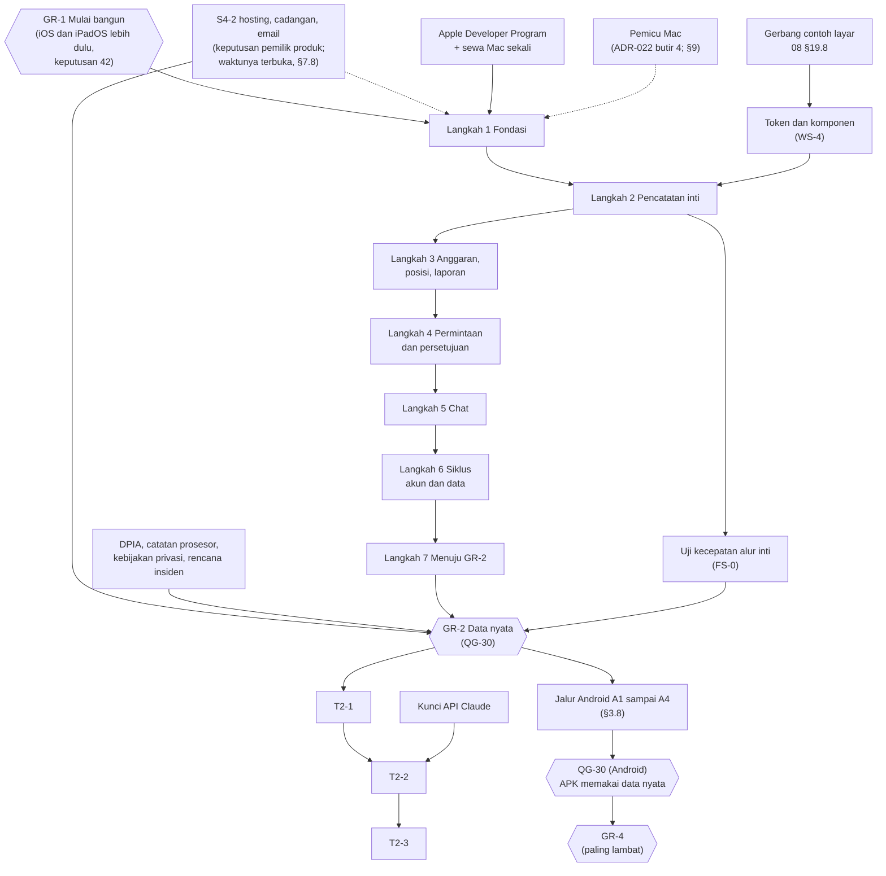

# 14 — Roadmap Rekayasa

| | |
|---|---|
| Pemilik | `architect` |
| Tahap | S5 — Rencana dan sintesis (12 November 2026; izin pemilik produk "gas", [_progress.md](_progress.md) "S5 dimulai") |
| Status | Revisi S5 fase D sesudah tinjauan `critic` A (CS5-A-01 sampai CS5-A-22), lalu revisi keputusan 42 (urutan dan platform pilot, 12 November 2026). Angka §11 dihitung ulang lead dengan skrip sebelum revisi; angka yang berubah ditandai di §11 untuk dihitung ulang |
| Sumber yang mengikat | Brief §1 (baris Engineering standards, Pilot devices, Build environment, Team size, Monthly infrastructure budget), §1.1, §16; `CLAUDE.md` ("Build team", "Deferred on purpose"); `ENGINEERING-STANDARDS.md` (ES) seluruhnya; [13](13-product-roadmap.md) (FS, GR, VL, §3, §7.5, §12.2); [09](09-technical-architecture.md) dan keempat berkasnya; ADR-012 sampai ADR-028; [10](10-security-privacy.md) §4, §4.1, §5; [07](07-financial-domain.md) INV-01 sampai INV-41 dan contoh terhitung; [06](06-activity-approval-architecture.md) INV-A01 sampai INV-A53, PG-01 sampai PG-15; [05](05-functional-requirements.md) §6; [12](12-scenarios.md) §2; [08](08-ux-ui-strategy.md) §15, §16.4, §19.8 |
| Dipakai oleh | Agen tim bangun (`CLAUDE.md` "Build team"), lead (16, 01), [15](15-risk-assessment.md) |

---

## 0. Cara membaca

- **Yang ditetapkan dokumen ini:** alat per stack di atas ES, workstream dan urutan kerjanya, strategi pengujian, gerbang mutu, strategi rilis, dan operasi. **Yang tidak:** urutan fase dan gerbang produk (13), aturan uang (07), aturan alur (06), persyaratan keamanan (10), stack dan arsitektur (09 dan ADR), risiko (15).
- **ES diadopsi utuh** (brief §1). Dokumen ini tidak mengulang aturannya; ia merujuk per bagian (§2.1) dan hanya menambah yang khas stack.
- **Platform yang dibangun lebih dulu diputuskan pemilik produk** (keputusan 42, 12 November 2026, di 17; menjawab Q-37): iOS dan iPadOS lebih dulu, dan pilot dengan data nyata berjalan di iOS dan iPadOS (istri di iPhone 13 sebagai pencatat utama, pemilik produk di iPad mini 7). GR-2 tidak menunggu Android. Android dibangun sesudah GR-2 untuk Galaxy A55 milik pemilik produk, paling lambat sebelum GR-4 (bawaan lead **[Usulan]**). Ini menggantikan baris brief §1 "Pilot devices" ("the pilot needs iOS and Android"); perbedaannya dicatat di 17 K-66. §3.4 dan §3.8 memuat urutan kerjanya.
- **Versi.** Nomor versi yang disebut adalah yang terlihat dan tercatat di 09 §9 atau 18 pada 12 November 2026. Versi yang dipasang dicek live saat dipasang (ES §8); nomor di sini bukan izin memakainya.
- **Label bukti** mengikuti [README](README.md#label-bukti). Seluruh rancangan di sini **[Usulan]** `architect`, kecuali yang diberi label lain atau yang dikutip dari keputusan yang sudah diterima.
- **Pengenal baru** (diminta ke lead untuk README, §12): `WS-N` workstream; `QG-NN` gerbang mutu. Pengenal lain dipakai menurut README.

---

## 1. Ringkasan

| Hal | Rancangan |
|---|---|
| Aturan | ES diadopsi utuh; alat per bahasa menurut ADR-025 dan ADR-023 (§2) |
| Workstream | Tujuh: server, iOS, Android, sistem desain, operasi, keamanan dan privasi, QA (§3). Server memimpin satu langkah di depan klien, karena semua aturan di server (ADR-013) |
| FS-1 | Tujuh langkah dari fondasi sampai GR-2 (§3.3); klien di FS-1 hanya iOS dan iPadOS, dengan tata letak iPhone dan iPad sejak langkah 1 (keputusan 42; §3.4). Android menyusul sesudah GR-2 lewat jalur Android (§3.8) |
| Pengujian | Hampir seluruh bukti kebenaran ada di server Go terhadap PostgreSQL nyata: setiap INV dan INV-A sebagai uji properti, setiap contoh terhitung dan setiap AC Tier 1 sebagai uji bernama ID-nya. Klien diuji untuk bantuan isian (vektor emas), antrean, sinkron, tampilan, aksesibilitas, dan tata letak. `qa` membuktikan AC Tier 1 di iPhone 13 dan iPad mini 7 sebelum GR-2, dan di Galaxy A55 sebelum Android memakai data nyata (QG-30 (Android)) (§4) |
| Gerbang | Per perubahan QG-01 sampai QG-12; per rilis QG-20 sampai QG-24; sekali sebelum build TestFlight pertama dipasang QG-25; gerbang fase QG-30 (GR-2), QG-30 (Android) sebelum Android memakai data nyata, QG-31 (GR-4), QG-32 (GR-5) (§5) |
| Rilis | iOS dan iPadOS: Xcode Cloud ke TestFlight internal. Android (sesudah GR-2): APK bertanda tangan langsung ke Galaxy A55. Staging di VPS yang sama sejak GR-2. Build iOS baru paling lambat 90 hari sesudah unggahan sebelumnya, sasaran 60 (ADR-022 butir 1, keputusan pemilik produk); batas 80 hari hanya usulan ADR-028 butir 4. Tanpa feature flag (§6; ADR-028) |
| Operasi | Satu biner, satu PostgreSQL, pgBackRest ke VPS kedua di Indonesia; uji pulih bulanan; pemeriksaan invarian harian; rotasi rahasia tanpa rilis; batas biaya `AI` USD 3 per pembangunan dan USD 10 per bulan; penyedia menunggu S4-2 (§7) |
| Tahap publik | Hak akses Plus per rumah tangga di server, penagihan toko dua platform: dirancang (§8), dibangun di FS-3 |
| Mac | Karena iOS dan iPadOS satu-satunya platform UI di FS-1, pemicu ADR-022 butir 4 kemungkinan besar terjadi di awal FS-1 (catatan, bukan keputusan); membeli impas terhadap menyewa bulanan sekitar 7,1 sampai 7,9 bulan untuk Mac mini 16 GB/512 GB yang diusulkan `researcher` (5,8 sampai 6,4 untuk 16 GB/256 GB; 18 §5.2.7.6); hanya Mac sendiri memberi debugger di perangkat pilot; keputusan pemilik produk saat pemicu terjadi (§9) |

---

## 2. Adopsi `ENGINEERING-STANDARDS.md` dan alat per stack

### 2.1 Adopsi per bagian

| ES | Cara dokumen ini menerapkannya |
|---|---|
| §1 Clean code | Formatter dan linter per bahasa di §2.2 sebagai QG-01. Komentar yang mengutip ID aturan pada setiap aturan uang dan API publik diperiksa `code-reviewer` (QG-08) |
| §2 Tanpa duplikasi | Satu sumber aturan: server Go (ADR-013). Pengecualian tiga bantuan isian dijaga vektor emas (§4.5, QG-06). Kontrak satu sumber dan tipe klien di-generate (QG-04). Pemeriksa duplikasi PMD CPD (QG-02). Komponen sistem desain tidak boleh disalin (WS-4, QG-09) |
| §3 Kinerja | Sasaran `[DEFAULT]` diukur di iPhone 13 dan iPad mini 7, lalu dikukuhkan atau diubah lewat ADR sebelum GR-2 (§4.10, QG-30); di Galaxy A55 sebelum QG-30 (Android) |
| §4 Keamanan dan privasi | Persyaratan dokumen 10 diuji menurut kolom tenggatnya (§4.8); uji isolasi lintas rumah tangga dibangkitkan untuk setiap kueri (QG-05) |
| §5 Kebenaran uang | Setiap INV di 07 dan setiap contoh terhitung adalah uji yang memblokir merge (§4.3, §4.4, QG-05) |
| §6 Pengujian | TDD; setiap AC Tier 1 punya uji bernama ID-nya; uji properti untuk logika uang dan persetujuan; uji flaky diperbaiki atau dihapus dalam minggu yang sama (§4) |
| §7 Review dan delivery | Cabang per tugas, review dua lintasan, satu perubahan satu hal, migrasi berversi dan dapat dibalik (§2.4, QG-07, QG-08, §6.4) |
| §8 Dependensi dan versi | Cek live saat memasang; patok tepat dan lockfile; ADR-023 untuk 0.x dan API eksperimental; pembaruan bulanan sebagai perubahan tersendiri (§2.3, QG-11, §7.7) |
| §9 Definition of done | Dicek per tugas di QG-12, termasuk butir 5: dijalankan di perangkat pilot nyata atau terhadap API nyata (staging, §6.1) |

Usulan perubahan ES dari dokumen ini: **tidak ada.**

### 2.2 Alat per stack

Alat formatter, linter, pemindai kerentanan, dan pemeriksa duplikasi **diputuskan di ADR-025** (diterima, D-103) dan tidak dipilih ulang di sini. Tabel ini melengkapinya dengan pelari uji, uji properti, cakupan, dan alat kontrak.

| Peran | Go (server) | PostgreSQL 18 | Swift / SwiftUI (iOS, iPadOS) | Kotlin / Compose (Android) | Protobuf / Connect |
|---|---|---|---|---|---|
| Toolchain | Go 1.27 (ADR-015; dicek saat dipasang) | PostgreSQL 18 dari PGDG (ADR-016) | Xcode dan SDK stabil terbaru, minimal Xcode 26 / SDK iOS 26 (09.4 §5); toolchain Swift resmi untuk paket non-UI di Linux **[Terverifikasi]** (18 §5.2.7.4); paket itu tidak mengimpor SwiftUI, Security, LocalAuthentication, atau UserNotifications (ADR-022 butir 3) | Kotlin, Android Gradle Plugin, dan Gradle menurut tabel kompatibilitas resmi Android saat dipasang (ES §8 "Compatible as a set"); target API 36, minimum API 29 (ADR-012) | `buf` (ADR-013) |
| Formatter | `gofmt` (ADR-025 butir 1) | — | `swift format` (butir 2) | ktlint 1.x (butir 3) | `buf format` **[Usulan]**: bagian `buf`, tanpa dependensi baru |
| Linter dan analisis statis | `go vet`, golangci-lint v2 dengan larangan `float32`/`float64` di paket uang (butir 1) | Rencana kueri setiap kueri baru ditinjau (ES §3); `sqlc` menolak kueri yang tidak cocok dengan skema saat generate | `swift format lint --strict` (butir 2) | ktlint, Android Lint dengan peringatan keamanan dan kinerja sebagai galat (butir 3) | `buf lint`, `buf breaking` terhadap cabang utama (butir 5) |
| Pemindai kerentanan | `govulncheck` | Paket OS dan PostgreSQL minor lewat pembaruan bulanan (09.4 §1) | Peringatan Dependabot atas `Package.resolved`; gerbangnya ditetapkan `ios-dev` minggu pertama (ADR-025 butir 2) | OSV-Scanner atas `gradle.lockfile` | — |
| Duplikasi | PMD CPD (butir 4) | — | PMD CPD | PMD CPD | — |
| Pelari uji | `go test` dengan `-race` dan `-shuffle=on` **[Usulan]**: `-race` menangkap balapan di jalur perintah bersamaan (INV-23), `-shuffle` menangkap uji yang bergantung urutan (ES §6 deterministik) | Layanan PostgreSQL 18 nyata di CI; tidak ada tiruan basis data | Swift Testing untuk paket non-UI; XCUITest di simulator Xcode Cloud (09.4 §4) | JUnit untuk modul non-UI; uji Compose di emulator dengan KVM (09.4 §4) | `buf generate` di CI; hasil generate tidak disunting tangan (ES §2) |
| Uji properti | Satu pustaka property-based Go, dipilih `backend-dev` minggu pertama dengan status stabil (09 §6; misalnya `pgregory.net/rapid`), atau fuzzing stdlib `testing.F` bila pustaka itu tidak lolos ES §8 | — | Tidak diperlukan: aturan tidak ada di klien (ADR-013) | Tidak diperlukan | — |
| Cakupan | `go test -coverprofile` dilaporkan, **tanpa ambang persen** (§4.13) | — | Laporan cakupan Xcode bila tersedia, tanpa ambang | Laporan cakupan bila tersedia, tanpa ambang | — |
| Pustaka utama (versi terlihat, dicek saat dipasang) | connect-go v2.0.2; pgx; sqlc; goose; protovalidate-go v1.x; `golang.org/x/crypto` dan `golang.org/x/oauth2` menurut ADR-023 | pgBackRest 2.60.0 (09.4 §6) | connect-swift 1.2.3; pembungkus SQLite dipilih `ios-dev` minggu pertama (09 §6) | connect-kotlin 0.10.x (ADR-023); Room; Compose Material 3 1.4.0 stabil, `ModalBottomSheet` lewat ADR-023 butir 5 | — |
| Keterlacakan | Pemeriksa ID buatan sendiri (§4.13, QG-06): skrip kecil tanpa dependensi baru | — | Sama, membaca nama uji Swift | Sama, membaca nama uji Kotlin | — |
| Rahasia di repositori | Alat dipilih `backend-dev` minggu pertama dengan revisi ADR-025 (09.4 §5 menyebut pemeriksaannya, belum alatnya); syarat: tidak mengunggah kode ke layanan selain GitHub (ADR-025 kriteria) | — | Sama | Sama | — |

**Satu repositori** untuk `proto/`, `server/`, `ios/`, `android/`, dan vektor emas **[Usulan]**. Alasannya: kontrak, kode hasil generate, dan berkas vektor emas berubah bersama dalam satu perubahan, dan `buf breaking` membandingkan terhadap cabang utama yang sama. Dua repositori menambah sinkronisasi versi kontrak tanpa pemakai kedua.

### 2.3 Versi dan pembaruan

- Setiap pemasangan dan pembaruan mencatat versi, tanggal cek, tautan sumber, dan alasan di deskripsi perubahan (ES §8). Pembaruan adalah perubahan sendiri yang lulus seluruh uji (QG-11).
- Pustaka 0.x dan API eksperimental hanya yang terdaftar di ADR-023; tambahan memerlukan revisi ADR-023.
- Pembaruan dicek bulanan bersama pembaruan PostgreSQL minor dan paket OS (§7.7); seketika bila ada advisori keamanan.
- Compose Material 3 naik ke 1.5.x hanya sesudah 1.5.0 stabil, dengan catatan naik versi di ADR-023 butir 5 (`rememberModalBottomSheetState` sudah `@Deprecated` di kode pengembangan).

### 2.4 Alur kerja tim bangun

- **Superpowers** adalah alur bawaan fase bangun (`CLAUDE.md` "Instruction priority" butir 2): rencana per tugas, worktree per cabang, TDD, pengembangan berbasis subagen, dan review.
- **Cabang per tugas**, tidak pernah langsung ke cabang utama (ES §7). Satu perubahan mengerjakan satu hal; refactor terpisah dari perubahan perilaku.
- **Review dua lintasan** oleh `code-reviewer` (`CLAUDE.md` "Build team"): (1) apakah perubahan memenuhi FR/AC, INV, atau SEC yang dikutipnya; (2) apakah kodenya sehat menurut ES. Perubahan layar juga ditinjau `ux-designer` terhadap 08 dan pedoman platform (QG-09).
- **Pesan commit** menyebut ID kebutuhan atau ADR (ES §7).
- **Tugas selesai** menurut ES §9 (QG-12).

---

## 3. Workstream

### 3.1 Daftar

Peran mengikuti tabel "Build team" `CLAUDE.md`; tidak ada peran baru. Agen tim bangun ditulis lead sesudah fase perencanaan berakhir (13 GR-1 butir 2).

| WS | Nama | Peran yang mengerjakan | Isi | Hasil |
|---|---|---|---|---|
| WS-1 | Server dan kontrak | `backend-dev` | Biner Go, modul 09.2 §1, skema dan migrasi, kontrak Protobuf, `Sync` dan SSE, pekerjaan latar, push, `AI` R1 (Tier 2), uji domain, invarian, AC, isolasi, privasi, vektor emas | Server yang menegakkan 06 dan 07; berkas vektor emas; kode hasil generate untuk Swift dan Kotlin |
| WS-2 | Aplikasi iOS dan iPadOS | `ios-dev` | Paket Swift non-UI (klien Connect, antrean dengan jeda urungkan, sinkron, penyimpanan lokal, bantuan isian), layar SwiftUI, kunci aplikasi, proteksi berkas (ADR-024) | Build TestFlight internal |
| WS-3 | Aplikasi Android | `android-dev` | Modul Kotlin non-UI (setara WS-2), layar Compose Material 3, kunci aplikasi, pengecualian cadangan dan transfer (ADR-024). Dimulai sesudah GR-2 (keputusan 42; §3.8) | APK bertanda tangan |
| WS-4 | Sistem desain | `ux-designer` bersama `ios-dev` dan `android-dev` | Token arah C (08 §19), komponen per pola di atas komponen native (08 §17.4), gerbang contoh layar (08 §19.8), tinjauan setiap layar | Satu set komponen per platform; catatan tinjauan per layar |
| WS-5 | Operasi | `backend-dev` menyiapkan; pengelola server (pemilik produk) menjalankan | VPS, TLS, systemd, cadangan dan uji pulih, pemantauan, runbook, rotasi rahasia, staging (ADR-028), kalender operasi | Runbook pilot dengan daftar 10 §4.1 bertanggal |
| WS-6 | Keamanan dan privasi | Tidak ada peran tersendiri **[Usulan]**: setiap SEC dikerjakan pemilik komponennya menurut 09.4 §8, diperiksa `code-reviewer`, dibuktikan `qa` | Persyaratan dokumen 10 menurut kolom tenggatnya; dokumen DPIA, catatan prosesor, kebijakan privasi, rencana insiden (10 §4.1 butir 4 sampai 6) ditulis tim sendiri (Q-208) | Uji SEC hijau; dokumen 10 §4.1 tersimpan |
| WS-7 | QA | `qa` | Matriks bukti AC Tier 1, uji skenario ujung ke ujung, daftar periksa perangkat, aksesibilitas, tata letak adaptif, pengukuran ES §3 | Matriks bukti bertanggal per rilis (§4.11) |

**Ponytail atas WS-6.** Peran keamanan tersendiri di tim bangun tidak dibuat untuk pilot: semua aturan keamanan pilot sudah berbentuk persyaratan yang dapat diuji (10 §5 "Cara menguji"), dan uji itu bagian dari gerbang biasa. Yang tidak tertutup oleh uji adalah penilaian, misalnya apakah sebuah layar baru membuka data lewat jalan yang tidak terpikir. Untuk itu lead diminta menimbang tinjauan `security-privacy` (hanya temuan) sebelum GR-2 dan sebelum GR-4 (§12).

### 3.2 Workstream terhadap fase

| WS | FS-0 | FS-1 | GR-2 | FS-2 | FS-3 | FS-4 sampai FS-8 |
|---|---|---|---|---|---|---|
| WS-1 Server | — | Langkah 1 sampai 7 (§3.3), memimpin klien satu langkah | Uji invarian, AC, SEC "Pilot" hijau; basis data dikosongkan dan dibuat ulang | Modul Tier 2 per gelombang T2-1 sampai T2-3; `ai` R1 dengan batas biaya | SEC "Wajib sebelum tahap publik" sisi server (SEC-08 dan SEC-107 sudah sejak pilot, SEC-18, SEC-25, SEC-36, SEC-105 tautan web); hak akses Plus (§8); `CLIENT_UPGRADE_REQUIRED` (ADR-028 butir 5) | Pemicu skala 09 §6 dan 09.4 §7.2 |
| WS-2 iOS | Contoh layar arah C bersama WS-4 | Mengikuti server langkah 1 sampai 7 (§3.3, §3.4); setiap layar siap iPhone dan iPad | Terpasang di iPhone 13 dan iPad mini 7 lewat TestFlight internal; keduanya perangkat data nyata | Layar Tier 2 per gelombang | SEC-153 (d), SEC-154 sisanya sebelum TestFlight eksternal; StoreKit (§8) | Desain tablet khusus (Tier 3) bila pemicunya ada |
| WS-3 Android | Contoh layar arah C bersama WS-4 | — | — (tidak menahan GR-2; keputusan 42) | Jalur Android (§3.8) sampai QG-30 (Android), lalu APK di Galaxy A55 dengan data nyata; layar Tier 2 per gelombang | Jalur Play (§6.7), Play Billing (§8); QG-30 (Android) sudah lulus sebelum GR-4 | Sama |
| WS-4 Sistem desain | Gerbang contoh layar 08 §19.8 sebelum token dibekukan | Token dan komponen sebelum layar pertama; tinjauan setiap layar | Gerbang 08 §19.8 sudah lewat (13 §3.3 butir 6) | Tinjauan layar Tier 2 | Kata layar status Plus tanpa nama pembayar (13 §12.2) | — |
| WS-5 Operasi | — | Server uji dan TLS di langkah 1 **[Usulan]**, bergantung pada S4-2 (§7.8); cadangan di langkah 7; staging di langkah 7 | Daftar 10 §4.1 butir 7, 8 dicentang; staging hidup | Kalender operasi (§7.7) | SES keluar sandbox bila dipilih; penyedia diperbesar menurut 09.4 §7.2 | Penyeimbang beban, replika (09 §6) |
| WS-6 Keamanan | — | SEC kolom "Pilot" per komponen | Daftar 10 §4.1 lengkap | SEC Tier 2 (SEC-57, SEC-62, SEC-68, SEC-120 sampai SEC-136, SEC-155) bersama fiturnya | SEC kolom "Wajib sebelum tahap publik"; advokat (GR-4) | ADR E2EE (10-D A) sebelum tahap publik |
| WS-7 QA | Uji kecepatan alur inti (13 §3.1) begitu alur pertama terpasang | Matriks bukti tumbuh per langkah | Matriks bukti lengkap untuk Tier 1 di iPhone 13 dan iPad mini 7 (QG-30) | Matriks per gelombang; VL-07 (ukuran ketukan) | Beta tertutup: daftar periksa per rumah tangga beta tidak membaca data mereka | Sama |

### 3.3 Urutan di dalam FS-1

Tujuh langkah. Setiap langkah adalah potongan vertikal: server, kontrak, dan uji lebih dulu, lalu layar iOS dan iPadOS (§3.4). Android tidak ada di langkah mana pun; pekerjaan Android adalah jalur sendiri sesudah GR-2 (§3.8). Isi fitur per langkah mengikuti ketergantungan 04 §5.1; **pemetaan FR Must ke fase tidak berubah** (semua 190 FR Must Tier 1 di FS-1, 05 §6). Langkah adalah urutan, bukan fase baru.

| Langkah | Server dan kontrak (WS-1) | Klien iOS dan iPadOS (WS-2) | Sistem desain, operasi, QA | Selesai bila |
|---|---|---|---|---|
| 1. Fondasi | Repositori, CI dengan semua gerbang QG-01 sampai QG-06; kontrak dasar; skema dasar, peran basis data, RLS dipaksakan (09.2 §3), goose; `identity` (akun, sesi, Argon2id, batas laju, pemulihan); `household` (buat rumah tangga, undangan F04, keanggotaan, pemberitahuan pengelola); kerangka `read`, `sync` (umpan per pembaca, kursor, potret awal), `jobs`; pembangkit uji isolasi; rangka uji properti INV dan INV-A; pembangkit vektor emas | Proyek, kode hasil generate, penyimpanan lokal, antrean perintah dengan jeda urungkan, putaran sinkron, masuk dan daftar, buat rumah tangga, undang | WS-4: token dan komponen dasar sesudah gerbang 08 §19.8. WS-5: server uji dan TLS **[Usulan]**, bergantung pada S4-2 (§7.8). iOS: Apple Developer Program, sewa Mac sekali (tarif per jam, minimal 24 jam; ADR-022 butir 2), alur kerja Xcode Cloud pertama; keputusan pemilik produk atas Mac bila pemicu ADR-022 butir 4 terjadi (§9). WS-6: **catatan persetujuan uji SEC-109 (b) dibaca dan diakui kedua penguji sebelum build TestFlight pertama dipasang** (10 §4.1 butir 3; QG-25) | Dua akun uji di dua perangkat masuk ke satu rumah tangga lewat undangan |
| 2. Pencatatan inti | `ledger`: entri, baris, tempat uang, serah terima dan konfirmasi custody, koreksi; INV 07 yang menyangkutnya; contoh terhitung yang menyangkutnya; proyeksi Beranda | Lembar Catat dengan tiga bantuan isian dan vektor emas; Beranda; konfirmasi serah terima | WS-7: **uji kecepatan alur inti** (13 §3.1; FS-0) di iPhone 13 (pencatat utama) dan iPad mini 7 | Belanja tunai tercatat offline, terkirim, terlihat pasangan dengan pemegang yang benar |
| 3. Anggaran, posisi, dan laporan | `budget`: kategori, periode dengan hari mulai, alokasi, jatah dan jadwal penyisihan, pos rutin dan tagihan berulang (N-32, FR-CAL-002), cicilan, utang dan piutang, kiriman keluarga, tabungan sederhana, aset dan kekayaan bersih, ringkasan bulanan; kecocokan kategori (SEC-92) | Layar Uang, tagihan, cicilan, aset, ringkasan | — | Contoh terhitung bagian anggaran dan laporan lulus; ringkasan bulanan memuat empat butir VL-04 |
| 4. Permintaan dan persetujuan | `request`: state machine 06 §4, penyelesaian §5, ambang dan kesepakatan rumah tangga K01 sampai K06, tanda; `notify`: push APNs bertuliskan teks kelas (pengirim FCM dibangun di jalur Android, §3.8), jam tenang, ringkasan, batas pengingat (PG-06) | Alur permintaan, usul balik, persetujuan satu ketukan; kanal notifikasi; buka dari notifikasi | — | Seluruh INV-A bagian §4 sampai §12 hijau dengan 2 sampai 5 anggota dewasa |
| 5. Chat | `chat`: pesan, kartu objek, tanda terkirim dan dibaca, kehadiran, hub SSE; `files`: JPEG re-encode (SEC-66); sembunyikan untuk saya dan Laporkan bagian pilot (SEC-153 (a) sampai (c), (e); SEC-154 (c)) | Layar Chat, kartu yang menjalankan perintah objeknya | — | INV-A bagian §16 hijau; LM-11 diuji dengan pengacakan `read_state` dan kehadiran |
| 6. Siklus akun dan data | `lifecycle`: keluar F06 sampai F08, ekspor dengan satu jendela, salinan data milik sendiri secara swalayan (SEC-107; FR-FAM-013/AC-12), penghapusan 90 hari, jurnal penghapusan, hapus akun; daftar sesi dan jejak keamanan; hapus jarak jauh | Kunci aplikasi (SEC-19), halaman Bantuan, daftar sesi, hapus akun, keluar | — | SCN-44 dan SCN-49 lulus ujung ke ujung |
| 7. Menuju GR-2 | Pengukuran kinerja ES §3; perbaikan dari matriks bukti | Pemeriksaan aksesibilitas dan tata letak di iPhone 13 dan iPad mini 7 (§4.9) | WS-5: pgBackRest dan salinan pelindung, uji pulih, `ops.invariant_check`, `ops.backup_verify`, staging (ADR-028), runbook. WS-6: dokumen 10 §4.1 butir 2, 4 sampai 6, 9, 10 (butir 3 sudah di langkah 1) | QG-30 lulus |

**iPad siap sejak langkah 1, bukan di langkah 7.** iPad mini 7 adalah perangkat harian pemilik produk dengan data nyata sejak GR-2 (keputusan 42), jadi tata letak iPad tidak boleh menjadi pemeriksaan akhir. Setiap layar SwiftUI di langkah 1 sampai 7 dibangun dan ditinjau dalam kelas Ringkas, Sedang, dan Lebar menurut 08 §16.1 dan §16.2 (iPad mini 7 potret, lanskap, jendela sempit), dan dijalankan di iPad mini 7 sebagai bagian ES §9 butir 5 dan QG-09. Rancangan khusus tablet tetap Tier 3 (RISK-90); yang dibangun di FS-1 adalah tata letak adaptif Tier 1 08 §16.

**Mengapa urutan ini.** Langkah 2 adalah alur yang menjawab KS-1 dan yang diukur FS-0, jadi ia datang sebelum apa pun selain fondasi. Anggaran (3) sebelum permintaan (4) karena tanda dan penyelesaian membaca anggaran, jatah, dan ambang (06 §5, §6). Chat (5) sesudah permintaan karena kartu menjalankan perintah objek yang sudah ada (06 §16.4). Siklus akun (6) membutuhkan semua jenis data sudah ada untuk ekspor dan penghapusan.

### 3.4 Urutan kerja yang diputuskan: iOS dan iPadOS lebih dulu

Pemilik produk memilih iOS lebih dulu (pilihan "a" yang disajikan lead sesudah S5, menjawab Q-37), lalu menetapkan bahwa pilot memakai iOS dan iPadOS: "ios ipad yang bakalan dipakai pilot ya" (keputusan 42, `_progress.md` 12 November 2026; 17 keputusan 42 dan K-66). Fakta perangkat dari jawabannya (menjawab Q-211): istri mencatat paling sering, di iPhone 13; pemilik produk memakai iPad mini 7 dan jarang bepergian; Galaxy A55 milik pemilik produk. Ketiga pilihan di versi sebelumnya bagian ini (bersamaan, Android dulu, iOS dulu) tidak berlaku lagi.

| Hal | Ketetapan |
|---|---|
| Urutan di FS-1 | `ios-dev` mengikuti server langkah demi langkah (§3.3). Paket Swift non-UI diuji di Linux (ADR-022 butir 3); layar SwiftUI dikerjakan sejak langkah 1 |
| Android di FS-1 | Tidak ada: tanpa modul Kotlin, tanpa job CI Android, tanpa pengirim FCM. Kontrak tetap dirancang untuk semua klien (ADR-013), dan `buf breaking` menjaganya sejak langkah 1 |
| Uji kecepatan alur inti (FS-0) | Di iPhone 13 dan iPad mini 7 sesudah langkah 2; di Galaxy A55 di jalur Android (§3.8) |
| Pemakaian dengan data uji sebelum GR-2 | Kedua pasangan sejak langkah 2, di perangkat yang akan mereka pakai untuk data nyata |
| GR-2 | Tidak menunggu Android. QG-30 menuntut iPhone 13 dan iPad mini 7 (§5.3) |
| Pemicu Mac (ADR-022 butir 4) | Kemungkinan besar di awal FS-1, karena pekerjaan UI hanya SwiftUI (§9) |
| Android | Jalur sendiri sesudah GR-2, paling lambat sebelum GR-4 (§3.8) |
| Yang tidak berubah | Satu server dan satu kontrak; semua aturan di server (ADR-013); Kotlin dan Compose tetap stack Android (ADR-012 butir 1) |

**Yang dibayar dengan pilihan ini** (dinilai di 15): siklus UI iOS tanpa Mac lambat sejak hari pertama (RISK-01); belanja pemilik produk di luar rumah baru tercatat saat ia kembali ke iPad sampai Android tersedia (RISK-18); pengalaman Android pertama diuji jauh sesudah iOS, dekat beta (RISK-91).

### 3.5 FS-2: gelombang Tier 2

| Gelombang (13 §3.4) | Server (WS-1) | Pagar yang harus lulus sebelum titik masuk layar digabung (ADR-028 butir 2) |
|---|---|---|
| T2-1 | `care` (status suasana hati, tindak lanjut sakit), permintaan tindakan (06 §13.1), sebutan anggota (`member_label`, 09.2 §5.5) | FR-COM-016, FR-CARE-002, FR-CARE-004; SEC-62, SEC-68; SEC-155 (a) sampai (i); status `CARE` yang tidak dibagikan hanya di perangkat, Class A (ADR-024) |
| T2-2 | `ai` R1: pembangunan kumpulan kalimat, pemilih di server lewat `read`, penghitung biaya | FR-AI-005 sampai FR-AI-009 (F-AI-005 lebih dulu); SEC-120, SEC-121, SEC-123 sampai SEC-136; batas USD 3 per pembangunan dan USD 10 per bulan (SEC-127); saklar mati (SEC-128) |
| T2-3 | `shopping`, `maintenance`, `plan`, pengingat rutinitas | INV-A bagian §13 yang menyangkut; FR untuk IDEA-15, IDEA-19 ditulis dulu (13 §3.4) |

Setiap gelombang adalah satu rilis untuk setiap klien yang sudah memakai data nyata (§6.3); gelombang yang dilepas sebelum Android bergabung dibangun ulang di Android di dalam jalur Android (§3.8). Uji INV dan INV-A seluruhnya berjalan pada setiap perubahan, termasuk yang Tier 2, karena modul Tier 2 berbagi tabel Peristiwa, notifikasi, dan umpan.

### 3.6 FS-3: pekerjaan teknis sebelum tahap publik

| Kelompok | Butir | Sumber |
|---|---|---|
| Keamanan, sebelum GR-4 | Butir 10 §4.2: SEC-36 dengan log di luar VPS dan SEC-39 (c) publik, SEC-34 teks umum, SEC-139 publik, SEC-25, SEC-84, SEC-147 bila wajib (QG-31). SEC-107 salinan swalayan tidak di sini: dibangun di FS-1 langkah 6 (FR-FAM-013/AC-12) | 10 §4.2 |
| Keamanan, sebelum GR-5 | SEC-10 pemberian peran, SEC-18, SEC-45, SEC-105 tautan web, SEC-110 (d) sebelum migrasi, SEC-140 tautan web, SEC-141; SEC-156 sebelum Plus dibangun; tinjauan ulang SQLCipher; ADR E2EE termasuk sebutan anggota; SEC-157 uji penetrasi pihak luar (QG-32) | 10 §4; 09 §6 |
| Toko | SEC-153 (d), SEC-154 sisanya, SEC-142, SEC-143, SEC-83 rating usia; jalur beta (§6.7) | 10 §4, §4.2; 13 GR-4 |
| Skala | Batas laju dan hub SSE di PostgreSQL bila lebih dari satu proses (09.4 §2); RLS dengan banyak proses | 09 §6 |
| Model bisnis | Hak akses Plus dan penagihan toko (§8), sesudah sisa R-15 (aturan lintas platform Google, harga rupiah) dijawab dan Q-36 diputuskan | 13 §7.5; 18 §2.13 |
| Kompatibilitas | `CLIENT_UPGRADE_REQUIRED` dan versi minimum per platform | ADR-028 butir 5 |
| Email | SES keluar sandbox, bila S4-2 memilih SES | ADR-026; 13 GR-4 butir 6 |
| `AI` | R2 hanya lewat ADR baru sesudah advokat | ADR-021; SEC-122 |

### 3.7 Ketergantungan

### 3.8 Jalur Android sesudah GR-2

Bawaan lead **[Usulan]** dalam keputusan 42, dapat diubah pemilik produk: Android dibangun sesudah GR-2 untuk Galaxy A55 milik pemilik produk, di dalam pilot bila waktu memungkinkan, paling lambat sebelum GR-4. Stack tetap Kotlin dan Compose Material 3 (ADR-012).

**Letaknya: workstream tersendiri (WS-3), bukan langkah di dalam FS-2** **[Usulan]** `architect`. Alasannya: FS-2 adalah gelombang Tier 2 dengan rilis dan pengukuran VL-nya sendiri (13 §3.4), sedangkan jalur Android membangun ulang seluruh klien Tier 1 ditambah gelombang yang sudah dilepas. Menjadikannya langkah FS-2 akan menahan gelombang Tier 2 di belakang Android, atau sebaliknya. Sebagai workstream, ia berjalan sejajar dengan FS-2 dan selesai di gerbangnya sendiri. **Kapan dimulai di antara gelombang** T2-1 sampai T2-3 adalah keputusan pemilik produk di GR-2, karena dengan tim satu sampai tiga orang keduanya bersaing untuk waktu yang sama (RISK-53).

| Langkah | Isi | Selesai bila |
|---|---|---|
| A1. Fondasi Android | Proyek, kode hasil generate Kotlin, job CI Android (ktlint, Android Lint, OSV-Scanner, uji unit, uji Compose di emulator), kunci tanda tangan APK dibuat dan disimpan (§7.5), pengirim FCM di server dan akun layanan FCM (§7.5); aplikasi staging `applicationIdSuffix` (§6.1) | Uji vektor emas Kotlin lulus di CI terhadap berkas yang sama dengan Swift (§4.5); masuk ke staging dari Galaxy A55 |
| A2. Tier 1 Android | Modul non-UI dan layar Compose untuk langkah 1 sampai 6 §3.3, dalam urutan yang sama, di atas server yang sudah ada | Setiap AC Tier 1 yang perlu perangkat lulus di Galaxy A55 di aplikasi staging (§4.11) |
| A3. Gelombang yang sudah dilepas | Layar Tier 2 dari gelombang yang sudah ada di produksi saat A2 selesai | Pagar Must bersyarat gelombang itu lulus di Android (§3.5) |
| A4. Menuju data nyata | Pengukuran ES §3 di Galaxy A55; aksesibilitas dan tata letak Android (§4.9); potret awal dan sinkron pertama atas rumah tangga sintetis seukuran data pilot saat itu **[Usulan]** | QG-30 (Android) lulus (§5.3); APK pilot dipasang di Galaxy A55 dengan akun pemilik produk yang sudah ada |

**Akibat bagi gerbang dan CI.** Sebelum A1, QG-06 hanya menjalankan vektor emas di Swift, dan kode hasil generate Kotlin tidak dibangkitkan; sejak A1 keduanya wajib di setiap perubahan (§4.5, §4.6). Sejak A1, gelombang Tier 2 baru juga dibangun di Android sebelum rilisnya, atau ditambahkan ke A3 bila Android belum bergabung dengan data nyata. Server tidak berubah karena Android datang: semua aturan sudah di server (ADR-013), dan klien Android hanya pemakai kontrak yang sama.

**Terbuka untuk jalur Android: SEC-20 di API 29 sampai 32** (10 §4.3; 10 §7.6 permintaan (3)). `setRecentsScreenshotEnabled` baru ada sejak API 33 dan hanya mengosongkan pratinjau Recents **[Terverifikasi]**; `FLAG_SECURE` memblokir tangkapan layar **[Terverifikasi]**; bahwa `FLAG_SECURE` juga mengosongkan pratinjau Recents hanya tersirat **[Perlu validasi]**, dan API resmi lain untuk API 29 sampai 32 tidak ditemukan **[Perlu validasi]** (18 §2.12.8). Pilihannya: `FLAG_SECURE` hanya di API 29 sampai 32 (usulan `security-privacy` **[Usulan]**), atau pratinjau Recents terbuka di API itu. Galaxy A55 tidak terkena, karena berjalan di atas API 33 **[Asumsi]**, jadi pilihan ini tidak menahan QG-30 (Android). Ia diputuskan lewat ADR di jalur Android, paling lambat sebelum tahap publik, sesudah butir [Perlu validasi] diperiksa di halaman resmi.

**Bila jalur Android tidak selesai sebelum GR-4,** GR-4 menunggu, karena beta Play (§6.7) dan rumah tangga beta yang memakai Android memerlukannya (RISK-91). Menunda Android sampai tahap publik bukan bawaan; itu keputusan pemilik produk yang dicatat di 17.

---

## 4. Strategi pengujian

### 4.1 Asas

1. **Bukti kebenaran ada di server.** Semua aturan uang dan persetujuan hanya di server Go (ADR-013), jadi uji properti, uji invarian, contoh terhitung, dan AC dijalankan di sana terhadap PostgreSQL 18 nyata. Tidak ada tiruan basis data: isolasi `SERIALIZABLE`, RLS, dan konstrain adalah bagian dari aturan yang diuji.
2. **Klien diuji untuk apa yang ia kerjakan:** tiga bantuan isian (vektor emas), antrean dan jeda urungkan, sinkron dan potret awal, penyimpanan dan pembuangan lokal, tampilan, aksesibilitas, tata letak, kunci aplikasi, dan proteksi data di perangkat.
3. **Setiap uji menyebut ID yang dibuktikannya** di namanya: `FR-FIN-040/AC-14`, `INV-09`, `INV-A33`, `CTH-21`, `SCN-01`, `SEC-96`, `PG-14`. Bentuk nama per bahasa ditetapkan `code-reviewer` di minggu pertama; pemeriksa ID (§4.13) membaca bentuk itu.
4. **Lapisan, alat, dan tempat berjalannya kanonis di 09.4 §4** dan tidak diulang. Bagian ini menetapkan apa yang membuktikan apa, dan apa yang ditambahkan.
5. **Bagian Android dari setiap baris §4 berlaku sejak jalur Android langkah A1** (§3.8; keputusan 42). Sebelum itu, "kedua platform" dan "Swift dan Kotlin" di bagian ini dibaca sebagai iOS dan iPadOS saja; tidak ada gerbang yang dihapus, hanya pemakai keduanya yang belum ada.

### 4.2 Apa membuktikan apa

| Yang harus terbukti | Bukti | Tempat | Gerbang |
|---|---|---|---|
| Setiap INV-01 sampai INV-41 (07) | Uji properti berstate, satu per INV (§4.3) | CI Linux | QG-05 per perubahan |
| Setiap INV-A01 sampai INV-A53 (06), termasuk kolom "Cara menguji" | Uji properti berstate, satu per INV-A, ditambah kasus wajib dari kolom itu (§4.3) | CI Linux | QG-05 |
| Setiap PG-01 sampai PG-14 (06 §10); PG-15 sejak FS-3 (§8) | Kolom "Cara menguji" sebagai uji; PG yang menunjuk INV-A memakai uji INV-A itu | CI Linux | QG-05 |
| Setiap contoh terhitung 07 | Uji tabel dengan angka yang sama (ES §5; §4.4) | CI Linux | QG-05 |
| Setiap AC Tier 1 (05) | Uji tingkat API bernama `FR-…/AC-n`; bila AC menyangkut tampilan atau ketukan, ditambah pemeriksaan perangkat oleh `qa` (§4.11) | CI Linux; perangkat | QG-05; QG-21 |
| Setiap Must bersyarat Tier 2 | Sama dengan AC Tier 1, saat fiturnya dibangun | CI Linux; perangkat | QG-05; QG-21 |
| Skenario 12 | Uji ujung ke ujung tingkat API per skenario Tier 1; dijalankan juga di perangkat sebelum GR-2 (§4.4) | CI Linux; perangkat | QG-05; QG-30 |
| Bantuan isian sama dengan acuan server | Vektor emas di Swift dan Kotlin (§4.5) | CI Linux; Xcode Cloud | QG-06 |
| Kontrak tidak merusak klien lama | `buf breaking` (§4.6) | CI Linux | QG-04 |
| Offline, sinkron, jeda urungkan | §4.7 | CI Linux; emulator; Xcode Cloud; perangkat | QG-05; QG-21 |
| SEC kolom "Pilot" | Kolom "Cara menguji" dokumen 10 (§4.8) | Menurut SEC | QG-05; QG-30 |
| Aksesibilitas dan tata letak | §4.9 | Emulator; simulator; perangkat | QG-09; QG-21 |
| Sasaran ES §3 | §4.10 | VPS; perangkat | QG-30; QG-10 bila ada klaim kinerja |
| Pemulihan cadangan | Uji pulih 09.4 §6, uji SEC-96 dan SEC-97 | VPS cadangan | QG-30; bulanan (§7.7) |

### 4.3 Invarian keuangan dan alur

Rancangan uji properti kanonis di 09.4 §4 (baris "Invarian keuangan" dan "Invarian alur dan persetujuan"). Tambahan dokumen ini:

| Hal | Rancangan |
|---|---|
| Daftar yang diuji | Diambil dari 07 dan 06 dengan `grep` pengenal pada setiap perubahan (§4.13). INV atau INV-A baru di dokumen tanpa uji membuat QG-06 gagal; uji yang menyebut ID yang tidak ada juga gagal |
| Pembangkit perintah | Satu pembangkit perintah acak untuk semua modul, dari kontrak Protobuf (jenis perintah dan medannya), dengan pelaku 2 sampai 5 anggota dewasa penuh, perangkat offline, kiriman ulang (idempotensi, INV-10), dan jam yang dimajukan. Satu pembangkit, bukan satu per INV (ES §2) |
| Pemeriksa | Setiap INV dan INV-A adalah satu fungsi pemeriksa atas data penuh, dipanggil sesudah setiap langkah. Pemeriksa yang sama dipakai `ops.invariant_check` di produksi (VL-10) **[Usulan]**: satu implementasi, dua pemakai |
| Simetri | Setiap rangkaian dijalankan ulang dengan anggota dewasa dipermutasikan (LM-01, PG-01, SEC-89); hasil yang terbaca setiap orang harus berpindah bersama orangnya |
| Bersamaan | Perintah dari beberapa goroutine di bawah `SERIALIZABLE` dibandingkan dengan hasil berurutan (INV-23); `-race` menyala |
| Penyusutan dan benih | Benih acak dicetak di setiap kegagalan dan dapat diulang. Kegagalan yang sudah disusutkan disimpan sebagai uji contoh tetap (ES §6: perbaikan dimulai dengan uji yang mereproduksi) |
| Jumlah kasus | Per perubahan: jumlah yang selesai di bawah anggaran waktu CI 15 menit (09.4 §7.1) **[Asumsi]**; mingguan: putaran panjang terjadwal dengan benih baru. Kegagalan putaran panjang diperlakukan sama dengan kegagalan per perubahan |
| Anggaran CI | 15 menit adalah **jumlah menit tertagih semua job Linux per push**, bukan per job: 09.4 §7.1 menghitung sekitar 100 push × 15 menit = 1.500 menit × USD 0,006 = USD 9 dari jatah Free USD 12 (tarif **[Terverifikasi]** 18 §5.2; jumlah push **[Asumsi]**). Uji properti, uji Compose di emulator pada dua skala huruf (§4.9; sejak langkah A1), dan job lain berbagi anggaran itu. Di FS-1 tidak ada job Android, jadi angka itu batas atas FS-1 **[Asumsi]**; anggaran diukur ulang saat job Android ditambahkan. Apakah semuanya muat **belum diketahui** sampai diukur di bulan pertama fase bangun. Bila tidak muat: uji emulator hanya berjalan pada perubahan yang menyentuh `android/`, `proto/`, atau berkas vektor emas, dan sebagian kasus properti pindah ke putaran mingguan; tidak ada gerbang yang dihapus. Bila tetap melewati jatah, selisihnya dibayar per menit dan dicatat di §7.6 |
| Bersyarat | INV-A Tier 2 diuji sejak modulnya ada; sebelum itu, pemeriksanya tetap berjalan atas data Tier 1 bila berlaku |

### 4.4 Contoh terhitung dan skenario

- **Contoh terhitung.** Setiap `CTH-NN` di 07 (termasuk varian berhuruf, misalnya CTH-03b) adalah satu uji tabel dengan angka yang sama persis. Daftarnya diambil dengan `grep` (§4.13); contoh baru di 07 tanpa uji membuat QG-06 gagal.
- **Skenario.** 38 skenario bertier 1 di 12 §2 (semua kecuali SCN-03, SCN-16, SCN-17 yang Tier 3, dan SCN-07, SCN-08, SCN-09, SCN-10, SCN-18, SCN-39, SCN-40, SCN-41 yang Tier 2) menjadi uji ujung ke ujung tingkat API di FS-1: aktor, urutan perintah, dan akibat uang menurut skenarionya, termasuk baris "Dua arah". Bagian Tier 1 dari SCN-08, SCN-18, dan SCN-41 (bertanda "+1" di 12 §2) diuji di FS-1 juga. Skenario Tier 2 diuji bersama gelombangnya. Skenario Tier 3 tidak diuji.
- **Di perangkat.** Sebelum GR-2, `qa` menjalankan setiap skenario Tier 1 sekali di iPhone 13 dan iPad mini 7 dengan dua akun, yaitu pasangan perangkat yang memakai data nyata (keputusan 42), dan menandai di matriks bukti (§4.11). Di Galaxy A55 hal yang sama dijalankan sebelum QG-30 (Android) (§3.8 langkah A2).

### 4.5 Vektor emas bantuan isian

Pengecualian ES §2 (ADR-013 butir 3; S4-1 (ii) A).

| Hal | Rancangan |
|---|---|
| Sumber | Uji Go membangkitkan berkas vektor (masukan dan hasil yang diharapkan) dari acuan: fungsi INV-02 untuk selisih baris, fungsi acuan Go untuk "bagi rata" (sisa pada baris pertama), aturan protovalidate untuk bentuk masukan |
| Isi | Kasus batas yang dipilih tangan (nol baris, satu baris, sisa bagi, jumlah terbesar `int64`, angka negatif, teks di batas panjang, karakter gabungan untuk panjang teks) ditambah kasus acak dengan benih tetap. Berkas berversi di repositori |
| Pemakai | Uji unit Swift (paket non-UI) sejak FS-1 dan Kotlin (modul non-UI) sejak langkah A1 (§3.8) membaca berkas yang sama |
| Gerbang | Berkas yang berubah tanpa uji klien yang lulus di setiap klien yang ada memblokir merge (QG-06). Saat modul Kotlin pertama ditambahkan, ia lulus atas seluruh berkas yang ada saat itu, bukan hanya kasus baru. Berkas yang dibangkitkan ulang harus identik dengan yang di repositori (perubahan acuan tanpa memperbarui vektor gagal) |
| Batas | Hanya tiga bantuan itu. Bantuan isian keempat memerlukan ADR baru dengan persetujuan pemilik produk (ES §2) |

### 4.6 Kontrak

- `buf lint` dan `buf breaking` terhadap cabang utama pada setiap perubahan (QG-04).
- Kode hasil generate untuk Go dan Swift (dan Kotlin sejak langkah A1) dibangkitkan ulang di CI dan harus identik dengan yang di repositori.
- Uji AC berjalan lewat klien Connect Go hasil generate terhadap server uji, jadi kontrak teruji dari sisi pemanggil.
- **Uji klien terhadap server nyata.** Xcode Cloud tidak menjalankan biner Go, jadi alur langkah 2 dijalankan `qa` di perangkat iOS terhadap staging sebelum setiap rilis (QG-21) **[Usulan]**. Karena di FS-1 tidak ada uji instrumen Android yang dapat memakai biner server di mesin CI, paket Swift non-UI menjalankan alur yang sama terhadap biner server di CI Linux, bila klien Connect Swift dapat dibangun di Linux **[Perlu validasi]**, dinilai `ios-dev` minggu pertama bersama RISK-13 **[Usulan]**. Sejak langkah A1, uji instrumen Android di emulator CI menjalankan alur itu juga.
- Nilai per jenis perintah yang dibaca klien, misalnya `hold_seconds` jeda urungkan, ada di kontrak (ADR-013 butir 4). Uji kontrak: setiap jenis perintah pelindung (SEC-151 (1) sampai (7)) membawa `hold_seconds = 0` dan tanda `protective`; `protective` selalu disertai `hold_seconds = 0` (09 berkas 03 §1; ADR-028 butir 3).

### 4.7 Offline dan sinkron

| Yang diuji | Cara | Tempat |
|---|---|---|
| Server memutus transisi; perintah offline yang tiba terlambat dinilai saat tiba (06 S-1 sampai S-9) | Bagian dari uji properti INV-A dengan perangkat offline (§4.3) | CI Linux |
| Idempotensi | Setiap perintah dikirim ulang dalam rangkaian acak (INV-10) | CI Linux |
| Umpan per pembaca dan potret awal | Kursor kosong, kursor kedaluwarsa sesudah pemangkasan 90 hari, dan akses yang menyempit (SEC-47, SEC-48): hasil sinkron sama dengan bacaan langsung lewat `read` | CI Linux |
| Antrean bertahan saat proses dihentikan | Uji instrumen Android dan uji paket Swift: perintah di antrean, proses dimatikan, aplikasi dibuka, perintah terkirim sekali | Emulator; Linux atau Xcode Cloud |
| Jeda urungkan | "Urungkan" dalam 5 detik tidak meninggalkan jejak di server; perintah pelindung dan pesan chat tidak ditahan (LM-12; SEC-151) | CI Linux (kontrak); emulator; perangkat |
| Tahan tulis (ADR-028 butir 3): perintah biasa | Perintah yang bukan pelindung ditolak dengan `WRITE_FROZEN` (dapat dicoba ulang, berbeda dari galat jaringan), tetap di antrean, diterima sekali sesudah saklar dimatikan; hasil akhir identik dengan rangkaian tanpa saklar | CI Linux; emulator |
| Tahan tulis: **perintah pelindung tetap berlaku** | Untuk setiap jenis bertanda `protective` (SEC-151 (1) sampai (7): cabut berbagi termasuk `CARE` V-7, hapus data sendiri dan hapus akun, sembunyikan untuk saya, laporkan, cabut sesi termasuk hapus jarak jauh SEC-21, keluar F06, perintah berautentikasi ulang), serta masuk, autentikasi ulang, pembaruan token, dan pemulihan email (SEC-13, SEC-15, SEC-24) beserta baris jejak keamanannya: dengan saklar menyala, semuanya **diterima dan efeknya terbaca seketika** (B tidak lagi membaca status yang dicabut; sesi yang dicabut ditolak), pada skenario insiden tingkat 1 dan tingkat 2; hash inti moneter (INV-09) tidak berubah selama saklar menyala. Hapus akun saat saklar menyala: sesi dan akses berakhir seketika, `exit_closure` belum ada; sesudah saklar mati ditulis tepat satu kali dengan tanggal saat perintah diterima dan angka identik dengan rangkaian tanpa saklar. Batas penghapusan dihitung dari saat diterima. Perluasan berbagi dan `unmute_member` ditolak `WRITE_FROZEN`. Jenis bertanda `protective` yang ditolak saat tahan tulis membuat uji gagal (SEC-151 kolom "Cara menguji") | CI Linux |
| Tahan tulis: urutan di perangkat | Antrean berisi perintah biasa yang ditolak `WRITE_FROZEN` dan sedang menunggu coba ulang, lalu pengguna mencabut berbagi atau keluar: perintah pelindung terkirim seketika, tidak menunggu antrean atau jeda coba ulang, dan layar menampilkan hasil server, bukan "menunggu"; layar keluar menghitung catatan yang belum terkirim dari antrean perangkat (09 berkas 03 §1; 07 §8.2 butir 2b) | Emulator; Linux atau Xcode Cloud (paket non-UI); perangkat |
| Sinyal hilang saat belanja | SCN-19 di perangkat dengan mode pesawat | Perangkat (`qa`) |
| SSE dan push | Tanda "umpan bergerak" memicu tarik; push hanya teks kelas (SEC-50, SEC-51); tanda terkirim tidak naik oleh push atau sinkron latar (INV-A33) | CI Linux (tangkap payload); perangkat |

### 4.8 Keamanan dan privasi

Setiap SEC berkolom "Pilot" di 10 §4 punya uji menurut kolom "Cara menguji" berkas 10 masing-masing, bernama ID-nya. Pemetaan SEC ke komponen kanonis di 09.4 §8. Pengelompokan menurut cara membuktikan:

| Cara | SEC (contoh, bukan daftar lengkap) |
|---|---|
| Otomatis di CI | SEC-01 sampai SEC-07 (isolasi dibangkitkan per kueri sqlc; "tidak ada" sama dengan "tidak boleh"; urutan kursor identik byte demi byte); SEC-38 (a), (b), (e), (g); SEC-50, SEC-51 (tangkap payload); SEC-44 (pindai log sesudah rangkaian AC); SEC-86, SEC-89 (tidak pernah terlihat; simetri); SEC-108 (hash inti, INV-09); SEC-151 (setiap jenis bertanda `protective` bernilai `hold_seconds = 0` dan diterima selama tahan tulis, §4.7); SEC-154 (server menolak `report_content` bila pengelola anggota rumah tangga pelapor, FR-COM-020/AC-5); SEC-155 saat Tier 2 |
| Operasi, dibuktikan di VPS | SEC-40 sampai SEC-43; SEC-96, SEC-97 (uji pulih dengan jurnal penghapusan); SEC-148 (latihan insiden sekali) |
| Perangkat, oleh `qa` | SEC-14, SEC-19 (kunci aplikasi, biometrik gugur saat pendaftaran berubah, salah 5 kali); SEC-20 (pengalih aplikasi tertutup); SEC-21 (hapus jarak jauh); SEC-46 (data tidak ikut cadangan iCloud, cadangan Android, dan transfer perangkat); SEC-54 (layar luar, pintasan); SEC-60, SEC-61 (kehadiran) |
| Dokumen, dicentang bertanggal | SEC-139 versi pilot, SEC-149, SEC-150 (a), (b); 10 §4.1 butir 2 sampai 7, 9 |

**Sebelum tahap publik:** SEC kolom "Wajib sebelum tahap publik" dengan cara yang sama; butir yang 10 §4.2 tarik ke sebelum GR-4 di QG-31, sisanya di QG-32. **Uji penetrasi pihak luar** (SEC-157): sesudah cakupan publik selesai dibangun di FS-3 dan sebelum GR-5, oleh pihak independen, terhadap instans staging berisi data sintetis, tidak pernah terhadap produksi; temuan tinggi dan kritis diperbaiki dan diuji ulang sebelum GR-5 (QG-32). Tidak diwajibkan untuk pilot dan GR-4 **[Usulan]** `security-privacy`; kisaran biaya dan penyedia di kawasan ada di SEC-157 dan 18 §2.12.7, dan angka akhirnya dari penawaran berdasarkan ruang lingkup.

### 4.9 Aksesibilitas dan tata letak adaptif

| Hal | Rancangan | Sumber |
|---|---|---|
| Persyaratan | 08 §15 (teks sampai 200%, sasaran sentuh 48 pt/dp, pembaca layar, kontras, tanpa informasi lewat warna saja, kurangi gerak, jalan non-gestur) | 08 §15 |
| Otomatis Android | Uji Compose memeriksa semantik (label, tindakan kustom pada kartu) dan ukuran sasaran sentuh pada empat tujuan navigasi dan lembar Catat; dijalankan pada skala huruf 100% dan 200% | Emulator CI |
| Otomatis iOS | XCUITest pada layar yang sama dengan Dynamic Type terbesar; audit aksesibilitas bawaan XCUITest bila tersedia di versi Xcode yang dipakai **[Perlu validasi]** saat dibangun | Xcode Cloud |
| Manual | VoiceOver dan TalkBack melewati tiga alur inti (catat belanja, serah terima dan konfirmasi, ajukan dan setujui permintaan) per rilis | Perangkat (`qa`) |
| Tata letak | Daftar uji 08 §16.4 per baris waktunya: baris "Sebelum GR-2" (iPhone 13; iPad mini 7 potret, lanskap, jendela berdampingan *compact* dan *regular*, jendela yang diubah ukurannya di tengah alur, untuk setiap alur 08 §16.2) untuk QG-30; baris "Sebelum aplikasi Android memakai data nyata" (Galaxy A55; emulator foldable, tablet 8 dan 10,5 inci, tabletop, buku, dua layar berengsel) untuk QG-30 (Android); pada setiap ukuran teks 200%, tema gelap dan terang, luring. Otomatis: uji Compose pada kelas ukuran Ringkas, Sedang, Lebar untuk empat tujuan navigasi (unsur utama tampil, jumlah uang tidak terpotong). Sisanya manual per rilis | 08 §16.4; brief §10.3 |
| Kontras | Pasangan token dicek dengan skrip saat token dibuat (08 §19.11); token tidak berubah tanpa cek ulang | 08 §19.3 |

### 4.10 Kinerja

- Sasaran ES §3 diukur di iPhone 13 dan iPad mini 7 (cold start, ketukan mencatat, frame) dan di VPS pilot (p95 baca dan tulis dari histogram `expvar`, 09.4 §3) dengan data rumah tangga sintetis setahun **[Asumsi]** (09.4 §4). Hasil dan ADR yang mengukuhkan atau mengubah angka `[DEFAULT]` menjadi syarat QG-30 (13 §3.3 butir 5). Di Galaxy A55, perangkat pilot dengan kinerja paling rendah **[Asumsi]** (RISK-54), pengukuran yang sama menjadi syarat QG-30 (Android); bila hasilnya tidak memenuhi angka yang sudah dikukuhkan, ADR yang sama direvisi sebelum APK memakai data nyata.
- Sesudah GR-2: diukur ulang di setiap gelombang Tier 2 (QG-22) dan di VL-07 (13 §6.1). Klaim kinerja di perubahan apa pun membawa pengukurannya (ES §3; QG-10).
- Uji kinerja dijalankan saat staging diam (ADR-028 konsekuensi).

### 4.11 Bukti AC Tier 1 di perangkat pilot (`qa`)

`qa` membuktikan kriteria penerimaan Tier 1 dan invarian ujung ke ujung di perangkat pilot (`CLAUDE.md` "Build team"). Alatnya satu **matriks bukti** per rilis:

| Kolom | Isi |
|---|---|
| ID | `FR-…/AC-n` (semua Tier 1, dan Must bersyarat yang fiturnya dibangun) |
| Uji otomatis | Nama uji yang menyebut ID itu (dibaca pemeriksa ID, §4.13) |
| Perlu perangkat | Ya bila AC menyebut tampilan, ketukan, teks layar, notifikasi di perangkat, kunci, atau data lokal |
| iPhone 13 / iPad mini 7 / Galaxy A55 | Tanggal, build, dan hasil. iPad mini 7 untuk **setiap** AC yang perlu perangkat, bukan hanya tata letak, karena ia perangkat data nyata pemilik produk (keputusan 42). Kolom Galaxy A55 diisi di jalur Android (§3.8) |
| Catatan | Temuan dan perubahan yang memperbaikinya |

Matriks dibangkitkan dari daftar AC (`grep` 05) dan nama uji, lalu kolom perangkat diisi `qa`. **Data uji saja**: `qa` tidak pernah memakai rumah tangga pilot nyata; sesudah GR-2 semua uji perangkat berjalan di aplikasi staging terhadap instans staging (ADR-028).

### 4.12 Data uji dan determinisme

- Satu pembangkit rumah tangga sintetis untuk uji kinerja, staging, dan contoh layar. Data nyata tidak pernah disalin ke CI, staging, atau laptop pengembang (ADR-028 butir 1); uji pulih berjalan di VPS cadangan dan instansnya dihapus sesudahnya (09.4 §6).
- Uji tidak bergantung pada jam dinding (jam disuntikkan), zona waktu mesin (selalu eksplisit; INV-A49), urutan (`-shuffle=on`), atau jaringan luar (APNs, FCM, Anthropic, email ditiru di batas modul `notify`, `ai`, dan email).
- Uji flaky diperbaiki atau dihapus dalam minggu yang sama (ES §6); penghapusan menyebut ID yang kehilangan buktinya dan menggantinya.

### 4.13 Keterlacakan uji, bukan persen cakupan

- **Pemeriksa ID** (QG-06): skrip kecil di repositori yang (1) membaca semua pengenal yang harus terbukti dari dokumen (`FR-…/AC-n` Tier 1 dari 05, INV dari 07, INV-A dan PG dari 06, CTH dari 07, SCN Tier 1 dari 12 §2, SEC berkolom "Pilot" dari 10 §4), (2) membaca nama uji di ketiga bahasa, dan (3) melaporkan ID tanpa uji dan uji dengan ID yang tidak ada.
- **Per perubahan:** uji dengan ID yang tidak ada selalu gagal. ID tanpa uji gagal hanya bila ID itu termasuk cakupan langkah yang sudah selesai (daftar cakupan per langkah ada di repositori dan diperbarui di akhir tiap langkah §3.3).
- **Per rilis dan di GR-2:** ID tanpa uji di cakupan rilis gagal, tanpa pengecualian (QG-20, QG-30).
- **Persen cakupan baris dilaporkan, bukan ambang** **[Usulan]**. Alasannya: ambang persen mendorong uji yang tidak membuktikan aturan apa pun; yang dituntut ES §5 dan §6 adalah bukti per ID, dan itu yang dijadikan gerbang.

---

## 5. Gerbang mutu

### 5.1 Per perubahan (merge ke cabang utama)

| QG | Gerbang | Alat atau pelaku | Sumber |
|---|---|---|---|
| QG-01 | Format dan lint tanpa peringatan di semua bahasa; penekanan peringatan membawa alasan | §2.2; ADR-025 | ES §1, §7 |
| QG-02 | Tidak ada blok duplikat baru | PMD CPD; ambang token ditetapkan `code-reviewer` minggu pertama | ES §2; ADR-025 butir 4 |
| QG-03 | Pemindaian kerentanan bersih; dependensi baru membawa alasan, lisensi, dan pemeliharaan | govulncheck, OSV-Scanner, Dependabot (gerbang Swift menurut ADR-025 butir 2) | ES §4, §8 |
| QG-04 | Kontrak: `buf lint`, `buf breaking`; kode hasil generate identik | `buf` | ES §2; ADR-013; ADR-028 butir 5 |
| QG-05 | Semua uji lulus: domain, INV, INV-A, PG, CTH, AC, skenario API, isolasi, privasi, payload push, log, migrasi naik-turun-naik dan biner lama di atas skema baru, arsitektur (impor lintas modul; tanpa `UPDATE`/`DELETE` atas tabel inti uang), uji klien | CI Linux; Xcode Cloud | ES §5, §6, §7; 09.4 §4 |
| QG-06 | Vektor emas lulus di Swift, dan di Kotlin sejak jalur Android langkah A1 (§3.8); pemeriksa ID (§4.13) | CI Linux; Xcode Cloud | ES §2; ADR-013 |
| QG-07 | Cabang per tugas; satu perubahan satu hal; pesan commit menyebut ID | `code-reviewer` | ES §7 |
| QG-08 | Review dua lintasan: (1) memenuhi kebutuhan yang dikutip, (2) kode sehat menurut ES; temuan diselesaikan | `code-reviewer` | `CLAUDE.md`; ES §7 |
| QG-09 | Setiap layar baru atau berubah ditinjau terhadap 08 dan pedoman platform; komponen dari sistem desain, tidak disalin | `ux-designer` | `CLAUDE.md`; ES §2 |
| QG-10 | Klaim kinerja membawa pengukuran; kueri baru membawa indeks dan rencana kueri | `code-reviewer` | ES §3 |
| QG-11 | Dependensi baru atau naik versi: versi, tanggal cek, tautan, alasan; 0.x hanya menurut ADR-023 | `code-reviewer` | ES §8 |
| QG-12 | Definition of done ES §9, termasuk dijalankan di perangkat pilot nyata atau terhadap API nyata (staging) | Penulis perubahan; dicek `code-reviewer` | ES §9 |

**iOS di gerbang per perubahan.** Format dan lint Swift serta uji paket non-UI berjalan di CI Linux (09.4 §5). Build dan XCUITest berjalan di Xcode Cloud dengan start condition *Pull Request Changes*, dan hasilnya dijadikan **pemeriksaan status wajib** di aturan perlindungan cabang GitHub, sehingga menjadi bagian QG-05 dan QG-06. Apple menyatakan Xcode Cloud mendukung fitur itu: "You can require that an entire Xcode Cloud build must succeed before it's possible to merge a PR" **[Terverifikasi]** ([developer.apple.com, Configuring requirements for merging a pull request](https://developer.apple.com/documentation/xcode/configuring-requirements-for-merging-a-pull-request), diakses 12 November 2026; 18 §5.2.8); tanpa pengaturan itu status hanya tampil dan tidak menahan merge, jadi pengaturannya dicentang di runbook langkah 1. Di langkah 1 juga diuji bagaimana build Xcode Cloud yang dilewati (misalnya oleh aturan jalur file) dilaporkan ke pemeriksaan wajib GitHub, karena pemeriksaan wajib yang tidak pernah berjalan dapat menahan merge selamanya **[Perlu validasi]** (18 §5.2.8). Laporan pengembang di forum Apple tentang pemicu pull request yang kadang tidak berjalan ada, tetapi bukan pernyataan Apple **[Perlu validasi]** ([forum thread 767451](https://developer.apple.com/forums/thread/767451), diakses 12 November 2026).

**Bila Xcode Cloud tidak berjalan,** perubahan yang menyentuh `ios/`, `proto/`, atau berkas vektor emas **tidak digabung** sampai pemeriksaan iOS lulus; tidak ada jalur "gabung dulu, uji sesudahnya" (ES §7). Jalan mundurnya jalur D ADR-022 (GitHub Actions macOS dengan API `buildUploads`) sebagai pemeriksaan wajib yang sama, dengan biaya USD 0,062 per menit **[Terverifikasi]** (18 §5.2.3): sisa jatah Free sesudah CI Linux sekitar USD 12 − 9 = USD 3, cukup untuk sekitar 48 menit macOS per bulan; di atasnya dibayar per menit **[Usulan]** (§11). Jalan mundur apa pun yang menggabungkan perubahan sebelum pemeriksaannya lulus memerlukan ADR yang disetujui pemilik produk. Usulan perubahan ES dari bagian ini: tidak ada.

### 5.2 Per rilis

| QG | Gerbang | Pelaku |
|---|---|---|
| QG-20 | Semua QG per perubahan hijau pada tag rilis; pemeriksa ID tanpa ID kosong di cakupan rilis | CI |
| QG-21 | Matriks bukti (§4.11) lengkap untuk cakupan rilis di setiap perangkat yang memakai data nyata (iPhone 13 dan iPad mini 7; Galaxy A55 sejak QG-30 (Android)), di aplikasi staging; aksesibilitas manual dan tata letak (§4.9) | `qa` |
| QG-22 | Migrasi rilis dijalankan di staging lebih dulu; titik pulih bernama dibuat sebelum migrasi produksi (§6.4); ukuran ES §3 tidak mundur | `backend-dev`; `qa` |
| QG-23 | Rilis berikutnya dijadwalkan paling lambat 90 hari sesudah build iOS terakhir **diunggah** ke TestFlight, sasaran 60 (ADR-022 butir 1, keputusan pemilik produk; 18 §2.12.6). Batas 80 hari hanya bila usulan ADR-028 butir 4 disetujui (Q-219) (§6.3) | Pengelola server |
| QG-24 | Catatan rilis menyebut FR, ADR, dan migrasi; tidak memuat data rumah tangga | `backend-dev` |
| QG-25 | **Sekali, sebelum build TestFlight pertama dipasang** di perangkat mana pun (FS-1 langkah 1): catatan persetujuan uji SEC-109 (b) sudah dibaca dan diakui kedua penguji, dicentang bertanggal di runbook (10 §4.1 butir 3) | Pengelola server; `qa` |

### 5.3 Gerbang fase

**QG-30 — teknis GR-2.** Daftar keputusan produk GR-2 milik 13 §3.3; yang teknis dijadikan gerbang di sini, tanpa dipersingkat:

| # | Syarat | Sumber |
|---|---|---|
| 1 | Setiap AC Tier 1 punya uji otomatis bernama ID-nya dan lulus; matriks bukti lengkap di iPhone 13 dan iPad mini 7 (keputusan 42) | 13 §3.3 butir 2; ES §6 |
| 2 | Uji INV-01 sampai INV-41, setiap INV-A01 sampai INV-A53 **yang berlaku untuk Tier 1** (INV-A bersyarat Tier 2 menyusul gelombangnya, §4.3 baris "Bersyarat"), PG-01 sampai PG-14, dan setiap contoh terhitung 07 lulus; putaran panjang mingguan terakhir bersih | 13 §3.3 butir 3; ES §5 |
| 3 | Aplikasi terpasang di iPhone 13 dan iPad mini 7 (TestFlight internal), keduanya perangkat data nyata; tata letak lulus 08 §16.4 baris "Sebelum GR-2" (setiap alur 08 §16.2 di iPad mini 7 potret, lanskap, jendela berdampingan, dan jendela yang diubah ukurannya). Android tidak disyaratkan (keputusan 42) | 13 §3.3 butir 4; 08 §16.4 |
| 4 | Sasaran ES §3 diukur di iPhone 13, iPad mini 7, dan VPS; ADR yang mengukuhkan atau mengubah angka `[DEFAULT]` ditulis | 13 §3.3 butir 5 |
| 5 | 38 skenario Tier 1 lulus sebagai uji API dan sekali di perangkat | §4.4 |
| 6 | Semua SEC kolom "Pilot" lulus ujinya di server, iPhone 13, dan iPad mini 7 (10 §4.1 butir 1); bagian khusus Android (10 §4.3) tidak termasuk, dan diuji di QG-30 (Android) | 10 §0, §4, §4.3 |
| 7 | Uji pulih cadangan, SEC-96, SEC-97 lulus (10 §4.1 butir 8); `ops.invariant_check` dan `ops.backup_verify` berjalan terjadwal dan pernah terbukti menandai operator | 09.4 §6 |
| 8 | Penyedia hosting dan cadangan sudah dipilih dengan pernyataan letak data (10 §4.1 butir 7; S4-2) | ADR-020 |
| 9 | Staging hidup; basis data produksi dikosongkan dan dibuat ulang dari migrasi; tidak ada data uji di produksi. **Pemisahan staging teruji:** sebagai peran basis data staging, sambung ke basis data produksi ditolak, dan sebaliknya; pindai konfigurasi kedua instans: sama kecuali alamat, basis data, dan rahasia; akun uji staging hanya beralamat domain uji | ADR-028 butir 1; 10 §7.4 |
| 10 | Runbook berisi: deploy, migrasi, rollback, pulih, rotasi rahasia, tahan tulis, insiden | §7 |
| 11 | iPad mini 7 sebagai tablet yang mungkin dipakai bersama: uji SEC-59 **[Usulan]** `security-privacy` (persyaratan iPhone berlaku sama di iPad; kalimat tablet di tawaran kunci aplikasi; SEC-59 (c): tanpa Core Spotlight, `NSUserActivity` yang dapat dicari, donasi App Intents berisi data, dan judul scene berisi data) lulus di iPad mini 7 dan iPhone 13. Butir ini menjawab 10 §7.6 permintaan (2); jawaban pemilik produk atas 10 §4.1 butir 10 (apakah iPad dipegang orang lain, apakah sidik jari orang lain terdaftar) tercatat di runbook. Menyalakan kunci aplikasi tetap pilihannya (SEC-19) | 10 §4.1 butir 10; SEC-59 |

Butir non-teknis GR-2 (10 §4.1 butir 2, 4 sampai 6, 9, 10; gerbang contoh layar; VL-00) dicentang di runbook yang sama, tetapi milik 13 dan 10. Butir 3 (SEC-109 (b)) sudah dicentang jauh sebelumnya, sebelum build TestFlight pertama dipasang (QG-25), dan diperiksa ulang di sini.

**QG-30 (Android) — sebelum APK pertama dipasang di perangkat yang memuat data nyata** (Galaxy A55 pemilik produk; jalur Android langkah A4, §3.8; sesudah GR-2, paling lambat sebelum GR-4). Bukan gerbang fase baru, melainkan QG-30 yang dijalankan untuk platform Android; butir server (2, 7 sampai 10) sudah lulus di GR-2 dan tetap hijau di setiap perubahan.

| # | Syarat | Sumber |
|---|---|---|
| A-1 | Setiap AC Tier 1, dan setiap Must bersyarat gelombang yang sudah dilepas, yang perlu perangkat lulus di Galaxy A55, termasuk bagian Android FR-COM-011/AC-10; kolom Galaxy A55 matriks bukti lengkap (§4.11) | 13 §3.4 "Klien Android di dalam pilot" (GR-2 butir 2); QG-30 butir 1; §3.8 A2, A3 |
| A-2 | Vektor emas Kotlin lulus atas seluruh berkas (QG-06); kode hasil generate Kotlin identik | §4.5, §4.6 |
| A-3 | Tata letak lulus 08 §16.4 baris "Sebelum aplikasi Android memakai data nyata"; aksesibilitas Android (§4.9) | 08 §16.4 |
| A-4 | Sasaran ES §3 diukur di Galaxy A55; ADR kinerja dikukuhkan atau direvisi (§4.10) | 13 §3.4 (GR-2 butir 5); ES §3; RISK-54 |
| A-5 | 38 skenario Tier 1 sekali di Galaxy A55 (§4.4), yaitu invarian ujung ke ujung lewat klien Android; uji properti INV dan INV-A tetap di server dan tidak diulang | 13 §3.4 (GR-2 butir 3); §4.4 |
| A-6 | **Daftar 10 §4.3 lulus di Galaxy A55:** SEC-15, SEC-19 (a), (b), SEC-20, SEC-42 (kunci tanda tangan APK dan akun layanan FCM), SEC-46 (a) sampai (c), SEC-49, SEC-50, SEC-52, SEC-54, SEC-58, SEC-67, SEC-146, SEC-150 (b) (catatan FCM sebelum token FCM pertama), ditambah setiap SEC kolom "Pilot" lain yang menyangkut klien, diuji di Galaxy A55 (10 §4.3 alinea pertama) | 10 §0, §4.3 |
| A-7 | Potret awal dan sinkron pertama atas rumah tangga sintetis seukuran data pilot saat itu lulus **[Usulan]**; akun pemilik produk yang sudah ada masuk lewat aplikasi staging lebih dulu | §3.8 A4; RISK-91 |

**Masukan risiko.** Kolom "Risiko" 15 §8 per gerbang adalah daftar periksa tambahan QG-30, QG-30 (Android), QG-31, dan QG-32: mitigasi setiap risiko yang disebut di baris gerbangnya harus sudah berlaku saat gerbang dilewati.

**QG-31 — teknis GR-4** (sebelum pengguna luar pertama, 13 §3.6): **QG-30 (Android) sudah lulus dan APK terpasang di Galaxy A55 sebelum jalur pengujian Google Play dibuka** (13 GR-4 butir 8; 10 §4.2 baris "Daftar §4.3"; §3.8); butir 10 §4.2 lulus ujinya: **SEC-36** akses darurat dengan log hanya-menambah yang **dikirim keluar dari VPS** ke tujuan yang tidak dikuasai operator yang sama, dan SEC-39 (c) publik; SEC-34 teks umum dan SEC-139 versi publik, dipilih per rumah tangga; SEC-25 kode pemulihan; SEC-84; SEC-147 bila jawaban L-14 mewajibkannya; SEC-153 (d) dan SEC-154 sisanya sebelum build pertama ke TestFlight eksternal atau App Store; SEC-142 dan SEC-143 untuk jalur Play; SEC-83 rating usia; prasyarat jalur beta di §6.7 lengkap; SES keluar sandbox bila dipilih; uji isolasi dijalankan dengan banyak rumah tangga (bukan hanya dua) karena beta adalah pertama kalinya ada lebih dari satu rumah tangga nyata di server. RLS (SEC-08) sudah aktif sejak pilot (ADR-016), dan SEC-107 salinan swalayan sudah dibuktikan di QG-30 (FS-1 langkah 6; FR-FAM-013/AC-12). Tujuan log SEC-36 di luar VPS belum dipilih; dipilih lewat ADR di FS-3 dengan syarat brief §1 (tanpa layanan berharga per pemakaian tanpa alasan) **[Usulan]**.

**QG-32 — teknis GR-5** (rilis publik): semua SEC kolom "Wajib sebelum tahap publik" lulus ujinya, termasuk SEC-18 dan SEC-45; **laporan uji penetrasi SEC-157 ada dan setiap temuan tinggi dan kritis berstatus diperbaiki dengan uji ulang**; `CLIENT_UPGRADE_REQUIRED` terpasang; hak akses Plus bila model bisnis diputuskan (§8; SEC-156); lolos tinjauan kedua toko; sasaran ES §3 diukur ulang dengan data beta.

---

## 6. Strategi rilis

### 6.1 Lingkungan

Ketetapan di [ADR-028](adr/ADR-028-lingkungan-dan-irama-rilis-pilot.md) (Diusulkan).

| Lingkungan | Sebelum GR-2 | Sejak GR-2 |
|---|---|---|
| Lokal dan CI | Laptop Linux, GitHub Actions, Xcode Cloud; PostgreSQL 18 di CI; data uji saja | Sama |
| Instans utama di VPS | Data uji saja; berfungsi sebagai staging; dikosongkan pada GR-2 | Produksi: data nyata rumah tangga pilot |
| Staging | — | Instans kedua di VPS yang sama, basis data, peran, rahasia, pengguna sistem, dan subdomain sendiri; data uji saja dengan akun beralamat domain uji, tidak pernah data produksi termasuk ekspor dan cadangan yang dipulihkan; peran basis data staging tanpa `CONNECT` ke produksi, dan sebaliknya (diuji QG-30 butir 9); konfigurasi keamanan sama dengan produksi, tanpa titik akhir debug; aplikasi staging hanya menjangkau staging; tidak masuk cadangan (ADR-028 butir 1) |
| Aplikasi di perangkat | Satu identitas per platform | Aplikasi pilot dan aplikasi staging berdampingan (iOS bundle ID kedua lewat TestFlight internal; Android `applicationIdSuffix` sejak jalur Android langkah A1, dengan APK staging saja sampai QG-30 (Android)) |

### 6.2 Jalur per platform (pilot)

| | Android | iOS dan iPadOS | Server |
|---|---|---|---|
| Mulai | Jalur Android langkah A1, sesudah GR-2 (§3.8) | FS-1 langkah 1 | FS-1 langkah 1 |
| Build | CI Linux, setiap merge (09.4 §5) | Xcode Cloud, setiap merge (staging) dan setiap tag rilis (pilot) | CI Linux, setiap merge |
| Tanda tangan | Kunci tanda tangan disimpan offline oleh pemilik produk dan sebagai rahasia CI (09.4 §5) | Dikelola Xcode Cloud (ADR-022) | — |
| Pemasangan | APK staging ke Galaxy A55 sejak A1; APK pilot sesudah QG-30 (Android); tanpa Play di pilot | TestFlight internal ke iPhone 13 dan iPad mini 7. Pasangan pilot penguji internal dengan peran App Store Connect tersempit yang memberi akses TestFlight internal; usulan **Marketing**, dikukuhkan saat penyiapan **[Perlu validasi]** (ADR-022 butir 1; 10 §7 permintaan (d)) | `familyos migrate`, lalu biner baru dan systemd memulai ulang (09.4 §1) |
| Sebelum dipasang ke pilot | Diuji di aplikasi staging (QG-21) | Sama | Migrasi dijalankan di staging lebih dulu (QG-22) |

**Catatan peralihan Android ke Play (FS-3).** APK pilot ditandatangani kunci milik sendiri. Play App Signing dapat memakai kunci tanda tangan APK pilot bila kunci itu diunggah sebelum aplikasi masuk pengujian terbuka atau produksi; sesudah itu Google juga memegang kunci tersebut (18 §5.2.8 (c)). Dengan begitu pembaruan lewat Play dapat terpasang di atas APK pilot. Bila jalan itu tidak dipakai, aplikasi pilot dipasang ulang; karena server adalah sumber kebenaran, yang hilang hanya antrean yang belum terkirim, jadi peralihan dilakukan saat antrean kosong. Diputuskan saat FS-3, bukan sekarang; keputusannya (memakai kunci pilot di bawah Play App Signing atau kunci baru) dicatat di runbook rilis **sebelum unggahan Play pertama**, dan kunci yang dipegang dua pihak itu diperlakukan menurut SEC-42 (10.2).

### 6.3 Irama

| Hal | Ketetapan |
|---|---|
| Satuan rilis | Satu rilis = server + setiap klien yang memakai data nyata, dengan kontrak yang sama, dari satu tag: server + iOS sampai QG-30 (Android), sesudahnya server + iOS + Android. Build Android sebelum QG-30 (Android) hanya ke staging |
| Di FS-1 | Tidak ada rilis ke data nyata; setiap merge dipasang ke instans utama (data uji) dan ke perangkat |
| Di FS-2 | Setiap gelombang Tier 2 satu rilis (13 §3.4). Bila tidak ada rilis dalam 60 hari, rilis pemeliharaan. **Yang berlaku:** build iOS baru paling lambat 90 hari sesudah build sebelumnya **diunggah** ke TestFlight, sasaran 60 (ADR-022 butir 1, keputusan pemilik produk, 17 keputusan 32; 18 §2.12.6). **Usulan** ADR-028 butir 4: batas keras 80 hari sejak unggahan, menyisakan 10 hari untuk build yang gagal atau tertahan; berlaku hanya bila pemilik produk menyetujuinya (Q-219) |
| Perbaikan mendesak | Kapan saja, dengan gerbang yang sama (QG-20 sampai QG-24). Tidak ada jalan pintas di gerbang uji |
| Pengingat | Tanggal 60 hari dan 90 hari sejak unggahan (dan 80 hari bila Q-219 disetujui) dicatat di kalender operasi saat setiap build iOS diunggah (§7.7) |
| Jatah Xcode Cloud | 25 jam per bulan (ADR-022). Build staging dan build rilis berbagi jatah; bila pemakaian bulan berjalan melewati 80% **[Usulan]**, build staging iOS hanya untuk perubahan yang menyentuh `ios/` atau `proto/` |

### 6.4 Migrasi

- goose, berversi, dapat dibalik (ES §7); setiap migrasi diuji naik, turun, naik lagi, dan biner lama di atas skema baru (09.4 §4).
- **Expand–contract** (09.2 §10): tahap *contract* (menghapus kolom atau tabel lama) digabung paling cepat satu rilis sesudah *expand* terpasang di produksi (ADR-028 butir 5).
- Urutan rilis produksi: (1) titik pulih bernama dibuat (`pg_create_restore_point`) **[Usulan]**, sehingga PITR dapat kembali tepat ke sebelum migrasi; (2) `familyos migrate` dengan peran `migrator`; (3) biner baru; (4) pemeriksaan `/healthz` dan `ops.invariant_check` sesudahnya.
- Migrasi yang menyentuh tabel inti uang tidak pernah `UPDATE` atau `DELETE` baris riwayat (ES §5; uji arsitektur 09.4 §4). Perubahan bentuk data uang adalah kolom baru yang diisi dari Peristiwa atau entri, bukan penulisan ulang.

### 6.5 Rollback

| Bagian | Cara | Batas |
|---|---|---|
| Server | Pasang biner sebelumnya; skema tetap pada tahap *expand* | Bila migrasi yang salah sudah mengubah data, PITR ke titik pulih sebelum migrasi, lalu jurnal penghapusan dijalankan ulang (09.4 §6); data yang tercatat sesudah titik itu diambil ulang dari antrean perangkat **[Asumsi]**: perintah yang sudah diterima server lalu hilang karena PITR tidak dikirim ulang oleh perangkat. Karena itu PITR sesudah rilis hanya dipakai bila kerusakannya lebih buruk daripada kehilangan itu, dan keputusannya dicatat |
| Aplikasi | **Rilis perbaikan maju** (ADR-028 butir 5); server tetap melayani build sebelumnya | Rilis perbaikan memakai jalur dan gerbang yang sama |
| Fitur yang bermasalah | Tidak ada flag untuk mematikannya; perbaikan maju, atau `AI` dimatikan lewat SEC-128 | Untuk kebenaran data: tahan tulis (§7.4) |

### 6.6 Feature flag

Tidak dibangun di pilot (ADR-028 butir 2): dua pengguna, semua fitur untuk keduanya, dan tidak ada pemakaian kedua. Fitur Tier 2 dilepas lewat potongan vertikal dengan titik masuk layar digabung terakhir, sesudah pagar Must bersyaratnya lulus. Saklar yang ada karena alasan keamanan tetap: saklar mati `AI` (SEC-128), kunci R2 (SEC-122), dan tahan tulis (ADR-028 butir 3). **Tahap publik:** pemeriksaan hak per rumah tangga untuk Plus (§8) adalah satu fungsi di modul penagihan, bukan sistem flag umum.

### 6.7 Jalur beta di FS-3

Beta tertutup sekurangnya 5 rumah tangga, tanpa batas atas; bila akun Play pribadi, jumlahnya ditetapkan dari sekurangnya 14 penguji Android (12 + 2 cadangan); sekurangnya 8 minggu (13 §6.4 **[Usulan]**). Semua butir hanya sesudah GR-4 (advokat L-01, L-14, L-24; PSE bila wajib), dan jalur Play hanya sesudah QG-30 (Android). Akun pengembang Play (USD 25 sekali) dibuat saat jalur Play disiapkan di FS-3, bukan di pilot: APK pilot tidak memakai Play.

| | TestFlight eksternal | Google Play pengujian tertutup |
|---|---|---|
| Apa | Grup penguji eksternal; paling banyak 10.000; build eksternal pertama melewati Beta App Review (18 §2.12.6, **[Terverifikasi]**) | Jalur *closed testing* di Play Console |
| Prasyarat dokumen 10 | SEC-153 (d), SEC-154 sisanya (10 §4; ADR-022 butir 1); SEC-83 rating 18+ dan deskriptor Apple (jawaban wajib sejak 12 Januari 2027, 13 §8); SEC-139 versi publik dan SEC-140 bila diminta toko **[Perlu validasi]** | SEC-143 (Play dipakai untuk pengujian): akun pengembang USD 25 sekali, target API 36, deklarasi aplikasi kesehatan (berlaku juga di jalur tertutup), Data safety (wajib di luar internal testing) (13 GR-4 butir 5; 18 §2.4, §5.1.1); SEC-83 target audiens 18+ |
| Penandatanganan | Xcode Cloud | Play App Signing; lihat catatan peralihan §6.2 |
| Data | Rumah tangga beta di instans produksi, terisolasi per rumah tangga (QG-31) | Sama |
| Akibat pada operasi | Pengelola server bukan anggota rumah tangga beta: "Laporkan" kini mengirim ke pengelola (SEC-154; FR-COM-020), dan kontak pengelola tampil di Bantuan (SEC-134) | Sama |

**Syarat Play yang baru diperiksa dokumen ini.** Akun pengembang **pribadi** yang dibuat sesudah 13 November 2023 harus menjalankan pengujian tertutup dengan **sekurangnya 12 penguji** yang ikut serta tanpa putus **sekurangnya 14 hari** sebelum aplikasi dapat dirilis ke produksi; internal testing "optional, but recommended" ([support.google.com/googleplay/android-developer/answer/14151465](https://support.google.com/googleplay/android-developer/answer/14151465?hl=en), diakses 12 November 2026) **[Terverifikasi]**. Apakah akun organisasi dikecualikan **[Perlu validasi]** (18 §2.4). Akun organisasi diwajibkan Google untuk kategori "Financial products and services" dan "Health apps" dan memerlukan D-U-N-S; apakah Family OS termasuk salah satunya **[Perlu validasi]** (18 §2.4; ditanyakan `researcher` ke dukungan Play Console sebelum GR-4). **Penguji Play hanya pemakai Android**, karena pengujian tertutup memasang lewat Google Play (**[Usulan]** bacaan `researcher` atas kata-kata Google, 18 §2.4). Akibatnya bagi beta 13 §6.4: rumah tangga dua dewasa menyumbang **paling banyak** dua penguji Play, yaitu bila keduanya memakai Android; rumah tangga campuran iPhone dan Android menyumbang satu, rumah tangga yang keduanya memakai iPhone tidak menyumbang. Jadi lima rumah tangga (paling banyak sepuluh penguji Android) **tidak** memenuhi syarat dengan akun pribadi; enam rumah tangga memenuhinya hanya bila kedua belas dewasanya memakai Android dan tidak ada yang keluar selama 14 hari. Dengan rumah tangga campuran, jumlah rumah tangga yang diperlukan lebih besar; karena itu 13 §6.4 merekrut sampai sekurangnya 14 penguji Android, bukan sampai jumlah rumah tangga tertentu. Pilihan jenis akun (pribadi atau organisasi) diputuskan sebelum GR-4 (Q-221).

### 6.8 Rilis publik (FS-4)

App Store dan Google Play produksi sesudah QG-32. Irama rilis publik ditetapkan di FS-3 sesudah beta **[Usulan]**; yang sudah tetap: satu tag untuk ketiga bagian, server melayani build lama sampai versi minimum dinaikkan dengan keputusan tercatat (ADR-028 butir 5), dan gerbang yang sama.

---

## 7. Operasi

Rancangan penempatan, autentikasi, keteramatan, CI/CD, cadangan, dan biaya kanonis di 09.4 §1 sampai §7. Bagian ini menyusun cara menjalankannya.

### 7.1 Deploy

- Satu biner `familyos` (API, SSE, pekerja) dan PostgreSQL 18 di satu VPS; sejak GR-2 ditambah `familyos-staging` (ADR-028).
- Deploy lewat CI (`scp` dan systemd restart, 09.4 §1) dengan urutan §6.4. Tidak ada titik akhir admin; operasi lewat `familyos ops …` di SSH (SEC-33).
- Penyiapan VPS (SSH kunci saja, porta 443 saja, pemutakhiran keamanan otomatis, journald 14 hari) menurut 09.4 §1 dan SEC-41, dicentang di runbook.

### 7.2 Cadangan

- pgBackRest 2.60.0 (versi terlihat; dicek saat dipasang) ke VPS cadangan di Indonesia pada pihak kontrak lain, terenkripsi sebelum dikirim; full mingguan, differential harian, WAL terus-menerus; RPO ≤ 1 menit, RTO ≤ 4 jam **[Usulan]** (09.4 §6).
- Salinan pelindung yang hanya menambah di VPS cadangan; dipangkas menurut umur set cadangan.
- **Batas 38 hari**: data yang dihapus bertahan paling lama 38 hari di salinan mana pun (30 + 7 + 1; SEC-96; D-104). `ops.backup_verify` memeriksa set tertua di repositori dan di salinan.
- Uji pulih sebelum GR-2 lalu bulanan, di VPS cadangan, dengan `ops.invariant_check` dan jurnal penghapusan; RTO yang terukur dicatat (09.4 §6).
- Kata sandi repositori cadangan: di VPS utama (`LoadCredential`) dan salinan offline pemilik produk; tidak pernah di VPS cadangan.

### 7.3 Pemantauan

| Sinyal | Sumber | Ke mana | Tindakan |
|---|---|---|---|
| Layanan hidup | Pemantau uptime luar memanggil `/healthz` (tanpa data) (09.4 §3) | Notifikasi pemantau itu sendiri ke pengelola server | §7.4 tingkat 3 |
| Invarian | `ops.invariant_check` harian, memakai pemeriksa yang sama dengan uji (§4.3) | Email operator (nama pemeriksaan dan waktu saja) | §7.4 tingkat 1 |
| Cadangan | `ops.backup_verify` harian; umur set tertua ≤ 38 hari | Email operator | §7.4 tingkat 3 |
| Kinerja | Histogram per RPC dan coba ulang `40001` lewat `expvar` di `localhost`; `pg_stat_statements` | Dibaca saat rilis dan bulanan | Perubahan bila p95 melewati ES §3 |
| Biaya `AI` | `ai_usage` dan batas di workspace penyedia (SEC-127) | Penolakan otomatis; dibaca bulanan | §7.6 |
| Crash aplikasi | TestFlight (laporan otomatis; SEC-109 (b)); Android: `adb logcat` saat uji (09.4 §3) | Pengembang | Bug dengan uji yang mereproduksi |

Email operator bergantung pada S4-2 (ADR-026, usulan SES). Sampai email ada, sinyal invarian dan cadangan dibaca dari journald setiap hari oleh pengelola server **[Usulan]**; sebelum GR-2 jalur email harus sudah terbukti (QG-30 butir 7).

### 7.4 Penanganan insiden

Rencana insiden tertulis dan dilatih sekali sebelum data nyata (SEC-148; 10 §4.1 butir 6). Tingkatnya:

| Tingkat | Contoh | Tindakan pertama | Sesudahnya |
|---|---|---|---|
| 1. Kebenaran data | `ops.invariant_check` gagal; catatan hilang (VL-10 bukan nol) | **Tahan tulis** (ADR-028 butir 3): pencatatan berlanjut di antrean perangkat; server tidak menerima perintah biasa sampai penyebabnya diperbaiki dan diuji (13 §6.2). **Perintah pelindung SEC-151 (1) sampai (7) tetap diterima dan berlaku** (cabut berbagi termasuk `CARE`, keluar F06, cabut sesi dan hapus jarak jauh, sembunyikan, laporkan, hapus data sendiri, perintah berautentikasi ulang), begitu juga masuk, autentikasi ulang, pembaruan token, dan pemulihan email; `exit_closure` yang mengikutinya ditunda dan ditulis sekali sesudahnya dengan tanggal aslinya (ADR-028 butir 3) | Uji yang mereproduksi; perbaikan; saklar dimatikan; antrean masuk; `exit_closure` yang tertunda berjalan; laporan ke pasangan pilot |
| 2. Keamanan | Dugaan akses tidak sah ke VPS, rahasia bocor, sesi asing | Tahan tulis bila data mungkin diubah, **dengan perintah pelindung dan RPC masuk, autentikasi ulang, pembaruan token, serta pemulihan email tetap diterima** (sama dengan tingkat 1), sehingga setiap anggota tetap dapat mencabut sesi asing (SEC-16, SEC-21), mencabut berbagi, dan keluar; operator mencabut sesi yang terkena; putar rahasia yang terkena (§7.5) | Pemberitahuan kepada subjek data dalam 3 × 24 jam bila data pribadi terdampak (SEC-148; UU 27/2022); catatan kejadian |
| 3. Ketersediaan | VPS mati, disk rusak, penyedia menangguhkan akun, cadangan gagal; atau basis data tidak dapat dipercaya untuk ditulis sama sekali | Layanan dihentikan dan dipulihkan menurut tabel skenario 09.4 §6, bukan tahan tulis; pencatatan tetap offline (LM-02); perintah pelindung menunggu di perangkat dan dikirim pertama begitu server hidup (09 berkas 03 §1) | Uji pulih ulang; RTO dicatat |

Pada pilot, pengelola server adalah anggota rumah tangga (keputusan 25); laporan insiden kepada pasangannya adalah pemberitahuan kepada subjek data, bukan formalitas.

### 7.5 Rotasi kunci dan rahasia

Semua rahasia dimuat lewat `LoadCredential` systemd, di luar repositori dan image; rotasi berarti mengganti berkas lalu memulai ulang, tanpa rilis aplikasi (09.4 §1; SEC-42).

| Rahasia | Dipakai untuk | Rotasi | Akibat yang perlu diuji sebelum rotasi pertama |
|---|---|---|---|
| Kunci APNs `.p8` | Push iOS | Saat dugaan bocor; saat anggota tim yang memegangnya pergi | Push tetap terkirim sesudah ganti |
| Akun layanan FCM | Push Android | Sama | Sama |
| Kunci API `AI` (workspace khusus berbatas biaya) | Pembangunan kumpulan kalimat (Tier 2) | Sama; dan bila batas workspace berubah | Pembangunan berikutnya lulus |
| Kunci MAC kursor | Kursor sinkron (ADR-017) | Saat dugaan bocor | Kursor lama ditolak dan perangkat jatuh ke potret awal; tidak ada data hilang |
| Kunci sesi | Sesi (09.4 §1) | Saat dugaan bocor | Akibat atas sesi yang berjalan ditetapkan `backend-dev` saat dibangun dan dicatat di runbook |
| Kata sandi repositori cadangan | pgBackRest | Saat dugaan bocor | Cara rotasi di pgBackRest diperiksa saat dipasang **[Perlu validasi]**; salinan offline diperbarui |
| Kunci tanda tangan APK | APK pilot | Tidak dirotasi; dua salinan offline | — |
| Kunci SSH, akun GitHub, akun Apple, akun Google | Akses operasi | Saat perangkat hilang atau orang pergi; autentikasi dua faktor wajib di semua akun **[Usulan]** | — |
| Sertifikat TLS | HTTPS | Otomatis lewat ACME (09.4 §1) | `ops.backup_verify` tidak menyangkut; pemantau uptime menangkap sertifikat kedaluwarsa |

Rotasi berkala tanpa alasan tidak dijadwalkan di pilot **[Usulan]**: setiap rotasi adalah kesempatan salah konfigurasi, dan tidak ada orang yang keluar-masuk tim. Peninjauan daftar ini dilakukan tahunan bersama perpanjangan keanggotaan Apple (§7.7).

### 7.6 Biaya

Angka biaya kanonis di 09.4 §7.1 (dihitung ulang lead di S4) dan tidak diulang. Yang diawasi:

| Butir | Batas | Cara mengawasi |
|---|---|---|
| `AI` R1 | **USD 3 per pembangunan dan USD 10 per bulan** (ADR-021; SEC-127), ditegakkan di server (`ai_usage`) dan di batas workspace penyedia | Pembangunan yang akan melewati batas berhenti tanpa menerbitkan kumpulan setengah jadi; dibaca bulanan |
| Xcode Cloud | 25 jam per bulan termasuk keanggotaan | Pemakaian dibaca bulanan; aturan 80% di §6.3 |
| CI Linux | Di dalam jatah (09.4 §7.1) | Dibaca bulanan |
| VPS, cadangan, email | Menurut S4-2 | Tagihan bulanan |
| Mac | Hanya bila ADR-022 butir 4 terpicu (§9) | Diputuskan pemilik produk |

### 7.7 Kalender operasi

| Kapan | Kegiatan |
|---|---|
| Harian (otomatis) | WAL dan differential; salinan pelindung; `ops.invariant_check`; `ops.backup_verify` |
| Mingguan (otomatis) | Full backup; putaran panjang uji properti dengan benih baru (§4.3) |
| Bulanan | Uji pulih; cek pembaruan dependensi, PostgreSQL minor, paket OS (ES §8); baca pemakaian Xcode Cloud, CI, `AI`, tagihan |
| Per build iOS yang diunggah ke TestFlight | Catat tanggal 60 dan 90 hari sejak unggahan (80 hari bila Q-219 disetujui) |
| Setiap gerbang dan sekurangnya setiap 6 bulan | Verifikasi ulang nomor layanan di halaman Bantuan, dicatat bertanggal (SEC-138) |
| Tahunan | Perpanjangan Apple Developer Program dan domain; tinjauan daftar rahasia §7.5; tinjauan runbook |
| Sebelum GR-2, sekali | Latihan insiden (SEC-148), termasuk satu pencabutan berbagi dan satu pencabutan sesi selama tahan tulis menyala; pembuktian jalur peringatan email |

### 7.8 Ketergantungan terbuka: S4-2

Penyedia hosting, tujuan cadangan, dan email ditunda pemilik produk; kata-katanya: "#S4-2: nanti aja pas mau deploy" (`_progress.md`, jawaban checkpoint S4; ADR-020, ADR-026 Diusulkan). **Dokumen ini tidak menetapkan kapan itu jatuh**; artinya ditanyakan kepada pemilik produk (Q-220). Dua titik yang mungkin:

| Titik | Alasan | Akibat bila dipilih |
|---|---|---|
| Deploy pertama ke server uji, akhir FS-1 langkah 1 | ES §9 butir 5 meminta setiap tugas dijalankan di perangkat nyata atau terhadap API nyata sejak tugas pertama; ADR-020 meminta penyedia ada sebelum deploy pertama | S4-2 diputuskan di awal fase bangun |
| Deploy pertama ke server yang akan memegang data nyata, sebelum GR-2 (13 §3.3) | Hanya data nyata yang menuntut letak di Indonesia dan pernyataan tertulis (10 §4.1 butir 7) | Sampai itu, langkah 1 sampai 7 memakai server uji sementara berisi data uji saja, yang dibuang sebelum GR-2 **[Usulan]**; syarat penyedia sementara itu: SEC-40 sampai SEC-42 berlaku, tanpa data nyata, tanpa cadangan |

Kebutuhan server uji di langkah 1 adalah **[Usulan]** dokumen ini, dan ia dapat dipenuhi di kedua titik. Yang tidak dapat ditunda di pilihan mana pun adalah 10 §4.1 butir 7 (penyedia dengan pernyataan letak data sebelum data nyata; QG-30 butir 8). Rancangan cadangan, pemantauan, dan rilis di atas tidak bergantung pada penyedia, hanya pada syaratnya.

---

## 8. Hak akses Plus dan penagihan toko (tahap publik; rancangan)

Tidak dibangun di pilot (13 §7: pilot tidak dimonetisasi). Dirancang sekarang karena aturan langganan 13 §7.5 (a) sampai (d) menyentuh model akses (brief §1.1: tier mengatur apa yang dibangun, bukan apa yang dirancang). Harga dan isi Plus diputuskan pemilik produk (Q-36, Q-216). Fakta toko dari R-15 (18 §2.13) **[Terverifikasi]**: komisi langganan sekitar 15% di kedua toko bagi pengembang kecil yang mendaftar; langganan wajib lewat pembelian dalam aplikasi di kedua toko; PPN pelanggan Indonesia dipungut dan disetor toko. Tingkat harga rupiah dan aturan lintas platform Google masih **[Perlu validasi]**.

| Hal | Rancangan |
|---|---|
| Otoritas | **Server satu-satunya penentu hak.** Aplikasi tidak pernah memutuskan Plus dari bukti pembelian lokal (ES §2: server otoritas akhir). Aplikasi menampilkan "Plus aktif sampai …" dari jalur baca |
| Modul | `billing` baru, pemilik tabel `household_entitlement` (`household_id`, `plan`, `active_until`, `source_store`) dan `store_purchase` (`household_id`, toko, pengenal transaksi asli dari toko, akun pembeli, status, `expires_at`) |
| Pembeli | `store_purchase` dan identitas pembayar adalah **data keuangan pribadi pembayar** (SEC-156 (c)): hanya dibaca modul `billing` untuk rekonsiliasi dengan toko dan pengembalian dana; tidak pernah lewat jalur baca anggota (SEC-06), log, `AI`, payload push, atau ekspor anggota lain; masuk salinan milik pembayar sendiri (SEC-107). `household_entitlement.source_store` juga tidak dibaca jalur baca anggota, karena toko asal membuka pembayar bila pasangan memakai platform berbeda (SEC-156 (b)). Retensi menurut SEC-156 (f) |
| Siapa melihat status | Setiap anggota yang punya akun di rumah tangga membaca **baris yang sama**, "Plus aktif sampai {tanggal}", dan layar yang sama; tombol pengelolaan membuka halaman langganan toko di perangkat itu (PG-15 (a); SEC-156 (b)). Uji: pembayar di iOS dan anggota lain di Android, lalu sebaliknya, tanggapan jalur baca dan `Sync` setiap anggota identik byte demi byte |
| Alur beli | Aplikasi membeli lewat penagihan toko (StoreKit di iOS, Play Billing di Android), mengisi Apple `appAccountToken` dan Google `obfuscatedAccountId` dengan pengenal acak yang dibuat server untuk satu langganan rumah tangga dan dipetakan hanya di server, tidak pernah `household_id`, pengenal akun mentah, email, atau nama (SEC-156 (d); medan toko **[Terverifikasi]** 18 §2.13.2); server memverifikasi pembelian ke API server toko, lalu menulis hak rumah tangga. `household_id` di perintah hanya pemilih yang diperiksa terhadap keanggotaan sesi (SEC-38) |
| Pembaruan | Pemberitahuan server ke server untuk perpanjangan, pembatalan, dan pengembalian dana. **Apple** mengirim langsung ke titik akhir HTTPS server. **Google** (RTDN) hanya lewat Pub/Sub di proyek Google Cloud milik sendiri dengan billing account; Free Tier 10 GiB per bulan, sekitar 5,37 juta pemberitahuan berukuran sekitar 2 KB, sehingga biayanya praktis nol pada volume ini (18 §2.13). Pub/Sub adalah layanan berharga per pemakaian (brief §1). **Usulan** pembenarannya: satu-satunya jalur dorong resmi Google, volumenya jauh di bawah Free Tier, tidak membawa data rumah tangga, dan alternatifnya (pemeriksaan berkala ke API Play dari pekerja job) terlambat menangkap pengembalian dana. Dipilih lewat ADR di FS-3 dengan persetujuan pemilik produk; tidak dipakai di pilot karena APK pilot tanpa Play Billing. **Kepercayaan atas pemberitahuan** (SEC-156 (e); SEC-42): isi RTDN tidak pernah dipercaya; server selalu membaca ulang status langganan dari Google Play Developer API sebelum menulis hak. Pemberitahuan server Apple V2 hanya diterima bila tanda tangan JWS `signedPayload` sah. Google Cloud (Pub/Sub) dan Apple masuk catatan prosesor SEC-150 (b) saat Plus dibangun; uji: tanda tangan rusak ditolak, dan RTDN palsu tanpa langganan di API Play tidak mengubah hak |
| Lintas platform | Satu pembelian di satu toko berlaku bagi rumah tangga, termasuk anggota di platform lain. Apple mengizinkannya asalkan Plus juga dapat dibeli di dalam aplikasi iOS (Guideline 3.1.3(b), **[Terverifikasi]** 18 §2.13.1); aturan Google tentang hal yang sama tidak ditemukan **[Perlu validasi]**. Bila Google tidak mengizinkannya, rekomendasi 13 §7.5 dibuka ulang (13 §7.5 "Yang dapat membatalkan"). Family Sharing Apple tidak diaktifkan untuk Plus, karena keluarga Apple pembeli belum tentu sama dengan rumah tangga dan pengaktifannya tidak dapat dibatalkan **[Usulan]** (18 §2.13.3 butir 3) |
| Gerbang fitur | Satu fungsi `billing.entitled(household, kemampuan)` dipanggil modul yang memiliki kemampuan Plus. Tidak ada modul Tier 1 yang memanggilnya (13 §7.5 "Tidak pernah berbayar") **[Usulan]**: uji arsitektur menolak impor `billing` dari modul Tier 1 |
| Berhenti | Hak berakhir pada `active_until`; tidak ada data yang dikunci atau dihapus karena hak berakhir; data yang dibuat dengan kemampuan Plus tetap terbaca dan terekspor (13 §7.1) |
| Pagar | 06 PG-15 (revisi kelima belas): membayar tidak memberi peran, izin, wewenang, pantauan, atau keterlihatan; hak tidak lintas rumah tangga |
| Uji | PG-15 sebagai uji permutasi pembayar; uji isolasi dengan hak di satu rumah tangga dan tidak di rumah tangga lain dari orang yang sama; uji "berhenti tidak mengunci"; uji SEC-156 (pindai log dan payload push untuk pengenal transaksi uji; `appAccountToken` dan `obfuscatedAccountId` di pembelian uji tidak sama dengan `household_id`, pengenal akun, atau email mana pun; hapus akun pembayar tidak meninggalkan baris `store_purchase` yang menunjuk akunnya); pemeriksa ID mencakup PG-15 dan SEC-156 sejak FS-3 |

---

## 9. Pertanyaan Mac (ADR-022 butir 4)

Jalur resmi iOS tetap Xcode Cloud + TestFlight internal + sewa Mac sekali (ADR-022, diterima, S4-3 (i) A). Tanpa Mac tidak ada pratinjau SwiftUI, simulator, dan debugger di Linux (ADR-022 konteks; 09.4 §5 butir 5).

**Sewa sekali untuk penyiapan** (ADR-022 butir 2) bertarif per jam dengan minimum 24 jam berturut-turut, bukan sewa sebulan: Scaleway 24 × EUR 0,22 = EUR 5,28 **[Perlu validasi]** harga; minimum 24 jam **[Terverifikasi]** (18 §5.2.7.2). Bila pemilik produk sudah memilih B atau C sebelum penyiapan, sewa sekali itu tidak diperlukan: penyiapan dikerjakan di Mac bulanan atau Mac sendiri **[Usulan]**.

**Pemicu (ADR-022 butir 4):** pekerjaan UI iOS menjadi harian, atau waktu tunggu build cloud melebihi waktu kerja yang wajar. **Dengan keputusan 42, iOS dan iPadOS satu-satunya platform UI sampai GR-2**, dan layar SwiftUI dikerjakan sejak FS-1 langkah 1 (§3.3, §3.4). Jadi pekerjaan UI iOS menjadi harian sejak awal FS-1, dan pemicu ini kemungkinan besar terjadi di awal FS-1 **[Asumsi]**. Ini catatan, bukan keputusan: membeli (C) atau menyewa bulanan (B) tetap diputuskan pemilik produk.

| | B. Mac sewaan bulanan | C. Mac mini sendiri |
|---|---|---|
| Biaya | Penawaran Mac mini M4 16 GB sekitar USD 149–164 per bulan, USD 109 per bulan dengan komitmen 12 bulan **[Terverifikasi]**, Scaleway EUR 149 **[Perlu validasi]**; AWS EC2 Mac per jam tidak cocok untuk sewa bulanan (18 §5.2.7.2) | Mac mini M6 16 GB/256 GB "mulai dari" Rp17.499.000; 16 GB/512 GB Rp21.499.000, yang diusulkan `researcher` sebagai batas bawah **[Perlu validasi]** (dua media; 18 §5.2.7.1) |
| Titik impas | Membeli impas terhadap menyewa bulanan (18 §5.2.7.6, **[Usulan]** `researcher`, dihitung ulang lead): **16 GB/512 GB, konfigurasi minimum usulan `researcher`: sekitar 7,1 sampai 7,9 bulan**; 16 GB/256 GB: 5,8 sampai 6,4 bulan, atau 8,8 bulan terhadap sewa berkomitmen 12 bulan; 24 GB/512 GB: 5,5 sampai 6,2 bulan. Tanpa nilai jual kembali, pajak, dan biaya kartu | Sama |
| Letak | **Tidak ada Mac sewaan di Jakarta**; terdekat Malaysia dan Singapura; jeda remote desktop belum diukur (18 §5.2.7.2) | Di jaringan rumah |
| Uji di iPhone | Pratinjau dan simulator kembali, tetapi tidak ada debugger di iPhone 13 atau iPad mini 7 lewat jalur Apple; uji perangkat tetap lewat TestFlight (18 §5.2.7.3) | Kabel atau Wi-Fi yang sama: debugger dan pemasangan cepat di iPhone 13 dan iPad mini 7 |
| Lisensi | Sewa Mac fisik khusus satu penyewa tampak sesuai Bagian 3A lisensi macOS **[Usulan]** `researcher`; penyedia selain AWS diperiksa advokat dulu (ADR-022 butir 2; 17 L-31 butir 3; 18 §5.2.7.5) | Tidak ada pertanyaan lisensi |
| Sesudah fase UI | Berhenti menyewa | Tetap dipakai untuk pembaruan OS tahunan (redesain sistem tiap tahun, 08 §19.7) |

**Usulan aturan keputusan** (pemilik produk yang memutuskan): bila masa UI iOS harian yang diperkirakan lebih panjang daripada titik impas konfigurasi yang akan dibeli (sekitar 7 sampai 8 bulan untuk 16 GB/512 GB; sekitar 6 sampai 6,5 bulan untuk 16 GB/256 GB), atau bila debugger di perangkat pilot dinilai perlu, C; selain itu B. Dengan keputusan 42, masa UI iOS harian mencakup seluruh FS-1 dan berlanjut dengan layar Tier 2 di FS-2, sehingga titik impas lebih mungkin terlewati **[Asumsi]**; Android tidak memerlukan Mac dan tidak mengubah hitungan ini. **Waktu keputusan** (seragam di 14, 15, ADR-022): saat pemicu ADR-022 butir 4 terjadi, yaitu kemungkinan besar di awal FS-1, praktis di GR-1.

---

## 10. Keselarasan dengan fase Must (05 §6)

- Semua 190 FR Must Tier 1 berfase FS-1 di 05 §6; dokumen ini membangunnya di FS-1 langkah 1 sampai 7 dan menuntut buktinya di QG-30. Tidak ada FR Must yang dipindah.
- Delapan FR Must bersyarat Tier 2 berfase FS-2 di 05 §6.7; dokumen ini menempatkannya di gelombang yang membawa fiturnya (§3.5) dan menjadikannya syarat sebelum titik masuk layar fitur itu digabung (ADR-028 butir 2).
- Konsep dokumen 11 yang menjadi AC FR induk Tier 1 (IDEA-01, IDEA-02, IDEA-03; THR yang diberikan) berada di FS-1 langkah 2 dan 3 dan diuji lewat AC induknya.
- Hak akses Plus (§8) tidak punya FR; ia FS-3 menurut 13 §3.6.

---

## 11. Angka yang harus dihitung ulang lead

| # | Angka | Masukan | Letak |
|---|---|---|---|
| 1 | 38 skenario Tier 1 = 49 − 3 Tier 3 (SCN-03, 16, 17) − 8 Tier 2 (SCN-07, 08, 09, 10, 18, 39, 40, 41) | 12 §2 kolom Tier | §4.4; QG-30 butir 5 |
| 2 | Berlaku: ≤ 90 hari sejak unggahan, sasaran 60 (ADR-022 butir 1). Usulan: 80 < 90, sisa 10 (ADR-028 butir 4; Q-219) | 18 §2.12.6; ADR-022; ADR-028 | §6.3; QG-23; ADR-028 butir 4 |
| 3 | Pengujian tertutup Play, hanya pemakai Android: 5 rumah tangga × paling banyak 2 = 10 < 12; 6 × 2 = 12 ≥ 12 hanya bila kedua belas dewasa memakai Android; 14 hari | Halaman Play Console (§6.7); 13 §6.4 | §6.7 |
| 4 | 38 hari = 30 + 7 + 1 (dikutip, sudah dihitung di S4) | 09.4 §6 | §7.2 |
| 5 | 190 FR Must FS-1 + 8 FS-2 = 198 (dikutip dari 05 §6) | 05 §6 | §10 |
| 6 | **Diubah di revisi ini.** Titik impas Mac per konfigurasi (dikutip dari 18 §5.2.7.6, dihitung ulang lead): 16/512 GB B2/S2 7,09 dan B2/S1 7,91 (21.499.000 ÷ 3.032.453,96; ÷ 2.718.470,73); 16/256 GB B1/S2 5,77 sampai B1/S1 6,44, B1/S4 8,80 (17.499.000 ÷ 1.988.679,93); 24/512 GB B3/S5 5,50, B3/S6 6,17. Pembulatan di teks: 7,1–7,9; 5,8–6,4; 8,8; 5,5–6,2 | 18 §5.2.7.6 | §1; §9; ADR-022 catatan S5; 09.1 §12 butir 5; 09.4 §5 butir 5 |
| 7 | **Baru.** Anggaran CI: 100 push × 15 menit = 1.500 menit; × USD 0,006 = USD 9 (dikutip 09.4 §7.1); sisa jatah Free 12 − 9 = USD 3; 3 ÷ 0,062 ≈ 48 menit macOS | 09.4 §7.1; 18 §5.2 | §4.3; §5.1 |

---

## 12. Permintaan, pertanyaan, dan yang tidak diputuskan

### 12.1 Perubahan di dokumen milik `architect` pada putaran ini

| Dokumen | Perubahan |
|---|---|
| [ADR-028](adr/ADR-028-lingkungan-dan-irama-rilis-pilot.md) baru | Lingkungan staging, tanpa feature flag, tahan tulis, usulan batas 80 hari (Q-219), kompatibilitas klien. **Diusulkan** |
| Fase D (sesudah `critic` A) | ADR-028 butir 1 syarat pemisahan staging, butir 3 perintah pelindung tidak pernah ditahan tahan tulis (SEC-151), butir 4 menjadi usulan yang mengubah ADR-022 butir 1 bila disetujui; ADR-022 catatan S5 (irama, impas per konfigurasi, jalur D sebelum merge, label tambahan butir 3); 09.3 §1 tanda `protective`, `WRITE_FROZEN`, urutan kirim; 09.4 §4, §5, §9 (penunjuk ke 15); 09.1 §12 |
| [ADR-022](adr/ADR-022-jalur-build-ios-tanpa-mac.md) | Konteks diperbarui dari 18 §5.2.7 (Mac mini M6, Mac sewaan, AWS, tanpa Mac sewaan di Jakarta); butir 3: Swift di Linux **[Terverifikasi]**, paket non-UI tanpa Security, LocalAuthentication, UserNotifications; baris opsi B: tanpa debugger di iPhone fisik; catatan S5: butir 1 tetap berlaku (80 hari hanya usulan ADR-028 butir 4) dan titik impas. Keputusan tidak berubah |
| [09.1 §12](09-technical-architecture/01-pilihan-teknologi.md), [09.4 §5, §7.1](09-technical-architecture/04-operasi-uji-biaya.md) | Harga Mac mini M4 yang basi diganti Mac mini M6 dari 18 §5.2.7; minimum 24 jam **[Terverifikasi]**; harga AWS EC2 Mac; tanpa Mac sewaan di Jakarta; 09.1 §12 butir 3 dan 5 baru |
| [06](06-activity-approval-architecture.md) revisi kelima belas | **PG-15** baru (§10) untuk aturan langganan 13 §7.5 (a) sampai (d); ringkasan §15.17 |
| [09](09-technical-architecture.md) indeks | ADR-028 di daftar ADR; catatan harga basi di baris 09-C §7; riwayat |
| Revisi keputusan 42 | 14 §0, §1, §3.1 sampai §3.5, §3.7, **§3.8 baru** (jalur Android), §4, §5 (**QG-30 (Android)** baru, QG-30 butir 11, QG-31), §6, §9; [ADR-012](adr/ADR-012-ui-native-per-platform-dan-versi-os-minimum.md) catatan urutan platform; [ADR-022](adr/ADR-022-jalur-build-ios-tanpa-mac.md) catatan pemicu dan sewa sekali; 09 indeks §6; 09.1 BT-4; 09.4 §1, §4, §5, §6.1, §7.1; 15 |

### 12.2 Kepada pemilik dokumen lain (lewat lead)

| Kepada | Permintaan |
|---|---|
| Lead | (1) README: awalan `WS-N` (workstream, dokumen 14) dan `QG-NN` (gerbang mutu, dokumen 14). (2) Glosarium, bila disetujui: *staging* (instans uji tanpa data nyata), *tahan tulis* (saklar operasi ADR-028 butir 3), *matriks bukti* (§4.11). (3) Menimbang tinjauan `security-privacy` (hanya temuan) sebelum GR-2 dan GR-4 sebagai pengganti peran keamanan di tim bangun (§3.1); bila diterima, dicatat di rencana tim bangun `CLAUDE.md` oleh lead. (4) 16 dan 01: §1, §3.4, §9 |
| `product-analyst` (13, 17) | (1) sampai (3) dijawab di fase D (13 §6.4; Q-219, Q-221). (4) 13 §3.2 dapat merujuk §3.4 dokumen ini untuk urutan teknis per pilihan |
| `security-privacy` (10) | (1) sampai (4) dijawab di fase D (SEC-157, SEC-156, 10 indeks §7.4, SEC-148). Rumusan uji SEC-151 atas tanda `protective` (bukan atas `hold_seconds = 0`) sudah diterapkan di 10. Tidak ada permintaan terbuka |
| `researcher` (18) | (1) dan (2) dijawab di 18 §2.4 (akun organisasi tetap **[Perlu validasi]**). (3) R-15 dijawab di 18 §2.13 dan §5.2.8, kecuali aturan lintas platform Google dan harga rupiah. (4) Dijawab dokumen ini dari halaman Apple (§5.1, **[Terverifikasi]**); 18 dapat mencatatnya |
| `ux-designer` (08) | Dijawab di fase D (08 §13.2, §18.3); tiga permintaan baliknya dipenuhi di ADR-028 butir 3 dan 09.3 §1 |
| `finance-domain` (07) | Tidak ada. Uji INV dan contoh terhitung mengikuti daftar 07 apa adanya |

### 12.3 Yang tidak diputuskan dokumen ini

Kapan jalur Android dimulai di antara gelombang Tier 2 (§3.8; pemilik produk di GR-2), SEC-20 di Android API 29 sampai 32 (§3.8; ADR di jalur Android), penyedia hosting, cadangan, dan email serta kapan itu jatuh (S4-2; Q-220), Mac sewaan atau milik sendiri (ADR-022 butir 4, saat pemicu terjadi), batas rilis 80 hari (Q-219), jenis akun Play (Q-221), harga dan isi Plus (Q-36, Q-216), tujuan log SEC-36 di luar VPS (FS-3), serta irama rilis tahap publik (FS-3).

---

## Riwayat

| Tanggal | Perubahan |
|---|---|
| 12 November 2026 | Draf pertama (S5) |
| 12 November 2026 | S5 fase D: CS5-A-01 (perintah pelindung tidak ditahan tahan tulis; uji §4.7; §7.4), A-02 (Xcode Cloud pemeriksaan wajib pull request; tanpa merge sebelum CI), A-03 (irama ADR-022 berlaku, 80 hari usulan, dihitung dari unggahan), A-04 (impas Mac per konfigurasi), A-05 (S4-2 tidak ditetapkan; §7.8), A-06 (QG-25), A-09 (penguji Play hanya Android), A-12, A-13, A-15, A-18, A-22; masukan `security-privacy` (QG-31 menurut 10 §4.2, SEC-157 di QG-32, SEC-156 di §8, SEC-138 di §7.7, syarat staging), `ux-designer`, `product-analyst` |
| 12 November 2026 | S5 fase D, tinjauan ulang `critic` A2: pemisahan staging diuji di QG-30 butir 9 (`CONNECT` dua arah, pindai konfigurasi, domain email uji); hasil R-15 di §8; SEC-151 memakai tanda `protective` di §4.8; biaya uji penetrasi dirujuk ke SEC-157 dan 18 §2.12.7; sumber Play App Signing 18 §5.2.8 (c) dan SEC-42; uji build Xcode Cloud yang dilewati di langkah 1; permintaan ke `security-privacy` ditutup |
| 12 November 2026 | Keputusan 42 (iOS dan iPadOS lebih dulu; pilot dengan data nyata di iPhone 13 dan iPad mini 7; Android sesudah GR-2, paling lambat sebelum GR-4): §3.4 diganti dengan urutan yang diputuskan; §3.8 jalur Android A1 sampai A4 sebagai workstream sejajar FS-2; iPad siap sejak langkah 1 (§3.3); QG-30 untuk iPhone 13 dan iPad mini 7 dengan 08 §16.4 baris "Sebelum GR-2" dan butir 11 (10 §4.1 butir 10, SEC-59); QG-30 (Android) dengan daftar 10 §4.3 dan syarat ulang 13 §3.4; QG-31 dengan 13 GR-4 butir 8; job CI dan vektor emas Kotlin sejak A1; uji klien Swift terhadap biner server di CI Linux **[Usulan]**; §6 waktu Android dan Play; §9 pemicu Mac kemungkinan besar di awal FS-1, sewa sekali per jam minimal 24 jam. Masukan `ux-designer` (08 §16.4), `security-privacy` (10 §0, §4.1 butir 10, §4.3, §7.6: SEC-59 (c) di QG-30 butir 11, SEC-20 API 29 sampai 32 terbuka di §3.8), `product-analyst` (13 §3.4, GR-4 butir 8). Tidak ada angka §11 yang berubah |
