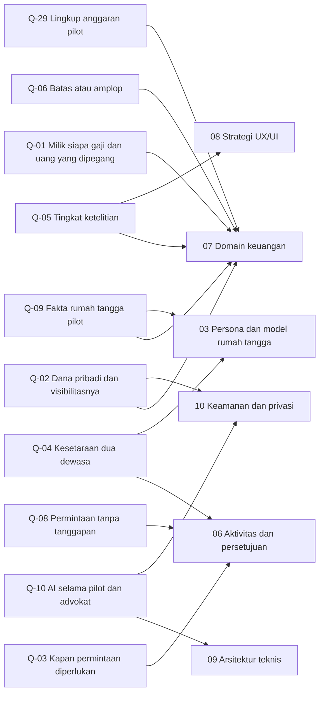

# 17 — Pertanyaan Terbuka dan Asumsi

| | |
|---|---|
| Pemilik dokumen | `product-analyst` |
| Tahap | S1 (Framing); diperbarui di setiap tahap |
| Status | Draf, direvisi setelah dua tinjauan `critic` (11 November 2026) |
| Tanggal | 11 November 2026 |
| Dibaca sebelum menulis | `CLAUDE.md`, `family-os-brief.md`, `ENGINEERING-STANDARDS.md` §5, [00-glossary.md](00-glossary.md) (revisi), [18-market-research.md](18-market-research.md) (revisi), [README.md](README.md) |

## 0. Cara membaca dokumen ini

Dokumen ini adalah catatan tetap atas segala hal yang **belum diputuskan** atau **dianggap benar tanpa bukti** di Family OS. Bagian 1 adalah bahan checkpoint S1: sepuluh pertanyaan untuk pemilik produk, disusul daftar pendek keputusan lain yang juga diperlukan sebelum S2. Bagian 2 sampai 6 adalah daftar lengkap di belakangnya.

**Batas dokumen ini pada S1.** Dokumen 06 dan 07 belum ada. Karena itu setiap butir tentang uang dan persetujuan di sini adalah *pertanyaan dengan default yang diusulkan*, bukan aturan. Aturan uang kelak kanonis di dokumen 07 dan aturan persetujuan di dokumen 06; dokumen ini hanya mencatat jawaban pemilik produk yang menjadi masukan keduanya. Default uang yang berasal dari `finance-domain` ditandai "usulan `finance-domain`, S1" dan dicatat apa adanya; dokumen ini tidak menetapkan aturan uang.

**Pengenal.** Selain skema brief §16, dokumen ini memakai lima pengenal yang tercantum di [README](README.md#skema-pengenal): `Q-NN` (pertanyaan terbuka), `A-NN` (asumsi), `R-NN` (riset yang perlu divalidasi), `K-NN` (pertentangan antar-sumber), `L-NN` (butir tinjauan hukum). Nomor stabil dan tidak dipakai ulang; karena itu urutan sepuluh pertanyaan di bagian 1 tidak sama dengan urutan nomornya.

**Label bukti** mengikuti [README](README.md#label-bukti). Semua "default" adalah **[Usulan]** kecuali disebut lain. Label atas temuan riset diambil dari dokumen 18 versi revisi dan tidak dinaikkan: temuan yang di sana **[Perlu validasi]** tetap **[Perlu validasi]** di sini, dan kesimpulan peneliti tetap **[Usulan]**.

**Status pertanyaan:** *Terbuka* (menunggu jawaban), *Diputuskan* (dijawab pemilik produk atau ditetapkan dokumen pemiliknya, dengan rujukan), *Ditunda* (sengaja dijawab di tahap yang disebut).

**Pagar yang diperiksa pada setiap default** (brief §1.1, §5D, §8): permintaan berjalan dua arah; tidak ada orang dewasa yang dapat memantau atau mengendalikan orang dewasa lain; aturan tidak berbeda antara suami dan istri; dan memegang uang tidak dengan sendirinya memberi hak atas uang itu (glosarium 7.2: enam dimensi custody tidak saling menurunkan). Default yang menyentuh pagar ini diberi tanda **Pagar** beserta catatannya.

---

## 1. Bahan checkpoint S1

### 1.1 Sepuluh pertanyaan paling menentukan

Urutan: sembilan yang pertama diperlukan dokumen 07 dan 06 di S2, disusun menurut seberapa banyak pekerjaan yang harus diulang bila tebakannya salah. Fakta rumah tangga pilot berada paling atas karena menjadi dasar pertanyaan sesudahnya. Pertanyaan kesepuluh baru diperlukan di S4, tetapi diajukan sekarang karena jawabannya dapat memerlukan waktu tunggu dan karena, tidak seperti yang tersirat di draf pertama, risikonya mulai pada pilot.

Setiap pertanyaan dapat dijawab dengan satu huruf pilihan; pertanyaan 10 memuat dua keputusan dan dijawab dengan dua tanda, misalnya "A, ii". "Lanjut pakai default" berarti semua default di tabel ini **dan** di 1.2 berlaku, **termasuk** hal yang diterima pemilik produk sebagai operator selama pilot, yang dinyatakan di catatan pertanyaan 10 tepat di bawah tabel.

| # | ID | Pertanyaan | Pilihan | Default **[Usulan]** |
|---|---|---|---|---|
| 1 | Q-09 | Bagaimana keadaan uang rumah tangga pilot hari ini? | Daftar isian tujuh baris (lihat rinciannya) | Tidak diisi: contoh terhitung memakai angka brief §1.1 dan angka ilustrasi berlabel **[Asumsi]** |
| 2 | Q-01 | Gaji dan uang yang dipegang pasangan itu milik siapa? | (a) uang rumah tangga, siapa pun pemegangnya; (b) yang sudah diserahkan menjadi milik pemegangnya; (c) gaji milik penerimanya | (a): *dana bersama*; *pinjam kembali* hanyalah *serah terima*, bukan utang |
| 3 | Q-02 | Adakah uang pribadi, dan bolehkah pasangan melihatnya? | (a) tidak ada; (b) ada dan terlihat pasangan; (c) ada dan tertutup kecuali dibagikan pemiliknya | (c): angka utama hanya dana bersama dan sama bagi keduanya; total yang memuat dana pribadi adalah baris kedua yang berbeda per pelihat |
| 4 | Q-04 | Apakah kalian berdua setara sepenuhnya di dalam aplikasi? | (a) setara penuh; (b) satu orang berperan lebih tinggi | (a): keduanya *pemilik rumah tangga*, izin dan wewenang identik |
| 5 | Q-03 | Pemakaian dana bersama seperti apa yang harus diajukan dulu sebagai permintaan? | (a) hanya yang tidak rutin dan di atas satu *ambang permintaan*, apa pun jenisnya; (b) semua yang di atas ambang; (c) hanya jalan-jalan | (a): satu ambang untuk kalian berdua, siapa pun yang memegang uangnya; berlaku atas belanja, pinjaman yang diberikan, kiriman keluarga di luar yang rutin, pembelian aset, dan penyisihan ke dana pribadi (Q-49 di 1.2) |
| 6 | Q-08 | Bila permintaan tidak ditanggapi, apa yang terjadi? | (a) tetap menunggu; (b) dianggap setuju setelah tenggat; (c) dianggap ditolak setelah tenggat | (a): diam tidak pernah berarti setuju atau menolak |
| 7 | Q-05 | Seberapa teliti catatan harus dijaga? | (a) saldo tiap tempat uang wajib benar, rincian sebisanya; (b) setiap rupiah terinci | (a): belanja yang terlupa diserap sebagai *selisih kas* |
| 8 | Q-06 | Uang belanja bulanan itu batas, atau uang yang benar-benar dipisahkan? | (a) batas saja; (b) dipisahkan (cara amplop) | (a) |
| 9 | Q-29 | Bolehkah anggaran pilot dipersempit menjadi bulanan per kategori saja? (perubahan cakupan atas brief §5C) | (a) boleh; (b) tidak, sebutkan periode lain yang dipakai | (a) |
| 10 | Q-10 | Pendamping AI selama pilot: (1) penyedia di mana, dan (2) kapan advokat ditanya? | **(1)** (A) hanya penyedia yang memproses di Indonesia, atau model yang di-host sendiri pada server di Indonesia; (B) penyedia luar negeri dengan persetujuan dan *de-identifikasi*, menerima ketidakpastian hukum; (C) pilot tanpa AI sampai pertanyaan hukum terjawab. **(2)** (i) sebelum S4; (ii) baru sebelum tahap publik; (iii) seperti (ii), tetapi DPIA ringkas dan perjanjian tertulis dengan prosesor dikerjakan selama fase pembangunan | **(A) dan (ii).** Server pilot di Indonesia menjadi bagian dari default yang sama (Q-35). Kelayakan (A) belum diteliti (R-05), dan cabang "penyedia asing berwilayah Indonesia" bergantung pada L-16, yang juga belum diteliti. Dengan (ii), pemilik produk sebagai operator menerima bahwa selama pilot DPIA formal dan perjanjian tertulis dengan prosesor (termasuk hosting) belum ada; sandarannya pengecualian rumah tangga yang belum terverifikasi, atau penerimaan sadar pemilik produk. Rinciannya di catatan di bawah tabel ini |

#### Catatan pertanyaan 10 — yang ikut diterima pemilik produk sebagai operator

Jawaban "lanjut pakai default" mencakup catatan ini. Dokumen ini tidak memberi nasihat hukum; catatan ini hanya menyebut apa yang **tidak** dikerjakan di bawah default, supaya hal itu diterima dengan sadar dan bukan tanpa diketahui.

UU PDP sudah berlaku dan masa penyesuaiannya sudah lewat (isi Pasal 74 **[Terverifikasi]** primer; tanggal akhirnya, 17 Oktober 2024, adalah hitungan peneliti; dokumen 18 §2.1). Kecuali pengecualian "kegiatan pribadi atau rumah tangga" mencakup pilot, pemilik produk sebagai operator layanan adalah *pengendali data* selama pilot, dan penyedia hosting sudah menjadi *prosesor data* sejak hari pertama pilot, dengan atau tanpa `AI`. Opsi A menghilangkan ketergantungan pada hal yang belum terverifikasi hanya untuk satu soal, yaitu transfer lintas batas data AI. Di bawah default, hal berikut **belum dipenuhi secara formal** selama pilot, sampai tinjauan hukum tahap publik:

| Yang belum ada selama pilot | Dasar dan label |
|---|---|
| Dokumen DPIA formal | Pemicunya (data pribadi spesifik dan teknologi baru, UU PDP Pasal 34) **[Terverifikasi]** primer; apakah kewajiban itu berlaku atas pilot **[Perlu validasi]** hukum |
| Perjanjian tertulis dengan setiap prosesor data: penyedia hosting, penyedia AI, dan layanan push notification, termasuk persetujuan tertulis atas sub-prosesor | UU PDP Pasal 51 **[Terverifikasi]** primer; isi minimumnya menurut PP 33/2026 Pasal 13–16 **[Perlu validasi]** (L-12) |
| Dasar hukum yang sudah diperiksa bagi layanan push notification Apple dan Google, yang diperkirakan memproses di luar Indonesia dan tidak dapat dihindari lewat desain | **[Asumsi]** (Q-35); isi notifikasi sudah dibatasi (glosarium bagian 5); L-16 |

Daftar ini memuat yang sudah dikenali tim (A-16, Q-35). Dua butir yang belum diteliti, L-11 dan L-14, dapat menambahnya.

**Sandarannya salah satu dari dua:** pengecualian rumah tangga memang mencakup pilot, yang belum terverifikasi (L-01); atau pemilik produk, sebagai operator, menerima keadaan itu secara sadar sampai tinjauan hukum tahap publik. Memilih (ii) berarti menyatakan yang kedua.

**Yang tetap dikerjakan lewat desain di bawah default:** data AI dan server pilot berada di Indonesia (selama layak, R-05 dan Q-35), persetujuan terekam, data yang dikirim ke penyedia AI seminimal mungkin dan tanpa nama, serta ekspor dan penghapusan data tersedia.

**Alternatifnya:** (i) advokat ditanya sebelum S4, dimulai dari L-01 dan L-12, sehingga diketahui kewajiban mana yang berlaku atas pilot; atau (iii) tanpa menunggu advokat, DPIA ringkas ditulis dan perjanjian tertulis dengan prosesor diperoleh selama fase pembangunan, sebelum data nyata dimasukkan. Biaya (i): waktu tunggu dan biaya advokat sebelum S4. Biaya (iii): pekerjaan dokumen tambahan bagi `security-privacy` dan pemilik produk; besarnya belum diperkirakan **[Asumsi]**.

#### Q-09 — Keadaan uang rumah tangga pilot hari ini

Pertanyaan ini meminta fakta, bukan keputusan. Angka boleh dibulatkan atau disamarkan; yang diperlukan adalah jenis, pemegang, dan urutan besarnya. Baris yang dikosongkan memakai asumsi di kolom kanan.

| # | Isian | Asumsi bila dikosongkan **[Asumsi]** |
|---|---|---|
| 1 | **Pemasukan.** Siapa yang menerima, berapa sumber, tanggal berapa | Satu gaji sekitar Rp10.000.000 per bulan (brief §1.1); penerimanya tidak disebut brief (A-18) |
| 2 | **Tempat uang.** Tiap rekening bank, dompet digital, dan uang tunai: jenisnya, atas nama atau dipegang siapa, dan apakah ada rekening atas nama berdua | Satu rekening bank atas nama penerima gaji; uang tunai di masing-masing; mungkin satu dompet digital; tidak ada *tempat uang bersama* |
| 3 | **Cicilan dan tagihan rutin.** Apa saja, kira-kira berapa per bulan, sisa berapa kali, siapa biasanya membayar | Ada cicilan dan tagihan listrik, wifi, langganan kerja (brief §1.1); jumlah dan pembayarnya tidak diketahui |
| 4 | **Utang dan piutang yang sedang berjalan.** Kepada atau dari siapa (termasuk saudara dan ayah), kira-kira berapa | Tidak ada yang tercatat; contoh di dokumen 07 memakai angka ilustrasi |
| 5 | **Aset yang ingin dicatat.** Jenisnya saja (kendaraan, emas, rumah, perangkat) | Satu kendaraan sebagai contoh |
| 6 | **Tabungan.** Ada atau tidak, untuk apa (misalnya dana darurat), disimpan di tempat uang yang mana, dan adakah targetnya | Tidak ada tabungan yang tercatat; contoh di dokumen 07 memakai satu dana darurat dengan angka ilustrasi |
| 7 | **Pencatatan saat ini.** Belanja dapur dicatat di mana (buku, WhatsApp, spreadsheet, aplikasi), oleh siapa | Dicatat salah satu pasangan di luar aplikasi; pencatat utama yang pelupa bisa siapa saja dari keduanya (A-19) |

| | |
|---|---|
| Masalah yang dilayani | Brief §1.1: "only grocery spending is recorded today", arus uang nyata; kriteria sukses nomor 1 dan 2. |
| Mengapa menentukan | Cicilan, utang dan pinjaman, tabungan sederhana, serta aset semuanya Tier 1 dan hanya pasangan pilot yang mengetahui keadaannya. Jawabannya menjadi dasar contoh terhitung dokumen 07, dasar Q-01 dan Q-02 (satu atau dua pemasukan; ada atau tidaknya tempat uang bersama), persona di dokumen 03, dan onboarding di dokumen 05 dan 08. |
| Default | Catatan belanja lama **tidak diimpor**. Pilot mulai dari *saldo awal* tiap tempat uang, serta kewajiban, piutang, dan aset yang sudah ada, pada hari pertama (glosarium 7.1). Angka yang sebenarnya dimasukkan saat onboarding, bukan ke dokumen perencanaan. |
| Alasan | Mengimpor catatan lama adalah pekerjaan sekali pakai yang tidak menjawab kriteria sukses mana pun; saldo awal yang benar sudah cukup. |
| Biaya default | Contoh terhitung dokumen 07 dapat tidak cocok dengan keadaan pilot dan perlu ditulis ulang setelah S2; dua pemasukan atau tempat uang bersama akan mengubah contoh Q-01 dan cara custody melaporkan isinya (Q-20). |

#### Q-01 — Gaji dan uang yang dipegang pasangan itu milik siapa?

| | |
|---|---|
| Pertanyaan | Begitu gaji masuk, dan setelah sebagian diserahkan kepada pasangan: (a) semuanya uang rumah tangga, siapa pun yang memegang; (b) gaji uang rumah tangga, tetapi bagian yang sudah diserahkan menjadi milik pemegangnya; atau (c) gaji milik penerimanya, dan hanya yang ia serahkan yang menjadi uang rumah tangga? |
| Masalah yang dilayani | Brief §1.1: "money is not visible", "custody is unclear", dan arus uang nyata rumah tangga pilot. |
| Mengapa menentukan | Menentukan *pemilik uang* pada setiap entri, apakah *pinjam kembali* melahirkan *utang antar-pasangan*, dan seluruh contoh terhitung dokumen 07. Salah tebak berarti model custody dan utang ditulis ulang. |
| Default **[Usulan]** (usulan `finance-domain`, S1) | Pilihan (a). Gaji menjadi *dana bersama* saat tiba. *Dana pribadi* hanya ada bila pasangan secara eksplisit menyisihkan uang sebagai milik pribadi. Uang yang dipegang salah satu pasangan setelah dibagi adalah dana bersama yang ia pegang (*titipan*). Pinjam kembali hanyalah *serah terima*, tanpa utang. |
| Alasan | Paling dekat dengan cara brief menggambarkan rumah tangga pilot ("the wife holds the rest") **[Asumsi]**, dan paling ringan dicatat: tidak ada utang antar-pasangan yang harus dipantau. |
| Jika jawabannya lain | (b) atau (c): setiap pinjam kembali menjadi utang antar-pasangan yang harus dilunasi dan dilaporkan; dokumen 07 memerlukan alur itu secara penuh di Tier 1, dan dokumen 10 harus mengatur visibilitasnya (Q-24). |
| **Pagar** | Dua syarat untuk aturan yang kelak ditulis dokumen 06 dan 07; dokumen ini tidak menetapkannya. (1) **Simetris:** aturan ditulis untuk "anggota dewasa", tidak pernah untuk "suami" atau "istri", dan berlaku atas gaji siapa pun dari keduanya; brief tidak menyebut siapa penerima gaji (A-18). (2) **Memegang tidak sama dengan berwenang:** *pemegang* dan *yang berwenang membelanjakan* adalah dua dimensi terpisah (brief §5C, glosarium 7.2). Siapa yang berwenang membelanjakan dana bersama adalah aturan rumah tangga yang berlaku sama bagi kedua pasangan, siapa pun yang sedang memegang uangnya. Usulan untuk dokumen 06: kedua pasangan berwenang membelanjakan dana bersama untuk keperluan rutin rumah tangga, dan keduanya tunduk pada ambang permintaan yang sama (Q-03). Pemegang tidak mendapat hak menyetujui atau menolak hanya karena memegang; aturan "pemegang menentukan belanja" adalah pola kendali keuangan yang diminta brief §8 untuk dicegah. |

#### Q-02 — Adakah uang pribadi, dan bolehkah pasangan melihatnya?

| | |
|---|---|
| Pertanyaan | Apakah masing-masing dari kalian punya uang pribadi yang terpisah dari uang rumah tangga? (a) tidak ada; (b) ada, dan pasangan boleh melihatnya; (c) ada, dan tertutup kecuali pemiliknya memilih membagikan. |
| Masalah yang dilayani | Brief §1.1 "how much do we have left, what assets do we own"; brief §8 "ability for an adult member to keep personal funds private". |
| Mengapa menentukan | Menentukan letak dana pribadi terhadap *garis kendali rumah tangga* (glosarium 7.1), isi *uang yang ada* dan *kekayaan bersih*, serta batas *data pribadi anggota*. Garis itu memisahkan *pemindahan* dari *pengeluaran* pada setiap entri; menggesernya setelah S2 mengubah hampir semua contoh dokumen 07 dan model akses dokumen 10. |
| Default **[Usulan]** (usulan `finance-domain`, S1; diputuskan dokumen 07 dan 10) | Pilihan (c), dengan empat konsekuensi yang perlu diketahui pemilik produk. (1) **Angka utama** untuk kriteria sukses nomor 1 ("sisa berapa dan siapa yang pegang") hanya memuat dana bersama, dan identik bagi kedua pasangan. Ini usulan **tampilan** untuk dokumen 07, 08, dan 10, bukan definisi: glosarium mendefinisikan *uang yang ada* sebagai jawaban "berapa uang kita" dan memasukkan dana pribadi bila dana itu di dalam garis kendali rumah tangga, sehingga angka utama yang diusulkan di sini bisa lebih kecil daripada *uang yang ada*. Hubungan keduanya perlu dikukuhkan `finance-domain` di S2 (K-13). (2) **Total yang memuat dana pribadi** adalah baris kedua yang berlabel dan **berbeda per pelihat**: dana bersama, ditambah dana pribadinya sendiri, ditambah dana pribadi pasangan yang dipilih pasangan untuk dibagikan. Jadi dua pasangan dapat melihat total rumah tangga yang berbeda, dan itu disengaja. (3) Invarian model berlaku pada data penuh; yang dilihat tiap anggota adalah tampilan tersaring. (4) Apakah dana pribadi berada di dalam atau di luar garis kendali rumah tangga **belum ditetapkan**; `finance-domain` menimbangnya ulang di dokumen 07. Visibilitas diatur per *tempat uang* dan bersifat opt-in. |
| Keberadaan tempat uang yang tidak dibagikan | Usulan untuk dokumen 10: pasangan **tidak** diberi penanda bahwa ada tempat uang pribadi yang tidak dibagikan; yang diketahui keduanya adalah bahwa kemampuan itu ada dan tersedia sama bagi keduanya (brief §8 "transparency about who can see what"). |
| Dua kebocoran yang tersisa | Dinyatakan terbuka, bukan disembunyikan: (1) pemindahan dari dana bersama ke dana pribadi adalah entri dana bersama, jadi terlihat oleh keduanya, sehingga keberadaan dan jumlah yang dipindahkan diketahui pasangan; (2) *hak ganti* atas *talangan* memperlihatkan bahwa ada pembayaran dari dana pribadi. Hanya dana pribadi yang tidak pernah bersentuhan dengan dana bersama yang benar-benar tertutup. Anggota diberi tahu hal ini sebelum mencatat (Q-24). |
| Alasan | Menjaga "berapa uang kita" tetap satu angka yang sama bagi keduanya, sekaligus memberi tiap orang dewasa ruang pribadi yang diwajibkan brief §8, tanpa angka yang dapat dibongkar lewat pengurangan (Q-23). |
| Jika jawabannya lain | (a): dana pribadi tetap ada di model sebagai fondasi tahap publik, tetapi tidak didokumentasikan penuh di Tier 1 dan tidak tampil di layar pilot. (b): baris kedua menjadi sama bagi keduanya; opt-in tetap ada di model untuk tahap publik. |
| **Pagar** | Opt-in berlaku sama bagi suami dan istri. Siapa yang boleh menyisihkan dana bersama menjadi dana pribadi, dan apakah pasangan perlu menyetujuinya, adalah pertanyaan tersendiri: Q-49 di 1.2. Tidak ada peran, termasuk pemilik rumah tangga dan admin, yang dapat membuka dana pribadi orang dewasa lain atau memaksa pembagiannya (glosarium bagian 3). |

#### Q-04 — Apakah suami dan istri setara sepenuhnya di dalam aplikasi?

| | |
|---|---|
| Pertanyaan | (a) Kalian berdua punya peran, izin, dan hak menyetujui yang persis sama; atau (b) satu orang berperan lebih tinggi (misalnya satu pemilik rumah tangga dan satu anggota)? |
| Masalah yang dilayani | Brief §4.3 (suami tidak otomatis punya izin lebih dari istri, dan sebaliknya); brief §8 abuse prevention. Tier 1 mewajibkan peran dan izin `FAM` yang dipakai `FIN` dan `REQ`. |
| Mengapa menentukan | Menentukan nilai *peran* yang dibutuhkan Tier 1, model akses di dokumen 06 dan 10, serta persona dan preset di dokumen 03. Glosarium bagian 3 sudah mengizinkan lebih dari satu pemilik rumah tangga dan menyerahkan bawaannya ke pertanyaan ini. |
| Default **[Usulan]** | Pilihan (a), sebagai *preset aturan* "dua dewasa setara": kedua pasangan berperan pemilik rumah tangga, dengan *izin* dan *wewenang persetujuan* yang identik. Tindakan yang mengenai orang dewasa lain (mengeluarkannya, mengubah izinnya, menurunkan wewenangnya) hanya berlaku dengan persetujuan orang itu sendiri. Masing-masing dapat *keluar dengan aman* tanpa persetujuan yang lain. Siapa yang lebih dulu membuat rumah tangga tidak memberi hak lebih. |
| Alasan | Satu-satunya susunan yang tidak dapat dipakai satu pasangan untuk mengendalikan yang lain, dan tidak perlu diatur apa pun di hari pertama. |
| Jika jawabannya lain | (b): dokumen 10 harus mendefinisikan apa yang tidak pernah boleh dilakukan pemilik rumah tangga atau admin terhadap orang dewasa lain, dan skenario "admin kehilangan akses" (brief §12 nomor 20) menjadi risiko Tier 1, bukan kasus tepi. |
| **Pagar** | Default ini adalah pagarnya. |

#### Q-03 — Pemakaian dana bersama seperti apa yang harus diajukan dulu sebagai permintaan?

| | |
|---|---|
| Pertanyaan | (a) Hanya pemakaian dana bersama yang tidak rutin (termasuk jalan-jalan) di atas satu *ambang permintaan*, apa pun jenisnya; (b) semua yang di atas ambang, rutin atau tidak; atau (c) hanya jalan-jalan, tanpa ambang? Nilai ambangnya diisi saat onboarding. |
| Masalah yang dilayani | Brief §1.1 "spending and outings are unplanned" dan arus uang nyata rumah tangga pilot (pinjaman kepada saudara dan ayah, pembelian besar); kriteria sukses nomor 4. |
| Mengapa menentukan | Ini inti preset aturan di dokumen 06 dan menentukan berapa banyak permintaan yang muncul setiap hari. Terlalu ketat membuat aplikasi menjadi alat kontrol dan beban; terlalu longgar membuat kriteria sukses nomor 4 tidak tercapai. |
| Default **[Usulan]** | Pilihan (a), sama untuk kedua pasangan dan **tidak bergantung pada siapa yang memegang uangnya**: (1) belanja rutin dalam batas *anggaran* kategorinya, dan pembayaran rutin yang sudah disepakati (tagihan berulang, cicilan, kiriman keluarga bulanan), tidak perlu permintaan; (2) pemakaian dana bersama yang tidak rutin dan di atas ambang permintaan diajukan lebih dulu sebagai permintaan, **apa pun jenis pencatatannya**: pengeluaran (termasuk jalan-jalan), *pinjaman yang diberikan*, *kiriman keluarga* di luar yang rutin disepakati, pembelian *aset*, dan penyisihan dana bersama menjadi *dana pribadi* (Q-49); (3) *serah terima* dan pemindahan lain antar-tempat uang yang sama-sama berisi dana bersama tidak pernah memerlukan permintaan dengan sendirinya, karena yang diajukan adalah pemakaian uangnya, bukan perpindahan pemegangnya. Ambangnya satu angka untuk seluruh rumah tangga. Brief tidak memberi angka ambang permintaan: Rp500.000 di brief §4.3 adalah contoh batas *wewenang persetujuan*, bukan ambang permintaan, dan hanya dipinjam di sini sebagai angka isian awal yang dapat diganti. Aplikasi **tidak pernah menghalangi** pencatatan pengeluaran (A-20). |
| Alasan | Family OS hanya mencatat uang, jadi aturan ini adalah kesepakatan yang dibuat terlihat, bukan kunci. Satu ambang bersama paling mudah diingat dan tidak dapat menjadi asimetris. Butir (1) menjaga usaha harian tetap rendah bagi pencatat yang pelupa. Butir (2) tidak dibatasi pada entri berjenis pengeluaran karena uang terbesar yang keluar tanpa dibicarakan justru bukan pengeluaran menurut glosarium: pinjaman kepada saudara adalah piutang, pembelian aset bukan pengeluaran menurut default Q-18, dan penyisihan ke dana pribadi dapat berupa *pemindahan*. |
| Yang diserahkan ke dokumen 06 dan 07 | Butir (2) adalah usulan untuk dokumen 06, bukan aturan. Yang masih harus diputuskan di sana: jenis permintaan yang dipakai untuk pemakaian yang bukan pengeluaran (*permintaan anggaran* atau *usulan keputusan*); cara otorisasinya diselesaikan, sebab *realisasi* di glosarium hanya menjumlahkan entri pengeluaran; dan rumusan *ambang permintaan* di glosarium, yang saat ini hanya menyebut "pengeluaran tidak rutin" (K-12). |
| Jika jawabannya lain | (b): jumlah permintaan harian naik; dokumen 06 perlu jalur persetujuan satu ketukan dan dokumen 08 perlu layar permintaan sebagai layar utama. (c): pembelian besar yang bukan jalan-jalan tetap datang sebagai kejutan, dan kriteria sukses nomor 4 hanya tercapai separuh. |
| **Pagar** | Ambang per orang, atau aturan yang mewajibkan hanya satu pihak meminta, ditolak sebagai default. Bila pemilik produk menginginkannya, hal itu dicatat sebagai keputusan pemilik dan dinilai `security-privacy`. Bila uang di rumah tangga pilot lebih banyak dipegang satu orang, pihak lain akan lebih sering meminta serah terima; itu akibat letak uangnya, bukan aturan yang berbeda, dan serah terima tidak memberi pemegang hak menolak pengeluaran (Q-01). |

#### Q-08 — Bila permintaan tidak ditanggapi, apa yang terjadi?

| | |
|---|---|
| Pertanyaan | Kalau salah satu mengajukan permintaan dan pasangannya diam saja: (a) tetap menunggu; (b) dianggap setuju setelah tenggat; atau (c) dianggap ditolak setelah tenggat? |
| Masalah yang dilayani | Brief §1.1 "coordinating it costs constant asking"; `NTF` Tier 1 untuk permintaan dan persetujuan. |
| Mengapa menentukan | Menentukan state machine permintaan di dokumen 06 (ada tidaknya transisi otomatis, *kedaluwarsa*, jalur darurat) dan aturan pengingat di `NTF`. |
| Default **[Usulan]** | Pilihan (a). Diam tidak pernah berarti setuju dan tidak pernah berarti menolak. Permintaan tetap menunggu; pengingat dikirim secukupnya dengan menghormati *jam tenang*, lalu berhenti. Permintaan yang bertanggal (misalnya jalan-jalan) berakhir sebagai kedaluwarsa setelah tanggalnya lewat, bukan sebagai *penolakan*. Pemohon dapat membatalkan kapan saja. Untuk keperluan mendesak (misalnya atap bocor), pengeluaran dicatat langsung dan pasangan diberi tahu; tidak ada persetujuan susulan yang wajib. |
| Alasan | Persetujuan otomatis menjadikan diam sebagai celah; penolakan otomatis menghukum pemohon karena pasangannya sibuk. Aplikasi tidak dapat menghalangi belanja di dunia nyata (A-20), jadi jalur darurat harus jujur, bukan pura-pura dilarang. |
| Jika jawabannya lain | (b): memerlukan aturan tenggat, pemberitahuan sebelum tenggat, dan penilaian `security-privacy` atas penyalahgunaannya (mengajukan saat pasangan tidak mungkin menjawab). (c): pemohon harus mengajukan ulang; jumlah permintaan dan pengingat naik. |
| **Pagar** | Berlaku sama untuk kedua arah. Jumlah dan nada pengingat tidak boleh menjadi alat menekan pasangan: pemohon tidak dapat memicu pengingat tambahan tanpa batas. |

#### Q-05 — Seberapa teliti catatan harus dijaga?

| | |
|---|---|
| Pertanyaan | (a) Cukup jumlah uang di tiap tempat selalu benar, dan belanja yang lupa dicatat dikumpulkan sebagai satu selisih; atau (b) setiap rupiah harus tercatat per barang? |
| Masalah yang dilayani | Brief §1.1 "recording is a burden" (pencatat utama pelupa; entri terlambat harus ditoleransi); kriteria sukses nomor 1 dan 2. |
| Mengapa menentukan | Menentukan usaha berulang seluruh produk: apakah dokumen 07 memerlukan penutupan periode (mengunci catatan satu bulan sehingga tidak dapat ditambah lagi), bagaimana laporan bulan lalu berubah, dan apakah *rekonsiliasi kas* menjadi alur utama (dokumen 08) atau sekadar alat koreksi. |
| Default **[Usulan]** | Pilihan (a). Yang wajib benar adalah *saldo tercatat* tiap *tempat uang*, karena itulah jawaban "sisa berapa dan siapa yang pegang". Rincian per barang adalah usaha terbaik. Belanja yang terlupa diserap oleh rekonsiliasi kas: pemegang menghitung uangnya dan selisihnya dicatat sebagai *selisih kas*. *Entri terlambat* boleh kapan saja dengan *tanggal kejadian* aslinya; *tanggal pencatatan* tetap tersimpan. Pilot tidak mengenal penutupan periode: laporan bulan lalu ikut berubah dan menandai bahwa ia berubah. |
| Perlakuan selisih kas (usulan `finance-domain`, S1; diputuskan dokumen 07) | Selisih kas tampil di ringkasan bulanan sebagai baris tersendiri. Selisih negatif (ada uang keluar yang tidak tercatat) ikut dihitung dalam total uang yang keluar pada bulan itu. Selisih positif (ada uang masuk yang tidak tercatat, atau pengeluaran yang tercatat terlalu besar) tidak dihitung sebagai uang yang keluar; apakah ia mengurangi total itu atau tampil di sisi uang yang masuk diputuskan dokumen 07. Anggaran suatu kategori menampilkan pemberitahuan bila pada periodenya ada selisih yang belum dirinci di tempat uang yang biasa dipakai untuk kategori itu. Selisih dapat dikategorikan ulang: saat rekonsiliasi pemegang boleh memilih kategori dengan satu ketukan, atau belakangan suatu *entri penyesuaian* memindahkan sebagian atau seluruhnya ke satu kategori; sejak itu jumlah tersebut dihitung terhadap anggaran kategori itu pada tanggal kejadiannya. Usulan ini menutup kelemahan versi sebelumnya, yang menaruh selisih kas di luar anggaran sehingga belanja dapur yang terlupa membuat anggaran dapur tampak lebih sehat daripada kenyataan. |
| Alasan | Kriteria sukses nomor 1 menuntut saldo yang benar, bukan struk yang lengkap. Menuntut ketelitian per barang dari pencatat yang pelupa berisiko membuat aplikasi ditinggalkan: pada studi Epstein dkk. (2016), alasan terbanyak orang berhenti melacak keuangan adalah beban mengumpulkan dan menggabungkan data (**[Terverifikasi]** primer untuk isi studi, dokumen 18 §1.3.5; penerapannya pada pasangan Indonesia **[Asumsi]**). |
| Jika jawabannya lain | (b): usaha harian naik dan kecepatan entri harus menjadi fokus utama S3 dan S4 (termasuk menimbang entri berbantuan AI, Q-31); bila periode harus ditutup, dokumen 07 memerlukan aturan entri terlambat ke periode tertutup. |

#### Q-06 — Uang belanja bulanan itu batas, atau uang yang benar-benar dipisahkan?

| | |
|---|---|
| Pertanyaan | Anggaran dapur dan sejenisnya: (a) cukup berupa angka batas per bulan; atau (b) uangnya memang dipisahkan (cara amplop)? |
| Masalah yang dilayani | Brief §1.1 "grocery budgets are regularly exceeded", "is the monthly money still there". |
| Mengapa menentukan | Menentukan hubungan *anggaran* dengan *alokasi* di dokumen 07 dan berapa banyak yang harus dikerjakan keluarga setiap kali gaji tiba ("income allocation" ada di Tier 1). |
| Default **[Usulan]** (usulan `finance-domain`, S1) | Pilihan (a). Untuk pilot, anggaran cukup sebagai batas; alokasi uang ke *tujuan* bersifat pilihan. *Periode anggaran* bulanan mulai pada tanggal yang dapat diatur, bawaannya tanggal gajian (isian Q-09 baris 1). |
| Alasan | Cara amplop menuntut pembagian ulang setiap ada pergeseran; itu beban rutin bagi pencatat yang pelupa. Batas saja sudah cukup untuk menjawab "anggaran dapur tinggal berapa". |
| Jika jawabannya lain | (b): dokumen 07 mengikat anggaran pada alokasi, pertanyaan apakah jumlah alokasi dibatasi uang yang ada (Q-45) menjadi aturan yang dirasakan setiap hari, dan pemindahan antar-amplop menjadi alur Tier 1. |

#### Q-29 — Bolehkah anggaran pilot dipersempit menjadi bulanan per kategori saja?

| | |
|---|---|
| Pertanyaan | Brief §5C mendaftar periode anggaran harian, mingguan, bulanan, dan khusus, serta anggaran per anggota, per rumah tangga, dan per acara, dengan aturan rollover. (a) Setujukah pilot hanya memakai anggaran **bulanan per kategori**; atau (b) ada periode lain yang benar-benar kalian pakai (misalnya uang belanja mingguan)? |
| Mengapa diajukan sekarang | Ini usulan perubahan cakupan. Brief §1.1: perubahan tingkatan baru berlaku setelah disetujui pemilik produk di sebuah checkpoint. Dokumen 07 ditulis **sebelum** checkpoint S2, jadi tanpa jawaban di checkpoint S1 ia akan ditulis di atas cakupan yang belum disetujui. |
| Masalah yang dilayani | Brief §1.1 "grocery budgets are regularly exceeded"; brief §3: setiap fitur harus membenarkan usaha berulang yang dimintanya. |
| Default **[Usulan]** | Pilihan (a). Tier 1 memuat anggaran bulanan per kategori, ditambah *otorisasi* per permintaan untuk acara dan jalan-jalan. Periode harian, mingguan, dan khusus menjadi Tier 3. Anggaran per anggota, per acara, dan aturan rollover tidak disebut di baris Tier 1 brief §1.1 ("budgets per category and period"), sehingga dibaca sudah Tier 3 **[Asumsi]**; pemilik produk diminta mengukuhkan bacaan ini. Model tetap menyimpan periode sebagai rentang tanggal agar periode lain dapat ditambahkan tanpa mengubah struktur. |
| Alasan | Rumah tangga pilot digaji bulanan (brief §1.1). Tiap periode tambahan menambah pengaturan dan contoh terhitung tanpa menjawab masalah di §1.1; kebutuhan "anggaran untuk satu acara" sudah dijawab oleh permintaan jalan-jalan. |
| Biaya default | Bila ternyata uang belanja diberikan mingguan, batas bulanan kurang membantu di tengah bulan; penambahannya sesudah S2 berarti menambah contoh terhitung di dokumen 07 dan kebutuhan di dokumen 05. |
| **Pagar** | Anggaran per anggota mudah berubah menjadi jatah yang ditetapkan satu orang dewasa bagi orang dewasa lain. Bila kelak diangkat dari Tier 3, ia dinilai `security-privacy` lebih dulu. |

#### Q-10 — Pendamping AI selama pilot: penyedia di mana, dan kapan advokat ditanya?

Dokumen ini tidak memberi nasihat hukum. Yang berikut adalah keadaan bukti, pilihan yang tersedia, dan pertanyaan yang harus dijawab seorang advokat.

**Yang diketahui, beserta labelnya** (dokumen 18 §2.1 dan §2.3, versi revisi):

| Hal | Label |
|---|---|
| UU PDP Pasal 56: transfer lintas batas diizinkan dalam tiga jenjang; persetujuan subjek data adalah jenjang ketiga; UU sendiri tidak membatasi jalur persetujuan itu | **[Terverifikasi]** primer (salinan resmi UU) |
| PP 33/2026: keberadaannya, tanggal berlakunya (dilaporkan 16 Januari 2027, hasil hitungan "enam bulan sejak diundangkan"), dan Pasal 173 ayat (2), yang dilaporkan hanya mengizinkan transfer berdasarkan persetujuan bila transfernya tidak berulang, jumlah subjeknya terbatas, tidak mengesampingkan hak subjek, risikonya sudah dinilai, serta Lembaga PDP dan subjek sudah diberi tahu (tampaknya kumulatif) | **[Perlu validasi]**: dilaporkan konsisten oleh sumber sekunder; teks resmi tidak dibaca |
| Pengecualian "kegiatan pribadi atau rumah tangga": bunyi UU PDP Pasal 2 ayat (2) | **[Terverifikasi]** primer |
| Rincian pengecualian itu di PP Pasal 3 (bukan kegiatan profesional atau komersial, tidak diperuntukkan bagi publik) | **[Perlu validasi]**, sekunder |
| Apakah pengecualian itu mencakup pilot dua orang yang servernya dijalankan pemilik produk sendiri dan memakai penyedia AI pihak ketiga | **[Perlu validasi]** hukum |
| Apakah *status suasana hati* termasuk data kesehatan; penjelasan PP Pasal 6 dilaporkan memuat "kesehatan mental" | **[Perlu validasi]** |
| DPIA dipicu pemrosesan *data pribadi spesifik* dan pemakaian teknologi baru (UU Pasal 34 ayat (2) huruf b dan f); sub-prosesor perlu persetujuan tertulis pengendali (Pasal 51); batang tubuh UU PDP (Pasal 1–76) tidak memuat keringanan umum bagi pengendali skala kecil | **[Terverifikasi]** primer untuk batang tubuh UU PDP. Ada tidaknya keringanan di PP 33/2026 belum diperiksa pada teks resminya: **[Perlu validasi]** (dokumen 18 §2.1) |
| Status Lembaga PDP (dilaporkan belum terbentuk; ada satu laporan yang berlawanan) | **[Perlu validasi]**, media saja |
| Kelayakan penyedia AI yang memproses di Indonesia, atau model yang di-host sendiri pada satu VPS, dari sisi mutu bahasa Indonesia dan biaya | Belum diteliti (R-05, S4) |

**Yang berubah dari draf pertama.** Draf pertama menempatkan risiko ini di tahap publik. Itu keliru. Pembangunan belum dimulai, sehingga seluruh masa pilot akan berjalan sesudah tanggal berlaku yang dilaporkan. **Bila** laporan tentang PP 33/2026 benar, batas jalur persetujuan berlaku **selama pilot**, bukan baru di tahap publik. Pilot hanya lepas darinya bila pengecualian kegiatan rumah tangga memang mencakupnya, dan hal itu belum terverifikasi. Menurut bacaan tim **[Asumsi]**, pola pemakaian pendamping AI (sapaan harian, pengingat, saran kata dukungan) kemungkinan besar tergolong transfer "berulang"; apakah pemanggilan API harian memang demikian menurut teks resmi adalah pertanyaan untuk advokat (L-05).

**Pilihan:**

| Opsi | Isi | Bergantung pada | Biaya |
|---|---|---|---|
| **A** | `AI` versi ringan tetap di pilot, tetapi hanya lewat penyedia yang memproses di Indonesia, atau model yang di-host sendiri pada server yang berada di Indonesia; data AI tidak dikirim ke luar negeri | Tiga hal yang belum diteliti. (1) Kelayakan kedua cabangnya (R-05): mutu bahasa Indonesia dan biaya penyedia, serta apakah model yang di-host sendiri dapat berjalan pada satu VPS. (2) Untuk cabang penyedia asing berwilayah Indonesia: apakah itu tetap terhitung transfer lintas batas (L-16). (3) Untuk cabang model yang di-host sendiri: lokasi server (Q-35); model sendiri pada server di luar Indonesia tidak memenuhi opsi ini | Pilihan penyedia di S4 menyempit; mutu bahasa Indonesia bisa lebih rendah atau biaya dan beban operasi lebih tinggi **[Asumsi]**, belum diketahui sampai R-05 selesai; bila tidak layak, jatuh ke B atau C |
| **B** | `AI` versi ringan di pilot lewat penyedia di luar Indonesia, bersandar pada persetujuan kedua pasangan (brief §5O keputusan 3) ditambah de-identifikasi di server | Dua hal yang belum terverifikasi: pengecualian rumah tangga berlaku bagi pilot, **atau** Pasal 173 tidak berbunyi sebagaimana dilaporkan; ditambah apakah data hasil de-identifikasi masih *data pribadi* (L-06) | Pemilik produk, sebagai operator, menerima ketidakpastian hukum itu secara sadar selama pilot; arsitektur AI mungkin harus diganti untuk tahap publik, berlawanan dengan brief §1 |
| **C** | Pilot berjalan tanpa `AI` sampai pertanyaan hukum terjawab | Tidak ada | `AI` versi ringan (Tier 2, brief §5O keputusan 1) tertunda; ini perubahan tingkatan yang memerlukan persetujuan pemilik produk; kriteria sukses nomor 5 kehilangan salah satu alat bantunya |

**Kapan advokat ditanya** (keputusan kedua pada pertanyaan ini): (i) sebelum S4 memutuskan penyedia AI; (ii) baru sebelum tahap publik; atau (iii) seperti (ii), tetapi DPIA ringkas dan perjanjian tertulis dengan prosesor dikerjakan selama fase pembangunan. Apa yang diterima pemilik produk dengan (ii) dinyatakan di catatan pertanyaan 10 di bawah tabel 1.1.

| | |
|---|---|
| Default **[Usulan]** | **Opsi A dan (ii).** Keputusan pemilik nomor 3 dan 4 di brief §5O tetap berlaku (A-08, A-09) dan de-identifikasi di server tetap dikerjakan. Di S4, "data AI tidak keluar dari Indonesia" menjadi **syarat** bagi penyedia AI pilot, bukan sekadar bobot. Server pilot di Indonesia menjadi syarat yang sama (Q-35): syarat atas data AI tidak banyak berarti bila server yang menyimpan seluruh data suasana hati dan keuangan boleh berada di luar negeri. `researcher` membaca teks resmi PP 33/2026 sebelum S4 (R-01); bila teks itu tetap tidak dapat dibuka, pemilik produk diminta mengunduhnya. **Advokat tidak ditanya sebelum S4** selama opsi A layak; tinjauan hukum menyeluruh tetap prasyarat tahap publik (A-16). Akibatnya, kewajiban di catatan pertanyaan 10 belum dipenuhi secara formal selama pilot, dan itu diterima pemilik produk sebagai operator. Bila R-05 menunjukkan opsi A tidak layak, atau S4 menunjukkan server di Indonesia tidak layak, pilihan antara B dan C **kembali ke pemilik produk di checkpoint S4**; opsi B baru boleh dipilih setelah L-01, L-05, dan L-06 dijawab advokat, atau setelah pemilik produk menyatakan secara eksplisit di checkpoint itu bahwa ia menerima ketidakpastiannya. |
| Alasan | (1) Di antara opsi yang mempertahankan `AI` di pilot, hanya opsi ini yang, **untuk soal transfer lintas batas data AI**, tidak bergantung pada dua hal yang belum terverifikasi (pengecualian rumah tangga dan bunyi Pasal 173); untuk soal itu A-13 berlaku. Opsi ini tidak menghilangkan ketergantungan lain pada pengecualian rumah tangga (catatan pertanyaan 10, A-16), dan kelayakannya sendiri belum diteliti. (2) Brief §1 meminta arsitektur yang tidak perlu ditulis ulang untuk tahap publik; penyedia yang lolos syarat ini di pilot tidak perlu diganti. (3) Brief §9.5 memang sudah meminta perbandingan penyedia hosted lawan model yang di-host sendiri. (4) Biaya advokat tidak dikeluarkan sebelum diketahui apakah diperlukan. |
| Biaya default | Lihat baris opsi A. Selain itu: bila opsi A tidak layak dan pemilik produk memilih B, jawaban advokat harus ditunggu sebelum checkpoint S4 dapat ditutup. |
| Jika jawabannya lain | B sekarang: L-01, L-02, L-05, L-06, L-12, dan L-16 menjadi prasyarat checkpoint S4 (advokat ditanya sebelum S4), atau pemilik produk menyatakan menerima ketidakpastiannya. C sekarang: dicatat sebagai perubahan tingkatan; S4 tetap membandingkan penyedia untuk tahap publik. |
| Yang harus dijawab advokat | (1) Apakah pilot dua orang yang dijalankan pemilik produk sendiri, dengan penyedia AI pihak ketiga, masuk pengecualian kegiatan rumah tangga (L-01). (2) Bunyi resmi PP 33/2026 Pasal 173: apakah syaratnya kumulatif, apakah pemanggilan API harian tergolong "berulang", dan apakah dua subjek tergolong "jumlah terbatas" (L-05). (3) Apakah teks hasil de-identifikasi masih data pribadi ketika dikirim ke prosesor (L-06). (4) Apakah pemrosesan di wilayah Indonesia oleh penyedia asing tetap terhitung transfer lintas batas (L-16). (5) Apakah status suasana hati termasuk data kesehatan (L-02). (6) Isi minimum perjanjian dengan penyedia AI sebagai *prosesor data* (L-12). |

### 1.2 Juga diperlukan sebelum S2

Empat keputusan ini tidak masuk sepuluh besar karena salah tebaknya hanya mengubah contoh terhitung atau bawaan, bukan struktur model. "Lanjut pakai default" mencakup keempatnya.

| ID | Pertanyaan | Default **[Usulan]** | Alasan | Jika jawabannya lain | Pagar |
|---|---|---|---|---|---|
| Q-07 | Rp3.000.000 per bulan untuk ibu suami: pemberian yang selesai saat diserahkan, atau uang rumah tangga yang beliau pegang? Uang untuk saudara atau ayah: pinjaman atau bantuan? | (usulan `finance-domain`, S1) Kiriman ke ibu adalah *kiriman keluarga*: pengeluaran saat diserahkan, ibu sebagai *penerima manfaat*, tidak dilacak sesudahnya. Jalur *titipan* tetap tersedia di model (contoh brief §5C). Untuk saudara dan ayah, pencatat memilih saat entri: *pinjaman yang diberikan* bila pengembalian dibicarakan, kiriman keluarga bila tidak. Pinjaman yang diikhlaskan dicatat sebagai *penghapusan piutang*, tidak pernah dihapus diam-diam | Tidak ada usaha lanjutan setelah uang diserahkan, dan tidak menuntut ibu melaporkan pemakaiannya. Brief §1.1 menulis uang itu "goes to" ibu **[Asumsi]** | Bila uang di ibu adalah titipan, seseorang harus mencatat pemakaiannya atau saldonya tidak pernah benar; "berapa uang kita" berubah sebesar Rp3.000.000 setiap bulan; Q-25 perlu ditimbang ulang | Pilihan "pinjaman atau bantuan" atas dana bersama dibuat satu orang saat entri. Pasangan diberi tahu dan dapat mengajukan *keberatan* tanpa batas waktu. Pinjaman atau kiriman tidak rutin di atas ambang permintaan diajukan lebih dulu (default Q-03). Aturannya sama untuk keluarga pihak suami maupun istri; brief hanya menyebut keluarga suami karena itulah keadaan pilot |
| Q-49 | Siapa yang boleh menyisihkan dana bersama menjadi dana pribadi (misalnya uang saku), dan perlukah pasangan menyetujuinya? (a) Penyisihan rutin yang jumlahnya disepakati berdua tidak perlu permintaan, dan di luar itu mengikuti ambang permintaan; (b) setiap penyisihan memerlukan persetujuan pasangan; (c) bebas, cukup tercatat. Hanya berlaku bila Q-02 tidak dijawab (a) | (a), sebagai usulan untuk dokumen 06. Masing-masing pasangan berhak menyisihkan dengan aturan yang sama. Penyisihan rutin disepakati satu kali lewat permintaan yang disetujui pasangan dan berlaku sampai diubah; penyisihan lain di atas ambang permintaan diajukan lebih dulu (Q-03); yang di bawah ambang dicatat langsung dan tetap terlihat oleh keduanya (Q-02, kebocoran 1). Jenis entrinya (pemindahan atau pengeluaran) mengikuti letak dana pribadi dan diputuskan dokumen 07 | Di bawah default Q-01 (a) dan Q-02 (c) seluruh gaji adalah dana bersama, sehingga tanpa kesepakatan ini satu pasangan dapat menjadikannya dana pribadi secara sepihak lalu menutupnya dari pasangannya. Brief §8 (pagar terhadap kendali keuangan); kriteria sukses nomor 4. Usaha berulangnya nol setelah kesepakatan rutin dibuat | (b): setiap uang saku menunggu tanggapan; usaha berulang naik dan persetujuan itu dapat dipakai untuk menahan uang pasangan. (c): pagar brief §8 hanya bertumpu pada keberatan sesudah kejadian | Simetris: hak menyisihkan dan kewajiban mengajukan sama bagi keduanya, siapa pun penerima gaji atau pemegang uangnya. Pencatatan tetap tidak dihalangi (A-20); penyisihan di atas ambang yang dicatat tanpa permintaan tetap terlihat oleh keduanya, dan penandaannya diputuskan dokumen 06. Ditinjau `security-privacy` |
| Q-25 | Apakah ibu suami (atau keluarga besar lain) mendapat login selama pilot? | Tidak. Tercatat sebagai *pihak luar*; login orang tua mengikuti brief §1 ("later") | Tier 1 hanya dua akun dewasa; default Q-07 tidak menuntut laporan dari ibu | Login ketiga menarik peran, izin, dan visibilitas untuk anggota keluarga besar ke dalam Tier 1 | Data tentang pihak luar diminimalkan (Q-28) |
| Q-26 | Bolehkah satu pasangan mengoreksi entri dana bersama yang dibuat pasangannya, dan bagaimana bila kalian tidak sepakat atas suatu entri? | Keduanya boleh menambahkan *koreksi*; entri asli tetap; pihak lain diberi tahu; salah satu dapat mengajukan *keberatan* atas entri, yang terlihat oleh keduanya sampai disepakati. Rinciannya diputuskan dokumen 06 dan 07 | Brief §8 "members disagree about a transaction"; brief §7: koreksi lewat entri pembalik atau penyesuaian | Bila hanya pembuat entri yang boleh mengoreksi, entri yang salah menunggu pembuatnya dan saldo tertinggal dari kenyataan | Simetris; tidak ada yang dapat mengubah catatan diam-diam; keberatan tidak dapat dihapus pihak lain |

### 1.3 Tindakan yang memerlukan pemilik produk (bukan keputusan)

| Tindakan | Diperlukan paling lambat | Mengapa memerlukan pemilik produk |
|---|---|---|
| Uji langsung dua atau tiga aplikasi pesaing (R-02) | S3, sebelum dokumen 04 dan 11 | Memerlukan pemasangan aplikasi pada perangkat; `researcher` tidak dapat melakukannya dengan alat yang ada (dokumen 18 §6.4) |
| Mengunduh teks resmi PP 33/2026 bila `researcher` tetap gagal membukanya (R-01) | S4 | Tiga situs resmi gagal dibuka pada 11 November 2026 (dokumen 18 §0.3) |

---

## 2. Daftar lengkap pertanyaan terbuka

"Tahap" adalah tahap yang memerlukan jawabannya. Pertanyaan yang dirinci di bagian 1 hanya diindeks di 2.1.

### 2.1 Indeks pertanyaan untuk pemilik produk di checkpoint S1

| ID | Area | Dirinci di | Pemutus | Tahap | Status |
|---|---|---|---|---|---|
| Q-09 | `FIN`, `FAM` | 1.1 nomor 1 | Pemilik produk | S2 | Terbuka |
| Q-01 | `FIN` | 1.1 nomor 2 | Pemilik produk | S2 | Terbuka |
| Q-02 | `FIN`, privasi | 1.1 nomor 3 | Pemilik produk; rincian oleh dokumen 07 dan 10 | S2, S4 | Terbuka |
| Q-04 | `FAM` | 1.1 nomor 4 | Pemilik produk | S2 | Terbuka |
| Q-03 | `REQ` | 1.1 nomor 5 | Pemilik produk | S2 | Terbuka |
| Q-08 | `REQ`, `NTF` | 1.1 nomor 6 | Pemilik produk | S2 | Terbuka |
| Q-05 | `FIN` | 1.1 nomor 7 | Pemilik produk; perlakuan selisih kas oleh dokumen 07 | S2 | Terbuka |
| Q-06 | `FIN` | 1.1 nomor 8 | Pemilik produk | S2 | Terbuka |
| Q-29 | `FIN`, cakupan | 1.1 nomor 9 | Pemilik produk | S2 | Terbuka |
| Q-10 | `AI`, hukum | 1.1 nomor 10 | Pemilik produk | S4 (diajukan di S1) | Terbuka |
| Q-07 | `FIN` | 1.2 | Pemilik produk | S2 | Terbuka |
| Q-49 | `FIN`, `REQ` | 1.2 | Pemilik produk; rincian oleh `architect` dan `finance-domain`; ditinjau `security-privacy` | S2 | Terbuka |
| Q-25 | `FAM` | 1.2 | Pemilik produk | S2 | Terbuka |
| Q-26 | `FIN`, `REQ` | 1.2 | Pemilik produk dapat mengubah default; rincian oleh `architect` dan `finance-domain` | S2 | Terbuka |

### 2.2 Keuangan (masukan dokumen 07)

Default di tabel ini adalah usulan `finance-domain` pada S1 kecuali disebut lain. Dokumen 07 yang memutuskan; pemilik produk meninjaunya di checkpoint S2. Dokumen ini tidak menetapkan aturan uang.

| ID | Pertanyaan | Default diusulkan | Alasan | Pemutus | Tahap | Status |
|---|---|---|---|---|---|---|
| Q-11 | Model ledger: double-entry, disederhanakan, atau daftar transaksi | Belum ada default; rekomendasi S2 | Brief §5C meminta perbandingan, bukan tebakan | `finance-domain`, ADR oleh `architect` | S2 | Ditunda |
| Q-12 | Apakah persetujuan membuat *reservasi* | Tidak, selama pemohon membelanjakan uang yang sudah ia pegang. Reservasi hanya bila otorisasi menunjuk tempat uang atau alokasi yang dipegang orang lain | Brief §7: persetujuan tidak mengurangi uang kecuali ada aturan eksplisit | `finance-domain` bersama `architect` | S2 | Terbuka |
| Q-13 | Sisa dan kelebihan saat *penyelesaian*, per situasi custody | Sisa tetap di tempatnya dan dilepas ke alokasinya; bila uang diserahkan untuk permintaan itu, sisa dikembalikan lewat serah terima atau disimpan lewat kesepakatan yang tercatat. Kelebihan memerlukan persetujuan lanjutan. Bila kelebihan itu dibayar dari dana pribadi pemohon, ia *talangan*; bila dibayar dari dana bersama (satu-satunya kemungkinan bila tidak ada dana pribadi, misalnya di bawah default Q-01 (a)), ia bukan talangan, dan perlakuannya ditetapkan dokumen 07 | Brief §5D langkah 7 meminta arti "benar" per situasi | `finance-domain` | S2 | Terbuka |
| Q-14 | Apakah jumlah *terikat* mengurangi *sisa anggaran* | Ya, ditampilkan sebagai "terikat", terpisah dari yang sudah terpakai | Mencegah dua permintaan menghabiskan anggaran yang sama | `finance-domain` | S2 | Terbuka |
| Q-15 | *Pengembalian dana*: pengurang pengeluaran atau pemasukan | Pengurang pengeluaran yang ditautkan dan pemakaian anggarannya; pemasukan hanya bila pengeluaran aslinya tidak ada di aplikasi | Lihat K-02 | `finance-domain` | S2 | Terbuka |
| Q-16 | *Cicilan*: pengurang kewajiban, pengeluaran, atau pokok dan bunga | Pembayaran cicilan adalah *pelunasan* yang dihitung terhadap anggaran. Kewajiban cicilan dicatat sebesar jumlah seluruh pembayaran yang tersisa, tanpa pemisahan pokok dan bunga. Pemakaian anggaran menghitung entri yang ditetapkan ke anggaran itu, bukan hanya entri berjenis pengeluaran. Satu entri, satu jumlah: tampil satu kali di tampilan anggaran dan *arus kas*, dan satu kali sebagai pengurang di tampilan kewajiban. **Akibat yang belum terjawab, untuk dokumen 07:** dengan rumusan ini bunga cicilan tidak pernah tercatat sebagai pengeluaran. Pada pembelian baru secara cicilan, aset bertambah sebesar harga barang sedangkan kewajiban bertambah sebesar harga ditambah bunga, sehingga kekayaan bersih turun sebesar bunga saat itu juga tanpa satu pun entri pengeluaran; pembayarannya kemudian adalah pelunasan, yang menurut glosarium bukan pengeluaran. Dokumen ini tidak mengusulkan penyelesaiannya (K-11) | Keluarga tahu jumlah cicilan, jarang tahu rincian bunganya **[Asumsi]**. Rumusan ini menggantikan rumusan draf pertama yang tidak selaras dengan glosarium (K-11) | `finance-domain` | S2 | Terbuka |
| Q-17 | *Tagihan berulang* yang jatuh tempo tetapi belum dibayar: kewajiban atau bukan | Bukan; pengingat sampai dibayar | Menghindari kewajiban semu dari perkiraan jumlah | `finance-domain` | S2 | Terbuka |
| Q-18 | Pembelian *aset*: pengeluaran atau bukan; cara memperbarui nilai | Bukan pengeluaran di kekayaan bersih; tampil di arus kas sebagai uang yang keluar untuk membeli aset. Nilai diperbarui manual dengan penilaian bertanggal | Usaha rendah: nilai hanya diperbarui bila keluarga mau | `finance-domain` | S2 | Terbuka |
| Q-19 | Haruskah penerima mengonfirmasi *serah terima* | Belum ditetapkan; diputuskan dokumen 06 dan 07 dengan pagar di kolom kanan. Arah yang diusulkan: serah terima dicatat seketika oleh salah satu pihak dan tidak pernah dihalangi; bila pemberi yang mencatat, serah terima itu tampil sebagai **belum dikonfirmasi** sampai penerima mengonfirmasi atau mengajukan *keberatan*; bila penerima sendiri yang mencatat, pencatatannya sekaligus konfirmasinya, dan pemberi diberi tahu serta dapat mengajukan keberatan; hak mengajukan keberatan tidak berbatas waktu; jumlah yang belum dikonfirmasi terlihat sebagai demikian oleh keduanya di tampilan custody. Cara jumlah itu dihitung dalam custody adalah aturan dokumen 07 | **Pagar.** Custody adalah kriteria sukses nomor 1. Rumusan draf pertama (dicatat sepihak, keberatan berbatas waktu) memungkinkan satu pasangan mencatat bahwa pasangannya memegang uang yang tidak pernah ia terima. Rumusan ini berlaku sama ke dua arah, siapa pun dari kedua pasangan yang menjadi pemberi atau penerima: yang mengonfirmasi selalu penerima (glosarium 7.3), dan tidak seorang pun tercatat memegang uang tanpa pernyataannya sendiri. Konfirmasi harus satu ketukan dari notifikasi agar tidak menggandakan usaha | `finance-domain` bersama `architect`; ditinjau `security-privacy` | S2 | Terbuka |
| Q-20 | *Pemegang*: atribut tempat uang atau dimensi tersendiri | Atribut: tiap tempat uang punya satu pemegang, atau merupakan *tempat uang bersama* | Lebih sederhana; cukup untuk isian Q-09 | `finance-domain` | S2 | Terbuka |
| Q-21 | Bentuk pencatatan *hak ganti* sebelum *penggantian* dibayar | Mengikuti Q-02: *klaim internal* bila dana pribadi di dalam garis kendali rumah tangga; kewajiban rumah tangga kepada anggota itu bila di luar garis | Konsisten dengan glosarium 7.4 dan 7.5 | `finance-domain` | S2 | Terbuka |
| Q-22 | Entri yang tidak dapat diubah lawan hak penghapusan data | Tidak ada entri yang pernah dihapus. Inti moneter (jumlah, tanggal, jenis, tempat uang) tetap ada dengan identitas anggota di-*pseudonimisasi*. Rincian pribadi anggota (catatan, struk, pihak lawan, rincian kategori pada entri dana pribadi) disimpan terpisah dan dihapus secara tidak dapat dipulihkan atas permintaan penghapusan, setelah ekspor ditawarkan. Tempat uang pribadi anggota yang keluar ditutup dengan entri yang ditambahkan | Menggantikan default draf pertama yang menghapus entri (K-10). Memerlukan ADR, karena membaca "append-only" sebagai berlaku atas inti moneter, dan tinjauan hukum (L-04): UU PDP Pasal 43–44 mewajibkan penghapusan atas permintaan subjek data, dan pengecualiannya tidak mencakup keutuhan catatan bersama (**[Terverifikasi]** primer, dokumen 18 §2.1) | `finance-domain`, `architect` (ADR), `security-privacy`, hukum | S2, S4 | Terbuka |
| Q-23 | Bagaimana mencegah dana pribadi yang tidak dibagikan terbaca lewat pengurangan | Sama dengan default Q-02: angka utama hanya dana bersama dan identik bagi keduanya; total yang memuat dana pribadi adalah baris kedua per pelihat yang hanya memuat apa yang boleh ia lihat; invarian diperiksa pada data penuh. Dua kebocoran yang tersisa dinyatakan di Q-02 | **Pagar**: tanpa ini, opt-in pada Q-02 tidak berarti. Letak dana pribadi terhadap garis ditimbang ulang di dokumen 07 | `finance-domain`, `security-privacy` | S2, S4 | Terbuka |
| Q-24 | Utang antar-pasangan dan hak ganti yang menyentuh dana pribadi terlihat oleh keduanya | Diterima sebagai sifat klaim dua sisi; anggota diberi tahu sebelum mencatatnya bahwa pasangannya akan melihat | **Pagar**: transparansi tentang siapa melihat apa (brief §8) | `security-privacy` | S4 | Terbuka |
| Q-43 | Satuan terkecil *jumlah uang* untuk IDR | Rupiah utuh; pilihan lainnya sen | Uang tunai dan hampir semua transaksi rumah tangga tidak mengenal sen (glosarium 7.1) | `finance-domain` | S2 | Terbuka |
| Q-44 | Bolehkah satu tempat uang memuat uang lebih dari satu pemilik | Tidak; uang tunai pribadi adalah tempat uang tersendiri | Menjaga pemilik uang tetap terjawab per tempat uang. Catatan usaha: dompet fisik yang mencampur keduanya menuntut pemegang memisahkannya di kepala; bergantung pada jawaban Q-02 dan isian Q-09 | `finance-domain` | S2 | Terbuka |
| Q-45 | Apakah jumlah seluruh *alokasi* dibatasi oleh *uang yang ada*, dan apa yang terjadi bila terlampaui | Belum ada default; diusulkan `finance-domain` di dokumen 07 | Hanya terasa sehari-hari bila Q-06 dijawab (b) | `finance-domain` | S2 | Ditunda |
| Q-46 | Bolehkah *tagihan berulang* diberi tanggal akhir | Belum ada default. Catatan usaha dari `product-analyst`: tanpa tanggal akhir, langganan berjangka terus memicu pengingat sampai dihapus manual | Glosarium 7.5 | `finance-domain` | S2 | Ditunda |
| Q-47 | Bagaimana *penghapusan piutang* dilaporkan (sebagai kiriman keluarga atau kerugian tersendiri) dan terhadap anggaran periode mana | Belum ada default | Glosarium 7.5; menyentuh Q-07 | `finance-domain` | S2 | Ditunda |
| Q-48 | Biaya admin yang menyertai *pemindahan*: dalam entri yang sama atau entri terpisah | Belum ada default. Catatan usaha dari `product-analyst`: apa pun bentuk penyimpanannya, pencatat sebaiknya mengisinya di layar yang sama dengan pemindahannya | Glosarium 7.3 | `finance-domain` | S2 | Ditunda |

Q-11 dan Q-45 sampai Q-48 berstatus *Ditunda* karena belum punya default: jawabannya sengaja ditunggu dari dokumen 07 di S2.

### 2.3 Permintaan, persetujuan, dan keanggotaan (masukan dokumen 06, 03, 10)

| ID | Pertanyaan | Default diusulkan | Alasan | Pemutus | Tahap | Status |
|---|---|---|---|---|---|---|
| Q-27 | Lingkup laporan "per orang" (kriteria sukses nomor 3) | Hanya dana bersama; kedua pasangan melihat laporan yang sama; tidak ada tampilan yang hanya tersedia bagi satu pihak | **Pagar**: laporan per orang mudah berubah menjadi alat memantau | `product-analyst`, ditinjau `security-privacy` | S3 | Terbuka |
| Q-28 | Data tentang pihak luar (ibu, saudara, ayah) yang tidak pernah menyetujui pencatatannya | Hanya nama panggilan dan hubungan; tanpa nomor identitas, alamat, atau kontak | Minimisasi; dasar pemrosesannya perlu tinjauan hukum (L-03) | `security-privacy`, hukum | S4 | Terbuka |
| Q-50 | Apakah *penolakan* wajib disertai alasan | Tidak wajib. Penolak ditawari menulis alasan singkat atau mengajukan *usul balik*; pemohon dapat bertanya lewat *diskusi* pada permintaan itu | Glosarium bagian 4 menyerahkannya ke S2. Alasan wajib menambah usaha pada setiap penolakan dan mudah diisi asal-asalan; tanpa alasan sama sekali, pemohon harus bertanya lagi, yaitu masalah brief §1.1 "coordinating it costs constant asking". **Pagar**: berlaku sama bagi kedua pasangan | `architect` (dokumen 06) | S2 | Terbuka |

Q-25, Q-26, dan Q-49 dirinci di 1.2.

### 2.4 Produk, cakupan, dan penyederhanaan

| ID | Pertanyaan | Default diusulkan | Alasan | Pemutus | Tahap | Status |
|---|---|---|---|---|---|---|
| Q-30 | **Usulan penyederhanaan brief §4.3.** Lima konsep dapat diatur sendiri oleh keluarga | Kelimanya tetap terpisah di model, tetapi pilot hanya memakai satu preset (Q-04) tanpa layar pengaturan izin terperinci | Dua orang dewasa setara tidak perlu mengatur izin; layar pengaturan adalah biaya tanpa pengguna | Pemilik produk di checkpoint S3 | S3 | Terbuka |
| Q-31 | Entri berbantuan AI (foto struk, suara) tidak ada di brief §5O, padahal dua dari tiga buku kas pasangan di pasar Indonesia yang halamannya dibuka (MoneyKita dan SakuSaku; yang ketiga, CoupleWallet, adalah produk luar yang dilokalkan) menjualnya (dokumen 18 §1.2) | Tidak di MVP. Kecepatan dicapai tanpa AI: entri dengan sesedikit mungkin isian, bawaan dari entri terakhir, templat untuk yang berulang. Dinilai sebagai konsep di dokumen 11 | A-15: harus setara dalam kecepatan, tetapi brief melarang AI mengubah catatan dan AI tidak boleh menjadi syarat mencatat. Q-10 juga berlaku atas data struk | `product-analyst`, lalu pemilik produk di checkpoint S3 | S3 | Terbuka |
| Q-32 | Cara menjaga saran kasih sayang tidak terasa palsu | Rekomendasi ditulis di dokumen 05 | Ditetapkan brief §5O | Pemilik produk di checkpoint S3 | S3 | Ditunda |
| Q-33 | Perubahan tingkatan yang diusulkan tim | Pada S1: Q-29 (diajukan di checkpoint S1) dan Q-30 (checkpoint S3). Opsi C pada Q-10 juga perubahan tingkatan bila dipilih | Brief §1.1: berlaku hanya setelah disetujui di checkpoint | Pemilik produk | Setiap checkpoint | Ditunda |
| Q-34 | Stack mobile | Direkomendasikan di S4, tidak lebih awal | `CLAUDE.md` "Deferred on purpose" | `architect`, lalu pemilik produk | S4 | Ditunda |
| Q-35 | Lokasi server pilot dan layanan pihak ketiga yang tidak terhindarkan (misalnya push notification) | Bagian dari default Q-10: server pilot berada di Indonesia sebagai **syarat**, bukan sekadar diutamakan, agar selaras dengan syarat "data AI tidak keluar dari Indonesia" dan agar cabang model yang di-host sendiri pada opsi A memang memenuhinya. Kelayakannya (harga, keandalan, dan untuk penyedia asing berwilayah Indonesia, L-16) dinilai di S4; bila tidak layak, keputusannya kembali ke pemilik produk di checkpoint S4 bersama Q-10. Bahwa server di luar Indonesia menjadikan seluruh data, bukan hanya data AI, transfer lintas batas adalah bacaan tim **[Asumsi]**, **[Perlu validasi]** hukum (L-16). Layanan push notification Apple dan Google diperkirakan memproses di luar Indonesia **[Asumsi]**; isi notifikasi sudah dibatasi (glosarium bagian 5); layanan ini tidak dapat dihindari lewat desain dan tercantum di catatan pertanyaan 10 (1.1) | Dokumen 18 §2.3 hanya membahas penyedia AI | `architect`, `security-privacy` | S4 | Terbuka |
| Q-36 | Model bisnis | Rekomendasi di dokumen 13; tolok ukur harga pesaing tersedia di dokumen 18 §1.3.7 | Brief §1 `[DEFAULT]` belum diputuskan | `product-analyst`, lalu pemilik produk | S5 | Ditunda |
| Q-37 | Platform mana yang dibangun lebih dulu | Diputuskan pemilik produk saat fase pembangunan mulai | `CLAUDE.md` | Pemilik produk | Awal pembangunan | Ditunda |

Q-29 dirinci di 1.1.

### 2.5 Regulasi dan tahap publik

| ID | Pertanyaan | Default diusulkan | Dasar dan label | Pemutus | Tahap | Status |
|---|---|---|---|---|---|---|
| Q-38 | Login untuk anak | Anak dimodelkan sebagai *profil tanggungan tanpa login*; login anak adalah keputusan tahap publik. Fondasi (akun terpisah dari anggota) dijaga. Bila login anak kelak ada dan wali dapat melihat aktivitas anak, anak wajib diberi tanda yang jelas saat dipantau | Aturan akun anak per kelompok usia: Permen Komdigi 9/2026 Pasal 29 dan PP 17/2025 Pasal 21 **[Terverifikasi]** primer. Usia 17 tahun ke atas dapat menyetujui sendiri dengan notifikasi kepada orang tua, dalam "jangka waktu yang wajar" tanpa angka jam: PP 17/2025 Pasal 9 **[Terverifikasi]** primer. Kewajiban tanda pemantauan: PP 17/2025 Pasal 13 **[Terverifikasi]** primer. Bahwa login di bawah 13 tahun kemungkinan tidak tersedia bagi Family OS: **[Usulan]** peneliti (dokumen 18 §2.2). Pilot tidak terpengaruh | Pemilik produk, hukum | Tahap publik | Ditunda |
| Q-39 | Apakah Family OS dapat dibaca sebagai "layanan jejaring" (praduga risiko tinggi) | Dikerjakan dengan asumsi A-12; tidak ada fitur yang mempertemukan anggota dengan orang di luar rumah tangga | Permen Komdigi 9/2026 Pasal 30 **[Terverifikasi]** primer; tafsirnya atas Family OS **[Perlu validasi]** hukum | Hukum | Tahap publik | Terbuka |
| Q-40 | Apakah *status suasana hati* termasuk data kesehatan | Diperlakukan sebagai *data pribadi spesifik* (A-14) | Data kesehatan adalah data pribadi spesifik: UU PDP Pasal 4 **[Terverifikasi]** primer. Penjelasan PP 33/2026 Pasal 6 dilaporkan memasukkan "kesehatan mental" **[Perlu validasi]**, sekunder; bila benar, kemungkinannya lebih besar | `security-privacy`, hukum | S4 | Terbuka |
| Q-41 | Apakah tahap pilot masuk pengecualian kegiatan rumah tangga | Untuk transfer lintas batas data AI, desain tidak bergantung padanya (A-13). Yang masih bersandar padanya selama pilot dinyatakan di catatan pertanyaan 10 (1.1) dan A-16 | Bunyi UU PDP Pasal 2 ayat (2) **[Terverifikasi]** primer; rincian di PP Pasal 3 **[Perlu validasi]**, sekunder; penerapannya pada pilot **[Perlu validasi]** hukum | Hukum | S4 bila opsi B Q-10 dibuka; selain itu tahap publik | Terbuka |
| Q-42 | Kelak melampaui batas "hanya mencatat" (sinkronisasi bank, tombol bayar) | Tidak dirancang di MVP | "Penyediaan informasi Sumber Dana" adalah salah satu dari empat aktivitas PJP yang wajib berizin BI **[Terverifikasi]** primer (situs BI, dokumen 18 §2.5); apakah sinkronisasi bank menyentuhnya **[Usulan]** peneliti. Riset integrasi dijadwalkan S3 | Pemilik produk, hukum | Setelah pilot | Ditunda |

---

## 3. Asumsi yang dipakai

Asumsi berlaku sampai dicabut di dokumen ini. Kolom "Sifat": *Diberikan* = nilai `[DEFAULT]` brief §1, diperlakukan sebagai ketetapan kecuali pemilik produk mengubahnya; *Diputuskan* = keputusan pemilik produk yang sudah tercatat; *Asumsi kerja* = dipakai tim sampai divalidasi.

### 3.1 Dari brief §1 (`[DEFAULT]`)

| ID | Asumsi | Sifat | Catatan dan label |
|---|---|---|---|
| A-01 | Tim v1 berjumlah 1 sampai 3 developer | Diberikan | Membatasi setiap rekomendasi cakupan dan teknologi |
| A-02 | Pasar peluncuran utama Indonesia: IDR, bahasa Indonesia lebih dulu, bahasa Inggris kedua; dirancang agar kelak dapat diinternasionalkan | Diberikan | Di MVP hanya satu mata uang (IDR); *jumlah uang* tetap selalu membawa mata uangnya (glosarium 7.1) |
| A-03 | Model bisnis belum diputuskan; freemium per rumah tangga, langganan keluarga, dan beli sekali dinilai, lalu satu direkomendasikan | Diberikan | Rekomendasi di dokumen 13 (Q-36) |
| A-04 | Aplikasi mencatat dan mengatur uang; tidak menyimpan, memindahkan, atau memproses dana | Diberikan | Daftar empat aktivitas PJP di situs BI **[Terverifikasi]** primer. Bahwa pencatatan murni tampak berada di luar keempatnya adalah bacaan peneliti **[Usulan]**, **[Perlu validasi]** hukum; teks PBI dan ruang lingkup POJK 3/2024 belum dibaca (dokumen 18 §2.5, L-13) |
| A-05 | Sinkronisasi bank dan dompet digital tidak ada di MVP | Diberikan | Lihat Q-42 |

### 3.2 Keputusan pemilik produk yang sudah tercatat (brief §5O)

Ini bukan pertanyaan terbuka. `security-privacy` menilai A-07 sampai A-09 di S4 dan mengusulkan perubahan bila riset menuntutnya.

| ID | Keputusan | Sifat |
|---|---|---|
| A-06 | **Waktu.** `AI` versi ringan (*sapaan pagi*, *saran kata dukungan*, *pengingat hangat*, *narasi bulanan*) adalah Tier 2 dan bagian dari pilot. Percakapan nasihat terbuka adalah Tier 3 | Diputuskan. Default Q-10 mempertahankannya dengan syarat pada penyedia; bila syarat itu tidak dapat dipenuhi, keputusan ini kembali ke pemilik produk di checkpoint S4 |
| A-07 | **Pengungkapan.** Draf pesan tidak membawa penanda AI. Kedua pasangan tahu fitur ini ada, dan pengirim harus membaca tiap pesan lalu mengirimnya sendiri | Diputuskan. Peneliti tidak menemukan aturan toko yang mewajibkan penanda AI pada pesan yang dikirim manusia; itu kesimpulan dari ketiadaan pada halaman yang dibuka, **[Usulan]** (dokumen 18 §2.4), diperiksa ulang di S4 (R-06) |
| A-08 | **Data ke penyedia AI.** Hanya dengan persetujuan anggota yang datanya dikirim, seminimal mungkin, tanpa nama: perasaan atau kondisi yang dinyatakan (tanpa alasan teks bebas kecuali diizinkan); judul dan tenggat untuk pengingat hangat (tanpa jumlah uang); jumlah dan judul tugas, permintaan, dan jalan-jalan yang selesai untuk narasi bulanan | Diputuskan. Sejalan dengan UU PDP Pasal 56 (**[Terverifikasi]** primer). Apakah persetujuan saja cukup untuk transfer berulang ke luar negeri sejak PP 33/2026 berlaku (dilaporkan 16 Januari 2027): **[Perlu validasi]** (Q-10) |
| A-09 | **Uang di narasi bulanan.** AI hanya menerima angka agregat, tidak pernah transaksi satu per satu | Diputuskan |

### 3.3 Asumsi kerja

| ID | Asumsi | Label | Dicabut atau dikukuhkan oleh |
|---|---|---|---|
| A-10 | Rumah tangga pilot terdiri atas dua akun dewasa (suami dan istri). Keluarga besar muncul sebagai pihak luar tanpa login | **[Asumsi]** dari brief §1 dan glosarium bagian 3 | Q-25 |
| A-11 | Anak dimodelkan sebagai profil tanggungan tanpa login; login anak adalah keputusan tahap publik | **[Usulan]** peneliti atas Permen Komdigi 9/2026 dan PP 17/2025 yang **[Terverifikasi]** primer | Q-38 |
| A-12 | Kelompok tertutup satu rumah tangga, tanpa orang tidak dikenal, berprofil risiko rendah | **[Asumsi]**; **[Perlu validasi]** hukum; profil ditetapkan Menteri, bukan penyelenggara | Q-39, L-07 |
| A-13 | Untuk transfer lintas batas, desain tidak bergantung pada pengecualian "kegiatan pribadi atau rumah tangga" (UU PDP Pasal 2 ayat (2)). Asumsi ini hanya benar di bawah opsi A Q-10 dengan server pilot di Indonesia (Q-35); opsi B bergantung pada pengecualian itu atau pada bunyi Pasal 173. Asumsi ini tidak mencakup kewajiban operasional selama pilot (DPIA formal, perjanjian tertulis dengan prosesor) dan layanan push notification; untuk itu lihat A-16 | **[Usulan]** | Q-10, Q-41, L-01 |
| A-14 | Status suasana hati diperlakukan sebagai data pribadi spesifik | **[Usulan]**; penggolongannya **[Perlu validasi]** hukum | Q-40, L-02 |
| A-15 | "Untuk pasangan" dan "entri cepat dengan AI" bukan pembeda; Family OS harus setara dengan pesaing dalam kecepatan entri. Pembeda yang diusulkan: custody, permintaan dua arah yang selesai sampai uangnya, dan arus uang keluarga besar | **[Usulan]** peneliti. Dasarnya: dua dari tiga buku kas pasangan di pasar Indonesia yang halamannya dibuka (MoneyKita dan SakuSaku; CoupleWallet adalah produk luar yang dilokalkan) menjual entri lewat AI dan hanya satu menyebut WhatsApp (**[Terverifikasi]** primer untuk isi halaman vendor); lima halaman yang diperiksa tidak menyebut alur permintaan dan persetujuan (**[Terverifikasi]** untuk isi halaman). Bahwa fitur itu tidak ada di dalam produk atau di pasar: **[Perlu validasi]** | R-02 |
| A-16 | Tinjauan hukum menyeluruh adalah prasyarat tahap publik. Selama pilot, yang dapat dihindari lewat desain dihindari (data AI tidak keluar dari Indonesia; persetujuan terekam; ekspor dan penghapusan). Yang **tetap** bergantung pada pengecualian rumah tangga, atau pada penerimaan risiko oleh pemilik produk sebagai operator, selama pilot: dokumen DPIA formal dan perjanjian tertulis dengan prosesor data (penyedia hosting sejak hari pertama pilot, penyedia AI, layanan push notification). Ketergantungan ini disajikan kepada pemilik produk di checkpoint S1 lewat catatan pertanyaan 10 (1.1) dan diterima atau diubah di sana. Pemicu DPIA oleh data pribadi spesifik dan teknologi baru **[Terverifikasi]** primer; apakah kewajiban itu berlaku atas pilot **[Perlu validasi]** hukum | **[Usulan]**; ketergantungan itu dinilai `security-privacy` di S4 | Q-10, L-01 |
| A-17 | Bukti tentang apa yang membuat aplikasi keuangan pasangan terus dipakai tidak ditemukan; sumber validasi terbaik adalah pilot tiga bulan itu sendiri | Ketiadaan sumber: **[Perlu validasi]** (dokumen 18 §1.3.6). Satu-satunya studi yang terbaca, Epstein dkk. (2016), **[Terverifikasi]** primer untuk isinya; penerapannya pada pasangan Indonesia **[Asumsi]** | R-03, R-08, kriteria sukses brief §1.1 |
| A-18 | Rumah tangga pilot punya satu gaji sekitar Rp10.000.000 per bulan dan tidak punya tempat uang bersama | **[Asumsi]**; brief §1.1 tidak menyebut siapa penerima gaji | Q-09 |
| A-19 | Pencatat utama yang pelupa bisa siapa saja dari kedua pasangan; fitur yang menuntut pemeliharaan harian harus membenarkan dirinya atau berubah bentuk | **[Asumsi]**; brief §1.1 tidak menyebut orangnya | Q-09 |
| A-20 | Karena A-04, aplikasi tidak dapat mencegah uang dibelanjakan di dunia nyata. Aturan permintaan dan persetujuan adalah kesepakatan yang dibuat terlihat; pencatatan pengeluaran tidak pernah dihalangi oleh status permintaan | **[Asumsi]**; dikukuhkan atau diubah dokumen 06 | Dokumen 06 (S2) |
| A-21 | Satu rumah tangga cukup untuk pilot, tetapi model data dan akses Tier 1 tidak boleh menghalangi satu orang menjadi anggota lebih dari satu rumah tangga | Diberikan (brief §1.1) | — |
| A-22 | Percakapan umum keluarga tetap di WhatsApp; Family OS hanya memuat *diskusi* yang menempel pada permintaan, tugas, atau kegiatan | Diberikan (brief §1.1 Tier 3, `COM`) | — |

---

## 4. Riset yang perlu divalidasi

Sumbernya dokumen 18 §6.2 dan §6.4. "Tahap" adalah tahap terakhir sebelum hasilnya diperlukan. Riset dijalankan `researcher` atas penugasan lead dan hasilnya ditambahkan ke dokumen 18.

| ID | Yang belum terverifikasi | Cara memverifikasi | Diperlukan oleh | Tahap | Status |
|---|---|---|---|---|---|
| R-01 | Teks resmi PP 33/2026: keberadaan, tanggal berlaku, dan Pasal 3, 6 (penjelasan), 13–16, 38, 70, 114–122, 160–174 (terutama Pasal 173), 185, 223–225 | Membuka teks resmi di JDIH Setneg atau BPK; bila tetap gagal, pemilik produk mengunduhnya atau salinan diminta dari advokat (1.3) | Q-10, Q-40, Q-41; dokumen 09, 10 | S4, sebelum pilihan penyedia AI | Terbuka |
| R-02 | Apakah pelacakan custody atau alur permintaan dan persetujuan ada di dalam aplikasi pesaing walau tidak disebut di halaman pemasaran; berapa cepat entri mereka sebenarnya | Uji langsung dua atau tiga aplikasi (usulan peneliti: MoneyKita, SakuSaku, dan satu dari Honeydue atau Monarch): mencatat satu belanja, satu tarik tunai, satu serah terima; mencatat jumlah langkah. **Memerlukan pemilik produk** (1.3) | Dokumen 04, 11; A-15; Q-31 | S3 | Terbuka |
| R-03 | Angka Tabel 1 Epstein dkk. (2016) dibaca lewat alat pengambil halaman | Mencocokkannya dengan PDF naskah (DOI 10.1145/2858036.2858045) sebelum dikutip sebagai angka | Dokumen 15 | S5 | Sebagian selesai: naskah sudah dibaca (dokumen 18 §1.3.5) |
| R-04 | Ketersediaan sinkronisasi bank dan dompet digital di Indonesia; integrasi marketplace dan kalender | Riset integrasi yang sudah dijadwalkan (dokumen 18 §3); pertanyaan pertamanya adalah "penyediaan informasi Sumber Dana" | Dokumen 04, 11; Q-42 | S3 | Terbuka |
| R-05 | Wilayah pemrosesan, retensi, mutu bahasa Indonesia, dan harga penyedia AI; kelayakan model yang di-host sendiri pada satu VPS | Riset teknologi yang sudah dijadwalkan (dokumen 18 §5). Menentukan apakah opsi A Q-10 layak | Dokumen 09, 10; Q-10 | S4 | Terbuka |
| R-06 | Kebijakan toko: label privasi Apple; artikel "Health app categories" Google Play; apakah fitur AI Tier 2 benar di luar cakupan kebijakan AI-Generated Content; ada tidaknya kewajiban penanda AI (A-07) | Membuka halaman yang berlaku saat S4; kebijakan toko berubah beberapa kali setahun | Dokumen 10 | S4 | Terbuka |
| R-07 | Ruang lingkup POJK 3/2024; teks PBI 23/6/PBI/2021; kewajiban pendaftaran PSE lingkup privat | Membuka teks aturannya; lalu tinjauan hukum (L-13, L-14) | Dokumen 10, 13 | S4 (riset), tahap publik (hukum) | Terbuka |
| R-08 | Apakah keluarga lain di luar pilot punya kebutuhan dan pola arus uang yang sama (kiriman ke orang tua, tunai, serah terima); apa yang terasa rumit; apa yang membuat mereka bertahan | Wawancara dalam rencana validasi Phase 0 (brief §13); tiga pertanyaan brief §15 belum punya bukti pengguna (dokumen 18 §6.2) | Dokumen 13 | S5 (rencana), sebelum tahap publik (pelaksanaan) | Terbuka |
| R-09 | Data pemakaian aplikasi keuangan di Indonesia; rincian tiga aplikasi Android; Bank Jago Kantong Bersama; Life360; FamilyAlbum; YNAB; apakah Honeydue bertumpu pada penautan rekening bank | Membuka halaman toko dari perangkat (Google Play tidak terbaca oleh alat); prioritas rendah kecuali Bank Jago, yang relevan bagi positioning | Dokumen 13, 15 | S5 | Terbuka |
| R-10 | Apakah ada tenggat dalam jam untuk persetujuan orang tua di luar PP 17/2025 Pasal 9; PP 17/2025 Pasal 23–30 belum dibaca | Teks resmi; hanya diperlukan bila login anak diputuskan | Q-38 | Tahap publik | Sebagian selesai: Pasal 9 sudah dibaca dari salinan resmi |
| R-11 | Status Lembaga PDP: sudah terbentuk atau belum (pemberitaan tidak seragam) | Perpres di JDIH Setneg | Q-10, L-05 | S4, bersama R-01 | Terbuka |

---

## 5. Pertentangan antar-sumber

Urutan sumber kebenaran: brief, glosarium, ADR, `ENGINEERING-STANDARDS.md`, dokumen lain (`CLAUDE.md`). Bila brief bertentangan dengan dirinya sendiri, dipilih rumusan yang paling spesifik dan pemilihan itu dicatat di sini.

| ID | Sumber yang bertentangan | Isi pertentangan | Penyelesaian | Status |
|---|---|---|---|---|
| K-01 | Brief §5D langkah 7 lawan brief §1.1 dan §7; glosarium 7.4 dan 7.6 | §5D menyebut sisa uang "reconciled"; §1.1 menyebut "settlement of the remainder" dan §7 memisahkan "settlement" dari "cash reconciliation" | Brief tidak konsisten dengan dirinya sendiri; rumusan §1.1 dan §7 diikuti. Glosarium memakai *penyelesaian* untuk sisa otorisasi dan *rekonsiliasi kas* hanya untuk saldo terhitung lawan saldo tercatat | Selesai (glosarium) |
| K-02 | Brief §5C lawan brief §7 | §5C mendaftar "refunds" di bawah pemasukan; §7 meminta contoh pengembalian dana penuh dan sebagian sebagai hal tersendiri | Daftar §5 adalah "starting points, not a specification" (brief §5). Default Q-15: pengurang pengeluaran yang ditautkan. Diputuskan dokumen 07 | Terbuka sampai S2 |
| K-03 | Brief §1.1 lawan brief §5C | §1.1: Rp3.000.000 "goes to" ibu suami; §5C: ibu mertua "holds" Rp1.000.000 untuk makan rumah tangga | Bukan pertentangan fakta: §1.1 adalah keadaan pilot, §5C contoh custody. Keduanya didukung model (kiriman keluarga dan titipan). Mana yang berlaku di pilot: Q-07 | Terbuka (Q-07) |
| K-04 | Brief §5D dan §1.1 ("budget request") lawan glosarium 7.4 | "Budget" di brief berarti jumlah yang diminta; di glosarium *anggaran* adalah batas per kategori dan periode | Arti brief tidak diubah; glosarium memisahkan katanya: *permintaan anggaran* meminta *otorisasi*, sedangkan anggaran adalah batas | Selesai (glosarium) |
| K-05 | Brief §4.3 (nilai peran "owner") lawan glosarium bagian 3 | "Owner" dapat terbaca sebagai pemilik uang atau pemilik produk | Glosarium menetapkan pengenal peran `household owner` (pemilik rumah tangga) dan membedakannya dari *pemilik uang* dan *pemilik produk* | Selesai (glosarium) |
| K-06 | Glosarium bagian 3 (versi pertama) lawan default Q-04 | Definisi pemilik rumah tangga semula berbunyi tunggal; Q-04 mengusulkan dua pemilik setara | Glosarium direvisi: satu rumah tangga boleh punya lebih dari satu pemilik, dan bawaannya diserahkan ke Q-04 | Selesai (glosarium); bawaannya masih terbuka di Q-04 |
| K-07 | Brief §1 ("parents and children get logins later") lawan temuan dokumen 18 §2.2 | Login anak di bawah 13 tahun kemungkinan tidak tersedia bagi Family OS (**[Usulan]** peneliti atas aturan yang **[Terverifikasi]** primer); 13 sampai 15 bergantung pada penetapan risiko rendah oleh Menteri | Brief lebih tinggi daripada dokumen 18, tetapi brief §1 meminta penyesuaian diusulkan bila suatu nilai tidak realistis. Usulan: A-11 dan Q-38. Login orang tua tidak terpengaruh | Terbuka; keputusan tahap publik |
| K-08 | Brief §5O keputusan 3 lawan temuan dokumen 18 §2.3 | Persetujuan sebagai dasar pengiriman data ke penyedia AI di luar negeri sah menurut UU PDP Pasal 56 (**[Terverifikasi]** primer), tetapi dilaporkan tidak cukup untuk transfer berulang menurut PP 33/2026 Pasal 173, yang dilaporkan berlaku 16 Januari 2027 (**[Perlu validasi]**) | Keputusan brief dipertahankan; brief §5O sendiri menugaskan `security-privacy` menilainya di S4. Default Q-10 (opsi A) membuat pilot tidak bergantung pada jawabannya untuk soal transfer data AI, selama opsi A layak (R-05, L-16) | Terbuka sampai S4 |
| K-09 | Brief §16 (skema pengenal) lawan dokumen ini | Tidak ada pengenal untuk pertanyaan, asumsi, riset, pertentangan, dan butir hukum | Penambahan, bukan pertentangan: `Q-NN`, `A-NN`, `R-NN`, `K-NN`, `L-NN` kini tercantum di README | Selesai (README) |
| K-10 | Default Q-22 di draf pertama dokumen ini lawan `ENGINEERING-STANDARDS.md` §5, glosarium 7 (aturan 3 dan definisi *entri*), dan brief §7 | Draf pertama mengusulkan "hapus entri dana pribadi", padahal riwayat keuangan bersifat append-only dan entri tidak pernah dihapus | Sumber yang lebih tinggi diikuti: default Q-22 diganti dengan usulan `finance-domain` (tidak ada entri yang dihapus; rincian pribadi disimpan terpisah dan dapat dihapus). Ketegangan yang tersisa bukan antar-dokumen melainkan dengan hukum: UU PDP Pasal 43–44 tidak memberi pengecualian untuk keutuhan catatan bersama (**[Terverifikasi]** primer). Memerlukan ADR dan tinjauan hukum (L-04) | Default diperbaiki; ADR dan L-04 terbuka |
| K-11 | Default Q-16 di draf pertama lawan glosarium 7.4 dan 7.5 | Draf pertama menghitung pembayaran cicilan terhadap anggaran tanpa menyatakan jenisnya, sedangkan glosarium menyatakan pelunasan pokok bukan pengeluaran. Glosarium versi revisi sudah membiarkan terbuka apakah pembayaran cicilan mengurangi *sisa anggaran*; yang masih bertentangan hanya *realisasi*, yang didefinisikan sebagai jumlah entri pengeluaran | Default Q-16 dirumuskan ulang oleh `finance-domain`: pembayaran cicilan adalah pelunasan yang dihitung terhadap anggaran, dan pemakaian anggaran menghitung entri yang ditetapkan ke anggaran itu. Dua hal tetap terbuka untuk dokumen 07: (1) bila rumusan itu diterima, definisi *realisasi* di glosarium perlu disesuaikan oleh `finance-domain`; (2) akibat hitungannya: karena kewajiban dicatat sebesar seluruh pembayaran yang tersisa dan pelunasan bukan pengeluaran, bunga cicilan menurunkan kekayaan bersih tanpa pernah tercatat sebagai pengeluaran (lihat Q-16). Dokumen ini tidak menyelesaikannya | Default diperbaiki; dua hal terbuka sampai S2 |
| K-12 | Glosarium bagian 4 (*ambang permintaan*) lawan default Q-03 versi revisi | Glosarium mengaitkan ambang hanya dengan "pengeluaran tidak rutin"; default Q-03 mengusulkan ambang berlaku atas setiap pemakaian dana bersama yang tidak rutin, termasuk pinjaman yang diberikan, pembelian aset, dan penyisihan ke dana pribadi, yang menurut glosarium bukan pengeluaran | Glosarium lebih tinggi dan tetap berlaku sampai diubah; definisinya masih definisi kerja ("diputuskan di S2"). Default Q-03 adalah usulan untuk dokumen 06. Bila pemilik produk menerimanya, lead diminta menyesuaikan rumusan *ambang permintaan* | Terbuka sampai S2 |
| K-13 | Glosarium 7.6 (*uang yang ada*) lawan default Q-02 dan Q-23 | Glosarium menyebut *uang yang ada* sebagai jawaban "berapa uang kita" dan memasukkan dana pribadi bila dana itu di dalam garis kendali rumah tangga; default Q-02 mengusulkan angka utama yang hanya memuat dana bersama | Bukan perubahan definisi: default Q-02 adalah usulan tampilan untuk dokumen 07, 08, dan 10, dan glosarium sendiri menyerahkan "angka mana yang ditampilkan" ke S2 dan S4. `finance-domain` diminta mengukuhkan di S2 apakah angka utama itu diberi nama tersendiri atau definisi *uang yang ada* disesuaikan | Terbuka sampai S2 |

---

## 6. Butir untuk tinjauan hukum

Dokumen ini tidak memberi nasihat hukum. Daftar ini mengumpulkan di satu tempat semua butir "perlu tinjauan advokat" dari dokumen 18 §2 dan dari `finance-domain`, agar dapat diserahkan utuh ketika advokat dilibatkan (Q-10). "Menghalangi" menunjukkan apa yang tidak boleh dijalankan sebelum butir itu terjawab.

Bila advokat dilibatkan sebelum S4, kelompok pertama yang diajukan adalah butir yang menyangkut data AI selama pilot: **L-01, L-02, L-05, L-06, L-12, dan L-16**. L-04 disarankan ikut dalam kelompok itu karena jawabannya dapat mengubah keputusan arsitektur.

| ID | Butir | Asal | Menghalangi |
|---|---|---|---|
| L-01 | Apakah pilot dua orang, yang servernya dijalankan pemilik produk sendiri dan memakai penyedia pihak ketiga, masuk pengecualian "kegiatan pribadi atau rumah tangga" (UU PDP Pasal 2 ayat (2); PP 33/2026 Pasal 3 sebagaimana dilaporkan) | 18 §2.1; Q-10, Q-41 | Opsi B Q-10 (penyedia AI di luar Indonesia selama pilot). Juga menentukan kewajiban operasional mana yang berlaku selama pilot (A-16) |
| L-02 | Apakah status suasana hati yang diisi sendiri termasuk "data dan informasi kesehatan", mengingat penjelasan PP Pasal 6 dilaporkan memuat "kesehatan mental" | 18 §2.1, §2.3; Q-40 | Tahap publik; opsi B Q-10 |
| L-03 | Dasar pemrosesan per jenis data, khususnya data orang yang bukan pengguna (pihak luar yang dicatat sebagai penerima uang atau peminjam) | 18 §2.1; Q-28 | Tahap publik |
| L-04 | **Prioritas tinggi.** UU PDP Pasal 43–44 mewajibkan penghapusan dan pemusnahan atas permintaan subjek data, dan pengecualiannya (Pasal 50) hanya untuk kepentingan negara. Apakah mempertahankan inti moneter dengan identitas yang di-pseudonimisasi, setelah rincian pribadi dihapus, memenuhi kewajiban itu; dan apakah "keutuhan catatan rumah tangga" alasan retensi yang dapat diterima toko aplikasi | 18 §2.1, §2.4; Q-22; K-10 | Tahap publik. ADR tentang penghapusan dicatat sebagai keputusan sementara sampai butir ini terjawab, dan harus menyebut apa yang berubah bila jawabannya tidak |
| L-05 | Bunyi resmi PP 33/2026 Pasal 173: apakah jalur persetujuan dibatasi pada transfer yang tidak berulang dengan subjek berjumlah terbatas, apakah syaratnya kumulatif, apakah pemanggilan API harian tergolong "berulang"; dasar transfer yang sah selama Lembaga PDP belum menerbitkan daftar negara setara dan klausul standar | 18 §2.3; Q-10; K-08 | Penyedia AI di luar Indonesia, pada pilot (opsi B) maupun tahap publik |
| L-06 | Apakah teks yang sudah melalui de-identifikasi masih data pribadi ketika dikirim ke prosesor | 18 §2.3; Q-10 | Penyedia AI di luar Indonesia, pada pilot (opsi B) maupun tahap publik |
| L-07 | Apakah aplikasi keluarga tertutup termasuk "layanan jejaring dan media sosial" (Permen Komdigi 9/2026 Pasal 30) | 18 §2.2; Q-39 | Tahap publik |
| L-08 | Apakah profil tanggungan tanpa login memicu kewajiban PP 17/2025 atau hanya kewajiban data anak di UU PDP Pasal 25 dan PP 33/2026 Pasal 38 | 18 §2.2 | Profil anak di tahap publik |
| L-09 | Bentuk verifikasi persetujuan orang tua yang sah ketika orang tua itu sendiri admin rumah tangga di aplikasi; arti "jangka waktu yang wajar" di PP 17/2025 Pasal 9 ayat (3), dan apakah aturan lain menetapkan tenggat dalam jam | 18 §2.2 | Login anak |
| L-10 | Transisi ketika anak berusia 18 tahun | 18 §2.2; brief §8 | Login anak |
| L-11 | Tafsir "skala besar" untuk kewajiban DPIA dan *pejabat pelindungan data* bagi operator kecil | 18 §2.1 | Tahap publik |
| L-12 | Isi minimum perjanjian dengan penyedia AI, hosting, dan push notification sebagai *prosesor data* (PP 33/2026 Pasal 13–16 sebagaimana dilaporkan; UU PDP Pasal 51 tentang persetujuan tertulis untuk sub-prosesor); pemeriksaan seluruh nomor pasal PP 33/2026 terhadap teks resmi | 18 §2.1, §2.3 | Tahap publik; selama pilot lihat A-16 |
| L-13 | Konfirmasi bahwa pencatatan murni berada di luar PBI 23/6/PBI/2021 dan POJK 3/2024; apakah pengingat tagihan dengan tautan ke aplikasi pembayaran tetap di luar "payment initiation" | 18 §2.5; A-04 | Tahap publik |
| L-14 | Kewajiban pendaftaran PSE lingkup privat (belum diteliti pada S1) | 18 §2.1 | Tahap publik |
| L-15 | Apakah impor mutasi bank lewat agregator berizin membuat Family OS sendiri memerlukan izin atau kerja sama | 18 §2.5; Q-42 | Sinkronisasi bank (setelah pilot) |
| L-16 | Apakah pemrosesan di wilayah Indonesia oleh penyedia asing (AI atau hosting) tetap terhitung transfer lintas batas, misalnya karena akses dari luar negeri; apakah server pilot di luar Indonesia menjadikan seluruh data transfer lintas batas | Q-10, Q-35 (pertanyaan tim; belum diteliti di dokumen 18) | Opsi A Q-10 bila penyedianya asing; pilihan lokasi server di S4 |

---

## 7. Riwayat perubahan

| Tanggal | Tahap | Perubahan |
|---|---|---|
| 11 November 2026 | S1 | Versi pertama: Q-01 sampai Q-42, A-01 sampai A-22, R-01 sampai R-10, K-01 sampai K-09, L-01 sampai L-15 |
| 11 November 2026 | S1, revisi setelah tinjauan `critic` | **Q-10** ditulis ulang: risiko berlaku selama pilot, tiga opsi, default opsi A; A-06, A-08, A-13, A-16, L-01, L-05, L-06 diselaraskan. **Label bukti** diturunkan ulang dari dokumen 18 versi revisi (A-04, A-07, A-15, A-17, Q-38 sampai Q-42, K-07, K-08). **Sepuluh pertanyaan** disusun ulang: Q-09 menjadi daftar isian dan naik ke urutan pertama, Q-29 masuk, Q-07 pindah ke daftar "juga diperlukan sebelum S2" bersama Q-25 dan Q-26; tiap pertanyaan diberi pilihan berhuruf. **Pagar** diperbaiki pada Q-01 (memegang tidak sama dengan berwenang), Q-03 (ambang tidak bergantung pada pemegang; Rp500.000 bukan ambang permintaan dari brief), dan Q-19 (serah terima belum dikonfirmasi; keberatan tanpa batas waktu). **Default uang** diganti dengan rumusan `finance-domain`: Q-05 (selisih kas), Q-16, Q-21, Q-22; pertentangan internal Q-02 lawan Q-23 dihapus (angka utama hanya dana bersama; baris kedua per pelihat). Ditambahkan Q-43 sampai Q-48, R-11, K-10, K-11, L-16. K-06 dan K-09 ditutup. Pengenal butir `finance-domain` yang tidak ada di repositori dan rujukan ke laporan di luar repositori dihapus. Istilah diselaraskan dengan glosarium versi revisi |
| 11 November 2026 | S1, revisi setelah tinjauan kedua `critic` | **Q-10**: baris ringkasan memuat dua keputusan (penyedia; kapan advokat ditanya, kini dengan pilihan (iii)); ditambahkan catatan pertanyaan 10 di bawah tabel 1.1 tentang apa yang diterima pemilik produk sebagai operator selama pilot; klaim "tanpa bergantung pada hal yang belum terverifikasi" dipersempit ke transfer lintas batas data AI; syarat opsi A dibuat jujur (R-05 berlaku atas kedua cabang, L-16, lokasi server) dan **Q-35** diselaraskan (server pilot di Indonesia sebagai syarat); A-13, A-16, Q-41, K-08 mengikuti. **Q-03**: ambang berlaku atas pemakaian dana bersama yang tidak rutin apa pun jenis pencatatannya. Ditambahkan **Q-49** (penyisihan dana bersama menjadi dana pribadi, di 1.2), **Q-50** (alasan penolakan), **K-12**, **K-13**. **Q-16** dan **K-11**: akibat hitungan bunga cicilan dicatat sebagai hal terbuka untuk dokumen 07; K-11 diselaraskan dengan glosarium revisi. Q-09 mendapat baris tabungan. Q-13 (talangan), Q-19 (penerima yang mengonfirmasi), Q-05 (dua tanda selisih kas), Q-02 (angka utama sebagai usulan tampilan) diperbaiki. Label diperhalus pada transfer "berulang" dan keringanan pengendali kecil; "pesaing lokal" dikoreksi; status Q-45 sampai Q-48 menjadi *Ditunda*; istilah mengikuti glosarium |
