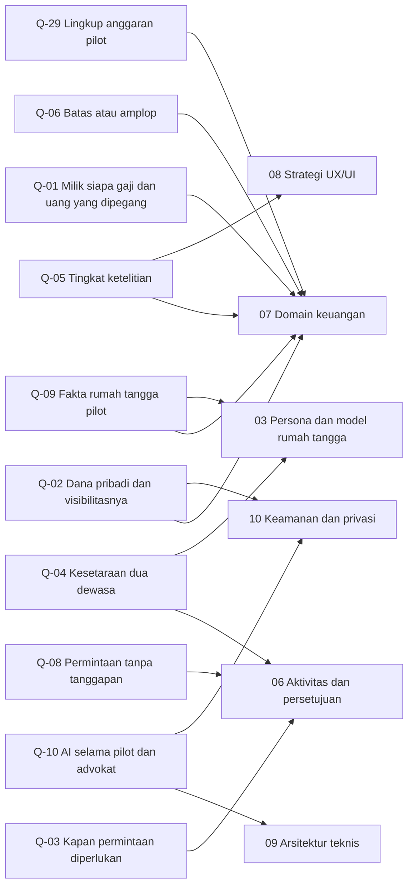

# 17 — Pertanyaan Terbuka dan Asumsi

| | |
|---|---|
| Pemilik dokumen | `product-analyst` |
| Tahap | S1 (Framing); diperbarui di setiap tahap |
| Status | Diperbarui dengan jawaban pemilik produk di checkpoint S1 (11 November 2026), lalu diselaraskan dengan temuan PP 33/2026 di dokumen 18 yang ditulis ulang dari salinan teks. Kedua pembaruan ini belum ditinjau `critic` |
| Tanggal | 11 November 2026 |
| Dibaca sebelum menulis | `CLAUDE.md`, `family-os-brief.md`, `ENGINEERING-STANDARDS.md` §5, [00-glossary.md](00-glossary.md) (dengan baris *ambang permintaan* yang diperbarui setelah checkpoint S1), [18-market-research.md](18-market-research.md) (revisi dengan temuan PP 33/2026 dari salinan teks: §0.2, §2.1–§2.3, §2.6, §6), [README.md](README.md), [_progress.md](_progress.md) |

## 0. Cara membaca dokumen ini

Dokumen ini adalah catatan tetap atas segala hal yang **belum diputuskan** atau **dianggap benar tanpa bukti** di Family OS, beserta jawaban pemilik produk atas hal yang sudah ia putuskan. Checkpoint S1 sudah dijawab: ringkasan jawabannya ada di bagian [Keputusan pemilik produk di checkpoint S1](#keputusan-pemilik-produk-di-checkpoint-s1) tepat di bawah ini. Bagian 1 menyimpan pertanyaan checkpoint itu beserta pilihan dan default aslinya, kini dengan hasilnya. Bagian 2 sampai 6 adalah daftar lengkap di belakangnya, termasuk pertanyaan baru yang lahir dari jawaban itu (2.7).

**Batas dokumen ini.** Dokumen 06 dan 07 belum ada. Karena itu setiap butir tentang uang dan persetujuan di sini adalah *pertanyaan dengan default yang diusulkan* atau *keputusan pemilik produk yang menjadi masukan*, bukan aturan. Aturan uang kelak kanonis di dokumen 07 dan aturan persetujuan di dokumen 06; keduanya menuliskan keputusan pemilik produk menjadi aturan, dan dokumen ini tidak melakukannya. Default uang yang berasal dari `finance-domain` ditandai "usulan `finance-domain`, S1" dan dicatat apa adanya.

**Cara membaca hasil checkpoint.** Empat tingkat kepastian dibedakan dan tidak dicampur:

| Sebutan | Artinya |
|---|---|
| **Diputuskan pemilik produk** | Dinyatakan pemilik produk sendiri dalam percakapan checkpoint. Bukan lagi **[Usulan]** |
| **Diterima sebagai default lewat "lanjut"** | Tidak dibahas, tetapi termasuk daftar yang dibacakan lead kepada pemilik produk sebelum ia menyatakan "lanjut". Berlaku, dan dapat diubah pemilik produk di checkpoint mana pun |
| **Disampaikan lead, tidak dibantah** | Lead menyampaikannya dalam percakapan dan pemilik produk tidak berkeberatan. Ia tidak menyatakannya sendiri; diperlakukan sebagai default yang berlaku dan dikukuhkan di checkpoint S2 |
| **Belum dikukuhkan** | Tidak dibahas dan tidak boleh dianggap diterima. Diajukan lagi di checkpoint yang disebut |

Teks pada baris "Default yang diajukan" di bagian 1 dan kolom "Default diusulkan" di bagian 2 disimpan sebagai catatan atas apa yang diajukan. Bila berbeda dari baris "Keputusan pemilik produk" atau dari tabel 2.6, yang berlaku adalah keputusan itu.

**Pengenal.** Selain skema brief §16, dokumen ini memakai lima pengenal yang tercantum di [README](README.md#skema-pengenal): `Q-NN` (pertanyaan terbuka), `A-NN` (asumsi), `R-NN` (riset yang perlu divalidasi), `K-NN` (pertentangan antar-sumber), `L-NN` (butir tinjauan hukum). Nomor stabil dan tidak dipakai ulang; karena itu urutan sepuluh pertanyaan di bagian 1 tidak sama dengan urutan nomornya.

**Label bukti** mengikuti [README](README.md#label-bukti). Semua "default" adalah **[Usulan]** kecuali disebut lain. Label atas temuan riset diambil dari dokumen 18 versi revisi dan tidak dinaikkan: temuan yang di sana **[Perlu validasi]** tetap **[Perlu validasi]** di sini, dan kesimpulan peneliti tetap **[Usulan]**. Temuan tentang PP 33/2026 berlabel **[Perlu validasi] — salinan teks** (dokumen 18 §0.2 dan §2.6): pasal dan Penjelasannya dibaca langsung dan dikutip apa adanya dari salinan teks lengkap, bukan dari pindaian naskah yang ditandatangani; tiga ayat terpotong di salinan itu (Pasal 69 ayat (8), 136 ayat (2), 165 ayat (4)) dan tidak dipakai sebagai dasar; yang belum ada hanyalah pencocokan dengan pindaian resmi. Label ini tidak dinaikkan menjadi **[Terverifikasi]** di dokumen ini. "Hari" dalam PP itu berarti hari kerja (Pasal 1 angka 19).

**Status pertanyaan:** *Terbuka* (menunggu jawaban), *Diputuskan* (dijawab pemilik produk atau ditetapkan dokumen pemiliknya, dengan rujukan), *Default diterima* (diterima lewat "lanjut" tanpa dibahas), *Ditunda* (sengaja dijawab di tahap yang disebut). "Dipersempit" pada status *Terbuka* berarti sebagian jawabannya sudah ditentukan keputusan checkpoint S1 dan sisanya dirinci di 2.6.

**Pagar yang diperiksa pada setiap default** (brief §1.1, §5D, §8): permintaan berjalan dua arah; tidak ada orang dewasa yang dapat memantau atau mengendalikan orang dewasa lain; aturan tidak berbeda antara suami dan istri; dan memegang uang tidak dengan sendirinya memberi hak atas uang itu (glosarium 7.2: enam dimensi custody tidak saling menurunkan). Default yang menyentuh pagar ini diberi tanda **Pagar** beserta catatannya.

---

## Keputusan pemilik produk di checkpoint S1

Pemilik produk menjawab checkpoint S1 pada 11 November 2026 dalam percakapan dengan lead, dengan kata-katanya sendiri, lalu menyatakan "lanjut". Bagian ini mencatat jawaban itu sebagaimana diteruskan lead kepada `product-analyst`; kutipan bertanda petik adalah kata-kata pemilik produk. Jawaban dicatat apa adanya: tidak diperkuat, tidak diperluas, dan tidak ditafsir ulang. Hal yang perlu ditafsirkan agar dapat menjadi aturan dicatat sebagai pertanyaan untuk dokumen 06, 07, dan 10 (2.7), bukan diputuskan di sini.

### Yang diputuskan pemilik produk sendiri

| # | Keputusan | Menyentuh | Yang tidak ia putuskan, dan ke mana perginya |
|---|---|---|---|
| 1 | **Uang yang masuk.** Setiap entri mencatat sumbernya (gaji, pinjaman yang diterima, hadiah, lainnya), punya siapa (suami atau istri), dan siapa yang memegangnya. Yang menerima uang otomatis menjadi *pemegang*-nya dan dialah yang mencatat; dari situ orang itu mencatat pembayaran, penyerahan uang kepada pasangan, atau pemberian uang kepada anggota keluarga (orang tua, saudara) | Q-01, Q-09, Q-19, Q-20 | Hubungan "punya siapa" dengan *pemilik uang*, dan perlakuan "pinjaman yang diterima", yang menurut glosarium bukan *pemasukan* (Q-55, K-15). Apakah penerima *serah terima* perlu mengonfirmasi (Q-19, K-20) |
| 2 | **Kepemilikan uang yang masuk.** Gaji menjadi *dana bersama* secara bawaan walaupun tercatat sebagai, misalnya, "gaji suami"; bawaan itu dapat diubah saat entri. Hadiah yang diberikan kepada satu orang menjadi *dana pribadi* orang itu secara bawaan | Q-01 | Apakah gaji yang diubah menjadi dana pribadi saat entri terlihat oleh pasangan dan tunduk pada aturan penyisihan (Q-56, K-16) |
| 3 | **Dana pribadi.** Ada dan bersifat pribadi: saldonya tertutup bagi pasangan. Bila dana pribadi dipakai untuk keperluan rumah tangga, pengeluaran itu terlihat oleh keduanya dengan sumbernya disebut (contohnya: "beras, pakai uang pribadi suami"; "bayar listrik pakai uang pribadi istri"). Pemakaian seperti itu diperlakukan sebagai kontribusi dan **tidak** diganti, kecuali pembayarnya menandainya "minta diganti"; baru saat itu *hak ganti* lahir | Q-02, Q-21, Q-23, Q-24, Q-13 | Cara kontribusi itu dilaporkan (Q-52). Glosarium saat ini mendefinisikan *talangan* sebagai selalu melahirkan hak ganti (K-14). Angka mana yang tampil sebagai "uang kita" tidak dibahas dan tetap usulan untuk dokumen 07, 08, dan 10 |
| 4 | **Kesetaraan.** Setara sepenuhnya. Setiap tindakan memperlihatkan dengan jelas siapa pelakunya (ia menekankan: siapa yang belanja, dan seterusnya), sebagai keterangan pelaku yang terlihat biasa, dalam kata-katanya "bukan audit". Setiap hal punya tingkat visibilitas: pribadi, pasangan saja, atau semua anggota. Chat dan permintaan bersifat pribadi bagi pihak-pihaknya. Apakah ada yang dienkripsi end-to-end diserahkan ke S4 | Q-04, Q-27, Q-30 | Arti tingkat visibilitas bagi tiap objek Tier 1 (Q-51, K-19). Enkripsi end-to-end (Q-57) |
| 5 | **Permintaan.** Belanja biasa dicatat setelah terjadi, tanpa persetujuan. Yang memerlukan persetujuan adalah rencana yang diajukan lebih dulu ("aku mau keluar dengan budget segini, ke sini"); anggaran, waktu, dan tambahannya dapat dirundingkan. Untuk pemakaian besar yang tidak direncanakan dan tidak rutin (contoh dari pertanyaan lead: membeli ponsel, meminjamkan uang kepada saudara) ia memilih: di atas satu ambang nominal, pemakaian itu wajib diajukan lebih dulu, dengan ambang yang sama bagi kedua pasangan. Angkanya diisi ketika rumah tangga mulai memakai aplikasi | Q-03, Q-12, Q-13, Q-14 | Apa yang terjadi bila pemakaian di atas ambang dicatat tanpa permintaan (Q-54). Ia tidak menyebut syarat "dalam batas anggaran" bagi belanja biasa |
| 6 | **Permintaan tanpa tanggapan.** Permintaan tetap menunggu, dan pemohon dapat mengingatkan lagi | Q-08 | Batas pengingat (Q-53, K-17); lihat tabel "Disampaikan lead" di bawah |
| 7 | **Ketelitian.** Ia menginginkan "yang profesional dan bener standarnya". Yang disepakati secara eksplisit: catatan lama tidak pernah disunting; uang dihitung dan selisihnya dicatat sebagai satu entri *selisih kas* yang terlihat; ketika belanja yang terlupa teringat, *entri terlambat* dengan tanggal aslinya ditambahkan dan selisihnya mengecil; siapa yang lupa diselesaikan berdua di luar aplikasi (chat atau langsung) | Q-05 | Cara selisih yang sudah tercatat "mengecil" tanpa menyunting entrinya, dan perlakuan selisih di laporan dan anggaran, diputuskan dokumen 07 |
| 8 | **Anggaran.** Anggaran melekat pada kategori; kategori dibuat bebas oleh rumah tangga (contohnya: belanja bulanan, cicilan, pulsa/wifi), masing-masing dengan jumlah anggarannya sendiri yang dapat diubah. Atas Q-29 ia menanyakan pendekatan yang profesional dan menerima rekomendasi lead: bulanan per kategori, mulai pada tanggal gajian; jalan-jalan dan acara tidak mendapat anggaran periode sendiri karena berjalan lewat permintaan; mingguan dan harian dapat ditambahkan kelak | Q-06, Q-29, Q-33 | Pilihan "batas" lawan "cara amplop" (Q-06) tidak ia nyatakan dengan kata-kata itu; uraiannya cocok dengan "batas", dan pilihan (a) berlaku sebagai default |
| 9 | **Tidak ada yang baku.** Semua daftar ditentukan pengguna dan dapat ditambah, diganti nama, dan dihapus: tempat uang, kategori, cicilan (motor, mobil, rumah), utang dan piutang, aset, tabungan | Q-09, Q-20, Q-46 | Arti "dihapus" bagi butir yang sudah punya riwayat atau masih bersaldo (Q-58); lihat tabel "Disampaikan lead" |
| 10 | **Pendamping AI.** Ia menginginkan AI-nya Claude atau ChatGPT, dan server aplikasi di-host di Indonesia. Setelah diberi tahu bahwa keduanya penyedia luar negeri sehingga data AI tetap keluar dari Indonesia, ia menyatakan bingung. Lead menjelaskan dan mengusulkan untuk **tidak** memutuskan sekarang: di S4 tim meneliti apakah Claude atau ChatGPT dapat diproses di Indonesia (R-05, L-16), dan ia memilih di checkpoint S4. Ia menjawab "lanjut" atas usulan itu | Q-10, Q-35 | Bagian (1) Q-10 **ditunda ke checkpoint S4**, dengan preferensi yang dinyatakan (Claude atau ChatGPT) dan satu syarat tetap (server di Indonesia). Bagian (2) dan catatan pertanyaan 10: lihat "Belum dikukuhkan" |

### Disampaikan lead, tidak dibantah

| Hal | Menyentuh |
|---|---|
| Batas yang wajar atas pengingat akan diusulkan agar pengingat tidak menjadi tekanan | Keputusan 6; Q-53 |
| Menghapus butir daftar yang sudah punya riwayat berarti mengarsipkannya: butir itu hilang dari daftar pilihan dan riwayatnya tetap ada, karena catatan uang tidak pernah disunting atau dihapus | Keputusan 9; Q-58 |

### Diterima sebagai default lewat "lanjut"

Butir berikut tidak dijawab secara eksplisit. Lead membacakannya kepada pemilik produk sebelum ia menyatakan "lanjut".

| Butir | Default yang berlaku |
|---|---|
| *Pinjam kembali* (Q-01) | Mengambil lagi dana bersama yang dipegang pasangan bukan utang, hanya *serah terima* |
| Fakta rumah tangga pilot (Q-09) | Tidak diisi. Pemilik produk membaca pertanyaan itu sebagai pertanyaan tentang keluwesan aplikasi (keputusan 9). Contoh terhitung memakai angka brief dan angka ilustrasi berlabel **[Asumsi]**; data yang sebenarnya dimasukkan saat onboarding |
| Q-07 | Rp3.000.000 untuk ibu suami adalah pengeluaran saat diserahkan dan tidak dilacak sesudahnya; untuk saudara dan ayah, pencatat memilih pinjaman atau bantuan pada tiap entri |
| Q-49 | Penyisihan dana bersama menjadi dana pribadi mengikuti aturan ambang permintaan |
| Q-25 | Ibu suami tidak mendapat login selama pilot |
| Q-26 | Masing-masing pasangan boleh mengoreksi; entri asli tetap; *keberatan* dapat diajukan |
| Bagian default yang tidak disinggung pada Q-02, Q-03, Q-04, Q-05, Q-08, dan Q-29 | Dirinci pada baris "Keputusan pemilik produk" tiap pertanyaan di 1.1 |

### Belum dikukuhkan; diajukan lagi di checkpoint S4

Dua hal pada Q-10 tidak dibahas secara eksplisit dalam penjelasan yang disederhanakan, sehingga **tidak** dicatat sebagai diterima:

| Hal | Keadaan |
|---|---|
| Q-10 bagian (2): kapan advokat ditanya, pilihan (i), (ii), atau (iii) | Belum dikukuhkan pemilik produk |
| Catatan pertanyaan 10: apa yang diterima pemilik produk sebagai operator selama pilot (DPIA formal dan perjanjian tertulis dengan prosesor data belum ada) | Belum dikukuhkan pemilik produk. Kalimat checkpoint "lanjut pakai default mencakup catatan ini" tidak diberlakukan atasnya |

### Ketegangan yang dicatat

Keputusan di atas tidak diubah dan tidak dilunakkan. Tempat sebuah keputusan bergesekan dengan pagar, dengan brief, dengan glosarium, atau dengan default lain dicatat di bagian 5: K-14 (kontribusi dana pribadi lawan definisi *talangan*), K-15 ("pinjaman yang diterima" sebagai sumber uang masuk lawan definisi *pemasukan*), K-16 (bawaan gaji dapat diubah saat entri lawan default Q-49), K-17 (pemohon dapat mengingatkan lagi lawan pagar Q-08), K-18 (preferensi Claude atau ChatGPT lawan syarat data AI tetap di Indonesia), K-19 (tingkat visibilitas dan keterangan pelaku lawan pagar pemantauan dan kriteria sukses nomor 1), K-20 (siapa yang mencatat serah terima). K-21 mencatat bahwa keputusan 5 tidak bertentangan dengan alur acuan brief §5D.

---

## 1. Pertanyaan checkpoint S1 dan hasilnya

Checkpoint S1 ditutup pada 11 November 2026. Tidak ada lagi pertanyaan di bagian ini yang menunggu jawaban sebelum S2, kecuali yang disebut "ditunda" atau "belum dikukuhkan". Pertanyaan, pilihan, dan default aslinya disimpan sebagai catatan.

| # | ID | Hasil | Rujukan keputusan |
|---|---|---|---|
| 1 | Q-09 | Default diterima lewat "lanjut": fakta tidak diisi | Keputusan 9; tabel default |
| 2 | Q-01 | Diputuskan pemilik produk (kepemilikan gaji dan hadiah); *pinjam kembali* diterima sebagai default | Keputusan 1, 2 |
| 3 | Q-02 | Diputuskan pemilik produk | Keputusan 3 |
| 4 | Q-04 | Diputuskan pemilik produk: setara penuh | Keputusan 4 |
| 5 | Q-03 | Diputuskan pemilik produk | Keputusan 5 |
| 6 | Q-08 | Diputuskan pemilik produk: tetap menunggu | Keputusan 6 |
| 7 | Q-05 | Diputuskan pemilik produk | Keputusan 7 |
| 8 | Q-06 | Diputuskan pemilik produk sejauh yang ia nyatakan; pilihan (a) diterima sebagai default | Keputusan 8 |
| 9 | Q-29 | Diputuskan pemilik produk: pilihan (a), atas rekomendasi lead | Keputusan 8 |
| 10 | Q-10 | Bagian (1) ditunda ke checkpoint S4; bagian (2) dan catatan pertanyaan 10 belum dikukuhkan | Keputusan 10 |
| — | Q-07, Q-49, Q-25, Q-26 | Default diterima lewat "lanjut" | 1.2 |

### 1.1 Sepuluh pertanyaan paling menentukan

Teks di bawah, sampai akhir 1.2, adalah bahan yang diajukan di checkpoint, ditambah baris **Status** dan **Keputusan pemilik produk** pada tiap pertanyaan.

Urutan: sembilan yang pertama diperlukan dokumen 07 dan 06 di S2, disusun menurut seberapa banyak pekerjaan yang harus diulang bila tebakannya salah. Fakta rumah tangga pilot berada paling atas karena menjadi dasar pertanyaan sesudahnya. Pertanyaan kesepuluh baru diperlukan di S4, tetapi diajukan sekarang karena jawabannya dapat memerlukan waktu tunggu dan karena, tidak seperti yang tersirat di draf pertama, risikonya mulai pada pilot.

Setiap pertanyaan dapat dijawab dengan satu huruf pilihan; pertanyaan 10 memuat dua keputusan dan dijawab dengan dua tanda, misalnya "A, ii". "Lanjut pakai default" berarti semua default di tabel ini **dan** di 1.2 berlaku, **termasuk** hal yang diterima pemilik produk sebagai operator selama pilot, yang dinyatakan di catatan pertanyaan 10 tepat di bawah tabel. **Hasil:** ketentuan terakhir ini tidak diberlakukan. Catatan pertanyaan 10 tidak dibahas secara eksplisit, sehingga dicatat sebagai belum dikukuhkan, bukan sebagai diterima.

| # | ID | Pertanyaan | Pilihan | Default yang diajukan **[Usulan]** |
|---|---|---|---|---|
| 1 | Q-09 | Bagaimana keadaan uang rumah tangga pilot hari ini? | Daftar isian tujuh baris (lihat rinciannya) | Tidak diisi: contoh terhitung memakai angka brief §1.1 dan angka ilustrasi berlabel **[Asumsi]** |
| 2 | Q-01 | Gaji dan uang yang dipegang pasangan itu milik siapa? | (a) uang rumah tangga, siapa pun pemegangnya; (b) yang sudah diserahkan menjadi milik pemegangnya; (c) gaji milik penerimanya | (a): *dana bersama*; *pinjam kembali* hanyalah *serah terima*, bukan utang |
| 3 | Q-02 | Adakah uang pribadi, dan bolehkah pasangan melihatnya? | (a) tidak ada; (b) ada dan terlihat pasangan; (c) ada dan tertutup kecuali dibagikan pemiliknya | (c): angka utama hanya dana bersama dan sama bagi keduanya; total yang memuat dana pribadi adalah baris kedua yang berbeda per pelihat |
| 4 | Q-04 | Apakah kalian berdua setara sepenuhnya di dalam aplikasi? | (a) setara penuh; (b) satu orang berperan lebih tinggi | (a): keduanya *pemilik rumah tangga*, izin dan wewenang identik |
| 5 | Q-03 | Pemakaian dana bersama seperti apa yang harus diajukan dulu sebagai permintaan? | (a) hanya yang tidak rutin dan di atas satu *ambang permintaan*, apa pun jenisnya; (b) semua yang di atas ambang; (c) hanya jalan-jalan | (a): satu ambang untuk kalian berdua, siapa pun yang memegang uangnya; berlaku atas belanja, pinjaman yang diberikan, kiriman keluarga di luar yang rutin, pembelian aset, dan penyisihan ke dana pribadi (Q-49 di 1.2) |
| 6 | Q-08 | Bila permintaan tidak ditanggapi, apa yang terjadi? | (a) tetap menunggu; (b) dianggap setuju setelah tenggat; (c) dianggap ditolak setelah tenggat | (a): diam tidak pernah berarti setuju atau menolak |
| 7 | Q-05 | Seberapa teliti catatan harus dijaga? | (a) saldo tiap tempat uang wajib benar, rincian sebisanya; (b) setiap rupiah terinci | (a): belanja yang terlupa diserap sebagai *selisih kas* |
| 8 | Q-06 | Uang belanja bulanan itu batas, atau uang yang benar-benar dipisahkan? | (a) batas saja; (b) dipisahkan (cara amplop) | (a) |
| 9 | Q-29 | Bolehkah anggaran pilot dipersempit menjadi bulanan per kategori saja? (perubahan cakupan atas brief §5C) | (a) boleh; (b) tidak, sebutkan periode lain yang dipakai | (a) |
| 10 | Q-10 | Pendamping AI selama pilot: (1) penyedia di mana, dan (2) kapan advokat ditanya? | **(1)** (A) hanya penyedia yang memproses di Indonesia, atau model yang di-host sendiri pada server di Indonesia; (B) penyedia luar negeri dengan persetujuan dan *de-identifikasi*, menerima ketidakpastian hukum; (C) pilot tanpa AI sampai pertanyaan hukum terjawab. **(2)** (i) sebelum S4; (ii) baru sebelum tahap publik; (iii) seperti (ii), tetapi DPIA ringkas dan perjanjian tertulis dengan prosesor dikerjakan selama fase pembangunan | **(A) dan (ii).** Server pilot di Indonesia menjadi bagian dari default yang sama (Q-35). Kelayakan (A) belum diteliti (R-05), dan cabang "penyedia asing berwilayah Indonesia" bergantung pada L-16, yang juga belum diteliti. Dengan (ii), pemilik produk sebagai operator menerima bahwa selama pilot DPIA formal dan perjanjian tertulis dengan prosesor (termasuk hosting) belum ada; sandarannya pengecualian rumah tangga yang belum terverifikasi, atau penerimaan sadar pemilik produk. Rinciannya di catatan di bawah tabel ini |

#### Catatan pertanyaan 10 — yang ikut diterima pemilik produk sebagai operator

**Status: belum dikukuhkan pemilik produk; diajukan lagi di checkpoint S4.** Catatan ini tidak dibahas secara eksplisit di checkpoint S1. Isinya tidak berubah dan tetap menjadi bahan checkpoint S4; tidak satu pun butirnya boleh dikutip sebagai sudah diterima pemilik produk. Kalimat pengantar dan pilihan di bawah tetap sebagaimana diajukan; tabel "Yang belum ada selama pilot" dan paragraf sandaran diperbarui dengan temuan dokumen 18 dari salinan teks PP 33/2026 (lihat "Bukti baru" pada Q-10), karena itulah yang akan dibaca pemilik produk di checkpoint S4.

Sebagaimana diajukan: jawaban "lanjut pakai default" mencakup catatan ini. Dokumen ini tidak memberi nasihat hukum; catatan ini hanya menyebut apa yang **tidak** dikerjakan di bawah default, supaya hal itu diterima dengan sadar dan bukan tanpa diketahui.

UU PDP sudah berlaku dan masa penyesuaiannya sudah lewat (isi Pasal 74 **[Terverifikasi]** primer; tanggal akhirnya, 17 Oktober 2024, adalah hitungan peneliti; dokumen 18 §2.1). Kecuali pengecualian "kegiatan pribadi atau rumah tangga" mencakup pilot, pemilik produk sebagai operator layanan adalah *pengendali data* selama pilot, dan penyedia hosting sudah menjadi *prosesor data* sejak hari pertama pilot, dengan atau tanpa `AI`. Opsi A menghilangkan ketergantungan pada hal yang belum terverifikasi hanya untuk satu soal, yaitu transfer lintas batas data AI. Di bawah default, hal berikut **belum dipenuhi secara formal** selama pilot, sampai tinjauan hukum tahap publik:

| Yang belum ada selama pilot | Dasar dan label |
|---|---|
| Dokumen DPIA formal | Pemicunya (data pribadi spesifik dan teknologi baru, UU PDP Pasal 34) **[Terverifikasi]** primer. PP 33/2026 Pasal 121 ayat (1): DPIA "dilaksanakan sebelum dilakukan pemrosesan Data Pribadi"; Penjelasan Pasal 120 menyebut kecerdasan buatan sebagai contoh teknologi baru; pelanggaran Pasal 120 ayat (1) masuk daftar sanksi Pasal 184 (**[Perlu validasi] — salinan teks**, dokumen 18 §2.1). Apakah kewajiban itu berlaku atas pilot **[Perlu validasi]** hukum (L-01) |
| Perjanjian tertulis dengan setiap prosesor data: penyedia hosting, penyedia AI, dan layanan push notification, termasuk persetujuan tertulis atas sub-prosesor | UU PDP Pasal 51 **[Terverifikasi]** primer. PP 33/2026 Pasal 14: perjanjian memuat paling sedikit sebelas butir, termasuk mekanisme audit dan inspeksi serta pelibatan prosesor lain; Pasal 15 ayat (2): persetujuan tertulis sebelum melibatkan prosesor lain (**[Perlu validasi] — salinan teks**, dokumen 18 §2.1). Apakah ketentuan layanan baku penyedia memenuhinya **[Perlu validasi]** hukum (L-12) |
| Perekaman seluruh kegiatan pemrosesan, termasuk pemetaan aliran data dan rincian transfer | PP 33/2026 Pasal 74 (tiga belas butir); Pasal 74 ayat (1) masuk daftar sanksi Pasal 184 (**[Perlu validasi] — salinan teks**, dokumen 18 §2.1). Bentuk minimum bagi operator perorangan: L-21 |
| Dokumen kebijakan masa retensi | PP 33/2026 Pasal 75 (**[Perlu validasi] — salinan teks**). L-21 |
| Ketentuan pemrosesan internal menurut pedoman Lembaga | PP 33/2026 Pasal 28 (**[Perlu validasi] — salinan teks**). Pedoman Lembaga belum ada selama status Lembaga PDP belum pasti (R-11). L-21 |
| Kebijakan, prosedur, atau pedoman internal pencegahan dan penanganan kegagalan pelindungan data | PP 33/2026 Pasal 117 (**[Perlu validasi] — salinan teks**). Tenggat pemberitahuan 3 x 24 jam sendiri sudah ada di UU PDP Pasal 46 **[Terverifikasi]** primer |
| Dasar hukum yang sudah diperiksa bagi layanan push notification Apple dan Google, yang diperkirakan memproses di luar Indonesia dan tidak dapat dihindari lewat desain | **[Asumsi]** (Q-35); isi notifikasi sudah dibatasi (glosarium bagian 5). Menurut PP 33/2026 Pasal 160 ayat (3), ukuran transfer adalah penerima yang "berada di luar wilayah hukum Negara Republik Indonesia" (**[Perlu validasi] — salinan teks**); apakah layanan ini terhitung transfer: L-16 |

Daftar ini memuat yang sudah dikenali tim (A-16, Q-35) dan empat baris dari dokumen 18 §2.1, baris "Dokumen dan mekanisme yang wajib dimiliki pengendali". Baris itu memuat juga hal yang menurut rencana dipenuhi lewat desain atau belum dinilai, dan semuanya menjadi masukan dokumen 10: pemberitahuan pelindungan data yang mudah diakses (Pasal 62, 68), kanal permohonan hak (Pasal 21), mekanisme perolehan dan penarikan persetujuan (Pasal 34, 90), mekanisme penanganan permintaan ganti rugi (Pasal 107), kanal pelaporan bagi masyarakat (Pasal 127), dan audit internal dan eksternal (Pasal 138). Salinan teks PP sudah dibaca khusus untuk keringanan bagi pengendali skala kecil dan tidak memuatnya selain Pasal 3; ukuran hanya menjadi pertimbangan besaran denda (Pasal 185), PPDP (Pasal 144), dan biaya implementasi (Pasal 124). L-11 (tafsir "skala besar", tanpa ambang angka) dan L-14 (PSE lingkup privat, belum diteliti) dapat menambah daftar ini.

**Sandarannya salah satu dari dua:** pengecualian rumah tangga memang mencakup pilot, yang belum terverifikasi (L-01); atau pemilik produk, sebagai operator, menerima keadaan itu secara sadar sampai tinjauan hukum tahap publik. Memilih (ii) berarti menyatakan yang kedua.

**Yang berubah setelah salinan teks PP 33/2026 dibaca (dokumen 18 §2.1, §6.3).** Pilihan (ii), "advokat dan DPIA baru sebelum tahap publik", **bertentangan dengan bunyi Pasal 121 ayat (1)** sejak PP berlaku (16 atau 17 Januari 2027), **bila** pilot tidak tercakup pengecualian Pasal 3: DPIA yang ditulis menjelang tahap publik bukan DPIA "sebelum dilakukan pemrosesan". Pilot diperkirakan berjalan seluruhnya sesudah tanggal itu **[Asumsi]**. Jadi di bawah (ii), sandaran kedua bukan lagi sekadar "dokumen belum ada", melainkan menerima kemungkinan tidak memenuhi kewajiban yang waktunya disebut teks. Pilihan (iii) mengerjakan DPIA sebelum data nyata dimasukkan dan karenanya tidak bergesekan dengan Pasal 121 ayat (1) dalam hal waktu; cukup-tidaknya "DPIA ringkas" terhadap isi minimum Pasal 121 ayat (2) belum dinilai. Peneliti mengusulkan (**[Usulan]**, dokumen 18 §6.3) agar tinjauan advokat atas pengecualian itu dilakukan sebelum pilot memproses data nyata dan agar dokumen 10 ditulis dengan anggapan pengecualian tidak berlaku; usulan itu paling dekat dengan pilihan (i), dengan batas waktu "sebelum data nyata diproses", bukan "sebelum S4". Semua ini **[Perlu validasi] — salinan teks** untuk bunyi pasalnya dan **[Perlu validasi]** hukum untuk berlakunya atas pilot (L-01); akibat Pasal 121 ayat (1) bagi pemrosesan yang sudah berjalan ketika PP mulai berlaku juga pertanyaan advokat (dokumen 18 §2.1 butir tinjauan 9). Pilihannya tetap di tangan pemilik produk di checkpoint S4.

**Yang tetap dikerjakan lewat desain di bawah default:** data AI dan server pilot berada di Indonesia (selama layak, R-05 dan Q-35), persetujuan terekam, data yang dikirim ke penyedia AI seminimal mungkin dan tanpa nama, serta ekspor dan penghapusan data tersedia.

**Alternatifnya:** (i) advokat ditanya sebelum S4, dimulai dari L-01 dan L-12, sehingga diketahui kewajiban mana yang berlaku atas pilot; atau (iii) tanpa menunggu advokat, DPIA ringkas ditulis dan perjanjian tertulis dengan prosesor diperoleh selama fase pembangunan, sebelum data nyata dimasukkan. Biaya (i): waktu tunggu dan biaya advokat sebelum S4. Biaya (iii): pekerjaan dokumen tambahan bagi `security-privacy` dan pemilik produk; besarnya belum diperkirakan **[Asumsi]**.

#### Q-09 — Keadaan uang rumah tangga pilot hari ini

Pertanyaan ini meminta fakta, bukan keputusan. Angka boleh dibulatkan atau disamarkan; yang diperlukan adalah jenis, pemegang, dan urutan besarnya. Baris yang dikosongkan memakai asumsi di kolom kanan.

| # | Isian | Asumsi bila dikosongkan **[Asumsi]** |
|---|---|---|
| 1 | **Pemasukan.** Siapa yang menerima, berapa sumber, tanggal berapa | Satu gaji sekitar Rp10.000.000 per bulan (brief §1.1); penerimanya tidak disebut brief (A-18) |
| 2 | **Tempat uang.** Tiap rekening bank, dompet digital, dan uang tunai: jenisnya, atas nama atau dipegang siapa, dan apakah ada rekening atas nama berdua | Satu rekening bank atas nama penerima gaji; uang tunai di masing-masing; mungkin satu dompet digital; tidak ada *tempat uang bersama* |
| 3 | **Cicilan dan tagihan rutin.** Apa saja, kira-kira berapa per bulan, sisa berapa kali, siapa biasanya membayar | Ada cicilan dan tagihan listrik, wifi, langganan kerja (brief §1.1); jumlah dan pembayarnya tidak diketahui |
| 4 | **Utang dan piutang yang sedang berjalan.** Kepada atau dari siapa (termasuk saudara dan ayah), kira-kira berapa | Tidak ada yang tercatat; contoh di dokumen 07 memakai angka ilustrasi |
| 5 | **Aset yang ingin dicatat.** Jenisnya saja (kendaraan, emas, rumah, perangkat) | Satu kendaraan sebagai contoh |
| 6 | **Tabungan.** Ada atau tidak, untuk apa (misalnya dana darurat), disimpan di tempat uang yang mana, dan adakah targetnya | Tidak ada tabungan yang tercatat; contoh di dokumen 07 memakai satu dana darurat dengan angka ilustrasi |
| 7 | **Pencatatan saat ini.** Belanja dapur dicatat di mana (buku, WhatsApp, spreadsheet, aplikasi), oleh siapa | Dicatat salah satu pasangan di luar aplikasi; pencatat utama yang pelupa bisa siapa saja dari keduanya (A-19) |

| | |
|---|---|
| **Status** | **Default diterima lewat "lanjut"** (checkpoint S1, 11 November 2026). Fakta tidak diisi. |
| **Keputusan pemilik produk** | Tidak ada isian. Pemilik produk membaca pertanyaan ini sebagai pertanyaan tentang keluwesan aplikasi dan menjawabnya dengan keputusan 9: semua daftar (tempat uang, kategori, cicilan, utang dan piutang, aset, tabungan) ditentukan pengguna. Akibatnya kolom "Asumsi bila dikosongkan" pada tabel di atas berlaku seluruhnya dan tetap berlabel **[Asumsi]** (A-18, A-19); contoh terhitung dokumen 07 memakai angka brief dan angka ilustrasi; data yang sebenarnya dimasukkan saat onboarding. Keputusan 1 menambahkan satu hal tentang bentuk, bukan fakta: tiap uang yang masuk dicatat dengan sumber, punya siapa, dan pemegangnya. |
| Masalah yang dilayani | Brief §1.1: "only grocery spending is recorded today", arus uang nyata; kriteria sukses nomor 1 dan 2. |
| Mengapa menentukan | Cicilan, utang dan pinjaman, tabungan sederhana, serta aset semuanya Tier 1 dan hanya pasangan pilot yang mengetahui keadaannya. Jawabannya menjadi dasar contoh terhitung dokumen 07, dasar Q-01 dan Q-02 (satu atau dua pemasukan; ada atau tidaknya tempat uang bersama), persona di dokumen 03, dan onboarding di dokumen 05 dan 08. |
| Default | Catatan belanja lama **tidak diimpor**. Pilot mulai dari *saldo awal* tiap tempat uang, serta kewajiban, piutang, dan aset yang sudah ada, pada hari pertama (glosarium 7.1). Angka yang sebenarnya dimasukkan saat onboarding, bukan ke dokumen perencanaan. |
| Alasan | Mengimpor catatan lama adalah pekerjaan sekali pakai yang tidak menjawab kriteria sukses mana pun; saldo awal yang benar sudah cukup. |
| Biaya default | Contoh terhitung dokumen 07 dapat tidak cocok dengan keadaan pilot dan perlu ditulis ulang setelah S2; dua pemasukan atau tempat uang bersama akan mengubah contoh Q-01 dan cara custody melaporkan isinya (Q-20). |

#### Q-01 — Gaji dan uang yang dipegang pasangan itu milik siapa?

| | |
|---|---|
| **Status** | **Diputuskan pemilik produk, checkpoint S1, 11 November 2026** (kepemilikan gaji dan hadiah). *Pinjam kembali* **diterima sebagai default lewat "lanjut"**. |
| **Keputusan pemilik produk** | Keputusan 1 dan 2. Gaji menjadi *dana bersama* secara bawaan walaupun tercatat sebagai, misalnya, "gaji suami"; bawaan itu dapat diubah saat entri. Hadiah yang diberikan kepada satu orang menjadi *dana pribadi* orang itu secara bawaan. Setiap uang yang masuk dicatat dengan sumbernya, punya siapa, dan pemegangnya; yang menerima otomatis menjadi *pemegang* dan dialah yang mencatat. Di antara tiga pilihan, ini paling dekat dengan (a), dengan dua perbedaan dari default yang diajukan: bawaannya dapat diubah saat entri, dan dana pribadi lahir juga dari hadiah, tidak hanya dari penyisihan. Tidak dibahas dan diterima sebagai default: mengambil lagi dana bersama yang dipegang pasangan bukan utang, hanya *serah terima*. Default ini mengandaikan bahwa dana bersama yang sudah diserahkan tetap dana bersama. |
| **Yang diteruskan ke dokumen 06 dan 07** | Q-55 (hubungan "punya siapa" dengan *pemilik uang*; "pinjaman yang diterima" bukan *pemasukan* menurut glosarium, K-15). Q-56 (gaji yang diubah menjadi dana pribadi saat entri, K-16). Pagar di baris terakhir tabel ini tetap berlaku sebagai syarat. |
| Pertanyaan | Begitu gaji masuk, dan setelah sebagian diserahkan kepada pasangan: (a) semuanya uang rumah tangga, siapa pun yang memegang; (b) gaji uang rumah tangga, tetapi bagian yang sudah diserahkan menjadi milik pemegangnya; atau (c) gaji milik penerimanya, dan hanya yang ia serahkan yang menjadi uang rumah tangga? |
| Masalah yang dilayani | Brief §1.1: "money is not visible", "custody is unclear", dan arus uang nyata rumah tangga pilot. |
| Mengapa menentukan | Menentukan *pemilik uang* pada setiap entri, apakah *pinjam kembali* melahirkan *utang antar-pasangan*, dan seluruh contoh terhitung dokumen 07. Salah tebak berarti model custody dan utang ditulis ulang. |
| Default yang diajukan **[Usulan]** (usulan `finance-domain`, S1) | Pilihan (a). Gaji menjadi *dana bersama* saat tiba. *Dana pribadi* hanya ada bila pasangan secara eksplisit menyisihkan uang sebagai milik pribadi. Uang yang dipegang salah satu pasangan setelah dibagi adalah dana bersama yang ia pegang (*titipan*). Pinjam kembali hanyalah *serah terima*, tanpa utang. |
| Alasan | Paling dekat dengan cara brief menggambarkan rumah tangga pilot ("the wife holds the rest") **[Asumsi]**, dan paling ringan dicatat: tidak ada utang antar-pasangan yang harus dipantau. |
| Jika jawabannya lain | (b) atau (c): setiap pinjam kembali menjadi utang antar-pasangan yang harus dilunasi dan dilaporkan; dokumen 07 memerlukan alur itu secara penuh di Tier 1, dan dokumen 10 harus mengatur visibilitasnya (Q-24). |
| **Pagar** | Dua syarat untuk aturan yang kelak ditulis dokumen 06 dan 07; dokumen ini tidak menetapkannya. (1) **Simetris:** aturan ditulis untuk "anggota dewasa", tidak pernah untuk "suami" atau "istri", dan berlaku atas gaji siapa pun dari keduanya; brief tidak menyebut siapa penerima gaji (A-18). (2) **Memegang tidak sama dengan berwenang:** *pemegang* dan *yang berwenang membelanjakan* adalah dua dimensi terpisah (brief §5C, glosarium 7.2). Siapa yang berwenang membelanjakan dana bersama adalah aturan rumah tangga yang berlaku sama bagi kedua pasangan, siapa pun yang sedang memegang uangnya. Usulan untuk dokumen 06: kedua pasangan berwenang membelanjakan dana bersama untuk keperluan rutin rumah tangga, dan keduanya tunduk pada ambang permintaan yang sama (Q-03). Pemegang tidak mendapat hak menyetujui atau menolak hanya karena memegang; aturan "pemegang menentukan belanja" adalah pola kendali keuangan yang diminta brief §8 untuk dicegah. |

#### Q-02 — Adakah uang pribadi, dan bolehkah pasangan melihatnya?

| | |
|---|---|
| **Status** | **Diputuskan pemilik produk, checkpoint S1, 11 November 2026.** |
| **Keputusan pemilik produk** | Keputusan 3. Dana pribadi ada dan bersifat pribadi: saldonya tertutup bagi pasangan. Bila dana pribadi dipakai untuk keperluan rumah tangga, pengeluaran itu terlihat oleh keduanya dengan sumbernya disebut ("beras, pakai uang pribadi suami"; "bayar listrik pakai uang pribadi istri"). Pemakaian itu diperlakukan sebagai kontribusi dan tidak diganti, kecuali pembayarnya menandai "minta diganti"; baru saat itu *hak ganti* lahir. Ini paling dekat dengan pilihan (c). **Yang tidak ia nyatakan:** bahwa pemilik dana pribadi dapat memilih membagikan saldonya (bagian "kecuali dibagikan" pada pilihan (c)); empat konsekuensi pada baris default di bawah (angka utama, baris kedua per pelihat, invarian, letak terhadap garis kendali rumah tangga); dan usulan "tanpa penanda". Semuanya tetap **[Usulan]** untuk dokumen 07, 08, dan 10 dan ditinjau pemilik produk di checkpoint S2 dan S4. |
| **Yang berubah dari default yang diajukan** | "Kebocoran" nomor 2 di bawah berubah sifat: pembayaran keperluan rumah tangga dari dana pribadi kini terlihat oleh keduanya karena **diputuskan demikian**, bukan sebagai akibat sampingan hak ganti; dan hak ganti tidak lagi lahir dengan sendirinya. Yang tertutup adalah saldo dan pemakaian dana pribadi untuk keperluan pribadi. Diteruskan: Q-52 (cara kontribusi dilaporkan), Q-21 (kapan dan bagaimana "minta diganti"), K-14 (definisi *talangan* di glosarium). |
| Pertanyaan | Apakah masing-masing dari kalian punya uang pribadi yang terpisah dari uang rumah tangga? (a) tidak ada; (b) ada, dan pasangan boleh melihatnya; (c) ada, dan tertutup kecuali pemiliknya memilih membagikan. |
| Masalah yang dilayani | Brief §1.1 "how much do we have left, what assets do we own"; brief §8 "ability for an adult member to keep personal funds private". |
| Mengapa menentukan | Menentukan letak dana pribadi terhadap *garis kendali rumah tangga* (glosarium 7.1), isi *uang yang ada* dan *kekayaan bersih*, serta batas *data pribadi anggota*. Garis itu memisahkan *pemindahan* dari *pengeluaran* pada setiap entri; menggesernya setelah S2 mengubah hampir semua contoh dokumen 07 dan model akses dokumen 10. |
| Default yang diajukan **[Usulan]** (usulan `finance-domain`, S1; diputuskan dokumen 07 dan 10) | Pilihan (c), dengan empat konsekuensi yang perlu diketahui pemilik produk. (1) **Angka utama** untuk kriteria sukses nomor 1 ("sisa berapa dan siapa yang pegang") hanya memuat dana bersama, dan identik bagi kedua pasangan. Ini usulan **tampilan** untuk dokumen 07, 08, dan 10, bukan definisi: glosarium mendefinisikan *uang yang ada* sebagai jawaban "berapa uang kita" dan memasukkan dana pribadi bila dana itu di dalam garis kendali rumah tangga, sehingga angka utama yang diusulkan di sini bisa lebih kecil daripada *uang yang ada*. Hubungan keduanya perlu dikukuhkan `finance-domain` di S2 (K-13). (2) **Total yang memuat dana pribadi** adalah baris kedua yang berlabel dan **berbeda per pelihat**: dana bersama, ditambah dana pribadinya sendiri, ditambah dana pribadi pasangan yang dipilih pasangan untuk dibagikan. Jadi dua pasangan dapat melihat total rumah tangga yang berbeda, dan itu disengaja. (3) Invarian model berlaku pada data penuh; yang dilihat tiap anggota adalah tampilan tersaring. (4) Apakah dana pribadi berada di dalam atau di luar garis kendali rumah tangga **belum ditetapkan**; `finance-domain` menimbangnya ulang di dokumen 07. Visibilitas diatur per *tempat uang* dan bersifat opt-in. |
| Keberadaan tempat uang yang tidak dibagikan | Usulan untuk dokumen 10: pasangan **tidak** diberi penanda bahwa ada tempat uang pribadi yang tidak dibagikan; yang diketahui keduanya adalah bahwa kemampuan itu ada dan tersedia sama bagi keduanya (brief §8 "transparency about who can see what"). |
| Dua kebocoran yang tersisa | Dinyatakan terbuka, bukan disembunyikan: (1) pemindahan dari dana bersama ke dana pribadi adalah entri dana bersama, jadi terlihat oleh keduanya, sehingga keberadaan dan jumlah yang dipindahkan diketahui pasangan; (2) *hak ganti* atas *talangan* memperlihatkan bahwa ada pembayaran dari dana pribadi. Hanya dana pribadi yang tidak pernah bersentuhan dengan dana bersama yang benar-benar tertutup. Anggota diberi tahu hal ini sebelum mencatat (Q-24). |
| Alasan | Menjaga "berapa uang kita" tetap satu angka yang sama bagi keduanya, sekaligus memberi tiap orang dewasa ruang pribadi yang diwajibkan brief §8, tanpa angka yang dapat dibongkar lewat pengurangan (Q-23). |
| Jika jawabannya lain | (a): dana pribadi tetap ada di model sebagai fondasi tahap publik, tetapi tidak didokumentasikan penuh di Tier 1 dan tidak tampil di layar pilot. (b): baris kedua menjadi sama bagi keduanya; opt-in tetap ada di model untuk tahap publik. |
| **Pagar** | Opt-in berlaku sama bagi suami dan istri. Siapa yang boleh menyisihkan dana bersama menjadi dana pribadi, dan apakah pasangan perlu menyetujuinya, adalah pertanyaan tersendiri: Q-49 di 1.2. Tidak ada peran, termasuk pemilik rumah tangga dan admin, yang dapat membuka dana pribadi orang dewasa lain atau memaksa pembagiannya (glosarium bagian 3). |

#### Q-04 — Apakah suami dan istri setara sepenuhnya di dalam aplikasi?

| | |
|---|---|
| **Status** | **Diputuskan pemilik produk, checkpoint S1, 11 November 2026:** pilihan (a), setara sepenuhnya. |
| **Keputusan pemilik produk** | Keputusan 4. Selain kesetaraan, ia menyatakan tiga hal. (1) Setiap tindakan memperlihatkan dengan jelas siapa pelakunya (ia menekankan: siapa yang belanja, dan seterusnya), sebagai keterangan pelaku yang terlihat biasa; dalam kata-katanya "bukan audit". (2) Setiap hal punya tingkat visibilitas: pribadi, pasangan saja, atau semua anggota. (3) Chat dan permintaan bersifat pribadi bagi pihak-pihaknya. Apakah ada yang dienkripsi end-to-end diserahkan ke S4. **Tidak dibahas dan diterima sebagai default:** rincian preset pada baris default di bawah (tindakan yang mengenai orang dewasa lain hanya berlaku dengan persetujuan orang itu; *keluar dengan aman* tanpa persetujuan; pembuat rumah tangga tidak mendapat hak lebih). |
| **Yang diteruskan ke dokumen 06 dan 10** | Q-51 (arti tingkat visibilitas bagi tiap objek Tier 1, K-19); Q-57 (enkripsi end-to-end); Q-27 (keterangan pelaku dan laporan per orang). Catatan cakupan: "chat" di MVP hanya berupa *diskusi* yang menempel pada permintaan, tugas, atau kegiatan (A-22); chat umum (`COM`) tetap Tier 3, dan keputusan ini tidak mengubah tingkatan itu. Pada pilot dengan dua anggota, "pihak-pihaknya" selalu kedua pasangan; pembedaannya baru terasa bila ada anggota ketiga. |
| Pertanyaan | (a) Kalian berdua punya peran, izin, dan hak menyetujui yang persis sama; atau (b) satu orang berperan lebih tinggi (misalnya satu pemilik rumah tangga dan satu anggota)? |
| Masalah yang dilayani | Brief §4.3 (suami tidak otomatis punya izin lebih dari istri, dan sebaliknya); brief §8 abuse prevention. Tier 1 mewajibkan peran dan izin `FAM` yang dipakai `FIN` dan `REQ`. |
| Mengapa menentukan | Menentukan nilai *peran* yang dibutuhkan Tier 1, model akses di dokumen 06 dan 10, serta persona dan preset di dokumen 03. Glosarium bagian 3 sudah mengizinkan lebih dari satu pemilik rumah tangga dan menyerahkan bawaannya ke pertanyaan ini. |
| Default yang diajukan **[Usulan]** | Pilihan (a), sebagai *preset aturan* "dua dewasa setara": kedua pasangan berperan pemilik rumah tangga, dengan *izin* dan *wewenang persetujuan* yang identik. Tindakan yang mengenai orang dewasa lain (mengeluarkannya, mengubah izinnya, menurunkan wewenangnya) hanya berlaku dengan persetujuan orang itu sendiri. Masing-masing dapat *keluar dengan aman* tanpa persetujuan yang lain. Siapa yang lebih dulu membuat rumah tangga tidak memberi hak lebih. |
| Alasan | Satu-satunya susunan yang tidak dapat dipakai satu pasangan untuk mengendalikan yang lain, dan tidak perlu diatur apa pun di hari pertama. |
| Jika jawabannya lain | (b): dokumen 10 harus mendefinisikan apa yang tidak pernah boleh dilakukan pemilik rumah tangga atau admin terhadap orang dewasa lain, dan skenario "admin kehilangan akses" (brief §12 nomor 20) menjadi risiko Tier 1, bukan kasus tepi. |
| **Pagar** | Default ini adalah pagarnya. |

#### Q-03 — Pemakaian dana bersama seperti apa yang harus diajukan dulu sebagai permintaan?

| | |
|---|---|
| **Status** | **Diputuskan pemilik produk, checkpoint S1, 11 November 2026.** |
| **Keputusan pemilik produk** | Keputusan 5. (1) Belanja biasa dicatat setelah terjadi, tanpa persetujuan. (2) Yang memerlukan persetujuan adalah rencana yang diajukan lebih dulu ("aku mau keluar dengan budget segini, ke sini"); anggaran, waktu, dan tambahannya dapat dirundingkan. (3) Untuk pemakaian besar yang tidak direncanakan dan tidak rutin, di atas satu ambang nominal pemakaian itu wajib diajukan lebih dulu; ambangnya sama bagi kedua pasangan; angkanya diisi ketika rumah tangga mulai memakai aplikasi. Contoh yang ia tanggapi, dari pertanyaan lead: membeli ponsel dan meminjamkan uang kepada saudara. Rumusan *ambang permintaan* di glosarium sudah disesuaikan lead dengan keputusan ini (K-12 selesai). |
| **Batas keputusan itu** | Dua contohnya mencakup satu pembelian barang dan satu *pinjaman yang diberikan*. Jenis lain pada butir (2) default di bawah (*kiriman keluarga* di luar yang rutin, penyisihan menjadi dana pribadi) tidak ia sebut satu per satu; keduanya berlaku lewat default yang diterima (Q-07, Q-49) dan lewat rumusan glosarium. Ia **tidak** menyebut syarat "dalam batas *anggaran* kategorinya" bagi belanja biasa, dan apakah belanja biasa yang melampaui anggaran kategorinya diperlakukan berbeda tidak dibahas. Dokumen ini tidak menambahkan syarat itu atas keputusannya: syarat pada butir (1) default di bawah dibaca sebagai usulan yang belum dikukuhkan, dan apa yang terjadi saat anggaran terlampaui diputuskan dokumen 06 dan 07 lalu ditinjau di checkpoint S2. Butir (3) default (serah terima tidak memerlukan permintaan) tidak dibahas dan diterima sebagai default. |
| **Yang diteruskan ke dokumen 06** | Q-54 (pemakaian di atas ambang yang dicatat tanpa permintaan; A-20 tetap berlaku); cara aplikasi mengenali "tidak rutin"; Q-12 sampai Q-14 (2.6). |
| Pertanyaan | (a) Hanya pemakaian dana bersama yang tidak rutin (termasuk jalan-jalan) di atas satu *ambang permintaan*, apa pun jenisnya; (b) semua yang di atas ambang, rutin atau tidak; atau (c) hanya jalan-jalan, tanpa ambang? Nilai ambangnya diisi saat onboarding. |
| Masalah yang dilayani | Brief §1.1 "spending and outings are unplanned" dan arus uang nyata rumah tangga pilot (pinjaman kepada saudara dan ayah, pembelian besar); kriteria sukses nomor 4. |
| Mengapa menentukan | Ini inti preset aturan di dokumen 06 dan menentukan berapa banyak permintaan yang muncul setiap hari. Terlalu ketat membuat aplikasi menjadi alat kontrol dan beban; terlalu longgar membuat kriteria sukses nomor 4 tidak tercapai. |
| Default yang diajukan **[Usulan]** | Pilihan (a), sama untuk kedua pasangan dan **tidak bergantung pada siapa yang memegang uangnya**: (1) belanja rutin dalam batas *anggaran* kategorinya, dan pembayaran rutin yang sudah disepakati (tagihan berulang, cicilan, kiriman keluarga bulanan), tidak perlu permintaan; (2) pemakaian dana bersama yang tidak rutin dan di atas ambang permintaan diajukan lebih dulu sebagai permintaan, **apa pun jenis pencatatannya**: pengeluaran (termasuk jalan-jalan), *pinjaman yang diberikan*, *kiriman keluarga* di luar yang rutin disepakati, pembelian *aset*, dan penyisihan dana bersama menjadi *dana pribadi* (Q-49); (3) *serah terima* dan pemindahan lain antar-tempat uang yang sama-sama berisi dana bersama tidak pernah memerlukan permintaan dengan sendirinya, karena yang diajukan adalah pemakaian uangnya, bukan perpindahan pemegangnya. Ambangnya satu angka untuk seluruh rumah tangga. Brief tidak memberi angka ambang permintaan: Rp500.000 di brief §4.3 adalah contoh batas *wewenang persetujuan*, bukan ambang permintaan, dan hanya dipinjam di sini sebagai angka isian awal yang dapat diganti. Aplikasi **tidak pernah menghalangi** pencatatan pengeluaran (A-20). |
| Alasan | Family OS hanya mencatat uang, jadi aturan ini adalah kesepakatan yang dibuat terlihat, bukan kunci. Satu ambang bersama paling mudah diingat dan tidak dapat menjadi asimetris. Butir (1) menjaga usaha harian tetap rendah bagi pencatat yang pelupa. Butir (2) tidak dibatasi pada entri berjenis pengeluaran karena uang terbesar yang keluar tanpa dibicarakan justru bukan pengeluaran menurut glosarium: pinjaman kepada saudara adalah piutang, pembelian aset bukan pengeluaran menurut default Q-18, dan penyisihan ke dana pribadi dapat berupa *pemindahan*. |
| Yang diserahkan ke dokumen 06 dan 07 | Butir (2) adalah usulan untuk dokumen 06, bukan aturan. Yang masih harus diputuskan di sana: jenis permintaan yang dipakai untuk pemakaian yang bukan pengeluaran (*permintaan anggaran* atau *usulan keputusan*); cara otorisasinya diselesaikan, sebab *realisasi* di glosarium hanya menjumlahkan entri pengeluaran; dan rumusan *ambang permintaan* di glosarium, yang saat ini hanya menyebut "pengeluaran tidak rutin" (K-12). |
| Jika jawabannya lain | (b): jumlah permintaan harian naik; dokumen 06 perlu jalur persetujuan satu ketukan dan dokumen 08 perlu layar permintaan sebagai layar utama. (c): pembelian besar yang bukan jalan-jalan tetap datang sebagai kejutan, dan kriteria sukses nomor 4 hanya tercapai separuh. |
| **Pagar** | Ambang per orang, atau aturan yang mewajibkan hanya satu pihak meminta, ditolak sebagai default. Bila pemilik produk menginginkannya, hal itu dicatat sebagai keputusan pemilik dan dinilai `security-privacy`. Bila uang di rumah tangga pilot lebih banyak dipegang satu orang, pihak lain akan lebih sering meminta serah terima; itu akibat letak uangnya, bukan aturan yang berbeda, dan serah terima tidak memberi pemegang hak menolak pengeluaran (Q-01). |

#### Q-08 — Bila permintaan tidak ditanggapi, apa yang terjadi?

| | |
|---|---|
| **Status** | **Diputuskan pemilik produk, checkpoint S1, 11 November 2026:** pilihan (a). |
| **Keputusan pemilik produk** | Keputusan 6. Permintaan tetap menunggu, dan pemohon dapat mengingatkan lagi. **Disampaikan lead, tidak dibantah:** batas yang wajar atas pengingat akan diusulkan agar pengingat tidak menjadi tekanan. Batas itu belum ada; ia diusulkan di Q-53 dan dikukuhkan pemilik produk di checkpoint S2. **Tidak dibahas dan diterima sebagai default:** permintaan bertanggal berakhir sebagai *kedaluwarsa* dan bukan *penolakan*; pemohon dapat membatalkan kapan saja; jalur keperluan mendesak tanpa persetujuan susulan yang wajib. |
| **Yang berubah dari default yang diajukan** | Default di bawah berbunyi "pengingat dikirim secukupnya ..., lalu berhenti", dan pagarnya melarang pengingat tambahan tanpa batas. Keputusan pemilik produk menambahkan hak pemohon untuk mengingatkan lagi. Keduanya hanya selaras bila pengingat ulang itu berbatas (K-17). |
| Pertanyaan | Kalau salah satu mengajukan permintaan dan pasangannya diam saja: (a) tetap menunggu; (b) dianggap setuju setelah tenggat; atau (c) dianggap ditolak setelah tenggat? |
| Masalah yang dilayani | Brief §1.1 "coordinating it costs constant asking"; `NTF` Tier 1 untuk permintaan dan persetujuan. |
| Mengapa menentukan | Menentukan state machine permintaan di dokumen 06 (ada tidaknya transisi otomatis, *kedaluwarsa*, jalur darurat) dan aturan pengingat di `NTF`. |
| Default yang diajukan **[Usulan]** | Pilihan (a). Diam tidak pernah berarti setuju dan tidak pernah berarti menolak. Permintaan tetap menunggu; pengingat dikirim secukupnya dengan menghormati *jam tenang*, lalu berhenti. Permintaan yang bertanggal (misalnya jalan-jalan) berakhir sebagai kedaluwarsa setelah tanggalnya lewat, bukan sebagai *penolakan*. Pemohon dapat membatalkan kapan saja. Untuk keperluan mendesak (misalnya atap bocor), pengeluaran dicatat langsung dan pasangan diberi tahu; tidak ada persetujuan susulan yang wajib. |
| Alasan | Persetujuan otomatis menjadikan diam sebagai celah; penolakan otomatis menghukum pemohon karena pasangannya sibuk. Aplikasi tidak dapat menghalangi belanja di dunia nyata (A-20), jadi jalur darurat harus jujur, bukan pura-pura dilarang. |
| Jika jawabannya lain | (b): memerlukan aturan tenggat, pemberitahuan sebelum tenggat, dan penilaian `security-privacy` atas penyalahgunaannya (mengajukan saat pasangan tidak mungkin menjawab). (c): pemohon harus mengajukan ulang; jumlah permintaan dan pengingat naik. |
| **Pagar** | Berlaku sama untuk kedua arah. Jumlah dan nada pengingat tidak boleh menjadi alat menekan pasangan: pemohon tidak dapat memicu pengingat tambahan tanpa batas. |

#### Q-05 — Seberapa teliti catatan harus dijaga?

| | |
|---|---|
| **Status** | **Diputuskan pemilik produk, checkpoint S1, 11 November 2026:** pilihan (a). |
| **Keputusan pemilik produk** | Keputusan 7. Ia menginginkan "yang profesional dan bener standarnya". Yang disepakati secara eksplisit: (1) catatan lama tidak pernah disunting; (2) uang dihitung dan selisihnya dicatat sebagai satu entri *selisih kas* yang terlihat; (3) ketika belanja yang terlupa teringat, *entri terlambat* dengan tanggal aslinya ditambahkan dan selisihnya mengecil; (4) siapa yang lupa diselesaikan berdua di luar aplikasi (chat atau langsung). **Tidak dibahas dan diterima sebagai default:** pilot tanpa penutupan periode, dengan laporan bulan lalu yang ikut berubah dan menandai perubahannya. |
| **Yang diteruskan ke dokumen 07** | (a) Cara butir (3) dipenuhi tanpa melanggar butir (1): entri selisih kas yang sudah tersimpan tidak dapat disunting, jadi "selisihnya mengecil" memerlukan entri tambahan yang terlihat; bentuknya aturan dokumen 07. (b) Baris "Perlakuan selisih kas" di bawah tidak dibahas dengan pemilik produk dan tetap usulan `finance-domain`. (c) Akibat butir (4): aplikasi mencatat siapa yang menghitung dan mencatat (keputusan 4), tetapi tidak menyimpulkan siapa yang lupa; selisih kas tidak boleh tampil sebagai kesalahan satu orang. |
| Pertanyaan | (a) Cukup jumlah uang di tiap tempat selalu benar, dan belanja yang lupa dicatat dikumpulkan sebagai satu selisih; atau (b) setiap rupiah harus tercatat per barang? |
| Masalah yang dilayani | Brief §1.1 "recording is a burden" (pencatat utama pelupa; entri terlambat harus ditoleransi); kriteria sukses nomor 1 dan 2. |
| Mengapa menentukan | Menentukan usaha berulang seluruh produk: apakah dokumen 07 memerlukan penutupan periode (mengunci catatan satu bulan sehingga tidak dapat ditambah lagi), bagaimana laporan bulan lalu berubah, dan apakah *rekonsiliasi kas* menjadi alur utama (dokumen 08) atau sekadar alat koreksi. |
| Default yang diajukan **[Usulan]** | Pilihan (a). Yang wajib benar adalah *saldo tercatat* tiap *tempat uang*, karena itulah jawaban "sisa berapa dan siapa yang pegang". Rincian per barang adalah usaha terbaik. Belanja yang terlupa diserap oleh rekonsiliasi kas: pemegang menghitung uangnya dan selisihnya dicatat sebagai *selisih kas*. *Entri terlambat* boleh kapan saja dengan *tanggal kejadian* aslinya; *tanggal pencatatan* tetap tersimpan. Pilot tidak mengenal penutupan periode: laporan bulan lalu ikut berubah dan menandai bahwa ia berubah. |
| Perlakuan selisih kas (usulan `finance-domain`, S1; diputuskan dokumen 07) | Selisih kas tampil di ringkasan bulanan sebagai baris tersendiri. Selisih negatif (ada uang keluar yang tidak tercatat) ikut dihitung dalam total uang yang keluar pada bulan itu. Selisih positif (ada uang masuk yang tidak tercatat, atau pengeluaran yang tercatat terlalu besar) tidak dihitung sebagai uang yang keluar; apakah ia mengurangi total itu atau tampil di sisi uang yang masuk diputuskan dokumen 07. Anggaran suatu kategori menampilkan pemberitahuan bila pada periodenya ada selisih yang belum dirinci di tempat uang yang biasa dipakai untuk kategori itu. Selisih dapat dikategorikan ulang: saat rekonsiliasi pemegang boleh memilih kategori dengan satu ketukan, atau belakangan suatu *entri penyesuaian* memindahkan sebagian atau seluruhnya ke satu kategori; sejak itu jumlah tersebut dihitung terhadap anggaran kategori itu pada tanggal kejadiannya. Usulan ini menutup kelemahan versi sebelumnya, yang menaruh selisih kas di luar anggaran sehingga belanja dapur yang terlupa membuat anggaran dapur tampak lebih sehat daripada kenyataan. |
| Alasan | Kriteria sukses nomor 1 menuntut saldo yang benar, bukan struk yang lengkap. Menuntut ketelitian per barang dari pencatat yang pelupa berisiko membuat aplikasi ditinggalkan: pada studi Epstein dkk. (2016), alasan terbanyak orang berhenti melacak keuangan adalah beban mengumpulkan dan menggabungkan data (**[Terverifikasi]** primer untuk isi studi, dokumen 18 §1.3.5; penerapannya pada pasangan Indonesia **[Asumsi]**). |
| Jika jawabannya lain | (b): usaha harian naik dan kecepatan entri harus menjadi fokus utama S3 dan S4 (termasuk menimbang entri berbantuan AI, Q-31); bila periode harus ditutup, dokumen 07 memerlukan aturan entri terlambat ke periode tertutup. |

#### Q-06 — Uang belanja bulanan itu batas, atau uang yang benar-benar dipisahkan?

| | |
|---|---|
| **Status** | **Diputuskan pemilik produk, checkpoint S1, 11 November 2026**, sejauh yang ia nyatakan. Pilihan (a) lawan (b) **diterima sebagai default lewat "lanjut"**. |
| **Keputusan pemilik produk** | Keputusan 8. Anggaran melekat pada kategori; kategori dibuat bebas oleh rumah tangga (contohnya: belanja bulanan, cicilan, pulsa/wifi), masing-masing dengan jumlah anggarannya sendiri yang dapat diubah. Ia tidak memilih antara "batas" dan "cara amplop" dengan kata-kata itu. Uraiannya (satu jumlah per kategori yang dapat diubah, tanpa menyebut uang yang dipisahkan) cocok dengan pilihan (a), dan pilihan (a) berlaku sebagai default. Tanggal mulai periode: tanggal gajian (lihat Q-29). Contoh "cicilan" sebagai kategori beranggaran selaras dengan default Q-16, tetapi bukan keputusan tentang cara cicilan dicatat. |
| Pertanyaan | Anggaran dapur dan sejenisnya: (a) cukup berupa angka batas per bulan; atau (b) uangnya memang dipisahkan (cara amplop)? |
| Masalah yang dilayani | Brief §1.1 "grocery budgets are regularly exceeded", "is the monthly money still there". |
| Mengapa menentukan | Menentukan hubungan *anggaran* dengan *alokasi* di dokumen 07 dan berapa banyak yang harus dikerjakan keluarga setiap kali gaji tiba ("income allocation" ada di Tier 1). |
| Default yang diajukan **[Usulan]** (usulan `finance-domain`, S1) | Pilihan (a). Untuk pilot, anggaran cukup sebagai batas; alokasi uang ke *tujuan* bersifat pilihan. *Periode anggaran* bulanan mulai pada tanggal yang dapat diatur, bawaannya tanggal gajian (isian Q-09 baris 1). |
| Alasan | Cara amplop menuntut pembagian ulang setiap ada pergeseran; itu beban rutin bagi pencatat yang pelupa. Batas saja sudah cukup untuk menjawab "anggaran dapur tinggal berapa". |
| Jika jawabannya lain | (b): dokumen 07 mengikat anggaran pada alokasi, pertanyaan apakah jumlah alokasi dibatasi uang yang ada (Q-45) menjadi aturan yang dirasakan setiap hari, dan pemindahan antar-amplop menjadi alur Tier 1. |

#### Q-29 — Bolehkah anggaran pilot dipersempit menjadi bulanan per kategori saja?

| | |
|---|---|
| **Status** | **Diputuskan pemilik produk, checkpoint S1, 11 November 2026:** pilihan (a). Perubahan cakupan atas brief §5C ini disetujui di checkpoint, sehingga berlaku (Q-33). |
| **Keputusan pemilik produk** | Keputusan 8. Ia menanyakan pendekatan yang profesional dan menerima rekomendasi lead: anggaran bulanan per kategori, mulai pada tanggal gajian; jalan-jalan dan acara tidak mendapat anggaran periode sendiri karena berjalan lewat permintaan; periode mingguan dan harian dapat ditambahkan kelak. **Tidak dibahas dan diterima sebagai default:** bacaan bahwa anggaran per anggota dan aturan rollover sudah Tier 3. Pengukuhan yang diminta pada baris default di bawah karenanya baru terpenuhi untuk anggaran per acara. |
| **Yang diteruskan ke dokumen 07** | Karena jalan-jalan dan acara tidak punya anggaran periode sendiri, perlu ditetapkan terhadap anggaran kategori mana, bila ada, *otorisasi* dan pengeluarannya dihitung (Q-14). |
| Pertanyaan | Brief §5C mendaftar periode anggaran harian, mingguan, bulanan, dan khusus, serta anggaran per anggota, per rumah tangga, dan per acara, dengan aturan rollover. (a) Setujukah pilot hanya memakai anggaran **bulanan per kategori**; atau (b) ada periode lain yang benar-benar kalian pakai (misalnya uang belanja mingguan)? |
| Mengapa diajukan sekarang | Ini usulan perubahan cakupan. Brief §1.1: perubahan tingkatan baru berlaku setelah disetujui pemilik produk di sebuah checkpoint. Dokumen 07 ditulis **sebelum** checkpoint S2, jadi tanpa jawaban di checkpoint S1 ia akan ditulis di atas cakupan yang belum disetujui. |
| Masalah yang dilayani | Brief §1.1 "grocery budgets are regularly exceeded"; brief §3: setiap fitur harus membenarkan usaha berulang yang dimintanya. |
| Default yang diajukan **[Usulan]** | Pilihan (a). Tier 1 memuat anggaran bulanan per kategori, ditambah *otorisasi* per permintaan untuk acara dan jalan-jalan. Periode harian, mingguan, dan khusus menjadi Tier 3. Anggaran per anggota, per acara, dan aturan rollover tidak disebut di baris Tier 1 brief §1.1 ("budgets per category and period"), sehingga dibaca sudah Tier 3 **[Asumsi]**; pemilik produk diminta mengukuhkan bacaan ini. Model tetap menyimpan periode sebagai rentang tanggal agar periode lain dapat ditambahkan tanpa mengubah struktur. |
| Alasan | Rumah tangga pilot digaji bulanan (brief §1.1). Tiap periode tambahan menambah pengaturan dan contoh terhitung tanpa menjawab masalah di §1.1; kebutuhan "anggaran untuk satu acara" sudah dijawab oleh permintaan jalan-jalan. |
| Biaya default | Bila ternyata uang belanja diberikan mingguan, batas bulanan kurang membantu di tengah bulan; penambahannya sesudah S2 berarti menambah contoh terhitung di dokumen 07 dan kebutuhan di dokumen 05. |
| **Pagar** | Anggaran per anggota mudah berubah menjadi jatah yang ditetapkan satu orang dewasa bagi orang dewasa lain. Bila kelak diangkat dari Tier 3, ia dinilai `security-privacy` lebih dulu. |

#### Q-10 — Pendamping AI selama pilot: penyedia di mana, dan kapan advokat ditanya?

Dokumen ini tidak memberi nasihat hukum. Yang berikut adalah keadaan bukti, pilihan yang tersedia, dan pertanyaan yang harus dijawab seorang advokat.

| | |
|---|---|
| **Status** | **Bagian (1), penyedia AI: ditunda ke checkpoint S4** atas usul lead yang dijawab pemilik produk dengan "lanjut" (checkpoint S1, 11 November 2026). **Bagian (2), kapan advokat ditanya, dan catatan pertanyaan 10: belum dikukuhkan pemilik produk; diajukan lagi di checkpoint S4.** |
| **Yang dinyatakan pemilik produk** | Keputusan 10. (a) **Preferensi:** AI-nya Claude atau ChatGPT. (b) **Syarat tetap:** server aplikasi di-host di Indonesia. Setelah diberi tahu bahwa keduanya penyedia luar negeri sehingga data AI tetap keluar dari Indonesia, ia menyatakan bingung; lead mengusulkan untuk tidak memutuskan sekarang, dan ia menjawab "lanjut". Tidak satu pun dari opsi A, B, atau C dipilih. |
| **Yang dikerjakan sampai checkpoint S4** | Di S4 tim meneliti apakah Claude atau ChatGPT dapat diproses di Indonesia (R-05) dan apakah pemrosesan di wilayah Indonesia oleh penyedia asing tetap terhitung transfer lintas batas (L-16); hasilnya, bersama opsi A, B, dan C, disajikan kepada pemilik produk di checkpoint S4, dan ia memilih di sana. L-16 kini sudah diteliti pada salinan teks PP 33/2026 (dokumen 18 §2.3 butir 6 dan §2.6) dan tetap pertanyaan advokat: menurut bacaan peneliti **[Usulan]**, ukuran transfer adalah kedudukan penerima, bukan letak data, sehingga R-05 harus memeriksa juga **kedudukan hukum** penyedia dan sub-prosesornya, tidak hanya wilayah pemrosesannya. Sampai saat itu dokumen 09 dan 10 tidak boleh mengandaikan opsi mana pun sudah dipilih, dan default "opsi A dan (ii)" di bawah **tidak** berlaku sebagai keputusan. |
| **Ketegangan** | Preferensi (a) dan arah default yang diajukan (data AI tidak keluar dari Indonesia) belum tentu dapat dipenuhi bersama; itulah yang diteliti R-05 dan L-16 (K-18). Server di Indonesia (b) tidak dengan sendirinya membuat data AI tetap di Indonesia. Setelah revisi dokumen 18 ketegangannya lebih tajam: "diproses di Indonesia" oleh penyedia yang berkedudukan di luar negeri pun belum tentu bukan transfer (bacaan peneliti **[Usulan]** atas Pasal 160 ayat (3); L-16) |

**Bukti baru sejak checkpoint S1.** Pemilik produk menyerahkan salinan teks lengkap PP 33/2026, dan `researcher` menulis ulang temuan PP di dokumen 18 dari teks itu (§2.1–§2.3, §2.6, §6). Seluruh batang tubuh (Pasal 1–225) dan Penjelasan dibaca; yang belum ada hanya pencocokan dengan pindaian resmi, yang tetap tidak dapat dibuka. Karena itu semua temuan PP di bawah berlabel **[Perlu validasi] — salinan teks**, tidak lagi "dilaporkan sumber sekunder", dan tidak **[Terverifikasi]**. Tabel bukti, catatan pertanyaan 10, kolom "Bergantung pada" pada tabel pilihan, dan baris "Yang harus dijawab advokat" diperbarui dengan temuan itu. Pilihan A, B, C dan (i), (ii), (iii), serta baris "Default yang diajukan", "Alasan", "Biaya default", dan "Jika jawabannya lain", **tidak diubah**: itu catatan atas apa yang diajukan di checkpoint S1, dan kalimatnya tentang keadaan bukti ("belum diteliti", "sebagaimana dilaporkan") adalah keadaan saat itu. Tempat bukti baru melemahkan alasan default dinyatakan di tabel "Akibat bagi pilihan" di bawah.

**Yang diketahui, beserta labelnya** (dokumen 18 §2.1, §2.3, §2.6, versi revisi dari salinan teks):

| Hal | Label |
|---|---|
| UU PDP Pasal 56: transfer lintas batas diizinkan dalam tiga jenjang; persetujuan subjek data adalah jenjang ketiga; UU sendiri tidak membatasi jalur persetujuan itu | **[Terverifikasi]** primer (salinan resmi UU) |
| PP 33/2026: diundangkan 16 Juli 2026 (LN 2026 No. 88). Pasal 225: mulai berlaku "setelah 6 (enam) bulan terhitung sejak tanggal diundangkan"; teks tidak menyebut tanggal. Hitungan peneliti: **16 atau 17 Januari 2027**; pilihan di antara keduanya tidak dapat dipastikan dari kata "setelah" | **[Perlu validasi] — salinan teks**; tanggal kalender hitungan peneliti; 16 atau 17 Januari **[Perlu validasi]** hukum |
| PP Pasal 173 ayat (2), verbatim: transfer berdasarkan persetujuan "dapat dilakukan hanya dalam hal" (a) transfer "tidak berulang"; (b) melibatkan subjek "dengan jumlah terbatas"; (c) diperlukan untuk tujuan memenuhi ketentuan yang tidak mengesampingkan kepentingan atau hak dan kebebasan subjek; (d) pengendali telah menilai risiko dan menerapkan langkah pelindungan yang sesuai; "dan" (e) pengendali telah menginformasikan kepada Lembaga dan subjek "tentang kegiatan transfer Data Pribadi dan kepentingan sah yang mendesak yang dipenuhi dengan transfer Data Pribadi tersebut". Huruf a sampai e dirangkai "dan". "Tidak berulang" dan "jumlah terbatas" tidak didefinisikan: Penjelasan "Cukup jelas"; Pasal 174 menyerahkan pelaksanaannya ke Peraturan Lembaga. Pasal 173 tidak ada di daftar sanksi Pasal 184; Pasal 165 ayat (3) ada | **[Perlu validasi] — salinan teks**. Bahwa kelima syarat kumulatif adalah bacaan peneliti atas kata "dan": **[Perlu validasi]** hukum (L-05, L-18) |
| Dua jenjang lain bergantung pada Lembaga: daftar negara setara ditetapkan Lembaga (Pasal 168); standar klausul kontrak ditetapkan Lembaga (Pasal 170); peraturan korporasi perlu persetujuan Lembaga (Pasal 171); instrumen lain harus "diakui oleh Lembaga" (Pasal 169). Perjanjian pemrosesan biasa dengan penyedia tidak disebut sebagai instrumen jenjang kedua | **[Perlu validasi] — salinan teks**; apakah perjanjian prosesor dapat sekaligus menjadi instrumen Pasal 169: **[Perlu validasi]** hukum (L-19) |
| Apa yang terhitung transfer. PP Pasal 160 ayat (3): pengendali "membuat Data Pribadi tersedia" bagi pengendali atau prosesor "yang menerima Data Pribadi", dan penerima itu "berada di luar wilayah hukum Negara Republik Indonesia"; Pasal 165 ayat (1) memakai "negara tempat kedudukan" penerima. Teks tidak menyebut akses jarak jauh, pusat data di Indonesia milik penyedia asing, atau lokasi server | Bunyi pasal **[Perlu validasi] — salinan teks**. Bacaan peneliti **[Usulan]**: ukurannya kedudukan penerima, bukan letak data, sehingga "diproses di Indonesia" oleh penyedia asing belum tentu bukan transfer. **[Perlu validasi]** hukum (L-16) |
| Data yang dide-identifikasi. Tidak ada ketentuan yang mengeluarkan data anonim, de-identifikasi, atau pseudonim dari "Data Pribadi"; Pasal 162 ayat (2) huruf h masih menyebut data yang "disamarkan" sebagai "Data Pribadi"; pseudonimisasi hanya muncul sebagai langkah pengamanan (Pasal 123) | **[Perlu validasi] — salinan teks**. Akibatnya de-identifikasi **tidak dapat disajikan sebagai hal yang membuat opsi B aman**; apakah teks tanpa nama dan tanpa pengenal masih Data Pribadi: **[Perlu validasi]** hukum (L-06) |
| Pengecualian "kegiatan pribadi atau rumah tangga": bunyi UU PDP Pasal 2 ayat (2) | **[Terverifikasi]** primer |
| Rincian pengecualian itu di PP Pasal 3 ayat (2), tiga butir yang dirangkai "dan/atau": (a) pemrosesan oleh orang perseorangan untuk kepentingan dan pemenuhan kebutuhan pribadi atau rumah tangga; (b) bukan kegiatan profesional dan/atau komersial; (c) tidak diperuntukkan bagi publik. Penjelasan huruf c: pemrosesan yang "tidak menyebabkan Data Pribadi dapat diakses oleh pihak lain di luar kendali Subjek Data Pribadi perorangan". Penjelasan tidak menyebut prosesor, server, atau jumlah orang | **[Perlu validasi] — salinan teks** |
| Apakah pengecualian itu mencakup pilot dua orang yang servernya dijalankan pemilik produk sendiri dan memakai penyedia AI pihak ketiga. Ukuran Penjelasan huruf c menyentuh pilot secara langsung, karena data pilot berada pada penyedia hosting dan sebagian pada penyedia AI. Peneliti **tidak menyimpulkan** pilot tercakup atau tidak | **[Perlu validasi]** hukum (L-01) |
| Apakah *status suasana hati* termasuk data kesehatan. Penjelasan PP Pasal 6 memang memuat "kesehatan mental" sebagai bagian "data dan Informasi kesehatan"; kata "suasana hati", "emosi", atau "perasaan" tidak ada di salinan teks | Bunyi Penjelasan **[Perlu validasi] — salinan teks**; penggolongan suasana hati **[Perlu validasi]** hukum (L-02) |
| DPIA dipicu pemrosesan *data pribadi spesifik* dan pemakaian teknologi baru (UU Pasal 34 ayat (2) huruf b dan f); sub-prosesor perlu persetujuan tertulis pengendali (Pasal 51); batang tubuh UU PDP (Pasal 1–76) tidak memuat keringanan umum bagi pengendali skala kecil | **[Terverifikasi]** primer untuk batang tubuh UU PDP |
| Waktu DPIA. PP Pasal 121 ayat (1): "dilaksanakan sebelum dilakukan pemrosesan Data Pribadi". Penjelasan Pasal 120 menyebut kecerdasan buatan sebagai contoh teknologi baru | **[Perlu validasi] — salinan teks**; berlakunya atas pilot **[Perlu validasi]** hukum |
| Keringanan bagi pengendali skala kecil di PP 33/2026. Salinan teks dibaca khusus untuk hal ini: tidak ada pengecualian, ambang, atau keringanan selain Pasal 3. Ukuran hanya menjadi pertimbangan besaran denda (Pasal 185, dapat sampai Rp0,00), PPDP (Pasal 144), dan biaya implementasi langkah teknis (Pasal 124) | **[Perlu validasi] — salinan teks** (dokumen 18 §2.1) |
| Status Lembaga PDP (dilaporkan belum terbentuk; ada satu laporan yang berlawanan) | **[Perlu validasi]**, media saja; satu-satunya temuan regulasi di tabel ini yang masih bersumber sekunder (R-11) |
| Kelayakan penyedia AI yang memproses di Indonesia, atau model yang di-host sendiri pada satu VPS, dari sisi mutu bahasa Indonesia dan biaya | Belum diteliti (R-05, S4) |

**Akibat bagi pilihan** (bacaan `product-analyst` atas temuan di atas; bukan nasihat hukum dan bukan keputusan):

| Pilihan | Akibat temuan dokumen 18 |
|---|---|
| Opsi A, cabang penyedia yang memproses di Indonesia | "Diproses di Indonesia" **mungkin tidak cukup**. Bila ukuran transfer adalah kedudukan penerima (bacaan peneliti **[Usulan]**, L-16), penyedia berbadan hukum asing dengan pusat data di Indonesia tetap dapat terhitung menerima transfer, dan alasan (1) default (opsi A tidak bergantung pada bunyi Pasal 173) tidak berlaku bagi cabang itu. Yang tampak memenuhi kriteria menurut bacaan yang sama: penyedia yang berkedudukan **dan** memproses di Indonesia, atau model yang di-host sendiri. R-05 karenanya memeriksa kedudukan hukum penyedia dan sub-prosesornya (Pasal 160 ayat (4)) |
| Opsi A, cabang model yang di-host sendiri; Q-35 | Bacaan yang sama berlaku atas penyedia hosting: server yang secara fisik di Indonesia tetapi disewa dari penyedia berkedudukan di luar negeri belum tentu bebas dari soal transfer. Syarat tetap pemilik produk ("server di-host di Indonesia") tidak berubah; yang bertambah adalah pemeriksaan kedudukan hukum penyedia hostingnya di S4 |
| Opsi B | Tiga hal memberatkannya. (1) De-identifikasi tidak disebut teks sebagai jalan keluar dari "Data Pribadi" (L-06). (2) Huruf e Pasal 173 menuntut pemberitahuan kepada Lembaga dan adanya "kepentingan sah yang mendesak" (L-18), di samping "tidak berulang" dan "jumlah terbatas" yang tidak didefinisikan (L-05). (3) Perjanjian pemrosesan dengan penyedia bukan dengan sendirinya instrumen jenjang kedua (L-19). Opsi B kini bergantung pada pengecualian Pasal 3 atau pada jawaban advokat atas L-05, L-06, L-18, dan L-19 |
| Opsi C | Tidak terpengaruh |
| (ii) pada bagian (2) | Bertentangan dengan Pasal 121 ayat (1) sejak PP berlaku, bila pilot tidak dikecualikan; lihat catatan pertanyaan 10 |

**Yang berubah dari draf pertama.** Draf pertama menempatkan risiko ini di tahap publik. Itu keliru. Pembangunan belum dimulai, sehingga seluruh masa pilot diperkirakan berjalan sesudah PP mulai berlaku (16 atau 17 Januari 2027) **[Asumsi]** atas jadwal. **Bila** naskah resmi berbunyi sama dengan salinan teks, batas jalur persetujuan berlaku **selama pilot**, bukan baru di tahap publik. Pilot hanya lepas darinya bila pengecualian kegiatan rumah tangga memang mencakupnya, dan hal itu belum terverifikasi. Menurut bacaan tim **[Asumsi]**, pola pemakaian pendamping AI (sapaan harian, pengingat, saran kata dukungan) kemungkinan besar tergolong transfer "berulang"; teks tidak mendefinisikan istilah itu, sehingga apakah pemanggilan API harian memang demikian adalah pertanyaan untuk advokat (L-05).

**Pilihan:**

| Opsi | Isi | Bergantung pada | Biaya |
|---|---|---|---|
| **A** | `AI` versi ringan tetap di pilot, tetapi hanya lewat penyedia yang memproses di Indonesia, atau model yang di-host sendiri pada server yang berada di Indonesia; data AI tidak dikirim ke luar negeri | Tiga hal yang belum terjawab. (1) Kelayakan kedua cabangnya (R-05, belum diteliti): mutu bahasa Indonesia dan biaya penyedia, serta apakah model yang di-host sendiri dapat berjalan pada satu VPS. (2) Untuk cabang penyedia asing berwilayah Indonesia: apakah itu tetap terhitung transfer lintas batas (L-16; sudah diteliti di dokumen 18 §2.3 butir 6, dan menurut bacaan peneliti **[Usulan]** dapat tetap terhitung transfer karena ukurannya kedudukan penerima; tetap pertanyaan advokat). (3) Untuk cabang model yang di-host sendiri: lokasi server (Q-35); model sendiri pada server di luar Indonesia tidak memenuhi opsi ini | Pilihan penyedia di S4 menyempit; mutu bahasa Indonesia bisa lebih rendah atau biaya dan beban operasi lebih tinggi **[Asumsi]**, belum diketahui sampai R-05 selesai; bila tidak layak, jatuh ke B atau C |
| **B** | `AI` versi ringan di pilot lewat penyedia di luar Indonesia, bersandar pada persetujuan kedua pasangan (brief §5O keputusan 3) ditambah de-identifikasi di server | Pengecualian rumah tangga berlaku bagi pilot (L-01), **atau** naskah resmi Pasal 173 berbunyi lain daripada salinan teks, **atau** advokat menafsirkan pemakaian pilot memenuhi kelima syaratnya (L-05, L-18); ditambah apakah data hasil de-identifikasi masih *data pribadi* (L-06), yang menurut salinan teks tidak dikeluarkan dari "Data Pribadi" | Pemilik produk, sebagai operator, menerima ketidakpastian hukum itu secara sadar selama pilot; arsitektur AI mungkin harus diganti untuk tahap publik, berlawanan dengan brief §1 |
| **C** | Pilot berjalan tanpa `AI` sampai pertanyaan hukum terjawab | Tidak ada | `AI` versi ringan (Tier 2, brief §5O keputusan 1) tertunda; ini perubahan tingkatan yang memerlukan persetujuan pemilik produk; kriteria sukses nomor 5 kehilangan salah satu alat bantunya |

**Kapan advokat ditanya** (keputusan kedua pada pertanyaan ini): (i) sebelum S4 memutuskan penyedia AI; (ii) baru sebelum tahap publik; atau (iii) seperti (ii), tetapi DPIA ringkas dan perjanjian tertulis dengan prosesor dikerjakan selama fase pembangunan. Apa yang diterima pemilik produk dengan (ii) dinyatakan di catatan pertanyaan 10 di bawah tabel 1.1.

| | |
|---|---|
| Default yang diajukan **[Usulan]**; tidak diputuskan di checkpoint S1 | **Opsi A dan (ii).** Keputusan pemilik nomor 3 dan 4 di brief §5O tetap berlaku (A-08, A-09) dan de-identifikasi di server tetap dikerjakan. Di S4, "data AI tidak keluar dari Indonesia" menjadi **syarat** bagi penyedia AI pilot, bukan sekadar bobot. Server pilot di Indonesia menjadi syarat yang sama (Q-35): syarat atas data AI tidak banyak berarti bila server yang menyimpan seluruh data suasana hati dan keuangan boleh berada di luar negeri. `researcher` membaca teks resmi PP 33/2026 sebelum S4 (R-01); bila teks itu tetap tidak dapat dibuka, pemilik produk diminta mengunduhnya. **Advokat tidak ditanya sebelum S4** selama opsi A layak; tinjauan hukum menyeluruh tetap prasyarat tahap publik (A-16). Akibatnya, kewajiban di catatan pertanyaan 10 belum dipenuhi secara formal selama pilot, dan itu diterima pemilik produk sebagai operator. Bila R-05 menunjukkan opsi A tidak layak, atau S4 menunjukkan server di Indonesia tidak layak, pilihan antara B dan C **kembali ke pemilik produk di checkpoint S4**; opsi B baru boleh dipilih setelah L-01, L-05, dan L-06 dijawab advokat, atau setelah pemilik produk menyatakan secara eksplisit di checkpoint itu bahwa ia menerima ketidakpastiannya. |
| Alasan | (1) Di antara opsi yang mempertahankan `AI` di pilot, hanya opsi ini yang, **untuk soal transfer lintas batas data AI**, tidak bergantung pada dua hal yang belum terverifikasi (pengecualian rumah tangga dan bunyi Pasal 173); untuk soal itu A-13 berlaku. Opsi ini tidak menghilangkan ketergantungan lain pada pengecualian rumah tangga (catatan pertanyaan 10, A-16), dan kelayakannya sendiri belum diteliti. (2) Brief §1 meminta arsitektur yang tidak perlu ditulis ulang untuk tahap publik; penyedia yang lolos syarat ini di pilot tidak perlu diganti. (3) Brief §9.5 memang sudah meminta perbandingan penyedia hosted lawan model yang di-host sendiri. (4) Biaya advokat tidak dikeluarkan sebelum diketahui apakah diperlukan. |
| Biaya default | Lihat baris opsi A. Selain itu: bila opsi A tidak layak dan pemilik produk memilih B, jawaban advokat harus ditunggu sebelum checkpoint S4 dapat ditutup. |
| Jika jawabannya lain | B sekarang: L-01, L-02, L-05, L-06, L-12, dan L-16 menjadi prasyarat checkpoint S4 (advokat ditanya sebelum S4), atau pemilik produk menyatakan menerima ketidakpastiannya. C sekarang: dicatat sebagai perubahan tingkatan; S4 tetap membandingkan penyedia untuk tahap publik. |
| Yang harus dijawab advokat | (1) Apakah pilot dua orang yang dijalankan pemilik produk sendiri, dengan penyedia AI pihak ketiga, masuk pengecualian kegiatan rumah tangga (L-01). (2) Tafsir PP 33/2026 Pasal 173 ayat (2), yang bunyinya kini dibaca dari salinan teks: apakah syaratnya kumulatif, apakah pemanggilan API harian tergolong "berulang", dan apakah dua subjek tergolong "jumlah terbatas" (L-05); arti "kepentingan sah yang mendesak" pada huruf e dan cara menginformasikan Lembaga selama Lembaga belum ada (L-18). (3) Apakah teks hasil de-identifikasi masih data pribadi ketika dikirim ke prosesor (L-06). (4) Apakah ukuran transfer adalah kedudukan hukum penerima, lokasi pemrosesan, atau keduanya, sehingga pemrosesan di wilayah Indonesia oleh penyedia asing tetap terhitung transfer lintas batas (L-16). (5) Apakah status suasana hati termasuk data kesehatan (L-02). (6) Apakah ketentuan layanan baku penyedia AI memenuhi sebelas butir perjanjian *prosesor data* (L-12), dan apakah perjanjian itu dapat sekaligus menjadi instrumen Pasal 169 (L-19). (7) Pencocokan pasal yang dikutip dengan naskah resmi, termasuk tiga ayat yang terpotong di salinan teks (R-01). |

### 1.2 Juga diperlukan sebelum S2

Empat keputusan ini tidak masuk sepuluh besar karena salah tebaknya hanya mengubah contoh terhitung atau bawaan, bukan struktur model. "Lanjut pakai default" mencakup keempatnya.

**Hasil checkpoint S1 (11 November 2026): keempatnya diterima sebagai default lewat "lanjut".** Pemilik produk tidak menjawabnya secara eksplisit; lead membacakan keempatnya sebelum "lanjut". Default di tabel berlaku; catatan di bawah menyebut tempat keputusan eksplisit menyentuhnya.

| ID | Status | Catatan setelah checkpoint |
|---|---|---|
| Q-07 | Default diterima lewat "lanjut" | Selaras dengan keputusan 1: pemegang yang mencatat pemberian uang kepada orang tua atau saudara. K-03 selesai untuk pilot |
| Q-49 | Default diterima lewat "lanjut" | **Bergesekan dengan keputusan 2**, yang dinyatakan pemilik produk sendiri: bawaan "gaji menjadi dana bersama" dapat diubah saat entri. Gaji yang dicatat sebagai dana pribadi sejak awal tidak pernah menjadi dana bersama, sehingga tidak melewati aturan penyisihan ini, padahal alasan default ini justru mencegah gaji dijadikan dana pribadi secara sepihak lalu tertutup dari pasangan. Keputusan 2 berlaku; cara keduanya dipertemukan adalah Q-56 (K-16). Dana pribadi kini juga lahir dari hadiah (keputusan 2), di luar aturan ini |
| Q-25 | Default diterima lewat "lanjut" | Tingkat visibilitas "semua anggota" (keputusan 4) pada pilot sama isinya dengan "pasangan saja", karena anggotanya hanya dua |
| Q-26 | Default diterima lewat "lanjut" | Selaras dengan keputusan 7 (catatan lama tidak pernah disunting) dan keputusan 4 (pelaku koreksi terlihat) |

| ID | Pertanyaan | Default yang diajukan **[Usulan]** | Alasan | Jika jawabannya lain | Pagar |
|---|---|---|---|---|---|
| Q-07 | Rp3.000.000 per bulan untuk ibu suami: pemberian yang selesai saat diserahkan, atau uang rumah tangga yang beliau pegang? Uang untuk saudara atau ayah: pinjaman atau bantuan? | (usulan `finance-domain`, S1) Kiriman ke ibu adalah *kiriman keluarga*: pengeluaran saat diserahkan, ibu sebagai *penerima manfaat*, tidak dilacak sesudahnya. Jalur *titipan* tetap tersedia di model (contoh brief §5C). Untuk saudara dan ayah, pencatat memilih saat entri: *pinjaman yang diberikan* bila pengembalian dibicarakan, kiriman keluarga bila tidak. Pinjaman yang diikhlaskan dicatat sebagai *penghapusan piutang*, tidak pernah dihapus diam-diam | Tidak ada usaha lanjutan setelah uang diserahkan, dan tidak menuntut ibu melaporkan pemakaiannya. Brief §1.1 menulis uang itu "goes to" ibu **[Asumsi]** | Bila uang di ibu adalah titipan, seseorang harus mencatat pemakaiannya atau saldonya tidak pernah benar; "berapa uang kita" berubah sebesar Rp3.000.000 setiap bulan; Q-25 perlu ditimbang ulang | Pilihan "pinjaman atau bantuan" atas dana bersama dibuat satu orang saat entri. Pasangan diberi tahu dan dapat mengajukan *keberatan* tanpa batas waktu. Pinjaman atau kiriman tidak rutin di atas ambang permintaan diajukan lebih dulu (default Q-03). Aturannya sama untuk keluarga pihak suami maupun istri; brief hanya menyebut keluarga suami karena itulah keadaan pilot |
| Q-49 | Siapa yang boleh menyisihkan dana bersama menjadi dana pribadi (misalnya uang saku), dan perlukah pasangan menyetujuinya? (a) Penyisihan rutin yang jumlahnya disepakati berdua tidak perlu permintaan, dan di luar itu mengikuti ambang permintaan; (b) setiap penyisihan memerlukan persetujuan pasangan; (c) bebas, cukup tercatat. Hanya berlaku bila Q-02 tidak dijawab (a) | (a), sebagai usulan untuk dokumen 06. Masing-masing pasangan berhak menyisihkan dengan aturan yang sama. Penyisihan rutin disepakati satu kali lewat permintaan yang disetujui pasangan dan berlaku sampai diubah; penyisihan lain di atas ambang permintaan diajukan lebih dulu (Q-03); yang di bawah ambang dicatat langsung dan tetap terlihat oleh keduanya (Q-02, kebocoran 1). Jenis entrinya (pemindahan atau pengeluaran) mengikuti letak dana pribadi dan diputuskan dokumen 07 | Di bawah default Q-01 (a) dan Q-02 (c) seluruh gaji adalah dana bersama, sehingga tanpa kesepakatan ini satu pasangan dapat menjadikannya dana pribadi secara sepihak lalu menutupnya dari pasangannya. Brief §8 (pagar terhadap kendali keuangan); kriteria sukses nomor 4. Usaha berulangnya nol setelah kesepakatan rutin dibuat | (b): setiap uang saku menunggu tanggapan; usaha berulang naik dan persetujuan itu dapat dipakai untuk menahan uang pasangan. (c): pagar brief §8 hanya bertumpu pada keberatan sesudah kejadian | Simetris: hak menyisihkan dan kewajiban mengajukan sama bagi keduanya, siapa pun penerima gaji atau pemegang uangnya. Pencatatan tetap tidak dihalangi (A-20); penyisihan di atas ambang yang dicatat tanpa permintaan tetap terlihat oleh keduanya, dan penandaannya diputuskan dokumen 06. Ditinjau `security-privacy` |
| Q-25 | Apakah ibu suami (atau keluarga besar lain) mendapat login selama pilot? | Tidak. Tercatat sebagai *pihak luar*; login orang tua mengikuti brief §1 ("later") | Tier 1 hanya dua akun dewasa; default Q-07 tidak menuntut laporan dari ibu | Login ketiga menarik peran, izin, dan visibilitas untuk anggota keluarga besar ke dalam Tier 1 | Data tentang pihak luar diminimalkan (Q-28) |
| Q-26 | Bolehkah satu pasangan mengoreksi entri dana bersama yang dibuat pasangannya, dan bagaimana bila kalian tidak sepakat atas suatu entri? | Keduanya boleh menambahkan *koreksi*; entri asli tetap; pihak lain diberi tahu; salah satu dapat mengajukan *keberatan* atas entri, yang terlihat oleh keduanya sampai disepakati. Rinciannya diputuskan dokumen 06 dan 07 | Brief §8 "members disagree about a transaction"; brief §7: koreksi lewat entri pembalik atau penyesuaian | Bila hanya pembuat entri yang boleh mengoreksi, entri yang salah menunggu pembuatnya dan saldo tertinggal dari kenyataan | Simetris; tidak ada yang dapat mengubah catatan diam-diam; keberatan tidak dapat dihapus pihak lain |

### 1.3 Tindakan yang memerlukan pemilik produk (bukan keputusan)

| Tindakan | Diperlukan paling lambat | Mengapa memerlukan pemilik produk |
|---|---|---|
| Uji langsung dua atau tiga aplikasi pesaing (R-02) | S3, sebelum dokumen 04 dan 11 | Memerlukan pemasangan aplikasi pada perangkat; `researcher` tidak dapat melakukannya dengan alat yang ada (dokumen 18 §6.4) |
| Memperoleh pindaian resmi PP 33/2026 (Lembaran Negara) untuk dicocokkan dengan salinan teks (R-01) | S4, sebelum dokumen 10 dan pilihan penyedia AI | Tiga situs resmi gagal dibuka pada 11 November 2026, juga pada percobaan ulang (dokumen 18 §0.3). **Sebagian dikerjakan:** pemilik produk menyerahkan salinan teks lengkap, dan isinya sudah dibaca penuh (dokumen 18 §2.6). Pindaian resmi **masih diperlukan**: salinan itu hasil konversi teks, memuat salah baca huruf dan tiga ayat terpotong, dan label temuannya baru dapat naik setelah pasal yang dikutip dicocokkan (dokumen 18 §6.4 butir 2). Sumbernya JDIH Setneg, BPK, atau salinan dari advokat |
| Mengisi angka *ambang permintaan* | Saat rumah tangga mulai memakai aplikasi | Keputusan 5: angkanya diisi rumah tangga sendiri, bukan ditetapkan dokumen perencanaan |
| Memilih penyedia AI, dan menjawab Q-10 bagian (2) serta catatan pertanyaan 10 | Checkpoint S4 | Keputusan 10: ditunda sampai hasil R-05 dan L-16 tersedia |

---

## 2. Daftar lengkap pertanyaan terbuka

"Tahap" adalah tahap yang memerlukan jawabannya. Pertanyaan yang dirinci di bagian 1 hanya diindeks di 2.1.

### 2.1 Indeks pertanyaan untuk pemilik produk di checkpoint S1

| ID | Area | Dirinci di | Pemutus | Tahap | Status |
|---|---|---|---|---|---|
| Q-09 | `FIN`, `FAM` | 1.1 nomor 1 | Pemilik produk | S2 | Default diterima lewat "lanjut", checkpoint S1, 11 November 2026 (fakta tidak diisi) |
| Q-01 | `FIN` | 1.1 nomor 2 | Pemilik produk | S2 | Diputuskan pemilik produk, checkpoint S1, 11 November 2026; *pinjam kembali* diterima sebagai default lewat "lanjut". Lanjutan: Q-55, Q-56 |
| Q-02 | `FIN`, privasi | 1.1 nomor 3 | Pemilik produk; rincian oleh dokumen 07 dan 10 | S2, S4 | Diputuskan pemilik produk, checkpoint S1, 11 November 2026; usulan tampilan angka tetap terbuka untuk dokumen 07, 08, 10. Lanjutan: Q-52 |
| Q-04 | `FAM` | 1.1 nomor 4 | Pemilik produk | S2 | Diputuskan pemilik produk, checkpoint S1, 11 November 2026. Lanjutan: Q-51, Q-57 |
| Q-03 | `REQ` | 1.1 nomor 5 | Pemilik produk | S2 | Diputuskan pemilik produk, checkpoint S1, 11 November 2026. Lanjutan: Q-54 |
| Q-08 | `REQ`, `NTF` | 1.1 nomor 6 | Pemilik produk | S2 | Diputuskan pemilik produk, checkpoint S1, 11 November 2026. Lanjutan: Q-53 |
| Q-05 | `FIN` | 1.1 nomor 7 | Pemilik produk; perlakuan selisih kas oleh dokumen 07 | S2 | Diputuskan pemilik produk, checkpoint S1, 11 November 2026; perlakuan selisih kas tetap usulan untuk dokumen 07 |
| Q-06 | `FIN` | 1.1 nomor 8 | Pemilik produk | S2 | Diputuskan pemilik produk sejauh yang dinyatakan, checkpoint S1, 11 November 2026; pilihan (a) diterima sebagai default lewat "lanjut" |
| Q-29 | `FIN`, cakupan | 1.1 nomor 9 | Pemilik produk | S2 | Diputuskan pemilik produk, checkpoint S1, 11 November 2026 |
| Q-10 | `AI`, hukum | 1.1 nomor 10 | Pemilik produk | S4 | Bagian (1) ditunda ke checkpoint S4; bagian (2) dan catatan pertanyaan 10 belum dikukuhkan, diajukan lagi di checkpoint S4 |
| Q-07 | `FIN` | 1.2 | Pemilik produk | S2 | Default diterima lewat "lanjut", checkpoint S1, 11 November 2026 |
| Q-49 | `FIN`, `REQ` | 1.2 | Pemilik produk; rincian oleh `architect` dan `finance-domain`; ditinjau `security-privacy` | S2 | Default diterima lewat "lanjut", checkpoint S1, 11 November 2026; bergesekan dengan keputusan 2 (Q-56, K-16) |
| Q-25 | `FAM` | 1.2 | Pemilik produk | S2 | Default diterima lewat "lanjut", checkpoint S1, 11 November 2026 |
| Q-26 | `FIN`, `REQ` | 1.2 | Pemilik produk dapat mengubah default; rincian oleh `architect` dan `finance-domain` | S2 | Default diterima lewat "lanjut", checkpoint S1, 11 November 2026 |

### 2.2 Keuangan (masukan dokumen 07)

Default di tabel ini adalah usulan `finance-domain` pada S1 kecuali disebut lain. Dokumen 07 yang memutuskan; pemilik produk meninjaunya di checkpoint S2. Dokumen ini tidak menetapkan aturan uang.

| ID | Pertanyaan | Default diusulkan | Alasan | Pemutus | Tahap | Status |
|---|---|---|---|---|---|---|
| Q-11 | Model ledger: double-entry, disederhanakan, atau daftar transaksi | Belum ada default; rekomendasi S2 | Brief §5C meminta perbandingan, bukan tebakan | `finance-domain`, ADR oleh `architect` | S2 | Ditunda |
| Q-12 | Apakah persetujuan membuat *reservasi* | Tidak, selama pemohon membelanjakan uang yang sudah ia pegang. Reservasi hanya bila otorisasi menunjuk tempat uang atau alokasi yang dipegang orang lain | Brief §7: persetujuan tidak mengurangi uang kecuali ada aturan eksplisit | `finance-domain` bersama `architect` | S2 | Terbuka; dipersempit (2.6) |
| Q-13 | Sisa dan kelebihan saat *penyelesaian*, per situasi custody | Sisa tetap di tempatnya dan dilepas ke alokasinya; bila uang diserahkan untuk permintaan itu, sisa dikembalikan lewat serah terima atau disimpan lewat kesepakatan yang tercatat. Kelebihan memerlukan persetujuan lanjutan. Bila kelebihan itu dibayar dari dana pribadi pemohon, ia *talangan*; bila dibayar dari dana bersama (satu-satunya kemungkinan bila tidak ada dana pribadi, misalnya di bawah default Q-01 (a)), ia bukan talangan, dan perlakuannya ditetapkan dokumen 07 | Brief §5D langkah 7 meminta arti "benar" per situasi | `finance-domain` | S2 | Terbuka; default sebagian dikoreksi keputusan 3 (2.6) |
| Q-14 | Apakah jumlah *terikat* mengurangi *sisa anggaran* | Ya, ditampilkan sebagai "terikat", terpisah dari yang sudah terpakai | Mencegah dua permintaan menghabiskan anggaran yang sama | `finance-domain` | S2 | Terbuka; dipersempit (2.6) |
| Q-15 | *Pengembalian dana*: pengurang pengeluaran atau pemasukan | Pengurang pengeluaran yang ditautkan dan pemakaian anggarannya; pemasukan hanya bila pengeluaran aslinya tidak ada di aplikasi | Lihat K-02 | `finance-domain` | S2 | Terbuka |
| Q-16 | *Cicilan*: pengurang kewajiban, pengeluaran, atau pokok dan bunga | Pembayaran cicilan adalah *pelunasan* yang dihitung terhadap anggaran. Kewajiban cicilan dicatat sebesar jumlah seluruh pembayaran yang tersisa, tanpa pemisahan pokok dan bunga. Pemakaian anggaran menghitung entri yang ditetapkan ke anggaran itu, bukan hanya entri berjenis pengeluaran. Satu entri, satu jumlah: tampil satu kali di tampilan anggaran dan *arus kas*, dan satu kali sebagai pengurang di tampilan kewajiban. **Akibat yang belum terjawab, untuk dokumen 07:** dengan rumusan ini bunga cicilan tidak pernah tercatat sebagai pengeluaran. Pada pembelian baru secara cicilan, aset bertambah sebesar harga barang sedangkan kewajiban bertambah sebesar harga ditambah bunga, sehingga kekayaan bersih turun sebesar bunga saat itu juga tanpa satu pun entri pengeluaran; pembayarannya kemudian adalah pelunasan, yang menurut glosarium bukan pengeluaran. Dokumen ini tidak mengusulkan penyelesaiannya (K-11) | Keluarga tahu jumlah cicilan, jarang tahu rincian bunganya **[Asumsi]**. Rumusan ini menggantikan rumusan draf pertama yang tidak selaras dengan glosarium (K-11) | `finance-domain` | S2 | Terbuka |
| Q-17 | *Tagihan berulang* yang jatuh tempo tetapi belum dibayar: kewajiban atau bukan | Bukan; pengingat sampai dibayar | Menghindari kewajiban semu dari perkiraan jumlah | `finance-domain` | S2 | Terbuka |
| Q-18 | Pembelian *aset*: pengeluaran atau bukan; cara memperbarui nilai | Bukan pengeluaran di kekayaan bersih; tampil di arus kas sebagai uang yang keluar untuk membeli aset. Nilai diperbarui manual dengan penilaian bertanggal | Usaha rendah: nilai hanya diperbarui bila keluarga mau | `finance-domain` | S2 | Terbuka |
| Q-19 | Haruskah penerima mengonfirmasi *serah terima* | Belum ditetapkan; diputuskan dokumen 06 dan 07 dengan pagar di kolom kanan. Arah yang diusulkan: serah terima dicatat seketika oleh salah satu pihak dan tidak pernah dihalangi; bila pemberi yang mencatat, serah terima itu tampil sebagai **belum dikonfirmasi** sampai penerima mengonfirmasi atau mengajukan *keberatan*; bila penerima sendiri yang mencatat, pencatatannya sekaligus konfirmasinya, dan pemberi diberi tahu serta dapat mengajukan keberatan; hak mengajukan keberatan tidak berbatas waktu; jumlah yang belum dikonfirmasi terlihat sebagai demikian oleh keduanya di tampilan custody. Cara jumlah itu dihitung dalam custody adalah aturan dokumen 07 | **Pagar.** Custody adalah kriteria sukses nomor 1. Rumusan draf pertama (dicatat sepihak, keberatan berbatas waktu) memungkinkan satu pasangan mencatat bahwa pasangannya memegang uang yang tidak pernah ia terima. Rumusan ini berlaku sama ke dua arah, siapa pun dari kedua pasangan yang menjadi pemberi atau penerima: yang mengonfirmasi selalu penerima (glosarium 7.3), dan tidak seorang pun tercatat memegang uang tanpa pernyataannya sendiri. Konfirmasi harus satu ketukan dari notifikasi agar tidak menggandakan usaha | `finance-domain` bersama `architect`; ditinjau `security-privacy` | S2 | Terbuka; dipersempit (2.6, K-20) |
| Q-20 | *Pemegang*: atribut tempat uang atau dimensi tersendiri | Atribut: tiap tempat uang punya satu pemegang, atau merupakan *tempat uang bersama* | Lebih sederhana; cukup untuk isian Q-09 | `finance-domain` | S2 | Terbuka; dipersempit (2.6) |
| Q-21 | Bentuk pencatatan *hak ganti* sebelum *penggantian* dibayar | Mengikuti Q-02: *klaim internal* bila dana pribadi di dalam garis kendali rumah tangga; kewajiban rumah tangga kepada anggota itu bila di luar garis | Konsisten dengan glosarium 7.4 dan 7.5 | `finance-domain` | S2 | Terbuka; dipersempit keputusan 3 (2.6) |
| Q-22 | Entri yang tidak dapat diubah lawan hak penghapusan data | Tidak ada entri yang pernah dihapus. Inti moneter (jumlah, tanggal, jenis, tempat uang) tetap ada dengan identitas anggota di-*pseudonimisasi*. Rincian pribadi anggota (catatan, struk, pihak lawan, rincian kategori pada entri dana pribadi) disimpan terpisah dan dihapus secara tidak dapat dipulihkan atas permintaan penghapusan, setelah ekspor ditawarkan. Tempat uang pribadi anggota yang keluar ditutup dengan entri yang ditambahkan | Menggantikan default draf pertama yang menghapus entri (K-10). Memerlukan ADR, karena membaca "append-only" sebagai berlaku atas inti moneter, dan tinjauan hukum (L-04, L-20): UU PDP Pasal 43–44 mewajibkan penghapusan atas permintaan subjek data, dan pengecualiannya tidak mencakup keutuhan catatan bersama (**[Terverifikasi]** primer, dokumen 18 §2.1). PP 33/2026 Pasal 79–89 dan 149 tidak menambah pengecualian untuk catatan bersama dan tidak menyebut pseudonimisasi sebagai cara memenuhi kewajiban hapus (**[Perlu validasi] — salinan teks**). Empat bunyi yang menyentuh default ini: penghapusan berarti data "tidak lagi dapat diakses oleh selain Pengendali Data Pribadi" dan mencakup salinan cadangan (Pasal 82 ayat (4) dan Penjelasannya); pemusnahan diukur dari hasilnya, "tidak lagi dapat digunakan untuk mengidentifikasi Subjek Data Pribadi" (Pasal 84 ayat (2)); perbaikan boleh berupa "catatan tambahan" bila data awal tidak mungkin diganti (Pasal 71 ayat (4)), sejalan dengan koreksi lewat entri yang ditambahkan; salinan dan akses dibatasi bila berdampak pada pengungkapan data orang lain (Pasal 76 ayat (2), 77 ayat (4)). Akibat bagi default: pseudonimisasi yang kaitannya masih dipegang operator belum tentu memenuhi ukuran Pasal 84, dan penghapusan rincian pribadi harus menjangkau cadangan. Peneliti tidak menyimpulkan cukup-tidaknya; dokumen ini juga tidak | `finance-domain`, `architect` (ADR), `security-privacy`, hukum | S2, S4 | Terbuka |
| Q-23 | Bagaimana mencegah dana pribadi yang tidak dibagikan terbaca lewat pengurangan | Sama dengan default Q-02: angka utama hanya dana bersama dan identik bagi keduanya; total yang memuat dana pribadi adalah baris kedua per pelihat yang hanya memuat apa yang boleh ia lihat; invarian diperiksa pada data penuh. Dua kebocoran yang tersisa dinyatakan di Q-02 | **Pagar**: tanpa ini, opt-in pada Q-02 tidak berarti. Letak dana pribadi terhadap garis ditimbang ulang di dokumen 07 | `finance-domain`, `security-privacy` | S2, S4 | Terbuka; dipersempit keputusan 3 (2.6) |
| Q-24 | Utang antar-pasangan dan hak ganti yang menyentuh dana pribadi terlihat oleh keduanya | Diterima sebagai sifat klaim dua sisi; anggota diberi tahu sebelum mencatatnya bahwa pasangannya akan melihat | **Pagar**: transparansi tentang siapa melihat apa (brief §8) | `security-privacy` | S4 | Sebagian diputuskan pemilik produk (keputusan 3); sisanya terbuka (2.6) |
| Q-43 | Satuan terkecil *jumlah uang* untuk IDR | Rupiah utuh; pilihan lainnya sen | Uang tunai dan hampir semua transaksi rumah tangga tidak mengenal sen (glosarium 7.1) | `finance-domain` | S2 | Terbuka |
| Q-44 | Bolehkah satu tempat uang memuat uang lebih dari satu pemilik | Tidak; uang tunai pribadi adalah tempat uang tersendiri | Menjaga pemilik uang tetap terjawab per tempat uang. Catatan usaha: dompet fisik yang mencampur keduanya menuntut pemegang memisahkannya di kepala; bergantung pada jawaban Q-02 dan isian Q-09 | `finance-domain` | S2 | Terbuka |
| Q-45 | Apakah jumlah seluruh *alokasi* dibatasi oleh *uang yang ada*, dan apa yang terjadi bila terlampaui | Belum ada default; diusulkan `finance-domain` di dokumen 07 | Hanya terasa sehari-hari bila Q-06 dijawab (b) | `finance-domain` | S2 | Ditunda |
| Q-46 | Bolehkah *tagihan berulang* diberi tanggal akhir | Belum ada default. Catatan usaha dari `product-analyst`: tanpa tanggal akhir, langganan berjangka terus memicu pengingat sampai dihapus manual | Glosarium 7.5 | `finance-domain` | S2 | Ditunda |
| Q-47 | Bagaimana *penghapusan piutang* dilaporkan (sebagai kiriman keluarga atau kerugian tersendiri) dan terhadap anggaran periode mana | Belum ada default | Glosarium 7.5; menyentuh Q-07 | `finance-domain` | S2 | Ditunda |
| Q-48 | Biaya admin yang menyertai *pemindahan*: dalam entri yang sama atau entri terpisah | Belum ada default. Catatan usaha dari `product-analyst`: apa pun bentuk penyimpanannya, pencatat sebaiknya mengisinya di layar yang sama dengan pemindahannya | Glosarium 7.3 | `finance-domain` | S2 | Ditunda |

Q-11 dan Q-45 sampai Q-48 berstatus *Ditunda* karena belum punya default: jawabannya sengaja ditunggu dari dokumen 07 di S2.

Akibat keputusan checkpoint S1 atas baris di tabel ini (Q-12 sampai Q-14, Q-16, Q-18 sampai Q-21, Q-23, Q-24, Q-44 sampai Q-46) dirinci di 2.6. Pertanyaan baru untuk dokumen 07 ada di 2.7 (Q-52, Q-55, Q-56, Q-58).

### 2.3 Permintaan, persetujuan, dan keanggotaan (masukan dokumen 06, 03, 10)

| ID | Pertanyaan | Default diusulkan | Alasan | Pemutus | Tahap | Status |
|---|---|---|---|---|---|---|
| Q-27 | Lingkup laporan "per orang" (kriteria sukses nomor 3) | Hanya dana bersama; kedua pasangan melihat laporan yang sama; tidak ada tampilan yang hanya tersedia bagi satu pihak | **Pagar**: laporan per orang mudah berubah menjadi alat memantau | `product-analyst`, ditinjau `security-privacy` | S3 | Terbuka; dipersempit keputusan 4 (2.6) |
| Q-28 | Data tentang pihak luar (ibu, saudara, ayah) yang tidak pernah menyetujui pencatatannya | Hanya nama panggilan dan hubungan; tanpa nomor identitas, alamat, atau kontak | Minimisasi; dasar pemrosesannya perlu tinjauan hukum (L-03). PP 33/2026 Pasal 64: bila data diperoleh tidak langsung dari subjeknya, informasi Pasal 62 disampaikan kepada subjek itu paling lambat 30 Hari (hari kerja) setelah data diperoleh; Penjelasan membolehkan pemberitahuan secara umum (**[Perlu validasi] — salinan teks**, dokumen 18 §2.1). Pihak luar yang dicatat anggota adalah subjek seperti itu; apakah pemberitahuan umum cukup: L-17 | `security-privacy`, hukum | S4 | Terbuka |
| Q-50 | Apakah *penolakan* wajib disertai alasan | Tidak wajib. Penolak ditawari menulis alasan singkat atau mengajukan *usul balik*; pemohon dapat bertanya lewat *diskusi* pada permintaan itu | Glosarium bagian 4 menyerahkannya ke S2. Alasan wajib menambah usaha pada setiap penolakan dan mudah diisi asal-asalan; tanpa alasan sama sekali, pemohon harus bertanya lagi, yaitu masalah brief §1.1 "coordinating it costs constant asking". **Pagar**: berlaku sama bagi kedua pasangan | `architect` (dokumen 06) | S2 | Terbuka |

Q-25, Q-26, dan Q-49 dirinci di 1.2.

### 2.4 Produk, cakupan, dan penyederhanaan

| ID | Pertanyaan | Default diusulkan | Alasan | Pemutus | Tahap | Status |
|---|---|---|---|---|---|---|
| Q-30 | **Usulan penyederhanaan brief §4.3.** Lima konsep dapat diatur sendiri oleh keluarga | Kelimanya tetap terpisah di model, tetapi pilot hanya memakai satu preset (Q-04) tanpa layar pengaturan izin terperinci | Dua orang dewasa setara tidak perlu mengatur izin; layar pengaturan adalah biaya tanpa pengguna | Pemilik produk di checkpoint S3 | S3 | Terbuka; dipersempit keputusan 4 dan 9 (2.6) |
| Q-31 | Entri berbantuan AI (foto struk, suara) tidak ada di brief §5O, padahal dua dari tiga buku kas pasangan di pasar Indonesia yang halamannya dibuka (MoneyKita dan SakuSaku; yang ketiga, CoupleWallet, adalah produk luar yang dilokalkan) menjualnya (dokumen 18 §1.2) | Tidak di MVP. Kecepatan dicapai tanpa AI: entri dengan sesedikit mungkin isian, bawaan dari entri terakhir, templat untuk yang berulang. Dinilai sebagai konsep di dokumen 11 | A-15: harus setara dalam kecepatan, tetapi brief melarang AI mengubah catatan dan AI tidak boleh menjadi syarat mencatat. Q-10 juga berlaku atas data struk | `product-analyst`, lalu pemilik produk di checkpoint S3 | S3 | Terbuka |
| Q-32 | Cara menjaga saran kasih sayang tidak terasa palsu | Rekomendasi ditulis di dokumen 05 | Ditetapkan brief §5O | Pemilik produk di checkpoint S3 | S3 | Ditunda |
| Q-33 | Perubahan tingkatan yang diusulkan tim | Pada S1: Q-29 (diajukan di checkpoint S1) dan Q-30 (checkpoint S3). Opsi C pada Q-10 juga perubahan tingkatan bila dipilih | Brief §1.1: berlaku hanya setelah disetujui di checkpoint | Pemilik produk | Setiap checkpoint | Ditunda |
| Q-34 | Stack mobile | Direkomendasikan di S4, tidak lebih awal | `CLAUDE.md` "Deferred on purpose" | `architect`, lalu pemilik produk | S4 | Ditunda |
| Q-35 | Lokasi server pilot dan layanan pihak ketiga yang tidak terhindarkan (misalnya push notification) | Bagian dari default Q-10: server pilot berada di Indonesia sebagai **syarat**, bukan sekadar diutamakan, agar selaras dengan syarat "data AI tidak keluar dari Indonesia" dan agar cabang model yang di-host sendiri pada opsi A memang memenuhinya. Kelayakannya (harga, keandalan, dan untuk penyedia asing berwilayah Indonesia, L-16) dinilai di S4; bila tidak layak, keputusannya kembali ke pemilik produk di checkpoint S4 bersama Q-10. Bahwa server di luar Indonesia menjadikan seluruh data, bukan hanya data AI, transfer lintas batas adalah bacaan tim **[Asumsi]**, **[Perlu validasi]** hukum (L-16). Layanan push notification Apple dan Google diperkirakan memproses di luar Indonesia **[Asumsi]**; isi notifikasi sudah dibatasi (glosarium bagian 5); layanan ini tidak dapat dihindari lewat desain dan tercantum di catatan pertanyaan 10 (1.1) | Dokumen 18 §2.3 butir 6 dan §2.6 kini membahas kapan pemrosesan terhitung transfer (PP 33/2026 Pasal 160 ayat (3), **[Perlu validasi] — salinan teks**): ukurannya penerima yang "berada di luar wilayah hukum", dan teks tidak menyebut lokasi server. Menurut bacaan peneliti **[Usulan]** yang diukur adalah kedudukan penerima, bukan letak data; akibatnya dirinci di 2.6 | `architect`, `security-privacy` | S4 | Lokasi server: diputuskan pemilik produk sebagai syarat tetap (keputusan 10). Kelayakan dan layanan pihak ketiga: terbuka (2.6) |
| Q-36 | Model bisnis | Rekomendasi di dokumen 13; tolok ukur harga pesaing tersedia di dokumen 18 §1.3.7 | Brief §1 `[DEFAULT]` belum diputuskan | `product-analyst`, lalu pemilik produk | S5 | Ditunda |
| Q-37 | Platform mana yang dibangun lebih dulu | Diputuskan pemilik produk saat fase pembangunan mulai | `CLAUDE.md` | Pemilik produk | Awal pembangunan | Ditunda |

Q-29 dirinci di 1.1.

### 2.5 Regulasi dan tahap publik

| ID | Pertanyaan | Default diusulkan | Dasar dan label | Pemutus | Tahap | Status |
|---|---|---|---|---|---|---|
| Q-38 | Login untuk anak | Anak dimodelkan sebagai *profil tanggungan tanpa login*; login anak adalah keputusan tahap publik. Fondasi (akun terpisah dari anggota) dijaga. Bila login anak kelak ada dan wali dapat melihat aktivitas anak, anak wajib diberi tanda yang jelas saat dipantau | Aturan akun anak per kelompok usia: Permen Komdigi 9/2026 Pasal 29 dan PP 17/2025 Pasal 21 **[Terverifikasi]** primer. Usia 17 tahun ke atas dapat menyetujui sendiri dengan notifikasi kepada orang tua, dalam "jangka waktu yang wajar" tanpa angka jam: PP 17/2025 Pasal 9 **[Terverifikasi]** primer. Kewajiban tanda pemantauan: PP 17/2025 Pasal 13 **[Terverifikasi]** primer. Bahwa login di bawah 13 tahun kemungkinan tidak tersedia bagi Family OS: **[Usulan]** peneliti (dokumen 18 §2.2). Di PP 33/2026, data anak hanya diatur di Pasal 38 (dengan Pasal 1 angka 21 dan 23 serta Pasal 41 ayat (2)); Pasal 70 bukan tentang anak. PP itu mendefinisikan Anak sebagai orang "di bawah 18 (delapan belas) tahun dan belum menikah", berbeda dari Permen 9/2026, dan mewajibkan prosedur peralihan ketika status Anak berakhir (Pasal 38 ayat (8)): **[Perlu validasi] — salinan teks**. Pilot tidak terpengaruh | Pemilik produk, hukum | Tahap publik | Ditunda |
| Q-39 | Apakah Family OS dapat dibaca sebagai "layanan jejaring" (praduga risiko tinggi) | Dikerjakan dengan asumsi A-12; tidak ada fitur yang mempertemukan anggota dengan orang di luar rumah tangga | Permen Komdigi 9/2026 Pasal 30 **[Terverifikasi]** primer; tafsirnya atas Family OS **[Perlu validasi]** hukum | Hukum | Tahap publik | Terbuka |
| Q-40 | Apakah *status suasana hati* termasuk data kesehatan | Diperlakukan sebagai *data pribadi spesifik* (A-14) | Data kesehatan adalah data pribadi spesifik: UU PDP Pasal 4 **[Terverifikasi]** primer. Penjelasan PP 33/2026 Pasal 6 memuat "kesehatan mental" sebagai bagian "data dan Informasi kesehatan" (**[Perlu validasi] — salinan teks**, dokumen 18 §2.1); kata "suasana hati" tidak ada di salinan teks, jadi apakah status yang diisi sendiri termasuk di dalamnya tetap **[Perlu validasi]** hukum (L-02) | `security-privacy`, hukum | S4 | Terbuka |
| Q-41 | Apakah tahap pilot masuk pengecualian kegiatan rumah tangga | Untuk transfer lintas batas data AI, desain tidak bergantung padanya (A-13). Yang masih bersandar padanya selama pilot dinyatakan di catatan pertanyaan 10 (1.1) dan A-16 | Bunyi UU PDP Pasal 2 ayat (2) **[Terverifikasi]** primer; rincian di PP Pasal 3 ayat (2), tiga butir yang dirangkai "dan/atau", dan Penjelasan huruf c ("tidak menyebabkan Data Pribadi dapat diakses oleh pihak lain di luar kendali Subjek Data Pribadi perorangan") **[Perlu validasi] — salinan teks** (dokumen 18 §2.1, §2.6). Ukuran itu menyentuh pilot, yang datanya berada pada penyedia hosting dan penyedia AI; peneliti tidak menyimpulkan pilot tercakup atau tidak. Penerapannya pada pilot **[Perlu validasi]** hukum (L-01) | Hukum | S4 bila opsi B Q-10 dibuka; selain itu tahap publik | Terbuka |
| Q-42 | Kelak melampaui batas "hanya mencatat" (sinkronisasi bank, tombol bayar) | Tidak dirancang di MVP | "Penyediaan informasi Sumber Dana" adalah salah satu dari empat aktivitas PJP yang wajib berizin BI **[Terverifikasi]** primer (situs BI, dokumen 18 §2.5); apakah sinkronisasi bank menyentuhnya **[Usulan]** peneliti. Riset integrasi dijadwalkan S3 | Pemilik produk, hukum | Setelah pilot | Ditunda |

### 2.6 Akibat keputusan checkpoint S1 atas daftar di 2.2 sampai 2.5

Kolom "Default diusulkan" pada tabel 2.2 sampai 2.5 tidak diubah. Tabel ini menyebut apa yang kini ditentukan, dipersempit, atau dikoreksi. Tidak satu pun baris di sini aturan uang atau aturan persetujuan; dokumen 07 dan 06 yang menuliskannya.

| ID | Keputusan yang menyentuh | Akibat | Status sekarang |
|---|---|---|---|
| Q-12 | 5 | Belanja biasa tidak melewati permintaan, jadi tidak melahirkan *otorisasi* dan tidak mungkin membuat *reservasi*. Pertanyaan reservasi kini hanya menyangkut rencana yang diajukan lebih dulu dan pemakaian di atas *ambang permintaan*. Default tidak dibahas dengan pemilik produk dan tetap usulan | Terbuka; dipersempit |
| Q-13 | 3, 5 | "Tambahannya dapat dirundingkan" (keputusan 5) selaras dengan default "kelebihan memerlukan persetujuan lanjutan". **Dikoreksi:** default menyebut kelebihan yang dibayar dari dana pribadi pemohon sebagai *talangan*. Menurut keputusan 3, pembayaran itu kontribusi tanpa hak ganti, kecuali pembayarnya menandai "minta diganti" | Terbuka; default sebagian dikoreksi |
| Q-14 | 8 | Jalan-jalan dan acara tidak punya anggaran periode sendiri. Perlu ditetapkan apakah jumlah *terikat* dan pengeluaran dari sebuah permintaan jalan-jalan dihitung terhadap anggaran suatu kategori, dan kategori yang mana, atau tidak terhadap anggaran mana pun | Terbuka; dipersempit |
| Q-16 | 8, 9 | Pemilik produk menyebut "cicilan" sebagai contoh kategori beranggaran dan sebagai daftar yang ditentukan pengguna (motor, mobil, rumah). Itu selaras dengan default (pembayaran cicilan dihitung terhadap anggaran) tetapi bukan keputusan atas cara pencatatannya; K-11 tetap terbuka | Terbuka |
| Q-18 | 5, 9 | Daftar aset ditentukan pengguna. Pembelian besar yang tidak rutin di atas ambang diajukan lebih dulu (contoh pemilik produk: ponsel). Perlakuan pembelian aset di laporan tidak dibahas | Terbuka |
| Q-19 | 1 | Untuk uang yang masuk dari luar, penerimanya sendiri yang mencatat, sehingga pencatatannya adalah pernyataan pemegang itu sendiri; pagar Q-19 terpenuhi. Untuk *serah terima* antar-pasangan, keputusan 1 memuat dua kalimat yang arahnya berbeda: "yang menerima otomatis menjadi pemegang dan dialah yang mencatat", dan pemegang "mencatat penyerahan uang kepada pasangan". Siapa yang mencatat serah terima, dan apakah penerima perlu mengonfirmasi, tidak dibahas. Arah yang diusulkan pada baris Q-19 dan pagarnya (tidak seorang pun tercatat memegang uang tanpa pernyataannya sendiri) tetap berlaku sebagai usulan (K-20) | Terbuka; dipersempit |
| Q-20 | 1, 9 | "Penerima otomatis menjadi pemegang" dan daftar tempat uang yang ditentukan pengguna selaras dengan default (pemegang sebagai atribut tempat uang), tetapi tidak memutuskannya. Ada tidaknya *tempat uang bersama* di rumah tangga pilot tetap tidak diketahui (Q-09 tidak diisi) | Terbuka; dipersempit |
| Q-21 | 3 | Hak ganti hanya lahir bila pembayar menandai "minta diganti". Yang masih harus ditetapkan: bentuk pencatatannya (seperti semula, mengikuti letak dana pribadi); apakah tanda itu hanya dapat diberikan saat entri atau juga sesudahnya; apakah tanda itu melahirkan hak ganti seketika, sebagaimana bunyi keputusannya, atau berjalan sebagai *permintaan penggantian* yang ditanggapi pasangan; dan apakah hak ganti dapat dilepas kembali menjadi kontribusi | Terbuka; dipersempit |
| Q-23 | 3 | Saldo dana pribadi tertutup bagi pasangan: kini keputusan, bukan usulan. Cara mencegah saldo itu terbaca lewat pengurangan (angka utama, baris kedua per pelihat) tetap usulan untuk dokumen 07 dan 10. Catatan baru: jumlah tiap pembayaran keperluan rumah tangga dari dana pribadi terlihat oleh keduanya atas keputusan pemilik produk; yang tetap tertutup adalah saldonya | Terbuka; dipersempit |
| Q-24 | 3 | **Diputuskan:** pembayaran keperluan rumah tangga dari dana pribadi terlihat oleh keduanya dengan sumbernya disebut, dan hak ganti (bila diminta) dengan sendirinya terlihat. **Belum dibahas:** visibilitas *utang antar-pasangan*; usulan memberi tahu anggota sebelum mencatat bahwa pasangannya akan melihat | Sebagian diputuskan; sisanya terbuka (S4) |
| Q-27 | 4 | **Diputuskan:** setiap tindakan memperlihatkan pelakunya, sebagai keterangan yang terlihat biasa, "bukan audit". Itu memenuhi "who paid what" pada kriteria sukses nomor 3. **Belum diputuskan:** lingkup laporan per orang. Pagarnya tetap: keterangan pelaku hanya tampil pada hal yang memang boleh dilihat pelihatnya, sama bagi kedua pasangan, tanpa peringkat atau skor per orang (K-19). Bacaan tim **[Asumsi]**, dikukuhkan di checkpoint S3: "bukan audit" menyangkut cara keterangan itu tampil, bukan *jejak audit* di balik layar, yang tetap ada menurut glosarium bagian 4 dan brief §7 | Terbuka; dipersempit |
| Q-28 | 1, 4, 9 | Pemberian kepada orang tua dan saudara dicatat pemegangnya (keputusan 1), sehingga *pihak luar* pasti tercatat. Default minimisasi tidak dibahas dan tidak berubah. Tingkat visibilitas (Q-51) berlaku juga atas data tentang pihak luar | Terbuka |
| Q-30 | 4, 9 | Preset "dua dewasa setara" kini keputusan (Q-04). Keputusan 9 menyangkut daftar data (tempat uang, kategori, dan seterusnya), bukan izin, jadi tidak menjawab Q-30. Keputusan 4 menambahkan satu pengaturan yang disentuh keluarga, yaitu tingkat visibilitas per hal; usulan "tanpa layar pengaturan izin terperinci" masih dapat dipertahankan hanya bila tingkat visibilitas punya bawaan yang baik per jenis objek (Q-51) | Terbuka; dipersempit (S3) |
| Q-33 | 8 | Perubahan cakupan Q-29 disetujui pemilik produk di checkpoint S1 dan berlaku. Q-30 tetap menunggu checkpoint S3. Opsi C pada Q-10 tidak dipilih dan tidak ditolak | Ditunda (berjalan di setiap checkpoint) |
| Q-35 | 10 | **Diputuskan pemilik produk sebagai syarat tetap:** server aplikasi di-host di Indonesia. Kelayakannya (harga, keandalan, L-16) tetap dinilai di S4; bila tidak layak, kembali ke pemilik produk. Layanan push notification tidak dibahas. **Setelah revisi dokumen 18:** bila ukuran transfer adalah kedudukan penerima (bacaan peneliti **[Usulan]** atas PP 33/2026 Pasal 160 ayat (3); L-16), server yang berada di Indonesia tetapi disewa dari penyedia berkedudukan di luar negeri belum tentu bebas dari soal transfer. Syarat pemilik produk tidak berubah; di S4 kedudukan hukum penyedia hosting ikut diperiksa, di samping lokasi servernya | Sebagian diputuskan; sisanya terbuka (S4) |
| Q-44 | 3 | Tidak dibahas. Keputusan 3 menuntut sumber tiap pembayaran (dana bersama atau dana pribadi siapa) selalu dapat disebut, yang lebih mudah dipenuhi bila default (satu tempat uang, satu pemilik) dipertahankan | Terbuka |
| Q-45 | 8 | Dengan pilihan (a) pada Q-06 berlaku sebagai default, pertanyaan ini tidak terasa sehari-hari | Ditunda |
| Q-46 | 9 | Tagihan berulang, seperti daftar lain, dapat dihapus pengguna, yang berarti diarsipkan bila sudah punya riwayat (Q-58). Tanggal akhir tetap belum punya default | Ditunda |
| Q-40, Q-41 | — | Tidak tersentuh keputusan. Label baris yang merujuk PP 33/2026 sudah diperbarui dari dokumen 18 versi salinan teks (tabel 2.5) | Terbuka |
| Q-22, Q-28, Q-38 | — | Tidak tersentuh keputusan. Kolom dasar atau alasannya ditambah temuan salinan teks PP 33/2026: penghapusan dan pemusnahan (Q-22; L-04, L-20), data pihak luar yang diperoleh tidak langsung (Q-28; L-17), definisi Anak (Q-38) | Tidak berubah |

### 2.7 Pertanyaan baru yang lahir dari keputusan checkpoint S1

Keputusan pemilik produk dicatat apa adanya di bagian atas. Pertanyaan di bawah adalah hal yang harus dijawab agar keputusan itu dapat ditulis sebagai aturan oleh dokumen 06, 07, dan 10. Semua default **[Usulan]** dari `product-analyst`, dilihat dari sisi usaha berulang dan pagar; pemutusnya adalah dokumen yang disebut, dan pemilik produk meninjaunya di checkpoint tahap itu.

| ID | Pertanyaan | Default diusulkan **[Usulan]** | Alasan dan pagar | Pemutus | Tahap | Status |
|---|---|---|---|---|---|---|
| Q-51 | **Tingkat visibilitas per hal** (keputusan 4). Apa arti "pribadi, pasangan saja, semua anggota" bagi tiap objek Tier 1 (tempat uang, entri, anggaran, cicilan, utang dan piutang, aset, tabungan, permintaan, diskusi)? Siapa yang menetapkan dan mengubahnya? Bolehkah sebuah permintaan tertutup bagi anggota yang bukan *pemohon* dan bukan *pemberi persetujuan*, dan bila ya, apakah akibat uangnya ikut tertutup? | (1) Tiap jenis objek punya bawaan dan rentang yang diizinkan; pencatat tidak ditanya pada tiap entri. (2) Segala sesuatu yang menyangkut dana bersama (tempat uang, entri, anggaran, kewajiban dan piutang rumah tangga, aset bersama) paling sempit "pasangan saja" dan tidak dapat dijadikan "pribadi". (3) Dana pribadi berbawaan "pribadi" (keputusan 3), dengan pengecualian yang diputuskan pemilik produk: pembayaran keperluan rumah tangga terlihat oleh keduanya. (4) Permintaan dan diskusinya terlihat oleh pihak-pihaknya (keputusan 4). Isi permintaan boleh tertutup bagi anggota lain, tetapi *otorisasi* dan entri dana bersama yang lahir darinya mengikuti visibilitas dana bersama, bukan visibilitas permintaannya. (5) Perubahan tingkat visibilitas terlihat oleh semua yang terdampak; memperluas visibilitas data tentang orang dewasa lain memerlukan orang itu. (6) Pada pilot, "semua anggota" sama isinya dengan "pasangan saja" | Tanpa butir (2), satu pasangan dapat menandai pemakaian dana bersama sebagai "pribadi", dan kriteria sukses nomor 1 tidak lagi dapat dijawab tanpa bertanya. **Pagar:** aturan sama bagi kedua pasangan; tingkat visibilitas tidak boleh menjadi cara menyembunyikan pemakaian dana bersama, dan tidak boleh menjadi cara membuka data pribadi orang dewasa lain. Butir (1) menjaga usaha berulang tetap nol. Pertanyaan tentang anggota ketiga baru terasa di luar pilot, tetapi model akses Tier 1 tidak boleh menghalanginya (brief §1.1) | `architect` (dokumen 06), `security-privacy` (dokumen 10), `finance-domain` untuk objek uang | S2 untuk objek Tier 1; S4 final | Terbuka |
| Q-52 | **Kontribusi dari dana pribadi** (keputusan 3). Bagaimana pembayaran keperluan rumah tangga dari dana pribadi, tanpa hak ganti, dilaporkan? Ia belanja rumah tangga yang tidak dibayar dari dana bersama | Dari sisi keterbacaan, bukan aturan uang: (1) tampil dalam belanja kategorinya dan dihitung terhadap *anggaran* kategori itu, karena anggaran menjawab "sudah berapa yang dibelanjakan untuk ini"; (2) tidak mengurangi saldo tempat uang dana bersama mana pun; (3) di ringkasan bulanan tampil sebagai baris tersendiri "dibayar dari dana pribadi", terpisah dari uang yang keluar dari dana bersama, agar jumlah itu tetap cocok dengan perubahan saldo; (4) dicatat satu kali, di layar entri yang sama, dengan memilih sumber uangnya. Bentuk pencatatan, akibatnya pada *uang yang ada* dan *kekayaan bersih* menurut letak dana pribadi terhadap *garis kendali rumah tangga*, dan apakah ia perlu dicatat juga sebagai uang yang masuk ke rumah tangga, diputuskan dokumen 07 | Keputusan 3 menjadikan pembayaran ini terlihat, jadi ia harus punya tempat yang jelas di laporan; tanpa itu anggaran dapur tampak lebih sehat daripada kenyataan, kelemahan yang sama dengan selisih kas di luar anggaran (Q-05). **Pagar:** laporan kontribusi per orang tidak boleh berubah menjadi papan perbandingan siapa menyumbang lebih banyak (Q-27); tampil sama bagi keduanya. Memerlukan istilah glosarium baru dan penyempitan *talangan* (K-14) | `finance-domain` | S2 | Terbuka |
| Q-53 | **Batas pengingat** (keputusan 6). Seberapa sering pemohon dapat mengingatkan lagi permintaan yang belum ditanggapi? | Pengingat otomatis mengikuti default Q-08 (secukupnya, lalu berhenti). Pengingat ulang oleh pemohon: paling banyak satu kali per permintaan dalam 24 jam; tidak dikirim pada *jam tenang* penerima; berisi kalimat baku aplikasi, bukan teks bebas; jumlah dan waktu pengingat terlihat pada permintaan itu oleh kedua pihak | Keputusan pemilik produk memberi pemohon hak mengingatkan lagi; lead menyampaikan bahwa batas wajar akan diusulkan, dan itu tidak dibantah. **Pagar:** tanpa batas, pengingat ulang menjadi alat menekan (brief §5D "cooperation, not coercive control"; K-17). Batas berlaku sama ke dua arah. Angka "satu kali per 24 jam" adalah usulan awal tanpa dasar riset **[Asumsi]** | `architect` (dokumen 06); ditinjau `security-privacy`; dikukuhkan pemilik produk di checkpoint S2 | S2 | Terbuka |
| Q-54 | **Pemakaian di atas ambang yang dicatat tanpa permintaan** (keputusan 5). Pemakaian besar yang tidak rutin dicatat tanpa pernah diajukan. Apakah ia hanya ditandai, atau ada akibat lain? Dan bagaimana aplikasi mengenali "tidak rutin"? | (a) Entri tersimpan tanpa dihalangi (A-20). (b) Entri itu membawa tanda netral "di atas ambang, tanpa permintaan", terlihat oleh keduanya, dan pasangan diberi tahu. (c) Pasangan dapat mengajukan *keberatan*; tidak ada persetujuan susulan yang wajib. (d) Tidak ada hitungan "pelanggaran" per orang. (e) "Tidak rutin" dikenali tanpa menanyai pencatat: entri yang tidak tertaut pada *tagihan berulang*, *cicilan*, kiriman rutin yang disepakati, atau *otorisasi* yang masih terbuka, dan jumlahnya di atas ambang. Pilihan lain yang ditimbang: (ii) tanda ditambah ajakan membicarakannya lewat *diskusi* pada entri itu; (iii) entri ditahan sampai disetujui, yang **ditolak** karena bertentangan dengan A-20 dan membuat saldo tertinggal dari kenyataan | "Wajib diajukan lebih dulu" adalah kesepakatan yang dibuat terlihat, bukan kunci: aplikasi tidak dapat mencegah uang dibelanjakan (A-04, A-20), dan catatan yang ditahan merusak kriteria sukses nomor 1. **Pagar:** tanda dan pemberitahuan sama bagi kedua pasangan; butir (d) mencegah tanda itu menjadi alat memantau satu orang dewasa. Butir (e) menjaga usaha entri tidak bertambah | `architect` (dokumen 06); ditinjau `security-privacy`; dikukuhkan pemilik produk di checkpoint S2 | S2 | Terbuka |
| Q-55 | **Bentuk entri uang yang masuk** (keputusan 1 dan 2). Bagaimana "sumber", "punya siapa", dan "siapa yang memegang" dipetakan ke model? Khususnya: apakah "punya siapa" sama dengan *pemilik uang*, padahal gaji yang tercatat sebagai "gaji suami" berbawaan dana bersama; dan bagaimana "pinjaman yang diterima" dicatat, karena menurut glosarium ia *utang*, bukan *pemasukan* | Satu layar "uang masuk" dengan sumber sebagai isian pertama. Sumber menentukan jenis catatannya di model tanpa istilah akuntansi di layar: gaji, hadiah, dan lainnya menjadi pemasukan; pinjaman yang diterima menjadi utang. "Punya siapa" dibaca sebagai keterangan siapa yang memperoleh uang itu (untuk laporan per orang), terpisah dari *pemilik uang*, yang bawaannya mengikuti keputusan 2. Bacaan ini **[Asumsi]** dan dikukuhkan pemilik produk di checkpoint S2. Untuk pinjaman yang diterima, siapa yang menanggung utangnya (rumah tangga atau satu anggota) diputuskan dokumen 07 | Pemilik produk memakai "pemasukan" dalam arti sehari-hari, yaitu uang yang masuk (K-15). Tiga isian dengan bawaan dari entri terakhir menjaga pencatatan gaji tetap beberapa detik. **Pagar:** isian "punya siapa" bernilai anggota dewasa mana pun, tidak pernah aturan yang berbeda bagi suami dan istri; keterangan itu tidak memberi hak lebih atas uangnya (glosarium 7.2) | `finance-domain` | S2 | Terbuka |
| Q-56 | **Gaji yang dicatat sebagai dana pribadi saat entri** (keputusan 2). Bawaan "gaji menjadi dana bersama" dapat diubah saat entri. Apakah perubahan itu terlihat oleh pasangan (bahwa terjadi, dan jumlahnya), dan apakah aturan penyisihan Q-49 serta ambang permintaan berlaku atasnya? | Perubahan tetap dapat dilakukan saat entri dan tidak dihalangi (keputusan 2, A-20). Yang diusulkan: bahwa suatu gaji dicatat sebagai dana pribadi, beserta jumlahnya, terlihat oleh keduanya, sama seperti penyisihan dana bersama menjadi dana pribadi (Q-02, kebocoran 1); bila tidak termasuk kesepakatan rutin dan jumlahnya di atas ambang, entri itu ditandai seperti Q-54. Saldo dana pribadi sesudahnya tetap tertutup (keputusan 3) | Tanpa jawaban, keputusan 2 dan keputusan 3 bersama-sama memungkinkan satu pasangan mencatat seluruh gajinya sebagai dana pribadi yang tertutup, yaitu keadaan yang hendak dicegah default Q-49 dan pagar brief §8 (K-16). Sebaliknya, brief §8 juga menjamin orang dewasa dapat memiliki dana pribadi yang tertutup. Usulan ini tidak mencabut keputusan 2; ia hanya membuat perubahan bawaannya terlihat. **Pagar:** sama bagi kedua pasangan, siapa pun penerima gajinya (A-18) | Pemilik produk di checkpoint S2; rincian oleh `finance-domain` dan `architect`; ditinjau `security-privacy` | S2 | Terbuka |
| Q-57 | **Enkripsi end-to-end** (keputusan 4). Adakah data, khususnya diskusi dan permintaan, yang dienkripsi end-to-end? | Belum ada default; diserahkan pemilik produk ke S4. Catatan untuk penilaiannya: enkripsi end-to-end atas permintaan membatasi apa yang dapat dikerjakan server (isi notifikasi, *pengingat hangat* yang memakai judul permintaan, pencarian), dan pemulihan akun menjadi lebih sulit | Brief §8 meminta penilaian "whether any data warrants end-to-end encryption" | `security-privacy`, `architect`; pemilik produk di checkpoint S4 | S4 | Ditunda |
| Q-58 | **Mengarsipkan butir daftar** (keputusan 9). Apa arti "dihapus" bagi butir yang sudah punya riwayat, dan bagi butir yang masih bersaldo atau belum lunas? Apa akibat mengganti nama? | (1) Butir tanpa riwayat benar-benar dihapus. (2) Butir beriwayat diarsipkan: hilang dari daftar pilihan dan riwayatnya tetap (disampaikan lead, tidak dibantah); usulan tambahan: arsip dapat dipulihkan. (3) Tempat uang yang masih bersaldo, utang atau piutang yang belum lunas, dan cicilan yang masih berjalan tidak dapat diarsipkan sebelum dinolkan dengan entri yang terlihat (pemindahan, *pelunasan*, *penghapusan piutang*); aturannya milik dokumen 07. (4) Ganti nama mengubah nama yang tampil, termasuk pada riwayat; nama lama tetap ada di jejak audit; uangnya tidak berubah | Glosarium bagian 7, aturan 3: catatan uang tidak pernah disunting atau dihapus. Butir (3) mencegah uang "hilang" dari *uang yang ada* karena wadahnya diarsipkan. **Pagar:** mengarsipkan dan mengganti nama terlihat pelakunya (keputusan 4) dan tidak dapat dipakai untuk menyamarkan suatu catatan dari pasangan | `finance-domain`; `architect` untuk daftar non-uang | S2 | Terbuka |

---

## 3. Asumsi yang dipakai

Asumsi berlaku sampai dicabut di dokumen ini. Kolom "Sifat": *Diberikan* = nilai `[DEFAULT]` brief §1, diperlakukan sebagai ketetapan kecuali pemilik produk mengubahnya; *Diputuskan* = keputusan pemilik produk yang sudah tercatat; *Asumsi kerja* = dipakai tim sampai divalidasi.

### 3.1 Dari brief §1 (`[DEFAULT]`)

| ID | Asumsi | Sifat | Catatan dan label |
|---|---|---|---|
| A-01 | Tim v1 berjumlah 1 sampai 3 developer | Diberikan | Membatasi setiap rekomendasi cakupan dan teknologi |
| A-02 | Pasar peluncuran utama Indonesia: IDR, bahasa Indonesia lebih dulu, bahasa Inggris kedua; dirancang agar kelak dapat diinternasionalkan | Diberikan | Di MVP hanya satu mata uang (IDR); *jumlah uang* tetap selalu membawa mata uangnya (glosarium 7.1) |
| A-03 | Model bisnis belum diputuskan; freemium per rumah tangga, langganan keluarga, dan beli sekali dinilai, lalu satu direkomendasikan | Diberikan | Rekomendasi di dokumen 13 (Q-36) |
| A-04 | Aplikasi mencatat dan mengatur uang; tidak menyimpan, memindahkan, atau memproses dana | Diberikan | Daftar empat aktivitas PJP di situs BI **[Terverifikasi]** primer. Bahwa pencatatan murni tampak berada di luar keempatnya adalah bacaan peneliti **[Usulan]**, **[Perlu validasi]** hukum; teks PBI dan ruang lingkup POJK 3/2024 belum dibaca (dokumen 18 §2.5, L-13) |
| A-05 | Sinkronisasi bank dan dompet digital tidak ada di MVP | Diberikan | Lihat Q-42 |

### 3.2 Keputusan pemilik produk yang sudah tercatat (brief §5O)

Ini bukan pertanyaan terbuka. `security-privacy` menilai A-07 sampai A-09 di S4 dan mengusulkan perubahan bila riset menuntutnya. Keputusan pemilik produk di checkpoint S1 tidak diulang di sini; tempatnya di bagian [Keputusan pemilik produk di checkpoint S1](#keputusan-pemilik-produk-di-checkpoint-s1).

| ID | Keputusan | Sifat |
|---|---|---|
| A-06 | **Waktu.** `AI` versi ringan (*sapaan pagi*, *saran kata dukungan*, *pengingat hangat*, *narasi bulanan*) adalah Tier 2 dan bagian dari pilot. Percakapan nasihat terbuka adalah Tier 3 | Diputuskan (brief §5O). Tidak diubah di checkpoint S1. Penyedianya belum dipilih: Q-10 bagian (1) ditunda ke checkpoint S4, dengan preferensi pemilik produk (Claude atau ChatGPT) dan syarat server di Indonesia. Bila di S4 tidak ada pilihan yang dapat diterima, keputusan ini kembali ke pemilik produk di checkpoint itu |
| A-07 | **Pengungkapan.** Draf pesan tidak membawa penanda AI. Kedua pasangan tahu fitur ini ada, dan pengirim harus membaca tiap pesan lalu mengirimnya sendiri | Diputuskan. Peneliti tidak menemukan aturan toko yang mewajibkan penanda AI pada pesan yang dikirim manusia; itu kesimpulan dari ketiadaan pada halaman yang dibuka, **[Usulan]** (dokumen 18 §2.4), diperiksa ulang di S4 (R-06) |
| A-08 | **Data ke penyedia AI.** Hanya dengan persetujuan anggota yang datanya dikirim, seminimal mungkin, tanpa nama: perasaan atau kondisi yang dinyatakan (tanpa alasan teks bebas kecuali diizinkan); judul dan tenggat untuk pengingat hangat (tanpa jumlah uang); jumlah dan judul tugas, permintaan, dan jalan-jalan yang selesai untuk narasi bulanan | Diputuskan. Sejalan dengan UU PDP Pasal 56 (**[Terverifikasi]** primer). Sejak PP 33/2026 berlaku (16 atau 17 Januari 2027), Pasal 173 ayat (2) hanya mengizinkan transfer berdasarkan persetujuan bila lima syarat yang dirangkai "dan" terpenuhi, termasuk "tidak berulang" dan subjek "dengan jumlah terbatas", keduanya tanpa definisi: **[Perlu validasi] — salinan teks** (dokumen 18 §2.3). Apakah persetujuan saja cukup untuk pemakaian pendamping AI: **[Perlu validasi]** hukum (Q-10, L-05, L-18). "Tanpa nama" tidak mengeluarkan data dari "Data Pribadi" menurut salinan teks (L-06). Penyedia yang menerima data ini belum dipilih: Q-10 bagian (1) ditunda ke checkpoint S4 |
| A-09 | **Uang di narasi bulanan.** AI hanya menerima angka agregat, tidak pernah transaksi satu per satu | Diputuskan |

### 3.3 Asumsi kerja

| ID | Asumsi | Label | Dicabut atau dikukuhkan oleh |
|---|---|---|---|
| A-10 | Rumah tangga pilot terdiri atas dua akun dewasa (suami dan istri). Keluarga besar muncul sebagai pihak luar tanpa login | **[Asumsi]** dari brief §1 dan glosarium bagian 3. Berlaku untuk pilot: default Q-25 diterima lewat "lanjut" di checkpoint S1 | Q-25 |
| A-11 | Anak dimodelkan sebagai profil tanggungan tanpa login; login anak adalah keputusan tahap publik | **[Usulan]** peneliti atas Permen Komdigi 9/2026 dan PP 17/2025 yang **[Terverifikasi]** primer | Q-38 |
| A-12 | Kelompok tertutup satu rumah tangga, tanpa orang tidak dikenal, berprofil risiko rendah | **[Asumsi]**; **[Perlu validasi]** hukum; profil ditetapkan Menteri, bukan penyelenggara | Q-39, L-07 |
| A-13 | Untuk transfer lintas batas, desain tidak bergantung pada pengecualian "kegiatan pribadi atau rumah tangga" (UU PDP Pasal 2 ayat (2)). Asumsi ini hanya benar di bawah opsi A Q-10 dengan server pilot di Indonesia (Q-35); opsi B bergantung pada pengecualian itu atau pada bunyi Pasal 173. Asumsi ini tidak mencakup kewajiban operasional selama pilot (DPIA formal, perjanjian tertulis dengan prosesor) dan layanan push notification; untuk itu lihat A-16. **Setelah checkpoint S1:** opsi A belum dipilih (Q-10 bagian (1) ditunda ke checkpoint S4), jadi asumsi ini adalah arah kerja, bukan keadaan yang sudah dijamin; preferensi pemilik produk atas Claude atau ChatGPT dapat membuatnya tidak berlaku (K-18). Server di Indonesia kini syarat tetap dari pemilik produk. **Setelah revisi dokumen 18:** asumsi ini juga bergantung pada L-16. Bila ukuran transfer adalah kedudukan penerima (bacaan peneliti **[Usulan]** atas PP 33/2026 Pasal 160 ayat (3)), opsi A hanya membuat asumsi ini benar bagi penyedia AI dan hosting yang berkedudukan **dan** memproses di Indonesia, atau model yang di-host sendiri pada hosting seperti itu | **[Usulan]** | Q-10, Q-41, L-01 |
| A-14 | Status suasana hati diperlakukan sebagai data pribadi spesifik | **[Usulan]**; penggolongannya **[Perlu validasi]** hukum. Penjelasan PP 33/2026 Pasal 6 memuat "kesehatan mental" dan tidak menyebut suasana hati (**[Perlu validasi] — salinan teks**) | Q-40, L-02 |
| A-15 | "Untuk pasangan" dan "entri cepat dengan AI" bukan pembeda; Family OS harus setara dengan pesaing dalam kecepatan entri. Pembeda yang diusulkan: custody, permintaan dua arah yang selesai sampai uangnya, dan arus uang keluarga besar | **[Usulan]** peneliti. Dasarnya: dua dari tiga buku kas pasangan di pasar Indonesia yang halamannya dibuka (MoneyKita dan SakuSaku; CoupleWallet adalah produk luar yang dilokalkan) menjual entri lewat AI dan hanya satu menyebut WhatsApp (**[Terverifikasi]** primer untuk isi halaman vendor); lima halaman yang diperiksa tidak menyebut alur permintaan dan persetujuan (**[Terverifikasi]** untuk isi halaman). Bahwa fitur itu tidak ada di dalam produk atau di pasar: **[Perlu validasi]** | R-02 |
| A-16 | Tinjauan hukum menyeluruh adalah prasyarat tahap publik. Selama pilot, yang dapat dihindari lewat desain dihindari (data AI tidak keluar dari Indonesia; persetujuan terekam; ekspor dan penghapusan). Yang **tetap** bergantung pada pengecualian rumah tangga, atau pada penerimaan risiko oleh pemilik produk sebagai operator, selama pilot: dokumen DPIA formal dan perjanjian tertulis dengan prosesor data (penyedia hosting sejak hari pertama pilot, penyedia AI, layanan push notification). Ketergantungan ini disajikan kepada pemilik produk di checkpoint S1 lewat catatan pertanyaan 10 (1.1) dan diterima atau diubah di sana. Pemicu DPIA oleh data pribadi spesifik dan teknologi baru **[Terverifikasi]** primer; apakah kewajiban itu berlaku atas pilot **[Perlu validasi]** hukum. **Hasil checkpoint S1:** ketergantungan ini **belum diterima dan belum diubah** pemilik produk; catatan pertanyaan 10 tidak dibahas secara eksplisit dan diajukan lagi di checkpoint S4. "Data AI tidak keluar dari Indonesia" pun belum diputuskan (Q-10 bagian (1) ditunda). **Setelah revisi dokumen 18** (**[Perlu validasi] — salinan teks**): daftar yang bergantung itu bertambah dengan perekaman kegiatan pemrosesan, kebijakan retensi, ketentuan internal, dan kebijakan penanganan kegagalan (PP 33/2026 Pasal 74, 75, 28, 117); PP tidak memberi keringanan bagi pengendali kecil selain Pasal 3; dan DPIA menurut Pasal 121 ayat (1) dilaksanakan "sebelum dilakukan pemrosesan", sehingga "tinjauan hukum sebagai prasyarat tahap publik" tidak lagi cukup untuk DPIA bila pilot tidak dikecualikan (catatan pertanyaan 10) | **[Usulan]**; ketergantungan itu dinilai `security-privacy` di S4 | Q-10, L-01 |
| A-17 | Bukti tentang apa yang membuat aplikasi keuangan pasangan terus dipakai tidak ditemukan; sumber validasi terbaik adalah pilot tiga bulan itu sendiri | Ketiadaan sumber: **[Perlu validasi]** (dokumen 18 §1.3.6). Satu-satunya studi yang terbaca, Epstein dkk. (2016), **[Terverifikasi]** primer untuk isinya; penerapannya pada pasangan Indonesia **[Asumsi]** | R-03, R-08, kriteria sukses brief §1.1 |
| A-18 | Rumah tangga pilot punya satu gaji sekitar Rp10.000.000 per bulan dan tidak punya tempat uang bersama | **[Asumsi]**; brief §1.1 tidak menyebut siapa penerima gaji. Tetap asumsi: Q-09 tidak diisi di checkpoint S1. Menurut keputusan 9, tempat uang ditentukan pengguna, jadi model tidak boleh bergantung pada asumsi ini | Q-09; onboarding |
| A-19 | Pencatat utama yang pelupa bisa siapa saja dari kedua pasangan; fitur yang menuntut pemeliharaan harian harus membenarkan dirinya atau berubah bentuk | **[Asumsi]**; brief §1.1 tidak menyebut orangnya. Tetap asumsi: Q-09 tidak diisi di checkpoint S1 | Q-09; pilot |
| A-20 | Karena A-04, aplikasi tidak dapat mencegah uang dibelanjakan di dunia nyata. Aturan permintaan dan persetujuan adalah kesepakatan yang dibuat terlihat; pencatatan pengeluaran tidak pernah dihalangi oleh status permintaan | **[Asumsi]**; dikukuhkan atau diubah dokumen 06. Selaras dengan keputusan 5 (belanja biasa dicatat setelah terjadi, tanpa persetujuan). Bagi pemakaian di atas ambang yang "wajib diajukan lebih dulu", asumsi ini berarti kewajiban itu kesepakatan, bukan kunci; akibatnya ditanyakan di Q-54 | Dokumen 06 (S2); Q-54 |
| A-21 | Satu rumah tangga cukup untuk pilot, tetapi model data dan akses Tier 1 tidak boleh menghalangi satu orang menjadi anggota lebih dari satu rumah tangga | Diberikan (brief §1.1) | — |
| A-22 | Percakapan umum keluarga tetap di WhatsApp; Family OS hanya memuat *diskusi* yang menempel pada permintaan, tugas, atau kegiatan | Diberikan (brief §1.1 Tier 3, `COM`) | — |

---

## 4. Riset yang perlu divalidasi

Sumbernya dokumen 18 §6.2 dan §6.4. "Tahap" adalah tahap terakhir sebelum hasilnya diperlukan. Riset dijalankan `researcher` atas penugasan lead dan hasilnya ditambahkan ke dokumen 18.

| ID | Yang belum terverifikasi | Cara memverifikasi | Diperlukan oleh | Tahap | Status |
|---|---|---|---|---|---|
| R-01 | Naskah resmi PP 33/2026: pencocokan salinan teks dengan pindaian Lembaran Negara, paling tidak untuk identitas peraturan dan Pasal 1 angka 1 dan 21, 3 dan Penjelasannya, Penjelasan Pasal 6, Pasal 14, 38, 64, 82, 84, 121, 160, 165 (termasuk ayat (4) yang terpotong), 168–171, 173 dan Penjelasannya, 184–185, 223, 225 (daftar dari dokumen 18 §6.4 butir 2). Pasal 70 dikeluarkan dari daftar: isinya hak melengkapi dan memperbaiki data, bukan data anak; rincian denda ada di Pasal 185 dan daftar pelanggaran di Pasal 184 | Membuka pindaian resmi di JDIH Setneg atau BPK; bila tetap gagal, pemilik produk memperolehnya atau salinan diminta dari advokat (1.3) | Q-10, Q-22, Q-40, Q-41; K-08; L-01, L-02, L-05, L-12; dokumen 09, 10 | S4, sebelum dokumen 10 dan pilihan penyedia AI | **Sebagian selesai.** Isi PP sudah dibaca penuh (Pasal 1–225 dan Penjelasan) dari salinan teks yang diserahkan pemilik produk, dan temuannya ditulis ulang di dokumen 18 dengan label **[Perlu validasi] — salinan teks**. **Tersisa:** pencocokan dengan pindaian resmi, yang pada 11 November 2026 tetap tidak dapat dibuka (BPK nol hasil; `peraturan.go.id` HTTP 404). Salinan memuat salah baca huruf dan tiga ayat terpotong (Pasal 69 ayat (8), 136 ayat (2), 165 ayat (4)), jadi pencocokan bukan formalitas |
| R-02 | Apakah pelacakan custody atau alur permintaan dan persetujuan ada di dalam aplikasi pesaing walau tidak disebut di halaman pemasaran; berapa cepat entri mereka sebenarnya | Uji langsung dua atau tiga aplikasi (usulan peneliti: MoneyKita, SakuSaku, dan satu dari Honeydue atau Monarch): mencatat satu belanja, satu tarik tunai, satu serah terima; mencatat jumlah langkah. **Memerlukan pemilik produk** (1.3) | Dokumen 04, 11; A-15; Q-31 | S3 | Terbuka |
| R-03 | Angka Tabel 1 Epstein dkk. (2016) dibaca lewat alat pengambil halaman | Mencocokkannya dengan PDF naskah (DOI 10.1145/2858036.2858045) sebelum dikutip sebagai angka | Dokumen 15 | S5 | Sebagian selesai: naskah sudah dibaca (dokumen 18 §1.3.5) |
| R-04 | Ketersediaan sinkronisasi bank dan dompet digital di Indonesia; integrasi marketplace dan kalender | Riset integrasi yang sudah dijadwalkan (dokumen 18 §3); pertanyaan pertamanya adalah "penyediaan informasi Sumber Dana" | Dokumen 04, 11; Q-42 | S3 | Terbuka |
| R-05 | Wilayah pemrosesan, retensi, mutu bahasa Indonesia, dan harga penyedia AI; kelayakan model yang di-host sendiri pada satu VPS | Riset teknologi yang sudah dijadwalkan (dokumen 18 §5). Menentukan apakah opsi A Q-10 layak. **Ditambahkan setelah checkpoint S1:** apakah Claude atau ChatGPT, preferensi pemilik produk, dapat diproses di Indonesia, lewat jalur apa, dan dengan biaya berapa; hasilnya menjadi bahan pilihan pemilik produk di checkpoint S4. **Ditambahkan setelah revisi dokumen 18:** kedudukan hukum tiap penyedia AI dan hosting serta sub-prosesornya (badan hukum yang menjadi pihak perjanjian), karena wilayah pemrosesan saja mungkin tidak menentukan ada tidaknya transfer (L-16) | Dokumen 09, 10; Q-10, Q-35 | S4 | Terbuka |
| R-06 | Kebijakan toko: label privasi Apple; artikel "Health app categories" Google Play; apakah fitur AI Tier 2 benar di luar cakupan kebijakan AI-Generated Content; ada tidaknya kewajiban penanda AI (A-07) | Membuka halaman yang berlaku saat S4; kebijakan toko berubah beberapa kali setahun | Dokumen 10 | S4 | Terbuka |
| R-07 | Ruang lingkup POJK 3/2024; teks PBI 23/6/PBI/2021; kewajiban pendaftaran PSE lingkup privat | Membuka teks aturannya; lalu tinjauan hukum (L-13, L-14) | Dokumen 10, 13 | S4 (riset), tahap publik (hukum) | Terbuka |
| R-08 | Apakah keluarga lain di luar pilot punya kebutuhan dan pola arus uang yang sama (kiriman ke orang tua, tunai, serah terima); apa yang terasa rumit; apa yang membuat mereka bertahan | Wawancara dalam rencana validasi Phase 0 (brief §13); tiga pertanyaan brief §15 belum punya bukti pengguna (dokumen 18 §6.2) | Dokumen 13 | S5 (rencana), sebelum tahap publik (pelaksanaan) | Terbuka |
| R-09 | Data pemakaian aplikasi keuangan di Indonesia; rincian tiga aplikasi Android; Bank Jago Kantong Bersama; Life360; FamilyAlbum; YNAB; apakah Honeydue bertumpu pada penautan rekening bank | Membuka halaman toko dari perangkat (Google Play tidak terbaca oleh alat); prioritas rendah kecuali Bank Jago, yang relevan bagi positioning | Dokumen 13, 15 | S5 | Terbuka |
| R-10 | Apakah ada tenggat dalam jam untuk persetujuan orang tua di luar PP 17/2025 Pasal 9; PP 17/2025 Pasal 23–30 belum dibaca | Teks resmi; hanya diperlukan bila login anak diputuskan | Q-38 | Tahap publik | Sebagian selesai: Pasal 9 sudah dibaca dari salinan resmi |
| R-11 | Status Lembaga PDP: sudah terbentuk atau belum (pemberitaan tidak seragam) | Perpres di JDIH Setneg | Q-10, L-05 | S4, bersama R-01 | Terbuka |

---

## 5. Pertentangan antar-sumber

Urutan sumber kebenaran: brief, glosarium, ADR, `ENGINEERING-STANDARDS.md`, dokumen lain (`CLAUDE.md`). Bila brief bertentangan dengan dirinya sendiri, dipilih rumusan yang paling spesifik dan pemilihan itu dicatat di sini.

Keputusan pemilik produk di sebuah checkpoint adalah pemilik produk mengubah arah: untuk hal yang diputuskannya, keputusan itu setingkat dengan brief (sumber nomor 1). Urutan di `CLAUDE.md` belum menyebutnya; menurut lead, rumusan yang sepadan untuk brief dan `CLAUDE.md` diajukan lead kepada pemilik produk di checkpoint S2. Bila sebuah keputusan bergesekan dengan brief, glosarium, pagar, atau default lain, gesekannya dicatat di sini (K-14 sampai K-21) dan dikembalikan kepada pemilik produk atau pemilik dokumen yang disebut. Tim tidak melunakkan keputusan itu dan tidak membatalkannya.

| ID | Sumber yang bertentangan | Isi pertentangan | Penyelesaian | Status |
|---|---|---|---|---|
| K-01 | Brief §5D langkah 7 lawan brief §1.1 dan §7; glosarium 7.4 dan 7.6 | §5D menyebut sisa uang "reconciled"; §1.1 menyebut "settlement of the remainder" dan §7 memisahkan "settlement" dari "cash reconciliation" | Brief tidak konsisten dengan dirinya sendiri; rumusan §1.1 dan §7 diikuti. Glosarium memakai *penyelesaian* untuk sisa otorisasi dan *rekonsiliasi kas* hanya untuk saldo terhitung lawan saldo tercatat | Selesai (glosarium) |
| K-02 | Brief §5C lawan brief §7 | §5C mendaftar "refunds" di bawah pemasukan; §7 meminta contoh pengembalian dana penuh dan sebagian sebagai hal tersendiri | Daftar §5 adalah "starting points, not a specification" (brief §5). Default Q-15: pengurang pengeluaran yang ditautkan. Diputuskan dokumen 07 | Terbuka sampai S2 |
| K-03 | Brief §1.1 lawan brief §5C | §1.1: Rp3.000.000 "goes to" ibu suami; §5C: ibu mertua "holds" Rp1.000.000 untuk makan rumah tangga | Bukan pertentangan fakta: §1.1 adalah keadaan pilot, §5C contoh custody. Keduanya didukung model (kiriman keluarga dan titipan). Mana yang berlaku di pilot: Q-07. Default Q-07 (kiriman keluarga, pengeluaran saat diserahkan) diterima lewat "lanjut" di checkpoint S1 | Selesai untuk pilot (default Q-07 diterima) |
| K-04 | Brief §5D dan §1.1 ("budget request") lawan glosarium 7.4 | "Budget" di brief berarti jumlah yang diminta; di glosarium *anggaran* adalah batas per kategori dan periode | Arti brief tidak diubah; glosarium memisahkan katanya: *permintaan anggaran* meminta *otorisasi*, sedangkan anggaran adalah batas | Selesai (glosarium) |
| K-05 | Brief §4.3 (nilai peran "owner") lawan glosarium bagian 3 | "Owner" dapat terbaca sebagai pemilik uang atau pemilik produk | Glosarium menetapkan pengenal peran `household owner` (pemilik rumah tangga) dan membedakannya dari *pemilik uang* dan *pemilik produk* | Selesai (glosarium) |
| K-06 | Glosarium bagian 3 (versi pertama) lawan default Q-04 | Definisi pemilik rumah tangga semula berbunyi tunggal; Q-04 mengusulkan dua pemilik setara | Glosarium direvisi: satu rumah tangga boleh punya lebih dari satu pemilik, dan bawaannya diserahkan ke Q-04 | Selesai: bawaannya diputuskan pemilik produk di checkpoint S1 (Q-04, setara penuh). Baris *pemilik rumah tangga* di glosarium masih menyebutnya pertanyaan terbuka; lead diminta menyesuaikannya |
| K-07 | Brief §1 ("parents and children get logins later") lawan temuan dokumen 18 §2.2 | Login anak di bawah 13 tahun kemungkinan tidak tersedia bagi Family OS (**[Usulan]** peneliti atas aturan yang **[Terverifikasi]** primer); 13 sampai 15 bergantung pada penetapan risiko rendah oleh Menteri | Brief lebih tinggi daripada dokumen 18, tetapi brief §1 meminta penyesuaian diusulkan bila suatu nilai tidak realistis. Usulan: A-11 dan Q-38. Login orang tua tidak terpengaruh | Terbuka; keputusan tahap publik |
| K-08 | Brief §5O keputusan 3 lawan temuan dokumen 18 §2.3 | Persetujuan sebagai dasar pengiriman data ke penyedia AI di luar negeri sah menurut UU PDP Pasal 56 (**[Terverifikasi]** primer), tetapi menurut salinan teks PP 33/2026 Pasal 173 ayat (2) transfer berdasarkan persetujuan "dapat dilakukan hanya dalam hal" lima syarat yang dirangkai "dan", termasuk "tidak berulang", subjek "dengan jumlah terbatas", dan pemberitahuan kepada Lembaga tentang "kepentingan sah yang mendesak"; PP itu berlaku 16 atau 17 Januari 2027 (**[Perlu validasi] — salinan teks**). Bila naskah resmi berbunyi sama, persetujuan saja tidak cukup untuk transfer berulang | Keputusan brief dipertahankan; brief §5O sendiri menugaskan `security-privacy` menilainya di S4. Default Q-10 (opsi A) membuat pilot tidak bergantung pada jawabannya untuk soal transfer data AI, selama opsi A layak (R-05, L-16). **Setelah checkpoint S1:** opsi A tidak dipilih; Q-10 bagian (1) ditunda ke checkpoint S4, jadi ketergantungan ini belum terselesaikan (K-18). **Setelah revisi dokumen 18:** tiga jalan yang semula tampak mengurangi ketergantungan ini melemah. Opsi A lewat penyedia asing yang memproses di Indonesia belum tentu bukan transfer (L-16); de-identifikasi tidak disebut teks sebagai jalan keluar dari "Data Pribadi" (L-06); perjanjian pemrosesan dengan penyedia bukan dengan sendirinya instrumen jenjang kedua (L-19). "Tidak berulang" dan "jumlah terbatas" tidak didefinisikan (Penjelasan "Cukup jelas"; Pasal 174 menyerahkannya ke Peraturan Lembaga). Pasal 173 tidak ada di daftar sanksi Pasal 184, sedangkan Pasal 165 ayat (3) ada; apa artinya bagi akibat pelanggaran adalah pertanyaan advokat (L-05) | Terbuka sampai S4 |
| K-09 | Brief §16 (skema pengenal) lawan dokumen ini | Tidak ada pengenal untuk pertanyaan, asumsi, riset, pertentangan, dan butir hukum | Penambahan, bukan pertentangan: `Q-NN`, `A-NN`, `R-NN`, `K-NN`, `L-NN` kini tercantum di README | Selesai (README) |
| K-10 | Default Q-22 di draf pertama dokumen ini lawan `ENGINEERING-STANDARDS.md` §5, glosarium 7 (aturan 3 dan definisi *entri*), dan brief §7 | Draf pertama mengusulkan "hapus entri dana pribadi", padahal riwayat keuangan bersifat append-only dan entri tidak pernah dihapus | Sumber yang lebih tinggi diikuti: default Q-22 diganti dengan usulan `finance-domain` (tidak ada entri yang dihapus; rincian pribadi disimpan terpisah dan dapat dihapus). Ketegangan yang tersisa bukan antar-dokumen melainkan dengan hukum: UU PDP Pasal 43–44 tidak memberi pengecualian untuk keutuhan catatan bersama (**[Terverifikasi]** primer), dan PP 33/2026 Pasal 79–89 dan 149 tidak menambahnya (**[Perlu validasi] — salinan teks**); penghapusan mencakup salinan cadangan dan pemusnahan diukur dari "tidak lagi dapat digunakan untuk mengidentifikasi" subjek (rincian di Q-22). Memerlukan ADR dan tinjauan hukum (L-04, L-20) | Default diperbaiki; ADR, L-04, dan L-20 terbuka |
| K-11 | Default Q-16 di draf pertama lawan glosarium 7.4 dan 7.5 | Draf pertama menghitung pembayaran cicilan terhadap anggaran tanpa menyatakan jenisnya, sedangkan glosarium menyatakan pelunasan pokok bukan pengeluaran. Glosarium versi revisi sudah membiarkan terbuka apakah pembayaran cicilan mengurangi *sisa anggaran*; yang masih bertentangan hanya *realisasi*, yang didefinisikan sebagai jumlah entri pengeluaran | Default Q-16 dirumuskan ulang oleh `finance-domain`: pembayaran cicilan adalah pelunasan yang dihitung terhadap anggaran, dan pemakaian anggaran menghitung entri yang ditetapkan ke anggaran itu. Dua hal tetap terbuka untuk dokumen 07: (1) bila rumusan itu diterima, definisi *realisasi* di glosarium perlu disesuaikan oleh `finance-domain`; (2) akibat hitungannya: karena kewajiban dicatat sebesar seluruh pembayaran yang tersisa dan pelunasan bukan pengeluaran, bunga cicilan menurunkan kekayaan bersih tanpa pernah tercatat sebagai pengeluaran (lihat Q-16). Dokumen ini tidak menyelesaikannya | Default diperbaiki; dua hal terbuka sampai S2 |
| K-12 | Glosarium bagian 4 (*ambang permintaan*) lawan default Q-03 versi revisi | Glosarium mengaitkan ambang hanya dengan "pengeluaran tidak rutin"; default Q-03 mengusulkan ambang berlaku atas setiap pemakaian dana bersama yang tidak rutin, termasuk pinjaman yang diberikan, pembelian aset, dan penyisihan ke dana pribadi, yang menurut glosarium bukan pengeluaran | Glosarium lebih tinggi dan tetap berlaku sampai diubah; definisinya masih definisi kerja ("diputuskan di S2"). Default Q-03 adalah usulan untuk dokumen 06. Bila pemilik produk menerimanya, lead diminta menyesuaikan rumusan *ambang permintaan*. **Hasil:** pemilik produk memutuskan ambang itu di checkpoint S1 (keputusan 5) dan lead sudah menyesuaikan baris glosarium: ambang berlaku atas pemakaian dana bersama yang tidak rutin dan tidak direncanakan lewat permintaan, apa pun jenis pencatatannya | Selesai (glosarium, setelah checkpoint S1) |
| K-13 | Glosarium 7.6 (*uang yang ada*) lawan default Q-02 dan Q-23 | Glosarium menyebut *uang yang ada* sebagai jawaban "berapa uang kita" dan memasukkan dana pribadi bila dana itu di dalam garis kendali rumah tangga; default Q-02 mengusulkan angka utama yang hanya memuat dana bersama | Bukan perubahan definisi: default Q-02 adalah usulan tampilan untuk dokumen 07, 08, dan 10, dan glosarium sendiri menyerahkan "angka mana yang ditampilkan" ke S2 dan S4. `finance-domain` diminta mengukuhkan di S2 apakah angka utama itu diberi nama tersendiri atau definisi *uang yang ada* disesuaikan. Tidak dibahas di checkpoint S1; keputusan 3 hanya menetapkan bahwa saldo dana pribadi tertutup bagi pasangan | Terbuka sampai S2 |
| K-14 | Keputusan 3 pemilik produk lawan glosarium 7.4 (*talangan*, *hak ganti*) dan bagian 4 (*permintaan penggantian*) | Glosarium: setiap pembayaran keperluan bersama dengan dana pribadi adalah *talangan* dan melahirkan *hak ganti*. Keputusan 3: pembayaran itu kontribusi tanpa hak ganti, kecuali pembayarnya menandai "minta diganti" | Keputusan pemilik produk diikuti; glosarium adalah definisi kerja sampai S2. `finance-domain` diminta, lewat lead, menyempitkan *talangan* menjadi pembayaran yang ditandai "minta diganti" dan menambahkan istilah bagi kontribusi tanpa hak ganti (Q-52, Q-21). Skenario brief §12 nomor 12 tetap dapat ditulis sebagai kasus "minta diganti" | Terbuka sampai S2 |
| K-15 | Keputusan 1 pemilik produk lawan glosarium 7.3 (*pemasukan*) dan 7.5 (*utang*) | Pemilik produk menyebut "pinjaman yang diterima" sebagai salah satu sumber pemasukan. Glosarium: uang pinjaman yang diterima bukan pemasukan; ia menambah *uang yang ada* dan menambah utang | Bukan pertentangan isi: pemilik produk berbicara tentang apa yang dicatat di satu layar, glosarium tentang jenis catatannya di model. Usulan: layar "uang masuk" memuat keempat sumber, dan model tetap mencatat pinjaman sebagai utang (Q-55). Lead diminta menimbang istilah untuk "uang masuk" yang lebih luas daripada *pemasukan* | Terbuka sampai S2 |
| K-16 | Keputusan 2 pemilik produk (bawaan gaji dapat diubah saat entri) lawan default Q-49 (diterima lewat "lanjut") dan pagar brief §8 | Q-49 mengatur penyisihan dana bersama menjadi dana pribadi lewat kesepakatan rutin dan ambang, agar gaji tidak dijadikan dana pribadi secara sepihak lalu tertutup. Keputusan 2 mengizinkan gaji dicatat sebagai dana pribadi sejak entri, tanpa pernah menjadi dana bersama, dan keputusan 3 menutup saldonya | Keputusan 2 dinyatakan pemilik produk sendiri dan berlaku; Q-49 hanya default. Dokumen ini tidak melunakkan keduanya. Pertanyaannya, apakah perubahan bawaan itu terlihat dan apakah aturan Q-49 berlaku atasnya, dikembalikan kepada pemilik produk di checkpoint S2 (Q-56), dengan tinjauan `security-privacy` | Terbuka sampai checkpoint S2 |
| K-17 | Keputusan 6 pemilik produk (pemohon dapat mengingatkan lagi) lawan pagar Q-08 dan brief §5D ("cooperation, not coercive control") | Default Q-08: pengingat berhenti setelah secukupnya, dan pemohon tidak dapat memicu pengingat tambahan tanpa batas. Keputusan 6 memberi pemohon hak mengingatkan lagi tanpa menyebut batas | Keputusan diikuti. Lead menyampaikan kepada pemilik produk bahwa batas wajar akan diusulkan, dan itu tidak dibantah; batasnya sendiri belum disetujui. Usulan batas ada di Q-53 dan dikukuhkan di checkpoint S2. Sampai saat itu dokumen 06 tidak boleh menulis pengingat ulang tanpa batas | Terbuka sampai checkpoint S2 |
| K-18 | Keputusan 10 pemilik produk (preferensi Claude atau ChatGPT; server di Indonesia) lawan arah default Q-10 opsi A dan A-13 | Kedua penyedia yang diinginkan berada di luar negeri, sehingga data AI keluar dari Indonesia walau server aplikasinya di Indonesia. Opsi A mensyaratkan data AI tidak keluar dari Indonesia | Tidak diselesaikan sekarang, atas kesepakatan pemilik produk dan lead: R-05 dan L-16 diteliti di S4, lalu pemilik produk memilih di checkpoint S4. Preferensi dicatat sebagai preferensi, bukan pilihan penyedia. **Setelah revisi dokumen 18** (**[Perlu validasi] — salinan teks**; bacaan peneliti **[Usulan]**): pertanyaan yang disepakati untuk diteliti, "apakah Claude atau ChatGPT dapat diproses di Indonesia", mungkin tidak cukup untuk menyelesaikan pertentangan ini, karena ukuran transfer di Pasal 160 ayat (3) adalah penerima yang "berada di luar wilayah hukum", dan keduanya penyedia luar negeri (keputusan 10); apakah ada badan hukum Indonesia yang dapat menjadi pihak perjanjiannya belum diteliti (R-05). Bila bacaan itu benar dan penerimanya tetap badan hukum di luar negeri, pemakaian salah satunya tetap bersandar pada jalur persetujuan Pasal 173 atau pada pengecualian Pasal 3, di mana pun datanya diproses. Kesepakatan untuk menunda tidak berubah; yang berubah adalah apa yang harus dibawa ke checkpoint S4: kedudukan hukum penyedia (R-05) dan jawaban atau status L-16 | Ditunda ke checkpoint S4 |
| K-19 | Keputusan 4 pemilik produk (tingkat visibilitas per hal; pelaku setiap tindakan terlihat) lawan kriteria sukses nomor 1 (brief §1.1) dan pagar brief §5D dan §8 | Dua gesekan yang mungkin, bergantung pada rinciannya. (1) Bila pemakaian dana bersama dapat diberi tingkat "pribadi", pasangan tidak lagi dapat menjawab "sisa berapa dan siapa yang pegang" tanpa bertanya. (2) Keterangan pelaku pada setiap tindakan, bila dikumpulkan per orang, dapat berfungsi sebagai alat memantau orang dewasa lain | Keputusan diikuti; keduanya bukan pertentangan selama rinciannya dijaga. Usulan: dana bersama paling sempit "pasangan saja" (Q-51); keterangan pelaku tampil sama bagi kedua pasangan, hanya pada hal yang boleh dilihat pelihatnya, tanpa peringkat atau skor (Q-27). Diputuskan dokumen 06 dan 10 | Terbuka sampai S2 |
| K-20 | Keputusan 1 pemilik produk, dibaca atas *serah terima*, lawan pagar Q-19 | Keputusan 1 memuat "yang menerima otomatis menjadi pemegang dan dialah yang mencatat" dan juga bahwa pemegang "mencatat penyerahan uang kepada pasangan". Untuk serah terima antar-pasangan kedua kalimat itu menunjuk pencatat yang berbeda. Bila pemberi yang mencatat dan penerima "otomatis" menjadi pemegang, seseorang dapat tercatat memegang uang tanpa pernyataannya sendiri, hal yang hendak dicegah pagar Q-19 | Dokumen ini tidak memilih bacaan. Keputusan 1 dinyatakan dalam konteks uang yang masuk dari luar; penerapannya pada serah terima ditanyakan kepada pemilik produk di checkpoint S2 bersama usulan dokumen 06 dan 07 atas Q-19 | Terbuka sampai checkpoint S2 |
| K-21 | Keputusan 5 pemilik produk lawan alur acuan brief §5D dan skenario brief §12 nomor 1 | Alur acuan brief: suami mengajukan permintaan Rp100.000 untuk membeli makanan. Keputusan 5: belanja biasa dicatat setelah terjadi, tanpa persetujuan | Bukan pertentangan: mengajukan rencana lebih dulu tetap tersedia bagi jumlah berapa pun, dan alur acuan itu tetap berlaku bagi rencana yang diajukan. Yang berubah adalah bawaannya: membeli makanan sehari-hari tidak **wajib** diajukan. Skenario brief §12 nomor 1 dan 13 ditulis di S3 sebagai rencana yang diajukan secara sukarela atau di atas ambang | Selesai (dicatat untuk dokumen 06 dan 12) |

---

## 6. Butir untuk tinjauan hukum

Dokumen ini tidak memberi nasihat hukum. Daftar ini mengumpulkan di satu tempat semua butir "perlu tinjauan advokat" dari dokumen 18 §2 dan dari `finance-domain`, agar dapat diserahkan utuh ketika advokat dilibatkan (Q-10). "Menghalangi" menunjukkan apa yang tidak boleh dijalankan sebelum butir itu terjawab.

Bila advokat dilibatkan sebelum S4, kelompok pertama yang diajukan adalah butir yang menyangkut data AI selama pilot: **L-01, L-02, L-05, L-06, L-12, dan L-16**. L-04 disarankan ikut dalam kelompok itu karena jawabannya dapat mengubah keputusan arsitektur.

**Setelah checkpoint S1.** Kapan advokat ditanya (Q-10 bagian (2)) belum dikukuhkan pemilik produk dan diajukan lagi di checkpoint S4. L-16 kini juga menjadi dasar pilihan pemilik produk atas Claude atau ChatGPT di checkpoint S4 (keputusan 10).

**Setelah revisi dokumen 18.** Butir yang mengutip PP 33/2026 dirumuskan ulang dari salinan teks (**[Perlu validasi] — salinan teks**; dokumen 18 §2.1–§2.3, §2.6). Bunyi pasal tidak lagi menjadi pertanyaan untuk advokat, kecuali pencocokannya dengan naskah resmi (R-01); yang diajukan adalah tafsirnya. Lima butir baru ditambahkan: L-17 sampai L-21. Kelompok pertama bila advokat dilibatkan sebelum S4 menjadi **L-01, L-02, L-05, L-06, L-12, L-16, L-18, dan L-19**, dengan L-04 dan L-20 disarankan ikut. Peneliti mengusulkan (**[Usulan]**, dokumen 18 §2.1 butir tinjauan 1) agar L-01 dijawab sebelum pilot memproses data nyata. Butir tinjauan dokumen 18 yang tidak diberi nomor tersendiri di sini: tanggal berlaku 16 atau 17 Januari 2027 dan akibat Pasal 121 ayat (1) bagi pemrosesan yang sudah berjalan (keduanya di bawah L-01), serta apakah pendamping AI yang hanya menyusun draf berada di luar Pasal 93 (dokumen 18 §2.1 butir 12; diteruskan ke dokumen 10).

| ID | Butir | Asal | Menghalangi |
|---|---|---|---|
| L-01 | Apakah pilot dua orang, yang servernya dijalankan pemilik produk sendiri dan memakai penyedia pihak ketiga, masuk pengecualian "kegiatan pribadi atau rumah tangga" (UU PDP Pasal 2 ayat (2); PP 33/2026 Pasal 3). Bahan dari salinan teks: apakah tiga butir Pasal 3 ayat (2) yang dirangkai "dan/atau" alternatif atau kumulatif; apakah data di server sewaan dan pada penyedia AI berarti "dapat diakses oleh pihak lain di luar kendali Subjek Data Pribadi perorangan" (Penjelasan huruf c); apakah satu orang yang mengoperasikan layanan bagi dirinya, pasangannya, dan pihak luar yang dicatat masih "orang perseorangan"; apakah proyek yang dibangun untuk kelak ditawarkan ke publik tergolong "kegiatan profesional dan/atau komersial". Bila pilot tidak tercakup: tanggal mulai berlaku PP (16 atau 17 Januari 2027, Pasal 225) dan akibat Pasal 121 ayat (1) bagi pemrosesan yang sudah berjalan saat itu | 18 §2.1, §2.6; Q-10, Q-41 | Opsi B Q-10 (penyedia AI di luar Indonesia selama pilot). Juga menentukan kewajiban operasional mana yang berlaku selama pilot (A-16) |
| L-02 | Apakah status suasana hati yang diisi sendiri termasuk "data dan informasi kesehatan", mengingat Penjelasan PP 33/2026 Pasal 6 memuat "kesehatan mental" tetapi tidak menyebut suasana hati (salinan teks) | 18 §2.1, §2.3; Q-40 | Tahap publik; opsi B Q-10 |
| L-03 | Dasar pemrosesan per jenis data, khususnya data orang yang bukan pengguna (pihak luar yang dicatat sebagai penerima uang atau peminjam). Kewajiban informasi kepada mereka: L-17 | 18 §2.1; Q-28 | Tahap publik |
| L-04 | **Prioritas tinggi.** UU PDP Pasal 43–44 mewajibkan penghapusan dan pemusnahan atas permintaan subjek data, dan pengecualiannya (Pasal 50) hanya untuk kepentingan negara. Apakah mempertahankan inti moneter dengan identitas yang di-pseudonimisasi, setelah rincian pribadi dihapus, memenuhi kewajiban itu; dan apakah "keutuhan catatan rumah tangga" alasan retensi yang dapat diterima toko aplikasi. PP 33/2026 Pasal 79–89 dan 149 tidak menambah pengecualian untuk catatan bersama (salinan teks). Ukuran pasal demi pasal atas pseudonimisasi entri: L-20. Juga: apakah batas "tidak berdampak bagi pengungkapan Data Pribadi orang lain" (Pasal 76 ayat (2), 77 ayat (4)) dapat dipakai untuk catatan bersama | 18 §2.1, §2.4; Q-22; K-10 | Tahap publik. ADR tentang penghapusan dicatat sebagai keputusan sementara sampai butir ini terjawab, dan harus menyebut apa yang berubah bila jawabannya tidak |
| L-05 | Tafsir PP 33/2026 Pasal 173 ayat (2), yang menurut salinan teks membatasi jalur persetujuan pada lima syarat huruf a sampai e yang dirangkai "dan": apakah syaratnya kumulatif; apakah pemanggilan API penyedia AI setiap hari tergolong "berulang"; apakah dua subjek, atau seluruh pengguna tahap publik, tergolong "jumlah terbatas" (keduanya tanpa definisi; Penjelasan "Cukup jelas"; Pasal 174 menyerahkannya ke Peraturan Lembaga); apa akibatnya bahwa Pasal 173 tidak ada di daftar sanksi Pasal 184 sedangkan Pasal 165 ayat (3) ada; dasar transfer yang sah selama Lembaga PDP belum menerbitkan daftar negara setara dan klausul standar | 18 §2.3; Q-10; K-08 | Penyedia AI di luar Indonesia, pada pilot (opsi B) maupun tahap publik |
| L-06 | Apakah teks yang sudah melalui de-identifikasi masih data pribadi ketika dikirim ke prosesor. Salinan teks PP 33/2026 tidak memuat ketentuan yang mengeluarkan data anonim, de-identifikasi, atau pseudonim dari "Data Pribadi"; Pasal 162 ayat (2) huruf h masih menyebut data yang "disamarkan" sebagai "Data Pribadi"; definisi Pasal 1 angka 1 dan Pasal 7 mencakup identifikasi tidak langsung dan lewat kombinasi, sedangkan operator tetap memegang kaitannya | 18 §2.3, §2.6; Q-10 | Penyedia AI di luar Indonesia, pada pilot (opsi B) maupun tahap publik |
| L-07 | Apakah aplikasi keluarga tertutup termasuk "layanan jejaring dan media sosial" (Permen Komdigi 9/2026 Pasal 30) | 18 §2.2; Q-39 | Tahap publik |
| L-08 | Apakah profil tanggungan tanpa login memicu kewajiban PP 17/2025 atau hanya kewajiban data anak di UU PDP Pasal 25 dan PP 33/2026 Pasal 38 | 18 §2.2 | Profil anak di tahap publik |
| L-09 | Bentuk verifikasi persetujuan orang tua yang sah ketika orang tua itu sendiri admin rumah tangga di aplikasi; arti "jangka waktu yang wajar" di PP 17/2025 Pasal 9 ayat (3), dan apakah aturan lain menetapkan tenggat dalam jam | 18 §2.2 | Login anak |
| L-10 | Transisi ketika anak berusia 18 tahun. PP 33/2026 Pasal 38 ayat (8) mewajibkan prosedur peralihan ketika status Anak berakhir; karena definisinya (Pasal 1 angka 21) memuat "dan belum menikah", pernikahan sebelum 18 tahun juga mengakhiri status itu menurut PP ini tetapi tidak menurut Permen 9/2026 (salinan teks). Aturan mana berlaku untuk hal apa | 18 §2.2; brief §8 | Login anak |
| L-11 | Tafsir "skala besar" untuk kewajiban DPIA dan *pejabat pelindungan data* bagi operator kecil. Salinan teks PP 33/2026 tidak memberi ambang angka (Penjelasan Pasal 120; Pasal 142) dan tidak memberi keringanan bagi pengendali kecil selain Pasal 3 | 18 §2.1 | Tahap publik |
| L-12 | Perjanjian dengan penyedia AI, hosting, dan push notification sebagai *prosesor data*. Isi minimumnya kini dibaca dari salinan teks: sebelas butir PP 33/2026 Pasal 14, dan persetujuan tertulis sebelum melibatkan prosesor lain (Pasal 15 ayat (2); UU PDP Pasal 51). Yang diajukan: apakah ketentuan layanan baku yang disetujui secara daring memenuhi "perjanjian" itu, terutama huruf h (audit dan inspeksi) dan huruf j (prosesor lain); apa akibatnya bila tidak, mengingat Pasal 14 tidak ada di daftar sanksi Pasal 184 sedangkan Pasal 15 ayat (2) dan 126 ada; dan pencocokan pasal yang dikutip dengan naskah resmi (R-01) | 18 §2.1, §2.3 | Tahap publik; selama pilot lihat A-16 |
| L-13 | Konfirmasi bahwa pencatatan murni berada di luar PBI 23/6/PBI/2021 dan POJK 3/2024; apakah pengingat tagihan dengan tautan ke aplikasi pembayaran tetap di luar "payment initiation" | 18 §2.5; A-04 | Tahap publik |
| L-14 | Kewajiban pendaftaran PSE lingkup privat (belum diteliti pada S1) | 18 §2.1 | Tahap publik |
| L-15 | Apakah impor mutasi bank lewat agregator berizin membuat Family OS sendiri memerlukan izin atau kerja sama | 18 §2.5; Q-42 | Sinkronisasi bank (setelah pilot) |
| L-16 | Kapan pemrosesan terhitung transfer ke luar wilayah hukum Indonesia. Menurut salinan teks PP 33/2026 Pasal 160 ayat (3), transfer berarti pengendali "membuat Data Pribadi tersedia" bagi pengendali atau prosesor "yang menerima Data Pribadi" dan penerima itu "berada di luar wilayah hukum Negara Republik Indonesia"; Pasal 165 ayat (1) memakai "negara tempat kedudukan" penerima. Teks tidak menyebut akses jarak jauh, pusat data di Indonesia milik penyedia asing, atau lokasi server. Bacaan peneliti **[Usulan]**: ukurannya kedudukan penerima, bukan letak data. Yang diajukan: apakah ukurannya kedudukan hukum penerima, lokasi fisik pemrosesan, atau keduanya; apakah pemrosesan di pusat data di Indonesia oleh penyedia asing (AI atau hosting), akses jarak jauh oleh staf penyedia di luar negeri, dan layanan push notification Apple dan Google terhitung transfer; apakah server pilot di luar Indonesia menjadikan seluruh data transfer lintas batas | 18 §2.3 butir 6, §2.6; Q-10, Q-35; K-18 | Opsi A Q-10 bila penyedianya asing, termasuk Claude atau ChatGPT yang diproses di Indonesia; pilihan penyedia hosting di S4 |
| L-17 | Data yang diperoleh tidak langsung dari subjeknya (PP 33/2026 Pasal 64, salinan teks): pihak luar yang dicatat anggota (ibu, ayah, saudara sebagai penerima uang atau peminjam) harus diberi informasi Pasal 62 paling lambat 30 Hari, yaitu hari kerja (Pasal 1 angka 19), setelah datanya diperoleh. Apakah pemberitahuan umum yang disebut Penjelasan Pasal 64, misalnya di kebijakan privasi aplikasi, memenuhinya; siapa yang wajib memberi tahu (operator sebagai pengendali, atau anggota yang mencatat); dan apakah kewajiban ini berlaku atas pilot | 18 §2.1, §6.3; Q-28; keputusan 1 | Tahap publik; selama pilot bergantung pada L-01 |
| L-18 | Arti huruf e PP 33/2026 Pasal 173 ayat (2) (salinan teks): pengendali telah menginformasikan kepada Lembaga dan subjek "tentang kegiatan transfer Data Pribadi dan kepentingan sah yang mendesak yang dipenuhi dengan transfer Data Pribadi tersebut". Apakah "kepentingan sah yang mendesak" syarat tersendiri yang harus ada, dan apakah pendamping AI dapat memenuhinya; bagaimana kewajiban menginformasikan Lembaga dipenuhi selama Lembaga belum ada (R-11) | 18 §2.3, §2.6; Q-10; K-08 | Penyedia AI di luar Indonesia atas dasar persetujuan, pada pilot (opsi B) maupun tahap publik |
| L-19 | Apakah perjanjian pemrosesan dengan penyedia (PP 33/2026 Pasal 14) dapat sekaligus menjadi pelindungan "yang memadai dan bersifat mengikat" menurut Pasal 169, yang menurut salinan teks hanya mengenal instrumen antarotoritas, standar klausul kontrak yang ditetapkan Lembaga, peraturan korporasi yang disetujui Lembaga, dan instrumen lain yang diakui Lembaga; dan apa dasar transfer yang tersedia selama Lembaga belum menerbitkannya | 18 §2.3; Q-10 | Penyedia AI atau hosting di luar Indonesia tanpa bersandar pada jalur persetujuan |
| L-20 | Apakah pseudonimisasi identitas anggota pada entri ledger, dengan rincian pribadi dihapus, memenuhi kewajiban penghapusan (PP 33/2026 Pasal 82 ayat (4): data "tidak lagi dapat diakses oleh selain Pengendali Data Pribadi", termasuk salinan cadangan menurut Penjelasan) dan pemusnahan (Pasal 84 ayat (2): "tidak lagi dapat digunakan untuk mengidentifikasi Subjek Data Pribadi"), ketika pasangan yang tinggal masih dapat mengenali siapa pelakunya dari isi catatan (salinan teks). Melengkapi L-04 | 18 §2.1 butir tinjauan 4, §6.3; Q-22; K-10 | Tahap publik. ADR penghapusan tetap keputusan sementara sampai L-04 dan L-20 terjawab |
| L-21 | Bentuk minimum dokumen wajib pengendali bagi operator perorangan: perekaman kegiatan pemrosesan (PP 33/2026 Pasal 74), kebijakan retensi (Pasal 75), ketentuan internal (Pasal 28), kebijakan penanganan kegagalan (Pasal 117), dan audit internal dan eksternal (Pasal 138). Salinan teks tidak memberi keringanan menurut ukuran; apakah ada bentuk minimum yang dapat diterima, dan mana yang berlaku atas pilot | 18 §2.1 butir tinjauan 11; catatan pertanyaan 10; A-16 | Tahap publik; selama pilot bergantung pada L-01 |

---

## 7. Riwayat perubahan

| Tanggal | Tahap | Perubahan |
|---|---|---|
| 11 November 2026 | S1 | Versi pertama: Q-01 sampai Q-42, A-01 sampai A-22, R-01 sampai R-10, K-01 sampai K-09, L-01 sampai L-15 |
| 11 November 2026 | S1, revisi setelah tinjauan `critic` | **Q-10** ditulis ulang: risiko berlaku selama pilot, tiga opsi, default opsi A; A-06, A-08, A-13, A-16, L-01, L-05, L-06 diselaraskan. **Label bukti** diturunkan ulang dari dokumen 18 versi revisi (A-04, A-07, A-15, A-17, Q-38 sampai Q-42, K-07, K-08). **Sepuluh pertanyaan** disusun ulang: Q-09 menjadi daftar isian dan naik ke urutan pertama, Q-29 masuk, Q-07 pindah ke daftar "juga diperlukan sebelum S2" bersama Q-25 dan Q-26; tiap pertanyaan diberi pilihan berhuruf. **Pagar** diperbaiki pada Q-01 (memegang tidak sama dengan berwenang), Q-03 (ambang tidak bergantung pada pemegang; Rp500.000 bukan ambang permintaan dari brief), dan Q-19 (serah terima belum dikonfirmasi; keberatan tanpa batas waktu). **Default uang** diganti dengan rumusan `finance-domain`: Q-05 (selisih kas), Q-16, Q-21, Q-22; pertentangan internal Q-02 lawan Q-23 dihapus (angka utama hanya dana bersama; baris kedua per pelihat). Ditambahkan Q-43 sampai Q-48, R-11, K-10, K-11, L-16. K-06 dan K-09 ditutup. Pengenal butir `finance-domain` yang tidak ada di repositori dan rujukan ke laporan di luar repositori dihapus. Istilah diselaraskan dengan glosarium versi revisi |
| 11 November 2026 | S1, revisi setelah tinjauan kedua `critic` | **Q-10**: baris ringkasan memuat dua keputusan (penyedia; kapan advokat ditanya, kini dengan pilihan (iii)); ditambahkan catatan pertanyaan 10 di bawah tabel 1.1 tentang apa yang diterima pemilik produk sebagai operator selama pilot; klaim "tanpa bergantung pada hal yang belum terverifikasi" dipersempit ke transfer lintas batas data AI; syarat opsi A dibuat jujur (R-05 berlaku atas kedua cabang, L-16, lokasi server) dan **Q-35** diselaraskan (server pilot di Indonesia sebagai syarat); A-13, A-16, Q-41, K-08 mengikuti. **Q-03**: ambang berlaku atas pemakaian dana bersama yang tidak rutin apa pun jenis pencatatannya. Ditambahkan **Q-49** (penyisihan dana bersama menjadi dana pribadi, di 1.2), **Q-50** (alasan penolakan), **K-12**, **K-13**. **Q-16** dan **K-11**: akibat hitungan bunga cicilan dicatat sebagai hal terbuka untuk dokumen 07; K-11 diselaraskan dengan glosarium revisi. Q-09 mendapat baris tabungan. Q-13 (talangan), Q-19 (penerima yang mengonfirmasi), Q-05 (dua tanda selisih kas), Q-02 (angka utama sebagai usulan tampilan) diperbaiki. Label diperhalus pada transfer "berulang" dan keringanan pengendali kecil; "pesaing lokal" dikoreksi; status Q-45 sampai Q-48 menjadi *Ditunda*; istilah mengikuti glosarium |
| 11 November 2026 | Checkpoint S1 dijawab pemilik produk | Ditambahkan bagian **Keputusan pemilik produk di checkpoint S1** (sepuluh keputusan eksplisit; yang disampaikan lead dan tidak dibantah; default yang diterima lewat "lanjut"; yang belum dikukuhkan). Bagian 1 menjadi catatan pertanyaan beserta hasilnya; tiap pertanyaan di 1.1 mendapat baris Status dan Keputusan; pilihan dan default asli disimpan. **Q-01, Q-02, Q-03, Q-04, Q-05, Q-08, Q-29** diputuskan; **Q-06** diputuskan sejauh yang dinyatakan; **Q-09, Q-07, Q-49, Q-25, Q-26** default diterima; **Q-10** bagian (1) ditunda ke checkpoint S4, bagian (2) dan catatan pertanyaan 10 belum dikukuhkan. Ditambahkan **2.6** (akibat atas Q-12 sampai Q-14, Q-16, Q-18 sampai Q-21, Q-23, Q-24, Q-27, Q-28, Q-30, Q-33, Q-35, Q-44 sampai Q-46) dan **2.7** (Q-51 sampai Q-58). **K-03, K-06, K-12** ditutup; K-08 dan K-13 diperbarui; ditambahkan **K-14 sampai K-21**. A-06, A-08, A-10, A-13, A-16, A-18, A-19, A-20, R-01, R-05 diperbarui. Baris yang bergantung pada PP 33/2026 ditandai "label diperbarui setelah revisi dokumen 18"; label PP tidak diturunkan ulang |
| 11 November 2026 | S1, penyelarasan dengan revisi dokumen 18 (PP 33/2026 dari salinan teks) | Semua penanda "label diperbarui setelah revisi dokumen 18" diselesaikan; temuan PP kini berlabel **[Perlu validasi] — salinan teks**, tidak dinaikkan menjadi [Terverifikasi]; tanggal berlaku ditulis "16 atau 17 Januari 2027". **Q-10**: paragraf bukti dan tabel bukti ditulis ulang (Pasal 173 ayat (2) verbatim, Pasal 3 dengan tiga butir dan Penjelasan huruf c, Pasal 160 ayat (3), data de-identifikasi, Pasal 121 ayat (1), tidak ada keringanan pengendali kecil, "kesehatan mental"); ditambahkan tabel "Akibat bagi pilihan"; kolom "Bergantung pada" opsi A dan B serta baris "Yang harus dijawab advokat" diperbarui; pilihan dan default asli tidak diubah. **Catatan pertanyaan 10**: empat dokumen wajib ditambahkan (Pasal 74, 75, 28, 117) dan dicatat bahwa pilihan (ii) bertentangan dengan Pasal 121 ayat (1) bila pilot tidak dikecualikan; statusnya tetap belum dikukuhkan. Diperbarui: **Q-22, Q-28, Q-35, Q-38, Q-40, Q-41** (kolom dasar atau alasan), 2.6 (Q-35; Q-40 dan Q-41; baris baru Q-22, Q-28, Q-38), **A-08, A-13, A-14, A-16**, **R-01** (sebagian selesai; Pasal 70 dikeluarkan), **R-05** (kedudukan hukum penyedia), 1.3 (baris R-01), **K-08, K-10, K-18**, **L-01, L-02, L-03, L-04, L-05, L-06, L-10, L-11, L-12, L-16**. Ditambahkan **L-17 sampai L-21**. Paragraf pembuka bagian 5: keputusan pemilik produk di checkpoint setingkat dengan brief untuk hal yang diputuskannya (koreksi lead), menggantikan bacaan [Asumsi] |
