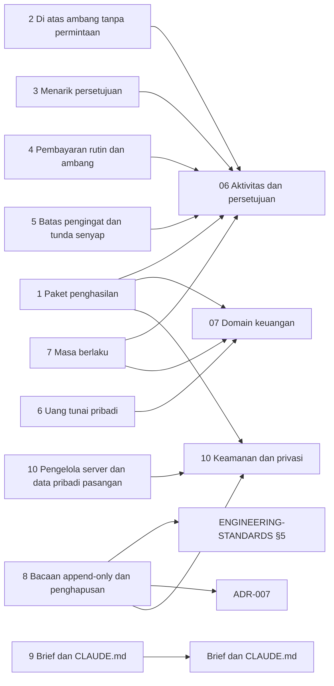
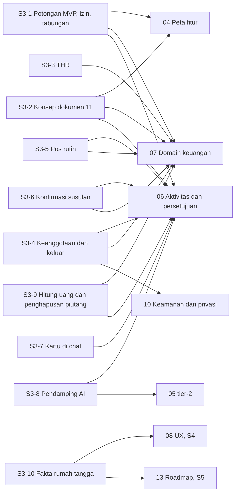
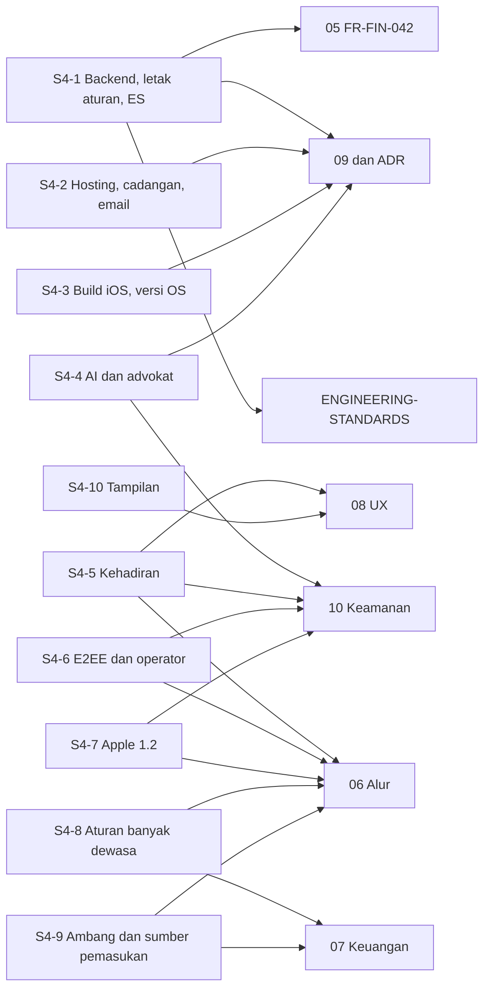
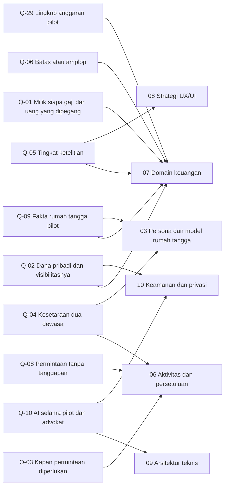

# 17 — Pertanyaan Terbuka dan Asumsi

| | |
|---|---|
| Pemilik dokumen | `product-analyst` |
| Tahap | S1 (Framing); diperbarui di setiap tahap. Pembaruan ini: S4 fase D, sebelum checkpoint S4 (12 November 2026) |
| Status | **Pembaruan S4 fase D, 12 November 2026; belum ditinjau ulang `critic`.** Susulan kedua (CR-B-01): F-FAM-019, F-FAM-020 diajukan di S4-6 (iii) dan F-COM-014 di S4-7 sebagai perubahan tier yang menunggu persetujuan pemilik produk; **D-114** baru (Pagar); K-61 diperbaiki di 06, 09, ADR-018 (CR-A-01); foto hanya JPEG, PNG ditolak (SEC-66 (a), CR-A-07) dicatat di 2.14 baris "Dokumen 09". Susulan: K-34 titik (2) dan (3) dinilai di 10.3 §2.4.1 dan ditutup bila ADR-027 diterima (S4-9 menyebutnya; **D-113** baru, Pagar); baris K-34 di "Tidak termasuk lanjut" dihapus; S4-10 (iii) menyebut F-FIN-027 Tier 3 Could yang boleh dinaikkan pemilik produk ke Tier 1; hitungan 04 dan 05 diperbarui di K-54 dan 2.14. Ditambahkan bagian **"Checkpoint S4: pertanyaan untuk pemilik produk"** (status: disiapkan, belum disajikan): ringkasan stack dan arsitektur yang direkomendasikan beserta tradeoff dan biaya pilot, sepuluh pertanyaan S4-1 sampai S4-10 yang memetakan 09-A sampai 09-G, 10-A sampai 10-G, UX-1 sampai UX-5, Q-184, Q-188 sampai Q-191, T-43, T-47, T-48; arti "lanjut" dan dua bagian yang jatuh ke B tanpa jawaban tegas (09-F, 09-G); W-28 sampai W-33; D-98 sampai D-114. Ditambahkan **2.14**: Q-192 selesai (ditetapkan dokumen 10), Q-193 sampai Q-206 baru, status "Dibawa ke S4" dan "Tidak termasuk lanjut di S3" per baris, status K lama. K-54, K-55 selesai; K-32 diperbarui; **K-56 sampai K-62** baru (R1 lawan brief §5O; lipat N-28 lawan brief §1.1; Apple 1.2 lawan brief §4.2; ES §2 lawan ADR-013; ES §8 lawan ADR-023; kehadiran lawan saran SEC-60; SES lawan brief §1). **L-32 sampai L-38** baru menurut 10 §7.1 dan 10.4 §3.3; L-26 sampai L-30 dicocokkan dengan pemetaan dokumen 10 (isi sama, tidak diubah); L-12, L-14, L-16 diperluas. **R-12 sampai R-14** baru. Tidak ada aturan uang atau alur yang ditetapkan di sini; setiap default mengutip dokumen pemiliknya. **Sebelumnya: pembaruan S4, 12 November 2026; belum ditinjau `critic`.** Ditambahkan bagian "Keputusan pemilik produk selama S4" (stack mobile diputuskan pemilik produk, Q-34 selesai; "Tunggu dokumen 09 (Saran)" diterima atas saran lead; catatan atas `CLAUDE.md` "Deferred on purpose", bukan pertentangan) dan 2.13 (Q-34, Q-10, Q-184; Q-188 sampai Q-191 untuk checkpoint S4, Q-192 untuk dokumen 10; ringkasan penyisiran M1 sampai M9; W1 sampai W7 dibawa ke S6). K-54 dan K-55 baru. R-01 dan R-11 tetap terbuka; R-04 terjawab; R-06 dan R-07 terjawab dari teks. L-13, L-14, L-15, L-16, L-18 diperluas; L-26 sampai L-30 baru. Daftar pertanyaan checkpoint S4 belum disusun (lead, sesudah 09 dan 08). Tidak ada aturan uang atau alur yang ditetapkan di sini. **Sebelumnya: pembaruan sesudah checkpoint S3, 12 November 2026.** Checkpoint S3 dijawab pemilik produk dengan "lanjut". Ditambahkan "Hasil checkpoint S3" di bagian checkpoint S3 (jawaban per pertanyaan, peringatan, baris D, jawaban S3-10 dan pertanyaan THR, pertanyaan susulan lead, S3-3 yang dibuka ulang sebagian, arahan pemilik produk tentang rancangan untuk semua rumah tangga); status bagian itu "disajikan dan dijawab"; 2.12 (status sesudah checkpoint S3; Q-183 sampai Q-187); K-52, K-53; A-31 gugur; K-34, K-38 sampai K-51 diperbarui; "Tidak termasuk lanjut" dan "Dibawa ke S4" diperbarui; Q-187 tertutup untuk Tier 1 kecuali fase (IDEA-01, 02, 03 sebagai AC FR induk dengan skenario). Sesudah brief diubah (12 November 2026, diterima atas saran lead): K-38, K-39, K-41, K-43, K-50, K-52, Q-163 selesai; perbaikan tinjauan `critic` CP-01 sampai CP-14 (bagian 7). Teks yang disajikan dipertahankan sebagai catatan. Tidak ada aturan uang atau alur yang ditetapkan di sini. **Sebelumnya: putaran perbaikan S3 fase D, 12 November 2026.** Atas tinjauan `critic` B (CB-03, CB-04, CB-05, CB-07, CB-23, CB-24), pemeriksaan `security-privacy` SP-45 sampai SP-69, dokumen 06 revisi kesepuluh (§15.12; N-32, P-28 sampai P-36), dan dokumen 07 putaran perbaikan S3 (INV-33, INV-34, T-39, T-40). Sepuluh pertanyaan checkpoint S3 tetap sepuluh: S3-1 butir (d) pengingat tagihan Tier 1, S3-2 (vi) tanpa syarat kehadiran, S3-4 (c) keluar dengan masa tenggang, S3-6 (v), S3-7 (ii) dirumuskan ulang, S3-8 (v) dan (vii) teks layar kunci, S3-9 dengan batas SP-50 dan SP-51; S3-10 dinyatakan memerlukan tiga fakta. D-57, D-58, D-61 diperbaiki; D-75 dan D-84 diberi Pagar; D-90 sampai D-97 baru. W-27 baru; W-18, W-23, W-24, W-26 diperbarui. Q-174 sampai Q-182 baru (06 P-28 sampai P-36, 07 T-39, T-40). K-45 dan K-49 selesai; K-50 dan K-51 baru; A-39 baru. Butir celah fase D ditutup: PA-FIN-11, PA-FAM-8 (Q-162), PA-SCN-1, PA-SCN-3, PA-REQ-6, PA-REQ-7, PA-NTF-3, PA-NTF-4, G-08, PA-COM-1 sampai PA-COM-4, PA-FAM-9 (dibuka dan ditutup), P-T2-10. Pengenal lokal ditulis ulang ke skema README (PA-FIN-n, PA-FIN-12 sampai 18, PA-COM-n, PA-FAM-n, PA-SCN-n, PA-REQ-n, `KM-NN` di dokumen 04). Koreksi atribusi dicatat di bagian 7. **S3 fase C, 12 November 2026; belum ditinjau `critic`.** Ditambahkan: bagian "Keputusan pemilik produk selama S3" (go-ahead "lanjut S3", model untuk agen, chat, pendamping `AI`, dikelompokkan menurut tingkat kepastian), bagian "Checkpoint S3: pertanyaan untuk pemilik produk" (sepuluh pertanyaan S3-1 sampai S3-10, D-56 sampai D-89, W-18 sampai W-26, daftar "Dibawa ke S4" dan celah untuk putaran perbaikan fase D), 2.11 (Q-133 sampai Q-173 beserta pemetaan dari 04, 05, 06, 07, 11; status baru Q-27, Q-30, Q-31, Q-32, Q-66, Q-90, Q-91, Q-95, Q-112 sampai Q-132), A-29 sampai A-38, K-38 sampai K-49 (K-46 dan K-47 dibuka dan ditutup). Q-133 dan Q-138 dijawab 06. A-22 gugur; R-04 dipindah ke S4; kalimat usang "Pemilik produk belum menjawabnya" di bagian kelompok kedua ditandai. Tidak ada aturan uang atau alur yang ditetapkan di sini. **Putaran perbaikan 12 November 2026** atas tinjauan `critic` (S1, S5, S8, S9), temuan `security-privacy` SP-32 sampai SP-44, dan empat jawaban pemilik produk: kelompok (i), W-17, Q-122, Q-123 ditambahkan; Q-61, K-35, dan K-36 ditutup. Pass kecil sesudahnya: Q-124 sampai Q-132 (usulan yang belum disajikan) ditambahkan; K-34 diperiksa ulang. Rincian di bagian 7. **Pembaruan sesudah checkpoint S2 (11 November 2026).** Checkpoint S2 dijawab pemilik produk. Ditambahkan bagian "Keputusan pemilik produk di checkpoint S2" (keputusan 18 sampai 25; yang diterima atas saran lead; yang diterima lewat "lanjut"; tiga rumusan lead yang ia kukuhkan; fakta rumah tangga; dua pernyataan arah; arahan tampilan; yang tidak diputuskan; bawaan untuk S3). Bagian "Checkpoint S2" kini berstatus dijawab: tabel "Hasil checkpoint S2" memuat jawaban per pertanyaan, W-5, W-13, dan W-14 yang ditulis ulang, dan baris D yang isinya berubah; teks asli dipertahankan dan ditandai "sebelum checkpoint S2". Ditambahkan 2.10 (status sesudah checkpoint S2; Q-112 sampai Q-121), A-27 dan A-28, K-30 sampai K-37. Q-82 ditutup. Dokumen 06 (revisi ketujuh) dan 07 (dua revisi pasca-checkpoint) dibaca pada bagian yang disebut di baris "Dibaca sebelum menulis". **Catatan sebelumnya:** Diperbarui di S2 dengan (1) tiga keputusan pemilik produk sesudah checkpoint S1 (11 November 2026, kelompok kedua) dan pernyataannya tentang arus uang rumah tangga pilot, (2) keputusan dokumen 07, dokumen 06, dan ADR-001 sampai ADR-010, dan (3) bahan checkpoint S2. **Diselaraskan ulang** dengan dokumen 07 dan 06 versi revisi (INV-24 sampai INV-26, T-12 sampai T-16; P-12, P-13, V-8, INV-A29, INV-A30): daftar pertanyaan checkpoint S2 disusun ulang menjadi satu daftar. **Pembaruan akhir S2** (sesudah pemeriksaan awal `security-privacy` atas dokumen 06, temuan SP-01 sampai SP-22, dan perbaikan dokumen 06, 07, serta ADR-003, ADR-007, ADR-009, ADR-010): pernyataan pemilik produk bahwa kedua pasangan berpenghasilan dicatat (A-26 terjawab) bersama enam butir usul lead yang belum ia jawab; bagian checkpoint S2 dibangun ulang sebagai satu-satunya daftar (06 §15.2 memetakan pertanyaan ini ke bagian 06); T-17 sampai T-21 dan P-14 sampai P-16 diberi nomor; K-24, K-25, dan K-26 ditutup; L-22 sampai L-24 ditambahkan. **Pembaruan kelompok ketiga** (keputusan pemilik produk 14 sampai 17 tentang jatah pribadi dan hari mulai periode anggaran, dan pernyataannya tentang irama penghasilan; dokumen 06 revisi kelima dan dokumen 07 dengan T-22 sampai T-27, CTH-39; bagian D dan E berkas temuan `security-privacy`): Q-98 ditutup; S2-1 dibangun ulang menjadi empat butir yang masih terbuka; peringatan diselaraskan dengan rumusan `security-privacy` (W-1 sampai W-13); D-48 sampai D-55, Q-100 sampai Q-111, K-29, dan L-25 ditambahkan; K-27 diperiksa ulang pada berkasnya. **Putaran perbaikan tinjauan `critic` S2** (B-1, S-6, M-5, M-9) dan penilaian `security-privacy` atas jatah pribadi (SP-24 sampai SP-31): "di dalam jatah tanpa tanda" tidak lagi disebut keputusan pemilik produk di mana pun (bawaan D-48); S2-1 menjadi lima butir dengan butir (v) alasan wajib, dan pilihannya dapat dijawab satu huruf (A sampai D, E untuk perubahan lain); D-20, D-29, D-51 sampai D-54 diperbarui; W-13 diperluas, W-14 ditambahkan, W-15 dan W-16 bersyarat; K-29 selesai; K-27 diperiksa ulang pada berkasnya |
| Tanggal | 12 November 2026 |
| Dibaca sebelum menulis | **Untuk pembaruan S4 fase D:** `CLAUDE.md`; brief §0.3 baris S4, §1 baris anggaran infrastruktur, §1.1 baris Tier 2, §4.2, §5O "Suggested words of support", §10.2; `ENGINEERING-STANDARDS.md` baris 3, §2, §8; [_progress.md](_progress.md) semua entri S4 di "Posisi saat ini"; ringkasan temuan `critic` B (di luar repositori; CS-B-01, CS-B-11, CS-B-12, CS-B-14); [10](10-security-privacy.md) indeks (§2, §3 10-A sampai 10-G, §4, §7, §7.1, §8, §9, §10), 10.4 §1.7, §1.8, §2.1, §3.2 sampai §3.4, 10.1 §6, 10.3 §2.3, §2.4; [09](09-technical-architecture.md) indeks (§1, §3, §5 sampai §8), 09.4 §5 (iOS tanpa Mac), §6, §7, §9 (RISK); [ADR-026](adr/ADR-026-pengiriman-email.md); [08](08-ux-ui-strategy.md) §17 butir 3, §22, §23; [07](07-financial-domain.md) §10.1 T-43 sampai T-48; [06](06-activity-approval-architecture.md) P-37 sampai P-42, §15.14, §15.15; [18](18-market-research.md) §2.11 butir fase D, §5.8. Yang **tidak** dibaca ulang: berkas 05 dan 12 (disunting instans lain bersamaan), glosarium, ADR selain ADR-026. **Untuk pembaruan S4:** `CLAUDE.md`; brief §1.1, §4, §0.3 baris S4; [00-glossary.md](00-glossary.md) baris yang disentuh penyisiran; [_progress.md](_progress.md) bagian "Posisi saat ini" sampai blok `finance-domain` penyisiran; berkas lead (di luar repositori) tentang bentuk perbaikan penyisiran, teks cermin, dan masukan dokumen 10; [06](06-activity-approval-architecture.md) §6.3, §9.1, §11.1 baris "Zona waktu", §15.14, P-37 sampai P-39; [07](07-financial-domain.md) §2.1, §2.3, INV-32, INV-33, T-44 sampai T-46, putaran "Penyisiran andaian khusus pilot S4"; [18](18-market-research.md) §2.7 sampai §2.11, §3, §6. **Untuk pembaruan S3 fase C:** `CLAUDE.md`; [_progress.md](_progress.md) dari awal sampai akhir blok S3 (catatan sumber semua kata pemilik produk di bagian S3); brief §1.1 baris Tier 1 sampai 3, §4.2, §5B, §5O; dokumen 04 §3.15, §4, §6, §7, §8, §9, §10; dokumen 11 Ringkasan, §8, §9, §10, §11; indeks 05 §4 dan §5; bagian celah dan pertanyaan tiap berkas 05 (FIN-1 §13, FIN-2 §12, REQ "Kesenjangan", NTF "Usulan yang menunggu", FAM §8, COM "Kesenjangan" dan "Pertanyaan", tier-2 §8 sampai §10); dokumen 06 §9.4 AT-4 dan AT-5, §15.3, §15.11, §16.10, §16.11; dokumen 07 §10.1 (T-10, T-30 sampai T-38), §10.2 putaran S3, §10.4; ADR-011; dokumen 02 PRN-10, PRN-11, PRN-14, KT-3. Yang **tidak** dibaca ulang: dokumen 12 dan tabel keterlacakan 05 (ditulis instans lain bersamaan), glosarium, ADR-001 sampai ADR-010. **Sebelumnya:** `CLAUDE.md`, `family-os-brief.md`, `ENGINEERING-STANDARDS.md` §5, [00-glossary.md](00-glossary.md) (versi S2), [07-financial-domain.md](07-financial-domain.md) versi revisi (§2.2, §2.5, §3.1, §3.3, §3.4, §3.8, §4, §5, §9, §10; CTH-03b), [06-activity-approval-architecture.md](06-activity-approval-architecture.md) versi revisi (§3.2, §4.4, §4.5, §6, §7, §9, §10, §11, §15), [ADR-007](adr/ADR-007-append-only-dan-hak-penghapusan.md) dan baris status ADR-001 sampai ADR-010, [18-market-research.md](18-market-research.md) (revisi dengan temuan PP 33/2026 dari salinan teks: §0.2, §2.1–§2.3, §2.6, §6), [02-product-principles.md](02-product-principles.md), [03-personas-household-models.md](03-personas-household-models.md), [README.md](README.md), [_progress.md](_progress.md). **Untuk pembaruan akhir S2:** temuan pemeriksaan awal `security-privacy` atas dokumen 06 (SP-01 sampai SP-22, sebagaimana diteruskan lead); dokumen 06 yang berlaku (§3.5, §6.3, §6.4, §7.1, §10, §11.1, §15 dibaca penuh; §4.4, §6.2, §7.2, §7.3, §8.2, §9.3, §9.4 lewat ringkasan dan peta di §15.1, §15.2, §15.5); dokumen 07 yang berlaku (§3.1, §8.2, §10 dibaca penuh; baris Q-01 dan Q-07 di §9; §3.8, §5.3, §6.3 lewat §10.1 dan §10.2); glosarium versi S2. **Untuk pembaruan kelompok ketiga:** dokumen 06 yang berlaku (§6.2, §6.3 bagian "Jatah pribadi", §6.4, §7.4, §15 dibaca penuh); dokumen 07 yang berlaku (§3.1, §3.4, §6.1, §10.1, §10.2, §10.3 dibaca penuh; CTH-39 pembukanya; §9 lewat §10.1); glosarium baris *jatah pribadi*, *periode anggaran*, *kesepakatan rutin*; berkas temuan `security-privacy` termasuk bagian D dan E. **Untuk pembaruan sesudah checkpoint S2:** `CLAUDE.md` dan brief yang berlaku (kalimat kedudukan keputusan checkpoint; brief §5C "Pilot scope"; §1.1; §10.2); [_progress.md](_progress.md) bagian "Jawaban checkpoint S2" seluruhnya; dokumen 06 revisi ketujuh (§10 PG-14, INV-A42, "Pernyataan arah pemilik produk"; §13.1; §15.1 sampai §15.9 dibaca penuh; §6.2 dan §6.3 lewat §15.9 dan P-18 sampai P-20); dokumen 07 (§9, §10.1 sampai §10.3, §11 dibaca penuh; §3.4, §3.15, CTH-40, CTH-41 lewat §9 sampai §11); dokumen 18 (§4.6 tabel tema dan warna, §4.7 butir pendamping AI, §4.8, §4.9); dokumen 02 dan baris yang terdampak di dokumen 03. Yang **tidak** dibaca ulang: ADR-001 sampai ADR-010 (statusnya dikutip dari 06 §15.7) dan glosarium |

## 0. Cara membaca dokumen ini

Dokumen ini adalah catatan tetap atas segala hal yang **belum diputuskan** atau **dianggap benar tanpa bukti** di Family OS, beserta jawaban pemilik produk atas hal yang sudah ia putuskan. Urutan bacanya:

1. [Keputusan pemilik produk di checkpoint S1](#keputusan-pemilik-produk-di-checkpoint-s1), lalu [Keputusan pemilik produk sesudah checkpoint S1](#keputusan-pemilik-produk-sesudah-checkpoint-s1-11-november-2026-kelompok-kedua), lalu [Keputusan pemilik produk kelompok ketiga](#keputusan-pemilik-produk-11-november-2026-kelompok-ketiga-jatah-pribadi-dan-periode-anggaran): apa yang sudah ia putuskan.
2. [Keputusan pemilik produk di checkpoint S2](#keputusan-pemilik-produk-di-checkpoint-s2): apa yang ia jawab di checkpoint S2, dengan tingkat kepastian tiap jawaban, dan apa yang dibawa ke S3.
3. [Checkpoint S2: pertanyaan untuk pemilik produk](#checkpoint-s2-pertanyaan-untuk-pemilik-produk): pertanyaan, peringatan, dan bawaan sebagaimana dibacakan, kini dengan tabel "Hasil checkpoint S2". Teks asli di bawah tabel itu adalah catatan "sebelum checkpoint S2".
4. [Keputusan pemilik produk selama S3](#keputusan-pemilik-produk-selama-s3-12-november-2026), lalu [Checkpoint S3: pertanyaan untuk pemilik produk](#checkpoint-s3-pertanyaan-untuk-pemilik-produk): apa yang ia putuskan dan nyatakan selama S3 (chat, pendamping `AI`), dan apa yang ditanyakan di checkpoint S3, kini dengan tabel [Hasil checkpoint S3](#hasil-checkpoint-s3) di awal bagian itu. Status butir yang disentuh S3 ada di 2.11, dan sesudah checkpoint S3 di **2.12** (2.12 menang atas 2.11, 2.11 atas 2.10 bila berbeda). Selama S4: [Keputusan pemilik produk selama S4](#keputusan-pemilik-produk-selama-s4-12-november-2026) dan **2.13** (stack mobile, penyisiran andaian khusus pilot, butir baru Q-188 sampai Q-192; 2.13 menang atas 2.12). Untuk checkpoint S4: [Checkpoint S4: pertanyaan untuk pemilik produk](#checkpoint-s4-pertanyaan-untuk-pemilik-produk) dan **2.14** (status sesudah dokumen 08, 09, 10; Q-193 sampai Q-206; 2.14 menang atas 2.13).
5. Bagian 1: pertanyaan checkpoint S1 beserta pilihan dan default aslinya, dengan hasilnya (catatan, tidak diubah).
6. Bagian 2 sampai 6: daftar lengkap di belakangnya. **Status yang berlaku bagi setiap pertanyaan ada di 2.8, dan bagi butir yang disentuh checkpoint S2 di 2.10** (2.10 menang bila berbeda); butir baru dari dokumen 07 dan 06 ada di 2.9 dan 2.10.

**Batas dokumen ini.** Dokumen 07 dan 06 kini ada. Aturan uang kanonis di [dokumen 07](07-financial-domain.md) dan aturan persetujuan di [dokumen 06](06-activity-approval-architecture.md); dokumen ini **mengutip** keduanya dengan nomor dan nama bagiannya dan tidak menetapkan aturan uang atau persetujuan apa pun. Yang dicatat di sini adalah: apa yang diputuskan pemilik produk, apa yang ditetapkan kedua dokumen itu dan masih menunggu tinjauannya, apa yang masih terbuka, dan di mana sumber-sumber itu bergesekan. Teks default di bagian 1 dan kolom "Default diusulkan" di 2.2 sampai 2.5 dan 2.7 adalah catatan atas apa yang diajukan pada S1; di tempat dokumen 07 atau 06 menetapkan lain, yang berlaku adalah kedua dokumen itu (2.8).

**Keadaan dokumen 06 dan 07 saat penyelarasan ini.** Dokumen 07 dan 06 versi revisi sudah memuat ketiga keputusan pemilik produk kelompok kedua; pertentangan yang semula dicatat di K-22 dan K-23 diperiksa ulang terhadap teks yang berlaku dan hasilnya dicatat di sana, butir demi butir. Rekonsiliasi `architect` atas dokumen 06 dan ADR yang semula dicatat di K-26 sudah selesai dan diperiksa terhadap berkasnya (K-26). Sesudah itu `security-privacy` memeriksa dokumen 06 (temuan SP-01 sampai SP-22); `architect` memperbaiki dokumen 06 dan ADR-003, ADR-007, ADR-009, ADR-010, dan `finance-domain` memperbaiki dokumen 07 (INV-27, INV-28, CTH-38, entri `exit_closure`, T-17 sampai T-21). Sesudah keputusan kelompok ketiga, `architect` merevisi dokumen 06 (revisi kelima: §6.2, §6.3 bagian "Jatah pribadi", §6.4, §7.4; INV-A37, INV-A38; P-17) dan `finance-domain` merevisi dokumen 07 (§3.1, §3.4, §6.1; INV-29, INV-30; CTH-39; T-22 sampai T-27); glosarium memuat *jatah pribadi* dan *periode anggaran* yang baru. Kalimat yang masih tertinggal pada teks yang terbaca, dan satu perbedaan tingkat kepastian antara 06 dan 07, dicatat di K-27. Daftar pertanyaan checkpoint S2 kini hanya ada di dokumen ini; 06 §15.2 "Yang perlu diputuskan pemilik produk di checkpoint S2" hanya memuat peta ke bagian yang terdampak. Karena nomor bagian dokumen 06 dapat bergeser, rujukan baru ke dokumen 06 menyebut **nama bagian** selain nomornya; bila keduanya tidak cocok, nama bagian yang berlaku.

**Cara membaca hasil checkpoint.** Delapan tingkat kepastian dibedakan dan tidak dicampur (dua yang terakhir sebelum "Belum dikukuhkan" ditambahkan sesudah checkpoint S2):

| Sebutan | Artinya |
|---|---|
| **Diputuskan pemilik produk** | Dinyatakan pemilik produk sendiri dalam percakapan checkpoint, atau dalam percakapan dengan lead sesudahnya (kelompok kedua). Bukan lagi **[Usulan]** |
| **Pernyataan pemilik produk** | Fakta tentang rumah tangganya yang ia nyatakan sendiri (bukan keputusan rancangan). Dicatat dengan sumber "pernyataan pemilik produk" dan tanggalnya; bukan **[Asumsi]**. Hanya mencakup apa yang ia katakan; yang tidak ia katakan tetap **[Asumsi]** atau terbuka |
| **Ditetapkan dokumen 07 atau 06; menunggu pemilik produk** | Diputuskan dokumen pemiliknya di S2 sebagai **[Usulan]**; berlaku sebagai dasar kerja dan ditinjau pemilik produk di checkpoint S2. Semua ADR-001 sampai ADR-010 berstatus "diusulkan; menunggu persetujuan pemilik produk di checkpoint S2" |
| **Diterima sebagai default lewat "lanjut"** | Tidak dibahas, tetapi termasuk daftar yang dibacakan lead kepada pemilik produk sebelum ia menyatakan "lanjut". Berlaku, dan dapat diubah pemilik produk di checkpoint mana pun |
| **Disampaikan lead, tidak dibantah** | Lead menyampaikannya dalam percakapan dan pemilik produk tidak berkeberatan. Ia tidak menyatakannya sendiri; diperlakukan sebagai default yang berlaku dan dikukuhkan di checkpoint S2 |
| **Diterima atas saran lead** | Pemilik produk menyerahkan pilihannya kepada lead atau menyatakan mengikuti saran lead; lead menerapkan bawaan tim dan menyampaikannya. Berlaku; **bukan** pernyataannya sendiri dan tidak dikutip sebagai kata-katanya |
| **Rumusan lead yang dikukuhkan pemilik produk** | Lead merumuskan ulang suatu hal dan pemilik produk menjawab dengan satu kata setuju ("bener"). Berlaku; yang dikutip sebagai kata-katanya hanya kata setuju itu dan kalimat yang memang ia ucapkan, bukan rumusannya |
| **Belum dikukuhkan** | Tidak dibahas dan tidak boleh dianggap diterima. Diajukan lagi di checkpoint yang disebut |

Teks pada baris "Default yang diajukan" di bagian 1 dan kolom "Default diusulkan" di bagian 2 disimpan sebagai catatan atas apa yang diajukan. Bila berbeda dari baris "Keputusan pemilik produk" atau dari tabel 2.6, yang berlaku adalah keputusan itu.

**Pengenal.** Selain skema brief §16, dokumen ini memakai lima pengenal yang tercantum di [README](README.md#skema-pengenal): `Q-NN` (pertanyaan terbuka), `A-NN` (asumsi), `R-NN` (riset yang perlu divalidasi), `K-NN` (pertentangan antar-sumber), `L-NN` (butir tinjauan hukum). Nomor stabil dan tidak dipakai ulang; karena itu urutan sepuluh pertanyaan di bagian 1 tidak sama dengan urutan nomornya.

**Label bukti** mengikuti [README](README.md#label-bukti). Semua "default" adalah **[Usulan]** kecuali disebut lain. Label atas temuan riset diambil dari dokumen 18 versi revisi dan tidak dinaikkan: temuan yang di sana **[Perlu validasi]** tetap **[Perlu validasi]** di sini, dan kesimpulan peneliti tetap **[Usulan]**. Temuan tentang PP 33/2026 berlabel **[Perlu validasi] — salinan teks** (dokumen 18 §0.2 dan §2.6): pasal dan Penjelasannya dibaca langsung dan dikutip apa adanya dari salinan teks lengkap, bukan dari pindaian naskah yang ditandatangani; tiga ayat terpotong di salinan itu (Pasal 69 ayat (8), 136 ayat (2), 165 ayat (4)) dan tidak dipakai sebagai dasar; yang belum ada hanyalah pencocokan dengan pindaian resmi. Label ini tidak dinaikkan menjadi **[Terverifikasi]** di dokumen ini. "Hari" dalam PP itu berarti hari kerja (Pasal 1 angka 19).

**Status pertanyaan:** *Terbuka* (menunggu jawaban), *Diputuskan* (dijawab pemilik produk, dengan rujukan), *Ditetapkan 07* atau *Ditetapkan 06* (diputuskan dokumen itu sebagai usulan; menunggu tinjauan pemilik produk di checkpoint S2), *Default diterima* (diterima lewat "lanjut" tanpa dibahas), *Ditunda* (sengaja dijawab di tahap yang disebut). "Dipersempit" pada status *Terbuka* berarti sebagian jawabannya sudah ditentukan keputusan checkpoint S1 dan sisanya dirinci di 2.6. Kolom Status pada tabel 2.1 sampai 2.5 dan 2.7 adalah keadaan sebelum dokumen 07 dan 06 ditulis; **status yang berlaku ada di 2.8**, dan sesudah checkpoint S2 di 2.10.

**Pernyataan pemilik produk tentang cara kerja** (11 November 2026, kepada lead; bukan keputusan produk). (1) Cara tim diorkestrasi ia serahkan kepada lead, selama hasilnya profesional. (2) Ia ingin segala sesuatu dijelaskan dan dikonfirmasi kepadanya, dan hal yang memerlukan keputusan ditanyakan langsung. (3) Di akhir ia mengharapkan penjelasan tentang tujuannya dan konfirmasi bahwa dokumen Markdown sudah benar, sah, dan matang, serta melayani satu tujuan itu. Akibatnya bagi dokumen ini: pertanyaan checkpoint dibatasi pada yang sungguh memerlukan dirinya, dan setiap default yang ia terima tanpa dibahas didaftar satu per satu, tidak disiratkan.

**Pagar yang diperiksa pada setiap default** (brief §1.1, §5D, §8): permintaan berjalan dua arah; tidak ada orang dewasa yang dapat memantau atau mengendalikan orang dewasa lain; aturan tidak berbeda antara suami dan istri; dan memegang uang tidak dengan sendirinya memberi hak atas uang itu (glosarium 7.2: enam dimensi custody tidak saling menurunkan). Default yang menyentuh pagar ini diberi tanda **Pagar** beserta catatannya.

---

## Keputusan pemilik produk di checkpoint S1

Pemilik produk menjawab checkpoint S1 pada 11 November 2026 dalam percakapan dengan lead, dengan kata-katanya sendiri, lalu menyatakan "lanjut". Bagian ini mencatat jawaban itu sebagaimana diteruskan lead kepada `product-analyst`; kutipan bertanda petik adalah kata-kata pemilik produk. Jawaban dicatat apa adanya: tidak diperkuat, tidak diperluas, dan tidak ditafsir ulang. Hal yang perlu ditafsirkan agar dapat menjadi aturan dicatat sebagai pertanyaan untuk dokumen 06, 07, dan 10 (2.7), bukan diputuskan di sini.

### Yang diputuskan pemilik produk sendiri

| # | Keputusan | Menyentuh | Yang tidak ia putuskan, dan ke mana perginya |
|---|---|---|---|
| 1 | **Uang yang masuk.** Setiap entri mencatat sumbernya (gaji, pinjaman yang diterima, hadiah, lainnya), punya siapa (suami atau istri), dan siapa yang memegangnya. Yang menerima uang otomatis menjadi *pemegang*-nya dan dialah yang mencatat; dari situ orang itu mencatat pembayaran, penyerahan uang kepada pasangan, atau pemberian uang kepada anggota keluarga (orang tua, saudara) | Q-01, Q-09, Q-19, Q-20 | Hubungan "punya siapa" dengan *pemilik uang*, dan perlakuan "pinjaman yang diterima", yang menurut glosarium bukan *pemasukan* (Q-55, K-15). Apakah penerima *serah terima* perlu mengonfirmasi (Q-19, K-20) |
| 2 | **Kepemilikan uang yang masuk.** Gaji menjadi *dana bersama* secara bawaan walaupun tercatat sebagai, misalnya, "gaji suami"; bawaan itu dapat diubah saat entri. Hadiah yang diberikan kepada satu orang menjadi *dana pribadi* orang itu secara bawaan | Q-01 | Apakah gaji yang diubah menjadi dana pribadi saat entri terlihat oleh pasangan dan tunduk pada aturan penyisihan (Q-56, K-16) |
| 3 | **Dana pribadi.** Ada dan bersifat pribadi: saldonya tertutup bagi pasangan. Bila dana pribadi dipakai untuk keperluan rumah tangga, pengeluaran itu terlihat oleh keduanya dengan sumbernya disebut (contohnya: "beras, pakai uang pribadi suami"; "bayar listrik pakai uang pribadi istri"). Pemakaian seperti itu diperlakukan sebagai kontribusi dan **tidak** diganti, kecuali pembayarnya menandainya "minta diganti"; baru saat itu *hak ganti* lahir | Q-02, Q-21, Q-23, Q-24, Q-13 | Cara kontribusi itu dilaporkan (Q-52). Glosarium saat ini mendefinisikan *talangan* sebagai selalu melahirkan hak ganti (K-14). Angka mana yang tampil sebagai "uang kita" tidak dibahas dan tetap usulan untuk dokumen 07, 08, dan 10 |
| 4 | **Kesetaraan.** Setara sepenuhnya. Setiap tindakan memperlihatkan dengan jelas siapa pelakunya (ia menekankan: siapa yang belanja, dan seterusnya), sebagai keterangan pelaku yang terlihat biasa, dalam kata-katanya "bukan audit". Setiap hal punya tingkat visibilitas: pribadi, pasangan saja, atau semua anggota. Chat dan permintaan bersifat pribadi bagi pihak-pihaknya. Apakah ada yang dienkripsi end-to-end diserahkan ke S4 | Q-04, Q-27, Q-30 | Arti tingkat visibilitas bagi tiap objek Tier 1 (Q-51, K-19). Enkripsi end-to-end (Q-57) |
| 5 | **Permintaan.** Belanja biasa dicatat setelah terjadi, tanpa persetujuan. Yang memerlukan persetujuan adalah rencana yang diajukan lebih dulu ("aku mau keluar dengan budget segini, ke sini"); anggaran, waktu, dan tambahannya dapat dirundingkan. Untuk pemakaian besar yang tidak direncanakan dan tidak rutin (contoh dari pertanyaan lead: membeli ponsel, meminjamkan uang kepada saudara) ia memilih: di atas satu ambang nominal, pemakaian itu wajib diajukan lebih dulu, dengan ambang yang sama bagi kedua pasangan. Angkanya diisi ketika rumah tangga mulai memakai aplikasi | Q-03, Q-12, Q-13, Q-14 | Apa yang terjadi bila pemakaian di atas ambang dicatat tanpa permintaan (Q-54). Ia tidak menyebut syarat "dalam batas anggaran" bagi belanja biasa |
| 6 | **Permintaan tanpa tanggapan.** Permintaan tetap menunggu, dan pemohon dapat mengingatkan lagi | Q-08 | Batas pengingat (Q-53, K-17); lihat tabel "Disampaikan lead" di bawah |
| 7 | **Ketelitian.** Ia menginginkan "yang profesional dan bener standarnya". Yang disepakati secara eksplisit: catatan lama tidak pernah disunting; uang dihitung dan selisihnya dicatat sebagai satu entri *selisih kas* yang terlihat; ketika belanja yang terlupa teringat, *entri terlambat* dengan tanggal aslinya ditambahkan dan selisihnya mengecil; siapa yang lupa diselesaikan berdua di luar aplikasi (chat atau langsung) | Q-05 | Cara selisih yang sudah tercatat "mengecil" tanpa menyunting entrinya, dan perlakuan selisih di laporan dan anggaran, diputuskan dokumen 07 |
| 8 | **Anggaran.** Anggaran melekat pada kategori; kategori dibuat bebas oleh rumah tangga (contohnya: belanja bulanan, cicilan, pulsa/wifi), masing-masing dengan jumlah anggarannya sendiri yang dapat diubah. Atas Q-29 ia menanyakan pendekatan yang profesional dan menerima rekomendasi lead: bulanan per kategori, mulai pada tanggal gajian (kata-kata saat itu; **disempurnakan keputusan 15**: hari mulai periode ditentukan rumah tangga, bawaan tanggal 1, karena tidak ada satu tanggal gajian); jalan-jalan dan acara tidak mendapat anggaran periode sendiri karena berjalan lewat permintaan; mingguan dan harian dapat ditambahkan kelak | Q-06, Q-29, Q-33 | Pilihan "batas" lawan "cara amplop" (Q-06) tidak ia nyatakan dengan kata-kata itu; uraiannya cocok dengan "batas", dan pilihan (a) berlaku sebagai default |
| 9 | **Tidak ada yang baku.** Semua daftar ditentukan pengguna dan dapat ditambah, diganti nama, dan dihapus: tempat uang, kategori, cicilan (motor, mobil, rumah), utang dan piutang, aset, tabungan | Q-09, Q-20, Q-46 | Arti "dihapus" bagi butir yang sudah punya riwayat atau masih bersaldo (Q-58); lihat tabel "Disampaikan lead" |
| 10 | **Pendamping AI.** Ia menginginkan AI-nya Claude atau ChatGPT, dan server aplikasi di-host di Indonesia. Setelah diberi tahu bahwa keduanya penyedia luar negeri sehingga data AI tetap keluar dari Indonesia, ia menyatakan bingung. Lead menjelaskan dan mengusulkan untuk **tidak** memutuskan sekarang: di S4 tim meneliti apakah Claude atau ChatGPT dapat diproses di Indonesia (R-05, L-16), dan ia memilih di checkpoint S4. Ia menjawab "lanjut" atas usulan itu | Q-10, Q-35 | Bagian (1) Q-10 **ditunda ke checkpoint S4**, dengan preferensi yang dinyatakan (Claude atau ChatGPT) dan satu syarat tetap (server di Indonesia). Bagian (2) dan catatan pertanyaan 10: lihat "Belum dikukuhkan" |

### Disampaikan lead, tidak dibantah

| Hal | Menyentuh |
|---|---|
| Batas yang wajar atas pengingat akan diusulkan agar pengingat tidak menjadi tekanan | Keputusan 6; Q-53 |
| Menghapus butir daftar yang sudah punya riwayat berarti mengarsipkannya: butir itu hilang dari daftar pilihan dan riwayatnya tetap ada, karena catatan uang tidak pernah disunting atau dihapus | Keputusan 9; Q-58 |

### Diterima sebagai default lewat "lanjut"

Butir berikut tidak dijawab secara eksplisit. Lead membacakannya kepada pemilik produk sebelum ia menyatakan "lanjut".

| Butir | Default yang berlaku |
|---|---|
| *Pinjam kembali* (Q-01) | Mengambil lagi dana bersama yang dipegang pasangan bukan utang, hanya *serah terima* |
| Fakta rumah tangga pilot (Q-09) | Tidak diisi. Pemilik produk membaca pertanyaan itu sebagai pertanyaan tentang keluwesan aplikasi (keputusan 9). Contoh terhitung memakai angka brief dan angka ilustrasi berlabel **[Asumsi]**; data yang sebenarnya dimasukkan saat onboarding |
| Q-07 | Rp3.000.000 untuk ibu suami adalah pengeluaran saat diserahkan dan tidak dilacak sesudahnya; untuk saudara dan ayah, pencatat memilih pinjaman atau bantuan pada tiap entri |
| Q-49 | Penyisihan dana bersama menjadi dana pribadi mengikuti aturan ambang permintaan |
| Q-25 | Ibu suami tidak mendapat login selama pilot |
| Q-26 | Masing-masing pasangan boleh mengoreksi; entri asli tetap; *keberatan* dapat diajukan |
| Bagian default yang tidak disinggung pada Q-02, Q-03, Q-04, Q-05, Q-08, dan Q-29 | Dirinci pada baris "Keputusan pemilik produk" tiap pertanyaan di 1.1 |

### Belum dikukuhkan; diajukan lagi di checkpoint S4

Dua hal pada Q-10 tidak dibahas secara eksplisit dalam penjelasan yang disederhanakan, sehingga **tidak** dicatat sebagai diterima:

| Hal | Keadaan |
|---|---|
| Q-10 bagian (2): kapan advokat ditanya, pilihan (i), (ii), atau (iii) | Belum dikukuhkan pemilik produk |
| Catatan pertanyaan 10: apa yang diterima pemilik produk sebagai operator selama pilot (DPIA formal dan perjanjian tertulis dengan prosesor data belum ada) | Belum dikukuhkan pemilik produk. Kalimat checkpoint "lanjut pakai default mencakup catatan ini" tidak diberlakukan atasnya |

### Ketegangan yang dicatat

Keputusan di atas tidak diubah dan tidak dilunakkan. Tempat sebuah keputusan bergesekan dengan pagar, dengan brief, dengan glosarium, atau dengan default lain dicatat di bagian 5: K-14 (kontribusi dana pribadi lawan definisi *talangan*), K-15 ("pinjaman yang diterima" sebagai sumber uang masuk lawan definisi *pemasukan*), K-16 (bawaan gaji dapat diubah saat entri lawan default Q-49), K-17 (pemohon dapat mengingatkan lagi lawan pagar Q-08), K-18 (preferensi Claude atau ChatGPT lawan syarat data AI tetap di Indonesia), K-19 (tingkat visibilitas dan keterangan pelaku lawan pagar pemantauan dan kriteria sukses nomor 1), K-20 (siapa yang mencatat serah terima). K-21 mencatat bahwa keputusan 5 tidak bertentangan dengan alur acuan brief §5D.

---

## Keputusan pemilik produk sesudah checkpoint S1 (11 November 2026, kelompok kedua)

Pada hari yang sama, sesudah checkpoint S1, pemilik produk menjawab tiga pertanyaan lead yang semula dijadwalkan untuk checkpoint S2 (K-16, K-20, K-17). Bagian ini mencatat jawabannya sebagaimana diteruskan lead kepada `product-analyst`; kutipan bertanda petik adalah kata-kata pemilik produk atau contoh yang dipakai lead dalam pertanyaannya. Aturan pencatatan sama dengan kelompok pertama: apa adanya, tidak diperkuat, tidak diperluas. Agar tidak tertukar dengan keputusan 1 sampai 10, ketiganya diberi nomor 11 sampai 13 (nomor 1 sampai 3 dalam catatan lead).

### Yang diputuskan pemilik produk sendiri

| # | Keputusan | Menyentuh | Yang tidak ia putuskan, dan ke mana perginya |
|---|---|---|---|
| 11 | **Uang masuk diarahkan saat dicatat.** Uraiannya: siapa pun yang memasukkan uang masuk (ia atau istrinya) memilih ke mana uang itu pergi: masuk ke kas bersama ("kas"), langsung dipakai untuk sesuatu, atau masuk ke dana pribadi; gaji termasuk. Lead menanyakan apa yang dilihat pasangan bila gaji diarahkan ke dana pribadi: (a) pasangan melihat catatannya, misalnya "gaji Rp10 juta masuk, Rp1 juta ke pribadi", dan yang tertutup hanya saldo serta pemakaian dana pribadi sesudahnya; atau (b) pasangan tidak melihat apa pun. **Ia memilih (a).** Lead merekomendasikan (a) | K-16, Q-56, Q-55, Q-49; keputusan 2 dan 3 | Rekomendasi `finance-domain` dan `architect` pada draf pertama (gaji selalu masuk *dana bersama*, bagian pribadi hanya lewat *penyisihan*) **tidak diambil** pemilik produk dan sudah dicabut dari kedua dokumen (07 §3.1 "Uang masuk"; 06 §6.4 "Uang masuk yang diarahkan ke dana pribadi"). Bentuknya kini ditetapkan 07: satu catatan uang masuk yang memuat jumlah penuh dan bagian pribadinya (CTH-03b), dan penghasilan tidak dapat dicatat hanya di buku pribadi (INV-24; 06 V-8, INV-A29). Pemilik produk **tidak ditanya** apakah pengarahan itu perlu dibatasi, dan ia tidak membatasinya: tidak ada persetujuan dan tidak ada batas bagian (D-32). **Belum diputuskan pemilik produk:** apakah bagian yang diarahkan ke dana pribadi ditandai bila melampaui *ambang permintaan* (Q-78; 06 dan 07 sama-sama mengusulkan "ya"); sumber uang masuk mana yang wajib meninggalkan catatan bersama, dan khususnya apakah hadiah untuk satu orang terlihat (Q-77; 07 mengusulkan "tidak terlihat", dan 06 kini berbunyi sama, K-25 selesai); dan apakah hanya penerima penghasilan yang boleh mengarahkan penghasilannya sendiri ke dana pribadinya (Q-92; 07 INV-27; temuan SP-01). **Sesudah keputusan 14, 16, dan 17 (kelompok ketiga):** keputusan itu menetapkan bentuk *jatah pribadi*, bukan perlakuan tandanya. Bahwa bagian pribadi penghasilan terhitung terhadap jatah dan di dalam jatah tidak ditandai adalah dasar pertanyaan lead yang disampaikan kepadanya dan tidak ia bantah; ia berlaku sebagai bawaan D-48 (**[Usulan]**), bukan sebagai keputusannya. Yang masih terbuka adalah perlakuan bagian yang melewati jatah (S2-1 butir iii), Q-92 (butir i), dan Q-77 (butir ii). "Langsung dipakai" ditetapkan 07 sebagai dua catatan dalam satu alur layar (Q-55, T-15; D-26) |
| 12 | **Konfirmasi serah terima.** Lead menanyakan apakah istri harus menekan "terima" ketika ia mencatat "kasih ke istri Rp4 juta": (a) catatan tersimpan seketika tetapi bertanda "belum dikonfirmasi" sampai penerima menerimanya; penerima dapat mengajukan *keberatan* kapan saja; sama ke arah sebaliknya; atau (b) langsung sah tanpa konfirmasi. **Ia memilih (a)** | K-20, Q-19 | Perluasan yang diusulkan 06 §7 "Konfirmasi custody" dan 07 §3.3 "Pemindahan dan serah terima": tanda yang sama atas setiap uang yang dicatat masuk ke tempat uang yang dipegang orang dewasa lain (bukan hanya serah terima); pengingat atas konfirmasi yang tertunda; tanda yang sama atas catatan dua buku yang **mengurangi** uang bersama yang dipegang pasangan (temuan SP-05; D-36); menutup keberatan atas serah terima tidak sama dengan mengonfirmasi (SP-04; D-37). Tidak ada pencatat bawaan di layar serah terima: siapa pun dari keduanya boleh mencatat (06 §7.1 "Asas"; K-26 selesai). Semuanya usulan (2.8, baris Q-19; D-21) |
| 13 | **Batas pengingat ulang.** Lead mengusulkan paling banyak satu pengingat per 24 jam. Jawabannya: "6 jam sekali aja batasannya", yaitu paling banyak satu pengingat ulang per 6 jam per permintaan. Ia lalu menyetujui ("oke setuju") tambahan lead: pengingat menghormati *jam tenang* penerima dan baru dikirim setelah jam tenang berakhir | K-17, Q-53; keputusan 6 | Ia **tidak ditanya** tentang batas jumlah seluruh pengingat, kalimat baku, atau tombol tunda bagi penerima. Ketiganya tetap usulan 06 §10 "Pagar terhadap kendali koersif" (PG-06 "Pengingat berbatas") dan 06 §4.4 "Diskusi, usul balik, dan penolakan" untuk checkpoint S2: batas jumlah dan tombol tunda ditanyakan (pertanyaan S2-5); kalimat baku dan keterbukaan hitungan pengingat masuk daftar default (D-29) |

### Pernyataan pemilik produk tentang arus uang rumah tangga pilot

Bukan keputusan rancangan, melainkan **pernyataan pemilik produk** tentang rumah tangganya sendiri (sumber: pernyataan pemilik produk, 11 November 2026, dalam percakapan perencanaan dengan lead; diteruskan lead apa adanya). Pemilik produk adalah suami di rumah tangga pilot. Ia menyatakannya dua kali; kata-katanya dikutip tanpa disunting:

> "masih yang input misal gaji turun kan otomatis saya yang pegang, nanti saya input misal bayar ini bisa kasih kesini kesana bisa atau ke anggota keluarga"

> "simplenya gini gaji turun, saya input total gaji saya, saya bayar cicilan, lisrik dll, sisa saya kasih ke istri segini ke ibu segini kalau ada, ke adik kalau ada, ke ayah kalau ada gitu paham gaa? atau istri input uang, sumber gaji, masuk ke kas atau dipake ini atau masuk ke pribadi, gitu"

| Yang ia nyatakan | Kedudukan |
|---|---|
| Ia (suami) menerima gaji, dan begitu gaji tiba dialah yang memegangnya | Pernyataan pemilik produk, 11 November 2026 |
| Ia mencatat jumlah seluruh gajinya | Pernyataan pemilik produk, 11 November 2026 |
| Ia membayar cicilan, listrik, dan tagihan lain, dan mencatat pembayaran itu | Pernyataan pemilik produk, 11 November 2026 |
| Sisanya ia serahkan kepada istrinya; bila ada, sebagian kepada ibunya, kepada adiknya, dan kepada ayahnya | Pernyataan pemilik produk, 11 November 2026 |
| Istrinya juga dapat mencatat uang masuk dengan sumber gaji dan memilih arahnya: masuk kas, langsung dipakai, atau masuk dana pribadi | Pernyataan pemilik produk, 11 November 2026 (kalimat kedua); arah uang masuk itu sendiri adalah keputusan 11 |

| Yang **tidak** ia nyatakan | Kedudukan |
|---|---|
| Apakah istrinya berpenghasilan. Kalimat kedua menunjukkan istri dapat mencatat uang masuk bersumber gaji, tetapi tidak menyebut gaji siapa | **Terjawab kemudian pada hari yang sama:** keduanya berpenghasilan (bagian berikut; A-26). Baris ini disimpan sebagai catatan atas apa yang belum ia nyatakan pada dua kutipan di atas |
| Siapa di antara keduanya yang lebih sering lupa mencatat, dan siapa memakai ponsel yang mana | Tidak diketahui (A-19) |
| Jumlah gaji, cicilan, tagihan, dan tempat uang yang sebenarnya | Tidak diisi (Q-09); angka brief dan angka ilustrasi tetap dipakai (A-18, A-23) |
| Apakah kiriman untuk ibunya tetap, seperti Rp3.000.000 per bulan di brief §1.1. Kata-katanya "ke ibu segini kalau ada"; brief tidak diubah olehnya | Brief §1.1 berlaku; dicatat tanpa ditafsirkan |

Tiga akibat, tanpa menjadikannya aturan. (1) A-18 diperbarui: penerima gaji, pemegang awal, pencatat gaji, dan pembayar cicilan serta tagihan bukan lagi **[Asumsi]**. (2) Pada serah terima yang ia contohkan, **pemberilah yang mencatat** ("sisa saya kasih ke istri"); itulah jalur yang paling sering terjadi di pilot, sehingga tanda "belum dikonfirmasi" dan satu ketukan konfirmasi oleh penerima (keputusan 12) akan muncul pada hampir setiap serah terima. 06 §7.1 "Asas" kini tidak menetapkan pencatat bawaan dan menyebut jalur "pemberi mencatat, penerima mengonfirmasi" sebagai alur yang diuraikan pemilik produk (K-26 selesai). (3) Aturan tetap ditulis untuk "anggota dewasa" dan tidak boleh bergantung pada pernyataan ini (PRN-09; 06 PG-01): pernyataan ini menentukan contoh, urutan layar, dan di tangan siapa suatu tanda paling sering muncul, bukan isi aturan.

### Pernyataan pemilik produk tentang penghasilan kedua pasangan, dan usul lead yang belum ia jawab

**Pernyataan pemilik produk** (11 November 2026, kepada lead, sesudah lead menyampaikan peringatan pemeriksaan awal keamanan bahwa pilihan mengarahkan gaji dan keterbukaannya jatuh pada satu orang bila hanya satu pasangan berpenghasilan). Kata-katanya dikutip tanpa disunting:

> "suami ada gaji, istri ada gaji / pengahasilan /pendapatan menurutkamu bagus dan simplenya gmn?"

| Yang ia nyatakan | Kedudukan |
|---|---|
| Suami punya gaji | Pernyataan pemilik produk, 11 November 2026 (mengulang pernyataan sebelumnya) |
| Istri punya gaji, penghasilan, atau pendapatan | Pernyataan pemilik produk, 11 November 2026. **Menjawab A-26:** kedua pasangan berpenghasilan |
| Ia meminta lead mengusulkan cara yang bagus dan sederhana | Permintaan rekomendasi, bukan keputusan |

| Yang **tidak** ia nyatakan | Kedudukan |
|---|---|
| Jenis penghasilan istri (gaji tetap, hasil usaha, atau lainnya), jumlahnya, iramanya, dan ke tempat uang mana ia tiba | Tidak diketahui; tidak diisi (Q-09). Tiga kata yang ia pakai ("gaji / pengahasilan /pendapatan") tidak ditafsirkan sebagai satu jenis |
| Siapa yang berpenghasilan lebih besar | Tidak diketahui; tidak disimpulkan |
| Siapa yang mencatat penghasilan istri | Tidak dinyatakan di sini. Pernyataan sebelumnya ("atau istri input uang, sumber gaji") selaras dengan "istri mencatatnya sendiri" tetapi tidak menyatakannya sebagai aturan; lihat butir 1 usul lead |

**Usul lead: enam butir, menunggu jawaban pemilik produk.** Lead menjawab permintaan itu dengan enam butir di bawah. **Pemilik produk belum menjawabnya** saat bagian ini ditulis. **[Kalimat itu kedaluwarsa sejak checkpoint S2 (ditandai di S3 fase C, 12 November 2026): keenam butir sudah terjawab atau menjadi bawaan; keadaannya di alinea "Keadaan keenam butir sesudah keputusan kelompok ketiga" di bawah tabel, dan hasilnya di keputusan 18 sampai 20 dan kelompok (b) bagian "Keputusan pemilik produk di checkpoint S2".]** Keenamnya dicatat sebagai usul lead, bukan keputusan, dan diajukan sebagai satu pertanyaan (S2-1). Aturan uangnya tidak ditetapkan di sini; kolom kanan menunjuk dokumen yang memilikinya dan kedudukan tiap butir di sana.

| # | Usul lead | Kedudukan di dokumen 07 dan 06 |
|---|---|---|
| 1 | Masing-masing mencatat penghasilannya sendiri | Selaras dengan keputusan 1 ("yang menerima uang ... dialah yang mencatat") dan 07 §3.1 "Uang masuk". Model tidak melarang pasangan mencatatkannya; lihat butir 4 |
| 2 | Tujuan bawaannya uang bersama; saat mencatat, pencatat boleh mengarahkan sebagian ke uang pribadinya sendiri | Keputusan 2 dan 11; bentuk catatannya 07 §3.1, CTH-03b |
| 3 | Catatannya terlihat pasangan; saldo dan pemakaian uang pribadi sesudahnya tertutup. Kini berlaku sama atas penghasilan istri | **Sudah diputuskan pemilik produk** (keputusan 11). Yang baru hanya akibatnya: penghasilan kedua pasangan terbaca pasangannya (07 INV-24; 06 V-8, INV-A29) |
| 4 | Hanya yang berpenghasilan boleh mengarahkan penghasilannya sendiri ke uang pribadinya | **[Usulan]** 07 INV-27 (T-17) dan 06 §6.4 "Uang masuk yang diarahkan ke dana pribadi" (P-14), atas temuan SP-01. Q-92 |
| 5 | "Jatah pribadi" per bulan untuk masing-masing disepakati satu kali; jumlahnya ditentukan pasangan itu dan boleh berbeda. Di dalam jatah: tanpa tanda, tanpa pemberitahuan. Di luar jatah dan di atas ambang: tanda netral dan pasangan diberi tahu. Tidak pernah dihalangi | Jawaban A atas Q-78 (07 T-13; 06 P-12, §6.4), dengan *kesepakatan rutin* atas *jadwal penyisihan* (06 §6.3 "Kesepakatan rumah tangga"; 07 §3.4). Kata "jatah pribadi" belum menjadi istilah glosarium; bentuk persisnya di 06 dan 07: Q-98 |
| 6 | Hadiah untuk satu orang masuk uang pribadinya dan tidak terlihat pasangan | Jawaban A atas Q-77 (07 §3.1, T-14, CTH-36; 06 §6.4 bagian "Cakupan", P-13) |

**Keadaan keenam butir sesudah keputusan kelompok ketiga.** Tabel di atas disimpan sebagai catatan atas apa yang diusulkan. Butir 2 dan 3 adalah keputusan 2 dan 11. Dari butir 5, bentuk jatahnya kini **diputuskan pemilik produk** (keputusan 14, 16, 17); kalimat "di dalam jatah: tanpa tanda, tanpa pemberitahuan" disampaikan lead dan tidak dibantah, dan berlaku sebagai bawaan D-48 (**[Usulan]**); perlakuan pengambilan yang melewati jatah menjadi S2-1 butir (iii). Butir 1 dan 4 belum dijawab dan menjadi S2-1 butir (i). Butir 6 belum dijawab dan menjadi S2-1 butir (ii). Rujukan lama "S2-1 butir 4, 5, 6" di dokumen 06, 07, 02, dan 03 dibaca menurut pemetaan ini (K-27).

### Gesekan yang dicatat

Ketiga keputusan tidak diubah dan tidak dilunakkan.

| Gesekan | Dicatat di |
|---|---|
| Rekomendasi lama di dokumen 06 dan 07 (gaji selalu masuk dana bersama; uang masuk pribadi tidak terlihat; pengingat ulang per 24 jam) sudah dicabut dari kedua dokumen versi revisi | K-22, K-23 (selesai, kecuali butir yang disebut di sana) |
| **Pagar: asimetri dalam praktik (ambang); ditulis ulang karena keduanya berpenghasilan.** Aturan keputusan 11 simetris, dan kini kedua pasangan dapat mengarahkan penghasilannya sendiri ke dana pribadi saat mencatat; kalimat semula, bahwa di pilot hanya pemilik produk yang dapat melakukannya, tidak lagi berlaku. Yang masih benar: bila bagian pribadi dari penghasilan **tidak** ikut ditandai, aturan ambang atas *penyisihan* (default Q-49 yang diterima) mudah dihindari oleh siapa pun yang mengarahkan saat mencatat, dan lebih mengikat orang yang penghasilannya lebih kecil atau lebih jarang datang, karena ia lebih sering harus mengambil dana pribadinya lewat penyisihan (07 §10.3 butir 1, yang masih ditulis untuk satu penerima gaji: K-27). Dokumen 06 dan 07 sama-sama mengusulkan bagian itu ditandai seperti penyisihan lain; usul lead butir 5 menambahkan jatah pribadi yang disepakati satu kali. **Sesudah keputusan 14 dan 16:** menurut bawaan D-48 (**[Usulan]** 06 §6.3 dan 07 §3.4; bukan bagian keputusan itu), jatah pribadi berlaku sama atas bagian pribadi penghasilan dan atas penyisihan biasa, sehingga selama D-48 diterima jalan menghindar itu tertutup di dalam maupun di luar jatah; yang tersisa hanyalah perlakuan atas yang melewati jatah | Q-78; D-48; pertanyaan S2-1 butir (iii) |
| **Pagar: asimetri dalam praktik (keterlihatan); ditulis ulang karena keduanya berpenghasilan.** Aturan bahwa penghasilan yang dicatat selalu meninggalkan catatan bersama (INV-24) sama bagi keduanya, dan karena keduanya berpenghasilan, penghasilan keduanya terbaca pasangannya; kalimat semula, bahwa hanya penghasilan satu orang yang terbuka, tidak lagi berlaku. Yang masih benar: jumlah yang terbaca lebih besar pada yang berpenghasilan lebih besar (siapa orangnya tidak diketahui); keterbukaan itu hanya sama bila keduanya mencatat penghasilannya dengan sumber gaji atau hasil usaha, sebab sumber diisi pencatat sendiri; dan penghasilan istri, yang jenisnya tidak diketahui, hanya tercakup bila ia termasuk *daftar sumber penghasilan* preset (pilot: gaji dan hasil usaha; 07 §3.1, T-18). Ini akibat keputusan 11 yang dipilih pemilik produk sendiri | D-32; pertanyaan S2-1 |
| Cakupan catatan yang terlihat. Pemilik produk ditanya dan menjawab tentang gaji. Dokumen 07 mewajibkan catatan bersama hanya bagi gaji dan hasil usaha (T-14, INV-24), dan dokumen 06 kini berbunyi sama (06 §6.4 bagian "Cakupan", P-13, V-8, INV-A29). Glosarium bagian 3, baris *data pribadi anggota*, dan 7.7, baris *penghasilan*, mengikutinya | Q-77; K-25 (selesai); pertanyaan S2-1 butir (ii) |
| Glosarium dan dokumen 07 §9 semula menyebut dua default yang diterima lewat "lanjut" sebagai "keputusan pemilik produk"; keduanya sudah diperbaiki | K-24 (selesai) |
| Dokumen 06 mempertahankan "ambang hanya berganti bila berdua setuju"; `security-privacy` menyarankan salah satu pihak boleh menarik diri dari kesepakatan ambang secara terlihat (SP-09). Dua sumber berbeda, dan keduanya disajikan kepada pemilik produk | K-28; Q-93; pertanyaan S2-4 |
| Dokumen 06 §6.4 dan 07 §10.3 butir 1 semula memuat kalimat "pada rumah tangga pilot hanya satu orang menerima gaji"; keduanya sudah diperbaiki (diperiksa pada berkasnya) | K-27 butir 1 (selesai) |

---

## Keputusan pemilik produk, 11 November 2026, kelompok ketiga: jatah pribadi dan periode anggaran

Pada hari yang sama, sesudah lead menyampaikan enam butir usulnya, pemilik produk menyatakan irama penghasilannya dan menjawab empat pertanyaan lead. Bagian ini mencatatnya sebagaimana diteruskan lead kepada `product-analyst`, **dalam urutan terjadinya**; kutipan bertanda petik adalah kata-kata pemilik produk, tanpa disunting. Aturan pencatatan sama dengan kedua kelompok sebelumnya: apa adanya, tidak diperkuat, tidak diperluas. Nomor keputusan melanjutkan kelompok kedua (14 sampai 17). Aturan uangnya kanonis di 07 §3.4 "Penyisihan dan kontribusi" dan §6.1 "Anggaran"; alurnya di 06 §6.3 "Kesepakatan rumah tangga", bagian "Jatah pribadi". Dokumen ini hanya mengutip.

### Pernyataan pemilik produk tentang irama dan jalur penghasilannya

Bukan keputusan rancangan; **pernyataan pemilik produk** tentang rumah tangganya (11 November 2026, kepada lead):

> "gajian saya bisa 2x bahkan uang masuk dari freelancer juga bisa sampe 5x lah uang masuk, masuk gajiab bisa ke bank/ewallet. bisa di tf ke istri bisa ditarik cash lalu di bagiin"

| Yang ia nyatakan | Kedudukan |
|---|---|
| Gajinya dapat datang dua kali | Pernyataan pemilik produk, 11 November 2026 |
| Ada uang masuk dari pekerjaan lepas (freelance); uang masuk dapat sampai lima kali | Pernyataan pemilik produk. Bacaan lead: gaji dua kali ditambah pekerjaan lepas sampai lima kali, jadi sampai sekitar tujuh uang masuk sebulan. Kalimatnya juga dapat dibaca "seluruhnya sampai lima kali"; angka tujuh adalah **bacaan lead**, bukan kata-katanya. Tidak ada aturan yang bergantung pada angkanya |
| Uang masuk tiba di rekening bank atau e-wallet | Pernyataan pemilik produk |
| Dari sana: ditransfer kepada istri, atau ditarik tunai lalu dibagikan | Pernyataan pemilik produk. Kepada siapa "dibagikan" tidak ia sebut di kalimat ini; pernyataan sebelumnya menyebut istri, ibu, adik, dan ayah |

| Yang **tidak** ia nyatakan | Kedudukan |
|---|---|
| Kata "sebulan": ia tidak mengucapkannya; lead membacanya per bulan | Bacaan lead |
| Irama dan jalur penghasilan istri | Tetap tidak diketahui (A-26) |
| Bahwa uang masuk pekerjaan lepas harus terlihat seperti gaji | Tidak dinyatakan. Dokumen 07 mengusulkan sumber `business` (T-27); ditanyakan sebagai S2-1 butir (iv) |
| Jumlah-jumlahnya | Tidak diisi (Q-09) |

Akibatnya, tanpa menjadikannya aturan: tidak ada satu "tanggal gajian" (keputusan 15); hitungan per kali tidak cocok bagi bagian pribadi penghasilan (keputusan 14); dan "membagikan satu jumlah kepada beberapa penerima" menjadi momen mencatat yang utama (06 §7.4 "Alur uang masuk rumah tangga pilot pada alur yang ada"; D-55). A-18 dan dokumen 03 bagian 2 diperbarui.

### Yang diputuskan pemilik produk sendiri

| # | Yang ditanyakan lead, dan pilihannya | Kata-kata pemilik produk | Keputusan sebagaimana dicatat | Menyentuh | Yang tidak ia putuskan, dan ke mana perginya |
|---|---|---|---|---|---|
| 14 | Bagaimana jatah pribadi diambil: (a) satu kali sebulan lewat satu catatan (rekomendasi lead); (b) dijumlahkan otomatis sepanjang bulan; (c) per catatan | "Jatah pribadi dijumlah per bulan bebas bisa diatur" | **Jatah pribadi adalah satu jumlah per orang per bulan, dijumlahkan sepanjang bulan itu; jumlahnya dapat diatur.** Rekomendasi lead (a) tidak diambil. Keberatan `architect` atas bentuk kumulatif (tanda tidak lagi ditentukan catatannya sendiri) sudah disampaikan lead kepadanya dengan kata-kata biasa (06 §6.3) | Q-98 (ditutup), Q-78; usul lead butir 5 | Ia **tidak ditanya** dan tidak menyatakan: apa yang terjadi pada pengambilan yang melewati jatah (S2-1 butir iii; Q-106); bahwa semua pemindahan uang bersama ke uang pribadi terhitung otomatis, termasuk uang saku (D-48; Q-107); bulan dihitung menurut tanggal kejadian dan dinilai satu kali (D-51; Q-103); siapa melihat sisa jatah (D-54; Q-108). **Dasar pertanyaannya**, bahwa di dalam jatah tidak ada tanda dan tidak ada pemberitahuan, berasal dari usul lead butir 5; ia menjawab cara menghitungnya tanpa membantah dasar itu: **disampaikan lead, tidak dibantah**, dikukuhkan lewat D-48. Dokumen 06 semula menuliskannya sebagai keputusan pemilik produk; kini 06 dan 07 sama-sama menuliskannya sebagai bawaan D-48 (K-27 butir 6, diperbaiki pada putaran perbaikan tinjauan `critic` S2) |
| 15 | Kapan bulan anggaran dimulai: (a) rumah tangga memilih satu tanggal tetap; (b) selalu tanggal 1 | "bisa di tentukan pasti ada yang fixed tanggal ada juga yang gak tertentu bener ga?" | **Hari mulai periode anggaran ditentukan per rumah tangga.** Lead mengukuhkan bacaannya kepadanya: satu hari mulai yang dipilih rumah tangga, bawaan tanggal 1, dapat diganti, penggantian berlaku mulai periode berikutnya. Menyempurnakan keputusan 8 ("mulai pada tanggal gajian") | Q-06, Q-29; keputusan 8 | Rumusan "bawaan tanggal 1; berlaku mulai periode berikutnya" adalah **bacaan lead yang dikukuhkan kepadanya**, bukan kata-katanya. Tidak ditanyakan: rentang 1 sampai 28 (Q-100); bentuk periode peralihan (Q-101); **siapa yang boleh mengganti** (Q-102: berdua, **putusan lead, bukan keputusan pemilik produk**; D-49). Kalimatnya "ada juga yang gak tertentu" tidak dijalankan sebagai fitur: tidak ada periode tanpa hari mulai |
| 16 | Siapa yang menetapkan jumlah jatah: (a) disepakati berdua; (b) masing-masing menetapkan jatahnya sendiri | "a di sepakati berdua, nanti saling konfirmasi aja" | **Jumlah jatah disepakati berdua: satu mengusulkan, yang lain mengonfirmasi.** Pilihan (b) tidak diambil | T-22; Q-98 | Tidak ditanyakan: apakah salah satu boleh **mengakhiri** kesepakatan jatah sendirian, termasuk jatah pasangannya. Dokumen 06 semula mengusulkan boleh (K06), yang bergesekan dengan "disepakati berdua" (K-29). Atas temuan `security-privacy` SP-24 bawaannya kini: hanya pemilik jatah yang dapat mengakhiri jatahnya sendiri; pasangannya menurunkannya lewat usulan (D-52; Q-109; K-29 selesai) |
| 17 | Tidak ditanyakan; ia menambahkannya sendiri | "bisa ajukan kenaikan sesuai alasan" | **Kenaikan jatah dapat diajukan dengan alasan dan dikonfirmasi pasangan** | Q-98 | **Bacaan lead, disampaikan kepadanya dan tidak dibantah:** perubahan jumlah tetap adalah usulan beralasan yang dijawab terima, tolak, atau usul jumlah lain; tambahan untuk satu bulan saja adalah permintaan biasa (Q-110). Bacaan lead semula, belum ia nyatakan: alasan **wajib** pada usulan yang menaikkan jatah pengusulnya sendiri. Kata-katanya "bisa ajukan kenaikan sesuai alasan" tidak menyatakan wajib; `security-privacy` menyarankan tidak wajib (SP-25). Karena itu **ditanyakan** sebagai S2-1 butir (v) (Q-105); rincian lainnya D-53 |

### Usul lead yang masih belum ia jawab

Dari enam butir usul lead (bagian sebelumnya), tiga hal tetap tanpa jawaban pemilik produk dan diajukan di S2-1: hanya penerima penghasilan yang boleh mengarahkan penghasilannya sendiri ke uang pribadinya (07 INV-27; butir i); masing-masing mencatat penghasilannya sendiri (butir i); hadiah untuk satu orang tidak terlihat pasangan (butir ii).

### Yang dilakukan dokumen 06 dan 07 atasnya

Semua **[Usulan]** kecuali yang hanya menjalankan keputusan 14 sampai 17. Masing-masing tercantum di daftar default atau di S2-1; tidak satu pun berlaku tanpa dibacakan.

| Yang ditetapkan | Di mana | Di dokumen ini |
|---|---|---|
| Semua pemindahan uang bersama ke uang pribadi seorang anggota terhitung terhadap jatahnya dengan sendirinya, tanpa ditautkan; uang saku anggota dewasa adalah jatah yang sama | 06 §6.3 "Yang terhitung"; 07 §3.4 | D-48; Q-107 |
| Bulan menurut tanggal kejadian; tanda dinilai satu kali saat catatan disimpan dan tidak pernah dinilai ulang; tanggal mundur adalah jalan menghindar yang diterima, dan tanggal pencatatan tampil bila berbeda dari tanggal kejadian (SP-28) | 06 §6.3, INV-A37; 07 §3.4, T-26 | D-51; Q-103; W-13 |
| Jatah bukan batas: bagian yang melewati jatah baru ditandai bila bagian itu sendiri melebihi ambang. `architect` menyarankan pemilik produk ditanya apakah semua yang melewati jatah harus ditandai | 06 §6.2, §6.3; 07 §3.4, §10.3 butir 7 | S2-1 butir (iii); Q-106; W-13 |
| Semula: salah satu anggota dewasa dapat mengakhiri kesepakatan jatah mana pun sendirian, termasuk jatah pasangannya. Atas SP-24: hanya pemilik jatah yang mengakhiri jatahnya sendiri; pasangannya menurunkannya lewat usulan; kesepakatan pembayaran rutin tetap dapat diakhiri salah satu | 06 §6.3 (K06; sedang diterapkan `architect`) | D-52; Q-109; K-29 (selesai) |
| Hari mulai 1 sampai 28, bawaan 1; penggantian disepakati berdua (putusan lead); satu periode peralihan pendek dengan batas anggaran dan jatah penuh | 07 §6.1, T-23, T-24, T-25, INV-29 | D-49, D-50; Q-100, Q-101, Q-102 |
| Uang masuk pekerjaan lepas dicatat sebagai hasil usaha (`business`), sehingga termasuk *penghasilan* | 07 §3.1, T-27 | S2-1 butir (iv); Q-104 |
| Alasan pada usulan kenaikan jatah sendiri (wajib atau tidak: ditanyakan; bila ada, dipilih dari daftar tertutup yang netral, SP-25); "usul jumlah lain" sebagai tolak lalu usul dalam satu alur layar; tambahan satu bulan lewat permintaan | 06 §6.3 (K01), INV-A19 | S2-1 butir (v); D-53; Q-105, Q-110 |
| Sisa jatah bulan berjalan: milik sendiri di layar utama pemiliknya; milik pasangan hanya bila dibuka di layar kesepakatan; tanpa pemberitahuan "hampir habis" kepada pasangan; tidak ada angka lintas bulan (SP-26) | 06 §6.3 "Yang dilihat, dan oleh siapa" | D-54; Q-108 |
| "Membagikan kepada beberapa penerima" adalah satu alur layar di atas catatan-catatan tersendiri | 06 §7.4 | D-55; Q-111; syarat dokumen 05 (S3) |

### Gesekan yang dicatat

| Gesekan | Dicatat di |
|---|---|
| "Disepakati berdua" (keputusan 16) lawan usulan dokumen 06 bahwa salah satu pihak dapat mengakhiri jatah pasangannya sendirian. Selesai atas SP-24: hanya pemilik jatah yang mengakhiri jatahnya sendiri | K-29 (selesai); D-52 |
| Dokumen 06 semula menyebut "di dalam jatah tanpa tanda" sebagai keputusan pemilik produk; dokumen 07 menyebutnya bersandar pada usul lead yang belum dijawab. Kini keduanya menyebutnya bawaan D-48; dokumen ini dan dokumen 03 diperbaiki dengan cara yang sama | K-27 butir 6 (diperbaiki); D-48 |
| Saran `security-privacy` (berkas temuan bagian D, W-4) bahwa pagar minimum adalah bagian pribadi penghasilan ditandai seperti penyisihan lain, lawan bawaan D-48: di dalam jatah tidak ada yang ditandai (dasar pertanyaan lead yang dijawab dengan keputusan 14 dan tidak dibantah; bukan keputusan pemilik produk). Syarat keadilannya tetap terpenuhi karena, juga menurut D-48, jatah berlaku sama atas bagian pribadi penghasilan dan atas penyisihan biasa (07 §3.1 "Syarat keadilan"). Jatah pribadi kemudian dinilai `security-privacy` (SP-24 sampai SP-31); ia mendukung jawaban **a** pada S2-1 butir (iii) (SP-30) | S2-1 butir (iii); Q-108 |
| Angka "tujuh kali sebulan" semula ditulis dokumen 06 dan 07 sebagai pernyataan pemilik produk; kata-katanya memungkinkan dua bacaan. Kini 06, 07, dan dokumen 03 menyebutnya bacaan lead (K-27 butir 10) | Tabel pernyataan di atas; tidak ada aturan yang bergantung padanya |

---

## Keputusan pemilik produk di checkpoint S2

Pemilik produk menjawab checkpoint S2 pada 11 November 2026 dalam percakapan dengan lead. Bagian ini mencatat jawabannya sebagaimana dicatat lead di [_progress.md](_progress.md) bagian "Jawaban checkpoint S2", yang menjadi catatan sumbernya; kutipan bertanda petik adalah kata-kata pemilik produk, tanpa disunting. Aturan pencatatan sama dengan checkpoint S1: apa adanya, tidak diperkuat, tidak diperluas. **Bawaan yang ia terima dan bacaan lead tidak dinaikkan menjadi pernyataannya sendiri**; tiap butir ditempatkan di salah satu dari delapan kelompok di bawah, dan di tempat catatan sumber memungkinkan dua bacaan, bacaan yang dipakai dan bacaan lainnya disebut. Aturan uangnya kanonis di dokumen 07 dan aturan alurnya di dokumen 06; bagian ini hanya mengutip. Nomor keputusan melanjutkan kelompok ketiga (18 sampai 25).

### (a) Yang diputuskan pemilik produk sendiri

| # | Pertanyaan | Kata-kata pemilik produk | Keputusan sebagaimana dicatat | Dijalankan di | Yang tidak ia putuskan |
|---|---|---|---|---|---|
| 18 | S2-1 butir (i) | "butir 1 sudah bener", sesudah lead menjelaskan dua jalan mendapat uang pribadi dan menyarankan "hanya penerimanya" (catatan sumber, baris S2-1; revisi sebelumnya menulis "kata-katanya tidak dicatat") | **Hanya penerima penghasilan yang boleh mengarahkan sebagian penghasilannya ke uang pribadinya**; pasangan yang mencatatkan penghasilan orang lain memasukkannya seluruhnya ke uang bersama | 07 §3.1, INV-27; 06 §6.4, INV-A29 (T-17, P-14 ditutup) | Batas yang dinyatakan W-4 tetap: "atas nama siapa" diisi pencatat |
| 19 | S2-1 butir (ii) | Ia mengulang rumusan pertanyaannya sebagai jawabannya: "Hadiah untuk satu orang: Masuk uang pribadinya dan tidak terlihat pasangan" (catatan sumber, baris S2-1) | **Hadiah untuk satu orang masuk uang pribadinya dan tidak terlihat pasangan** | 07 §3.1, INV-24, CTH-36; 06 §6.4 "Cakupan", V-8 | Uang masuk "lainnya" ke uang pribadi tidak ditanyakan tersendiri; tetap menurut 07 T-14 (diterima lewat "lanjut") |
| 20 | S2-1 butir (iii) | "jatah itu ya memang batas, dan harus ajukan kenaikan bukan keringanan, kecuali dia split jatah + uang pribadi bisa itu" | **Pilihan b: jatah pribadi adalah batas.** Begitu jumlah pengambilan ke uang pribadi dalam satu periode melewati jatah, catatannya ditandai berapa pun kelebihannya; ambang tidak dibandingkan bagi anggota yang punya jatah. Rekomendasi `product-analyst` dan dukungan `security-privacy` atas pilihan a (SP-30) **tidak diambil** | 07 §3.4, INV-30, CTH-39; 06 §6.2, §6.3, INV-A17, INV-A38; ADR-009 | "Bukan keringanan" dan "split jatah + uang pribadi" tidak ia uraikan di sini. Yang pertama dijawab penegasan 2 di kelompok (d). Yang kedua dibaca lead, dan dijalankan dokumen 07 (§3.4), sebagai: keperluan yang lebih besar daripada sisa jatah boleh ditutup sebagian dari jatah dan sisanya dari uang pribadi yang sudah ada, tanpa tanda, karena memakai uang pribadi tidak menyentuh jatah; bacaan itu **[Usulan]**, belum ia kukuhkan |
| 21 | S2-3 | "a" | **Persetujuan yang sudah diberikan tidak dapat ditarik sendirian**; yang berubah pikiran mengusulkan perubahan | 06 §4.4, PG-11; ADR-010 | — |
| 22 | S2-4, bagian pembayaran rutin | "karena itu rutin untuk membuat tagihan rutin ya disepakati dulu" | **Tagihan rutin disepakati dulu saat dibuat; siapa pun dari keduanya boleh membayar.** Cakupannya (setiap pos rutin, berapa pun jumlahnya; jumlah yang disepakati adalah batas) adalah penegasan 3 di kelompok (d), bukan kalimat ini | 06 §6.3 "Pos rutin", INV-A43; 07 §3.15 | **Bagian ambang S2-4 tidak ia sebut**: kelompok (h) |
| 23 | S2-7 | "a" | **Persetujuan berlaku sampai 7 hari sesudah tanggal rencananya, atau 30 hari sesudah disetujui bila tanpa tanggal.** Kedua angka tetap **[Asumsi]**, diuji di pilot | 06 §4.5; 07 §3.8, INV-26 | — |
| 24 | S2-8 | "a" | **Bacaan append-only diterima sebagai keputusan sementara sampai advokat menjawab** (L-04, L-20, L-22, L-23) | ADR-007; 07 §8, INV-28, CTH-38; 06 §2.5 | Cukup-tidaknya bagi hukum: **[Perlu validasi]** |
| 25 | S2-10 | "a" | **Diterima untuk pilot bahwa ia mengelola server dan sekaligus anggota; syarat yang melekat: istrinya diberi tahu dengan terus terang sebelum mulai memakai** | 06 §9.4 "Batas semua larangan"; dokumen 10 (S4) | Lead menyarankan istrinya ikut mendengar pertanyaan ini; **belum diketahui apakah itu terjadi**. Enkripsi terhadap pengelola server dinilai di S4 (Q-57). Bentuk dan bukti pemberitahuan: dokumen 10 |

Ia juga **menegaskan** satu hal yang sudah keputusannya sejak checkpoint S1 (keputusan 5): barang mahal tetap diajukan dulu (catatan sumber, baris S2-2; kata-katanya tidak dicatat).

### (b) Diterima atas saran lead

Tidak satu pun baris ini pernyataannya sendiri.

| Pertanyaan | Kata-kata pemilik produk | Yang berlaku | Catatan |
|---|---|---|---|
| S2-1 butir (iv) | "coba pikirkan bagusnya gimana ... wajib mudah dipahami dan profesional" (atas butir iv dan v) | Uang masuk pekerjaan lepas dihitung sebagai penghasilan: selalu tercatat di uang bersama dan terlihat pasangan (07 §3.1, T-27 ditutup) | Ia **menyerahkan** pilihannya kepada lead; lead menerapkan bawaan tim dan menyampaikannya; "belum ia nyatakan sendiri" (catatan sumber). Dokumen 06 dan 07 menyebutnya "diterima atas saran lead". Kata-katanya atas butir ini, dicatat lead 12 November 2026: "ini masuknya uang masuk aja ga sih? misal kalau public kan kita gatau ada yang gajinya harian, bulanan, bahkan sebulan gada pemasukan coba pikirkan"; inilah dasar kalimat "irama penghasilan tidak diandaikan" di dokumen 07. Kalimat itu pertanyaan dan permintaan, bukan pilihan atas butir (iv) |
| S2-1 butir (v) | Sama; dan atas butir ini: "nanti ada notenya dan di sana lah alasannya" | Pilihan b: alasan pada usulan menaikkan jatah sendiri tidak wajib (06 §6.3 K01, INV-A19) | Kalimat "nanti ada notenya" **dibaca lead** sebagai catatan bebas di diskusi yang menempel pada usulan. Bacaan lain yang mungkin: ia membayangkan alasan memang ditulis pada usulan itu. Bacaan lead yang dipakai; **[Usulan]**, belum ia kukuhkan |
| S2-2 | "saya ikut saran kamu aja" | Pilihan A: catatan tetap tersimpan, diberi tanda netral, pasangan diberi tahu satu kali; tanpa persetujuan susulan yang wajib (06 §6.2; ADR-009) | Ia bertanya tentang kasus sepakat secara langsung lalu baru dicatat sepulangnya; dari situ lahir *konfirmasi susulan*, **[Usulan]** lead: kelompok (h) |
| S2-5 | "gas 2 2 nya aja" | Pilihan A: paling banyak tiga pengingat ulang per orang per permintaan; plafon enam pemberitahuan "menunggu jawabanmu" per hari; tunda senyap 24 jam (06 §10 PG-06, INV-A30 sampai INV-A33). Angka 3, 6, dan 24 jam **[Asumsi]** | Lead menutup pesannya dengan dua butir bernomor: (1) "Setuju jam tenang bawaan 22.00–06.00, atau jam lain?" dan (2) "Pertanyaan 5 tetap perlu satu huruf: A …, B, C, atau D. Saran saya A". Jawaban "gas 2 2 nya aja" **dibaca lead** sebagai "dua-duanya": bawaan jam tenang 22.00 sampai 06.00 **dan** pilihan A. Jadi **keduanya diterima atas saran lead**; angka jam tenang tetap **[Asumsi]** lead (A-28; 06 INV-A42). Bawaan jam tenang lahir dari pertanyaannya ("kalau tidak set ... bisa langsung diingatkan?"). Revisi sebelumnya menulis bahwa catatan sumber tidak menyebut dua usul mana yang dimaksud dan menaruh bawaan jam tenang di kelompok (h); catatan sumber kini memperjelasnya (temuan `critic` S1) |
| S2-9 | "ikut saran kamu asal profesional bener dan valid" | Pilihan A: kedua penyesuaian pada brief dan `CLAUDE.md` | Kalimat persisnya ditunjukkan kepadanya lebih dulu dan ia menjawab "oke" (catatan sumber, baris S2-9); lead lalu memasangnya di brief (§0.3, baris Tier 1, §5C) dan di `CLAUDE.md` ("Sources of truth"); diperiksa pada kedua berkasnya. **Q-82 ditutup.** Catatan sumber sudah diperbaiki dan kini berbunyi sama |

### (c) Diterima lewat "lanjut"

D-01 sampai D-55 diterima dengan kata-katanya "gas lanjut". **Tidak satu pun diubah.** Semuanya default yang diterima, bukan pernyataannya sendiri.

| Yang terjadi | Catatan |
|---|---|
| Ke-24 baris bertanda **Pagar** dibacakan satu per satu, per tema, dengan pilihan lainnya (D-01, D-02, D-49, D-52, D-54) | D-48 dibacakan dengan penyesuaian S2-1 butir (iii) pilihan b |
| Ke-31 baris yang tidak bertanda Pagar **tidak dibacakan satu per satu** | Lead menawarkan membacakannya; ia memilih lanjut |
| Peringatan W-1 sampai W-14 dibacakan | W-15 dan W-16 tidak dibacakan: pilihan pemicunya tidak diambil. W-13 cara (1) gugur pada pilihan b; contoh urutan tiba pada pilihan b dihitung lead dan dibacakan (satu tanda lawan dua tanda) |
| Sesudah peringatan dibacakan ia tidak mengubah satu jawaban pun dan menyerahkan penanganan batas-batas itu kepada lead | Dengan pernyataan arah pertama, kelompok (f) |

Baris D yang isinya kini berbeda dari teks yang dibacakan, karena keputusan 20 dan 22 dan tiga penegasan di kelompok (d), didaftar di tabel "Hasil checkpoint S2" pada bagian Checkpoint S2. Perubahan itu **tidak** diterima lewat "lanjut"; kedudukan tiap perubahan disebut di barisnya.

### (d) Rumusan lead yang dikukuhkan pemilik produk dengan "bener"

Sesudah revisi dokumen 07, lead menanyakan tiga hal yang ditemukan `finance-domain` (T-29; arti "bukan keringanan"; tagihan rutin mana yang disepakati). Kata-kata pemilik produk:

> "jatah pribadi itu ya harusnya jelas gitu, jatah pribadi bisa masuk uang pribadi, kalau belanja rutin ya itu kan batas kesepakatan bersama"

Lead merumuskan ulang modelnya dan tiga akibatnya, dan ia menjawab **"bener"**. Ketiga baris di bawah adalah **rumusan lead**; kata-katanya sendiri hanya kutipan di atas dan kata "bener".

| # | Rumusan lead yang ia kukuhkan | Dijalankan di | Yang berubah |
|---|---|---|---|
| Penegasan 1 | **T-29, pilihan (1):** jatah yang diakhiri pemiliknya tetap menjadi dasar penilaian sampai akhir periode anggaran itu; periode berikutnya barulah tanpa jatah. D-52 selebihnya tetap: hanya pemilik jatah yang mengakhirinya | 07 §3.4, INV-30, T-29; 06 §6.3 "Mengakhiri jatah sendiri", K06, INV-A38, P-19 | D-52, D-48; W-13 |
| Penegasan 2 | **Tambahan untuk satu bulan boleh, lewat permintaan biasa yang disetujui pasangan** (D-53 tetap). "Bukan keringanan" berarti tidak ada kelonggaran otomatis di atas jatah | 07 §10.3 butir 9; 06 §6.3 | D-53 dikukuhkan untuk butir ini |
| Penegasan 3 | **Setiap pos rutin disepakati saat dibuat, berapa pun jumlahnya**, bukan hanya yang di atas ambang; jumlah yang disepakati adalah batasnya; pembayaran sampai jumlah itu tidak ditandai, siapa pun yang membayar; yang melewatinya tampil sebagai di atas kesepakatan, tanpa membandingkan kelebihannya dengan ambang. Cicilan tetap tidak ditandai (D-44) | 06 §6.2, §6.3 "Pos rutin", INV-A43; 07 §3.8 "Tanda atas entri", §3.15, CTH-05, CTH-41 | **Mengubah rancangan** yang dibacakan di checkpoint (S2-4, D-35, D-44, W-5). Akibatnya atas pagar (pasangan yang diam atas usulan pos rutin; beban satu ketukan per pos) dinilai `security-privacy` sebelum checkpoint S3 (06 §15.5 R7-1, R7-2) |

Rincian yang ditambahkan `architect` dan `finance-domain` di atas ketiga rumusan itu (misalnya batas masa penilaian adalah waktu simpan di server) **bukan** bagian yang ia kukuhkan: kelompok (h).

### (e) Fakta rumah tangga yang ia nyatakan

**Pernyataan pemilik produk** tentang rumah tangganya (11 November 2026, di checkpoint S2); bukan keputusan rancangan. Aturan tetap ditulis untuk "anggota dewasa" dan tidak boleh bergantung padanya (PRN-09; 06 PG-01).

| Yang ia nyatakan | Kata-katanya, bila dicatat | Akibat, tanpa menjadikannya aturan |
|---|---|---|
| Uang pribadi dan uang bersama dapat terpisah maupun bercampur, di bank maupun tunai (S2-6) | "bisa terpisah bisa tercampur bisa di bank bisa tunai" | Andaian bawaan S2-6 ("A atau C") tidak berlaku sepenuhnya: dompet campuran memang ada. 07 T-03 bukan lagi kasus tepi (07 §2.3, §3.10, CTH-40) |
| Begitu penghasilannya masuk, ia membayar tagihan lebih dulu, baru membagikan sisanya | Tidak dicatat sebagai kutipan | Urutan layar dan skenario S3; contoh CTH-41 |
| Kiriman untuk orang tua **tidak rutin** di rumah tangganya | Tidak dicatat sebagai kutipan | Mengikuti aturan biasa, bukan kesepakatan rutin. Bergesekan dengan brief §1.1 bila brief dibaca "rutin": K-30. Contoh kiriman bulanan di dokumen 07 (CTH-06) kini ilustrasi |
| Tanggal tagihan tersebar sesudah tanggal uang masuk | Contohnya: uang masuk tanggal 11; tagihan tanggal 12, 13, 20, 29 | Uang untuk tagihan yang jatuh temponya menyusul perlu disiapkan: 07 T-28 (**[Usulan]**) |
| Jumlah sebagian tagihan dapat jauh berbeda antarbulan | Tidak dicatat sebagai kutipan | Jumlah yang disepakati untuk pos rutin yang berubah-ubah (07 §10.3 butir 10) |

Yang **tidak** ia nyatakan: seberapa sering dompet campuran terjadi dan di tangan siapa; tagihan mana dan berapa jumlahnya (angka contoh tetap **[Asumsi]**, A-27); apakah fakta-fakta ini berlaku juga bagi penghasilan istrinya (A-26).

### (f) Pernyataan arah

Dua pernyataan pemilik produk tentang untuk apa aplikasi ini; keduanya kata-katanya sendiri. **Bacaan lead atas keduanya berlabel [Usulan] dan belum ia kukuhkan kata per kata.**

| # | Kata-kata pemilik produk | Bacaan lead **[Usulan]** | Di mana dicocokkan |
|---|---|---|---|
| Arah 1 | "yang penting perselisihan dan tidak bisa di otak atik, aplikasi ini bukan menunjukan siapa yang salah, tapi mencatat apa yang perlu di catat, liat perkembangan, status, bukan dibuat untuk perselisihan tapi untuk menyimpan data ('semua ada catatanya ada datanya')" | (1) Catatan tidak dapat diubah diam-diam. (2) Aplikasi mencatat dan menunjukkan keadaan, tidak menilai siapa yang salah. (3) Tanda, keberatan, dan selisih memakai bahasa keterangan, bukan bahasa pelanggaran | Dokumen 02: PRN-16 dan PRN-13 untuk (1); PRN-18 dan PRN-11 untuk (2); PRN-18 dipertajam untuk (3). Syarat kata-kata layar: dokumen 08 (S4) |
| Arah 2 | "karena semua butuh kesepakatan, setuju atau tidak, tujuan bukan dipakai untuk menyuruh nyuruh, bukan untuk membebankan, tapi mengingat dan mencatat" | Permintaan adalah ajakan bersepakat antara dua orang setara, bukan perintah dan bukan izin; aplikasi yang mengingatkan, bukan pasangan yang menagih; tugas antar-anggota adalah permintaan tolong yang boleh diterima atau tidak | Dokumen 02: PRN-09 dan PRN-10 (dipertajam); PRN-08; ketegangan KT-12 |

Sesudah arah 1 ia meminta lead memikirkan keluhan yang akan muncul dan jalan keluarnya; daftar itu adalah **daftar lead**, dibawa ke S3 sebagai skenario (bawah). Alasan yang diberikan lead kepadanya untuk arah 2 adalah penalaran lead, **bukan hasil riset**; bila dipakai di dokumen, `researcher` mencari sumbernya atau labelnya **[Asumsi]**.

Dokumen 06 §10 "Pernyataan arah pemilik produk (checkpoint S2)" mengutip dua kalimat lain sebagai kata-kata pemilik produk; keduanya tidak ada di catatan sumber. Lihat K-35; dokumen ini hanya memakai dua kutipan di atas. Lead sudah memastikan kedua kalimat lain itu bukan kata-kata pemilik produk (12 November 2026), dan dokumen 06 revisi kedelapan sudah mencabutnya (K-35 ditutup).

### (g) Arahan tentang tampilan: syarat bagi dokumen 08, bukan keputusan atas satu arah visual

Atas permintaannya, lead membuat satu sketsa kasar halaman depan (HTML, di luar repositori, bukan keluaran tahap mana pun), lalu dua arah tampilan tanpa referensi ("Nila dan Kunyit", "Struk"). **Ketiganya ia tolak dan tidak dipakai sebagai acuan.** Kata-katanya atas sketsa pertama: "keliatan banget AI SLOP nya kaya gak ada seni tersendiri, standar app atau layout profesional, pallet warna font ... harusnya kita membangun kesan untuk aplikasi kita sendiri"; atas dua arah berikutnya: "ai slop semua".

Yang dicatat di sini adalah **syarat untuk `ux-designer` di dokumen 08 (S4)**. Tidak ada arah visual, palet, huruf, atau tata letak yang diputuskan.

| Syarat | Kedudukan |
|---|---|
| Aplikasi punya identitas visual sendiri (warna, tipografi, ikon, ilustrasi, gerak, nada bahasa) dan tidak boleh tampak seperti templat umum | Arahan pemilik produk; rincian dalam kurung adalah uraian lead |
| Identitas itu dibangun **di dalam** komponen native tiap platform (brief §10.1), bukan dengan menggantinya | Rumusan lead atas arahannya; selaras dengan dokumen 18 §4.8 (identitas hidup di lapisan isi dan warna) |
| Responsif di ponsel Android, iPhone, iPad, tablet Android, dan ponsel lipat, termasuk layar ganda seperti Duo | Syarat yang ia tetapkan. Lingkup uji Surface Duo: Q-120 |
| Mode gelap dan terang | Syarat yang ia tetapkan. Bergesekan dengan pedoman platform pada cara memilihnya: K-32 |
| UI percakapan (diskusi pada permintaan dan pendamping AI) dikerjakan dengan sungguh-sungguh | Syarat yang ia tetapkan |
| Referensi nyata diteliti lebih dulu (ia menunjuk galeri Dribbble bertanda finance-app sebagai contoh arah) | Syarat yang ia tetapkan; dikerjakan `researcher` di dokumen 18 §4. Galeri yang ia tunjuk tidak dapat dibuka alat riset (18 §4.9), dan tidak ada gambar yang dilihat: semua penilaian visual menunggu dirinya dan `ux-designer` |
| Di S4 disajikan dua atau tiga arah tampilan yang berbeda untuk ia pilih; ia boleh mengirim contoh aplikasi yang ia sukai | **Usulan lead, belum ia jawab** (Q-121) |

**Contoh keempat, sesudah riset referensi (temuan `critic` S9).** Lead membuat satu contoh halaman depan Android selebar 384 dp untuk Galaxy A55 (lebar itu hitungan lead, **belum terverifikasi** di perangkat), bergaya Material 3, hitam dengan satu aksen hijau limau, huruf Manrope, mode terang dan gelap; kanvasnya di luar repositori. Kata-kata pemilik produk: "oke sudah bagus untuk gambaran mah, tapi nanti layout tata letak tetep di s4 yaa supaya enak nyaman di semua menu dan fiturnya". Jadi contoh itu **gambaran yang ia terima sebagai arah kasar, bukan keputusan desain**: warna, huruf, gaya, tata letak, navigasi, dan sistem visual tetap diputuskan di S4 oleh `ux-designer` untuk semua menu dan fitur, dan tidak satu pun ciri contoh itu boleh dikutip sebagai pilihannya. Kalimat "tenang, bukan aplikasi trading atau kripto" di pesan tugas riset desain adalah **kata-kata lead**; pemilik produk tidak pernah menyebut trading atau kripto (catatan sumber, 12 November 2026).

### (h) Yang tidak diputuskan atau tidak dinyatakan diterima

Tidak satu pun baris ini boleh dikutip sebagai keputusan atau penerimaan pemilik produk. **Sesudah 12 November 2026** tiga baris berubah kedudukan (selisih dompet campuran; jatah sebesar 0; angka jam tenang) dan dua baris berubah sebagian (rincian pos rutin; konfirmasi susulan, yang jalurnya sendiri tetap di kelompok ini): baris-baris itu diberi penanda dan kedudukan barunya ada di kelompok (i) atau (b). Teks lamanya dibiarkan sebagai catatan.

| Hal | Keadaan | Ke mana |
|---|---|---|
| **Bagian ambang S2-4**: ambang hanya berubah bila berdua setuju; tidak seorang pun keluar sendiri | **Tidak ia sebut.** Lead menerapkan pilihan A dan menyampaikannya. `security-privacy` tetap berpendapat B | Dokumen 10 (S4); K-28, K-34; Q-93 tetap terbuka |
| **[Sebelum 12 November 2026; yang berlaku: kelompok (i) butir 4. Bawaan ini dicabut.]** **Selisih dompet campuran dibebankan ke bagian bersama** kecuali pemegang memilih lain | Lead menyampaikan perlakuan itu dan akibatnya; **ia belum menyatakan menerima atau menolak**. Bawaan 07 T-03, **[Usulan]** | Q-61 tetap terbuka untuk butir ini; skenario S3 |
| Isi dompet campuran tidak pernah terlihat pasangan (06 V-9, INV-A41) | **[Usulan]** `architect`; belum disajikan | Q-115; `security-privacy` (R7-8) |
| **[Sebelum 12 November 2026; yang berlaku: kelompok (i) butir 1.]** **Jatah sebesar 0** berbeda dari tanpa jatah (setiap pengambilan ditandai) | **[Usulan]** `architect` dan `finance-domain`; belum disajikan | Q-114 |
| **[Sebagian berubah 12 November 2026: pemberitahuan atas tanda dasar pos rutin, kelompok (i) butir 2; selebihnya tetap belum disajikan.]** **Rincian pos rutin** (07 §3.15 aturan 5 sampai 7; 06 P-20): usulan yang belum dijawab atau ditolak; kesepakatan yang diakhiri; mengubah jumlah; tautan susulan hanya oleh pencatat | **[Usulan]** `architect`; **belum disajikan kepadanya** | Q-113, Q-116; checkpoint S3 |
| **[Sebagian berubah 12 November 2026: hanya tiga batasnya (tanpa pengingat otomatis; satu pengingat ulang; tidak dapat diminta lagi sesudah "belum sepakat") diterima atas saran lead, kelompok (i) butir 3. Jalurnya sendiri tetap di baris ini.]** **Konfirmasi susulan** dan rinciannya (06 §6.2, INV-A40, P-18), termasuk penutupan otorisasi di dalam transaksi persetujuan (**[Usulan]** `security-privacy`, 07) | **[Usulan]** lead, lahir dari pertanyaannya; ia belum mengukuhkannya | Q-112, Q-124, Q-125, Q-130; dokumen 05 (S3) |
| Batas masa penilaian jatah yang diakhiri adalah waktu simpan di server; jatah baru di tengah masa itu menggantikannya (06 P-19; 07 T-29) | **[Usulan]** `architect`, di atas penegasan 1 | Q-118 |
| Uang untuk tagihan yang menyusul disiapkan sebagai *alokasi*, tanpa persetujuan dan tanpa entri uang (07 T-28) | **[Usulan]** `finance-domain`; belum disajikan | Q-117 |
| **[Dipindahkan ke kelompok (b), baris S2-5: diterima atas saran lead; angkanya tetap [Asumsi] lead (temuan `critic` S1).]** **Angka bawaan jam tenang 22.00 sampai 06.00** per orang | Bahwa jam tenang punya bawaan lahir dari pertanyaannya ("kalau tidak set ... bisa langsung diingatkan?") dan diterima bersama S2-5; **angkanya [Asumsi] lead**, bukan angka yang ia sebut; diuji di pilot | A-28; 06 INV-A42 |
| **Kata-kata layar** yang diusulkan: tanpa "melanggar", "salah", "curang", "perintah", "izin"; "ditolak" dan "keberatan" ditinjau (calon: "belum sepakat", "perlu dibahas") | **Usulan lead**, belum ia kukuhkan | Q-119; dokumen 08 (S4) |
| Bacaan lead atas kedua pernyataan arah | **[Usulan]**; kelompok (f) | Dokumen 02; dokumen 08 |
| Daftar sumber penghasilan diubah lewat kesepakatan rumah tangga oleh kedua anggota dewasa | **[Usulan]** (06 §6.3); tidak diputuskan di checkpoint S2 | Q-95 tetap terbuka |
| Q-30, Q-27 (lingkup akhir), Q-90, Q-91, Q-10, Q-57 | Tidak ditanyakan di S2; lihat "Tidak diputuskan di checkpoint S2" | Checkpoint S3 dan S4 |

### (i) Sesudah checkpoint: empat pertanyaan lanjutan dan temuan SP-32 sampai SP-44 (12 November 2026)

Sesudah revisi pasca-checkpoint, `security-privacy` memeriksa aturan yang berubah (SP-32 sampai SP-44; tidak ada yang menghalangi) dan lead mengajukan empat pertanyaan kepada pemilik produk. Catatan sumbernya [_progress.md](_progress.md), alinea "Empat pertanyaan dari SP-32 sampai SP-43" dan tabel "Pemeriksaan `security-privacy`". Peringatan SP-32 dibacakan kepadanya pada hari yang sama (W-17, di tabel "Hasil checkpoint S2").

**Empat pertanyaan dan jawabannya.**

| # | Yang ditanyakan lead | Kata-kata pemilik produk | Kedudukan | Yang berlaku, dan di mana |
|---|---|---|---|---|
| 1 | Jatah nol atau di bawah ambang hanya boleh diusulkan pemiliknya sendiri dan boleh ia lepas seketika | "yaa kalau ngerasa kurang maka boleh ajukan misal suami ke istri atau sebalikanya" | Kalimatnya **pernyataan pemilik produk** yang menegaskan jalan kenaikan (keputusan 17), sama ke dua arah (bacaan lead). Ia **tidak** menyatakan pagarnya. Pagar itu **[Usulan] `security-privacy`, disampaikan lead dan tidak ia bantah**; bukan keputusannya dan bukan "diterima atas saran lead" | Jatah yang **tidak di atas** ambang yang berlaku (sama dengan atau di bawahnya), termasuk 0, hanya dapat diusulkan pemilik jatah itu; yang mengakhiri jatah semacam itu lepas seketika (SP-32, SP-33, SP-34; 06 §6.3 K01). Ia ditanya dengan rumusan "nol atau di bawah ambang"; batas "sama dengan ambang" ikut tercakup adalah **pengetatan oleh lead, [Usulan]**, belum disajikan kepadanya. Q-114 |
| 2 | Tanda karena lewat jatah atau lewat jumlah pos rutin hanya tampil di catatan dan ringkasan, tanpa pemberitahuan langsung | "ya bener gas" (atas butir 2, 3, dan 4 sekaligus) | **Diterima atas saran lead** | Pemberitahuan langsung "paling banyak satu per penerima per hari" (D-35) hanya berlaku atas dasar ambang; tanda dasar jatah dan dasar pos rutin tidak pernah menjadi pemberitahuan langsung (SP-37, SP-43 (a); 06 §6.2). Q-113 untuk bagian ini |
| 3 | Konfirmasi susulan tanpa pengingat otomatis, paling banyak satu pengingat ulang, tidak dapat diminta lagi sesudah "belum sepakat" | "ya bener gas" | **Hanya ketiga batas itu diterima atas saran lead.** Jalur konfirmasi susulan itu sendiri tetap **[Usulan] lead** (kelompok (h); Q-112); ia tidak ditanya tentang ada-tidaknya jalur itu. Menutup otorisasi di dalam transaksi persetujuan dengan batas sebesar entri: **[Usulan]** `security-privacy` dan dokumen 07. Rincian SP-38 selebihnya (tampil dengan kedua tanggal; kata-kata tanda yang tersisa) juga **[Usulan]** | 06 §6.2 "Konfirmasi susulan", INV-A40 (SP-38); 07 §3.8. Q-112 |
| 4 | Selisih dompet campuran dipilih pemegang setiap kali, tanpa bawaan | "ya bener gas" | **Diterima atas saran lead** | Bawaan "selisih ke bagian bersama" **dicabut**: pemegang memilih bersama, pribadi, atau dibagi, setiap kali (SP-40 (b); 07 §2.3, §3.10, CTH-40, T-03). Q-61 |

Tidak satu pun dari keempat baris ini keputusan yang ia rumuskan sendiri. Kalimat baris 1 tidak boleh dikutip sebagai penerimaan atas pagar jatah yang tidak di atas ambang, dan baris 3 tidak boleh dikutip sebagai penerimaan atas jalur konfirmasi susulan itu sendiri.

**Temuan `security-privacy` SP-32 sampai SP-44.** Belum ada berkas temuan `security-privacy` di `docs/`; tabel ini rumahnya sampai dokumen 10 ditulis (S4). Semua usulan perubahan **[Usulan]**. Kolom "Status" menyatakan kedudukan terhadap pemilik produk; penerapannya di dokumen 06 dan 07 dikerjakan `architect` dan `finance-domain` dan tidak diperiksa baris demi baris di sini.

| ID | Pokok | Kapan | Usulan perubahan | Status |
|---|---|---|---|---|
| SP-32 | Jatah sebagai batas membuat menyepakati jatah merugikan dalam dua hal: jatah di bawah atau sama dengan ambang hanya menambah tanda; yang tanpa jatah dapat mengambil berkali-kali di bawah ambang tanpa tanda. SP-30 berbalik | Sebelum S3 | Jatah di bawah ambang, termasuk 0, hanya dapat diusulkan pemiliknya sendiri (K01); layar menyebut apa yang ditandai dengan dan tanpa jatah sebelum disetujui; peringatan baru di dokumen ini | Pagar: disampaikan, tidak dibantah (butir 1); yang diterapkan memakai batas "tidak di atas ambang" (sama dengan atau di bawahnya), pengetatan lead **[Usulan]** atas usulan "di bawah ambang". Peringatan: W-17, dibacakan 12 November 2026. Syarat layar: dokumen 05 (S3) |
| SP-33 | Penegasan 1 (T-29 pilihan 1) berlawanan dengan PG-14 tetapi terbatas, paling lama satu periode | Sebelum S3 | Masa penilaian sesudah diakhiri hanya bila jatah yang diakhiri di atas ambang; selain itu berlaku seketika; layar menyebut tanggalnya; PG-14 dirumuskan ulang di dokumen 10 dengan ADR | "Lepas seketika": disampaikan dalam butir 1, tidak dibantah. Rumusan ulang PG-14: dokumen 10; K-34 |
| SP-34 | Jatah 0 adalah ambang nol untuk satu orang | Sebelum S3; keputusan pemilik produk | Pagar SP-32 dan jalan keluar seketika SP-33 | Sama dengan SP-32 dan SP-33; Q-114 |
| SP-35 | Diam atau menolak atas usulan pos rutin: tidak ada daya halang baru | Dokumen 10; satu perbaikan sebelum S3 | Status kesepakatan pos hanya tampil di layar pos itu; kata layar "belum sepakat" | **[Usulan]**, belum disajikan; Q-113, Q-119 |
| SP-36 | Beban satu ketukan jatuh menurut peran (pembayar tagihan mengusulkan hampir semuanya) | Sebelum S3 | Pemberitahuan usulan pos rutin paling banyak satu pemberitahuan langsung per pengirim per hari; "setuju sekaligus" menampilkan tiap jumlah, tanpa pilihan terisi, dan tidak mencakup pos di atas ambang | **[Usulan]**, belum disajikan; Q-113; dokumen 05 (S3) |
| SP-37 | Tagihan kecil berkesepakatan lebih rugi daripada yang tanpa kesepakatan; insentif menghindari kesepakatan | Sebelum S3 | Tanda dasar pos rutin hanya masuk ringkasan, tidak pernah pemberitahuan langsung; layar menawarkan satu ketukan untuk mengusulkan jumlah baru | Bagian pemberitahuan: diterima atas saran lead (butir 2). Tawaran satu ketukan: **[Usulan]**, dokumen 05 |
| SP-38 | Konfirmasi susulan dapat bergeser menjadi "persetujuan susulan diharapkan" | Sebelum S3 | Tanpa pengingat otomatis; paling banyak satu pengingat ulang; tidak dapat diajukan lagi sesudah "belum sepakat"; tampil sebagai diajukan sesudah belanja dengan kedua tanggal; tanda yang tersisa tidak pernah berbunyi "belum disetujui"; otorisasi ditutup di transaksi persetujuan dengan batas sebesar entri | Tiga batas pertama: diterima atas saran lead (butir 3). Selebihnya, termasuk penutupan otorisasi, **[Usulan]**; jalur konfirmasi susulan itu sendiri tetap **[Usulan]** lead (Q-112) |
| SP-39 | Jam tenang: tidak ditemukan orakel di aplikasi | Dokumen 10 dan 09 | Yang tertahan dilepas sebagai satu notifikasi; ~~tidak ada push apa pun selama jam tenang~~ | **[Usulan]**; S4. **Sebagian ditarik `security-privacy`** (SP-55, 12 November 2026, S3 fase D): bagian "tidak ada push apa pun selama jam tenang" dicabut, karena tanda terkirim kini hanya naik saat perangkat penerima menarik pesan ketika aplikasinya dibuka, sehingga push tidak lagi dapat membocorkan apa pun lewat tanda itu. Yang tetap: semua yang tertahan selama jam tenang dilepas sebagai satu notifikasi (06 §10 "Yang tertahan"; W-27) |
| SP-40 | Dompet campuran: empat jalan tersisa | (b) sebelum S3 | (b) T-03 tanpa bawaan terisi: pemegang memilih bersama, pribadi, atau dibagi; (a) orang yang melihat dompet dapat menghitung bagian pribadi, dinyatakan terus terang; (c) urutan sinkron tidak boleh membocorkan adanya entri pribadi (dokumen 09); (d) "server tidak menerima C" tidak melindungi dari operator | (b): diterima atas saran lead (butir 4). (a), (c), (d): **[Usulan]**; Q-115; dokumen 09 dan 10 |
| SP-41 | Ambang, S2-4 pilihan A | Dokumen 10 | Dapat diterima untuk pilot dengan dua syarat (menyepakati ambang terpisah dari menerima undangan; keduanya diberi tahu ambang tidak dapat diubah sendirian); sebelum tahap publik disarankan boleh menarik diri sendirian, berlaku periode berikutnya | **Ditanyakan di checkpoint S4**; Q-93 tetap terbuka; K-28, K-34 |
| SP-42 | Pemberitahuan kepada istri tentang akses operator (syarat keputusan 25) | Sebelum pilot dimulai | Ia membaca sendiri teksnya di aplikasi sebelum mengisi data pribadi; pengakuannya dicatat bertanggal; draf teks dibawa ke dokumen 10; kalimat janji operator hanya bila pemilik produk bersedia | **Disajikan di checkpoint S4**; Q-122 |
| SP-43 | Mekanisme yang masih melawan arah "mencatat, bukan menilai" | (a), (b) sebelum S3 | (a) pemberitahuan atas dasar jatah dan dasar pos rutin hanya ringkasan; (b) butir bertanda di ringkasan dilebur menjadi satu baris tanpa hitungan; sisanya syarat kata-kata untuk dokumen 08 | (a): diterima atas saran lead (butir 2). (b) dan sisanya: **[Usulan]**; Q-119; dokumen 05 dan 08 |
| SP-44 | Daftar uji PG-14 belum memuat jatah pertama, kesepakatan pos rutin, tautan ke pos rutin | Sebelum S3 (kecil) | Perluas daftar uji; pemeriksaan kecocokan kategori diusulkan di dokumen 10 | **[Usulan]**; `architect` (06), dokumen 10 |

**Untuk checkpoint S4** (dokumen 10): SP-41, apakah seseorang boleh menarik diri dari ambang sendirian (Q-93); SP-42, cara istri pemilik produk diberi tahu tentang akses operator (Q-122).

**Pertanyaan pemilik produk tentang dana darurat dan impian (12 November 2026).** Kata-katanya: "dana darurat, impian/goals. udah?". Jawaban lead: sudah ada dalam bentuk sederhana di Tier 1 (07 §3.9: tujuan berjenis `savings` dengan nama dan target; menabung adalah alokasi atau pemindahan, bukan pengeluaran); tanggal target, tonggak, prioritas, proyeksi, dan kontribusi per orang adalah `GOL` Tier 3 (brief §1.1, §5H). Ia **bertanya**, tidak meminta perubahan lingkup; yang dibawa ke checkpoint S3 ada di Q-123 dan di daftar "Dibawa ke S3", baris 7.

### Gesekan yang dicatat

| Gesekan | Dicatat di |
|---|---|
| Brief §1.1 dapat dibaca sebagai kiriman rutin Rp3.000.000 kepada ibu suami; pemilik produk menyatakan kiriman orang tua tidak rutin | K-30 |
| Asas pengawasan (06 PG-14) lawan S2-4 pilihan A dan penegasan 1 | K-34 |
| Keputusan 20 (jatah adalah batas) mengubah dasar D-52 dan menjadikan orang berjatah lebih sering ditandai atas jumlah kecil daripada orang tanpa jatah | W-13, W-14 (ditulis ulang); 07 §10.3 butir 7 |
| Penegasan 3: pembayaran di bawah ambang kini dapat bertanda; tanda jatuh pada orang yang membayar tagihan | W-5 (ditulis ulang); 07 §10.3 butir 10 |
| Dokumen 07 §9 menyebut bagian ambang S2-4 "diterima atas saran lead"; catatan sumber dan dokumen 06 menyebutnya tidak ia sebut | K-36 (ditutup 12 November 2026: dokumen 07 sudah diperbaiki) |
| Keputusan 20 lawan arah "mencatat, bukan menilai": menyepakati jatah dapat menambah tanda atas diri sendiri (SP-32) | W-17; kelompok (i) |
| Arahan tampilan lawan pedoman platform (tema; warna dinamis); keputusan brief §5O nomor 2 lawan pedoman Apple tentang AI | K-31, K-32, K-33 |

### Dibawa ke S3 (dokumen 04, 05, 12)

Skenario dan syarat layar yang lahir dari fakta, pertanyaan, dan pernyataan pemilik produk di checkpoint S2. Aturan uang dan alurnya dikutip dari dokumen 07 dan 06, tidak ditetapkan di sini; pengenal `SCN` diberikan di dokumen 12.

| # | Skenario atau syarat | Asal | Aturan yang dikutip | Yang masih **[Usulan]** di dalamnya |
|---|---|---|---|---|
| 1 | **Uang masuk, bayar tagihan, sisihkan uang untuk tagihan yang jatuh temponya menyusul, bagikan sisanya.** Satu alur dari satu uang masuk; contoh acuannya CTH-41 | Fakta rumah tangga (e); `_progress.md` baris S2-4 | 07 §3.1, §3.9, §3.15, CTH-41; 06 §7.4; D-55 | Alokasi untuk tagihan (T-28; Q-117) |
| 2 | **Konfirmasi susulan sesudah sepakat secara langsung.** Belanja di atas ambang dicatat sepulangnya; dari catatan bertanda, pencatat meminta konfirmasi; pasangan menyetujui dengan satu ketukan; catatan tertaut dan tandanya hilang. Sukarela; diam tidak berakibat apa pun. Varian: konfirmasi ditolak | Pertanyaannya atas S2-2 | 06 §6.2 "Konfirmasi susulan", INV-A40; 07 §3.8, INV-26 | Seluruhnya (Q-112) |
| 3 | **Menghitung dompet campuran di satu layar.** Seluruh isi dompet dihitung satu kali, dibandingkan dengan jumlah kedua saldo; pemegang membagi selisihnya | S2-6 | 07 §2.3, §3.10, CTH-40; 06 V-9, INV-A41 | Ketertutupan isi dompet (Q-115). Pembagian selisih: **tanpa bawaan**, pemegang memilih bersama, pribadi, atau dibagi setiap kali (diterima atas saran lead, 12 November 2026; kelompok (i) butir 4); layar tidak boleh menampilkan pilihan yang sudah terisi |
| 4 | **Membuat pos rutin yang jumlahnya berubah-ubah:** layar meminta jumlah tertinggi yang wajar, bukan perkiraannya. Varian: menyetujui beberapa pos sekaligus; pembayaran di atas jumlah yang disepakati; usulan pos yang belum dijawab | Penegasan 3; fakta "jumlah tagihan berbeda antarbulan" | 06 §6.3 "Pos rutin", INV-A43; 07 §3.15, §10.3 butir 10, CTH-05, CTH-41 | Rincian pos rutin (Q-113, Q-116) |
| 5 | **Mengakhiri jatah sendiri di tengah periode:** pengambilan sesudahnya di periode itu masih dinilai terhadap jatah lama; periode berikutnya tanpa jatah. Varian: jatah terlewati lalu usulan kenaikan; tambahan satu bulan lewat permintaan biasa | Keputusan 20; penegasan 1 dan 2 | 06 §6.3 "Mengakhiri jatah sendiri", INV-A38; 07 §3.4, INV-30, CTH-39 | Batas waktu simpan server (Q-118); jatah 0 (Q-114) |
| 6 | **Lingkup uji Surface Duo**: pertanyaan untuk pemilik produk, bukan skenario | Arahan tampilan (g); dokumen 18 §4.8 | — | Q-120 |
| 7 | **Dana darurat dan tujuan tabungan**: pertanyaan untuk checkpoint S3, bukan skenario baru. (a) Di mana tujuan tabungan tampil di halaman depan; (b) apakah ada bagian `GOL` Tier 3 (tanggal target, tonggak, prioritas, proyeksi, kontribusi per orang) yang ia ingin naikkan ke pilot. Dokumen 04 dan 05 menulis tujuan tabungan Tier 1 apa adanya dan menyajikan kedua pertanyaan dengan bawaan | Pertanyaannya 12 November 2026 ("dana darurat, impian/goals. udah?"); kelompok (i) | 07 §3.9; brief §1.1, §5H | Q-123. Bawaan **[Usulan]** `product-analyst`: tidak ada bagian `GOL` yang naik sebelum pilot menunjukkan perlunya; tiap bagian yang naik menambah upaya pencatatan dan harus menyebut masalah brief §1.1 yang dipecahkannya |
| 8 | **Syarat layar dari SP-32 sampai SP-43** yang jatuh ke dokumen 05: layar usulan jatah menyebut apa yang ditandai dengan dan tanpa jatah sebelum disetujui (SP-32); layar mengakhiri jatah menyebut tanggal berlakunya (SP-33); status kesepakatan pos hanya di layar pos itu (SP-35); "setuju sekaligus" tanpa pilihan terisi (SP-36); tawaran satu ketukan mengusulkan jumlah baru (SP-37); konfirmasi susulan tampil dengan kedua tanggal (SP-38); butir bertanda di ringkasan sebagai satu baris tanpa hitungan (SP-43 (b)) | Kelompok (i), tabel SP | 06 §6.2, §6.3 | Semuanya **[Usulan]** `security-privacy` kecuali yang diterima di butir 2 sampai 4 kelompok (i) |

**Daftar keluhan yang diperkirakan lead, masing-masing sebagai skenario yang dapat diuji.** Daftar dan jalan keluarnya adalah **penalaran lead atas permintaan pemilik produk**, bukan pernyataannya dan bukan hasil riset (**[Asumsi]** sampai diuji di pilot). Kolom "Yang harus terbukti" menjadi kriteria penerimaan di dokumen 05 dan 12; ia menguji aturan yang sudah ada dan tidak membuat aturan baru.

| # | Keluhan | Yang harus terbukti di skenarionya | Aturan yang dikutip |
|---|---|---|---|
| Keluhan 1 | "Aku terlalu sering ditandai" | Tanda hanya lahir dari tiga kesepakatan yang dibuat berdua; pemberitahuan langsung hanya lahir dari tanda dasar ambang, paling banyak satu per penerima per hari, dan tanda dasar jatah dan dasar pos rutin hanya tampil di catatan dan ringkasan (kelompok (i) butir 2); ada jalan yang terlihat untuk mengubah kesepakatannya (usul kenaikan jatah, usul jumlah pos, usul ambang); tidak ada hitungan tanda per orang | 06 §6.2, §6.3, PG-09; D-35; keputusan 17 |
| Keluhan 2 | "Capek mencatat" | Belanja biasa tercatat dalam hitungan detik; mencatat terlambat sah dan tidak dihukum; pembagian satu uang masuk adalah satu layar; tidak ada pengingat "kamu belum mencatat" | PRN-02, PRN-05; D-55; 07 §3.11; Q-90 |
| Keluhan 3 | "Angkanya tidak cocok dengan dompetku" | Menghitung uang menghasilkan satu selisih yang terlihat; belanja yang baru teringat dapat dicatat sebagai bagian selisih itu; dompet campuran dihitung satu kali | 07 §3.10, CTH-29, CTH-40; D-05 |
| Keluhan 4 | "Aku tidak bisa menghapus catatan yang salah" | Catatan salah diperbaiki dengan koreksi beralasan; angka kembali benar; catatan asal tetap terlihat; layar menjelaskan mengapa tidak ada tombol hapus | 07 §3.12, CTH-30; 06 §8.1; PRN-16 |
| Keluhan 5 | "Aku ditagih terus" | Batas 6 jam, tiga pengingat, plafon harian, dan jam tenang bekerja; tunda senyap tersedia dan tidak terlihat pemohon; isi pengingat kalimat baku | 06 §10 PG-06, INV-A30 sampai INV-A33, INV-A42; D-29 |
| Keluhan 6 | "Pasanganku tidak menjawab" | Permintaan terlihat menunggu dan sejak kapan; pencatatan tidak pernah dihalangi; diam tidak menjadi setuju atau tolak; pemohon dapat membatalkan atau mengajukan lagi | 06 PG-04, INV-A11; D-20; PRN-10, KT-6 |
| Keluhan 7 | "Aku merasa diawasi" | Tidak ada umpan kegiatan, hitungan, atau peringkat; sisa jatah pasangan hanya bila dibuka; tidak ada angka lintas bulan; uang pribadi tertutup. Di luar chat tidak ada "sudah dibaca" atau "terakhir aktif" di mana pun. **Disesuaikan 12 November 2026 (S3 fase D):** di dalam chat ada tanda terkirim dan dibaca pada pesan (pernyataan pemilik produk sendiri, keputusan 26: "ada tanda di baca/delivery chat itu wajib loh"), tanda yang sama pada kartu (diterima atas saran lead, "Ikut tanda dibaca"), dan terakhir aktif, sedang online, sedang mengetik (diputuskan pemilik produk sendiri, "Semua seperti WhatsApp", berlawanan dengan saran lead, keputusan 27). Batasnya yang diuji SCN-32: hanya di chat, sama bagi keduanya, tanpa waktu baca per pesan, tanpa riwayat kehadiran, tidak dibaca aturan, pengingat, ringkasan, laporan, ekspor, atau `AI` | 06 §9.4 AT-1 sampai AT-7, PG-07, PG-09, §16.5, §16.6, INV-A45; D-23, D-43, D-54; 12 SCN-32; K-45 |
| Keluhan 8 | "Semua aku yang bayar" | Laporan "siapa membayar apa" tampil dengan keterangan bahwa ia menunjukkan lewat tangan siapa uang dibayarkan; tanpa persentase dan tanpa peringkat | 07 §6.3 tabel C, §10.3 butir 2; 06 AT-7; D-01; W-6 |
| Keluhan 9 | "Pasanganku tidak mencatat semua penghasilannya" | Tidak ada layar yang menyatakan atau menyiratkan bahwa semua penghasilan sudah tercatat; penghasilan yang dicatat sebagai penghasilan selalu terlihat; aplikasi tidak menilai kelengkapannya | 07 INV-24, §10.3 butir 1 dan 8; W-1 |
| Keluhan 10 | "Keberatan dipakai untuk menyerang" | Alasan keberatan dari daftar netral; keberatan tidak mengubah angka; hanya pengajunya yang menutup; keberatan atas catatan yang sudah dikoreksi keluar dari daftar terbuka; tidak ada hitungan keberatan per orang | 06 §8.2, INV-A25, INV-A26; D-22, D-38 |

Keluhan 9 tidak punya jalan keluar di dalam aplikasi: W-1 menyatakan batasnya, dan skenarionya hanya menguji bahwa aplikasi tidak menjanjikan lebih.

---

## Checkpoint S2: pertanyaan untuk pemilik produk

**Status: dijawab pemilik produk, 11 November 2026.** Jawaban per pertanyaan, peringatan yang ditulis ulang, dan baris bawaan yang isinya berubah ada di tabel "Hasil checkpoint S2" langsung di bawah; tingkat kepastian tiap jawaban ada di bagian [Keputusan pemilik produk di checkpoint S2](#keputusan-pemilik-produk-di-checkpoint-s2). Sesudah tabel itu, seluruh teks bagian ini adalah **catatan atas apa yang dibacakan sebelum checkpoint S2** dan tidak diubah, kecuali penanda "**[Sebelum checkpoint S2 …]**" pada baris yang isinya tidak lagi berlaku. Bila teks lama dan tabel hasil berbeda, tabel hasil yang berlaku; aturannya sendiri kanonis di dokumen 07 dan 06.

### Hasil checkpoint S2

**Jawaban per pertanyaan.**

| # | Jawaban | Kedudukan | Rujukan |
|---|---|---|---|
| S2-1 | **B**: (i) ya; (ii) tidak terlihat; (iii) **b**; (iv) ya; (v) **b** | (i), (ii), (iii): diputuskan pemilik produk sendiri (keputusan 18, 19, 20). (iv), (v): diterima atas saran lead | Kelompok (a), (b) |
| S2-2 | **A** | Diterima atas saran lead. Konfirmasi susulan: jalurnya **[Usulan]** lead; hanya tiga batasnya diterima atas saran lead pada 12 November 2026 | Kelompok (b), (h), (i) butir 3; Q-112 |
| S2-3 | **A** | Diputuskan pemilik produk sendiri (keputusan 21) | Kelompok (a) |
| S2-4 | **A** | Bagian pembayaran rutin: diputuskan pemilik produk sendiri (keputusan 22); cakupannya rumusan lead yang ia kukuhkan (penegasan 3). **Bagian ambang: tidak ia sebut; diterapkan lead** | Kelompok (a), (d), (h) |
| S2-5 | **A**, ditambah bawaan jam tenang per orang | Keduanya diterima atas saran lead ("gas 2 2 nya aja"); angka 3, 6, 24 jam, dan 22.00 sampai 06.00 **[Asumsi]** | Kelompok (b); A-28 |
| S2-6 | **Semua bentuk terjadi** (bukan satu huruf) | Pernyataan pemilik produk (fakta). Pembagian selisih: tanpa bawaan, dipilih pemegang setiap kali (diterima atas saran lead, 12 November 2026); bawaan "ke bagian bersama" dicabut | Kelompok (e), (i) butir 4 |
| S2-7 | **A** | Diputuskan pemilik produk sendiri (keputusan 23); angka **[Asumsi]** | Kelompok (a) |
| S2-8 | **A** | Diputuskan pemilik produk sendiri, sementara sampai advokat menjawab (keputusan 24) | Kelompok (a) |
| S2-9 | **A** | Diterima atas saran lead; kedua berkas sudah diubah | Kelompok (b); Q-82 ditutup |
| S2-10 | **A** | Diputuskan pemilik produk sendiri, dengan syarat (keputusan 25) | Kelompok (a) |
| W-1 sampai W-14 | Dibacakan | W-15, W-16 tidak dibacakan | Kelompok (c) |
| D-01 sampai D-55 | Diterima | Lewat "lanjut"; tidak satu pun diubah; 31 baris tanpa tanda Pagar tidak dibacakan satu per satu | Kelompok (c) |

**Peringatan yang ditulis ulang.** Rumusan `product-analyst` menurut 07 §10.3 butir 7 dan 10 dan 06 §6.2, §6.3. Rumusan baru ini **belum dibacakan** kepada pemilik produk dalam bentuk ini; yang ia dengar adalah teks lama ditambah penyesuaian lisan lead yang dicatat di kelompok (c).

| # | Rumusan yang berlaku | Sumber |
|---|---|---|
| W-5 | **Ambang, dan pos rutin.** Kalimat `security-privacy` tetap benar pada pilihan A S2-4, yang diterapkan lead: *"Sekali ambang disepakati, tidak ada dari kalian yang bisa menaikkan atau menghapusnya sendiri; kalau angkanya terlalu kecil, hampir setiap belanja orang yang memegang uang belanja akan ditandai dan diberitahukan."* Pemberitahuan langsungnya paling banyak satu per penerima per hari dan hanya atas tanda dasar ambang; tanda dasar jatah dan dasar pos rutin tidak pernah menjadi pemberitahuan langsung dan hanya tampil di catatan dan ringkasan (diterima atas saran lead, 12 November 2026; rumusan 11 November berbunyi "dihitung lintas ketiga dasar tanda"); tandanya tetap ada pada tiap catatan. **Pos rutin:** setiap pos rutin disepakati saat dibuat, berapa pun jumlahnya, dan jumlah yang disepakati adalah batasnya. Pembayaran sampai jumlah itu tidak ditandai, siapa pun yang membayar, walau di atas ambang. Pembayaran di atas jumlah itu ditandai walau di bawah ambang, dan selisih seribu rupiah pun menandai. Tanda itu jatuh pada orang yang membayar tagihan, padahal jumlah tagihannya ditentukan pihak luar; yang melindunginya hanya jumlah yang disepakati, jadi untuk tagihan yang berubah-ubah sepakatilah jumlah tertinggi yang wajar. Cicilan tidak ditandai. Ambang dan jumlah pos adalah kesepakatan, bukan kunci: aplikasi tidak dapat mencegah uang dipakai, dan pemakaian besar yang dipecah menjadi catatan kecil tidak dideteksi. **Belum disajikan kepada Anda** (**[Usulan]** `architect`): pos yang kesepakatannya belum dijawab, ditolak, atau sudah diakhiri mengikuti aturan ambang biasa, dan salah satu dari kalian dapat mengakhiri kesepakatan sebuah pos sendirian, yang menghapus batasnya ke depan | 06 §6.2, §6.3 "Pos rutin", INV-A43, N-10, P-20; 07 §3.15, §10.3 butir 4 dan 10; SP-09; D-35 |
| W-13 | **Jatah pribadi adalah batas yang pelampauannya selalu ditandai; ia tetap bukan kunci.** Begitu jumlah pengambilan ke uang pribadi dalam satu periode melewati jatah, catatan yang membuatnya lewat dan setiap pengambilan sesudahnya di periode itu ditandai, berapa pun jumlahnya; kelebihan satu rupiah pun menandai. Tidak ada yang dihalangi. Jalan lama, mengambil di atas jatah dalam potongan kecil di bawah ambang, **tertutup** bagi yang punya jatah. Yang tetap terbuka, dan hanya dijaga keterlihatan: (1) pengambilan dapat diberi tanggal kejadian periode lalu yang jatahnya belum habis; tanggal pencatatannya tampil bila berbeda. (2) Mengganti hari mulai periode membuka satu periode pendek dengan jatah penuh; itu hanya dapat dilakukan bila kalian berdua setuju. (3) **Tidak punya jatah:** tanpa jatah, tiap pengambilan dibandingkan dengan ambang sendiri-sendiri, sehingga potongan yang masing-masing tidak melebihi ambang tidak pernah ditandai. Orang yang punya jatah karenanya lebih sering ditandai atas jumlah kecil daripada orang yang tidak punya. Mengakhiri jatah sendiri **tidak** membuka jalan itu seketika: jatah yang diakhiri tetap menjadi dasar penilaian sampai akhir periode itu; baru periode berikutnya orang itu tanpa jatah (kecuali jatah yang tidak di atas ambang, termasuk nol, yang sejak 12 November 2026 dilepas seketika: W-17). Batas masa itu waktu catatan disimpan di server (**[Usulan]** `architect`), jadi pengambilan yang baru dicatat pada periode berikutnya dinilai tanpa jatah; uangnya tetap tercatat dan terlihat. **Urutan tiba menentukan jumlah tanda, dan tanda tidak dihitung ulang.** Contoh (angka **[Asumsi]**): jatah Rp1.000.000; tiga pengambilan Rp400.000, Rp400.000, dan Rp900.000 dalam periode yang sama. Tiba dalam urutan itu: Rp400.000 dan Rp800.000 belum melewati jatah; Rp1.700.000 melewatinya; hanya yang ketiga ditandai, satu tanda. Bila yang Rp900.000 tiba lebih dulu: Rp900.000 belum melewati jatah; Rp1.300.000 dan Rp1.700.000 melewatinya; dua tanda. Jumlah yang diambil dan kelebihannya sama (Rp1.700.000; Rp700.000). **Jumlah tanda bukan ukuran besarnya kelebihan** dan tidak boleh disajikan demikian | 07 §3.4, §10.3 butir 7, INV-30; 06 §6.3 "Akibat lain yang diterima", "Mengakhiri jatah sendiri", INV-A37, INV-A38; D-49, D-51, D-52 |
| W-14 | Kalimat `security-privacy` tetap benar: *"Kalau salah satu dari kalian tidak pernah menyetujui jatah yang diusulkan pasangannya, pasangan itu tetap tanpa jatah dan setiap pengambilannya di atas ambang terus ditandai dan diberitahukan; aplikasi tidak memaksakan jatah yang sama atau jatah bawaan."* Sesudah keputusan 20 arahnya juga terbalik bagi jumlah kecil: orang **tanpa** jatah hanya ditandai atas pengambilan yang sendiri-sendiri melebihi ambang, sedangkan orang yang **punya** jatah ditandai atas kelebihan berapa pun. Bila hanya salah satu dari kalian punya jatah, aturan yang sama menghasilkan tanda yang tidak sama. Jatah sebesar nol, bila diterima, berarti setiap pengambilan ditandai; itu berbeda dari tanpa jatah (**[Usulan]**; sejak 12 November 2026 lihat W-17) | SP-29; 07 §3.4, §10.3 butir 7; 06 §6.3, K01, INV-A19; D-48, D-53; Q-114 |
| W-17 | **Baru (SP-32); isinya dibacakan lead kepada pemilik produk pada 12 November 2026**, dengan kata-kata lead ("yang tanpa jatah lebih jarang ditandai; satu orang boleh berjatah sementara pasangannya tidak"); rumusan di baris ini disusun `product-analyst` dari SP-32 dan belum dibacakan dalam bentuk ini. **Menyepakati jatah dapat membuat seseorang lebih sering ditandai daripada tidak punya jatah.** Contoh (angka **[Asumsi]**): ambang Rp500.000; lima pengambilan masing-masing Rp400.000 dalam satu periode. Tanpa jatah: tidak satu pun ditandai, karena tiap pengambilan di bawah ambang. Dengan jatah Rp1.000.000: pengambilan ketiga, keempat, dan kelima ditandai (jumlahnya Rp1.200.000, Rp1.600.000, Rp2.000.000); tiga tanda. Dengan jatah Rp300.000: kelimanya ditandai. Jatah yang sama dengan atau di bawah ambang hanya menambah tanda dan tidak memberi kelonggaran apa pun. Satu orang boleh berjatah sementara pasangannya tidak, dan aturan yang sama lalu menghasilkan tanda yang tidak sama. **Pagar yang diterapkan** (**[Usulan]** `security-privacy`, disampaikan dan tidak dibantah; bukan keputusan pemilik produk): jatah yang tidak di atas ambang (sama dengan atau di bawahnya), termasuk nol, hanya dapat diusulkan pemilik jatah itu sendiri, dan ia boleh melepasnya seketika. Pemilik produk ditanya dengan rumusan "nol atau di bawah ambang"; bahwa jatah yang sama dengan ambang ikut tercakup adalah pengetatan lead, **[Usulan]**. Tanda dasar jatah tidak pernah menjadi pemberitahuan langsung (diterima atas saran lead) | SP-32, SP-33, SP-34; kelompok (i) butir 1 dan 2; 07 §3.4, INV-30; 06 §6.3 K01; Q-114 |

**Baris pertanyaan dan bawaan yang isinya berubah.** Kolom "Kedudukan perubahan" menyatakan dari mana perubahan itu datang; tidak satu pun perubahan diterima lewat "lanjut".

| Baris | Yang berlaku sesudah checkpoint S2 | Kedudukan perubahan | Rujukan |
|---|---|---|---|
| S2-4 | Setiap pos rutin disepakati saat dibuat, berapa pun jumlahnya (bukan hanya yang di atas ambang); jumlah yang disepakati adalah batas; pembayaran sampai jumlah itu tidak ditandai, di atasnya ditandai tanpa membandingkan kelebihannya dengan ambang. Kiriman untuk orang tua hanya contoh; di rumah tangga pilot ia tidak rutin. Salah satu boleh mengakhiri kesepakatan pos rutin. Angka ambang hanya berubah bila berdua setuju | Keputusan 22 dan penegasan 3. Bagian ambang: **diterapkan lead, tidak ia sebut**. Mengakhiri sendirian: bawaan lama, kini dengan akibat baru yang belum disajikan (P-20) | 06 §6.3; 07 §3.15 |
| S2-6 | Bukan "A atau C": dompet campuran adalah kasus biasa. Satu dompet dicatat sebagai dua tempat uang dan dihitung satu kali | Pernyataan pemilik produk. Pembagian selisih: tanpa bawaan, dipilih pemegang setiap kali; **diterima atas saran lead, 12 November 2026** (sebelumnya: bawaan ke bagian bersama, belum diterima) | 07 §2.3, CTH-40, T-03; SP-40 (b) |
| D-18 | Memindahkan uang bersama ke uang pribadi selalu terlihat berdua. Sampai sebesar jatah periode itu tidak ditandai. **Melewati jatah: ditandai berapa pun kelebihannya, tanpa membandingkannya dengan ambang.** Selama belum ada jatah: mengikuti ambang, per catatan. Bagian penghasilan yang langsung ke uang pribadi diperlakukan sama | "Di dalam jatah" dan "tanpa jatah": diterima lewat "lanjut". "Melewati jatah": keputusan 20 | 07 §3.4; 06 §6.2, §6.3 |
| D-35 | Ambang harus lebih dari nol. Pemberitahuan langsung atas catatan bertanda paling banyak satu per penerima per hari, **hanya atas tanda dasar ambang**; selebihnya masuk ringkasan. Tanda dasar jatah dan dasar pos rutin **tidak pernah** menjadi pemberitahuan langsung: hanya di catatan dan ringkasan. (Rumusan 11 November 2026, **dicabut**: "dihitung lintas ketiga dasar tanda", perluasan `architect` yang belum disajikan) | Batas satu per hari: diterima lewat "lanjut". Pembatasan ke dasar ambang: **diterima atas saran lead, 12 November 2026** (kelompok (i) butir 2; SP-37, SP-43 (a)) | 06 §6.2, N-10 |
| D-39 | Tetap; ditambah: mengaitkan belakangan sebuah catatan ke **pos rutin** hanya boleh dilakukan pencatat catatan itu, karena kaitan itu kini dapat memasang tanda | **[Usulan]** `architect`; belum disajikan | 06 §4.5, INV-A34; 07 §3.8; Q-116 |
| D-44 | Pembayaran cicilan dan pelunasan utang yang sudah tercatat tidak pernah ditandai dan tidak memerlukan kesepakatan. **Hanya itu yang tanpa kesepakatan**: tagihan berulang lain, juga yang di bawah ambang, kini disepakati saat dibuat | Cicilan: diterima lewat "lanjut". Kalimat kedua: penegasan 3 | 06 §6.2, §6.3; 07 §3.14, §3.15 |
| D-48 | Di dalam jatah: tanpa tanda dan tanpa pemberitahuan. Setiap pemindahan uang bersama ke uang pribadi terhitung dengan sendirinya; yang sudah disetujui lewat permintaan tidak terhitung; jatah tidak berpindah periode. Selama jatah belum disepakati: tiap pengambilan dibandingkan dengan ambang sendiri-sendiri. **Yang berubah:** (1) melewati jatah ditandai tanpa ambang; (2) kalimat "atau sesudah diakhiri" tidak lagi berlaku seketika: jatah yang diakhiri tetap dasar penilaian sampai akhir periode itu | Isi lama: diterima lewat "lanjut", dibacakan dengan penyesuaian (1). (1): keputusan 20. (2): penegasan 1. Jatah sebesar 0: **[Usulan]**, tidak termasuk | 06 §6.3, INV-A38; 07 §3.4, INV-30 |
| D-52 | Hanya pemilik jatah yang dapat mengakhiri kesepakatan jatahnya sendiri, kapan saja; terlihat dan diberitahukan. **Sesudah diakhiri, jatah itu tetap menjadi dasar penilaian sampai akhir periode anggaran itu; barulah sejak periode berikutnya pengambilannya dibandingkan dengan ambang satu per satu.** Pasangannya menurunkan jatah itu hanya lewat usulan | Aturan "hanya pemilik": diterima lewat "lanjut". Masa penilaian: penegasan 1. **Dasar yang dibacakan** ("mengakhiri jatah sendiri hanya mengurangi pengawasan atas dirinya") tidak lagi sepenuhnya benar sejak jatah menjadi batas: K-34. Sejak 12 November 2026: jatah yang tidak di atas ambang (sama dengan atau di bawahnya), termasuk 0, dilepas pemiliknya seketika, tanpa masa penilaian (**[Usulan]** `security-privacy` SP-33, disampaikan dan tidak dibantah; batas "sama dengan" pengetatan lead, **[Usulan]**) | 06 §6.3 (K06), PG-14; 07 T-29 |
| D-53 | Alasan pada usulan menaikkan jatah sendiri **tidak wajib**; bila diisi, dari daftar tertutup yang netral. Tambahan untuk satu bulan saja diajukan sebagai permintaan biasa yang disetujui pasangan. Selebihnya tetap | Tidak wajib: diterima atas saran lead (S2-1 butir v). Tambahan satu bulan: penegasan 2 | 06 §6.3 (K01), INV-A19 |

---

### Bahan yang dibacakan sebelum checkpoint S2 (catatan)

Checkpoint S2 menyajikan model keuangan (dokumen 07) dan model persetujuan (dokumen 06). Bagian ini adalah **satu-satunya daftar**, dan satu-satunya bahan yang dibacakan lead kepada pemilik produk: 06 §15.2 "Yang perlu diputuskan pemilik produk di checkpoint S2" tidak lagi memuat daftar pertanyaan; ia memetakan pertanyaan ini ke bagian dokumen 06 yang terdampak (temuan SP-14). Daftar ini dibangun ulang sesudah pemeriksaan awal `security-privacy` dan pernyataan pemilik produk bahwa kedua pasangan berpenghasilan, lalu **S2-1 dibangun ulang sekali lagi** sesudah keputusan 14 sampai 17, sehingga hanya menanyakan yang masih terbuka. Jumlah pertanyaan tetap sepuluh dan nomornya tidak berubah. Versi sebelumnya belum pernah disajikan kepadanya; pemetaan nomor lama ke nomor baru ada di bawah tabel.

Urutan bacanya: (1) sepuluh pertanyaan; (2) [peringatan yang dibacakan sebagaimana tertulis](#peringatan-yang-dibacakan-lead-sebagaimana-tertulis); (3) [daftar default](#default-yang-diterima-dengan-lanjut-di-checkpoint-s2), dengan baris bertanda **Pagar** lebih dulu.

Sepuluh pertanyaan di bawah adalah yang sungguh memerlukan pemilik produk: tiap pertanyaan menyangkut pagar antara dua orang dewasa, kebiasaan rumah tangganya, atau perubahan atas dokumen yang hanya boleh ia ubah. Urutannya menurut besarnya akibat bila tebakan tim salah. Sisanya didaftar satu per satu di [Default yang diterima dengan "lanjut"](#default-yang-diterima-dengan-lanjut-di-checkpoint-s2).

Setiap pertanyaan dijawab dengan satu huruf. "Lanjut pakai default" berarti: huruf pada kolom Default untuk kesepuluh pertanyaan, **dan** setiap baris D-01 sampai D-55, sesudah peringatan W-1 sampai W-14 dibacakan (W-15 dan W-16 hanya dibacakan bila pilihan yang disebut di sana diambil). Semua default **[Usulan]** dari dokumen yang disebut; `product-analyst` tidak menetapkan aturan uang atau aturan persetujuan, jadi tiap default mengutip dokumen pemilik aturannya. Pada S2-1 butir (i), (ii), dan (iv) defaultnya adalah usul lead dan usulan dokumen 07 dan 06; pada butir (iii) defaultnya rancangan dokumen 06 dan 07 yang berlaku, dengan rekomendasi `product-analyst` dan dukungan `security-privacy`; pada butir (v) defaultnya saran `security-privacy` (SP-25), yang sedang diterapkan `architect` di dokumen 06. Angka hari, jumlah pengingat, dan plafon harian adalah **[Asumsi]** tanpa dasar riset dan diuji di pilot. Dokumen ini tidak memberi nasihat hukum (S2-8, S2-10).

### Yang sudah diputuskan dan tidak ditanyakan lagi

Keputusan 11, 12, dan 13 di atas (uang masuk diarahkan saat dicatat dan terlihat; serah terima "belum dikonfirmasi" sampai diterima; pengingat ulang paling banyak satu per 6 jam di luar jam tenang), dan keputusan 14 sampai 17 (jatah pribadi satu jumlah per orang per bulan, dijumlahkan sepanjang bulan, jumlahnya dapat diatur; hari mulai periode anggaran ditentukan rumah tangga; jumlah jatah disepakati berdua dan saling dikonfirmasi; kenaikan diajukan dengan alasan). Dokumen 06 dan 07 yang berlaku sudah memuat ketujuhnya. Yang **bukan** bagian keputusan 14 sampai 17, dan karena itu ada di daftar default dengan tanda **Pagar**: di dalam jatah tanpa tanda dan tanpa pemberitahuan, dan setiap pemindahan uang bersama ke uang pribadi terhitung terhadap jatah (D-48); siapa yang boleh mengganti hari mulai periode (D-49, putusan lead); siapa yang dapat mengakhiri jatah, bentuk alasan dan tanggapan atas usulan jatah, dan siapa melihat sisa jatah (D-52, D-53, D-54). Apakah alasan **wajib** pada kenaikan jatah sendiri juga bukan bagian keputusan 17; ia ditanyakan sebagai S2-1 butir (v).

### Sepuluh pertanyaan

| # | ID | Pertanyaan | Pilihan | Default **[Usulan]** |
|---|---|---|---|---|
| S2-1 | Q-92, Q-77, Q-106, Q-104, Q-105; sisa Q-78 (T-17, T-14, T-27, T-13; P-14, P-13, P-17; SP-01, SP-25, SP-30) | **Paket penghasilan dan jatah: lima hal yang masih terbuka.** Sudah Anda putuskan dan tidak ditanyakan lagi: catatan uang masuk dan bagian pribadinya terlihat pasangan (keputusan 11); jatah pribadi satu jumlah per orang per bulan, dijumlahkan sepanjang bulan, jumlahnya dapat diatur (14); jumlahnya disepakati berdua (16); kenaikan dapat diajukan dengan alasan (17). Bahwa di dalam jatah tidak ada tanda dan tidak ada pemberitahuan adalah bawaan yang dibacakan di daftar default (D-48), bukan bagian pertanyaan ini. Yang belum Anda jawab: **(i)** Masing-masing mencatat penghasilannya sendiri, dan hanya penerima penghasilan yang boleh mengarahkan sebagian penghasilannya ke uang pribadinya; pasangan yang mencatatkan penghasilan orang lain memasukkannya seluruhnya ke uang bersama. **(ii)** Hadiah untuk satu orang masuk uang pribadinya dan tidak terlihat pasangan. **(iii)** Pengambilan ke uang pribadi yang melewati jatah bulan itu: **(a)** catatannya ditandai hanya bila bagian yang melewati jatah lebih besar daripada ambang (rancangan sekarang); atau **(b)** catatannya ditandai berapa pun jumlahnya begitu jatah terlewati. Pada keduanya tidak ada yang dihalangi dan setiap pengambilan tetap terlihat. **(iv)** Uang masuk dari pekerjaan lepas (freelance) dihitung sebagai penghasilan: selalu tercatat di uang bersama dan terlihat pasangan, sama seperti gaji. **(v)** Usulan menaikkan jatah Anda sendiri: **(a)** alasan wajib, dipilih dari daftar singkat yang netral (misalnya "kebutuhan pribadi"), tanpa perlu menyebut untuk apa uang pribadi itu dipakai; atau **(b)** alasan tidak wajib; bila diisi, dipilih dari daftar yang sama. Pada keduanya uraian bebas tempatnya di diskusi, alasan tidak pernah tampil di pemberitahuan, dan pasangan boleh menolak tanpa alasan. Kata-kata Anda "bisa ajukan kenaikan sesuai alasan" tidak menyebut wajib; bacaan lead semula adalah (a) | **A.** Terima kelima bawaan: butir (iii) **a** dan butir (v) **b**. **B.** Seperti A, tetapi butir (iii) **b**. **C.** Seperti A, tetapi butir (v) **a**. **D.** Seperti A, tetapi butir (iii) **b** dan butir (v) **a**. **E.** Ubah butir (i), (ii), atau (iv); sebut nomornya bersama salah satu huruf A sampai D. Akibat tiap pilihan ada di tabel berikutnya | **A:** (i) ya; (ii) tidak terlihat; (iii) **a**; (iv) ya; (v) **b**. Butir (i): usul lead; 07 §3.1 "Uang masuk", INV-27; 06 §6.4 "Uang masuk yang diarahkan ke dana pribadi". Butir (ii): 07 §3.1, INV-24, CTH-36; `security-privacy` menyarankan hal yang sama. Butir (iii): 06 §6.2, §6.3 bagian "Jatah pribadi"; 07 §3.4; rekomendasi `product-analyst`, alasannya di tabel berikutnya; `architect` menyarankan butir ini ditanyakan; `security-privacy` mendukung **a** (SP-30). Butir (iv): 07 §3.1, T-27. Butir (v): saran `security-privacy` (SP-25), yang juga disetujui `product-analyst`; 06 §6.3 (K01), INV-A19 sedang diselaraskan `architect` |
| S2-2 | Q-54 | **Pemakaian besar yang dicatat tanpa diajukan lebih dulu.** Misalnya membeli ponsel di atas ambang tanpa permintaan. Apa yang terjadi pada catatannya? | **A.** Tetap tersimpan, diberi tanda netral yang dilihat berdua, dan pasangan diberi tahu satu kali. Tidak perlu persetujuan sesudahnya; yang tidak sepakat dapat mengajukan keberatan. **B.** Tetap tersimpan, tetapi pasangan wajib menyetujuinya sesudahnya. **C.** Catatannya ditahan sampai pasangan menyetujui | **A** (06 §6.2 "Pemakaian di atas ambang yang dicatat tanpa permintaan"; ADR-009) |
| S2-3 | Q-79 | **Persetujuan yang sudah diberikan, bolehkah ditarik sendirian?** | **A.** Tidak. Yang berubah pikiran mengusulkan perubahan; perubahan berlaku bila pihak lain menerimanya. **B.** Boleh, selama belum ada belanja yang dicatat untuk permintaan itu. **C.** Boleh kapan saja | **A** (06 §4.4 "Diskusi, usul balik, dan penolakan", PG-11; ADR-010) |
| S2-4 | Q-80, Q-93 (P-15; SP-09) | **[Sebelum checkpoint S2; yang berlaku: tabel "Hasil checkpoint S2".]** **Pembayaran rutin yang besar, dan angka ambang itu sendiri.** Kiriman bulanan untuk orang tua atau tagihan berulang lain yang jumlahnya di atas ambang: haruskah diajukan tiap bulan? (Uang saku kalian sendiri dihitung sebagai jatah pribadi menurut bawaan D-48, dan tidak ditanyakan di sini.) Siapa yang boleh mengubah angka ambang? Dan bolehkah salah satu dari kalian keluar sendiri dari kesepakatan ambang? Tentang yang terakhir tim tidak sepakat; kedua pendapat ada di pilihan A dan B | **A.** Tiap pembayaran rutin disepakati berdua satu kali; sesudah itu berjalan tanpa diajukan dan tanpa tanda. Salah satu boleh mengakhiri kesepakatan pembayaran rutin kapan saja (jatah pribadi hanya oleh pemiliknya, D-52). Angka ambang hanya berubah bila berdua setuju, dan tidak seorang pun dapat keluar sendiri dari ambang (pendapat `architect`). **B.** Seperti A, tetapi salah satu boleh menarik diri dari kesepakatan ambang sendirian dan pasangannya melihatnya; sesudah itu tidak ada ambang dan tidak ada tanda sampai ambang baru kalian sepakati (saran `security-privacy`). **C.** Pembayaran rutin tidak perlu disepakati dan tidak pernah ditandai; ambang seperti A. **D.** Tiap pembayaran rutin di atas ambang diajukan sebagai permintaan setiap kali; ambang seperti A | **A** (06 §6.3 "Kesepakatan rumah tangga", PG-01: dokumen pemilik aturannya). `security-privacy` menyarankan **B**; `product-analyst` menilai B lebih dekat dengan pagar. Lihat tabel berikutnya |
| S2-5 | Q-53, Q-69 (P-02, P-04; SP-02, SP-03) | **Batas pengingat, dan tombol tunda.** Sudah Anda putuskan: paling sering satu kali per 6 jam, tidak pada jam tenang. Yang belum: (a) tiap orang paling banyak 3 kali mengingatkan untuk satu permintaan, selama permintaan itu hidup; tawar-menawar atau mengajukan lagi tidak mengulang hitungan; (b) dalam sehari paling banyak 6 pemberitahuan "menunggu jawabanmu" dari satu orang kepada pasangannya, untuk semua hal; selebihnya masuk ringkasan, tidak hilang; (c) yang diingatkan punya "tunda senyap": pemberitahuan untuk permintaan itu berhenti 24 jam, dan pemohon **tidak** diberi tahu; bila mau, ia boleh mengirim kabar "nanti aku jawab" | **A.** Terima (a), (b), dan (c). **B.** Tanpa batas jumlah (a) dan (b): selama belum dijawab, pengingat dapat datang sekitar tiga kali sehari, setiap hari. **C.** Seperti A, tetapi tunda terlihat oleh pemohon. **D.** Seperti A, tanpa tombol tunda. Angka lain boleh disebut bersama hurufnya | **A** (06 §10 "Pagar terhadap kendali koersif", PG-06, INV-A30 sampai INV-A33; §4.4 "Diskusi, usul balik, dan penolakan"); angka 3, 6, dan 24 jam **[Asumsi]** |
| S2-6 | Q-61 (T-03) | **[Sebelum checkpoint S2; andaian bawaannya tidak berlaku sepenuhnya: tabel "Hasil checkpoint S2".]** **Uang tunai pribadi kalian.** Disimpan terpisah dari uang bersama, atau bercampur di dompet yang sama? Ini fakta rumah tangga; hanya kalian yang tahu | **A.** Terpisah, atau kami bersedia memisahkannya. **B.** Bercampur, dan akan tetap begitu. **C.** Kami tidak memegang uang pribadi dalam bentuk tunai | **Dianggap A atau C**; aturan "satu tempat uang, satu pemilik" dipertahankan (07 §2.3 "Posisi") |
| S2-7 | Q-67 (P-01) | **Berapa lama persetujuan berlaku.** Persetujuan yang tidak pernah ditutup terus mengurangi sisa anggaran kategorinya | **A.** Sampai 7 hari setelah tanggal rencananya; bila tanpa tanggal, 30 hari setelah disetujui. Sesudah itu ditutup otomatis tanpa membuat catatan uang apa pun; belanja yang telat dicatat masih dapat dikaitkan. **B.** Angka lain; sebutkan. **C.** Berlaku terus sampai pemohon menutupnya sendiri | **A** (06 §4.5 "Masa berlaku dan kedaluwarsa"; 07 §3.8 "Otorisasi, reservasi, penyelesaian", INV-26); angkanya **[Asumsi]** |
| S2-8 | Q-81, Q-96 (T-19; SP-11, SP-12) | **Catatan yang tidak pernah dihapus, dan hak meminta data dihapus.** Standar tim berbunyi: catatan uang hanya ditambah, tidak pernah diubah atau dihapus. Hukum memberi setiap orang hak meminta datanya dihapus. Bolehkah standar itu dibaca begini: (a) yang tidak pernah dihapus adalah inti uangnya (jumlah, tanggal, jenis) dan inti alurnya (siapa menyetujui apa, kapan); (b) catatan teks, struk, isi diskusi, dan alasan boleh dihapus, dan nama diganti "mantan anggota"; (c) catatan kepedulian (suasana hati, sakit) boleh dihapus pemiliknya kapan saja; (d) bila salah satu dari kalian keluar, buku uang pribadinya dihapus seluruhnya, dan utang-piutang yang masih terbuka antara dia dan uang bersama ditutup oleh sistem dengan keterangan "ditutup karena anggota keluar", tanpa menunggu siapa pun dan tanpa menyatakan utang itu lunas atau diikhlaskan | **A.** Setuju, sebagai keputusan sementara sampai advokat menjawab. **B.** Tidak; tidak ada yang boleh dihapus. **C.** Tunda keputusannya sampai advokat menjawab | **A** (ADR-007; 07 §8.2 "Aturan yang diusulkan", INV-28, CTH-38; 06 §2.5 "Inti, rincian, dan pemetaan identitas pada catatan alur", §3.5, §13.3) |
| S2-9 | Q-82 | **Dua penyesuaian pada dokumen tertinggi.** (1) Satu baris di brief dan `CLAUDE.md`: keputusan Anda di sebuah checkpoint berkedudukan setara brief untuk hal yang diputuskannya. (2) Kata-kata brief tentang anggaran mengikuti pemangkasan yang Anda setujui di checkpoint S1 dan keputusan 15: bulanan per kategori, dengan hari mulai periode yang ditentukan rumah tangga (bawaan tanggal 1); periode lain, anggaran per anggota dan per acara, serta rollover menjadi Tier 3 | **A.** Keduanya. **B.** Hanya (1). **C.** Hanya (2). **D.** Tidak keduanya; brief dibiarkan dan perbedaannya tetap dicatat di dokumen ini | **A** (usulan lead) |
| S2-10 | Q-99 (SP-17); Q-57 | **Anda menjalankan servernya, dan Anda juga salah satu pemakainya.** Selama pilot, aplikasi menutup uang pribadi dan catatan pribadi istri Anda dari akun Anda. Tetapi Anda juga yang mengelola server dan basis datanya, dan dari sana data itu secara teknis dapat dibuka. Aturan aplikasi tidak mengikat orang yang memegang servernya | **A.** Diterima untuk pilot, dan istri Anda diberi tahu hal ini dengan terus terang sebelum ia mulai memakai. **B.** Sebelum pilot dimulai harus ada enkripsi yang membuat pengelola server pun tidak dapat membukanya; bentuk dan biayanya diputuskan di checkpoint S4 (Q-57) | **A** (**[Usulan]** `product-analyst` atas temuan SP-17: layak-tidaknya B baru diketahui di S4, dan A tidak menutup B kelak). Rinciannya dokumen 10 di S4 |

**Pemetaan dari daftar versi sebelumnya.** Tidak ada pertanyaan yang hilang; yang tidak menjadi salah satu dari sepuluh tercantum di daftar default. "Nomor lama" adalah nomor pada versi dokumen ini sebelum pembaruan akhir S2, yang semula juga dipakai peta di 06 §15.2; peta itu kini memakai nomor yang berlaku, kecuali S2-1 butir (v) yang belum dimuat (K-27 butir 3 dan 12).

| Nomor lama | Pokok | Menjadi | Mengapa |
|---|---|---|---|
| Lama 1 (Q-78) | Bagian gaji ke uang pribadi di atas ambang | Di dalam jatah: bawaan D-48 (dasar pertanyaan lead yang dijawab dengan keputusan 14 dan tidak dibantah). Yang melewati jatah: S2-1 butir (iii) | Bentuk jatah diputuskan pemilik produk; perlakuan tanda di dalam jatah menjadi bawaan |
| Lama 2 (Q-77) | Hadiah untuk satu orang terlihat atau tidak | S2-1 butir (ii) | Digabung menjadi paket penghasilan |
| Baru (Q-92; SP-01) | Hanya penerima penghasilan yang mengarahkannya | S2-1 butir (i) | Saling bergantung dengan aturan jatah (07 §3.1, "Syarat keadilan") |
| Baru (Q-104; T-27) | Pekerjaan lepas sebagai penghasilan | S2-1 butir (iv) | Lahir dari pernyataan pemilik produk tentang irama penghasilannya |
| Semula D-53 (Q-105; SP-25) | Alasan wajib pada kenaikan jatah sendiri | S2-1 butir (v) | "Wajib" adalah bacaan lead, bukan kata-kata pemilik produk; `security-privacy` menyarankan tidak wajib, jadi hal itu miliknya untuk diputuskan |
| Versi sebelumnya: S2-1 butir 1 sampai 6 | Enam butir usul lead | Butir 1 dan 4 menjadi (i); butir 6 menjadi (ii); butir 5 menjadi keputusan 14, 16, 17 (bentuk jatah), D-48 (di dalam jatah tanpa tanda), dan butir (iii); butir 2 dan 3 sudah keputusan 2 dan 11 | Pemilik produk menjawab sebagian sebelum checkpoint |
| Lama 3 (Q-54) | Pemakaian besar tanpa permintaan | S2-2 | Naik satu urutan |
| Lama 4 (Q-79) | Menarik persetujuan | S2-3 | Naik satu urutan |
| Lama 5 (Q-80) | Pembayaran rutin dan ambang | S2-4 | Ditambah pilihan keluar dari ambang (Q-93; SP-09); pilihan lama "salah satu mengubah angka ambang sendiri" dihapus, karena pilihan B yang baru memuat hal yang sama dalam bentuk yang lebih aman |
| Lama 7 (Q-53, Q-69) | Batas pengingat dan tunda | S2-5 | Ditulis ulang: hitungan per orang seumur rantai permintaan, plafon harian, tunda senyap (SP-02, SP-03); naik di atas uang tunai karena menyangkut tekanan antara dua orang dewasa |
| Lama 6 (Q-61) | Uang tunai pribadi | S2-6 | Tetap |
| Lama 10 (Q-67) | Masa berlaku persetujuan | S2-7 | Naik: tempat lama 7 kosong |
| Lama 8 (Q-81) | Bacaan append-only | S2-8 | Diperluas ke catatan alur, catatan kepedulian, dan penutupan klaim saat keluar (SP-11, SP-12) |
| Lama 9 (Q-82) | Brief dan `CLAUDE.md` | S2-9 | Tetap |
| Baru (Q-99; SP-17) | Pengelola server dapat membuka data pribadi pasangannya | S2-10 | Semula catatan untuk dokumen 10; diangkat karena menyangkut istri pemilik produk sebelum pilot dimulai |
| Q-27, Q-24 | Laporan "siapa membayar apa"; kontribusi yang terlihat | D-01, D-02 | Tidak berubah |
| Usulan `architect` lain atas temuan SP-04 sampai SP-13 | Lihat 06 §15.2, tabel "Butir yang lahir dari revisi ketiga" | D-34 sampai D-46 | Bawaan, dibacakan |

**Mengapa dua butir diturunkan ke daftar default.** Keduanya menyentuh pagar, jadi ditempatkan paling atas di daftar default dan dibacakan, tetapi menurut `product-analyst` tidak lebih penting daripada sepuluh di atas. *Laporan "siapa membayar apa"* (D-01): modelnya (07 §6.3 tabel C) ada apa pun jawabannya, yang diputuskan hanya tampilannya, dan lingkup laporan per orang memang difinalkan di checkpoint S3 (Q-27), ketika pemilik produk dapat menilainya dari contoh layar, bukan dari uraian. Salah tebak di S2 tidak mengubah model. *Kontribusi yang terlihat* (D-02): ini akibat langsung keputusan 3 pemilik produk sendiri; yang diusulkan hanya pemberitahuan sebelum catatan disimpan, dan menolaknya berarti mengubah keputusan 3, yang dapat ia lakukan kapan saja. Bila lead tetap ingin mengangkat salah satunya, yang paling ringan di antara sepuluh adalah S2-7: ia hanya dua angka yang diuji di pilot dan dapat diubah tanpa mengubah rancangan.

### Mengapa tiap pertanyaan penting, dan apa yang berubah bila jawabannya lain

| # | Mengapa memerlukan Anda | Bila jawabannya lain | Pagar dan asimetri |
|---|---|---|---|
| S2-1 | Anda meminta cara yang bagus dan sederhana, lalu memutuskan sendiri bentuk jatahnya (keputusan 14, 16, 17). Lima butir ini bawaan tim yang belum Anda nyatakan. (i) dan (ii) adalah pagar brief §8 terhadap kendali keuangan. (iii) menentukan arti jatah: pengecualian dari tanda (a), atau batas yang pelanggarannya selalu diketahui pasangan (b). (iv) menentukan apakah uang masuk yang datang sampai lima kali sebulan terlihat. (v) menentukan apakah meminta tambahan jatah untuk diri sendiri selalu harus disertai penjelasan; hanya Anda yang tahu apa yang Anda maksud dengan "sesuai alasan" | **(i) diubah** (siapa pun yang mencatat boleh mengarahkan ke uang pribadinya sendiri): yang mencatatkan gaji pasangannya dapat mengarahkan sebagian ke uang pribadinya sendiri; pemilik gaji melihatnya dan dapat berkeberatan, tetapi tidak dapat membatalkannya (SP-01). Yang berubah satu aturan di 07 (INV-27). **(ii) diubah:** bila hadiah terlihat, keputusan 3 berubah dalam praktik, sebab pasangan dapat menjumlahkan semua uang masuk pribadi; 07 §3.1, §5.3 butir B5, dan CTH-36 ditulis ulang; bila uang masuk "lainnya" ke uang pribadi juga wajib terlihat, daftar sumber 07 INV-24 bertambah. **(iii) dijawab b (pilihan B):** satu baris rumusan di 06 §6.3 dan 07 §3.4 berubah dan CTH-39 dihitung ulang; begitu jatah bulan itu habis, setiap pengambilan berikutnya bertanda dan pasangan diberi tahu (paling banyak satu pemberitahuan langsung per hari, D-35). **(iv) dijawab tidak:** uang masuk pekerjaan lepas boleh dicatat sebagai "lainnya" langsung ke uang pribadi dan tidak terlihat; celah pada W-1 lalu terbuka sampai lima kali sebulan (07 §10.3 butir 8). **(v) dijawab a (pilihan C atau D):** satu guard di 06 §6.3 (K01, INV-A19) berubah; usulan kenaikan jatah sendiri tidak dapat dikirim tanpa memilih alasan dari daftar; W-15 dibacakan | Sama bagi kalian berdua. **Mengapa (iii) a direkomendasikan `product-analyst`, dan didukung `security-privacy` (SP-30):** (1) pada (a) jatah hanya pernah **mengurangi** tanda. Pada (b), orang yang punya jatah ditandai atas jumlah kecil yang tanpa jatah tidak ditandai. Ia boleh mengakhiri jatahnya sendiri (D-52); itu jalan keluar yang sah dan terlihat, karena ia hanya mengurangi pengawasan aplikasi atas dirinya sendiri, bukan penghindaran. Tetapi akibatnya pada (b) jatah menjadi beban yang wajar ditinggalkan justru oleh orang yang paling memerlukannya, sehingga kesepakatan itu kehilangan gunanya. (2) Yang melewati jatah tetap terlihat tanpa tanda: setiap pengambilan tercatat, dan sisa jatah bulan berjalan dapat dibuka kalian berdua (D-54). (3) Lebih sedikit tanda atas nama seseorang (pagar pemantauan). **Harganya, dinyatakan:** pada (a), jatah ditambah pengambilan dalam potongan yang masing-masing tidak melebihi ambang tidak pernah ditandai (W-13). **Kapan (b) lebih tepat:** bila Anda memaksudkan jatah sebagai batas; mengajukan kenaikan (keputusan 17) lalu menjadi jalan yang wajar bagi yang perlu lebih. Bentuk tengah (jumlah di atas jatah dibandingkan dengan ambang secara kumulatif; 06 §6.3) tidak ditawarkan supaya pilihannya tetap dua; ia dapat dipilih dengan menyebutnya. **Perlu diketahui:** tidak ada yang dihalangi dan tidak ada persetujuan atas pengarahan (W-2); sumber dan "atas nama siapa" diisi pencatat (W-1, W-4); sampai jatah disepakati, tiap pengambilan dibandingkan dengan ambang sendiri-sendiri (D-48), dan aplikasi tidak memaksakan jatah bawaan (W-14). **Mengapa (v) b:** alasan yang wajib membuat yang meminta selalu harus menjelaskan diri sementara yang menolak tidak (W-15); kata-kata Anda tidak mewajibkannya. (i) hanya adil karena aturan jatah berlaku sama atas bagian pribadi penghasilan dan atas penyisihan biasa (07 §3.1 "Syarat keadilan"; bawaan D-48) |
| S2-2 | Aplikasi hanya mencatat; ia tidak dapat mencegah uang dibelanjakan (A-20). "Wajib diajukan dulu" (keputusan 5) karenanya hanya dapat diwujudkan sebagai kesepakatan yang pelanggarannya terlihat. Masalah brief §1.1: "spending and outings are unplanned" | B: tiap catatan bertanda menunggu persetujuan susulan; selama pasangan diam catatannya menggantung, dan diam menjadi alat. C: bertentangan dengan A-20 dan ADR-009; saldo tertinggal dari kenyataan sehingga kriteria sukses nomor 1 gagal; 06 §6 dan INV-A11 ditulis ulang | Sama ke dua arah; tidak ada jumlah atau rekap tanda per orang (PG-09). **Asimetri dalam praktik:** tanda lebih sering jatuh pada orang yang lebih banyak memegang dan membayarkan uang; menurut pernyataan Anda, pembayaran cicilan, tagihan, dan kiriman dilakukan satu orang. Pemakaian besar dapat dipecah menjadi beberapa catatan di bawah ambang; itu tidak dideteksi dan tetap terlihat (Q-74) |
| S2-3 | Menentukan apakah persetujuan dapat dipegang. Pemohon mungkin sudah berjanji atau membayar uang muka atas persetujuan itu | B: pemohon harus memeriksa aplikasi sebelum membayar; dokumen 06 mendapat satu transisi baru. C: belanja sesudah pencabutan menjadi pemakaian tanpa persetujuan dan ditandai (S2-2) | **B dan C memberi satu orang dewasa kuasa atas rencana orang dewasa lain yang sudah disepakati**; dinilai `security-privacy` bila dipilih. Pada A pemohon tetap boleh membatalkan permintaannya sendiri selama belum ada belanja: itu perbedaan antar-peran (pemohon lawan pemberi persetujuan), bukan antar-pasangan |
| S2-4 | Tanpa kesepakatan rutin, kiriman Rp3.000.000 ditandai setiap bulan. Usaha berulangnya nol setelah disepakati sekali. Angka ambang adalah satu-satunya aturan rumah tangga di pilot. Tentang keluar dari ambang, dua anggota tim berbeda pendapat (K-28), dan hanya Anda yang dapat memutusnya | **B:** satu aturan di 06 berubah (perintah "akhiri" berlaku juga atas ambang); rumah tangga kembali ke "belum ada ambang", tidak ada tanda, sampai ambang baru disepakati berdua. **C:** ambang tidak lagi berlaku atas apa pun yang disebut rutin. **D:** tiap pembayaran rutin menunggu tanggapan setiap bulan; usaha berulang naik bagi keduanya | **Dua pendapat, disajikan apa adanya.** *`architect` (A):* Anda menetapkan ambang sebagai aturan bersama yang wajib (keputusan 5); bila satu orang dapat keluar sendiri, aturan itu dapat dimatikan satu orang tepat sebelum ia memakai uang (06 §6.3). *`security-privacy` (B):* ambang yang pernah disetujui di bawah tekanan tidak boleh mengikat selamanya; ambang yang sangat rendah menjadikan hampir setiap belanja bertanda dan diberitahukan, dan pada A orang yang dirugikan tidak dapat keluar tanpa persetujuan pasangannya (SP-09). *`product-analyst`:* ambang memang tidak pernah menghalangi apa pun (ADR-009), jadi yang hilang pada B hanya tanda, dan penarikannya terlihat; karena itu B lebih dekat dengan pagar "tidak ada orang dewasa yang mengendalikan orang dewasa lain". Default tetap A karena aturannya milik dokumen 06. **Pada A maupun B:** salah satu pihak dapat mengakhiri kesepakatan pembayaran rutin sendirian, termasuk atas kiriman untuk keluarga pasangannya; akibatnya hanya tanda. Jatah pribadi dikecualikan: hanya pemiliknya yang dapat mengakhiri jatahnya sendiri, dan pasangannya menurunkannya lewat usulan (D-52; SP-24). Pembayaran cicilan tidak pernah ditandai dan tidak memerlukan kesepakatan (D-44). **Asimetri dalam praktik:** orang yang membayar hampir semua pembayaran rutin hampir selalu menjadi pengusul, dan pasangannya penyetuju |
| S2-5 | Dengan jarak 6 jam dan tanpa batas jumlah, permintaan yang tidak bertanggal, yang menurut keputusan 6 menunggu tanpa akhir, dapat memicu sekitar tiga pengingat sehari tanpa akhir pula. Brief §5D: "cooperation, not coercive control". Tombol tunda yang diberitahukan kepada pemohon berfungsi sebagai tanda "sudah dibaca, memilih tidak menjawab" (SP-02) | **B:** pengingat dapat menjadi tekanan; tiga jalan memutar batas yang ditemukan `security-privacy` (merevisi syarat, tawar-menawar bolak-balik, banyak permintaan sekaligus) terbuka lagi (SP-03). **C:** pemohon tahu pasangannya melihat dan memilih menunda; dalam hubungan yang menekan, itu lebih memberatkan daripada diam. **D:** yang diingatkan hanya dapat menjawab saat itu atau diam | Sama ke dua arah. **Perlu diketahui pada A:** ketiga pengingat dapat habis dalam satu hari; sesudah itu permintaan hanya terlihat menunggu. Perundingan panjang yang jujur juga hanya punya tiga pengingat per orang. Tunda tidak dibatasi jumlah pemakaiannya: menurut `security-privacy` tunda tidak menambah daya halang melebihi diam; tunda terus-menerus dapat membuat permintaan bertanggal kedaluwarsa, dan kedaluwarsa bukan penolakan. Pengingat yang ditekan selama pasangan menunda tetap diterima dan tetap mengurangi batas tiga pengingat, supaya pemohon tidak dapat mengetahui bahwa ia sedang ditunda. Permintaan yang diketik ulang dari awal memulai hitungan baru; yang membatasinya hanya plafon harian (W-8) |
| S2-6 | Fakta rumah tangga, bukan pilihan rancangan. Aturan "satu tempat uang, satu pemilik" tidak dapat dicocokkan dengan hitungan bila uang pribadi dan uang bersama bercampur (07 §10.3 butir 5) | B: saldo uang pribadi tunai tidak pernah dapat dicocokkan; selisih hitungan dompet campuran dibebankan ke bagian uang bersama (07 §2.3, T-03), sehingga selisih uang pribadi tampil sebagai selisih uang bersama. Dokumen 07 diminta mengusulkan perlakuan lain | Selisih melekat pada pemegang dompet dan terlihat oleh pasangan (07 §10.3 butir 3). Di dompet campuran, kekurangan uang pribadi seseorang tampil sebagai kekurangan uang bersama di tangannya |
| S2-7 | Jumlah yang "sudah dijanjikan" mengurangi sisa anggaran kategorinya sampai persetujuannya ditutup (07 §6.1 "Anggaran"). Angkanya tebakan tim | Lebih pendek: banyak penutupan otomatis sebelum belanja sempat dicatat. Lebih panjang, atau C: sisa anggaran tampak lebih kecil daripada kenyataan berminggu-minggu | Tidak menyentuh pagar. Penutupan otomatis tidak menyetujui dan tidak menolak apa pun dan tidak membuat catatan uang (PG-05). Pencatat yang pelupa tidak dihukum oleh tenggat: belanja yang baru dicatat setelah ditutup tetap dapat dikaitkan ke permintaannya (07 §3.8, INV-26) |
| S2-8 | `ENGINEERING-STANDARDS.md` adalah sumber kebenaran nomor 4; bacaan baru atasnya memerlukan persetujuan Anda. Pemisahan inti, rincian, dan identitas harus ada sejak rancangan data pertama, untuk catatan uang maupun catatan alur; menambahkannya kelak berarti memindahkan seluruh riwayat | B: hak penghapusan tidak dipenuhi; tahap publik terhalang sampai L-04 dan L-20 terjawab; orang yang keluar tetap terikat pada catatan yang tidak dapat ia hapus. C: rancangan data tetap harus memisahkan ketiganya sekarang, jadi penundaan hanya menunda persetujuan, bukan pekerjaannya | **Pagar (keluar dengan aman).** Keluar dari rumah tangga tidak menunggu utang-piutang dilunasi dan tidak menunggu tindakan pasangan (SP-12); tanpa itu, klaim yang terbuka dapat dipakai untuk menahan kepergian. Penghapusan buku pribadi adalah satu-satunya penghapusan catatan uang yang diusulkan, dan pengecualian terhadap 07 INV-09. **Perlu diketahui:** penutupan oleh sistem mengubah kekayaan bersih rumah tangga sebesar klaim yang ditutup dan tidak dapat dibalik (CTH-38); apakah ia dapat dibaca sebagai pelepasan hak atas utang yang sebenarnya belum ditinjau advokat (L-22). Di rumah tangga dua orang, "mantan anggota" tetap dikenali pasangannya. Cukup-tidaknya bagi hukum belum diketahui (**[Perlu validasi]** hukum, L-04, L-20, L-23); jalan cadangannya disebut di ADR-007 dan 07 T-19 |
| S2-9 | Hanya Anda yang mengubah arah brief. Saat ini brief §5C masih mendaftar periode dan jenis anggaran yang sudah Anda pangkas, dan urutan sumber di `CLAUDE.md` belum menyebut keputusan checkpoint | D: tiap perbedaan antara brief dan keputusan Anda terus dicatat sebagai pertentangan di bagian 5, dan setiap agen harus membaca dokumen ini untuk mengetahui mana yang berlaku | Tidak menyentuh pagar. Bacaan bahwa anggaran per anggota, per acara, dan rollover sudah Tier 3 diterima lewat "lanjut" di checkpoint S1, belum Anda nyatakan sendiri; butir (2) mengukuhkannya |
| S2-10 | Ini bukan pilihan rancangan biasa: ia menyangkut istri Anda sebagai orang yang datanya disimpan, dan Anda sebagai orang yang memegang servernya. Aturan "tidak ada peran yang dapat membuka data pribadi orang dewasa lain" (06 V-5, PG-03) mengikat peran di dalam aplikasi, bukan akses ke basis data (SP-17). Brief §8: orang dewasa dapat menjaga uang pribadinya tertutup | **B:** enkripsi yang menutup data dari pengelola server harus dirancang di S4 (Q-57) dan dibangun sebelum pilot; lingkup, biaya, dan akibatnya bagi pemulihan data bila ponsel hilang belum diketahui, dan mulai pilot dapat mundur | **Pagar; satu-satunya asimetri yang tidak dapat dihapus aturan aplikasi.** Selama pilot, hanya satu dari kalian yang memegang server. Pada A, yang melindungi istri Anda adalah pemberitahuan yang jujur dan kepercayaannya, bukan sistem; ia berhak memutuskan apa yang ia catat sesudah tahu. Kalimat ADR-007 tentang "memutus kaitan identitas bagi operator" tidak berarti apa-apa selama operatornya juga anggota rumah tangga. Pada tahap publik operatornya bukan anggota rumah tangga mana pun, tetapi pertanyaan yang sama kembali dalam bentuk lain (Q-57; L-24) |

### Peringatan yang dibacakan lead sebagaimana tertulis

Empat belas peringatan ini (W-1 sampai W-14) bukan pertanyaan dan tidak meminta jawaban. W-15 dan W-16 bersyarat: masing-masing hanya dibacakan bila pemilik produk mengambil pilihan yang disebut di barisnya. Masing-masing menyatakan batas yang **tidak** ditutup rancangan, supaya "lanjut" tidak diberikan atas janji yang tidak dibuat.

**Asal rumusan.** Berkas temuan `security-privacy` kini memuat bagian D, yaitu kalimat peringatan yang ia tulis sendiri (nomornya di sana W-1 sampai W-9, ditulis sebelum pemilik produk menyatakan bahwa kedua pasangan berpenghasilan). Di mana kalimat itu ada, **kalimat itulah yang dibacakan**, dicetak miring di bawah, dan penyesuaian yang diperlukan (dua pencari nafkah; perbaikan rancangan sesudahnya; jatah pribadi) ditulis sebagai kalimat tersendiri sesudahnya, tidak dicampurkan ke dalamnya. Nomor di dokumen ini tidak diubah agar rujukan yang ada tetap benar; padanannya ada di kolom kanan. W-3, W-4, W-6, W-7, W-8, W-9, dan W-13 adalah rumusan `product-analyst` yang tidak punya padanan di bagian D dan masih benar; sumbernya di kolom kanan. W-14, W-15, dan W-16 adalah kalimat `security-privacy` dari penilaiannya atas jatah pribadi (SP-24, SP-25, SP-29), dibacakan apa adanya. Bagian D W-3 (satu pencari nafkah) gugur karena keduanya berpenghasilan dan digantikan W-3 di sini. Bagian D W-4 bukan kalimat peringatan, melainkan saran pagar minimum; kedudukannya dicatat di bagian keputusan kelompok ketiga, tabel gesekan. Bagian D W-8 (pengelola server) dibacakan bersama pertanyaan S2-10.

| # | Peringatan, dibacakan apa adanya | Sumber |
|---|---|---|
| W-1 | *"Aplikasi hanya menampilkan gaji yang dicatat sebagai gaji; gaji yang dicatat sebagai hadiah, atau tidak dicatat, tidak terlihat, dan aplikasi tidak bisa membuktikan bahwa semua penghasilan sudah dicatat."* Ini berlaku atas penghasilan kalian berdua, dan sama atas uang masuk dari pekerjaan lepas: makin sering uang masuk, makin sering pilihan itu ada. Tidak ada layar yang akan mengatakan sebaliknya | Bagian D W-2, apa adanya; kalimat kedua dan ketiga penyesuaian `product-analyst` (dua pencari nafkah; 07 §10.3 butir 1 dan 8). SP-22; 06 §6.4 "Celah label" |
| W-2 | *"Seluruh gaji bisa diarahkan ke uang pribadi setiap bulan; pasangan hanya bisa melihat dan menyatakan keberatan, tidak bisa membatalkan."* Ini berlaku atas gaji atau penghasilan siapa pun dari kalian. Jatah pribadi tidak mengubahnya: jatah menentukan kapan catatannya ditandai, bukan berapa yang boleh diarahkan | Bagian D W-1, apa adanya; kalimat kedua dan ketiga penyesuaian `product-analyst` (dua pencari nafkah; keputusan 14 dan bawaan D-48). 06 §6.4 "Pagar yang tidak ada lagi"; 07 §10.3 butir 1; D-32 |
| W-3 | **Aturan yang sama tidak selalu terasa sama.** Kalian berdua berpenghasilan, jadi penghasilan kalian berdua terbaca pasangan; itu tidak lagi jatuh pada satu orang. Yang tetap tidak sama: angka yang terbaca lebih besar pada yang berpenghasilan lebih besar; orang yang mencatat penghasilannya dengan jujur lebih terbuka daripada yang tidak; dan tanda lebih sering muncul pada orang yang lebih banyak mencatat, membayar, dan memegang uang (W-12) | Rumusan `product-analyst`; menggantikan bagian D W-3, yang ditulis untuk satu pencari nafkah. 07 §10.3 butir 1 dan 3; dokumen 03 bagian 6; D-32 |
| W-4 | **"Gaji siapa" juga diisi oleh yang mencatat.** Bila butir 4 paket penghasilan diterima, seseorang masih dapat mencatat gaji pasangannya sebagai gajinya sendiri lalu mengarahkannya ke uang pribadinya. Catatan itu terlihat dengan namanya dan dapat dikeberatani; aplikasi tidak mencegahnya dan tidak membuktikan siapa penerima gaji yang sebenarnya | SP-01; 07 §3.1 "Batas yang dinyatakan"; 06 §6.4 "Batas pagar ini" |
| W-5 | **[Sebelum checkpoint S2; ditulis ulang di tabel "Hasil checkpoint S2".]** *"Sekali ambang disepakati, tidak ada dari kalian yang bisa menaikkan atau menghapusnya sendiri; kalau angkanya terlalu kecil, hampir setiap belanja orang yang memegang uang belanja akan ditandai dan diberitahukan."* Sesudah perbaikan rancangan, pemberitahuan langsungnya paling banyak satu per hari dan selebihnya masuk ringkasan (D-35); tandanya tetap ada pada tiap catatan. Bagian pertama kalimat itu berlaku pada pilihan A pertanyaan S2-4; pada pilihan B salah satu dari kalian boleh keluar dari ambang. Sebaliknya, ambang adalah kesepakatan, bukan kunci: aplikasi tidak dapat mencegah uang dipakai, dan pemakaian besar yang dipecah menjadi beberapa catatan kecil tidak dideteksi | Bagian D W-5, apa adanya; kalimat sesudahnya penyesuaian dan tambahan `product-analyst`. SP-09; 06 §6.1, §6.2, §6.3; 07 §10.3 butir 4; Q-74 |
| W-6 | **Laporan "siapa membayar apa" menunjukkan lewat tangan siapa uang dibayarkan, bukan siapa yang lebih banyak menanggung.** Orang yang membayar cicilan, tagihan, dan kiriman akan tampak membayar jauh lebih banyak | 07 §10.3 butir 2; D-01 |
| W-7 | **Memakai uang pribadi untuk keperluan rumah tangga membuka sebagian uang pribadi itu.** Pasangan tahu Anda punya sekurangnya sebesar itu pada tanggal itu. Rincian per orang atas uang yang disisihkan dan dikontribusikan tetap tampil per bulan; yang tidak ada adalah jumlah kumulatifnya | 07 §5.3 butir B2, B4; SP-13; D-02, D-43 |
| W-8 | **Permintaan yang ditolak dapat diajukan lagi tanpa batas.** Pengingat dan pemberitahuannya dibatasi; jumlah pengajuannya tidak. Permintaan yang diketik ulang dari awal dianggap permintaan baru | 06 §10; P-03; D-24 |
| W-9 | **Orang kedua yang bergabung melihat seluruh catatan uang bersama sejak hari pertama,** termasuk yang dicatat sebelum ia bergabung, dan dapat menyatakan keberatan atas catatan mana pun | SP-15; 06 §3.5 |
| W-10 | *"Di rumah tangga dua orang, 'mantan anggota' tetap jelas siapa orangnya; penggantian nama itu tidak menyembunyikan apa pun dari pasangan."* Apakah itu cukup menurut hukum belum diketahui | Bagian D W-9, apa adanya; kalimat kedua `product-analyst`. ADR-007; L-04, L-20 |
| W-11 | *"Batas 6 jam berlaku per permintaan; dengan beberapa permintaan terbuka, pengingat bisa datang jauh lebih sering dari tiga kali sehari."* Yang membatasinya adalah plafon enam pemberitahuan "menunggu jawabanmu" per hari dari satu orang kepada pasangannya, bila Anda menerima pilihan A pertanyaan S2-5; tanpa itu tidak ada batasnya | Bagian D W-6, apa adanya; kalimat kedua penyesuaian `product-analyst` (perbaikan atas SP-03; angka enam **[Asumsi]**). 06 §10 PG-06, INV-A32 |
| W-12 | *"Tanda 'belum dikonfirmasi', selisih hitung uang, dan tanda di atas ambang akan hampir selalu muncul di nama orang yang memegang uang belanja, bukan karena ia salah, tetapi karena uangnya ada di tangannya."* | Bagian D W-7, apa adanya; tidak memerlukan penyesuaian. 07 §10.3 butir 3; 06 §7; dokumen 03 bagian 6 |
| W-13 | **[Sebelum checkpoint S2; tidak lagi berlaku sebagaimana tertulis: ditulis ulang di tabel "Hasil checkpoint S2".]** **Jatah pribadi bukan batas, dan dapat dihindari dengan tiga cara yang semuanya tetap terlihat.** (1) Mengambil di atas jatah dalam potongan yang masing-masing tidak melebihi ambang tidak pernah ditandai (pada bawaan butir iii pertanyaan S2-1). (2) Sebuah pengambilan dapat diberi tanggal kejadian bulan lalu yang jatahnya belum habis; tanggal pencatatannya tampil di samping tanggal itu bila keduanya berbeda. (3) Mengganti hari mulai periode membuka satu periode pendek dengan jatah penuh; itu hanya dapat dilakukan bila kalian berdua setuju. Selain itu, urutan tibanya catatan di server dapat menentukan ada-tidaknya tanda, dan tanda itu tidak dihitung ulang. Contoh (angka **[Asumsi]**): jatah Rp1.000.000, ambang Rp500.000, tiga pengambilan Rp400.000, Rp400.000, dan Rp900.000 dalam bulan yang sama. Bila tiba dalam urutan itu, yang ketiga melewati jatah sebesar Rp700.000, lebih dari ambang, dan ditandai: satu tanda. Bila yang Rp900.000 tiba lebih dulu, ia masih di dalam jatah; kedua pengambilan sesudahnya masing-masing melewati jatah Rp300.000 dan Rp400.000, tidak lebih dari ambang: tidak ada tanda | Rumusan `product-analyst`; contoh urutan tiba dari penilaian `security-privacy` (SP-30). 07 §10.3 butir 7; 06 §6.2, §6.3 "Akibat lain yang diterima"; D-49, D-51 |
| W-14 | **[Sebelum checkpoint S2; dilengkapi di tabel "Hasil checkpoint S2".]** *"Kalau salah satu dari kalian tidak pernah menyetujui jatah yang diusulkan pasangannya, pasangan itu tetap tanpa jatah dan setiap pengambilannya di atas ambang terus ditandai dan diberitahukan; aplikasi tidak memaksakan jatah yang sama atau jatah bawaan."* | Kalimat `security-privacy`, apa adanya (SP-29). 06 §6.3 bagian "Jatah pribadi"; D-48, D-53 |
| W-15 | **Bersyarat: dibacakan hanya bila S2-1 butir (v) dijawab a (pilihan C atau D).** *"Kalau alasan diwajibkan, yang minta tambahan jatah selalu harus menjelaskan diri sementara yang menolak tidak; karena itu alasannya cukup dipilih dari daftar singkat yang tidak perlu menyebut untuk apa uang pribadi itu dipakai."* | Kalimat `security-privacy`, apa adanya (SP-25). D-53 |
| W-16 | **Bersyarat: dibacakan hanya bila pemilik produk memilih aturan lama pada D-52** (salah satu boleh mengakhiri jatah pasangannya). *"Kalau salah satu dari kalian boleh mengakhiri jatah pasangannya sendirian, ia bisa mencabutnya kapan saja lalu tidak menyetujui jatah baru, sehingga setiap pengambilan pasangannya di atas ambang kembali ditandai dan diberitahukan tanpa batas waktu."* | Kalimat `security-privacy`, apa adanya (SP-24). D-52 |

Hal pengelola server (SP-17) tidak ada di daftar ini karena diajukan sebagai pertanyaan S2-10. Kalimat `security-privacy` untuknya (bagian D W-8), dibacakan bersama pertanyaan itu: *"Selama pilot, Anda sebagai pengelola server secara teknis bisa membuka data pribadi istri langsung dari database; ia perlu tahu ini sebelum mulai memakai."*

**Yang oleh `security-privacy` dinilai tanpa cacat** (bagian D, butir terakhir), dicatat supaya tidak ditanyakan ulang: persetujuan yang tidak dapat dicabut (S2-3 pilihan A); AT-7 cukup bagi pilot dengan keterangannya dan tanpa baris jumlah per orang (D-01); pemecahan catatan di bawah ambang diterima, karena mendeteksinya berarti membuat profil (Q-74); 06 §13.3 benar dengan syarat SP-11 (D-41). Ia juga menyarankan hadiah untuk satu orang **tidak** terlihat (S2-1 butir ii): hadiah dari keluarga sendiri sering kali satu-satunya uang yang dapat disebut milik sendiri oleh pasangan yang bergantung; harganya W-1.

### Default yang diterima dengan "lanjut" di checkpoint S2

Daftar ini lengkap: tidak ada default dokumen 07 atau 06 yang berlaku tanpa tercantum di sini atau di sepuluh pertanyaan di atas. Jumlahnya **55** (D-01 sampai D-55). Semuanya dapat diubah pemilik produk di checkpoint mana pun. **Dua puluh empat** baris bertanda **Pagar**: baris itu menyentuh hubungan antara dua orang dewasa dan dibacakan lebih dulu: D-01, D-02, D-22, D-24, D-31, D-32, D-33, D-34, D-35, D-36, D-37, D-38, D-39, D-40, D-41, D-42, D-43, D-47, D-48, D-49, D-51, D-52, D-53, D-54. D-48 sampai D-55 baru (kelompok ketiga): bawaan dokumen 06 dan 07 atas keputusan 14 sampai 17; D-50 dan D-55 tidak menyentuh pagar. Baris lama yang isinya berubah pada pembaruan kelompok ketiga: D-18, D-31, D-32. Pada putaran perbaikan tinjauan `critic` S2 dan penilaian `security-privacy` atas jatah pribadi (SP-24 sampai SP-30) berubah: D-18, D-20, D-29, D-32, D-39, D-48, D-51, D-52, D-53, D-54; D-53 tidak lagi menetapkan alasan wajib, yang kini ditanyakan di S2-1 butir (v). D-01 dan D-02 ditempatkan paling atas karena paling dekat untuk diangkat menjadi pertanyaan (alasannya di bawah tabel sepuluh pertanyaan). D-34 sampai D-47 ditambahkan pada pembaruan akhir S2: D-34 sampai D-43 dan D-46 adalah bawaan `architect` dan `finance-domain` atas temuan `security-privacy`; D-44 dan D-45 sudah berlaku di dokumen 06 dan 07 tetapi belum tercantum di sini; D-47 dari 07 T-18. Baris lama yang isinya berubah pada pembaruan ini: D-21, D-22, D-25, D-28, D-29, D-31, D-32, D-33.

| # | ID | Yang berlaku bila Anda menjawab "lanjut" | Ditetapkan di |
|---|---|---|---|
| D-01 | Q-27 | **Pagar (pemantauan).** Laporan bulanan "siapa membayar apa" ditampilkan dengan tiga kolom sumber (uang bersama; uang pribadi sebagai kontribusi; uang pribadi yang diganti), sama bagi kalian berdua, tanpa persentase perbandingan dan tanpa peringkat, dengan keterangan artinya. **Perlu diketahui:** laporan ini menunjukkan lewat tangan siapa uang dibayarkan, bukan siapa yang lebih banyak menanggung. Pada contoh dokumen 07 (angka **[Asumsi]**) satu orang tercatat membayar sekitar Rp6 juta dan yang lain kurang dari Rp1 juta hanya karena gaji tiba di rekeningnya dan ia yang membayar tagihan (07 §10.3 butir 2); menurut pernyataan Anda, di pilot orang itu Anda. Pilihan lain: tidak ditampilkan selama pilot (maka bagian "who paid what" kriteria sukses nomor 3 hanya dipenuhi keterangan pada tiap catatan), atau jumlah per orang saja (ditolak sebagai default: papan perbandingan). Lingkupnya difinalkan di checkpoint S3 dengan contoh layar | 07 §6.3 "Ringkasan bulanan" tabel C; 06 §9.4 "Keterangan pelaku tanpa menjadi alat pantau", AT-7 |
| D-02 | Q-24 | **Pagar (privasi).** Ketika uang pribadi dipakai untuk keperluan rumah tangga, pasangan melihat belanjanya beserta sumbernya (keputusan 3), dan dengan itu tahu bahwa pemiliknya punya uang pribadi sekurangnya sebesar itu pada tanggal itu. Aplikasi memberi tahu sebelum catatan disimpan bahwa pasangan akan melihatnya; usulan `product-analyst` untuk dokumen 08: satu kali, saat pertama kali, agar tidak menambah usaha pada tiap catatan. Yang tetap tertutup: saldo, jumlah dan nama tempat uang pribadi, belanja pribadi. Pilihan lain: tanpa pemberitahuan; atau sumbernya tidak disebut, yang berarti mengubah keputusan 3 | 07 §5.3 "Kebocoran yang tersisa", butir B2 dan B4 |
| D-03 | Q-02, Q-23 | "Uang kita" hanya memuat uang bersama dan sama persis bagi kalian berdua. Uang pribadi tampil sebagai baris kedua yang hanya dilihat pemiliknya. Jumlah harta keluarga termasuk uang pribadi tidak ditampilkan di layar mana pun | 07 §2.2, §5; ADR-003 |
| D-04 | Q-11 | Bentuk buku catatan di balik layar (ADR-002), saldo dihitung dari catatan (ADR-004), pengaman kiriman ganda (ADR-005), jumlah uang sebagai bilangan bulat (ADR-008), alur ditulis per jenis, bukan mesin alur umum (ADR-001). Teknis; tidak mengubah apa yang kalian lihat | 07 §1; 06 §1 |
| D-05 | Q-05, Q-62, Q-64 | Tidak ada tutup buku bulanan; laporan bulan lalu ikut berubah dan menandainya (ADR-006). Selisih hitung yang kurang dihitung sebagai uang keluar yang belum dirinci; yang lebih tampil tersendiri dan bukan pemasukan. Belanja lama yang baru teringat ditawarkan sebagai "bagian dari selisih hitung" (bawaan ya). Saldo catatan boleh negatif dan memicu ajakan menghitung uang | 07 §3.10, §3.11, §2.5 |
| D-06 | Q-12 | Persetujuan tidak "mengunci" uang, kecuali permintaannya menyebut tempat uang sumbernya; kunci itu pun hanya tanda, bukan penghalang | 07 §3.8 |
| D-07 | Q-13, Q-60 | Sisa uang dari permintaan yang disetujui tetap uang bersama; bila uangnya diserahkan untuk permintaan itu, pemohon memilih mengembalikan atau tetap memegangnya (tanpa pilihan: tetap dipegang). Bila melebihi jumlah yang disetujui, seluruhnya tetap dicatat, pasangan diberi tahu satu kali, dan tidak perlu jawaban; pemohon boleh, tidak wajib, mengusulkan kenaikan batas. Ini melunakkan default S1 "kelebihan memerlukan persetujuan lanjutan" | 07 §3.8; 06 §5.4 |
| D-08 | Q-14 | Jumlah yang "sudah dijanjikan" mengurangi sisa anggaran kategorinya, pada bulan tanggal rencananya (bila tanpa tanggal: bulan disetujuinya) | 07 §6.1; 06 §5.5 |
| D-09 | Q-03 | Belanja biasa yang melampaui anggaran kategorinya tidak perlu diajukan; hanya tampil sebagai peringatan anggaran. Pinjaman kepada keluarga, pembelian aset, dan pemindahan ke uang pribadi diajukan dengan formulir permintaan yang sama, dengan memilih jenis pemakaiannya. Jumlah yang diminta harus lebih dari nol (Q-71) | 06 §4.1; 07 §6.1 |
| D-10 | Q-15 | Uang yang dikembalikan penjual mengurangi belanja kategori asalnya, pada bulan uang itu kembali | 07 §3.13 |
| D-11 | Q-16 | Sisa cicilan dicatat sebesar seluruh pembayaran yang tersisa; tiap pembayaran dihitung pada anggaran "cicilan"; bunga dicatat satu kali sebagai "biaya kredit" saat kredit dibuka | 07 §3.14 |
| D-12 | Q-17, Q-46 | Tagihan yang jatuh tempo tetapi belum dibayar bukan utang, hanya pengingat; tagihan berulang boleh diberi tanggal akhir | 07 §3.15 |
| D-13 | Q-18, Q-63 | Membeli aset bukan belanja; nilainya diperbarui sendiri bila mau. Barang mana yang disebut aset adalah pilihan pencatat, tanpa batas nilai | 07 §3.16 |
| D-14 | Q-21, Q-59 | "Minta diganti" langsung tercatat sebagai utang uang bersama kepada pembayarnya. Tanda itu bawaannya mati untuk belanja biasa dan hidup bila belanjanya untuk permintaan yang sudah disetujui. Yang berhak boleh melepas haknya; pembayarannya lalu menjadi kontribusi | 07 §3.5, §3.6 |
| D-15 | Q-43, Q-65 | Semua jumlah dalam rupiah utuh; sen pada saldo bank dibulatkan ke bawah | 07 §2.1 |
| D-16 | Q-20, Q-44 | Tiap tempat uang punya satu pemegang dan satu pemilik; rekening bersama tampil sebagai "dipegang bersama" (lihat juga S2-6) | 07 §2.3 |
| D-17 | Q-45, Q-47, Q-48 | Uang yang disisihkan untuk suatu tujuan tidak boleh melebihi isi tempat uangnya saat disisihkan. Pinjaman yang diikhlaskan tampil sebagai baris tersendiri, tidak digabung dengan kiriman keluarga. Biaya admin dicatat di layar yang sama dengan pemindahannya | 07 §3.9, §3.7, §3.3 |
| D-18 | Q-49 | **[Sebelum checkpoint S2; yang berlaku: tabel "Hasil checkpoint S2".]** Memindahkan uang bersama ke uang pribadi selalu terlihat oleh kalian berdua. Sampai sebesar jatah pribadi bulan itu tidak ditandai (bawaan D-48; bentuk jatahnya keputusan 14); di luar jatah, atau selama belum ada jatah, mengikuti ambang. Bagian penghasilan yang langsung ke uang pribadi diperlakukan sama. Yang melewati jatah: S2-1 butir (iii) | 07 §3.4 "Penyisihan dan kontribusi"; 06 §6.2, §6.3 bagian "Jatah pribadi" |
| D-19 | Q-04, Q-30 | Yang menyetujui selalu pasangan yang bukan pemohon; tidak ada layar pengaturan izin di pilot (Q-30 tetap dikukuhkan di checkpoint S3) | 06 §3; ADR-010 |
| D-20 | Q-08 | Permintaan yang menunggu hanya kedaluwarsa bila bertanggal; diam tidak pernah berarti setuju atau menolak. Pengingat otomatis dari aplikasi **paling banyak dua per rantai permintaan**: satu kali sehari setelah permintaan pertama diajukan, dan satu kali sehari sebelum tanggalnya bila bertanggal. Usul balik, revisi syarat, dan pengajuan ulang tidak memicunya lagi. Ia gugur bila dalam 6 jam terakhir sudah ada pemberitahuan lain yang meminta tanggapan atas hal itu, dan tidak mengurangi batas tiga pengingat ulang pemohon | 06 §4.5; §10 PG-04, PG-06 (tabel batas pengingat, baris "Pengingat otomatis atas permintaan yang menunggu tanggapan") |
| D-21 | Q-19 | Rincian keputusan 12: tanda "belum dikonfirmasi" berlaku atas setiap uang yang dicatat masuk ke tangan orang lain, bukan hanya serah terima; bila penerima sendiri yang mencatat, catatannya langsung terkonfirmasi; tidak ada konfirmasi otomatis dan tidak ada batas waktu; saldo berubah seketika; konfirmasi yang tertunda diingatkan dengan batas pengingat yang sama (S2-5). Siapa pun dari kalian boleh mencatat serah terima; tidak ada pencatat bawaan: bila pemberi yang mencatat, penerima mengonfirmasi dengan satu ketukan, sesuai contoh Anda. Perluasan atas temuan keamanan: D-36 dan D-37 | 06 §7 "Konfirmasi custody", §7.1 "Asas"; 07 §3.3 "Pemindahan dan serah terima" |
| D-22 | Q-26, Q-72 | **Pagar.** Koreksi wajib menyebut alasan (pilihan singkat). Keberatan hanya dapat ditutup oleh yang mengajukannya dan tidak berbatas waktu; pihak lain tidak dapat menghapus atau menutupnya. `security-privacy` sudah menilai apakah keberatan dapat dipakai sebagai tuduhan yang menggantung (SP-06); hasilnya D-38 | 06 §8 "Koreksi dan keberatan" |
| D-23 | Q-27 | Siapa mencatat, membayar, menyetujui, dan mengoreksi tampil pada catatannya. Tidak ada umpan kegiatan per orang, tidak ada hitungan atau peringkat per orang, tidak ada tanda "sudah dibaca" atau "terakhir aktif", tidak ada lokasi | 06 §9.4 AT-1 sampai AT-6 |
| D-24 | Q-50, Q-68 | Menolak tidak wajib beralasan. **Pagar:** permintaan yang ditolak boleh diajukan lagi tanpa batas; kaitannya dengan permintaan lama terlihat | 06 §4.4 |
| D-25 | Q-51 | Tiap jenis hal punya bawaan siapa yang melihat; apa pun yang menyangkut uang bersama tidak dapat disembunyikan dari pasangan; uang pribadi tertutup kecuali pemiliknya membagikan, dan berbagi itu dapat dicabut seketika (tanpa pemberitahuan kepada yang kehilangan akses: D-40) | 06 §9.2 "Per objek Tier 1", §9.3 "Kombinasi yang tidak diizinkan" |
| D-26 | Q-55, Q-58 | "Punya siapa" pada uang masuk dibaca sebagai "atas nama siapa" (misalnya "gaji suami"), terpisah dari milik siapa uangnya; bacaan ini **[Asumsi]**. Pinjaman yang diterima dicatat sebagai utang, bukan pemasukan. Uang masuk yang "langsung dipakai" tersimpan sebagai dua catatan (uang masuk, lalu pemakaiannya) yang diisi dalam satu alur layar (T-15). Butir daftar yang masih bersaldo tidak dapat diarsipkan sebelum dinolkan | 07 §3.1, §2.6 |
| D-27 | Q-70, Q-75 | Versi ringan: orang yang sudah menerima tugas boleh melepasnya kembali; hanya orang itu sendiri yang melaporkan sakitnya; pertanyaan kabar dikirim setelah 2 hari (dapat diubah pelapornya) | 06 §13.1, §13.3 |
| D-28 | Q-66, Q-73, Q-76, A-23, A-24 | Satu zona waktu per rumah tangga. Kategori awal hanya contoh yang dapat dihapus. Isi layar kunci: D-34 (menggantikan "nama pelaku tampil; menunggu dokumen 10"). Uang yang dititipkan pada orang tanpa akun tersedia di model tetapi tidak dipakai pilot. Angka contoh di dokumen 07 adalah ilustrasi; data sebenarnya dimasukkan saat onboarding | 06 §4.5, §11.1; 07 §2.3, §10.1 |
| D-29 | Q-53 | Rincian pengingat di luar S2-5: kata-katanya kalimat baku dari aplikasi, bukan tulisan pemohon, tanpa jumlah uang (keberatan dan penjelasan tempatnya di diskusi permintaan); kalian berdua melihat pada permintaan itu berapa kali diingatkan dan kapan pemohon menekannya, tetapi tidak seorang pun melihat kapan pengingat itu sampai, dibuka, atau ditahan di ponsel pasangannya; jarak 6 jam berlaku atas **semua** pemberitahuan "menunggu jawabanmu" tentang satu hal dari satu orang (termasuk karena syarat direvisi, tawar-menawar, atau diajukan lagi), sedangkan keadaannya selalu langsung terbaca di aplikasi; paling banyak satu pemberitahuan yang tertahan per hal, dan yang datang kemudian melebur ke dalamnya; batas yang sama berlaku atas usulan kesepakatan, konfirmasi yang tertunda, usulan perubahan syarat, dan permintaan tindakan. Untuk usulan kesepakatan, termasuk jatah pribadi, jarak 6 jam dan batas tiga pengingat dihitung per **pokok kesepakatan**, bukan per usulan: usulan baru atau usul jumlah lain atas jatah yang sama tidak mengulang hitungan (SP-27) | 06 §10 "Pagar terhadap kendali koersif", PG-06, PG-07, INV-A30, INV-A33; §11.1 "Aturan"; SP-02, SP-03 |
| D-30 | Q-83 | Catatan antara uang pribadi dua orang (misalnya salah satu membayari keperluan pribadi pasangannya dari uang pribadinya, atau saling meminjam uang pribadi) belum dapat dicatat di pilot; angka rumah tangga tidak tersentuh olehnya | 07 §2.2, T-12; CTH-17b |
| D-31 | Q-84 | **Pagar.** Hanya pemilik uang pribadi yang dapat mencatat apa pun ke uang pribadinya; tidak seorang pun dapat dicatat menerima, memakai, atau berutang atas uang pribadinya oleh orang lain. Dua pengecualian, keduanya tidak merugikan pemiliknya: pasangan menghapuskan utang orang itu kepada uang bersama, dan penutupan oleh sistem saat ia keluar (D-42). Arah "ke uang pribadi" pada uang masuk hanya tersedia bagi pencatat untuk uang pribadinya sendiri; apakah itu juga hanya berlaku atas penghasilannya sendiri ditanyakan di S2-1 butir (i). Catatan yang menyentuh uang pribadi seseorang hanya dapat dibalik orang itu; pasangannya dapat mengajukan keberatan dan menyesuaikan sisi uang bersamanya | 07 §2.2 "Pemilik uang, buku, dan garis kendali rumah tangga", INV-25, T-16, §3.12; 06 §7.3 "Entri yang menyentuh buku pribadi anggota lain" |
| D-32 | Q-56, A-26 | **Pagar; akibat keputusan 11 yang perlu diketahui, kini bagi kalian berdua.** (1) Tidak ada persetujuan dan tidak ada batas bagian: seluruh penghasilan dapat diarahkan ke uang pribadi, bulan demi bulan; pasangan melihat catatannya dan dapat mengajukan keberatan, tetapi tidak dapat membatalkannya (W-2). (2) Keterlihatan bergantung pada sumber dan "atas nama siapa" yang diisi pencatat (W-1, W-4). (3) Aturannya sama bagi kalian berdua, dan karena kalian berdua berpenghasilan, penghasilan kalian berdua terbaca pasangan; butir ini semula berbunyi "hanya membuka penghasilan orang yang bergaji" dan tidak lagi berlaku. Yang masih tidak sama: angka yang terbaca lebih besar pada yang berpenghasilan lebih besar, dan tanda lebih sering jatuh pada yang lebih banyak mencatat dan membayar (W-3) (4) Jatah pribadi (keputusan 14) tidak mengubah butir 1: menurut bawaan D-48 ia menentukan kapan catatan ditandai, bukan berapa yang boleh diarahkan (W-2, W-13) | 07 §10.3 butir 1 dan 7; 06 §6.4, bagian "Pagar yang tidak ada lagi" (kalimat "hanya satu orang menerima gaji" di keduanya sudah diperbaiki: K-27 butir 1) |
| D-33 | Q-85 | **Pagar (lihat W-9).** Selama rumah tangga baru berisi satu orang dewasa (di pilot: sebelum pasangan bergabung), tidak ada yang dapat menyetujui: permintaan anggaran tidak dapat diajukan, tidak ada konfirmasi serah terima, dan ambang baru berlaku setelah orang dewasa kedua bergabung dan menyetujuinya; sebelum itu tidak ada tanda. Mencatat, anggaran, dan laporan berjalan penuh. Saat orang kedua bergabung tidak ada yang berlaku surut; ia melihat seluruh catatan uang bersama sejak awal dan dapat menyatakan keberatan atasnya | 06 §3.5 "Rumah tangga dengan satu anggota dewasa"; §3.2; §6.3 "Kesepakatan rumah tangga"; SP-15 |
| D-34 | Q-73 (P-08; SP-07) | **Pagar (privasi dari siapa pun yang melihat ponsel, termasuk pasangan).** Di layar kunci, notifikasi hanya berbunyi umum, misalnya "Ada yang menunggu jawabanmu" atau "Ada kabar baru": tanpa jenis kejadian, tanpa nama orang, tanpa nama rumah tangga. Rincian hanya tampil bila pemilik ponsel itu sendiri memilihnya, dan rincian pun tidak pernah memuat jumlah uang, judul, alasan, isi diskusi, atau hal kepedulian. Rumusan akhirnya dokumen 10 (S4) | 06 §11.1 "Aturan" |
| D-35 | Q-93 sebagian (SP-09) | **[Sebelum checkpoint S2; yang berlaku: tabel "Hasil checkpoint S2".]** **Pagar (pemantauan).** Ambang harus lebih dari nol. Pemberitahuan langsung "ada pemakaian di atas ambang" paling banyak satu per penerima per hari; selebihnya masuk ringkasan. Tandanya sendiri tetap ada pada tiap catatan | 06 §6.2 "Pemakaian di atas ambang yang dicatat tanpa permintaan", §6.3, INV-A19 |
| D-36 | Q-19 (SP-05) | **Pagar.** Bila salah satu dari kalian mencatat sesuatu yang **mengurangi** uang bersama yang dipegang pasangannya dan sekaligus menyentuh uang pribadinya sendiri (menyisihkan ke uang pribadi, mengganti talangannya, pinjaman antara uang bersama dan uang pribadinya), catatan itu bertanda "belum dikonfirmasi" di sisi pemegang sampai ia mengonfirmasi, sama seperti serah terima, dan pemegang diberi tahu langsung. Utang-piutang antara uang bersama dan uang pribadi yang catatannya sedang dikeberatani tampil dengan keterangan "dikeberatani"; angkanya tidak berubah | 06 §7.2 "Aturan umum", §7.3, §8.2 "Keberatan", INV-A21; 07 §2.5, §3.3, §3.12 |
| D-37 | Q-19 (SP-04) | **Pagar.** Menutup keberatan atas serah terima **bukan** konfirmasi: catatan kembali ke keadaan sebelum keberatan. "Sudah diterima" hanya lahir dari ketukan terima penerima sendiri, atau dari penerima yang mencatatnya sendiri | 06 §7.2 (C05), INV-A22 |
| D-38 | Q-26 (SP-06) | **Pagar.** Alasan keberatan dipilih dari daftar pendek yang netral; uraian bebas tempatnya di diskusi yang menempel. Keberatan atas catatan yang sudah dikoreksi tampil "sasaran sudah dikoreksi" dan keluar dari daftar "belum sepakat" tanpa perlu ditutup siapa pun | 06 §8.2 "Keberatan" |
| D-39 | Q-54 (SP-10) | **[Sebelum checkpoint S2; ditambah satu butir di tabel "Hasil checkpoint S2".]** **Pagar.** Mengaitkan belakangan sebuah catatan ke persetujuan hanya boleh dilakukan pencatat catatan itu atau pemohon persetujuan itu; melepas kaitan itu hanya oleh pembuat kaitannya atau pencatat catatannya. Dengan begitu pasangan tidak dapat memasang kembali tanda "di atas ambang" pada catatan orang lain | 06 §4.5 "Masa berlaku dan kedaluwarsa", §6.2, INV-A34. 07 §3.8 sudah mengikutinya dan mengutip INV-A34 (07 §10.2, baris "Dokumen 06 §15.4 butir (h)"; K-27 butir 5 selesai) |
| D-40 | Q-51 (SP-08) | **Pagar.** Bila seseorang mempersempit siapa yang boleh melihat datanya sendiri (misalnya berhenti membagikan suasana hati atau uang pribadinya), orang yang kehilangan akses **tidak** diberi tahu; perubahannya tetap tercatat. Yang diberitahukan hanya pelebaran: orang yang datanya menjadi lebih terlihat | 06 §9.3 "Kombinasi yang tidak diizinkan" (V-6, V-7), N-22, PG-08, INV-A36 |
| D-41 | Q-81 (SP-11) | **Pagar (privasi).** Rincian S2-8: catatan alur (permintaan, persetujuan, keberatan, diskusi) dipisah seperti catatan uang menjadi inti yang tetap, rincian yang dapat dihapus, dan pemetaan identitas. Catatan kepedulian (suasana hati, laporan sakit) berada di luar aturan "hanya ditambah": pemiliknya dapat menghapusnya kapan saja, termasuk riwayat kejadiannya, juga yang sudah ia bagikan kepada pasangan. Sisi hukumnya **[Perlu validasi]** (L-23) | 06 §2.5 "Inti, rincian, dan pemetaan identitas pada catatan alur", §13.3, INV-A01; ADR-007 |
| D-42 | Q-96 (T-19; SP-12) | **Pagar (keluar dengan aman).** Rincian S2-8: keluar dari rumah tangga tidak pernah menunggu permintaan, konfirmasi, keberatan, atau utang-piutang apa pun ditutup. Hal yang hanya dapat ditutup orang yang sudah keluar ditampilkan demikian ("pemohon sudah keluar", "pengaju sudah keluar") dan tidak lagi masuk daftar menunggu. Utang-piutang yang masih terbuka antara uang pribadinya dan uang bersama ditutup sistem, "ditutup karena anggota keluar", tanpa menyatakan lunas. Selama tinggal satu orang dewasa, ambang tidak menandai apa pun | 06 §3.5, INV-A35; 07 §8.2 "Aturan yang diusulkan", INV-28, CTH-38; ADR-007 |
| D-43 | Q-97 (T-20; SP-13) | **Pagar (pemantauan).** Tidak ada angka kumulatif, lintas bulan, atau bersih per orang atas uang yang disisihkan ke uang pribadi dan uang pribadi yang dikontribusikan; yang ada hanya baris per bulan. Utang seseorang kepada uang bersama yang dihapuskan tampil sebagai "utang dihapuskan", bukan sebagai uang yang disisihkan untuknya. Tidak ada penyaring, urutan, tampilan tersimpan, atau kolom ekspor menurut tanda, keberatan, koreksi, atau catatan terlambat | 06 §9.4 "Keterangan pelaku tanpa menjadi alat pantau", AT-4, AT-7; 07 §6.3 "Ringkasan bulanan", §3.6; SP-20 |
| D-44 | Q-80 sebagian | **[Sebelum checkpoint S2; yang berlaku: tabel "Hasil checkpoint S2".]** **Pembayaran cicilan tidak pernah ditandai** dan tidak memerlukan kesepakatan rutin, begitu pula pelunasan utang yang sudah tercatat. Membeli sesuatu secara cicilan dibandingkan dengan ambang satu kali, saat dibeli, sebesar uang muka ditambah seluruh cicilannya | 06 §6.2, §6.3; 07 §3.8 "Otorisasi, reservasi, penyelesaian" (tabel *jumlah pemakaian*), §3.14 "Cicilan"; glosarium 7.5 *cicilan* |
| D-45 | Q-87 | **Uang pribadi terpisah per rumah tangga.** Buku uang pribadi melekat pada keanggotaan di satu rumah tangga, bukan pada akun: orang yang kelak ikut dua rumah tangga punya dua buku pribadi yang terpisah, dan tidak ada catatan lintas rumah tangga. Tidak terasa di pilot; ini fondasi isolasi | 07 §2.2; 06 §14 "Garis besar Tier 3"; ADR-003; glosarium 7.7 *buku* |
| D-46 | Q-94 (P-16) | Utang lama yang baru didaftarkan sebagai saldo awal **sesudah** ambang berlaku ditandai satu kali bila di atas ambang, supaya kredit baru tidak lolos dengan dicatat sebagai "utang lama". Denda di dalam pembayaran cicilan atau utang, dan biaya admin di dalam pemindahan, ikut dibandingkan dengan ambang | 06 §6.2; 07 §3.8, §3.17 "Saldo awal" |
| D-47 | Q-95 (T-18; SP-18) | **Pagar (keterlihatan penghasilan).** Sumber uang masuk yang wajib terlihat adalah daftar per preset, bukan bagian tetap model. Preset pilot: gaji dan hasil usaha. Perubahan daftar hanya berlaku ke depan. Siapa yang boleh mengubahnya belum dirumuskan dokumen 06 (usulan 07: kesepakatan berdua); mengeluarkan satu sumber dari daftar membuat penghasilan bersumber itu dapat dicatat tanpa terlihat pasangan, jadi perubahannya menyangkut kalian berdua | 07 §3.1 "Uang masuk" (alinea "Sumber mana yang wajib terlihat"), INV-24; glosarium 7.7 *penghasilan* |
| D-48 | Q-78, Q-107 (T-13; P-12, P-17) | **[Sebelum checkpoint S2; yang berlaku: tabel "Hasil checkpoint S2".]** **Pagar.** Dasar jatah pribadi. Di dalam jatah bulan itu: tanpa tanda dan tanpa pemberitahuan (**[Usulan]**). Ini dasar pertanyaan lead yang Anda jawab dengan keputusan 14 dan tidak Anda bantah; Anda tidak menyatakannya sendiri, jadi ia dikukuhkan di sini, bukan sudah diputuskan. Yang terhitung terhadap jatah: **setiap** pemindahan uang bersama ke uang pribadi orang itu, yaitu bagian pribadi penghasilannya maupun pengambilan biasa, dengan sendirinya, tanpa perlu ditandai atau dikaitkan; uang saku kalian adalah hal yang sama. Yang tidak terhitung: pengambilan yang sudah disetujui lewat permintaan. Jatah yang tidak terpakai tidak berpindah ke bulan berikutnya. Selama jatah belum disepakati, atau sesudah diakhiri, tiap pengambilan dibandingkan dengan ambang sendiri-sendiri. Tidak pernah ada yang dihalangi | 06 §6.2, §6.3 bagian "Jatah pribadi" ("Yang terhitung"), INV-A38; 07 §3.4 "Penyisihan dan kontribusi"; glosarium 7.7 *jatah pribadi* |
| D-49 | Q-100, Q-102 (T-23, T-25) | **Pagar.** Hari mulai periode anggaran: satu angka per rumah tangga, 1 sampai 28, bawaan 1 (rumah tangga yang penghasilannya tiba tanggal 29 sampai 31 memilih 28 atau 1). **Menggantinya hanya dengan persetujuan kalian berdua**, seperti angka ambang: satu mengusulkan, yang lain menyetujui; hari mulai lama berlaku sampai disetujui; usulan dan penggantiannya terlihat. Bahwa penggantian memerlukan persetujuan berdua adalah **putusan lead, bukan keputusan Anda**: Anda hanya menyatakan hari mulai dapat ditentukan. Pilihan lain: salah satu boleh mengganti sendiri, terlihat; harganya ia dapat membuka periode pendek baru dengan anggaran dan jatah penuh kapan saja. **Perlu diketahui:** pada bawaan ini salah satu dari kalian dapat menahan penggantian dengan tidak menyetujuinya | 07 §6.1 "Anggaran" (baris "Setelan", "Siapa yang boleh mengganti"), INV-29; glosarium *periode anggaran*; 06 §6.3 "Kesepakatan rumah tangga" (isi `rule`, butir "Hari mulai periode anggaran"), INV-A39 |
| D-50 | Q-101 (T-24) | Ketika hari mulai diganti, ada **satu periode peralihan yang pendek** (1 sampai 30 hari) di antara periode lama dan periode baru. Di periode itu batas anggaran tiap kategori dan jatah pribadi berlaku penuh, tidak dibagi menurut jumlah hari. Periode yang sudah lewat tidak berubah | 07 §6.1 "Anggaran" (baris "Periode peralihan", "Anggaran pada periode peralihan"), §3.4 "Batas yang dinyatakan"; 06 §6.3 "Periodenya" |
| D-51 | Q-103 (T-26; P-17) | **Pagar.** Bulan tempat sebuah pengambilan dihitung terhadap jatah ditentukan **tanggal kejadiannya**, bukan kapan dicatat, supaya yang telat mencatat tidak dirugikan dan angkanya sama dengan ringkasan bulanan. Tanda dinilai **satu kali**, saat catatan sampai di server, terhadap jumlah bulan itu yang dikenal server saat itu, dan **tidak pernah dihitung ulang**: catatan yang datang kemudian, catatan yang dibalik, atau jatah yang diubah tidak memasang atau menghapus tanda pada catatan lain. **Perlu diketahui:** tanggal kejadian diisi pencatat, jadi pengambilan dapat diberi tanggal bulan lalu; aplikasi tidak memeriksanya dan tidak membatasi berapa jauh mundurnya. Sebagai gantinya **setiap catatan menampilkan tanggal pencatatannya di samping tanggal kejadiannya, bila keduanya berbeda**, sama bagi kalian berdua (W-13). Yang tampil tanggal, bukan jam (SP-28) | 06 §6.3 bagian "Jatah pribadi" ("Periodenya", "Tanda adalah fakta yang tetap", tabel "Periode menurut tanggal kejadian atau menurut waktu simpan"), INV-A17, INV-A37; 07 §3.4, §3.11 |
| D-52 | Q-109 (P-17) | **[Sebelum checkpoint S2; yang berlaku: tabel "Hasil checkpoint S2".]** **Pagar.** **Hanya pemilik jatah yang dapat mengakhiri kesepakatan jatahnya sendiri**, kapan saja; pengakhiran itu terlihat dan diberitahukan, dan sesudahnya pengambilannya dibandingkan dengan ambang satu per satu. Pasangannya tidak dapat mengakhirinya; bila ingin jatah itu lebih kecil, ia mengusulkan jumlah baru (06 §6.3 K01, K02), dan jatah lama berlaku sampai usulan itu diterima. Kesepakatan pembayaran rutin (misalnya kiriman untuk orang tua) tetap dapat diakhiri salah satu dari kalian. Tidak ada yang dihalangi. Dasarnya, usulan `security-privacy` untuk dokumen 10: seorang dewasa boleh sendirian mengurangi pengawasan aplikasi atas siapa pun atau menambah pengawasan atas dirinya sendiri; menambah pengawasan atas orang dewasa lain memerlukan persetujuan orang itu. Mengakhiri jatah pasangan menambah tanda atas pasangan, jadi tidak boleh sendirian. Ini menyelesaikan gesekan dengan keputusan 16 (K-29). Pilihan lain: aturan lama, salah satu boleh mengakhiri jatah mana pun sendirian; bila itu yang dipilih, W-16 dibacakan | 06 §6.3 "Kesepakatan rumah tangga" (K06), bagian "Jatah pribadi"; temuan `security-privacy` SP-24 (blocking), sedang diterapkan `architect` di 06 |
| D-53 | Q-105, Q-110 (P-17) | **[Sebelum checkpoint S2; yang berlaku: tabel "Hasil checkpoint S2".]** **Pagar.** Rincian keputusan 17. Apakah alasan **wajib** pada usulan yang menaikkan jatah pengusulnya sendiri ditanyakan di S2-1 butir (v) (bawaan: tidak wajib). Pada jawaban mana pun: alasan, bila diisi, **dipilih dari daftar tertutup yang netral**, yang memuat "kebutuhan pribadi" dan tidak meminta menyebut untuk apa uang pribadi itu dipakai; uraian bebas hanya di diskusi yang menempel; alasan tidak pernah tampil di pemberitahuan; tidak ada hitungan per orang atas usulan atau penolakan (SP-25). Pasangan menjawab: setuju, menolak (tanpa wajib beralasan), atau mengusulkan jumlah lain. Sampai disetujui, jatah lama berlaku; diam tidak pernah berarti setuju. Tambahan untuk satu bulan saja bukan perubahan jatah: diajukan sebagai permintaan biasa. Teks diskusi dapat dihapus kelak tanpa menyentuh kesepakatannya. **Perlu diketahui:** aturannya sama bagi kalian berdua, tetapi yang lebih sering perlu menaikkan jatahnya lebih sering mengajukan usulan (W-15 bila alasan diwajibkan) | 06 §6.3 (K01, K03), bagian "Jatah pribadi" ("Menyepakati dan mengubah jumlahnya", "Alasan pada usulan kenaikan"), INV-A18, INV-A19; 07 §3.4; temuan `security-privacy` SP-25 (blocking), sedang diterapkan `architect` |
| D-54 | Q-108 (P-17) | **Pagar (pemantauan).** Jumlah jatah tiap orang terlihat oleh kalian berdua. Yang sudah diambil bulan ini dan sisanya ("sisa jatah"), hanya untuk bulan berjalan: sisa jatah **sendiri** tampil di layar utama pemiliknya; sisa jatah **pasangan** hanya tampil bila dibuka di layar kesepakatan jatah, dengan angka yang sama persis; pasangan tidak pernah menerima pemberitahuan "jatah hampir habis" (SP-26). Tidak ada daftar lintas bulan, rata-rata, hitungan "berapa kali melewati jatah", atau perbandingan antara kalian. Angka itu tidak membuka hal baru: ia jumlah pengambilan bulan itu, yang memang sudah terlihat. Pilihan lain: sisa jatah hanya bagi pemiliknya. Rumusan akhirnya dokumen 10 (S4); dinilai `security-privacy` (SP-26), sedang diterapkan `architect` | 06 §6.3 bagian "Jatah pribadi" ("Yang dilihat, dan oleh siapa"), AT-4; 07 §3.4 "Batas yang dinyatakan", §6.3 |
| D-55 | Q-111 | **Membagikan satu jumlah kepada beberapa penerima adalah satu layar**, bukan beberapa pencatatan terpisah: dari uang yang baru masuk atau dari satu tempat uang, pencatat menyebut sekian untuk pasangan, sekian kiriman orang tua, sekian untuk diri sendiri; sisa yang belum dibagikan tampil selama mengisi. Di baliknya tiap bagian tetap satu catatan tersendiri dengan aturannya sendiri (konfirmasi, ambang, jatah), dan bila satu gagal terkirim yang lain tetap sah. Ini **syarat bagi dokumen 05 di S3**, bukan aturan uang baru; alasannya usaha mencatat pada pernyataan Anda (gaji sampai dua kali dan pekerjaan lepas sampai lima kali, lalu dibagikan; "sampai sekitar tujuh uang masuk sebulan" adalah bacaan lead) | 06 §7.4 "Alur uang masuk rumah tangga pilot pada alur yang ada"; 07 §3.1 (T-15) |

### Tidak diputuskan di checkpoint S2

Butir berikut **tidak** termasuk "lanjut". Tidak satu pun dianggap diterima; masing-masing diajukan di tahap yang disebut.

| ID | Butir | Diajukan di |
|---|---|---|
| Q-30, Q-27 (lingkup akhir) | Tanpa layar pengaturan izin di pilot; lingkup akhir laporan per orang | Checkpoint S3 |
| Q-89 | Sasaran "dua ketukan dari notifikasi" dan "satu ketukan dari layar pertama" (dokumen 02, PRN-05 dan PRN-01) belum ada di `ENGINEERING-STANDARDS.md` §3 | Dokumen 08 (S4); ADR bila diterima |
| Q-90 | Tidak ada notifikasi "kamu belum mencatat" (dokumen 02, PRN-08) | Checkpoint S3 |
| Q-91 | Irama menghitung uang tunai | Dokumen 05 (S3) |
| Q-86, Q-88 | Uang antara dua rumah tangga yang sama-sama memakai aplikasi (usulan 07 T-21: dua catatan terpisah tanpa tautan); orang dewasa sebagai tanggungan | Dokumen 10; tahap publik, dengan fondasi yang dijaga sejak Tier 1 |
| SP-31; asas pengawasan | Catatan `security-privacy` untuk dokumen 10 (SP-31), dan asas yang ia usulkan untuk dokumen 10: seorang dewasa boleh sendirian mengurangi pengawasan aplikasi atas siapa pun atau menambah pengawasan atas dirinya sendiri; menambah pengawasan atas orang dewasa lain memerlukan persetujuan orang itu. Penilaian atas jatah pribadi sendiri (SP-24 sampai SP-30) sudah selesai dan tercermin di S2-1, D-29, D-51 sampai D-54, W-13 sampai W-16 | Dokumen 10 (S4) |
| Q-95 (alur) | Siapa yang boleh mengubah *daftar sumber penghasilan* dan lewat alur apa | Dokumen 06; S3 |
| Q-10, Q-57 | Penyedia AI dan waktu advokat; enkripsi end-to-end (bentuknya; apakah ia syarat pilot ditanyakan di S2-10) | Checkpoint S4 |
| Rumusan akhir D-34, D-41, D-42 | Isi layar kunci; apa yang dapat dihapus; apa yang masih dapat dilihat orang yang keluar | Dokumen 10 (S4) |

**Ditambahkan sesudah checkpoint S2.** Butir berikut lahir dari jawaban checkpoint atau dari revisi dokumen 06 dan 07 sesudahnya, dan **tidak** diputuskan atau diterima pemilik produk; rinciannya di kelompok (h) bagian "Keputusan pemilik produk di checkpoint S2" dan di 2.10.

| ID | Butir | Diajukan di |
|---|---|---|
| Q-93 | Bagian ambang S2-4 (keluar sendiri dari ambang): pilihan A diterapkan lead, tidak ia sebut; pendapat `security-privacy` (B) | Dokumen 10 (S4) |
| Q-61 (sisa) | Selisih dompet campuran dibebankan ke bagian bersama | **Dijawab 12 November 2026**: bawaan dicabut, pemegang memilih setiap kali (diterima atas saran lead; kelompok (i) butir 4). Sebelumnya: checkpoint S3, dengan contoh layar |
| Q-112 sampai Q-118 | Konfirmasi susulan; rincian pos rutin; jatah sebesar 0; ketertutupan isi dompet campuran; tautan susulan ke pos rutin; alokasi untuk tagihan yang menyusul; batas masa penilaian jatah yang diakhiri | Checkpoint S3. **Sejak 12 November 2026**: Q-112 dijawab untuk tiga batasnya; Q-113 dijawab untuk pemberitahuan; Q-114 berpagar yang disampaikan dan tidak dibantah (kelompok (i); status di 2.10) |
| Q-122 | Cara istri pemilik produk diberi tahu tentang akses operator (SP-42) | Checkpoint S4 |
| Q-123 | Tempat tujuan tabungan di halaman depan; bagian `GOL` Tier 3 yang naik ke pilot | Checkpoint S3 |
| Q-124 sampai Q-132 | Usulan `architect` dan `finance-domain` yang belum disajikan: rincian konfirmasi susulan, jatah di bawah ambang, jenis entri yang dapat ditautkan ke tagihan berulang, `contribution_expense` tertaut, waktu simpan server, jam tenang untuk notifikasi selain pengingat (2.10) | Checkpoint S3 |
| SP-35, SP-36, SP-39, SP-44; sisa SP-38, SP-40, SP-43 | Usulan `security-privacy` yang belum disajikan (kelompok (i), tabel SP) | Dokumen 05 (S3); dokumen 09 dan 10 (S4) |
| Q-119, Q-121 | Kata-kata layar; dua atau tiga arah tampilan untuk dipilih | Dokumen 08 dan checkpoint S4 |
| Q-120 | Lingkup uji Surface Duo | Lead menanyakannya kepada pemilik produk; paling lambat S4 |
| A-28 | Angka bawaan jam tenang (bawaannya sendiri diterima atas saran lead bersama S2-5; hanya angkanya yang **[Asumsi]**) | Pilot |

---

## Keputusan pemilik produk selama S3 (12 November 2026)

S3 dimulai 12 November 2026 atas kata pemilik produk "lanjut S3". Selama fase A dan B ia membuat dua pernyataan proses, satu pernyataan tentang chat beserta penjelasannya, dan satu pernyataan tentang pendamping `AI`, lalu menjawab tiga putaran pertanyaan lead. Catatan sumbernya [_progress.md](_progress.md): baris "Tahap berikutnya", alinea "Model untuk agen", "Pernyataan pemilik produk tentang chat", "Penjelasan pemilik produk sesudahnya", "Pernyataan pemilik produk tentang pendamping AI", dan tabel sesudah masing-masing. Aturan pencatatan sama dengan checkpoint S1 dan S2: kutipan bertanda petik adalah kata-katanya tanpa disunting, diambil dari catatan sumber itu saja; tingkat kepastian tidak dinaikkan. **Label pilihan** yang ia ambil ("Chat umum + kartu", "Ikut tanda dibaca", dan seterusnya) adalah nama pilihan yang disusun lead, bukan kata-katanya; yang ia lakukan adalah memilihnya. Nomor keputusan melanjutkan checkpoint S2 (26 sampai 28); pernyataan arah melanjutkan arah 1 dan 2 (arah 3 dan 4). Aturan alurnya kanonis di dokumen 06 §13.5, §13.6, §16 dan ADR-011; bagian ini hanya mengutip.

### (a) Pernyataan proses (bukan keputusan produk)

| Hal | Kata-kata pemilik produk | Kedudukan | Akibat |
|---|---|---|---|
| Go-ahead S3 | "lanjut S3" | Dinyatakan pemilik produk sendiri, 12 November 2026 | Checkpoint S2 ditutup; S3 berjalan menurut rencana kerja lead (fase A sampai D; keputusan proses lead, `_progress.md`) |
| Model untuk agen | "ini mending opus aja kalau tahap markdown, sonnet mending buat test test aja nanti" | Dinyatakan pemilik produk sendiri, 12 November 2026 | Menggantikan catatan proses 11 November 2026 tentang model yang lebih hemat: semua agen fase perencanaan memakai Opus; Sonnet untuk pengujian di fase pembangunan. Dua agen S3 yang sempat berjalan dengan Sonnet dihentikan sebelum menulis berkas apa pun dan dijalankan ulang |

### (b) Yang diputuskan atau dinyatakan pemilik produk sendiri

| # | Hal | Kata-kata pemilik produk | Yang dicatat | Dijalankan di | Yang tidak ia putuskan, dan ke mana perginya |
|---|---|---|---|---|---|
| 26 | Chat | "chat itu ada/diskusi di chat bisa kirim task/pengeluaran/rencana, ada tanda di baca/delivery chat itu wajib loh" | **Chat ada; dari chat dapat dikirim tugas, pengeluaran, dan rencana; tanda terkirim dan dibaca di chat wajib.** Disampaikan sesudah lead melaporkan usulan dokumen 04 §4.1 (obrolan umum "Will not build" karena 06 AT-5) | 04 §4.1, F-COM-001, F-COM-008 sampai F-COM-011; 05 [COM.md](05-functional-requirements/COM.md); 06 §16, AT-5; ADR-011 | Bentuk, tingkat, dan cakupan tanda: kelompok (c). Bertentangan dengan brief §1.1 baris Tier 3 (K-38) dan dengan rancangan 06 AT-5 dan PG-07 sebelum revisi kesembilan (K-45) |
| 27 | Terakhir aktif, sedang online, sedang mengetik | Ia memilih pilihan "Semua seperti WhatsApp" | **Ketiganya tampil.** Diputuskan pemilik produk sendiri, **berlawanan dengan saran lead** ("tidak ada", karena dapat dipakai memantau kapan pasangan memegang ponsel) | 04 F-COM-012; COM.md FR-COM-013, FR-COM-014; 06 §16.6, INV-A45 | Cara menyimpannya (satu nilai yang ditimpa, tanpa riwayat, hanya di layar chat): **[Usulan]** `architect`. Penilaian risiko pengawasan: dokumen 10 (S4). Usulan yang mungkin, misalnya setelan per orang yang timbal balik, hanya disajikan kepadanya di S4 dan tidak mengubah keputusannya tanpa persetujuannya. Tidak memecahkan masalah brief §1.1 mana pun: K-42; peringatan W-18 |
| 28 | Apresiasi (jawaban bebas atas pertanyaan lead "kasih apresiasi maksudnya yang mana") | "ada case dimana mungkin suami/istri butuh dukungan minimal 1 atau 2 appresiasi atau dukungan perhari misal, makasih ya sayang untuk hari ini kamu sudah berjuang bla bala" | **Ada pasangan yang butuh sekurangnya satu atau dua apresiasi atau dukungan sehari.** Pernyataan pemilik produk sendiri; "1 atau 2" adalah angkanya sendiri | 04 F-AI-008; tier-2 FR-AI-010; 06 §13.6, N-29 | Siapa yang menyarankan dan siapa yang mengirim: bacaan lead **[Usulan]** (kelompok (d)). "Minimal" sebagai kebutuhan atau sebagai batas: Q-157. Waktu (pagi dan 19.00) dan batas atas dua: **[Asumsi]** `architect` (A-35) |

### (c) Diterima atas saran lead

Tidak satu pun baris ini pernyataannya sendiri; tiap pilihan bertanda saran di pertanyaan lead. Jawaban yang lebih akhir menggantikan yang lebih awal di tempat yang disebut.

| Putaran | Pertanyaan lead | Pilihan yang ia ambil | Yang berlaku | Keadaan |
|---|---|---|---|---|
| 1 (sesudah keputusan 26) | Bentuk chat | "Chat umum + kartu" | Satu ruang chat suami-istri; dari chat dapat dikirim kartu tugas, pengeluaran, rencana, atau permintaan yang merupakan objek asli; diskusi per objek tetap ada dan tampil juga di chat | Berlaku |
| 1 | Tanda terkirim dan dibaca | "Pesan chat saja" | Pesan chat bertanda terkirim dan dibaca, sama bagi keduanya; permintaan, persetujuan, dan tugas tanpa tanda dibaca | **Sebagian digantikan** oleh "Ikut tanda dibaca" untuk kartu di chat. Yang tetap: di luar chat tidak ada tanda dibaca (06 AT-5 butir b) |
| 1 | Tingkat | "Tier 2" | Masuk pilot, versi ringan (teks, foto, kartu objek, terkirim dan dibaca; tanpa voice note, grup, reaksi, pencarian) | **Digantikan** oleh "Chat naik Tier 1". Bahwa keempat pengecualian tetap berlaku sesudah naik: **[Usulan]** `architect` (Q-159) |
| 2 (sesudah arah 3) | Permintaan sebagai kartu di chat, dengan notifikasi; pasangan menanggapi dari kartu; apakah chat naik ke Tier 1 | "Chat naik Tier 1" | Chat menjadi tempat utama permintaan, persetujuan, dan diskusinya sejak hari pertama pilot; versi ringan (teks, foto, kartu, terkirim dan dibaca, online dan mengetik) | Berlaku |
| 2 | Balasan atas satu permintaan menempel ke kartunya | "Reply nempel ke kartu" | Chat biasa tetap bebas; pesan yang dibalas atau ditautkan ke kartu tercatat di riwayat objek itu; membuka kartu menampilkan diskusinya | Berlaku |
| 2 | Tanda dibaca pada kartu permintaan di chat | "Ikut tanda dibaca" | Kartu bertanda terkirim dan dibaca seperti pesan lain; aplikasi tidak pernah mengirim "sudah dibaca tapi belum dijawab" dan tidak menghitung lama menjawab | Berlaku; peringatan W-19 |
| 3 (sesudah arah 4) | Pemberitahuan "istri kamu sedih" di layar kunci | "Umum di layar kunci" | Layar kunci hanya "ada kabar dari istrimu"; kata-kata menenangkan dan saran pesan tampil sesudah ponsel dibuka | Berlaku sebagai pilihan "Umum di layar kunci", dengan contoh teks "ada kabar dari istrimu". **Teks pastinya belum diputuskan**: "istrimu" memerlukan data hubungan yang tidak disimpan (06 §3.1), dan teks yang menyebut orang hanya pada N-28 membuat kabar kepedulian dapat dikenali dari layar kunci (SP-46). Pertanyaan S3-8 butir (vii) (06 P-32, Q-178); K-49 selesai ke sana. Koreksi atribusi fase D: dokumen 06, 04, dan 02 sempat menulis "ada kabar dari {nama}" sebagai yang ia terima (bagian 7) |
| 3 | Pesan dari saran `AI` terkirim ke mana | "Ke chat" | Pesan chat biasa yang membalas kartu status sakit atau suasana hati, sehingga tercatat menempel pada status itu; tetap dibaca, diubah, dan dikirim sendiri; tanpa tanda buatan `AI` | Berlaku. Mengubah brief §5O ("not through a general chat"): K-39 |
| 3 | Nuansa agama pada kata penyemangat di halaman depan | "Netral, bisa pilih" | Bawaan netral; tiap orang boleh menyalakan nuansa religi sesuai pilihannya sendiri | Berlaku |

### (d) Bacaan lead dan hal yang disampaikan lead; belum dikukuhkan

Tidak satu pun baris ini boleh dikutip sebagai keputusan atau penerimaan pemilik produk.

| Hal | Isi | Kedudukan | Ke mana |
|---|---|---|---|
| Bacaan atas pernyataan pendamping `AI` (arah 4) | (1) Bila pasangan membagikan suasana hati buruk, pasangannya menerima pemberitahuan dengan kata-kata yang menenangkan dan saran pesan, bukan ajakan menginterogasi; (2) ada apresiasi; (3) bila pasangan mengabarkan sakit, `AI` menyarankan pesan yang dapat dikirim, misalnya menanyakan perlu berobat atau tidak; (4) halaman depan memuat kata penyemangat buatan `AI` yang sesuai peran tiap orang dan cocok bagi semua kalangan | **[Usulan]** lead, belum ia kukuhkan. Butir (1) dan (3) mengarah ke saran yang ditawarkan aktif lewat pemberitahuan | 04 F-AI-001, F-AI-002; 06 §13.6; Q-156, Q-158 |
| Bacaan atas keputusan 28 | Tiap hari `AI` menawari tiap pasangan satu sampai dua saran ucapan apresiasi atau dukungan untuk dikirim kepada pasangannya, yang ia baca, ubah, dan kirim sendiri; bukan `AI` yang memuji | **[Usulan]** lead, disampaikan kepadanya untuk dikoreksi; belum ia jawab | Pertanyaan S3-8 butir (0); Q-157 |
| Tanda dibaca pada kartu | Dalam satu chat, pesan sesudah kartu yang sudah dibaca menunjukkan kartunya terbaca | Disampaikan lead di dalam pertanyaannya; ia memilih "Ikut tanda dibaca". Ia tidak menyatakannya sendiri | 06 §16.5 (tanda air); W-19 |
| Akibat atas Q-32 | Bawaan Q-32 lama (pilihan B: draf hanya bila diminta, tanpa dorongan) tidak sesuai lagi; saran aktif lewat pemberitahuan dan apresiasi harian menjadi arah pemilik produk. Batas yang tetap berlaku: brief §5O (tidak pernah mengirim atas nama orang; ikut serta per orang; data minimum; jam tenang; tidak berulang) dan keputusan §5O nomor 2 (tanpa penanda `AI`). Kekhawatiran "terasa palsu" dan beban pemberitahuan menjadi pertanyaan rincian checkpoint S3, bukan alasan membatalkan arah | Catatan lead atas akibat pernyataan pemilik produk (`_progress.md`, alinea "Akibat"). Kata "arah pemilik produk" di catatan itu menunjuk kata-katanya; bahwa kata-kata itu berarti saran ditawarkan aktif lewat pemberitahuan dan apresiasi harian adalah bacaan lead **[Usulan]** (koreksi fase D, CB-04) | Q-32 (2.11); bawaan baru pilihan C; S3-8 |
| Jumlah saran harian | N-29 semula ditulis satu kali sehari; diperbaiki lead menjadi satu sampai dua per hari menurut kata-kata pemilik produk; pertama di sapaan pagi tanpa pemberitahuan, kedua bersama ringkasan 19.00 | Angka "1 atau 2" dari kalimat pemilik produk sendiri; bahwa angka itu jumlah **saran `AI`** per hari adalah bacaan lead **[Usulan]**; waktu dan batas dua **[Asumsi]** | A-35; Q-157; S3-8 (0), (iii) |

### (e) Pernyataan arah

| # | Kata-kata pemilik produk | Bacaan lead **[Usulan]** | Di mana dicocokkan |
|---|---|---|---|
| Arah 3 | "yang dimaksud diskusi itu di halaman chat, misal persetujuan, permintaan ya nanti diskusi di chat misal ada notif, saya mau naik jatah, yaudah bisa terima/diskusi gitu paham kan?" | Permintaan dan persetujuan tampil sebagai kartu di halaman chat, dengan notifikasi; pasangan menanggapi (terima, usul lain, belum sepakat) langsung dari kartu; diskusinya di chat. Lead merumuskannya ulang dalam tiga pertanyaan putaran 2 (kelompok (c)) | 06 §16.4; COM.md F-COM-009; contoh "naik jatah" dijalankan lewat kartu usulan kesepakatan jatah (06 §6.3 K01 sampai K03) |
| Arah 4 | "untuk itu misal gini, istri lagi bad moodnya / ai kasih notif "istri kamu sedih coba tanya kenapa, atau apa gitu" ini contoh kata kata harus menenangkan bukan untuk di tanya jawab / kasih appresiasi / notif kalau ada keluhan misal sakit nanti ai saranin untuk kirim pesan ke istri kayak gini contohnya, berobat kemana atau gaa / di beranda ada kata kata penyemangat hasil ai juga dan relevan untuk setiap peran dan universal di semua kalangan" (garis miring menandai baris baru di pesannya) | Kelompok (d), baris pertama | 04 §3.15; tier-2 §7, §8; 06 §13.5, §13.6; dokumen 02 PRN-14, KT-3 |

### (f) Yang ditambahkan dokumen lain di atas keputusan ini (bukan keputusan pemilik produk)

| Yang ditetapkan | Di mana | Kedudukan | Di dokumen ini |
|---|---|---|---|
| Chat adalah permukaan, bukan state machine baru: kartu adalah tampilan objek asli; tombolnya perintah objek yang sudah ada; tidak ada pesan yang mengubah state; balasan pada kartu menjadi diskusi objek | 06 §16.2 sampai §16.4, INV-A44; ADR-011 butir 2 sampai 4 | **[Usulan]** `architect` | D-70; LM-10 di indeks 05 |
| Tanda air per peserta tanpa waktu baca; kehadiran satu nilai tanpa riwayat; tidak dibaca aturan, pengingat, ringkasan, laporan, ekspor, atau `AI` | 06 §16.5, §16.6, INV-A45; AT-4 diperluas ke statistik chat | **[Usulan]** `architect` | W-18, W-19; dokumen 02 PRN-11 |
| Pengecualian voice note, grup, reaksi, pencarian tetap berlaku di Tier 1 | 06 §16.1; 04 F-COM-003, 004, 007, 013 | **[Usulan]** `architect` | Q-159; D-70; K-40 |
| Hapus pesan, notifikasi chat, arti "belum sepakat", balasan sesudah status dihapus | 06 P-22, P-24, P-25, P-21 | **[Usulan]** `architect` | Q-154, Q-155, Q-152, Q-153 |
| Saran menumpang N-28; paling banyak dua kabar bersaran per penerima per hari; N-29 satu sampai dua saran apresiasi per hari; satu kartu hidup per status | 06 §11.2, §13.5, §13.6, INV-A47 (e), P-27 | **[Usulan]** `architect`; angka **[Asumsi]** | Q-156, Q-157; A-35 |
| Bawaan Q-32 pilihan C: saran aktif, selalu masuk kolom tulis chat, tanpa tombol kirim di notifikasi, tanpa pengulangan 30 hari, tanpa hitungan; daftar tertutup kelompok "berat" | tier-2 §8.3, FR-CARE-001 | **[Usulan]** `product-analyst` | Q-32 (2.11); Q-156; A-36, A-38 |
| "Peran" pada kata penyemangat dibaca tanpa data hubungan: kalimat universal ditambah corak opsional pilihan orang itu sendiri | 04 F-AI-001; 06 §3.1 (PA-FAM-1) | **[Usulan]** `product-analyst` | Q-158 |

### (g) Yang berubah karenanya

| Dokumen | Perubahan |
|---|---|
| 04 | §4.1 menjadi keputusan pemilik produk (chat dan tanda: pernyataannya sendiri; Tier 1 dan pengecualian: diterima atas saran lead; dirumuskan ulang di fase D, CB-01, CB-13); usulan obrolan umum "Will not build" ditarik. F-COM-001, F-COM-008 sampai F-COM-012 Tier 1; F-COM-003, 004, 007 Tier 3 Could; F-COM-013 Future; F-COM-002, 005, 006 Will not build. F-REQ-011, F-CARE-003, F-AI-002 ditulis ulang; F-AI-008 baru. Tantangan C-1 ditarik. Jumlah fitur: 126 (Tier 1 51, Tier 2 18, Tier 3 57, di antaranya 13 Will not build). **Fase D:** F-CAL-002 naik ke Tier 1 sebagai **[Usulan]** (S3-1 (d)), jadi Tier 1 52, Tier 2 17, Tier 3 57; kaitan `L-NN` menjadi `KM-NN` |
| 05 | [COM.md](05-functional-requirements/COM.md) baru (FR-COM-001 sampai FR-COM-018, BR-COM-001 sampai BR-COM-018). Indeks: LM-05 ditulis ulang; LM-10, LM-11 baru. REQ: BR-REQ-037 (kartu di chat). NTF: BR-NTF-015 sampai BR-NTF-019. tier-2: FR-AI-010 baru (F-AI-008); daftar tertutup kelompok "berat" di FR-CARE-001; bawaan Q-32 kini pilihan C |
| 06 | Revisi kesembilan: §16 baru; AT-4, AT-5, PG-07, INV-A33, N-19 berubah; N-23 sampai N-31, INV-A44 sampai INV-A48, P-21 sampai P-27 baru; §13.5, §13.6 |
| ADR | ADR-011 baru (opsi C); mengubah ADR-001 (Diskusi kini juga tampil di chat) dan ADR-010 butir 7 (notifikasi tetap tanpa tanda terima; chat punya tanda sendiri). Baris Status ADR-001 dan ADR-010 disunting `architect` di fase D (06 §15.12, CB-16); K-45 selesai |
| Glosarium (lead) | `COM` Tier 1, *diskusi*, *arsip*, *saran kata dukungan*; istilah baru *chat rumah tangga*, *kartu objek*, *balasan yang menempel*, *tanda terkirim dan dibaca*, *kehadiran*, *saran apresiasi harian* |
| 11 | IDEA-18 tercakup F-COM-010 tanpa fitur tersendiri; IDEA-19 sempat bergantung penilaian kehadiran di dokumen 10, lalu dilepas di fase D karena bentuk bawaannya lolos (SP-59); IDEA-24 dan IDEA-25 makin tertutup INV-A45 |
| 02 | PRN-11 dipersempit ke luar chat; "Biaya yang diterima" PRN-10 mengikutinya; PRN-14 dan KT-3 memuat arah saran aktif dan bawaan Q-32 pilihan C (S3 fase C) |
| 17 | Bagian ini; Q-32 bawaan berubah (2.11); A-22 gugur; K-38 sampai K-45, K-49 |

### (h) Yang masih terbuka

**Sesudah checkpoint S3 (12 November 2026):** empat baris pertama dan baris kata layar kunci kini **diterima lewat "lanjut"** (lihat [Hasil checkpoint S3](#hasil-checkpoint-s3)); kolom "Ke mana" dipertahankan sebagai catatan. Yang masih terbuka: kehadiran (Q-174, S4) dan kalimat brief (D-87 diterima; kalimatnya belum dipasang).

| Hal | Ke mana |
|---|---|
| Arti "belum sepakat"; balasan sesudah status dihapus | Checkpoint S3, pertanyaan S3-7 (Q-152, Q-153). **Diterima lewat "lanjut"** (S3-7 A) |
| Rincian pendamping `AI`: beban pemberitahuan, "terasa palsu", "minimal 1 atau 2", "peran", dan bacaan lead atas apresiasi | Checkpoint S3, pertanyaan S3-8 (Q-156 sampai Q-158). **Diterima lewat "lanjut"** (S3-8 A); bacaan lead atas apresiasi tidak ia nyatakan sendiri |
| Hapus pesan; notifikasi chat; pengecualian voice note, grup, reaksi, pencarian; foto chat bukan struk | Daftar default (D-70 sampai D-73). **Diterima lewat "lanjut"** |
| Kehadiran sebagai risiko pengawasan; opsi P1 (setelan per orang yang timbal balik) dan P2 (hanya di layar chat yang sedang dibuka), hanya disajikan dan tidak diterapkan tanpa persetujuannya | Dokumen 10 dan checkpoint S4 (Q-174). **Tetap terbuka** |
| Kata layar kunci N-28 ("istrimu" lawan `{nama}` lawan D-34) | Pertanyaan S3-8 butir (vii) (Q-178); K-49 selesai ke sana. **Bentuk (a) "Ada kabar baru" diterima lewat "lanjut"** |
| Penyesuaian kalimat brief atas keputusan chat, jam tenang, dan pengingat tagihan | Q-163; D-87. **Cara (D-87) diterima lewat "lanjut"; kalimatnya belum disusun lead dan belum ditunjukkan** |
| Celah chat PA-COM-1 sampai PA-COM-4 di COM.md (dahulu K-1 sampai K-4) | **Selesai di fase D**, **[Usulan]** `architect`: PA-COM-4 di 06 §16.4; PA-COM-1 sampai PA-COM-3 di tindak lanjut 06 §15.12 (`share_to_chat` §16.2; N-23 §16.8; pesan tanpa kartu §16.3) |

### Gesekan yang dicatat

| Gesekan | Dicatat di |
|---|---|
| Brief §1.1 baris Tier 3 ("`COM` general chat (the family keeps WhatsApp)") lawan chat Tier 1 | K-38 |
| Brief §5O ("not through a general chat") lawan "Ke chat" | K-39 |
| Brief §5B mendaftar group chat, voice messages, reactions, search, sedangkan versi ringan mengecualikannya | K-40 |
| Kehadiran tidak memecahkan masalah brief §1.1 mana pun, tetapi ada atas keputusan pemilik produk sendiri | K-42 |
| Rancangan 06 AT-5, PG-07, ADR-010 butir 7, ADR-001, dan dokumen 02 PRN-11 lawan keputusan chat | K-45 (selesai fase D) |
| Kata layar kunci N-28 | K-49 (selesai ke S3-8 (vii)) |
| Brief §1.1 Tier 2 ("`CAL`/`NTF` routine and bill reminders") lawan pengingat tagihan Tier 1 (06 P-36) | K-50 |
| Brief §5O keputusan 3 (alasan bebas bila pemiliknya mengizinkan) lawan penyempitan sementara 06 §13.6 dan FR-AI-009/AC-1 | K-51 |

---

## Checkpoint S3: pertanyaan untuk pemilik produk

**Status: disajikan dan dijawab, 12 November 2026.** Jawaban per pertanyaan, jawaban terpisah atas S3-10 dan pertanyaan THR, pertanyaan susulan lead, S3-3 yang dibuka ulang sebagian, dan arahan pemilik produk sesudahnya ada di tabel "Hasil checkpoint S3" langsung di bawah. Sesudah tabel itu, teks bagian ini adalah **catatan atas apa yang disajikan** dan tidak diubah, kecuali dua subbagian yang tetap hidup: "Tidak termasuk "lanjut" di checkpoint S3" dan "Dibawa ke S4". Bila teks lama dan tabel hasil berbeda, tabel hasil yang berlaku; aturannya sendiri kanonis di dokumen 07 dan 06. Status per Q ada di 2.12.

**Sebelum checkpoint S3:** Brief §0.3 menetapkan untuk S3: "**STOP.** Short summary of the MVP feature cut. Wait for 'lanjut'." Bagian ini adalah satu-satunya daftar yang dibacakan lead; dokumen 04 §9.3, dokumen 11 §9, dan bagian pertanyaan di berkas 05 hanya memetakan ke sini (nomornya di 2.11).

### Hasil checkpoint S3

**Sumber.** [_progress.md](_progress.md), entri "Checkpoint S3 dijawab", "Jawaban pemilik produk atas S3-10 dan pertanyaan THR", "Pertanyaan susulan lead dan jawabannya", "Arahan pemilik produk", dan "Pertanyaan pemilik produk atas S3-3 dan jawabannya", semuanya 12 November 2026. Kutipan bertanda petik adalah kata-katanya tanpa disunting, diambil dari entri itu saja. Cara menjawab yang disampaikan lead: "lanjut" berarti semua bawaan diterima, dan S3-10 dijawab terpisah. Jawaban pemilik produk atas daftar itu, kata demi kata: "lanjut".

**Jawaban per pertanyaan.**

| # | Jawaban | Kedudukan | Yang diputuskan karenanya | Rujukan |
|---|---|---|---|---|
| S3-1 | **A** | Diterima lewat "lanjut" | (a) tanpa layar pengaturan izin di pilot (Q-30); (b) tabungan di luar angka utama, satu baris "disisihkan untuk tabungan Rp…" di halaman depan (Q-123); (c) tidak ada bagian `GOL` lanjutan yang naik; (d) pengingat tagihan N-32 naik ke Tier 1 (Q-181; 06 P-36). Akibatnya F-CAL-002 Tier 1 (04: Tier 1 52, Tier 2 17, Tier 3 57) dan FR-CAL-002 Must Tier 1 (05: 192 Must, 19 Should) | 04 §4.7, §4.8, §9; 05 §6.7; K-50 |
| S3-2 | **A** | Diterima lewat "lanjut" | (i) IDEA-01, (ii) IDEA-03, (iii) IDEA-02 Tier 1; (iv) IDEA-15 Tier 2 Should; (v) IDEA-08 Tier 2, isi templat; (vi) IDEA-19 Tier 2 Could dalam bentuk bawaannya; IDEA-18 cukup lewat balasan pada kartu. **Sesudahnya:** ketiga konsep Tier 1 terlacak sebagai AC FR induk dengan fitur dan skenario (FR-FIN-135/AC-10, AC-14; FR-FIN-030/AC-13; FR-FIN-100/AC-8; SCN-28, SCN-21, SCN-11); aturan IDEA-03 diadopsi 07 §3.15 dan 06 §6.3 baris (h). Yang tersisa: fase (S5) dan FR untuk ketiga konsep Tier 2 (Q-187, tertutup kecuali fase) | 04 §9.4; 05 §6; 11 §8, §9 |
| S3-3 | **A**, lalu **dibuka ulang sebagian** pada hari yang sama | "Lanjut" menerima A (THR dan bonus sebagai `salary`, 07 T-34). Sesudahnya pemilik produk bertanya: "kenapa thr dicatat sebagai gaji? kan pemasukan kita yang atur darimana nya?". Lead menjelaskan alasan 07 T-34 dan bertanya dengan tiga pilihan; jawabannya teks sendiri, bukan salah satu pilihan: "ada kategori default bisa edit tambah atau yang lainnya". Kedudukan: **pernyataan pemilik produk sendiri** bahwa ada daftar bawaan yang dapat disunting, ditambah, dan punya "lainnya"; bahwa "kategori" di kalimatnya berarti *sumber* pemasukan (bukan kategori pengeluaran) adalah **bacaan lead [Usulan]** dari konteks pertanyaannya. THR tidak lagi dipaksa berlabel "gaji". Yang tidak ia jawab: apakah sumber yang dibuat sendiri dapat dicatat tanpa terlihat pasangan. Pertanyaan baru Q-184 (checkpoint S4) | THR sebagai `salary` **tidak lagi berlaku sebagai keputusan**. Aturan bawaannya kini 07 §3.1 "Sumber uang masuk" (kelompok `work` dan `gift_other`, daftar bawaan yang dapat disunting; **[Usulan]** T-43, menunggu checkpoint S4); tempat yang menyebutnya mengikuti 07 §3.1 (04 F-FIN-003; FIN-1.md BR-FIN-013, FR-FIN-020, AC-10; 11 IDEA-08). Pertanyaan sampingan THR: lihat baris berikut | 07 §3.1, T-34, §10.4 butir 1; K-47 |
| S3-3, pertanyaan sampingan | "apakah kalian menerima THR?" dijawab: "thr bisa menerima bisa ngasih" | Kalimatnya sendiri. Artinya **bacaan lead, belum dikukuhkan** (`_progress.md`): rumah tangga dapat menerima THR dan juga memberi THR kepada orang lain. Bukan fakta yang ia nyatakan; kalimat itu juga dapat dibaca sebagai permintaan fitur (aplikasi dapat mencatat THR yang diterima dan yang diberikan). Kedua bacaan menghasilkan rancangan yang sama: THR yang diterima dan yang diberikan sama-sama dapat dicatat | Q-183 tertutup sebagai pertanyaan; faktanya tetap bacaan lead. THR yang **diberikan**: Q-185, sesudahnya dijawab `finance-domain` sebagai default 07 T-42 (**[Usulan]**) | Pertanyaan susulan di bawah |
| S3-4 | **A** | Diterima lewat "lanjut" | (a) tidak ada perintah mengeluarkan orang dewasa lain; (b) anggota baru aktif sesudah dikukuhkan pengundang; (c) keluar dua langkah dengan masa tenggang 7 hari **[Asumsi]** (A-39), pembatalan hanya oleh yang keluar, ekspor buku rumah tangga sampai saat akses berakhir. Harganya W-24, yang disebut di butir S3-4 saat dibacakan. Kalimat brief §4.2 "member removal" diubah menjadi "member exit …" pada 12 November 2026, diterima atas saran lead (K-41) | 06 §3.5, §3.6, P-23, P-33; 07 §8.2; SP-48 |
| S3-5 | **A** | Diterima lewat "lanjut" | (i) satu orang boleh mengakhiri kesepakatan pos rutin sendirian, seketika, pasangan diberi tahu; (ii) pos tanpa kesepakatan berlaku mengikuti ambang biasa; (iii) mengubah jumlah adalah usulan baru; (iv) mengaitkan belakangan hanya oleh pencatat. Asas `security-privacy` untuk dokumen 10 (K-34) tetap dinilai di S4 | 06 §6.3 "Pos rutin", P-20, P-26; W-25 |
| S3-6 | **A** | Diterima lewat "lanjut" | Jalur konfirmasi susulan (i) sampai (iv) (Q-112, Q-124, Q-125, Q-130) dan (v) permintaan konfirmasi serta pengingat ulangnya hanya lewat ringkasan (Q-180; SP-52; 06 P-34) | 06 §6.2 "Konfirmasi susulan", INV-A40 |
| S3-7 | **A** | Diterima lewat "lanjut" | (i) "belum sepakat" pada kartu = menolak (Q-152; 06 P-25); (ii) kartu status hilang dari chat tanpa penanda, balasan pasangan tetap sebagai pesan bebas penulisnya (Q-153; 06 P-21; SP-45). Harga (ii): W-23. Penilaian privasi (ii) tetap dokumen 10 | 06 §16.4, §13.5, §16.7 |
| S3-8 | **A** | Diterima lewat "lanjut" | (0) bacaan lead atas "kasih apresiasi" (Q-157); (i) saran selalu masuk kolom tulis; (ii) paling banyak dua kabar bersaran sehari; (iii) satu sampai dua saran harian, dua sebagai batas atas; (iv) "peran" dari corak pilihan sendiri (Q-158); (v) kelompok "berat" dan "butuh tenang dulu" tanpa saran pesan (Q-156; SP-47); (vi) mematikan tidak diketahui pasangan, tanpa pengulangan dan hitungan; (vii) layar kunci bentuk **(a) "Ada kabar baru"** (Q-178; SP-46). Pilihan C Q-32 menjadi bawaan yang berlaku (Q-32 tertutup). Angka **[Asumsi]** (A-35). Bahwa (0) dan (iii) benar maksudnya: diterima lewat "lanjut", bukan pernyataannya sendiri | tier-2 §8.3; 06 §13.6, P-27, P-32 |
| S3-9 | **A** | Diterima lewat "lanjut" | (i) hitungan oleh bukan pemegang dengan batas SP-50 (Q-149; 06 P-35); (ii) mengikhlaskan pinjaman keluarga di atas ambang ditandai, kumulatif per pinjaman, alasan wajib (Q-148; SP-51). Harga (i): W-26 | 07 §3.10, §3.7, INV-33, INV-34 |
| S3-10 (i) perangkat | "masalah perangkat simpan dulu aja desainnya yang penting" | Pernyataan pemilik produk sendiri: **ditunda**. Bacaan lead **[Usulan]**: yang penting rancangannya, jadi bawaan (c) kelas ukuran jendela ditambah emulator tetap | Q-120 **ditunda, tidak dijawab**; tetap **[Asumsi]** bahwa tidak ada perangkat lipat sebenarnya | 18 §4.8; dokumen 08 (S4) |
| S3-10 (ii) anak | "anak anak paling 12+", lalu pada pertanyaan susulan memilih "Ada anak umur 12+" | Pilihannya sendiri (bukan opsi bertanda saran). **A-31 gugur**: rumah tangga pilot punya anak berusia 12 tahun ke atas | Tier tidak diubah. Pertanyaan baru Q-186 (S4 dokumen 10, S5 roadmap) | 04 F-FAM-010, F-REQ-014, F-CAL-003 |
| S3-10 (iii) mulai pilot | Tidak disebut di jawaban pertama; pada pertanyaan susulan ia bertanya balik: "mksud pilot itu apa" | Pertanyaan balik; dijelaskan lead (brief §1.1 tahap pertama) | A-37 **tetap [Asumsi]** dan terbuka | 11 IDEA-08; dokumen 13 (S5) |
| W-18 sampai W-27 | Dibacakan dalam bentuk ringkas (empat butir) dengan rujukan ke dokumen ini | Catatan sumber tidak menyebut nomor keempat butir itu; yang tercatat hanya bahwa W-24 (tanpa persetujuan dan chat selama masa tenggang) disebut di butir S3-4. Peringatan lain tidak boleh dikutip sebagai "dibacakan satu per satu" | Tidak ada peringatan yang ditulis ulang | `_progress.md` |
| D-56 sampai D-97 | Diterima | Lewat "lanjut", dengan rujukan ke dokumen ini; **tidak dibacakan satu per satu**, termasuk 22 baris bertanda Pagar. Tidak satu pun diubah | Baris D yang menunggu jawaban pertanyaan (D-57, D-72 atas S3-8 (vii); D-86 atas S3-4 (c)) mengikuti jawaban A | Tabel D di bawah |

**Pertanyaan susulan lead dan jawabannya** (AskUserQuestion, kata demi kata menurut catatan sumber):

| Pertanyaan lead | Jawaban pemilik produk | Kedudukan |
|---|---|---|
| Maksud "anak anak paling 12+" (pilihan: ada anak umur 12+; anak pakai mulai 12+; belum ada anak) | "Ada anak umur 12+" | Pilihannya sendiri. A-31 gugur |
| THR yang "ngasih" biasanya ke siapa (keluarga besar; pekerja rumah; anak-anak saat Lebaran) | "bro pikirkan kalau semua orang pakai app ini" | Pernyataannya sendiri. Bacaan lead **[Usulan]**: THR yang diberikan dirancang untuk semua kemungkinan penerima di tahap publik, bukan satu pola rumah tangga pilot. `finance-domain` menulis aturannya di 07 (Q-185) |
| Kapan pilot mulai (bawaan sesudah pertengahan Januari 2027; belum tahu) | "mksud pilot itu apa" | Pertanyaan balik, dijelaskan lead. A-37 tetap **[Asumsi]** |

**Arahan pemilik produk** (12 November 2026, kata demi kata): "jangan terlalu fokus ke kita juga tapi pikirkan semua orang yang bakalan pakai paham gaa? walaupun kita akan jadi pemakai sampe berbulan bulan pasti suatu saat public juga kan? kalau fokus ke kita yaa nanti yang ada rombak lagi". **Pernyataannya sendiri.** Bacaan lead: rancangan (model data, aturan, alur, istilah, layar) dibuat untuk semua rumah tangga di tahap publik; rumah tangga pilot adalah pemakai pertama, bukan batas rancangan; tier MVP mengatur urutan membangun, bukan batas rancangan. Bacaan itu **diterima atas saran lead**, bukan rumusan pemilik produk sendiri: lead menunjukkan kalimat brief §1.1 "Tiers set what is built first, not what is designed …" dan pemilik produk menjawab "Pasang semua (Saran)"; baris Ponytail di `CLAUDE.md` diubah sesudah ia menjawab "Ubah (Saran)" (12 November 2026; `_progress.md` "Kalimat brief sesudah S3"). Pertentangannya dengan Ponytail lama: K-52, kini selesai. Tindak lanjutnya di S4: penyisiran dokumen S1 sampai S3 ("Dibawa ke S4"). Arahan ini sejalan dengan jawaban THR di atas ("bro pikirkan kalau semua orang pakai app ini").

**Yang tidak dijawab dan dibawa ke S4 atau S5:** Q-120 (perangkat lipat, ditunda); A-37 (bulan mulai pilot); Q-184 (kelompok sumber pemasukan, S3-3 dibuka ulang; 07 T-43); Q-185 (THR yang diberikan; kini default 07 T-42, bukan pertanyaan); Q-186 (anak 12+ di pilot dan data tentang anak); Q-187 (kini hanya fase konsep S3-2 Tier 1 di S5; keterlacakan fitur dan skenario sudah ditutup). **Sudah selesai sesudahnya:** K-52 (bacaan arahan, diterima atas saran lead) dan kalimat brief menurut D-87 (Q-163), keduanya 12 November 2026.

**Catatan pencatat.** Tidak ada kata pemilik produk lain di checkpoint ini selain yang dikutip di atas. "Lanjut" tidak menjawab S3-10 dan tidak menjawab Q-174 (S4). Sesudah "lanjut", S3-3 dibuka ulang oleh pertanyaannya sendiri; penerimaan S3-1, S3-2, dan S3-4 sampai S3-9 tidak terdampak.

Urutan bacanya sama dengan checkpoint S2: (1) ringkasan potongan MVP; (2) sepuluh pertanyaan; (3) peringatan W-18 sampai W-27; (4) daftar default D-56 sampai D-97, baris bertanda **Pagar** lebih dulu. "Lanjut pakai default" berarti: huruf di kolom Default untuk S3-1 sampai S3-9, **dan** setiap baris D-56 sampai D-97, sesudah peringatan dibacakan. S3-10 adalah tiga fakta yang hanya ia tahu; "lanjut" tidak menjawabnya, dan bila ia tidak menjawab, andaian di kolom Default tetap **[Asumsi]**. Semua default **[Usulan]** dari dokumen yang disebut; `product-analyst` tidak menetapkan aturan uang atau alur, jadi tiap default mengutip dokumen pemilik aturannya. Angka jam, hari, dan batas adalah **[Asumsi]** tanpa dasar riset dan diuji di pilot.

### Ringkasan potongan MVP (brief §0.3)

Sumbernya [dokumen 04 §9](04-feature-map.md); kebutuhannya di [05](05-functional-requirements.md).

| Tingkat | Jumlah fitur | Isinya | Untuk pertanyaan keluarga |
|---|---|---|---|
| Tier 1 (semua Must) | 52, termasuk F-CAL-002 yang **[Usulan]** (S3-1 (d)); 51 bila ditolak | `FAM` 8, `FIN` 20, `REQ` 12, `NTF` 5, `COM` 6, `CAL` 1 (pengingat tagihan) | "Uang kita sisa berapa, siapa pegang, ke mana perginya"; "boleh nggak, kita rencanakan dulu"; "aku tahu ada yang menunggu, tanpa ditagih"; "kita bahas dan putuskan di satu tempat"; "listrik jatuh tempo lusa" |
| Tier 2 (Should; F-AI-005 Must bila `AI` dibangun) | 17; 18 bila S3-1 (d) ditolak | `REQ` 1 (permintaan tindakan), `SHP` 2, `PLN` 1, `MNT` 3, `CARE` 3, `CAL` 1 (rutinitas), `AI` 6 | Belanja, masalah rumah, kepedulian, rutinitas, pendamping `AI` |
| Tier 3 | 57, di antaranya 13 Will not build | Garis besar satu halaman per modul | Ditunda sampai pilot menunjukkan perlunya |

Yang berubah dari brief §1.1 dan sudah berlaku: chat ada (pernyataan pemilik produk sendiri) dan naik ke Tier 1 versi ringan (diterima atas saran lead; K-38). Yang berubah dari brief §1.1 tetapi **belum diputuskan** (bawaan **[Usulan]**, diterima atau ditolak di checkpoint ini): jam tenang dan ringkasan notifikasi ikut Tier 1 karena aturan Tier 1 memerlukannya (D-59; K-43), dan jam tenang menahan semua notifikasi Tier 1, bukan hanya pengingat (D-58); pengingat tagihan ikut Tier 1 (S3-1 (d); K-50). Usaha berulang Tier 1 sekitar 7 sampai 29 tindakan singkat per orang per minggu, sebagian besar mencatat uang (A-29); tidak ada fitur yang menuntut pemeliharaan harian selain pencatatan uang itu sendiri (04 §6).

### Sepuluh pertanyaan

Urutannya menurut besarnya akibat bila tebakan tim salah. S3-1 sampai S3-9 masing-masing dapat dijawab satu huruf; huruf terakhir di tiap pertanyaan ("sebut butirnya") membuka jawaban bebas. **S3-10 tidak dapat dijawab satu huruf:** ia meminta tiga fakta (perangkat lipat, anak usia sekolah, bulan mulai pilot).

| # | ID | Pertanyaan | Pilihan | Default **[Usulan]** |
|---|---|---|---|---|
| S3-1 | Q-30, Q-123, Q-181 | **Potongan MVP, izin, tabungan, dan pengingat tagihan.** Terimakah potongan di atas, dengan empat hal yang belum Anda nyatakan: (a) tidak ada layar pengaturan izin di pilot, karena dua orang dewasa yang setara tidak punya apa pun untuk diatur (Q-30, terbuka sejak S1); (b) tujuan tabungan dan dana darurat tidak masuk angka utama, dan di halaman depan tampil satu baris "disisihkan untuk tabungan Rp…", satu ketukan ke daftar tujuan beserta target dan kemajuannya (pertanyaan Anda "dana darurat, impian/goals. udah?"); (c) belum ada bagian `GOL` lanjutan (tanggal target, tonggak, prioritas, proyeksi, kontribusi per orang) yang naik ke pilot; (d) **pengingat tagihan naik dari Tier 2 ke Tier 1**: tiap kejadian tagihan berulang diingatkan kepada penanggung jawabnya lewat ringkasan harian, tiga hari sebelum dan pada hari jatuh tempo, dan pengingatnya gugur bila kejadian itu sudah dibayar; tanpa pemberitahuan langsung. Brief menaruh pengingat tagihan di Tier 2, tetapi tagihan berulang sudah Tier 1, dan tanpa pengingat tagihan Tier 1 tidak diingatkan sampai Tier 2 dibangun. Kedudukannya: pengingat tagihan N-32 Tier 1 **[Usulan]** `architect`, menunggu jawaban (d); bila ditolak, ia tetap Tier 2 dan kriteria FR-FIN-100/AC-1 dipersempit | **A.** Terima (a), (b), (c), (d). **B.** Seperti A, tetapi satu bagian `GOL` naik: tanggal target pada tujuan tabungan (F-GOL-001). **C.** Seperti A, tetapi tabungan tidak tampil di halaman depan, hanya di daftar tujuan. **D.** Seperti A, tetapi (d) pengingat tagihan tetap Tier 2; di pilot awal tagihan hanya tampil di daftar tagihan. **E.** Ubah tingkat fitur tertentu; sebut ID-nya | **A** (04 §4.7, §4.8, §9; FAM.md FR-FAM-007; 07 §3.9; (d): 06 §11.2 N-32, §13.4, P-36, **[Usulan]** `architect`; 04 F-CAL-002) |
| S3-2 | Q-140 sampai Q-144, Q-146 | **Konsep dari dokumen 11 untuk pilot.** (i) IDEA-01 "pulang dari pasar, hitung sisanya": belanja tunai dicatat dengan menghitung sisa uang, hanya untuk uang tunai berpemilik tunggal dan hanya bila seluruh selisih dirinci, Tier 1; (ii) IDEA-03 pos rutin tanpa tanggal jatuh tempo (token listrik, gas, galon, pulsa), batasnya per kali, Tier 1; (iii) IDEA-02 "bagikan seperti terakhir kali" sebagai isian bawaan alur bagikan, hanya dari riwayat pencatat sendiri, kiriman keluarga tidak tercentang, Tier 1; (iv) IDEA-15 tinjauan bulanan bersama tanpa tanda "sudah ditinjau", Tier 2; (v) IDEA-08 templat "Mudik dan Lebaran" untuk permintaan jalan-jalan, Tier 2, hanya isi; (vi) IDEA-19 "butuh tenang hari ini", Tier 2 Could: sampai pukul 06.00 besok pemberitahuan yang meminta tanggapan kepada Anda ditahan seperti jam tenang; "sedang online", "terakhir aktif", dan tanda dibaca tidak berubah, dan layarnya mengatakan itu terus terang (bentuk ini dinilai lolos `security-privacy`, SP-59). Ucapan terima kasih atas suatu catatan (IDEA-18) cukup lewat balasan pada kartu di chat | **A.** Terima (i) sampai (vi). **B.** Hanya (i), (ii), (iii); sisanya Tier 3. **C.** Tidak satu pun; pilot memakai alur yang ada. **D.** Pilih sendiri; sebut nomornya | **A** (11 §8, §9; bentuk uang IDEA-01: 07 §3.10, CTH-48; IDEA-03: 07 §3.15 "Tagihan berulang tanpa `due_rule`", diadopsi pemilik aturannya sesudah jawaban Anda) |
| S3-3 | Q-145 | **THR dan bonus dari pemberi kerja.** Dicatat sebagai gaji, jadi selalu meninggalkan catatan yang terlihat pasangan, beserta bagian yang diarahkan penerimanya ke uang pribadinya? Sekalian: apakah kalian menerima THR? | **A.** Ya, sebagai gaji. **B.** Tidak; sebagai uang masuk "lainnya", yang boleh dicatat di buku pribadi saja dan tidak terlihat | **A** (07 §3.1, T-34; 07 §10.4 butir 1) |
| S3-4 | Q-151, Q-179 | **Mengeluarkan anggota, undangan, dan keluar dengan aman.** Brief §4.2 menyebut "member removal". Usulan tim: (a) tidak ada perintah mengeluarkan orang dewasa lain, juga dengan persetujuannya; keluar hanya oleh orangnya sendiri, kapan saja; (b) anggota baru baru aktif sesudah pengundang mengukuhkan bahwa yang bergabung memang orang yang ia undang; (c) keluar dalam dua langkah: perintah keluar meminta login ulang dan aksesnya berakhir seketika; yang tidak dapat dibalik (menutup klaim antara uang pribadinya dan uang bersama, menutup buku pribadinya, menghapus catatan kepeduliannya, menutup chat baginya) baru terjadi 7 hari kemudian, atau seketika bila ia memilih hapus seketika; selama 7 hari itu hanya ia yang dapat membatalkan, dengan login ulang; tidak ada undangan baru selama itu; sesudah F06 yang keluar tidak punya akses apa pun kecuali satu jalan ekspor yang meminta login ulang: buku rumah tangga per saat aksesnya berakhir dan buku pribadinya sendiri (07 §8.2 butir 1a, 2a). Akibatnya selama 7 hari itu: ia tidak lagi membaca, menulis, terlihat, diberi tahu, atau menyetujui apa pun, tetapi dalam aturan uang ia masih dihitung anggota (tetap orang dewasa untuk tanda, tetap pemegang tempat uangnya, buku pribadinya dibekukan). Jadi pasangan yang tinggal **tidak dapat memperoleh persetujuan** selama masa tenggang: permintaan baru ditolak karena tidak ada pemberi persetujuan, dan permintaan yang sedang menunggu tidak dapat disetujui; dan tidak seorang pun dapat menulis di chat rumah tangga, chat lama hanya dapat dibaca (W-24) | **A.** Terima (a), (b), (c). **B.** Seperti A, tetapi mengeluarkan boleh bila orang yang dikeluarkan menyetujuinya. **C.** Mengikuti brief: salah satu dari kalian dapat mengeluarkan orang dewasa lain; (b) dan (c) tetap. **D.** Seperti A, tetapi (c) tanpa masa tenggang: semua terjadi seketika dan tidak dapat dibatalkan | **A** (06 §3.5, §3.6 F04, F06, F07, F08, INV-A48, P-23, P-33; 07 §8.2 butir 1a, 2b, T-39, CTH-38; 04 F-FAM-002, F-FAM-006, F-FAM-018; FAM.md FR-FAM-004, FR-FAM-012, FR-FAM-013, FR-FAM-016; (c) **[Usulan]** `security-privacy` SP-48; 7 hari **[Asumsi]**, A-39). **Pagar** |
| S3-5 | Q-150, Q-113, Q-116 | **Pos rutin: yang belum Anda nyatakan.** Anda memutuskan setiap pos rutin disepakati saat dibuat (keputusan 22, penegasan 3). Yang belum: (i) salah satu dari kalian boleh mengakhiri kesepakatan sebuah pos sendirian, seketika, dan pasangannya diberi tahu; mengarsipkan tagihannya juga mengakhirinya; sesudah itu pembayaran pos itu kembali ke aturan ambang biasa; (ii) pos yang usulannya belum dijawab, ditolak, atau sudah diakhiri mengikuti aturan ambang biasa; (iii) mengubah jumlah adalah usulan baru, dan jumlah lama berlaku sampai disetujui; (iv) mengaitkan belakangan sebuah catatan ke pos rutin hanya oleh pencatat catatan itu | **A.** Terima (i) sampai (iv). **B.** Seperti A, tetapi (i) mengakhiri harus berdua. **C.** Seperti A, tetapi (ii) pos tanpa kesepakatan yang berlaku tidak pernah ditandai. **D.** Sebut butir yang diubah | **A** (06 §6.3 "Pos rutin" baris (c), (d), (f), "Pos rutin: yang tidak disebut pemilik produk", P-20, P-26, INV-A34; 07 §3.15; FIN-2.md FR-FIN-106, FR-FIN-107). **Pagar** |
| S3-6 | Q-112, Q-124, Q-125, Q-130 | **Konfirmasi susulan.** Jalur ini lahir dari pertanyaan Anda di S2-2 (sepakat secara langsung, baru dicatat sepulangnya). Anda sudah menerima tiga batasnya atas saran lead; jalurnya sendiri belum Anda nyatakan. Usulan: (i) dari catatan bertanda, pencatat boleh meminta konfirmasi; pasangan menyetujui dengan satu ketukan; catatan tertaut ke persetujuan itu dan tandanya hilang; sukarela, dan diam tidak berakibat apa pun; (ii) pasangan hanya dapat setuju, menolak, atau membiarkannya, tanpa usul jumlah lain, dan pencatat dapat membatalkan; (iii) bila catatannya sudah dibalik, persetujuan ditolak sistem dan permintaannya dibatalkan, tidak tercatat sebagai penolakan oleh pasangan; (iv) hanya pencatat catatan itu yang dapat meminta konfirmasinya, dan tautannya tercatat atas namanya; (v) permintaan konfirmasi dan satu pengingat ulangnya hanya masuk ringkasan harian, tidak pernah pemberitahuan langsung, supaya belanja yang sudah terjadi tidak menjadi desakan untuk menyetujuinya | **A.** Terima (i) sampai (v). **B.** Seperti A, tetapi (ii) usul jumlah lain diizinkan; bagian di atas jumlah yang disepakati mengikuti aturan kelebihan biasa. **C.** Tidak ada jalur ini; catatan bertanda tetap bertanda (S2-2 pilihan A saja). **D.** Seperti A, tetapi (v) permintaan konfirmasi diberitahukan langsung seperti permintaan biasa | **A** (06 §6.2 "Konfirmasi susulan", INV-A34, INV-A40, N-01, N-20, P-18, P-34; 07 §3.8, INV-26; REQ.md F-REQ-010; (v) **[Usulan]** `security-privacy` SP-52). **Pagar** |
| S3-7 | Q-152, Q-153 | **Dua hal pada kartu di chat.** (i) "Belum sepakat" pada kartu adalah menolak: permintaan berakhir, pemohon dapat mengajukan lagi, dan yang ingin bicara dulu cukup membalas kartunya sehingga permintaan tetap menunggu. (ii) Bila pemilik status suasana hati atau sakit menghapus, mencabut, atau mengganti statusnya, atau statusnya berakhir, kartunya hilang dari chat bagi kalian berdua tanpa penanda, dan status baru melahirkan kartu baru; balasan pasangannya tetap ada di chat sebagai pesan biasa milik penulisnya, yang hanya ia dapat hapus | **A.** Terima (i) dan (ii). **B.** (i) berarti "tetap terbuka, bicara dulu"; kartu hanya punya terima, usul lain, dan balas. **C.** (ii) balasan ikut terhapus bersama status. **D.** B dan C | **A** (06 §16.4, §13.5, §16.7, INV-A47 (b), (e), P-25, P-21; COM.md FR-COM-007, FR-COM-016; kartu yang hilang: **[Usulan]** `security-privacy` SP-45). **Pagar** pada (ii) |
| S3-8 | Q-156, Q-157, Q-158, Q-178; Q-32 | **Rincian pendamping `AI` dan teks layar kunci kabar kepedulian** (brief §5O: Anda yang memutuskan di checkpoint ini cara menjaga saran tidak terasa palsu). Dari kata-kata Anda (contoh pemberitahuan "istri kamu sedih …", "kasih appresiasi", saran pesan saat sakit, "minimal 1 atau 2 appresiasi atau dukungan perhari") tim membaca: saran ditawarkan aktif lewat pemberitahuan, dan ada saran apresiasi harian. Bacaan ini lead yang menyusun dan belum Anda kukuhkan; butir (0) dan (iii) menanyakannya. (0) Bacaan lead atas "kasih apresiasi": tiap hari `AI` menawari tiap pasangan satu sampai dua saran ucapan untuk dikirim kepada pasangannya, yang ia baca, ubah, dan kirim sendiri; bukan `AI` yang memuji. (i) Saran selalu masuk kolom tulis chat lebih dulu; tidak ada tombol kirim di notifikasi. (ii) Saat pasangan membagikan status berat atau sakit, paling banyak dua kabar bersaran sehari. (iii) "Minimal 1 atau 2": tiap hari selalu satu sampai dua saran bagi yang menyalakannya, yang pertama di sapaan pagi tanpa pemberitahuan dan yang kedua bersama ringkasan pukul 19.00; dua sebagai batas atas. (iv) "Relevan untuk setiap peran": kalimat yang cocok bagi siapa pun, ditambah corak yang dipilih orang itu sendiri; aplikasi tidak menyimpan siapa suami dan siapa istri. (v) Status yang memicu saran pesan: sedih, cemas atau khawatir, lelah sekali, kesal, sedang tidak baik, butuh ditemani. Status "butuh tenang dulu" tetap dikabarkan kepada pasangan tetapi **tanpa** saran pesan, karena yang diminta adalah ruang. (vi) Mematikan saran tidak diketahui pasangan; saran yang tidak dipakai tidak diulang; tidak ada hitungan; tidak ada saran yang sama bagi orang yang sama dalam 30 hari. (vii) **Teks di layar kunci** saat pasangan membagikan suasana hati atau sakit. Yang Anda terima atas saran lead adalah pilihan "Umum di layar kunci", dengan contoh teks "ada kabar dari istrimu". Aplikasi tidak menyimpan siapa suami dan siapa istri, dan teks yang menyebut orang **hanya** pada kabar kepedulian membuat kabar itu dapat dikenali dari layar kunci oleh siapa pun yang melihat ponsel. Karena itu dua bentuk: **(a)** "Ada kabar baru", sama persis dengan semua kabar lain; **(b)** setiap kabar dan pesan chat dari pasangan berbunyi "ada kabar dari {nama}", dengan nama tampilan yang dipilih pengirimnya sendiri | **A.** Terima (0) sampai (vii), dengan (vii) bentuk (a). **B.** Seperti A, tetapi (iii) boleh lebih dari dua saran sehari, tetap hanya satu pemberitahuan. **C.** Seperti A, tetapi (iv) corak menurut suami atau istri; aplikasi lalu harus menyimpan hubungan itu. **D.** Seperti A, tetapi (vii) bentuk (b). **E.** Bacaan (0) salah; jelaskan maksud Anda | **A** (tier-2 §8.3 pilihan C, FR-AI-001, FR-AI-002, FR-AI-010, FR-CARE-001; 06 §11.1, §13.6, N-28, N-29, P-27, P-32; 04 F-AI-001, F-AI-002, F-AI-008, F-NTF-002; (v) **[Usulan]** `security-privacy` SP-47; (vii) (a) **[Usulan]** `security-privacy` SP-46, diterapkan `architect`). **Pagar** pada (v) dan (vii) |
| S3-9 | Q-148, Q-149 | **Dua hal uang dari dokumen 07.** (i) Satu orang boleh mencatat hasil hitung atas uang bersama yang dipegang pasangannya; hasilnya bertanda "belum dikonfirmasi" di sisi pemegang sampai pemegang menjawab. Batasnya: hanya atas rekening bank atau dompet digital yang pemegangnya sendiri tandai "pasanganku dapat melihat saldo rekening ini" (bawaan mati, dapat dicabut kapan saja); uang tunai, termasuk dompet campuran, tidak pernah; pemegangnya tidak sedang dalam masa tenggang keluar; paling banyak satu hitungan yang belum dijawab per rekening, hitungan berikutnya ditolak sampai pemegang mengonfirmasi, berkeberatan, atau menghitung sendiri; pemberitahuannya hanya lewat ringkasan harian. (ii) Mengikhlaskan pinjaman keluarga yang jumlahnya di atas ambang ditandai seperti kiriman sebesar itu, **dihitung kumulatif per pinjaman**: dari pinjaman 700 ribu, 650 ribu diikhlaskan dalam tiga kali (300, 300, 50 ribu); dengan ambang 500 ribu, yang pertama tidak ditandai, yang kedua ditandai (jumlahnya 600 ribu) dan yang ketiga juga (650 ribu); bagian yang sudah disetujui lewat permintaan tidak dihitung; alasannya wajib diisi | **A.** Terima (i) dan (ii). **B.** (i) hanya pemegang yang menghitung (dan siapa pun atas tempat uang yang dipegang bersama). **C.** (ii) tidak ditandai. **D.** B dan C | **A** (07 §3.10 butir 1, §3.7, §3.8 `H`, INV-33, INV-34, T-32, T-33, CTH-47, CTH-25 varian SP-51, §10.4 butir 2 dan 3; 06 §6.2 baris `write_off`, §7.2, C01, N-14, P-35; FIN-2.md FR-FIN-117, FR-FIN-135; batas (i) **[Usulan]** `security-privacy` SP-50; kumulatif (ii) SP-51). **Pagar** pada (i) |
| S3-10 | Q-120; A-31, A-37 | **Tiga fakta yang hanya Anda tahu** (tidak dijawab satu huruf; tiga jawaban pendek). (i) Apakah Anda punya Surface Duo atau ponsel lipat lain untuk diuji? Pembuatnya tidak lagi mendukung Duo; tampilan dua layar tetap ditangani Android. (ii) Adakah anak usia sekolah di rumah tangga? (iii) Kira-kira kapan pilot dimulai? | (i) **a.** Diuji di perangkat sebenarnya; **b.** di emulator; **c.** dijamin lewat kelas ukuran jendela dan `FoldingFeature`, ditambah emulator. (ii) ya atau tidak. (iii) bulan dan tahun | (i) **c**, ditambah perangkat sebenarnya bila Anda memilikinya (Q-120; 18 §4.8). (ii) tidak ada (A-31). (iii) sesudah pertengahan Januari 2027, sehingga Lebaran 2027 jatuh di dalam pilot (A-37) |

**Tindakan yang masih tertunda pada Anda.** Uji langsung dua atau tiga aplikasi pesaing (R-02) dijadwalkan paling lambat S3 dan belum dilakukan; usulannya kini paling lambat S4, sebelum dokumen 08 memutuskan kecepatan entri.

### Mengapa tiap pertanyaan memerlukan Anda, dan apa yang berubah bila jawabannya lain

| # | Mengapa memerlukan Anda | Bila jawabannya lain | Pagar dan asimetri |
|---|---|---|---|
| S3-1 | Brief §0.3 meminta potongan MVP disetujui di sini. Q-30 tertunda sejak S1; Q-123 adalah pertanyaan Anda sendiri; (d) memindahkan fitur antartingkat brief, jadi perubahan cakupan | **B:** satu isian sekali per tujuan; proyeksinya memerlukan definisi "laju menabung" dari 07 (04 §10.4). **C:** "dana darurat masih ada?" tidak terjawab dari halaman depan. **D:** tagihan Tier 1 tanpa pengingat sampai Tier 2 dibangun; kriteria FR-FIN-100/AC-1 dipersempit (06 P-36). **E:** fitur yang naik harus menyebut masalah brief §1.1 yang dipecahkannya dan usaha berulangnya | Angka utama yang memuat target atau alokasi tabungan melanggar PRN-01; target tidak masuk angka mana pun (07 §3.9). Pengingat tagihan adalah pengingat aplikasi lewat ringkasan, bukan tagihan dari satu pasangan kepada yang lain (06 §13.4) |
| S3-2 | Konsep baru yang mengubah cakupan; hanya Anda yang menambah cakupan | **B:** Tier 2 lebih kecil; musim Lebaran dicatat dengan permintaan jalan-jalan biasa. **C:** usaha mencatat belanja tunai dan uang masuk yang sering tetap seperti sekarang (A-29) | (vi): selama "sedang online" dan tanda dibaca tampil, pasangan dapat melihat Anda memakai aplikasi; yang tertutup hanya bahwa pemberitahuannya ditahan dan mengapa (W-18; SP-59). Konsep lain tidak menyentuh pagar |
| S3-3 | Uang masuk tahunan terbesar; 07 menyerahkan pilihannya kepada Anda | **B:** celah W-1 melebar tepat pada uang masuk terbesar (07 T-34) | Sama bagi kalian berdua |
| S3-4 | Brief §4.2 adalah dokumen Anda; hanya Anda yang dapat membuang "member removal". (c) adalah usulan `security-privacy` yang belum pernah Anda dengar | **B:** sama dengan keluar sendiri ditambah satu langkah. **C:** satu tombol tekanan baru bagi satu orang dewasa atas orang dewasa lain, tanpa keadaan yang tidak dapat dicapai lewat keluar sendiri (06 P-23). **D:** perintah keluar dari ponsel yang dipegang orang lain langsung menutup klaim dan menghapus catatan kepedulian, dan keluar yang disesali tidak dapat dibatalkan (06 P-33; 07 T-39) | **Pagar.** Tanpa konfirmasi pengundang, undangan yang jatuh ke orang lain langsung membuka seluruh data rumah tangga. Pembatalan hanya oleh yang keluar, jadi yang tersisa tidak dapat menahan atau mempercepatnya. Harga A: W-24 |
| S3-5 | Keputusan 22 dan penegasan 3 tidak menyebut keempat butir ini; 03 §7 butir 9 menandai (i) sebagai keputusan Anda | **B:** satu pihak tidak dapat menarik persetujuannya atas pembayaran yang tidak lagi ia setujui. **C:** pasangan yang diam atas usulan pos membuat semua pembayarannya lolos tanpa tanda | **Pagar.** Mengakhiri sendirian dapat menambah tanda atas pembayaran pasangan, berlawanan dengan asas yang diusulkan `security-privacy` untuk dokumen 10 (K-34); dinilai di S4. Harga A: W-25 |
| S3-6 | Jalurnya **[Usulan]** lead dari pertanyaan Anda; belum Anda nyatakan | **B:** batas otorisasi tidak lagi sama dengan jumlah catatan (06 P-18). **C:** catatan yang disepakati secara langsung tetap bertanda selamanya. **D:** belanja yang sudah terjadi menjadi desakan untuk menyetujuinya (06 P-34) | **Pagar.** Tanpa (iv), satu orang dapat meminta konfirmasi atas catatan orang lain dan dengan itu menghapus atau memasang tanda tanpa diminta (06 Q-130 alasan; PG-14) |
| S3-7 | Kata "belum sepakat" berasal dari pertanyaan lead yang pilihannya Anda ambil; arti yang Anda maksud belum diketahui | **B:** "belum sepakat" bukan perintah; menolak tetap ada di layar permintaan. **C:** satu orang menghapus tulisan orang lain | **Pagar** pada (ii). Kartu yang hilang mencegah chat menjadi riwayat suasana hati (SP-45). Harga A: kalimat dukungan tetap terbaca di chat sesudah statusnya hilang, dan dapat memuat keadaan Anda (W-23) |
| S3-8 | Brief §5O menyerahkan keputusan ini kepada Anda di checkpoint S3; kata-kata Anda "minimal 1 atau 2" dan "peran" dapat dibaca lebih dari satu cara; teks layar kunci yang Anda terima memakai "istrimu", yang tidak dapat dibuat tanpa menyimpan hubungan | **B:** beban bacaan harian naik; risiko terasa palsu naik (W-21). **C:** aplikasi menyimpan hubungan suami-istri dan memberi kata berbeda menurut jenis kelamin, berlawanan dengan 06 PG-01. **D:** semua kabar dan pesan dari pasangan menyebut namanya di layar kunci, mengubah D-34 bagi semuanya (06 P-32); kabar kepedulian tetap tidak dapat dibedakan dari kabar lain. **E:** F-AI-008 ditulis ulang | **Pagar** pada (v) dan (vii). Sama bagi kalian berdua; mematikan saran tidak diketahui pasangan. (v): saran pesan atas "butuh tenang dulu" mendorong pasangan menghubungi orang yang justru meminta ruang (SP-47). (vii): teks yang menyebut orang hanya pada kabar kepedulian akan membuat kabar itu terbaca dari layar kunci oleh siapa pun yang memegang ponsel (SP-46; Q-178) |
| S3-9 | 07 §10.4 menyerahkan keduanya kepada Anda | **B:** pasangan yang dapat melihat saldo rekening harus meminta pemegang menghitung. **C:** satu orang dapat menurunkan kekayaan bersih rumah tangga sebesar apa pun tanpa tanda, sedangkan kiriman sebesar itu ditandai (07 T-32); tanpa hitungan kumulatif, mengikhlaskan dalam potongan di bawah ambang tidak pernah ditandai | **Pagar** pada (i): mencatat "uang di tanganmu kurang" atas nama orang lain; batas SP-50 mencegahnya diulang dan mencegahnya atas uang yang tidak dapat dilihat (W-26) |
| S3-10 | Fakta, bukan pilihan rancangan | (i) a menuntut perangkat; (ii) ya membuka jadwal sekolah (Tier 3) untuk dinilai ulang; (iii) pilot sebelum Ramadan 2027 membuat IDEA-08 tidak relevan selama pilot | Tidak menyentuh pagar |

### Peringatan yang dibacakan lead

Bukan pertanyaan. Masing-masing menyatakan batas yang **tidak** ditutup rancangan, supaya "lanjut" tidak diberikan atas janji yang tidak dibuat. Rumusan `product-analyst` dari sumber di kolom kanan.

| # | Peringatan | Sumber |
|---|---|---|
| W-18 | **"Sedang online" dan "terakhir aktif" memperlihatkan kapan pasangan memegang aplikasi**, juga saat jam tenang, saat ia menunda menjawab, atau saat sakit. Anda memilih ini sendiri, berlawanan dengan saran lead. Batasnya: hanya di layar chat, tanpa riwayat, tidak dibaca aturan, pengingat, atau `AI`, dan hanya bergerak saat aplikasi dipakai di depan dengan interaksi (SP-60). Dokumen 10 menilainya; dua opsi (P1 setelan per orang yang timbal balik; P2 hanya di layar chat yang sedang dibuka, disarankan `security-privacy`) disajikan kepada Anda di S4 dan tidak berlaku tanpa persetujuan Anda (Q-174) | 06 §16.6, AT-5 (d), INV-A45, P-28; ADR-011 Konsekuensi; keputusan 27 |
| W-19 | **Kartu permintaan yang sudah dibaca membuka sebagian tunda senyap.** Pemohon tahu pasangannya sudah melihat permintaannya; yang tetap tertutup hanya apakah ia menunda dan sampai kapan. Aplikasi tidak pernah mengubah "dibaca" menjadi pengingat atau hitungan | 06 AT-5 (c) sampai (e); "Ikut tanda dibaca" |
| W-20 | **Kartu status suasana hati atau sakit juga bertanda dibaca.** Pemilik status dapat melihat pasangannya sudah membaca kabarnya. Tidak ada "dibaca tapi belum membalas" | ADR-011 Konsekuensi terakhir; 06 §16.11 |
| W-21 | **Saran `AI` harian dapat terasa palsu atau melelahkan.** Pesan tidak membawa tanda `AI` (keputusan §5O nomor 2), jadi penerima tidak dapat membedakannya; pola yang berulang dapat dikenali dalam beberapa minggu; bila kalian berdua memakainya, pesannya dapat saling menggemakan. Pengamannya: masuk kolom tulis dulu, bervariasi, tanpa hitungan, dapat dimatikan tanpa diketahui pasangan. Bila Anda menghendaki lebih dari dua sehari, bebannya naik | tier-2 §8.1, §8.3; 06 §13.6, P-27 |
| W-22 | **Chat adalah bagian termahal untuk dibangun**: transport waktu nyata untuk online dan mengetik, penyimpanan foto, dan isi chat sebagai data pribadi baru yang dapat memuat jumlah uang dan keadaan kesehatan. Bila kalian tetap bercakap di WhatsApp, chat menjadi kotak kartu yang sepi; itu tidak merusak apa pun. Chat memudahkan bertanya, tetapi yang menjawab "tanpa bertanya" tetap halaman depan | 04 §4.1 "Penilaian"; ADR-011 Konsekuensi; 06 §16.11 |
| W-23 | **Pesan yang dihapus meninggalkan penanda dengan waktunya, dan pasangan mungkin sudah membacanya**; tidak ada sunting. Balasan dukungan pada kartu status tetap ada sesudah statusnya hilang (bila S3-7 dijawab A), **dan dapat memuat keadaanmu** ("semoga demamnya cepat turun"), jadi kartu yang hilang tidak menghapus semua jejak status itu dari chat | 06 §16.7, INV-A47, P-21, P-22; SP-56 (c) |
| W-24 | **Tanpa perintah mengeluarkan, satu-satunya jalan berpisah di aplikasi adalah keluar sendiri.** Yang keluar meninggalkan buku rumah tangga di rumah tangga itu; ia dapat mengekspor buku rumah tangga sampai saat aksesnya berakhir (bila S3-4 dijawab A), dan ekspor itu memuat catatan yang ditulis pasangannya sampai saat itu (PA-FAM-3 dijawab 07 §8.2 butir 1a; penilaian privasinya dokumen 10). **Selama 7 hari masa tenggang, pasangan yang tinggal tidak dapat memperoleh persetujuan apa pun:** yang keluar bukan lagi pemberi persetujuan, tetapi rumah tangga belum dinilai satu dewasa sampai langkah akhir, jadi permintaan baru ditolak (`no_approver`) dan permintaan yang sedang menunggu tidak dapat disetujui; belanja di atas ambang selama itu tercatat bertanda. **Selama 7 hari itu juga tidak ada yang dapat menulis di chat rumah tangga**, termasuk pasangan yang tinggal: chat lama tetap terbaca olehnya, tetapi tidak dapat diisi; sesudah langkah akhir percakapan itu ditutup dan tetap terbaca (06 §16.2 "Peserta"; COM.md BR-COM-001; FAM.md FR-FAM-012/AC-9). Jadi pada pekan ketika berbicara paling diperlukan, chat aplikasi tidak dapat dipakai; bicara lewat jalan lain. Anggota yang tidak lagi dapat dihubungi tidak dapat dikeluarkan; penanganannya prosedur dokumen 10 (PA-FAM-6) | 06 §3.5 "Selama masa tenggang", §3.6 F06, F08, INV-A48 (e), §16.2 "Peserta"; 07 §8.2 butir 2b, T-39; FAM.md §8.1, PA-FAM-9, FR-FAM-012/AC-9; COM.md BR-COM-001 |
| W-25 | **Salah satu dari kalian dapat mengakhiri kesepakatan pos rutin sendirian** (bila S3-5 dijawab A), termasuk pos yang dibayar pasangannya atau kiriman untuk keluarganya. Sesudahnya pembayaran pos itu dibandingkan dengan ambang: yang di atas ambang ditandai | 06 §6.3 "Pos rutin" (d), P-26; W-5 |
| W-26 | **Hitungan oleh bukan pemegang mencatat "uang di tanganmu kurang" atas nama orang lain** (bila S3-9 dijawab A). Penandanya "belum dikonfirmasi" dan nama pencatatnya terlihat; pemegang dapat berkeberatan. Dua batasnya: hanya atas rekening atau dompet digital yang pemegangnya sendiri tandai dapat dilihat pasangan, dan paling banyak satu hitungan yang belum dijawab per rekening. Yang tidak ditutup: selama tanda itu menyala, pasangan tetap dapat mencatat satu hitungan kapan saja | 07 §3.10 butir 1, INV-33, T-33, CTH-47; 06 P-35; 07 §10.2 kepada `security-privacy` |
| W-27 | **"Terkirim" di aplikasi ini berarti "pasangan sudah membuka aplikasi sejak pesan dikirim", bukan "sudah sampai di ponselnya" seperti di WhatsApp.** Tanda itu naik hanya saat ponsel penerima menarik pesan ketika aplikasinya dibuka; notifikasi yang sampai, ekstensi notifikasi, atau sinkron latar tidak menggerakkannya, di Android maupun iPhone. Jadi pesan dapat lama "belum terkirim" walau notifikasinya sudah muncul, dan begitu tanda itu naik, pengirim tahu pasangannya membuka aplikasi. Imbalannya: tanda itu tidak membocorkan apa pun saat ponsel tidak dipakai, juga selama jam tenang | 06 §10 "Yang tertahan", §12 S-11, §16.5, INV-A33; SP-55; ADR-011 butir 5 |

### Default yang diterima dengan "lanjut" di checkpoint S3

Daftar ini lengkap untuk butir S3 yang tidak menjadi salah satu dari sepuluh pertanyaan. Jumlahnya **42** (D-56 sampai D-97; D-90 sampai D-97 ditambahkan di putaran perbaikan fase D). **Dua puluh dua** baris bertanda **Pagar** dan dibacakan lebih dulu: D-57, D-58, D-61, D-71, D-72, D-74, D-75, D-77, D-78, D-80, D-81, D-82, D-83, D-84, D-86, D-89, D-90, D-91, D-92, D-93, D-94, D-95. Semuanya dapat diubah pemilik produk di checkpoint mana pun.

| # | ID | Yang berlaku bila Anda menjawab "lanjut" | Ditetapkan di |
|---|---|---|---|
| D-56 | Q-133 | Ringkasan notifikasi sekali sehari pukul 19.00 waktu rumah tangga, dapat digeser orangnya sendiri, tidak pernah di dalam jam tenangnya; ringkasan kosong tidak dikirim. Jamnya **[Asumsi]** (A-32) | 06 §11.1 "Jadwal ringkasan" |
| D-57 | Q-138 | **Pagar (privasi).** Perubahan suasana hati yang dibagikan dan status sakit diberitahukan sebagai kabar, dilebur per objek, ditahan selama jam tenang, tidak pernah "menunggu jawabanmu". Teks layar kuncinya **tidak** termasuk baris ini: itu pertanyaan S3-8 butir (vii), dengan bawaan "Ada kabar baru", sama persis dengan semua kabar lain, supaya kabar kepedulian tidak dapat dikenali dari layar kunci (SP-46) | 06 §11.1, §11.2 N-28, P-32; NTF.md |
| D-58 | Q-132 | **Pagar.** Jam tenang menahan **semua** notifikasi Tier 1, bukan hanya pengingat. Untuk pengingat, ini keputusan 13 (diputuskan sendiri); untuk notifikasi selain pengingat, **[Usulan]** `architect`. Yang tertahan dilepas sesudahnya sebagai satu notifikasi | 06 §10 "Yang tertahan", §11.1 "Jam tenang", INV-A42, INV-A33 |
| D-59 | Q-135 | Jam tenang dan ringkasan notifikasi dihitung Tier 1, karena keputusan 13 dan S2-5 memerlukannya; brief menaruh jam tenang di Tier 2 (K-43). **[Usulan]** `product-analyst`; belum diputuskan sampai diterima di checkpoint ini | 04 §4.8; NTF.md F-NTF-003, F-NTF-004 |
| D-60 | Q-134 | Peringatan anggaran kategori tidak menjadi notifikasi; sisa anggaran tampil saat mencatat dan saat mengajukan permintaan | 04 §10.1; FIN-1.md F-FIN-010 |
| D-61 | Q-136 | **Pagar (privasi).** Status suasana hati tanpa riwayat: hanya status yang berlaku yang disimpan; pasangan tidak pernah melihat riwayat atau tren, juga tidak di chat: saat status diganti, berakhir, dicabut, atau dihapus, kartunya hilang dari chat bagi keduanya tanpa penanda (S3-7 (ii); SP-45); status berakhir sendiri pada akhir hari menurut zona waktu rumah tangga, tanpa notifikasi | 04 §10.1; 06 §13.5 "Berakhir sendiri" (P-T2-6), §16.7, INV-A47 (b); tier-2 FR-CARE-001 |
| D-62 | Q-137 | `PLN` Tier 2 hanya satu tampilan "rencana mendatang"; ringkasan sesudah jalan-jalan Tier 3 | 04 §3.7, C-2; tier-2 §3 |
| D-63 | Q-139 | Pelacakan siklus tidak dibangun di pilot maupun tahap pertama; kebutuhan "butuh istirahat" dipenuhi pilihan siap pakai pada status suasana hati; dinilai `security-privacy` di S4 | 04 §4.4 (F-CARE-006) |
| D-64 | Q-165 | `INV` dan `MEAL` tetap Tier 3; "hampir habis" cukup lewat daftar belanja | 04 §4.2, §4.3 |
| D-65 | Q-166 | Riwayat audit (hanya bertambah, Tier 1) terpisah dari album kenangan (`TML`, Tier 3, dapat disunting); album tidak pernah menjadi sumber riwayat | 04 §4.5 |
| D-66 | Q-167 | Sinkron kalender, belanja daring, dan impor mutasi rekening Tier 3; tidak ada fitur Tier 1 atau Tier 2 yang bergantung pada integrasi apa pun; riset di S4 | 04 §4.6; R-04 |
| D-67 | Q-31 | Entri berbantuan `AI` tidak di MVP: dikte papan ketik dipakai apa adanya; pengenalan struk di perangkat Tier 3; lewat penyedia `AI` tidak dibangun di pilot karena mengirim transaksi satuan (K-44) | 11 IDEA-21, §11 butir 1; 04 F-AI-007 |
| D-68 | Q-147 | Kalkulator zakat tidak dibangun di tahap mana pun; yang ada hanya saran nama kategori | 11 IDEA-09, §9 butir 7 |
| D-69 | Q-164 | Konsep dokumen 11 yang tidak ditanyakan di S3-2 tidak diadopsi ke dokumen 04 di S3. IDEA-13 (peta urusan rumah) dan IDEA-14 (tujuh hari ke depan), Tier 2 Should menurut dokumen 11, tetap calon yang ditimbang lagi di S5 (dokumen 13) sesudah dokumen 08 menentukan letaknya; konsep Could dan Tier 3 menunggu hasil pilot. Tampilan IDEA-04 tingkat 1 dan pengelompokan per pihak luar IDEA-07 diputuskan dokumen 08 tanpa aturan baru (K-48) | 11 Ringkasan, §6, §8, §11 butir 5 |
| D-70 | Q-159 | Chat Tier 1 tanpa voice note, reaksi, pencarian, dan grup; dinilai sesudah pilot. Kartu adalah tampilan objek asli dan tombolnya perintah objek yang sudah ada (K-40) | 06 §16.1 sampai §16.4; 04 F-COM-003, 004, 007, 013 |
| D-71 | Q-154 | **Pagar (catatan tidak berubah diam-diam).** Penulis boleh menghapus pesannya sendiri kapan saja, bagi kedua orang; tersisa penanda "pesan dihapus" beserta waktunya, juga di diskusi objek; tidak ada sunting; kartu tidak dapat dihapus | 06 §16.7, INV-A47, P-22 |
| D-72 | Q-155 | **Pagar (privasi).** Notifikasi chat berupa kabar, dilipat per pengirim (paling banyak satu per 10 menit selama chat belum dibuka; satu yang tertahan selama jam tenang); layar kunci tanpa nama pengirim dan tanpa isi, kecuali bila S3-8 (vii) dijawab dengan bentuk (b), yang memberi nama tampilan pengirim pada N-23 juga. Angka 10 menit **[Asumsi]** (A-34) | 06 §16.8, N-23, P-24 |
| D-73 | Q-160 | Foto yang dikirim di chat bukan struk entri; struk dilampirkan dari entri | COM.md FR-COM-003/AC-3 |
| D-74 | Q-27 | **Pagar (pemantauan).** Ringkasan "siapa membayar apa" ditampilkan selama pilot dalam bentuk tiga kolom sumber dengan keterangan "lewat tangan siapa", tanpa persentase dan tanpa urutan menurut besarnya (melengkapi D-01) | FIN-2.md FR-FIN-152 (PA-FIN-13); 06 AT-7 |
| D-75 | Q-90, Q-91 | **Pagar (pemantauan).** Tidak ada notifikasi "kamu belum mencatat" dan tidak ada jadwal menghitung uang; ajakan menghitung hanya muncul kepada pemegang saat saldo suatu tempat uang negatif | FIN-2.md (PA-FIN-14); 07 §2.5; dokumen 02 PRN-08 |
| D-76 | Q-161 | Saat membuat tagihan rutin, satu angka "jumlah tertinggi yang wajar" sekaligus menjadi perkiraan pengingat; perkiraan dapat diisi lain | FIN-2.md (PA-FIN-16); 07 §10.3 butir 10 |
| D-77 | Q-114, Q-126, Q-127 | **Pagar.** Jatah sebesar 0 sah dan berbeda dari tanpa jatah. Jatah yang tidak di atas ambang (sama dengan atau di bawahnya; batas "sama dengan" pengetatan lead, **[Usulan]**) hanya diusulkan pemiliknya (pagar diterapkan 12 November 2026, bukan keputusan pemilik produk; Q-114) dan boleh ia lepas seketika (SP-33, disampaikan kepadanya dan tidak dibantah; D-52). Selama belum ada ambang, pagar itu hanya mengenai jatah 0. Bila ambang naik melewati jatah yang berlaku, jatah tetap berlaku, pemiliknya boleh melepasnya seketika, dan pasangan tidak dapat mengusulkan pengurangan lebih lanjut | 06 §6.3 "Jatah di bawah ambang", K01, INV-A19; 07 §3.4 |
| D-78 | Q-115 | **Pagar (privasi).** Jumlah seluruh isi dompet campuran tidak pernah terlihat pasangan; yang terbaca hanya rekonsiliasi di sisi yang memang terlihat. Batasnya dinyatakan: "server tidak menerimanya" tidak melindungi dari pengelola server | 06 V-9, INV-A41; 07 §2.3, CTH-40 |
| D-79 | Q-117 | Uang untuk tagihan yang jatuh temponya menyusul disiapkan sebagai *alokasi* per tagihan, tanpa persetujuan dan tanpa entri uang | 07 §3.9, §3.15, T-28, CTH-41 |
| D-80 | Q-128, Q-129 | **Pagar.** Yang dapat ditautkan ke tagihan berulang hanya entri yang memuat belanja dana bersama (`expense`, `contribution_expense`, `advance`); pembayaran tagihan dari uang pribadi tanpa minta diganti tidak pernah ditandai, supaya yang menambal tagihan bersama dari uangnya sendiri tidak ditandai karenanya | 06 §6.3 "Pos rutin", INV-A43 (h); 07 §3.15 aturan 7a |
| D-81 | Q-131 | **Pagar.** Akhir masa penilaian jatah yang diakhiri diukur dengan waktu simpan catatan di server, bukan tanggal kejadiannya, supaya pencatat tidak dapat keluar dari masa itu dengan memberi tanggal lain | 06 §6.3 "Mengakhiri jatah sendiri", INV-A37, INV-A38; 07 T-29 |
| D-82 | SP-35, SP-36, SP-37 sisa, SP-38 sisa, SP-43 (b), SP-44 | **Pagar.** Status kesepakatan pos hanya tampil di layar pos itu (SP-35); pemberitahuan usulan pos rutin paling banyak satu pemberitahuan langsung per pengirim per hari, dan "setuju sekaligus" menampilkan tiap jumlah, tanpa pilihan terisi, dan tidak mencakup pos di atas ambang (SP-36); layar menawarkan satu ketukan untuk mengusulkan jumlah baru (SP-37); konfirmasi susulan tampil sebagai diajukan sesudah belanja dengan kedua tanggal, dan tanda yang tersisa tidak pernah berbunyi "belum disetujui" (sisa SP-38; tiga batas pertamanya sudah diterima atas saran lead); butir bertanda di ringkasan dilebur menjadi satu baris tanpa hitungan (SP-43 b); daftar uji PG-14 diperluas (SP-44). Semuanya **[Usulan]** `security-privacy` | 06 §6.2, §6.3, AT-4; FIN-2.md FR-FIN-102, FR-FIN-104, FR-FIN-105; kelompok (i) tabel SP |
| D-83 | PA-FIN-1, PA-FAM-1, PA-FAM-2 | **Pagar.** Siapa yang boleh membuat dan mengelola tempat uang dana bersama yang dipegang anggota dewasa lain, dan bahwa pemegangnya diberi tahu, menurut 06 §8.1 baris "Mengelola tempat uang dana bersama" dan N-27 (`ringkasan`). Hubungan antar-anggota tidak diisi di mana pun. Zona waktu rumah tangga diganti lewat kesepakatan berdua, berlaku mulai periode berikutnya; pengecualiannya selama rumah tangga belum pernah punya dua anggota dewasa (PA-FAM-8, D-96 (a)) | 06 §8.1, N-27, §3.1, §3.5, §6.3 `rule`; FIN-1.md §13; FAM.md §8.1 |
| D-84 | PA-REQ-1 sampai PA-REQ-4, G-06, PA-FAM-4, P-T2-1 sampai P-T2-3 | **Pagar (dua arah).** Tanggal pada versi baru permintaan tidak sebelum hari ini; batas baru lebih dari nol; pengingat "sehari sebelum" pukul 00.00 hari sebelumnya lalu jam tenang; pengingat permintaan tindakan menurut tabel 06 §13.1; pelaku penilaian aset dan pemberitahuannya menurut 06 §8.1 dan N-14 (`ringkasan`); notifikasi keanggotaan N-24 sampai N-26 (N-26 dinilai dokumen 10); kabar status dan catatan dukungan menurut 06 §13.5; rutinitas berjam N-31; masalah rumah ditarik hanya oleh pelapor selama "dilaporkan". "Menunggu sejak" adalah umur objek, sama bagi keduanya | 06 §4.3, §11.1, §13.1, §13.2, §13.4, §13.5, §8.1, §3.6, §16.2 |
| D-85 | Q-168 sampai Q-171, Q-173; Q-66 | Entri terlambat atas tempat uang terarsip: perincian selisih diterima, selebihnya lewat pengaktifan kembali (T-30). Satu belanja dari tempat uang dua pemilik: dua entri, satu layar (T-31). Uang muka ditambah cicilan kurang dari harga ditolak (T-35). Tagihan tidak terarsip sendiri sesudah tanggal akhirnya (T-36). Tujuan tabungan diarsipkan hanya bila alokasinya nol, tanpa pelepasan otomatis (T-38). Model tidak mewajibkan kategori apa pun; baris tanpa kategori tampil tersendiri (T-10) | 07 §2.6, §3.2, §3.9, §3.14, §3.15, §10.1 |
| D-86 | Q-172 | **Pagar (keluar dengan aman).** Buku pribadi anggota yang keluar dibekukan selama masa tenggang dan ditutup pada langkah akhir keluar (bila S3-4 (c) diterima; tanpa masa tenggang, saat ia keluar), dihapus seketika bila ia meminta, selain itu pada akhir jangka retensi dokumen 10; sampai itu hanya ia yang dapat mengekspornya | 07 §8.2 butir 2a, 2b, T-37, T-39; ADR-007 butir 10 |
| D-87 | Q-163 | Lead menyusun kalimat brief yang mengikuti keputusan S3 (§1.1 baris Tier 1 sampai 3 untuk chat dan jam tenang; §5O "not through a general chat") dan menunjukkannya kepada Anda lebih dulu, seperti S2-9; sampai dipasang, perbedaannya tercatat di K-38, K-39, K-43 | `CLAUDE.md` "Sources of truth"; S2-9 |
| D-88 | A-30 | Catatan dukungan tulisan tangan tanpa `AI` (F-CARE-003) termasuk Tier 2 walaupun brief tidak menyebutnya tersendiri, supaya kepedulian dapat dipakai tanpa `AI`; bentuknya balasan chat pada kartu status | 04 F-CARE-003; tier-2 §5 |
| D-89 | Q-95 | **Pagar (keterlihatan penghasilan).** Daftar sumber penghasilan yang wajib terlihat termasuk isi kesepakatan aturan rumah tangga (`rule`) dan hanya diubah bila kedua anggota dewasa setuju, ke depan saja | 06 §6.3 isi `rule`, K01, K05; 07 §3.1, INV-24 |
| D-90 | SP-49 | **Pagar (keluar dengan aman).** Orang yang bergabung sesudah ada anggota yang keluar mendapat percakapan chat baru; chat lama hanya terbaca bekas pesertanya. Inti uang (saldo, entri, tagihan, tujuan) tetap terlihat; rincian tulisan mantan anggota (nama, catatan, foto) tidak terbaca. Layar undangan menyebutnya sebelum undangan dikirim. **[Usulan]** `security-privacy` | 06 §3.6, §16.1; 07 §8.2 butir 3a; 04 F-FAM-002; FAM.md |
| D-91 | SP-53 | **Pagar (privasi).** Saklar "bagikan kepada pasangan" dan izin `AI` untuk status dipisah antara suasana hati dan sakit, sehingga membagikan yang satu tidak membuka yang lain. **[Usulan]** `security-privacy`; rincian kriteria di tier-2.md | 06 §13.5, §13.6; 04 F-CARE-001, F-CARE-002, F-AI-002; tier-2.md FR-CARE-001, FR-AI-001 |
| D-92 | SP-54 | **Pagar (privasi).** Data ke penyedia `AI` untuk kata penyemangat di halaman depan (FR-AI-001) dan saran apresiasi atau dukungan harian (FR-AI-010): tanpa status kepedulian pasangan, **tidak ada data pribadi apa pun yang dikirim**; kalimat dipilih dari kumpulan yang dibuat tanpa data rumah tangga, di server atau di perangkat. Dengan status pasangan (hanya FR-AI-010): hanya bila pasangan itu sendiri mengizinkan jenis statusnya (suasana hati, sakit), dan hanya kategori statusnya, tanpa alasan bebas, tanggal, nama, atau pengenal. Corak peran dan nuansa religi tidak pernah dikirim. Saran pesan saat pasangan sedang berat atau sakit (FR-AI-002) untuk sementara juga tidak menerima alasan bebas, juga bila pemiliknya mau mengizinkannya, sampai dokumen 10 menetapkan penanganan tanda tekanan berat (FR-AI-009/AC-1; K-51). **[Usulan]** `security-privacy`; penilaian penyedia di dokumen 10 (S4) | 06 §13.6 baris "Data ke penyedia"; tier-2.md FR-AI-001/AC-2, FR-AI-002/AC-3, FR-AI-009/AC-1, FR-AI-010 "Data"; SP-21 |
| D-93 | SP-55 | **Pagar (pemantauan).** "Terkirim" hanya naik saat perangkat penerima menarik pesan ketika aplikasinya dibuka; push, ekstensi notifikasi, dan sinkron latar tidak pernah menggerakkannya; satu aturan di Android dan iOS. Bagian SP-39 "tidak ada push apa pun selama jam tenang" ditarik; yang tertahan selama jam tenang tetap dilepas sebagai satu notifikasi. Harganya W-27. **[Usulan]** `security-privacy` | 06 §16.5, INV-A33, §12 S-11; 04 F-COM-011; COM.md FR-COM-011; NTF.md |
| D-94 | SP-57 | **Pagar (privasi).** Semua metadata foto (lokasi, perangkat, waktu ambil, dan lainnya) dibuang sebelum foto disimpan, di chat maupun di lampiran mana pun. **[Usulan]** `security-privacy` | 06 §16.11; COM.md; dokumen 09 dan 10 (S4) |
| D-95 | SP-60 | **Pagar (pemantauan).** "Sedang online" dan "terakhir aktif" hanya bergerak oleh pemakaian aplikasi di depan dengan interaksi; aplikasi terbuka tanpa interaksi, kerja latar, dan push tidak menggerakkannya; nilai kehadiran disimpan per (anggota, rumah tangga). Opsi P1 dan P2 tetap S4 (Q-174). **[Usulan]** `security-privacy` | 06 §16.6, P-28; 04 F-COM-012; dokumen 02 PRN-11 |
| D-96 | Q-162; PA-FAM-8, PA-SCN-1, PA-SCN-3, PA-COM-1 sampai PA-COM-4, PA-REQ-6, PA-REQ-7, PA-NTF-3, G-08 | Celah aturan yang ditutup `architect` di fase D: (a) selama rumah tangga belum pernah punya dua anggota dewasa, pemiliknya boleh mengganti zona waktu sendirian (PA-FAM-8, Q-162); (b) daftar belanja menurut 06 §13.7 (PA-SCN-1); (c) K06 selagi usulan pengganti menunggu menurut 06 §6.3 K02 (PA-SCN-3); (d) "usul lain" = K03 lalu K01; bila K01 ditolak guard, K03 tetap berlaku, usulan A berakhir `ditolak` dan tidak hidup kembali, penanggap diberi tahu dan boleh mengirim K01 lain yang sah (PA-COM-4, CA-05); (e) ringkasan harian membuang butir tindakan yang objeknya tidak lagi menunggu penerima; N-09, N-15, N-17 tetap (PA-NTF-3); (f) siapa mengarsipkan tujuan tabungan bersama menurut 06 §8.1 (G-08); (g) pengingat "sehari sebelum" pukul 00.00 hari sebelumnya, bukan "24 jam sebelum" (PA-REQ-7); (h) objek yang boleh menjadi kartu dan belum punya kartu dapat dikirim ke chat (`share_to_chat`), tetap satu kartu per objek per percakapan, tidak untuk status kepedulian (PA-COM-1); kartu yang dikirim memicu N-23 kecuali perintah yang sama sudah memberi tahu penerima itu, tanpa menaikkan prioritas (PA-COM-2); (i) pesan yang ditulis di layar objek tanpa kartu tampil di chat sebagai pesan yang menempel dengan rujukan ringkas, tanpa kartu (PA-COM-3, PA-REQ-6). **[Usulan]** `architect` | 06 §3.5, §6.3, §8.1, §11.1, §13.7, §16.2, §16.3, §16.4, §16.8, §15.12 |
| D-97 | Q-182; PA-FIN-11 | Saat tagihan dibayar, kejadian yang terisi bawaan: kejadian belum dibayar paling awal yang jatuh tempo paling lambat akhir periode tanggal pembayaran; bila tidak ada, kejadian belum dibayar paling awal sesudahnya, tidak melewati tanggal akhir tagihan; bila tidak ada, kejadian terakhir. Pencatat dapat menggantinya. **[Usulan]** `finance-domain` | 07 §3.15, T-40; FIN-2.md FR-FIN-030 |

### Tidak termasuk "lanjut" di checkpoint S3

| ID | Butir | Diajukan di |
|---|---|---|
| Q-93, Q-122 | Menarik diri dari ambang (SP-41); pemberitahuan kepada istri tentang akses operator (SP-42) | Checkpoint S4 |
| Q-10, Q-57 | Penyedia `AI`, waktu advokat, enkripsi terhadap operator | Checkpoint S4 |
| Q-119, Q-121, Q-89 | Kata layar; arah tampilan; sasaran ketukan | Dokumen 08, checkpoint S4 |
| Q-174 (06 P-28, SP-61) | Opsi kehadiran P1 (setelan per orang yang timbal balik) dan P2 (hanya di layar chat yang sedang dibuka; disarankan `security-privacy`) | Checkpoint S4, atas persetujuan pemilik produk |
| Q-88, SP-39 | Dewasa sebagai tanggungan; jam tenang tanpa orakel | Dokumen 09 dan 10 (S4) |
| Q-120; A-31, A-37 (S3-10) | Tiga fakta rumah tangga. **Sesudah checkpoint:** (i) ditunda pemilik produk; (ii) dijawab, A-31 gugur; (iii) tidak dijawab, A-37 tetap **[Asumsi]** | Hasil checkpoint S3; Q-186; dokumen 08 (S4), 13 (S5) |
| Q-183 (pertanyaan sampingan S3-3) | Apakah kalian menerima THR. **Sesudah checkpoint:** dijawab "thr bisa menerima bisa ngasih"; artinya bacaan lead, belum dikukuhkan | Tertutup sebagai pertanyaan; THR yang diberikan: Q-185 |
| Q-184 (S3-3 dibuka ulang sebagian) | Kelompok sumber pemasukan dan THR | Checkpoint S4; aturan bawaannya sudah di 07 §3.1, T-43 **[Usulan]** |
| K-52 | Bacaan lead atas arahan "pikirkan semua orang yang bakalan pakai" | **Diterima atas saran lead**, bukan kata-kata pemilik produk sendiri: lewat kalimat brief yang ia setujui ("Pasang semua (Saran)") dan baris Ponytail `CLAUDE.md` ("Ubah (Saran)"), 12 November 2026; penyisiran S4 |

### Dibawa ke S4, dan celah untuk putaran perbaikan fase D

**Sesudah checkpoint S3 (12 November 2026):** tabel ini tetap hidup. Baris yang ditambahkan sesudah checkpoint ada di bawah garis tabel pertama, di tabel "Ditambahkan sesudah checkpoint S3". **Sesudah S4 fase D (12 November 2026):** status setiap baris kedua tabel ini, dan tabel "Tidak termasuk "lanjut" di checkpoint S3" di atas, ditutup atau dibawa dengan tempat penanganannya di [2.14](#214-status-sesudah-s4-fase-d-dan-butir-baru-12-november-2026); kedua tabel di bawah dipertahankan sebagai catatan.

| Untuk | Butir | Asal |
|---|---|---|
| Dokumen 08 (`ux-designer`) | Kata layar tanpa bahasa pelanggaran, termasuk "belum sepakat" (Q-119); kata layar kunci N-28 menurut jawaban S3-8 (vii), dan tampilannya di layar luar perangkat lipat (SP-69); kata layar IDEA-19 yang menyatakan bahwa kehadiran dan tanda dibaca tetap terlihat (SP-59); kata layar undangan tentang chat lama (D-90); arti "terkirim" di layar (W-27); identitas visual sendiri di dalam komponen native dan dua atau tiga arah untuk dipilih (kelompok (g) S2; Q-121); kartu, kelompok kartu pos rutin, baris peristiwa, tanda tanpa waktu, ketelitian "terakhir aktif"; baris tabungan di halaman depan (S3-1); sisa anggaran saat mencatat tanpa ketukan tambahan; cara menyajikan "sudah diingatkan berapa kali" (KT-12); sasaran ketukan (Q-89); tampilan IDEA-04 tingkat 1 dan IDEA-07; lipat dan dua layar menurut jawaban S3-10 | 04 §10.4; 06 §16.11; 11 §8; COM.md |
| Dokumen 09 (`architect`) | S-11 (aturan benar juga dengan push disusul tarik); transport waktu nyata (WebSocket, SSE, atau push disusul tarik); penyimpanan foto dan pembuangan metadatanya (D-94); tanda terkirim lawan SP-39 dan jam tenang **dijawab** SP-55 (D-93): terkirim hanya naik saat aplikasi penerima menarik pesan; yang tersisa bagi dokumen 09 adalah memastikan push, ekstensi notifikasi, dan sinkron latar di kedua platform memang tidak memanggil jalur tanda itu **[Asumsi]** (dahulu NTF terbuka 4); kehadiran tanpa riwayat, hanya oleh pemakaian di depan (D-95); urutan sinkron tidak membocorkan entri pribadi (SP-40 c); urutan penerimaan server untuk tanda jatah (INV-A37); batas teks, foto, lama "sedang mengetik", cache | 06 §16.11, §12; ADR-011; NTF.md; COM.md |
| Dokumen 10 (`security-privacy`) | Kehadiran sebagai risiko pengawasan, termasuk terhadap jam tenang, tunda, dan status yang dibagikan, dengan opsi P1 dan P2 (SP-61, Q-174; IDEA-19 tidak lagi bergantung padanya, SP-59); tanda dibaca pada kartu status; PA-FAM-3 (salinan buku rumah tangga bagi yang keluar; kini ekspor sampai saat akses berakhir, 07 §8.2 butir 1a, dan apakah ekspor itu memuat catatan pasangan), PA-FAM-5 (rumah tangga tanpa anggota), PA-FAM-6 (anggota yang tidak akan kembali); N-26 `ringkasan` (SP-64) dan catatan `CARE` milik yang keluar; yang keluar tetap dihitung dewasa untuk aturan tanda selama masa tenggang (permintaan `finance-domain`); butir SP-62 sampai SP-69: chat sesudah keluar dan bukti (SP-62), pemberitahuan akses pengelola mencakup chat (SP-63), F04 memakai identitas, bukan nama tampilan (SP-65), satu kriteria: kata `AI` tidak menafsirkan keadaan atau meminta pasangan memantau (SP-66), jam pada baris peristiwa lawan AT-6 (SP-67), teks izin `AI` (SP-68), N-28 di layar luar perangkat lipat (SP-69); bagian advokat dari SP-56 (d) dan SP-62 (a), (c) (isi lengkapnya di laporan `security-privacy`); P-T2-4 (judul tulisan orang lain ke `AI`), P-T2-5 (larangan perbandingan antar-orang di semua keluaran `AI`), P-T2-9 (arahan bantuan bagi status berat); retensi (buku pribadi yang ditutup, isi chat, rumah tangga kosong); data `AI` untuk saran (06 §13.6; SP-21); isi chat dan foto (metadata, ekspor, hak hapus); balasan sesudah status dihapus (Q-153); pelacakan siklus (Q-139); riwayat suasana hati (Q-136); hitungan oleh bukan pemegang (T-33); jumlah per sisi keluarga, data anak kerabat, kategori bertema agama, IDEA-17, IDEA-20; masa berlaku undangan (A-33); SP-39, SP-41, SP-42; Q-57 | 04 §10.4; 06 §16.11; FAM.md §8; tier-2 §10; 11 §10.3; 07 §10.2 |
| `researcher`, riset teknologi S4 | Klasifikasi integrasi Google Calendar dan Apple Calendar; marketplace dan layanan belanja Indonesia menurut brief §5E; impor mutasi rekening dan e-wallet (R-04); R-01, R-05, R-06, R-11 | 04 §4.6, §10.4; bagian 4 |
| Putaran perbaikan fase D (celah aturan): **semuanya ditutup** | **Ditutup:** PA-FIN-11, kejadian tagihan yang terisi (07 §3.15, T-40; D-97); G-08 (06 §8.1); PA-COM-4, "usul lain" bila K01 pengganti ditolak (06 §16.4; PA-REQ-5 ikut); PA-REQ-7, "sehari sebelum" (06 §13.1); PA-NTF-3, butir ringkasan yang objeknya tidak lagi menunggu (06 §11.1); PA-NTF-4 (SP-55); PA-FAM-8 (06 §3.5, Q-162); PA-SCN-1 (06 §13.7); PA-SCN-3 (06 §6.3 K02); 04 F-REQ-010 mengikuti 06 §6.2 "dasar tanda apa pun"; pengenal lokal ditulis ulang ke skema README (PA-COM-n, PA-FIN-12 sampai 18, PA-FAM-n, PA-REQ-n, PA-SCN-n, `KM-NN`); baris Status ADR-001 dan ADR-010 (K-45). **Ditutup pada tindak lanjut `architect` (06 §15.12 "Tindak lanjut"), semuanya [Usulan] `architect` kecuali P-T2-10 yang [Usulan] `security-privacy`:** PA-COM-1, perintah `share_to_chat` atas objek yang boleh menjadi kartu dan belum punya kartu, satu kartu per objek per percakapan, bukan untuk status kepedulian (06 §16.2); PA-COM-2, kartu yang dikirim ke chat memicu N-23 kecuali perintah yang sama sudah memberi tahu penerima itu, tanpa menaikkan prioritas (06 §16.8, INV-A46); PA-COM-3 dan PA-REQ-6, pesan dari layar objek tanpa kartu tampil di chat sebagai pesan yang menempel dengan rujukan ringkas (06 §16.3); P-T2-10, SP-47, SP-53, SP-54, SP-56 (b), SP-66, SP-68 (a) diterapkan (06 §13.5, §13.6, V-6); PA-FAM-9, lihat baris berikut. Permintaan lokal FIN-1.md R-2 dan R-4 (§13 berkas itu; bukan butir riset R-02 dan R-04 dokumen ini) juga **tertutup** di fase D: FR-REQ-028 merujuk FR-FIN-077, dan `COM.md` merujuk kartu serah terima C03, C04. **Tidak ada celah fase D yang tersisa.** Butir riset dokumen ini yang masih terbuka tetap di bagian 4 dengan statusnya di 2.11: R-02 (uji langsung aplikasi pesaing; tindakan pemilik produk, diusulkan paling lambat S4) dan R-04 (sinkronisasi bank dan integrasi; dipindah ke riset teknologi S4) | `_progress.md` putaran penyelarasan dan putaran perbaikan; 06 §15.12; 07 putaran perbaikan S3; berkas 05 masing-masing |
| PA-FAM-9 (dibuka dan ditutup fase D) | 06 F06/F08 menilai rumah tangga "satu dewasa" begitu yang keluar memasuki masa tenggang, sedangkan 07 §8.2 butir 2b mempertahankannya sebagai `member(M)` sampai F07. **Selesai:** 06 §3.5 "Selama masa tenggang" kini mengikuti 07. Akses berakhir pada F06 (tidak membaca, menulis, terlihat, diberi tahu, atau menjadi pemberi persetujuan; `submit` ditolak `no_approver`; K02 yang menunggu tidak dapat disetujui); dalam aturan uang yang keluar tetap `member(M)` sampai F07 (dewasa untuk tanda, pemegang, buku pribadi dibekukan). Rumah tangga tidak dinilai satu dewasa sebelum F07; rumusan itu pada F08 dicabut. Akibatnya dinyatakan di S3-4 (c) dan W-24 | 06 §3.5, §3.6 F06, F08, INV-A48 (e), §15.12 "Tindak lanjut"; 07 §8.2 butir 2b; FAM.md |

**Ditambahkan sesudah checkpoint S3 (12 November 2026).**

| Untuk | Butir | Asal |
|---|---|---|
| Checkpoint S4 (pemilik produk) | Opsi kehadiran P1 dan P2 (Q-174, tetap; hanya atas persetujuannya); kelompok sumber pemasukan dan THR, termasuk nama yang dicadangkan dan harganya (Q-184; K-53). ~~Bacaan lead atas arahan "pikirkan semua orang" (K-52); kalimat brief menurut D-87 (Q-163; K-38, K-39, K-41, K-43, K-50)~~ **selesai 12 November 2026**, diterima atas saran lead ("Pasang semua (Saran)"; "Ubah (Saran)") | Hasil checkpoint S3; `_progress.md` "Kalimat brief sesudah S3" |
| `finance-domain` (07) | **Selesai sesudah checkpoint (laporan `finance-domain` lewat lead):** aturan kelompok sumber pemasukan di 07 §3.1 "Sumber uang masuk", T-43 (**[Usulan]**, disajikan di checkpoint S4 sebagai Q-184); THR dan angpau yang diberikan di 07 §3.2, CTH-51, T-42 (default, Q-185); IDEA-03 di 07 §3.15, CTH-50, T-41 (default, Q-187). Yang tersisa bagi 07: tidak ada dari daftar ini | S3-3; pertanyaan susulan; S3-2 (ii) |
| `architect` (06) | ~~Sisi alur IDEA-03~~ **selesai** (06 §6.3 "Pos rutin" baris (h), pengecualian N-32, §13.4, revisi kesebelas; Q-187). Yang tersisa: sisi alur kelompok sumber bila checkpoint S4 mengubah T-43 (isi `rule`, D-89) | S3-2 (ii); Q-184 |
| `security-privacy` (dokumen 10) | **Data tentang anak** (Q-186): rumah tangga pilot punya anak berusia 12 tahun ke atas; anak menurut Permen 9/2026 Pasal 1 angka 1 adalah orang di bawah 18 tahun **[Terverifikasi]**, dan menurut PP 33/2026 Pasal 1 angka 21 di bawah 18 tahun dan belum menikah **[Perlu validasi]** (18 §2.2, bukan §2.1; UU 27/2022 sebagaimana dikutip 18 tidak memuat ambang usia, hanya menggolongkan data anak sebagai data pribadi spesifik yang memerlukan persetujuan orang tua atau wali, Pasal 4 dan 25). Yang dinilai: data tentang anak yang masuk lewat catatan orang dewasa (daftar FR di Q-186), apakah aplikasi "mungkin digunakan atau diakses oleh anak" (Permen 9/2026 Pasal 8 ayat (2)) karena anak 12+ dapat memegang ponsel orang tuanya, dan apakah kategori, nama tagihan, atau foto yang menyebut anak perlu perlakuan khusus | 18 §2.2; Hasil checkpoint S3 |
| `critic` dan `architect` (penyisiran S4) | **Penyisiran dokumen S1 sampai S3 atas andaian khusus pilot** yang akan memaksa rancang ulang di tahap publik, menurut arahan pemilik produk dan kalimat brief §1.1 "Tiers set what is built first, not what is designed" yang ia terima atas saran lead (K-52): misalnya tepat dua orang dewasa sebagai batas keras di model, kata "suami" dan "istri" di dalam aturan (bukan hanya di contoh), andaian musiman yang hanya cocok bagi rumah tangga muslim Indonesia (Ramadan, THR, Lebaran, zakat sebagai satu-satunya pola), satu mata uang dan satu zona waktu sebagai andaian tetap. **Aturan penyisiran: tier tidak diubah**; yang dicatat adalah tempat rancangan perlu dibuat umum, dengan pemilik dokumennya, dan yang tetap khusus pilot dengan alasannya | Arahan pemilik produk; K-52 |
| Dokumen 08 (`ux-designer`) | Perangkat lipat ditunda pemilik produk: bawaan (c) kelas ukuran jendela ditambah emulator tetap (Q-120) | S3-10 (i) |
| Dokumen 13 (S5) | Anak 12+ di pilot: tanpa akun anak di pilot, atau penilaian ulang F-FAM-010, F-REQ-014, F-CAL-003 dan garis besar Tier 3 yang menyangkut anak (Q-186); bulan mulai pilot masih **[Asumsi]** (A-37), jadi relevansi IDEA-08 selama pilot belum diketahui; fase untuk konsep S3-2 Tier 1, yaitu FR-FIN-135/AC-10 dan AC-14, FR-FIN-030/AC-13, FR-FIN-100/AC-8, serta FR-FIN-040/AC-14 (Q-187) | S3-10; S3-2 |
| `product-analyst` (04, 05, 12) | IDEA-01, IDEA-02, IDEA-03 **selesai** sebagai AC FR induk dengan fitur dan skenario (Q-187). Yang tersisa: FR untuk IDEA-15, IDEA-08, IDEA-19 (Tier 2, bukan Must), bila lead menjadwalkannya | S3-2; 04 §9.4 |
| Pemilik produk (R-02) | Uji langsung dua atau tiga aplikasi pesaing, paling lambat S4 sebelum dokumen 08 memutuskan kecepatan entri | Tetap dari sebelum checkpoint |

---

## Keputusan pemilik produk selama S4 (12 November 2026)

Sumbernya blok S4 di [_progress.md](_progress.md); kata-kata pemilik produk dikutip dari sana apa adanya. Status butir yang disentuh S4 ada di **2.13**.

### (a) Stack mobile: dari pernyataan sampai keputusan (Q-34 selesai)

| Urutan | Kata-kata pemilik produk | Kedudukan |
|---|---|---|
| 1. Sesudah lead mengajukan rencana S4 yang memuat perbandingan stack mobile | "bukannya untuk aplikasi sudah di tentukan kmren ya untuk iphone pakai swift dan android pakai apa giut pokoknya yaa di android keliatan android banget di iphone juga, yang di bahas itu backendnya" | **Pernyataan pemilik produk.** Lead tidak menemukan keputusan stack mobile yang tercatat sebelumnya (Q-34 "Ditunda" ke S4). Bacaan lead (Swift dan Kotlin, UI native penuh) **[Usulan]**, ditanyakan kepadanya |
| 2. Jawaban atas bacaan itu | "coba research aja stack yang bener bener ringan, bagus, di android y android banget kalau iphone ya iphone banget research dulu aja, sekalian buat backendnya" | Stack **belum** diputuskan; bacaan lead tidak ia kukuhkan. Syaratnya sendiri: ringan, bagus, sepenuhnya Android di Android dan sepenuhnya iPhone di iPhone. Riset S4 fase A dijalankan (18 §5) |
| 3. Sesudah lead menyajikan ringkasan 18 §5.1 dengan baris "Swift (SwiftUI) + Kotlin (Jetpack Compose)" sebagai kesimpulan `researcher` **[Usulan]** | "Swift + Kotlin saya setuju untuk apple dan android catat dulu yaa, tinggal backend." | **Diputuskan pemilik produk**: UI native penuh per platform, Swift untuk iPhone dan iPad, Kotlin untuk Android. Kerangka UI SwiftUI dan Jetpack Compose (Material 3) mengikuti baris yang ia setujui (`_progress.md`) |

**Akibat yang sudah disampaikan kepadanya** (`_progress.md`): build iOS memerlukan macOS, lewat CI macOS atau Mac sewaan (18 §5.2); biayanya disajikan di checkpoint S4. Tim build memakai `ios-dev` dan `android-dev` terpisah (`CLAUDE.md` "Build team"). ADR-nya ditulis `architect` di dokumen 09.

**Yang masih terbuka:** letak logika bersama (server saja, Kotlin Multiplatform, atau inti Rust; brief §9.1; 18 §5.1.4) dan seluruh backend (bahasa, data, hosting, penyedia `AI`). Platform mana yang dibangun lebih dulu tetap keputusan pemilik produk saat fase build dimulai (`CLAUDE.md` "Deferred on purpose").

**Catatan, bukan pertentangan.** `CLAUDE.md` "Deferred on purpose" berbunyi "The mobile stack is recommended at stage S4, not earlier", dan brief §0.3 meminta checkpoint S4 "Present the recommended stack and architecture with the main tradeoffs". Rekomendasinya memang lahir di S4 (18 §5.1.9, **[Usulan]** `researcher`), tidak lebih awal; pemilik produk memutuskannya di dalam S4, sebelum checkpoint. Tidak ada kalimat brief atau `CLAUDE.md` yang dilanggar; yang berbeda hanya urutannya (keputusan sebelum checkpoint, bukan di checkpoint). Akibatnya pada cara menyajikan: di checkpoint S4 stack mobile disajikan sebagai keputusan yang sudah dibuat (dengan ADR di 09) beserta biaya build iOS, sedangkan backend dan letak logika bersama disajikan sebagai rekomendasi. Tidak ada kalimat brief atau `CLAUDE.md` yang perlu diubah; karena itu tidak diberi nomor K.

### (b) Diterima atas saran lead: kapan backend diputuskan

Lead bertanya (AskUserQuestion) apakah bahasa backend diputuskan sekarang atau menunggu rekomendasi `architect` di 09 lalu diputuskan di checkpoint S4. Jawabannya: "Tunggu dokumen 09 (Saran)". **Diterima atas saran lead**, bukan pernyataannya sendiri. Akibatnya sisa rencana S4 berjalan: riset regulasi dan integrasi bersamaan dengan penyisiran andaian khusus pilot, lalu dokumen 10, lalu 09 dan 08, lalu tinjauan dan checkpoint S4.

### (c) Yang bukan keputusan pemilik produk

Hasil penyisiran andaian khusus pilot (M1 sampai M9) dan riset regulasi S4 bukan keputusan pemilik produk. Aturan barunya **[Usulan]** pemiliknya; pilihan yang memerlukan dirinya diberi nomor Q-188 sampai Q-191 untuk checkpoint S4, dan Q-192 untuk dokumen 10 (2.13).

---

## Checkpoint S4: pertanyaan untuk pemilik produk

**Status: disiapkan 12 November 2026, belum disajikan.** Brief §0.3 menetapkan untuk S4: "**STOP.** Present the recommended stack and architecture with the main tradeoffs." Bagian ini adalah satu-satunya daftar yang dibacakan lead. Pertanyaan di dokumen 09 §7 (09-A sampai 09-G), dokumen 10 §3 (10-A sampai 10-G), dokumen 08 §22 (UX-1 sampai UX-5), dan butir checkpoint S4 dari 06 dan 07 (P-37, P-39, P-40, P-42; T-43 sampai T-48) hanya memetakan ke sini; huruf sumbernya disebut di setiap pertanyaan, dan nomor Q-nya di 2.14. Semua rekomendasi dan default **[Usulan]** dokumen pemiliknya; `product-analyst` tidak menetapkan aturan uang, alur, keamanan, atau teknologi. Angka jam, hari, dan batas **[Asumsi]** kecuali disebut lain.

### Yang sudah diputuskan dan tidak ditanyakan lagi

| Hal | Kedudukan | Sumber |
|---|---|---|
| UI native penuh per platform: Swift (SwiftUI) untuk iPhone dan iPad, Kotlin (Jetpack Compose, Material 3) untuk Android | **Diputuskan pemilik produk**: "Swift + Kotlin saya setuju untuk apple dan android catat dulu yaa, tinggal backend." | Bagian "Keputusan pemilik produk selama S4" (a); ADR-012 butir 1 |
| Server aplikasi di Indonesia | **Diputuskan pemilik produk** sebagai syarat tetap (keputusan 10) | Q-35 |
| Online, sedang mengetik, dan terakhir aktif tampil di chat | **Diputuskan pemilik produk sendiri**, berlawanan dengan saran lead: "Semua seperti WhatsApp". S4-5 hanya menanyakan apakah Anda mau mengubahnya; bawaannya tetap keputusan ini | `_progress.md`; W-18 |
| Backend diputuskan sesudah dokumen 09 | **Diterima atas saran lead** ("Tunggu dokumen 09 (Saran)") | Bagian "Keputusan pemilik produk selama S4" (b) |
| Platform yang dibangun lebih dulu | Bukan pertanyaan checkpoint ini; keputusan Anda saat fase bangun dimulai | `CLAUDE.md` "Deferred on purpose" |

### Ringkasan stack dan arsitektur yang direkomendasikan (brief §0.3)

Sumbernya [dokumen 09](09-technical-architecture.md) §1 sampai §3 (rekomendasi `architect`), [dokumen 10](10-security-privacy.md) §2 sampai §4 (`security-privacy`), dan [dokumen 08](08-ux-ui-strategy.md) §22 (`ux-designer`). Intinya: **satu program Go dengan satu basis data PostgreSQL di satu VPS di Indonesia; semua aturan uang dan persetujuan hanya di server; dua aplikasi native memanggilnya lewat satu kontrak API; pada pilot tidak ada data rumah tangga yang dikirim ke penyedia `AI`.**

| Lapisan | Rekomendasi | Tradeoff utama | Diputuskan di |
|---|---|---|---|
| UI | SwiftUI (iPhone, iPad) dan Jetpack Compose Material 3 (Android); identitas sendiri di dalam komponen native, tanpa warna dinamis (08 §17 butir 3) | Dua basis kode UI; build iOS memerlukan macOS (W-28) | Sudah diputuskan; arah visual di S4-10 |
| Letak aturan | **Server saja**; perangkat tidak menghitung tanda, sisa, atau perkiraan saat luring; tiga bantuan isian kecil di perangkat hanya bila Anda menyetujui pengecualian `ENGINEERING-STANDARDS.md` §2 | Satu tempat aturan, tanpa kode inti yang harus dikompilasi di macOS; harganya, saat luring aplikasi hanya menampilkan angka server terakhir (06 S-8, S-9) | S4-1 |
| Backend | Satu program Go 1.27 (stdlib `net/http`, connect-go, pgx, sqlc, goose), monolit modular satu proses, tanpa message broker | Go: pustaka 0.x hanya di tepi sistem (kripto, OAuth). Rust: tipe lebih ketat, tetapi framework HTTP dan akses basis data 0.x ada di jalur setiap permintaan | S4-1 |
| Kontrak API | Protobuf + Connect, satu sumber yang di-generate ke Go, Swift, Kotlin; aturan bentuk ditegakkan server | connect-kotlin masih 0.x (K-60) | D-100 |
| Data | PostgreSQL 18, satu skema, `household_id` di setiap kunci, RLS, setiap perintah tulis satu transaksi `SERIALIZABLE` (Peristiwa, umpan per pembaca, notifikasi, pekerjaan latar); foto di basis data pada pilot | Sederhana untuk dicadangkan dan dihapus; foto dipindah bila melewati 5 GB atau basis data 20 GB | D-99 |
| Sinkron dan waktu nyata | Offline per modul; jeda urungkan 5 detik; SSE saat aplikasi terbuka disusul tarik; push umum APNs dan FCM saat tertutup | SSE dapat terputus di jaringan seluler (RISK-08); "terkirim" hanya naik saat aplikasi penerima dibuka (W-27) | D-100, D-101 |
| Hosting dan cadangan | Biznet Gio NEO Lite MS 4.2; cadangan terenkripsi ke VPS penyedia lain di Indonesia (IDCloudHost); pemulihan ke titik mana pun dalam 30 hari; data yang dihapus bertahan paling lama 38 hari di salinan mana pun | Satu VPS adalah titik gagal tunggal: RPO 1 menit, RTO 4 jam **[Usulan]** (RISK-03); kota pusat data NEO Lite belum tertulis (RISK-04) | S4-2; D-104 |
| Email | Amazon SES Jakarta lewat API, hanya untuk verifikasi, pemulihan, dan tanda ke operator | Berbayar per pesan, jadi pengecualian kedua atas brief §1 (K-62) | S4-2 |
| `AI` (Tier 2) | **R1**: `AI` menulis kumpulan kalimat tanpa data rumah tangga; server di Indonesia memilih kalimat bagi tiap orang; Claude Sonnet 5.5; batas USD 10 per bulan dan USD 3 per pembangunan **[Asumsi]** | Preferensi Anda (Claude atau ChatGPT) dan syarat data di Indonesia terpenuhi bersamaan; harganya, saran tidak menyebut hal yang spesifik dan "minta ubah" berarti saran lain dari kumpulan (K-56; W-29) | S4-4 |
| Build iOS | Xcode Cloud + TestFlight internal, sewa Mac sekali untuk penyiapan | Hampir tanpa biaya, tetapi setiap perubahan UI iOS diuji lewat build dan TestFlight (W-28; RISK-01) | S4-3 |
| Versi OS minimum | iOS dan iPadOS 26; Android 10 (API 29), target API 36 | Satu bahasa desain iOS; jangkauan tahap publik lebih sempit daripada iOS 18 | S4-3 |
| Data di perangkat | SQLite dengan proteksi berkas sistem; status kepedulian lokal dengan proteksi terketat; dikecualikan dari cadangan awan; dihapus jarak jauh saat sesi dicabut | Pindah ponsel tidak membawa catatan yang belum terkirim (10 §8 butir 4, 9) | D-102 |
| Privasi terhadap operator | Pilot tanpa enkripsi end-to-end; status kepedulian yang tidak dibagikan tidak pernah meninggalkan perangkat; pemberitahuan pengelola server dibaca sendiri oleh pasangan sebelum mengisi data | Operator pilot adalah pasangan dan secara teknis dapat membaca buku dan chat (RISK-11; keputusan 25) | S4-6 |
| Chat dan toko aplikasi | "Sembunyikan untuk saya", lapor, kontak, keluar; tanpa pemindaian isi dan tanpa mengeluarkan orang dewasa | Mungkin tidak cukup bagi peninjau Apple (W-30; RISK-16) | S4-7 |

**Tradeoff yang paling menentukan** (09 §1 "Tradeoff utama"; 10 §8): (1) Go lawan Rust; (2) aturan hanya di server lawan inti bersama di perangkat; (3) tanpa Mac, siklus UI iOS lambat; (4) R1 menjaga data di Indonesia dengan harga saran yang kurang spesifik; (5) satu VPS murah lawan ketersediaan; (6) tanpa E2EE di pilot, karena operatornya pasangan dan aturan uang harus terbaca server.

**Biaya pilot** (09.4 §7.1; dihitung ulang lead dengan skrip, `_progress.md`). Kurs tidak diteliti, jadi rupiah dan dolar tidak dijumlahkan.

| Butir | Per bulan | Label |
|---|---|---|
| VPS utama Biznet Gio MS 4.2 | Rp139.000 | Harga halaman **[Terverifikasi]**; PPN tidak disebut |
| VPS cadangan IDCloudHost | Rp105.000 | **[Perlu validasi]** |
| Domain | Rp16.667 (sekitar Rp200.000 per tahun) | **[Asumsi]** |
| Apple Developer Program | USD 8,25 (USD 99 per tahun) | **[Terverifikasi]** |
| `AI` R1, satu pembangunan kumpulan per bulan | USD 1,32 (batas USD 10) | Harga **[Terverifikasi]**; jumlah token **[Asumsi]** |
| Xcode Cloud, CI Linux, push | 0 (di dalam jatah) | Jatah **[Terverifikasi]**; volume **[Asumsi]** |
| Email SES | Mendekati 0 | Tarif **[Perlu validasi]** |
| **Jumlah** | **Rp260.667 + USD 9,57**, ditambah PPN bila berlaku dan email; paling tinggi **USD 18,25** bila batas `AI` tercapai. Dengan cadangan Biznet Gio (S4-2 (i) B): Rp214.667 | |
| **Sekali** | Sewa Mac 24 jam sekitar **EUR 5,28** **[Perlu validasi]**; Google Play **USD 25** sekali, hanya bila Play dipakai (pilot memasang APK langsung ke Galaxy A55; 09.4 §5) | |

### Sepuluh pertanyaan

Urutannya menurut apa yang paling sulit diubah sesudah fase bangun dimulai. Setiap pertanyaan dijawab dengan huruf per butir, misalnya "S4-1: A, A, A" atau "S4-5: B, B". Butir yang tidak Anda sebut mengikuti kolom Default, kecuali dua bagian di S4-1 yang dijelaskan di bawah tabel.

| # | ID dan huruf sumber | Pertanyaan | Pilihan | Default **[Usulan]** |
|---|---|---|---|---|
| S4-1 | Q-193 (09-A), Q-194 (09-F), Q-195 (09-G); ADR-013, ADR-015, ADR-023; K-59, K-60 | **Bahasa backend, letak aturan, dan dua pengecualian standar.** (i) Bahasa backend. (ii) Di mana aturan tinggal. `ENGINEERING-STANDARDS.md` §2 melarang salinan aturan yang ditulis tangan di perangkat; usulan A menambah satu pengecualian untuk tiga bantuan isian kecil (selisih baris sebab, "bagi rata", bentuk masukan), masing-masing ditulis di Swift dan Kotlin dan dijaga vektor uji dari server. (iii) `ENGINEERING-STANDARDS.md` §8 hanya mengizinkan versi stabil; pustaka yang diperlukan sejak minggu pertama masih 0.x (connect-kotlin, `golang.org/x/crypto`, `golang.org/x/oauth2`) atau berlabel eksperimental (`ModalBottomSheet`). Usulan A menambah satu kalimat ke §8 sehingga satu ADR-023 mencakup semuanya. Menurut baris 3 standar itu, aturannya hanya berubah dengan ADR yang Anda setujui | (i) **A** Go · **B** Rust. (ii) **A** server saja + pengecualian untuk tiga bantuan isian · **B** server saja tanpa pengecualian: perangkat tidak membantu isian, server menolak dengan kode galat per medan, FR-FIN-042/AC-2 dan AC-3 diubah · **C** modul Kotlin Multiplatform (perlu macOS untuk setiap build iOS) · **D** inti Rust lewat UniFFI (hanya bila (i) B). (iii) **A** setujui kalimat ADR-023: "A 0.x release that is not a pre-release, or an API marked experimental inside a stable release, counts as stable only if it is listed in ADR-023 with its fallback; anything else needs its own ADR." · **B** §8 tetap; setiap pustaka dan API itu dicatat dengan ADR sendiri, isinya sama | (i) **A**. (ii) dan (iii): **A disarankan, tetapi tanpa jawaban tegas jatuh ke B** (09 §7) |
| S4-2 | Q-196 (09-B), Q-197 (ADR-026); Q-35; K-62 | **Hosting, cadangan, dan email.** (i) Di mana server dan cadangannya. (ii) Email verifikasi dan pemulihan: brief §1 menyebut penyedia `AI` sebagai satu-satunya layanan berbayar per pemakaian yang diterima; SES menjadi yang kedua, dengan alasan di ADR-026 butir 2 | (i) **A** Biznet Gio MS 4.2 + VPS cadangan IDCloudHost: dua pihak kontrak Indonesia yang berbeda · **B** keduanya Biznet Gio (cadangan XS Rp59.000): lebih murah, satu pihak kontrak · **C** AWS Lightsail Jakarta (PT Amazon Web Services Indonesia), USD 24 per bulan. (ii) **A** Amazon SES Jakarta · **B** SMTP email hosting bertarif tetap di Indonesia, bila izin kirim untuk aplikasi terbukti · **C** server SMTP sendiri di VPS (email pemulihan berisiko masuk spam) | (i) **A**, (ii) **A** (09 §7; ADR-020; ADR-026) |
| S4-3 | Q-198 (09-C), Q-199 (09-E); ADR-012, ADR-022; L-31 | **Build iOS dan versi OS minimum.** (i) Perangkat untuk membangun aplikasi iOS. xtool di Linux tidak dipakai sampai L-31 dijawab advokat. (ii) Versi OS terendah yang didukung | (i) **A** Xcode Cloud + TestFlight internal, sewa Mac sekali (sekitar EUR 5,28), naik ke B saat UI iOS dikerjakan harian · **B** sewa Mac bulanan selama fase UI iOS (sekitar EUR 149 per bulan) · **C** beli Mac mini M4 (Rp12.749.000); ketiga harga **[Perlu validasi]**. (ii) **A** iOS dan iPadOS 26; Android 10 · **B** iOS 18 dan Android 9: jangkauan tahap publik lebih luas; dua tampilan iOS harus diuji | (i) **A**, (ii) **A** (09 §7; 09.4 §5) |
| S4-4 | Q-10 bagian (1) dan (2), catatan pertanyaan 10 (10-B, 09-D, 10-C); ADR-021; K-08, K-18, K-56 | **Pendamping `AI` di pilot, penyedianya, batas biaya, dan kapan advokat ditanya.** Claude dan ChatGPT tidak dapat diproses di Indonesia lewat jalur yang ditemukan (18 §5.9). Jalur R1 memenuhi kedua keinginan Anda: penyedia yang Anda sebut menulis kumpulan kalimat tanpa data rumah tangga apa pun, dan server di Indonesia memilih kalimat bagi tiap orang. Dua hal brief berubah karenanya: "minta `AI` merevisi" menjadi "minta saran lain", dan judul objek tidak pernah dikirim (K-56). (iii) juga menjawab catatan pertanyaan 10 (DPIA dan perjanjian prosesor selama pilot), yang belum dikukuhkan sejak S1 | (i) **A** R1 untuk semua fitur `AI` pilot, batas USD 10 per bulan · **B** panggilan langsung berdata minimum ke penyedia di luar negeri dengan persetujuan sampai PP 33/2026 berlaku (16 atau 17 Januari 2027), lalu turun ke A; bergantung pada L-26 · **C** hanya model self-hosted atau penyedia yang memproses di Indonesia; mutu bahasa Indonesia belum terbukti · **D** tanpa `AI` sampai advokat menjawab. Angka batas lain boleh disebut bersama hurufnya. (ii) bila (i) A atau B: **A** Claude (API Anthropic) · **B** ChatGPT (API OpenAI; pihak kontraknya bagi pelanggan Indonesia belum diteliti). (iii) **A** advokat sebelum tahap publik · **B** tiga butir sebelum pilot memakai data nyata: L-01 (pengecualian rumah tangga), L-14 (pendaftaran PSE), L-24 (operator yang juga anggota); DPIA singkat dan perjanjian prosesor ditulis selama fase bangun (SEC-150); sisanya sebelum tahap publik · **C** semua butir sekarang, sebelum fase bangun | (i) **A**, (ii) **A**, (iii) **B** (10 §3 10-B, 10-C; 09 §7 09-D) |
| S4-5 | Q-174 (10-A), Q-200 (UX-5); K-61 | **Kehadiran dan ketelitian "terakhir aktif".** Anda memutuskan sendiri "Semua seperti WhatsApp". `security-privacy` dan `ux-designer` menyarankan perubahan karena kehadiran memperlihatkan kapan pasangan memegang aplikasi, juga pukul 23.00 di jam tenangnya, sesudah ia membaca kartu yang ia tunda, atau sesudah ia membagikan "butuh tenang dulu" (10.2 §6). **Terus terang: setiap pilihan selain A pada (i) dan (ii) mengubah keputusan Anda sendiri.** (i) B membuat online dan terakhir aktif hanya bergerak saat layar chat dipakai, jadi tidak lagi seperti WhatsApp. (ii) B dan C membulatkan terakhir aktif ke 15 menit dan menghapus jamnya untuk hari yang lalu, jadi tidak lagi setepat WhatsApp. Bawaan A pada keduanya mempertahankan keputusan Anda. Tanda dibaca tidak berubah di pilihan mana pun | (i) **A** tetap: digerakkan pemakaian di bagian mana pun aplikasi · **B (disarankan)** hanya pemakaian di layar chat · **C** setiap orang boleh menyembunyikan kehadirannya; yang menyembunyikan juga tidak melihat kehadiran pasangannya · **D** B dan C. (ii) **A** menit tepat; kemarin dan tanggal lama dengan jam · **B (disarankan)** hari ini dibulatkan ke 15 menit; kemarin dan sebelumnya tanpa jam · **C** hari ini dan kemarin dibulatkan ke 15 menit; tanggal lama tanpa jam | (i) **A**, (ii) **A**: keputusan Anda yang berlaku (10 §3 10-A; 08 §22 UX-5; 10 §8 butir 8). **Pagar** |
| S4-6 | Q-57, Q-99 (10-D), Q-122 (10-F); keputusan 25; F-FAM-019, F-FAM-020, F-FAM-006 (FR-FAM-021 sampai FR-FAM-024); D-114 | **Enkripsi, status kepedulian di perangkat, pemberitahuan pengelola server, dan perlindungan akun di Tier 1.** Di pilot Anda yang mengelola server, dan Anda menerima keadaan itu dengan syarat istri Anda diberi tahu terus terang sebelum mulai memakai (keputusan 25). Enkripsi end-to-end hampir tidak menutup apa pun dari pasangan yang memang penerima sah chat; yang dapat ditutup dari operator-pasangan hanyalah status kepedulian yang **tidak** dibagikan (10.2 §4). (iii) Perlindungan akun yang belum termasuk potongan Tier 1 yang Anda setujui di checkpoint S3, padahal perubahan tier baru berlaku sesudah Anda menyetujuinya di checkpoint (brief §1.1): kunci aplikasi, sesi, dan riwayat keamanan milik sendiri (F-FAM-019; FR-FAM-021, FR-FAM-022), halaman Bantuan (F-FAM-020; FR-FAM-024), dan hapus akun (FR-FAM-023, di bawah F-FAM-006 yang sudah Tier 1). Dokumen 10 §4 menandai semuanya wajib sebelum pilot memproses data nyata (SEC-19, SEC-39, SEC-105, SEC-134). Usaha berulangnya nol; kunci aplikasi mati secara bawaan dan ditawarkan sekali (04 F-FAM-019) | (i) **A** pilot tanpa E2EE; status kepedulian yang tidak dibagikan tidak pernah meninggalkan perangkat pemiliknya; E2EE chat, foto chat, dan alasan bebas `CARE` dinilai lewat ADR sebelum tahap publik · **B** tanpa E2EE; status kepedulian tetap disimpan di server · **C** E2EE untuk chat sejak pilot (pemulihan, ekspor, dan ganti perangkat jauh lebih rumit). (ii) **A** ia membaca sendiri teks pemberitahuan di aplikasi sebelum mengisi data pribadi; pengakuannya tercatat bertanggal dan berversi; tanpa kalimat janji · **B (disarankan bila Anda bersedia)** A ditambah kalimat janji operator dan catatan operasi yang terbaca keduanya setiap kali basis data dibuka (SEC-37) · **C** lisan saja: tidak disarankan, tidak meninggalkan bukti dan tidak memenuhi FR-FAM-019. (iii) **A** masuk Tier 1 (dua fitur baru, F-FAM-019 dan F-FAM-020, ditambah FR-FAM-023 di bawah F-FAM-006: empat FR Must; F-COM-014 di S4-7) · **B** tetap di luar Tier 1; menurut 10 §4 pilot lalu tidak boleh memproses data nyata sampai semuanya dibangun | (i) **A**, (ii) **A** (10 §3 10-D, 10-F; draf teks 10.1 §11.3); (iii) **A** masuk Tier 1, karena 10 §4 menandainya wajib pilot (04 F-FAM-019, F-FAM-020; 05 FAM FR-FAM-021 sampai FR-FAM-024). **Pagar** |
| S4-7 | Q-201 (10-G; 06 P-40); F-COM-014 (FR-COM-019, FR-COM-020); K-58; D-114 | **Chat di bawah Apple Guideline 1.2.** Apple meminta aplikasi dengan konten buatan pengguna menyediakan penyaringan, laporan, blokir pengguna, dan kontak, tanpa pengecualian bagi grup tertutup (**[Terverifikasi]** bunyinya; penerapannya pada chat rumah tangga **[Perlu validasi]**). Rancangan tidak memindai isi dan tidak mengizinkan orang dewasa mengeluarkan orang dewasa lain (brief §4.2, diubah atas persetujuan Anda; S3-4 (a)). Huruf Anda juga menetapkan apa yang masuk Tier 1 sebagai fitur baru F-COM-014 (belum termasuk potongan Tier 1 checkpoint S3; brief §1.1): A atau C, "sembunyikan untuk saya" dan "Laporkan" (FR-COM-019, FR-COM-020 Must); B, "Laporkan" saja (FR-COM-020); D, tidak ada selain kontak di halaman Bantuan. Dokumen 10 §4 menandai SEC-153 (a) sampai (c), (e) dan SEC-154 (c) wajib pilot | **A** padanan tanpa pemindaian dan tanpa mengeluarkan orang: "sembunyikan untuk saya" (pesan bebas dan foto satu anggota, senyap, kartu objek tetap tampil), lapor (di pilot membuka halaman Bantuan karena pengelolanya pasangan), kontak, keluar · **B** A tanpa "sembunyikan untuk saya" · **C** A ditambah perintah mengeluarkan orang dewasa lain: mengubah brief §4.2 dan S3-4 (a); tidak disarankan karena tombol itu dapat dipakai menekan dan menyingkirkan pasangan · **D** hanya kontak, berargumen chat tertutup bukan konten buatan pengguna (risiko ditolak tinggi) | **A**, jadi F-COM-014 masuk Tier 1 dengan kedua FR (10 §3 10-G, §4; 10.4 §2.1; SEC-153, SEC-154; 04 F-COM-014). **Pagar** |
| S4-8 | Q-188 (06 P-37, 07 T-44), Q-189 (06 P-39), Q-190 (07 T-45), Q-191 (07 T-46), Q-202 (07 T-47) | **Aturan rumah tangga untuk semua keluarga di tahap publik.** Butir (i) sampai (iv) tidak mengubah apa pun pada pilot dengan dua orang dewasa dan IDR; (v) berlaku juga di pilot. (i) Bila anggota dewasa penuh lebih dari dua, kesepakatan rumah tangga (ambang, hari mulai, zona waktu, daftar sumber penghasilan, pos rutin, jatah) berlaku bila semua pihak lain setuju atau bila mayoritas. (ii) Saat seseorang menyalakan berbagi (suasana hati, sakit, tempat uang pribadi, siapa boleh menghitung rekeningnya), siapa pilihan awal penerimanya; bawaannya tetap mati. (iii) Kapan mata uang rumah tangga boleh diganti. (iv) Rekening yang dipegang bersama: kapan catatan bertanda "belum dikonfirmasi". (v) Pembayaran yang ditautkan ke pos rutin harus berkategori sama dengan posnya | (i) **A** semua (`all`) · **B** mayoritas, dengan pemilik jatah tetap wajib dan usulan yang menambah pengawasan atas orang lain tetap memerlukan semua (PG-14). (ii) **A** semua anggota dewasa penuh lain · **B** kosong, pemilik memilih satu per satu. (iii) **A** dipilih saat rumah tangga dibuat, bawaan IDR, terkunci begitu ada satu baris uang · **B** boleh diganti sampai entri pertama; jumlah di aturan diisi ulang dan disepakati ulang. (iv) **A** tanda hanya bila pencatat bukan pemegang; satu pemegang mana pun yang menjawab · **B** setiap baris, juga yang dicatat sesama pemegang, dikonfirmasi satu pemegang (menambah tanda baru di rekening bersama pilot) · **C** semua pemegang selain pencatat harus mengonfirmasi. (v) **A** wajib cocok; tautan yang tidak cocok ditolak dan entrinya tersimpan tanpa tautan, jadi dinilai terhadap ambang; kategori entri tertaut tidak dapat diganti · **B** tidak dicocokkan (aturan sebelumnya): satu pos rutin dapat menutup belanja lain mana pun dari tanda | (i) sampai (v): **A** (06 §6.3, §9.2; 07 §2.1, §2.3, §3.15 butir 7b, T-44 sampai T-47; SEC-92). **Pagar** pada (i), (ii), (iv), (v) |
| S4-9 | Q-93 (10-E; 06 P-42; 07 T-48), Q-184 (07 T-43); ADR-027; K-28, K-34, K-53 | **Mengakhiri ambang sendirian, dan kelompok sumber pemasukan.** (i) Sekarang ambang hanya berubah atau berakhir bila semua pihak setuju, jadi satu orang dapat mempertahankannya atas pasangannya tanpa batas. Bagian ini tidak Anda sebut di S2-4; pilihan A diterapkan lead. (ii) Bila (i) B atau C: tanpa ambang, aturan jatah yang ada membuat setiap jatah dapat diakhiri seketika oleh pemiliknya, jadi satu orang dapat membuat penyisihannya sendiri tidak pernah ditandai mulai periode sesudahnya; setiap penyisihan tetap terlihat beserta jumlah, tanggal, dan penerimanya. Asas pengawasan yang menjelaskan (i), (ii), dan dua aturan yang sudah berlaku (K-34 titik (2) dan (3)) dirumuskan ulang di ADR-027 (diusulkan; 10.3 §2.4.1). ADR itu tidak menambah pertanyaan dan tidak mengubah perilaku: ia diterima lewat D-113, dan bila (ii) B dipilih, butir (c)-nya mencakup juga jatah tanpa ambang. (iii) Pertanyaan Anda sendiri sesudah S3-3 ("ada kategori default bisa edit tambah atau yang lainnya"): sumber pemasukan dikelompokkan `work` (selalu terlihat pasangan) dan `gift_other` (boleh di buku pribadi). Yang belum Anda jawab: apakah sumber buatan sendiri boleh dicatat tanpa terlihat pasangan | (i) **A** tetap: hanya dengan persetujuan semua · **B (disarankan)** setiap anggota dewasa penuh dapat mengakhirinya sendirian, berlaku mulai periode berikutnya, diberitahukan sebagai kabar, sejak pilot · **C** seperti B, tetapi baru sebelum tahap publik; pilot tetap A. (ii) **A** diterima seperti di atas · **B** selama tidak ada ambang, jatah yang diakhiri tetap dasar penilaian sampai akhir periodenya (mengubah satu klausa D-77). (iii) **A** bawaan 07 §3.1: sumber `gift_other` ditambah atau diganti nama sendirian sebagai peristiwa yang terlihat; sumber `work` dan pemindahan antarkelompok lewat kesepakatan, ke depan saja · **B** seperti A, tetapi menambah sumber `work` boleh sendirian (lebih ringan; bertentangan dengan bunyi D-89, K-53) · **C** seperti A, tetapi setiap sumber buatan sendiri selalu terlihat; pemasukan pribadi yang bukan hadiah memakai "lainnya". Memindahkan sumber antarkelompok sendirian tidak ditawarkan (07 T-43) | (i) **C** (bawaan; B disarankan), (ii) **A**, (iii) **A** (10 §3 10-E; 10.3 §2.4, §2.4.1; ADR-027; 06 §6.3 K07; 07 §3.1, §3.8, T-43, T-48). **Pagar** |
| S4-10 | Q-121 (UX-1), Q-203 (UX-2), Q-204 (UX-3), Q-205 (UX-4); K-32 | **Tampilan.** (i) Arah identitas visual: tiga arah di 08; arah A diturunkan dari contoh keempat yang Anda terima sebagai gambaran kasar, bukan keputusan desain (kelompok (g) S2). (ii) Pilihan tema di iPhone dan iPad. Mode gelap dan terang tetap dirancang di kedua platform (syarat Anda); yang ditanyakan hanya apakah iPhone punya pemilih tema di dalam aplikasi. Brief §10.2 meminta tiga pilihan, sedangkan pedoman Apple menyarankan mengikuti sistem saja (K-32). (iii) Angka saat aplikasi dibuka. Fitur "Sembunyikan angka" (F-FIN-027) kini Tier 3 Could **[Usulan]** `product-analyst` (PRN-02; 05 tier-3 bagian 9), sedangkan 08 §23.1 memintanya Tier 1; Anda boleh menaikkannya ke Tier 1 dengan menyebutnya bersama huruf (iii), dan tanpa itu (iii) baru berlaku saat fiturnya dibangun. (iv) Sapaan di layar | (i) **A** gelap dengan satu aksen · **B** hangat dan lugas · **C** huruf Indonesia, terang dan tenang · **D** lihat dulu contoh layar dua arah yang Anda sebut. (ii) **A** iPhone dan iPad ikut setelan sistem; Android Terang, Gelap, Ikuti sistem · **B** kedua platform punya ketiganya di dalam aplikasi (bunyi brief §10.2). (iii) **A** angka tampil; tombol mata menyembunyikan, diingat per perangkat · **B** angka selalu tersembunyi setiap kali dibuka. (iv) **A** "kamu" · **B** "Anda" | (i) sampai (iv): **A** (08 §22) |

**Arti "lanjut".** "Lanjut" berarti: huruf di kolom Default untuk setiap butir S4-1 sampai S4-10, **dan** setiap baris D-98 sampai D-114, sesudah peringatan W-28 sampai W-33 dibacakan. Pengecualiannya dua, keduanya di S4-1: **(ii) 09-F dan (iii) 09-G jatuh ke B** bila Anda tidak menjawabnya dengan tegas, karena keduanya mengubah penerapan `ENGINEERING-STANDARDS.md`, yang menurut baris 3 standar itu hanya berubah dengan ADR yang Anda setujui. Jadi "lanjut" memberi: Go; server saja **tanpa** bantuan isian di perangkat (FR-FIN-042/AC-2 dan AC-3 diubah); setiap pustaka 0.x dengan ADR sendiri. Untuk memilih A pada keduanya, sebutkan, misalnya "S4-1: A, A, A".

**Default yang bukan saran tim, dan alasannya.** Empat bawaan sengaja mempertahankan keadaan yang berlaku, walaupun pemilik dokumennya menyarankan huruf lain: S4-5 (i) A dan (ii) A (keputusan Anda sendiri; saran B), S4-9 (i) C (pilot tetap seperti sekarang; saran B), dan S4-6 (ii) A (kalimat janji hanya bila Anda bersedia; saran B). Tidak satu pun default dicatat sebagai keputusan Anda sebelum Anda menjawab.

### Mengapa tiap pertanyaan memerlukan Anda, dan apa yang berubah bila jawabannya lain

| # | Mengapa memerlukan Anda | Bila jawabannya lain | Pagar dan asimetri |
|---|---|---|---|
| S4-1 | Brief §0.3 meminta stack disajikan di sini; Anda memilih menunggu dokumen 09; dua bagian mengubah standar yang hanya dapat Anda ubah | **(i) B:** tipe lebih ketat dan inti bersama mungkin kelak; kompilasi lebih lambat **[Asumsi]**; pustaka 0.x di jalur setiap permintaan. **(ii) C:** setiap build iOS memerlukan macOS; **D:** hanya bila Rust | Tidak menyentuh pagar |
| S4-2 | Tempat data rumah tangga dan pihak yang menerimanya; SES adalah pengecualian brief §1 | **B:** pemulihan bergantung pada satu penyedia. **C:** pihak kontrak PT AWS Indonesia, kedudukannya untuk transfer menunggu L-16 | Tidak menyentuh pagar |
| S4-3 | Biaya dan kecepatan kerja iOS; Anda tidak punya Mac (brief §1) | **B, C:** biaya naik; siklus UI cepat | Tidak menyentuh pagar |
| S4-4 | Q-10 ditunda ke sini atas kesepakatan Anda di S1; kapan advokat ditanya belum pernah Anda kukuhkan | **B:** data minimum keluar ke luar negeri; sesudah PP berlaku peneliti tidak menemukan jalan bagi pemanggilan harian (18 §2.8; L-05, L-26). **C:** mutu bahasa Indonesia belum terbukti. **D:** Tier 2 `AI` tidak ada di pilot. **(iii) A:** bila pilot wajib mendaftar PSE, memakainya tanpa mendaftar sudah melanggar sebelum tahap publik (W-32) | Data kepedulian pasangan tidak pernah keluar di A. Sama bagi kalian berdua |
| S4-5 | Mengubah keputusan Anda sendiri hanya dapat dilakukan Anda | **(i) B:** mencatat atau membuka bagian lain tidak terlihat. **C:** satu orang dapat menutup dirinya dengan harga tidak melihat pasangannya. **(ii) B, C:** kebiasaan jam tidak terbaca dari "terakhir aktif" | **Pagar (pemantauan).** Bawaan A: pasangan dapat melihat kapan Anda memegang aplikasi, juga selama jam tenang (W-18); server tidak menyimpan riwayat, tetapi pasangan dapat mencatatnya sendiri |
| S4-6 | Syarat keputusan 25 adalah syarat Anda; bentuk pemberitahuannya belum Anda pilih | **(i) B:** operator dapat membaca status kepedulian yang belum dibagikan. **C:** jauh lebih banyak kerja; tidak menutup chat dari lawan bicaranya. **(iii) B:** pilot menunggu keempat FR itu (FR-FAM-021 sampai FR-FAM-024) dibangun sebelum memakai data nyata (10 §4) | **Pagar (satu arah).** Operator dapat membuka data pasangannya, tidak sebaliknya (10.3 §2.3); pemberitahuan dan buktinya satu-satunya pengaman di pilot |
| S4-7 | Menyentuh brief §4.2 yang diubah atas persetujuan Anda | **C:** satu tombol tekanan atas orang dewasa lain. **D:** risiko ditolak peninjau tinggi | **Pagar.** A: perlindungan dari orang lain tidak menjadi alat atas orang lain (10 §1 asas 8) |
| S4-8 | Aturan publik yang tidak terlihat di pilot, tetapi mahal diubah sesudah ada pengguna | **(i) B:** ambang, hari mulai, dan daftar sumber penghasilan dapat diubah melawan satu orang dewasa. **(iii) B:** jumlah di aturan diisi ulang. **(iv) B:** tanda baru di rekening bersama pilot. **(v) B:** pos rutin menjadi jalan menghindari tanda (TM-30) | **Pagar.** (i): siapa yang dapat mengubah aturan atas orang lain; (ii): data kepedulian dan uang pribadi; (iv), (v): tanda atas pembayaran orang lain |
| S4-9 | (i) tidak Anda sebut di S2-4; (iii) lahir dari pertanyaan Anda sendiri | **(i) A:** satu orang dapat mempertahankan ambang atas pasangannya selamanya. **(ii) B:** jalan penyisihan tanpa tanda ditunda satu periode. **(iii) B:** satu orang dapat membuat pemasukan pasangannya wajib terlihat ke depan dengan sumber baru; **C:** pemasukan pribadi bukan hadiah memakai "lainnya" | **Pagar.** Mengurangi pengawasan atas diri sendiri boleh sendirian; menambah atas orang lain memerlukan semua (06 PG-14) |
| S4-10 | Selera dan identitas adalah milik Anda; (ii) menyimpang dari kata-kata brief | **(ii) B:** iPhone menyimpang dari saran Apple, sesuai bunyi brief | Tidak menyentuh pagar |

### Peringatan yang dibacakan lead

Bukan pertanyaan. Masing-masing menyatakan batas yang **tidak** ditutup rancangan, supaya "lanjut" tidak diberikan atas janji yang tidak dibuat. Rumusan `product-analyst` dari sumber di kolom kanan.

| # | Peringatan | Sumber |
|---|---|---|
| W-28 | **Aplikasi iPhone tetap bergantung pada macOS, dan pekerjaan UI iOS akan lambat.** Setiap jalur iOS native memerlukan macOS (lisensi Xcode). Dengan S4-3 (i) A, Mac disewa sekali untuk menyiapkan Xcode Cloud; sesudahnya setiap perubahan tampilan iOS diuji lewat build di awan lalu TestFlight, tanpa pratinjau, simulator, atau debugger. Saat UI iOS dikerjakan setiap hari, Mac bulanan atau Mac sendiri hampir pasti diperlukan. xtool di Linux tidak dipakai sampai advokat menjawab L-31 | 09.4 §5; ADR-022; RISK-01; 18 §5.2 |
| W-29 | **`AI` di luar negeri tetap berisiko hukum, dan R1 punya batas mutu.** Dengan S4-4 (i) A tidak ada data rumah tangga yang keluar, tetapi bahwa membangun kumpulan kalimat bukan transfer data pribadi baru bacaan `security-privacy` (L-32). Saran tidak dapat menyebut hal spesifik; "minta ubah" berarti saran lain dari kumpulan, bukan revisi kalimat Anda; apakah kumpulan cukup bervariasi dan hangat belum diuji. Bila (i) B, sesudah PP 33/2026 berlaku peneliti tidak menemukan jalan bagi pemanggilan harian ke penyedia luar negeri | 10 §3 10-B, §10 "Mutu R1"; 10.4 §1.2, §1.8; 18 §2.8, §5.9; K-56 |
| W-30 | **Apple dapat menolak aplikasi karena chat.** Padanan S4-7 A memenuhi setiap unsur Guideline 1.2 tanpa blokir harfiah; bila peninjau menuntut blokir harfiah, rilis tertunda sampai dijelaskan lewat catatan App Review atau ditanyakan ke Apple. Pada pilot, penguji TestFlight internal mungkin tidak melewati peninjauan **[Perlu validasi]**; tombol lapor di pilot membuka halaman Bantuan, bukan pengelola, karena pengelolanya pasangan | 10.4 §2.1; RISK-16; R-13 |
| W-31 | **Beberapa hal harus selesai sebelum pilot memakai data nyata**, bukan sebelum tahap publik: jawaban advokat atas L-01, L-14, L-24 (bila S4-4 (iii) B); DPIA singkat, perjanjian prosesor, dan kebijakan privasi versi pilot (SEC-139, SEC-150); pernyataan tertulis Biznet Gio bahwa isi VPS dan cadangan tetap di Indonesia (RISK-04; R-14); pemberitahuan pengelola server dibaca istri Anda (keputusan 25; FR-FAM-019); uji pemulihan cadangan | 10 §4; 10.4 §3.2; 09.4 §6; ADR-020 |
| W-32 | **Pendaftaran PSE dapat wajib sejak pilot, dan sanksinya pemutusan akses.** Permenkominfo 5/2020 mewajibkan pendaftaran sebelum sistem mulai dipakai (Pasal 2 ayat (3)); PSE yang wajib tetapi tidak mendaftar dapat diputus aksesnya (Pasal 7 ayat (2)). Apakah pilot dua orang termasuk adalah L-14 | 18 §2.11 (butir fase D 7); 10.4 §3.2; L-14 |
| W-33 | **Nomor SAPA 129 belum terverifikasi**, jadi tidak tampil di halaman Bantuan sampai Anda atau operator membuka situs KemenPPPA dari peramban biasa atau menelepon 129 sekali dan mencatat hasilnya bertanggal. Healing119 (119 ekstensi 8) dan 110 terverifikasi; 112 bukan nomor nasional | 10.4 §1.7; 18 §2.12.1, §6.4 butir 9; R-12 |

### Default yang diterima dengan "lanjut" di checkpoint S4

Daftar ini lengkap untuk butir S4 yang bukan salah satu dari sepuluh pertanyaan. Jumlahnya **17** (D-98 sampai D-114). **Sepuluh** bertanda **Pagar** dan dibacakan lebih dulu: D-98, D-99, D-105, D-106, D-107, D-108, D-110, D-112, D-113, D-114. Semuanya dapat diubah pemilik produk di checkpoint mana pun; semuanya **[Usulan]** dokumen yang disebut.

| # | ID | Yang berlaku bila Anda menjawab "lanjut" | Ditetapkan di |
|---|---|---|---|
| D-98 | Q-192 (06 P-38) | **Pagar (siapa membaca dana bersama).** `adults` = anggota aktif, bukan tanggungan, yang perannya ikut memiliki dana bersama (pilot: kalian berdua); ditentukan peran, bukan umur, hubungan, atau jenis kelamin. Tidak ada jalan masuk otomatis (anak berumur 18 tidak masuk sendiri); memberi peran itu kepada anggota yang sudah ada memerlukan semua pihak dan orang itu sendiri; himpunan penerima berbagi tidak ikut bertambah; status kepedulian dan uang pribadi hanya dapat dibagikan kepada anggota dewasa penuh; zona waktu pribadi tidak terbaca orang lain | 10.1 §6, SEC-10; 06 §9.1, INV-A51 |
| D-99 | ADR-014, ADR-016, ADR-017; SEC-03, SEC-04, SEC-38, SEC-39 | **Pagar (privasi).** Monolit modular satu proses; PostgreSQL 18 dengan `household_id` di setiap kunci, RLS, dan satu transaksi `SERIALIZABLE` per perintah tulis; pengenal acak (bukan bercap waktu) dan kursor sinkron per pembaca, supaya jam pencatatan dan adanya entri pribadi tidak terbaca; satu orang di beberapa rumah tangga tanpa data lintas rumah tangga; jejak audit hanya-menambah dan jejak keamanan per akun yang hanya terbaca pemiliknya | 09.2; 10 §2, §5, §8 butir 1, 2 |
| D-100 | ADR-013 (kontrak), ADR-018; Q-206 | Kontrak Protobuf + Connect dikelola `buf`, aturan bentuk ditegakkan server; offline per modul (pencatatan offline-first, pengaturan online-first); jeda urungkan 5 detik di antrean perangkat; pesan chat dan perintah pelindung tidak ditahan (SEC-151; 06 P-41; 08 §9.3; Q-206); SSE disusul tarik; **tanpa perkiraan offline di pilot** (FR-FIN-010/AC-6, FR-FIN-091/AC-2 tetap benar karena berbunyi "bila ditampilkan") | 09.3 §1, §3, §4; 06 §12 S-7 sampai S-9; 08 §9.3 |
| D-101 | ADR-019 | Push langsung ke APNs dan FCM dengan payload umum, tanpa ekstensi notifikasi; notifikasi membuka objek lewat pengenal buram yang diperiksa saat dibuka | 09.3 §8; 06 §12 S-11 (g) |
| D-102 | ADR-024; SEC-21, SEC-46 | Basis data perangkat dengan proteksi berkas Class C (iOS) dan CE (Android), status kepedulian lokal Class A; dikecualikan dari cadangan awan dan transfer perangkat; perangkat yang sesinya dicabut menghapus datanya sebelum menampilkan apa pun, dan catatan yang belum terkirim di sana hilang (dinyatakan di layar cabut). Salah kode kunci aplikasi tidak pernah menghapus data | 10 §8 butir 4, 9, 11; ADR-024 |
| D-103 | ADR-025 | Formatter, linter, pemindai kerentanan, dan pemeriksa duplikasi per bahasa; gerbang kerentanan Swift dikukuhkan di minggu pertama `ios-dev` | ADR-025; 09 §6 |
| D-104 | SEC-43, SEC-96, SEC-97 | Cadangan terenkripsi sebelum keluar VPS, di Indonesia, jendela pemulihan 30 hari; data yang dihapus bertahan paling lama **38 hari** di salinan mana pun; pemulihan menjalankan ulang jurnal penghapusan sebelum menerima lalu lintas. Hukumnya L-34 | 09.4 §6; 10 §2 |
| D-105 | SEC-94, SEC-100, SEC-101, SEC-102; Q-179 | **Pagar (keluar dengan aman).** Satu jendela ekspor bagi yang keluar: terbuka sejak F06, tertutup pada akhir hari ke-90 sesudah F07, di aplikasi dengan kredensial akun, tidak lewat email; isinya buku rumah tangga dan chat kedua peserta sampai F06, tanpa status kepedulian bila S4-6 (i) A (hukumnya L-33); buku pribadi yang ditutup dihapus 90 hari sesudah F07; rumah tangga yang kosong dihapus seluruhnya 90 hari sesudah F07 anggota terakhir. Hapus seketika atas pilihan orang itu sendiri adalah bagian Q-179 yang sudah diterima lewat "lanjut" di S3 | 10.3 §3; 07 §8.2 butir 9; 06 §3.6 F07 |
| D-106 | SEC-106, SEC-110; PA-FAM-6 | **Pagar.** Anggota yang wafat ditangani hanya dengan bukti kematian resmi ("tidak dapat dihubungi" bukan dasar); data pribadinya dihapus tanpa dibaca siapa pun (hukumnya L-35). Tidak ada pemilik tunggal yang diserahkan dan tidak ada pengalihan data pribadi; pindah pengendali hanya dengan persetujuan setiap anggota | 10.3 §3; 10 §2 |
| D-107 | SEC-13, SEC-16, SEC-19, SEC-22, SEC-28, SEC-31; A-33 | **Pagar (pemantauan).** Kunci aplikasi mati secara bawaan dan pribadi: kode 6 digit milik aplikasi, biometrik gugur bila pendaftaran sidik jari atau wajah berubah, salah 5 kali berarti kredensial akun tanpa menghapus data; autentikasi ulang untuk keluar, batal keluar, ekspor sesudah keluar, dan hapus akun; daftar sesi hanya terbaca pemiliknya; tidak ada yang dapat mencabut sesi orang lain; undangan berlaku 7 hari, sekali pakai; pengundang melihat email terverifikasi penerima saat mengukuhkan. Angka 6, 5, dan 7 **[Asumsi]** | 10.1 §8, §10; 08 §12.3 |
| D-108 | SEC-54, SEC-56, SEC-57; K-57 | **Pagar (privasi).** Pemberitahuan keluar (N-26) hanya lewat ringkasan sesudah F06, tanpa notifikasi atas F07 dan F08; kabar perubahan suasana hati atau sakit yang dibagikan paling banyak berbunyi sekali per 60 menit per pasangan pemilik-penerima **[Asumsi]**, perubahan lain memperbarui kabar yang sama tanpa bunyi (K-57); layar luar perangkat lipat memakai teks layar kunci yang sama; tanpa widget di Tier 1; pintasan ikon aplikasi statis dan di bawah kunci aplikasi | 06 §11.2 N-26, N-28; 10 §2 |
| D-109 | SEC-80 sampai SEC-85; Q-186 | Pilot tanpa akun anak; syarat layanan melarang pengguna di bawah 18 tahun dengan pernyataan usia; desain sasaran dewasa yang dicatat sebagai bukti (Kepmen 142/2026); rating Apple 18+ dan target audiens Google 18+; deskriptor Apple "Dating and Relationships" dijawab sebelum 12 Januari 2027; data anak kerabat hanya sebagai satu pihak luar kelompok tanpa nama anak | 10.3 §1 |
| D-110 | SEC-123, SEC-129, SEC-130, SEC-133 sampai SEC-138 | **Pagar (privasi).** Bila `AI` Tier 2 dibangun: judul tulisan siapa pun tidak pernah dikirim ke penyedia; tidak ada perbandingan antar-orang di keluaran mana pun; daftar kalimat terlarang diuji otomatis; arahan bantuan bagi status berat hanya kepada pemilik status, lewat halaman Bantuan statis, tanpa pemindaian teks; hanya layanan bantuan yang terverifikasi yang tampil (W-33). Penanganan ini menutup syarat sementara K-51 | 10.4 §1.3 sampai §1.7 |
| D-111 | K-32, K-56, K-57, K-62 | Bila bawaan S4-10 (ii), S4-4 (i), D-108, dan S4-2 (ii) diterima, lead menyusun kalimat brief yang mengikutinya (§10.2 tema di iOS; §5O "asks the AI to revise it" dan judul pada pilot; §1.1 "notified on every change" bila perlu; §1 pengecualian layanan berbayar per pemakaian) dan menunjukkannya kepada Anda lebih dulu, seperti D-87. Sampai dipasang, bedanya tercatat di baris K itu | `CLAUDE.md` "Sources of truth"; D-87 |
| D-112 | 08 §22 alinea "Keputusan lain"; 10 §7.2; Q-89 | **Pagar** pada "Setujui semua". Tanpa tombol jawab di notifikasi; tanpa "Setujui semua" pada kelompok usulan tagihan rutin; "Sembunyikan angka" sebagai perlindungan dari orang yang melihat layar, bukan kontrol keamanan; tanpa drawer permanen; sasaran sentuh 48 pt/dp dan paling banyak dua ketukan dari notifikasi untuk menanggapi (masuk `ENGINEERING-STANDARDS.md` hanya lewat ADR yang Anda setujui, Q-89); baris "Belum disiapkan untuk apa pun" di Beranda | 08 §6.1, §9.2, §10.4, §12.1, §15; 10 §7.2 |
| D-113 | ADR-027; K-34 titik (2) dan (3); 06 PG-14 | **Pagar (pemantauan).** Asas pengawasan dirumuskan ulang menurut ADR-027 opsi A, tanpa mengubah perilaku apa pun: (a) menambah pengawasan atas orang dewasa lain hanya dengan persetujuannya; (b) melepas sesuatu yang hanya pernah menambah pengawasan atas diri sendiri boleh sendirian dan seketika; (c) aturan batas periode: mengakhiri kesepakatan yang memberi kelonggaran sekaligus batas atas diri sendiri boleh sendirian, tetapi akibatnya atas penilaian berlaku pada batas periode (jatah di atas ambang; juga kesepakatan ambang bila S4-9 (i) B atau C; juga jatah tanpa ambang bila S4-9 (ii) B); (d) aturan kembali ke dasar yang disepakati: perintah sepihak boleh membuat pembayaran bersama orang dewasa lain lebih mungkin ditandai hanya bila hasilnya aturan dasar yang orang itu sudah setujui, ke depan saja, tidak pernah atas uang pribadi; (e) asas ini batas bawah, keputusan yang menuntut dua orang tetap berlaku. Dengan ini K-34 titik (2) dan (3) ditutup. Bila Anda menolaknya, berlaku opsi B: bunyi PG-14 tetap, kedua titik dicatat sebagai dua pengecualian terbatas, perilakunya sama | ADR-027; 10.3 §2.4.1 |
| D-114 | S4-6 (iii), S4-7; F-FAM-019, F-FAM-020, F-COM-014; FR-FAM-021 sampai FR-FAM-024, FR-COM-019, FR-COM-020 | **Pagar (perubahan tier).** Dengan bawaan S4-6 (iii) A dan S4-7 A, Tier 1 bertambah tiga fitur (kunci aplikasi, sesi, dan riwayat keamanan milik sendiri; halaman Bantuan; sembunyikan untuk saya dan laporkan) dan enam FR Must, termasuk hapus akun di bawah F-FAM-006. Must menjadi 198 (192 sesudah checkpoint S3); 197 bila S4-7 B, 196 bila D. Perubahan ini berlaku hanya sesudah Anda menerimanya di checkpoint ini (brief §1.1); sampai itu ketiganya tercatat di 04 sebagai usulan. Alasannya: dokumen 10 §4 menandainya wajib sebelum pilot memproses data nyata (SEC-19, SEC-39, SEC-105, SEC-134, SEC-153, SEC-154 (c)). Tidak satu pun memberi seorang anggota kendali atas anggota lain: kunci, sesi, dan riwayat hanya milik pemiliknya; "sembunyikan untuk saya" hanya mengubah layar sendiri; "Laporkan" tidak memberi tahu yang dilaporkan dan tidak mengeluarkan siapa pun | 04 bagian 3 dan §9; 05 FAM, COM; 10 §4 |

### Tidak termasuk "lanjut" di checkpoint S4

| ID | Butir | Diajukan di |
|---|---|---|
| R-02 | Uji langsung dua atau tiga aplikasi pesaing; sasaran waktu mencatat 08 §9.1 tetap **[Asumsi]** sampai diukur di pilot | Tindakan pemilik produk, paling lambat sebelum fase bangun; tidak menghalangi |
| R-12 (W-33) | Verifikasi SAPA 129 | Tindakan pemilik produk atau operator, sebelum pilot memakai data nyata |
| A-37 | Bulan mulai pilot | Dokumen 13 (S5) |
| Q-120 | Perangkat lipat (ditunda pemilik produk); bawaan (c) tetap | Tetap ditunda |
| — | Platform yang dibangun lebih dulu | Awal fase bangun (`CLAUDE.md`) |
| Q-88 | Orang dewasa sebagai tanggungan | Tahap publik (F-FAM-010, Tier 3); tidak ditemukan penilaiannya di dokumen 10 |
| Semua butir L | Tinjauan advokat | Menurut jawaban S4-4 (iii) |

---

## 1. Pertanyaan checkpoint S1 dan hasilnya

Checkpoint S1 ditutup pada 11 November 2026. Tidak ada lagi pertanyaan di bagian ini yang menunggu jawaban sebelum S2, kecuali yang disebut "ditunda" atau "belum dikukuhkan". Pertanyaan, pilihan, dan default aslinya disimpan sebagai catatan.

| # | ID | Hasil | Rujukan keputusan |
|---|---|---|---|
| 1 | Q-09 | Default diterima lewat "lanjut": fakta tidak diisi | Keputusan 9; tabel default |
| 2 | Q-01 | Diputuskan pemilik produk (kepemilikan gaji dan hadiah); *pinjam kembali* diterima sebagai default | Keputusan 1, 2 |
| 3 | Q-02 | Diputuskan pemilik produk | Keputusan 3 |
| 4 | Q-04 | Diputuskan pemilik produk: setara penuh | Keputusan 4 |
| 5 | Q-03 | Diputuskan pemilik produk | Keputusan 5 |
| 6 | Q-08 | Diputuskan pemilik produk: tetap menunggu | Keputusan 6 |
| 7 | Q-05 | Diputuskan pemilik produk | Keputusan 7 |
| 8 | Q-06 | Diputuskan pemilik produk sejauh yang ia nyatakan; pilihan (a) diterima sebagai default | Keputusan 8 |
| 9 | Q-29 | Diputuskan pemilik produk: pilihan (a), atas rekomendasi lead | Keputusan 8 |
| 10 | Q-10 | Bagian (1) ditunda ke checkpoint S4; bagian (2) dan catatan pertanyaan 10 belum dikukuhkan | Keputusan 10 |
| — | Q-07, Q-49, Q-25, Q-26 | Default diterima lewat "lanjut" | 1.2 |

### 1.1 Sepuluh pertanyaan paling menentukan

Teks di bawah, sampai akhir 1.2, adalah bahan yang diajukan di checkpoint, ditambah baris **Status** dan **Keputusan pemilik produk** pada tiap pertanyaan.

Urutan: sembilan yang pertama diperlukan dokumen 07 dan 06 di S2, disusun menurut seberapa banyak pekerjaan yang harus diulang bila tebakannya salah. Fakta rumah tangga pilot berada paling atas karena menjadi dasar pertanyaan sesudahnya. Pertanyaan kesepuluh baru diperlukan di S4, tetapi diajukan sekarang karena jawabannya dapat memerlukan waktu tunggu dan karena, tidak seperti yang tersirat di draf pertama, risikonya mulai pada pilot.

Setiap pertanyaan dapat dijawab dengan satu huruf pilihan; pertanyaan 10 memuat dua keputusan dan dijawab dengan dua tanda, misalnya "A, ii". "Lanjut pakai default" berarti semua default di tabel ini **dan** di 1.2 berlaku, **termasuk** hal yang diterima pemilik produk sebagai operator selama pilot, yang dinyatakan di catatan pertanyaan 10 tepat di bawah tabel. **Hasil:** ketentuan terakhir ini tidak diberlakukan. Catatan pertanyaan 10 tidak dibahas secara eksplisit, sehingga dicatat sebagai belum dikukuhkan, bukan sebagai diterima.

| # | ID | Pertanyaan | Pilihan | Default yang diajukan **[Usulan]** |
|---|---|---|---|---|
| 1 | Q-09 | Bagaimana keadaan uang rumah tangga pilot hari ini? | Daftar isian tujuh baris (lihat rinciannya) | Tidak diisi: contoh terhitung memakai angka brief §1.1 dan angka ilustrasi berlabel **[Asumsi]** |
| 2 | Q-01 | Gaji dan uang yang dipegang pasangan itu milik siapa? | (a) uang rumah tangga, siapa pun pemegangnya; (b) yang sudah diserahkan menjadi milik pemegangnya; (c) gaji milik penerimanya | (a): *dana bersama*; *pinjam kembali* hanyalah *serah terima*, bukan utang |
| 3 | Q-02 | Adakah uang pribadi, dan bolehkah pasangan melihatnya? | (a) tidak ada; (b) ada dan terlihat pasangan; (c) ada dan tertutup kecuali dibagikan pemiliknya | (c): angka utama hanya dana bersama dan sama bagi keduanya; total yang memuat dana pribadi adalah baris kedua yang berbeda per pelihat |
| 4 | Q-04 | Apakah kalian berdua setara sepenuhnya di dalam aplikasi? | (a) setara penuh; (b) satu orang berperan lebih tinggi | (a): keduanya *pemilik rumah tangga*, izin dan wewenang identik |
| 5 | Q-03 | Pemakaian dana bersama seperti apa yang harus diajukan dulu sebagai permintaan? | (a) hanya yang tidak rutin dan di atas satu *ambang permintaan*, apa pun jenisnya; (b) semua yang di atas ambang; (c) hanya jalan-jalan | (a): satu ambang untuk kalian berdua, siapa pun yang memegang uangnya; berlaku atas belanja, pinjaman yang diberikan, kiriman keluarga di luar yang rutin, pembelian aset, dan penyisihan ke dana pribadi (Q-49 di 1.2) |
| 6 | Q-08 | Bila permintaan tidak ditanggapi, apa yang terjadi? | (a) tetap menunggu; (b) dianggap setuju setelah tenggat; (c) dianggap ditolak setelah tenggat | (a): diam tidak pernah berarti setuju atau menolak |
| 7 | Q-05 | Seberapa teliti catatan harus dijaga? | (a) saldo tiap tempat uang wajib benar, rincian sebisanya; (b) setiap rupiah terinci | (a): belanja yang terlupa diserap sebagai *selisih kas* |
| 8 | Q-06 | Uang belanja bulanan itu batas, atau uang yang benar-benar dipisahkan? | (a) batas saja; (b) dipisahkan (cara amplop) | (a) |
| 9 | Q-29 | Bolehkah anggaran pilot dipersempit menjadi bulanan per kategori saja? (perubahan cakupan atas brief §5C) | (a) boleh; (b) tidak, sebutkan periode lain yang dipakai | (a) |
| 10 | Q-10 | Pendamping AI selama pilot: (1) penyedia di mana, dan (2) kapan advokat ditanya? | **(1)** (A) hanya penyedia yang memproses di Indonesia, atau model yang di-host sendiri pada server di Indonesia; (B) penyedia luar negeri dengan persetujuan dan *de-identifikasi*, menerima ketidakpastian hukum; (C) pilot tanpa AI sampai pertanyaan hukum terjawab. **(2)** (i) sebelum S4; (ii) baru sebelum tahap publik; (iii) seperti (ii), tetapi DPIA ringkas dan perjanjian tertulis dengan prosesor dikerjakan selama fase pembangunan | **(A) dan (ii).** Server pilot di Indonesia menjadi bagian dari default yang sama (Q-35). Kelayakan (A) belum diteliti (R-05), dan cabang "penyedia asing berwilayah Indonesia" bergantung pada L-16, yang juga belum diteliti. Dengan (ii), pemilik produk sebagai operator menerima bahwa selama pilot DPIA formal dan perjanjian tertulis dengan prosesor (termasuk hosting) belum ada; sandarannya pengecualian rumah tangga yang belum terverifikasi, atau penerimaan sadar pemilik produk. Rinciannya di catatan di bawah tabel ini |

#### Catatan pertanyaan 10 — yang ikut diterima pemilik produk sebagai operator

**Status: belum dikukuhkan pemilik produk; diajukan lagi di checkpoint S4.** Catatan ini tidak dibahas secara eksplisit di checkpoint S1. Isinya tidak berubah dan tetap menjadi bahan checkpoint S4; tidak satu pun butirnya boleh dikutip sebagai sudah diterima pemilik produk. Kalimat pengantar dan pilihan di bawah tetap sebagaimana diajukan; tabel "Yang belum ada selama pilot" dan paragraf sandaran diperbarui dengan temuan dokumen 18 dari salinan teks PP 33/2026 (lihat "Bukti baru" pada Q-10), karena itulah yang akan dibaca pemilik produk di checkpoint S4.

Sebagaimana diajukan: jawaban "lanjut pakai default" mencakup catatan ini. Dokumen ini tidak memberi nasihat hukum; catatan ini hanya menyebut apa yang **tidak** dikerjakan di bawah default, supaya hal itu diterima dengan sadar dan bukan tanpa diketahui.

UU PDP sudah berlaku dan masa penyesuaiannya sudah lewat (isi Pasal 74 **[Terverifikasi]** primer; tanggal akhirnya, 17 Oktober 2024, adalah hitungan peneliti; dokumen 18 §2.1). Kecuali pengecualian "kegiatan pribadi atau rumah tangga" mencakup pilot, pemilik produk sebagai operator layanan adalah *pengendali data* selama pilot, dan penyedia hosting sudah menjadi *prosesor data* sejak hari pertama pilot, dengan atau tanpa `AI`. Opsi A menghilangkan ketergantungan pada hal yang belum terverifikasi hanya untuk satu soal, yaitu transfer lintas batas data AI. Di bawah default, hal berikut **belum dipenuhi secara formal** selama pilot, sampai tinjauan hukum tahap publik:

| Yang belum ada selama pilot | Dasar dan label |
|---|---|
| Dokumen DPIA formal | Pemicunya (data pribadi spesifik dan teknologi baru, UU PDP Pasal 34) **[Terverifikasi]** primer. PP 33/2026 Pasal 121 ayat (1): DPIA "dilaksanakan sebelum dilakukan pemrosesan Data Pribadi"; Penjelasan Pasal 120 menyebut kecerdasan buatan sebagai contoh teknologi baru; pelanggaran Pasal 120 ayat (1) masuk daftar sanksi Pasal 184 (**[Perlu validasi] — salinan teks**, dokumen 18 §2.1). Apakah kewajiban itu berlaku atas pilot **[Perlu validasi]** hukum (L-01) |
| Perjanjian tertulis dengan setiap prosesor data: penyedia hosting, penyedia AI, dan layanan push notification, termasuk persetujuan tertulis atas sub-prosesor | UU PDP Pasal 51 **[Terverifikasi]** primer. PP 33/2026 Pasal 14: perjanjian memuat paling sedikit sebelas butir, termasuk mekanisme audit dan inspeksi serta pelibatan prosesor lain; Pasal 15 ayat (2): persetujuan tertulis sebelum melibatkan prosesor lain (**[Perlu validasi] — salinan teks**, dokumen 18 §2.1). Apakah ketentuan layanan baku penyedia memenuhinya **[Perlu validasi]** hukum (L-12) |
| Perekaman seluruh kegiatan pemrosesan, termasuk pemetaan aliran data dan rincian transfer | PP 33/2026 Pasal 74 (tiga belas butir); Pasal 74 ayat (1) masuk daftar sanksi Pasal 184 (**[Perlu validasi] — salinan teks**, dokumen 18 §2.1). Bentuk minimum bagi operator perorangan: L-21 |
| Dokumen kebijakan masa retensi | PP 33/2026 Pasal 75 (**[Perlu validasi] — salinan teks**). L-21 |
| Ketentuan pemrosesan internal menurut pedoman Lembaga | PP 33/2026 Pasal 28 (**[Perlu validasi] — salinan teks**). Pedoman Lembaga belum ada selama status Lembaga PDP belum pasti (R-11). L-21 |
| Kebijakan, prosedur, atau pedoman internal pencegahan dan penanganan kegagalan pelindungan data | PP 33/2026 Pasal 117 (**[Perlu validasi] — salinan teks**). Tenggat pemberitahuan 3 x 24 jam sendiri sudah ada di UU PDP Pasal 46 **[Terverifikasi]** primer |
| Dasar hukum yang sudah diperiksa bagi layanan push notification Apple dan Google, yang diperkirakan memproses di luar Indonesia dan tidak dapat dihindari lewat desain | **[Asumsi]** (Q-35); isi notifikasi sudah dibatasi (glosarium bagian 5). Menurut PP 33/2026 Pasal 160 ayat (3), ukuran transfer adalah penerima yang "berada di luar wilayah hukum Negara Republik Indonesia" (**[Perlu validasi] — salinan teks**); apakah layanan ini terhitung transfer: L-16 |

Daftar ini memuat yang sudah dikenali tim (A-16, Q-35) dan empat baris dari dokumen 18 §2.1, baris "Dokumen dan mekanisme yang wajib dimiliki pengendali". Baris itu memuat juga hal yang menurut rencana dipenuhi lewat desain atau belum dinilai, dan semuanya menjadi masukan dokumen 10: pemberitahuan pelindungan data yang mudah diakses (Pasal 62, 68), kanal permohonan hak (Pasal 21), mekanisme perolehan dan penarikan persetujuan (Pasal 34, 90), mekanisme penanganan permintaan ganti rugi (Pasal 107), kanal pelaporan bagi masyarakat (Pasal 127), dan audit internal dan eksternal (Pasal 138). Salinan teks PP sudah dibaca khusus untuk keringanan bagi pengendali skala kecil dan tidak memuatnya selain Pasal 3; ukuran hanya menjadi pertimbangan besaran denda (Pasal 185), PPDP (Pasal 144), dan biaya implementasi (Pasal 124). L-11 (tafsir "skala besar", tanpa ambang angka) dan L-14 (PSE lingkup privat, belum diteliti) dapat menambah daftar ini.

**Sandarannya salah satu dari dua:** pengecualian rumah tangga memang mencakup pilot, yang belum terverifikasi (L-01); atau pemilik produk, sebagai operator, menerima keadaan itu secara sadar sampai tinjauan hukum tahap publik. Memilih (ii) berarti menyatakan yang kedua.

**Yang berubah setelah salinan teks PP 33/2026 dibaca (dokumen 18 §2.1, §6.3).** Pilihan (ii), "advokat dan DPIA baru sebelum tahap publik", **bertentangan dengan bunyi Pasal 121 ayat (1)** sejak PP berlaku (16 atau 17 Januari 2027), **bila** pilot tidak tercakup pengecualian Pasal 3: DPIA yang ditulis menjelang tahap publik bukan DPIA "sebelum dilakukan pemrosesan". Pilot diperkirakan berjalan seluruhnya sesudah tanggal itu **[Asumsi]**. Jadi di bawah (ii), sandaran kedua bukan lagi sekadar "dokumen belum ada", melainkan menerima kemungkinan tidak memenuhi kewajiban yang waktunya disebut teks. Pilihan (iii) mengerjakan DPIA sebelum data nyata dimasukkan dan karenanya tidak bergesekan dengan Pasal 121 ayat (1) dalam hal waktu; cukup-tidaknya "DPIA ringkas" terhadap isi minimum Pasal 121 ayat (2) belum dinilai. Peneliti mengusulkan (**[Usulan]**, dokumen 18 §6.3) agar tinjauan advokat atas pengecualian itu dilakukan sebelum pilot memproses data nyata dan agar dokumen 10 ditulis dengan anggapan pengecualian tidak berlaku; usulan itu paling dekat dengan pilihan (i), dengan batas waktu "sebelum data nyata diproses", bukan "sebelum S4". Semua ini **[Perlu validasi] — salinan teks** untuk bunyi pasalnya dan **[Perlu validasi]** hukum untuk berlakunya atas pilot (L-01); akibat Pasal 121 ayat (1) bagi pemrosesan yang sudah berjalan ketika PP mulai berlaku juga pertanyaan advokat (dokumen 18 §2.1 butir tinjauan 9). Pilihannya tetap di tangan pemilik produk di checkpoint S4.

**Yang tetap dikerjakan lewat desain di bawah default:** data AI dan server pilot berada di Indonesia (selama layak, R-05 dan Q-35), persetujuan terekam, data yang dikirim ke penyedia AI seminimal mungkin dan tanpa nama, serta ekspor dan penghapusan data tersedia.

**Alternatifnya:** (i) advokat ditanya sebelum S4, dimulai dari L-01 dan L-12, sehingga diketahui kewajiban mana yang berlaku atas pilot; atau (iii) tanpa menunggu advokat, DPIA ringkas ditulis dan perjanjian tertulis dengan prosesor diperoleh selama fase pembangunan, sebelum data nyata dimasukkan. Biaya (i): waktu tunggu dan biaya advokat sebelum S4. Biaya (iii): pekerjaan dokumen tambahan bagi `security-privacy` dan pemilik produk; besarnya belum diperkirakan **[Asumsi]**.

#### Q-09 — Keadaan uang rumah tangga pilot hari ini

Pertanyaan ini meminta fakta, bukan keputusan. Angka boleh dibulatkan atau disamarkan; yang diperlukan adalah jenis, pemegang, dan urutan besarnya. Baris yang dikosongkan memakai asumsi di kolom kanan.

| # | Isian | Asumsi bila dikosongkan **[Asumsi]** |
|---|---|---|
| 1 | **Pemasukan.** Siapa yang menerima, berapa sumber, tanggal berapa | Satu gaji sekitar Rp10.000.000 per bulan (brief §1.1); penerimanya tidak disebut brief (A-18) |
| 2 | **Tempat uang.** Tiap rekening bank, dompet digital, dan uang tunai: jenisnya, atas nama atau dipegang siapa, dan apakah ada rekening atas nama berdua | Satu rekening bank atas nama penerima gaji; uang tunai di masing-masing; mungkin satu dompet digital; tidak ada *tempat uang bersama* |
| 3 | **Cicilan dan tagihan rutin.** Apa saja, kira-kira berapa per bulan, sisa berapa kali, siapa biasanya membayar | Ada cicilan dan tagihan listrik, wifi, langganan kerja (brief §1.1); jumlah dan pembayarnya tidak diketahui |
| 4 | **Utang dan piutang yang sedang berjalan.** Kepada atau dari siapa (termasuk saudara dan ayah), kira-kira berapa | Tidak ada yang tercatat; contoh di dokumen 07 memakai angka ilustrasi |
| 5 | **Aset yang ingin dicatat.** Jenisnya saja (kendaraan, emas, rumah, perangkat) | Satu kendaraan sebagai contoh |
| 6 | **Tabungan.** Ada atau tidak, untuk apa (misalnya dana darurat), disimpan di tempat uang yang mana, dan adakah targetnya | Tidak ada tabungan yang tercatat; contoh di dokumen 07 memakai satu dana darurat dengan angka ilustrasi |
| 7 | **Pencatatan saat ini.** Belanja dapur dicatat di mana (buku, WhatsApp, spreadsheet, aplikasi), oleh siapa | Dicatat salah satu pasangan di luar aplikasi; pencatat utama yang pelupa bisa siapa saja dari keduanya (A-19) |

| | |
|---|---|
| **Status** | **Default diterima lewat "lanjut"** (checkpoint S1, 11 November 2026). Fakta tidak diisi. |
| **Keputusan pemilik produk** | Tidak ada isian. Pemilik produk membaca pertanyaan ini sebagai pertanyaan tentang keluwesan aplikasi dan menjawabnya dengan keputusan 9: semua daftar (tempat uang, kategori, cicilan, utang dan piutang, aset, tabungan) ditentukan pengguna. Akibatnya kolom "Asumsi bila dikosongkan" pada tabel di atas berlaku seluruhnya dan tetap berlabel **[Asumsi]** (A-18, A-19); contoh terhitung dokumen 07 memakai angka brief dan angka ilustrasi; data yang sebenarnya dimasukkan saat onboarding. Keputusan 1 menambahkan satu hal tentang bentuk, bukan fakta: tiap uang yang masuk dicatat dengan sumber, punya siapa, dan pemegangnya. |
| Masalah yang dilayani | Brief §1.1: "only grocery spending is recorded today", arus uang nyata; kriteria sukses nomor 1 dan 2. |
| Mengapa menentukan | Cicilan, utang dan pinjaman, tabungan sederhana, serta aset semuanya Tier 1 dan hanya pasangan pilot yang mengetahui keadaannya. Jawabannya menjadi dasar contoh terhitung dokumen 07, dasar Q-01 dan Q-02 (satu atau dua pemasukan; ada atau tidaknya tempat uang bersama), persona di dokumen 03, dan onboarding di dokumen 05 dan 08. |
| Default | Catatan belanja lama **tidak diimpor**. Pilot mulai dari *saldo awal* tiap tempat uang, serta kewajiban, piutang, dan aset yang sudah ada, pada hari pertama (glosarium 7.1). Angka yang sebenarnya dimasukkan saat onboarding, bukan ke dokumen perencanaan. |
| Alasan | Mengimpor catatan lama adalah pekerjaan sekali pakai yang tidak menjawab kriteria sukses mana pun; saldo awal yang benar sudah cukup. |
| Biaya default | Contoh terhitung dokumen 07 dapat tidak cocok dengan keadaan pilot dan perlu ditulis ulang setelah S2; dua pemasukan atau tempat uang bersama akan mengubah contoh Q-01 dan cara custody melaporkan isinya (Q-20). |

#### Q-01 — Gaji dan uang yang dipegang pasangan itu milik siapa?

| | |
|---|---|
| **Status** | **Diputuskan pemilik produk, checkpoint S1, 11 November 2026** (kepemilikan gaji dan hadiah). *Pinjam kembali* **diterima sebagai default lewat "lanjut"**. |
| **Keputusan pemilik produk** | Keputusan 1 dan 2. Gaji menjadi *dana bersama* secara bawaan walaupun tercatat sebagai, misalnya, "gaji suami"; bawaan itu dapat diubah saat entri. Hadiah yang diberikan kepada satu orang menjadi *dana pribadi* orang itu secara bawaan. Setiap uang yang masuk dicatat dengan sumbernya, punya siapa, dan pemegangnya; yang menerima otomatis menjadi *pemegang* dan dialah yang mencatat. Di antara tiga pilihan, ini paling dekat dengan (a), dengan dua perbedaan dari default yang diajukan: bawaannya dapat diubah saat entri, dan dana pribadi lahir juga dari hadiah, tidak hanya dari penyisihan. Tidak dibahas dan diterima sebagai default: mengambil lagi dana bersama yang dipegang pasangan bukan utang, hanya *serah terima*. Default ini mengandaikan bahwa dana bersama yang sudah diserahkan tetap dana bersama. |
| **Yang diteruskan ke dokumen 06 dan 07** | Q-55 (hubungan "punya siapa" dengan *pemilik uang*; "pinjaman yang diterima" bukan *pemasukan* menurut glosarium, K-15). Q-56 (gaji yang diubah menjadi dana pribadi saat entri, K-16). Pagar di baris terakhir tabel ini tetap berlaku sebagai syarat. |
| Pertanyaan | Begitu gaji masuk, dan setelah sebagian diserahkan kepada pasangan: (a) semuanya uang rumah tangga, siapa pun yang memegang; (b) gaji uang rumah tangga, tetapi bagian yang sudah diserahkan menjadi milik pemegangnya; atau (c) gaji milik penerimanya, dan hanya yang ia serahkan yang menjadi uang rumah tangga? |
| Masalah yang dilayani | Brief §1.1: "money is not visible", "custody is unclear", dan arus uang nyata rumah tangga pilot. |
| Mengapa menentukan | Menentukan *pemilik uang* pada setiap entri, apakah *pinjam kembali* melahirkan *utang antar-pasangan*, dan seluruh contoh terhitung dokumen 07. Salah tebak berarti model custody dan utang ditulis ulang. |
| Default yang diajukan **[Usulan]** (usulan `finance-domain`, S1) | Pilihan (a). Gaji menjadi *dana bersama* saat tiba. *Dana pribadi* hanya ada bila pasangan secara eksplisit menyisihkan uang sebagai milik pribadi. Uang yang dipegang salah satu pasangan setelah dibagi adalah dana bersama yang ia pegang (*titipan*). Pinjam kembali hanyalah *serah terima*, tanpa utang. |
| Alasan | Paling dekat dengan cara brief menggambarkan rumah tangga pilot ("the wife holds the rest") **[Asumsi]**, dan paling ringan dicatat: tidak ada utang antar-pasangan yang harus dipantau. |
| Jika jawabannya lain | (b) atau (c): setiap pinjam kembali menjadi utang antar-pasangan yang harus dilunasi dan dilaporkan; dokumen 07 memerlukan alur itu secara penuh di Tier 1, dan dokumen 10 harus mengatur visibilitasnya (Q-24). |
| **Pagar** | Dua syarat untuk aturan yang kelak ditulis dokumen 06 dan 07; dokumen ini tidak menetapkannya. (1) **Simetris:** aturan ditulis untuk "anggota dewasa", tidak pernah untuk "suami" atau "istri", dan berlaku atas gaji siapa pun dari keduanya; brief tidak menyebut siapa penerima gaji (A-18). (2) **Memegang tidak sama dengan berwenang:** *pemegang* dan *yang berwenang membelanjakan* adalah dua dimensi terpisah (brief §5C, glosarium 7.2). Siapa yang berwenang membelanjakan dana bersama adalah aturan rumah tangga yang berlaku sama bagi kedua pasangan, siapa pun yang sedang memegang uangnya. Usulan untuk dokumen 06: kedua pasangan berwenang membelanjakan dana bersama untuk keperluan rutin rumah tangga, dan keduanya tunduk pada ambang permintaan yang sama (Q-03). Pemegang tidak mendapat hak menyetujui atau menolak hanya karena memegang; aturan "pemegang menentukan belanja" adalah pola kendali keuangan yang diminta brief §8 untuk dicegah. |

#### Q-02 — Adakah uang pribadi, dan bolehkah pasangan melihatnya?

| | |
|---|---|
| **Status** | **Diputuskan pemilik produk, checkpoint S1, 11 November 2026.** |
| **Keputusan pemilik produk** | Keputusan 3. Dana pribadi ada dan bersifat pribadi: saldonya tertutup bagi pasangan. Bila dana pribadi dipakai untuk keperluan rumah tangga, pengeluaran itu terlihat oleh keduanya dengan sumbernya disebut ("beras, pakai uang pribadi suami"; "bayar listrik pakai uang pribadi istri"). Pemakaian itu diperlakukan sebagai kontribusi dan tidak diganti, kecuali pembayarnya menandai "minta diganti"; baru saat itu *hak ganti* lahir. Ini paling dekat dengan pilihan (c). **Yang tidak ia nyatakan:** bahwa pemilik dana pribadi dapat memilih membagikan saldonya (bagian "kecuali dibagikan" pada pilihan (c)); empat konsekuensi pada baris default di bawah (angka utama, baris kedua per pelihat, invarian, letak terhadap garis kendali rumah tangga); dan usulan "tanpa penanda". Semuanya tetap **[Usulan]** untuk dokumen 07, 08, dan 10 dan ditinjau pemilik produk di checkpoint S2 dan S4. |
| **Yang berubah dari default yang diajukan** | "Kebocoran" nomor 2 di bawah berubah sifat: pembayaran keperluan rumah tangga dari dana pribadi kini terlihat oleh keduanya karena **diputuskan demikian**, bukan sebagai akibat sampingan hak ganti; dan hak ganti tidak lagi lahir dengan sendirinya. Yang tertutup adalah saldo dan pemakaian dana pribadi untuk keperluan pribadi. Diteruskan: Q-52 (cara kontribusi dilaporkan), Q-21 (kapan dan bagaimana "minta diganti"), K-14 (definisi *talangan* di glosarium). |
| Pertanyaan | Apakah masing-masing dari kalian punya uang pribadi yang terpisah dari uang rumah tangga? (a) tidak ada; (b) ada, dan pasangan boleh melihatnya; (c) ada, dan tertutup kecuali pemiliknya memilih membagikan. |
| Masalah yang dilayani | Brief §1.1 "how much do we have left, what assets do we own"; brief §8 "ability for an adult member to keep personal funds private". |
| Mengapa menentukan | Menentukan letak dana pribadi terhadap *garis kendali rumah tangga* (glosarium 7.1), isi *uang yang ada* dan *kekayaan bersih*, serta batas *data pribadi anggota*. Garis itu memisahkan *pemindahan* dari *pengeluaran* pada setiap entri; menggesernya setelah S2 mengubah hampir semua contoh dokumen 07 dan model akses dokumen 10. |
| Default yang diajukan **[Usulan]** (usulan `finance-domain`, S1; diputuskan dokumen 07 dan 10) | Pilihan (c), dengan empat konsekuensi yang perlu diketahui pemilik produk. (1) **Angka utama** untuk kriteria sukses nomor 1 ("sisa berapa dan siapa yang pegang") hanya memuat dana bersama, dan identik bagi kedua pasangan. Ini usulan **tampilan** untuk dokumen 07, 08, dan 10, bukan definisi: glosarium mendefinisikan *uang yang ada* sebagai jawaban "berapa uang kita" dan memasukkan dana pribadi bila dana itu di dalam garis kendali rumah tangga, sehingga angka utama yang diusulkan di sini bisa lebih kecil daripada *uang yang ada*. Hubungan keduanya perlu dikukuhkan `finance-domain` di S2 (K-13). (2) **Total yang memuat dana pribadi** adalah baris kedua yang berlabel dan **berbeda per pelihat**: dana bersama, ditambah dana pribadinya sendiri, ditambah dana pribadi pasangan yang dipilih pasangan untuk dibagikan. Jadi dua pasangan dapat melihat total rumah tangga yang berbeda, dan itu disengaja. (3) Invarian model berlaku pada data penuh; yang dilihat tiap anggota adalah tampilan tersaring. (4) Apakah dana pribadi berada di dalam atau di luar garis kendali rumah tangga **belum ditetapkan**; `finance-domain` menimbangnya ulang di dokumen 07. Visibilitas diatur per *tempat uang* dan bersifat opt-in. |
| Keberadaan tempat uang yang tidak dibagikan | Usulan untuk dokumen 10: pasangan **tidak** diberi penanda bahwa ada tempat uang pribadi yang tidak dibagikan; yang diketahui keduanya adalah bahwa kemampuan itu ada dan tersedia sama bagi keduanya (brief §8 "transparency about who can see what"). |
| Dua kebocoran yang tersisa | Dinyatakan terbuka, bukan disembunyikan: (1) pemindahan dari dana bersama ke dana pribadi adalah entri dana bersama, jadi terlihat oleh keduanya, sehingga keberadaan dan jumlah yang dipindahkan diketahui pasangan; (2) *hak ganti* atas *talangan* memperlihatkan bahwa ada pembayaran dari dana pribadi. Hanya dana pribadi yang tidak pernah bersentuhan dengan dana bersama yang benar-benar tertutup. Anggota diberi tahu hal ini sebelum mencatat (Q-24). |
| Alasan | Menjaga "berapa uang kita" tetap satu angka yang sama bagi keduanya, sekaligus memberi tiap orang dewasa ruang pribadi yang diwajibkan brief §8, tanpa angka yang dapat dibongkar lewat pengurangan (Q-23). |
| Jika jawabannya lain | (a): dana pribadi tetap ada di model sebagai fondasi tahap publik, tetapi tidak didokumentasikan penuh di Tier 1 dan tidak tampil di layar pilot. (b): baris kedua menjadi sama bagi keduanya; opt-in tetap ada di model untuk tahap publik. |
| **Pagar** | Opt-in berlaku sama bagi suami dan istri. Siapa yang boleh menyisihkan dana bersama menjadi dana pribadi, dan apakah pasangan perlu menyetujuinya, adalah pertanyaan tersendiri: Q-49 di 1.2. Tidak ada peran, termasuk pemilik rumah tangga dan admin, yang dapat membuka dana pribadi orang dewasa lain atau memaksa pembagiannya (glosarium bagian 3). |

#### Q-04 — Apakah suami dan istri setara sepenuhnya di dalam aplikasi?

| | |
|---|---|
| **Status** | **Diputuskan pemilik produk, checkpoint S1, 11 November 2026:** pilihan (a), setara sepenuhnya. |
| **Keputusan pemilik produk** | Keputusan 4. Selain kesetaraan, ia menyatakan tiga hal. (1) Setiap tindakan memperlihatkan dengan jelas siapa pelakunya (ia menekankan: siapa yang belanja, dan seterusnya), sebagai keterangan pelaku yang terlihat biasa; dalam kata-katanya "bukan audit". (2) Setiap hal punya tingkat visibilitas: pribadi, pasangan saja, atau semua anggota. (3) Chat dan permintaan bersifat pribadi bagi pihak-pihaknya. Apakah ada yang dienkripsi end-to-end diserahkan ke S4. **Tidak dibahas dan diterima sebagai default:** rincian preset pada baris default di bawah (tindakan yang mengenai orang dewasa lain hanya berlaku dengan persetujuan orang itu; *keluar dengan aman* tanpa persetujuan; pembuat rumah tangga tidak mendapat hak lebih). |
| **Yang diteruskan ke dokumen 06 dan 10** | Q-51 (arti tingkat visibilitas bagi tiap objek Tier 1, K-19); Q-57 (enkripsi end-to-end); Q-27 (keterangan pelaku dan laporan per orang). Catatan cakupan: "chat" di MVP hanya berupa *diskusi* yang menempel pada permintaan, tugas, atau kegiatan (A-22); chat umum (`COM`) tetap Tier 3, dan keputusan ini tidak mengubah tingkatan itu. Pada pilot dengan dua anggota, "pihak-pihaknya" selalu kedua pasangan; pembedaannya baru terasa bila ada anggota ketiga. |
| Pertanyaan | (a) Kalian berdua punya peran, izin, dan hak menyetujui yang persis sama; atau (b) satu orang berperan lebih tinggi (misalnya satu pemilik rumah tangga dan satu anggota)? |
| Masalah yang dilayani | Brief §4.3 (suami tidak otomatis punya izin lebih dari istri, dan sebaliknya); brief §8 abuse prevention. Tier 1 mewajibkan peran dan izin `FAM` yang dipakai `FIN` dan `REQ`. |
| Mengapa menentukan | Menentukan nilai *peran* yang dibutuhkan Tier 1, model akses di dokumen 06 dan 10, serta persona dan preset di dokumen 03. Glosarium bagian 3 sudah mengizinkan lebih dari satu pemilik rumah tangga dan menyerahkan bawaannya ke pertanyaan ini. |
| Default yang diajukan **[Usulan]** | Pilihan (a), sebagai *preset aturan* "dua dewasa setara": kedua pasangan berperan pemilik rumah tangga, dengan *izin* dan *wewenang persetujuan* yang identik. Tindakan yang mengenai orang dewasa lain (mengeluarkannya, mengubah izinnya, menurunkan wewenangnya) hanya berlaku dengan persetujuan orang itu sendiri. Masing-masing dapat *keluar dengan aman* tanpa persetujuan yang lain. Siapa yang lebih dulu membuat rumah tangga tidak memberi hak lebih. |
| Alasan | Satu-satunya susunan yang tidak dapat dipakai satu pasangan untuk mengendalikan yang lain, dan tidak perlu diatur apa pun di hari pertama. |
| Jika jawabannya lain | (b): dokumen 10 harus mendefinisikan apa yang tidak pernah boleh dilakukan pemilik rumah tangga atau admin terhadap orang dewasa lain, dan skenario "admin kehilangan akses" (brief §12 nomor 20) menjadi risiko Tier 1, bukan kasus tepi. |
| **Pagar** | Default ini adalah pagarnya. |

#### Q-03 — Pemakaian dana bersama seperti apa yang harus diajukan dulu sebagai permintaan?

| | |
|---|---|
| **Status** | **Diputuskan pemilik produk, checkpoint S1, 11 November 2026.** |
| **Keputusan pemilik produk** | Keputusan 5. (1) Belanja biasa dicatat setelah terjadi, tanpa persetujuan. (2) Yang memerlukan persetujuan adalah rencana yang diajukan lebih dulu ("aku mau keluar dengan budget segini, ke sini"); anggaran, waktu, dan tambahannya dapat dirundingkan. (3) Untuk pemakaian besar yang tidak direncanakan dan tidak rutin, di atas satu ambang nominal pemakaian itu wajib diajukan lebih dulu; ambangnya sama bagi kedua pasangan; angkanya diisi ketika rumah tangga mulai memakai aplikasi. Contoh yang ia tanggapi, dari pertanyaan lead: membeli ponsel dan meminjamkan uang kepada saudara. Rumusan *ambang permintaan* di glosarium sudah disesuaikan lead dengan keputusan ini (K-12 selesai). |
| **Batas keputusan itu** | Dua contohnya mencakup satu pembelian barang dan satu *pinjaman yang diberikan*. Jenis lain pada butir (2) default di bawah (*kiriman keluarga* di luar yang rutin, penyisihan menjadi dana pribadi) tidak ia sebut satu per satu; keduanya berlaku lewat default yang diterima (Q-07, Q-49) dan lewat rumusan glosarium. Ia **tidak** menyebut syarat "dalam batas *anggaran* kategorinya" bagi belanja biasa, dan apakah belanja biasa yang melampaui anggaran kategorinya diperlakukan berbeda tidak dibahas. Dokumen ini tidak menambahkan syarat itu atas keputusannya: syarat pada butir (1) default di bawah dibaca sebagai usulan yang belum dikukuhkan, dan apa yang terjadi saat anggaran terlampaui diputuskan dokumen 06 dan 07 lalu ditinjau di checkpoint S2. Butir (3) default (serah terima tidak memerlukan permintaan) tidak dibahas dan diterima sebagai default. |
| **Yang diteruskan ke dokumen 06** | Q-54 (pemakaian di atas ambang yang dicatat tanpa permintaan; A-20 tetap berlaku); cara aplikasi mengenali "tidak rutin"; Q-12 sampai Q-14 (2.6). |
| Pertanyaan | (a) Hanya pemakaian dana bersama yang tidak rutin (termasuk jalan-jalan) di atas satu *ambang permintaan*, apa pun jenisnya; (b) semua yang di atas ambang, rutin atau tidak; atau (c) hanya jalan-jalan, tanpa ambang? Nilai ambangnya diisi saat onboarding. |
| Masalah yang dilayani | Brief §1.1 "spending and outings are unplanned" dan arus uang nyata rumah tangga pilot (pinjaman kepada saudara dan ayah, pembelian besar); kriteria sukses nomor 4. |
| Mengapa menentukan | Ini inti preset aturan di dokumen 06 dan menentukan berapa banyak permintaan yang muncul setiap hari. Terlalu ketat membuat aplikasi menjadi alat kontrol dan beban; terlalu longgar membuat kriteria sukses nomor 4 tidak tercapai. |
| Default yang diajukan **[Usulan]** | Pilihan (a), sama untuk kedua pasangan dan **tidak bergantung pada siapa yang memegang uangnya**: (1) belanja rutin dalam batas *anggaran* kategorinya, dan pembayaran rutin yang sudah disepakati (tagihan berulang, cicilan, kiriman keluarga bulanan), tidak perlu permintaan; (2) pemakaian dana bersama yang tidak rutin dan di atas ambang permintaan diajukan lebih dulu sebagai permintaan, **apa pun jenis pencatatannya**: pengeluaran (termasuk jalan-jalan), *pinjaman yang diberikan*, *kiriman keluarga* di luar yang rutin disepakati, pembelian *aset*, dan penyisihan dana bersama menjadi *dana pribadi* (Q-49); (3) *serah terima* dan pemindahan lain antar-tempat uang yang sama-sama berisi dana bersama tidak pernah memerlukan permintaan dengan sendirinya, karena yang diajukan adalah pemakaian uangnya, bukan perpindahan pemegangnya. Ambangnya satu angka untuk seluruh rumah tangga. Brief tidak memberi angka ambang permintaan: Rp500.000 di brief §4.3 adalah contoh batas *wewenang persetujuan*, bukan ambang permintaan, dan hanya dipinjam di sini sebagai angka isian awal yang dapat diganti. Aplikasi **tidak pernah menghalangi** pencatatan pengeluaran (A-20). |
| Alasan | Family OS hanya mencatat uang, jadi aturan ini adalah kesepakatan yang dibuat terlihat, bukan kunci. Satu ambang bersama paling mudah diingat dan tidak dapat menjadi asimetris. Butir (1) menjaga usaha harian tetap rendah bagi pencatat yang pelupa. Butir (2) tidak dibatasi pada entri berjenis pengeluaran karena uang terbesar yang keluar tanpa dibicarakan justru bukan pengeluaran menurut glosarium: pinjaman kepada saudara adalah piutang, pembelian aset bukan pengeluaran menurut default Q-18, dan penyisihan ke dana pribadi dapat berupa *pemindahan*. |
| Yang diserahkan ke dokumen 06 dan 07 | Butir (2) adalah usulan untuk dokumen 06, bukan aturan. Yang masih harus diputuskan di sana: jenis permintaan yang dipakai untuk pemakaian yang bukan pengeluaran (*permintaan anggaran* atau *usulan keputusan*); cara otorisasinya diselesaikan, sebab *realisasi* di glosarium hanya menjumlahkan entri pengeluaran; dan rumusan *ambang permintaan* di glosarium, yang saat ini hanya menyebut "pengeluaran tidak rutin" (K-12). |
| Jika jawabannya lain | (b): jumlah permintaan harian naik; dokumen 06 perlu jalur persetujuan satu ketukan dan dokumen 08 perlu layar permintaan sebagai layar utama. (c): pembelian besar yang bukan jalan-jalan tetap datang sebagai kejutan, dan kriteria sukses nomor 4 hanya tercapai separuh. |
| **Pagar** | Ambang per orang, atau aturan yang mewajibkan hanya satu pihak meminta, ditolak sebagai default. Bila pemilik produk menginginkannya, hal itu dicatat sebagai keputusan pemilik dan dinilai `security-privacy`. Bila uang di rumah tangga pilot lebih banyak dipegang satu orang, pihak lain akan lebih sering meminta serah terima; itu akibat letak uangnya, bukan aturan yang berbeda, dan serah terima tidak memberi pemegang hak menolak pengeluaran (Q-01). |

#### Q-08 — Bila permintaan tidak ditanggapi, apa yang terjadi?

| | |
|---|---|
| **Status** | **Diputuskan pemilik produk, checkpoint S1, 11 November 2026:** pilihan (a). |
| **Keputusan pemilik produk** | Keputusan 6. Permintaan tetap menunggu, dan pemohon dapat mengingatkan lagi. **Disampaikan lead, tidak dibantah:** batas yang wajar atas pengingat akan diusulkan agar pengingat tidak menjadi tekanan. Batas itu belum ada; ia diusulkan di Q-53 dan dikukuhkan pemilik produk di checkpoint S2. **Tidak dibahas dan diterima sebagai default:** permintaan bertanggal berakhir sebagai *kedaluwarsa* dan bukan *penolakan*; pemohon dapat membatalkan kapan saja; jalur keperluan mendesak tanpa persetujuan susulan yang wajib. |
| **Yang berubah dari default yang diajukan** | Default di bawah berbunyi "pengingat dikirim secukupnya ..., lalu berhenti", dan pagarnya melarang pengingat tambahan tanpa batas. Keputusan pemilik produk menambahkan hak pemohon untuk mengingatkan lagi. Keduanya hanya selaras bila pengingat ulang itu berbatas (K-17). |
| Pertanyaan | Kalau salah satu mengajukan permintaan dan pasangannya diam saja: (a) tetap menunggu; (b) dianggap setuju setelah tenggat; atau (c) dianggap ditolak setelah tenggat? |
| Masalah yang dilayani | Brief §1.1 "coordinating it costs constant asking"; `NTF` Tier 1 untuk permintaan dan persetujuan. |
| Mengapa menentukan | Menentukan state machine permintaan di dokumen 06 (ada tidaknya transisi otomatis, *kedaluwarsa*, jalur darurat) dan aturan pengingat di `NTF`. |
| Default yang diajukan **[Usulan]** | Pilihan (a). Diam tidak pernah berarti setuju dan tidak pernah berarti menolak. Permintaan tetap menunggu; pengingat dikirim secukupnya dengan menghormati *jam tenang*, lalu berhenti. Permintaan yang bertanggal (misalnya jalan-jalan) berakhir sebagai kedaluwarsa setelah tanggalnya lewat, bukan sebagai *penolakan*. Pemohon dapat membatalkan kapan saja. Untuk keperluan mendesak (misalnya atap bocor), pengeluaran dicatat langsung dan pasangan diberi tahu; tidak ada persetujuan susulan yang wajib. |
| Alasan | Persetujuan otomatis menjadikan diam sebagai celah; penolakan otomatis menghukum pemohon karena pasangannya sibuk. Aplikasi tidak dapat menghalangi belanja di dunia nyata (A-20), jadi jalur darurat harus jujur, bukan pura-pura dilarang. |
| Jika jawabannya lain | (b): memerlukan aturan tenggat, pemberitahuan sebelum tenggat, dan penilaian `security-privacy` atas penyalahgunaannya (mengajukan saat pasangan tidak mungkin menjawab). (c): pemohon harus mengajukan ulang; jumlah permintaan dan pengingat naik. |
| **Pagar** | Berlaku sama untuk kedua arah. Jumlah dan nada pengingat tidak boleh menjadi alat menekan pasangan: pemohon tidak dapat memicu pengingat tambahan tanpa batas. |

#### Q-05 — Seberapa teliti catatan harus dijaga?

| | |
|---|---|
| **Status** | **Diputuskan pemilik produk, checkpoint S1, 11 November 2026:** pilihan (a). |
| **Keputusan pemilik produk** | Keputusan 7. Ia menginginkan "yang profesional dan bener standarnya". Yang disepakati secara eksplisit: (1) catatan lama tidak pernah disunting; (2) uang dihitung dan selisihnya dicatat sebagai satu entri *selisih kas* yang terlihat; (3) ketika belanja yang terlupa teringat, *entri terlambat* dengan tanggal aslinya ditambahkan dan selisihnya mengecil; (4) siapa yang lupa diselesaikan berdua di luar aplikasi (chat atau langsung). **Tidak dibahas dan diterima sebagai default:** pilot tanpa penutupan periode, dengan laporan bulan lalu yang ikut berubah dan menandai perubahannya. |
| **Yang diteruskan ke dokumen 07** | (a) Cara butir (3) dipenuhi tanpa melanggar butir (1): entri selisih kas yang sudah tersimpan tidak dapat disunting, jadi "selisihnya mengecil" memerlukan entri tambahan yang terlihat; bentuknya aturan dokumen 07. (b) Baris "Perlakuan selisih kas" di bawah tidak dibahas dengan pemilik produk dan tetap usulan `finance-domain`. (c) Akibat butir (4): aplikasi mencatat siapa yang menghitung dan mencatat (keputusan 4), tetapi tidak menyimpulkan siapa yang lupa; selisih kas tidak boleh tampil sebagai kesalahan satu orang. |
| Pertanyaan | (a) Cukup jumlah uang di tiap tempat selalu benar, dan belanja yang lupa dicatat dikumpulkan sebagai satu selisih; atau (b) setiap rupiah harus tercatat per barang? |
| Masalah yang dilayani | Brief §1.1 "recording is a burden" (pencatat utama pelupa; entri terlambat harus ditoleransi); kriteria sukses nomor 1 dan 2. |
| Mengapa menentukan | Menentukan usaha berulang seluruh produk: apakah dokumen 07 memerlukan penutupan periode (mengunci catatan satu bulan sehingga tidak dapat ditambah lagi), bagaimana laporan bulan lalu berubah, dan apakah *rekonsiliasi kas* menjadi alur utama (dokumen 08) atau sekadar alat koreksi. |
| Default yang diajukan **[Usulan]** | Pilihan (a). Yang wajib benar adalah *saldo tercatat* tiap *tempat uang*, karena itulah jawaban "sisa berapa dan siapa yang pegang". Rincian per barang adalah usaha terbaik. Belanja yang terlupa diserap oleh rekonsiliasi kas: pemegang menghitung uangnya dan selisihnya dicatat sebagai *selisih kas*. *Entri terlambat* boleh kapan saja dengan *tanggal kejadian* aslinya; *tanggal pencatatan* tetap tersimpan. Pilot tidak mengenal penutupan periode: laporan bulan lalu ikut berubah dan menandai bahwa ia berubah. |
| Perlakuan selisih kas (usulan `finance-domain`, S1; diputuskan dokumen 07) | Selisih kas tampil di ringkasan bulanan sebagai baris tersendiri. Selisih negatif (ada uang keluar yang tidak tercatat) ikut dihitung dalam total uang yang keluar pada bulan itu. Selisih positif (ada uang masuk yang tidak tercatat, atau pengeluaran yang tercatat terlalu besar) tidak dihitung sebagai uang yang keluar; apakah ia mengurangi total itu atau tampil di sisi uang yang masuk diputuskan dokumen 07. Anggaran suatu kategori menampilkan pemberitahuan bila pada periodenya ada selisih yang belum dirinci di tempat uang yang biasa dipakai untuk kategori itu. Selisih dapat dikategorikan ulang: saat rekonsiliasi pemegang boleh memilih kategori dengan satu ketukan, atau belakangan suatu *entri penyesuaian* memindahkan sebagian atau seluruhnya ke satu kategori; sejak itu jumlah tersebut dihitung terhadap anggaran kategori itu pada tanggal kejadiannya. Usulan ini menutup kelemahan versi sebelumnya, yang menaruh selisih kas di luar anggaran sehingga belanja dapur yang terlupa membuat anggaran dapur tampak lebih sehat daripada kenyataan. |
| Alasan | Kriteria sukses nomor 1 menuntut saldo yang benar, bukan struk yang lengkap. Menuntut ketelitian per barang dari pencatat yang pelupa berisiko membuat aplikasi ditinggalkan: pada studi Epstein dkk. (2016), alasan terbanyak orang berhenti melacak keuangan adalah beban mengumpulkan dan menggabungkan data (**[Terverifikasi]** primer untuk isi studi, dokumen 18 §1.3.5; penerapannya pada pasangan Indonesia **[Asumsi]**). |
| Jika jawabannya lain | (b): usaha harian naik dan kecepatan entri harus menjadi fokus utama S3 dan S4 (termasuk menimbang entri berbantuan AI, Q-31); bila periode harus ditutup, dokumen 07 memerlukan aturan entri terlambat ke periode tertutup. |

#### Q-06 — Uang belanja bulanan itu batas, atau uang yang benar-benar dipisahkan?

| | |
|---|---|
| **Status** | **Diputuskan pemilik produk, checkpoint S1, 11 November 2026**, sejauh yang ia nyatakan. Pilihan (a) lawan (b) **diterima sebagai default lewat "lanjut"**. |
| **Keputusan pemilik produk** | Keputusan 8. Anggaran melekat pada kategori; kategori dibuat bebas oleh rumah tangga (contohnya: belanja bulanan, cicilan, pulsa/wifi), masing-masing dengan jumlah anggarannya sendiri yang dapat diubah. Ia tidak memilih antara "batas" dan "cara amplop" dengan kata-kata itu. Uraiannya (satu jumlah per kategori yang dapat diubah, tanpa menyebut uang yang dipisahkan) cocok dengan pilihan (a), dan pilihan (a) berlaku sebagai default. Tanggal mulai periode: tanggal gajian (lihat Q-29); disempurnakan keputusan 15 (11 November 2026): hari mulai ditentukan rumah tangga, bawaan tanggal 1. Contoh "cicilan" sebagai kategori beranggaran selaras dengan default Q-16, tetapi bukan keputusan tentang cara cicilan dicatat. |
| Pertanyaan | Anggaran dapur dan sejenisnya: (a) cukup berupa angka batas per bulan; atau (b) uangnya memang dipisahkan (cara amplop)? |
| Masalah yang dilayani | Brief §1.1 "grocery budgets are regularly exceeded", "is the monthly money still there". |
| Mengapa menentukan | Menentukan hubungan *anggaran* dengan *alokasi* di dokumen 07 dan berapa banyak yang harus dikerjakan keluarga setiap kali gaji tiba ("income allocation" ada di Tier 1). |
| Default yang diajukan **[Usulan]** (usulan `finance-domain`, S1) | Pilihan (a). Untuk pilot, anggaran cukup sebagai batas; alokasi uang ke *tujuan* bersifat pilihan. *Periode anggaran* bulanan mulai pada tanggal yang dapat diatur, bawaannya tanggal gajian (isian Q-09 baris 1). |
| Alasan | Cara amplop menuntut pembagian ulang setiap ada pergeseran; itu beban rutin bagi pencatat yang pelupa. Batas saja sudah cukup untuk menjawab "anggaran dapur tinggal berapa". |
| Jika jawabannya lain | (b): dokumen 07 mengikat anggaran pada alokasi, pertanyaan apakah jumlah alokasi dibatasi uang yang ada (Q-45) menjadi aturan yang dirasakan setiap hari, dan pemindahan antar-amplop menjadi alur Tier 1. |

#### Q-29 — Bolehkah anggaran pilot dipersempit menjadi bulanan per kategori saja?

| | |
|---|---|
| **Status** | **Diputuskan pemilik produk, checkpoint S1, 11 November 2026:** pilihan (a). Perubahan cakupan atas brief §5C ini disetujui di checkpoint, sehingga berlaku (Q-33). |
| **Keputusan pemilik produk** | Keputusan 8. Ia menanyakan pendekatan yang profesional dan menerima rekomendasi lead: anggaran bulanan per kategori, mulai pada tanggal gajian (disempurnakan keputusan 15: hari mulai ditentukan rumah tangga, bawaan tanggal 1); jalan-jalan dan acara tidak mendapat anggaran periode sendiri karena berjalan lewat permintaan; periode mingguan dan harian dapat ditambahkan kelak. **Tidak dibahas dan diterima sebagai default:** bacaan bahwa anggaran per anggota dan aturan rollover sudah Tier 3. Pengukuhan yang diminta pada baris default di bawah karenanya baru terpenuhi untuk anggaran per acara. |
| **Yang diteruskan ke dokumen 07** | Karena jalan-jalan dan acara tidak punya anggaran periode sendiri, perlu ditetapkan terhadap anggaran kategori mana, bila ada, *otorisasi* dan pengeluarannya dihitung (Q-14). |
| Pertanyaan | Brief §5C mendaftar periode anggaran harian, mingguan, bulanan, dan khusus, serta anggaran per anggota, per rumah tangga, dan per acara, dengan aturan rollover. (a) Setujukah pilot hanya memakai anggaran **bulanan per kategori**; atau (b) ada periode lain yang benar-benar kalian pakai (misalnya uang belanja mingguan)? |
| Mengapa diajukan sekarang | Ini usulan perubahan cakupan. Brief §1.1: perubahan tingkatan baru berlaku setelah disetujui pemilik produk di sebuah checkpoint. Dokumen 07 ditulis **sebelum** checkpoint S2, jadi tanpa jawaban di checkpoint S1 ia akan ditulis di atas cakupan yang belum disetujui. |
| Masalah yang dilayani | Brief §1.1 "grocery budgets are regularly exceeded"; brief §3: setiap fitur harus membenarkan usaha berulang yang dimintanya. |
| Default yang diajukan **[Usulan]** | Pilihan (a). Tier 1 memuat anggaran bulanan per kategori, ditambah *otorisasi* per permintaan untuk acara dan jalan-jalan. Periode harian, mingguan, dan khusus menjadi Tier 3. Anggaran per anggota, per acara, dan aturan rollover tidak disebut di baris Tier 1 brief §1.1 ("budgets per category and period"), sehingga dibaca sudah Tier 3 **[Asumsi]**; pemilik produk diminta mengukuhkan bacaan ini. Model tetap menyimpan periode sebagai rentang tanggal agar periode lain dapat ditambahkan tanpa mengubah struktur. |
| Alasan | Rumah tangga pilot digaji bulanan (brief §1.1). Tiap periode tambahan menambah pengaturan dan contoh terhitung tanpa menjawab masalah di §1.1; kebutuhan "anggaran untuk satu acara" sudah dijawab oleh permintaan jalan-jalan. |
| Biaya default | Bila ternyata uang belanja diberikan mingguan, batas bulanan kurang membantu di tengah bulan; penambahannya sesudah S2 berarti menambah contoh terhitung di dokumen 07 dan kebutuhan di dokumen 05. |
| **Pagar** | Anggaran per anggota mudah berubah menjadi jatah yang ditetapkan satu orang dewasa bagi orang dewasa lain. Bila kelak diangkat dari Tier 3, ia dinilai `security-privacy` lebih dulu. |

#### Q-10 — Pendamping AI selama pilot: penyedia di mana, dan kapan advokat ditanya?

Dokumen ini tidak memberi nasihat hukum. Yang berikut adalah keadaan bukti, pilihan yang tersedia, dan pertanyaan yang harus dijawab seorang advokat.

| | |
|---|---|
| **Status** | **Bagian (1), penyedia AI: ditunda ke checkpoint S4** atas usul lead yang dijawab pemilik produk dengan "lanjut" (checkpoint S1, 11 November 2026). **Bagian (2), kapan advokat ditanya, dan catatan pertanyaan 10: belum dikukuhkan pemilik produk; diajukan lagi di checkpoint S4.** |
| **Yang dinyatakan pemilik produk** | Keputusan 10. (a) **Preferensi:** AI-nya Claude atau ChatGPT. (b) **Syarat tetap:** server aplikasi di-host di Indonesia. Setelah diberi tahu bahwa keduanya penyedia luar negeri sehingga data AI tetap keluar dari Indonesia, ia menyatakan bingung; lead mengusulkan untuk tidak memutuskan sekarang, dan ia menjawab "lanjut". Tidak satu pun dari opsi A, B, atau C dipilih. |
| **Yang dikerjakan sampai checkpoint S4** | Di S4 tim meneliti apakah Claude atau ChatGPT dapat diproses di Indonesia (R-05) dan apakah pemrosesan di wilayah Indonesia oleh penyedia asing tetap terhitung transfer lintas batas (L-16); hasilnya, bersama opsi A, B, dan C, disajikan kepada pemilik produk di checkpoint S4, dan ia memilih di sana. L-16 kini sudah diteliti pada salinan teks PP 33/2026 (dokumen 18 §2.3 butir 6 dan §2.6) dan tetap pertanyaan advokat: menurut bacaan peneliti **[Usulan]**, ukuran transfer adalah kedudukan penerima, bukan letak data, sehingga R-05 harus memeriksa juga **kedudukan hukum** penyedia dan sub-prosesornya, tidak hanya wilayah pemrosesannya. Sampai saat itu dokumen 09 dan 10 tidak boleh mengandaikan opsi mana pun sudah dipilih, dan default "opsi A dan (ii)" di bawah **tidak** berlaku sebagai keputusan. |
| **Ketegangan** | Preferensi (a) dan arah default yang diajukan (data AI tidak keluar dari Indonesia) belum tentu dapat dipenuhi bersama; itulah yang diteliti R-05 dan L-16 (K-18). Server di Indonesia (b) tidak dengan sendirinya membuat data AI tetap di Indonesia. Setelah revisi dokumen 18 ketegangannya lebih tajam: "diproses di Indonesia" oleh penyedia yang berkedudukan di luar negeri pun belum tentu bukan transfer (bacaan peneliti **[Usulan]** atas Pasal 160 ayat (3); L-16) |

**Bukti baru sejak checkpoint S1.** Pemilik produk menyerahkan salinan teks lengkap PP 33/2026, dan `researcher` menulis ulang temuan PP di dokumen 18 dari teks itu (§2.1–§2.3, §2.6, §6). Seluruh batang tubuh (Pasal 1–225) dan Penjelasan dibaca; yang belum ada hanya pencocokan dengan pindaian resmi, yang tetap tidak dapat dibuka. Karena itu semua temuan PP di bawah berlabel **[Perlu validasi] — salinan teks**, tidak lagi "dilaporkan sumber sekunder", dan tidak **[Terverifikasi]**. Tabel bukti, catatan pertanyaan 10, kolom "Bergantung pada" pada tabel pilihan, dan baris "Yang harus dijawab advokat" diperbarui dengan temuan itu. Pilihan A, B, C dan (i), (ii), (iii), serta baris "Default yang diajukan", "Alasan", "Biaya default", dan "Jika jawabannya lain", **tidak diubah**: itu catatan atas apa yang diajukan di checkpoint S1, dan kalimatnya tentang keadaan bukti ("belum diteliti", "sebagaimana dilaporkan") adalah keadaan saat itu. Tempat bukti baru melemahkan alasan default dinyatakan di tabel "Akibat bagi pilihan" di bawah.

**Yang diketahui, beserta labelnya** (dokumen 18 §2.1, §2.3, §2.6, versi revisi dari salinan teks):

| Hal | Label |
|---|---|
| UU PDP Pasal 56: transfer lintas batas diizinkan dalam tiga jenjang; persetujuan subjek data adalah jenjang ketiga; UU sendiri tidak membatasi jalur persetujuan itu | **[Terverifikasi]** primer (salinan resmi UU) |
| PP 33/2026: diundangkan 16 Juli 2026 (LN 2026 No. 88). Pasal 225: mulai berlaku "setelah 6 (enam) bulan terhitung sejak tanggal diundangkan"; teks tidak menyebut tanggal. Hitungan peneliti: **16 atau 17 Januari 2027**; pilihan di antara keduanya tidak dapat dipastikan dari kata "setelah" | **[Perlu validasi] — salinan teks**; tanggal kalender hitungan peneliti; 16 atau 17 Januari **[Perlu validasi]** hukum |
| PP Pasal 173 ayat (2), verbatim: transfer berdasarkan persetujuan "dapat dilakukan hanya dalam hal" (a) transfer "tidak berulang"; (b) melibatkan subjek "dengan jumlah terbatas"; (c) diperlukan untuk tujuan memenuhi ketentuan yang tidak mengesampingkan kepentingan atau hak dan kebebasan subjek; (d) pengendali telah menilai risiko dan menerapkan langkah pelindungan yang sesuai; "dan" (e) pengendali telah menginformasikan kepada Lembaga dan subjek "tentang kegiatan transfer Data Pribadi dan kepentingan sah yang mendesak yang dipenuhi dengan transfer Data Pribadi tersebut". Huruf a sampai e dirangkai "dan". "Tidak berulang" dan "jumlah terbatas" tidak didefinisikan: Penjelasan "Cukup jelas"; Pasal 174 menyerahkan pelaksanaannya ke Peraturan Lembaga. Pasal 173 tidak ada di daftar sanksi Pasal 184; Pasal 165 ayat (3) ada | **[Perlu validasi] — salinan teks**. Bahwa kelima syarat kumulatif adalah bacaan peneliti atas kata "dan": **[Perlu validasi]** hukum (L-05, L-18) |
| Dua jenjang lain bergantung pada Lembaga: daftar negara setara ditetapkan Lembaga (Pasal 168); standar klausul kontrak ditetapkan Lembaga (Pasal 170); peraturan korporasi perlu persetujuan Lembaga (Pasal 171); instrumen lain harus "diakui oleh Lembaga" (Pasal 169). Perjanjian pemrosesan biasa dengan penyedia tidak disebut sebagai instrumen jenjang kedua | **[Perlu validasi] — salinan teks**; apakah perjanjian prosesor dapat sekaligus menjadi instrumen Pasal 169: **[Perlu validasi]** hukum (L-19) |
| Apa yang terhitung transfer. PP Pasal 160 ayat (3): pengendali "membuat Data Pribadi tersedia" bagi pengendali atau prosesor "yang menerima Data Pribadi", dan penerima itu "berada di luar wilayah hukum Negara Republik Indonesia"; Pasal 165 ayat (1) memakai "negara tempat kedudukan" penerima. Teks tidak menyebut akses jarak jauh, pusat data di Indonesia milik penyedia asing, atau lokasi server | Bunyi pasal **[Perlu validasi] — salinan teks**. Bacaan peneliti **[Usulan]**: ukurannya kedudukan penerima, bukan letak data, sehingga "diproses di Indonesia" oleh penyedia asing belum tentu bukan transfer. **[Perlu validasi]** hukum (L-16) |
| Data yang dide-identifikasi. Tidak ada ketentuan yang mengeluarkan data anonim, de-identifikasi, atau pseudonim dari "Data Pribadi"; Pasal 162 ayat (2) huruf h masih menyebut data yang "disamarkan" sebagai "Data Pribadi"; pseudonimisasi hanya muncul sebagai langkah pengamanan (Pasal 123) | **[Perlu validasi] — salinan teks**. Akibatnya de-identifikasi **tidak dapat disajikan sebagai hal yang membuat opsi B aman**; apakah teks tanpa nama dan tanpa pengenal masih Data Pribadi: **[Perlu validasi]** hukum (L-06) |
| Pengecualian "kegiatan pribadi atau rumah tangga": bunyi UU PDP Pasal 2 ayat (2) | **[Terverifikasi]** primer |
| Rincian pengecualian itu di PP Pasal 3 ayat (2), tiga butir yang dirangkai "dan/atau": (a) pemrosesan oleh orang perseorangan untuk kepentingan dan pemenuhan kebutuhan pribadi atau rumah tangga; (b) bukan kegiatan profesional dan/atau komersial; (c) tidak diperuntukkan bagi publik. Penjelasan huruf c: pemrosesan yang "tidak menyebabkan Data Pribadi dapat diakses oleh pihak lain di luar kendali Subjek Data Pribadi perorangan". Penjelasan tidak menyebut prosesor, server, atau jumlah orang | **[Perlu validasi] — salinan teks** |
| Apakah pengecualian itu mencakup pilot dua orang yang servernya dijalankan pemilik produk sendiri dan memakai penyedia AI pihak ketiga. Ukuran Penjelasan huruf c menyentuh pilot secara langsung, karena data pilot berada pada penyedia hosting dan sebagian pada penyedia AI. Peneliti **tidak menyimpulkan** pilot tercakup atau tidak | **[Perlu validasi]** hukum (L-01) |
| Apakah *status suasana hati* termasuk data kesehatan. Penjelasan PP Pasal 6 memang memuat "kesehatan mental" sebagai bagian "data dan Informasi kesehatan"; kata "suasana hati", "emosi", atau "perasaan" tidak ada di salinan teks | Bunyi Penjelasan **[Perlu validasi] — salinan teks**; penggolongan suasana hati **[Perlu validasi]** hukum (L-02) |
| DPIA dipicu pemrosesan *data pribadi spesifik* dan pemakaian teknologi baru (UU Pasal 34 ayat (2) huruf b dan f); sub-prosesor perlu persetujuan tertulis pengendali (Pasal 51); batang tubuh UU PDP (Pasal 1–76) tidak memuat keringanan umum bagi pengendali skala kecil | **[Terverifikasi]** primer untuk batang tubuh UU PDP |
| Waktu DPIA. PP Pasal 121 ayat (1): "dilaksanakan sebelum dilakukan pemrosesan Data Pribadi". Penjelasan Pasal 120 menyebut kecerdasan buatan sebagai contoh teknologi baru | **[Perlu validasi] — salinan teks**; berlakunya atas pilot **[Perlu validasi]** hukum |
| Keringanan bagi pengendali skala kecil di PP 33/2026. Salinan teks dibaca khusus untuk hal ini: tidak ada pengecualian, ambang, atau keringanan selain Pasal 3. Ukuran hanya menjadi pertimbangan besaran denda (Pasal 185, dapat sampai Rp0,00), PPDP (Pasal 144), dan biaya implementasi langkah teknis (Pasal 124) | **[Perlu validasi] — salinan teks** (dokumen 18 §2.1) |
| Status Lembaga PDP (dilaporkan belum terbentuk; ada satu laporan yang berlawanan) | **[Perlu validasi]**, media saja; satu-satunya temuan regulasi di tabel ini yang masih bersumber sekunder (R-11) |
| Kelayakan penyedia AI yang memproses di Indonesia, atau model yang di-host sendiri pada satu VPS, dari sisi mutu bahasa Indonesia dan biaya | Belum diteliti (R-05, S4) |

**Akibat bagi pilihan** (bacaan `product-analyst` atas temuan di atas; bukan nasihat hukum dan bukan keputusan):

| Pilihan | Akibat temuan dokumen 18 |
|---|---|
| Opsi A, cabang penyedia yang memproses di Indonesia | "Diproses di Indonesia" **mungkin tidak cukup**. Bila ukuran transfer adalah kedudukan penerima (bacaan peneliti **[Usulan]**, L-16), penyedia berbadan hukum asing dengan pusat data di Indonesia tetap dapat terhitung menerima transfer, dan alasan (1) default (opsi A tidak bergantung pada bunyi Pasal 173) tidak berlaku bagi cabang itu. Yang tampak memenuhi kriteria menurut bacaan yang sama: penyedia yang berkedudukan **dan** memproses di Indonesia, atau model yang di-host sendiri. R-05 karenanya memeriksa kedudukan hukum penyedia dan sub-prosesornya (Pasal 160 ayat (4)) |
| Opsi A, cabang model yang di-host sendiri; Q-35 | Bacaan yang sama berlaku atas penyedia hosting: server yang secara fisik di Indonesia tetapi disewa dari penyedia berkedudukan di luar negeri belum tentu bebas dari soal transfer. Syarat tetap pemilik produk ("server di-host di Indonesia") tidak berubah; yang bertambah adalah pemeriksaan kedudukan hukum penyedia hostingnya di S4 |
| Opsi B | Tiga hal memberatkannya. (1) De-identifikasi tidak disebut teks sebagai jalan keluar dari "Data Pribadi" (L-06). (2) Huruf e Pasal 173 menuntut pemberitahuan kepada Lembaga dan adanya "kepentingan sah yang mendesak" (L-18), di samping "tidak berulang" dan "jumlah terbatas" yang tidak didefinisikan (L-05). (3) Perjanjian pemrosesan dengan penyedia bukan dengan sendirinya instrumen jenjang kedua (L-19). Opsi B kini bergantung pada pengecualian Pasal 3 atau pada jawaban advokat atas L-05, L-06, L-18, dan L-19 |
| Opsi C | Tidak terpengaruh |
| (ii) pada bagian (2) | Bertentangan dengan Pasal 121 ayat (1) sejak PP berlaku, bila pilot tidak dikecualikan; lihat catatan pertanyaan 10 |

**Yang berubah dari draf pertama.** Draf pertama menempatkan risiko ini di tahap publik. Itu keliru. Pembangunan belum dimulai, sehingga seluruh masa pilot diperkirakan berjalan sesudah PP mulai berlaku (16 atau 17 Januari 2027) **[Asumsi]** atas jadwal. **Bila** naskah resmi berbunyi sama dengan salinan teks, batas jalur persetujuan berlaku **selama pilot**, bukan baru di tahap publik. Pilot hanya lepas darinya bila pengecualian kegiatan rumah tangga memang mencakupnya, dan hal itu belum terverifikasi. Menurut bacaan tim **[Asumsi]**, pola pemakaian pendamping AI (sapaan harian, pengingat, saran kata dukungan) kemungkinan besar tergolong transfer "berulang"; teks tidak mendefinisikan istilah itu, sehingga apakah pemanggilan API harian memang demikian adalah pertanyaan untuk advokat (L-05).

**Pilihan:**

| Opsi | Isi | Bergantung pada | Biaya |
|---|---|---|---|
| **A** | `AI` versi ringan tetap di pilot, tetapi hanya lewat penyedia yang memproses di Indonesia, atau model yang di-host sendiri pada server yang berada di Indonesia; data AI tidak dikirim ke luar negeri | Tiga hal yang belum terjawab. (1) Kelayakan kedua cabangnya (R-05, belum diteliti): mutu bahasa Indonesia dan biaya penyedia, serta apakah model yang di-host sendiri dapat berjalan pada satu VPS. (2) Untuk cabang penyedia asing berwilayah Indonesia: apakah itu tetap terhitung transfer lintas batas (L-16; sudah diteliti di dokumen 18 §2.3 butir 6, dan menurut bacaan peneliti **[Usulan]** dapat tetap terhitung transfer karena ukurannya kedudukan penerima; tetap pertanyaan advokat). (3) Untuk cabang model yang di-host sendiri: lokasi server (Q-35); model sendiri pada server di luar Indonesia tidak memenuhi opsi ini | Pilihan penyedia di S4 menyempit; mutu bahasa Indonesia bisa lebih rendah atau biaya dan beban operasi lebih tinggi **[Asumsi]**, belum diketahui sampai R-05 selesai; bila tidak layak, jatuh ke B atau C |
| **B** | `AI` versi ringan di pilot lewat penyedia di luar Indonesia, bersandar pada persetujuan kedua pasangan (brief §5O keputusan 3) ditambah de-identifikasi di server | Pengecualian rumah tangga berlaku bagi pilot (L-01), **atau** naskah resmi Pasal 173 berbunyi lain daripada salinan teks, **atau** advokat menafsirkan pemakaian pilot memenuhi kelima syaratnya (L-05, L-18); ditambah apakah data hasil de-identifikasi masih *data pribadi* (L-06), yang menurut salinan teks tidak dikeluarkan dari "Data Pribadi" | Pemilik produk, sebagai operator, menerima ketidakpastian hukum itu secara sadar selama pilot; arsitektur AI mungkin harus diganti untuk tahap publik, berlawanan dengan brief §1 |
| **C** | Pilot berjalan tanpa `AI` sampai pertanyaan hukum terjawab | Tidak ada | `AI` versi ringan (Tier 2, brief §5O keputusan 1) tertunda; ini perubahan tingkatan yang memerlukan persetujuan pemilik produk; kriteria sukses nomor 5 kehilangan salah satu alat bantunya |

**Kapan advokat ditanya** (keputusan kedua pada pertanyaan ini): (i) sebelum S4 memutuskan penyedia AI; (ii) baru sebelum tahap publik; atau (iii) seperti (ii), tetapi DPIA ringkas dan perjanjian tertulis dengan prosesor dikerjakan selama fase pembangunan. Apa yang diterima pemilik produk dengan (ii) dinyatakan di catatan pertanyaan 10 di bawah tabel 1.1.

| | |
|---|---|
| Default yang diajukan **[Usulan]**; tidak diputuskan di checkpoint S1 | **Opsi A dan (ii).** Keputusan pemilik nomor 3 dan 4 di brief §5O tetap berlaku (A-08, A-09) dan de-identifikasi di server tetap dikerjakan. Di S4, "data AI tidak keluar dari Indonesia" menjadi **syarat** bagi penyedia AI pilot, bukan sekadar bobot. Server pilot di Indonesia menjadi syarat yang sama (Q-35): syarat atas data AI tidak banyak berarti bila server yang menyimpan seluruh data suasana hati dan keuangan boleh berada di luar negeri. `researcher` membaca teks resmi PP 33/2026 sebelum S4 (R-01); bila teks itu tetap tidak dapat dibuka, pemilik produk diminta mengunduhnya. **Advokat tidak ditanya sebelum S4** selama opsi A layak; tinjauan hukum menyeluruh tetap prasyarat tahap publik (A-16). Akibatnya, kewajiban di catatan pertanyaan 10 belum dipenuhi secara formal selama pilot, dan itu diterima pemilik produk sebagai operator. Bila R-05 menunjukkan opsi A tidak layak, atau S4 menunjukkan server di Indonesia tidak layak, pilihan antara B dan C **kembali ke pemilik produk di checkpoint S4**; opsi B baru boleh dipilih setelah L-01, L-05, dan L-06 dijawab advokat, atau setelah pemilik produk menyatakan secara eksplisit di checkpoint itu bahwa ia menerima ketidakpastiannya. |
| Alasan | (1) Di antara opsi yang mempertahankan `AI` di pilot, hanya opsi ini yang, **untuk soal transfer lintas batas data AI**, tidak bergantung pada dua hal yang belum terverifikasi (pengecualian rumah tangga dan bunyi Pasal 173); untuk soal itu A-13 berlaku. Opsi ini tidak menghilangkan ketergantungan lain pada pengecualian rumah tangga (catatan pertanyaan 10, A-16), dan kelayakannya sendiri belum diteliti. (2) Brief §1 meminta arsitektur yang tidak perlu ditulis ulang untuk tahap publik; penyedia yang lolos syarat ini di pilot tidak perlu diganti. (3) Brief §9.5 memang sudah meminta perbandingan penyedia hosted lawan model yang di-host sendiri. (4) Biaya advokat tidak dikeluarkan sebelum diketahui apakah diperlukan. |
| Biaya default | Lihat baris opsi A. Selain itu: bila opsi A tidak layak dan pemilik produk memilih B, jawaban advokat harus ditunggu sebelum checkpoint S4 dapat ditutup. |
| Jika jawabannya lain | B sekarang: L-01, L-02, L-05, L-06, L-12, dan L-16 menjadi prasyarat checkpoint S4 (advokat ditanya sebelum S4), atau pemilik produk menyatakan menerima ketidakpastiannya. C sekarang: dicatat sebagai perubahan tingkatan; S4 tetap membandingkan penyedia untuk tahap publik. |
| Yang harus dijawab advokat | (1) Apakah pilot dua orang yang dijalankan pemilik produk sendiri, dengan penyedia AI pihak ketiga, masuk pengecualian kegiatan rumah tangga (L-01). (2) Tafsir PP 33/2026 Pasal 173 ayat (2), yang bunyinya kini dibaca dari salinan teks: apakah syaratnya kumulatif, apakah pemanggilan API harian tergolong "berulang", dan apakah dua subjek tergolong "jumlah terbatas" (L-05); arti "kepentingan sah yang mendesak" pada huruf e dan cara menginformasikan Lembaga selama Lembaga belum ada (L-18). (3) Apakah teks hasil de-identifikasi masih data pribadi ketika dikirim ke prosesor (L-06). (4) Apakah ukuran transfer adalah kedudukan hukum penerima, lokasi pemrosesan, atau keduanya, sehingga pemrosesan di wilayah Indonesia oleh penyedia asing tetap terhitung transfer lintas batas (L-16). (5) Apakah status suasana hati termasuk data kesehatan (L-02). (6) Apakah ketentuan layanan baku penyedia AI memenuhi sebelas butir perjanjian *prosesor data* (L-12), dan apakah perjanjian itu dapat sekaligus menjadi instrumen Pasal 169 (L-19). (7) Pencocokan pasal yang dikutip dengan naskah resmi, termasuk tiga ayat yang terpotong di salinan teks (R-01). |

### 1.2 Juga diperlukan sebelum S2

Empat keputusan ini tidak masuk sepuluh besar karena salah tebaknya hanya mengubah contoh terhitung atau bawaan, bukan struktur model. "Lanjut pakai default" mencakup keempatnya.

**Hasil checkpoint S1 (11 November 2026): keempatnya diterima sebagai default lewat "lanjut".** Pemilik produk tidak menjawabnya secara eksplisit; lead membacakan keempatnya sebelum "lanjut". Default di tabel berlaku; catatan di bawah menyebut tempat keputusan eksplisit menyentuhnya.

| ID | Status | Catatan setelah checkpoint |
|---|---|---|
| Q-07 | Default diterima lewat "lanjut" | Selaras dengan keputusan 1: pemegang yang mencatat pemberian uang kepada orang tua atau saudara. K-03 selesai untuk pilot |
| Q-49 | Default diterima lewat "lanjut" | **Bergesekan dengan keputusan 2**, yang dinyatakan pemilik produk sendiri: bawaan "gaji menjadi dana bersama" dapat diubah saat entri. Gaji yang dicatat sebagai dana pribadi sejak awal tidak pernah menjadi dana bersama, sehingga tidak melewati aturan penyisihan ini, padahal alasan default ini justru mencegah gaji dijadikan dana pribadi secara sepihak lalu tertutup dari pasangan. Keputusan 2 berlaku; cara keduanya dipertemukan adalah Q-56 (K-16). Dana pribadi kini juga lahir dari hadiah (keputusan 2), di luar aturan ini |
| Q-25 | Default diterima lewat "lanjut" | Tingkat visibilitas "semua anggota" (keputusan 4) pada pilot sama isinya dengan "pasangan saja", karena anggotanya hanya dua |
| Q-26 | Default diterima lewat "lanjut" | Selaras dengan keputusan 7 (catatan lama tidak pernah disunting) dan keputusan 4 (pelaku koreksi terlihat) |

| ID | Pertanyaan | Default yang diajukan **[Usulan]** | Alasan | Jika jawabannya lain | Pagar |
|---|---|---|---|---|---|
| Q-07 | Rp3.000.000 per bulan untuk ibu suami: pemberian yang selesai saat diserahkan, atau uang rumah tangga yang beliau pegang? Uang untuk saudara atau ayah: pinjaman atau bantuan? | (usulan `finance-domain`, S1) Kiriman ke ibu adalah *kiriman keluarga*: pengeluaran saat diserahkan, ibu sebagai *penerima manfaat*, tidak dilacak sesudahnya. Jalur *titipan* tetap tersedia di model (contoh brief §5C). Untuk saudara dan ayah, pencatat memilih saat entri: *pinjaman yang diberikan* bila pengembalian dibicarakan, kiriman keluarga bila tidak. Pinjaman yang diikhlaskan dicatat sebagai *penghapusan piutang*, tidak pernah dihapus diam-diam | Tidak ada usaha lanjutan setelah uang diserahkan, dan tidak menuntut ibu melaporkan pemakaiannya. Brief §1.1 menulis uang itu "goes to" ibu **[Asumsi]** | Bila uang di ibu adalah titipan, seseorang harus mencatat pemakaiannya atau saldonya tidak pernah benar; "berapa uang kita" berubah sebesar Rp3.000.000 setiap bulan; Q-25 perlu ditimbang ulang | Pilihan "pinjaman atau bantuan" atas dana bersama dibuat satu orang saat entri. Pasangan diberi tahu dan dapat mengajukan *keberatan* tanpa batas waktu. Pinjaman atau kiriman tidak rutin di atas ambang permintaan diajukan lebih dulu (default Q-03). Aturannya sama untuk keluarga pihak suami maupun istri; brief hanya menyebut keluarga suami karena itulah keadaan pilot |
| Q-49 | Siapa yang boleh menyisihkan dana bersama menjadi dana pribadi (misalnya uang saku), dan perlukah pasangan menyetujuinya? (a) Penyisihan rutin yang jumlahnya disepakati berdua tidak perlu permintaan, dan di luar itu mengikuti ambang permintaan; (b) setiap penyisihan memerlukan persetujuan pasangan; (c) bebas, cukup tercatat. Hanya berlaku bila Q-02 tidak dijawab (a) | (a), sebagai usulan untuk dokumen 06. Masing-masing pasangan berhak menyisihkan dengan aturan yang sama. Penyisihan rutin disepakati satu kali lewat permintaan yang disetujui pasangan dan berlaku sampai diubah; penyisihan lain di atas ambang permintaan diajukan lebih dulu (Q-03); yang di bawah ambang dicatat langsung dan tetap terlihat oleh keduanya (Q-02, kebocoran 1). Jenis entrinya (pemindahan atau pengeluaran) mengikuti letak dana pribadi dan diputuskan dokumen 07 | Di bawah default Q-01 (a) dan Q-02 (c) seluruh gaji adalah dana bersama, sehingga tanpa kesepakatan ini satu pasangan dapat menjadikannya dana pribadi secara sepihak lalu menutupnya dari pasangannya. Brief §8 (pagar terhadap kendali keuangan); kriteria sukses nomor 4. Usaha berulangnya nol setelah kesepakatan rutin dibuat | (b): setiap uang saku menunggu tanggapan; usaha berulang naik dan persetujuan itu dapat dipakai untuk menahan uang pasangan. (c): pagar brief §8 hanya bertumpu pada keberatan sesudah kejadian | Simetris: hak menyisihkan dan kewajiban mengajukan sama bagi keduanya, siapa pun penerima gaji atau pemegang uangnya. Pencatatan tetap tidak dihalangi (A-20); penyisihan di atas ambang yang dicatat tanpa permintaan tetap terlihat oleh keduanya, dan penandaannya diputuskan dokumen 06. Ditinjau `security-privacy` |
| Q-25 | Apakah ibu suami (atau keluarga besar lain) mendapat login selama pilot? | Tidak. Tercatat sebagai *pihak luar*; login orang tua mengikuti brief §1 ("later") | Tier 1 hanya dua akun dewasa; default Q-07 tidak menuntut laporan dari ibu | Login ketiga menarik peran, izin, dan visibilitas untuk anggota keluarga besar ke dalam Tier 1 | Data tentang pihak luar diminimalkan (Q-28) |
| Q-26 | Bolehkah satu pasangan mengoreksi entri dana bersama yang dibuat pasangannya, dan bagaimana bila kalian tidak sepakat atas suatu entri? | Keduanya boleh menambahkan *koreksi*; entri asli tetap; pihak lain diberi tahu; salah satu dapat mengajukan *keberatan* atas entri, yang terlihat oleh keduanya sampai disepakati. Rinciannya diputuskan dokumen 06 dan 07 | Brief §8 "members disagree about a transaction"; brief §7: koreksi lewat entri pembalik atau penyesuaian | Bila hanya pembuat entri yang boleh mengoreksi, entri yang salah menunggu pembuatnya dan saldo tertinggal dari kenyataan | Simetris; tidak ada yang dapat mengubah catatan diam-diam; keberatan tidak dapat dihapus pihak lain |

### 1.3 Tindakan yang memerlukan pemilik produk (bukan keputusan)

| Tindakan | Diperlukan paling lambat | Mengapa memerlukan pemilik produk |
|---|---|---|
| Uji langsung dua atau tiga aplikasi pesaing (R-02) | S3, sebelum dokumen 04 dan 11 | Memerlukan pemasangan aplikasi pada perangkat; `researcher` tidak dapat melakukannya dengan alat yang ada (dokumen 18 §6.4) |
| Memperoleh pindaian resmi PP 33/2026 (Lembaran Negara) untuk dicocokkan dengan salinan teks (R-01) | S4, sebelum dokumen 10 dan pilihan penyedia AI | Tiga situs resmi gagal dibuka pada 11 November 2026, juga pada percobaan ulang (dokumen 18 §0.3). **Sebagian dikerjakan:** pemilik produk menyerahkan salinan teks lengkap, dan isinya sudah dibaca penuh (dokumen 18 §2.6). Pindaian resmi **masih diperlukan**: salinan itu hasil konversi teks, memuat salah baca huruf dan tiga ayat terpotong, dan label temuannya baru dapat naik setelah pasal yang dikutip dicocokkan (dokumen 18 §6.4 butir 2). Sumbernya JDIH Setneg, BPK, atau salinan dari advokat |
| Mengisi angka *ambang permintaan* | Saat rumah tangga mulai memakai aplikasi | Keputusan 5: angkanya diisi rumah tangga sendiri, bukan ditetapkan dokumen perencanaan |
| Memilih penyedia AI, dan menjawab Q-10 bagian (2) serta catatan pertanyaan 10 | Checkpoint S4 | Keputusan 10: ditunda sampai hasil R-05 dan L-16 tersedia |

---

## 2. Daftar lengkap pertanyaan terbuka

"Tahap" adalah tahap yang memerlukan jawabannya. Pertanyaan yang dirinci di bagian 1 hanya diindeks di 2.1.

### 2.1 Indeks pertanyaan untuk pemilik produk di checkpoint S1

| ID | Area | Dirinci di | Pemutus | Tahap | Status |
|---|---|---|---|---|---|
| Q-09 | `FIN`, `FAM` | 1.1 nomor 1 | Pemilik produk | S2 | Default diterima lewat "lanjut", checkpoint S1, 11 November 2026 (fakta tidak diisi) |
| Q-01 | `FIN` | 1.1 nomor 2 | Pemilik produk | S2 | Diputuskan pemilik produk, checkpoint S1, 11 November 2026; *pinjam kembali* diterima sebagai default lewat "lanjut". Lanjutan: Q-55, Q-56 |
| Q-02 | `FIN`, privasi | 1.1 nomor 3 | Pemilik produk; rincian oleh dokumen 07 dan 10 | S2, S4 | Diputuskan pemilik produk, checkpoint S1, 11 November 2026; usulan tampilan angka tetap terbuka untuk dokumen 07, 08, 10. Lanjutan: Q-52 |
| Q-04 | `FAM` | 1.1 nomor 4 | Pemilik produk | S2 | Diputuskan pemilik produk, checkpoint S1, 11 November 2026. Lanjutan: Q-51, Q-57 |
| Q-03 | `REQ` | 1.1 nomor 5 | Pemilik produk | S2 | Diputuskan pemilik produk, checkpoint S1, 11 November 2026. Lanjutan: Q-54 |
| Q-08 | `REQ`, `NTF` | 1.1 nomor 6 | Pemilik produk | S2 | Diputuskan pemilik produk, checkpoint S1, 11 November 2026. Lanjutan: Q-53 |
| Q-05 | `FIN` | 1.1 nomor 7 | Pemilik produk; perlakuan selisih kas oleh dokumen 07 | S2 | Diputuskan pemilik produk, checkpoint S1, 11 November 2026; perlakuan selisih kas tetap usulan untuk dokumen 07 |
| Q-06 | `FIN` | 1.1 nomor 8 | Pemilik produk | S2 | Diputuskan pemilik produk sejauh yang dinyatakan, checkpoint S1, 11 November 2026; pilihan (a) diterima sebagai default lewat "lanjut" |
| Q-29 | `FIN`, cakupan | 1.1 nomor 9 | Pemilik produk | S2 | Diputuskan pemilik produk, checkpoint S1, 11 November 2026 |
| Q-10 | `AI`, hukum | 1.1 nomor 10 | Pemilik produk | S4 | Bagian (1) ditunda ke checkpoint S4; bagian (2) dan catatan pertanyaan 10 belum dikukuhkan, diajukan lagi di checkpoint S4 |
| Q-07 | `FIN` | 1.2 | Pemilik produk | S2 | Default diterima lewat "lanjut", checkpoint S1, 11 November 2026 |
| Q-49 | `FIN`, `REQ` | 1.2 | Pemilik produk; rincian oleh `architect` dan `finance-domain`; ditinjau `security-privacy` | S2 | Default diterima lewat "lanjut", checkpoint S1, 11 November 2026; bergesekan dengan keputusan 2 (Q-56, K-16) |
| Q-25 | `FAM` | 1.2 | Pemilik produk | S2 | Default diterima lewat "lanjut", checkpoint S1, 11 November 2026 |
| Q-26 | `FIN`, `REQ` | 1.2 | Pemilik produk dapat mengubah default; rincian oleh `architect` dan `finance-domain` | S2 | Default diterima lewat "lanjut", checkpoint S1, 11 November 2026 |

### 2.2 Keuangan (masukan dokumen 07)

Default di tabel ini adalah usulan `finance-domain` pada S1 kecuali disebut lain. Dokumen 07 yang memutuskan; pemilik produk meninjaunya di checkpoint S2. Dokumen ini tidak menetapkan aturan uang.

| ID | Pertanyaan | Default diusulkan | Alasan | Pemutus | Tahap | Status |
|---|---|---|---|---|---|---|
| Q-11 | Model ledger: double-entry, disederhanakan, atau daftar transaksi | Belum ada default; rekomendasi S2 | Brief §5C meminta perbandingan, bukan tebakan | `finance-domain`, ADR oleh `architect` | S2 | Ditunda |
| Q-12 | Apakah persetujuan membuat *reservasi* | Tidak, selama pemohon membelanjakan uang yang sudah ia pegang. Reservasi hanya bila otorisasi menunjuk tempat uang atau alokasi yang dipegang orang lain | Brief §7: persetujuan tidak mengurangi uang kecuali ada aturan eksplisit | `finance-domain` bersama `architect` | S2 | Terbuka; dipersempit (2.6) |
| Q-13 | Sisa dan kelebihan saat *penyelesaian*, per situasi custody | Sisa tetap di tempatnya dan dilepas ke alokasinya; bila uang diserahkan untuk permintaan itu, sisa dikembalikan lewat serah terima atau disimpan lewat kesepakatan yang tercatat. Kelebihan memerlukan persetujuan lanjutan. Bila kelebihan itu dibayar dari dana pribadi pemohon, ia *talangan*; bila dibayar dari dana bersama (satu-satunya kemungkinan bila tidak ada dana pribadi, misalnya di bawah default Q-01 (a)), ia bukan talangan, dan perlakuannya ditetapkan dokumen 07 | Brief §5D langkah 7 meminta arti "benar" per situasi | `finance-domain` | S2 | Terbuka; default sebagian dikoreksi keputusan 3 (2.6) |
| Q-14 | Apakah jumlah *terikat* mengurangi *sisa anggaran* | Ya, ditampilkan sebagai "terikat", terpisah dari yang sudah terpakai | Mencegah dua permintaan menghabiskan anggaran yang sama | `finance-domain` | S2 | Terbuka; dipersempit (2.6) |
| Q-15 | *Pengembalian dana*: pengurang pengeluaran atau pemasukan | Pengurang pengeluaran yang ditautkan dan pemakaian anggarannya; pemasukan hanya bila pengeluaran aslinya tidak ada di aplikasi | Lihat K-02 | `finance-domain` | S2 | Terbuka |
| Q-16 | *Cicilan*: pengurang kewajiban, pengeluaran, atau pokok dan bunga | Pembayaran cicilan adalah *pelunasan* yang dihitung terhadap anggaran. Kewajiban cicilan dicatat sebesar jumlah seluruh pembayaran yang tersisa, tanpa pemisahan pokok dan bunga. Pemakaian anggaran menghitung entri yang ditetapkan ke anggaran itu, bukan hanya entri berjenis pengeluaran. Satu entri, satu jumlah: tampil satu kali di tampilan anggaran dan *arus kas*, dan satu kali sebagai pengurang di tampilan kewajiban. **Akibat yang belum terjawab, untuk dokumen 07:** dengan rumusan ini bunga cicilan tidak pernah tercatat sebagai pengeluaran. Pada pembelian baru secara cicilan, aset bertambah sebesar harga barang sedangkan kewajiban bertambah sebesar harga ditambah bunga, sehingga kekayaan bersih turun sebesar bunga saat itu juga tanpa satu pun entri pengeluaran; pembayarannya kemudian adalah pelunasan, yang menurut glosarium bukan pengeluaran. Dokumen ini tidak mengusulkan penyelesaiannya (K-11) | Keluarga tahu jumlah cicilan, jarang tahu rincian bunganya **[Asumsi]**. Rumusan ini menggantikan rumusan draf pertama yang tidak selaras dengan glosarium (K-11) | `finance-domain` | S2 | Terbuka |
| Q-17 | *Tagihan berulang* yang jatuh tempo tetapi belum dibayar: kewajiban atau bukan | Bukan; pengingat sampai dibayar | Menghindari kewajiban semu dari perkiraan jumlah | `finance-domain` | S2 | Terbuka |
| Q-18 | Pembelian *aset*: pengeluaran atau bukan; cara memperbarui nilai | Bukan pengeluaran di kekayaan bersih; tampil di arus kas sebagai uang yang keluar untuk membeli aset. Nilai diperbarui manual dengan penilaian bertanggal | Usaha rendah: nilai hanya diperbarui bila keluarga mau | `finance-domain` | S2 | Terbuka |
| Q-19 | Haruskah penerima mengonfirmasi *serah terima* | Belum ditetapkan; diputuskan dokumen 06 dan 07 dengan pagar di kolom kanan. Arah yang diusulkan: serah terima dicatat seketika oleh salah satu pihak dan tidak pernah dihalangi; bila pemberi yang mencatat, serah terima itu tampil sebagai **belum dikonfirmasi** sampai penerima mengonfirmasi atau mengajukan *keberatan*; bila penerima sendiri yang mencatat, pencatatannya sekaligus konfirmasinya, dan pemberi diberi tahu serta dapat mengajukan keberatan; hak mengajukan keberatan tidak berbatas waktu; jumlah yang belum dikonfirmasi terlihat sebagai demikian oleh keduanya di tampilan custody. Cara jumlah itu dihitung dalam custody adalah aturan dokumen 07 | **Pagar.** Custody adalah kriteria sukses nomor 1. Rumusan draf pertama (dicatat sepihak, keberatan berbatas waktu) memungkinkan satu pasangan mencatat bahwa pasangannya memegang uang yang tidak pernah ia terima. Rumusan ini berlaku sama ke dua arah, siapa pun dari kedua pasangan yang menjadi pemberi atau penerima: yang mengonfirmasi selalu penerima (glosarium 7.3), dan tidak seorang pun tercatat memegang uang tanpa pernyataannya sendiri. Konfirmasi harus satu ketukan dari notifikasi agar tidak menggandakan usaha | `finance-domain` bersama `architect`; ditinjau `security-privacy` | S2 | Terbuka; dipersempit (2.6, K-20) |
| Q-20 | *Pemegang*: atribut tempat uang atau dimensi tersendiri | Atribut: tiap tempat uang punya satu pemegang, atau merupakan *tempat uang bersama* | Lebih sederhana; cukup untuk isian Q-09 | `finance-domain` | S2 | Terbuka; dipersempit (2.6) |
| Q-21 | Bentuk pencatatan *hak ganti* sebelum *penggantian* dibayar | Mengikuti Q-02: *klaim internal* bila dana pribadi di dalam garis kendali rumah tangga; kewajiban rumah tangga kepada anggota itu bila di luar garis | Konsisten dengan glosarium 7.4 dan 7.5 | `finance-domain` | S2 | Terbuka; dipersempit keputusan 3 (2.6) |
| Q-22 | Entri yang tidak dapat diubah lawan hak penghapusan data | Tidak ada entri yang pernah dihapus. Inti moneter (jumlah, tanggal, jenis, tempat uang) tetap ada dengan identitas anggota di-*pseudonimisasi*. Rincian pribadi anggota (catatan, struk, pihak lawan, rincian kategori pada entri dana pribadi) disimpan terpisah dan dihapus secara tidak dapat dipulihkan atas permintaan penghapusan, setelah ekspor ditawarkan. Tempat uang pribadi anggota yang keluar ditutup dengan entri yang ditambahkan | Menggantikan default draf pertama yang menghapus entri (K-10). Memerlukan ADR, karena membaca "append-only" sebagai berlaku atas inti moneter, dan tinjauan hukum (L-04, L-20): UU PDP Pasal 43–44 mewajibkan penghapusan atas permintaan subjek data, dan pengecualiannya tidak mencakup keutuhan catatan bersama (**[Terverifikasi]** primer, dokumen 18 §2.1). PP 33/2026 Pasal 79–89 dan 149 tidak menambah pengecualian untuk catatan bersama dan tidak menyebut pseudonimisasi sebagai cara memenuhi kewajiban hapus (**[Perlu validasi] — salinan teks**). Empat bunyi yang menyentuh default ini: penghapusan berarti data "tidak lagi dapat diakses oleh selain Pengendali Data Pribadi" dan mencakup salinan cadangan (Pasal 82 ayat (4) dan Penjelasannya); pemusnahan diukur dari hasilnya, "tidak lagi dapat digunakan untuk mengidentifikasi Subjek Data Pribadi" (Pasal 84 ayat (2)); perbaikan boleh berupa "catatan tambahan" bila data awal tidak mungkin diganti (Pasal 71 ayat (4)), sejalan dengan koreksi lewat entri yang ditambahkan; salinan dan akses dibatasi bila berdampak pada pengungkapan data orang lain (Pasal 76 ayat (2), 77 ayat (4)). Akibat bagi default: pseudonimisasi yang kaitannya masih dipegang operator belum tentu memenuhi ukuran Pasal 84, dan penghapusan rincian pribadi harus menjangkau cadangan. Peneliti tidak menyimpulkan cukup-tidaknya; dokumen ini juga tidak | `finance-domain`, `architect` (ADR), `security-privacy`, hukum | S2, S4 | Terbuka |
| Q-23 | Bagaimana mencegah dana pribadi yang tidak dibagikan terbaca lewat pengurangan | Sama dengan default Q-02: angka utama hanya dana bersama dan identik bagi keduanya; total yang memuat dana pribadi adalah baris kedua per pelihat yang hanya memuat apa yang boleh ia lihat; invarian diperiksa pada data penuh. Dua kebocoran yang tersisa dinyatakan di Q-02 | **Pagar**: tanpa ini, opt-in pada Q-02 tidak berarti. Letak dana pribadi terhadap garis ditimbang ulang di dokumen 07 | `finance-domain`, `security-privacy` | S2, S4 | Terbuka; dipersempit keputusan 3 (2.6) |
| Q-24 | Utang antar-pasangan dan hak ganti yang menyentuh dana pribadi terlihat oleh keduanya | Diterima sebagai sifat klaim dua sisi; anggota diberi tahu sebelum mencatatnya bahwa pasangannya akan melihat | **Pagar**: transparansi tentang siapa melihat apa (brief §8) | `security-privacy` | S4 | Sebagian diputuskan pemilik produk (keputusan 3); sisanya terbuka (2.6) |
| Q-43 | Satuan terkecil *jumlah uang* untuk IDR | Rupiah utuh; pilihan lainnya sen | Uang tunai dan hampir semua transaksi rumah tangga tidak mengenal sen (glosarium 7.1) | `finance-domain` | S2 | Terbuka |
| Q-44 | Bolehkah satu tempat uang memuat uang lebih dari satu pemilik | Tidak; uang tunai pribadi adalah tempat uang tersendiri | Menjaga pemilik uang tetap terjawab per tempat uang. Catatan usaha: dompet fisik yang mencampur keduanya menuntut pemegang memisahkannya di kepala; bergantung pada jawaban Q-02 dan isian Q-09 | `finance-domain` | S2 | Terbuka |
| Q-45 | Apakah jumlah seluruh *alokasi* dibatasi oleh *uang yang ada*, dan apa yang terjadi bila terlampaui | Belum ada default; diusulkan `finance-domain` di dokumen 07 | Hanya terasa sehari-hari bila Q-06 dijawab (b) | `finance-domain` | S2 | Ditunda |
| Q-46 | Bolehkah *tagihan berulang* diberi tanggal akhir | Belum ada default. Catatan usaha dari `product-analyst`: tanpa tanggal akhir, langganan berjangka terus memicu pengingat sampai dihapus manual | Glosarium 7.5 | `finance-domain` | S2 | Ditunda |
| Q-47 | Bagaimana *penghapusan piutang* dilaporkan (sebagai kiriman keluarga atau kerugian tersendiri) dan terhadap anggaran periode mana | Belum ada default | Glosarium 7.5; menyentuh Q-07 | `finance-domain` | S2 | Ditunda |
| Q-48 | Biaya admin yang menyertai *pemindahan*: dalam entri yang sama atau entri terpisah | Belum ada default. Catatan usaha dari `product-analyst`: apa pun bentuk penyimpanannya, pencatat sebaiknya mengisinya di layar yang sama dengan pemindahannya | Glosarium 7.3 | `finance-domain` | S2 | Ditunda |

Q-11 dan Q-45 sampai Q-48 berstatus *Ditunda* karena belum punya default: jawabannya sengaja ditunggu dari dokumen 07 di S2.

Akibat keputusan checkpoint S1 atas baris di tabel ini (Q-12 sampai Q-14, Q-16, Q-18 sampai Q-21, Q-23, Q-24, Q-44 sampai Q-46) dirinci di 2.6. Pertanyaan baru untuk dokumen 07 ada di 2.7 (Q-52, Q-55, Q-56, Q-58).

### 2.3 Permintaan, persetujuan, dan keanggotaan (masukan dokumen 06, 03, 10)

| ID | Pertanyaan | Default diusulkan | Alasan | Pemutus | Tahap | Status |
|---|---|---|---|---|---|---|
| Q-27 | Lingkup laporan "per orang" (kriteria sukses nomor 3) | Hanya dana bersama; kedua pasangan melihat laporan yang sama; tidak ada tampilan yang hanya tersedia bagi satu pihak | **Pagar**: laporan per orang mudah berubah menjadi alat memantau | `product-analyst`, ditinjau `security-privacy` | S3 | Terbuka; dipersempit keputusan 4 (2.6) |
| Q-28 | Data tentang pihak luar (ibu, saudara, ayah) yang tidak pernah menyetujui pencatatannya | Hanya nama panggilan dan hubungan; tanpa nomor identitas, alamat, atau kontak | Minimisasi; dasar pemrosesannya perlu tinjauan hukum (L-03). PP 33/2026 Pasal 64: bila data diperoleh tidak langsung dari subjeknya, informasi Pasal 62 disampaikan kepada subjek itu paling lambat 30 Hari (hari kerja) setelah data diperoleh; Penjelasan membolehkan pemberitahuan secara umum (**[Perlu validasi] — salinan teks**, dokumen 18 §2.1). Pihak luar yang dicatat anggota adalah subjek seperti itu; apakah pemberitahuan umum cukup: L-17 | `security-privacy`, hukum | S4 | Terbuka |
| Q-50 | Apakah *penolakan* wajib disertai alasan | Tidak wajib. Penolak ditawari menulis alasan singkat atau mengajukan *usul balik*; pemohon dapat bertanya lewat *diskusi* pada permintaan itu | Glosarium bagian 4 menyerahkannya ke S2. Alasan wajib menambah usaha pada setiap penolakan dan mudah diisi asal-asalan; tanpa alasan sama sekali, pemohon harus bertanya lagi, yaitu masalah brief §1.1 "coordinating it costs constant asking". **Pagar**: berlaku sama bagi kedua pasangan | `architect` (dokumen 06) | S2 | Terbuka |

Q-25, Q-26, dan Q-49 dirinci di 1.2.

### 2.4 Produk, cakupan, dan penyederhanaan

| ID | Pertanyaan | Default diusulkan | Alasan | Pemutus | Tahap | Status |
|---|---|---|---|---|---|---|
| Q-30 | **Usulan penyederhanaan brief §4.3.** Lima konsep dapat diatur sendiri oleh keluarga | Kelimanya tetap terpisah di model, tetapi pilot hanya memakai satu preset (Q-04) tanpa layar pengaturan izin terperinci | Dua orang dewasa setara tidak perlu mengatur izin; layar pengaturan adalah biaya tanpa pengguna | Pemilik produk di checkpoint S3 | S3 | Terbuka; dipersempit keputusan 4 dan 9 (2.6) |
| Q-31 | Entri berbantuan AI (foto struk, suara) tidak ada di brief §5O, padahal dua dari tiga buku kas pasangan di pasar Indonesia yang halamannya dibuka (MoneyKita dan SakuSaku; yang ketiga, CoupleWallet, adalah produk luar yang dilokalkan) menjualnya (dokumen 18 §1.2) | Tidak di MVP. Kecepatan dicapai tanpa AI: entri dengan sesedikit mungkin isian, bawaan dari entri terakhir, templat untuk yang berulang. Dinilai sebagai konsep di dokumen 11 | A-15: harus setara dalam kecepatan, tetapi brief melarang AI mengubah catatan dan AI tidak boleh menjadi syarat mencatat. Q-10 juga berlaku atas data struk | `product-analyst`, lalu pemilik produk di checkpoint S3 | S3 | Terbuka |
| Q-32 | Cara menjaga saran kasih sayang tidak terasa palsu | Rekomendasi ditulis di dokumen 05 | Ditetapkan brief §5O | Pemilik produk di checkpoint S3 | S3 | Ditunda |
| Q-33 | Perubahan tingkatan yang diusulkan tim | Pada S1: Q-29 (diajukan di checkpoint S1) dan Q-30 (checkpoint S3). Opsi C pada Q-10 juga perubahan tingkatan bila dipilih | Brief §1.1: berlaku hanya setelah disetujui di checkpoint | Pemilik produk | Setiap checkpoint | Ditunda |
| Q-34 | Stack mobile | Direkomendasikan di S4, tidak lebih awal | `CLAUDE.md` "Deferred on purpose" | `architect`, lalu pemilik produk | S4 | Ditunda |
| Q-35 | Lokasi server pilot dan layanan pihak ketiga yang tidak terhindarkan (misalnya push notification) | Bagian dari default Q-10: server pilot berada di Indonesia sebagai **syarat**, bukan sekadar diutamakan, agar selaras dengan syarat "data AI tidak keluar dari Indonesia" dan agar cabang model yang di-host sendiri pada opsi A memang memenuhinya. Kelayakannya (harga, keandalan, dan untuk penyedia asing berwilayah Indonesia, L-16) dinilai di S4; bila tidak layak, keputusannya kembali ke pemilik produk di checkpoint S4 bersama Q-10. Bahwa server di luar Indonesia menjadikan seluruh data, bukan hanya data AI, transfer lintas batas adalah bacaan tim **[Asumsi]**, **[Perlu validasi]** hukum (L-16). Layanan push notification Apple dan Google diperkirakan memproses di luar Indonesia **[Asumsi]**; isi notifikasi sudah dibatasi (glosarium bagian 5); layanan ini tidak dapat dihindari lewat desain dan tercantum di catatan pertanyaan 10 (1.1) | Dokumen 18 §2.3 butir 6 dan §2.6 kini membahas kapan pemrosesan terhitung transfer (PP 33/2026 Pasal 160 ayat (3), **[Perlu validasi] — salinan teks**): ukurannya penerima yang "berada di luar wilayah hukum", dan teks tidak menyebut lokasi server. Menurut bacaan peneliti **[Usulan]** yang diukur adalah kedudukan penerima, bukan letak data; akibatnya dirinci di 2.6 | `architect`, `security-privacy` | S4 | Lokasi server: diputuskan pemilik produk sebagai syarat tetap (keputusan 10). Kelayakan dan layanan pihak ketiga: terbuka (2.6) |
| Q-36 | Model bisnis | Rekomendasi di dokumen 13; tolok ukur harga pesaing tersedia di dokumen 18 §1.3.7 | Brief §1 `[DEFAULT]` belum diputuskan | `product-analyst`, lalu pemilik produk | S5 | Ditunda |
| Q-37 | Platform mana yang dibangun lebih dulu | Diputuskan pemilik produk saat fase pembangunan mulai | `CLAUDE.md` | Pemilik produk | Awal pembangunan | Ditunda |

Q-29 dirinci di 1.1.

### 2.5 Regulasi dan tahap publik

| ID | Pertanyaan | Default diusulkan | Dasar dan label | Pemutus | Tahap | Status |
|---|---|---|---|---|---|---|
| Q-38 | Login untuk anak | Anak dimodelkan sebagai *profil tanggungan tanpa login*; login anak adalah keputusan tahap publik. Fondasi (akun terpisah dari anggota) dijaga. Bila login anak kelak ada dan wali dapat melihat aktivitas anak, anak wajib diberi tanda yang jelas saat dipantau | Aturan akun anak per kelompok usia: Permen Komdigi 9/2026 Pasal 29 dan PP 17/2025 Pasal 21 **[Terverifikasi]** primer. Usia 17 tahun ke atas dapat menyetujui sendiri dengan notifikasi kepada orang tua, dalam "jangka waktu yang wajar" tanpa angka jam: PP 17/2025 Pasal 9 **[Terverifikasi]** primer. Kewajiban tanda pemantauan: PP 17/2025 Pasal 13 **[Terverifikasi]** primer. Bahwa login di bawah 13 tahun kemungkinan tidak tersedia bagi Family OS: **[Usulan]** peneliti (dokumen 18 §2.2). Di PP 33/2026, data anak hanya diatur di Pasal 38 (dengan Pasal 1 angka 21 dan 23 serta Pasal 41 ayat (2)); Pasal 70 bukan tentang anak. PP itu mendefinisikan Anak sebagai orang "di bawah 18 (delapan belas) tahun dan belum menikah", berbeda dari Permen 9/2026, dan mewajibkan prosedur peralihan ketika status Anak berakhir (Pasal 38 ayat (8)): **[Perlu validasi] — salinan teks**. Pilot tidak terpengaruh | Pemilik produk, hukum | Tahap publik | Ditunda |
| Q-39 | Apakah Family OS dapat dibaca sebagai "layanan jejaring" (praduga risiko tinggi) | Dikerjakan dengan asumsi A-12; tidak ada fitur yang mempertemukan anggota dengan orang di luar rumah tangga | Permen Komdigi 9/2026 Pasal 30 **[Terverifikasi]** primer; tafsirnya atas Family OS **[Perlu validasi]** hukum | Hukum | Tahap publik | Terbuka |
| Q-40 | Apakah *status suasana hati* termasuk data kesehatan | Diperlakukan sebagai *data pribadi spesifik* (A-14) | Data kesehatan adalah data pribadi spesifik: UU PDP Pasal 4 **[Terverifikasi]** primer. Penjelasan PP 33/2026 Pasal 6 memuat "kesehatan mental" sebagai bagian "data dan Informasi kesehatan" (**[Perlu validasi] — salinan teks**, dokumen 18 §2.1); kata "suasana hati" tidak ada di salinan teks, jadi apakah status yang diisi sendiri termasuk di dalamnya tetap **[Perlu validasi]** hukum (L-02) | `security-privacy`, hukum | S4 | Terbuka |
| Q-41 | Apakah tahap pilot masuk pengecualian kegiatan rumah tangga | Untuk transfer lintas batas data AI, desain tidak bergantung padanya (A-13). Yang masih bersandar padanya selama pilot dinyatakan di catatan pertanyaan 10 (1.1) dan A-16 | Bunyi UU PDP Pasal 2 ayat (2) **[Terverifikasi]** primer; rincian di PP Pasal 3 ayat (2), tiga butir yang dirangkai "dan/atau", dan Penjelasan huruf c ("tidak menyebabkan Data Pribadi dapat diakses oleh pihak lain di luar kendali Subjek Data Pribadi perorangan") **[Perlu validasi] — salinan teks** (dokumen 18 §2.1, §2.6). Ukuran itu menyentuh pilot, yang datanya berada pada penyedia hosting dan penyedia AI; peneliti tidak menyimpulkan pilot tercakup atau tidak. Penerapannya pada pilot **[Perlu validasi]** hukum (L-01) | Hukum | S4 bila opsi B Q-10 dibuka; selain itu tahap publik | Terbuka |
| Q-42 | Kelak melampaui batas "hanya mencatat" (sinkronisasi bank, tombol bayar) | Tidak dirancang di MVP | "Penyediaan informasi Sumber Dana" adalah salah satu dari empat aktivitas PJP yang wajib berizin BI **[Terverifikasi]** primer (situs BI, dokumen 18 §2.5); apakah sinkronisasi bank menyentuhnya **[Usulan]** peneliti. Riset integrasi dijadwalkan S3 | Pemilik produk, hukum | Setelah pilot | Ditunda |

### 2.6 Akibat keputusan checkpoint S1 atas daftar di 2.2 sampai 2.5

Kolom "Default diusulkan" pada tabel 2.2 sampai 2.5 tidak diubah. Tabel ini menyebut apa yang kini ditentukan, dipersempit, atau dikoreksi. Tidak satu pun baris di sini aturan uang atau aturan persetujuan; dokumen 07 dan 06 yang menuliskannya.

| ID | Keputusan yang menyentuh | Akibat | Status sekarang |
|---|---|---|---|
| Q-12 | 5 | Belanja biasa tidak melewati permintaan, jadi tidak melahirkan *otorisasi* dan tidak mungkin membuat *reservasi*. Pertanyaan reservasi kini hanya menyangkut rencana yang diajukan lebih dulu dan pemakaian di atas *ambang permintaan*. Default tidak dibahas dengan pemilik produk dan tetap usulan | Terbuka; dipersempit |
| Q-13 | 3, 5 | "Tambahannya dapat dirundingkan" (keputusan 5) selaras dengan default "kelebihan memerlukan persetujuan lanjutan". **Dikoreksi:** default menyebut kelebihan yang dibayar dari dana pribadi pemohon sebagai *talangan*. Menurut keputusan 3, pembayaran itu kontribusi tanpa hak ganti, kecuali pembayarnya menandai "minta diganti" | Terbuka; default sebagian dikoreksi |
| Q-14 | 8 | Jalan-jalan dan acara tidak punya anggaran periode sendiri. Perlu ditetapkan apakah jumlah *terikat* dan pengeluaran dari sebuah permintaan jalan-jalan dihitung terhadap anggaran suatu kategori, dan kategori yang mana, atau tidak terhadap anggaran mana pun | Terbuka; dipersempit |
| Q-16 | 8, 9 | Pemilik produk menyebut "cicilan" sebagai contoh kategori beranggaran dan sebagai daftar yang ditentukan pengguna (motor, mobil, rumah). Itu selaras dengan default (pembayaran cicilan dihitung terhadap anggaran) tetapi bukan keputusan atas cara pencatatannya; K-11 tetap terbuka | Terbuka |
| Q-18 | 5, 9 | Daftar aset ditentukan pengguna. Pembelian besar yang tidak rutin di atas ambang diajukan lebih dulu (contoh pemilik produk: ponsel). Perlakuan pembelian aset di laporan tidak dibahas | Terbuka |
| Q-19 | 1 | Untuk uang yang masuk dari luar, penerimanya sendiri yang mencatat, sehingga pencatatannya adalah pernyataan pemegang itu sendiri; pagar Q-19 terpenuhi. Untuk *serah terima* antar-pasangan, keputusan 1 memuat dua kalimat yang arahnya berbeda: "yang menerima otomatis menjadi pemegang dan dialah yang mencatat", dan pemegang "mencatat penyerahan uang kepada pasangan". Siapa yang mencatat serah terima, dan apakah penerima perlu mengonfirmasi, tidak dibahas. Arah yang diusulkan pada baris Q-19 dan pagarnya (tidak seorang pun tercatat memegang uang tanpa pernyataannya sendiri) tetap berlaku sebagai usulan (K-20) | Terbuka; dipersempit |
| Q-20 | 1, 9 | "Penerima otomatis menjadi pemegang" dan daftar tempat uang yang ditentukan pengguna selaras dengan default (pemegang sebagai atribut tempat uang), tetapi tidak memutuskannya. Ada tidaknya *tempat uang bersama* di rumah tangga pilot tetap tidak diketahui (Q-09 tidak diisi) | Terbuka; dipersempit |
| Q-21 | 3 | Hak ganti hanya lahir bila pembayar menandai "minta diganti". Yang masih harus ditetapkan: bentuk pencatatannya (seperti semula, mengikuti letak dana pribadi); apakah tanda itu hanya dapat diberikan saat entri atau juga sesudahnya; apakah tanda itu melahirkan hak ganti seketika, sebagaimana bunyi keputusannya, atau berjalan sebagai *permintaan penggantian* yang ditanggapi pasangan; dan apakah hak ganti dapat dilepas kembali menjadi kontribusi | Terbuka; dipersempit |
| Q-23 | 3 | Saldo dana pribadi tertutup bagi pasangan: kini keputusan, bukan usulan. Cara mencegah saldo itu terbaca lewat pengurangan (angka utama, baris kedua per pelihat) tetap usulan untuk dokumen 07 dan 10. Catatan baru: jumlah tiap pembayaran keperluan rumah tangga dari dana pribadi terlihat oleh keduanya atas keputusan pemilik produk; yang tetap tertutup adalah saldonya | Terbuka; dipersempit |
| Q-24 | 3 | **Diputuskan:** pembayaran keperluan rumah tangga dari dana pribadi terlihat oleh keduanya dengan sumbernya disebut, dan hak ganti (bila diminta) dengan sendirinya terlihat. **Belum dibahas:** visibilitas *utang antar-pasangan*; usulan memberi tahu anggota sebelum mencatat bahwa pasangannya akan melihat | Sebagian diputuskan; sisanya terbuka (S4) |
| Q-27 | 4 | **Diputuskan:** setiap tindakan memperlihatkan pelakunya, sebagai keterangan yang terlihat biasa, "bukan audit". Itu memenuhi "who paid what" pada kriteria sukses nomor 3. **Belum diputuskan:** lingkup laporan per orang. Pagarnya tetap: keterangan pelaku hanya tampil pada hal yang memang boleh dilihat pelihatnya, sama bagi kedua pasangan, tanpa peringkat atau skor per orang (K-19). Bacaan tim **[Asumsi]**, dikukuhkan di checkpoint S3: "bukan audit" menyangkut cara keterangan itu tampil, bukan *jejak audit* di balik layar, yang tetap ada menurut glosarium bagian 4 dan brief §7 | Terbuka; dipersempit |
| Q-28 | 1, 4, 9 | Pemberian kepada orang tua dan saudara dicatat pemegangnya (keputusan 1), sehingga *pihak luar* pasti tercatat. Default minimisasi tidak dibahas dan tidak berubah. Tingkat visibilitas (Q-51) berlaku juga atas data tentang pihak luar | Terbuka |
| Q-30 | 4, 9 | Preset "dua dewasa setara" kini keputusan (Q-04). Keputusan 9 menyangkut daftar data (tempat uang, kategori, dan seterusnya), bukan izin, jadi tidak menjawab Q-30. Keputusan 4 menambahkan satu pengaturan yang disentuh keluarga, yaitu tingkat visibilitas per hal; usulan "tanpa layar pengaturan izin terperinci" masih dapat dipertahankan hanya bila tingkat visibilitas punya bawaan yang baik per jenis objek (Q-51) | Terbuka; dipersempit (S3) |
| Q-33 | 8 | Perubahan cakupan Q-29 disetujui pemilik produk di checkpoint S1 dan berlaku. Q-30 tetap menunggu checkpoint S3. Opsi C pada Q-10 tidak dipilih dan tidak ditolak | Ditunda (berjalan di setiap checkpoint) |
| Q-35 | 10 | **Diputuskan pemilik produk sebagai syarat tetap:** server aplikasi di-host di Indonesia. Kelayakannya (harga, keandalan, L-16) tetap dinilai di S4; bila tidak layak, kembali ke pemilik produk. Layanan push notification tidak dibahas. **Setelah revisi dokumen 18:** bila ukuran transfer adalah kedudukan penerima (bacaan peneliti **[Usulan]** atas PP 33/2026 Pasal 160 ayat (3); L-16), server yang berada di Indonesia tetapi disewa dari penyedia berkedudukan di luar negeri belum tentu bebas dari soal transfer. Syarat pemilik produk tidak berubah; di S4 kedudukan hukum penyedia hosting ikut diperiksa, di samping lokasi servernya | Sebagian diputuskan; sisanya terbuka (S4) |
| Q-44 | 3 | Tidak dibahas. Keputusan 3 menuntut sumber tiap pembayaran (dana bersama atau dana pribadi siapa) selalu dapat disebut, yang lebih mudah dipenuhi bila default (satu tempat uang, satu pemilik) dipertahankan | Terbuka |
| Q-45 | 8 | Dengan pilihan (a) pada Q-06 berlaku sebagai default, pertanyaan ini tidak terasa sehari-hari | Ditunda |
| Q-46 | 9 | Tagihan berulang, seperti daftar lain, dapat dihapus pengguna, yang berarti diarsipkan bila sudah punya riwayat (Q-58). Tanggal akhir tetap belum punya default | Ditunda |
| Q-40, Q-41 | — | Tidak tersentuh keputusan. Label baris yang merujuk PP 33/2026 sudah diperbarui dari dokumen 18 versi salinan teks (tabel 2.5) | Terbuka |
| Q-22, Q-28, Q-38 | — | Tidak tersentuh keputusan. Kolom dasar atau alasannya ditambah temuan salinan teks PP 33/2026: penghapusan dan pemusnahan (Q-22; L-04, L-20), data pihak luar yang diperoleh tidak langsung (Q-28; L-17), definisi Anak (Q-38) | Tidak berubah |

### 2.7 Pertanyaan baru yang lahir dari keputusan checkpoint S1

Keputusan pemilik produk dicatat apa adanya di bagian atas. Pertanyaan di bawah adalah hal yang harus dijawab agar keputusan itu dapat ditulis sebagai aturan oleh dokumen 06, 07, dan 10. Semua default **[Usulan]** dari `product-analyst`, dilihat dari sisi usaha berulang dan pagar; pemutusnya adalah dokumen yang disebut, dan pemilik produk meninjaunya di checkpoint tahap itu.

| ID | Pertanyaan | Default diusulkan **[Usulan]** | Alasan dan pagar | Pemutus | Tahap | Status |
|---|---|---|---|---|---|---|
| Q-51 | **Tingkat visibilitas per hal** (keputusan 4). Apa arti "pribadi, pasangan saja, semua anggota" bagi tiap objek Tier 1 (tempat uang, entri, anggaran, cicilan, utang dan piutang, aset, tabungan, permintaan, diskusi)? Siapa yang menetapkan dan mengubahnya? Bolehkah sebuah permintaan tertutup bagi anggota yang bukan *pemohon* dan bukan *pemberi persetujuan*, dan bila ya, apakah akibat uangnya ikut tertutup? | (1) Tiap jenis objek punya bawaan dan rentang yang diizinkan; pencatat tidak ditanya pada tiap entri. (2) Segala sesuatu yang menyangkut dana bersama (tempat uang, entri, anggaran, kewajiban dan piutang rumah tangga, aset bersama) paling sempit "pasangan saja" dan tidak dapat dijadikan "pribadi". (3) Dana pribadi berbawaan "pribadi" (keputusan 3), dengan pengecualian yang diputuskan pemilik produk: pembayaran keperluan rumah tangga terlihat oleh keduanya. (4) Permintaan dan diskusinya terlihat oleh pihak-pihaknya (keputusan 4). Isi permintaan boleh tertutup bagi anggota lain, tetapi *otorisasi* dan entri dana bersama yang lahir darinya mengikuti visibilitas dana bersama, bukan visibilitas permintaannya. (5) Perubahan tingkat visibilitas terlihat oleh semua yang terdampak; memperluas visibilitas data tentang orang dewasa lain memerlukan orang itu. (6) Pada pilot, "semua anggota" sama isinya dengan "pasangan saja" | Tanpa butir (2), satu pasangan dapat menandai pemakaian dana bersama sebagai "pribadi", dan kriteria sukses nomor 1 tidak lagi dapat dijawab tanpa bertanya. **Pagar:** aturan sama bagi kedua pasangan; tingkat visibilitas tidak boleh menjadi cara menyembunyikan pemakaian dana bersama, dan tidak boleh menjadi cara membuka data pribadi orang dewasa lain. Butir (1) menjaga usaha berulang tetap nol. Pertanyaan tentang anggota ketiga baru terasa di luar pilot, tetapi model akses Tier 1 tidak boleh menghalanginya (brief §1.1) | `architect` (dokumen 06), `security-privacy` (dokumen 10), `finance-domain` untuk objek uang | S2 untuk objek Tier 1; S4 final | Terbuka |
| Q-52 | **Kontribusi dari dana pribadi** (keputusan 3). Bagaimana pembayaran keperluan rumah tangga dari dana pribadi, tanpa hak ganti, dilaporkan? Ia belanja rumah tangga yang tidak dibayar dari dana bersama | Dari sisi keterbacaan, bukan aturan uang: (1) tampil dalam belanja kategorinya dan dihitung terhadap *anggaran* kategori itu, karena anggaran menjawab "sudah berapa yang dibelanjakan untuk ini"; (2) tidak mengurangi saldo tempat uang dana bersama mana pun; (3) di ringkasan bulanan tampil sebagai baris tersendiri "dibayar dari dana pribadi", terpisah dari uang yang keluar dari dana bersama, agar jumlah itu tetap cocok dengan perubahan saldo; (4) dicatat satu kali, di layar entri yang sama, dengan memilih sumber uangnya. Bentuk pencatatan, akibatnya pada *uang yang ada* dan *kekayaan bersih* menurut letak dana pribadi terhadap *garis kendali rumah tangga*, dan apakah ia perlu dicatat juga sebagai uang yang masuk ke rumah tangga, diputuskan dokumen 07 | Keputusan 3 menjadikan pembayaran ini terlihat, jadi ia harus punya tempat yang jelas di laporan; tanpa itu anggaran dapur tampak lebih sehat daripada kenyataan, kelemahan yang sama dengan selisih kas di luar anggaran (Q-05). **Pagar:** laporan kontribusi per orang tidak boleh berubah menjadi papan perbandingan siapa menyumbang lebih banyak (Q-27); tampil sama bagi keduanya. Memerlukan istilah glosarium baru dan penyempitan *talangan* (K-14) | `finance-domain` | S2 | Terbuka |
| Q-53 | **Batas pengingat** (keputusan 6). Seberapa sering pemohon dapat mengingatkan lagi permintaan yang belum ditanggapi? | Pengingat otomatis mengikuti default Q-08 (secukupnya, lalu berhenti). Pengingat ulang oleh pemohon: paling banyak satu kali per permintaan dalam 24 jam; tidak dikirim pada *jam tenang* penerima; berisi kalimat baku aplikasi, bukan teks bebas; jumlah dan waktu pengingat terlihat pada permintaan itu oleh kedua pihak | Keputusan pemilik produk memberi pemohon hak mengingatkan lagi; lead menyampaikan bahwa batas wajar akan diusulkan, dan itu tidak dibantah. **Pagar:** tanpa batas, pengingat ulang menjadi alat menekan (brief §5D "cooperation, not coercive control"; K-17). Batas berlaku sama ke dua arah. Angka "satu kali per 24 jam" adalah usulan awal tanpa dasar riset **[Asumsi]** | `architect` (dokumen 06); ditinjau `security-privacy`; dikukuhkan pemilik produk di checkpoint S2 | S2 | Terbuka |
| Q-54 | **Pemakaian di atas ambang yang dicatat tanpa permintaan** (keputusan 5). Pemakaian besar yang tidak rutin dicatat tanpa pernah diajukan. Apakah ia hanya ditandai, atau ada akibat lain? Dan bagaimana aplikasi mengenali "tidak rutin"? | (a) Entri tersimpan tanpa dihalangi (A-20). (b) Entri itu membawa tanda netral "di atas ambang, tanpa permintaan", terlihat oleh keduanya, dan pasangan diberi tahu. (c) Pasangan dapat mengajukan *keberatan*; tidak ada persetujuan susulan yang wajib. (d) Tidak ada hitungan "pelanggaran" per orang. (e) "Tidak rutin" dikenali tanpa menanyai pencatat: entri yang tidak tertaut pada *tagihan berulang*, *cicilan*, kiriman rutin yang disepakati, atau *otorisasi* yang masih terbuka, dan jumlahnya di atas ambang. Pilihan lain yang ditimbang: (ii) tanda ditambah ajakan membicarakannya lewat *diskusi* pada entri itu; (iii) entri ditahan sampai disetujui, yang **ditolak** karena bertentangan dengan A-20 dan membuat saldo tertinggal dari kenyataan | "Wajib diajukan lebih dulu" adalah kesepakatan yang dibuat terlihat, bukan kunci: aplikasi tidak dapat mencegah uang dibelanjakan (A-04, A-20), dan catatan yang ditahan merusak kriteria sukses nomor 1. **Pagar:** tanda dan pemberitahuan sama bagi kedua pasangan; butir (d) mencegah tanda itu menjadi alat memantau satu orang dewasa. Butir (e) menjaga usaha entri tidak bertambah | `architect` (dokumen 06); ditinjau `security-privacy`; dikukuhkan pemilik produk di checkpoint S2 | S2 | Terbuka |
| Q-55 | **Bentuk entri uang yang masuk** (keputusan 1 dan 2). Bagaimana "sumber", "punya siapa", dan "siapa yang memegang" dipetakan ke model? Khususnya: apakah "punya siapa" sama dengan *pemilik uang*, padahal gaji yang tercatat sebagai "gaji suami" berbawaan dana bersama; dan bagaimana "pinjaman yang diterima" dicatat, karena menurut glosarium ia *utang*, bukan *pemasukan* | Satu layar "uang masuk" dengan sumber sebagai isian pertama. Sumber menentukan jenis catatannya di model tanpa istilah akuntansi di layar: gaji, hadiah, dan lainnya menjadi pemasukan; pinjaman yang diterima menjadi utang. "Punya siapa" dibaca sebagai keterangan siapa yang memperoleh uang itu (untuk laporan per orang), terpisah dari *pemilik uang*, yang bawaannya mengikuti keputusan 2. Bacaan ini **[Asumsi]** dan dikukuhkan pemilik produk di checkpoint S2. Untuk pinjaman yang diterima, siapa yang menanggung utangnya (rumah tangga atau satu anggota) diputuskan dokumen 07 | Pemilik produk memakai "pemasukan" dalam arti sehari-hari, yaitu uang yang masuk (K-15). Tiga isian dengan bawaan dari entri terakhir menjaga pencatatan gaji tetap beberapa detik. **Pagar:** isian "punya siapa" bernilai anggota dewasa mana pun, tidak pernah aturan yang berbeda bagi suami dan istri; keterangan itu tidak memberi hak lebih atas uangnya (glosarium 7.2) | `finance-domain` | S2 | Terbuka |
| Q-56 | **Gaji yang dicatat sebagai dana pribadi saat entri** (keputusan 2). Bawaan "gaji menjadi dana bersama" dapat diubah saat entri. Apakah perubahan itu terlihat oleh pasangan (bahwa terjadi, dan jumlahnya), dan apakah aturan penyisihan Q-49 serta ambang permintaan berlaku atasnya? | Perubahan tetap dapat dilakukan saat entri dan tidak dihalangi (keputusan 2, A-20). Yang diusulkan: bahwa suatu gaji dicatat sebagai dana pribadi, beserta jumlahnya, terlihat oleh keduanya, sama seperti penyisihan dana bersama menjadi dana pribadi (Q-02, kebocoran 1); bila tidak termasuk kesepakatan rutin dan jumlahnya di atas ambang, entri itu ditandai seperti Q-54. Saldo dana pribadi sesudahnya tetap tertutup (keputusan 3) | Tanpa jawaban, keputusan 2 dan keputusan 3 bersama-sama memungkinkan satu pasangan mencatat seluruh gajinya sebagai dana pribadi yang tertutup, yaitu keadaan yang hendak dicegah default Q-49 dan pagar brief §8 (K-16). Sebaliknya, brief §8 juga menjamin orang dewasa dapat memiliki dana pribadi yang tertutup. Usulan ini tidak mencabut keputusan 2; ia hanya membuat perubahan bawaannya terlihat. **Pagar:** sama bagi kedua pasangan, siapa pun penerima gajinya (A-18) | Pemilik produk di checkpoint S2; rincian oleh `finance-domain` dan `architect`; ditinjau `security-privacy` | S2 | Terbuka |
| Q-57 | **Enkripsi end-to-end** (keputusan 4). Adakah data, khususnya diskusi dan permintaan, yang dienkripsi end-to-end? | Belum ada default; diserahkan pemilik produk ke S4. Catatan untuk penilaiannya: enkripsi end-to-end atas permintaan membatasi apa yang dapat dikerjakan server (isi notifikasi, *pengingat hangat* yang memakai judul permintaan, pencarian), dan pemulihan akun menjadi lebih sulit | Brief §8 meminta penilaian "whether any data warrants end-to-end encryption" | `security-privacy`, `architect`; pemilik produk di checkpoint S4 | S4 | Ditunda |
| Q-58 | **Mengarsipkan butir daftar** (keputusan 9). Apa arti "dihapus" bagi butir yang sudah punya riwayat, dan bagi butir yang masih bersaldo atau belum lunas? Apa akibat mengganti nama? | (1) Butir tanpa riwayat benar-benar dihapus. (2) Butir beriwayat diarsipkan: hilang dari daftar pilihan dan riwayatnya tetap (disampaikan lead, tidak dibantah); usulan tambahan: arsip dapat dipulihkan. (3) Tempat uang yang masih bersaldo, utang atau piutang yang belum lunas, dan cicilan yang masih berjalan tidak dapat diarsipkan sebelum dinolkan dengan entri yang terlihat (pemindahan, *pelunasan*, *penghapusan piutang*); aturannya milik dokumen 07. (4) Ganti nama mengubah nama yang tampil, termasuk pada riwayat; nama lama tetap ada di jejak audit; uangnya tidak berubah | Glosarium bagian 7, aturan 3: catatan uang tidak pernah disunting atau dihapus. Butir (3) mencegah uang "hilang" dari *uang yang ada* karena wadahnya diarsipkan. **Pagar:** mengarsipkan dan mengganti nama terlihat pelakunya (keputusan 4) dan tidak dapat dipakai untuk menyamarkan suatu catatan dari pasangan | `finance-domain`; `architect` untuk daftar non-uang | S2 | Terbuka |

### 2.8 Status yang berlaku setelah dokumen 07, dokumen 06, dan keputusan kelompok kedua

Tabel ini menggantikan kolom Status pada 2.1 sampai 2.5 dan 2.7. **Tabel ini ditulis sebelum checkpoint S2; bagi butir yang disentuh checkpoint itu, 2.10 yang berlaku.** "Ditetapkan 07" dan "Ditetapkan 06" berarti diputuskan dokumen itu sebagai **[Usulan]** dan menunggu tinjauan pemilik produk di checkpoint S2; isinya dikutip, tidak ditetapkan di sini. Sumbernya 07 §9 "Keputusan atas pertanyaan terbuka" dan 06 §15.1 "Keputusan atas pertanyaan terbuka".

| ID | Status yang berlaku | Isi singkat dan rujukan |
|---|---|---|
| Q-01 | Diputuskan pemilik produk (S1) | Dijalankan 07 §3.1 "Uang masuk" dan §3.3 "Pemindahan dan serah terima". *Pinjam kembali* tetap default yang diterima lewat "lanjut" (K-24) |
| Q-02, Q-23 | Diputuskan pemilik produk (S1) untuk saldo tertutup; sisanya ditetapkan 07 | Dana pribadi di luar *garis kendali rumah tangga*; *uang yang ada* hanya dana bersama dan menjadi angka utama, sama bagi keduanya; baris kedua hanya milik pelihat (07 §2.2 "Pemilik uang, buku, dan garis kendali rumah tangga", §5 "Tampilan custody"; ADR-003). D-03 |
| Q-03 | Diputuskan pemilik produk (S1); rincian ditetapkan 06 | Pemakaian yang bukan pengeluaran diajukan sebagai *permintaan anggaran* dengan jenis pemakaian; belanja biasa yang melampaui anggaran hanya peringatan (06 §4.1 "Kapan permintaan diajukan"). D-09 |
| Q-04, Q-30 | Q-04 diputuskan pemilik produk (S1); preset ditetapkan 06; Q-30 tetap menunggu checkpoint S3 | Preset menyimpan kelima konsep; pemberi persetujuan adalah anggota dewasa selain pemohon (06 §3 "Logika persetujuan"; ADR-010). D-19 |
| Q-05 | Diputuskan pemilik produk (S1); rincian ditetapkan 07 | Selisih dua tanda, merinci selisih, tanpa penutupan periode (07 §3.10 "Rekonsiliasi kas, selisih kas, dan entri terlambat", §3.11; ADR-006). D-05 |
| Q-06, Q-29 | Diputuskan pemilik produk (S1); hari mulai periode disempurnakan keputusan 15 | Dijalankan 07 §6.1 "Anggaran": hari mulai periode adalah setelan rumah tangga, bukan tanggal gajian. Rinciannya bawaan: D-49, D-50 (Q-100 sampai Q-102). Kata-kata brief: S2-9 |
| Q-07, Q-25 | Default diterima lewat "lanjut" (S1) | Tidak berubah; Q-07 dijalankan 07 §3.2 "Pengeluaran" (K-24) |
| Q-08 | Diputuskan pemilik produk (S1); rincian ditetapkan 06 | Kedaluwarsa hanya bila bertanggal; otorisasi punya *masa berlaku* (06 §4.5 "Masa berlaku dan kedaluwarsa"). D-20; angka: S2-7 |
| Q-09 | Default diterima lewat "lanjut" (S1) | Fakta tetap tidak diisi; satu fakta ditanyakan di S2-6 |
| Q-10 | Ditunda ke checkpoint S4 | Tidak berubah |
| Q-11 | Ditetapkan 07 | Ledger sederhana: entri bertipe dengan baris seimbang (07 §1.3 "Rekomendasi"; ADR-002). D-04 |
| Q-12 | Ditetapkan 07 | Tanpa *reservasi* kecuali permintaan menyebut tempat uang sumber (07 §3.8 "Otorisasi, reservasi, penyelesaian"). D-06 |
| Q-13 | Ditetapkan 07 (jumlah) dan 06 (alur) | Penyelesaian per situasi custody A sampai D; kelebihan tercatat penuh (07 §3.8); kelebihan tidak memerlukan tanggapan (06 §5.4 "Kelebihan"), melunakkan default S1. D-07 |
| Q-14 | Ditetapkan 07 dan 06 | *Terikat* mengurangi *sisa anggaran* (07 §6.1), pada periode tanggal rencana, lalu tanggal persetujuan (06 §5.5 "Tanggal periode jumlah terikat"). D-08 |
| Q-15 | Ditetapkan 07 | Mengurangi pengeluaran kategori asal (07 §3.13 "Pengembalian dana"). D-10 |
| Q-16 | Ditetapkan 07 | Kewajiban sebesar pembayaran tersisa; pembayaran terhitung pada anggaran; *biaya kredit* saat kredit dibuka; *realisasi* didefinisikan ulang (07 §3.14 "Cicilan"). D-11 |
| Q-17 | Ditetapkan 07 | Bukan kewajiban (07 §3.15 "Tagihan berulang"). D-12 |
| Q-18 | Ditetapkan 07 | Bukan pengeluaran; penilaian manual bertanggal (07 §3.16 "Aset"). D-13 |
| Q-19 | **Diputuskan pemilik produk (keputusan 12)**; perluasan ditetapkan 06 dan 07 | 07 §3.3 "Pemindahan dan serah terima"; 06 §7 "Konfirmasi custody", INV-A21 sampai INV-A24. Tidak ada pencatat bawaan di layar (06 §7.1 "Asas"; K-26 selesai). Perluasan atas temuan SP-04 dan SP-05: D-36, D-37. D-21 |
| Q-20 | Ditetapkan 07 | Pemegang adalah atribut tempat uang; *tempat uang bersama* baris tersendiri (07 §2.3 "Posisi"). D-16 |
| Q-21 | Ditetapkan 07 | Hak ganti tercatat saat talangan; pelepasan menjadi kontribusi (07 §3.5, §3.6). D-14 |
| Q-22 | Usulan 07 §8 dan ADR-007 (sementara); menunggu pemilik produk (S2-8) dan hukum (L-04, L-20) | 07 §8 "Riwayat yang tidak dapat diubah lawan hak penghapusan" |
| Q-24 | Ditetapkan 07; satu butir masuk daftar default (D-02) | Lima kebocoran B1 sampai B5 (07 §5.3 "Kebocoran yang tersisa"). B1 kini memuat bagian penghasilan yang diarahkan ke dana pribadi; B5 sudah ditulis ulang menurut keputusan 11 (hadiah dan uang masuk pribadi lain tidak terlihat; penghasilan tidak dapat dicatat demikian, INV-24) |
| Q-26 | Default diterima (S1); rincian ditetapkan 06 dan 07 | Alasan wajib pada koreksi; keberatan hanya ditutup pengajunya (06 §8 "Koreksi dan keberatan"; 07 §3.12). D-22 |
| Q-27 | Ditetapkan 06; satu butir masuk daftar default (D-01); final di S3 | Keterangan pelaku hanya pada objeknya (06 §9.4 "Keterangan pelaku tanpa menjadi alat pantau"). D-23 |
| Q-28 | Terbuka (S4) | 07 §2.6 memakai nama panggilan dan hubungan saja |
| Q-31 sampai Q-42 | Tidak berubah | Lihat 2.4 dan 2.5; Q-33 bertambah S2-9 |
| Q-43 | Ditetapkan 07 | Rupiah utuh (07 §2.1 "Jumlah uang"; ADR-008). D-15 |
| Q-44 | Ditetapkan 07; fakta ditanyakan di S2-6 | Satu tempat uang, satu pemilik (07 §2.3) |
| Q-45 | Ditetapkan 07 | Alokasi dibatasi saat dibuat (07 §3.9 "Alokasi dan tabungan"). D-17 |
| Q-46 | Ditetapkan 07 | Tanggal akhir diperbolehkan (07 §3.15). D-12 |
| Q-47 | Ditetapkan 07 | Baris tersendiri "piutang diikhlaskan" (07 §3.7). D-17 |
| Q-48 | Ditetapkan 07 | Biaya admin di entri yang sama (07 §3.3). D-17 |
| Q-49 | Default diterima (S1); ditetapkan 07 dan 06 | Penyisihan adalah perpindahan antar-pemilik, selalu terlihat (07 §3.4 "Penyisihan dan kontribusi"); tiap anggota punya paling banyak satu *jatah pribadi* per periode anggaran, disepakati berdua (keputusan 14 dan 16; 06 §6.3 bagian "Jatah pribadi"); bahwa penyisihan di dalamnya tidak ditandai adalah bawaan D-48, bukan bagian keputusan itu. D-18, D-48. Berlaku sama atas bagian uang masuk yang diarahkan saat dicatat. Yang melewati jatah: S2-1 butir (iii) |
| Q-50 | Ditetapkan 06 | Alasan penolakan tidak wajib (06 §4.4). D-24 |
| Q-51 | Ditetapkan 06; final di dokumen 10 (S4) | Bawaan dan rentang per objek; delapan larangan V-1 sampai V-8 (06 §9.2, §9.3 "Kombinasi yang tidak diizinkan"); V-8 menjalankan keputusan 11. D-25 |
| Q-52 | Ditetapkan 07 | Kontribusi terhitung pada anggaran, satu kali; baris tersendiri di ringkasan (07 §3.4, §6.1, §6.3) |
| Q-53 | **Jarak diputuskan pemilik produk (keputusan 13)**; batas jumlah dan tunda untuk pemilik produk (S2-5); sisanya default (D-29) | 06 §10 PG-06 "Pengingat berbatas" dan INV-A30 kini berbunyi 6 jam (K-23 selesai). Sama dengan P-02 |
| Q-54 | Ditetapkan 06; untuk pemilik produk (S2-2) | Tanda netral, satu notifikasi, tanpa hitungan (06 §6.2; ADR-009). Jumlah yang dibandingkan dengan ambang: *jumlah pemakaian* (07 §3.8) |
| Q-55 | Ditetapkan 07 | "Atas nama siapa" (`earner`) terpisah dari pemilik uang; pinjaman yang diterima bukan pemasukan; uang masuk yang sebagian diarahkan ke dana pribadi adalah satu catatan dengan bagian pribadinya (CTH-03b); "langsung dipakai" adalah dua catatan dalam satu alur layar (07 §3.1 "Uang masuk"; T-15). D-26 |
| Q-56 | **Diputuskan pemilik produk (keputusan 11)**; bentuknya ditetapkan 07 dan 06 | Sama dengan T-08. 07 §3.1, INV-24, CTH-03b; 06 §6.4, V-8, INV-A29. Sisa untuk pemilik produk: Q-92, Q-77, Q-106, dan Q-104 (S2-1 butir i sampai iv); untuk bagian di dalam jatah, Q-78 mengikuti bawaan D-48 (dasar pertanyaan lead yang dijawab dengan keputusan 14 dan tidak dibantah; bukan keputusan pemilik produk). Akibat yang perlu diketahui: D-32 |
| Q-57 | Ditunda (S4) untuk bentuknya; satu sisi diangkat ke S2-10 | Apakah enkripsi yang menutup data dari pengelola server menjadi syarat sebelum pilot: Q-99 (SP-17) |
| Q-58 | Ditetapkan 07 (uang) dan 06 (bukan uang) | 07 §2.6 "Entitas pendukung"; 06 §6.3, §8.1. D-26 |

### 2.9 Butir baru dari dokumen 07 (T), dokumen 06 (P), dan bahan checkpoint S2

Nomor diberikan di sini; nomor lama tidak berubah. Bawaan adalah usulan dokumen asalnya kecuali disebut lain.

| ID | Asal | Butir | Bawaan diusulkan | Pemutus | Tahap | Status |
|---|---|---|---|---|---|---|
| Q-59 | T-01 | Tanda "minta diganti" pada belanja dana pribadi yang tertaut ke otorisasi dana bersama | Hidup secara bawaan (07 §3.5) | `finance-domain`; pemilik produk lewat "lanjut" | S2 | Ditetapkan 07 (D-14) |
| Q-60 | T-02 | Sisa pada situasi B | Pemohon memilih; tanpa pilihan tetap dipegang | `finance-domain` | S2 | Ditetapkan 07 (D-07) |
| Q-61 | T-03 | Dompet fisik yang memuat dana bersama dan dana pribadi | Dua tempat uang; selisih dibebankan ke yang bersama | Pemilik produk (fakta), `finance-domain` | S2 | **Dijawab.** Fakta: pernyataan pemilik produk di S2-6 (semua bentuk terjadi). Selisih: bawaan "dibebankan ke yang bersama" **dicabut**; pemegang memilih setiap kali, tanpa bawaan (diterima atas saran lead, 12 November 2026). Lihat 2.10. Sebelumnya: "Terbuka: S2-6" |
| Q-62 | T-04 | Entri terlambat ditawarkan sebagai bagian selisih hitung | Bawaan ya | `finance-domain` | S2 | Ditetapkan 07 (D-05) |
| Q-63 | T-05 | Barang mana yang dicatat sebagai aset | Pilihan pencatat; tanpa batas nilai | `finance-domain` | S2 | Ditetapkan 07 (D-13) |
| Q-64 | T-06 | Saldo tercatat negatif | Diperbolehkan; memicu ajakan rekonsiliasi | `finance-domain` | S2 | Ditetapkan 07 (D-05) |
| Q-65 | T-07 | Sen pada saldo bank | Dibulatkan ke bawah | `finance-domain` | S2 | Ditetapkan 07 (D-15) |
| Q-56 | T-08 | Pemilik uang masuk dapat diubah saat mencatat | — | Pemilik produk | S2 | Diputuskan (keputusan 11) |
| A-23 | T-09 | Angka rumah tangga contoh | Lihat 3.3 | — | Onboarding | Asumsi |
| Q-66 | T-10 | Kategori bawaan saat onboarding | Daftar contoh yang dapat dihapus | `product-analyst` (05), `ux-designer` (08) | S3 | Terbuka |
| A-24 | T-11 | Titipan pada pihak luar tanpa login | Lihat 3.3 | — | Pilot | Asumsi |
| Q-67 | P-01 | Angka masa berlaku otorisasi | 7 hari setelah tanggal rencana; 30 hari setelah persetujuan **[Asumsi]** | Pemilik produk | S2 | Terbuka: S2-7 |
| Q-53 | P-02; SP-03 | Angka batas pengingat | Jarak 6 jam diputuskan. Tetap **[Asumsi]** dan belum dijawab pemilik produk: paling banyak tiga pengingat ulang per pengirim selama satu rantai permintaan (hitungan tidak dimulai lagi oleh versi syarat baru dan diwarisi pengajuan ulang); plafon harian enam pemberitahuan yang meminta tanggapan per pengirim kepada penerima, lintas semua objek; dua pengingat otomatis (06 §10, INV-A31, INV-A32). Menggantikan "tiga per versi syarat" | Pemilik produk | S2 | **Dijawab di checkpoint S2.** Jarak 6 jam: keputusan 13. Batas tiga pengingat ulang, plafon enam, dan tunda senyap 24 jam: **diterima atas saran lead** (S2-5 pilihan A), bukan pernyataannya sendiri; angkanya tetap **[Asumsi]**. Dua pengingat otomatis dan selebihnya: diterima lewat "lanjut" (D-20, D-29). Kalimat "belum dijawab pemilik produk" di kolom bawaan adalah teks sebelum checkpoint S2. Sebelumnya: "Sebagian diputuskan; batas tiga dan plafon enam: S2-5; sisanya D-20, D-29" |
| Q-68 | P-03 | Permintaan yang ditolak lalu diajukan lagi berulang kali | Tidak dibatasi; kaitannya terlihat | `architect`; ditinjau `security-privacy` | S2, S4 | Ditetapkan 06 (D-24); **Pagar** |
| Q-69 | P-04; SP-02 | *Tunda* sebagai tanggapan | Ada; **senyap** (pihak yang menunggu tidak diberi tahu dan tidak dapat mengetahuinya); 24 jam **[Asumsi]**; tanpa batas jumlah; kabar "nanti aku jawab" hanya atas pilihan penerima (06 §4.4, §10, INV-A33). Menggantikan "pemohon melihat bahwa permintaannya ditunda" | Pemilik produk | S2 | Terbuka: S2-5; **Pagar** |
| Q-70 | P-05 | Penerima tugas melepas tugas yang sudah diterima | Ada | `architect` | S2 (Tier 2) | Ditetapkan 06 (D-27) |
| Q-71 | P-06 | Permintaan anggaran berjumlah nol | Tidak ada di Tier 1 | `architect` | S2 | Ditetapkan 06 (D-09) |
| Q-72 | P-07 | Alasan wajib pada koreksi | Wajib, pilihan singkat | `architect` | S2 | Ditetapkan 06 (D-22) |
| Q-73 | P-08; SP-07 | Nama pelaku dan jenis peristiwa pada layar kunci | **Tidak tampil.** Teks umum per kelas prioritas; rincian hanya atas pilihan penerima; payload push tanpa isi (06 §11.1 "Aturan"). Menggantikan "tampil; menunggu dokumen 10" | `architect`; rumusan akhir `security-privacy` (dokumen 10) | S2, S4 | Ditetapkan 06 (D-34); **Pagar** |
| Q-74 | P-09 | Pemakaian besar yang dipecah di bawah ambang | Tidak dideteksi; tetap terlihat | `architect`; ditinjau `security-privacy` | S2, S4 | Ditetapkan 06; **Pagar** (S2-2) |
| Q-75 | P-10 | Hitungan hari tindak lanjut sakit | 2 hari, dapat diubah pelapor **[Asumsi]** | `architect` | S2 (Tier 2) | Ditetapkan 06 (D-27) |
| Q-76 | P-11 | Zona waktu rumah tangga | Satu zona, diisi saat onboarding | `architect` | S2 | Ditetapkan 06 (D-28) |
| Q-77 | Keputusan 11; T-14; P-13 | Sumber uang masuk mana yang wajib meninggalkan catatan bersama bila diarahkan ke dana pribadi; khususnya apakah hadiah untuk satu orang terlihat pasangan | Usulan `finance-domain` (07 §3.1, T-14, INV-24): hanya gaji dan hasil usaha; hadiah untuk satu orang dan "lainnya" boleh dicatat di buku pribadi saja dan **tidak terlihat**. Dokumen 06 kini berbunyi sama dan tidak punya cakupan sendiri (06 §6.4 bagian "Cakupan", P-13, V-8, INV-A29; K-25 selesai). Daftar sumbernya parameter preset (Q-95). `security-privacy` menyarankan "tidak terlihat" (berkas temuan bagian D). Pemilik produk belum menjawab | Pemilik produk; `finance-domain`; `security-privacy` | S2, S4 | Terbuka: S2-1 butir (ii); **Pagar** |
| Q-78 | Keputusan 11; T-13; P-12 | Apakah bagian uang masuk yang diarahkan ke dana pribadi saat dicatat ditandai bila melampaui *ambang permintaan*, dan apakah bagian yang rutin dicakup *kesepakatan rutin* | Ya, diperlakukan seperti penyisihan lain; tidak pernah dihalangi (06 §6.4 jawaban A, §6.2; 07 §3.4, §3.8). Menggantikan bawaan versi sebelumnya di dokumen ini ("tidak; hanya terlihat"), karena kedua pemilik aturan kini mengusulkan ya | Pemilik produk; `architect`, `finance-domain` | S2 | **Bentuk jatah diputuskan (keputusan 14); perlakuan tandanya bawaan:** bagian pribadi penghasilan terhitung terhadap jatah pribadi bulanan penerimanya, dan di dalam jatah tidak ditandai (dasar pertanyaan lead, tidak dibantah; berlaku lewat D-48, **[Usulan]**, dan dikukuhkan dengan "lanjut"). Tanpa jatah yang berlaku: ditandai seperti penyisihan lain, bawaan 06 dan 07 (D-48). Yang melewati jatah: Q-106, S2-1 butir (iii). **Pagar** |
| Q-79 | 06 §4.4 "Diskusi, usul balik, dan penolakan"; PG-11 | Persetujuan dapat dicabut sepihak atau tidak | Tidak (06 §4.4; ADR-010) | Pemilik produk | S2 | Terbuka: S2-3 |
| Q-80 | 06 §6.3 "Kesepakatan rumah tangga" | Pembayaran rutin di atas ambang; perubahan ambang | Disepakati sekali; ambang diubah berdua (06 §6.3). Cicilan tidak termasuk: tidak pernah ditandai (D-44) | Pemilik produk | S2 | Terbuka: S2-4, bersama Q-93 |
| Q-81 | ADR-007 butir 2 | Bacaan "append-only" di `ENGINEERING-STANDARDS.md` §5 sebagai berlaku atas inti moneter | Diterima sebagai keputusan sementara | Pemilik produk; hukum | S2 | Terbuka: S2-8 |
| Q-82 | Lead | Kedudukan keputusan checkpoint; kata-kata brief mengikuti pemangkasan anggaran | Keduanya ditulis | Pemilik produk | S2 | **Ditutup**: S2-9 pilihan A, diterima atas saran lead; kedua berkas sudah diubah. Sebelumnya: "Terbuka: S2-9" |
| Q-83 | T-12 | Catatan antara dua dana pribadi (talangan, pinjaman, penggantian antara uang pribadi dua anggota) | Alur pencatatannya ditunda dari MVP; model dan CTH-17b tetap (07 §2.2) | `finance-domain` | S2 | Ditetapkan 07 (D-30) |
| Q-55 | T-15 | "Langsung dipakai untuk sesuatu" pada layar uang masuk | Dua entri dalam satu alur layar (07 §3.1) | `finance-domain`; layar oleh `ux-designer` (08) | S2 | Ditetapkan 07 (D-26) |
| Q-84 | T-16; 06 §7.3 | Siapa yang boleh menulis ke buku pribadi seorang anggota, dan arah "ke dana pribadi" bila pencatat gaji bukan penerimanya | Hanya pemiliknya (INV-25), dengan satu pengecualian yang hanya menguntungkan pemilik buku; arah "ke dana pribadi" hanya ke dana pribadi pencatat sendiri | `finance-domain`, `architect`; ditinjau `security-privacy` | S2, S4 | Ditetapkan 07 dan 06 (D-31); **Pagar** |
| Q-85 | Dokumen 03 bagian 7 butir 3 | Rumah tangga dengan satu anggota dewasa tidak punya pemberi persetujuan; hal yang sama terjadi di pilot sebelum pasangan kedua bergabung | Diterima untuk pilot: permintaan anggaran tidak dapat diajukan dan ambang belum berlaku (06 §3.2, §6.3). Pada preset "satu dewasa" kelak, rencana dicatat tanpa persetujuan **[Usulan]** `product-analyst` | `architect`; tahap publik untuk presetnya | S2 (pilot), tahap publik | Ditetapkan 06 untuk pilot (06 §3.5 "Rumah tangga dengan satu anggota dewasa"; D-33); peralihan dari dua menjadi satu: D-42. Preset: terbuka, Tier 3 |
| Q-86 | Dokumen 03 bagian 4.3 | Uang yang berpindah antara dua rumah tangga yang sama-sama memakai Family OS | Dua catatan terpisah tanpa tautan (kiriman keluarga di satu sisi, uang masuk di sisi lain) **[Usulan]** `product-analyst`; tautan adalah saluran kebocoran antar-rumah tangga. Aturan uangnya milik dokumen 07 | `finance-domain`; `security-privacy` | Tahap publik (Tier 3); fondasi isolasi Tier 1 | Ditetapkan 07 sebagai **[Usulan]** (T-21; 07 §2.2): dua catatan terpisah tanpa tautan. Ditinjau `security-privacy` sebelum tahap publik |
| Q-87 | Dokumen 03 bagian 7 butir 5 | Buku pribadi melekat pada anggota (per rumah tangga) atau pada akun (per orang). 07 §2.2 menulis `member(M)` | Per anggota **[Usulan]** `product-analyst`, agar isolasi rumah tangga tidak bergantung pada penyaringan; biayanya orang di dua rumah tangga mencatat dana pribadinya dua kali | `finance-domain`, `security-privacy` | S4; menyangkut fondasi Tier 1 (brief §1.1) | Ditetapkan 07 dan 06: per anggota (07 §2.2; 06 §14; ADR-003; glosarium 7.7 *buku*; SP-16). D-45. Apa yang boleh digabungkan di perangkat pemilik akun: dokumen 10 |
| Q-88 | Dokumen 03 bagian 6 butir 3 | Orang dewasa (orang tua lanjut usia, anak dewasa) dicatat sebagai *tanggungan*, sehingga orang lain menyetujui atas namanya | Tidak pernah tanpa persetujuan orang itu sendiri, dan dapat ia akhiri sendiri **[Usulan]** `product-analyst` | `security-privacy` (dokumen 10) | S4; tahap publik | Terbuka; **Pagar**: jalan termudah menuju kendali keuangan atas orang dewasa |
| Q-89 | Dokumen 02 PRN-01, PRN-05 | Sasaran "paling banyak dua ketukan dari notifikasi untuk menanggapi" dan "paling jauh satu ketukan dari layar pertama ke angka utama" tidak ada di `ENGINEERING-STANDARDS.md` §3 | Dikukuhkan di dokumen 08; bila diterima, ditambahkan ke standar lewat ADR | `ux-designer`, `architect`; pemilik produk untuk perubahan standar | S4 | Terbuka |
| Q-90 | Dokumen 02 PRN-08 | Aplikasi tidak mengirim notifikasi "kamu belum mencatat" | Tidak ada; lupa ditangkap rekonsiliasi kas. Kriteria sukses nomor 2 meminta pencatatan tanpa diingatkan. Membatasi `CAL`/`NTF` Tier 2 | `product-analyst` (05); pemilik produk | Checkpoint S3 | Terbuka |
| Q-91 | Dokumen 03 bagian 2.4 | Irama menghitung uang tunai (rekonsiliasi kas) | Tidak dijadwalkan aplikasi; ditawarkan saat saldo tampak janggal (07 §2.5, saldo negatif) **[Usulan]** `product-analyst`; diuji di pilot | `product-analyst` (05), `ux-designer` (08) | S3 | Terbuka |
| Q-92 | T-17; P-14; SP-01 | Pencatat yang bukan penerima penghasilan mengarahkan sebagian penghasilan itu ke dana pribadinya sendiri | Tidak boleh: bagian pribadi di dalam catatan penghasilan hanya sah bila pencatatnya penerima penghasilan itu (07 §3.1 "Uang masuk", INV-27; 06 §6.4). Adil hanya bila aturan jatah dan ambang berlaku sama atas bagian pribadi penghasilan dan atas penyisihan biasa (Q-78; kini demikian). Batasnya: "atas nama siapa" diisi pencatat (W-4) | Pemilik produk; `finance-domain`, `architect` | S2 | Terbuka: S2-1 butir (i); **Pagar** |
| Q-93 | P-15; SP-09 | Salah satu anggota dewasa menarik diri sendirian dari kesepakatan ambang, sehingga rumah tangga kembali ke "belum ada ambang" | Dua pendapat: `architect` mempertahankan "tidak" (06 §6.3 "Kesepakatan rumah tangga"); `security-privacy` menyarankan "ya, terlihat" (K-28). Bagian SP-09 yang sudah diterapkan: D-35 | Pemilik produk | S2; S4 | **Tetap terbuka; ditanyakan di checkpoint S4** (SP-41). Di S2-4 pilihan A diterapkan lead; bagian ambang tidak disebut pemilik produk. Lihat 2.10. Sebelumnya: "Terbuka: S2-4"; **Pagar** |
| Q-94 | P-16; 07 §10.2 butir 6 | Kewajiban yang didaftarkan sebagai saldo awal sesudah ambang berlaku; denda di dalam pelunasan | Keduanya dibandingkan dengan ambang; yang pertama ditandai satu kali (06 §6.2) | `architect`; tabel *jumlah pemakaian* oleh `finance-domain` | S2 | Ditetapkan 06 (D-46) |
| Q-95 | T-18; SP-18 | *Daftar sumber penghasilan* sebagai parameter preset, bukan bagian tetap model | Preset pilot: gaji dan hasil usaha; perubahan berlaku ke depan (07 §3.1, INV-24). Siapa yang boleh mengubahnya dan lewat alur apa: usulan 07 kesepakatan rumah tangga; dokumen 06 belum merumuskannya | `finance-domain`; `architect` | S2; S3 untuk alur perubahannya | Ditetapkan 07 (D-47); alur perubahan terbuka |
| Q-96 | T-19; SP-12 | Klaim antar-pemilik yang masih terbuka saat anggota keluar | Ditutup entri sistem `exit_closure`, tanpa syarat dan tanpa tindakan siapa pun; tidak menyatakan pembayaran (07 §8.2 "Aturan yang diusulkan", INV-28, CTH-38). Sisi hukum **[Perlu validasi]** (L-22) | Pemilik produk; `finance-domain`; hukum | S2; tahap publik | Terbuka: bagian dari S2-8 (D-42); **Pagar** |
| Q-97 | T-20; SP-13 | Rincian per anggota atas penyisihan dan kontribusi | Hanya di dalam satu periode laporan; tanpa angka kumulatif, lintas periode, atau bersih (07 §6.3 "Ringkasan bulanan"; 06 AT-4) | `finance-domain`, `architect` | S2 | Ditetapkan 07 dan 06 (D-43); **Pagar** |
| Q-98 | Usul lead butir 5 (pernyataan pemilik produk, 11 November 2026) | Bentuk "jatah pribadi" per orang per bulan: apakah satu *kesepakatan rutin* per anggota atas satu *jadwal penyisihan* yang mencakup bagian pribadi dari penghasilan **dan** penyisihan sesudahnya; bagaimana bila penghasilan datang beberapa kali sebulan atau tidak tetap; apa yang dibandingkan dengan ambang bila jatah terlampaui (kelebihannya, atau seluruhnya) | Tidak ditetapkan di sini. Usul lead memakai kesepakatan rutin yang ada (06 §6.3; 07 §3.4, *jadwal penyisihan*); 06 §6.2 sudah membandingkan kelebihan atas jumlah per kali dengan ambang. Permintaan aturan dikembalikan ke lead untuk `architect` dan `finance-domain` | `architect`, `finance-domain`; istilah glosarium oleh lead | Sesudah checkpoint S2, sebelum dokumen 05 | **Ditutup.** Diputuskan pemilik produk (keputusan 14, 16, 17): satu jumlah per orang per bulan, dijumlahkan sepanjang bulan, dapat diatur; disepakati berdua; kenaikan dengan alasan. Bentuknya ditetapkan 06 §6.3 bagian "Jatah pribadi" dan 07 §3.4 (satu *kesepakatan rutin* per anggota atas *jadwal penyisihan*-nya, dibaca per periode anggaran; CTH-39); istilahnya masuk glosarium 7.7. Sama dengan T-22 dan P-17. Rincian yang masih bawaan: Q-103, Q-105 sampai Q-110 |
| Q-100 | T-23; keputusan 15 | Rentang hari mulai periode anggaran | 1 sampai 28, bawaan 1 (07 §6.1 "Anggaran") | `finance-domain` | S2 | Ditetapkan 07 (D-49) |
| Q-101 | T-24; 06 §15.2 (revisi kelima) | Bentuk peralihan saat hari mulai diganti | Satu periode pendek, 1 sampai 30 hari, dengan batas anggaran dan jatah pribadi penuh, tidak diprorata (07 §6.1; 06 §6.3) | `finance-domain`, `architect` | S2 | Ditetapkan 07 dan 06 (D-50) |
| Q-102 | T-25; putusan lead | Siapa yang boleh mengganti hari mulai periode | Kedua anggota dewasa, sebagai kesepakatan rumah tangga seperti nilai ambang; terlihat (07 §6.1). Putusan lead, bukan keputusan pemilik produk. Alurnya kini ada di 06 §6.3 (isi `rule`; K01, K02, K05; K-27 butir 7 diperbaiki) | Lead; `finance-domain`, `architect` | S2 | Ditetapkan 07 atas putusan lead (D-49); **Pagar** |
| Q-103 | T-26; P-17 | Dasar periode hitungan jatah: tanggal kejadian atau waktu simpan; kapan tanda dinilai | Tanggal kejadian; dinilai satu kali saat disimpan, tidak pernah dinilai ulang; tanggal mundur diterima dan dilawan hanya dengan tanggal pencatatan yang tampil bila berbeda dari tanggal kejadian (06 §6.3, INV-A37; 07 §3.4, §3.11; SP-28) | `architect`, `finance-domain`; dinilai `security-privacy` | S2 | Ditetapkan 06 dan 07 (D-51); dinilai `security-privacy` (SP-28, SP-30); **Pagar** |
| Q-104 | T-27; pernyataan pemilik produk tentang pekerjaan lepas | Sumber untuk uang masuk pekerjaan lepas | `business`, sehingga ia *penghasilan* dan selalu tercatat di buku rumah tangga (07 §3.1, INV-24) | Pemilik produk; `finance-domain` | S2 | Terbuka: S2-1 butir (iv) |
| Q-105 | 06 §15.2 (revisi kelima); keputusan 17 | Kapan alasan wajib pada usulan jatah | Semula: wajib pada usulan yang menaikkan jatah pengusulnya sendiri (bacaan lead atas "sesuai alasan"; 06 §6.3 K01, INV-A19). Atas SP-25: tidak wajib; bila diisi, dari daftar tertutup yang netral; tidak pernah di pemberitahuan; tanpa hitungan per orang | Pemilik produk; `architect`; dinilai `security-privacy` | S2 | Terbuka: S2-1 butir (v); rinciannya D-53; **Pagar** |
| Q-106 | 06 §15.2 (revisi kelima), P-09, P-17; 07 §10.3 butir 7 | Pengambilan yang melewati jatah: ditandai hanya bila bagian di atas jatah pada catatan itu melebihi ambang, atau berapa pun jumlahnya | Yang pertama (06 §6.2, §6.3; 07 §3.4). `architect` menyarankan ditanyakan; rekomendasi `product-analyst`: yang pertama, alasannya di tabel "Mengapa" S2-1 | Pemilik produk; `architect`, `finance-domain` | S2 | **Ditutup**: keputusan 20, pilihan b (berapa pun jumlahnya). Bawaan dan rekomendasi `product-analyst` di kolom kiri **tidak diambil**. Sebelumnya: "Terbuka: S2-1 butir (iii)"; **Pagar** |
| Q-107 | 06 §15.2 (revisi kelima); 07 §3.4 | Apa yang terhitung terhadap jatah | Setiap penyisihan kepada anggota itu, dengan sendirinya, tanpa tautan; uang saku anggota dewasa adalah jatah yang sama; yang tertaut ke otorisasi dan `claim_waiver` tidak terhitung (06 §6.3 "Yang terhitung"; 07 §3.4) | `architect`, `finance-domain` | S2 | Ditetapkan 06 dan 07 (D-48) |
| Q-108 | 06 §15.2 (revisi kelima); SP-13 | Siapa melihat sisa jatah | Pemilik jatah dan pasangannya, angka yang sama, hanya periode berjalan; milik sendiri di layar utama, milik pasangan hanya bila dibuka di layar kesepakatan; tanpa pemberitahuan "hampir habis" kepada pasangan; tanpa angka lintas periode (06 §6.3 "Yang dilihat, dan oleh siapa"; AT-4; SP-26) | `architect`; `security-privacy` (dokumen 10) | S2; S4 | Ditetapkan 06 (D-54); dinilai `security-privacy` (SP-26); **Pagar** |
| Q-109 | 06 §15.2 (revisi kelima); keputusan 16 | Salah satu pihak mengakhiri jatah mana pun sendirian, termasuk jatah pasangannya | Semula boleh (06 §6.3 K06), yang bergesekan dengan "disepakati berdua" (K-29). Atas SP-24: **tidak**; hanya pemilik jatah yang mengakhiri jatahnya sendiri; pasangannya menurunkannya lewat usulan (K01, K02) dan jatah lama berlaku sampai diterima; kesepakatan pembayaran rutin tetap dapat diakhiri salah satu | Pemilik produk; `architect`; dinilai `security-privacy` | S2 | Ditetapkan 06 atas SP-24 (D-52; sedang diterapkan `architect`); K-29 selesai; **Pagar** |
| Q-110 | 06 §15.2 (revisi kelima); bacaan lead | Tambahan untuk satu bulan saja | Diajukan sebagai permintaan anggaran `set_aside`, bukan perubahan jatah; tidak terhitung terhadap jatah (06 §6.3, §4.1). Disampaikan lead, tidak dibantah | Lead; `architect` | S2 | Ditetapkan 06 (D-53) |
| Q-111 | 06 §7.4; pernyataan pemilik produk ("ditarik cash lalu di bagiin") | Membagikan satu jumlah kepada beberapa penerima | Satu alur layar di atas catatan-catatan tersendiri; tidak ada objek "pembagian" di server (06 §7.4) | `product-analyst` (05), `ux-designer` (08) | S3 | Syarat S3 (D-55) |
| Q-99 | SP-17 | Selama pilot pemilik produk menjalankan server dan sekaligus anggota: aturan visibilitas mengikat peran aplikasi, bukan akses basis data, sehingga data pribadi pasangannya secara teknis dapat ia buka | Diterima untuk pilot dengan pemberitahuan terus terang kepada pasangannya sebelum ia mulai **[Usulan]** `product-analyst`; pilihan lain: enkripsi yang mencegahnya menjadi syarat pilot (Q-57) | Pemilik produk; `security-privacy` (dokumen 10) | S2; S4 | Terbuka: S2-10; **Pagar** |

**Pemetaan butir baru dokumen 07 dan 06 pada pembaruan ini.** Pemetaan lama (T-01 sampai T-11, P-01 sampai P-11) tidak berubah.

| Butir | Nomor di dokumen ini | Catatan |
|---|---|---|
| T-12 | Q-83 | Baru |
| T-13 | Q-78 | Sama dengan P-12; bentuk jatah diputuskan (keputusan 14); di dalam jatah: bawaan D-48; sisanya S2-1 butir (iii) |
| T-14 | Q-77 | Bersama P-13; pertanyaan S2-1 butir (ii); K-25 selesai |
| T-15 | Q-55 | Menutup bagian Q-55 yang semula terbuka |
| T-16 | Q-84 | Baru; bersama aturan tulis buku pribadi (INV-25) |
| P-12 | Q-78 | Sama dengan T-13 |
| P-13 | Q-77 | Bersama T-14 |
| T-17 | Q-92 | Baru; sama dengan P-14; temuan SP-01; pertanyaan S2-1 butir (i) |
| T-18 | Q-95 | Baru; temuan SP-18; D-47 |
| T-19 | Q-96 | Baru; temuan SP-12; bagian dari S2-8; D-42; L-22 |
| T-20 | Q-97 | Baru; temuan SP-13; D-43 |
| T-21 | Q-86 | Menjawab Q-86 sebagai **[Usulan]** |
| P-14 | Q-92 | Sama dengan T-17 |
| P-15 | Q-93 | Baru; temuan SP-09; pertanyaan S2-4 |
| P-16 | Q-94 | Baru; dari 07 §10.2 butir 6; D-46 |
| T-22 | Q-98 | Kelompok ketiga. Bukan lagi asumsi: keputusan 16 |
| T-23 | Q-100 | Kelompok ketiga; D-49 |
| T-24 | Q-101 | Kelompok ketiga; D-50 |
| T-25 | Q-102 | Kelompok ketiga; putusan lead; D-49 |
| T-26 | Q-103 | Kelompok ketiga; D-51; W-13 |
| T-27 | Q-104 | Kelompok ketiga; pertanyaan S2-1 butir (iv) |
| P-17 | Q-98 | Kelompok ketiga. Diputuskan pemilik produk (keputusan 14, 16, 17); rinciannya Q-103, Q-105 sampai Q-110 |
| Butir 06 §15.2 "revisi kelima" yang tidak diberi nomor `P` di sana | Q-105 (alasan wajib), Q-103 (tanggal kejadian), Q-106 (di atas jatah, per catatan), Q-107 (terhitung dengan sendirinya; uang saku), Q-108 (sisa jatah), Q-101 dan Q-109 (tanpa prorata; pengakhiran jatah), Q-110 (tambahan satu bulan), Q-111 (alur "bagikan") | Dokumen 06 §15.3 masih menyebut P-14 sampai P-17 "belum bernomor"; nomornya ada di tabel ini (K-27 butir 8) |
| INV-29, INV-30, CTH-39 (07); INV-A37, INV-A38 (06) | Bukan pertanyaan | Invarian dan contoh yang menjalankan keputusan 14 sampai 17 bersama bawaan D-48 sampai D-51; dikutip di sana |
| INV-27, INV-28, CTH-38, `exit_closure` (07); INV-A31 sampai INV-A36 (06) | Bukan pertanyaan | Invarian dan contoh yang menjalankan usulan atas temuan `security-privacy`; dikutip di Q-92, Q-96, Q-53, Q-69, dan D-34 sampai D-43 |

**Temuan `security-privacy` (SP) dan tempatnya di dokumen ini.** `SP-NN` adalah pengenal temuan pemeriksaan awal dokumen 06, dipakai di sini hanya sebagai rujukan sumber.

| Temuan | Di dokumen ini |
|---|---|
| SP-01 | Q-92; S2-1 butir (i); W-4 |
| SP-02 | Q-69; S2-5; D-29 |
| SP-03 | Q-53; S2-5; D-29; W-8, W-11 |
| SP-04 | D-37 |
| SP-05 | D-36 |
| SP-06 | D-38 |
| SP-07 | Q-73; D-34 |
| SP-08 | D-40 |
| SP-09 | Q-93; S2-4; D-35; W-5 |
| SP-10 | D-39 |
| SP-11 | S2-8; D-41; L-23 |
| SP-12 | Q-96; S2-8; D-42; L-22 |
| SP-13 | Q-97; D-43; W-7 |
| SP-14 | Daftar pertanyaan hanya di dokumen ini; rujukan ke "06 §15.2 pertanyaan *n*" dihapus |
| SP-15 | D-33; W-9 |
| SP-16 | Q-87; D-45 |
| SP-17 | Q-99; S2-10; L-24 |
| SP-18 | Q-95; D-47 |
| SP-19 | Pola waktu dan tempat (waktu pencatatan, metadata foto struk): catatan untuk dokumen 10 (S4); tidak bernomor di sini |
| SP-20 | D-43 (larangan penyaring, urutan, dan kolom ekspor) |
| SP-21 | Pengingat hangat pendamping AI: judulnya teks bebas dan dapat memuat jumlah uang atau nama walaupun brief §5O berbunyi "tanpa jumlah" (berkas temuan bagian D). Catatan untuk dokumen 10 (S4) dan dokumen 05 saat `AI` dirinci; tidak bernomor di sini |
| Bagian D (kalimat peringatan `security-privacy`) | W-1, W-2, W-5, W-10, W-11, W-12 memakai kalimatnya apa adanya; padanan nomornya di tabel peringatan. D W-3 gugur; D W-4 di tabel gesekan kelompok ketiga; D W-8 dibacakan bersama S2-10 |
| Bagian E (butir advokat `security-privacy`) | E1: L-23. E2: L-22. E3: L-25 (baru). E4: L-04. E5: L-24 dan L-01 |
| SP-22 | W-1 |
| SP-24 (blocking) | D-52; Q-109; K-29 (selesai); alasan (1) pada tabel "Mengapa" S2-1; W-16 (bersyarat); dokumen 03 bagian 6 butir 6 |
| SP-25 (blocking) | S2-1 butir (v); Q-105; D-53; W-15 (bersyarat) |
| SP-26 | D-54; Q-108 |
| SP-27 | D-29 (hitungan pengingat per pokok kesepakatan) |
| SP-28 | D-51; W-13; Q-103 (tanggal pencatatan, hanya bila berbeda dari tanggal kejadian) |
| SP-29 | W-14 |
| SP-30 | S2-1 butir (iii): mendukung jawaban **a**; contoh urutan tiba di W-13 |
| SP-31 | Catatan untuk dokumen 10 (S4); tidak bernomor di sini. Bersama asas yang diusulkan `security-privacy` untuk dokumen 10: seorang dewasa boleh sendirian mengurangi pengawasan aplikasi atas siapa pun atau menambah pengawasan atas dirinya sendiri; menambah pengawasan atas orang dewasa lain memerlukan persetujuan orang itu (daftar "Tidak diputuskan di checkpoint S2") |
| INV-24, INV-25, INV-26 (07); V-8, INV-A29, INV-A30 (06) | Bukan pertanyaan | Invarian yang menjalankan keputusan 11 dan 13 dan jawaban 07 atas 06 §15.4; dikutip di Q-56, Q-84, Q-53, dan S2-7 |

### 2.10 Status sesudah checkpoint S2, dan butir baru

Tabel ini menggantikan kolom Status di 2.8 dan 2.9 bagi butir yang disebut; yang tidak disebut di sini tidak berubah. Baris 2.8 dan 2.9 yang berbunyi "Ditetapkan 07", "Ditetapkan 06", atau "(D-nn)" dibaca: **diterima pemilik produk lewat "lanjut" di checkpoint S2** (bawaan D-01 sampai D-55), bukan pernyataannya sendiri. Semua ADR-001 sampai ADR-010 berstatus diterima menurut 06 §15.7, dengan ADR-007 sementara.

| ID | Status yang berlaku | Isi singkat dan rujukan |
|---|---|---|
| Q-92 (T-17, P-14) | **Ditutup: diputuskan pemilik produk** (keputusan 18) | Hanya penerima penghasilan yang mengarahkannya. 07 INV-27 |
| Q-77 (T-14, P-13) | **Ditutup untuk hadiah: diputuskan pemilik produk** (keputusan 19) | Hadiah untuk satu orang tidak terlihat. Uang masuk "lainnya": diterima lewat "lanjut" (07 T-14) |
| Q-106; Q-78 (T-13, P-12) | **Ditutup.** Melewati jatah: diputuskan pemilik produk (keputusan 20). Di dalam jatah dan tanpa jatah: diterima lewat "lanjut" (D-18, D-48) | 07 §3.4; 06 §6.2, §6.3 |
| Q-104 (T-27) | **Ditutup: diterima atas saran lead** | Pekerjaan lepas adalah penghasilan |
| Q-105 | **Ditutup: diterima atas saran lead** | Alasan kenaikan jatah sendiri tidak wajib (D-53) |
| Q-84 (T-16) | **Ditutup** | Arah "ke dana pribadi" tidak tersedia bagi pencatat yang bukan penerima penghasilan (keputusan 18); aturan tulis buku pribadi diterima lewat "lanjut" (D-31) |
| Q-54 | **Diterima atas saran lead** (S2-2 pilihan A) | Konfirmasi susulan: Q-112 |
| Q-79 | **Ditutup: diputuskan pemilik produk** (keputusan 21) | Persetujuan tidak dapat ditarik sendirian |
| Q-80 | **Ditutup untuk pembayaran rutin** (keputusan 22; penegasan 3) | Setiap pos rutin disepakati saat dibuat; jumlah yang disepakati adalah batas. Rinciannya: Q-113 |
| Q-93 (P-15) | **Tetap terbuka; ditanyakan di checkpoint S4** | Bagian ambang S2-4 tidak disebut pemilik produk; pilihan A diterapkan lead; pendapat `security-privacy` dibawa ke dokumen 10 (K-28, K-34). SP-41: dapat diterima untuk pilot dengan dua syarat (menyepakati ambang terpisah dari menerima undangan; keduanya diberi tahu ambang tidak dapat diubah sendirian); sebelum tahap publik disarankan boleh menarik diri sendirian, berlaku periode berikutnya. **[Usulan]** |
| Q-53, Q-69 (P-02, P-04) | **Diterima atas saran lead** (S2-5 pilihan A) | Angka 3, 6, dan 24 jam **[Asumsi]**. Bawaan jam tenang 22.00 sampai 06.00: juga diterima atas saran lead, dengan jawaban yang sama; angkanya **[Asumsi]** (A-28) |
| Q-61 (T-03) | **Ditutup.** Fakta: pernyataan pemilik produk. Selisih: **diterima atas saran lead, 12 November 2026** | Dompet campuran terjadi. Bawaan "selisih ke bagian bersama" **dicabut**; pemegang memilih bersama, pribadi, atau dibagi setiap kali, tanpa pilihan terisi (SP-40 (b); 07 T-03, CTH-40). Status 11 November: "satu butir tetap terbuka; belum ia terima atau tolak" |
| Q-44 | Diterima lewat "lanjut" (D-16), dengan perlakuan dompet campuran | "Satu tempat uang, satu pemilik" dipertahankan; satu dompet fisik boleh dicatat sebagai dua tempat uang (07 §2.3) |
| Q-67 (P-01) | **Ditutup: diputuskan pemilik produk** (keputusan 23) | 7 dan 30 hari; angka **[Asumsi]** |
| Q-81, Q-96 (T-19), Q-22 | **Diputuskan pemilik produk, sementara** (keputusan 24) | Menunggu L-04, L-20, L-22, L-23 |
| Q-82 | **Ditutup** | Kedua penyesuaian sudah ada di brief dan `CLAUDE.md` |
| Q-33, Q-06, Q-29 | Kata-kata brief kini mengikuti keputusan 8 dan 15 | Brief §5C "Pilot scope" |
| Q-99 | **Ditutup untuk pilot: diputuskan pemilik produk** (keputusan 25) | Syarat pemberitahuan kepada istri: dokumen 10; Q-57 tetap ke S4 |
| Q-109, Q-110 | Diterima lewat "lanjut" (D-52, D-53); dilengkapi penegasan 1 dan 2 | Masa penilaian sesudah jatah diakhiri: Q-118 |
| Q-95 (T-18) | **Tetap terbuka** | 06 §6.3 kini merumuskan: daftar sumber penghasilan termasuk isi kesepakatan rumah tangga dan diubah hanya oleh kedua anggota dewasa, ke depan saja. **[Usulan]** `architect`; tidak diputuskan di checkpoint S2. Kalimat D-47 "belum dirumuskan dokumen 06" tidak lagi berlaku |
| Q-74 (P-09) | Diterima lewat "lanjut"; cakupannya menyempit | Bagi anggota berjatah, pemecahan pengambilan tidak lagi lolos (06 INV-A38); bagi pemakaian lain tetap |

**Butir baru.** Bawaan adalah usulan dokumen asalnya; **tidak satu pun sudah disajikan kepada pemilik produk sebagai pertanyaan**, kecuali disebut lain. Pada 12 November 2026 bagian dari Q-112, Q-113, dan Q-114 disajikan (kelompok (i)); Q-122 dan Q-123 ditambahkan.

| ID | Asal | Butir | Bawaan diusulkan | Pemutus | Tahap | Status |
|---|---|---|---|---|---|---|
| Q-112 | P-18; pertanyaan pemilik produk atas S2-2 | *Konfirmasi susulan*: dari catatan bertanda di atas ambang, pencatat meminta konfirmasi; pasangan menyetujui dengan satu ketukan; catatan tertaut dan tandanya hilang; sukarela, diam tidak berakibat apa pun. Dua rincian terbuka di 06 P-18 | 06 §6.2 "Konfirmasi susulan", INV-A40; 07 §3.8, INV-26 (permintaan boleh dibuat sesudah belanjanya terjadi; syarat tautan diperiksa hanya saat tautan dibuat). **[Usulan]** lead | Pemilik produk; `architect`; `security-privacy` (R7-4) | S3 | **Dijawab sebagian, 12 November 2026: hanya tiga batas diterima atas saran lead**: tanpa pengingat otomatis, paling banyak satu pengingat ulang, tidak dapat diminta lagi sesudah "belum sepakat" (SP-38). **Jalurnya sendiri tetap [Usulan] lead** dan belum ia kukuhkan; penutupan otorisasi di dalam transaksi persetujuan **[Usulan]** `security-privacy` dan 07. Tetap terbuka juga: rincian SP-38 lainnya, dua rincian P-18, Q-124, Q-125, Q-130. Sebelumnya: Terbuka; **Pagar** (penolakannya adalah "tidak" yang tercatat tetap atas belanja yang sudah terjadi) |
| Q-113 | P-20; 07 §3.15 aturan 5 sampai 7 | Rincian pos rutin yang tidak disebut pemilik produk: usulan yang belum dijawab atau ditolak; rumah tangga satu dewasa; mengubah jumlah; mengakhiri; pemberitahuan | Pos tanpa kesepakatan yang berlaku mengikuti aturan ambang biasa; salah satu dapat mengakhiri kesepakatan sendirian (06 §6.3 "Pos rutin: yang tidak disebut pemilik produk"). **[Usulan]** `architect` | Pemilik produk; `architect`; `security-privacy` (R7-1 sampai R7-3) | Sebelum checkpoint S3 | **Dijawab untuk pemberitahuan, 12 November 2026: diterima atas saran lead** bahwa tanda dasar pos rutin hanya tampil di catatan dan ringkasan, tanpa pemberitahuan langsung (SP-37, SP-43 (a)). Tetap terbuka dan belum disajikan: usulan yang belum dijawab atau ditolak, mengubah jumlah, mengakhiri sendirian, SP-35, SP-36. Sebelumnya: Terbuka; **Pagar** (diam atas usulan; beban satu ketukan per pos; tanda atas orang yang membayar tagihan) |
| Q-114 | 06 §15.9 butir 2; 07 §3.4 | Jatah sebesar 0 | Diterima dan berbeda dari tanpa jatah: setiap pengambilan ditandai. **[Usulan]** | Pemilik produk; `security-privacy` (R7-6) | S3 | **Pagar diterapkan, 12 November 2026; bukan keputusan pemilik produk.** Jatah yang tidak di atas ambang (sama dengan atau di bawahnya), termasuk 0, hanya dapat diusulkan pemiliknya sendiri dan boleh ia lepas seketika: **[Usulan]** `security-privacy` (SP-32, SP-33, SP-34), disampaikan lead dengan rumusan "nol atau di bawah ambang" dan tidak ia bantah; batas "sama dengan ambang" adalah pengetatan lead, **[Usulan]**. Jawabannya ("yaa kalau ngerasa kurang maka boleh ajukan misal suami ke istri atau sebalikanya") menegaskan jalan kenaikan, bukan pagar ini. Peringatan W-17 dibacakan. Bahwa jatah 0 sah dan berbeda dari tanpa jatah tetap **[Usulan]**. Sebelumnya: Terbuka; **Pagar** |
| Q-115 | 06 V-9, INV-A41; 07 §2.3, CTH-40 | Isi dompet campuran dan pembagian selisihnya | Jumlah seluruh isi dompet tidak pernah terlihat pasangan dan tidak pernah diterima server; dua rekonsiliasi yang tidak terkait di sisi yang terbaca pasangan. **[Usulan]** | `architect`, `finance-domain`; `security-privacy` (R7-8) | S3; S4 | Terbuka; **Pagar** |
| Q-116 | 06 §15.9 butir 6; INV-A34 | Siapa yang boleh mengaitkan belakangan sebuah catatan ke pos rutin | Hanya pencatat catatan itu, karena kaitan itu dapat memasang tanda. **[Usulan]** `architect` | `architect`; `security-privacy` (R7-11) | S3 | Terbuka; **Pagar** |
| Q-117 | T-28 | Uang untuk tagihan yang jatuh temponya menyusul sesudah uang masuk | *Alokasi* per tagihan pada tempat uangnya, tanpa persetujuan dan tanpa entri uang; bukan reservasi (07 §3.9, §3.15, CTH-41). **[Usulan]** `finance-domain` | `finance-domain`; pemilik produk lewat contoh layar | S3 | Terbuka |
| Q-118 | T-29; P-19 | Mengakhiri jatah sendiri sesudah jatah menjadi batas | **Pokoknya ditutup** (penegasan 1: tetap dasar penilaian sampai akhir periode). Rincian **[Usulan]** `architect`: batasnya waktu simpan di server, bukan tanggal kejadian; jatah baru di tengah masa itu menggantikannya | `architect`, `finance-domain` | S3 | Pokok ditutup; rincian terbuka. Rincian waktu simpan server: Q-131 (12 November 2026). Masa penilaian hanya bagi jatah di atas ambang: K-34, W-17 |
| Q-119 | `_progress.md`, pernyataan arah kedua; 06 §10 | Kata-kata layar: tanpa "melanggar", "salah", "curang", "perintah", "izin"; "ditolak" dan "keberatan" ditinjau (calon: "belum sepakat", "perlu dibahas") | Usulan lead; istilah model (`flag`, `rejected`, `objection`, "pemberi persetujuan") tidak menjadi kata layar tanpa ditimbang | `ux-designer` (08); pemilik produk | S4 | Terbuka |
| Q-120 | Arahan tampilan; dokumen 18 §4.8 | Lingkup uji Surface Duo: perangkatnya tidak lagi didukung pembuatnya dan dokumentasi pengembangnya diarsipkan; kelas dua layar tetap ditangani API Android. Apakah diuji pada perangkat Duo yang sebenarnya, pada emulator, atau hanya dijamin lewat kelas ukuran jendela dan `FoldingFeature`? | Tidak ditetapkan di sini; usulan `product-analyst`: tanyakan apakah pemilik produk memiliki perangkatnya | Pemilik produk; `ux-designer`, `architect` | Paling lambat S4 | Terbuka |
| Q-121 | Usulan lead atas arahan tampilan | Di S4 disajikan dua atau tiga arah tampilan yang berbeda untuk dipilih; pemilik produk boleh mengirim contoh aplikasi yang ia sukai | Usulan lead | Pemilik produk | S4 | Terbuka; belum ia jawab |
| Q-122 | SP-42; syarat keputusan 25 | Cara istri pemilik produk diberi tahu tentang akses operator sebelum pilot | Ia membaca sendiri teksnya di aplikasi sebelum mengisi data pribadi; pengakuannya dicatat bertanggal; draf teks dibawa ke dokumen 10; kalimat janji operator hanya bila pemilik produk bersedia. **[Usulan]** `security-privacy` | Pemilik produk; `security-privacy` (dokumen 10) | Checkpoint S4; sebelum pilot dimulai | Terbuka; **Pagar** |
| Q-123 | Pertanyaan pemilik produk 12 November 2026 ("dana darurat, impian/goals. udah?") | (a) Di mana tujuan tabungan tampil di halaman depan; (b) apakah ada bagian `GOL` Tier 3 (tanggal target, tonggak, prioritas, proyeksi, kontribusi per orang) yang naik ke pilot | Tujuan tabungan Tier 1 tetap menurut 07 §3.9 (nama dan target). (a) diusulkan dokumen 04 dan 08; (b) bawaan **[Usulan]** `product-analyst`: tidak ada yang naik sebelum pilot menunjukkan perlunya, karena tiap bagian menambah upaya pencatatan (PRN-02) dan harus menyebut masalah brief §1.1 yang dipecahkannya | Pemilik produk | Checkpoint S3 | Terbuka |

**Usulan `architect` dan `finance-domain` yang belum disajikan kepada pemilik produk (dicatat 12 November 2026).** Asalnya 06 §15.6 (lima usulan revisi kedelapan dan dua rincian tanpa butir di dokumen ini), 07 §3.15 aturan 7a, dan 06 §11.1. **Tidak satu pun pernyataan pemilik produk.** Status semua baris: **[Usulan], belum disajikan; disajikan di checkpoint S3.**

| ID | Asal | Usulan | Alasan | Bila ditolak pemilik produk | Bagian terdampak | Status |
|---|---|---|---|---|---|---|
| Q-124 | 06 §15.6 usulan 1; `architect` | *Konfirmasi susulan* tanpa usul balik dan tanpa revisi atas jumlahnya: pasangan hanya dapat setuju, tolak, atau membiarkannya; pemohon dapat membatalkan | Batas otorisasinya ditetapkan server sebesar jumlah pemakaian entri (SP-38); usul balik akan memisahkan batas dari entrinya | Usul balik diizinkan; bagian di atas batas yang disepakati mengikuti aturan kelebihan biasa (06 §5.4) | 06 §4.3, §6.2 "Konfirmasi susulan", INV-A40 (a); dokumen 05 | **[Usulan]** `architect`, belum disajikan; disajikan di checkpoint S3 |
| Q-125 | 06 §15.6 usulan 2; `architect` | Persetujuan atas konfirmasi susulan ditolak server bila entrinya sudah dibalik atau sudah tertaut ke otorisasi lain; permintaannya dibatalkan sistem (`cancelled`, bukan `rejected`) | Penutupan di dalam transaksi persetujuan tidak boleh meninggalkan otorisasi terbuka tanpa entri; "dibatalkan sistem" tidak tercatat sebagai penolakan oleh pasangan | Persetujuan tetap sah, dan otorisasi `open` tersisa sampai kedaluwarsa atau ditutup (06 B16, B18) | 06 §4.3, §6.2, §12 | **[Usulan]** `architect`, belum disajikan; disajikan di checkpoint S3 |
| Q-126 | 06 §15.6 usulan 3; `architect` | Selama rumah tangga belum punya ambang yang berlaku, pagar "jatah yang tidak di atas ambang hanya diusulkan pemiliknya" (W-17) hanya mengenai jatah 0 | Tanpa ambang tidak ada pembanding lain | Pagar mengenai semua jatah selama tidak ada ambang (pasangan tidak dapat mengusulkan jatah apa pun), atau tidak mengenai apa pun (jatah 0 dapat diusulkan pasangan) | 06 §6.3 "Jatah di bawah ambang", INV-A19 | **[Usulan]** `architect`, belum disajikan; disajikan di checkpoint S3 |
| Q-127 | 06 §15.6 usulan 4; `architect` | Bila ambang naik melewati jatah yang berlaku: jatah tetap berlaku; pemiliknya boleh melepasnya seketika; pasangannya tidak dapat mengusulkan pengurangan lebih lanjut; layar usulan ambang menyebut akibat itu | Kenaikan ambang disetujui keduanya, jadi pemilik jatah ikut menyetujui keadaan itu dengan mengetahuinya | Jatah disesuaikan otomatis, atau kenaikan ambang tidak dapat disetujui selama ada jatah di bawahnya | 06 §6.3 "Jatah di bawah ambang", INV-A19, §12; dokumen 05 | **[Usulan]** `architect`, belum disajikan; disajikan di checkpoint S3 |
| Q-128 | 06 §15.6 usulan 5; 07 §3.15 aturan 7a; `architect` | Yang dapat ditautkan ke tagihan berulang hanya entri yang memuat baris `expense` milik dana bersama: `expense`, `contribution_expense`, `advance`. Jenis lain (termasuk `repayment_out`, `owner_transfer`) ditolak; entrinya tetap tersimpan | Penyisihan, pelunasan, dan pemindahan bukan pembayaran tagihan; membatasinya menjaga satu dasar tanda per entri | Daftar jenis diperluas; aturan "satu dasar tanda per entri" perlu ditinjau ulang | 06 §6.3 "Pos rutin", INV-A43 (h), §6.2; 07 §3.15 aturan 7a | **[Usulan]** `architect`, belum disajikan; disajikan di checkpoint S3 |
| Q-129 | 07 §3.15 aturan 7a; `finance-domain` | `contribution_expense` yang tertaut ke tagihan berulang **tidak pernah ditandai**, berapa pun jumlahnya | Tagihan itu dibayar dengan uang pribadi tanpa minta diganti, jadi tidak ada dana bersama yang dipakai di atas kesepakatan (07 §3.8, tabel *jumlah pemakaian*) | Pembayaran dari uang pribadi di atas jumlah pos ikut ditandai, sehingga orang yang menambal tagihan bersama dari uangnya sendiri ditandai karenanya | 07 §3.15 aturan 7a, §3.8; 06 §6.2, §6.3 "Pos rutin" (06 diminta menyamakannya) | **[Usulan]** `finance-domain`, belum disajikan; disajikan di checkpoint S3 |
| Q-130 | 06 §6.2, §15.6; menjawab 07 §10.2 butir 11; `architect` | Pada `entry_link` yang lahir dari konfirmasi susulan, `actor` = **pemohon**, bukan pemberi persetujuan, walau tautan dibuat di dalam transaksi persetujuan. Pemohon **harus** pencatat entri itu, dan hanya ia yang dapat mencabut tautannya | Pemohonlah yang menyebut entrinya; pemberi persetujuan hanya menyetujui permintaan. Syarat "pemohon = pencatat" mencegah seseorang meminta konfirmasi atas catatan orang lain (INV-A34) | Bila `actor` = pemberi persetujuan, keterangan pelaku menyatakan ia yang mengaitkan catatan pasangannya. Bila siapa pun boleh memohon, satu orang dapat menautkan, dan dengan itu menghapus atau memasang tanda, pada catatan orang lain tanpa ia memintanya; ini menambah kendali atas orang dewasa lain (PG-14) | 06 §6.2 "Konfirmasi susulan" (guard 1), INV-A34, INV-A40; 07 §2.5, §3.8 | **[Usulan]** `architect`, belum disajikan; disajikan di checkpoint S3 |
| Q-131 | 06 §6.3 "Mengakhiri jatah sendiri"; P-19; `architect` | Akhir masa penilaian jatah yang diakhiri diukur dengan **waktu simpan entri di server**, bukan tanggal kejadiannya; jumlah periode tetap dihitung menurut tanggal kejadian | Sama dengan cara menentukan jatah mana yang berlaku; pencatat tidak dapat keluar dari masa itu dengan memberi tanggal lain | Penilaian bergantung pada tanggal yang diisi pencatat: entri yang dicatat terlambat tetapi bertanggal di dalam periode itu ikut dinilai terhadap jatah lama, sehingga orang yang lupa mencatat lebih sering ditandai (PRN-05) | 06 §6.3 "Mengakhiri jatah sendiri", "Penilaiannya", INV-A37, INV-A38; 07 T-29, INV-30 | **[Usulan]** `architect`, belum disajikan; disajikan di checkpoint S3. Rincian yang sama di Q-118 kini dibaca dari baris ini |
| Q-132 | 06 §11.1 "Jam tenang"; `architect` | Jam tenang menahan **semua** notifikasi Tier 1, bukan hanya pengingat, dan tidak ada peristiwa Tier 1 yang menembusnya. Yang tertahan dilepas sesudahnya | Keputusan pemilik produk nomor 13 hanya menyebut pengingat ulang; notifikasi lain (permintaan baru, kabar, tanda) yang tiba di jam tenang sama mengganggunya, dan pengecualian per jenis membuka orakel (INV-A33, SP-39) | Hanya pengingat yang ditahan; permintaan baru, kabar, dan tanda dapat berbunyi di jam tenang. Bila sebagian jenis dikecualikan, daftar pengecualiannya perlu diputuskan dan dinilai `security-privacy` | 06 §11.1, INV-A42, INV-A33; dokumen 09 dan 10 (SP-39) | **[Usulan]** `architect`, belum disajikan; disajikan di checkpoint S3. Bawaan 22.00 sampai 06.00 sendiri: diterima atas saran lead (A-28) |

**Pemetaan butir baru dokumen 07 dan 06.** T-28 = Q-117; T-29 = Q-118; P-18 = Q-112; P-19 = Q-118; P-20 = Q-113 (bersama Q-116). T-13, T-16, T-17, T-27, T-29, P-12, P-14, P-19 ditutup di dokumen asalnya; T-03 diperbarui (Q-61): pada 12 November 2026 bawaannya dicabut dan pemegang memilih setiap kali. K-27 butir (3) dan (12) ditutup (bagian 5).

### 2.11 Status sesudah S3 fase C, dan butir baru (12 November 2026)

2.11 menang atas 2.1 sampai 2.10 bila berbeda. Butir lama tidak disunting di tempatnya; statusnya yang berlaku ada di tabel pertama.

**Status baru butir lama.**

| ID | Status sebelumnya | Status sekarang |
|---|---|---|
| Q-27 | D-01 (ditampilkan selama pilot); bentuk terbuka | Bentuk tiga kolom sumber dengan "lewat tangan siapa": PA-FIN-13 (dahulu FIN-2 P-2). Default D-74 |
| Q-30 | Checkpoint S3 | Pertanyaan S3-1 butir (a) |
| Q-31 | Checkpoint S3; bawaan tidak di MVP | Default D-67 (dokumen 11 IDEA-21 menjawabnya); gesekan K-44 |
| Q-32 | Rekomendasi di dokumen 05; ditunda ke checkpoint S3 | **Bawaan berubah dari pilihan B ke pilihan C** (tier-2 §8.3) karena pernyataan pemilik produk tentang pendamping `AI` dan jawaban "1 atau 2" (kelompok (b) keputusan 28, (d) bagian S3). Pilihan B ditarik oleh penulisnya; pilihan D ditolak. Rinciannya pertanyaan S3-8 (Q-156 sampai Q-158). **Kata-katanya dari pemilik produk; bahwa kata-kata itu berarti saran ditawarkan aktif dan apresiasi harian satu sampai dua adalah bacaan lead [Usulan] (koreksi fase D, CB-04); bentuk pilihan C [Usulan] `product-analyst`** |
| Q-66 (T-10) | Kategori bawaan; terbuka S3 | 07 T-10 diperbarui: model tidak mewajibkan kategori; baris tanpa kategori tampil tersendiri. Default D-85. Daftar kategori bawaan tetap usulan dokumen 08 |
| Q-90, Q-91 | Checkpoint S3 | Default D-75 (PA-FIN-14) |
| Q-95 | Alur perubahan terbuka | Default D-89 (06 §6.3 isi `rule`) |
| Q-112, Q-124, Q-125, Q-130 | Terbuka | Pertanyaan S3-6 |
| Q-113, Q-116 | Terbuka | Pertanyaan S3-5 (bersama Q-150) |
| Q-114, Q-126, Q-127 | Pagar diterapkan; rincian terbuka | Default D-77 |
| Q-115 | Terbuka; Pagar | Default D-78 |
| Q-117 | Terbuka | Default D-79 |
| Q-120 | Paling lambat S4 | Pertanyaan S3-10 butir (i) |
| Q-123 | Checkpoint S3 | Pertanyaan S3-1 butir (b) (= Q-123 (a) = PA-FIN-15, dahulu FIN-2 P-4) dan (c) (= Q-123 (b)) |
| Q-128, Q-129 | Terbuka | Default D-80 |
| Q-131 | Terbuka | Default D-81 |
| Q-132 | Terbuka | Default D-58 |
| R-02 | Paling lambat S3; tindakan pemilik produk | Belum dilakukan; diusulkan paling lambat S4 (bagian Checkpoint S3) |
| R-04 | S3 | Dipindah ke riset teknologi S4 (`_progress.md`, rencana kerja S3; 04 §4.6) |
| A-22 | Diberikan (brief §1.1 Tier 3 `COM`) | **Gugur.** Keputusan 26 dan "Chat naik Tier 1" (bagian S3). Bahwa keluarga masih memakai WhatsApp untuk hal lain tetap mungkin, tetapi tidak lagi dasar rancangan |

**Butir baru.** Semua bawaan **[Usulan]** dari dokumen yang disebut. "Asal" menyebut pengenal lokal dokumen asalnya; pengenal lokal tidak dipakai lagi di luar dokumen itu.

| ID | Asal | Butir | Bawaan diusulkan | Pemutus | Tahap | Status |
|---|---|---|---|---|---|---|
| Q-133 | 04 §10.1 | Jam ringkasan notifikasi | 19.00 waktu rumah tangga, dapat digeser (A-32) | `architect` | S3 | **Dijawab** 06 §11.1 "Jadwal ringkasan" **[Usulan]** `architect`; default D-56 |
| Q-134 | 04 §10.1 | Peringatan anggaran kategori menjadi notifikasi | Tidak | Pemilik produk | S3 | Default D-60 |
| Q-135 | 04 §10.3 | Jam tenang dan ringkasan Tier 1, sedangkan brief menaruh jam tenang di Tier 2 | Tier 1 | Pemilik produk | S3 | Default D-59; K-43 |
| Q-136 | 04 §10.1; tier-2 P-T2-6 | Status suasana hati tanpa riwayat; berakhir pada akhir hari | Ya | Pemilik produk; `security-privacy` | S3; S4 | Default D-61; **Pagar** |
| Q-137 | 04 §10.1, C-2 | `PLN` Tier 2 satu tampilan | Ya | Pemilik produk | S3 | Default D-62 |
| Q-138 | 04 §10.1 | Pemberitahuan atas suasana hati yang dibagikan | N-28 `kabar` | `architect` | S3 | **Dijawab** 06 §11.2 N-28 **[Usulan]** `architect`; default D-57 |
| Q-139 | 04 §4.4 | Pelacakan siklus | Tidak dibangun | Pemilik produk; `security-privacy` | S3; S4 | Default D-63 |
| Q-140 | 11 §9 #1 | IDEA-01 ke Tier 1 | Ya | Pemilik produk | S3 | Pertanyaan S3-2 (i) |
| Q-141 | 11 §9 #2 | IDEA-03 ke Tier 1 | Ya; sisi alur menunggu `architect` (11 §10.2 #1) | Pemilik produk | S3 | Pertanyaan S3-2 (ii) |
| Q-142 | 11 §9 #3 | IDEA-02 ke Tier 1 | Ya | Pemilik produk | S3 | Pertanyaan S3-2 (iii) |
| Q-143 | 11 §9 #4 | IDEA-15 ke Tier 2 | Ya (Should) | Pemilik produk | S3 | Pertanyaan S3-2 (iv) |
| Q-144 | 11 §9 #5 | IDEA-08 ke Tier 2 | Ya, sebagai isi templat | Pemilik produk | S3 | Pertanyaan S3-2 (v); A-37 |
| Q-145 | 07 §10.4 #1; 11 §9 #5, §11 #4 | THR dan bonus | `salary` (07 T-34) | Pemilik produk | S3 | Pertanyaan S3-3; K-47 |
| Q-146 | 11 §9 #6 | IDEA-18 lewat balasan kartu; IDEA-19 Tier 2 Could | Ya; IDEA-19 bersyarat dokumen 10 | Pemilik produk; `security-privacy` | S3; S4 | Pertanyaan S3-2 (vi) |
| Q-147 | 11 §9 #7 | Kalkulator zakat | Tidak dibangun | Pemilik produk | S3 | Default D-68 |
| Q-148 | 07 §10.4 #2, T-33, INV-33; PA-FIN-18; 06 P-35; SP-50 | Hitungan oleh bukan pemegang | Boleh, dengan penanda, hanya atas `bank`/`ewallet` yang ditandai pemegangnya, satu terbuka per tempat uang | Pemilik produk | S3 | Pertanyaan S3-9 (i); **Pagar** |
| Q-149 | 07 §10.4 #3, T-32, INV-34; PA-FIN-17; SP-51 | Penghapusan piutang di atas ambang ditandai, kumulatif per piutang | Ya | Pemilik produk | S3 | Pertanyaan S3-9 (ii) |
| Q-150 | 06 P-26; PA-FIN-12; 03 §7 butir 9 | Mengakhiri kesepakatan pos rutin sendirian | Boleh, seketika, diberitahukan | Pemilik produk | S3 | Pertanyaan S3-5 (i); **Pagar** |
| Q-151 | 06 P-23; FAM.md §8.3 | Tanpa perintah mengeluarkan; konfirmasi pengundang | Ya (INV-A48) | Pemilik produk | S3 | Pertanyaan S3-4; K-41; **Pagar** |
| Q-152 | 06 P-25; COM.md pertanyaan 1 | Arti "belum sepakat" pada kartu | Menolak (B08, K03, T03) | Pemilik produk | S3 | Pertanyaan S3-7 (i) |
| Q-153 | 06 P-21; COM.md pertanyaan 3; tier-2 P-T2-7 | Balasan sesudah status dihapus | Tetap sebagai pesan bebas milik penulisnya | Pemilik produk; `security-privacy` | S3; S4 | Pertanyaan S3-7 (ii); **Pagar** |
| Q-154 | 06 P-22; COM.md pertanyaan 2 | Menghapus pesan chat | Penulis menghapus, dengan penanda; tanpa sunting | Pemilik produk | S3 | Default D-71; **Pagar** |
| Q-155 | 06 P-24; COM.md pertanyaan 4; PA-NTF-1 | Notifikasi chat | N-23 dilipat 10 menit, layar kunci tanpa nama | Pemilik produk | S3 | Default D-72; A-34 |
| Q-156 | 06 P-27; tier-2 §8.3 #1, #2, #5, #6; P-T2-8; PA-NTF-2 | Bentuk saran aktif: kolom tulis dulu, dua kabar bersaran sehari, kelompok "berat", mati tanpa diketahui | Pilihan C | Pemilik produk | S3 | Pertanyaan S3-8 (i), (ii), (v), (vi) |
| Q-157 | Keputusan 28; tier-2 §8.3 #3 | "Minimal 1 atau 2" sebagai kebutuhan atau batas; bacaan lead atas apresiasi | Satu sampai dua sehari, batas dua; `AI` menyarankan, orangnya mengirim | Pemilik produk | S3 | Pertanyaan S3-8 (0), (iii); A-35 |
| Q-158 | Arah 4 butir (4); 04 F-AI-001; tier-2 §8.3 #4 | Arti "relevan untuk setiap peran" | Kalimat universal ditambah corak pilihan sendiri; tanpa data hubungan | Pemilik produk | S3 | Pertanyaan S3-8 (iv) |
| Q-159 | 06 §16.1; 04 F-COM-003, 004, 007, 013; brief §5B | Pengecualian voice note, grup, reaksi, pencarian sesudah chat naik ke Tier 1 | Tetap dikecualikan | Pemilik produk | S3 | Default D-70; K-40 |
| Q-160 | COM.md pertanyaan 5 | Foto chat bukan struk | Ya | Pemilik produk | S3 | Default D-73 |
| Q-161 | PA-FIN-16 | Satu angka "jumlah tertinggi yang wajar" sebagai perkiraan pengingat | Ya | Pemilik produk | S3 | Default D-76 |
| Q-162 | FAM.md PA-FAM-8 | Zona waktu salah isi di rumah tangga satu dewasa | Selama rumah tangga belum pernah punya dua anggota dewasa, pemiliknya boleh menggantinya sendirian | `architect` | S3 fase D | **Selesai** (06 §3.5); default D-96 (a) |
| Q-163 | K-38, K-39, K-43 | Kalimat brief yang mengikuti keputusan S3 | Lead menyusun, pemilik produk melihat dulu | Pemilik produk | S3 | Default D-87 |
| Q-164 | 11 Ringkasan, §8 | Konsep dokumen 11 yang tidak ditanyakan | Tidak diadopsi di S3; IDEA-13, IDEA-14 ditimbang di S5 | Pemilik produk | S3; S5 | Default D-69 |
| Q-165 | 04 §4.2, §4.3 | `INV`, `MEAL` | Tier 3 | Pemilik produk | S3 | Default D-64 |
| Q-166 | 04 §4.5 | Riwayat audit lawan album | Terpisah | Pemilik produk | S3 | Default D-65 |
| Q-167 | 04 §4.6 | Integrasi kalender, belanja daring, mutasi rekening | Tier 3; riset S4 | Pemilik produk; `researcher` | S3; S4 | Default D-66 |
| Q-168 | 07 T-30; PA-FIN-4 | Entri terlambat atas tempat uang terarsip | Pengaktifan kembali | `finance-domain` | S3 | Ditetapkan 07; default D-85 |
| Q-169 | 07 T-31; PA-FIN-6 | Satu belanja dari dua pemilik | Dua entri | `finance-domain` | S3 | Ditetapkan 07; default D-85 |
| Q-170 | 07 T-35; FIN-2 G-07 | Uang muka ditambah cicilan di bawah harga | Ditolak | `finance-domain` | S3 | Ditetapkan 07; default D-85 |
| Q-171 | 07 T-36; FIN-2 G-04 | Tagihan sesudah tanggal akhirnya | Tidak terarsip sendiri | `finance-domain` | S3 | Ditetapkan 07; default D-85 |
| Q-172 | 07 T-37, T-39; FAM.md PA-FAM-7, PA-FAM-3 | Buku pribadi yang keluar | Dibekukan selama masa tenggang (tidak menerima perintah siapa pun, juga `claim_waiver`); ditutup pada langkah akhir F07 (hari ke-7, atau seketika bila ia memilih hapus seketika); dihapus pada akhir retensi atau saat diminta; ekspor buku rumah tangga sampai saat akses berakhir (PA-FAM-3 dijawab 07 §8.2 butir 1a) | `finance-domain`; `security-privacy` | S3; S4 | Ditetapkan 07 (diperbarui fase D); default D-86; S3-4 (c); **Pagar** |
| Q-173 | 07 T-38; FIN-2 G-01 | Tujuan yang masih beralokasi | Diarsipkan hanya pada nol; pelepasan tanpa pilihan terisi | `finance-domain` | S3 | Ditetapkan 07; default D-85 |

**Ditambahkan di putaran perbaikan fase D (12 November 2026)**, dari 06 revisi kesepuluh (P-28 sampai P-36) dan 07 putaran perbaikan S3 (T-39, T-40).

| ID | Asal | Pertanyaan | Default | Pemilik | Tahap | Status |
|---|---|---|---|---|---|---|
| Q-174 | 06 P-28; SP-61 | Opsi kehadiran: P1 setelan per orang yang timbal balik, atau P2 kehadiran hanya di layar chat yang sedang dibuka | P2 disarankan `security-privacy` **[Usulan]**; tidak diterapkan tanpa persetujuan pemilik produk | Pemilik produk | S4 | Terbuka; dibawa ke S4 |
| Q-175 | 06 P-29; SP-64 | N-26 (keluarnya anggota) sebagai `ringkasan`: kapan dikirim (F06 atau F07) dan apakah pembatalan F08 diberitahukan | N-26 tetap `kabar` sampai dokumen 10 menilai | `security-privacy` | S4 | Terbuka; dibawa ke S4 |
| Q-176 | 06 P-30; SP-67 | Jam pada baris peristiwa di chat lawan AT-6: apakah membuka jam pencatatan entri | Baris peristiwa memakai waktu tampil chat seperti pesan lain | `security-privacy`; `ux-designer` | S4 | Terbuka; dibawa ke S4 |
| Q-177 | 06 P-31; SP-69 | Apakah perubahan status beruntun dalam satu hari perlu dilipat lebih jauh dari peleburan per objek | Dilebur per objek selama tertahan (06 §11.1) | `security-privacy` | S4 | Terbuka; dibawa ke S4 |
| Q-178 | 06 P-32; SP-46 | Teks layar kunci N-28 | (a) "Ada kabar baru", sama dengan semua `kabar` | Pemilik produk | S3 | Pertanyaan S3-8 (vii); **Pagar** |
| Q-179 | 06 P-33; 07 T-39; SP-48 | Keluar dua langkah: autentikasi ulang, akses berakhir seketika, langkah yang tidak dapat dibalik sesudah 7 hari **[Asumsi]** atau seketika atas pilihannya, pembatalan hanya oleh yang keluar, tanpa undangan baru selama masa tenggang, ekspor sesudah keluar | Ya | Pemilik produk | S3 | Pertanyaan S3-4 (c); **Pagar** |
| Q-180 | 06 P-34; SP-52 | Permintaan konfirmasi susulan (N-01) dan satu pengingat ulangnya hanya `ringkasan` | Ya | Pemilik produk | S3 | Pertanyaan S3-6 (v); **Pagar** |
| Q-181 | 06 P-36; PA-SCN-2; CA-08 | Pengingat tagihan N-32 naik ke Tier 1, `ringkasan`, tiga hari sebelum dan pada hari jatuh tempo, per kejadian, gugur bila sudah dibayar | Ya, **[Usulan]** `architect` | Pemilik produk | S3 | Pertanyaan S3-1 (d); K-50 |
| Q-182 | 07 T-40; PA-FIN-11 | Kejadian tagihan yang terisi bawaan saat tagihan dibayar | Urutan 07 §3.15 | `finance-domain` | S3 | Ditetapkan 07; default D-97 |

06 P-35 (batas hitungan bukan pemegang) tidak mendapat nomor sendiri: ia bagian Q-148.

**Pemetaan butir 07, 06, 05, dan 11.**

| Butir asal | Di dokumen ini |
|---|---|
| 07 T-10 (diperbarui) | Q-66; D-85 |
| 07 T-30, T-31, T-32, T-33, T-34, T-35, T-36, T-37, T-38 | Q-168, Q-169, Q-149, Q-148, Q-145, Q-170, Q-171, Q-172, Q-173 |
| 06 P-21, P-22, P-23, P-24, P-25, P-26, P-27 | Q-153, Q-154, Q-151, Q-155, Q-152, Q-150, Q-156 (bersama Q-157, Q-158) |
| 06 P-28, P-29, P-30, P-31, P-32, P-33, P-34, P-35, P-36 | Q-174, Q-175, Q-176, Q-177, Q-178, Q-179, Q-180, Q-148, Q-181 |
| 07 T-39, T-40 | Q-179, Q-182 |
| FIN-2 PA-FIN-12 sampai PA-FIN-18 (dahulu P-1 sampai P-7) | Q-150, Q-27, Q-90, Q-123 (a), Q-161, Q-149, Q-148 |
| COM.md pertanyaan 1 sampai 5 | Q-152, Q-154, Q-153, Q-155, Q-160 |
| COM.md PA-COM-1 sampai PA-COM-4 (dahulu K-1 sampai K-4); PA-REQ-5 sampai PA-REQ-7; NTF.md PA-NTF-3 dan PA-NTF-4 (dahulu NTF terbuka 3 dan 4); PA-FIN-11; FIN-2 G-08; FAM.md PA-FAM-9; tier-2 P-T2-10 | Bukan pertanyaan pemilik produk: bagian Checkpoint S3, "Dibawa ke S4, dan celah untuk putaran perbaikan fase D"; **semuanya ditutup di fase D** (PA-COM-1 sampai PA-COM-3, PA-REQ-6, PA-FAM-9, P-T2-10 pada tindak lanjut 06 §15.12); PA-FIN-11 menjadi Q-182 |
| FAM.md PA-FAM-1, PA-FAM-2, PA-FAM-4; PA-FIN-1 | D-83, D-84; K-46 |
| FAM.md PA-FAM-3 | Dijawab 07 §8.2 butir 1a (ekspor sampai saat akses berakhir); W-24; penilaian privasinya dibawa ke S4 (dokumen 10) |
| FAM.md PA-FAM-5, PA-FAM-6; tier-2 P-T2-4, P-T2-5, P-T2-9 | Dibawa ke S4 (dokumen 10) |
| FAM.md PA-FAM-7 | Q-172 |
| FAM.md PA-FAM-8 | Q-162 (selesai); D-96 (a) |
| 12 PA-SCN-1, PA-SCN-2, PA-SCN-3 (dahulu PA-S3-1 sampai 3) | D-96 (b); Q-181; D-96 (c) |
| tier-2 P-T2-1 sampai P-T2-3; PA-REQ-1 sampai PA-REQ-4; FIN-2 G-06 | D-84 |
| tier-2 P-T2-6 | Q-136 |
| tier-2 P-T2-7, P-T2-8 | Q-153, Q-156 |
| NTF.md PA-NTF-1 dan PA-NTF-2 (dahulu NTF terbuka 1 dan 2) | Q-155, Q-156 |
| 04 A-baru-1, A-baru-2, A-baru-3 | A-29, A-30, A-31 |
| 04 Konflik-COM-1, Konflik-COM-2, Konflik-COM-3, Konflik-FAM-1, Konflik-CAL-1 | K-38, K-39, K-40, K-41, K-50 |
| SP-45 sampai SP-60 (sebelum checkpoint) | SP-45: S3-7 (ii), D-61. SP-46: S3-8 (vii), D-57. SP-47: S3-8 (v). SP-48: S3-4 (c). SP-49: D-90. SP-50: S3-9 (i). SP-51: S3-9 (ii). SP-52: S3-6 (v). SP-53: D-91. SP-54: D-92. SP-55: D-93, W-27. SP-56: W-23 (bagian (c)); bagian (d) dibawa ke S4. SP-57: D-94. SP-58: rumusan LM-11 di dokumen 05 (tidak di sini). SP-59: S3-2 (vi). SP-60: D-95 |
| SP-61 sampai SP-69 (dokumen 10, S4) | Q-174, Q-175, Q-176, Q-177; bagian "Dibawa ke S4" |
| 04 `L-NN` (kaitan antarmodul) | `KM-NN` di 04 §5.2; `L-NN` hanya untuk butir tinjauan hukum di bagian 6 dokumen ini |
| 11 §9 #1 sampai #8 | Q-140, Q-141, Q-142, Q-143, Q-144 dan Q-145, Q-146, Q-147, Q-31 |
| 11 §11 #1, #2, #4, #5 | K-44, A-37, K-47, K-48 |
| Salinan P-21 sampai P-27 di COM.md dan tier-2.md | Tidak diberi nomor lagi; mengikuti baris 06 di atas |

### 2.12 Status sesudah checkpoint S3, dan butir baru (12 November 2026)

2.12 menang atas 2.1 sampai 2.11 bila berbeda. Sumbernya tabel [Hasil checkpoint S3](#hasil-checkpoint-s3). "Ditutup lewat lanjut" berarti tingkat kepastian **diterima lewat "lanjut"**: berlaku dan dapat diubah pemilik produk di checkpoint mana pun; bukan pernyataannya sendiri. Angka di dalam butir yang ditutup tetap **[Asumsi]**. Baris D-56 sampai D-97 diterima dengan rujukan ke dokumen ini, tidak dibacakan satu per satu.

**Status baru butir lama.**

| ID | Status sekarang | Yang tersisa |
|---|---|---|
| Q-30, Q-123, Q-181 | **Ditutup lewat lanjut** (S3-1 A) | Q-181: kalimat brief §1.1 Tier 2 belum diubah (K-50) |
| Q-140, Q-141, Q-142, Q-143, Q-144, Q-146 | **Ditutup lewat lanjut** (S3-2 A) | Konsep Tier 1 kini terlacak sebagai AC FR induk dengan skenario; Q-141 sudah diadopsi 07 dan 06 (Q-187). Fase di S5; konsep Tier 2 belum punya FR. Q-146: kata layar IDEA-19 dokumen 08 (SP-59) |
| Q-145 | **Dibuka ulang sebagian.** "Lanjut" menerima `salary` (T-34); sesudahnya pemilik produk menyatakan sumber pemasukan adalah daftar bawaan yang dapat disunting, ditambah, dan punya "lainnya" | Diganti Q-184 (checkpoint S4). K-47 dibuka kembali |
| Q-151, Q-179 | **Ditutup lewat lanjut** (S3-4 A) | 7 hari **[Asumsi]** (A-39); kalimat brief §4.2 belum diubah (K-41); penilaian dokumen 10 atas ekspor dan undangan |
| Q-150, Q-113, Q-116 | **Ditutup lewat lanjut** (S3-5 A) | Penilaian terhadap asas `security-privacy` (K-34) di S4 |
| Q-112, Q-124, Q-125, Q-130, Q-180 | **Ditutup lewat lanjut** (S3-6 A) | — |
| Q-152, Q-153 | **Ditutup lewat lanjut** (S3-7 A) | Q-153: penilaian privasi dokumen 10 (S4) |
| Q-156, Q-157, Q-158, Q-178, Q-32 | **Ditutup lewat lanjut** (S3-8 A, (vii) bentuk (a)); bawaan Q-32 pilihan C berlaku | Angka (dua kabar bersaran, satu sampai dua saran, 30 hari, jam) **[Asumsi]** (A-35); bacaan lead (0) diterima lewat "lanjut", tidak ia nyatakan sendiri |
| Q-148, Q-149 | **Ditutup lewat lanjut** (S3-9 A) | — |
| Q-120 | **Ditunda pemilik produk** ("masalah perangkat simpan dulu aja desainnya yang penting"); tidak dijawab | Bawaan (c) tetap (bacaan lead **[Usulan]**); dokumen 08 (S4) |
| Q-27, Q-31, Q-66, Q-90, Q-91, Q-95, Q-114, Q-115, Q-117, Q-126, Q-127, Q-128, Q-129, Q-131, Q-132, Q-133, Q-134, Q-135, Q-137, Q-138, Q-147, Q-154, Q-155, Q-159, Q-160, Q-161, Q-162, Q-164, Q-165, Q-166, Q-168, Q-169, Q-170, Q-171, Q-173, Q-182 | **Ditutup lewat lanjut** sebagai baris D (D-56 sampai D-97; peta di 2.11) | Q-135: kalimat brief (K-43). Q-159: kalimat brief §5B (K-40) |
| Q-136, Q-139, Q-167, Q-172 | **Ditutup lewat lanjut** sebagai D-61, D-63, D-66, D-86 | Penilaian S4 tetap: Q-136 dan Q-139 oleh dokumen 10; Q-167 riset teknologi; Q-172 retensi dokumen 10 |
| Q-163 | **Cara diterima lewat lanjut** (D-87) | **Selesai, 12 November 2026.** Lead menunjukkan enam perubahan kalimat; pemilik produk menjawab "Pasang semua (Saran)", diterima atas saran lead; lead memasangnya di brief §1.1, §4.2, §5O (`_progress.md` "Kalimat brief sesudah S3"). K-38, K-39, K-41, K-43, K-50, K-52 selesai |
| Q-174, Q-175, Q-176, Q-177 | Tetap terbuka; dibawa ke S4 | Q-174 hanya atas persetujuan pemilik produk |
| A-31 | **Gugur.** Pemilik produk memilih "Ada anak umur 12+" | Q-186 |
| A-37 | Tetap **[Asumsi]**; S3-10 (iii) tidak dijawab ("mksud pilot itu apa", dijelaskan lead) | Dokumen 13 (S5); relevansi IDEA-08 selama pilot |
| A-35, A-39 | Tetap **[Asumsi]**; butir yang memakainya diterima lewat "lanjut" | Diuji di pilot |
| R-02 | Belum dilakukan; paling lambat S4 | Tindakan pemilik produk |

**Butir baru.**

| ID | Asal | Pertanyaan | Default | Pemutus | Tahap | Status |
|---|---|---|---|---|---|---|
| Q-183 | S3-3, pertanyaan sampingan | Apakah rumah tangga pilot menerima THR? | — | Pemilik produk | S3 | **Dijawab:** "thr bisa menerima bisa ngasih" (kalimatnya sendiri; bahwa rumah tangga menerima dan memberi THR adalah bacaan lead, belum dikukuhkan, dan kalimat itu juga dapat dibaca sebagai permintaan fitur). Tertutup sebagai pertanyaan; THR yang diberikan menjadi Q-185 |
| Q-184 | S3-3 dibuka ulang sebagian; pernyataan pemilik produk "ada kategori default bisa edit tambah atau yang lainnya" | Sumber pemasukan adalah daftar bawaan yang dapat disunting dan ditambah, dengan "lainnya" (bahwa "kategori" di kalimatnya berarti sumber pemasukan: bacaan lead **[Usulan]**). Sumber mana yang selalu terlihat pasangan (INV-24), dan apakah sumber yang dibuat sendiri boleh dicatat di buku pribadi? | Bawaan lead **[Usulan]**, dirinci `finance-domain` di 07 §3.1 "Sumber uang masuk" dan T-43 (**[Usulan]**): dua kelompok, `work` ("dari pekerjaan atau usaha", selalu terlihat, INV-24, INV-27) dan `gift_other` ("hadiah dan lainnya", boleh di buku pribadi). Bawaan `work`: gaji, THR, bonus, lembur, honor atau pekerjaan lepas, hasil usaha; `gift_other`: hadiah, lainnya. Menambah sumber `work`, **mengganti namanya**, mengarsipkannya, atau memindahkan sumber antarkelompok: kesepakatan kedua anggota dewasa, ke depan saja (ganti nama ikut, supaya "THR" menjadi "THR kantor" lalu sumber `gift_other` baru bernama "THR" tidak menjadi pemindahan diam-diam; temuan `critic` CP-05). Menambah sumber `gift_other` atau mengganti nama sumber `gift_other`: satu anggota dewasa, sebagai peristiwa yang terlihat keduanya. **Nama yang dicadangkan:** sumber `gift_other` tidak dapat diberi nama yang pernah dipakai sumber `work` mana pun (nama sekarang, nama lama, sumber terarsip) maupun nama bawaan `work`, dibandingkan tanpa membedakan huruf besar dan kecil dan tanpa spasi di awal dan akhir; perintah yang melanggar ditolak. **Kelompok selalu tampil** di samping nama sumber pada setiap catatan uang masuk dan di daftar. "Hadiah" dan "lainnya" tidak diarsipkan dan tidak dipindah; nama unik. **Harga (batas yang dinyatakan 07 §3.1):** nama yang mirip tetapi tidak sama, misalnya "Tunjangan hari raya" sebagai sumber `gift_other`, tidak tertangkap aturan nama; pemasukan dengan sumber itu boleh dicatat di buku pribadi dan tidak terlihat pasangan. Yang menjaganya hanya peristiwa penambahan sumber yang terlihat keduanya dan kelompok yang selalu tampil; aplikasi tidak menilai arti nama. Di 05: FIN-1.md FR-FIN-020/AC-11, AC-12. **Alternatif yang disajikan** (07 T-43): (1) semua sumber buatan sendiri selalu terlihat; (2) pindah kelompok boleh oleh satu orang; (3) menambah sumber `work` boleh sendirian. `product-analyst` tidak menetapkan aturan ini | Pemilik produk; `finance-domain` | S4 | Terbuka; checkpoint S4. **Pagar** (keterlihatan penghasilan, D-89). Gesekan: K-53 |
| Q-185 | Jawaban "thr bisa menerima bisa ngasih"; pertanyaan susulan "bro pikirkan kalau semua orang pakai app ini" | Bagaimana THR yang **diberikan** dicatat (kepada keluarga besar, pekerja rumah, anak-anak saat Lebaran, dan penerima lain), dan apa hubungannya dengan kiriman keluarga (07 §3.2) dan salam tempel (11 IDEA-08)? | Bacaan lead **[Usulan]**: dirancang untuk semua kemungkinan penerima di tahap publik, bukan satu pola rumah tangga pilot. **Dijawab `finance-domain`** (07 §3.2 "THR dan angpau yang diberikan", CTH-51, T-42, **[Usulan]**): `expense` biasa dengan penerima pihak luar mana pun; kiriman keluarga bila kepada keluarga besar; satu catatan boleh memuat beberapa penerima; ambang per entri; musim lewat satu permintaan musiman atau alokasi; saran nama kategori "THR dan pemberian hari raya" yang dapat dihapus; dari dana pribadi menurut pilihan pemberi | `finance-domain` | S3 sesudah checkpoint | **Default, bukan pertanyaan** (ditetapkan 07 T-42; dapat diubah pemilik produk di checkpoint mana pun). Di 05: FIN-1.md FR-FIN-040/AC-14 |
| Q-186 | S3-10 (ii): "Ada anak umur 12+"; A-31 gugur | Apa yang dilakukan pilot terhadap anak berusia 12 tahun ke atas di rumah tangga pilot, dan bagaimana data tentang anak yang masuk lewat catatan orang dewasa diperlakukan? Dua jalan: (a) tidak ada akun anak di pilot (brief §1.1 Tier 1: dua orang dewasa); (b) menilai ulang fitur Tier 3 untuk anak (F-FAM-010 wali dan tanggungan, F-REQ-014 permintaan izin anak kepada wali, F-CAL-003 jadwal sekolah, dan uang saku bila ada di garis besar Tier 3). **Tier tidak diubah oleh pertanyaan ini.** Data tentang anak yang sudah dapat masuk sekarang, untuk dinilai dokumen 10: **Tier 1**: FR-FIN-040 (catatan bebas dan struk belanja, misalnya biaya sekolah), FR-FIN-080 (kategori seperti "les anak"; FIN-1.md FR-FIN-080/AC-2 memakai contoh itu), FR-FIN-100 (nama tagihan dan pihak penerima, misalnya SPP), FR-FIN-022 dan FR-FIN-118 (hadiah dan kiriman, misalnya uang untuk anak atau salam tempel), FR-FIN-120 dan FR-FIN-125 (nama alokasi dan tujuan tabungan, misalnya dana pendidikan), FR-FAM-018 (pihak luar tanpa login, bila anak atau sekolahnya dicatat sebagai pihak luar), FR-REQ-001 dan FR-REQ-006 (alasan, tempat, dan peserta permintaan jalan-jalan), FR-REQ-041 dan FR-REQ-042 (diskusi dan lampiran), FR-COM-002 dan FR-COM-003 (pesan teks dan foto, termasuk foto anak; metadata dibuang menurut D-94). **Tier 2**: FR-CARE-001 dan FR-CARE-005 (alasan bebas status, misalnya "anak sakit, aku capek"; status tetap milik anggota dewasa itu sendiri, bukan tentang anak), FR-REQ-044 (permintaan tindakan, misalnya menjemput anak), FR-CAL-001 (rutinitas, misalnya antar sekolah), FR-SHP-001 (barang untuk anak), FR-PLN-001 (peserta), FR-AI-003 dan FR-AI-004 (judul objek yang menyebut anak dapat terkirim ke penyedia `AI`; P-T2-4), FR-AI-001 (corak "mengurus rumah dan anak", tidak pernah dikirim, D-92) | **[Usulan]** lead (bawaan yang diberikan lead; daftar FR di kolom sebelumnya dari `product-analyst`; dokumen 03 bagian 4.1 memakai label yang sama): **pilot tanpa akun anak; data tentang anak hanya sebagai catatan orang dewasa, dinilai dokumen 10.** Tidak ada FR yang diubah sekarang. Dasar hukum yang perlu dicek dokumen 10: anak adalah orang di bawah 18 tahun (Permen 9/2026 Pasal 1 angka 1 **[Terverifikasi]**; PP 33/2026 Pasal 1 angka 21, di bawah 18 dan belum menikah, **[Perlu validasi]**); data anak data pribadi spesifik yang pemrosesannya memerlukan persetujuan orang tua atau wali (UU 27/2022 Pasal 4, 25); kewajiban bagi produk yang "mungkin digunakan atau diakses oleh anak" (Permen 9/2026 Pasal 8 ayat (2)); semuanya menurut dokumen 18 §2.2 (bukan §2.1) | `security-privacy` (dokumen 10); pemilik produk; lead (dokumen 13) | S4; S5 | Terbuka. **Pagar** (privasi anak) |
| Q-187 | S3-2 A; 04 §9.4 | Konsep dokumen 11 yang diterima belum punya kebutuhan: IDEA-01, IDEA-02, IDEA-03 (Tier 1, berarti Must tanpa FR, skenario, dan fase, celah keterlacakan) dan IDEA-15, IDEA-08, IDEA-19 (Tier 2). IDEA-03 juga memerlukan adopsi aturan di 07 §3.15 dan 06 §6.3, §13.4 | Lead menjadwalkan: (1) `finance-domain` dan `architect` mengadopsi bagian aturan IDEA-03 (dan memeriksa bentuk uang IDEA-01, 07 §3.10, CTH-48); (2) `product-analyst` menulis baris fitur di 04, FR di 05, dan skenario di 12; (3) fase di dokumen 13 (S5). **[Usulan]** `product-analyst` | Lead | S5 | **Tertutup untuk Tier 1, kecuali fase** (12 November 2026, sesudah checkpoint S3). Tanpa FR baru; tiap konsep menjadi kriteria penerimaan FR induk yang sudah Must: IDEA-01 → FR-FIN-135/AC-10 (CTH-48) dan AC-14 baru (hanya uang tunai berpemilik tunggal, CTH-47), F-FIN-017, SCN-28; IDEA-02 → FR-FIN-030/AC-13 baru (isian dari riwayat pencatat sendiri, kiriman keluarga tidak tercentang; angka CTH-41; isian layar, bukan aturan uang menurut 07, jadi tidak perlu **[Perlu aturan]**), F-FIN-004, SCN-21; IDEA-03 → FR-FIN-100/AC-8 (CTH-50), F-FIN-011, SCN-11, aturan 07 §3.15 dan 06 §6.3 "Pos rutin" baris (h), pengecualian N-32, §13.4 (revisi kesebelas). THR dan angpau yang diberikan (Q-185): FR-FIN-040/AC-14, SCN-46. Jumlah Must tetap 192. **Yang tersisa:** fase di dokumen 13 (S5); IDEA-15, IDEA-08, IDEA-19 (Tier 2, bukan Must) belum punya FR, ditulis bila lead menjadwalkannya |

**Pemetaan.** S3-10 (i), (ii), (iii): Q-120, Q-186 (A-31), A-37. Pertanyaan sampingan S3-3: Q-183. S3-3 dibuka ulang: Q-184 (menggantikan bagian Q-145 yang dibuka). Pertanyaan susulan THR: Q-185. Arahan pemilik produk: K-52.

### 2.13 Status selama S4, dan butir baru (12 November 2026)

2.13 menang atas 2.1 sampai 2.12 bila berbeda. Sumbernya: bagian [Keputusan pemilik produk selama S4](#keputusan-pemilik-produk-selama-s4-12-november-2026); dokumen 06 revisi kedua belas (§15.14); dokumen 07 putaran "Penyisiran andaian khusus pilot S4" dan §10.1 T-44 sampai T-46; dokumen 18 §2.7 sampai §2.11, §3, §6. Daftar pertanyaan checkpoint S4 **belum** disusun; lead menyusunnya sesudah dokumen 09 dan 08. Butir di bawah hanya diberi sasaran "Checkpoint S4".

**Status baru butir lama.**

| ID | Status sekarang | Yang tersisa |
|---|---|---|
| Q-34 | **Selesai: diputuskan pemilik produk** (12 November 2026): "Swift + Kotlin saya setuju untuk apple dan android catat dulu yaa, tinggal backend." UI native penuh per platform | Biaya build iOS dengan macOS (checkpoint S4); ADR di 09; letak logika bersama dan backend (checkpoint S4, sesudah 09: "Tunggu dokumen 09 (Saran)", diterima atas saran lead); platform pertama saat fase build |
| Q-10 | Bagian (1) tetap ditunda ke checkpoint S4; bagian (2) tetap belum dikukuhkan. **Catatan baru, tidak memutuskan apa pun:** bacaan `researcher` **[Usulan]**, perlu advokat (18 §2.8 baris (a), §6.3): bila naskah resmi PP 33/2026 berbunyi sama dengan salinan teks, peneliti tidak menemukan jalur dalam teks bagi pengiriman harian ke penyedia `AI` berkedudukan di luar negeri sesudah PP berlaku, sampai Lembaga PDP menerbitkan daftar negara setara atau klausul standar; Lembaga belum terbentuk menurut pemberitaan 5 November 2026 (R-11). Riset fase A juga tidak menemukan jalur yang memproses Claude atau ChatGPT di Indonesia (18 §5.9, §6.1 butir 10) | Pilihan penyedia dan kapan advokat ditanya: checkpoint S4. Butir hukumnya L-05, L-16, L-18, L-19, L-26 |
| Q-184 | Tetap terbuka; checkpoint S4 | Dibaca bersama penyisiran: "kesepakatan kedua anggota dewasa" kini "pengusul dan semua pihak yang disyaratkan" (M1, Q-188), dan nama yang dicadangkan diperiksa terhadap kunci bawaan dan label di setiap bahasa (M8; 07 §3.1) |
| R-01, R-04, R-06, R-07, R-11 | Diperbarui di bagian 4 | — |

**Butir baru.** Nomor `Q` untuk P-37, P-38, P-39 (06) dan T-44, T-45, T-46 (07). Semua bawaan **[Usulan]** pemiliknya; `product-analyst` tidak menetapkan aturannya.

| ID | Asal | Pertanyaan | Default | Pemutus | Tahap | Status |
|---|---|---|---|---|---|---|
| Q-188 | 06 P-37; 07 T-44; penyisiran M1 | Bila anggota dewasa penuh lebih dari dua, kesepakatan rumah tangga (ambang, hari mulai, zona waktu, daftar sumber penghasilan, pos rutin, jatah pribadi) berlaku bila **semua** pihak lain setuju, atau bila **mayoritas** setuju? | **`all`** (**[Usulan]** `architect`, 06 §6.3 "Pihak yang disyaratkan"): semua anggota dewasa penuh selain pengusul harus setuju; satu "belum sepakat" berarti tidak disepakati; pihak dibekukan saat K01, atau saat F04 pertama bila saat K01 belum ada anggota dewasa penuh lain. Sisi uang (**[Usulan]** `finance-domain`, T-44): kesepakatan atas jatah pribadi seseorang selalu memerlukan orang itu. **Alternatif `majority`:** lebih dari separuh anggota dewasa penuh, termasuk pengusul; pemilik jatah tetap wajib; PG-14 tetap menuntut `all` bagi usulan yang menambah pengawasan atas orang lain (menurunkan ambang, pos rutin baru, jatah orang lain), jadi mayoritas praktis hanya berlaku atas usulan yang mengurangi pengawasan. Harga menurut T-44: ambang, hari mulai, dan daftar sumber penghasilan dapat diubah melawan satu anggota dewasa. Pada dua anggota dewasa kedua pilihan memberi hasil yang sama | Pemilik produk; `architect`, `finance-domain` | Checkpoint S4 | Terbuka. **Pagar** (pengawasan atas orang dewasa lain, PG-14). Tidak mengubah pilot |
| Q-189 | 06 P-39; 07 §2.3 `others_may_count`; penyisiran M4 | Saat seseorang menyalakan berbagi (suasana hati, kabar sakit, tempat uang pribadi, siapa boleh menghitung rekening yang ia pegang), siapa pilihan awal penerimanya? | **Semua anggota dewasa penuh lain** (**[Usulan]** `architect`; untuk `others_may_count` 07 menulis "semua anggota dewasa aktif selain pemegang", lihat K-55). Bawaan tetap kosong atau mati (S3-9 (i); D-91, diterima lewat "lanjut"); dicabut per penerima; anggota baru tidak pernah masuk sendiri (06 INV-A50). **Alternatif:** pilihan awal kosong, pemilik memilih satu per satu; lebih hati-hati bagi rumah tangga besar, satu ketukan tambahan bagi setiap rumah tangga dua orang | Pemilik produk; `architect`, `finance-domain` | Checkpoint S4 | Terbuka. **Pagar** (berbagi data kepedulian dan keuangan pribadi). Di pilot sama dengan saklar "kepada pasangan" |
| Q-190 | 07 T-45, INV-35; penyisiran M5 | Kapan mata uang rumah tangga boleh diganti? | **Dipilih saat rumah tangga dibuat, bawaan IDR, tidak dapat diganti begitu ada satu baris uang** (entri, atau jumlah tersimpan di aturan, kesepakatan, jadwal, anggaran, otorisasi, reservasi); sebelum itu pemilik rumah tangga boleh menggantinya sebagai peristiwa (**[Usulan]** `finance-domain`, 07 §2.1). **Alternatif:** (1) boleh diganti sampai entri pertama saja: jumlah yang sudah tersimpan di aturan harus diisi ulang dan kesepakatannya disepakati ulang; (2) boleh diganti kapan saja: tidak diusulkan, karena menafsir ulang atau mengonversi angka lama sama dengan menyunting riwayat (INV-09). Keluarga yang pindah negara: rumah tangga baru, atau multi-mata-uang Tier 3 | Pemilik produk; `finance-domain` | Checkpoint S4 | Terbuka. Pilot hanya IDR; tidak berpengaruh pada pilot |
| Q-191 | 07 T-46, INV-36; 06 §7.2 C02, C03; penyisiran M6 | Untuk tempat uang yang dipegang bersama (`joint(S)`, dua pemegang atau lebih), kapan catatan bertanda "belum dikonfirmasi", dan siapa yang mengonfirmasi? | **Tanda hanya bila pencatat bukan anggota `S`; satu pemegang mana pun yang menjawab; anggota dewasa di luar `S` tidak menghitung tempat uang itu** (**[Usulan]** `finance-domain`). Ini **berbeda dari bentuk yang ditetapkan lead untuk penyisiran**, dengan alasan di T-46: bentuk lead ("satu pemegang mana pun mengonfirmasi" atas setiap baris, juga yang dicatat sesama pemegang) memberi rekening bersama pilot tanda baru yang hari ini tidak ada, sehingga perilaku pilot berubah dan beban mencatat naik. **Alternatif:** (1) bentuk lead; (2) semua pemegang selain pencatat harus mengonfirmasi: tanda tidak pernah hilang selama satu pemegang tidak aktif atau keluar | Pemilik produk; `finance-domain` | Checkpoint S4 | Terbuka. Di pilot `S` = kedua pasangan: tanpa tanda, sama dengan sekarang |
| Q-192 | 06 P-38, §9.1, INV-A51; penyisiran M2 | Siapa yang termasuk tingkat visibilitas `adults` (dahulu `spouses`), yang juga menentukan pihak kesepakatan dan penerima bawaan berbagi? | **Anggota aktif, bukan tanggungan, yang perannya ikut memiliki dana bersama** (pilot: pemilik rumah tangga, yaitu kedua pasangan). Tidak termasuk: peran terbatas, tanggungan termasuk anak 12 tahun ke atas, pekerja rumah tangga, tamu, dan anggota dalam `keluar_tenggang` (**[Usulan]** `architect`). **Alternatif:** menurut umur (pekerja rumah tangga atau kerabat dewasa yang menumpang membaca seluruh dana bersama); menurut hubungan (mengikat model pada perkawinan, berlawanan dengan PG-01) | `security-privacy` (dokumen 10) | S4, dokumen 10 | Terbuka. **Pagar** (siapa membaca dana bersama). Di pilot sama dengan `spouses` |

**Penyisiran andaian khusus pilot (S4).** Pertentangan dasarnya dicatat sebagai K-54; satu selisih kata antara 06 dan 07 sebagai K-55. Ringkasan perbaikannya, menurut 06 §15.14 dan 07 "Penyisiran andaian khusus pilot S4". **Tier tidak berubah. Perilaku pilot dengan dua anggota dewasa, satu rumah tangga per orang, IDR, dan satu zona waktu identik dengan sebelumnya. Tidak ada angka CTH atau SCN yang berubah** (07: hanya teks CTH-47). Semua aturan baru **[Usulan]** pemiliknya; belum ditinjau `critic`. Kolom terakhir mengikuti daftar lead: butir yang belum pernah tercatat di dokumen ini.

| Butir | Yang berubah di rancangan | Diperbaiki di | Tercatat di 17 sebelumnya? |
|---|---|---|---|
| M1 | Kesepakatan rumah tangga untuk N anggota dewasa: pengusul dan semua pihak yang disyaratkan (`resolve_parties`), bawaan `all`, pemilik jatah selalu wajib | `architect`: 06 §3.1, §3.2, §6.3, PG-01, PG-14, INV-A18. `finance-domain`: 07 "Kesepakatan dengan berapa pun anggota dewasa", §3.1, §6.1, T-44. `product-analyst`: FAM.md FR-FAM-011; REQ.md BR-REQ-019, FR-REQ-027; FIN-1.md FR-FIN-020/AC-12 dan dua baris "Aktor dan izin"; 04 F-FIN-009, F-REQ-008; 03 bagian 4.1. Lead: glosarium *kesepakatan rumah tangga* | **Belum** (baru). Pertanyaan: Q-188 |
| M2 | Tingkat `spouses` menjadi `adults` (anggota dewasa penuh menurut peran) | `architect`: 06 §9.1, §9.2, V-9, INV-A51. `finance-domain`: 07 §2.3, §5.2. `product-analyst`: 02 PRN-13; 03 bagian 4.1 dan 7; FAM.md, FIN-1.md, FIN-2.md, tier-2.md. Lead: glosarium | **Sebagian.** Bahwa arti `spouses` harus dirumuskan ulang untuk lebih dari dua dewasa sudah ditandai (06 §9.1; 03 bagian 7 butir 7); nama dan artinya untuk N dewasa baru. Pertanyaan: Q-192 |
| M3 | Zona waktu per orang (`account.time_zone`, boleh kosong, cadangan zona rumah tangga) untuk jam tenang, jam ringkasan, dan status "hari ini"; waktu rumah tangga tetap | `architect`: 06 §2.4, §10, §11.1, §13.5, §13.6, P-11, INV-A42, INV-A49. `product-analyst`: FAM.md FR-FAM-011, BR-FAM-015; NTF.md; tier-2.md FR-CARE-001, P-T2-6; 03 bagian 4.1; 04 F-NTF-003 | **Sebagian.** Satu zona per rumah tangga sudah tercatat (Q-76, D-28, 06 P-11); kolom per orang baru. **Perubahan model tanpa keputusan pemilik produk**: membangun pilihannya tetap Tier 3 (F-CAL-006); di pilot kolomnya kosong |
| M4 | Persetujuan berbagi dan `others_may_count` menjadi himpunan penerima per jenis, bawaan kosong, dicabut per penerima | `architect`: 06 §7.2, §9.2, §9.3 V-6, §13.5, INV-A50. `finance-domain`: 07 §2.3, §3.10, INV-32, INV-33, teks CTH-47. `product-analyst`: FAM.md FR-FAM-009; FIN-1.md; FIN-2.md BR-FIN-080, FR-FIN-135; tier-2.md FR-CARE-002; 04 F-FIN-001, F-FIN-017, F-CARE-001; 12 (SCN hitungan bukan pemegang). Lead: glosarium | **Belum** (baru). Bawaan "mati" S3-9 (i) dan D-91 tetap. Pertanyaan: Q-189 |
| M5 | `household.currency` (ISO 4217, bawaan IDR, terkunci begitu ada baris uang); setiap jumlah di aturan membawa mata uang; `household.income_source_market` | `finance-domain`: 07 §2.1, INV-01, INV-35, T-45. `architect`: 06 §2.4, §3.1, §6.3, INV-A19; satu baris konsekuensi ADR-008. `product-analyst`: FAM.md FR-FAM-001 (AC-7, AC-8 baru), BR-FAM-021 (baru); 04 F-FAM-001 | **Sebagian.** Satu mata uang IDR di MVP sudah tercatat (A-02); atributnya baru. Pertanyaan: Q-190 |
| M6 | Pemegang `joint(S)`, \|S\| ≥ 2; tanda belum dikonfirmasi hanya bila pencatat di luar `S` | `finance-domain`: 07 §2.3, §2.5, §3.3, §3.10, INV-32, INV-33, INV-36, T-46. `architect`: 06 §7.2 C02, C03. `product-analyst`: FIN-2.md BR-FIN-080, FR-FIN-135; 04 F-FIN-017 | **Belum** (baru). 07 memilih bentuk lain dari bentuk lead, dengan alasan. Pertanyaan: Q-191 |
| M7 | "Utang antar-pasangan" menjadi **utang antar-pemilik** (`inter_owner_loan`) | `finance-domain`: 07 §3.7, §5.3, §6.5; glosarium §7. `architect`: 06 §9.2. `product-analyst`: FIN-2.md (rujukan 07 §3.7) | **Belum** (baru). Nama lama di bagian 1 dan 2 dokumen ini adalah catatan dan tidak diubah |
| M8 | Sumber pemasukan bawaan berkunci tetap (`default_key`) dengan label per bahasa; nama yang dicadangkan diperiksa terhadap kunci dan label setiap bahasa; daftar bawaan per pasar | `finance-domain`: 07 §2.6, §3.1, INV-24 (uji); glosarium §7. `architect`: 06 §6.3. `product-analyst`: FIN-1.md FR-FIN-020 dan AC-12; FAM.md FR-FAM-001 (pasar) | **Belum** (baru). Menyentuh Q-184 |
| M9 | 02 PRN-03 dan KT-10 tidak lagi membatasi fondasi pada "empat hal ... hanya di model"; rancangan untuk setiap rumah tangga, tier mengatur yang dibangun, kedalaman Tier 3 tetap satu halaman | `product-analyst`: 02 PRN-03 (satu pemeriksaan baru), KT-10 | **Belum** di 02; dasarnya K-52 (brief §1.1 diubah, diterima atas saran lead) |

**Tetap khusus pilot dengan sengaja** (menurut penyisiran; sudah tercatat): F01 dengan batas dua anggota dewasa (06), satu rumah tangga per orang sebagai aturan produk pilot (FAM.md FR-FAM-001/AC-5), pemberitahuan pengelola server (Q-122, keputusan 25), multi-mata-uang per entri Tier 3 (A-02), anggota = orang dewasa dengan tanggungan Tier 3 (Q-186), waktu perangkat pilot (catatan untuk dokumen 09 dan 14).

**Dibawa ke S6** (kata-kata, bukan model; tidak dikerjakan sekarang). Sumber: berkas penyisiran lead; nomor baris adalah keadaan 12 November 2026 dan dapat bergeser.

| # | Butir | Tempat | Pemilik |
|---|---|---|---|
| W1 | Aturan yang dibenarkan dengan batas dua orang dewasa, dan chat yang tertutup bagi semua ketika satu orang keluar: tandai berlaku hanya selama batas itu ada | 06 (sekitar :341, :2329, :2359) | `architect` |
| W2 | Uji simetri yang menukar dua anggota; untuk N anggota uji itu permutasi | ADR-010 (:47); FAM.md FR-FAM-001/AC-4 (sudah diberi catatan) | `architect`; `product-analyst` |
| W3 | Teks notifikasi dan keluaran `AI` dalam satu bahasa tetap; dipilih menurut bahasa penerima | 06 (sekitar :1655, :1677) | `architect` |
| W4 | Kerabat rumah tangga pilot di dalam definisi | Glosarium (:130, :238); 07 (:261) | Lead; `finance-domain` |
| W5 | Ramadan, THR, dan Lebaran sebagai satu-satunya templat musiman | 11 (:47, :196–202); 04 (:806) | `product-analyst` |
| W6 | Nuansa religi nyala atau mati; menjadi pilihan tradisi atau netral. Bawaan netral yang diterima pemilik produk atas saran lead ("Netral, bisa pilih") tidak berubah | tier-2.md (sekitar :406, :414) | `product-analyst` |
| W7 | Kata "pasangan" dan "keduanya" di tempat modelnya per anggota dewasa (sekitar 483 kemunculan) | Glosarium, 02, 04, 05, 06, 07 | Pemilik tiap dokumen |

### 2.14 Status sesudah S4 fase D, dan butir baru (12 November 2026)

2.14 menang atas 2.1 sampai 2.13 bila berbeda. Sumbernya: dokumen 10 (draf kedua, fase D), 09 (fase D) dan ADR-012 sampai ADR-026, 08 (fase D), 07 §10.1 T-43 sampai T-48, 06 §15.14 dan §15.15 (P-37 sampai P-42), 18 §2.11, §2.12, §5.8; temuan `critic` B (CS-B-01, CS-B-11, CS-B-12, CS-B-14). Pertanyaan checkpoint S4 ada di [bagian checkpoint S4](#checkpoint-s4-pertanyaan-untuk-pemilik-produk); di sini hanya nomor dan statusnya. Semua bawaan **[Usulan]** pemiliknya.

**Status baru butir lama.**

| ID | Status sekarang | Ditangani di |
|---|---|---|
| Q-192 | **Selesai: ditetapkan dokumen 10** (**[Usulan]** `security-privacy`; pemutusnya menurut 2.13 dokumen 10): bawaan 06 dikukuhkan dengan lima syarat. Disajikan sebagai D-98, bukan pertanyaan | 10.1 §6, SEC-10 (temuan CS-B-12) |
| Q-10 | Bagian (1) dan (2), dan catatan pertanyaan 10, diajukan di S4-4 (10-B, 09-D, 10-C). Preferensi keputusan 10 (Claude atau ChatGPT) dipenuhi R1 bersama syarat data di Indonesia | S4-4; 10 §3 |
| Q-35 | Tetap diputuskan (server di Indonesia). Penyedianya: S4-2 (Q-196) | 09-B; ADR-020 |
| Q-57, Q-99 | Diajukan di S4-6 (i) (10-D) | 10.2 §4 |
| Q-93 | Diajukan di S4-9 (i) (10-E; sisi alur 06 P-42, K07 bersyarat; sisi uang 07 T-48) | 10.3 §2.4 |
| Q-122 | Diajukan di S4-6 (ii) (10-F); draf teks 10.1 §11.3 | 10.1 §11 |
| Q-174 | Diajukan di S4-5 (i) (10-A) bersama Q-200 (UX-5) | 10.2 §6; 08 §10.3 |
| Q-184 | Diajukan di S4-9 (iii) (07 T-43; K-53) | 07 §3.1 |
| Q-188 sampai Q-191 | Diajukan di S4-8 (i) sampai (iv). Catatan Q-189: 07 kini berbunyi "anggota dewasa penuh" (K-55 selesai) | 06 §6.3, §9.2; 07 §2.1, §2.3 |
| Q-119 | **Ditetapkan dokumen 08** (kata layar, §18.1, **[Usulan]** `ux-designer`) | 08 §18.1 |
| Q-121 | Diajukan di S4-10 (i) (UX-1) | 08 §22 |
| Q-89 | **Ditetapkan dokumen 08** (48 pt/dp; dua ketukan dari notifikasi) dan dibacakan sebagai D-112. Sisa: masuk `ENGINEERING-STANDARDS.md` hanya lewat ADR (permintaan 08 §23.1 kepada `architect` butir 5); belum ada ADR | 08 §9.2, §15 |
| Q-120 | Tetap ditunda pemilik produk; 08 memakai bawaan (c) | 08 §16 |
| Q-186 | Bawaan (pilot tanpa akun anak; data anak hanya lewat catatan orang dewasa) **dikukuhkan dokumen 10**; D-109. Sisi S5 (dokumen 13) tetap | 10.3 §1, SEC-80 sampai SEC-85 |
| A-33 | Angka 7 hari dikukuhkan dokumen 10 (SEC-28); tetap **[Asumsi]** | 10.1 §10 |
| A-39 | Masa tenggang 7 hari dikukuhkan dokumen 10; tetap **[Asumsi]** | 10.3 §3.1 |
| Q-88 | Tetap terbuka: tidak ditemukan penilaiannya di dokumen 10 pada bagian yang dibaca; tahap publik (F-FAM-010, Tier 3) | — |
| R-02 | Tetap terbuka; 08 menyatakan sasaran waktu mencatat **[Asumsi]** sampai diukur di pilot | 08 §23.3 butir 1 |
| R-05 | Tetap sebagian: pihak kontrak OpenAI bagi pelanggan Indonesia belum diteliti (09-D B); selisih retensi Anthropic tetap | 09 §7 09-D; 18 §5.9 |
| R-07 | Riset: Permenkominfo 5/2020 dibaca `security-privacy` (naskah 2020, 10.4 §3.4); sanksi tidak mendaftar adalah pemutusan akses (Pasal 7 ayat (2); 18 §2.11). Hukumnya L-14, L-38 | 10.4 §3.4 |
| R-01, R-11 | Tidak berubah | — |
| K-08, K-18 | Diajukan di S4-4. Dengan (i) A, pilot tidak bergantung pada jawaban hukum transfer `AI` untuk data rumah tangga (yang tersisa L-32) | 10.4 §1.8 |
| K-19 | Penyelesaian 06 V-1 sampai V-9 dan AT-3 sampai AT-7 **dikukuhkan dokumen 10** (**[Usulan]**) | 10.1 §7 |
| K-28 | Diajukan di S4-9 (i) | 10.3 §2.4 |
| K-31 | Tidak ditanyakan: R-06 terjawab dari teks (tidak ada aturan toko yang mewajibkan penanda `AI`; 18 §2.10); keputusan brief §5O nomor 2 tetap; status rencana Permen label `AI` diperiksa ulang sebelum rilis publik | 10.4 §3.1 |
| K-33 | **Diselesaikan dokumen 08:** skema warna merek tanpa warna dinamis (**[Usulan]** `ux-designer`) | 08 §17 butir 3 |
| K-34 | Titik (1) diajukan di S4-9 (i). Titik (2) dan (3) (masa penilaian jatah di atas ambang; S3-5 (i)) dinilai `security-privacy` di 10.3 §2.4.1: keduanya bertentangan dengan bunyi PG-14 tetapi terbatas; perilakunya dipertahankan dan PG-14 dirumuskan ulang **[Usulan]**; `architect` menuliskannya sebagai ADR-027 (Diusulkan). **Ditutup bila ADR-027 diterima di checkpoint S4** (D-113); bila ditolak, opsi B ADR-027 (dua pengecualian terbatas, perilaku sama) | 10.3 §2.4.1; ADR-027; S4-9; D-113 |
| K-51 | Penanganan tanda tekanan berat **ditetapkan dokumen 10** (SEC-133 sampai SEC-135; D-110). Dengan S4-4 (i) A tidak ada teks pengguna yang dikirim ke penyedia; izin alasan bebas dinilai ulang bersama R2 sebelum tahap publik | 10.4 §1.6 |
| K-53 | Diajukan di S4-9 (iii) | 07 T-43 |
| KT-11, KT-12 (dokumen 02) | Ditangani 08: angka tampil, ketenangan dari isi tanpa grafik (§6.1); cara menyajikan "sudah diingatkan berapa kali" (§9.5). Ketegangannya tetap tercatat di 02 | 08 §6.1, §9.5 |

**Butir baru.** Nomor `Q` untuk huruf sumber yang belum bernomor; butir yang sudah punya Q tidak diberi nomor kedua (10-A Q-174; 10-B dan 10-C Q-10; 10-D Q-57 dan Q-99; 10-E Q-93; 10-F Q-122; UX-1 Q-121; P-37 Q-188; P-39 Q-189; T-43 Q-184; T-44 Q-188; T-45 Q-190; T-46 Q-191; P-42 dan T-48 Q-93; 09-D Q-10 bagian (1)).

| ID | Asal | Pertanyaan | Default | Pemutus | Tahap | Status |
|---|---|---|---|---|---|---|
| Q-193 | 09-A; ADR-015 | Bahasa backend | Go | Pemilik produk | Checkpoint S4 | S4-1 (i) |
| Q-194 | 09-F; ADR-013; K-59 | Letak aturan dan pengecualian ES §2 untuk bantuan isian | A disarankan; tanpa jawaban tegas B | Pemilik produk | Checkpoint S4 | S4-1 (ii) |
| Q-195 | 09-G; ADR-023; K-60 | Kalimat baru ES §8 untuk 0.x dan API eksperimental | A disarankan; tanpa jawaban tegas B | Pemilik produk | Checkpoint S4 | S4-1 (iii) |
| Q-196 | 09-B; ADR-020 | Hosting dan tujuan cadangan | Biznet Gio + IDCloudHost | Pemilik produk | Checkpoint S4 | S4-2 (i) |
| Q-197 | ADR-026; K-62 | Pengiriman email (pengecualian layanan berbayar per pemakaian) | Amazon SES Jakarta | Pemilik produk | Checkpoint S4 | S4-2 (ii) |
| Q-198 | 09-C; ADR-022 | Perangkat build iOS | Xcode Cloud + sewa Mac sekali | Pemilik produk | Checkpoint S4 | S4-3 (i) |
| Q-199 | 09-E; ADR-012 | Versi OS minimum | iOS/iPadOS 26; Android 10 | Pemilik produk | Checkpoint S4 | S4-3 (ii) |
| Q-200 | UX-5; 10-A; K-61 | Ketelitian "terakhir aktif" | A (keputusan pemilik produk yang berlaku) | Pemilik produk | Checkpoint S4 | S4-5 (ii). **Pagar** |
| Q-201 | 10-G; 06 P-40; K-58 | Chat di bawah Apple Guideline 1.2 | A | Pemilik produk | Checkpoint S4 | S4-7. **Pagar** |
| Q-202 | 07 T-47; SEC-92 | Kecocokan kategori pada tautan ke pos rutin | Wajib cocok | Pemilik produk; `finance-domain` | Checkpoint S4 | S4-8 (v). **Pagar** |
| Q-203 | UX-2; K-32 | Pilihan tema di iPhone dan iPad | Ikut sistem | Pemilik produk | Checkpoint S4 | S4-10 (ii) |
| Q-204 | UX-3 | "Sembunyikan angka" saat dibuka | Angka tampil | Pemilik produk | Checkpoint S4 | S4-10 (iii) |
| Q-205 | UX-4 | Sapaan "kamu" atau "Anda" | "kamu" | Pemilik produk | Checkpoint S4 | S4-10 (iv) |
| Q-206 | 06 P-41; 09 §8 `ux-designer` (a) | Pesan chat tanpa jeda urungkan 5 detik | Tanpa jeda bagi pesan chat dan perintah pelindung; perintah tulis lain tetap ditahan (**[Usulan]** `architect`) | `ux-designer` (08) | S4 | **Ditetapkan dokumen 08** (§9.3, §22 alinea "Keputusan lain"; **[Usulan]** `ux-designer`); termuat di D-100 |

**Dicatat atas permintaan dokumen 09 §8 (c).** Butir email sudah diusulkan (ADR-026; Q-197). Pengenal risiko `RISK-01` sampai `RISK-17` ada di 09.4 §9 dan diambil alih dokumen 15 (S5) tanpa diberi nomor baru; dokumen ini tidak menyalinnya. P-40 (Q-201), P-41 (Q-206), dan P-42 (Q-93) sudah dipetakan di atas.

**"Dibawa ke S4" dan "Tidak termasuk lanjut di S3": status per baris.** Baris kata layar per baris di dokumen 08 tidak diperiksa satu per satu di pembaruan ini; sumbernya 08 §23.1 dan §22.

| Asal | Butir | Ditangani di | Status |
|---|---|---|---|
| Dokumen 08 | Kata layar (Q-119); layar kunci N-28 dan layar luar lipat (SP-69); kata IDEA-19 (SP-59); kata undangan (D-90); arti "terkirim" (W-27); identitas visual dan dua atau tiga arah (Q-121); kartu, baris peristiwa, ketelitian "terakhir aktif"; baris tabungan; sisa anggaran saat mencatat; KT-12; Q-89; IDEA-04 dan IDEA-07; lipat (Q-120) | 08 §6.1, §9, §10.3, §15, §16, §18; SEC-54 | **Ditutup di 08**, kecuali yang ditanyakan (UX-1 di S4-10, UX-5 di S4-5) dan sisi ES dari Q-89 |
| Dokumen 09 | S-11; transport waktu nyata; foto dan metadatanya (D-94); terkirim tanpa jalur latar; kehadiran; urutan sinkron (SP-40 c); urutan penerimaan server (INV-A37); batas | 09.3 §1 sampai §8; ADR-016 sampai ADR-019; SEC-04, SEC-66; 06 §15.15 | **Ditutup di 09.** Encoder Go untuk metadata foto disetujui `security-privacy` dengan empat syarat dan tetap **[Perlu validasi]** sampai uji korpus lulus. Server hanya menerima foto JPEG dan menolak PNG (SEC-66 (a); diselaraskan di putaran CR-A-07) |
| Dokumen 10 | Daftar baris "Dokumen 10" (kehadiran, tanda dibaca kartu status, PA-FAM-3, 5, 6, N-26, SP-62 sampai SP-69, P-T2-4, 5, 9, retensi, data `AI`, chat dan foto, Q-153, Q-139, Q-136, T-33, IDEA-07, 08, 09, 17, 20, A-33, SP-39, SP-41, SP-42, Q-57) | 10 §9 (tabel status butir) | **Ditutup di 10**, kecuali yang ditanyakan (10-A sampai 10-G). K-34 titik (2), (3) dinilai di 10.3 §2.4.1 dan ditutup lewat ADR-027 (D-113) |
| `researcher` | Kalender, belanja daring, impor mutasi (R-04); R-01, R-05, R-06, R-11 | 18 §2.7 sampai §2.12, §3, §5 | R-04, R-06 terjawab; R-05 sebagian; R-01, R-11 terbuka |
| Celah fase D S3; PA-FAM-9 | — | — | Sudah ditutup sebelum S4 |
| Checkpoint S4 (baris tambahan) | Q-174; Q-184 | S4-5; S4-9 | Diajukan |
| `architect` (06) | Sisi alur kelompok sumber bila T-43 berubah | — | Menunggu S4-9 (iii) |
| `security-privacy` (Q-186) | Data tentang anak | 10.3 §1 | **Ditutup di 10** (D-109) |
| `critic` dan `architect` (penyisiran) | M1 sampai M9 | 2.13; K-54 | **Selesai** |
| Dokumen 08 (Q-120) | Bawaan (c) | 08 §16 | **Ditutup di 08**; Q-120 tetap ditunda pemilik produk |
| Dokumen 13 (S5) | Anak 12+, A-37, fase konsep S3-2 | — | Tetap S5 |
| `product-analyst` (04, 05, 12) | FR untuk IDEA-15, IDEA-08, IDEA-19; FR dan AC baru dari 10 §7 dan 08 §23.1 | Instans `product-analyst` lain, fase D S4 | Tiga fitur Tier 1 baru dan enam FR Must diperiksa pada 04 bagian 3, §9 dan 05 FAM, COM (pengenal, tier, MoSCoW, pemetaan fitur): F-FAM-019 (FR-FAM-021, FR-FAM-022), F-FAM-020 (FR-FAM-024), F-COM-014 (FR-COM-019, FR-COM-020, bersyarat 10-G), FR-FAM-023 di bawah F-FAM-006; diajukan di S4-6 (iii), S4-7, dan D-114 (CR-B-01). Isi FR dan skenario 12 tidak diperiksa. Hitungan yang dilaporkan lead: 05 217 FR, 205 BR, Must 198 (S4-7 A atau C; 197 B; 196 D); 04 130 fitur (Tier 1 55, Tier 2 17, Tier 3 58); F-FIN-027 "Sembunyikan angka" Tier 3 Could (S4-10 (iii)) |
| Pemilik produk (R-02) | Uji pesaing | — | Tetap; tidak menghalangi |
| Tidak termasuk "lanjut" S3: Q-93, Q-122; Q-10, Q-57; Q-119, Q-121, Q-89; Q-174; Q-184 | — | S4-9; S4-6; S4-4; S4-6; 08 dan S4-10; S4-5; S4-9 | Diajukan atau ditutup seperti di atas |
| Tidak termasuk "lanjut" S3: Q-88, SP-39 | — | Q-88: —; SP-39: SEC-55 | Q-88 tetap terbuka (tahap publik); SP-39 **ditutup di 10** |

---

## 3. Asumsi yang dipakai

Asumsi berlaku sampai dicabut di dokumen ini. Kolom "Sifat": *Diberikan* = nilai `[DEFAULT]` brief §1, diperlakukan sebagai ketetapan kecuali pemilik produk mengubahnya; *Diputuskan* = keputusan pemilik produk yang sudah tercatat; *Asumsi kerja* = dipakai tim sampai divalidasi.

### 3.1 Dari brief §1 (`[DEFAULT]`)

| ID | Asumsi | Sifat | Catatan dan label |
|---|---|---|---|
| A-01 | Tim v1 berjumlah 1 sampai 3 developer | Diberikan | Membatasi setiap rekomendasi cakupan dan teknologi |
| A-02 | Pasar peluncuran utama Indonesia: IDR, bahasa Indonesia lebih dulu, bahasa Inggris kedua; dirancang agar kelak dapat diinternasionalkan | Diberikan | Di MVP hanya satu mata uang (IDR); *jumlah uang* tetap selalu membawa mata uangnya (glosarium 7.1) |
| A-03 | Model bisnis belum diputuskan; freemium per rumah tangga, langganan keluarga, dan beli sekali dinilai, lalu satu direkomendasikan | Diberikan | Rekomendasi di dokumen 13 (Q-36) |
| A-04 | Aplikasi mencatat dan mengatur uang; tidak menyimpan, memindahkan, atau memproses dana | Diberikan | Daftar empat aktivitas PJP di situs BI **[Terverifikasi]** primer. Bahwa pencatatan murni tampak berada di luar keempatnya adalah bacaan peneliti **[Usulan]**, **[Perlu validasi]** hukum; teks PBI dan ruang lingkup POJK 3/2024 belum dibaca (dokumen 18 §2.5, L-13) |
| A-05 | Sinkronisasi bank dan dompet digital tidak ada di MVP | Diberikan | Lihat Q-42 |

### 3.2 Keputusan pemilik produk yang sudah tercatat (brief §5O)

Ini bukan pertanyaan terbuka. `security-privacy` menilai A-07 sampai A-09 di S4 dan mengusulkan perubahan bila riset menuntutnya. Keputusan pemilik produk di checkpoint S1 tidak diulang di sini; tempatnya di bagian [Keputusan pemilik produk di checkpoint S1](#keputusan-pemilik-produk-di-checkpoint-s1).

| ID | Keputusan | Sifat |
|---|---|---|
| A-06 | **Waktu.** `AI` versi ringan (*sapaan pagi*, *saran kata dukungan*, *pengingat hangat*, *narasi bulanan*) adalah Tier 2 dan bagian dari pilot. Percakapan nasihat terbuka adalah Tier 3 | Diputuskan (brief §5O). Tidak diubah di checkpoint S1. Penyedianya belum dipilih: Q-10 bagian (1) ditunda ke checkpoint S4, dengan preferensi pemilik produk (Claude atau ChatGPT) dan syarat server di Indonesia. Bila di S4 tidak ada pilihan yang dapat diterima, keputusan ini kembali ke pemilik produk di checkpoint itu |
| A-07 | **Pengungkapan.** Draf pesan tidak membawa penanda AI. Kedua pasangan tahu fitur ini ada, dan pengirim harus membaca tiap pesan lalu mengirimnya sendiri | Diputuskan. Peneliti tidak menemukan aturan toko yang mewajibkan penanda AI pada pesan yang dikirim manusia; itu kesimpulan dari ketiadaan pada halaman yang dibuka, **[Usulan]** (dokumen 18 §2.4), diperiksa ulang di S4 (R-06) |
| A-08 | **Data ke penyedia AI.** Hanya dengan persetujuan anggota yang datanya dikirim, seminimal mungkin, tanpa nama: perasaan atau kondisi yang dinyatakan (tanpa alasan teks bebas kecuali diizinkan); judul dan tenggat untuk pengingat hangat (tanpa jumlah uang); jumlah dan judul tugas, permintaan, dan jalan-jalan yang selesai untuk narasi bulanan | Diputuskan. Sejalan dengan UU PDP Pasal 56 (**[Terverifikasi]** primer). Sejak PP 33/2026 berlaku (16 atau 17 Januari 2027), Pasal 173 ayat (2) hanya mengizinkan transfer berdasarkan persetujuan bila lima syarat yang dirangkai "dan" terpenuhi, termasuk "tidak berulang" dan subjek "dengan jumlah terbatas", keduanya tanpa definisi: **[Perlu validasi] — salinan teks** (dokumen 18 §2.3). Apakah persetujuan saja cukup untuk pemakaian pendamping AI: **[Perlu validasi]** hukum (Q-10, L-05, L-18). "Tanpa nama" tidak mengeluarkan data dari "Data Pribadi" menurut salinan teks (L-06). Penyedia yang menerima data ini belum dipilih: Q-10 bagian (1) ditunda ke checkpoint S4 |
| A-09 | **Uang di narasi bulanan.** AI hanya menerima angka agregat, tidak pernah transaksi satu per satu | Diputuskan |

### 3.3 Asumsi kerja

| ID | Asumsi | Label | Dicabut atau dikukuhkan oleh |
|---|---|---|---|
| A-10 | Rumah tangga pilot terdiri atas dua akun dewasa (suami dan istri). Keluarga besar muncul sebagai pihak luar tanpa login | **[Asumsi]** dari brief §1 dan glosarium bagian 3. Berlaku untuk pilot: default Q-25 diterima lewat "lanjut" di checkpoint S1 | Q-25 |
| A-11 | Anak dimodelkan sebagai profil tanggungan tanpa login; login anak adalah keputusan tahap publik | **[Usulan]** peneliti atas Permen Komdigi 9/2026 dan PP 17/2025 yang **[Terverifikasi]** primer | Q-38 |
| A-12 | Kelompok tertutup satu rumah tangga, tanpa orang tidak dikenal, berprofil risiko rendah | **[Asumsi]**; **[Perlu validasi]** hukum; profil ditetapkan Menteri, bukan penyelenggara | Q-39, L-07 |
| A-13 | Untuk transfer lintas batas, desain tidak bergantung pada pengecualian "kegiatan pribadi atau rumah tangga" (UU PDP Pasal 2 ayat (2)). Asumsi ini hanya benar di bawah opsi A Q-10 dengan server pilot di Indonesia (Q-35); opsi B bergantung pada pengecualian itu atau pada bunyi Pasal 173. Asumsi ini tidak mencakup kewajiban operasional selama pilot (DPIA formal, perjanjian tertulis dengan prosesor) dan layanan push notification; untuk itu lihat A-16. **Setelah checkpoint S1:** opsi A belum dipilih (Q-10 bagian (1) ditunda ke checkpoint S4), jadi asumsi ini adalah arah kerja, bukan keadaan yang sudah dijamin; preferensi pemilik produk atas Claude atau ChatGPT dapat membuatnya tidak berlaku (K-18). Server di Indonesia kini syarat tetap dari pemilik produk. **Setelah revisi dokumen 18:** asumsi ini juga bergantung pada L-16. Bila ukuran transfer adalah kedudukan penerima (bacaan peneliti **[Usulan]** atas PP 33/2026 Pasal 160 ayat (3)), opsi A hanya membuat asumsi ini benar bagi penyedia AI dan hosting yang berkedudukan **dan** memproses di Indonesia, atau model yang di-host sendiri pada hosting seperti itu | **[Usulan]** | Q-10, Q-41, L-01 |
| A-14 | Status suasana hati diperlakukan sebagai data pribadi spesifik | **[Usulan]**; penggolongannya **[Perlu validasi]** hukum. Penjelasan PP 33/2026 Pasal 6 memuat "kesehatan mental" dan tidak menyebut suasana hati (**[Perlu validasi] — salinan teks**) | Q-40, L-02 |
| A-15 | "Untuk pasangan" dan "entri cepat dengan AI" bukan pembeda; Family OS harus setara dengan pesaing dalam kecepatan entri. Pembeda yang diusulkan: custody, permintaan dua arah yang selesai sampai uangnya, dan arus uang keluarga besar | **[Usulan]** peneliti. Dasarnya: dua dari tiga buku kas pasangan di pasar Indonesia yang halamannya dibuka (MoneyKita dan SakuSaku; CoupleWallet adalah produk luar yang dilokalkan) menjual entri lewat AI dan hanya satu menyebut WhatsApp (**[Terverifikasi]** primer untuk isi halaman vendor); lima halaman yang diperiksa tidak menyebut alur permintaan dan persetujuan (**[Terverifikasi]** untuk isi halaman). Bahwa fitur itu tidak ada di dalam produk atau di pasar: **[Perlu validasi]** | R-02 |
| A-16 | Tinjauan hukum menyeluruh adalah prasyarat tahap publik. Selama pilot, yang dapat dihindari lewat desain dihindari (data AI tidak keluar dari Indonesia; persetujuan terekam; ekspor dan penghapusan). Yang **tetap** bergantung pada pengecualian rumah tangga, atau pada penerimaan risiko oleh pemilik produk sebagai operator, selama pilot: dokumen DPIA formal dan perjanjian tertulis dengan prosesor data (penyedia hosting sejak hari pertama pilot, penyedia AI, layanan push notification). Ketergantungan ini disajikan kepada pemilik produk di checkpoint S1 lewat catatan pertanyaan 10 (1.1) dan diterima atau diubah di sana. Pemicu DPIA oleh data pribadi spesifik dan teknologi baru **[Terverifikasi]** primer; apakah kewajiban itu berlaku atas pilot **[Perlu validasi]** hukum. **Hasil checkpoint S1:** ketergantungan ini **belum diterima dan belum diubah** pemilik produk; catatan pertanyaan 10 tidak dibahas secara eksplisit dan diajukan lagi di checkpoint S4. "Data AI tidak keluar dari Indonesia" pun belum diputuskan (Q-10 bagian (1) ditunda). **Setelah revisi dokumen 18** (**[Perlu validasi] — salinan teks**): daftar yang bergantung itu bertambah dengan perekaman kegiatan pemrosesan, kebijakan retensi, ketentuan internal, dan kebijakan penanganan kegagalan (PP 33/2026 Pasal 74, 75, 28, 117); PP tidak memberi keringanan bagi pengendali kecil selain Pasal 3; dan DPIA menurut Pasal 121 ayat (1) dilaksanakan "sebelum dilakukan pemrosesan", sehingga "tinjauan hukum sebagai prasyarat tahap publik" tidak lagi cukup untuk DPIA bila pilot tidak dikecualikan (catatan pertanyaan 10) | **[Usulan]**; ketergantungan itu dinilai `security-privacy` di S4 | Q-10, L-01 |
| A-17 | Bukti tentang apa yang membuat aplikasi keuangan pasangan terus dipakai tidak ditemukan; sumber validasi terbaik adalah pilot tiga bulan itu sendiri | Ketiadaan sumber: **[Perlu validasi]** (dokumen 18 §1.3.6). Satu-satunya studi yang terbaca, Epstein dkk. (2016), **[Terverifikasi]** primer untuk isinya; penerapannya pada pasangan Indonesia **[Asumsi]** | R-03, R-08, kriteria sukses brief §1.1 |
| A-18 | Arus uang rumah tangga pilot. **Bukan lagi asumsi (pernyataan pemilik produk, 11 November 2026):** suami, yaitu pemilik produk, menerima gaji; ia yang memegangnya saat tiba; ia mencatat jumlah seluruhnya; ia membayar cicilan, listrik, dan tagihan lain; sisanya ia serahkan kepada istrinya dan, bila ada, kepada ibunya, adiknya, dan ayahnya. **Ditambahkan pernyataannya pada kelompok ketiga (11 November 2026):** gajinya dapat datang dua kali; ada uang masuk dari pekerjaan lepas, sampai lima kali (bacaan lead: sampai sekitar tujuh uang masuk sebulan); uang masuk tiba di rekening bank atau e-wallet; dari sana ia mentransfer kepada istrinya, atau menarik tunai lalu membagikannya. "Gaji tiba sebulan sekali pada satu tanggal gajian" **dicabut sebagai asumsi**. **Tetap asumsi:** besarnya gaji sekitar Rp10.000.000 per bulan (angka brief §1.1, tidak dikukuhkan sebagai angka sebenarnya); jumlah uang masuk pekerjaan lepas; tidak ada tempat uang bersama. **Ditambahkan pernyataannya di checkpoint S2 (11 November 2026):** begitu penghasilannya masuk ia membayar tagihan lebih dulu, baru membagikan sisanya; tanggal tagihan tersebar sesudah tanggal uang masuk; jumlah sebagian tagihan berbeda jauh antarbulan; kiriman untuk orang tua tidak rutin (K-30); uang pribadi dan uang bersama dapat terpisah maupun bercampur, di bank maupun tunai. "Hanya ada satu penghasilan" **dicabut sebagai asumsi**: kedua pasangan berpenghasilan (pernyataan pemilik produk, 11 November 2026; A-26) | Bagian pertama: pernyataan pemilik produk, kutipannya di bagian "Pernyataan pemilik produk tentang arus uang rumah tangga pilot". Bagian kedua: **[Asumsi]**; Q-09 tidak diisi. Menurut keputusan 9 tempat uang ditentukan pengguna, dan aturan ditulis untuk "anggota dewasa", jadi model tidak boleh bergantung pada baris ini | Onboarding; Q-09 |
| A-19 | Pencatat utama yang pelupa bisa siapa saja dari kedua pasangan; fitur yang menuntut pemeliharaan harian harus membenarkan dirinya atau berubah bentuk. Siapa memakai ponsel yang mana (iPhone 13, Galaxy A55) juga tidak diketahui | **[Asumsi]**; brief §1.1 tidak menyebut orangnya, dan pernyataan pemilik produk 11 November 2026 tidak menyinggungnya. Yang diketahui dari pernyataan itu hanya siapa mencatat gaji dan pembayaran tagihan, bukan siapa yang lebih sering lupa. Aplikasi dirancang seolah keduanya bisa lupa dan diuji di kedua ponsel | Pilot; dapat ditanyakan lead kapan saja (dokumen 03 bagian 7) |
| A-20 | Karena A-04, aplikasi tidak dapat mencegah uang dibelanjakan di dunia nyata. Aturan permintaan dan persetujuan adalah kesepakatan yang dibuat terlihat; pencatatan pengeluaran tidak pernah dihalangi oleh status permintaan | **[Asumsi]**; dikukuhkan atau diubah dokumen 06. Selaras dengan keputusan 5 (belanja biasa dicatat setelah terjadi, tanpa persetujuan). Bagi pemakaian di atas ambang yang "wajib diajukan lebih dulu", asumsi ini berarti kewajiban itu kesepakatan, bukan kunci; akibatnya ditanyakan di Q-54 | **Dikukuhkan dokumen 06** (INV-A11; §6.1 "Aturan ambang adalah kesepakatan yang terlihat, bukan kunci"; ADR-009, diusulkan). Ditinjau pemilik produk di checkpoint S2 (S2-2) |
| A-21 | Satu rumah tangga cukup untuk pilot, tetapi model data dan akses Tier 1 tidak boleh menghalangi satu orang menjadi anggota lebih dari satu rumah tangga | Diberikan (brief §1.1) | — |
| A-22 | **Gugur, 12 November 2026 (S3).** ~~Percakapan umum keluarga tetap di WhatsApp; Family OS hanya memuat *diskusi* yang menempel pada permintaan, tugas, atau kegiatan~~ | Semula diberikan (brief §1.1 Tier 3, `COM`) | Dicabut keputusan 26 dan "Chat naik Tier 1" (bagian "Keputusan pemilik produk selama S3"); K-38 |
| A-23 | Angka rumah tangga contoh di dokumen 07 adalah ilustrasi, kecuali Rp10.000.000 dan Rp3.000.000 dari brief (T-09). Bahwa suami menerima gaji dan membayar cicilan serta tagihan pada contoh itu kini sesuai pernyataan pemilik produk (A-18); jumlah-jumlahnya tetap ilustrasi, dan aturan tetap tidak boleh bergantung padanya | **[Asumsi]** untuk angkanya | Onboarding |
| A-24 | *Titipan* pada pihak luar tanpa login tersedia di model tetapi tidak dipakai rumah tangga pilot (T-11); bila dipakai, seorang anggota harus mencatat pemakaiannya | **[Asumsi]**; selaras dengan default Q-07 | Pilot |
| A-25 | Salah satu dari dua persona pilot adalah orang yang memprakarsai dan mengarahkan pembangunan aplikasi, yaitu pemilik produk (suami). Ia akan memakai aplikasi apa pun bentuknya, sehingga ujian adopsi yang sebenarnya, kriteria sukses nomor 2, ada pada pasangannya (dokumen 03 bagian 2.1) | Bahwa pemilik produk adalah suami: disampaikan lead. Bahwa istrinya tidak ikut merancang, dan bahwa kesediaannya memakai adalah ujian adopsi: **[Asumsi]** `product-analyst`; brief tidak menyatakannya | Pilot; R-08 |
| A-26 | **Terjawab; bukan lagi asumsi.** Kedua pasangan berpenghasilan: "suami ada gaji, istri ada gaji / pengahasilan /pendapatan" (pernyataan pemilik produk, 11 November 2026). **Tetap tidak diketahui:** jenis, jumlah, dan irama penghasilan istri, dan siapa yang berpenghasilan lebih besar. Irama dan jalur penghasilan **suami** kini dinyatakan (A-18; kelompok ketiga); tentang penghasilan istri tidak ada pernyataan baru. Contoh terhitung dokumen 07 masih memakai satu pencari nafkah, termasuk CTH-39 (tiga uang masuk, semuanya atas nama suami); itu ilustrasi (A-23), bukan gambaran rumah tangga pilot. Akibat yang semula dicatat di sini ("hanya membuka penghasilan satu orang; hanya ia yang dapat mengarahkan gaji") tidak lagi berlaku sebagaimana tertulis; yang masih benar ada di W-3 dan D-32 | Pernyataan pemilik produk untuk adanya penghasilan; **[Asumsi]** tidak dipakai untuk jenis dan jumlahnya (tidak diisi, Q-09). Aturan tidak bergantung padanya | Dikukuhkan pernyataan pemilik produk; rinciannya saat onboarding |
| A-27 | Jumlah per kali yang disepakati untuk tiap tagihan di contoh terhitung dokumen 07 (CTH-05, CTH-41: listrik, internet, iuran kesehatan, air, langganan kerja), dan kiriman bulanan Rp3.000.000 kepada ibu suami sebagai pos rutin (CTH-06, CTH-39), adalah ilustrasi. Di rumah tangga pilot kiriman orang tua tidak rutin (pernyataan pemilik produk, checkpoint S2) | **[Asumsi]** untuk angkanya; 07 §10.2 | Onboarding |
| A-28 | Bawaan jam tenang 22.00 sampai 06.00 per orang, menurut zona waktu rumah tangga; dapat digeser atau dimatikan pemiliknya sendiri (06 INV-A42). Bahwa jam tenang punya bawaan lahir dari pertanyaan pemilik produk; bawaan 22.00 sampai 06.00 **diterima atas saran lead** bersama S2-5 ("gas 2 2 nya aja" atas dua butir bernomor lead); **angkanya** diusulkan lead, bukan angka yang ia sebut sendiri | **[Asumsi]** lead untuk angkanya | Pilot; `security-privacy` (R7-9) |
| A-29 | Usaha berulang Tier 1 sekitar 7 sampai 29 tindakan singkat per orang per minggu, menurut kekerapan dokumen 04 §6 (misalnya 5 sampai 15 belanja per orang per minggu) | **[Asumsi]** `product-analyst` (04 A-baru-1); tanpa data rumah tangga pilot | Hitung entri per orang per minggu pada dua minggu pertama pilot, tanpa menampilkannya per orang kepada pasangan |
| A-30 | Catatan dukungan tulisan tangan tanpa `AI` (F-CARE-003) termasuk cakupan Tier 2 walaupun brief tidak menyebutnya sebagai fitur tersendiri, karena aplikasi harus dapat dipakai tanpa `AI` (dokumen 02 PRN-14); bentuknya balasan chat pada kartu status | **[Asumsi]** `product-analyst` (04 A-baru-2) | Checkpoint S3 lewat D-88 |
| A-31 | Rumah tangga pilot tidak punya anak usia sekolah, sehingga jadwal sekolah tetap Tier 3 | **Gugur, 12 November 2026.** Pemilik produk memilih "Ada anak umur 12+" (pilihannya sendiri). Tier tidak diubah | Q-186 (dokumen 10 di S4, dokumen 13 di S5) |
| A-32 | Ringkasan notifikasi pukul 19.00 waktu rumah tangga | **[Asumsi]** angkanya (06 §11.1; 04 Q-133) | Pilot; dapat digeser pemiliknya |
| A-33 | Undangan anggota berlaku 7 hari | **[Asumsi]** angkanya (FAM.md §8.3) | Dokumen 10 (S4); pilot |
| A-34 | Notifikasi chat dilipat per pengirim dalam 10 menit | **[Asumsi]** angkanya (06 N-23, P-24) | Pilot |
| A-35 | Saran apresiasi harian: yang pertama di sapaan pagi tanpa pemberitahuan, yang kedua bersama ringkasan 19.00; batas atas dua sehari | "1 atau 2" dari pemilik produk (keputusan 28); waktu dan batas **[Asumsi]** (06 N-29, §13.6; catatan lead di `_progress.md`) | Pertanyaan S3-8 butir (iii); pilot |
| A-36 | Paling banyak dua kabar bersaran per penerima per hari | **[Asumsi]** angkanya (06 §13.6, P-27; tier-2 §8.3) | Pertanyaan S3-8 butir (ii); pilot |
| A-37 | Pilot dimulai sesudah pertengahan Januari 2027 (dokumen 18 §2.3 butir 5), sehingga Ramadan dan Idulfitri 2027 (perkiraan sekitar 9 sampai 10 Maret 2027) jatuh di dalam jendela pilot dan mengacaukan pembanding antar-bulan untuk `KS-3` dan `KS-4` | **[Asumsi]**, **[Perlu validasi]** (tanggal Idulfitri ditetapkan pemerintah; 11 §11 butir 2). S3-10 (iii) tidak dijawab di checkpoint S3 (ia bertanya balik "mksud pilot itu apa"; dijelaskan lead) | Dokumen 13 (S5); dapat ditanyakan lagi sesudah penjelasan lead |
| A-38 | Saran `AI` yang sama tidak diberikan kepada orang yang sama dalam 30 hari | **[Asumsi]** angkanya (tier-2 §8.3) | Pertanyaan S3-8 butir (vi); pilot |
| A-39 | Masa tenggang keluar 7 hari cukup bagi orang yang keluar karena salah tekan, dalam tekanan, atau dari ponsel yang dipegang orang lain untuk membatalkannya, dan tidak terlalu lama bagi yang memang ingin pergi (yang dapat memilih hapus seketika) | **[Asumsi]** angkanya (`security-privacy` SP-48; 06 F07; 07 T-39) | Pertanyaan S3-4 (c); dokumen 10 (S4) |

---

## 4. Riset yang perlu divalidasi

Sumbernya dokumen 18 §6.2 dan §6.4. "Tahap" adalah tahap terakhir sebelum hasilnya diperlukan. Riset dijalankan `researcher` atas penugasan lead dan hasilnya ditambahkan ke dokumen 18.

| ID | Yang belum terverifikasi | Cara memverifikasi | Diperlukan oleh | Tahap | Status |
|---|---|---|---|---|---|
| R-01 | Naskah resmi PP 33/2026: pencocokan salinan teks dengan pindaian Lembaran Negara, paling tidak untuk identitas peraturan dan Pasal 1 angka 1 dan 21, 3 dan Penjelasannya, Penjelasan Pasal 6, Pasal 14, 38, 64, 82, 84, 121, 160, 165 (termasuk ayat (4) yang terpotong), 168–171, 173 dan Penjelasannya, 184–185, 223, 225 (daftar dari dokumen 18 §6.4 butir 2). Pasal 70 dikeluarkan dari daftar: isinya hak melengkapi dan memperbaiki data, bukan data anak; rincian denda ada di Pasal 185 dan daftar pelanggaran di Pasal 184 | Membuka pindaian resmi di JDIH Setneg atau BPK; bila tetap gagal, pemilik produk memperolehnya atau salinan diminta dari advokat (1.3) | Q-10, Q-22, Q-40, Q-41; K-08; L-01, L-02, L-05, L-12; dokumen 09, 10 | S4, sebelum dokumen 10 dan pilihan penyedia AI | **Sebagian selesai.** Isi PP sudah dibaca penuh (Pasal 1–225 dan Penjelasan) dari salinan teks yang diserahkan pemilik produk, dan temuannya ditulis ulang di dokumen 18 dengan label **[Perlu validasi] — salinan teks**. **Tersisa:** pencocokan dengan pindaian resmi, yang pada 11 November 2026 tetap tidak dapat dibuka (BPK nol hasil; `peraturan.go.id` HTTP 404). Salinan memuat salah baca huruf dan tiga ayat terpotong (Pasal 69 ayat (8), 136 ayat (2), 165 ayat (4)), jadi pencocokan bukan formalitas. **12 November 2026 (S4): tetap terbuka.** Delapan jalur dicoba lagi dan gagal (18 §2.6 baris "Upaya memperoleh pindaian resmi", §2.7); basis data BPK baru memuat PP 2026 sampai nomor 31, jadi nol hasil bukan bukti ketiadaan. Temuan sekunder baru: metadata Hukumonline mencantumkan ditetapkan 15 Juli 2026 dan berlaku 15 Januari 2027, satu hari berbeda dari salinan teks (**[Perlu validasi]**). Label tidak naik. Jalan yang tersisa: pemilik produk memperoleh pindaian resmi, atau salinan diminta dari advokat |
| R-02 | Apakah pelacakan custody atau alur permintaan dan persetujuan ada di dalam aplikasi pesaing walau tidak disebut di halaman pemasaran; berapa cepat entri mereka sebenarnya | Uji langsung dua atau tiga aplikasi (usulan peneliti: MoneyKita, SakuSaku, dan satu dari Honeydue atau Monarch): mencatat satu belanja, satu tarik tunai, satu serah terima; mencatat jumlah langkah. **Memerlukan pemilik produk** (1.3) | Dokumen 04, 11; A-15; Q-31 | S3 | Terbuka |
| R-03 | Angka Tabel 1 Epstein dkk. (2016) dibaca lewat alat pengambil halaman | Mencocokkannya dengan PDF naskah (DOI 10.1145/2858036.2858045) sebelum dikutip sebagai angka | Dokumen 15; dokumen 02, 03, 05 bila hendak mengutip angkanya | S5, atau lebih awal bila ada dokumen yang memerlukan angkanya | Sebagian selesai: naskah sudah dibaca (dokumen 18 §1.3.5). **Angkanya diblokir:** sampai dicocokkan dengan PDF naskah, persentase Epstein dkk. tidak dikutip di luar dokumen 18 dan tidak pernah disajikan sebagai pembagian berjumlah 100% (dokumen 18 §1.3.5 dan §6 mencatat bahwa persentasenya tidak berjumlah 100% dan belum dijelaskan). Dokumen 02 (PRN-04), 03 (bagian 2.5), dan dokumen ini hanya mengutip urutannya ("alasan terbanyak"), tanpa angka |
| R-04 | Ketersediaan sinkronisasi bank dan dompet digital di Indonesia; integrasi marketplace dan kalender | Riset integrasi yang sudah dijadwalkan (dokumen 18 §3); pertanyaan pertamanya adalah "penyediaan informasi Sumber Dana" | Dokumen 04, 11; Q-42 | S3 | **Terjawab (12 November 2026, S4), 18 §3.** Bank dan e-wallet: jalur resmi membaca saldo dan mutasi adalah SNAP, hanya bagi PJP atau non-PJP yang bekerja sama dengan bank dan diverifikasi BI; agregator yang dibuka tidak menampilkan API saldo atau mutasi di halaman depannya; default "bank sync not in MVP" dikuatkan, jalur tahap publik yang realistis impor manual (18 §3.1). Belanja: tidak ditemukan API sisi pembeli; yang realistis catat manual, tautan produk, foto struk (18 §3.2). Kalender: tulis ke kalender di perangkat tanpa izin baca; membaca kalender Google lewat server memerlukan verifikasi scope sensitif; tidak ada jalur server resmi iCloud (18 §3.3). Kesimpulan itu **[Usulan]** `researcher` atas temuan yang labelnya di 18. Sisa: dua butir advokat 18 §3.4 (impor manual mutasi: ditambahkan ke L-15; tautan produk marketplace: Tier 3, tidak dinomori) |
| R-05 | Wilayah pemrosesan, retensi, mutu bahasa Indonesia, dan harga penyedia AI; kelayakan model yang di-host sendiri pada satu VPS | Riset teknologi yang sudah dijadwalkan (dokumen 18 §5). Menentukan apakah opsi A Q-10 layak. **Ditambahkan setelah checkpoint S1:** apakah Claude atau ChatGPT, preferensi pemilik produk, dapat diproses di Indonesia, lewat jalur apa, dan dengan biaya berapa; hasilnya menjadi bahan pilihan pemilik produk di checkpoint S4. **Ditambahkan setelah revisi dokumen 18:** kedudukan hukum tiap penyedia AI dan hosting serta sub-prosesornya (badan hukum yang menjadi pihak perjanjian), karena wilayah pemrosesan saja mungkin tidak menentukan ada tidaknya transfer (L-16) | Dokumen 09, 10; Q-10, Q-35 | S4 | **Sebagian terjawab (12 November 2026, S4), 18 §5.9:** tidak ditemukan jalur pemrosesan Claude atau OpenAI di Indonesia; harga dan retensi tercatat. **Tetap terbuka** untuk selisih retensi: dua halaman Anthropic menyebut retensi yang berbeda |
| R-06 | Kebijakan toko: label privasi Apple; artikel "Health app categories" Google Play; apakah fitur AI Tier 2 benar di luar cakupan kebijakan AI-Generated Content; ada tidaknya kewajiban penanda AI (A-07) | Membuka halaman yang berlaku saat S4; kebijakan toko berubah beberapa kali setahun | Dokumen 10 | S4 | **Terjawab dari teks (12 November 2026, S4), 18 §2.10.** Apple: label privasi memuat Health, Other Financial Info, Emails or Text Messages (chat), Photos or Videos, semuanya tertaut ke pengguna; izin eksplisit sebelum data ke AI pihak ketiga (5.1.2(i)); tidak ada kewajiban penanda AI. Google Play: deklarasi aplikasi kesehatan wajib bagi semua aplikasi (dua halaman Google tidak seragam), tanpa kategori suasana hati; draf pesan buatan AI dikecualikan dari kebijakan AI-Generated Content. Indonesia: Permen label konten AI masih rencana menurut media. Menurut `researcher` **[Usulan]**, brief §5O keputusan 2 tidak bertentangan dengan yang ditemukan (A-07). Penerapannya pada Family OS adalah bahan dokumen 10; kebijakan toko bukan pertanyaan advokat, tetapi status Perpres AI dan Permen label diperiksa ulang sebelum rilis publik (18 §6.4). Kategori deklarasi kesehatan untuk `CARE`: **[Perlu validasi]**, diputuskan saat mengisi Play Console |
| R-07 | Ruang lingkup POJK 3/2024; teks PBI 23/6/PBI/2021; kewajiban pendaftaran PSE lingkup privat | Membuka teks aturannya; lalu tinjauan hukum (L-13, L-14) | Dokumen 10, 13 | S4 (riset), tahap publik (hukum) | **Riset terjawab dari teks (12 November 2026, S4), 18 §2.11; penerapannya memerlukan advokat.** POJK 3/2024 Pasal 2 tidak menyebut pencatatan keuangan pribadi; PBI 23/6/PBI/2021 mendefinisikan PJP sebagai yang memfasilitasi transaksi pembayaran; Permenkominfo 5/2020 (naskah 2020) mewajibkan PSE lingkup privat dengan "percakapan dalam jaringan" atau pemrosesan data pribadi untuk melayani masyarakat mendaftar lewat OSS sebelum dipakai (semuanya **[Terverifikasi]** di 18). Bahwa Family OS berada di luar PBI dan POJK, dan bahwa pendaftaran PSE kemungkinan wajib di tahap publik: **[Usulan]** `researcher`. Hukumnya: L-13, L-14 (diperluas) |
| R-08 | Apakah keluarga lain di luar pilot punya kebutuhan dan pola arus uang yang sama (kiriman ke orang tua, tunai, serah terima); apa yang terasa rumit; apa yang membuat mereka bertahan | Wawancara dalam rencana validasi Phase 0 (brief §13); tiga pertanyaan brief §15 belum punya bukti pengguna (dokumen 18 §6.2) | Dokumen 13 | S5 (rencana), sebelum tahap publik (pelaksanaan) | Terbuka |
| R-09 | Data pemakaian aplikasi keuangan di Indonesia; rincian tiga aplikasi Android; Bank Jago Kantong Bersama; Life360; FamilyAlbum; YNAB; apakah Honeydue bertumpu pada penautan rekening bank | Membuka halaman toko dari perangkat (Google Play tidak terbaca oleh alat); prioritas rendah kecuali Bank Jago, yang relevan bagi positioning | Dokumen 13, 15 | S5 | Terbuka |
| R-10 | Apakah ada tenggat dalam jam untuk persetujuan orang tua di luar PP 17/2025 Pasal 9; PP 17/2025 Pasal 23–30 belum dibaca | Teks resmi; hanya diperlukan bila login anak diputuskan | Q-38 | Tahap publik | Sebagian selesai: Pasal 9 sudah dibaca dari salinan resmi |
| R-11 | Status Lembaga PDP: sudah terbentuk atau belum (pemberitaan tidak seragam) | Perpres di JDIH Setneg | Q-10, L-05 | S4, bersama R-01 | **Tetap terbuka (12 November 2026, S4), 18 §2.7.** Sumber primer tidak dapat dibuka (Komdigi dan MK: HTTP 403; tidak ada Perpres di BPK). Menurut media dan cuplikan pencarian (**[Perlu validasi]**): rancangan Perpres sudah diajukan kepada Presiden (sidang MK 27 Juli 2026); pada 5 November 2026 Komisi I DPR dilaporkan mendesak pembentukan segera; tidak ditemukan laporan penandatanganan. Daftar negara setara dan standar klausul kontrak tidak ditemukan; bahwa keduanya belum ada adalah kesimpulan **[Usulan]** `researcher` |
| R-12 | Nomor, WhatsApp, dan jam layanan SAPA 129 (KemenPPPA); selisih "129" lawan "021-129". Terbaca hanya di setkab.go.id dan infopublik.id; situs penyelenggara menolak alat peneliti (HTTP 403) | Pemilik produk atau operator membuka situs KemenPPPA dari peramban biasa atau menelepon 129 sekali, lalu mencatat hasilnya bertanggal | Dokumen 10 SEC-138; 08 halaman Bantuan; W-33 | Sebelum pilot memakai data nyata | Terbuka; **memerlukan pemilik produk atau operator** (18 §2.12.1, §6.4 butir 9) |
| R-13 | Apple dan platform: apakah penguji TestFlight internal melewati Beta App Review; apakah App Review menerapkan Guideline 1.2 pada chat antar-anggota satu rumah tangga; ketersediaan peringatan konten sensitif di perangkat (iOS SensitiveContentAnalysis, Android `ContentSafetyManager`) | Riset `researcher`; bila tidak terjawab dari halaman Apple, ditanyakan ke Apple (18 §6.4 butir 10) | 10-G (S4-7); SEC-153 (d), SEC-154; ADR-022; RISK-16 | Sebelum TestFlight eksternal atau App Store | Terbuka; **[Perlu validasi]** (18 §2.12.4 sampai §2.12.6; 10 §10) |
| R-14 | Lokasi pusat data Biznet Gio NEO Lite, dan apakah kalimat Kebijakan Privasinya ("dapat diproses atau disimpan di luar wilayah Republik Indonesia") mencakup isi VPS pelanggan; pihak kontrak IDCloudHost (PT Cloud Hosting Indonesia dari `llms.txt`, bukan syarat layanan) | Pernyataan tertulis dari penyedia yang mencakup isi VPS, cadangan, dan lokasi pusat data; membaca syarat layanan IDCloudHost | ADR-020; S4-2; L-12, L-16; RISK-04 | Sebelum pilot memakai data nyata | Terbuka; **[Perlu validasi]** (18 §5.8) |

---

## 5. Pertentangan antar-sumber

Urutan sumber kebenaran: brief, glosarium, ADR, `ENGINEERING-STANDARDS.md`, dokumen lain (`CLAUDE.md`). Bila brief bertentangan dengan dirinya sendiri, dipilih rumusan yang paling spesifik dan pemilihan itu dicatat di sini.

Keputusan pemilik produk di sebuah checkpoint adalah pemilik produk mengubah arah: untuk hal yang diputuskannya, keputusan itu setingkat dengan brief (sumber nomor 1). **Sejak checkpoint S2 hal itu tertulis** di brief dan di `CLAUDE.md` ("An owner decision recorded at a checkpoint ... ranks with the brief on the matter it decides"), dan brief §5C memuat lingkup anggaran pilot ("Pilot scope"); keduanya diterapkan lead atas jawaban S2-9 (Q-82 ditutup). Pertentangan antara brief dan keputusan checkpoint tentang kedudukan keputusan dan tentang lingkup anggaran dengan itu selesai; tidak pernah ada baris `K` tersendiri untuknya. Kalimat sebelumnya, disimpan sebagai catatan: urutan di `CLAUDE.md` belum menyebutnya; menurut lead, rumusan yang sepadan untuk brief dan `CLAUDE.md` diajukan lead kepada pemilik produk di checkpoint S2 (Q-82, pertanyaan S2-9). **Baris di bawah yang berbunyi "menunggu tinjauan pemilik produk di checkpoint S2 (D-nn)"** (K-02, K-11, K-13, K-15, K-19) dibaca: penyelesaiannya diterima pemilik produk lewat "lanjut" pada bawaan yang disebut; K-19 masih menunggu dokumen 10. K-10: bacaan ADR-007 diterima sebagai keputusan sementara (keputusan 24); L-04 dan L-20 tetap terbuka. Bila sebuah keputusan bergesekan dengan brief, glosarium, pagar, atau default lain, gesekannya dicatat di sini (K-14 sampai K-21) dan dikembalikan kepada pemilik produk atau pemilik dokumen yang disebut. Tim tidak melunakkan keputusan itu dan tidak membatalkannya.

| ID | Sumber yang bertentangan | Isi pertentangan | Penyelesaian | Status |
|---|---|---|---|---|
| K-01 | Brief §5D langkah 7 lawan brief §1.1 dan §7; glosarium 7.4 dan 7.6 | §5D menyebut sisa uang "reconciled"; §1.1 menyebut "settlement of the remainder" dan §7 memisahkan "settlement" dari "cash reconciliation" | Brief tidak konsisten dengan dirinya sendiri; rumusan §1.1 dan §7 diikuti. Glosarium memakai *penyelesaian* untuk sisa otorisasi dan *rekonsiliasi kas* hanya untuk saldo terhitung lawan saldo tercatat | Selesai (glosarium) |
| K-02 | Brief §5C lawan brief §7 | §5C mendaftar "refunds" di bawah pemasukan; §7 meminta contoh pengembalian dana penuh dan sebagian sebagai hal tersendiri | Daftar §5 adalah "starting points, not a specification" (brief §5). Default Q-15: pengurang pengeluaran yang ditautkan. Diputuskan dokumen 07 | **Penyelesaian diusulkan** (07 §3.13 "Pengembalian dana"; glosarium 7.3): pengurang pengeluaran kategori asal. Menunggu tinjauan pemilik produk di checkpoint S2 (D-10) |
| K-03 | Brief §1.1 lawan brief §5C | §1.1: Rp3.000.000 "goes to" ibu suami; §5C: ibu mertua "holds" Rp1.000.000 untuk makan rumah tangga | Bukan pertentangan fakta: §1.1 adalah keadaan pilot, §5C contoh custody. Keduanya didukung model (kiriman keluarga dan titipan). Mana yang berlaku di pilot: Q-07. Default Q-07 (kiriman keluarga, pengeluaran saat diserahkan) diterima lewat "lanjut" di checkpoint S1 | Selesai untuk pilot (default Q-07 diterima) |
| K-04 | Brief §5D dan §1.1 ("budget request") lawan glosarium 7.4 | "Budget" di brief berarti jumlah yang diminta; di glosarium *anggaran* adalah batas per kategori dan periode | Arti brief tidak diubah; glosarium memisahkan katanya: *permintaan anggaran* meminta *otorisasi*, sedangkan anggaran adalah batas | Selesai (glosarium) |
| K-05 | Brief §4.3 (nilai peran "owner") lawan glosarium bagian 3 | "Owner" dapat terbaca sebagai pemilik uang atau pemilik produk | Glosarium menetapkan pengenal peran `household owner` (pemilik rumah tangga) dan membedakannya dari *pemilik uang* dan *pemilik produk* | Selesai (glosarium) |
| K-06 | Glosarium bagian 3 (versi pertama) lawan default Q-04 | Definisi pemilik rumah tangga semula berbunyi tunggal; Q-04 mengusulkan dua pemilik setara | Glosarium direvisi: satu rumah tangga boleh punya lebih dari satu pemilik, dan bawaannya diserahkan ke Q-04 | Selesai: bawaannya diputuskan pemilik produk di checkpoint S1 (Q-04, setara penuh). Baris *pemilik rumah tangga* di glosarium versi S2 sudah disesuaikan |
| K-07 | Brief §1 ("parents and children get logins later") lawan temuan dokumen 18 §2.2 | Login anak di bawah 13 tahun kemungkinan tidak tersedia bagi Family OS (**[Usulan]** peneliti atas aturan yang **[Terverifikasi]** primer); 13 sampai 15 bergantung pada penetapan risiko rendah oleh Menteri | Brief lebih tinggi daripada dokumen 18, tetapi brief §1 meminta penyesuaian diusulkan bila suatu nilai tidak realistis. Usulan: A-11 dan Q-38. Login orang tua tidak terpengaruh | Terbuka; keputusan tahap publik |
| K-08 | Brief §5O keputusan 3 lawan temuan dokumen 18 §2.3 | Persetujuan sebagai dasar pengiriman data ke penyedia AI di luar negeri sah menurut UU PDP Pasal 56 (**[Terverifikasi]** primer), tetapi menurut salinan teks PP 33/2026 Pasal 173 ayat (2) transfer berdasarkan persetujuan "dapat dilakukan hanya dalam hal" lima syarat yang dirangkai "dan", termasuk "tidak berulang", subjek "dengan jumlah terbatas", dan pemberitahuan kepada Lembaga tentang "kepentingan sah yang mendesak"; PP itu berlaku 16 atau 17 Januari 2027 (**[Perlu validasi] — salinan teks**). Bila naskah resmi berbunyi sama, persetujuan saja tidak cukup untuk transfer berulang | Keputusan brief dipertahankan; brief §5O sendiri menugaskan `security-privacy` menilainya di S4. Default Q-10 (opsi A) membuat pilot tidak bergantung pada jawabannya untuk soal transfer data AI, selama opsi A layak (R-05, L-16). **Setelah checkpoint S1:** opsi A tidak dipilih; Q-10 bagian (1) ditunda ke checkpoint S4, jadi ketergantungan ini belum terselesaikan (K-18). **Setelah revisi dokumen 18:** tiga jalan yang semula tampak mengurangi ketergantungan ini melemah. Opsi A lewat penyedia asing yang memproses di Indonesia belum tentu bukan transfer (L-16); de-identifikasi tidak disebut teks sebagai jalan keluar dari "Data Pribadi" (L-06); perjanjian pemrosesan dengan penyedia bukan dengan sendirinya instrumen jenjang kedua (L-19). "Tidak berulang" dan "jumlah terbatas" tidak didefinisikan (Penjelasan "Cukup jelas"; Pasal 174 menyerahkannya ke Peraturan Lembaga). Pasal 173 tidak ada di daftar sanksi Pasal 184, sedangkan Pasal 165 ayat (3) ada; apa artinya bagi akibat pelanggaran adalah pertanyaan advokat (L-05) | Terbuka sampai S4 |
| K-09 | Brief §16 (skema pengenal) lawan dokumen ini | Tidak ada pengenal untuk pertanyaan, asumsi, riset, pertentangan, dan butir hukum | Penambahan, bukan pertentangan: `Q-NN`, `A-NN`, `R-NN`, `K-NN`, `L-NN` kini tercantum di README | Selesai (README) |
| K-10 | Default Q-22 di draf pertama dokumen ini lawan `ENGINEERING-STANDARDS.md` §5, glosarium 7 (aturan 3 dan definisi *entri*), dan brief §7 | Draf pertama mengusulkan "hapus entri dana pribadi", padahal riwayat keuangan bersifat append-only dan entri tidak pernah dihapus | Sumber yang lebih tinggi diikuti: default Q-22 diganti dengan usulan `finance-domain` (tidak ada entri yang dihapus; rincian pribadi disimpan terpisah dan dapat dihapus). Ketegangan yang tersisa bukan antar-dokumen melainkan dengan hukum: UU PDP Pasal 43–44 tidak memberi pengecualian untuk keutuhan catatan bersama (**[Terverifikasi]** primer), dan PP 33/2026 Pasal 79–89 dan 149 tidak menambahnya (**[Perlu validasi] — salinan teks**); penghapusan mencakup salinan cadangan dan pemusnahan diukur dari "tidak lagi dapat digunakan untuk mengidentifikasi" subjek (rincian di Q-22). Memerlukan ADR dan tinjauan hukum (L-04, L-20) | **Penyelesaian diusulkan, sementara:** ADR-007 ditulis (opsi C, dengan entri penutup sebagai jalan cadangan). Bacaannya atas `ENGINEERING-STANDARDS.md` §5 menunggu pemilik produk (S2-8, Q-81); L-04 dan L-20 terbuka |
| K-11 | Default Q-16 di draf pertama lawan glosarium 7.4 dan 7.5 | Draf pertama menghitung pembayaran cicilan terhadap anggaran tanpa menyatakan jenisnya, sedangkan glosarium menyatakan pelunasan pokok bukan pengeluaran. Glosarium versi revisi sudah membiarkan terbuka apakah pembayaran cicilan mengurangi *sisa anggaran*; yang masih bertentangan hanya *realisasi*, yang didefinisikan sebagai jumlah entri pengeluaran | Default Q-16 dirumuskan ulang oleh `finance-domain`: pembayaran cicilan adalah pelunasan yang dihitung terhadap anggaran, dan pemakaian anggaran menghitung entri yang ditetapkan ke anggaran itu. Dua hal tetap terbuka untuk dokumen 07: (1) bila rumusan itu diterima, definisi *realisasi* di glosarium perlu disesuaikan oleh `finance-domain`; (2) akibat hitungannya: karena kewajiban dicatat sebesar seluruh pembayaran yang tersisa dan pelunasan bukan pengeluaran, bunga cicilan menurunkan kekayaan bersih tanpa pernah tercatat sebagai pengeluaran (lihat Q-16). Dokumen ini tidak menyelesaikannya | **Penyelesaian diusulkan** (07 §3.14 "Cicilan"): *realisasi* di glosarium 7.4 didefinisikan ulang sebagai jumlah baris tertaut apa pun jenisnya; bunga diakui sebagai *biaya kredit* saat kredit dibuka. Menunggu tinjauan pemilik produk di checkpoint S2 (D-11) |
| K-12 | Glosarium bagian 4 (*ambang permintaan*) lawan default Q-03 versi revisi | Glosarium mengaitkan ambang hanya dengan "pengeluaran tidak rutin"; default Q-03 mengusulkan ambang berlaku atas setiap pemakaian dana bersama yang tidak rutin, termasuk pinjaman yang diberikan, pembelian aset, dan penyisihan ke dana pribadi, yang menurut glosarium bukan pengeluaran | Glosarium lebih tinggi dan tetap berlaku sampai diubah; definisinya masih definisi kerja ("diputuskan di S2"). Default Q-03 adalah usulan untuk dokumen 06. Bila pemilik produk menerimanya, lead diminta menyesuaikan rumusan *ambang permintaan*. **Hasil:** pemilik produk memutuskan ambang itu di checkpoint S1 (keputusan 5) dan lead sudah menyesuaikan baris glosarium: ambang berlaku atas pemakaian dana bersama yang tidak rutin dan tidak direncanakan lewat permintaan, apa pun jenis pencatatannya | Selesai (glosarium, setelah checkpoint S1) |
| K-13 | Glosarium 7.6 (*uang yang ada*) lawan default Q-02 dan Q-23 | Glosarium menyebut *uang yang ada* sebagai jawaban "berapa uang kita" dan memasukkan dana pribadi bila dana itu di dalam garis kendali rumah tangga; default Q-02 mengusulkan angka utama yang hanya memuat dana bersama | Bukan perubahan definisi: default Q-02 adalah usulan tampilan untuk dokumen 07, 08, dan 10, dan glosarium sendiri menyerahkan "angka mana yang ditampilkan" ke S2 dan S4. `finance-domain` diminta mengukuhkan di S2 apakah angka utama itu diberi nama tersendiri atau definisi *uang yang ada* disesuaikan. Tidak dibahas di checkpoint S1; keputusan 3 hanya menetapkan bahwa saldo dana pribadi tertutup bagi pasangan | **Penyelesaian diusulkan** (07 §2.2; ADR-003; glosarium 7.6): dana pribadi di luar garis, sehingga *uang yang ada* sendiri adalah angka utama dan tidak perlu nama kedua. Menunggu tinjauan pemilik produk di checkpoint S2 (D-03) |
| K-14 | Keputusan 3 pemilik produk lawan glosarium 7.4 (*talangan*, *hak ganti*) dan bagian 4 (*permintaan penggantian*) | Glosarium: setiap pembayaran keperluan bersama dengan dana pribadi adalah *talangan* dan melahirkan *hak ganti*. Keputusan 3: pembayaran itu kontribusi tanpa hak ganti, kecuali pembayarnya menandai "minta diganti" | Keputusan pemilik produk diikuti; glosarium adalah definisi kerja sampai S2. `finance-domain` diminta, lewat lead, menyempitkan *talangan* menjadi pembayaran yang ditandai "minta diganti" dan menambahkan istilah bagi kontribusi tanpa hak ganti (Q-52, Q-21). Skenario brief §12 nomor 12 tetap dapat ditulis sebagai kasus "minta diganti" | **Selesai** (glosarium 7.4 dan 7.7; 07 §3.4, §3.5): *talangan* dipersempit, *kontribusi dari dana pribadi* dan *minta diganti* ditambahkan. Hanya menjalankan keputusan 3 |
| K-15 | Keputusan 1 pemilik produk lawan glosarium 7.3 (*pemasukan*) dan 7.5 (*utang*) | Pemilik produk menyebut "pinjaman yang diterima" sebagai salah satu sumber pemasukan. Glosarium: uang pinjaman yang diterima bukan pemasukan; ia menambah *uang yang ada* dan menambah utang | Bukan pertentangan isi: pemilik produk berbicara tentang apa yang dicatat di satu layar, glosarium tentang jenis catatannya di model. Usulan: layar "uang masuk" memuat keempat sumber, dan model tetap mencatat pinjaman sebagai utang (Q-55). Lead diminta menimbang istilah untuk "uang masuk" yang lebih luas daripada *pemasukan* | **Penyelesaian diusulkan** (07 §3.1 "Uang masuk", §1.4): satu layar "uang masuk"; pinjaman yang diterima dicatat sebagai utang. Kata layarnya ditetapkan dokumen 08 |
| K-16 | Keputusan 2 pemilik produk (bawaan gaji dapat diubah saat entri) lawan default Q-49 (diterima lewat "lanjut") dan pagar brief §8 | Q-49 mengatur penyisihan dana bersama menjadi dana pribadi lewat kesepakatan rutin dan ambang, agar gaji tidak dijadikan dana pribadi secara sepihak lalu tertutup. Keputusan 2 mengizinkan gaji dicatat sebagai dana pribadi sejak entri, tanpa pernah menjadi dana bersama, dan keputusan 3 menutup saldonya | Keputusan 2 dinyatakan pemilik produk sendiri dan berlaku; Q-49 hanya default. Dokumen ini tidak melunakkan keduanya. Pertanyaannya, apakah perubahan bawaan itu terlihat dan apakah aturan Q-49 berlaku atasnya, dikembalikan kepada pemilik produk di checkpoint S2 (Q-56), dengan tinjauan `security-privacy`. **Hasil:** diputuskan pemilik produk (keputusan 11): pengarahan saat dicatat tetap, dan catatannya terlihat oleh pasangan | **Diputuskan pemilik produk** untuk visibilitas; dijalankan 07 §3.1 (INV-24, CTH-03b) dan 06 §6.4 (V-8, INV-A29). Sisa untuk pemilik produk: Q-78, Q-77, dan Q-92 (ketiganya S2-1) |
| K-17 | Keputusan 6 pemilik produk (pemohon dapat mengingatkan lagi) lawan pagar Q-08 dan brief §5D ("cooperation, not coercive control") | Default Q-08: pengingat berhenti setelah secukupnya, dan pemohon tidak dapat memicu pengingat tambahan tanpa batas. Keputusan 6 memberi pemohon hak mengingatkan lagi tanpa menyebut batas | Keputusan diikuti. Lead menyampaikan kepada pemilik produk bahwa batas wajar akan diusulkan, dan itu tidak dibantah; batasnya sendiri belum disetujui. Usulan batas ada di Q-53 dan dikukuhkan di checkpoint S2. Sampai saat itu dokumen 06 tidak boleh menulis pengingat ulang tanpa batas. **Hasil:** keputusan 13 | **Diputuskan pemilik produk** untuk jarak (satu per 6 jam) dan jam tenang. Dijalankan 06 §10 PG-06 "Pengingat berbatas" dan INV-A30 (K-23 selesai). Batas jumlah dan tunda tetap usulan 06 (S2-5); kalimat baku dan keterbukaan hitungan masuk daftar default (D-29) |
| K-18 | Keputusan 10 pemilik produk (preferensi Claude atau ChatGPT; server di Indonesia) lawan arah default Q-10 opsi A dan A-13 | Kedua penyedia yang diinginkan berada di luar negeri, sehingga data AI keluar dari Indonesia walau server aplikasinya di Indonesia. Opsi A mensyaratkan data AI tidak keluar dari Indonesia | Tidak diselesaikan sekarang, atas kesepakatan pemilik produk dan lead: R-05 dan L-16 diteliti di S4, lalu pemilik produk memilih di checkpoint S4. Preferensi dicatat sebagai preferensi, bukan pilihan penyedia. **Setelah revisi dokumen 18** (**[Perlu validasi] — salinan teks**; bacaan peneliti **[Usulan]**): pertanyaan yang disepakati untuk diteliti, "apakah Claude atau ChatGPT dapat diproses di Indonesia", mungkin tidak cukup untuk menyelesaikan pertentangan ini, karena ukuran transfer di Pasal 160 ayat (3) adalah penerima yang "berada di luar wilayah hukum", dan keduanya penyedia luar negeri (keputusan 10); apakah ada badan hukum Indonesia yang dapat menjadi pihak perjanjiannya belum diteliti (R-05). Bila bacaan itu benar dan penerimanya tetap badan hukum di luar negeri, pemakaian salah satunya tetap bersandar pada jalur persetujuan Pasal 173 atau pada pengecualian Pasal 3, di mana pun datanya diproses. Kesepakatan untuk menunda tidak berubah; yang berubah adalah apa yang harus dibawa ke checkpoint S4: kedudukan hukum penyedia (R-05) dan jawaban atau status L-16 | Ditunda ke checkpoint S4 |
| K-19 | Keputusan 4 pemilik produk (tingkat visibilitas per hal; pelaku setiap tindakan terlihat) lawan kriteria sukses nomor 1 (brief §1.1) dan pagar brief §5D dan §8 | Dua gesekan yang mungkin, bergantung pada rinciannya. (1) Bila pemakaian dana bersama dapat diberi tingkat "pribadi", pasangan tidak lagi dapat menjawab "sisa berapa dan siapa yang pegang" tanpa bertanya. (2) Keterangan pelaku pada setiap tindakan, bila dikumpulkan per orang, dapat berfungsi sebagai alat memantau orang dewasa lain | Keputusan diikuti; keduanya bukan pertentangan selama rinciannya dijaga. Usulan: dana bersama paling sempit "pasangan saja" (Q-51); keterangan pelaku tampil sama bagi kedua pasangan, hanya pada hal yang boleh dilihat pelihatnya, tanpa peringkat atau skor (Q-27). Diputuskan dokumen 06 dan 10 | **Penyelesaian diusulkan** (06 §9.3 V-1 sampai V-8; §9.4 AT-1 sampai AT-7). Menunggu pemilik produk (D-01, D-23, D-25) dan dokumen 10 di S4 |
| K-20 | Keputusan 1 pemilik produk, dibaca atas *serah terima*, lawan pagar Q-19 | Keputusan 1 memuat "yang menerima otomatis menjadi pemegang dan dialah yang mencatat" dan juga bahwa pemegang "mencatat penyerahan uang kepada pasangan". Untuk serah terima antar-pasangan kedua kalimat itu menunjuk pencatat yang berbeda. Bila pemberi yang mencatat dan penerima "otomatis" menjadi pemegang, seseorang dapat tercatat memegang uang tanpa pernyataannya sendiri, hal yang hendak dicegah pagar Q-19 | Dokumen ini tidak memilih bacaan. Keputusan 1 dinyatakan dalam konteks uang yang masuk dari luar; penerapannya pada serah terima ditanyakan kepada pemilik produk di checkpoint S2 bersama usulan dokumen 06 dan 07 atas Q-19. **Hasil:** keputusan 12 | **Diputuskan pemilik produk:** catatan pemberi tersimpan seketika dan bertanda "belum dikonfirmasi" sampai penerima menerimanya; sama ke dua arah. Perluasan 06 §7 tetap usulan (D-21) |
| K-21 | Keputusan 5 pemilik produk lawan alur acuan brief §5D dan skenario brief §12 nomor 1 | Alur acuan brief: suami mengajukan permintaan Rp100.000 untuk membeli makanan. Keputusan 5: belanja biasa dicatat setelah terjadi, tanpa persetujuan | Bukan pertentangan: mengajukan rencana lebih dulu tetap tersedia bagi jumlah berapa pun, dan alur acuan itu tetap berlaku bagi rencana yang diajukan. Yang berubah adalah bawaannya: membeli makanan sehari-hari tidak **wajib** diajukan. Skenario brief §12 nomor 1 dan 13 ditulis di S3 sebagai rencana yang diajukan secara sukarela atau di atas ambang | Selesai (dicatat untuk dokumen 06 dan 12) |
| K-22 | Keputusan 11 dan 12 pemilik produk lawan teks dokumen 06 dan 07 yang terbaca saat pembaruan S2 | (1) 06 §6.4 "Gaji yang dicatat sebagai dana pribadi", §15.1 baris Q-56, §15.2 butir 1, dan §15.4 butir 8 merekomendasikan gaji selalu masuk dana bersama dan menilai pilihan yang kini diputuskan (pilihan 3) "tidak direkomendasikan". (2) 07 §5.3 "Kebocoran yang tersisa" butir B5 dan kalimat "yang tetap tertutup: ... pemasukan pribadi" menyatakan uang masuk yang dicatat pribadi **tidak** terlihat; 07 §10.3 butir 1 mengusulkan gaji selalu dana bersama; 07 §3.1 hanya mengenal satu tempat uang tujuan per pemasukan, sehingga "Rp10 juta masuk, Rp1 juta ke pribadi" dan "langsung dipakai" belum punya bentuk entri. (3) 06 §7.1 "Asas" menjadikan penerima sebagai pencatat bawaan serah terima, sedangkan pada contoh dan uraian pemilik produk pemberilah yang mencatat; ini soal bawaan layar, bukan pertentangan dengan keputusan 12. (4) 06 §15.1 dan §15.2 masih menyebut Q-19, Q-53, dan Q-56 "menunggu pengukuhan" | Keputusan pemilik produk diikuti. **Diperiksa ulang terhadap dokumen 06 dan 07 versi revisi.** Butir (1) selesai: 06 §6.4 kini berjudul "Uang masuk yang diarahkan ke dana pribadi" dan berbunyi "Diputuskan"; rekomendasi "gaji selalu masuk dana bersama" dinyatakan tidak diambil; 06 §15.1 baris Q-56 dan §15.4 butir 8 ditulis ulang; §15.2 tidak lagi menanyakannya. Butir (2) selesai: 07 §3.1 memuat keputusan itu dan bentuk entrinya (satu entri `income` dengan baris di dua buku; CTH-03b; INV-24); 07 §5.3 butir B1 dan B5 serta kalimat "yang tetap tertutup" ditulis ulang; 07 §10.3 butir 1 kini mendaftar risiko yang tersisa, bukan usulan larangan; "langsung dipakai" punya bentuk (dua entri, T-15). Glosarium 7.2 baris *dana pribadi* dan 7.3 baris *pemasukan* sudah mengikuti. Butir (4) selesai: 06 §15.1 dan §15.2 menyebut ketiganya sebagai keputusan pemilik produk. **Butir (3) belum selesai** pada teks yang terbaca: 06 §7.1 "Asas" masih berbunyi "layar serah terima mengajak penerima yang mencatat", dan §15.1 baris Q-19 "penerima sebagai jalur bawaan"; ini bukan pertentangan dengan keputusan 12, melainkan bawaan layar yang berlawanan dengan contoh dan pernyataan pemilik produk (pemberi yang mencatat). Sedang direkonsiliasi `architect` (K-26) | **Selesai untuk butir (1), (2), (4).** Butir (3) pindah ke K-26. Yang lahir dari revisi itu: K-25 |
| K-23 | Keputusan 13 pemilik produk lawan 06 §10 "Pagar terhadap kendali koersif" (PG-06), §15.1 baris Q-53, §15.2 butir 3, dan P-02 | Dokumen 06 berbunyi satu pengingat ulang per 24 jam dan mengujinya dengan "pengingat ke-2 dalam 24 jam ditolak". Keputusan: satu per 6 jam. Turunannya juga perlu ditimbang ulang: pengingat yang tertahan jam tenang "tetap terhitung sebagai pengingat hari itu"; *tunda* 24 jam; pengingat otomatis berjarak 24 jam | Keputusan diikuti (glosarium bagian 4, *pengingat ulang*, sudah berbunyi 6 jam). **Diperiksa ulang terhadap dokumen 06 versi revisi:** PG-06 "Pengingat berbatas", tabel batas pengingat, §11.1, N-20, §15.1 baris Q-53, P-02, dan ADR-010 kini berbunyi satu per 6 jam; ujinya "pengingat ulang kedua dalam 6 jam ditolak"; INV-A30 ditambahkan. Turunannya ditimbang ulang secara tertulis di 06 §10: jarak 6 jam dihitung dari saat pengingat sebelumnya **sampai**, dan paling banyak satu pengingat tertahan jam tenang (menggantikan "terhitung sebagai pengingat hari itu"); tunda 24 jam dan pengingat otomatis sehari setelah diajukan **sengaja dipertahankan** sebagai usulan, dengan alasannya, dan pengingat otomatis gugur bila dalam 6 jam terakhir sudah ada pengingat lain | **Selesai.** Yang tersisa adalah usulan yang belum ditanyakan, bukan pertentangan: batas tiga dan tunda (S2-5), kalimat baku dan keterbukaan (D-29), dua pengingat otomatis (D-20) |
| K-24 | Glosarium 7.3 dan 7.5 serta 07 §9 lawan catatan checkpoint S1 di dokumen ini | Keduanya menyebut kiriman keluarga untuk ibu suami (Q-07), *pinjam kembali*, penyisihan mengikuti ambang (Q-49), dan hak mengoreksi (Q-26) sebagai "keputusan pemilik produk". Menurut catatan lead yang dipegang dokumen ini, keempatnya default yang diterima lewat "lanjut" tanpa dibahas. Selain itu dokumen 07 menomori keputusan S1 berbeda dari dokumen ini dan dokumen 06 (di 07, nomor 6 adalah ketelitian, 7 anggaran, 8 daftar buatan pengguna, 9 default yang diterima) | Isi aturannya tidak terdampak. Glosarium lebih tinggi daripada dokumen ini, tetapi tingkat kepastian suatu keputusan adalah fakta percakapan, bukan definisi; dikembalikan kepada lead untuk diselaraskan. Sampai itu, sebutan di dokumen ini yang dipakai saat menyajikan kepada pemilik produk. **Diperiksa ulang.** Selesai: penomoran keputusan di dokumen 07 kini mengikuti dokumen ini (paragraf "Label" 07; nomor 5, 7, 8, 9 cocok); 07 §3.2, §3.3, §3.4 menyebut Q-07, Q-01 (*pinjam kembali*), dan Q-49 sebagai "default yang diterima"; 07 §9 baris Q-26 dan 06 §15.1 baris Q-26 menyebutnya default. **Belum selesai**, pada teks yang terbaca: 07 §9 baris Q-07 ("Keputusan pemilik: kiriman ibu adalah pengeluaran ...") dan baris Q-01 (menyebut *pinjam kembali* di bawah "Keputusan pemilik"); glosarium 7.3 baris *kiriman keluarga* dan 7.5 baris *pinjam kembali*, keduanya "(keputusan pemilik produk, checkpoint S1 ...)" | **Selesai** (diperiksa pada berkasnya di pembaruan akhir S2). 07 §9 "Keputusan atas pertanyaan terbuka" baris Q-07 kini berbunyi "Default yang diterima pemilik produk lewat "lanjut" di checkpoint S1", dan baris Q-01 menyebut *pinjam kembali* "default yang diterima ..., bukan keputusannya sendiri"; glosarium 7.3 *kiriman keluarga* dan 7.5 *pinjam kembali* berbunyi "default yang diterima pemilik produk lewat "lanjut"" |
| K-25 | 06 §6.4 "Uang masuk yang diarahkan ke dana pribadi" (bagian "Cakupan"), §9.3 V-8, INV-A29, dan P-13 lawan 07 §3.1 "Uang masuk", INV-24, dan T-14 | Sumber uang masuk mana yang wajib meninggalkan catatan bersama bila diarahkan ke dana pribadi. Dokumen 06: **setiap sumber berbawaan dana bersama** (gaji, hasil usaha, hadiah untuk keluarga, lainnya). Dokumen 07: **hanya penghasilan** (`salary`, `business`); `other` "boleh dicatat hanya di buku pribadi, bila memang uang pribadi", sehingga uang masuk "lainnya" yang langsung ke dana pribadi tidak terlihat dan lolos dari V-8 serta INV-A29 sebagaimana tertulis. Keduanya sepakat bahwa hadiah untuk satu orang tidak terlihat. Pemilik produk ditanya dan menjawab hanya tentang gaji, jadi tidak satu pun bertentangan dengan keputusannya; keduanya bertentangan satu sama lain | Aturan uang kanonis di dokumen 07 (`CLAUDE.md`), sehingga sampai diputuskan yang berlaku adalah T-14 dan INV-24, dan V-8 serta INV-A29 dibaca sebatas penghasilan. Dikembalikan kepada lead untuk `architect` dan `finance-domain`; jawaban pemilik produk atas S2-1 (pilihan A atau B) memutus mana yang ditulis ulang. Glosarium bagian 3, baris *data pribadi anggota*, berbunyi umum dan perlu mengikuti hasilnya | **Selesai** (diperiksa pada berkasnya di pembaruan akhir S2). 06 §6.4 "Uang masuk yang diarahkan ke dana pribadi", bagian "Cakupan", kini menyatakan cakupannya kanonis di 07 §3.1 dan INV-24, dan tabelnya berbunyi sama: hanya gaji dan hasil usaha yang wajib; "lainnya" tidak; V-8, INV-A29, dan P-13 dinyatakan tidak memperluas daftar itu. Glosarium bagian 3 *data pribadi anggota* dan 7.7 *penghasilan* mengikuti. Yang tersisa bukan pertentangan, melainkan pertanyaan pemilik produk: S2-1 butir (ii) |
| K-26 | Dokumen 06 dan ADR lawan dokumen 07 versi revisi, dan dokumen 06 lawan dirinya sendiri: butir yang sedang direkonsiliasi `architect` | (1) **Jumlah kait uang:** 07 §10.2 butir 2 mendaftar sepuluh; 06 §1.2 "Rekomendasi" dan ADR-001 masih menyebut sembilan. (2) **Pelunasan dan kesepakatan rutin:** 06 §6.2 "Pemakaian di atas ambang yang dicatat tanpa permintaan" tidak menandai pelunasan, dan 07 §3.8 mengikutinya (`repayment_out` tidak dibandingkan dengan ambang; pembelian cicilan dibandingkan satu kali saat dibeli), sedangkan 06 §6.3 "Kesepakatan rumah tangga" mencontohkan cicilan motor sebagai kesepakatan rutin. Selain itu syarat tanda di §6.2 dirumuskan menurut jenis entri, sedangkan bagian pribadi di dalam entri `income` adalah baris `owner_transfer` (07 §10.2 butir 5a). (3) **Pencatat bawaan serah terima:** 06 §7.1 "Asas" (penerima) lawan contoh dan pernyataan pemilik produk (pemberi mencatat, penerima mengonfirmasi); dari K-22 butir 3. (4) **Rumah tangga dengan satu anggota dewasa:** 06 §3.2 menolak permintaan anggaran saat diajukan dan §6.3 menyatakan tidak ada ambang sebelum anggota kedua bergabung; perilakunya bagi pilot sebelum pasangan bergabung dan bagi preset "satu dewasa" belum dirumuskan di satu tempat (Q-85). (5) **Kalimat ADR yang tertinggal:** daftarnya di 07 §10.2 butir 1. Pada teks yang terbaca, ADR-002 sampai ADR-005 sudah memuat INV-24, INV-25, dan tautan susulan; yang masih tertinggal adalah "sembilan kait" di ADR-001 (butir 1) | Bukan pertentangan dengan keputusan pemilik produk mana pun. Dicatat agar tidak terbaca sebagai aturan yang berlaku selama rekonsiliasi berjalan; ditutup setelah `architect` selesai. Akibat bagi dokumen ini: contoh "cicilan" dikeluarkan dari kalimat pertanyaan S2-4; D-21 dan D-33 menyebut rumusannya sedang diselaraskan | **Selesai** (kelima butir diperiksa pada berkasnya di pembaruan akhir S2). (1) 06 §1.2 "Rekomendasi" dan ADR-001 kini berbunyi "sepuluh kait". (2) 06 §6.3 menyatakan cicilan tidak memerlukan kesepakatan rutin dan tidak ditandai; 06 §15.1 baris Q-49, 07 §10.2 butir 5(c), dan glosarium bagian 4 *kesepakatan rutin* serta 7.5 *cicilan* sama; syarat tanda dibaca dari baris, lewat *jumlah pemakaian* (INV-A17). (3) 06 §7.1 "Asas": tidak ada pencatat bawaan; jalur "pemberi mencatat, penerima mengonfirmasi" disebut sebagai alur pemilik produk. (4) 06 §3.5 "Rumah tangga dengan satu anggota dewasa" merumuskannya di satu tempat. (5) ADR-001 sudah diperbaiki. Dicatat di D-21, D-33, D-44 |
| K-27 | Pernyataan pemilik produk 11 November 2026 (kedua pasangan berpenghasilan) dan pembangunan ulang bagian checkpoint S2 lawan teks dokumen 06 dan 07 yang terbaca | Kalimat yang tertinggal, bukan perbedaan aturan. (1) **Satu penerima gaji:** 06 §6.4, bagian "Pagar yang tidak ada lagi", butir terakhir ("Pada rumah tangga pilot hanya satu orang menerima gaji"); 07 §10.3 butir 1, "Tidak simetris dalam praktik" ("Di rumah tangga pilot hanya satu orang yang menerima gaji"). Kalimat bersyarat di kedua dokumen ("di rumah tangga yang hanya satu orangnya menerima gaji", "anggota yang tidak berpenghasilan") tetap benar sebagai kalimat umum. Contoh terhitung 07 §7.1 yang memakai satu penghasilan tetap sah sebagai ilustrasi berlabel **[Asumsi]**. (2) **Rujukan ke daftar yang sudah tidak ada:** 07 §3.1 ("dokumen 06 §15.2 pertanyaan 2") dan 07 §10.1 T-13 ("dokumen 06 §15.2 pertanyaan 1"). (3) **Nomor pertanyaan lama:** peta di 06 §15.2 dan rujukan "dokumen 17 S2-n" di 06 (§6.3, §6.4, §10, §15.1, §15.3) dan 07 (§3.1) memakai nomor sebelum pembaruan ini; pemetaannya ada di bagian checkpoint S2. (4) 06 §7.1 menyebut "dokumen 17, uraian ulang alur pilot"; bagian itu kini berjudul "Pernyataan pemilik produk tentang arus uang rumah tangga pilot". (5) 07 §3.8 "Penautan entri ke otorisasi" butir 3 ("boleh ditambahkan anggota dewasa mana pun") lawan 06 INV-A34 (D-39); 06 §7.3 masih menyebut "satu-satunya pengecualian" atas INV-25, sedangkan 07 kini punya dua (07 §10.2 butir 7). Butir (5) mungkin sudah diperbaiki penyelarasan 07 yang berjalan bersamaan. **Diperiksa ulang pada berkasnya di pembaruan kelompok ketiga; daftar yang berlaku ada di kolom kanan** | Pernyataan pemilik produk diikuti; aturan tidak berubah olehnya (PRN-09; 06 PG-01). Dikembalikan kepada lead untuk `architect` (06) dan `finance-domain` (07). Sampai diperbaiki, yang berlaku tentang rumah tangga pilot adalah dokumen ini (A-18, A-26, W-3, D-32), dan nomor pertanyaan dibaca menurut tabel pemetaan di bagian checkpoint S2 | **Sesudah checkpoint S2: butir (3) dan (12) selesai** menurut 06 §15.2 dan §15.6 (peta 06 §15.2 kini memuat S2-1 butir (v); K01 tidak lagi menulis alasan wajib; diperiksa pada 06 §15.1 sampai §15.3). Butir (4) dan (9) dilaporkan selesai oleh 06 §15.6 dan `_progress.md`; **tidak diperiksa ulang pada berkasnya di pembaruan ini**. Kalimat yang tertinggal sesudah revisi ketujuh dicatat sebagai butir baru: K-35, K-36, K-37. Catatan sebelumnya: **Sebagian selesai; sisanya terbuka** (penyuntingan; tidak menghalangi checkpoint S2). **Selesai:** (1) kalimat "hanya satu orang menerima gaji" tidak ada lagi di 06 §6.4 maupun 07 §10.3 butir 1; (2) rujukan ke "06 §15.2 pertanyaan *n*" di 07 diganti rujukan ke dokumen ini; (5) 07 §3.8 kini membatasi tautan ke otorisasi sesuai 06 INV-A34, dan kalimat "satu-satunya pengecualian" tidak ditemukan lagi di 06. **Diperbaiki pada putaran perbaikan tinjauan `critic` S2** (diperiksa pada berkasnya di akhir putaran ini): (3) sebagian: peta 06 §15.2 kini memakai nomor yang berlaku (S2-1 butir i sampai iv, S2-2 sampai S2-10), dan 07 merujuk "S2-1 butir (i)" sampai "(iv)"; (6) 06 §6.2 dan §15.2 serta 07 §10.3 butir 7 kini menyebut "di dalam jatah tanpa tanda" sebagai bawaan D-48, bukan keputusan pemilik produk; (7) 06 §6.3 memuat hari mulai periode di isi `rule`, dengan guard, pelaku, dan saat berlakunya; (8) 06 §15.3 tidak lagi menyebut P-14 sampai P-17 "belum bernomor"; (9) sebagian: 07 §10.2 tidak lagi mendaftar butir usang; (10) 06 dan 07 menyebut "sampai sekitar tujuh uang masuk sebulan" sebagai bacaan lead; (11) glosarium *periode anggaran* melabeli siapa yang mengganti hari mulai sebagai putusan lead, **[Usulan]**. **Masih tertinggal pada pemeriksaan itu** (dokumen 06 masih disunting `architect` bersamaan): (3) sisa: 06 §15.5 masih merujuk "dokumen 17 S2-2" untuk hadiah (kini S2-1 butir ii), dan 06 §15.6 masih menyebut "S2-1 butir 5"; (4) 06 §7.1 masih menyebut "dokumen 17, uraian ulang alur pilot"; (9) sisa: 06 §15.6 masih menyebut *periode anggaran* "mulai tanggal gajian" sebagai belum diperbaiki; (12) **baru:** peta 06 §15.2 belum memuat S2-1 butir (v) (alasan wajib; Q-105), dan 06 §6.3 K01 masih menulis alasan "wajib **[Usulan]**", sedangkan bawaan S2-1 butir (v) adalah tidak wajib (SP-25). **Catatan lama, sebelum putaran ini:** (3) nomor pertanyaan lama: peta 06 §15.2 (S2-2 sampai S2-10 menurut versi dua pembaruan lalu), rujukan "dokumen 17 S2-2" dan "S2-7" di 06 (§4.4, §6.4, §9.2, §10, §15.1, §15.3, §15.5), "jawaban A/B pada S2-1" di 06 §6.4 dan 07 §3.1, dan "S2-1 butir 5/6" di 07 (§3.1, §3.4, T-13), yang juga tertulis "S2=1"; (4) 06 §7.1 masih menyebut "dokumen 17, uraian ulang alur pilot"; **(6) tingkat kepastian berbeda:** 06 §6.2, §6.3, §6.4, dan §15.1 menulis "di dalam jatah tidak ditandai" sebagai keputusan pemilik produk, 07 §3.4 menulisnya bersandar pada usul lead butir 5 yang belum dijawab; yang dicatat dokumen ini: dasar pertanyaan lead, tidak dibantah, dikukuhkan lewat D-48; (7) 06 §6.3 belum memuat hari mulai periode di daftar isi kesepakatan `rule` dan tidak menyebut siapa yang menggantinya (07 §6.1 dan §10.2 butir 9 memintanya); (8) 06 §15.3 menyebut P-14 sampai P-17 "belum bernomor"; nomornya Q-92, Q-93, Q-94, Q-98; (9) catatan yang sudah usang: 07 §10.2 butir 7, 8, 11, dan 12 dan 06 §15.6 masih mendaftar sebagai "masih tertinggal" hal yang sudah diperbaiki di 06, glosarium, dan dokumen ini; (10) 06 dan 07 menulis "sampai sekitar tujuh kali sebulan" sebagai pernyataan pemilik produk; angka itu bacaan lead; (11) glosarium *periode anggaran*: kalimat "mengganti hari mulai adalah kesepakatan rumah tangga" tidak berlabel, padahal itu putusan lead (Q-102) |
| K-28 | 06 §6.3 "Kesepakatan rumah tangga" (aturan rumah tangga hanya berganti dengan persetujuan keduanya; PG-01) lawan saran `security-privacy` SP-09 (anggota dewasa mana pun boleh menarik diri dari kesepakatan ambang, secara terlihat) | Dua pemilik dokumen berbeda pendapat tentang satu pagar. `architect`: ambang adalah aturan bersama yang wajib menurut keputusan 5, dan penarikan sepihak membuatnya dapat dimatikan satu orang. `security-privacy`: persetujuan yang pernah diberikan, mungkin di bawah tekanan, tidak boleh mengikat selamanya, dan ambang yang rendah dapat menjadi alat pantau yang tidak dapat ditinggalkan. Dokumen 06 mencatat alternatifnya dan mempertahankan aturannya sampai pemilik produk memutuskan | Tidak diselesaikan tim. Diajukan kepada pemilik produk dengan kedua pendapat (S2-4, pilihan A dan B; Q-93). Glosarium bagian 4 *kesepakatan rumah tangga* ("hanya berubah dengan persetujuan keduanya") mengikuti jawabannya. **Sesudah kelompok ketiga** pokoknya tidak berubah, tetapi cakupannya bertambah: hari mulai periode anggaran kini juga hanya berganti bila berdua setuju (putusan lead; D-49), sehingga jawaban atas S2-4 sebaiknya dibaca bersama D-49; kesepakatan jatah hanya dapat diakhiri pemiliknya sendiri (SP-24; K-29 selesai) | **Tetap terbuka sesudah checkpoint S2.** Pemilik produk menjawab S2-4 dengan A tetapi hanya menyebut bagian pembayaran rutin; bagian ambang tidak ia sebut. Lead menerapkan pilihan A (pendapat `architect`) dan menyampaikannya; pendapat `security-privacy` (B) dibawa ke dokumen 10 (S4). Tidak boleh dicatat sebagai diputuskan pemilik produk. Lihat K-34 dan K-36. Catatan sebelumnya: terbuka; menunggu S2-4 |
| K-29 | Keputusan 16 pemilik produk ("a di sepakati berdua, nanti saling konfirmasi aja") lawan 06 §6.3 "Kesepakatan rumah tangga" (K06) dan bagian "Jatah pribadi" ("Salah satu pihak dapat mengakhiri jatah mana pun") | Menetapkan dan mengubah jatah memerlukan dua pernyataan dari dua orang (06 INV-A18), tetapi mengakhirinya cukup satu orang, juga atas jatah pasangannya. Mengakhiri jatah pasangan mengubah keadaannya dari "jatah sekian" menjadi "tanpa jatah" tanpa persetujuannya. Alasan `architect`: kesepakatan adalah pernyataan setuju yang boleh ditarik, dan akibatnya hanya tanda, tidak ada yang dihalangi. Pemilik produk tidak ditanya tentang pengakhiran | Bukan pelanggaran atas kata-kata keputusan 16, yang menyebut cara menyepakati jumlah; tetapi bergesekan dengan maksudnya yang wajar. Tidak diputuskan di sini. Dibacakan sebagai D-52 (**Pagar**) dengan dua pilihan lain; `security-privacy` diminta menilainya (06 §15.5 butir 4). Bila pemilik produk memilih lain, yang berubah guard K06 untuk jatah pribadi | **Selesai atas temuan `security-privacy` SP-24:** hanya pemilik jatah yang dapat mengakhiri jatahnya sendiri; pasangannya menurunkannya lewat usulan (K01, K02), dan jatah lama berlaku sampai diterima. Dengan begitu "disepakati berdua" berlaku pula atas setiap perubahan jatah orang lain. Aturan lama tetap dibacakan sebagai pilihan lain pada D-52, dengan W-16. `architect` sedang menerapkannya di 06 §6.3. **Sesudah checkpoint S2:** sudah diterapkan (06 §6.3 K06; §15.5 baris SP-24); D-52 diterima lewat "lanjut" dan dilengkapi penegasan 1 (masa penilaian sampai akhir periode) |
| K-30 | Brief §1.1 ("IDR 3,000,000 goes to the husband's mother", di dalam uraian arus uang sesudah gaji tiba) lawan pernyataan pemilik produk di checkpoint S2 (kiriman untuk orang tua tidak rutin) | Brief dapat dibaca sebagai kiriman tetap tiap bulan, dan demikianlah ia dibaca selama ini: default Q-07, dokumen 03 bagian 2.1 ("Rp3.000.000 per bulan"), contoh 07 CTH-06 dan CTH-39, pertanyaan S2-4 ("kiriman bulanan untuk orang tua"). Brief sendiri tidak memuat kata "bulanan" atau "rutin" pada kalimat itu. Pemilik produk menyatakan kiriman orang tua di rumah tangganya tidak rutin; pada pernyataan sebelumnya ia berkata "ke ibu segini kalau ada" | Pernyataan pemilik produk tentang rumah tangganya diikuti untuk rumah tangga pilot: kiriman orang tua mengikuti aturan biasa (dicatat saat terjadi; di atas ambang diajukan dulu atau bertanda), bukan pos rutin. Model tetap mendukung kiriman sebagai pos rutin bagi rumah tangga lain. Angka Rp3.000.000 tetap angka brief dan tetap ilustrasi (A-27). Dokumen 07 sudah menandai CTH-06 sebagai ilustrasi; dokumen 03 bagian 2.1 diperbaiki. **Diminta kepada lead:** apakah kalimat brief §1.1 perlu disesuaikan atas persetujuan pemilik produk (misalnya "sometimes goes to"), supaya pembaca berikutnya tidak membacanya rutin lagi | Selesai untuk dokumen; kata-kata brief menunggu lead dan pemilik produk |
| K-31 | Brief §5O keputusan pemilik nomor 2 (draf pesan tidak membawa penanda AI; A-07) lawan pedoman Apple, HIG Generative AI | Pedoman itu berbunyi "Communicate where your app uses AI" dan "Never trick someone into thinking they're interacting with or viewing content authored by a human if they're actually interacting with AI" (**[Terverifikasi]** primer, dokumen 18 §4.7). Keputusan pemilik: pesan yang dikirim tidak bertanda AI; kedua pasangan tahu fiturnya ada; pengirim membaca dan mengirim sendiri | Keputusan pemilik produk berlaku dan tidak diubah. HIG adalah **pedoman desain, bukan aturan peninjauan toko**; dokumen 18 §2.4 tidak menemukan aturan toko yang mewajibkan penanda (kesimpulan dari ketiadaan, **[Usulan]**; R-06). Bacaan yang mungkin mendamaikan, **[Usulan]** `product-analyst`, untuk dinilai `security-privacy` dan `ux-designer`: pedoman itu berbicara tentang orang yang berinteraksi dengan AI, yaitu pengirim, yang memang melihat bahwa drafnya disusun AI; penerima menerima pesan yang dibaca dan dikirim manusia | **Dibawa ke checkpoint S4** bersama R-06 dan Q-32 |
| K-32 | Brief §10.2 (tiga pilihan tema: terang, gelap, otomatis) dan syarat pemilik produk "mode gelap dan terang" lawan pedoman Apple, HIG Dark Mode | Apple: "Avoid offering an app-specific appearance setting" (**[Terverifikasi]** primer, dokumen 18 §4.6). Android menganjurkan ketiga pilihan di dalam aplikasi, dengan "System default" sebagai bawaan. Kedua tema tetap wajib dirancang di kedua platform; yang bergesekan hanya **setelan pemilih tema di dalam aplikasi pada iOS** | Brief lebih tinggi daripada pedoman platform; tetapi brief §10.1 juga meminta tampilan asli tiap platform, jadi brief bergesekan dengan dirinya sendiri di iOS. Tidak diputuskan di sini. Pilihan untuk dokumen 08: (a) tiga pilihan di kedua platform, sesuai brief §10.2; (b) Android tiga pilihan, iOS mengikuti sistem; pilihan (b) menyimpang dari kata-kata brief dan memerlukan persetujuan pemilik produk. **S4 fase D:** dokumen 08 mengusulkan (b) sebagai UX-2 A (iPhone dan iPad ikut setelan sistem; Android Terang, Gelap, Ikuti sistem); kedua tema tetap dirancang di kedua platform, jadi syarat pemilik produk tentang mode gelap dan terang (kelompok (g) S2) terpenuhi. Bila diterima, kata-kata brief §10.2 tidak diikuti di iOS dan kalimat brief disusun lead menurut D-111 | Terbuka; checkpoint S4 (S4-10 (ii); Q-203) |
| K-33 | Arahan pemilik produk (identitas warna sendiri) lawan Material 3 dynamic color | Dynamic color (Android 12 ke atas) menurunkan warna aplikasi dari wallpaper pengguna (**[Terverifikasi]** primer, dokumen 18 §4.6), sehingga warna aplikasi mengikuti ponsel, bukan identitasnya. Sumber yang sama mengizinkan skema kustom | Arahan pemilik produk diikuti: identitas warna sendiri adalah syarat. Dipakai penuh, tidak dipakai, atau hanya untuk permukaan netral adalah keputusan `ux-designer` di dokumen 08, dengan alasan tertulis; memakainya penuh bertentangan dengan arahan itu | Terbuka; dokumen 08 (S4) |
| K-34 | Asas pengawasan (06 PG-14; usulan `security-privacy` untuk dokumen 10: seorang dewasa boleh sendirian mengurangi pengawasan aplikasi atas siapa pun; menambah pengawasan atas orang dewasa lain memerlukan persetujuannya) lawan dua hal yang kini berlaku | (1) **S2-4 pilihan A:** tidak seorang pun dapat keluar sendiri dari kesepakatan ambang, padahal asas itu membolehkannya (pilihan B). Pilihan A diterapkan lead; pemilik produk tidak menyebut bagian ambang. (2) **Penegasan 1 (T-29 pilihan 1):** sejak jatah menjadi batas, mengakhiri jatah sendiri juga mengurangi tanda atas diri sendiri; asas itu akan membolehkannya berlaku seketika, sedangkan yang berlaku: jatah yang diakhiri tetap dasar penilaian sampai akhir periode. 06 §10 PG-14 menyatakan kedua titik ini sendiri ("Dua titik yang tidak selaras dengan asas ini") | Tidak diselesaikan tim. Untuk (2) yang berlaku adalah rumusan lead yang dikukuhkan pemilik produk; untuk (1) yang berlaku adalah putusan lead, yang **bukan** keputusan pemilik produk. PG-14 sendiri masih **[Usulan]**. `security-privacy` menilai ulang keduanya di dokumen 10 (06 §15.5 R7-6, R7-7); bila asas dipertahankan apa adanya, penyelesaiannya ADR baru dan, untuk (1), pertanyaan kepada pemilik produk. **Diperiksa ulang 12 November 2026 terhadap 06 §6.3 "Mengakhiri jatah sendiri", butir "Batas masa penilaian itu" (SP-33; [Usulan] `security-privacy`, disampaikan dan tidak dibantah):** titik (2) **menyempit**. Masa penilaian kini hanya ada bila jatah yang diakhiri lebih besar daripada ambang yang berlaku saat K06 diterima server. Jatah yang tidak lebih besar daripada ambang, termasuk 0, dan setiap jatah selama tidak ada ambang, diakhiri **seketika**, sesuai asas. Gesekan dengan asas tersisa hanya pada jatah di atas ambang: mengakhirinya mengurangi tanda atas diri sendiri, yang menurut asas boleh berlaku seketika, tetapi penilaiannya ditunda sampai akhir periode (paling lama satu periode). Titik (1) tidak berubah. **Sesudah checkpoint S3:** S3-5 (i) (mengakhiri kesepakatan pos rutin sendirian) diterima lewat "lanjut"; ia dapat menambah tanda atas pembayaran pasangan, jadi menjadi titik ketiga yang dinilai terhadap asas ini di dokumen 10. **S4 fase D (10.3 §2.4.1; ADR-027):** `security-privacy` menilai titik (2) dan (3) bertentangan dengan bunyi PG-14 tetapi terbatas, menyarankan perilakunya dipertahankan dan PG-14 dirumuskan ulang (aturan batas periode; aturan kembali ke dasar yang disepakati) **[Usulan]**; `architect` menuliskannya sebagai ADR-027, berstatus Diusulkan, yang diputuskan pemilik produk lewat checkpoint S4 tanpa pertanyaan baru (S4-9; D-113) | **Pagar.** Titik (1): terbuka, checkpoint S4 (S4-9 (i)). Titik (2) dan (3): **ditutup bila ADR-027 diterima di checkpoint S4** (D-113); bila ditolak, opsi B ADR-027 berlaku (dua pengecualian terbatas, perilaku sama). Sebelumnya: terbuka, dokumen 10 (S4); titik (2) menyempit sejak 12 November 2026; titik (3) S3-5 (i) ditambahkan sesudah checkpoint S3 |
| K-35 | 06 §10 "Pernyataan arah pemilik produk (checkpoint S2)" lawan `_progress.md` | Dokumen 06 mengutip dua kalimat sebagai kata-kata pemilik produk "dicatat lead di `_progress.md`": "tanpa menyinggung siapa pun, karena aplikasi ini juga membantu mengingatkan dan memberi nasihat sesuai dengan kesepakatan" (atas S2-3) dan "aplikasi ini membantu pengingat bukan judge". **Kedua kalimat itu tidak ada di `_progress.md`**, yang memuat dua pernyataan arah lain (kelompok (f)). Isinya searah, tetapi kutipan pemilik produk harus dapat ditelusuri ke catatan sumbernya | Dokumen ini hanya memakai kutipan yang ada di `_progress.md`. **Diminta kepada lead:** bila kedua kalimat itu memang diucapkan pemilik produk dan diteruskan langsung kepada `architect`, tambahkan ke `_progress.md`; bila tidak, `architect` mengganti kutipan di 06 §10 dengan kedua pernyataan yang tercatat. Aturan di 06 §10 tidak bergantung pada bunyi kutipannya | **Ditutup, 12 November 2026** (temuan `critic` B1). Lead memastikan kedua kalimat itu **bukan kata-kata pemilik produk**. Dokumen 06 revisi kedelapan mencabutnya: 06 §10 kini hanya mengutip kedua pernyataan arah dari `_progress.md` dan memuat koreksinya (06 §15.10); kedua kalimat itu tidak lagi ditemukan di berkasnya (diperiksa dengan pencarian teks, bukan pembacaan penuh §10). Sebelumnya: terbuka; lead |
| K-36 | 07 §9 baris "Checkpoint S2, S2-4" lawan `_progress.md` dan 06 §15.2 | Dokumen 07: "bagian ambang diterima atas saran lead". `_progress.md`: bagian ambang "**tidak ia sebut**; lead menerapkan A dan menyampaikannya"; 06 §15.2 dan P-15 berbunyi sama dengan `_progress.md`. "Diterima atas saran lead" menyatakan lebih daripada yang tercatat. Perbedaan sejenis yang lebih ringan: 06 §15.2 dan 07 §9 menyebut S2-1 butir (iv) dan (v) "diterima atas saran lead", sedangkan `_progress.md` mencatat ia menyerahkannya kepada lead dan "belum ia nyatakan sendiri"; dokumen ini memakai sebutan yang sama dengan 06 dan 07 untuk butir (iv) dan (v) dan menyebut bedanya di kelompok (b) | `_progress.md` adalah catatan sumber dan diikuti. **Diminta kepada lead untuk `finance-domain`:** 07 §9 baris S2-4 ditulis "bagian ambang tidak ia sebut; diterapkan lead". Aturan uang tidak terdampak | **Ditutup, 12 November 2026** (temuan `critic` B2): 07 §9 baris S2-4 kini berbunyi bagian ambang "tidak ia sebut: lead menerapkan pilihan A dan menyampaikannya kepadanya, jadi bukan keputusannya dan bukan 'diterima atas saran lead'"; tabel kedudukan di kepala dokumen 07 berbunyi sama (diperiksa pada berkasnya). Sebelumnya: terbuka; penyuntingan |
| K-37 | Glosarium bagian 4 lawan dokumen 06 revisi ketujuh dan dokumen 07 (dicatat atas permintaan 06 §15.6 dan 07 §10.2 butir 13 dan 14) | Sampai lead merevisi glosarium: (1) *tanda di atas ambang* hanya menyebut ambang, sedangkan tanda kini punya tiga dasar (ambang; jatah terlewati; jumlah pos rutin); (2) *ambang permintaan* belum menyebut bahwa ambang tidak dibandingkan atas pengambilan anggota yang punya jatah berlaku dan atas pembayaran pos rutin yang kesepakatannya berlaku; (3) *kesepakatan rutin* masih menyiratkan hanya tagihan di atas ambang, dan menyebut kiriman keluarga bulanan tanpa menandainya contoh; (4) *jam tenang* dan *konfirmasi susulan* belum punya entri; (5) *jatah pribadi* belum memuat "batas", masa penilaian sesudah diakhiri, dan jatah 0. Bagian 7 sudah direvisi `finance-domain`; dokumen ini tidak membaca ulang glosarium, jadi daftar ini adalah daftar yang dilaporkan 06 dan 07, bukan hasil pemeriksaan berkas | Glosarium lebih tinggi daripada dokumen 06 dan 07, tetapi untuk hal yang diputuskan pemilik produk di checkpoint keputusannya yang berlaku (`CLAUDE.md`); sampai direvisi, aturan dibaca dari 06 dan 07. Butir (4) *konfirmasi susulan* dan butir (5) jatah 0 tetap **[Usulan]** dan ditulis demikian di glosarium | Terbuka; lead (urutan penyebaran: glosarium sesudah dokumen ini) |
| K-38 | Brief §1.1 baris Tier 3 ("`COM` general chat (the family keeps WhatsApp)") lawan keputusan 26 dan "Chat naik Tier 1" | Brief menaruh obrolan umum di Tier 3; pemilik produk menyatakan sendiri bahwa chat ada dan bahwa tanda dibaca dan terkirim di chat wajib ("chat itu ada/… ada tanda di baca/delivery chat itu wajib loh"; kata "wajib" melekat pada tanda, keputusan 26), dan menerima Tier 1 atas saran lead | Keputusan pemilik produk yang berlaku (`CLAUDE.md` "Sources of truth": keputusan di checkpoint setara brief atas hal yang diputuskannya). Kalimat brief diperbarui 12 November 2026 (Q-163, D-87). A-22 gugur | **Selesai; brief diubah 12 November 2026** (Tier 1 menambah `COM` chat versi ringan, Tier 3 `COM` di luar chat versi ringan; dipasang lead sesudah pemilik produk menjawab "Pasang semua (Saran)", diterima atas saran lead; `_progress.md` "Kalimat brief sesudah S3"; Q-163) |
| K-39 | Brief §5O ("delivered inside the app as a short note attached to that mood or illness status, not through a general chat") lawan "Ke chat" | Kata dukungan kini balasan chat pada kartu status | "Ke chat" diterima atas saran lead; balasan tetap menempel pada status (06 §13.5, INV-A47 e), jadi maksud "attached to that status" terjaga. Kalimat brief: Q-163 | **Selesai; brief diubah 12 November 2026** (§5O: kata dukungan sebagai balasan chat pada kartu status; "Pasang semua (Saran)", diterima atas saran lead; `_progress.md` "Kalimat brief sesudah S3"; Q-163) |
| K-40 | Brief §5B (group chat, voice messages, reactions, search, dan lainnya) lawan versi ringan chat | Brief meminta keputusan eksplisit atas tiap jenis, termasuk biayanya (§5B penutup) | Bukan pertentangan keras: brief meminta keputusan, dan keputusannya adalah pengecualian. Pengecualian tertulis di pilihan "Tier 2" yang ia ambil atas saran lead; bahwa ia tetap berlaku sesudah naik ke Tier 1 adalah usulan `architect` | **Selesai oleh keputusan pemilik produk lewat "lanjut"** (D-70, checkpoint S3, 12 November 2026); kalimat brief §5B belum diubah |
| K-41 | Brief §4.2 ("member removal") lawan 06 P-23 (tanpa perintah mengeluarkan) | 06 menantang brief; tantangan 04 C-5 | Brief tetap berlaku sampai pemilik produk menjawab; P-23 usulan `architect`. S3-4 A diterima lewat "lanjut" (12 November 2026) | **Selesai; brief diubah 12 November 2026** (§4.2 "member removal" menjadi "member exit …"; "Pasang semua (Saran)", diterima atas saran lead; `_progress.md` "Kalimat brief sesudah S3"; Q-163) |
| K-42 | `CLAUDE.md` ("Work that does not serve it is cut or deferred, and the reason is recorded") lawan F-COM-012 (terakhir aktif, sedang online, sedang mengetik) | Kehadiran tidak memecahkan masalah brief §1.1 mana pun dan menambah risiko pengawasan | Keputusan 27 pemilik produk sendiri, berlawanan dengan saran lead; keputusan checkpoint setara brief atas hal yang diputuskannya. Tidak dipotong. Risikonya ke dokumen 10 (S4); peringatan W-18; tidak ada setelan yang diterapkan tanpa persetujuannya | Selesai oleh keputusan; penilaian S4 |
| K-43 | Brief §1.1 Tier 2 ("`CAL`/`NTF` routine and bill reminders, with quiet hours") lawan jam tenang dan ringkasan Tier 1 | Keputusan 13 dan S2-5 memerlukan jam tenang sejak notifikasi Tier 1 pertama | Usulan 04 §4.8; D-59 diterima lewat "lanjut" di checkpoint S3 | **Selesai; brief diubah 12 November 2026** (Tier 1 menambah `NTF` jam tenang dan ringkasan; Tier 2 `CAL`/`NTF` menjadi pengingat rutinitas; "Pasang semua (Saran)", diterima atas saran lead; `_progress.md` "Kalimat brief sesudah S3"; Q-163) |
| K-44 | Q-31 (entri berbantuan `AI` dinilai) lawan brief §5O keputusan 3 dan 4 | Varian lewat penyedia `AI` mengirim transaksi satuan, sedangkan keputusan 4 hanya mengizinkan angka agregat untuk uang | Tidak dibangun di pilot; dikte papan ketik apa adanya; pengenalan struk di perangkat Tier 3 (11 §11 butir 1) | **Selesai lewat "lanjut"** (D-67, checkpoint S3) |
| K-45 | Keputusan 26 dan "Ikut tanda dibaca" lawan rancangan 06 AT-5 dan PG-07 sebelum revisi kesembilan, ADR-001, ADR-010 butir 7, dokumen 02 PRN-11, dan glosarium | Semua menyatakan tanpa tanda dibaca dan tanpa "sudah sampai" di mana pun | 06 revisi kesembilan mempersempit AT-5 dan PG-07 ke luar chat (INV-A45); ADR-011 mengubah ADR-001 dan ADR-010 butir 7; dokumen 02 PRN-11 dirumuskan ulang (S3 fase C); glosarium diperbarui lead. Baris Status ADR-001 dan ADR-010 disunting `architect` di putaran perbaikan fase D (06 §15.12; CB-16), termasuk pelemahan terbuka ADR-010 butir 7 | **Selesai** (fase D) |
| K-46 | 06 §3.1 baris "Hubungan" lawan 04 F-FAM-003 | 04 mengandaikan hubungan antar-anggota diisi; 06 tidak menyimpannya | PA-FAM-1: hubungan tidak diisi di mana pun; F-AI-001 membaca "peran" tanpa data hubungan (Q-158) | **Selesai** (dibuka dan ditutup S3 fase C) |
| K-47 | THR dan bonus lawan INV-24 (daftar sumber penghasilan yang wajib terlihat) | Bila THR bukan `salary`, uang masuk terbesar setahun dapat lolos dari keterlihatan | 07 T-34: THR dan bonus adalah `salary` **[Usulan]** `finance-domain`. **Sesudah checkpoint S3:** S3-3 A diterima lewat "lanjut", lalu dibuka ulang sebagian oleh pernyataan pemilik produk ("ada kategori default bisa edit tambah atau yang lainnya"; "kategori" sebagai sumber pemasukan adalah bacaan lead **[Usulan]**). 07 kini membaca INV-24 dari kelompok sumber, bukan dari daftar preset: THR sumber bawaan kelompok `work`, selalu terlihat (07 §3.1, T-43 **[Usulan]**). Pertentangan dengan INV-24 tetap tertutup di tingkat aturan selama THR di `work`; yang terbuka adalah siapa boleh memindah sumber antarkelompok (Q-184; K-53) | **Dibuka kembali, lalu tertutup di tingkat aturan oleh 07 §3.1**; pertanyaannya Q-184 (checkpoint S4) |
| K-48 | Brief §11 (kenyataan Indonesia: arisan, zakat, gotong royong, biaya sekolah) lawan "Work that does not serve it is cut" | Sebagian besar tidak menjawab masalah brief §1.1 bagi pilot | Dokumen 11 menempatkannya di Tier 3 atau "tidak dibangun", dengan alasan per butir (11 §11 butir 5); kalkulator zakat D-68 | **Selesai lewat "lanjut"** (D-68, D-69, checkpoint S3). Penyisiran S4 atas andaian musiman (K-52) dapat menyentuhnya tanpa mengubah tier |
| K-49 | Kata layar kunci N-28: "ada kabar dari istrimu" (pilihan "Umum di layar kunci") lawan 06 "ada kabar dari {nama}" lawan D-34 ("tanpa nama orang") | Tiga rumusan berbeda; D-34 adalah default Pagar yang diterima lewat "lanjut" di checkpoint S2 | Belum diselesaikan. Pilihan pemilik produk lebih spesifik daripada D-34 untuk N-28 saja; "istrimu" memerlukan data hubungan yang tidak disimpan (K-46), dan `{nama}` bertentangan dengan D-34. Usulan `product-analyst`: kata umum tanpa nama dan tanpa hubungan sampai dokumen 08 dan 10 menilainya **[Usulan]**. **Fase D:** `security-privacy` SP-46 menilai teks bernama hanya pada N-28 membedakan kabar kepedulian di layar kunci; `architect` menerapkan bawaan (a) "Ada kabar baru" dan alternatif (b) nama tampilan pengirim pada semua `kabar` dan N-23 (06 P-32). Yang ia terima tetap pilihan "Umum di layar kunci"; teks pastinya kini pertanyaan S3-8 (vii) (Q-178) | **Selesai** ke S3-8 (vii). **Sesudah checkpoint S3:** bentuk (a) "Ada kabar baru" diterima lewat "lanjut"; D-34 tetap utuh |
| K-50 | Brief §1.1 Tier 2 ("`CAL`/`NTF` routine and bill reminders") lawan 06 N-32 pengingat tagihan Tier 1 (rekomendasi `architect`, P-36, CA-08) dan 04 F-CAL-002 Tier 1 **[Usulan]** | Brief menaruh pengingat tagihan di Tier 2, sedangkan tagihan berulang (F-FIN-011) Tier 1; tanpa pengingat, tagihan Tier 1 tidak diingatkan sampai Tier 2 dibangun, dan FR-FIN-100/AC-1 menjanjikan pengingat | Diajukan sebagai perubahan cakupan di S3-1 (d), bawaan terima; bila diterima, kalimat brief §1.1 disesuaikan lewat D-87; (cabang "bila ditolak" historis). S3-1 A, termasuk (d), diterima lewat "lanjut" (12 November 2026): F-CAL-002 Tier 1, FR-CAL-002 Must Tier 1 | **Selesai; brief diubah 12 November 2026** (Tier 1 menambah pengingat tagihan; "Pasang semua (Saran)", diterima atas saran lead; `_progress.md` "Kalimat brief sesudah S3"; Q-163) |
| K-51 | Brief §5O "Owner decisions" butir 3 ("the stated feeling or condition, without the member's free-text reason unless that member allows it") lawan 06 §13.6 dan tier-2 FR-AI-009/AC-1 | Brief mengizinkan alasan bebas dikirim ke penyedia bila pemiliknya mengizinkan; rancangan menutup izin itu sama sekali, untuk sementara | **Penyempitan sementara, bukan penolakan.** Alasan bebas sementara tidak dikirim ke penyedia sampai dokumen 10 menetapkan penanganan FR-AI-009 (tanda tekanan berat, menyakiti diri, atau kekerasan; brief §5O "Requirements" butir 3); sesudahnya hanya bila pemiliknya mengizinkan (brief §5O keputusan 3). Sampai itu pilihan mengizinkan alasan bebas tidak ditawarkan. Alasannya: tanpa penanganan, `AI` dapat membaca kalimat yang memuat tanda bahaya tanpa ada yang dilakukan. Lebih ketat daripada brief, jadi tidak melanggar pagar. Rumusan `architect` (06 §13.6; tier-2 FR-AI-009/AC-1), **didukung `security-privacy`** (SP-66: tanpa teks bebas ke `AI` sampai dokumen 10 menetapkan penanganannya). **Sesudah checkpoint S3:** penyempitan ini termuat di D-92 dan diterima lewat "lanjut" (tidak dibacakan satu per satu) | Penyempitan sementara diterima lewat "lanjut" (D-92); **tetap terbuka sampai dokumen 10 (S4)** menetapkan penanganan FR-AI-009 |
| K-52 | `CLAUDE.md` "Instruction priority" butir 3, Ponytail: "It applies to scope: cut what the pilot household does not need" lawan arahan pemilik produk (12 November 2026): "jangan terlalu fokus ke kita juga tapi pikirkan semua orang yang bakalan pakai paham gaa? walaupun kita akan jadi pemakai sampe berbulan bulan pasti suatu saat public juga kan? kalau fokus ke kita yaa nanti yang ada rombak lagi" | Dibaca harfiah, Ponytail memotong rancangan apa pun yang tidak diperlukan rumah tangga pilot; arahan pemilik produk meminta rancangan untuk semua pemakai di tahap publik agar tidak dirombak kelak | Bacaan lead: yang dipotong adalah yang **dibangun** untuk pilot, bukan yang **dirancang**. Rancangan (model data, aturan, alur, istilah, layar) menyasar semua rumah tangga di tahap publik; tier MVP mengatur urutan membangun. **Diterima atas saran lead, bukan kata-kata pemilik produk sendiri:** lead menunjukkan kalimat brief baru "Tiers set what is built first, not what is designed …" dan pemilik produk menjawab "Pasang semua (Saran)"; lead juga mengusulkan baris Ponytail baru di `CLAUDE.md` dan pemilik produk menjawab "Ubah (Saran)" (12 November 2026; `_progress.md` "Kalimat brief sesudah S3"). Kata-kata pemilik produk sendiri hanya arahan di kolom pertama. Brief §1.1 dan `CLAUDE.md` "Instruction priority" butir 3 kini memuat bacaan itu; dokumen ini tidak menyunting keduanya. Akibatnya: penyisiran S4 atas andaian khusus pilot ("Dibawa ke S4"), tanpa mengubah tier | **Selesai; brief dan `CLAUDE.md` diubah 12 November 2026**, diterima atas saran lead. Penyisiran S4 tetap |
| K-53 | 07 §3.1 "Sumber uang masuk" (menambah sumber `work` memerlukan kesepakatan berdua) lawan alternatif yang lebih ringan di 07 T-43 (menambah sumber `work` boleh sendirian, karena tidak mengikat siapa pun) | D-89, diterima lewat "lanjut" di checkpoint S3, menyatakan daftar sumber penghasilan termasuk isi kesepakatan aturan rumah tangga dan hanya diubah bila kedua anggota dewasa setuju. 07 mengikuti bunyi D-89 harfiah; alternatif ringan bertentangan dengan bunyi itu | `finance-domain` mengikuti D-89 dan menaruh alternatif ringan di T-43 sebagai pilihan bagi pemilik produk; tidak ada aturan yang ditetapkan di sini | Terbuka; checkpoint S4 (Q-184) |
| K-54 | Brief §1.1 "Tiers set what is built first, not what is designed: the data model, rules, flows, terms, and screens are designed for every household of the public stage" (kalimat yang diterima atas saran lead, K-52) lawan andaian khusus pilot di model dan aturan 02, 03, 04, 05, 06, 07, dan glosarium (penyisiran `critic` S4: sembilan temuan M, tujuh W) | Rancangan yang mengandaikan tepat dua orang dewasa, hubungan suami-istri sebagai nama tingkat visibilitas, satu zona waktu, satu mata uang tanpa atribut, satu pemegang bersama tanpa daftar, atau label sumber sebagai teks akan dirombak di tahap publik | M1 sampai M9 diperbaiki pemilik dokumennya (ringkasan di 2.13); tier tidak berubah; perilaku pilot dan angka contoh sama. Pilihan yang memerlukan pemilik produk: Q-188 sampai Q-191 (checkpoint S4); definisi `adults`: Q-192 (dokumen 10). W1 sampai W7 dibawa ke S6 (2.13) | **Selesai, 12 November 2026.** Ditinjau `critic` B (cermin penyisiran di 02, 03, 04, 05, 12 lolos; 211 FR, 195 BR, 192 Must pada saat tinjauan itu; temuan atas 17 hanya statusnya, CS-B-12) dan `critic` A (sisi 06 dan 07 tanpa temuan). Q-192 ditetapkan dokumen 10 (D-98); pilihan pemilik produk di S4-8. **Hitungan sesudah pembaruan S4 fase D atas 04 dan 05** (dilaporkan lead; belum ditinjau `critic`, tidak dihitung ulang di sini): 05 memuat 217 FR dan 205 BR; Must 198 bila S4-7 (10-G) A atau C, 197 bila B, 196 bila D; 04 memuat 130 fitur (Tier 1 55, Tier 2 17, Tier 3 58). Sebelumnya: selesai di teks, belum ditinjau |
| K-55 | 06 P-37, P-39 dan §9.1 ("anggota dewasa **penuh**" sebagai pihak kesepakatan dan pilihan awal penerima berbagi) lawan 07 T-44 dan §2.3 `others_may_count` ("semua anggota dewasa **aktif** selain pengusul" atau "selain pemegang") | Glosarium membedakan *anggota dewasa* (termasuk pekerja rumah tangga dan pengasuh yang mengikuti perannya) dari *anggota dewasa penuh* (yang ikut memiliki dana bersama). Bila kata 07 dibaca harfiah, pekerja rumah tangga berperan dewasa dapat menjadi pihak kesepakatan atau masuk pilihan awal penghitung rekening, sedangkan 06 mengecualikannya. Di pilot keduanya berisi pasangan yang sama | Permintaan kepada `finance-domain` lewat lead: menyelaraskan T-44 dan §2.3 dengan `full_adult_members` (06 §9.1), atau menyatakan alasannya. Sementara itu dokumen 04 dan 05 mengikuti 06 untuk kesepakatan dan 07 untuk `others_may_count` | **Selesai, 12 November 2026** (`finance-domain`; `_progress.md`): 07 dan glosarium kini berbunyi "anggota dewasa penuh"; pencarian teks di 07 tidak menemukan lagi "anggota dewasa aktif". Himpunan pemegang `joint(S)` sengaja tetap "anggota dewasa", karena mencatat siapa memegang, bukan siapa harus setuju. Sebelumnya: terbuka; sebelum dokumen 09 |
| K-56 | Brief §5O "Suggested words of support" ("The partner sends it as is, edits it by hand, or asks the AI to revise it") dan §5O keputusan 3 (judul dan tenggat untuk pengingat hangat; jumlah dan judul tugas, permintaan, dan jalan-jalan untuk narasi bulanan; A-08) lawan jalur R1 (10-B A; 10.4 §1.2; SEC-120, SEC-121, SEC-123; ADR-021) dan FR `AI` di 05 yang mengirim judul | Di bawah R1 tidak ada teks pengguna yang dikirim ke penyedia: "minta `AI` merevisi" menjadi "minta saran lain dari kumpulan", dan judul objek tidak pernah dikirim (10 §8 butir 5) | **Penyempitan untuk pilot, bukan penolakan**: lebih ketat daripada brief, jadi tidak melanggar pagar (seperti K-51). Berlaku hanya bila S4-4 (i) dijawab A; revisi langsung (R2) dinilai lagi sebelum tahap publik sesudah advokat menjawab (SEC-122). Kalimat brief menurut D-111. FR yang terdampak disesuaikan `product-analyst` di 05 (permintaan 10 §7) | Terbuka; checkpoint S4 (S4-4 (i)) |
| K-57 | Brief §1.1 baris Tier 2 `CARE` ("once the member has chosen to share with their partner, the partner is notified on every change") lawan lipat N-28 (SEC-57; 06 §11.2 N-28, P-31 ditutup) | Paling banyak satu kabar berbunyi per 60 menit per pasangan pemilik-penerima **[Asumsi]**; perubahan berikutnya memperbarui kabar yang sama tanpa bunyi | Bacaan `security-privacy` (10 §8 butir 6): yang dilipat bunyinya, bukan kabarnya; setiap perubahan tetap sampai. Bacaan `product-analyst` **[Usulan]**: kata "notified" tetap dipenuhi; yang tidak terjadi hanya bunyi pada setiap perubahan, jadi kalimat brief tidak perlu diubah kecuali pemilik produk membacanya lain (D-111). Dibacakan sebagai D-108 | Terbuka; checkpoint S4 (D-108) |
| K-58 | Apple App Review Guideline 1.2 (penyaringan, laporan dengan tanggapan, blokir pengguna, kontak; tanpa pengecualian grup tertutup; 18 §2.12.4) lawan brief §4.2 ("member exit ... no adult can remove another adult"), 06 INV-A48, dan SEC-135 (tanpa pemindaian isi) | Blokir harfiah berarti mengeluarkan atau memutus anggota lain; penyaringan berarti memindai isi | Kebijakan toko bukan sumber kebenaran proyek, tetapi menentukan apakah aplikasi dapat dirilis. Usulan `security-privacy` (10-G A; 10 §8 butir 10): padanan tanpa mengeluarkan dan tanpa memindai (SEC-153, SEC-154; 06 §16.12, P-40). Pilihan C mengubah brief §4.2 dan S3-4 (a), dan hanya berlaku atas pilihan pemilik produk sendiri. Sisi Indonesia (Permenkominfo 5/2020 Pasal 10): L-38 | Terbuka; checkpoint S4 (S4-7). Risiko: W-30, RISK-16 |
| K-59 | `ENGINEERING-STANDARDS.md` §2 ("Where a client must apply a rule while offline, it uses that same implementation (shared or generated code), never a hand-written copy") dan baris 3 ("A rule here can be changed only by an ADR approved by the owner") lawan ADR-013 dan 09-F A | 09-F A menulis tiga bantuan isian (selisih baris sebab, "bagi rata", bentuk masukan) dengan tangan di Swift dan Kotlin, dijaga vektor uji emas dari server Go; ADR-013 menyebutnya pengecualian yang disadari | ES lebih tinggi daripada dokumen 09 (urutan sumber nomor 4 lawan 5); tim tidak dapat membuat pengecualian sendiri. Berlaku hanya dengan persetujuan tegas pemilik produk lewat ADR-013; tanpa itu 09-F B: server menolak dengan kode galat per medan dan FR-FIN-042/AC-2 dan AC-3 diubah (RISK-15). Perkiraan offline di masa depan memerlukan butir pengecualian tambahan (09 §6) | Terbuka; checkpoint S4 (S4-1 (ii); Q-194); "lanjut" = B |
| K-60 | ES §8 ("Newest stable only. No alpha, beta, release candidate, canary, or nightly build, and no API its maintainers mark experimental or unstable. An exception needs an ADR.") dan baris 3 lawan ADR-023 dan 09-G A | Pustaka yang diperlukan sejak minggu pertama berversi 0.x (connect-kotlin v0.10.0, `golang.org/x/crypto` v0.59.0, `golang.org/x/oauth2` v0.38.0; 18 fase D) atau berlabel eksperimental (`ModalBottomSheet`). 09-G A menambah satu kalimat ke ES §8 sehingga satu ADR mencakup semuanya | Bunyi ES sekarang sudah membolehkan pengecualian dengan ADR; yang diusulkan adalah mengubah kalimatnya, jadi memerlukan persetujuan tegas. Tanpa itu 09-G B: tiap pustaka dan API dicatat dengan ADR sendiri, isinya sama dengan daftar ADR-023 | Terbuka; checkpoint S4 (S4-1 (iii); Q-195); "lanjut" = B |
| K-61 | Keputusan pemilik produk "Semua seperti WhatsApp" (kehadiran; diputuskan sendiri, berlawanan dengan saran lead; `_progress.md`) lawan saran `security-privacy` SEC-60 (pembulatan 15 menit) dan 10-A B (kehadiran hanya dari layar chat), serta saran `ux-designer` UX-5 B | Pembulatan dan P2 mengurangi apa yang terbaca dari kebiasaan memegang aplikasi, tetapi mengubah keputusannya. Draf pertama 10 dan 08 menulis pembulatan untuk semua pilihan (temuan `critic` CS-B-14) | Keputusan pemilik produk lebih tinggi daripada dokumen 10 dan 08. **Diperbaiki di 06, 09, ADR-018 (CR-A-01)**, dilaporkan lead; tidak diperiksa ulang pada berkasnya: "terakhir aktif" mengikuti UX-5 di 09.2, 09.3 §6, ADR-018 butir 5, dan 06 §16.6 (bawaan A menit tepat; pembulatan 15 menit hanya bila B atau C). Menurut 10 dan 08: bawaan 10-A A dan UX-5 A mempertahankan keputusannya; saran hanya berlaku bila ia memilihnya (10 §3 10-A, §8 butir 8; 08 §22). Di S4-5 dinyatakan terus terang bahwa setiap pilihan selain A mengubah keputusannya | Terbuka; checkpoint S4 (S4-5); bawaan = keputusannya. **Pagar** |
| K-62 | Brief §1 "Monthly infrastructure budget at launch" ("No usage-priced managed services unless clearly justified. The AI provider for §5O is the one accepted exception, under its hard cost cap") lawan ADR-026 (Amazon SES Jakarta, tarif per pesan) | Brief menyebut penyedia `AI` sebagai "the one accepted exception"; SES menjadi pengecualian kedua | Brief mengizinkan "unless clearly justified"; alasan ADR-026 butir 2: tidak ada jalur bertarif tetap yang terverifikasi untuk aplikasi di Indonesia, biayanya mendekati nol, diproses di Jakarta, isinya tanpa data rumah tangga. Karena brief menyebut satu pengecualian yang diterima, yang kedua diterima pemilik produk lewat S4-2 (ii); kalimat brief menurut D-111 | Terbuka; checkpoint S4 (S4-2 (ii); Q-197) |

---

## 6. Butir untuk tinjauan hukum

Dokumen ini tidak memberi nasihat hukum. Daftar ini mengumpulkan di satu tempat semua butir "perlu tinjauan advokat" dari dokumen 18 §2 dan dari `finance-domain`, agar dapat diserahkan utuh ketika advokat dilibatkan (Q-10). "Menghalangi" menunjukkan apa yang tidak boleh dijalankan sebelum butir itu terjawab.

Bila advokat dilibatkan sebelum S4, kelompok pertama yang diajukan adalah butir yang menyangkut data AI selama pilot: **L-01, L-02, L-05, L-06, L-12, dan L-16**. L-04 disarankan ikut dalam kelompok itu karena jawabannya dapat mengubah keputusan arsitektur.

**Setelah checkpoint S1.** Kapan advokat ditanya (Q-10 bagian (2)) belum dikukuhkan pemilik produk dan diajukan lagi di checkpoint S4. L-16 kini juga menjadi dasar pilihan pemilik produk atas Claude atau ChatGPT di checkpoint S4 (keputusan 10).

**Setelah revisi dokumen 18.** Butir yang mengutip PP 33/2026 dirumuskan ulang dari salinan teks (**[Perlu validasi] — salinan teks**; dokumen 18 §2.1–§2.3, §2.6). Bunyi pasal tidak lagi menjadi pertanyaan untuk advokat, kecuali pencocokannya dengan naskah resmi (R-01); yang diajukan adalah tafsirnya. Lima butir baru ditambahkan: L-17 sampai L-21. Kelompok pertama bila advokat dilibatkan sebelum S4 menjadi **L-01, L-02, L-05, L-06, L-12, L-16, L-18, dan L-19**, dengan L-04 dan L-20 disarankan ikut. Peneliti mengusulkan (**[Usulan]**, dokumen 18 §2.1 butir tinjauan 1) agar L-01 dijawab sebelum pilot memproses data nyata. Butir tinjauan dokumen 18 yang tidak diberi nomor tersendiri di sini: tanggal berlaku 16 atau 17 Januari 2027 dan akibat Pasal 121 ayat (1) bagi pemrosesan yang sudah berjalan (keduanya di bawah L-01), serta apakah pendamping AI yang hanya menyusun draf berada di luar Pasal 93 (dokumen 18 §2.1 butir 12; diteruskan ke dokumen 10).

**Setelah pemeriksaan awal `security-privacy` atas dokumen 06 (pembaruan akhir S2).** Tiga butir ditambahkan, semuanya **[Perlu validasi]**: L-22 (penutupan klaim saat keluar), L-23 (penghapusan catatan alur dan catatan kepedulian), L-24 (pengelola server yang juga anggota). Ketiganya diturunkan `product-analyst` dari temuan yang menyebut sisi hukumnya belum divalidasi (SP-11, SP-12, SP-17) dan dari 07 §8.2 serta T-19. L-22 dan L-23 disarankan diajukan bersama L-04 dan L-20.

**Setelah checkpoint S2.** Tidak ada butir hukum baru. Pemilik produk menerima bacaan append-only sebagai **keputusan sementara sampai advokat menjawab** (keputusan 24), sehingga L-04, L-20, L-22, dan L-23 kini menjadi syarat untuk mengukuhkan atau mengubah keputusan itu, bukan hanya syarat tahap publik; di pilot keputusan sementara itu yang berlaku. L-24 kini bersandar pada keputusan 25: keadaan itu diterima untuk pilot dengan syarat istrinya diberi tahu terus terang sebelum mulai memakai; bentuk dan bukti pemberitahuan itu dirumuskan dokumen 10. L-25 tidak berubah; ia makin relevan karena jatah pribadi kini batas yang disepakati berdua (keputusan 20), dan saran kata antarmuka "disepakati sebagai", bukan "milik", tetap diteruskan ke dokumen 08. Kapan advokat dilibatkan (Q-10 bagian (2)) tetap belum dikukuhkan dan diajukan lagi di checkpoint S4.

**Diselaraskan dengan bagian E berkas temuan `security-privacy` (pembaruan kelompok ketiga).** Bagian E memuat lima butir advokat, semuanya **[Perlu validasi]** dan bukan nasihat hukum. Padanannya: E1 (catatan alur di bawah kewajiban penghapusan yang sama) sama dengan L-23, yang cakupannya lebih luas karena memuat catatan kepedulian; rumusan L-23 dipertahankan. E2 (penutupan klaim saat keluar; catatan aplikasi sebagai bukti dalam perpisahan) sama dengan L-22; bagian tentang bukti ditambahkan ke L-22 dengan kata-kata `security-privacy`. E3 (apakah menyebut sebagian gaji "dana pribadi" di aplikasi berpengaruh pada kedudukannya sebagai harta bersama) **tidak punya padanan** dan ditambahkan sebagai L-25. E4 (hak anggota yang tinggal atas catatan yang dibuat bersama; PP 33/2026 Pasal 76 ayat (2) dan 77 ayat (4)) sudah tercakup kalimat terakhir L-04. E5 (pengecualian rumah tangga bila operatornya salah satu pasangan yang memproses data keuangan dan kesehatan pasangannya) tercakup L-24 bersama L-01. L-24 adalah rumusan `product-analyst` yang lebih luas daripada E5 dan masih benar.

**Setelah riset regulasi S4 (12 November 2026).** Laporan `researcher` memuat sembilan pertanyaan advokat (18 §2.8, §2.9, §2.11). Padanannya, mengikuti cara di atas (diperluas bila ada padanan, nomor baru bila tidak): nomor 1 → **L-26** (baru); nomor 2 → L-05 dan L-19 (sudah mencakup dasar transfer selama Lembaga belum ada) dan **L-18** (diperluas: memberi tahu lewat Komdigi); nomor 3 dan 4 → **L-16** (diperluas: token push, VPS Jakarta dengan PT AWS Indonesia, Bedrock); nomor 5, 6, 7, 8 → **L-27, L-28, L-29, L-30** (baru); nomor 9 → **L-14** (diperluas). Butir 18 §2.11 butir tinjauan 1 memperluas **L-13**; 18 §3.4 butir 1 memperluas **L-15**. Semuanya **[Perlu validasi]** dan bukan nasihat hukum. Bacaan `researcher` atas transfer harian ke penyedia `AI` asing sesudah PP berlaku dicatat di Q-10 (2.13) tanpa diputuskan. Yang tidak diberi nomor: 18 §2.9 butir tinjauan 5 (Lampiran II dan III Kepmen 142/2026 belum dibaca; riset, hanya bila kelak ada akun anak) dan 18 §3.4 butir 2 (tautan produk marketplace; Tier 3).

**Setelah dokumen 10 dan riset fase D (S4, 12 November 2026).** Draf pertama dokumen 10 mengusulkan L-26 sampai L-36, yang bertabrakan dengan L-26 sampai L-31 di sini (temuan `critic` CS-B-01). Pemetaan `security-privacy` (10 §7.1) diterima dan dicocokkan isinya: draf L-26 sampai L-29 sama isinya dengan **L-27 sampai L-30** di sini (pernyataan usia; wajib lapor hasil penilaian indikator; anak memakai akun orang tua; data anak yang dicatat bukan orang tua atau wali); persetujuan sebelum PP berlaku untuk `AI` luar negeri sama dengan **L-26**; draf L-34 (Permenkominfo 5/2020 bagi "percakapan dalam jaringan", akses aparat, E2EE) sudah tercakup **L-14** yang diperluas S4. Keenam baris itu tidak diubah isinya; L-31 (xtool) tidak disentuh dokumen 10. Butir yang tidak punya padanan diberi nomor **L-32 sampai L-38** dengan nomor sementara dokumen 10 dikukuhkan apa adanya, sehingga dokumen 10 tidak perlu diselaraskan lagi. Riset fase D memperluas **L-14** (sanksi pemutusan akses, 18 §2.11 butir fase D 7) dan, dari 18 §5.8 butir tinjauan 4 (Kebijakan Privasi Biznet Gio), **L-16** dan **L-12**. Yang menghalangi pilot menurut dokumen 10 (10.4 §3.2), bila S4-4 (iii) dijawab B: **L-01, L-14, L-24** sebelum pilot memakai data nyata. Semuanya **[Perlu validasi]** dan bukan nasihat hukum.

| ID | Butir | Asal | Menghalangi |
|---|---|---|---|
| L-01 | Apakah pilot dua orang, yang servernya dijalankan pemilik produk sendiri dan memakai penyedia pihak ketiga, masuk pengecualian "kegiatan pribadi atau rumah tangga" (UU PDP Pasal 2 ayat (2); PP 33/2026 Pasal 3). Bahan dari salinan teks: apakah tiga butir Pasal 3 ayat (2) yang dirangkai "dan/atau" alternatif atau kumulatif; apakah data di server sewaan dan pada penyedia AI berarti "dapat diakses oleh pihak lain di luar kendali Subjek Data Pribadi perorangan" (Penjelasan huruf c); apakah satu orang yang mengoperasikan layanan bagi dirinya, pasangannya, dan pihak luar yang dicatat masih "orang perseorangan"; apakah proyek yang dibangun untuk kelak ditawarkan ke publik tergolong "kegiatan profesional dan/atau komersial". Bila pilot tidak tercakup: tanggal mulai berlaku PP (16 atau 17 Januari 2027, Pasal 225) dan akibat Pasal 121 ayat (1) bagi pemrosesan yang sudah berjalan saat itu | 18 §2.1, §2.6; Q-10, Q-41 | Opsi B Q-10 (penyedia AI di luar Indonesia selama pilot). Juga menentukan kewajiban operasional mana yang berlaku selama pilot (A-16) |
| L-02 | Apakah status suasana hati yang diisi sendiri termasuk "data dan informasi kesehatan", mengingat Penjelasan PP 33/2026 Pasal 6 memuat "kesehatan mental" tetapi tidak menyebut suasana hati (salinan teks) | 18 §2.1, §2.3; Q-40 | Tahap publik; opsi B Q-10 |
| L-03 | Dasar pemrosesan per jenis data, khususnya data orang yang bukan pengguna (pihak luar yang dicatat sebagai penerima uang atau peminjam). Kewajiban informasi kepada mereka: L-17 | 18 §2.1; Q-28 | Tahap publik |
| L-04 | **Prioritas tinggi.** UU PDP Pasal 43–44 mewajibkan penghapusan dan pemusnahan atas permintaan subjek data, dan pengecualiannya (Pasal 50) hanya untuk kepentingan negara. Apakah mempertahankan inti moneter dengan identitas yang di-pseudonimisasi, setelah rincian pribadi dihapus, memenuhi kewajiban itu; dan apakah "keutuhan catatan rumah tangga" alasan retensi yang dapat diterima toko aplikasi. PP 33/2026 Pasal 79–89 dan 149 tidak menambah pengecualian untuk catatan bersama (salinan teks). Ukuran pasal demi pasal atas pseudonimisasi entri: L-20. Juga: apakah batas "tidak berdampak bagi pengungkapan Data Pribadi orang lain" (Pasal 76 ayat (2), 77 ayat (4)) dapat dipakai untuk catatan bersama | 18 §2.1, §2.4; Q-22; K-10 | Tahap publik. ADR tentang penghapusan dicatat sebagai keputusan sementara sampai butir ini terjawab, dan harus menyebut apa yang berubah bila jawabannya tidak |
| L-05 | Tafsir PP 33/2026 Pasal 173 ayat (2), yang menurut salinan teks membatasi jalur persetujuan pada lima syarat huruf a sampai e yang dirangkai "dan": apakah syaratnya kumulatif; apakah pemanggilan API penyedia AI setiap hari tergolong "berulang"; apakah dua subjek, atau seluruh pengguna tahap publik, tergolong "jumlah terbatas" (keduanya tanpa definisi; Penjelasan "Cukup jelas"; Pasal 174 menyerahkannya ke Peraturan Lembaga); apa akibatnya bahwa Pasal 173 tidak ada di daftar sanksi Pasal 184 sedangkan Pasal 165 ayat (3) ada; dasar transfer yang sah selama Lembaga PDP belum menerbitkan daftar negara setara dan klausul standar | 18 §2.3; Q-10; K-08 | Penyedia AI di luar Indonesia, pada pilot (opsi B) maupun tahap publik |
| L-06 | Apakah teks yang sudah melalui de-identifikasi masih data pribadi ketika dikirim ke prosesor. Salinan teks PP 33/2026 tidak memuat ketentuan yang mengeluarkan data anonim, de-identifikasi, atau pseudonim dari "Data Pribadi"; Pasal 162 ayat (2) huruf h masih menyebut data yang "disamarkan" sebagai "Data Pribadi"; definisi Pasal 1 angka 1 dan Pasal 7 mencakup identifikasi tidak langsung dan lewat kombinasi, sedangkan operator tetap memegang kaitannya | 18 §2.3, §2.6; Q-10 | Penyedia AI di luar Indonesia, pada pilot (opsi B) maupun tahap publik |
| L-07 | Apakah aplikasi keluarga tertutup termasuk "layanan jejaring dan media sosial" (Permen Komdigi 9/2026 Pasal 30) | 18 §2.2; Q-39 | Tahap publik |
| L-08 | Apakah profil tanggungan tanpa login memicu kewajiban PP 17/2025 atau hanya kewajiban data anak di UU PDP Pasal 25 dan PP 33/2026 Pasal 38 | 18 §2.2 | Profil anak di tahap publik |
| L-09 | Bentuk verifikasi persetujuan orang tua yang sah ketika orang tua itu sendiri admin rumah tangga di aplikasi; arti "jangka waktu yang wajar" di PP 17/2025 Pasal 9 ayat (3), dan apakah aturan lain menetapkan tenggat dalam jam | 18 §2.2 | Login anak |
| L-10 | Transisi ketika anak berusia 18 tahun. PP 33/2026 Pasal 38 ayat (8) mewajibkan prosedur peralihan ketika status Anak berakhir; karena definisinya (Pasal 1 angka 21) memuat "dan belum menikah", pernikahan sebelum 18 tahun juga mengakhiri status itu menurut PP ini tetapi tidak menurut Permen 9/2026 (salinan teks). Aturan mana berlaku untuk hal apa | 18 §2.2; brief §8 | Login anak |
| L-11 | Tafsir "skala besar" untuk kewajiban DPIA dan *pejabat pelindungan data* bagi operator kecil. Salinan teks PP 33/2026 tidak memberi ambang angka (Penjelasan Pasal 120; Pasal 142) dan tidak memberi keringanan bagi pengendali kecil selain Pasal 3 | 18 §2.1 | Tahap publik |
| L-12 | Perjanjian dengan penyedia AI, hosting, dan push notification sebagai *prosesor data*. Isi minimumnya kini dibaca dari salinan teks: sebelas butir PP 33/2026 Pasal 14, dan persetujuan tertulis sebelum melibatkan prosesor lain (Pasal 15 ayat (2); UU PDP Pasal 51). Yang diajukan: apakah ketentuan layanan baku yang disetujui secara daring memenuhi "perjanjian" itu, terutama huruf h (audit dan inspeksi) dan huruf j (prosesor lain); apa akibatnya bila tidak, mengingat Pasal 14 tidak ada di daftar sanksi Pasal 184 sedangkan Pasal 15 ayat (2) dan 126 ada; dan pencocokan pasal yang dikutip dengan naskah resmi (R-01). **Diperluas S4 fase D (18 §5.8 butir tinjauan 4):** apakah Syarat dan Ketentuan Biznet Gio (PT Biznet Gio Nusantara) atau IDCloudHost, dan ketentuan layanan Amazon SES (ADR-026), memenuhi isi perjanjian prosesor Pasal 14 | 18 §2.1, §2.3, §5.8; R-14 | Tahap publik; selama pilot lihat A-16 |
| L-13 | Konfirmasi bahwa pencatatan murni berada di luar PBI 23/6/PBI/2021 dan POJK 3/2024; apakah pengingat tagihan dengan tautan ke aplikasi pembayaran tetap di luar "payment initiation". **Diperluas S4 (18 §2.11 butir tinjauan 1):** kini atas teks: definisi PJP ("memfasilitasi transaksi pembayaran"), PBI Pasal 3 ayat (1) (informasi Sumber Dana "untuk inisiasi pembayaran"), dan tafsir POJK 3/2024 Pasal 2 huruf h ("aktivitas jasa keuangan digital lainnya") | 18 §2.5, §2.11; A-04; R-07 | Tahap publik |
| L-14 | Kewajiban pendaftaran PSE lingkup privat (belum diteliti pada S1). **Diperluas S4 (18 §2.11 butir tinjauan 2 sampai 4; pertanyaan advokat nomor 9 laporan `researcher`):** apakah pilot wajib mendaftar sebagai PSE lingkup privat sebelum dipakai (Permenkominfo 5/2020 Pasal 2 ayat (3)), dan apakah operator perorangan dapat mendaftar lewat OSS; kewajiban lain bagi layanan dengan "percakapan dalam jaringan" (akses aparat atas data lalu lintas dan konten komunikasi) dan hubungannya dengan rancangan enkripsi dokumen 10; bunyi Permenkominfo 10/2021 dan perubahan sesudahnya. **Diperluas S4 fase D (18 §2.11 butir fase D 7; 10.4 §3.2, §3.4):** sanksi bagi PSE yang wajib mendaftar tetapi tidak mendaftar adalah pemutusan akses (Pasal 7 ayat (2)), jadi bila pilot termasuk, memakainya tanpa mendaftar berisiko sistem diblokir, bukan hanya teguran (W-32); dokumen 10 mengusulkan butir ini dijawab sebelum pilot memakai data nyata (10-C B). Bagian *user generated content*, sarana pelaporan, pemutusan akses atas konten, dan Konten Komunikasi dipisah ke L-38 | 18 §2.1, §2.11; R-07; 10.4 §3.4 | Tahap publik; bagian pilotnya sebelum pilot memakai data nyata |
| L-15 | Apakah impor mutasi bank lewat agregator berizin membuat Family OS sendiri memerlukan izin atau kerja sama. **Diperluas S4 (18 §3.4 butir 1):** juga impor manual mutasi yang diunggah pengguna sendiri | 18 §2.5, §3.4; Q-42; R-04 | Sinkronisasi atau impor bank (setelah pilot) |
| L-16 | Kapan pemrosesan terhitung transfer ke luar wilayah hukum Indonesia. Menurut salinan teks PP 33/2026 Pasal 160 ayat (3), transfer berarti pengendali "membuat Data Pribadi tersedia" bagi pengendali atau prosesor "yang menerima Data Pribadi" dan penerima itu "berada di luar wilayah hukum Negara Republik Indonesia"; Pasal 165 ayat (1) memakai "negara tempat kedudukan" penerima. Teks tidak menyebut akses jarak jauh, pusat data di Indonesia milik penyedia asing, atau lokasi server. Bacaan peneliti **[Usulan]**: ukurannya kedudukan penerima, bukan letak data. Yang diajukan: apakah ukurannya kedudukan hukum penerima, lokasi fisik pemrosesan, atau keduanya; apakah pemrosesan di pusat data di Indonesia oleh penyedia asing (AI atau hosting), akses jarak jauh oleh staf penyedia di luar negeri, dan layanan push notification Apple dan Google terhitung transfer; apakah server pilot di luar Indonesia menjadikan seluruh data transfer lintas batas. **Diperluas S4 (18 §2.8 butir tinjauan 3 sampai 5; pertanyaan advokat nomor 3 dan 4 laporan `researcher`):** apakah token perangkat APNs dan FCM beserta isi notifikasi umum ("Ada kabar baru") adalah Data Pribadi yang ditransfer, dan jenjang mana yang dapat dipakai; apakah VPS di Jakarta dengan pihak kontrak PT Amazon Web Services Indonesia terhitung transfer, dan apakah akses jarak jauh staf penyedia atau sub-prosesor di luar negeri mengubahnya; siapa penerima pada Claude lewat Bedrock dari wilayah Jakarta dengan perutean global. **Diperluas S4 fase D (18 §5.8 butir tinjauan 4; ADR-020, ADR-026):** apakah kalimat Kebijakan Privasi Biznet Gio bahwa Data Pribadi "dapat diproses atau disimpan di luar wilayah Republik Indonesia" berlaku juga bagi data yang disimpan pelanggan di VPS (R-14); dan Amazon SES Jakarta (PT Amazon Web Services Indonesia) sebagai penerima alamat email | 18 §2.3 butir 6, §2.6, §2.8, §5.8; Q-10, Q-35; K-18 | Opsi A Q-10 bila penyedianya asing, termasuk Claude atau ChatGPT yang diproses di Indonesia; pilihan penyedia hosting di S4 |
| L-17 | Data yang diperoleh tidak langsung dari subjeknya (PP 33/2026 Pasal 64, salinan teks): pihak luar yang dicatat anggota (ibu, ayah, saudara sebagai penerima uang atau peminjam) harus diberi informasi Pasal 62 paling lambat 30 Hari, yaitu hari kerja (Pasal 1 angka 19), setelah datanya diperoleh. Apakah pemberitahuan umum yang disebut Penjelasan Pasal 64, misalnya di kebijakan privasi aplikasi, memenuhinya; siapa yang wajib memberi tahu (operator sebagai pengendali, atau anggota yang mencatat); dan apakah kewajiban ini berlaku atas pilot | 18 §2.1, §6.3; Q-28; keputusan 1 | Tahap publik; selama pilot bergantung pada L-01 |
| L-18 | Arti huruf e PP 33/2026 Pasal 173 ayat (2) (salinan teks): pengendali telah menginformasikan kepada Lembaga dan subjek "tentang kegiatan transfer Data Pribadi dan kepentingan sah yang mendesak yang dipenuhi dengan transfer Data Pribadi tersebut". Apakah "kepentingan sah yang mendesak" syarat tersendiri yang harus ada, dan apakah pendamping AI dapat memenuhinya; bagaimana kewajiban menginformasikan Lembaga dipenuhi selama Lembaga belum ada (R-11). **Diperluas S4 (18 §2.8 butir tinjauan 2; pertanyaan advokat nomor 2 laporan `researcher`):** apakah huruf e dapat dipenuhi lewat Komdigi, yang menurut pemberitaan memegang fungsi pengawasan sementara (18 §2.7). Bagian lain pertanyaan nomor 2, dasar sah transfer harian sesudah PP berlaku selama Lembaga belum menerbitkan daftar atau klausul, sudah ada di L-05 dan L-19 | 18 §2.3, §2.6, §2.7, §2.8; Q-10; K-08 | Penyedia AI di luar Indonesia atas dasar persetujuan, pada pilot (opsi B) maupun tahap publik |
| L-19 | Apakah perjanjian pemrosesan dengan penyedia (PP 33/2026 Pasal 14) dapat sekaligus menjadi pelindungan "yang memadai dan bersifat mengikat" menurut Pasal 169, yang menurut salinan teks hanya mengenal instrumen antarotoritas, standar klausul kontrak yang ditetapkan Lembaga, peraturan korporasi yang disetujui Lembaga, dan instrumen lain yang diakui Lembaga; dan apa dasar transfer yang tersedia selama Lembaga belum menerbitkannya | 18 §2.3; Q-10 | Penyedia AI atau hosting di luar Indonesia tanpa bersandar pada jalur persetujuan |
| L-20 | Apakah pseudonimisasi identitas anggota pada entri ledger, dengan rincian pribadi dihapus, memenuhi kewajiban penghapusan (PP 33/2026 Pasal 82 ayat (4): data "tidak lagi dapat diakses oleh selain Pengendali Data Pribadi", termasuk salinan cadangan menurut Penjelasan) dan pemusnahan (Pasal 84 ayat (2): "tidak lagi dapat digunakan untuk mengidentifikasi Subjek Data Pribadi"), ketika pasangan yang tinggal masih dapat mengenali siapa pelakunya dari isi catatan (salinan teks). Melengkapi L-04 | 18 §2.1 butir tinjauan 4, §6.3; Q-22; K-10 | Tahap publik. ADR penghapusan tetap keputusan sementara sampai L-04 dan L-20 terjawab |
| L-21 | Bentuk minimum dokumen wajib pengendali bagi operator perorangan: perekaman kegiatan pemrosesan (PP 33/2026 Pasal 74), kebijakan retensi (Pasal 75), ketentuan internal (Pasal 28), kebijakan penanganan kegagalan (Pasal 117), dan audit internal dan eksternal (Pasal 138). Salinan teks tidak memberi keringanan menurut ukuran; apakah ada bentuk minimum yang dapat diterima, dan mana yang berlaku atas pilot | 18 §2.1 butir tinjauan 11; catatan pertanyaan 10; A-16 | Tahap publik; selama pilot bergantung pada L-01 |
| L-22 | **[Perlu validasi].** Penutupan klaim saat anggota keluar (`exit_closure`): apakah catatan aplikasi "ditutup karena anggota keluar", yang ditulis sistem tanpa tindakan siapa pun dan tidak menyatakan pembayaran atau pengikhlasan, dapat dibaca sebagai pelepasan hak atas utang-piutang yang sebenarnya di antara kedua orang itu; bagaimana kedudukannya terhadap harta bersama dalam perkawinan; apakah ekspor daftar klaim terbuka yang ditawarkan lebih dulu cukup sebagai bukti bagi pihak yang keluar; dan, lebih luas, apakah catatan aplikasi dapat dipakai sebagai bukti dalam perpisahan (bagian E butir 2). Jalan cadangan bila jawabannya tidak: klaim dibiarkan terbuka sebagai klaim kepada "mantan anggota" (07 T-19) | Temuan SP-12; 07 §8.2 "Aturan yang diusulkan" (baris "Sisi hukum"), T-19, INV-28, CTH-38; ADR-007; Q-96 | Tahap publik. Di pilot berlaku sebagai keputusan sementara bila S2-8 dijawab A |
| L-23 | **[Perlu validasi].** Penghapusan catatan alur dan catatan kepedulian: apakah pemisahan catatan alur (permintaan, persetujuan, keberatan, diskusi) menjadi inti yang tetap, rincian yang dapat dihapus, dan pemetaan identitas memenuhi kewajiban penghapusan dan pemusnahan dengan ukuran yang sama dengan L-04 dan L-20; apakah inti alur yang dipertahankan ("siapa menyetujui apa, kapan") dapat dipertahankan setelah permintaan penghapusan; dan apakah catatan kepedulian (suasana hati, laporan sakit), yang dapat dihapus pemiliknya kapan saja termasuk riwayat kejadiannya, menimbulkan kewajiban retensi atau pembuktian di sisi pengendali (misalnya bukti persetujuan berbagi yang pernah diberikan) | Temuan SP-11; 06 §2.5 "Inti, rincian, dan pemetaan identitas pada catatan alur", §13.3; ADR-007; A-14, L-02 | Tahap publik. Melengkapi L-04 dan L-20 |
| L-24 | **[Perlu validasi].** Pengelola server yang juga anggota rumah tangga: selama pilot pemilik produk mengoperasikan server dan basis data dan secara teknis dapat membuka data pribadi pasangannya, termasuk data keuangan pribadi dan data kepedulian. Apakah keadaan itu memengaruhi jawaban L-01 (data "dapat diakses oleh pihak lain di luar kendali Subjek Data Pribadi perorangan"); apakah pemberitahuan terus terang kepada pasangan dan persetujuannya cukup sebagai dasar; dan apa kewajiban pengendali atas akses operator ke data pribadi spesifik pada tahap publik | Temuan SP-17; bagian E butir 5; Q-99 (S2-10); Q-57; L-01 | Tahap publik. Selama pilot bergantung pada L-01 dan pada jawaban S2-10 |
| L-25 | **[Perlu validasi]; belum diteliti.** Apakah menyebut sebagian gaji atau penghasilan sebagai "dana pribadi" di aplikasi, termasuk menyepakati *jatah pribadi* bulanan, berpengaruh pada kedudukan hukum uang itu sebagai harta bersama dalam perkawinan, atau dapat dibaca sebagai perjanjian tentang harta. Saran `security-privacy` sampai butir ini terjawab: antarmuka berkata "disepakati sebagai", bukan "milik". Saran itu diteruskan ke dokumen 08 (S4) dan ke lead untuk glosarium (*dana pribadi*, *jatah pribadi*); dokumen ini tidak menilainya | Berkas temuan `security-privacy` bagian E butir 3; keputusan 2, 3, 11, 14, 16; 07 §2.2 | Tahap publik. Di pilot: kata-kata antarmuka (dokumen 08) |
| L-26 | **[Perlu validasi].** Sebelum PP 33/2026 berlaku: apakah UU 27/2022 Pasal 56 dapat dipenuhi lewat jenjang persetujuan (ayat (4)) saja, tanpa batas tambahan, untuk pengiriman harian ke penyedia `AI` di luar negeri; dan bukti persetujuan apa yang cukup untuk transfer harian (pertanyaan advokat nomor 1 laporan `researcher`) | 18 §2.8 butir tinjauan 1; Q-10 | Penyedia `AI` di luar Indonesia selama pilot, sebelum PP berlaku |
| L-27 | **[Perlu validasi].** Apakah pernyataan usia saat pendaftaran cukup sebagai "mekanisme pengumpulan data usia" dan "tingkat jaminan kepastian verifikasi usia" untuk indikator B Kepmen Komdigi 142/2026 (pertanyaan nomor 5) | 18 §2.9 butir tinjauan 1; Q-186 | Tahap publik; rancangan pendaftaran di dokumen 10 |
| L-28 | **[Perlu validasi].** Apakah PSE yang menyimpulkan produknya tidak "mungkin digunakan atau diakses oleh anak" tetap wajib menyampaikan hasil penilaian indikator ke Kementerian (Kepmen 142/2026 Lampiran I bagian IV) (pertanyaan nomor 6) | 18 §2.9 butir tinjauan 2; Q-186 | Tahap publik |
| L-29 | **[Perlu validasi].** Apakah anak yang memakai akun orang tuanya di ponsel orang tua dihitung sebagai "pengguna Anak" untuk indikator B (pertanyaan nomor 7) | 18 §2.9 butir tinjauan 3; Q-186 | Tahap publik; relevan bagi pilot karena ada anak 12+ |
| L-30 | **[Perlu validasi].** Dasar pemrosesan dan pemberi persetujuan untuk data anak yang dicatat orang dewasa yang bukan orang tua atau walinya, misalnya pasangan tiri, kerabat, atau anak saudara (UU 27/2022 Pasal 25) (pertanyaan nomor 8) | 18 §2.9 butir tinjauan 4; Q-186; melengkapi L-08 dan L-09 | Tahap publik; selama pilot bergantung pada L-01 |
| L-31 | **[Perlu validasi].** Build iOS tanpa Mac milik sendiri (Q-34): (1) apakah memakai xtool di Linux, yang memakai isi Xcode `.xip`, untuk build pribadi atau pilot melanggar perjanjian Xcode and Apple SDKs (EA2002), yang mengizinkan perangkat lunak Apple dijalankan hanya pada produk bermerek Apple yang menjalankan macOS, dan apa akibatnya bagi keanggotaan Apple Developer Program dan akun App Store; (2) apakah login xtool dengan kata sandi, yang memakai "private Apple APIs", melanggar ketentuan Apple Developer Program; (3) apakah sewa Mac jarak jauh (AWS, Scaleway) sesuai lisensi macOS; bagi AWS penyedia menyatakannya sendiri, bagi penyedia lain belum diperiksa. Usulan `researcher` **[Usulan]**: sampai dijawab, xtool tidak dijadikan jalur resmi | 18 §5.2.4; Q-34 | Jalur build iOS lewat xtool; Mac sewaan selain AWS |
| L-32 | **[Perlu validasi].** Apakah membuat kumpulan kalimat lewat penyedia `AI` di luar negeri, dengan prompt tanpa data rumah tangga, lalu memilih kalimat bagi seseorang di server di Indonesia menurut kategori statusnya, bebas dari ketentuan transfer UU 27/2022 Pasal 56 | 10.4 §1.2, §1.8, §3.3; 10-B; K-56 | Tahap publik; pilot memakai R1 dengan risiko rendah yang dinyatakan (W-29) |
| L-33 | **[Perlu validasi].** Apakah ekspor orang yang keluar boleh memuat pesan chat dan rincian (catatan, foto struk) yang ditulis anggota yang tersisa sampai saat ia keluar, mengingat PP 33/2026 Pasal 76 ayat (2) ("tidak berdampak bagi pengungkapan Data Pribadi orang lain"; salinan teks); dan kedudukan chat sebagai bukti dalam perpisahan. Melengkapi L-22 | 10.4 §3.3; SEC-102; SP-62 (a), (c); 10 §8 butir 7 | Tahap publik; pilot memakai bawaan SEC-102 (D-105) |
| L-34 | **[Perlu validasi].** Apakah penghapusan yang sampai ke cadangan lewat berakhirnya umur set cadangan (paling lama 38 hari, SEC-96), dengan pemulihan yang menjalankan ulang penghapusan, memenuhi Penjelasan PP 33/2026 Pasal 82 ("termasuk salinan cadangan"; salinan teks). Melengkapi L-04 dan L-20 | 10.4 §3.3; SEC-96, SEC-97; D-104 | Tahap publik |
| L-35 | **[Perlu validasi].** Hak ahli waris atas data pribadi anggota yang wafat (buku pribadi, `CARE`, chat), dan apakah prosedur SEC-106 (dihapus tanpa dibaca siapa pun) sah | 10.4 §3.3; SEC-106; PA-FAM-6; D-106 | Tahap publik |
| L-36 | **[Perlu validasi].** Berapa lama bukti persetujuan (pemberitahuan operator, berbagi, izin `AI`, pernyataan usia) harus disimpan sesudah akun dihapus (UU 27/2022 Pasal 24; PP 33/2026 Pasal 36, salinan teks). Melengkapi L-23 | 10.4 §3.3; SEC-109 | Tahap publik |
| L-37 | **[Perlu validasi].** Hak pemilik status kepedulian atas keterangan tentang kesehatannya di dalam pesan pasangan yang tetap ada sesudah statusnya dihapus (Q-153; SP-56 (d); W-23) | 10.4 §3.3; SEC-68 | Tahap publik |
| L-38 | **[Perlu validasi].** Permenkominfo 5/2020 (naskah 2020, dibaca `security-privacy`; 10.4 §3.4): apakah chat tertutup antar-anggota satu rumah tangga menjadikan Family OS "PSE Lingkup Privat *User Generated Content*" (Pasal 1 angka 7); bila ya, (a) apakah sarana pelaporan yang "dapat diakses oleh publik" (Pasal 10 ayat (3)) terpenuhi oleh SEC-154; (b) apakah kewajiban memberi tahu pengguna yang kontennya dilaporkan (Pasal 10 ayat (4) huruf c) dapat ditunda atau ditiadakan bila membahayakan pelapor yang serumah; (c) bagaimana pemutusan akses dalam 1 x 24 jam atau 4 jam (Pasal 15 ayat (6), (8)) dijalankan atas chat yang tidak dipindai server; (d) apakah pilot dua orang tercakup. Juga untuk ADR E2EE: apakah pemberian akses Konten Komunikasi dan Data Pribadi Spesifik atas penetapan ketua pengadilan negeri (Pasal 36 ayat (3) sampai (5)) mewajibkan PSE mampu membuka isi yang dienkripsi end-to-end | 10.4 §2.1, §3.3, §3.4; 10.2 §4; SEC-153, SEC-154; K-58 | Tahap publik; sebelum ADR E2EE; dianjurkan sebelum bentuk SEC-154 dikunci (sebelum TestFlight eksternal atau App Store) |

---

## 7. Riwayat perubahan

| Tanggal | Tahap | Perubahan |
|---|---|---|
| 11 November 2026 | S1 | Versi pertama: Q-01 sampai Q-42, A-01 sampai A-22, R-01 sampai R-10, K-01 sampai K-09, L-01 sampai L-15 |
| 11 November 2026 | S1, revisi setelah tinjauan `critic` | **Q-10** ditulis ulang: risiko berlaku selama pilot, tiga opsi, default opsi A; A-06, A-08, A-13, A-16, L-01, L-05, L-06 diselaraskan. **Label bukti** diturunkan ulang dari dokumen 18 versi revisi (A-04, A-07, A-15, A-17, Q-38 sampai Q-42, K-07, K-08). **Sepuluh pertanyaan** disusun ulang: Q-09 menjadi daftar isian dan naik ke urutan pertama, Q-29 masuk, Q-07 pindah ke daftar "juga diperlukan sebelum S2" bersama Q-25 dan Q-26; tiap pertanyaan diberi pilihan berhuruf. **Pagar** diperbaiki pada Q-01 (memegang tidak sama dengan berwenang), Q-03 (ambang tidak bergantung pada pemegang; Rp500.000 bukan ambang permintaan dari brief), dan Q-19 (serah terima belum dikonfirmasi; keberatan tanpa batas waktu). **Default uang** diganti dengan rumusan `finance-domain`: Q-05 (selisih kas), Q-16, Q-21, Q-22; pertentangan internal Q-02 lawan Q-23 dihapus (angka utama hanya dana bersama; baris kedua per pelihat). Ditambahkan Q-43 sampai Q-48, R-11, K-10, K-11, L-16. K-06 dan K-09 ditutup. Pengenal butir `finance-domain` yang tidak ada di repositori dan rujukan ke laporan di luar repositori dihapus. Istilah diselaraskan dengan glosarium versi revisi |
| 11 November 2026 | S1, revisi setelah tinjauan kedua `critic` | **Q-10**: baris ringkasan memuat dua keputusan (penyedia; kapan advokat ditanya, kini dengan pilihan (iii)); ditambahkan catatan pertanyaan 10 di bawah tabel 1.1 tentang apa yang diterima pemilik produk sebagai operator selama pilot; klaim "tanpa bergantung pada hal yang belum terverifikasi" dipersempit ke transfer lintas batas data AI; syarat opsi A dibuat jujur (R-05 berlaku atas kedua cabang, L-16, lokasi server) dan **Q-35** diselaraskan (server pilot di Indonesia sebagai syarat); A-13, A-16, Q-41, K-08 mengikuti. **Q-03**: ambang berlaku atas pemakaian dana bersama yang tidak rutin apa pun jenis pencatatannya. Ditambahkan **Q-49** (penyisihan dana bersama menjadi dana pribadi, di 1.2), **Q-50** (alasan penolakan), **K-12**, **K-13**. **Q-16** dan **K-11**: akibat hitungan bunga cicilan dicatat sebagai hal terbuka untuk dokumen 07; K-11 diselaraskan dengan glosarium revisi. Q-09 mendapat baris tabungan. Q-13 (talangan), Q-19 (penerima yang mengonfirmasi), Q-05 (dua tanda selisih kas), Q-02 (angka utama sebagai usulan tampilan) diperbaiki. Label diperhalus pada transfer "berulang" dan keringanan pengendali kecil; "pesaing lokal" dikoreksi; status Q-45 sampai Q-48 menjadi *Ditunda*; istilah mengikuti glosarium |
| 11 November 2026 | Checkpoint S1 dijawab pemilik produk | Ditambahkan bagian **Keputusan pemilik produk di checkpoint S1** (sepuluh keputusan eksplisit; yang disampaikan lead dan tidak dibantah; default yang diterima lewat "lanjut"; yang belum dikukuhkan). Bagian 1 menjadi catatan pertanyaan beserta hasilnya; tiap pertanyaan di 1.1 mendapat baris Status dan Keputusan; pilihan dan default asli disimpan. **Q-01, Q-02, Q-03, Q-04, Q-05, Q-08, Q-29** diputuskan; **Q-06** diputuskan sejauh yang dinyatakan; **Q-09, Q-07, Q-49, Q-25, Q-26** default diterima; **Q-10** bagian (1) ditunda ke checkpoint S4, bagian (2) dan catatan pertanyaan 10 belum dikukuhkan. Ditambahkan **2.6** (akibat atas Q-12 sampai Q-14, Q-16, Q-18 sampai Q-21, Q-23, Q-24, Q-27, Q-28, Q-30, Q-33, Q-35, Q-44 sampai Q-46) dan **2.7** (Q-51 sampai Q-58). **K-03, K-06, K-12** ditutup; K-08 dan K-13 diperbarui; ditambahkan **K-14 sampai K-21**. A-06, A-08, A-10, A-13, A-16, A-18, A-19, A-20, R-01, R-05 diperbarui. Baris yang bergantung pada PP 33/2026 ditandai "label diperbarui setelah revisi dokumen 18"; label PP tidak diturunkan ulang |
| 11 November 2026 | S1, penyelarasan dengan revisi dokumen 18 (PP 33/2026 dari salinan teks) | Semua penanda "label diperbarui setelah revisi dokumen 18" diselesaikan; temuan PP kini berlabel **[Perlu validasi] — salinan teks**, tidak dinaikkan menjadi [Terverifikasi]; tanggal berlaku ditulis "16 atau 17 Januari 2027". **Q-10**: paragraf bukti dan tabel bukti ditulis ulang (Pasal 173 ayat (2) verbatim, Pasal 3 dengan tiga butir dan Penjelasan huruf c, Pasal 160 ayat (3), data de-identifikasi, Pasal 121 ayat (1), tidak ada keringanan pengendali kecil, "kesehatan mental"); ditambahkan tabel "Akibat bagi pilihan"; kolom "Bergantung pada" opsi A dan B serta baris "Yang harus dijawab advokat" diperbarui; pilihan dan default asli tidak diubah. **Catatan pertanyaan 10**: empat dokumen wajib ditambahkan (Pasal 74, 75, 28, 117) dan dicatat bahwa pilihan (ii) bertentangan dengan Pasal 121 ayat (1) bila pilot tidak dikecualikan; statusnya tetap belum dikukuhkan. Diperbarui: **Q-22, Q-28, Q-35, Q-38, Q-40, Q-41** (kolom dasar atau alasan), 2.6 (Q-35; Q-40 dan Q-41; baris baru Q-22, Q-28, Q-38), **A-08, A-13, A-14, A-16**, **R-01** (sebagian selesai; Pasal 70 dikeluarkan), **R-05** (kedudukan hukum penyedia), 1.3 (baris R-01), **K-08, K-10, K-18**, **L-01, L-02, L-03, L-04, L-05, L-06, L-10, L-11, L-12, L-16**. Ditambahkan **L-17 sampai L-21**. Paragraf pembuka bagian 5: keputusan pemilik produk di checkpoint setingkat dengan brief untuk hal yang diputuskannya (koreksi lead), menggantikan bacaan [Asumsi] |
| 11 November 2026 | S2, sebelum checkpoint S2 | Ditambahkan bagian **Keputusan pemilik produk sesudah checkpoint S1** (keputusan 11 sampai 13: uang masuk diarahkan saat dicatat dan terlihat; konfirmasi serah terima; pengingat ulang satu per 6 jam di luar jam tenang; uraian ulang alur pilot) dan pernyataan pemilik produk tentang cara kerja (bagian 0). Ditambahkan bagian **Checkpoint S2**: sepuluh pertanyaan (S2-1 sampai S2-10, nomor saat itu) dan daftar default D-01 sampai D-28. Ditambahkan **2.8** (status yang berlaku bagi Q-01 sampai Q-58 setelah dokumen 07, dokumen 06, dan ADR-001 sampai ADR-010) dan **2.9** (Q-59 sampai Q-82; pemetaan T-01 sampai T-11 dan P-01 sampai P-11). **K-02, K-11, K-13, K-15, K-19**: penyelesaian diusulkan; **K-14** selesai; **K-16, K-17, K-20** diputuskan pemilik produk; **K-10** diperbarui dengan ADR-007; K-06 ditutup penuh. Ditambahkan **K-22 sampai K-24**, **A-23, A-24**; A-20 dikukuhkan dokumen 06. Teks default S1 di bagian 1 dan 2.2 sampai 2.7 tidak diubah |
| 11 November 2026 | S2, penyelarasan ulang dengan dokumen 07 dan 06 versi revisi | **Pernyataan pemilik produk** tentang arus uang rumah tangga pilot dicatat dengan kutipannya (menggantikan "uraian ulang"): suami menerima, memegang, dan mencatat gaji, membayar cicilan dan tagihan, lalu menyerahkan sisanya; **A-18** bukan lagi asumsi untuk hal itu; tingkat kepastian "pernyataan pemilik produk" ditambahkan di bagian 0; **A-19** tetap asumsi; ditambahkan **A-25** (salah satu persona pilot adalah pemrakarsa aplikasi) dan **A-26** (tidak diketahui apakah istri berpenghasilan). **K-22** ditutup untuk butir 1, 2, 4; **K-23** ditutup; **K-24** sebagian ditutup (tersisa empat tempat). Ditambahkan **K-25** (cakupan catatan yang terlihat: 06 lawan 07) dan **K-26** (butir yang sedang direkonsiliasi `architect`). **Checkpoint S2 disusun ulang menjadi satu daftar** yang menggabungkan daftar sebelumnya dengan 06 §15.2: Q-78 dan Q-77 diangkat menjadi S2-1 dan S2-2; Q-27 dan Q-24 diturunkan menjadi D-01 dan D-02; nomor S2 berubah (lama ke baru: S2-1 ke S2-3, S2-2 ke S2-4, S2-3 ke S2-10, S2-4 ke S2-5, S2-5 ke S2-7, S2-6 tetap, S2-9 ke S2-8, S2-10 ke S2-9); daftar versi lama belum pernah disajikan kepada pemilik produk. Nomor S2 pada baris ini adalah nomor versi itu, yang diganti lagi pada pembaruan akhir S2 di bawah. Bawaan **Q-78** berubah dari "hanya terlihat" menjadi "ditandai seperti penyisihan lain", mengikuti dokumen 06 dan 07. Ditambahkan **D-29 sampai D-33** dan daftar "Tidak diputuskan di checkpoint S2". Ditambahkan **Q-83 sampai Q-91** dan pemetaan T-12 sampai T-16, P-12, P-13 (2.9); 2.8 diperbarui untuk Q-19, Q-24, Q-49, Q-51, Q-53, Q-55, Q-56. **R-03**: angka Epstein dkk. diblokir sampai dicocokkan dengan PDF |
| 11 November 2026 | S2, pembaruan akhir sebelum tinjauan `critic` | **Pernyataan pemilik produk** bahwa kedua pasangan berpenghasilan dicatat dengan kutipannya; **A-26** terjawab; **A-18** tidak lagi memuat "satu penghasilan". **Enam butir usul lead** dicatat sebagai usul yang belum dijawab, bukan keputusan. Peringatan dan baris yang menyatakan pilihan dan keterbukaan jatuh pada satu orang ditulis ulang (tabel gesekan, D-32, W-3). **Bagian checkpoint S2 dibangun ulang** sebagai satu-satunya daftar: nomor versi sebelumnya ke nomor baru: 1 dan 2 ke S2-1 (paket penghasilan, bersama Q-92), 3 ke S2-2, 4 ke S2-3, 5 ke S2-4 (ditambah pilihan keluar dari ambang), 7 ke S2-5 (ditulis ulang: tunda senyap, hitungan seumur rantai, plafon harian), 6 tetap, 10 ke S2-7, 8 tetap (diperluas), 9 tetap; S2-10 baru (pengelola server, SP-17). Ditambahkan **peringatan W-1 sampai W-10** dan **D-34 sampai D-47**; D-21, D-22, D-25, D-28, D-29, D-31, D-32, D-33 diperbarui. Ditambahkan **Q-92 sampai Q-99**; pemetaan **T-17 sampai T-21** dan **P-14 sampai P-16**; tabel rujukan temuan **SP**. Q-53, Q-69, Q-73, Q-77 sampai Q-80, Q-85 sampai Q-87 diperbarui; rujukan ke "06 §15.2 pertanyaan *n*" diganti. **K-24, K-25, K-26** ditutup setelah diperiksa pada berkasnya; ditambahkan **K-27** (kalimat yang tertinggal di 06 dan 07) dan **K-28** (dua pendapat tentang keluar dari ambang). Ditambahkan **L-22 sampai L-24** |
| 11 November 2026 | S2, pembaruan kelompok ketiga (sebelum tinjauan `critic`) | Ditambahkan bagian **Keputusan pemilik produk kelompok ketiga**: pernyataan tentang irama dan jalur penghasilan (kutipan), dan **keputusan 14 sampai 17** (jatah pribadi per orang per bulan, dijumlahkan, dapat diatur; hari mulai periode anggaran ditentukan rumah tangga; jumlah jatah disepakati berdua; kenaikan dengan alasan), masing-masing dengan pertanyaan lead, pilihannya, kata-katanya, dan yang masih terbuka. **Q-98 ditutup**; **Q-78** diputuskan sebagian; **A-18** dan **A-26** diperbarui; kata "tanggal gajian" pada keputusan 8, Q-06, dan Q-29 diberi rujukan ke keputusan 15 (teks default S1 tidak diubah). **S2-1 dibangun ulang** menjadi empat butir (i sampai iv); jumlah pertanyaan tetap sepuluh; S2-4 dan S2-9 disesuaikan satu kalimat. **Peringatan** diselaraskan dengan bagian D berkas temuan `security-privacy`: W-1, W-2, W-5, W-10 memakai kalimatnya; ditambahkan **W-11, W-12** (kalimatnya) dan **W-13** (jatah bukan batas). Ditambahkan **D-48 sampai D-55** (55 bawaan, 23 bertanda Pagar); D-18, D-31, D-32 diperbarui. Ditambahkan **Q-100 sampai Q-111**; pemetaan **T-22 sampai T-27** dan **P-17**. **K-27** diperiksa ulang pada berkasnya (tiga butir selesai, delapan tertinggal); **K-28** diperbarui; ditambahkan **K-29** (pengakhiran jatah sepihak lawan "disepakati berdua"). **L-22** dilengkapi dan **L-25** ditambahkan dari bagian E; pemetaan E1 sampai E5 dicatat |
| 11 November 2026 | S2, putaran perbaikan tinjauan `critic` dan penilaian `security-privacy` atas jatah pribadi | **B-1:** tempat yang menyebut "di dalam jatah tanpa tanda" sebagai keputusan 14 dibetulkan menjadi bawaan D-48 (dasar pertanyaan lead, tidak dibantah): uraian keputusan 11, keadaan usul lead butir 5, gesekan kelompok kedua dan ketiga, "Yang sudah diputuskan", S2-1, S2-4, pemetaan nomor lama, W-2, D-18, D-32, D-48, Q-49, Q-56, Q-78, T-13. Catatan baris riwayat sebelumnya ("Q-78 diputuskan sebagian") dibaca menurut perbaikan ini. **S-6:** D-39 (07 §3.8 sudah mengikuti); 06 §15.2 "memetakan", bukan "hanya menunjuk"; K-27 diperiksa ulang pada berkasnya (butir 6, 7, 8, 10, 11 dan sebagian 3 dan 9 diperbaiki; 3, 4, 9 sisa dan 12 baru masih terbuka). **M-5:** D-20 diselaraskan dengan 06 §10 (dua pengingat otomatis per rantai permintaan). **M-9:** "jatah tiga" menjadi "batas tiga pengingat". **SP-24 sampai SP-31:** D-52 (hanya pemilik jatah mengakhiri jatahnya; K-29 selesai), D-53 dan S2-1 butir (v) baru (Q-105 kembali terbuka), D-54, D-29, D-51, W-13 (contoh urutan tiba, angka **[Asumsi]**), W-14, W-15 dan W-16 bersyarat, Q-103, Q-108, Q-109, tabel SP; S2-1 kini lima butir dengan pilihan A sampai E. Angka "tujuh kali sebulan" di D-55 ditandai bacaan lead. Pemeriksaan akhir bagian checkpoint: D-47 (siapa mengubah daftar sumber yang wajib terlihat) diberi tanda **Pagar**; kini 24 baris bertanda Pagar |
| 11 November 2026 | Checkpoint S2 dijawab pemilik produk; penyebaran ke dokumen ini (belum ditinjau `critic`) | Ditambahkan bagian **Keputusan pemilik produk di checkpoint S2**, delapan kelompok: (a) **keputusan 18 sampai 25** (S2-1 butir i, ii, iii pilihan b; S2-3; bagian pembayaran rutin S2-4; S2-7; S2-8; S2-10); (b) diterima atas saran lead (S2-1 butir iv dan v, S2-2, S2-5, S2-9); (c) D-01 sampai D-55 diterima lewat "lanjut", tidak satu pun diubah, 31 baris tanpa tanda Pagar tidak dibacakan satu per satu; (d) tiga rumusan lead yang dikukuhkan dengan "bener" (penegasan 1 sampai 3); (e) fakta rumah tangga; (f) dua pernyataan arah dengan bacaan lead **[Usulan]**; (g) arahan tampilan sebagai syarat dokumen 08; (h) yang tidak diputuskan. Ditambahkan daftar **Dibawa ke S3** (enam skenario atau syarat; sepuluh keluhan, bernomor "Keluhan 1" sampai "Keluhan 10" agar tidak tertukar dengan `K-NN`, sebagai skenario yang dapat diuji). Dua tingkat kepastian baru di bagian 0. **Bagian Checkpoint S2** berstatus dijawab: tabel "Hasil checkpoint S2" (jawaban per pertanyaan; **W-5, W-13, W-14** ditulis ulang menurut 07 §10.3 dan 06; baris **S2-4, S2-6, D-18, D-35, D-39, D-44, D-48, D-52, D-53** dengan isi yang berlaku dan kedudukan perubahannya); teks asli tidak dihapus dan ditandai "sebelum checkpoint S2". Ditambahkan **2.10**: status sesudah checkpoint bagi Q-22, Q-33, Q-44, Q-53, Q-54, Q-61, Q-67, Q-69, Q-74, Q-77 sampai Q-82, Q-84, Q-92, Q-93, Q-95, Q-96, Q-99, Q-104 sampai Q-106, Q-109, Q-110; **Q-112 sampai Q-121** baru; pemetaan T-28, T-29, P-18 sampai P-20. **Q-82 ditutup**; Q-93, Q-95, dan sisa Q-61 tetap terbuka. **A-18** dilengkapi; **A-27, A-28** baru. Bagian 5: paragraf pembuka (brief dan `CLAUDE.md` sudah memuat kedudukan keputusan checkpoint); K-27 butir (3) dan (12) ditutup; K-28 tetap terbuka dengan catatan; K-29 dilengkapi; **K-30 sampai K-37** baru. Bagian 6: paragraf "Setelah checkpoint S2"; tidak ada butir `L` baru. Nomor yang ada tidak diubah |
| 12 November 2026 | Putaran perbaikan: tinjauan `critic` atas revisi pasca-checkpoint S2, temuan `security-privacy` SP-32 sampai SP-44, empat jawaban pemilik produk | **`critic` S1:** bawaan jam tenang 22.00 sampai 06.00 dipindahkan dari kelompok (h) ke kelompok (b) sebagai "diterima atas saran lead" (dua butir bernomor lead; "gas 2 2 nya aja"); angkanya tetap **[Asumsi]**; baris S2-5 di tabel hasil, 2.10, dan A-28 diselaraskan. **S5:** kata-kata pemilik produk atas keputusan 18 dan 19 dicatat. **S8:** status di tabel utama Q-61, Q-82, Q-93, Q-106 diperbarui; catatan tentang `_progress.md` yang usang pada baris S2-9 dihapus. **S9:** contoh halaman depan Android dicatat di kelompok (g) sebagai gambaran kasar, bukan keputusan desain; kalimat "trading atau kripto" dicatat sebagai kata-kata lead. Kata-kata pemilik produk atas S2-1 butir (iv) ditambahkan di kelompok (b). Ditambahkan **kelompok (i)**: empat pertanyaan lanjutan dengan kedudukannya (butir 1: kata-katanya menegaskan jalan kenaikan; pagar jatah di bawah ambang **[Usulan]** `security-privacy`, disampaikan dan tidak dibantah; butir 2 sampai 4 diterima atas saran lead), tabel **SP-32 sampai SP-44** dengan status, butir untuk checkpoint S4 (SP-41, SP-42), dan pertanyaannya tentang dana darurat dan impian. **W-17** baru (SP-32; dibacakan 12 November 2026). **D-35** kini hanya atas dasar ambang; W-5, S2-2, S2-6, D-52, dan Keluhan 1 diselaraskan. **Q-61 ditutup** (bawaan T-03 dicabut; pemegang memilih setiap kali); Q-112 dan Q-113 dijawab sebagian; Q-114 berpagar; **Q-122** (SP-42) dan **Q-123** (dana darurat, `GOL`) baru; daftar "Dibawa ke S3" baris 3 diubah, baris 7 dan 8 baru. **K-35 dan K-36 ditutup** (06 revisi kedelapan dan 07 sudah diperbaiki; diperiksa pada berkasnya). Teks lama dipertahankan dengan penanda "sebelum 12 November 2026" |
| 12 November 2026 | Pass kecil sesudah putaran perbaikan | Ditambahkan **Q-124 sampai Q-132** di 2.10, masing-masing dengan isi, alasan, akibat bila ditolak, bagian terdampak, dan status "[Usulan], belum disajikan; disajikan di checkpoint S3": lima usulan `architect` dari 06 §15.6 (Q-124 sampai Q-128), `contribution_expense` tertaut tidak pernah ditandai dari 07 §3.15 aturan 7a (Q-129), `actor` pada `entry_link` konfirmasi susulan (Q-130), waktu simpan server sebagai batas masa penilaian (Q-131, menampung rincian Q-118), dan jam tenang untuk notifikasi selain pengingat dari 06 §11.1 (Q-132). Satu baris di tabel "Ditambahkan sesudah checkpoint S2". **K-34** diperiksa ulang terhadap 06 §6.3: titik (2) menyempit (SP-33); tetap terbuka |
| 12 November 2026 | Tinjauan ulang `critic` (tidak ada yang menghalangi) | (1) Jawaban 3 dipersempit: hanya tiga batas konfirmasi susulan yang diterima atas saran lead; jalurnya sendiri kembali ke kelompok (h) sebagai **[Usulan]** lead, penutupan otorisasi **[Usulan]** `security-privacy`/07; diselaraskan di kelompok (h), kelompok (i) butir 3, tabel SP (SP-38), hasil S2-2, dan Q-112. (2) Q-53 (tabel 2.9): status kini "diterima atas saran lead" (S2-5), angka **[Asumsi]**. (3) Batas pagar jatah dan jalan keluar seketika: "tidak di atas ambang" (sama dengan atau di bawahnya, termasuk 0), putusan lead **[Usulan]** atas rumusan "nol atau di bawah ambang" yang ditanyakan; diselaraskan di kelompok (i) butir 1, SP-32, W-13, W-17, D-52, Q-114, Q-126 |
| 12 November 2026 | S3 fase C (belum ditinjau `critic`) | Bagian baru "Keputusan pemilik produk selama S3" (go-ahead, model untuk agen, keputusan 26 sampai 28, tiga putaran jawaban atas saran lead, bacaan lead **[Usulan]**, arah 3 dan 4; semua kutipan dicocokkan kata demi kata dengan `_progress.md`) dan "Checkpoint S3: pertanyaan untuk pemilik produk" (ringkasan potongan MVP, S3-1 sampai S3-10, W-18 sampai W-26, D-56 sampai D-89 dengan 14 Pagar, "Dibawa ke S4" dan celah fase D). 2.11: Q-133 sampai Q-173, status baru butir lama, pemetaan T-10, T-30 sampai T-38, P-21 sampai P-27, dan pengenal lokal 05 dan 11; bawaan Q-32 berubah dari pilihan B ke pilihan C. A-29 sampai A-38; A-22 gugur. K-38 sampai K-49; K-46 dan K-47 ditutup. R-04 ke S4. Kalimat kedaluwarsa "Pemilik produk belum menjawabnya" ditandai |
| 12 November 2026 | S3 fase D, putaran perbaikan (tinjauan `critic` B, `security-privacy` SP-45 sampai SP-69, 06 revisi kesepuluh, 07 putaran perbaikan S3; belum ditinjau ulang) | **Koreksi atribusi.** (CB-03) Layar kunci: yang ia terima atas saran lead adalah pilihan "Umum di layar kunci" dengan contoh "ada kabar dari istrimu"; teks "ada kabar dari {nama}" bukan pilihannya; teks pastinya kini S3-8 (vii); K-49 selesai ke sana; kelompok (c) baris layar kunci, D-57 diperbaiki. (CB-04) Saran harian: kata-katanya "minimal 1 atau 2 appresiasi atau dukungan perhari" adalah pernyataannya; bahwa `AI` menyarankan secara aktif, rentang satu sampai dua, dan waktunya adalah bacaan lead **[Usulan]** (Q-157); pengantar S3-8 dan baris "Jumlah saran harian" diperbaiki. (CB-05) Ringkasan potongan MVP: chat ada adalah pernyataannya, Tier 1 diterima atas saran lead; jam tenang dan ringkasan notifikasi Tier 1 (D-59, K-43), jam tenang atas notifikasi selain pengingat (D-58), dan pengingat tagihan Tier 1 (S3-1 (d)) ditulis sebagai bawaan yang belum diputuskan. (CB-01, CB-13, CB-18) K-38 dan baris dokumen 04 di kelompok (g): "wajib" melekat pada tanda dibaca dan terkirim; pengecualian chat adalah teks pilihan lead. (CB-23) Q-123 (a) = S3-1 (b) = PA-FIN-15; Q-123 (b) = S3-1 (c). (CB-24) S3-10 dinyatakan tidak dijawab satu huruf; "lanjut" hanya mencakup S3-1 sampai S3-9. **Isi.** S3-1 (d) dan pilihan D baru (pengingat tagihan N-32 Tier 1, Q-181, K-50); S3-2 (vi) tanpa syarat kehadiran (SP-59); S3-4 (c) dan pilihan D baru (keluar dua langkah, SP-48, Q-179, A-39); S3-6 (v) dan pilihan D baru (SP-52, Q-180); S3-7 (ii) "kartunya hilang dari chat" (SP-45); S3-8 (v) "butuh tenang dulu" tanpa saran pesan (SP-47) dan (vii) teks layar kunci dengan pilihan D baru (SP-46, Q-178); S3-9 dengan batas SP-50 dan hitungan kumulatif SP-51; tabel "Mengapa" dan diagram diperbarui. **D-56 sampai D-97** (42 baris, 22 Pagar): D-57, D-58, D-61 diperbaiki; D-75 dan D-84 diberi Pagar; **D-90 sampai D-97** baru (SP-49, SP-53, SP-54, SP-55, SP-57, SP-60, celah fase D yang ditutup, T-40). **W-27** baru (arti "terkirim", SP-55); W-18, W-23, W-24, W-26 diperbarui. Kelompok (i) SP-39: bagian "tidak ada push apa pun selama jam tenang" ditarik. **Q-174 sampai Q-182** baru (06 P-28 sampai P-34, P-36; 07 T-39, T-40); Q-162 selesai; Q-148, Q-149 diperbarui. **A-39** baru. **K-45** dan **K-49** selesai; **K-50** baru. "Tidak termasuk lanjut" dan "Dibawa ke S4" diperbarui; semua celah fase D ditutup, PA-COM-1 sampai PA-COM-3, PA-REQ-6, dan P-T2-10 pada tindak lanjut `architect` (06 §15.12), dan D-96 mendapat butir (h), (i). **Tindak lanjut:** PA-FAM-9 (06 F06/F08 "satu dewasa" lawan 07 §8.2 butir 2b) dibuka dan ditutup; akibatnya (tidak ada persetujuan selama masa tenggang) dinyatakan di S3-4 (c) dan W-24; Q-172 dan D-86 mengikuti masa tenggang; PA-FAM-3 dijawab 07 §8.2 butir 1a; teks Keluhan 7 (bagian "Dibawa ke S3") disesuaikan dengan keputusan 26, 27, dan "Ikut tanda dibaca"; NTF terbuka n ke PA-NTF-n. **Tinjauan ulang `critic` (CR) dan tambahan `architect`:** CR-02 contoh kumulatif S3-9 (ii) dibetulkan (pinjaman 700 ribu, 650 ribu diikhlaskan); CR-04 **K-51** baru (alasan bebas sementara tidak dikirim ke `AI` sampai dokumen 10 menetapkan FR-AI-009, didukung SP-66) dan D-92 ditulis ulang dengan nama FR yang benar (FR-AI-001 kata penyemangat, FR-AI-002 saran pesan, FR-AI-010 saran harian); CR-05 S3-8 **Pagar** pada (v) dan (vii); CR-08 tabel "Dibawa ke S4" dibetulkan, FIN-1 R-2 dan R-4 dicatat tertutup dan dibedakan dari R-02 dan R-04 dokumen ini; CR-14 W-24 dan S3-4 (c) menyebut chat yang tidak dapat ditulisi selama masa tenggang; S3-4 (c) menyebut satu-satunya jalan ekspor sesudah F06; S3-1 (d) menyebut kedudukannya bila ditolak. D-52 dan D-53 di tabel "Hasil checkpoint S2" adalah baris yang sama dengan D-52 dan D-53 di daftar S2 (isi yang berlaku sesudah checkpoint), bukan nomor ganda; tidak ada penomoran ulang. Pengenal lokal ditulis menurut skema README: FIN-1 PA-n ke PA-FIN-n; FIN-2 P-1 sampai P-7 ke PA-FIN-12 sampai PA-FIN-18; COM K-n ke PA-COM-n; P-FAM-n ke PA-FAM-n; REQ celah n ke PA-REQ-n; 12 PA-S3-n ke PA-SCN-n; 04 `L-NN` ke `KM-NN`. Nomor `Q`, `A`, `K`, `D`, `W` yang ada tidak diubah |
| 12 November 2026 | Checkpoint S3 dijawab pemilik produk; penyebaran ke dokumen ini (belum ditinjau `critic`) | Bagian Checkpoint S3 berstatus "disajikan dan dijawab"; tabel baru **Hasil checkpoint S3**: S3-1, S3-2, S3-4 sampai S3-9 **A** diterima lewat "lanjut"; S3-3 A lalu dibuka ulang sebagian oleh pertanyaan dan pernyataan pemilik produk ("kenapa thr dicatat sebagai gaji? kan pemasukan kita yang atur darimana nya?"; "ada kategori default bisa edit tambah atau yang lainnya"); pertanyaan sampingan THR dijawab ("thr bisa menerima bisa ngasih"); S3-10 (i) ditunda ("masalah perangkat simpan dulu aja desainnya yang penting"), (ii) "Ada anak umur 12+" (A-31 gugur), (iii) tidak dijawab ("mksud pilot itu apa"; A-37 tetap); W-18 sampai W-27 dibacakan ringkas (empat butir, nomornya tidak tercatat; W-24 disebut di S3-4); D-56 sampai D-97 diterima dengan rujukan, tidak dibacakan satu per satu; arahan pemilik produk "jangan terlalu fokus ke kita juga …" dicatat dengan bacaan lead **[Usulan]**. Kelompok (h) bagian S3 diperbarui. "Tidak termasuk lanjut" dan "Dibawa ke S4" diperbarui (tabel tambahan, termasuk penyisiran S4 atas andaian khusus pilot tanpa mengubah tier, dan data anak untuk dokumen 10). **2.12** baru: status sesudah checkpoint semua Q yang ditanyakan atau tercakup baris D; **Q-183** (dijawab), **Q-184** (kelompok sumber pemasukan, checkpoint S4, mengikuti 07 §3.1 dan T-43), **Q-185** (THR yang diberikan; default 07 T-42), **Q-186** (anak 12+ di pilot dan data tentang anak; daftar FR Tier 1 dan Tier 2 yang dapat memuatnya; dasar hukum dicocokkan ke 18 §2.2, bukan §2.1), **Q-187** (konsep S3-2 tanpa FR; IDEA-03 sebagian maju lewat 07 §3.15, CTH-50, T-41). A-31 gugur; A-37 diperbarui. K-34 (titik ketiga S3-5 (i)), K-38, K-39, K-40, K-41, K-43, K-44, K-47 (dibuka kembali, tertutup di tingkat aturan oleh 07 §3.1), K-48, K-49, K-50, K-51 diperbarui; **K-52** (Ponytail lawan arahan pemilik produk) dan **K-53** (07 mengikuti D-89 harfiah lawan alternatif ringan T-43) baru. Teks yang disajikan dipertahankan sebagai catatan. **Pass penutup sebelum komit:** Q-187 tertutup untuk Tier 1 kecuali fase (IDEA-01 → FR-FIN-135/AC-10, AC-14, SCN-28; IDEA-02 → FR-FIN-030/AC-13, SCN-21; IDEA-03 → FR-FIN-100/AC-8, SCN-11, 06 §6.3 baris (h); THR yang diberikan → FR-FIN-040/AC-14, SCN-46); baris `architect` dan `product-analyst` di "Dibawa ke S4" diperbarui; dokumen 03 diselaraskan dengan A-31 gugur. **Perbaikan atas tinjauan `critic` (CP-01 sampai CP-14) dan kalimat brief sesudah S3:** brief diubah 12 November 2026 ("Pasang semua (Saran)", diterima atas saran lead), jadi K-38, K-39, K-41, K-43, K-50 selesai dan Q-163 selesai; K-52 selesai, bacaannya diterima atas saran lead lewat kalimat brief dan baris Ponytail `CLAUDE.md` ("Ubah (Saran)"), bukan kata-kata pemilik produk sendiri (CP-01); "menerima dan memberi THR" kini bacaan lead, belum dikukuhkan (CP-02); "kategori" sebagai sumber pemasukan diberi label bacaan lead (CP-13); baris S3-2 dan S3-3 tidak lagi basi (CP-07, CP-09); Q-184 memuat aturan ganti nama sumber `work`, nama yang dicadangkan, kelompok yang selalu tampil, dan harganya (CP-05, dari 07 §3.1); pengusul bawaan Q-186 diseragamkan menjadi lead (CP-14). K-53 tetap terbuka |
| 12 November 2026 | S4, sebelum dokumen 09 (belum ditinjau `critic`) | Bagian baru **Keputusan pemilik produk selama S4**: stack mobile (tiga kalimat pemilik produk dikutip dari `_progress.md` dengan kedudukannya; "Swift + Kotlin ..." **diputuskan pemilik produk**; akibat build iOS dan yang masih terbuka), "Tunggu dokumen 09 (Saran)" **diterima atas saran lead**, catatan atas `CLAUDE.md` "Deferred on purpose" dan brief §0.3 (bukan K). **2.13**: Q-34 selesai; catatan Q-10 (bacaan `researcher` **[Usulan]**, tidak memutuskan); Q-184 dibaca bersama M1 dan M8; **Q-188** (06 P-37, 07 T-44), **Q-189** (P-39), **Q-190** (T-45), **Q-191** (T-46) untuk checkpoint S4; **Q-192** (P-38) untuk dokumen 10; ringkasan penyisiran M1 sampai M9 dengan pemilik, tempat perbaikan, dan apakah sudah tercatat sebelumnya; daftar "Tetap khusus pilot"; W1 sampai W7 dibawa ke S6. **K-54** (penyisiran; selesai di teks) dan **K-55** (06 "anggota dewasa penuh" lawan 07 "anggota dewasa aktif"; terbuka). Bagian 4: R-01 dan R-11 tetap terbuka, R-04 terjawab, R-06 dan R-07 terjawab dari teks. Bagian 6: paragraf "Setelah riset regulasi S4"; L-13, L-14, L-15, L-16, L-18 diperluas; **L-26 sampai L-30** baru; sesudahnya atas permintaan lead **L-31** (18 §5.2.4, build iOS tanpa Mac) dan R-05 sebagian terjawab (18 §5.9). Bagian 0 butir 4, Tahap, Status, Dibaca sebelum menulis diperbarui. Tidak ada aturan uang atau alur yang ditetapkan di sini; pertanyaan checkpoint S4 belum disusun |
| 12 November 2026 | S4 fase D, sebelum checkpoint S4 (belum ditinjau ulang `critic`) | Atas temuan `critic` B (CS-B-01 sisi 17, CS-B-11, CS-B-12, CS-B-14) dan permintaan 10 §7 dan §7.1, 09 §8, 08 §23.1. Bagian baru **Checkpoint S4: pertanyaan untuk pemilik produk** (status: disiapkan, belum disajikan): yang sudah diputuskan; ringkasan stack dan arsitektur dengan tradeoff dan biaya pilot (Rp260.667 + USD 9,57 per bulan, paling tinggi USD 18,25; sewa Mac sekali sekitar EUR 5,28; Play USD 25 sekali bila dipakai; dari 09.4 §7.1 yang dihitung ulang lead); **S4-1 sampai S4-10**; arti "lanjut" dengan 09-F dan 09-G jatuh ke B tanpa jawaban tegas; empat default yang bukan saran tim; peringatan **W-28 sampai W-33**; default **D-98 sampai D-112** (delapan bertanda Pagar); "Tidak termasuk lanjut di checkpoint S4". S4-5 menyatakan terus terang bahwa setiap pilihan selain A mengubah keputusan pemilik produk "Semua seperti WhatsApp", dan bawaannya mempertahankannya (CS-B-14). **2.14** baru: Q-192 selesai (ditetapkan dokumen 10); **Q-193 sampai Q-206** baru; status Q-10, Q-35, Q-57, Q-88, Q-89, Q-93, Q-99, Q-119 sampai Q-122, Q-174, Q-184, Q-186, Q-188 sampai Q-191, A-33, A-39, R-01, R-02, R-05, R-07, R-11, K-08, K-18, K-19, K-28, K-31, K-33, K-34, K-51, K-53, KT-11, KT-12; status per baris "Dibawa ke S4" dan "Tidak termasuk lanjut di S3". Bagian 4: **R-12** (SAPA 129), **R-13** (TestFlight internal dan Apple 1.2), **R-14** (pusat data dan Kebijakan Privasi Biznet Gio). Bagian 5: K-32 diperbarui (UX-2); **K-54, K-55 selesai** (CS-B-12); **K-56** (R1 lawan brief §5O), **K-57** (lipat N-28 lawan brief §1.1), **K-58** (Apple 1.2 lawan brief §4.2), **K-59** (ES §2 lawan ADR-013), **K-60** (ES §8 lawan ADR-023), **K-61** (keputusan kehadiran lawan saran SEC-60), **K-62** (SES lawan brief §1) baru (CS-B-11). Bagian 6: paragraf "Setelah dokumen 10 dan riset fase D"; L-26 sampai L-30 dicocokkan dengan pemetaan 10 §7.1 (isi sama, tidak diubah); L-12, L-14, L-16 diperluas; **L-32 sampai L-38** baru dengan nomor sementara dokumen 10 dikukuhkan apa adanya (CS-B-01). Bagian 0 butir 4, Tahap, Status, Dibaca sebelum menulis diperbarui. Tidak ada aturan uang, alur, keamanan, atau teknologi yang ditetapkan di sini |
| 12 November 2026 | S4 fase D, susulan sebelum checkpoint S4 (belum ditinjau ulang `critic`) | Atas permintaan lead sesudah 10.3 §2.4.1 dan ADR-027 (Diusulkan). S4-9: ADR-027 disebut di kolom ID, kalimat pertanyaan, dan kolom default, tanpa pertanyaan baru. **D-113** baru (**Pagar**): rumusan ulang PG-14 menurut ADR-027 opsi A, dengan opsi B sebagai jalan bila ditolak; daftar default kini 16 (D-98 sampai D-113), sembilan Pagar; "Arti lanjut" disesuaikan. Baris K-34 titik (2) dan (3) dihapus dari "Tidak termasuk lanjut di checkpoint S4". K-34 (bagian 5), baris K-34 dan baris "Dokumen 10" di 2.14: titik (2) dan (3) ditutup bila ADR-027 diterima; titik (1) tetap di S4-9 (i). S4-10 (iii): F-FIN-027 "Sembunyikan angka" Tier 3 Could **[Usulan]** `product-analyst` (PRN-02), boleh dinaikkan pemilik produk ke Tier 1 (08 §23.1). Hitungan 04 dan 05 yang dilaporkan lead (217 FR, 205 BR, Must 198/197/196 menurut S4-7; 130 fitur, Tier 1 55, Tier 2 17, Tier 3 58) dicatat di K-54 dan 2.14; hitungan di bagian S3 tetap sebagai catatan historis. Tidak ada aturan yang ditetapkan di sini |
| 12 November 2026 | S4 fase D, susulan kedua sebelum checkpoint S4 (belum ditinjau ulang `critic`) | Atas temuan pemblokir `critic` B CR-B-01: tiga fitur Tier 1 baru (F-FAM-019, F-FAM-020, F-COM-014) dan enam FR Must (FR-FAM-021 sampai FR-FAM-024, FR-COM-019, FR-COM-020) tidak disebut di bagian checkpoint S4, padahal perubahan tier baru berlaku sesudah disetujui pemilik produk (brief §1.1). S4-6 mendapat butir (iii) (A masuk Tier 1, bawaan; B tetap di luar Tier 1), tanpa pertanyaan baru; S4-7 menyatakan apa yang masuk Tier 1 per huruf; **D-114** baru (**Pagar**), daftar default kini 17 (D-98 sampai D-114), sepuluh Pagar; "Arti lanjut" dan tabel "Mengapa" S4-6 disesuaikan. Catatan F-FIN-027 tetap di S4-10. K-61: "Sudah diperbaiki" menjadi "Diperbaiki di 06, 09, ADR-018 (CR-A-01)" sesudah `architect` selesai. 2.14 baris "Dokumen 09": server hanya menerima JPEG dan menolak PNG (SEC-66 (a), CR-A-07). Baris 04/05/12 di 2.14 diperbarui. Tidak ada aturan yang ditetapkan di sini |
